# Page: PRoot-Distro Overview

# PRoot-Distro Overview

<details>
<summary>Relevant source files</summary>

The following files were used as context for generating this wiki page:

- [CLAUDE.md](CLAUDE.md)
- [README.md](README.md)
- [pyproject.toml](pyproject.toml)
- [screenshot.png](screenshot.png)

</details>


## Purpose and Scope

PRoot-Distro v5.1 is a lightweight, rootless Linux container management utility built for [Termux](https://termux.dev) and regular Linux hosts [README.md:3-6](). It provides a modern, pure-Python OCI (Open Container Initiative) container engine that replaces the legacy shell-based architecture. It solves the problem of running full Linux userlands—such as Ubuntu, Debian, or Alpine—on Android without requiring root access, kernel modules, or a Docker daemon [README.md:48-54]().

By leveraging `proot`, it simulates a chroot-like environment, translates system calls, and handles Android-specific filesystem constraints [README.md:3-6](). The v5.1 release extends these capabilities to include building and pushing OCI images directly from a Dockerfile without a Docker daemon [README.md:13-15]().

For specific installation instructions, see [Installation & Quick Start](#1.1). For information about limitations of using PRoot compared to actual chroot or Docker environments, see [Limitations & Constraints](#1.2).

Sources: [README.md:1-15](), [README.md:48-54](), [pyproject.toml:5-12](), [CLAUDE.md:5-13]()

## System Architecture

PRoot-Distro v5.1 is architected as a modular Python package with zero third-party dependencies [CLAUDE.md:13-14](). The system logic is strictly separated into CLI dispatching, OCI registry interaction, a custom build engine, and the container runtime management layer.

### High-Level Component Architecture

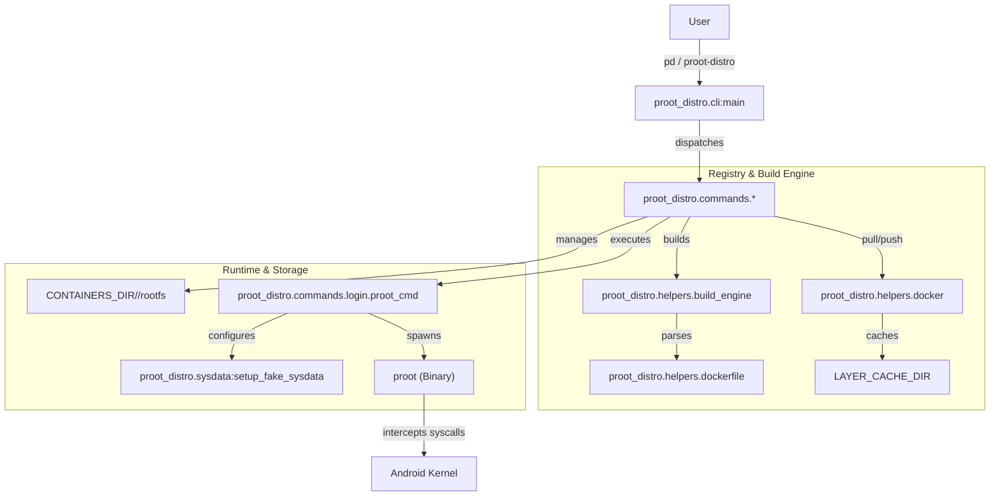

Sources: [CLAUDE.md:28-63](), [README.md:8-15](), [pyproject.toml:19-21]()

### Key Code Entities and Storage Layout

The following diagram maps logical code subsystems to their specific filesystem locations and storage constants.

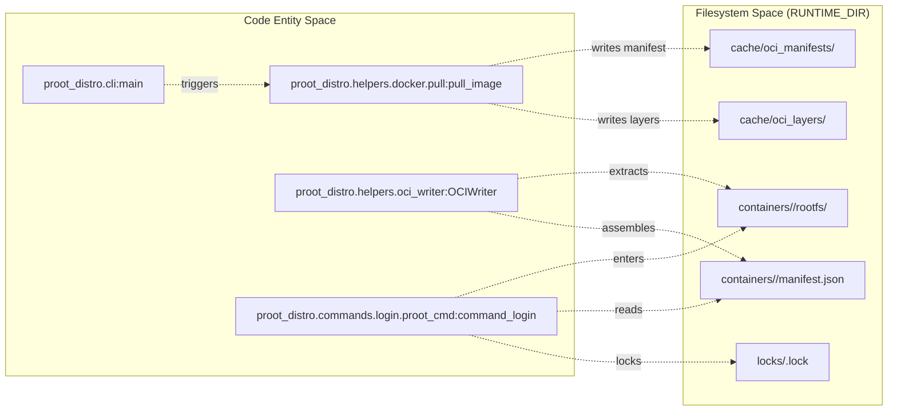

Sources: [CLAUDE.md:65-76](), [CLAUDE.md:88-93](), [CLAUDE.md:152-155]()

## Core Features and Comparison

### v5.x (Python) vs. Legacy 4.x (Shell)

The transition to Python enabled a significantly more robust feature set, particularly regarding image management and multi-stage builds.

| Feature | Legacy 4.x (Shell) | Modern 5.1 (Python) |
| :--- | :--- | :--- |
| **Backend** | Bash Script | Pure Python 3.9+ [pyproject.toml:10]() |
| **Image Source** | Static tarball URLs in plugins | OCI/Docker Registries [README.md:8-11]() |
| **Image Building** | Not supported | Native Dockerfile Build Engine [README.md:13]() |
| **Storage Layout** | `installed-rootfs/<name>` | `containers/<name>/rootfs` [CLAUDE.md:88-93]() |
| **Metadata** | None (Filesystem only) | `manifest.json` per container [CLAUDE.md:91]() |
| **Dependencies** | `bash`, `curl`, `tar` | `python`, `proot` (zero extra libs) [CLAUDE.md:20-26]() |
| **Migration** | N/A | Automatic legacy rootfs migration [CLAUDE.md:97-98]() |

Sources: [README.md:48-64](), [CLAUDE.md:13-17](), [CLAUDE.md:105-120]()

### Multi-Architecture & Emulation
PRoot-Distro supports running guest distributions with different architectures than the host (e.g., running `x86_64` images on an `aarch64` device) via QEMU user-mode emulation [README.md:59](). 

- **Architecture Detection**: Handled via ELF magic byte inspection [CLAUDE.md:39-40]().
- **Emulation**: Triggered when host and guest architectures mismatch, utilizing `proot -q` to invoke the appropriate `qemu-user-*` binary [README.md:76-77]().

## Container Types: `normal` vs `termux`

PRoot-Distro distinguishes between standard Linux distributions and "Termux-style" containers to handle environment variables and path bindings correctly.

- **`normal`**: Standard distributions (Ubuntu, Alpine, etc.) using `link2symlink` to handle Android filesystem restrictions [CLAUDE.md:100-101]().
- **`termux`**: Containers replicating the Termux environment. These bypass `link2symlink`, use specific path bindings for the Termux prefix, and **prohibit cross-architecture emulation** to prevent host binaries from shadowing container ones [CLAUDE.md:103-107]().

Sources: [CLAUDE.md:100-108]()

## Command Reference Summary

The utility is accessible via the `proot-distro` command or the `pd` shorthand alias [README.md:68]().

| Category | Commands |
| :--- | :--- |
| **Installation** | `install`, `remove`, `reset`, `rename` |
| **Access** | `login`, `run` |
| **Management** | `backup`, `restore`, `copy`, `sync`, `list` |
| **Build & Push** | `build`, `push` |
| **Utility** | `help`, `clear-cache` |

Sources: [README.md:24-38](), [pyproject.toml:19-21](), [CLAUDE.md:110-125]()

## Next Steps

- **Installation**: Learn how to set up v5.1 via `pkg`, `pip`, or source. See [Installation & Quick Start](#1.1).
- **Usage**: Explore the [Command Reference](#2) for detailed flag and OCI reference documentation.
- **Constraints**: Understand what can and cannot be done within a rootless PRoot environment. See [Limitations & Constraints](#1.2).

---

# Page: Installation & Quick Start

# Installation & Quick Start

<details>
<summary>Relevant source files</summary>

The following files were used as context for generating this wiki page:

- [CLAUDE.md](CLAUDE.md)
- [README.md](README.md)
- [pyproject.toml](pyproject.toml)
- [screenshot.png](screenshot.png)

</details>


This document covers the installation of **PRoot-Distro v5.1**, a major Python-based container management utility. v5.1 maintains the zero-third-party-dependency architecture [pyproject.toml:12]() and expands on native OCI/Docker image support, including on-device image building [README.md:13-15]().

## Prerequisites

PRoot-Distro is designed for [Termux](https://termux.dev) on Android but also supports regular Linux hosts [README.md:4-6]().

**Runtime Requirements:**
*   **Python 3.9+**: The core engine requires a modern Python interpreter [pyproject.toml:10]().
*   **PRoot**: The primary execution engine that provides rootless chroot-like functionality [README.md:5]().
*   **QEMU User (Optional)**: Required for cross-architecture containers (e.g., running `x86_64` on `aarch64`) [README.md:76-77]().

Sources: [pyproject.toml:10-12](), [README.md:4-6](), [README.md:75-77]()

## Installation Methods

### Method 1: Termux Package Manager (Recommended)
The official package automatically handles the `proot` dependency.
```sh
pkg install proot-distro
```
Sources: [README.md:87]()

### Method 2: Python Package Index (PyPI)
Install the latest stable release via `pip`. Ensure `proot` is installed separately.
```sh
pkg install python proot
pip install proot-distro
```
Sources: [README.md:95-96]()

### Method 3: From Source (Development Mode)
For developers or users testing the latest repository changes, use an editable install.
```sh
git clone https://github.com/termux/proot-distro
cd proot-distro
pip install -e .
```
Sources: [README.md:107-110](), [CLAUDE.md:110]()

## The `pd` Alias and Entry Points

The installation registers two console scripts [pyproject.toml:20-21](). Both are entry points to the `proot_distro.cli:main` function [CLAUDE.md:17]().

*   `proot-distro`: The standard command.
*   `pd`: A convenient shorthand alias.

### CLI Entry Point Architecture

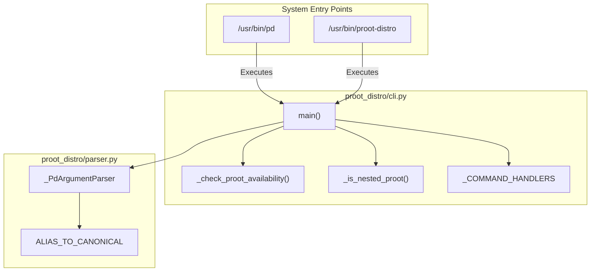
Sources: [pyproject.toml:19-21](), [CLAUDE.md:46-52](), [README.md:68-69]()

## Quick Start Guide

PRoot-Distro v5.1 allows pulling images from Docker Hub, GitHub Container Registry (`ghcr.io`), and others [README.md:193-194]().

### 1. Install a Container
You can install using an image reference. The system defaults to the host architecture unless overridden.
```sh
# Install Ubuntu 24.04 from Docker Hub
pd install ubuntu:24.04

# Install Alpine with a custom name and architecture
pd install alpine --name my-alpine --architecture x86_64
```
Sources: [README.md:129](), [README.md:180-181]()

### 2. List Installed Containers
View all containers and their current status.
```sh
pd list
```
Sources: [README.md:141]()

### 3. Log In to a Container
Access the container shell. The `login` command sets up the `proot` environment, including fake `sysdata` [CLAUDE.md:50]().
```sh
# Standard login
pd login ubuntu

# Login as a specific user (UID or name)
pd login ubuntu --user 1000
```
Sources: [README.md:132](), [CLAUDE.md:129]()

### 4. Run One-off Commands
The `--` separator passes arguments directly to the container's shell or entrypoint.
```sh
pd login ubuntu -- /bin/uname -a
```
Sources: [README.md:138]()

## Installation and Build Data Flow

When installing or building, the system interacts with the OCI registry and local cache.

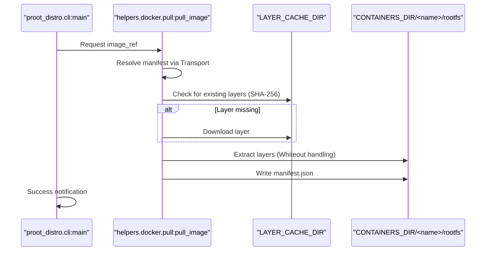
Sources: [CLAUDE.md:88-93](), [README.md:8-11](), [CLAUDE.md:62-63]()

## Key Files and Locations

| Constant | Path (Termux) | Description |
|------|-------------|-------------|
| `RUNTIME_DIR` | `$PREFIX/var/lib/proot-distro` | Root directory for all data [CLAUDE.md:69](). |
| `CONTAINERS_DIR` | `RUNTIME_DIR/containers/` | Container rootfs and `manifest.json` [CLAUDE.md:71](). |
| `LAYER_CACHE_DIR` | `BASE_CACHE_DIR/oci_layers/` | Cached OCI image layers [CLAUDE.md:73](). |
| `MANIFEST_CACHE_DIR` | `BASE_CACHE_DIR/oci_manifests/` | Cached OCI manifests for builds [CLAUDE.md:74](). |

Sources: [CLAUDE.md:67-75]()

---

# Page: Limitations & Constraints

# Limitations & Constraints

<details>
<summary>Relevant source files</summary>

The following files were used as context for generating this wiki page:

- [CLAUDE.md](CLAUDE.md)
- [README.md](README.md)
- [proot_distro/constants.py](proot_distro/constants.py)
- [proot_distro/helpers/build_cache.py](proot_distro/helpers/build_cache.py)

</details>


This document provides a comprehensive overview of the inherent limitations and operational constraints of `proot-distro` v5.1. Understanding these limitations is essential for users to set appropriate expectations, troubleshoot issues effectively, and implement suitable workarounds where needed.

## Inherent PRoot Limitations

`proot-distro` relies on the PRoot utility, which uses `ptrace()` to provide a chroot-like environment without requiring root privileges. However, this approach comes with significant limitations compared to true chroot or containerization technologies like Docker.

### Performance Degradation

PRoot intercepts and handles system calls through `ptrace()`, which introduces overhead for every process executed within the environment. This leads to noticeable performance degradation compared to native execution, especially for system-call-heavy workloads.

**Native vs PRoot Execution Flow**
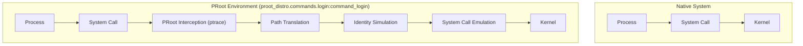

Sources: [README.md:3-6](), [proot_distro/commands/login/proot_cmd.py:121-180]()

### Process Management Limitations

Unlike true containers, PRoot cannot fully detach from processes it starts. When the PRoot session ends, child processes are typically terminated or left in an orphaned state that may not function correctly. This creates constraints for running long-lived daemon processes.

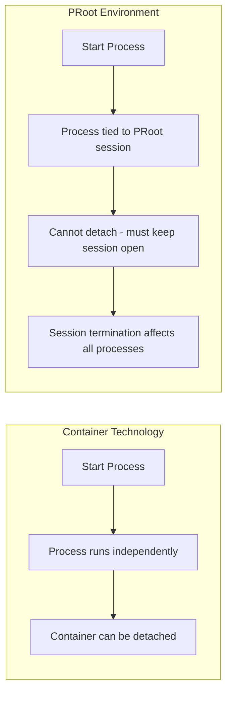

Sources: [proot_distro/commands/login/proot_cmd.py:121-180]()

### Privilege Emulation Not Actual Elevation

PRoot provides the appearance of root privileges (UID 0) without actually elevating permissions. The underlying process still runs with the Android application's UID.

**Identity Simulation Mapping**
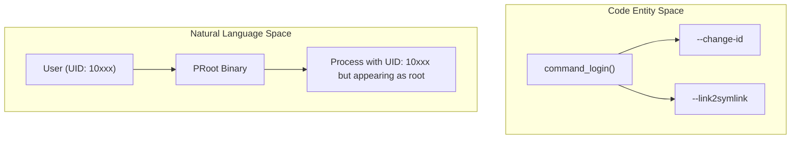

Sources: [proot_distro/commands/login/proot_cmd.py:121-125](), [proot_distro/commands/login/proot_cmd.py:165-170](), [CLAUDE.md:22-26]()

## Technical Implementation Constraints

### Architecture Support and Emulation

`proot-distro` supports multiple CPU architectures via QEMU user-mode emulation. However, cross-architecture execution introduces significant overhead.

**Architecture Resolution Logic**
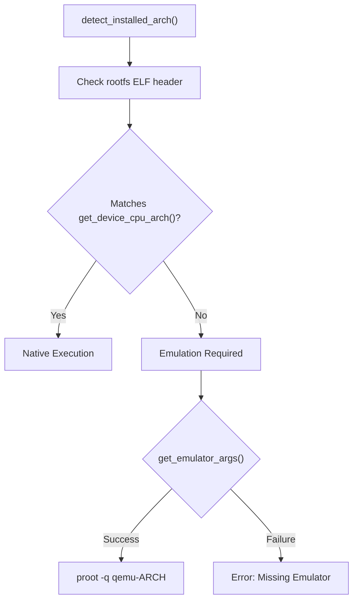

Sources: [proot_distro/arch.py:45-64](), [proot_distro/arch.py:101-118](), [proot_distro/commands/login/proot_cmd.py:113-119]()

### Anti-Nested PRoot Protections

`proot-distro` explicitly prevents execution inside another PRoot environment to avoid `ptrace` conflicts and extreme performance degradation. It detects this by checking for the `PROOT_TMPDIR` environment variable or inspecting the process tracer via `/proc`.

```python
# From proot_distro/cli.py:main()
if "PROOT_TMPDIR" in os.environ:
    msg(f"{C['RED']}error:{C['RST']} you are trying to run {PROGRAM_NAME} inside proot.")
    sys.exit(1)
```

Sources: [proot_distro/cli.py:168-171](), [CLAUDE.md:51-52]()

### `termux` Type Container Restrictions

Containers of type `termux` (which contain a full Termux environment inside) have specific architectural constraints. Because they share the same hardcoded `PREFIX` path (`/data/data/com.termux/files/usr`) as the host, cross-architecture emulation is impossible.

```python
# From proot_distro/commands/login/proot_cmd.py:command_login()
if is_termux_dist and guest_arch != host_arch:
    msg(f"{C['RED']}error:{C['RST']} cross-architecture is not supported for 'termux' containers.")
    sys.exit(1)
```

Sources: [CLAUDE.md:100-108](), [proot_distro/commands/login/proot_cmd.py:34-38]()

## System Data & SELinux Constraints

### Synthetic System Data (`sysdata.py`)

Android restricts access to `/proc` and `/sys`. `proot-distro` works around this by generating synthetic files and binding them into the container.

| Simulated Path | Code Source | Purpose |
|---|---|---|
| `/proc/loadavg` | `fake_proc_bindings()` | Static load average to satisfy uptime/top |
| `/proc/stat` | `fake_proc_bindings()` | Static CPU stats |
| `/proc/version` | `DEFAULT_FAKE_KERNEL_VERSION` | Fake kernel string |
| `/sys/fs/selinux` | `setup_fake_sysdata()` | Fake SELinux directory to bypass checks |

Sources: [proot_distro/sysdata.py:27-39](), [proot_distro/sysdata.py:68-100](), [proot_distro/constants.py:117-120]()

### SELinux and Link2Symlink

Android's SELinux policy often prevents the creation of hard links in the app's data directory. `proot-distro` uses the PRoot `link2symlink` extension to emulate hard links using specially formatted symlinks.

*   **Mechanism**: Enabled via `--link2symlink` flag in `command_login`.
*   **Storage**: Metadata is stored in a directory defined by `PROOT_L2S_DIR`.
*   **Constraint**: If `link2symlink` is disabled (e.g., in `termux` type containers), many Linux package managers (like `apt` or `pacman`) will fail due to their reliance on hard links.

Sources: [proot_distro/commands/login/proot_cmd.py:121-125](), [CLAUDE.md:43](), [CLAUDE.md:104-106]()

## Security & Isolation

### Limited Isolation Boundary

PRoot is a path-translation engine, not a security sandbox. It provides significantly less isolation than Docker.

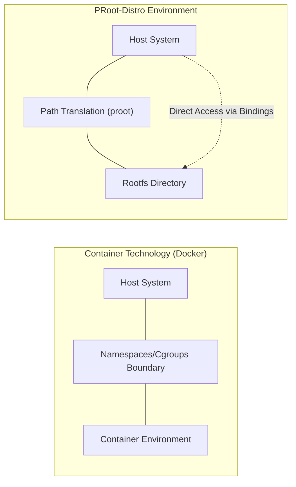

Sources: [proot_distro/commands/login/bindings.py:16-30](), [proot_distro/commands/login/proot_cmd.py:130-150]()

### Image Environment Blocks

To prevent guest images from breaking the host-to-guest transition or terminal state, certain environment variables are blocked from being imported from OCI image configurations.

```python
# From proot_distro/commands/login/env.py
_IMAGE_ENV_BLOCKED = frozenset({
    "ANDROID_ART_ROOT", "ANDROID_DATA", "ANDROID_I18N_ROOT",
    "ANDROID_ROOT", "ANDROID_RUNTIME_ROOT", "ANDROID_TZDATA_ROOT",
    "BOOTCLASSPATH", "DEX2OATBOOTCLASSPATH", "EXTERNAL_STORAGE",
    "TERM", "COLORTERM",
})
```

Sources: [proot_distro/commands/login/env.py:27-33]()

## Network Constraints

### Low-Port Redirection

Android does not allow non-root users to bind to ports below 1024. `proot-distro` uses the `--redirect-ports` flag to handle this by shifting port requests.

*   **Logic**: Maps guest ports `0-1023` to host ports `2000-3023`.
*   **Implementation**: Passed to PRoot via `-p 0:1024:2000`.

Sources: [proot_distro/commands/login/proot_cmd.py:127-129]()

---

# Page: Command Reference

# Command Reference

<details>
<summary>Relevant source files</summary>

The following files were used as context for generating this wiki page:

- [proot_distro/cli.py](proot_distro/cli.py)
- [proot_distro/commands/help/__init__.py](proot_distro/commands/help/__init__.py)
- [proot_distro/commands/help/pages.py](proot_distro/commands/help/pages.py)

</details>


## Purpose and Scope

This document provides a comprehensive reference for all commands available in `proot-distro` v5.1. It details the CLI dispatcher logic, available aliases, and command syntax. Version 5.1 introduces significant new capabilities for building and pushing OCI images directly from Termux. For detailed documentation on specific subsystems, see the relevant child pages: [Installation Commands](#2.1), [Access Commands](#2.2), [Management Commands](#2.3), [Utility Commands](#2.4), and [Build & Push Commands](#2.5).

## Command Overview

PRoot-Distro v5.1 uses a Python-based CLI dispatcher defined in `proot_distro/cli.py`. It utilizes `argparse` with `add_help=False` to manually handle help output via the `HELP_COMMANDS` registry [proot_distro/cli.py:43](). This prevents "missing required argument" errors when a user requests help for a subcommand [proot_distro/cli.py:170-182]().

The following table summarizes the available commands and their aliases:

| Command | Aliases | Description |
|---------|---------|-------------|
| `install` | `add`, `i`, `in`, `ins` | Pull OCI images or install local archives |
| `login` | `sh` | Enter a container's interactive shell |
| `run` | - | Execute a specific command inside a container |
| `remove` | `rm` | Delete a container and its rootfs |
| `rename` | - | Change a container's alias |
| `reset` | - | Reinstall a container using its existing manifest |
| `list` | `li`, `ls` | Show installed and available distributions |
| `backup` | `bak`, `bkp` | Archive a container's rootfs and metadata |
| `restore` | - | Restore a container from a tar archive |
| `copy` | `cp` | Copy files between host and container |
| `sync` | - | Synchronize files using CRC32 checksums |
| `build` | `b` | Build OCI images from a Dockerfile |
| `push` | `p` | Push locally built images to a registry |
| `clear-cache` | `clear`, `cl` | Remove downloaded OCI layers and manifests |
| `help` | `hel`, `he`, `h` | Show usage information |

Sources: [proot_distro/cli.py:60-76](), [proot_distro/parser.py:165-195]()

## CLI Dispatcher Architecture

The dispatcher resolves aliases to canonical command names before execution using `ALIAS_TO_CANONICAL` [proot_distro/parser.py:165-195](). Before dispatching, the CLI performs several environment checks, including a warning if running as root [proot_distro/cli.py:83-90](), a refusal to run inside a nested PRoot session [proot_distro/cli.py:92-114](), and a probe for the `proot` utility (except for `build` and `push` commands) [proot_distro/cli.py:116-168]().

### Command Dispatch Flow

The following diagram illustrates how the CLI entry point processes a user command and routes it to the appropriate internal handler.

**CLI Dispatch Logic**
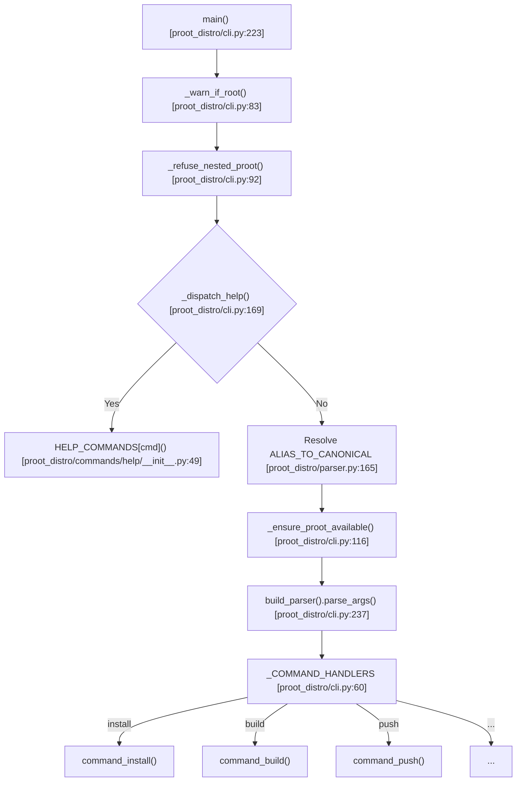

Sources: [proot_distro/cli.py:60-250](), [proot_distro/parser.py:165-195]()

### System Entity Mapping

This diagram bridges the CLI command names to their specific implementation modules and the underlying storage and cache entities.

**Entity Mapping**
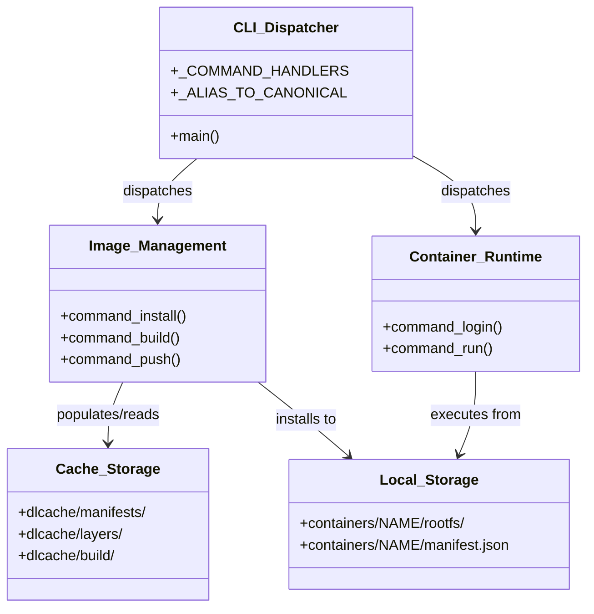

Sources: [proot_distro/cli.py:60-76](), [proot_distro/constants.py:44-55](), [proot_distro/commands/install.py:1-50]()

## Command Groups

### Installation Commands
These commands manage the lifecycle of container instances. `install` supports pulling from OCI registries or installing from local tarballs and OCI layouts. `reset` allows for a clean state without re-specifying the image source by reading the existing `manifest.json`.

For details, see [Installation Commands](#2.1).

### Access Commands
`login` and `run` are the primary interfaces for executing code inside containers. `login` provides an interactive shell, while `run` executes specific commands, resolving `Entrypoint` and `Cmd` from the container's manifest. Both support advanced proot features like port redirection and isolated mounts.

For details, see [Access Commands](#2.2).

### Management Commands
These commands handle data movement and maintenance. `backup` and `restore` create and extract compressed tar archives. `copy` and `sync` allow for granular file transfers between the host and container rootfs using `dist:path` syntax.

For details, see [Management Commands](#2.3).

### Utility Commands
Utility functions include the per-command help system and cache management. `clear-cache` targets the `dlcache/` directory, removing downloaded OCI layers, manifests, and the build cache to free up space.

For details, see [Utility Commands](#2.4).

### Build & Push Commands
New in v5.1, `build` allows creating OCI-compatible images from Dockerfiles using a pure-Python parser and a PRoot-based `RUN` execution engine. `push` enables uploading these locally built images to remote registries like Docker Hub or GHCR.

For details, see [Build & Push Commands](#2.5).

## Environment Variables

PRoot-Distro behavior can be influenced by several environment variables:

| Variable | Description |
|----------|-------------|
| `PD_DOCKER_AUTH` | Credentials for OCI registries in `user:password` format [proot_distro/commands/help/__init__.py:153](). |
| `PD_FORCE_NO_COLORS` | If set, disables ANSI color codes in output [proot_distro/commands/help/__init__.py:142](). |
| `PROOT_L2S_DIR` | Directory used for PRoot's `link2symlink` storage. |

Sources: [proot_distro/commands/help/__init__.py:136-157](), [proot_distro/cli.py:38-39]()

---

# Page: Installation Commands

# Installation Commands

<details>
<summary>Relevant source files</summary>

The following files were used as context for generating this wiki page:

- [proot_distro/commands/install.py](proot_distro/commands/install.py)
- [proot_distro/commands/install_local.py](proot_distro/commands/install_local.py)
- [proot_distro/commands/remove.py](proot_distro/commands/remove.py)
- [proot_distro/commands/rename.py](proot_distro/commands/rename.py)
- [proot_distro/commands/reset.py](proot_distro/commands/reset.py)
- [proot_distro/helpers/docker/__init__.py](proot_distro/helpers/docker/__init__.py)
- [proot_distro/helpers/docker/cache.py](proot_distro/helpers/docker/cache.py)

</details>


This page documents the commands for installing, removing, resetting, and renaming containers in PRoot-Distro v5.1. These commands manage the container lifecycle, handling OCI image pulls, local archive extractions, and filesystem management.

## Overview

PRoot-Distro v5.1 is a Python-based OCI-compliant manager. The core installation commands are:

1.  `install`: Pulls Docker/OCI images, fetches URLs, or extracts local tarballs into a new container.
2.  `remove`: Deletes a container's rootfs and metadata.
3.  `reset`: Rebuilds a container using its original image reference stored in a manifest.
4.  `rename`: Safely renames a container and updates internal path references.

## Command Dispatch and Data Flow

The following diagram illustrates how installation commands interact with the storage layer and external resources.

**Installation System Data Flow**
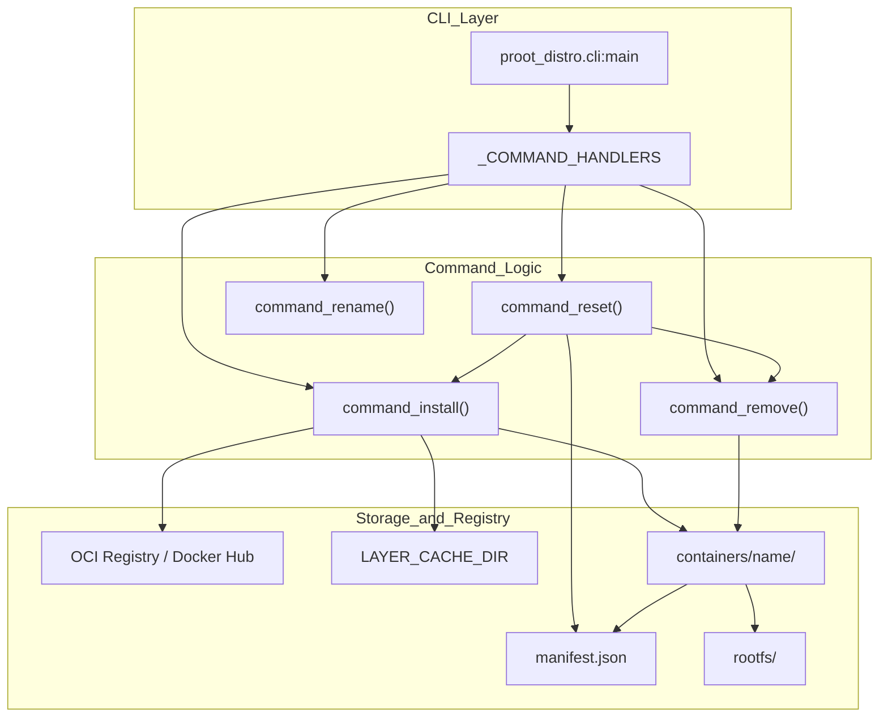
Sources: [proot_distro/commands/install.py:21-28](), [proot_distro/commands/remove.py:21-23](), [proot_distro/commands/reset.py:21-25](), [proot_distro/commands/rename.py:21-24]()

## The `install` Command

The `install` command is the primary entry point for creating new environments. It supports Docker/OCI image references, remote URLs, and local rootfs archives.

### Syntax and Options
`proot-distro install [OPTIONS] IMAGE_REF`

| Option | Description |
| :--- | :--- |
| `--name NAME` | Set a custom name for the container. |
| `--architecture ARCH` | Override the target architecture (e.g., `aarch64`, `arm`, `i686`, `riscv64`, `x86_64`). |

**Aliases:** `add`, `i`, `in`, `ins`
Sources: [proot_distro/commands/install.py:105-139](), [proot_distro/commands/install.py:382-390]()

### Installation Logic
The `command_install` function [proot_distro/commands/install.py:105-140]() dispatches based on the `image_ref` type:

1.  **OCI Pull**: If the reference is not a local path or URL, it calls `pull_image()` [proot_distro/helpers/docker/pull.py:115](). It resolves the image, downloads layers to `LAYER_CACHE_DIR`, and extracts them sequentially using `apply_layer()` [proot_distro/helpers/docker/layers.py:73]().
2.  **Local OCI Layout**: If the path is a tarball containing an `oci-layout` marker, `install_from_local_file()` [proot_distro/commands/install_local.py:227-243]() extracts layers to the cache and applies them.
3.  **Plain Tarball**: For standard rootfs archives, it uses `extract_plain_tar()` [proot_distro/commands/install_local.py:85-93](). This includes an automatic `detect_strip_count()` [proot_distro/commands/install_local.py:64-82]() to find the rootfs root by scoring path depths against known directories like `etc` or `usr`.
4.  **URL Download**: Remote archives are downloaded via `download_file()` [proot_distro/helpers/download.py:28]() to a temporary location before being treated as local archives [proot_distro/commands/install.py:204-210]().

### Container Naming and Validation
Container names must be valid according to `is_valid_name()` [proot_distro/names.py:26]().
*   **Derived Names**: For Docker images, names are derived via `derive_alias()` [proot_distro/helpers/docker/refs.py:110]().
*   **Local Paths**: Names are derived by stripping extensions like `.tar.gz` or `.oci.tar.xz` and sanitizing characters [proot_distro/commands/install.py:84-98]().

Sources: [proot_distro/commands/install.py:61-65](), [proot_distro/commands/install.py:142-175](), [proot_distro/commands/install_local.py:21-31]()

## The `remove` Command

The `remove` command deletes the entire container directory, including the `rootfs/` and `manifest.json`.

### Recursive Deletion with Permission Fixes
Because PRoot can create files with restrictive permissions (e.g., `chmod 000`) that the host user cannot normally delete, `_remove_path()` [proot_distro/commands/remove.py:35-88]() implements a recursive deletion algorithm that:
1.  Attempts to `os.lstat()` the path.
2.  If a file lacks read/write permissions for the owner, it applies `os.chmod(path, st.st_mode | stat.S_IRUSR | stat.S_IWUSR)` [proot_distro/commands/remove.py:49-54]().
3.  If a directory lacks read/write/execute permissions, it applies `os.chmod(path, st.st_mode | stat.S_IRWXU)` [proot_distro/commands/remove.py:63-68]().
4.  Deletes files via `os.unlink()` and directories via `os.rmdir()`.

**Aliases:** `rm`
Sources: [proot_distro/commands/remove.py:21-23](), [proot_distro/commands/remove.py:91-118]()

## The `reset` Command

The `reset` command restores a container to its original state using metadata stored in its manifest.

### Reset Workflow
1.  **Manifest Retrieval**: Reads `containers/<name>/manifest.json` to extract the `image_ref` and `arch` [proot_distro/commands/reset.py:57-62]().
2.  **Rootfs Wipe**: Deletes the `rootfs/` subdirectory while preserving the container directory and manifest [proot_distro/commands/reset.py:71-81]().
3.  **Re-installation**: Re-runs `command_install()` using the original metadata [proot_distro/commands/reset.py:83-89]().

Reset is only supported for containers installed via OCI images [proot_distro/commands/reset.py:66-69]().

Sources: [proot_distro/commands/reset.py:21-25](), [proot_distro/commands/reset.py:41-90]()

## The `rename` Command

The `rename` command moves a container directory and corrects internal references.

### Link2Symlink Path Correction
When a container is renamed, absolute paths in PRoot's `link2symlink` (l2s) extension must be updated. `command_rename()` [proot_distro/commands/rename.py:37-66]() performs:
1.  **Directory Move**: `os.rename()` of the container directory [proot_distro/commands/rename.py:72]().
2.  **L2S Rewrite**: Calls `rewrite_l2s_targets()` [proot_distro/l2s.py:75]() to update symlinks in the new rootfs path that point to the old rootfs path [proot_distro/commands/rename.py:77]().

**Aliases:** `mv`
Sources: [proot_distro/commands/rename.py:21-25](), [proot_distro/commands/rename.py:69-79]()

## Summary of Command Entities

The following diagram maps CLI commands to their implementation functions and primary helper utilities.

**Command Implementation Map**
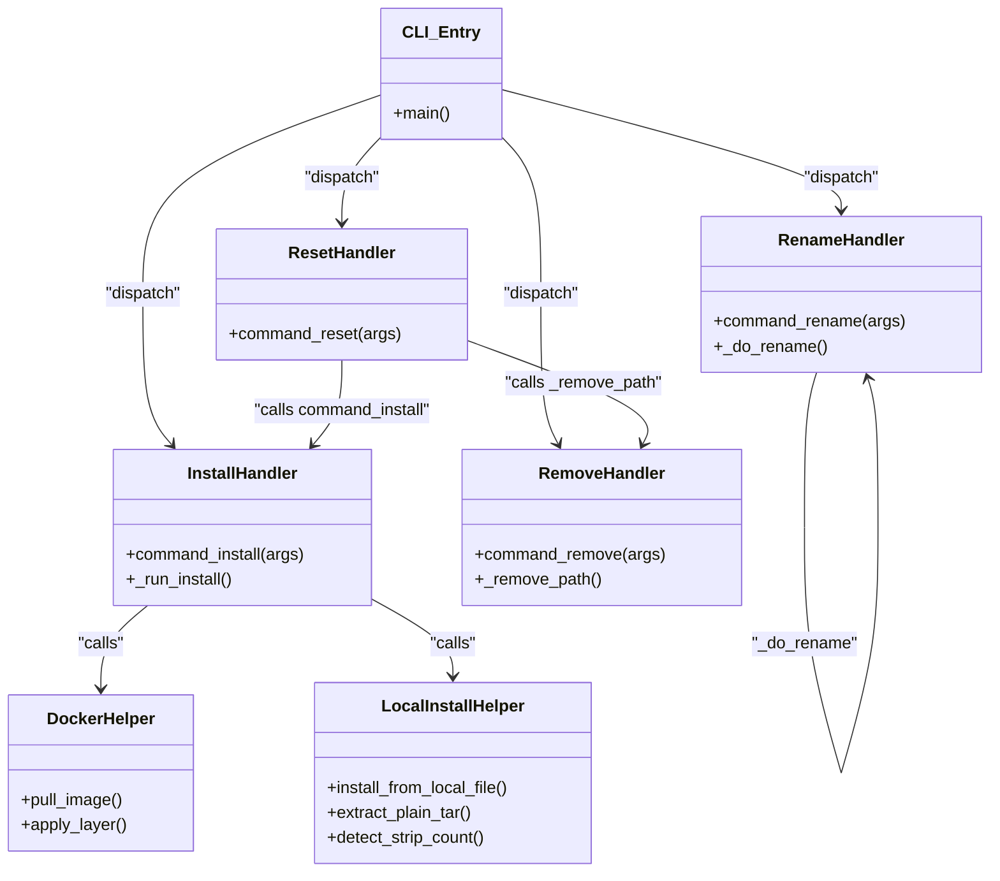
Sources: [proot_distro/commands/install.py:105](), [proot_distro/commands/remove.py:91](), [proot_distro/commands/reset.py:41](), [proot_distro/commands/rename.py:37](), [proot_distro/commands/install_local.py:227](), [proot_distro/helpers/docker/pull.py:115]()

---

# Page: Access Commands

# Access Commands

<details>
<summary>Relevant source files</summary>

The following files were used as context for generating this wiki page:

- [proot_distro/commands/login/__init__.py](proot_distro/commands/login/__init__.py)
- [proot_distro/commands/login/bindings.py](proot_distro/commands/login/bindings.py)
- [proot_distro/commands/login/env.py](proot_distro/commands/login/env.py)
- [proot_distro/commands/login/passwd.py](proot_distro/commands/login/passwd.py)
- [proot_distro/commands/run.py](proot_distro/commands/run.py)

</details>


This document details the PRoot-Distro access commands, primarily the `login` and `run` commands. These commands allow you to interact with installed distributions by starting shells or executing commands within them. In the Python-based v5.1 architecture, these commands handle complex environment setup, OCI manifest resolution, and PRoot execution logic.

## Login Command Overview

The `login` command (aliased as `sh`) is the primary method for accessing distributions. It spawns an interactive shell or a custom command inside the container by building a full `proot` command line. The command utilizes a shared lock via `ContainerLock` to ensure session integrity while allowing multiple concurrent logins to the same rootfs.

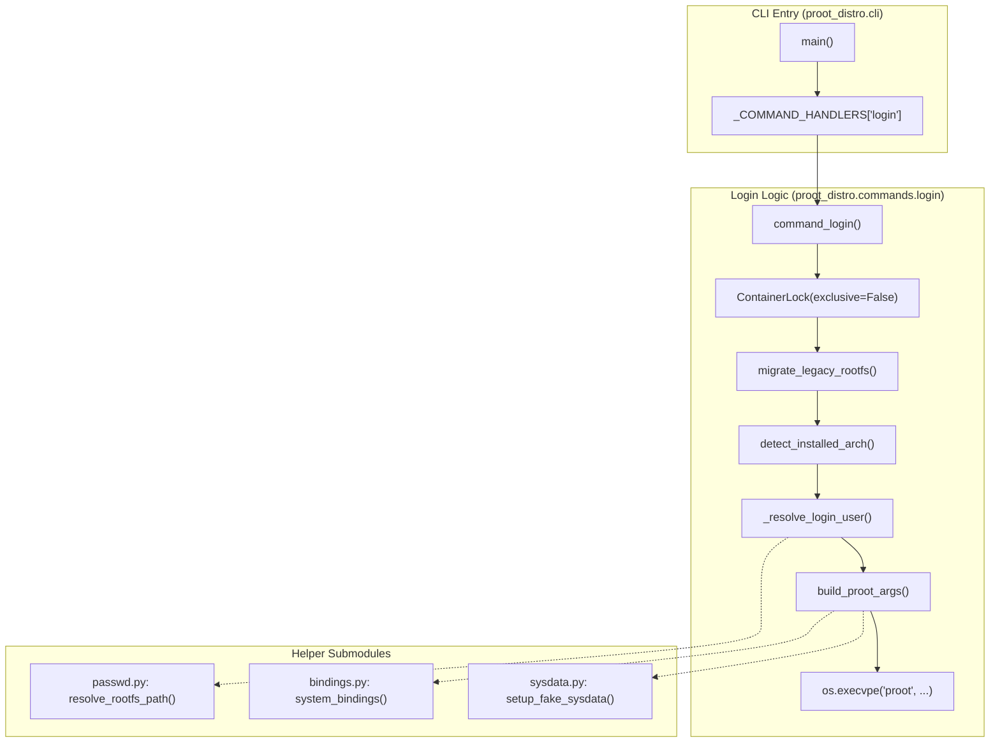
Sources: [proot_distro/commands/login/__init__.py:71-85](), [proot_distro/commands/login/__init__.py:82-84](), [proot_distro/commands/login/passwd.py:34-70](), [proot_distro/commands/login/bindings.py:58-84]()

## The Run Command

The `run` command executes the `Entrypoint` and/or `Cmd` defined in a container's OCI image manifest (`manifest.json`). It acts as a wrapper around `command_login`, injecting the resolved command into the login flow via the `args._run_inner` attribute.

### Entrypoint/Cmd Resolution Logic
The command resolution follows OCI/Docker semantics:
1.  If arguments are provided after the `--` separator, they **replace** `Cmd` but are **appended** to `Entrypoint`.
2.  If no arguments are provided, it concatenates `Entrypoint` + `Cmd`.
3.  The `WorkingDir` from the manifest is used unless overridden by `--work-dir`.

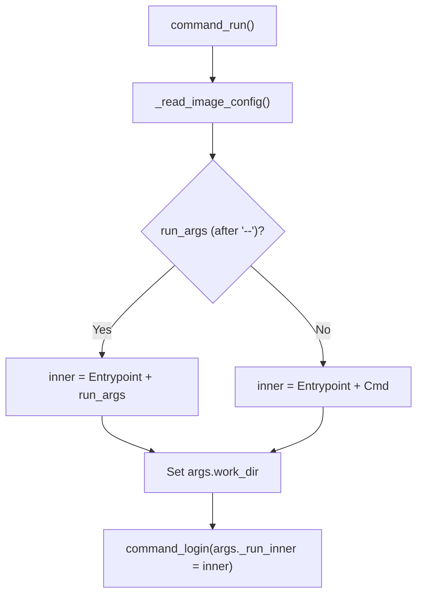
Sources: [proot_distro/commands/run.py:21-26](), [proot_distro/commands/run.py:71-85](), [proot_distro/commands/run.py:89-93]()

## Login and Run Options

The following table details the technical implementation of access options:

| Option | Implementation Detail |
| :--- | :--- |
| `--user <user>` | Resolved via `_resolve_login_user`. It parses `/etc/passwd` and `/etc/group` using `resolve_rootfs_path` to handle guest-side symlinks. [proot_distro/commands/login/__init__.py:102-191]() |
| `--isolated` | When set, `system_bindings()` and `storage_bindings()` are not called, preventing host path exposure. [proot_distro/commands/login/proot_cmd.py:105-115]() |
| `--minimal` | Disables `inject_termux_profile` and sets a restricted `DEFAULT_PATH_ENV`. [proot_distro/commands/login/__init__.py:194-205]() |
| `--bind <h:g>` | Appends to the `proot` command line as `--bind=host_path:guest_path`. [proot_distro/commands/login/proot_cmd.py:125-128]() |
| `--shared-x11` | Binds `/tmp/.X11-unix` and propagates `DISPLAY` and `XAUTHORITY` variables. [proot_distro/commands/login/proot_cmd.py:133-144]() |
| `--shared-tmp` | Binds the host `$TMPDIR` to the guest `/tmp`. [proot_distro/commands/login/proot_cmd.py:130-132]() |
| `--termux-home` | Binds the host `TERMUX_HOME` to the resolved guest user's home directory. [proot_distro/commands/login/proot_cmd.py:146-153]() |
| `--redirect-ports` | Passes `-p` to `proot` for port redirection (e.g., mapping privileged ports). [proot_distro/commands/login/proot_cmd.py:228-230]() |
| `--env VAR=val` | Merged into the environment dict before being written to the `termux-profile.sh` snippet. [proot_distro/commands/login/env.py:80-135]() |
| `--emulator <bin>` | Forces a specific binary for guest execution via `proot -q`. [proot_distro/commands/login/proot_cmd.py:219-221]() |

Sources: [proot_distro/commands/login/__init__.py:102-191](), [proot_distro/commands/login/proot_cmd.py:105-153](), [proot_distro/commands/login/env.py:80-135]()

## Filesystem Access and Fake Sysdata

To provide a functional Linux environment on Android's restricted kernel, PRoot-Distro utilizes a "Fake Sysdata" subsystem and specialized path resolution.

### Synthetic Mounts
The `setup_fake_sysdata()` function generates temporary files and binds them to `/proc` and `/sys` entries to satisfy software that expects standard Linux kernel interfaces. This includes `/proc/loadavg`, `/proc/stat`, and `/sys/block` entries.
Sources: [proot_distro/sysdata.py:108-123]()

### Rootfs Path Resolution
The `resolve_rootfs_path()` function in `passwd.py` is critical for user management. It manually traverses symlinks within the guest rootfs (up to 40 levels) to find real host paths. It specifically handles `link2symlink` (`.l2s`) targets to prevent re-rooting loops and ensures absolute symlinks inside the guest (common in NixOS) resolve correctly within the container namespace.

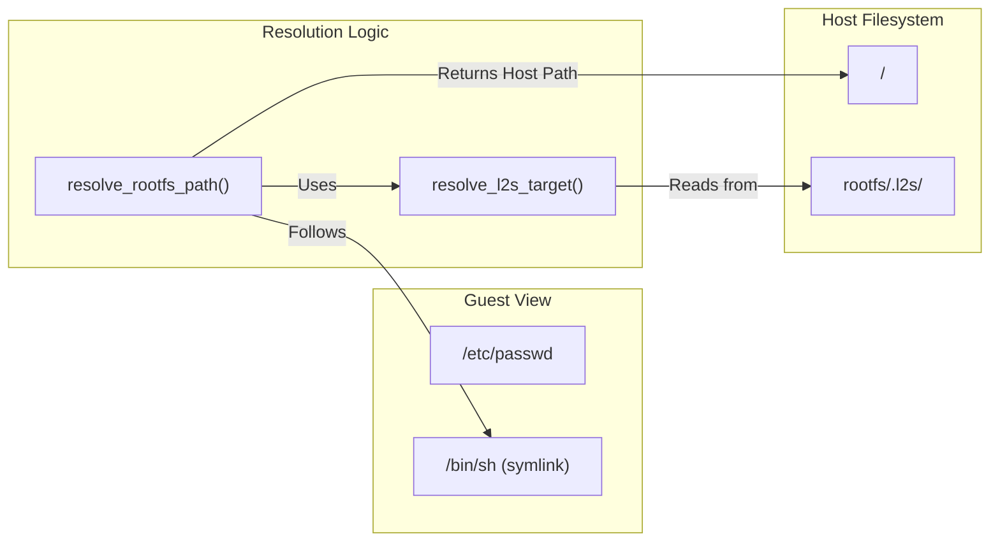
Sources: [proot_distro/commands/login/passwd.py:34-70](), [proot_distro/commands/login/passwd.py:60-63]()

## Environment Precedence and Persistence

The environment within the container is constructed and persisted to handle `su -` sessions correctly.

1.  **Blocked Variables**: Variables like `ANDROID_ROOT` and `LD_PRELOAD` are explicitly blocked via `IMAGE_ENV_BLOCKED` to prevent guest crashes. [proot_distro/commands/login/env.py:46-52]()
2.  **Profile Injection**: The `inject_termux_profile()` function writes a snippet to `/etc/profile.d/termux-profile.sh`. This ensures that even when a login shell re-sources `/etc/profile` (e.g., during `su -`), the PRoot-Distro defined variables and user `--env` flags are re-exported. [proot_distro/commands/login/env.py:80-94]()
3.  **Skip Logic**: Per-session variables like `HOME`, `USER`, and `TERM` are excluded from injection via `_PROFILE_INJECT_SKIP` so they don't override the values set by the guest's own login mechanisms. [proot_distro/commands/login/env.py:60-65]()

Sources: [proot_distro/commands/login/env.py:46-65](), [proot_distro/commands/login/env.py:80-135]()

---

# Page: Management Commands

# Management Commands

<details>
<summary>Relevant source files</summary>

The following files were used as context for generating this wiki page:

- [proot_distro/commands/backup.py](proot_distro/commands/backup.py)
- [proot_distro/commands/clear_cache.py](proot_distro/commands/clear_cache.py)
- [proot_distro/commands/copy.py](proot_distro/commands/copy.py)
- [proot_distro/commands/list.py](proot_distro/commands/list.py)
- [proot_distro/commands/restore.py](proot_distro/commands/restore.py)
- [proot_distro/commands/sync.py](proot_distro/commands/sync.py)

</details>


This page provides detailed technical documentation for the management commands in PRoot-Distro v5.1. These commands handle the lifecycle and data movement of installed containers, including backup, restoration, synchronization, and listing.

## Overview of Management Commands

Management commands are implemented as specialized modules within the `proot_distro.commands` package. They interact with the container storage located in `CONTAINERS_DIR`, which follows a structured layout: `containers/<name>/manifest.json` and `containers/<name>/rootfs/`.

The CLI dispatcher maps user input to these specific command handlers.

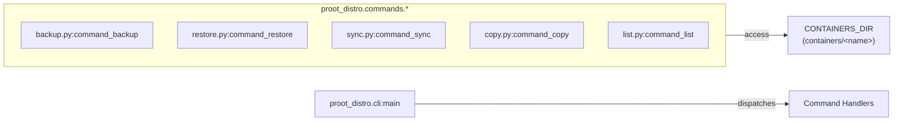
Sources: [proot_distro/commands/backup.py:21-25](), [proot_distro/commands/restore.py:21-28](), [proot_distro/commands/list.py:21-23]()

## Backup and Restore

The backup and restore system facilitates portable container archives. v5.1 uses a standard directory structure inside the archive to ensure metadata (manifests) and data (rootfs) are preserved together.

### Backup Command Implementation

The `command_backup` function creates a TAR archive of a container. It preserves file permissions and symlinks while stripping host-specific ownership information (UID/GID) to ensure portability.

**Key Features:**
- **Compression Detection**: Inferred from the `--output` file extension via `_compression_mode` [proot_distro/commands/backup.py:67-80]() or forced via the `--compress` flag.
- **Progress Tracking**: Uses a `_ReadCounter` wrapper [proot_distro/commands/backup.py:122-141]() to provide real-time byte-level progress updates during the compression stream.
- **Link2Symlink Handling**: Symlinks that are actually PRoot `link2symlink` emulated hard links are resolved to their backing files and packed as regular files [proot_distro/commands/backup.py:173-193]().
- **Deterministic Order**: Entries are sorted during iteration in `_iter_entries` to ensure reproducible archive generation [proot_distro/commands/backup.py:83-119]().

| Compression Type | Extension Suffixes | Internal Mode |
| :--- | :--- | :--- |
| Gzip | `.tar.gz`, `.tgz` | `gz` |
| Bzip2 | `.tar.bz2`, `.tbz2` | `bz2` |
| XZ / LZMA | `.tar.xz`, `.txz`, `.tar.lzma` | `xz` |
| None | `.tar` | `''` |

Sources: [proot_distro/commands/backup.py:43-64](), [proot_distro/commands/backup.py:143-163](), [proot_distro/commands/backup.py:221-250]()

### Restore Command Implementation

The `command_restore` function handles extraction. It is designed to be backward compatible with legacy 4.x archives while supporting the new v5.1 layout.

**Archive Layout Resolution (`_dest_path`):**
1. **New Format**: `<name>/manifest.json` and `<name>/rootfs/...` are extracted to their respective locations in `CONTAINERS_DIR` [proot_distro/commands/restore.py:173-179]().
2. **Legacy Format**: Entries starting with `installed-rootfs/` are re-rooted to `containers/<name>/rootfs/` [proot_distro/commands/restore.py:151-160]().
3. **Safety**: Members containing `..` or absolute paths are rejected to prevent path traversal [proot_distro/commands/restore.py:142-144]().

**Compression Auto-detection**: For stdin streams, `_detect_compression` inspects magic bytes (e.g., `\x1f\x8b` for Gzip) to determine the decompression algorithm [proot_distro/commands/restore.py:65-70]().

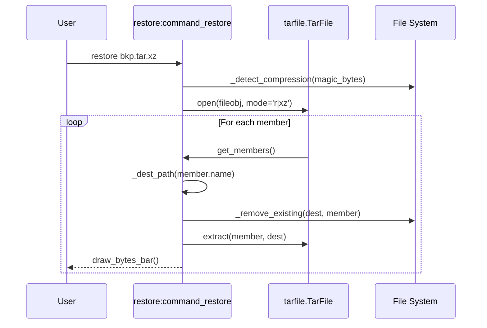
Sources: [proot_distro/commands/restore.py:54-59](), [proot_distro/commands/restore.py:122-183](), [proot_distro/commands/restore.py:207-250]()

## Synchronization and Copying

PRoot-Distro provides file movement between the host and containers using a `dist:path` notation.

### Path Resolution
Both `copy` and `sync` use `resolve_container_path` from `proot_distro.paths`. This helper splits the input string at the first colon; if a container name is found, it prepends the absolute path to that container's rootfs.

```python
# Conceptual Path Flow
"ubuntu:/etc/passwd" -> resolve_container_path() -> "/.../containers/ubuntu/rootfs/etc/passwd"
```
Sources: [proot_distro/commands/copy.py:54-55](), [proot_distro/commands/sync.py:40-41]()

### Sync Command (`sync`)
The `sync` command performs a recursive synchronization.

- **Comparison Logic**: `_needs_update` [proot_distro/commands/sync.py:55-81]() compares file size and integer modification time (`mtime`).
- **Checksum Mode**: With `--checksum`, it calculates a `CRC32` hash of file contents using `zlib.crc32` [proot_distro/commands/sync.py:45-52]().
- **Atomic Writes**: `_sync_file` writes to a temporary `.~pd_sync` file before performing an atomic rename to prevent corruption during partial writes [proot_distro/commands/sync.py:178-212]().
- **Deletion**: The `--delete` flag triggers `_do_delete_pass` [proot_distro/commands/sync.py:288-309]() which removes destination entries that have no counterpart in the source.

Sources: [proot_distro/commands/sync.py:21-30](), [proot_distro/commands/sync.py:313-345]()

### Copy Command (`copy`)
The `copy` command is a wrapper around Python's `shutil` module.
- **Normal Copy**: Uses `shutil.copy2` to preserve metadata [proot_distro/commands/copy.py:110-117]().
- **Move Mode**: Uses `shutil.move` [proot_distro/commands/copy.py:107]().
- **Validation**: Explicitly rejects `.` or `..` as destination names [proot_distro/commands/copy.py:58-61]().

Sources: [proot_distro/commands/copy.py:21-24](), [proot_distro/commands/copy.py:93-117]()

## List and Clear Cache

### List Command
The `list` command scans `CONTAINERS_DIR` for subdirectories containing a `rootfs/` entry.
- **Quiet Mode**: Prints only the container names [proot_distro/commands/list.py:44-47]().
- **Interactive Mode**: Provides a formatted list and usage suggestions if no containers are found [proot_distro/commands/list.py:50-63]().

Sources: [proot_distro/commands/list.py:21-23](), [proot_distro/commands/list.py:32-40]()

### Clear Cache Command
The `clear_cache` command empties the `BASE_CACHE_DIR`, which houses Docker layers, manifests, and build cache index.
- **Space Reporting**: Calculates the total size of files before removal and reports the reclaimed space [proot_distro/commands/clear_cache.py:54-61]().
- **Permission Fixup**: Uses `_ensure_readable` to attempt to fix permissions on cached files that might be unwritable before deletion [proot_distro/commands/clear_cache.py:34-43]().

Sources: [proot_distro/commands/clear_cache.py:21-23](), [proot_distro/commands/clear_cache.py:46-88]()

## Summary of Options

| Command | Implementation | Primary Options |
| :--- | :--- | :--- |
| `backup` | `backup.py` | `--output`, `--compress`, `--verbose` |
| `restore` | `restore.py` | `archive`, `--verbose` |
| `sync` | `sync.py` | `--checksum`, `--delete`, `--verbose` |
| `copy` | `copy.py` | `--move`, `--recursive`, `--verbose` |
| `list` | `list.py` | `--quiet` |
| `clear-cache` | `clear_cache.py` | `--verbose` |

Sources: [proot_distro/commands/backup.py:218-220](), [proot_distro/commands/restore.py:186-189](), [proot_distro/commands/sync.py:313-318](), [proot_distro/commands/copy.py:39-45](), [proot_distro/commands/list.py:32-34]()

---

# Page: Utility Commands

# Utility Commands

<details>
<summary>Relevant source files</summary>

The following files were used as context for generating this wiki page:

- [proot_distro/commands/clear_cache.py](proot_distro/commands/clear_cache.py)
- [proot_distro/commands/help/__init__.py](proot_distro/commands/help/__init__.py)
- [proot_distro/commands/help/pages.py](proot_distro/commands/help/pages.py)
- [proot_distro/commands/list.py](proot_distro/commands/list.py)

</details>


Utility commands in PRoot-Distro v5.1 provide supporting functionality for managing the environment, including a per-command help system and cache management. Unlike management or access commands, these do not directly manipulate container lifecycles but manage the global state of the tool, including the OCI manifest cache and build cache index.

## The Help System

PRoot-Distro implements a centralized help system where all user-facing documentation is decoupled from command logic. This allows for consistent formatting and ensures that help pages stay in sync with what `argparse` actually accepts on the current host.

### Implementation Architecture

The help system is split into data and rendering logic. The `proot_distro.commands.help.pages` module contains the help content as plain Python data [proot_distro/commands/help/pages.py:21-24](). This data is then consumed by the `proot_distro.commands.help.render` module to produce formatted terminal output.

The CLI dispatcher in `proot_distro/cli.py` uses `HELP_COMMANDS` to map command names to zero-arg renderer functions [proot_distro/commands/help/__init__.py:49]().

### Help Command Data Flow

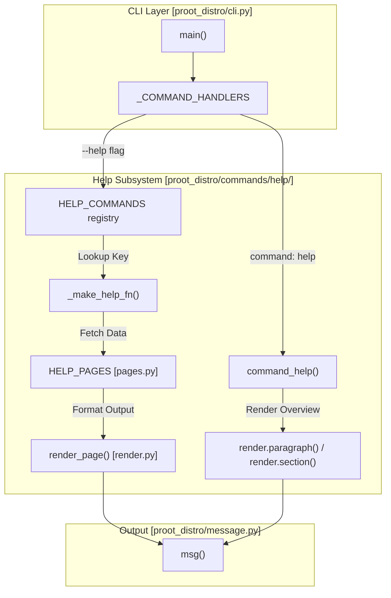
Sources: [proot_distro/commands/help/__init__.py:21-49](), [proot_distro/commands/help/pages.py:31-33]()

### Help Registry (`HELP_COMMANDS`)
The `HELP_COMMANDS` dictionary is dynamically generated by wrapping entries from `HELP_PAGES` in a closure [proot_distro/commands/help/__init__.py:41-49]().

| Command | Data Source | Features Documented |
| :--- | :--- | :--- |
| **Global Help** | `command_help` | Usage overview, quick start examples, and troubleshooting [proot_distro/commands/help/__init__.py:52-164](). |
| **Build** | `HELP_PAGES["build"]` | Dockerfile parsing, build-args, multi-stage targets, and OCI output [proot_distro/commands/help/pages.py:32-139](). |
| **Push** | `HELP_PAGES["push"]` | Registry authentication and manifest cache interaction [proot_distro/commands/help/pages.py:142-178](). |
| **Clear Cache** | `HELP_PAGES["clear-cache"]` | Removal of layers, manifests, and build cache [proot_distro/commands/help/pages.py:304-323](). |

Sources: [proot_distro/commands/help/__init__.py:41-49](), [proot_distro/commands/help/pages.py:31-330]()

## The Clear-Cache Command

The `clear-cache` command reclaims disk space by deleting downloaded OCI image layers, manifests, and the build cache index stored in the local cache.

### Behavior and Data Flow
The command targets `BASE_CACHE_DIR` [proot_distro/commands/clear_cache.py:47](). It performs a two-pass operation: first calculating the total size of files to be deleted, then removing them.

1.  **Permission Correction**: Before deletion, it calls `_ensure_readable()` to attempt to add `S_IRWXU` permissions to directories and `S_IRUSR|S_IWUSR` to files, ensuring `shutil.rmtree` or `os.remove` do not fail due to restrictive permissions often found in OCI layer archives [proot_distro/commands/clear_cache.py:34-43]().
2.  **Size Calculation**: It walks the cache directory to sum file sizes for the final report [proot_distro/commands/clear_cache.py:54-63]().
3.  **Removal**: It iterates through the directory entries. If `--verbose` is passed, it logs every individual file being removed [proot_distro/commands/clear_cache.py:71-84]().
4.  **Reporting**: Reclaimed space is reported in a human-readable format using `fmt_size()` [proot_distro/commands/clear_cache.py:88]().

### Clear-Cache Logic Diagram

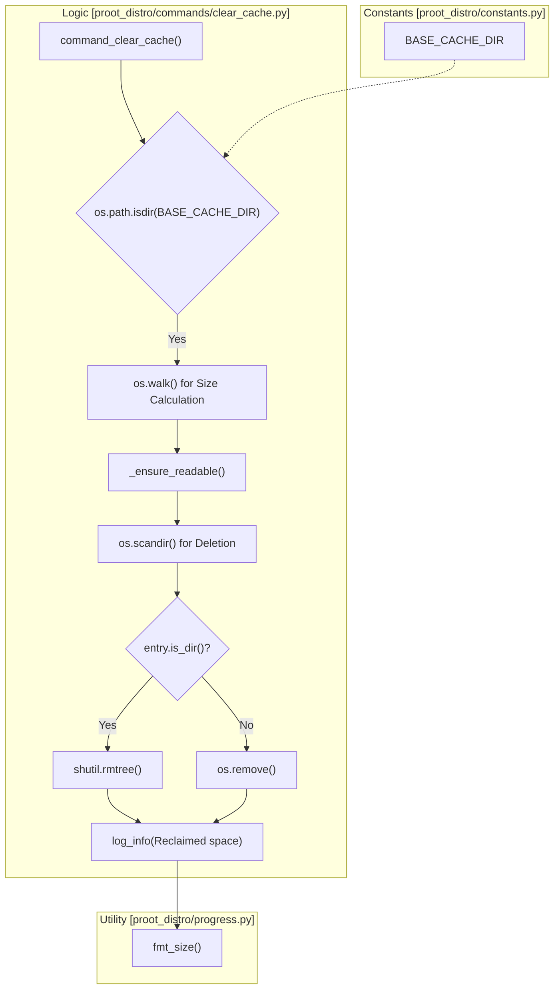
Sources: [proot_distro/commands/clear_cache.py:34-89](), [proot_distro/constants.py:29]()

### Implementation Details

| Component | Code Entity | Description |
| :--- | :--- | :--- |
| **Cache Root** | `BASE_CACHE_DIR` | The base directory for all cached data [proot_distro/constants.py:29](). |
| **Permission Fix** | `_ensure_readable` | Uses `os.chmod` to fix access issues before deletion [proot_distro/commands/clear_cache.py:34-43](). |
| **Size Reporting** | `fmt_size` | Formats the calculated `total` bytes into a human-readable string [proot_distro/commands/clear_cache.py:88](). |
| **Error Handling** | `OSError` | Failures on individual entries are caught and logged but do not abort the overall process [proot_distro/commands/clear_cache.py:85-86](). |

Sources: [proot_distro/commands/clear_cache.py:21-89](), [proot_distro/progress.py:31]()

---

# Page: Build & Push Commands

# Build & Push Commands

<details>
<summary>Relevant source files</summary>

The following files were used as context for generating this wiki page:

- [proot_distro/commands/build.py](proot_distro/commands/build.py)
- [proot_distro/commands/push.py](proot_distro/commands/push.py)
- [proot_distro/helpers/build_engine/engine.py](proot_distro/helpers/build_engine/engine.py)
- [proot_distro/helpers/docker/push.py](proot_distro/helpers/docker/push.py)
- [proot_distro/helpers/dockerfile.py](proot_distro/helpers/dockerfile.py)
- [proot_distro/helpers/oci_writer.py](proot_distro/helpers/oci_writer.py)

</details>


The `build` and `push` commands provide a complete OCI image authoring and distribution pipeline within Termux. These commands allow users to create container images from Dockerfiles and upload them to OCI-compliant registries (like Docker Hub or GitHub Container Registry) without requiring a Docker daemon.

## Build Command Overview

The `build` command orchestrates the parsing of a Dockerfile, the execution of instructions within a PRoot-controlled environment, and the generation of OCI-compliant image artifacts.

### Implementation Flow

1.  **Context Resolution**: The command identifies the build context (directory) and the Dockerfile [proot_distro/commands/build.py:100-114]().
2.  **Parsing**: The `parse_dockerfile` function converts the raw text into an ordered list of instruction records [proot_distro/helpers/dockerfile.py:60-94]().
3.  **Engine Execution**: The `BuildEngine` walks through the instructions, maintaining stage state and global `ARG` scopes [proot_distro/helpers/build_engine/engine.py:54-62]().
4.  **Artifact Generation**: Once finished, the engine produces a manifest and image configuration [proot_distro/helpers/oci_writer.py:58-72]().

### Build Command Entities

The following diagram maps the logical build steps to the internal code entities responsible for them.

**Build Pipeline Entity Map**

```mermaid
graph TD
    subgraph "CLI Layer"
        CLI["command_build (commands/build.py)"]
    end

    subgraph "Parser Subsystem"
        PAR["parse_dockerfile (helpers/dockerfile.py)"]
        LEX["_parse_instructions"]
    end

    subgraph "Execution Engine"
        ENG["BuildEngine (helpers/build_engine/engine.py)"]
        STG["Stage (helpers/build_engine/stage.py)"]
        HND["HANDLERS (helpers/build_engine/handlers.py)"]
    end

    subgraph "Output Writers"
        OCI["oci_writer.py"]
        VAR_A["store_in_cache"]
        VAR_B["write_oci_archive"]
    end

    CLI --> PAR
    PAR --> LEX
    CLI --> ENG
    ENG --> STG
    ENG --> HND
    CLI --> OCI
    OCI --> VAR_A
    OCI --> VAR_B
```
Sources: `proot_distro/commands/build.py`, `proot_distro/helpers/dockerfile.py`, `proot_distro/helpers/build_engine/engine.py`, `proot_distro/helpers/oci_writer.py`

### Key Build Options

| Option | Description | Implementation Detail |
| :--- | :--- | :--- |
| `--tag`, `-t` | Name and tag for the image. | Defaults to `latest` if no colon is present [proot_distro/commands/build.py:179](). |
| `--output`, `-o` | Path to write an OCI tarball. | Uses `write_oci_archive` to create a `docker load` compatible file [proot_distro/helpers/oci_writer.py:162-173](). |
| `--install-as` | Installs the result immediately. | Invokes `command_install` internally after build completion [proot_distro/commands/build.py:328-333](). |
| `--build-arg` | Sets variables for `ARG`. | Passed to `BuildEngine` and merged with global scope [proot_distro/helpers/build_engine/engine.py:84](). |
| `--target` | Multi-stage build target. | Stops execution after the specified stage is reached [proot_distro/helpers/build_engine/engine.py:102-117](). |
| `--architecture` | Target CPU architecture. | Normalizes input (e.g., `arm64`) to PD-internal names [proot_distro/commands/build.py:138-144](). |
| `--no-cache` | Disables layer caching. | Forces re-execution of all instructions [proot_distro/helpers/build_engine/engine.py:88](). |

Sources: `proot_distro/commands/build.py`, `proot_distro/helpers/build_engine/engine.py`, `proot_distro/helpers/oci_writer.py`

---

## Push Command Overview

The `push` command uploads an image previously created by `build` to a remote OCI registry. It relies on the local manifest and layer caches populated during the build process.

### Implementation Logic

1.  **Pre-flight Check**: The command verifies that a manifest exists in the local cache for the requested tag and architecture [proot_distro/commands/push.py:71-78]().
2.  **Authentication**: It retrieves a Bearer token using credentials from the `PD_DOCKER_AUTH` environment variable [proot_distro/helpers/docker/transport.py:57]().
3.  **Blob Optimization**: Before uploading, it performs a `HEAD` probe for each layer. If the registry returns `200 OK`, the blob is skipped [proot_distro/helpers/docker/push.py:77-93]().
4.  **Streaming Upload**: Blobs not present on the registry are uploaded via `POST` (to initiate) and `PUT` (to stream data) [proot_distro/helpers/docker/push.py:175-200]().

### Push Command Entities

The following diagram illustrates the interaction between the push command and the OCI registry components.

**Push Logic and Data Flow**

```mermaid
graph LR
    subgraph "Local Cache"
        MC["manifest_cache (dlcache/manifests)"]
        LC["layer_cache (dlcache/layers)"]
    end

    subgraph "Push Orchestrator"
        CMD["command_push (commands/push.py)"]
        PI["push_image (helpers/docker/push.py)"]
    end

    subgraph "Registry Communication"
        AUTH["get_auth_token"]
        PROBE["_blob_exists (HEAD)"]
        STRM["_ProgressReader"]
        PUT["_upload_blob_file (PUT)"]
    end

    CMD --> MC
    CMD --> PI
    PI --> LC
    PI --> AUTH
    PI --> PROBE
    PI --> STRM
    STRM --> PUT
```
Sources: `proot_distro/commands/push.py`, `proot_distro/helpers/docker/push.py`, `proot_distro/helpers/docker/cache.py`

### Authentication and Security

*   **PD_DOCKER_AUTH**: Credentials must be provided in `user:password` or `user:token` format via this environment variable [proot_distro/commands/push.py:21-27]().
*   **Token Scope**: The system requests `pull,push` scope when exchanging credentials for an OCI Bearer token [proot_distro/helpers/docker/push.py:26]().
*   **Atomic Updates**: When storing manifests locally, the system uses `atomic_replace` to prevent cache corruption during interrupted builds [proot_distro/helpers/oci_writer.py:128-130]().

Sources: `proot_distro/commands/push.py`, `proot_distro/helpers/docker/push.py`, `proot_distro/helpers/oci_writer.py`

---

# Page: Architecture & Design

# Architecture & Design

<details>
<summary>Relevant source files</summary>

The following files were used as context for generating this wiki page:

- [CLAUDE.md](CLAUDE.md)
- [README.md](README.md)
- [proot_distro/cli.py](proot_distro/cli.py)

</details>


This document provides a technical overview of the `proot-distro` v5.1 internal architecture and design principles. The v5.x series represents a significant shift from a Bash-based utility to a modular Python 3.9+ architecture. It is designed to be a lightweight, zero-dependency OCI container manager specifically for the Termux environment.

## Core Design Principles

The architecture of `proot-distro` v5.1 is guided by several key principles:

*   **Pure Python / Zero Dependencies**: The codebase relies exclusively on the Python standard library. No third-party packages from PyPI are required at runtime. [CLAUDE.md:12-13](), [CLAUDE.md:20-27]().
*   **OCI-Native Workflow**: Distribution management is centered around OCI (Docker) registries, supporting manifest resolution, layer caching, and content-addressable storage. [README.md:8-11]().
*   **Build Engine**: Includes a pure-Python Dockerfile parser and build engine that allows authoring OCI images on-device without a Docker daemon. [README.md:13-15]().
*   **Rootless by Design**: All operations are performed without Android root privileges, leveraging `proot` for filesystem namespacing and link emulation. [CLAUDE.md:7-11]().
*   **Static Identity**: Container identity is derived solely from the directory name within the storage path; there is no central database or complex configuration registry. [CLAUDE.md:90-95]().

## System Components Diagram

The following diagram illustrates the interaction between the user, the Python subsystems, and the underlying Termux environment.

```mermaid
graph TD
    User["User"] -->|"CLI Command"| Entry["proot_distro.cli:main"]
    Entry -->|"Dispatches"| Handlers["_COMMAND_HANDLERS\n(cli.py)"]
    
    subgraph "Subsystems"
        Handlers -->|"Pulls Images"| Docker["helpers/docker/\n(OCI Client)"]
        Handlers -->|"Configures PRoot"| Login["commands/login/\n(Runtime Pipeline)"]
        Handlers -->|"Hardware Detection"| Arch["arch.py\n(ELF/CPU Detection)"]
        Handlers -->|"Synthetic Files"| Sysdata["sysdata.py\n(Fake /proc & /sys)"]
        Handlers -->|"Builds Images"| Build["helpers/build_engine/\n(Dockerfile Engine)"]
    end
    
    Docker -->|"Downloads"| Cache["BASE_CACHE_DIR\n(Layers & Manifests)"]
    Login -->|"Executes"| PRoot["proot binary"]
    
    subgraph "Storage Layout"
        Containers["CONTAINERS_DIR"] -->|"name"| Bundle["Container Bundle"]
        Bundle -->|"Metadata"| Manifest["manifest.json"]
        Bundle -->|"Filesystem"| RootFS["rootfs/"]
    end
    
    PRoot -->|"Mounts"| RootFS
    PRoot -->|"Injects"| Sysdata
```

Sources: [proot_distro/cli.py:60-76](), [proot_distro/constants.py:51-62](), [CLAUDE.md:28-64]()

## Module Layout

The codebase is organized into a core package with specialized sub-packages for commands and helper utilities.

| Module / Package | Role |
|---|---|
| `proot_distro.cli` | Entry point, signal routing, and command dispatching. [proot_distro/cli.py:21-30]() |
| `proot_distro.parser` | `argparse` construction and `ALIAS_TO_CANONICAL` mapping. [proot_distro/parser.py:32-48]() |
| `proot_distro.constants` | Global paths and default environment values. [proot_distro/constants.py:21-35]() |
| `proot_distro.arch` | Logic for detecting host/guest CPU architectures via ELF magic. [proot_distro/arch.py:21-30]() |
| `proot_distro.sysdata` | Generation of synthetic `/proc` and `/sys` entries. [proot_distro/sysdata.py:21-30]() |
| `proot_distro.commands.*` | Subcommand implementations (install, login, build, etc.). [CLAUDE.md:54-57]() |
| `proot_distro.helpers.*` | OCI transport, Dockerfile parsing, and build engine logic. [CLAUDE.md:59-63]() |

Sources: [CLAUDE.md:28-64](), [proot_distro/cli.py:21-30]()

## File System Structure

`proot-distro` v5.1 uses a structured storage layout rooted in `RUNTIME_DIR`.

```mermaid
graph TD
    RUNTIME["RUNTIME_DIR"] --> CACHE["cache/"]
    CACHE --> LAYERS["oci_layers/\n(SHA256 Blobs)"]
    CACHE --> MANIFESTS["oci_manifests/\n(OCI JSON)"]
    CACHE --> BINDEX["build_cache_index.json"]
    
    RUNTIME --> CONT["containers/"]
    CONT --> NAME["<container_name>/"]
    NAME --> MJSON["manifest.json"]
    NAME --> RFS["rootfs/"]
    
    RUNTIME --> LOCKS["locks/"]
    LOCKS --> CLOCK["<name>.lock"]
    LOCKS --> BLOCK["build/"]
```

Sources: [proot_distro/constants.py:45-62](), [CLAUDE.md:65-76](), [CLAUDE.md:152-155]()

## Major Subsystems

The following sections provide a high-level overview of the primary subsystems. Detailed technical documentation for each is available in the child pages.

### CLI & Dispatch Layer
The CLI layer handles the translation of user strings into executable logic. It uses a manual dispatch map (`_COMMAND_HANDLERS`) and alias resolution (`ALIAS_TO_CANONICAL`) to route commands. It also enforces environment constraints, such as preventing nested `proot` sessions via `_refuse_nested_proot`.
For details, see [CLI & Dispatch Layer](#3.1).

### OCI Image & Container Management
The system uses a pure-Python OCI client (`helpers/docker/`) to communicate with registries. It handles multi-layer image pulls, manifest resolution, and layer caching with SHA-256 integrity verification. Containers are stored as bundles containing a `manifest.json` and a `rootfs/` directory.
For details, see [OCI Image & Container Management](#3.2).

### Multi-architecture Support
`proot-distro` detects the host architecture and determines if the guest rootfs requires emulation. It manages the `personality()` syscall for 32-bit compatibility and configures QEMU user-mode emulation (`proot -q`) when architecture mismatches occur.
For details, see [Multi-architecture Support](#3.3).

### Container Runtime & Fake Sysdata
The runtime pipeline in `command_login()` constructs the `proot` execution string. This includes building bind mounts, resolving symlinks, and managing the "Fake Sysdata" subsystem (`sysdata.py`)—a collection of synthetic files that mimic kernel interfaces to satisfy guest software requirements.
For details, see [Container Runtime & Fake Sysdata](#3.4).

### Legacy Migration
To support users upgrading from version 4.x, the system includes a migration path in `commands/login/migrate.py` that moves legacy rootfs directories into the new `containers/` layout and rewrites internal `link2symlink` paths.
For details, see [Legacy Migration](#3.5).

### Build Engine & Image Authoring
A major feature of v5.1 is the `BuildEngine`, which implements a pure-Python Dockerfile parser and execution environment. It supports multi-stage builds, caching, and exporting results as OCI tarballs or local container installs.
For details, see [Build Engine & Image Authoring](#3.6).

Sources: [CLAUDE.md:105-119](), [proot_distro/cli.py:92-114](), [proot_distro/cli.py:60-76]()

---

# Page: CLI & Dispatch Layer

# CLI & Dispatch Layer

<details>
<summary>Relevant source files</summary>

The following files were used as context for generating this wiki page:

- [proot_distro/cli.py](proot_distro/cli.py)
- [proot_distro/message.py](proot_distro/message.py)
- [proot_distro/parser.py](proot_distro/parser.py)

</details>


The CLI & Dispatch Layer serves as the entry point for `proot-distro` v5.1. It is responsible for parsing user input, resolving command aliases, validating environment sanity (such as checking for `proot` availability), and dispatching execution to the appropriate command handlers.

## Entry Point and Argument Parsing

The primary entry point for the application is `main()` in `proot_distro/cli.py` [[proot_distro/cli.py:240]](). The CLI utilizes a custom `argparse.ArgumentParser` subclass called `_PdArgumentParser` [[proot_distro/parser.py:39-55]]() with a specific configuration: `add_help=False` [[proot_distro/parser.py:141]]().

This design choice is critical for manual help handling. By disabling automatic help, the dispatcher avoids "required argument" errors when a user invokes `-h` or `--help` on a subcommand without providing the positional arguments that would otherwise be mandatory [[proot_distro/cli.py:169-182]]() [[proot_distro/parser.py:21-25]]().

### Dispatch Logic Flow

The `main()` function coordinates the startup sequence, from signal handling to final command execution.

```mermaid
graph TD
    Start["proot_distro.cli:main()"] --> Signals["Setup SIGQUIT handler"]
    Signals --> RootWarn["_warn_if_root()"]
    RootWarn --> NestedCheck["_refuse_nested_proot()"]
    NestedCheck --> Parse["build_parser().parse_args()"]
    
    Parse --> HelpCheck{"_dispatch_help()?"}
    HelpCheck -- "Yes" --> ExitClean["sys.exit(0)"]
    
    HelpCheck -- "No" --> UnknownCheck{"_reject_unknown_command()"}
    UnknownCheck --> Canonical["Resolve ALIAS_TO_CANONICAL"]
    
    Canonical --> ProotCheck{"_ensure_proot_available()"}
    ProotCheck --> ReqArgs{"_validate_required_args()"}
    
    ReqArgs -- "Fail" --> CallHelp["HELP_COMMANDS[cmd]()"]
    ReqArgs -- "Pass" --> SplitSep["_split_separator() for --"]
    
    SplitSep --> Dispatch["_COMMAND_HANDLERS[cmd]()"]
```
Sources: [proot_distro/cli.py:240-316](), [proot_distro/cli.py:169-182](), [proot_distro/cli.py:116-168](), [proot_distro/parser.py:136-163]()

## Command Alias Resolution

To provide a user-friendly experience, `proot-distro` supports multiple aliases for most commands. These are resolved to a "canonical" command name before being dispatched to the internal handlers.

| Canonical Command | Supported Aliases |
|-------------------|-------------------|
| `help`            | `hel`, `he`, `h` |
| `install`         | `add`, `i`, `in`, `ins` |
| `remove`          | `rm` |
| `login`           | `sh` |
| `list`            | `li`, `ls` |
| `backup`          | `bak`, `bkp` |
| `clear-cache`     | `clear`, `cl` |
| `copy`            | `cp` |

The mapping is defined in the `ALIAS_TO_CANONICAL` dictionary [[proot_distro/parser.py:80-89]]().

Sources: [proot_distro/parser.py:80-89](), [proot_distro/cli.py:60-76]()

## Dispatch Map and Validation

The CLI uses a dispatch table, `_COMMAND_HANDLERS`, to map canonical command strings to their respective implementation functions imported from the `commands` subpackage [[proot_distro/cli.py:60-76]]().

### Manual Argument Validation
Because `argparse` is configured with `add_help=False`, the CLI must manually ensure that required positional arguments are present before the command handler is invoked. This is handled via the `REQUIRED_ARGS` dictionary [[proot_distro/parser.py:59-75]](). The `_validate_required_args` function checks the parsed `Namespace` for these keys; if any are `None`, it triggers the per-command help page and exits [[proot_distro/cli.py:221-238]]().

```mermaid
graph LR
    subgraph "proot_distro.parser"
        Map["_COMMAND_HANDLERS"]
        Req["REQUIRED_ARGS"]
    end
    
    subgraph "proot_distro.commands.help"
        Help["HELP_COMMANDS"]
    end

    Input["Parsed 'command'"] --> Map
    Map -->|Resolves to| Func["command_login, command_install, etc."]
    
    Func --> Check["_validate_required_args()"]
    Check -.->|Validation Fail| Help
    Help -->|Triggers| Output["Per-command Help Text"]
```
Sources: [proot_distro/cli.py:60-76](), [proot_distro/parser.py:59-75](), [proot_distro/cli.py:221-238]()

## Environment Sanity Checks

Before executing any command, the CLI performs several critical environment checks:

1.  **Root User Warning**: `_warn_if_root()` issues a prominent warning if the script is run as UID 0, as `proot` is designed for unprivileged use [[proot_distro/cli.py:83-90]]().
2.  **Nested Session Detection**: `_refuse_nested_proot()` inspects `/proc/[pid]/status` to find the `TracerPid`. It then checks if the tracer process name contains "proot". If detected, it refuses to run to prevent filesystem corruption [[proot_distro/cli.py:92-114]]().
3.  **PRoot Availability**: `_ensure_proot_available()` verifies that the `proot` binary is on the `PATH`. In Termux, it offers an interactive prompt to install the package via `pkg install proot` if missing [[proot_distro/cli.py:116-168]](). Note that `build` and `push` commands are exempt from this check unless a `RUN` instruction is encountered [[proot_distro/cli.py:126-127]]().

Sources: [proot_distro/cli.py:83-114](), [proot_distro/cli.py:116-168]()

## The `--` Separator Pattern

For commands that execute binaries inside the container (specifically `login` and `run`), `proot-distro` utilizes the standard `--` separator pattern. This is handled by `_split_separator()` [[proot_distro/cli.py:202-219]]().

- **Before `--`**: Arguments are parsed by `proot-distro`'s CLI (e.g., `--user`, `--bind`).
- **After `--`**: All remaining arguments are captured as a list.
    - For `login`, they are stored in `args.login_cmd` [[proot_distro/cli.py:211]]().
    - For `run`, they are stored in `args.run_args` [[proot_distro/cli.py:213]]().

This allows users to run complex commands like `pd login debian -- apt update && apt upgrade -y` where the `&&` and flags belong to the guest environment and should not be interpreted by the host Python process.

Sources: [proot_distro/cli.py:202-219]()

---

# Page: OCI Image & Container Management

# OCI Image & Container Management

<details>
<summary>Relevant source files</summary>

The following files were used as context for generating this wiki page:

- [proot_distro/commands/install_local.py](proot_distro/commands/install_local.py)
- [proot_distro/helpers/docker/__init__.py](proot_distro/helpers/docker/__init__.py)
- [proot_distro/helpers/docker/cache.py](proot_distro/helpers/docker/cache.py)
- [proot_distro/helpers/docker/layers.py](proot_distro/helpers/docker/layers.py)
- [proot_distro/helpers/docker/pull.py](proot_distro/helpers/docker/pull.py)
- [proot_distro/helpers/docker/transport.py](proot_distro/helpers/docker/transport.py)
- [proot_distro/helpers/tar_extract.py](proot_distro/helpers/tar_extract.py)

</details>


The OCI (Open Container Initiative) management subsystem in `proot-distro` is responsible for interacting with container registries, resolving image manifests, managing local layer caches, and assembling the final rootfs. This subsystem is a pure-Python OCI client that operates without external dependencies like `docker` or `skopeo` [proot_distro/helpers/docker/__init__.py:21-34]().

## OCI Registry Client (`helpers/docker/`)

The registry client is split into specialized modules to handle HTTP transport, reference parsing, and layer management. It manages authentication, manifest resolution for specific architectures, and layer downloading [proot_distro/helpers/docker/__init__.py:23-34]().

### Image Reference Parsing
Images are identified via a reference string parsed by `parse_image_ref`. It decomposes strings into registry, repository, and tag components [proot_distro/helpers/docker/refs.py:78-108]().

| Reference | Registry | Repository | Tag |
|---|---|---|---|
| `ubuntu` | (empty) | `library/ubuntu` | `latest` |
| `ubuntu:24.04` | (empty) | `library/ubuntu` | `24.04` |
| `ghcr.io/foo/bar:1.0` | `ghcr.io` | `foo/bar` | `1.0` |

### Authentication and Redirect Handling
The client implements `AuthStrippingRedirectHandler` in `transport.py`. When pulling blobs from Docker Hub, the registry often redirects to a CDN (e.g., CloudFront) via pre-signed URLs. These CDN hosts return HTTP 400 if they receive a Bearer token. The handler detects cross-host redirects and strips the `Authorization` header [proot_distro/helpers/docker/transport.py:52-71]().

Token exchange is handled via `get_auth_token()`, which supports anonymous access and Basic auth via the `PD_DOCKER_AUTH` environment variable [proot_distro/helpers/docker/transport.py:159-177]().

Sources: [proot_distro/helpers/docker/refs.py:78-108](), [proot_distro/helpers/docker/transport.py:52-71](), [proot_distro/helpers/docker/transport.py:159-177]()

## Pull Flow and Integrity Verification

The `pull_image()` function in `pull.py` coordinates the conversion of an image reference into a local filesystem [proot_distro/helpers/docker/pull.py:176-241]().

### Image Pull Logic (`pull_image`)
```mermaid
sequenceDiagram
    participant CLI as commands/install.py
    participant Pull as helpers/docker/pull.py
    participant Cache as helpers/docker/cache.py
    participant Reg as OCI Registry

    CLI->>Pull: pull_image(image_ref, rootfs_dir, arch)
    Pull->>Cache: load_manifest_cache(image_ref, arch)
    alt Cache Miss
        Pull->>Reg: GET /v2/.../manifests/<tag>
        Reg-->>Pull: Return Manifest List (Index)
        Pull->>Pull: _pick_platform(arch, variant)
        Pull->>Reg: GET manifest for specific digest
        Pull->>Pull: _fetch_config_blob()
        Pull->>Cache: save_manifest_cache()
    end

    loop For each Layer in manifest
        Pull->>Cache: layer_cache_path(digest)
        alt Not Cached
            Pull->>Reg: download_blob(digest)
            Reg-->>Pull: Stream data + SHA-256 verify
            Pull->>Cache: Persist to dlcache/layers/
        end
        Pull->>Pull: apply_layer(layer_path, rootfs_dir)
    end
    Pull->>CLI: Return {"manifest": ..., "image_config": ...}
```
Sources: [proot_distro/helpers/docker/pull.py:176-241](), [proot_distro/helpers/docker/pull.py:96-130](), [proot_distro/helpers/docker/cache.py:83-92]()

### Integrity and Verification
Integrity is enforced via SHA-256 hex digests:
1.  **Digest Validation**: `validate_digest()` ensures digests are well-formed and do not contain path traversal characters before they are used as filesystem paths [proot_distro/helpers/docker/cache.py:52-62]().
2.  **Streaming Verification**: `download_blob()` calculates the SHA-256 hash while streaming bytes to disk. If the final hash does not match the expected digest, the temporary file is discarded and an error is raised [proot_distro/helpers/docker/layers.py:40-91]().

Sources: [proot_distro/helpers/docker/cache.py:52-62](), [proot_distro/helpers/docker/layers.py:40-91]()

## Layer Application and Whiteouts

Layer extraction is handled by `extract_tar_to_rootfs()` in `helpers/tar_extract.py`. This function is used for both OCI layers and plain rootfs tarballs [proot_distro/helpers/tar_extract.py:63-76]().

### Whiteout Semantics
When `handle_whiteouts=True` is passed (default for OCI layers), the extractor processes special markers [proot_distro/helpers/tar_extract.py:165-178]():
*   **Explicit Whiteout**: Files named `.wh.<filename>` cause the extractor to delete the sibling file or directory `<filename>` [proot_distro/helpers/tar_extract.py:174-177]().
*   **Opaque Whiteout**: The marker `.wh..wh..opq` signals that the entire parent directory should be cleared of existing contents before applying the new layer's files [proot_distro/helpers/tar_extract.py:168-173]().

### Extraction Invariants
The extractor maintains several critical invariants for rootless operation:
*   **Hard Link Deferral**: Hard links are collected and applied only after all regular files are written to ensure the source exists [proot_distro/helpers/tar_extract.py:94-106]().
*   **Mtime Preservation**: Directory modification times are stamped last to prevent them from being updated by subsequent file writes [proot_distro/helpers/tar_extract.py:109-113]().
*   **Security**: Path components like `..` or empty strings are rejected to prevent archives from escaping the `rootfs/` directory [proot_distro/helpers/tar_extract.py:129-130]().

Sources: [proot_distro/helpers/tar_extract.py:165-178](), [proot_distro/helpers/tar_extract.py:94-113](), [proot_distro/helpers/tar_extract.py:129-130]()

## Container Storage Layout

Containers are stored in a structured directory under the configured runtime directory.

### Directory Structure
```text
containers/
└── <name>/
    ├── manifest.json   # Metadata and image configuration
    └── rootfs/         # The extracted OCI layers
        ├── bin/
        ├── etc/
        └── ...
```

### `manifest.json` Schema
The `manifest.json` file is created after a successful `pull_image()` call using the returned metadata [proot_distro/helpers/docker/pull.py:184-187]().

| Field | Description |
|---|---|
| `manifest` | The OCI image manifest containing the list of layers. |
| `image_config` | The image configuration blob (contains `Env`, `Cmd`, `Entrypoint`). |
| `repo` | The repository name used for future updates/resets. |

Sources: [proot_distro/helpers/docker/pull.py:176-187](), [proot_distro/helpers/docker/cache.py:88-91]()

## Code Entity Mapping

The following diagram maps high-level OCI operations to the specific Python modules and functions.

```mermaid
flowchart LR
    subgraph "Registry Client (helpers/docker)"
        Pull["pull.py: pull_image()"] --> Auth["transport.py: get_auth_token()"]
        Pull --> Cache["cache.py: load_manifest_cache()"]
        Pull --> DL["layers.py: download_blob()"]
        DL --> Redirect["transport.py: AuthStrippingRedirectHandler"]
    end

    subgraph "Extraction Engine (helpers)"
        Apply["docker/layers.py: apply_layer()"] --> Tar["tar_extract.py: extract_tar_to_rootfs()"]
        Tar --> WH["tar_extract.py: _apply_whiteout()"]
    end

    subgraph "Local Installation"
        Local["commands/install_local.py"] --> Detect["detect_strip_count()"]
        Local --> OCI["_extract_oci()"]
        OCI --> Apply
    end

    Pull --> Apply
```

Sources: [proot_distro/helpers/docker/pull.py:63](), [proot_distro/helpers/docker/layers.py:94](), [proot_distro/helpers/tar_extract.py:63](), [proot_distro/commands/install_local.py:64]()

---

# Page: Multi-architecture Support

# Multi-architecture Support

<details>
<summary>Relevant source files</summary>

The following files were used as context for generating this wiki page:

- [proot_distro/__init__.py](proot_distro/__init__.py)
- [proot_distro/arch.py](proot_distro/arch.py)
- [proot_distro/commands/__init__.py](proot_distro/commands/__init__.py)
- [proot_distro/commands/login/proot_cmd.py](proot_distro/commands/login/proot_cmd.py)
- [proot_distro/helpers/build_engine/run_step.py](proot_distro/helpers/build_engine/run_step.py)
- [proot_distro/sysdata.py](proot_distro/sysdata.py)

</details>


This page documents how `proot-distro` handles multiple CPU architectures, enabling users to run Linux distributions compiled for different instruction sets than the host Android device. It covers ELF-based architecture detection, QEMU user-mode emulation, and the technical constraints of cross-architecture containers.

## Architecture Overview

`proot-distro` supports a wide range of architectures by leveraging the host kernel's native capabilities or transparently invoking emulators. Supported architectures include:

- `aarch64` (ARM 64-bit)
- `arm` (ARM 32-bit)
- `i686` (x86 32-bit)
- `x86_64` (x86 64-bit)
- `riscv64` (RISC-V 64-bit)

### System Architecture Flow

The following diagram illustrates how the system determines the architecture of both the host and the container, and decides whether to use native execution or emulation.

```mermaid
flowchart TD
    subgraph Detection["Architecture Detection"]
        A["get_device_cpu_arch()"] -->|"os.uname().machine"| B[("Host Arch")]
        C["detect_installed_arch()"] -->|"_elf_arch()"| D[("Guest Arch")]
    end

    subgraph Decision["Execution Logic"]
        B & D --> E{"Host == Guest?"}
        E -->|"Yes"| F["Native Execution"]
        E -->|"No"| G{"Native 32-bit\nSupport?"}
        
        G -->|"personality()\nreturns success"| F
        G -->|"Failure"| H["get_emulator_args()"]
    end

    subgraph Emulation["Emulation Layer"]
        H --> I["proot -q /path/to/qemu"]
        I --> J["Bind Android System Paths"]
    end
```
Sources: [proot_distro/arch.py:38-47](), [proot_distro/arch.py:104-125](), [proot_distro/arch.py:189-215]()

## Architecture Detection System

`proot-distro` v5.1 detects architecture by inspecting the actual binaries within a container rather than relying on configuration files. This logic is encapsulated in `arch.py` to keep the rest of the codebase arch-agnostic [proot_distro/arch.py:21-25]().

### ELF-based Guest Detection
The function `detect_installed_arch()` scans a container's `rootfs` for common binaries (e.g., `/usr/bin/bash`, `/bin/sh`, `/bin/su`) [proot_distro/arch.py:115-120](). It passes these files to `_elf_arch()`, which parses the ELF header to extract the `e_machine` field [proot_distro/arch.py:90-101]().

The `_ELF_MACHINE_MAP` dictionary maps these machine codes to internal architecture names:

| ELF Machine Code | Architecture Name |
|------------------|-------------------|
| 3 (EM_386)       | `i686`            |
| 40 (EM_ARM)      | `arm`             |
| 62 (EM_X86_64)   | `x86_64`          |
| 183 (EM_AARCH64) | `aarch64`         |
| 243 (EM_RISCV)   | `riscv64`         |

Sources: [proot_distro/arch.py:81-87](), [proot_distro/arch.py:104-125]()

### Host Architecture & 32-bit Support
Host detection uses `os.uname().machine`, collapsing `armv7l` and `armv8l` into a generic `arm` name [proot_distro/arch.py:44-47](). To determine if a 64-bit host (like `aarch64`) can run 32-bit code (like `arm`) natively, the `supports_32bit()` function attempts a `personality(PER_LINUX32)` syscall via `ctypes` [proot_distro/arch.py:67-74](). If the kernel returns -1, the system assumes the CPU lacks AArch32 EL0 support and requires emulation [proot_distro/arch.py:71-72]().

## CPU Architecture Emulation

When architectures differ and native execution is impossible, `proot-distro` uses QEMU user-mode emulation via the `proot -q` flag.

### Emulator Selection and Configuration
The `get_emulator_args()` function constructs the necessary `proot` flags [proot_distro/arch.py:189-215]().

1. **Native Compatibility**: It checks if a 64-bit host can run a 32-bit guest natively (e.g., `arm` on `aarch64` or `i686` on `x86_64`) before resorting to emulation [proot_distro/arch.py:207-210]().
2. **Binary Mapping**: It looks up the emulator path in `_QEMU_BIN_NAMES` (e.g., `qemu-aarch64`, `qemu-arm`, `qemu-i386`) [proot_distro/arch.py:172-178]().
3. **Missing Binary Handling**: If the binary is not found in the PATH, it raises a critical error suggesting the specific Termux package to install from `_QEMU_PKGS` [proot_distro/arch.py:216-224]().

### Cross-Architecture Entity Map
This diagram maps internal code symbols to their roles in the emulation process.

```mermaid
classDiagram
    class ArchDetection {
        +get_device_cpu_arch()
        +detect_installed_arch()
        +_elf_arch()
        +_ELF_MACHINE_MAP
    }
    class EmulationLogic {
        +_QEMU_BIN_NAMES
        +_QEMU_PKGS
        +get_emulator_args()
        +supports_32bit()
        +ARCH_UNAME_M
    }
    class ProotExecution {
        +build_proot_args()
        +_add_proot_extensions()
        +_add_non_minimal_binds()
    }

    ArchDetection --> ProotExecution : "Provides target_arch"
    EmulationLogic --> ProotExecution : "Provides emu_args"
    ProotExecution --> ProotExecution : "Applies ARCH_UNAME_M to --kernel-release"
```
Sources: [proot_distro/arch.py:21-25](), [proot_distro/commands/login/proot_cmd.py:52-64](), [proot_distro/commands/login/proot_cmd.py:125-129]()

## OCI and Docker Integration

When pulling images or building from Dockerfiles, `proot-distro` must map its internal architecture names to OCI/Docker platform strings.

### Architecture Mapping
The `normalize_arch()` function handles conversions from Docker platform strings (e.g., `linux/amd64`) to canonical `proot-distro` names [proot_distro/arch.py:145-157]().

| Internal Arch | Docker Name (`_DOCKER_TO_PROOT`) |
|---------------|----------------------------------|
| `aarch64`     | `arm64`                          |
| `arm`         | `arm/v7` or `arm`                |
| `i686`        | `386`                            |
| `x86_64`      | `amd64`                          |
| `riscv64`     | `riscv64`                        |

Sources: [proot_distro/arch.py:135-142](), [proot_distro/arch.py:145-157]()

## Restrictions and Constraints

### Termux-type Containers
Containers identified as `termux` type (those containing a Termux `PREFIX` layout) have a critical restriction: **Cross-architecture is not supported**. Because these containers are designed to interact closely with the Termux environment, running them under an emulator would lead to library mismatches and path conflicts.

### Emulator Overrides
Users can manually specify an emulator path using the `--emulator` flag. When `emulator_override` is provided to `get_emulator_args()`, it bypasses native-run checks and uses the provided binary directly [proot_distro/arch.py:197-201]().

### Fake Sysdata
To support tools like `htop` or `top` in cross-arch environments where the Android `/proc` might be restricted or return host-specific data, `proot-distro` generates synthetic entries in `containers/<name>/sysdata/` [proot_distro/sysdata.py:21-25](). These are bind-mounted over the container's `/proc` and `/sys` entries [proot_distro/commands/login/proot_cmd.py:178-178]().

Sources: [proot_distro/arch.py:197-201](), [proot_distro/sysdata.py:21-25](), [proot_distro/commands/login/proot_cmd.py:178-178]()

---

# Page: Container Runtime & Fake Sysdata

# Container Runtime & Fake Sysdata

<details>
<summary>Relevant source files</summary>

The following files were used as context for generating this wiki page:

- [proot_distro/commands/login/__init__.py](proot_distro/commands/login/__init__.py)
- [proot_distro/commands/login/bindings.py](proot_distro/commands/login/bindings.py)
- [proot_distro/commands/login/env.py](proot_distro/commands/login/env.py)
- [proot_distro/commands/login/proot_cmd.py](proot_distro/commands/login/proot_cmd.py)
- [proot_distro/helpers/build_engine/run_step.py](proot_distro/helpers/build_engine/run_step.py)
- [proot_distro/sysdata.py](proot_distro/sysdata.py)

</details>


This page documents the execution pipeline of `proot-distro`, focusing on how containers are initialized, the construction of the `proot` command line, the synthetic system data subsystem used to bypass Android restrictions, and the environment variable precedence logic.

## The Execution Pipeline (`command_login`)

The `command_login()` function serves as the primary entry point for starting a container session. It handles environment setup, filesystem resolution, and process execution.

### 1. Initialization and Locking
Before execution, the runtime acquires a shared lock using the `ContainerLock` class [proot_distro/commands/login/__init__.py:82-84](). The lock is initialized with `inheritable=True`, which clears the `O_CLOEXEC` flag on the file descriptor. This ensures the lock persists after the process is replaced by `os.execvpe`, as `proot` will keep the file descriptor open [proot_distro/commands/login/__init__.py:76-81]().

### 2. Path Resolution (`_resolve_rootfs_path`)
The `resolve_rootfs_path()` function translates absolute guest paths (like `/etc/passwd`) into real host paths [proot_distro/commands/login/passwd.py:65](). It handles nested symlinks (up to 40 levels) and re-roots absolute symlink targets to stay within the container's rootfs [proot_distro/commands/login/passwd.py:114-142]().

### 3. Container Type Distinction
The runtime distinguishes between `normal` and `termux` container types by checking for the existence of the Termux `login` binary at the expected `TERMUX_PREFIX` path [proot_distro/commands/login/__init__.py:88-99]().

| Feature | `normal` Container | `termux` Container |
| :--- | :--- | :--- |
| **Link2Symlink** | Enabled by default | Disabled [proot_distro/commands/login/proot_cmd.py:118-119]() |
| **ID Change** | Enabled (`--change-id`) | Disabled [proot_distro/commands/login/proot_cmd.py:78-79]() |
| **Working Dir** | User home or `/` | `TERMUX_HOME` [proot_distro/commands/login/__init__.py:228]() |
| **SysV IPC** | Optional (default ON) | Optional (default ON) [proot_distro/commands/login/proot_cmd.py:121-122]() |

### 4. Bind Mount Construction
The `build_proot_args()` function assembles the complex set of `--bind` arguments [proot_distro/commands/login/proot_cmd.py:52-64]():
*   **System Bindings**: `system_bindings()` maps Android paths like `/system`, `/apex`, and `/vendor` if they are traversable (modes 1, 5, or 7) [proot_distro/commands/login/bindings.py:58-84]().
*   **Storage Bindings**: `storage_bindings()` maps `/sdcard` and `/storage` [proot_distro/commands/login/bindings.py:35-55]().
*   **Fake Sysdata**: Binds synthetic files created by `sysdata.py` over restricted `/proc` entries [proot_distro/commands/login/proot_cmd.py:178]().
*   **Termux Bridges**: For `normal` containers, `TERMUX_PREFIX` is bound to allow access to host binaries [proot_distro/commands/login/proot_cmd.py:151]().

### 5. Environment Variable Precedence
The environment is constructed with the following precedence (later overrides earlier):
1.  **Image Configuration**: `read_manifest_env()` harvests `Env` entries from the container's `manifest.json` [proot_distro/commands/login/env.py:68-77]().
2.  **Blocked Variables**: `IMAGE_ENV_BLOCKED` prevents images from overriding critical host vars like `ANDROID_DATA` or `TERM` [proot_distro/commands/login/env.py:46-52]().
3.  **Termux Profile Injection**: `inject_termux_profile()` writes a snippet to `/etc/profile.d/termux-profile.sh` [proot_distro/commands/login/env.py:80-98](). This ensures that when a login shell sources `/etc/profile`, variables like `PULSE_SERVER` or user-supplied `--env` flags are re-exported and not lost [proot_distro/commands/login/env.py:108-127]().

### Execution Flow Diagram
**Runtime Command Assembly Flow**
```mermaid
graph TD
    A["command_login()"] --> B["ContainerLock(inheritable=True)"]
    B --> C["_resolve_login_user()"]
    C --> D["resolve_rootfs_path()"]
    A --> E["build_proot_args()"]
    E --> F["_add_proot_extensions()"]
    E --> G["_add_non_minimal_binds()"]
    G --> H["system_bindings()"]
    G --> I["storage_bindings()"]
    E --> J["_add_custom_binds()"]
    A --> K["os.execvpe('proot', args, env)"]

    subgraph "Env Management"
    L["read_manifest_env()"]
    M["inject_termux_profile()"]
    end
```
Sources: [proot_distro/commands/login/__init__.py:82-85](), [proot_distro/commands/login/__init__.py:102](), [proot_distro/commands/login/proot_cmd.py:52](), [proot_distro/commands/login/env.py:80]().

---

## Fake Sysdata Subsystem (`sysdata.py`)

Android restricts access to many files in `/proc` and `/sys`. The `sysdata.py` module generates synthetic versions of these files to support tools like `htop`.

### Key Functions
*   **`setup_fake_sysdata(rootfs)`**: Writes static content to a `sysdata/` directory sibling to the `rootfs` [proot_distro/sysdata.py:247-252](). It creates files like `stat`, `vmstat`, `uptime`, and `loadavg` [proot_distro/sysdata.py:260-267]().
*   **`fake_proc_bindings(rootfs)`**: Generates the `--bind` strings to map these fake files into the guest `/proc` [proot_distro/sysdata.py:280-297]().

### Synthetic Data Components
The following constants provide the raw text for the fake files:
*   `_FAKE_STAT`: Synthetic CPU statistics [proot_distro/sysdata.py:38-55]().
*   `_FAKE_VMSTAT`: Synthetic virtual memory statistics [proot_distro/sysdata.py:59-238]().
*   `_FAKE_LOADAVG`: Static load average string [proot_distro/sysdata.py:34]().

### Sysdata Mapping Diagram
**Sysdata Integration**
```mermaid
graph LR
    subgraph "sysdata.py Entities"
    S["setup_fake_sysdata()"]
    B["fake_proc_bindings()"]
    C["_FAKE_VMSTAT"]
    end

    subgraph "Runtime Usage"
    RL["run_step.py"] -- "Build-time" --> S
    CL["proot_cmd.py"] -- "Login-time" --> B
    end

    S -- "Writes to" --> F[".../sysdata/proc_stat"]
    B -- "Maps" --> M["/proc/stat"]
```
Sources: [proot_distro/sysdata.py:21-25](), [proot_distro/commands/login/proot_cmd.py:178](), [proot_distro/helpers/build_engine/run_step.py:184-187]().

---

## Link2Symlink Management

`proot` uses `link2symlink` to emulate hard links on Android's `/data` partition.

*   **Activation**: Enabled for non-termux containers unless `--no-link2symlink` is passed [proot_distro/commands/login/proot_cmd.py:118-119]().
*   **Environment**: The runtime sets the `PROOT_L2S_DIR` environment variable to point to a directory within the container's storage area [proot_distro/commands/login/__init__.py:313]().
*   **Migration**: When a rootfs is moved, `migrate_legacy_rootfs()` performs a recursive rewrite of the symlink targets inside the `.l2s` directory to ensure they point to the new absolute path [proot_distro/commands/login/migrate.py:65-78]().

Sources: [proot_distro/commands/login/proot_cmd.py:118-119](), [proot_distro/commands/login/migrate.py:21-29]().

---

# Page: Legacy Migration

# Legacy Migration

<details>
<summary>Relevant source files</summary>

The following files were used as context for generating this wiki page:

- [proot_distro/commands/login/migrate.py](proot_distro/commands/login/migrate.py)
- [proot_distro/constants.py](proot_distro/constants.py)
- [proot_distro/helpers/build_cache.py](proot_distro/helpers/build_cache.py)
- [proot_distro/helpers/layer_diff.py](proot_distro/helpers/layer_diff.py)
- [proot_distro/l2s.py](proot_distro/l2s.py)

</details>


Proot-distro v5.1 continues the architectural shift from the legacy 4.x shell-based releases to a structured layout that supports OCI-native metadata. To ensure a seamless transition for users, the system implements automated migration logic, absolute path rewriting for symlinks, and compatibility routing for legacy backup archives.

## Overview of Storage Layout Changes

The migration path addresses the transition from the legacy 4.x layout to the new v5.1 layout:

| Feature | Legacy Layout (4.x) | New Layout (5.1) |
| :--- | :--- | :--- |
| **Primary Directory** | `installed-rootfs/<name>` | `containers/<name>/rootfs/` |
| **Metadata** | None (Shell-based) | `containers/<name>/manifest.json` |
| **L2S Directory** | `installed-rootfs/<name>/.l2s` | `containers/<name>/rootfs/.l2s` |

The migration logic is primarily triggered during the first `login` or `run` command targeting a legacy container.

### Data Flow: Migration Trigger
The following diagram illustrates how the migration logic detects and moves legacy data before executing the container.

**Migration Execution Flow**
```mermaid
graph TD
    subgraph "proot_distro/commands/login/migrate.py"
        M["migrate_legacy_rootfs(container_name)"] --> B{"rootfs exists?"}
        B -- "No" --> C{"Check LEGACY_ROOTFS_DIR"}
        C -- "Found" --> D["os.rename(legacy_path, new_rootfs)"]
        D --> E["rewrite_l2s_targets(new_rootfs, legacy_path)"]
        E --> F["Migration Complete"]
        B -- "Yes" --> F
    end
    
    subgraph "proot_distro/l2s.py"
        E --> G["rewrite_l2s_targets()"]
        G --> H["Walk tree & Update Symlinks"]
    end
```
Sources: [proot_distro/commands/login/migrate.py:36-57](), [proot_distro/l2s.py:90-101]()

## Implementation Details

### The Migration Function
The `migrate_legacy_rootfs()` function handles the physical relocation of files on the host filesystem.

1.  **Path Resolution**: It checks `LEGACY_ROOTFS_DIR` (defined as `installed-rootfs` under the runtime directory) for the existence of the container [proot_distro/constants.py:92-92](), [proot_distro/commands/login/migrate.py:38-40]().
2.  **Relocation**: It creates the new container directory structure and uses `os.rename()` to move the entire rootfs directory to its new home under `containers/<name>/rootfs` [proot_distro/commands/login/migrate.py:49-50]().
3.  **Link2Symlink (L2S) Cleanup**: PRoot's `link2symlink` extension emulates hard links by replacing the original path with a symlink to an intermediate file. These symlinks often contain absolute host paths. Since the rootfs has moved, these paths become invalid. The migration calls `rewrite_l2s_targets()` to fix these pointers [proot_distro/commands/login/migrate.py:55-55]().

### Link2Symlink Path Rewriting
When a container is moved, the symlinks created by the `--link2symlink` extension must be updated because they point to the absolute path of the old rootfs location. The `proot_distro.l2s` module handles this by walking the entire rootfs tree [proot_distro/l2s.py:90-112]().

**Code Entity Space: L2S Symlink Resolution**
```mermaid
graph LR
    subgraph "proot_distro/l2s.py"
        A["rewrite_l2s_targets(rootfs, old_prefix)"] --> B["os.walk(rootfs)"]
        B --> C{"islink(fpath)?"}
        C -- "Yes" --> D{"target.startswith(old_prefix)?"}
        D -- "Yes" --> E["os.unlink(fpath)"]
        E --> F["os.symlink(new_target, fpath)"]
    end
    
    subgraph "Signal Protection"
        G["_warn_no_interrupt"] -.-> H["SIGINT / SIGQUIT"]
    end
```
To prevent filesystem corruption during this walk, `rewrite_l2s_targets` intercepts `SIGINT` and `SIGQUIT`. If a user attempts to interrupt the process (e.g., via Ctrl-C), a warning is logged, and the operation continues to ensure no dangling symlinks are left behind [proot_distro/l2s.py:105-128]().

Sources: [proot_distro/l2s.py:21-32](), [proot_distro/l2s.py:90-128]()

## Snapshot and Build Integration

The migration architecture also influences how the build engine and snapshot systems handle legacy files. The `.l2s/` directory is treated as internal backing store and is excluded from OCI layer snapshots to ensure that host-specific hard-link emulations do not leak into portable images [proot_distro/helpers/layer_diff.py:101-103]().

When generating layers, the system uses `resolve_l2s_target()` to identify symlinks that are actually L2S intermediate files, allowing the build engine to capture the actual file content instead of a broken symlink [proot_distro/helpers/layer_diff.py:104-105](), [proot_distro/l2s.py:49-72]().

## Summary of Constants
The migration subsystem relies on specific path constants defined in `proot_distro/constants.py`.

*   `RUNTIME_DIR`: The base path for all proot-distro data, determined by whether the environment is Termux or a regular Linux host [proot_distro/constants.py:75-86]().
*   `CONTAINERS_DIR`: The new storage root for container directories [proot_distro/constants.py:89-89]().
*   `LEGACY_ROOTFS_DIR`: The old v4.x storage root (`installed-rootfs`), maintained only for migration [proot_distro/constants.py:92-92]().
*   `BASE_CACHE_DIR`: Location where build artifacts like `build_cache_index.json` are stored [proot_distro/helpers/build_cache.py:37-40]().

Sources: [proot_distro/constants.py:75-92](), [proot_distro/helpers/build_cache.py:37-40]()

---

# Page: Build Engine & Image Authoring

# Build Engine & Image Authoring

<details>
<summary>Relevant source files</summary>

The following files were used as context for generating this wiki page:

- [proot_distro/commands/build.py](proot_distro/commands/build.py)
- [proot_distro/constants.py](proot_distro/constants.py)
- [proot_distro/helpers/build_cache.py](proot_distro/helpers/build_cache.py)
- [proot_distro/helpers/build_engine/__init__.py](proot_distro/helpers/build_engine/__init__.py)
- [proot_distro/helpers/build_engine/copy_step.py](proot_distro/helpers/build_engine/copy_step.py)
- [proot_distro/helpers/build_engine/engine.py](proot_distro/helpers/build_engine/engine.py)
- [proot_distro/helpers/build_engine/handlers.py](proot_distro/helpers/build_engine/handlers.py)
- [proot_distro/helpers/build_engine/parsing.py](proot_distro/helpers/build_engine/parsing.py)
- [proot_distro/helpers/build_engine/stage.py](proot_distro/helpers/build_engine/stage.py)
- [proot_distro/helpers/dockerfile.py](proot_distro/helpers/dockerfile.py)
- [proot_distro/helpers/layer_diff.py](proot_distro/helpers/layer_diff.py)
- [proot_distro/helpers/oci_writer.py](proot_distro/helpers/oci_writer.py)
- [proot_distro/l2s.py](proot_distro/l2s.py)

</details>


The **Build Engine** is a pure-Python, stateful interpreter designed to execute Dockerfile instructions and produce OCI-compliant images. Unlike standard Docker which requires a daemon, `proot-distro build` orchestrates the entire pipeline—from parsing and variable expansion to PRoot-based execution and layer diffing—within a single process.

### Architecture Overview

The build process follows a linear pipeline where each instruction in a Dockerfile is translated into a mutation of the container's rootfs or its OCI configuration metadata.

#### Data Flow and Code Entities
The following diagram maps the high-level build stages to the specific code entities responsible for them.

**Build Pipeline Data Flow**
```mermaid
graph TD
    subgraph "Parsing Phase"
        DF["Dockerfile"] --> DP["helpers/dockerfile.py:parse_dockerfile()"]
        DP --> INST["Instruction Records (List[dict])"]
    end

    subgraph "Execution Phase (BuildEngine)"
        BE["BuildEngine Class (engine.py)"]
        INST --> BE
        BE --> PS["_prescan(): Resolve Global ARGs"]
        PS --> DIS["_dispatch(): Instruction Router"]
        
        DIS --> H_META["handlers.py: Metadata Handlers (ENV, USER, etc)"]
        DIS --> H_COPY["copy_step.py: do_copy() / do_add()"]
        DIS --> H_RUN["run_step.py: do_run()"]
    end

    subgraph "Output Phase (OCI Writers)"
        BE --> B_CFG["build_manifest_and_config()"]
        B_CFG --> OW["oci_writer.py"]
        OW --> VA["store_in_cache(): Variant A (Offline Install)"]
        OW --> VB["write_oci_archive(): Variant B (OCI Tarball)"]
    end

    BC["build_cache.py"] <--> BE
    LD["layer_diff.py"] <--> H_RUN
```
**Sources:** `proot_distro/commands/build.py:21-27`(), `proot_distro/helpers/build_engine/engine.py:21-27`(), `proot_distro/helpers/oci_writer.py:21-36`()

---

### 1. Dockerfile Parsing
The parser in `proot_distro/helpers/dockerfile.py` is a pure-Python implementation that handles the complexities of the Dockerfile format without external dependencies.

*   **Parser Directives:** It recognizes leading `# key=value` comments (e.g., `# escape=\``) to modify lexer behavior [proot_distro/helpers/dockerfile.py:104-134]().
*   **Continuations & Here-docs:** Handles backslash line continuations and multi-line Here-docs for `RUN`, `COPY`, and `ADD` instructions [proot_distro/helpers/dockerfile.py:152-193]().
*   **Instruction Records:** Produces a dictionary for each instruction containing the name, flags (e.g., `--from`), the raw value, and a boolean `exec_form` indicating if it was parsed as a JSON array [proot_distro/helpers/dockerfile.py:60-75]().

**Sources:** `proot_distro/helpers/dockerfile.py:21-27`(), `proot_distro/helpers/dockerfile.py:60-75`()

---

### 2. The Build Engine
The `BuildEngine` class in `proot_distro/helpers/build_engine/engine.py` manages the state of the build, including the global `ARG` scope, named stages for multi-stage builds, and the current `Stage` context [proot_distro/helpers/build_engine/engine.py:54-62]().

#### Instruction Dispatching
The engine iterates through instructions and routes them via a dispatch table [proot_distro/helpers/build_engine/handlers.py:24-26]():
*   **Metadata Handlers:** Instructions like `ENV`, `LABEL`, `USER`, and `WORKDIR` mutate the `image_config` dict within the current `Stage` [proot_distro/helpers/build_engine/handlers.py:21-22]().
*   **COPY / ADD:** Handled by `copy_step.py`. It resolves sources from the build context, other stages, or URLs (for `ADD`), materializes them into the rootfs, and generates a new layer [proot_distro/helpers/build_engine/copy_step.py:21-25]().
*   **RUN:** Handled by `run_step.py`. This is the only instruction that requires a PRoot environment to execute commands within the temporary rootfs [proot_distro/helpers/build_engine/__init__.py:31-32]().

**Sources:** `proot_distro/helpers/build_engine/engine.py:21-27`(), `proot_distro/helpers/build_engine/handlers.py:21-26`()

---

### 3. Snapshot and Layer Generation
To maintain OCI compatibility, every instruction that modifies the filesystem must produce a discrete layer. This is handled by `proot_distro/helpers/layer_diff.py`.

#### The Diffing Algorithm
1.  **Snapshot:** Before an instruction runs, the engine records the state of the rootfs. A fingerprint is generated for every file consisting of `(size, mtime_ns, mode, crc32)` [proot_distro/helpers/layer_diff.py:84-90]().
2.  **CRC32 Tie-breaker:** While `size` and `mtime` catch most changes, a streaming `zlib.crc32` is used to detect sub-second rewrites or `touch -r` modifications [proot_distro/helpers/layer_diff.py:97-100]().
3.  **Whiteouts:** Deletions are captured using OCI-standard `.wh.` prefix files [proot_distro/helpers/layer_diff.py:161-176]().
4.  **Streaming Writer:** The `LayerWriter` streams the tar payload through a 4-stage pipeline in a single pass to compute the `diff_id` (uncompressed SHA256) and the `digest` (compressed SHA256) simultaneously [proot_distro/helpers/layer_diff.py:28-37]().

**Sources:** `proot_distro/helpers/layer_diff.py:21-37`(), `proot_distro/helpers/layer_diff.py:84-106`()

---

### 4. Build Cache
The build cache prevents redundant execution by storing results of previous instructions.

*   **Recipe Hash:** For every instruction, a hash is computed based on the `parent_layer_digest`, the instruction name, flags, value, here-docs, and "extra inputs" (like file digests for `COPY`) [proot_distro/helpers/build_cache.py:141-148]().
*   **Index:** A JSON index (`build_cache_index.json`) maps these recipe hashes to layer digests and image configuration patches [proot_distro/helpers/build_cache.py:21-27]().
*   **Concurrency:** The engine uses `fcntl.flock` on a lock file to ensure atomic read-modify-write cycles when multiple builds share the same cache [proot_distro/helpers/build_cache.py:44-54]().

**Sources:** `proot_distro/helpers/build_cache.py:21-27`(), `proot_distro/helpers/build_cache.py:141-167`()

---

### 5. OCI Output Writers
Once the `BuildEngine` completes, `proot_distro/helpers/oci_writer.py` assembles the final artifacts.

| Output Variant | Function | Destination | Purpose |
| :--- | :--- | :--- | :--- |
| **Variant A** | `store_in_cache()` | `MANIFEST_CACHE_DIR` | Populates the local download cache so `proot-distro install <tag>` can run offline immediately after a build [proot_distro/helpers/oci_writer.py:24-29](). |
| **Variant B** | `write_oci_archive()` | User-defined path (`-o`) | Produces a standard OCI image-layout tarball compatible with `docker load` and `proot-distro install <path>` [proot_distro/helpers/oci_writer.py:31-36](). |

**Sources:** `proot_distro/helpers/oci_writer.py:21-36`(), `proot_distro/helpers/oci_writer.py:113-122](), `proot_distro/helpers/oci_writer.py:162-173]()

---

### 6. PRoot Integration & Link2Symlink
During `RUN` steps, the engine must handle PRoot's `link2symlink` extension, which emulates hard links by creating symlinks to a backing store in `<rootfs>/.l2s/`.

*   **Resolution:** The `layer_diff.py` module uses `proot_distro.l2s:resolve_l2s_target` to follow these internal symlinks and capture the actual file content in the OCI layer, ensuring the resulting image is portable to non-PRoot environments [proot_distro/l2s.py:49-72]().
*   **Exclusion:** The `.l2s/` directory itself is always excluded from snapshots and layers [proot_distro/helpers/layer_diff.py:101-106]().

**Sources:** `proot_distro/helpers/layer_diff.py:101-106`(), `proot_distro/l2s.py:21-32](), `proot_distro/l2s.py:49-72]()

---

# Page: Build & Release

# Build & Release

<details>
<summary>Relevant source files</summary>

The following files were used as context for generating this wiki page:

- [.github/workflows/publish.yml](.github/workflows/publish.yml)
- [pyproject.toml](pyproject.toml)
- [screenshot.png](screenshot.png)

</details>


With the transition to v5.1, `proot-distro` has solidified its move from a shell-based distribution system to a modern Python packaging and release pipeline. The build system focuses on producing a Python package (Wheel and Source Distribution) and publishing it to PyPI using secure, automated workflows, while also managing shell completion assets.

## Overview

The `proot-distro` build and release architecture is centered around standard Python tooling and GitHub Actions. v5.1 leverages `setuptools` for packaging and OIDC-based "Trusted Publishing" for secure delivery to the Python Package Index (PyPI).

```mermaid
flowchart TD
    subgraph "Development & Packaging"
        PY["pyproject.toml"] --> |defines| MET["Metadata & Scripts"]
        MET --> |entry points| PD_CLI["proot-distro / pd"]
        MET --> |backend| ST["setuptools >= 77"]
        PY --> |data-files| COMP["Shell Completions"]
    end

    subgraph "CI/CD Pipeline (GitHub Actions)"
        TAG["Git Tag (v*)"] --> |triggers| GHA["publish.yml"]
        GHA --> |step 1| BUILD["Build Job"]
        BUILD --> |runs| P_BUILD["python -m build"]
        P_BUILD --> |outputs| DIST["dist/ (sdist & wheel)"]
        
        DIST --> |upload-artifact| ART["GitHub Artifacts (v7)"]
        ART --> |download-artifact| PUB["Publish Job (v8)"]
        
        PUB --> |OIDC Auth| PYPI[("PyPI Registry")]
    end

    PD_CLI --> |refers to| PROOT_CLI["proot_distro.cli:main"]
```

Sources: [pyproject.toml:1-32](), [.github/workflows/publish.yml:1-52]()

## Python Packaging

The core of the build system is the `pyproject.toml` file. It defines the project as a pure Python package with zero third-party dependencies, ensuring maximum compatibility within the Termux environment.

*   **Build Backend**: Uses `setuptools.build_meta` with a requirement for `setuptools>=77` [pyproject.toml:1-3]().
*   **Requirements**: Requires Python >= 3.9 [pyproject.toml:10-10]().
*   **Entry Points**: Defines two console scripts, `proot-distro` and the shorthand `pd`, both mapping to `proot_distro.cli:main` [pyproject.toml:19-21]().
*   **Asset Management**: Includes logic for installing shell completions for Bash, Zsh, and Fish into standard system paths [pyproject.toml:29-32]().

For details on version management via `importlib.metadata` and local installation from source, see [Python Packaging](#4.1).

Sources: [pyproject.toml:1-32]()

## Automated Release Pipeline

Release automation is handled by the `Publish to PyPI` workflow. This pipeline ensures that every tagged version (e.g., `v5.1.4`) is built in a clean environment and delivered securely to users.

### Release Workflow Logic

| Stage | Action | Entity/Tool |
|:---|:---|:---|
| **Trigger** | Push of a tag starting with `v*` | GitHub Actions [publish.yml:3-6]() |
| **Build** | Generate `.tar.gz` (sdist) and `.whl` (wheel) | `python -m build` [publish.yml:21-25]() |
| **Handover** | Transfer build files between jobs | `actions/upload-artifact@v7` and `download-artifact@v8` [publish.yml:28, 45]() |
| **Publish** | Upload to PyPI via OIDC | `pypa/gh-action-pypi-publish` [publish.yml:50-51]() |

### Security via OIDC
The workflow uses **Trusted Publishing**. Instead of storing sensitive API tokens in GitHub Secrets, the `publish` job requests a short-lived identity token from GitHub's OIDC provider by setting `permissions: id-token: write` [publish.yml:40-41](). This identity is verified by PyPI based on the repository and environment [publish.yml:37-39]().

For details on the CI/CD configuration and artifact lifecycle, see [GitHub Actions & PyPI Release](#4.2).

Sources: [.github/workflows/publish.yml:1-52]()

## Code-to-System Mapping

The following diagram maps the high-level release concepts to the specific files and configurations that implement them in the `proot-distro` repository.

```mermaid
graph LR
    subgraph "Code Entities"
        P_TOML["pyproject.toml"]
        PUB_YML[".github/workflows/publish.yml"]
        CLI_MAIN["proot_distro/cli.py"]
        COMP_DIR["proot_distro/completions/"]
    end

    subgraph "System Roles"
        SCRIPTS["Console Scripts (pd)"]
        CI_CD["Release Pipeline (OIDC)"]
        METADATA["Package Metadata (v5.1.4)"]
        SHELL["Shell Completion Provider"]
    end

    P_TOML -- "[project.scripts]" --> SCRIPTS
    P_TOML -- "[project]" --> METADATA
    P_TOML -- "[tool.setuptools.data-files]" --> SHELL
    COMP_DIR -- "contains" --> SHELL
    PUB_YML -- "jobs: publish" --> CI_CD
    SCRIPTS -- "points to" --> CLI_MAIN
```

Sources: [pyproject.toml:5-32](), [.github/workflows/publish.yml:33-52]()

---

# Page: Python Packaging

# Python Packaging

<details>
<summary>Relevant source files</summary>

The following files were used as context for generating this wiki page:

- [proot_distro/completions/_proot-distro](proot_distro/completions/_proot-distro)
- [proot_distro/completions/proot-distro.bash](proot_distro/completions/proot-distro.bash)
- [proot_distro/completions/proot-distro.fish](proot_distro/completions/proot-distro.fish)
- [pyproject.toml](pyproject.toml)
- [screenshot.png](screenshot.png)

</details>


## Purpose and Scope

This document details the Python packaging configuration for `proot-distro` v5.1. The project utilizes a modern Python packaging workflow centered around a `pyproject.toml` configuration. Key features include a strict zero third-party dependency policy, automated entry point generation for the CLI, and the inclusion of shell completion scripts for Bash, Zsh, and Fish.

## Packaging Configuration

The project uses `setuptools` as the build backend. The configuration is centralized in `pyproject.toml`, which defines metadata, entry points, and environment requirements.

### Metadata and Requirements
- **Build Backend**: Uses `setuptools.build_meta` [pyproject.toml:1-3]().
- **Python Version**: Requires `Python >= 3.9` [pyproject.toml:10-10]().
- **Dependencies**: The `dependencies` list is explicitly empty [pyproject.toml:12-12](). The project maintains a strict policy of using only the Python Standard Library to ensure maximum compatibility and zero overhead in the Termux environment.
- **License**: Licensed under `GPL-3.0-only` [pyproject.toml:11-11]().

### Entry Points
The packaging system automatically creates two executable wrappers in the user's path that point to the same internal function:
1. `proot-distro`: The canonical command name [pyproject.toml:20-20]().
2. `pd`: A shorthand alias for quicker terminal usage [pyproject.toml:21-21]().

Both scripts call the `main` function located in the `proot_distro.cli` module [pyproject.toml:20-21]().

Sources: [pyproject.toml:1-25]()

## Version Management

`proot-distro` manages its version string within `pyproject.toml` [pyproject.toml:7-7](). To avoid hardcoding the version in multiple places, the codebase is designed to retrieve this metadata at runtime.

### Implementation Logic

```mermaid
flowchart TD
    subgraph "Metadata Space"
        PYP["pyproject.toml"]
        VER_STR["version = '5.1.4'"]
    end

    subgraph "Code Entity Space"
        IM["importlib.metadata"]
        CLI["proot_distro.cli"]
        MAIN["main()"]
    end

    PYP -- "defines" --> VER_STR
    MAIN -- "calls" --> IM
    IM -- "reads from installed pkg" --> VER_STR
    MAIN -- "displays via --version" --> VER_STR
```

When a user executes `proot-distro --version`, the system dynamically resolves the version using `importlib.metadata`. This ensures that the version reported by the tool always matches the version defined in the package metadata.

Sources: [pyproject.toml:7-7]()

## Data Flow: From Source to Execution

The following diagram illustrates how the Python packaging configuration translates into executable commands and assets within the environment.

### Packaging to CLI Mapping

```mermaid
graph LR
    subgraph "Source Layout"
        SRC_CLI["proot_distro/cli.py"]
        SRC_PYP["pyproject.toml"]
        SRC_COMP["proot_distro/completions/"]
    end

    subgraph "Installation (setuptools)"
        EP_PD["pd (script)"]
        EP_PROOT["proot-distro (script)"]
        DATA_FILES["share/ (completions)"]
    end

    subgraph "Runtime Execution"
        FUNC_MAIN["proot_distro.cli:main()"]
        SHELL["Bash/Zsh/Fish"]
    end

    SRC_PYP -- "project.scripts" --> EP_PD
    SRC_PYP -- "project.scripts" --> EP_PROOT
    SRC_PYP -- "tool.setuptools.data-files" --> DATA_FILES
    EP_PD -- "invokes" --> FUNC_MAIN
    EP_PROOT -- "invokes" --> FUNC_MAIN
    DATA_FILES -- "loaded by" --> SHELL
    SRC_CLI -- "contains" --> FUNC_MAIN
```

Sources: [pyproject.toml:19-21](), [pyproject.toml:29-32]()

## Shell Completion Installation

The package includes completion scripts for three major shells. These are defined as `data-files` in `pyproject.toml` to ensure they are placed in standard system locations during installation [pyproject.toml:29-32]().

| Shell | Source Path | Installation Target |
| :--- | :--- | :--- |
| **Bash** | `proot_distro/completions/proot-distro.bash` | `share/bash-completion/completions` |
| **Zsh** | `proot_distro/completions/_proot-distro` | `share/zsh/site-functions` |
| **Fish** | `proot_distro/completions/proot-distro.fish` | `share/fish/vendor_completions.d` |

The completion scripts mirror the logic used in the Python core, such as the `_proot_distro_is_termux` helper function which implements the same scoring logic as the internal `constants.py` [proot_distro/completions/proot-distro.bash:26-33](), [proot_distro/completions/_proot-distro:36-43](), [proot_distro/completions/proot-distro.fish:39-57]().

Sources: [pyproject.toml:29-32](), [proot_distro/completions/_proot-distro:1-10]()

## Building and Installing from Source

While `proot-distro` is typically distributed via `pkg install proot-distro` in Termux, it can be built and installed using standard Python tooling.

### Build Process
To create a distributable wheel or source distribution:
1. Ensure `setuptools >= 77` is installed [pyproject.toml:2-2]().
2. Run the build frontend:
   ```bash
   python3 -m build
   ```

### Installation
For local development, an editable install is recommended:
```bash
pip3 install -e .
```
This links the source directory to the Python site-packages, allowing changes in the `proot_distro/` directory to take effect immediately without re-installation.

### Manual Completion Installation
If not using a package manager that handles `data-files`, completions can be installed manually:
- **Bash**: `cp proot_distro/completions/proot-distro.bash ~/.local/share/bash-completion/completions/proot-distro` [proot_distro/completions/proot-distro.bash:6-7]().
- **Zsh**: `cp proot_distro/completions/_proot-distro ~/.local/share/zsh/site-functions/_proot-distro` [proot_distro/completions/_proot-distro:8-9]().
- **Fish**: `cp proot_distro/completions/proot-distro.fish ~/.config/fish/completions/proot-distro.fish` [proot_distro/completions/proot-distro.fish:4-5]().

Sources: [pyproject.toml:1-3](), [proot_distro/completions/proot-distro.bash:3-8]()

---

# Page: GitHub Actions & PyPI Release

# GitHub Actions & PyPI Release

<details>
<summary>Relevant source files</summary>

The following files were used as context for generating this wiki page:

- [.github/ISSUE_TEMPLATE/03-question.yml](.github/ISSUE_TEMPLATE/03-question.yml)
- [.github/dependabot.yml](.github/dependabot.yml)
- [.github/workflows/publish.yml](.github/workflows/publish.yml)

</details>


This document describes the automated release pipeline for `proot-distro` v5.1. With the transition to a Python-based architecture, the project utilizes GitHub Actions to automate the building of Python distributions (sdist and wheels) and their publication to the Python Package Index (PyPI).

## Pipeline Overview

The release process is a two-stage Directed Acyclic Graph (DAG) consisting of a **Build** stage and a **Publish** stage. The pipeline is designed to be secure, utilizing OpenID Connect (OIDC) for Trusted Publishing, which eliminates the need for long-lived static API tokens.

### Release Workflow DAG

```mermaid
graph TD
    subgraph "Trigger Phase"
        T["Push Tag v*"]
    end

    subgraph "Job: build (Build distribution)"
        B1["actions/checkout@v6"]
        B2["actions/setup-python@v6"]
        B3["pip install build"]
        B4["python -m build"]
        B5["actions/upload-artifact@v7"]
    end

    subgraph "Job: publish (Publish to PyPI)"
        P1["actions/download-artifact@v8"]
        P2["pypa/gh-action-pypi-publish@release/v1"]
    end

    T --> B1
    B1 --> B2
    B2 --> B3
    B3 --> B4
    B4 --> B5
    B5 -->|"Artifact: dist/"| P1
    P1 --> P2
```

**Sources:** [.github/workflows/publish.yml:1-52]()

---

## Build Stage Implementation

The `build` job runs on `ubuntu-latest` and is responsible for generating the distribution archives.

### Build Steps
1.  **Environment Setup**: Uses `actions/setup-python@v6` to initialize a Python 3.x environment [[.github/workflows/publish.yml:16-19]]().
2.  **Tooling**: Installs the standard PEP 517 `build` frontend via `pip` [[.github/workflows/publish.yml:21-22]]().
3.  **Compilation**: Executes `python -m build` to generate the Source Distribution (`.tar.gz`) and the Built Distribution (`.whl`) based on the project's `pyproject.toml` configuration [[.github/workflows/publish.yml:24-25]]().
4.  **Artifact Handover**: Uses `actions/upload-artifact@v7` to store the contents of the `dist/` directory. This allows the subsequent `publish` job to access the binaries without re-running the build [[.github/workflows/publish.yml:27-31]]().

**Sources:** [.github/workflows/publish.yml:9-32]()

---

## Publish Stage & OIDC Security

The `publish` job is gated by the successful completion of the `build` job via the `needs: build` declaration [[.github/workflows/publish.yml:35]]().

### Trusted Publishing (OIDC)
Instead of storing a `PYPI_API_TOKEN` in GitHub Secrets, `proot-distro` uses **OIDC Trusted Publishing**. 
- The job requests a short-lived identity token from GitHub's identity provider by setting `permissions: id-token: write` [[.github/workflows/publish.yml:40-41]]().
- The job is associated with a specific GitHub Environment named `pypi` [[.github/workflows/publish.yml:37-38]]().
- PyPI verifies the token's claims (repository, workflow, and environment) before accepting the upload.

### Execution Flow
1.  **Download**: `actions/download-artifact@v8` retrieves the `dist/` folder uploaded in the previous stage [[.github/workflows/publish.yml:44-48]]().
2.  **Upload**: The `pypa/gh-action-pypi-publish` action transmits the artifacts to PyPI [[.github/workflows/publish.yml:50-51]]().

**Sources:** [.github/workflows/publish.yml:33-52]()

---

## Automation Maintenance (Dependabot)

To ensure the security and reliability of the CI/CD pipeline, `proot-distro` uses Dependabot to monitor and update GitHub Action versions.

### Configuration Details
Dependabot is configured to check for updates to the actions used in `.github/workflows/` on a weekly interval. This ensures that components like `actions/checkout` or `actions/setup-python` are kept at their latest stable versions (e.g., upgrading from `v5` to `v6`).

| Parameter | Value | Description |
|-----------|-------|-------------|
| `package-ecosystem` | `github-actions` | Monitors GitHub Action dependencies [[.github/dependabot.yml:3]]() |
| `directory` | `/` | Scans the root for `.github/workflows` [[.github/dependabot.yml:4]]() |
| `schedule.interval` | `weekly` | Frequency of update checks [[.github/dependabot.yml:5-6]]() |

**Sources:** [.github/dependabot.yml:1-7]()

---

## Trigger Mechanics

The pipeline is strictly controlled to prevent accidental or unauthorized releases.

### Tag-Based Triggering
The workflow only executes when a git tag following the `v*` pattern (e.g., `v5.1.0`) is pushed to the repository [[.github/workflows/publish.yml:3-6]]().

### Release Sequence
1.  Developer updates versioning in the codebase.
2.  Developer creates a signed tag: `git tag -s v5.x.x -m "Release v5.x.x"`.
3.  Developer pushes the tag: `git push origin v5.x.x`.
4.  GitHub Actions detects the tag and initiates the `Publish to PyPI` workflow.

**Sources:** [.github/workflows/publish.yml:3-6]()

---

## System to Code Entity Mapping

The following diagrams bridge the natural language concepts of the release pipeline to the specific code entities and GitHub Action references used in the implementation.

### Release Pipeline Entity Mapping
This diagram maps the logical release steps to the specific GitHub Actions and configuration keys.

```mermaid
graph LR
    subgraph "Code Entity Space"
        PYP["pyproject.toml"]
        WFL[".github/workflows/publish.yml"]
        DEP[".github/dependabot.yml"]
    end

    subgraph "Logical System"
        TAG["v* Tag Trigger"]
        BLD["Build Job"]
        PUB["Publish Job"]
        MNT["Maintenance"]
    end

    TAG -- "on.push.tags" --> WFL
    BLD -- "python -m build" --> PYP
    PUB -- "permissions.id-token" --> WFL
    MNT -- "package-ecosystem: github-actions" --> DEP
```

**Sources:** [.github/workflows/publish.yml:3-41](), [.github/dependabot.yml:1-7]()

### Data Flow and Artifact Handover
This diagram tracks the movement of data (distribution artifacts) between the GitHub Action jobs.

```mermaid
graph TD
    subgraph "Job: build"
        STEP_BLD["python -m build"]
        STEP_UPL["actions/upload-artifact@v7"]
    end

    subgraph "Job: publish"
        STEP_DWN["actions/download-artifact@v8"]
        STEP_PUB["pypa/gh-action-pypi-publish@release/v1"]
    end

    STEP_BLD -- "Generates files in dist/" --> STEP_UPL
    STEP_UPL -- "name: dist" --> STEP_DWN
    STEP_DWN -- "Retrieves files to dist/" --> STEP_PUB
    STEP_PUB -- "OIDC Trusted Publishing" --> PYPI["PyPI Registry"]
```

**Sources:** [.github/workflows/publish.yml:24-51]()

---

# Page: Contributing Guide

# Contributing Guide

<details>
<summary>Relevant source files</summary>

The following files were used as context for generating this wiki page:

- [.github/ISSUE_TEMPLATE/01-bug-report.yml](.github/ISSUE_TEMPLATE/01-bug-report.yml)
- [.github/ISSUE_TEMPLATE/02-feature-request.yml](.github/ISSUE_TEMPLATE/02-feature-request.yml)
- [.github/ISSUE_TEMPLATE/config.yml](.github/ISSUE_TEMPLATE/config.yml)

</details>


This guide provides high-level information for developers who want to contribute to the `proot-distro` project. Since version 5.0, the project has transitioned from a Bash-based architecture to a pure Python 3 implementation. This change streamlines the management of OCI/Docker images and improves maintainability by removing complex shell logic.

## Development Workflow

Contributing to `proot-distro` involves working with a zero-dependency Python codebase. All logic resides within the `proot_distro/` package, with `proot-distro.py` serving as a thin shim for local execution.

### Local Setup
For development, it is recommended to use an editable install. This allows you to run the `proot-distro` command while the changes in your source tree take effect immediately:

```bash
git clone https://github.com/termux/proot-distro
cd proot-distro
pip install -e .
```

Alternatively, you can run the script directly from the repository root using `./proot-distro.py <command>`.

For a detailed walkthrough on setting up your environment, adding new CLI commands, and the pure-Python policy, see **[Development Setup & Adding Containers](#5.1)**.

## Codebase Architecture

The following diagram maps the logical components of the contribution workflow to their respective code entities. Developers should identify which subsystem their contribution affects before submitting a PR.

### Contribution Entity Map
```mermaid
graph TD
    subgraph "CLI_Layer" ["CLI & Dispatch Layer"]
        CLI["cli.py: main()"]
        HANDLERS["cli.py: _COMMAND_HANDLERS"]
        PARSER["cli.py: build_parser()"]
    end

    subgraph "Logic_Modules" ["Command Logic"]
        INST["commands/install.py: command_install()"]
        LOGI["commands/login.py: command_login()"]
        BUIL["commands/build.py: command_build()"]
    end

    subgraph "Registry_Client" ["OCI Registry Helpers"]
        DOCKER["helpers/docker/registry.py: RegistryClient"]
        AUTH["helpers/docker/auth.py: TokenAuth"]
    end

    CLI -->|Uses| PARSER
    CLI -->|Dispatches via| HANDLERS
    HANDLERS -->|Executes| INST
    HANDLERS -->|Executes| LOGI
    HANDLERS -->|Executes| BUIL
    INST -->|Pulls via| DOCKER
    DOCKER -->|Authenticates via| AUTH
```
Sources: [proot_distro/cli.py:46-95](), [proot_distro/commands/install.py:112-112](), [proot_distro/helpers/docker/registry.py:28-28]()

## Types of Contributions

### 1. Adding New Containers and Commands
The v5.1 architecture uses OCI registry pulls by default. Adding a distribution typically involves ensuring OCI manifest compatibility. Developers can also extend the CLI by registering new handlers.
*   **OCI Images:** Testing new images from Docker Hub or GHCR.
*   **CLI Extension:** Adding entries to `_COMMAND_HANDLERS` and `_HELP_PAGES` in the CLI module.

For details on the OCI pull flow, manifest schema, and adding new commands, see **[Development Setup & Adding Containers](#5.1)**.

### 2. Core Runtime Improvements
Changes to how containers are executed or how the build engine functions happen in the core subsystems:
*   **Build Engine:** The new Dockerfile parser and build pipeline in `proot_distro/helpers/dockerfile.py`.
*   **Architecture Detection:** Handling new CPU types in `proot_distro/arch.py`.
*   **Fake Sysdata:** Modifying synthetic `/proc` and `/sys` generation in `proot_distro/sysdata.py`.

### 3. Reporting and Feedback
If you are not writing code, you can contribute by providing high-quality bug reports or feature requests. We enforce a strict scope to separate distribution-specific bugs from `proot-distro` tool bugs.

For guidelines on templates and scope enforcement, see **[Reporting Issues](#5.2)**.

## System Interaction Flow

This diagram illustrates how a developer's contribution to a command (e.g., a new flag in `login`) interacts with the internal system constants and the user's filesystem.

### Developer Implementation Flow
```mermaid
sequenceDiagram
    participant Dev as "Developer"
    participant CLI as "cli.py"
    participant CMD as "commands/login.py"
    participant CONST as "constants.py"
    participant FS as "Filesystem"

    Dev->>CLI: "Add Argument to build_parser()"
    Dev->>CMD: "Implement logic in command_login()"
    CMD->>CONST: "Reference PREFIX or RUNTIME_DIR"
    CONST->>FS: "Resolve paths in /data/data/com.termux/..."
    CMD->>FS: "Execute proot with generated arguments"
```
Sources: [proot_distro/cli.py:116-116](), [proot_distro/commands/login.py:62-62](), [proot_distro/constants.py:73-87]()

## Summary of Child Pages

*   **[Development Setup & Adding Containers](#5.1):** Technical deep-dive into the OCI implementation, local testing, the `manifest.json` structure, and the process for adding new CLI commands and distributions.
*   **[Reporting Issues](#5.2):** Guidelines for using GitHub issue templates, providing debug logs via `--debug`, and understanding the project's scope regarding distribution-specific issues vs. tool bugs. 
    *   **Bug Reports:** Requires problem description and reproduction steps [.github/ISSUE_TEMPLATE/01-bug-report.yml:15-26]().
    *   **Feature Requests:** Evaluated based on complexity and project fit [.github/ISSUE_TEMPLATE/02-feature-request.yml:11-18]().

---

# Page: Development Setup & Adding Containers

# Development Setup & Adding Containers

<details>
<summary>Relevant source files</summary>

The following files were used as context for generating this wiki page:

- [CLAUDE.md](CLAUDE.md)
- [README.md](README.md)
- [proot-distro.py](proot-distro.py)
- [proot_distro/commands/help/__init__.py](proot_distro/commands/help/__init__.py)
- [proot_distro/commands/help/pages.py](proot_distro/commands/help/pages.py)
- [pyproject.toml](pyproject.toml)
- [screenshot.png](screenshot.png)

</details>


This page provides technical guidance for setting up a development environment for `proot-distro` v5.1 and adding support for new container images or commands. The v5.1 release maintains the pure-Python architecture introduced in v5.0, focusing on a zero-dependency policy and OCI-native workflows.

## Development Environment Setup

`proot-distro` is designed as a zero-dependency Python package [CLAUDE.md:12-13](). The primary entry point for development is the `proot-distro.py` shim in the repository root, which allows running the tool directly from the source tree [CLAUDE.md:16-17]().

### Editable Installation

For developers who want to test changes globally while keeping the source code editable, an "editable" pip installation is recommended. This links the installed package to the local source directory [README.md:110-111]().

```bash
# Clone the repository
git clone https://github.com/termux/proot-distro
cd proot-distro

# Install in editable mode
pip install -e .
```

### Direct Execution

Alternatively, the tool can be run directly without installation. The `proot-distro.py` script serves as a thin wrapper that imports and calls the main entry point [proot-distro.py:21-23]().

```bash
./proot-distro.py --help
./proot-distro.py list
```

### Pure-Python Policy

The project strictly follows a **no third-party Python dependencies** policy [CLAUDE.md:20-21](). All logic is contained within the `proot_distro/` package using standard library modules like `urllib`, `tarfile`, and `ctypes` [CLAUDE.md:22-26]().

Sources: [CLAUDE.md:1-28](), [README.md:107-111](), [proot-distro.py:1-24]()

## Adding Support for New Containers

In v5.1, `proot-distro` pulls standard OCI/Docker images from registries. Support for a new container is achieved by ensuring its image is compatible with the OCI pull flow.

### OCI Pull Flow and Manifest Schema

When a user runs `proot-distro install <image>`, the `pull_image()` function initiates a multi-step process to fetch and verify image data.

#### Data Flow: OCI Image Pull
The following diagram illustrates the interaction between the registry client and the local storage during an installation.

```mermaid
sequenceDiagram
    participant CLI as "proot_distro.commands.install"
    participant D as "proot_distro.helpers.docker.pull"
    participant R as "OCI Registry (e.g. Docker Hub)"
    participant C as "proot_distro.helpers.docker.cache"

    CLI->>D: pull_image(image_ref, arch)
    D->>D: _resolve_image_ref()
    D->>C: check_manifest_cache()
    alt Cache Miss
        D->>R: GET /v2/<repo>/manifests/<tag>
        R-->>D: Return Manifest List (Index)
        D->>D: _resolve_platform_digest(arch)
        D->>R: GET /v2/<repo>/manifests/<digest>
        R-->>D: Return Image Manifest (Layers)
        D->>R: GET /v2/<repo>/blobs/<config_digest>
        R-->>D: Return Image Config JSON
        D->>C: write_manifest_cache()
    end
    
    loop For each Layer in Manifest
        D->>C: check_layer_cache(digest)
        alt Not Cached
            D->>R: GET /v2/<repo>/blobs/<digest>
            R-->>D: Stream Layer Data
            D->>C: atomic_replace(layer_path)
        end
    end
    
    D-->>CLI: Return (manifest, image_config)
```
Sources: [CLAUDE.md:59-63](), [README.md:184-204](), [CLAUDE.md:88-93]()

### Container Storage Layout

Once an image is pulled, it is extracted into a specific directory structure under `CONTAINERS_DIR`. The presence of a `manifest.json` file distinguishes OCI-based containers from plain tarball installs [CLAUDE.md:88-93]().

| Path | Purpose |
|---|---|
| `containers/<name>/rootfs/` | The extracted filesystem layers [CLAUDE.md:92-92]() |
| `containers/<name>/manifest.json` | Stores `image_ref`, `arch`, OCI `manifest`, and `image_config` [CLAUDE.md:91-91]() |

The `manifest.json` is critical for the `reset` command, as it allows the tool to re-pull the exact same image layers [README.md:33-33]().

Sources: [CLAUDE.md:65-75](), [CLAUDE.md:88-93]()

## Adding New Commands

To add a new command to the CLI, you must register it in the dispatcher and provide the necessary metadata.

### CLI Dispatcher Registry

The CLI logic is centralized in `proot_distro/cli.py` and `proot_distro/parser.py`.

```mermaid
graph TD
    subgraph "proot_distro.parser"
        PD_ARG["_PdArgumentParser"]
        ATC["ALIAS_TO_CANONICAL"]
        RA["REQUIRED_ARGS"]
    end

    subgraph "proot_distro.cli"
        CH["_COMMAND_HANDLERS"]
        MAIN["main()"]
    end

    subgraph "proot_distro.commands"
        CMD_FN["command_your_new_cmd(args)"]
    end

    MAIN --> PD_ARG
    MAIN --> ATC
    MAIN --> CH
    CH --> CMD_FN
```

1.  **Define the Handler**: Create a function in `proot_distro/commands/` (e.g., `command_my_cmd(args)`).
2.  **Register Handler**: Add the function to the `_COMMAND_HANDLERS` map in `proot_distro/cli.py`.
3.  **Define Aliases**: Add any short aliases to `ALIAS_TO_CANONICAL` in `proot_distro/parser.py`.
4.  **Argument Validation**: If the command requires specific positional arguments, add the count to `REQUIRED_ARGS` in `proot_distro/parser.py`.
5.  **Help Page**: Add a help entry to `HELP_PAGES` in `proot_distro/commands/help/pages.py` [proot_distro/commands/help/pages.py:31-31]().

Sources: [CLAUDE.md:45-52](), [proot_distro/commands/help/__init__.py:41-49](), [proot_distro/commands/help/pages.py:21-24]()

## Testing and Verification

1.  **Registry Compatibility**: Ensure the image is available on a public OCI registry [README.md:195-199]().
2.  **Custom Name**: Test installation with `--name` to ensure naming validation works [README.md:180-180]().
3.  **Architecture Override**: Use `-a` to test cross-architecture pulls [README.md:181-181]().
4.  **Login Verification**: Verify that the container can be entered and that the `image_config` (Env, Entrypoint) is respected [README.md:28-29]().

Sources: [README.md:159-183](), [CLAUDE.md:100-108]()

---

# Page: Reporting Issues

# Reporting Issues

<details>
<summary>Relevant source files</summary>

The following files were used as context for generating this wiki page:

- [.github/ISSUE_TEMPLATE/01-bug-report.yml](.github/ISSUE_TEMPLATE/01-bug-report.yml)
- [.github/ISSUE_TEMPLATE/02-feature-request.yml](.github/ISSUE_TEMPLATE/02-feature-request.yml)
- [.github/ISSUE_TEMPLATE/03-question.yml](.github/ISSUE_TEMPLATE/03-question.yml)
- [.github/ISSUE_TEMPLATE/config.yml](.github/ISSUE_TEMPLATE/config.yml)
- [.github/dependabot.yml](.github/dependabot.yml)
- [SECURITY.md](SECURITY.md)

</details>


## Purpose and Scope

This document provides technical guidelines for reporting issues in the `proot-distro` project. Since the v5.1 transition to a Python-based architecture, the project enforces strict scope boundaries between the `proot-distro` utility and the Linux distributions it manages. These guidelines ensure that maintainers receive actionable data and that out-of-scope issues (such as distribution-specific bugs) are redirected appropriately.

Sources: [.github/ISSUE_TEMPLATE/01-bug-report.yml:1-14](), [.github/ISSUE_TEMPLATE/02-feature-request.yml:1-11]()

## Issue Categories and Labels

The project uses GitHub Issue Forms to standardize data collection. Blank issues are disabled to prevent unstructured reports [.github/ISSUE_TEMPLATE/config.yml:1-1]().

| Issue Type | GitHub Label | Template File | Purpose |
| :--- | :--- | :--- | :--- |
| **Bug Report** | `bug report` | `01-bug-report.yml` | Malfunctions in the Python utility (e.g., failed OCI pulls, extraction errors). |
| **Feature Request** | `enhancement` | `02-feature-request.yml` | Proposals for new functionality or CLI improvements. |
| **General Question** | `question` | `03-question.yml` | General inquiries about usage or behavior. |

Sources: [.github/ISSUE_TEMPLATE/01-bug-report.yml:4](), [.github/ISSUE_TEMPLATE/02-feature-request.yml:4](), [.github/ISSUE_TEMPLATE/03-question.yml:4]()

## Bug Reports

### Scope Enforcement
A critical distinction is made between the `proot-distro` manager and the guest environment. **DISTRIBUTION BUG REPORTS WILL BE DISMISSED** [.github/ISSUE_TEMPLATE/01-bug-report.yml:14-14](). If a package fails to install via `apt` or a service fails to start due to missing kernel features, these are generally not `proot-distro` bugs.

The following diagram maps common issues to their respective code entities or external projects to help determine where to report:

```mermaid
graph TD
    "User_Problem"["User Problem"] --> A{"Where is the failure?"}
    
    A -- "Extraction/Download/CLI Error" --> B["proot-distro (Python)"]
    A -- "Permission Denied/Syscall error" --> C["PRoot (C binary)"]
    A -- "apt/pacman/software crash" --> D["Distribution (Guest)"]
    A -- "Kernel/Android restriction" --> E["Android/Termux"]

    subgraph "proot-distro_Entities" ["proot-distro Entities"]
        B --> B1["proot_distro.helpers.docker (Pulling)"]
        B --> B2["proot_distro.cli (Arguments)"]
        B --> B3["proot_distro.sysdata (Synthetic FS)"]
    end

    subgraph "External_Projects" ["External Projects"]
        C --> C1["termux/proot"]
        D --> D1["Debian/Arch/Fedora"]
        E --> E1["termux/termux-app"]
    end
```
Sources: [.github/ISSUE_TEMPLATE/01-bug-report.yml:9-14]()

### Required Fields
To avoid immediate closure without resolution [.github/ISSUE_TEMPLATE/01-bug-report.yml:11-11](), bug reports must include:
1.  **Problem Description**: A clear and concise description of the malfunction. Logs, screenshots, and video recordings are encouraged [.github/ISSUE_TEMPLATE/01-bug-report.yml:17-19]().
2.  **Reproduction Steps**: Sequential commands to trigger the bug [.github/ISSUE_TEMPLATE/01-bug-report.yml:24-26]().
3.  **Expected Behavior**: What the utility should have done [.github/ISSUE_TEMPLATE/01-bug-report.yml:29-30]().

## Feature Requests

Feature requests are evaluated based on complexity and alignment with the project's architecture. Implementation is not guaranteed [.github/ISSUE_TEMPLATE/02-feature-request.yml:11-11]().

### Evaluation Criteria
*   **Complexity**: Does the feature require significant changes to the OCI logic or the build engine?
*   **Fit**: Does it belong in a lightweight manager, or should it be handled by the user inside the guest?
*   **Architecture**: Does it break the zero-dependency Python policy?

Sources: [.github/ISSUE_TEMPLATE/02-feature-request.yml:11-16]()

## General Questions

For inquiries that do not qualify as bugs or features, the `question` template is used [.github/ISSUE_TEMPLATE/03-question.yml:1-4](). This helps maintainers distinguish between actionable code issues and user support requests.

Sources: [.github/ISSUE_TEMPLATE/03-question.yml:1-11]()

## Reporting Security Vulnerabilities

Security-sensitive issues (e.g., sandbox escapes or vulnerabilities in the OCI manifest handling) should follow the standard Termux security policy. Do not use public GitHub issues for vulnerabilities.

Sources: [SECURITY.md:1-1]()

## Data Flow: Issue to Code Entity

When a report is filed, it typically targets one of the following subsystems in the v5.1 architecture:

```mermaid
flowchart LR
    subgraph "GitHub_Template" ["GitHub Template"]
        T1["Bug Report"]
        T2["Feature Request"]
    end

    subgraph "Code_Entity_Space" ["Code Entity Space"]
        direction TB
        E1["proot_distro.cli:main"]
        E2["proot_distro.helpers.docker:pull_image"]
        E3["proot_distro.sysdata:SysData"]
        E4["proot_distro.helpers.dockerfile:BuildEngine"]
    end

    T1 -- "CLI Arg Errors" --> E1
    T1 -- "Download/SHA256 Errors" --> E2
    T1 -- "Synthetic /proc Errors" --> E3
    
    T2 -- "New CLI Command" --> E1
    T2 -- "New Registry Support" --> E2
    T2 -- "Dockerfile Instruction Support" --> E4
```

Sources: [.github/ISSUE_TEMPLATE/01-bug-report.yml:1-30](), [.github/ISSUE_TEMPLATE/02-feature-request.yml:1-19]()

---

# Page: Glossary

# Glossary

<details>
<summary>Relevant source files</summary>

The following files were used as context for generating this wiki page:

- [CLAUDE.md](CLAUDE.md)
- [README.md](README.md)
- [proot_distro/atomic.py](proot_distro/atomic.py)
- [proot_distro/commands/build.py](proot_distro/commands/build.py)
- [proot_distro/constants.py](proot_distro/constants.py)
- [proot_distro/helpers/build_cache.py](proot_distro/helpers/build_cache.py)
- [proot_distro/helpers/build_engine/engine.py](proot_distro/helpers/build_engine/engine.py)
- [proot_distro/helpers/dockerfile.py](proot_distro/helpers/dockerfile.py)
- [proot_distro/helpers/layer_diff.py](proot_distro/helpers/layer_diff.py)
- [proot_distro/helpers/oci_writer.py](proot_distro/helpers/oci_writer.py)
- [proot_distro/l2s.py](proot_distro/l2s.py)
- [proot_distro/locking.py](proot_distro/locking.py)
- [proot_distro/names.py](proot_distro/names.py)
- [proot_distro/paths.py](proot_distro/paths.py)

</details>


This page defines codebase-specific terms, jargon, abbreviations, and domain concepts used within `proot-distro` v5.1. It is intended to help onboarding engineers navigate the internal logic, the container runtime, and the new build/push pipeline.

## Core Concepts

### PRoot
A user-space implementation of `chroot`, `mount --bind`, and `binfmt_misc`. It uses `ptrace` to intercept and manipulate system calls, allowing for unprivileged container-like environments on Android/Termux.
*   **Code Pointers:**
    *   `proot-distro` checks for the binary in `cli.py` before execution [proot_distro/cli.py:138-140]().
    *   The execution pipeline is constructed in `command_login` [proot_distro/commands/login/proot_cmd.py:42-160]().

### Distribution Type (`normal` vs `termux`)
`proot-distro` distinguishes between standard Linux distributions and nested Termux environments.
*   **`normal`**: Standard Linux rootfs (e.g., Ubuntu, Alpine).
*   **`termux`**: A rootfs containing a Termux installation. Detected by the presence of `usr/bin/login` relative to the Termux prefix inside the rootfs [CLAUDE.md:100-108]().
*   **Behavioral Differences:** `termux` containers skip `link2symlink`, use specific environment variables, and do not support cross-architecture emulation [CLAUDE.md:103-107]().

### Link2Symlink (L2S)
A PRoot feature that emulates hard links and specific file attributes by using symbolic links and a separate database. This is required because Android's `/data` partition is typically formatted as `ext4` or `f2fs` but mounted with options that restrict standard Linux link behavior.
*   **Code Pointers:**
    *   Helpers for resolving and rewriting targets: `proot_distro/l2s.py` [proot_distro/l2s.py:21-129]().
    *   Rewriting targets during migration: `rewrite_l2s_targets` [proot_distro/l2s.py:90-129]().

## Build & Push Terminology (v5.1)

### Build Engine
The stateful interpreter that walks parsed Dockerfile instructions and produces an OCI image. It manages multi-stage builds and global/local ARG scopes.
*   **Key Class:** `BuildEngine` [proot_distro/helpers/build_engine/engine.py:54-180]().
*   **State Management:** Tracks stages in `self.stages` and the current active stage in `self.current` [proot_distro/helpers/build_engine/engine.py:90-92]().

### Build Cache
A tiny on-disk index keyed by a "recipe hash" (parent layer + instruction + inputs). It allows skipping instructions if a matching layer already exists in the local cache.
*   **Index Path:** `BASE_CACHE_DIR/build_cache_index.json` [proot_distro/helpers/build_cache.py:40]().
*   **Recipe Hashing:** `compute_recipe_hash` [proot_distro/helpers/build_cache.py:141-167]().

### Snapshot & Layer Diff
The mechanism used to generate OCI layers during a build. It captures the filesystem state before and after a `RUN` instruction and emits a gzipped tarball of the delta.
*   **Fingerprinting:** Uses (size, mtime_ns, mode, crc32) to detect changes [proot_distro/helpers/layer_diff.py:21-26]().
*   **Whiteouts:** Translates deletions into OCI-compliant `.wh.` files [proot_distro/helpers/layer_diff.py:161-176]().

### Manifest Cache
A local storage for OCI manifests and image configs, allowing `install` to work offline for images previously pulled or built.
*   **Path:** `MANIFEST_CACHE_DIR` [proot_distro/constants.py:96]().
*   **Writer:** `store_in_cache` [proot_distro/helpers/oci_writer.py:113-132]().

## System Architecture Diagrams

### Build Pipeline Flow
This diagram maps the high-level `build` command to the internal engine and OCI writer entities.

**Title: Build Command to OCI Output**
```mermaid
graph TD
    subgraph "CLI & Orchestration"
        CMD["commands/build.py: command_build()"] --> PARSE["helpers/dockerfile.py: parse_dockerfile()"]
    end

    subgraph "Execution Engine"
        PARSE --> ENGINE["helpers/build_engine/engine.py: BuildEngine.run()"]
        ENGINE --> CACHE["helpers/build_cache.py: lookup()"]
        ENGINE --> RUN["helpers/build_engine/run_step.py"]
        ENGINE --> DIFF["helpers/layer_diff.py: snapshot() / diff_snapshots()"]
    end

    subgraph "Output Generation"
        DIFF --> WRITER["helpers/oci_writer.py: build_manifest_and_config()"]
        WRITER --> CACHE_OUT["store_in_cache()"]
        WRITER --> TAR_OUT["write_oci_archive()"]
    end

    subgraph "Storage"
        CACHE_OUT --> MAN_DIR["$MANIFEST_CACHE_DIR"]
        TAR_OUT --> OCI_TAR["Output .oci.tar"]
    end
```
**Sources:** [proot_distro/commands/build.py:68-135](), [proot_distro/helpers/build_engine/engine.py:102-117](), [proot_distro/helpers/oci_writer.py:21-37]()

### Locking & Concurrency
`proot-distro` uses advisory file locking to prevent data corruption during concurrent operations.

**Title: Locking Subsystem Map**
```mermaid
graph LR
    subgraph "Code Entities"
        CL["locking.py: ContainerLock"]
        BL["locking.py: BuildLock"]
    end

    subgraph "Filesystem (RUNTIME_DIR/locks)"
        CL --> CL_FILE["<name>.lock"]
        BL --> BL_DIR["build/"]
        BL_DIR --> BL_FILE["<hash>.lock"]
    end

    subgraph "Commands"
        INSTALL["install / remove / reset"] -->|Exclusive| CL
        LOGIN["login / run / backup"] -->|Shared| CL
        BUILD["build / push"] -->|Exclusive| BL
    end
```
**Sources:** [proot_distro/locking.py:21-42](), [proot_distro/locking.py:76-88](), [CLAUDE.md:111-125]()

## Key Paths and Constants

| Constant | Code Pointer | Purpose |
| :--- | :--- | :--- |
| `TERMUX_PREFIX` | [proot_distro/constants.py:51-53]() | The base Termux installation path (Android only). |
| `RUNTIME_DIR` | [proot_distro/constants.py:75-86]() | Root directory for all `proot-distro` data (XDG or Termux). |
| `CONTAINERS_DIR` | [proot_distro/constants.py:89]() | Where individual container directories (`rootfs/` + `manifest.json`) are stored. |
| `LAYER_CACHE_DIR` | [proot_distro/constants.py:95]() | Where downloaded and built OCI layer blobs are stored. |
| `LEGACY_ROOTFS_DIR` | [proot_distro/constants.py:92]() | The old `installed-rootfs/` path used for migration from v4.x. |

## Architecture Components

### Pure-Python Policy
The codebase strictly avoids third-party Python dependencies and minimizes subprocess calls.
*   **ELF Detection:** Uses `struct.unpack` on bytes instead of the `file` command [CLAUDE.md:20-24]().
*   **Networking:** Uses `urllib` instead of `requests` or `curl` [CLAUDE.md:23-24]().
*   **Locking:** Uses `fcntl.flock` for POSIX-compliant advisory locks [proot_distro/locking.py:44-46]().

### Atomic Operations
To prevent leaving the system in a broken state (e.g., partial files after Ctrl-C), the codebase uses atomic replacements.
*   **Key Function:** `atomic_replace` [proot_distro/atomic.py]() (mkstemp + `os.replace`).
*   **Usage:** Used for saving the build cache index [proot_distro/helpers/build_cache.py:95]() and writing manifests [proot_distro/helpers/oci_writer.py:128]().

**Sources:** [proot_distro/constants.py:1-121](), [proot_distro/locking.py:1-115](), [proot_distro/helpers/layer_diff.py:1-181](), [CLAUDE.md:1-150]()