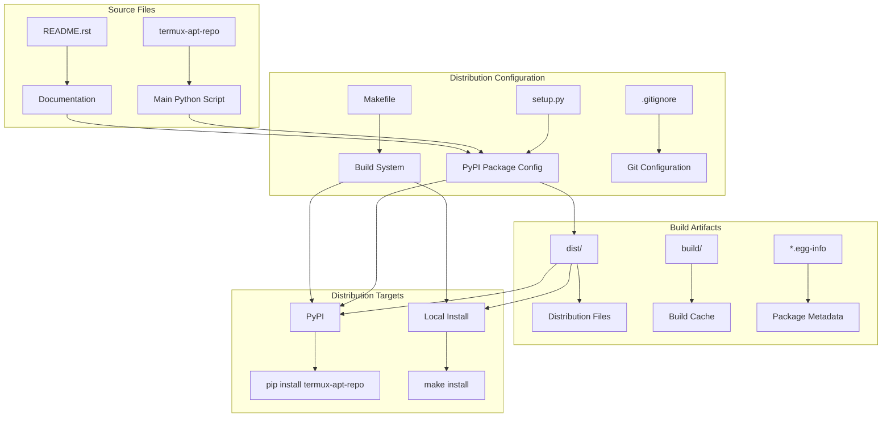
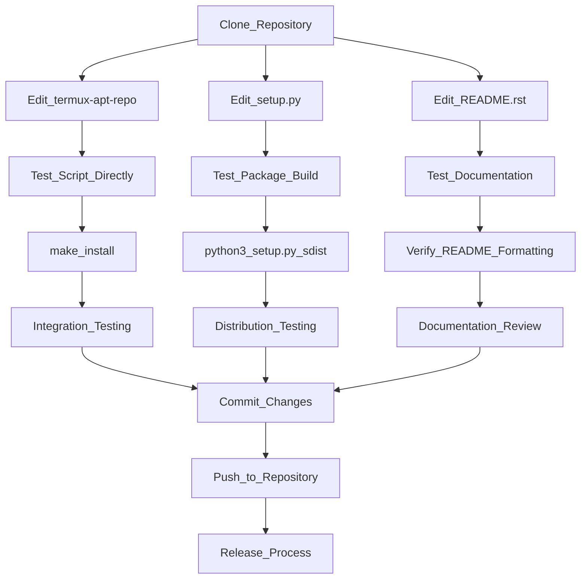
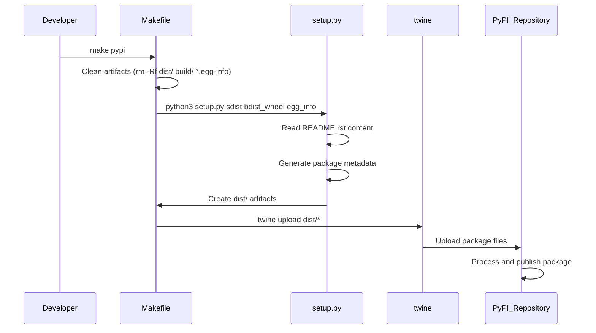

<!-- source: DeepWiki mcp.deepwiki.com · repo termux/termux-apt-repo · page 4 Development Guide · fetched 2026-10-26 -->

# Development Guide

<details>
<summary>Relevant source files</summary>

The following files were used as context for generating this wiki page:

- [.gitignore](.gitignore)
- [Makefile](Makefile)
- [setup.py](setup.py)

</details>


This document provides comprehensive guidance for developers who want to contribute to or extend the termux-apt-repo project. It covers project structure, development environment setup, build processes, and contribution workflows.

For information about installation and usage of termux-apt-repo, see [Installation and Usage](#3). For technical details about the core script implementation, see [Core System: The termux-apt-repo Script](#2).

## Project Structure and Components

The termux-apt-repo project follows a minimal Python package structure focused on delivering a single command-line utility. The project consists of core distribution files and development infrastructure.

### Development Component Architecture



Sources: [setup.py:1-24](), [Makefile:1-10](), [.gitignore:1-4]()

### Package Configuration Structure

The project uses standard Python packaging conventions defined in `setup.py`:

| Component | Value | Purpose |
|-----------|-------|---------|
| `name` | `'termux-apt-repo'` | Package identifier for PyPI |
| `version` | `'0.5'` | Current release version |
| `scripts` | `['termux-apt-repo']` | Command-line entry point |
| `license` | `'Apache License 2.0'` | Open source license |
| `author` | `'Fredrik Fornwall'` | Project maintainer |
| `url` | `'https://github.com/termux/termux-apt-repo'` | Source repository |

Sources: [setup.py:8-23]()

## Development Environment Setup

### Prerequisites

The development environment requires Python 3 and several distribution tools:

- Python 3.x (for script execution and packaging)
- `setuptools` (for package building)
- `twine` (for PyPI uploads)
- `wheel` (for binary distribution)
- Standard Unix tools (`make`, `cp`)

### Local Development Setup

1. **Clone the repository**
   ```bash
   git clone https://github.com/termux/termux-apt-repo.git
   cd termux-apt-repo
   ```

2. **Test the script directly**
   ```bash
   ./termux-apt-repo --help
   ```

3. **Install for local testing**
   ```bash
   make install PREFIX=/usr/local
   ```

### Development Workflow



Sources: [Makefile:1-3](), [setup.py:5-7]()

## Build System

### Makefile Targets

The project uses a simple `Makefile` with two primary targets:

#### `install` Target
```bash
make install PREFIX=/usr/local
```
- Copies the `termux-apt-repo` script to `$(PREFIX)/bin/`
- Default installation method for local development
- Requires `PREFIX` environment variable or parameter

#### `pypi` Target  
```bash
make pypi
```
- Cleans previous build artifacts
- Builds source distribution (`sdist`)
- Builds wheel distribution (`bdist_wheel`)
- Generates package metadata (`egg_info`)
- Uploads to PyPI using `twine`

Sources: [Makefile:1-10]()

### Build Artifact Management

The build system generates artifacts that are excluded from version control:

| Directory/Pattern | Purpose | Cleanup |
|-------------------|---------|---------|
| `build/` | Temporary build files | `rm -Rf build/` |
| `dist/` | Distribution packages | `rm -Rf dist/` |
| `*.egg-info/` | Package metadata | `rm -Rf *egg-info/` |

Sources: [.gitignore:1-4](), [Makefile:5]()

## Package Distribution Process

### PyPI Distribution Workflow



Sources: [Makefile:4-7](), [setup.py:5-7]()

### Package Metadata Generation

The `setup.py` script dynamically reads documentation and generates metadata:

- **Long Description**: Reads content from `README.rst` using the `readme()` function
- **Classifiers**: Defines target audience and programming language
- **Entry Points**: Registers the `termux-apt-repo` script as a command-line utility

Sources: [setup.py:5-23]()

## Development Best Practices

### Code Modification Guidelines

1. **Script Changes**: Modify the `termux-apt-repo` script directly for functionality changes
2. **Documentation**: Update `README.rst` for user-facing documentation changes  
3. **Version Management**: Update version number in `setup.py` for releases
4. **Testing**: Test both direct script execution and installed package behavior

### Version Control Workflow

1. **Ignore Build Artifacts**: The `.gitignore` file excludes all build-related files
2. **Commit Source Only**: Only commit source files, not generated artifacts
3. **Clean Builds**: Use `make pypi` which automatically cleans previous builds

Sources: [.gitignore:1-4](), [Makefile:5]()

### Testing and Validation

#### Local Testing
```bash
# Test script directly
./termux-apt-repo --help

# Test local installation
make install PREFIX=/tmp/test
/tmp/test/bin/termux-apt-repo --help
```

#### Distribution Testing
```bash
# Test package building
python3 setup.py sdist bdist_wheel
pip install dist/*.whl

# Test installed package
termux-apt-repo --help
```

### Release Process

1. **Update Version**: Modify version string in `setup.py`
2. **Update Documentation**: Ensure `README.rst` is current
3. **Test Build**: Run `python3 setup.py sdist bdist_wheel`
4. **Publish**: Run `make pypi` to upload to PyPI
5. **Tag Release**: Create git tag for version tracking

Sources: [setup.py:10](), [Makefile:4-7]()

---

