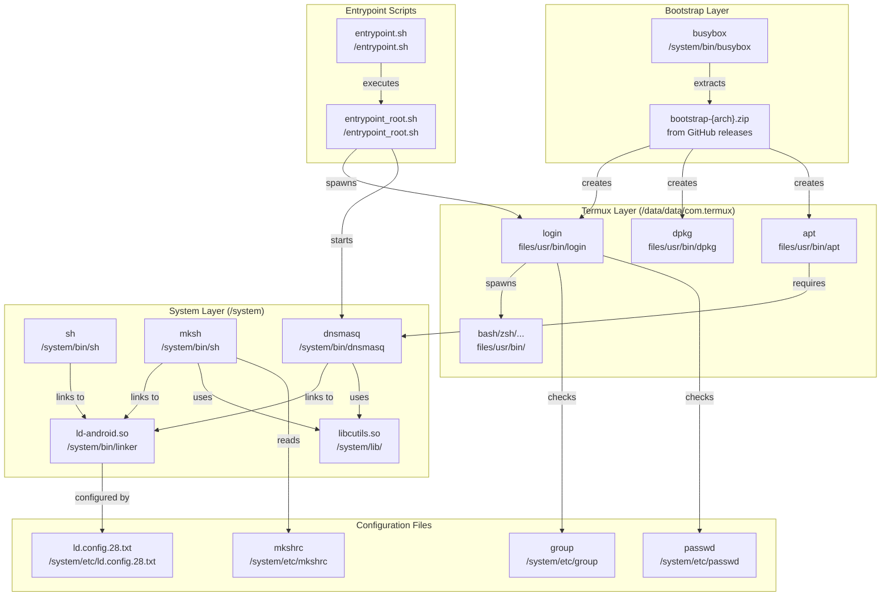
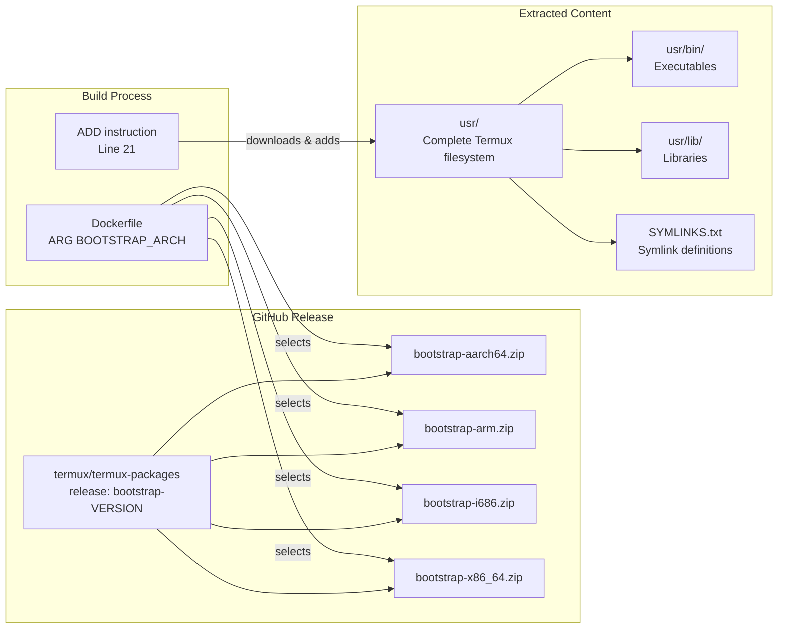
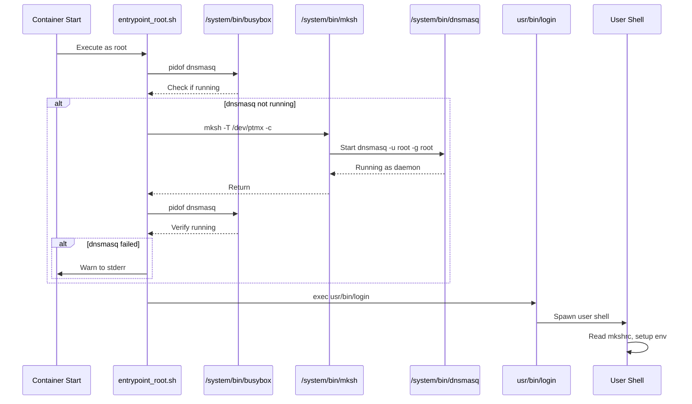
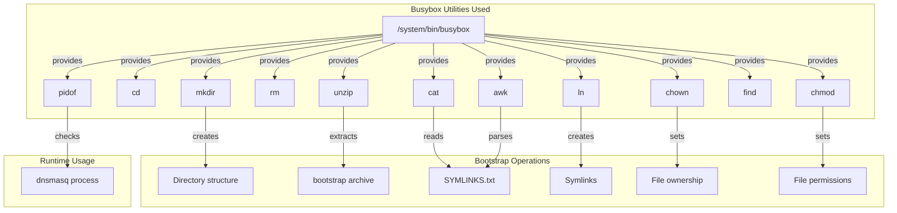
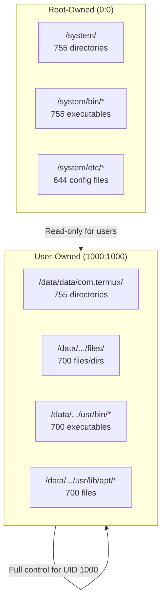
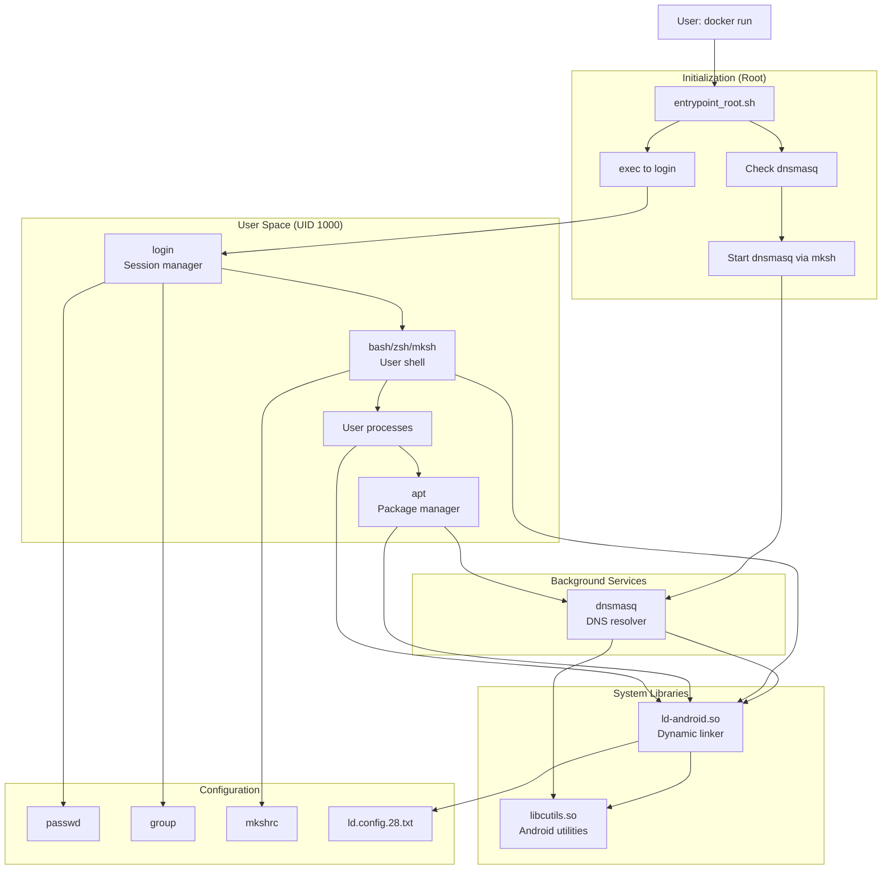

<!-- source: DeepWiki mcp.deepwiki.com · repo termux/termux-docker · page 6 System Components · fetched 2026-10-26 -->

# System Components

<details>
<summary>Relevant source files</summary>

The following files were used as context for generating this wiki page:

- [Dockerfile](Dockerfile)
- [entrypoint_root.sh](entrypoint_root.sh)
- [system/arm/etc/mkshrc](system/arm/etc/mkshrc)
- [system/x86/bin/sh](system/x86/bin/sh)
- [system/x86/etc/mkshrc](system/x86/etc/mkshrc)

</details>


This document provides an overview of the core system components that comprise the Termux Docker environment. These components work together to create a functional Android-like userspace environment within a Docker container.

For detailed information about specific components, see:
- Shell configuration and environment setup: [Shell Environment](#6.1)
- DNS and network service management: [Network Services](#6.2)
- Core Android libraries and linking: [System Libraries](#6.3)
- User and permission model: [User and Group Configuration](#6.4)

For information about how these components are built into the image, see [The Dockerfile](#3.1). For runtime initialization details, see [Container Runtime](#4).

## Component Architecture

The Termux Docker environment consists of several layers of components that provide Android-compatible userspace functionality. At the foundation are Android system binaries and libraries, supplemented by Busybox utilities during the bootstrap phase, and topped with a complete Termux package ecosystem.



**Sources:** [Dockerfile:1-92](), [entrypoint_root.sh:1-21]()

## Component Inventory

The following table categorizes all system components by their role and location in the filesystem:

| Category | Component | Path | Purpose |
|----------|-----------|------|---------|
| **Bootstrap Utilities** | busybox | `/system/bin/busybox` | Unix utilities for bootstrap phase |
| **System Shells** | sh | `/system/bin/sh` | POSIX shell (symlink to mksh) |
| | mksh | `/system/bin/mksh` | MirBSD Korn Shell - primary shell |
| **Network Services** | dnsmasq | `/system/bin/dnsmasq` | DNS forwarding and DHCP service |
| **System Libraries** | libcutils.so | `/system/lib/libcutils.so` | Android utility library |
| | ld-android.so | `/system/bin/linker` | Bionic dynamic linker |
| **Configuration** | mkshrc | `/system/etc/mkshrc` | Shell initialization script |
| | passwd | `/system/etc/passwd` | User account database |
| | group | `/system/etc/group` | Group account database |
| | ld.config.28.txt | `/system/etc/ld.config.28.txt` | Linker namespace configuration |
| **Package Management** | apt | `/data/.../usr/bin/apt` | Package manager frontend |
| | dpkg | `/data/.../usr/bin/dpkg` | Debian package installer |
| **User Interface** | login | `/data/.../usr/bin/login` | Session manager |
| **Entrypoints** | entrypoint.sh | `/entrypoint.sh` | Non-root container entrypoint |
| | entrypoint_root.sh | `/entrypoint_root.sh` | Root container entrypoint |

**Sources:** [Dockerfile:10-19](), [Dockerfile:34-36](), [Dockerfile:41-43]()

## Bootstrap Archive Structure

The Termux bootstrap archive is the central component that provides the complete Termux userspace. It is downloaded during image build and extracted to create the Termux environment.



**Sources:** [Dockerfile:5-7](), [Dockerfile:21-36]()

The bootstrap archive version is controlled by build arguments:

```dockerfile
ARG BOOTSTRAP_VERSION=2023.02.19-r1%2Bapt-android-7
ARG BOOTSTRAP_ARCH=i686
```

The archive is downloaded from `https://github.com/termux/termux-packages/releases/download/bootstrap-$BOOTSTRAP_VERSION/bootstrap-$BOOTSTRAP_ARCH.zip` and extracted to `/data/data/com.termux/files/usr/`.

**Sources:** [Dockerfile:5-6](), [Dockerfile:21]()

## Component Dependencies and Initialization

The system components have specific initialization order requirements and runtime dependencies:



**Sources:** [entrypoint_root.sh:8-14](), [entrypoint_root.sh:16-20]()

### Critical Dependencies

1. **dnsmasq depends on mksh**: The DNS service must be started via `mksh -T /dev/ptmx -c` to ensure proper PTY handling for daemon operation.

2. **Package manager depends on dnsmasq**: The `apt` package manager requires DNS resolution for repository access. Without dnsmasq, package operations will fail.

3. **All binaries depend on ld-android.so**: The Bionic dynamic linker must be present and properly configured before any dynamically-linked executables can run.

4. **User processes depend on passwd/group**: The login process and permission system rely on `/system/etc/passwd` and `/system/etc/group` for user identification.

**Sources:** [entrypoint_root.sh:9](), [Dockerfile:64-66]()

## Busybox Utilities

During the bootstrap phase of image building, Busybox provides essential Unix utilities before the full Termux environment exists. These utilities are critical for unpacking and configuring the bootstrap archive.



**Sources:** [Dockerfile:22-36](), [Dockerfile:41-43](), [Dockerfile:49-59](), [entrypoint_root.sh:8]()

The following Busybox utilities are explicitly symlinked to system tools for runtime use:

```dockerfile
RUN for tool in df mount ping ping6 su top umount; do \
        busybox ln -s /system/bin/busybox /system/bin/$tool; \
    done
```

These symlinks allow Android-style invocations (e.g., `/system/bin/su`) to work correctly by redirecting to Busybox implementations.

**Sources:** [Dockerfile:41-43]()

## Shell Environment Components

The shell environment is built on `mksh` (MirBSD Korn Shell) with configuration provided by `mkshrc`.

### mksh Configuration

The shell configuration file `/system/etc/mkshrc` sets up the prompt and basic environment:

```bash
if (( USER_ID )); then PS1='$'; else PS1='#'; fi
PS4='[$EPOCHREALTIME] '; PS1='${|
	local e=$?

	(( e )) && REPLY+="$e|"

	return $e
}$HOSTNAME:${PWD:-?} '"$PS1 "
```

This configuration:
- Sets `PS1='$'` for non-root users, `PS1='#'` for root
- Adds command exit status to the prompt when non-zero
- Includes hostname and current directory in the prompt
- Sets `PS4` with epoch timestamp for debugging

**Sources:** [system/x86/etc/mkshrc:9-16](), [system/arm/etc/mkshrc:14-21]()

### Architecture-Specific Variations

The ARM version of `mkshrc` includes additional Android-specific environment setup:

```bash
: ${HOSTNAME:=$(getprop ro.product.device)}
: ${HOSTNAME:=android}
: ${TMPDIR:=/data/local/tmp}
export HOSTNAME TMPDIR
```

This attempts to retrieve the device hostname from Android properties and sets appropriate defaults.

**Sources:** [system/arm/etc/mkshrc:9-12]()

For complete shell environment details, see [Shell Environment](#6.1).

## Network Services

The `dnsmasq` service is the only network service included in the base system. It provides:
- DNS forwarding to resolve hostnames
- DHCP server functionality (though not typically used in containers)

### Service Startup

The `dnsmasq` service is started by `entrypoint_root.sh` using a specific invocation pattern:

```bash
/system/bin/mksh -T /dev/ptmx -c "/system/bin/dnsmasq -u root -g root --pid-file /dnsmasq.pid"
```

Key aspects:
- `mksh -T /dev/ptmx`: Allocates a pseudo-TTY for proper daemon operation
- `-u root -g root`: Runs as root user and group
- `--pid-file /dnsmasq.pid`: Creates PID file at container root

**Sources:** [entrypoint_root.sh:9]()

The startup script checks if dnsmasq is already running and verifies successful startup:

```bash
if [ -z "$(/system/bin/busybox pidof dnsmasq)" ]; then
	# start dnsmasq
	sleep 1
	if [ -z "$(/system/bin/busybox pidof dnsmasq)" ]; then
		echo "[!] Failed to start dnsmasq, host name resolution may fail." >&2
	fi
fi
```

**Sources:** [entrypoint_root.sh:8-14]()

For detailed information about dnsmasq configuration and functionality, see [Network Services](#6.2).

## System Libraries

The core system libraries provide Android-compatible functionality:

### libcutils.so

The Android utility library located at `/system/lib/libcutils.so` (or `/system/lib64/` for 64-bit architectures). This library provides Android-specific utility functions used by system binaries like `dnsmasq` and `mksh`.

### ld-android.so (Bionic Linker)

The dynamic linker located at `/system/bin/linker` (symlinked from `ld-android.so`) is responsible for:
- Loading shared libraries at runtime
- Resolving symbol dependencies
- Managing library namespaces
- Enforcing SELinux policies (when applicable)

The linker is configured by `/system/etc/ld.config.28.txt` which defines namespace isolation and library search paths.

**Sources:** [Dockerfile:14]()

For detailed information about library dependencies and the linker, see [System Libraries](#6.3).

## User and Group Configuration

The user and group databases define the permission model for the system:

### passwd File

Located at `/system/etc/passwd`, this file defines user accounts. The system uses a minimal set of users:
- `root:x:0:0:root:/:/system/bin/sh` - Root user (UID 0)
- `system:x:1000:1000:system:/data/data/com.termux/files/home:/data/data/com.termux/files/usr/bin/sh` - Primary user for Termux operations

### group File

Located at `/system/etc/group`, this file defines group memberships corresponding to the users in passwd.

These files are symlinked from `/etc/` for standard Unix compatibility:

```dockerfile
RUN busybox ln -s /system/etc/passwd /etc/passwd && \
    busybox ln -s /system/etc/group /etc/group
```

**Sources:** [Dockerfile:51-52]()

For complete details on the user model and privilege management, see [User and Group Configuration](#6.4).

## File Ownership and Permissions

The system enforces strict ownership and permission policies during image build:



**Sources:** [Dockerfile:49-59]()

The ownership model ensures:
1. System files (`/system/`) are immutable and owned by root
2. User data (`/data/data/com.termux/`) is isolated to UID 1000
3. Termux executables and libraries have restrictive permissions (700) to prevent unauthorized access

The permission setup is performed during image build:

```dockerfile
RUN busybox chown -Rh 0:0 /system && \
    busybox chown -Rh 1000:1000 /data/data/com.termux && \
    busybox find /system -type d -exec busybox chmod 755 "{}" \; && \
    busybox find /system -type f -executable -exec busybox chmod 755 "{}" \; && \
    busybox find /system -type f ! -executable -exec busybox chmod 644 "{}" \; && \
    busybox find /data -type d -exec busybox chmod 755 "{}" \; && \
    busybox find /data/data/com.termux/files -type f -o -type d -exec busybox chmod g-rwx,o-rwx "{}" \; && \
    cd /data/data/com.termux/files/usr && \
    busybox find ./bin ./lib/apt ./libexec -type f -exec busybox chmod 700 "{}" \;
```

**Sources:** [Dockerfile:49-59]()

## Package Management Components

The Termux package management system consists of:

### apt (Advanced Package Tool)

Located at `/data/data/com.termux/files/usr/bin/apt`, this is the high-level package manager interface. It depends on:
- `dnsmasq` for DNS resolution to reach package repositories
- `dpkg` for actual package installation

### dpkg (Debian Package Manager)

Located at `/data/data/com.termux/files/usr/bin/dpkg`, this is the low-level package installer that handles `.deb` file installation, removal, and tracking.

During image build, packages are updated and upgraded (except on ARM architectures where seccomp issues prevent this):

```dockerfile
RUN if [ ${SYSTEM_TYPE} = 'arm' ]; then exit; else \
    /system/bin/mksh -T /dev/ptmx -c "/system/bin/dnsmasq -u root -g root --pid-file /dnsmasq.pid" && sleep 1 && \
    su - system -c "/data/data/com.termux/files/usr/bin/apt update" && \
    su - system -c "/data/data/com.termux/files/usr/bin/apt upgrade -o Dpkg::Options::=--force-confnew -yq" && \
    rm -rf /data/data/com.termux/files/usr/var/lib/apt/* && \
    rm -rf /data/data/com.termux/files/usr/var/log/apt/* && \
    rm -rf /data/data/com.termux/cache/apt/* ;\
    fi
```

**Sources:** [Dockerfile:63-70]()

Note that:
- Packages are updated as the `system` user (UID 1000), not root
- The update process requires dnsmasq to be running
- After updates, package cache is cleaned to reduce image size
- ARM builds skip this step due to known issues (see [Known Issues and Troubleshooting](#8.3))

## Component Interaction Summary

The following diagram shows how all system components interact during normal container operation:



**Sources:** [entrypoint_root.sh:1-21](), [Dockerfile:76-92]()

---

