# Page: Home

# Home

<details>
<summary>Relevant source files</summary>

The following files were used as context for generating this wiki page:

- [Dockerfile](Dockerfile)
- [README.md](README.md)
- [entrypoint_root.sh](entrypoint_root.sh)

</details>


## Purpose and Scope

This documentation covers **termux-docker**, a project that packages the [Termux](https://termux.com) Android terminal environment as Docker container images. This page provides an architectural overview of the system, explaining how the build process, multi-architecture support, and runtime initialization work together.

For quick start instructions on running containers, see [Getting Started](#2). For build system details, see [Building Images](#3). For runtime behavior specifics, see [Container Runtime](#4).

## What is Termux Docker?

Termux Docker is a containerized version of Termux, the Android terminal emulator and Linux environment. The project creates Docker images that replicate Termux's filesystem structure, package management system, and user environment without Android runtime components (DalvikVM, OpenSLES).

**Key Characteristics:**
- Multi-architecture support: `aarch64`, `arm`, `i686`, `x86_64`
- Android-style filesystem layout under `/data/data/com.termux/`
- Complete Termux package ecosystem via `apt`/`dpkg`
- Privilege-aware initialization supporting both root and non-root startup modes
- Published to Docker Hub as `termux/termux-docker` with architecture-specific tags

Sources: [README.md:1-6](), [README.md:26-32]()

## System Architecture Overview

The system consists of three major phases: **build-time preparation**, **image construction**, and **runtime initialization**.

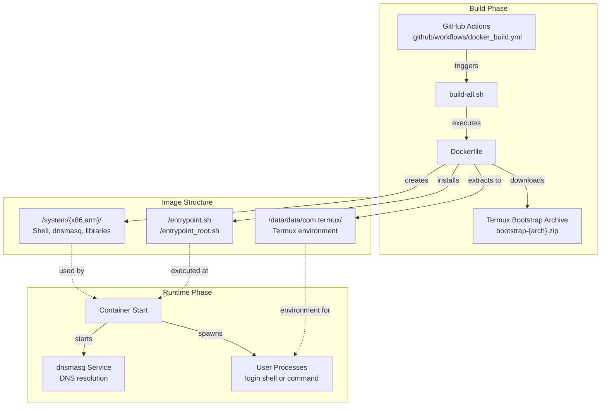

**Architecture Phases:**

| Phase | Components | Purpose |
|-------|-----------|---------|
| **Build** | GitHub Actions, `build-all.sh`, `Dockerfile` | Automate multi-arch image creation |
| **Image** | `/system/`, `/data/`, entrypoints | Provide filesystem structure and binaries |
| **Runtime** | Entrypoint scripts, `dnsmasq`, user shell | Initialize services and user environment |

Sources: [Dockerfile:1-92](), [README.md:97-109]()

## Core Components

### Build System Components

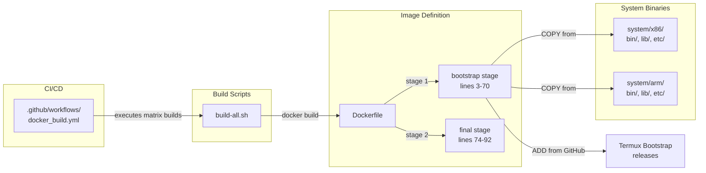

The build system has three layers:

1. **CI/CD Layer**: `.github/workflows/docker_build.yml` orchestrates automated builds with matrix strategy for all architectures (see [CI/CD Pipeline](#3.3))
2. **Script Layer**: `build-all.sh` handles local builds with Docker/Podman detection (see [Build Scripts](#3.2))
3. **Dockerfile Layer**: Multi-stage Dockerfile downloads bootstrap archives and assembles the final image (see [The Dockerfile](#3.1))

Sources: [Dockerfile:1-92](), [README.md:97-109]()

### Runtime Components

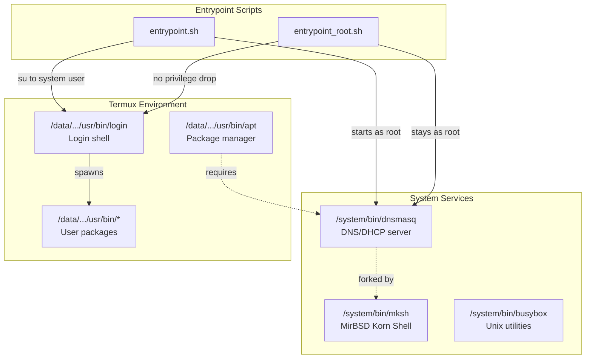

**Runtime Component Roles:**

| Component | File Path | Role |
|-----------|-----------|------|
| `entrypoint.sh` | `/entrypoint.sh` | Standard entrypoint: starts services, drops to UID 1000 |
| `entrypoint_root.sh` | `/entrypoint_root.sh` | Root entrypoint: starts services, maintains root privileges |
| `mksh` | `/system/bin/mksh` | Shell used for PTY-based dnsmasq startup |
| `dnsmasq` | `/system/bin/dnsmasq` | DNS resolver required for package management |
| `login` | `/data/data/com.termux/files/usr/bin/login` | Default command: interactive login shell |

Sources: [Dockerfile:16-18](), [Dockerfile:90-91](), [entrypoint_root.sh:1-21]()

## Build vs Runtime Architecture

The system uses a **multi-stage Dockerfile** with distinct build-time and runtime environments:

### Build-Time Environment

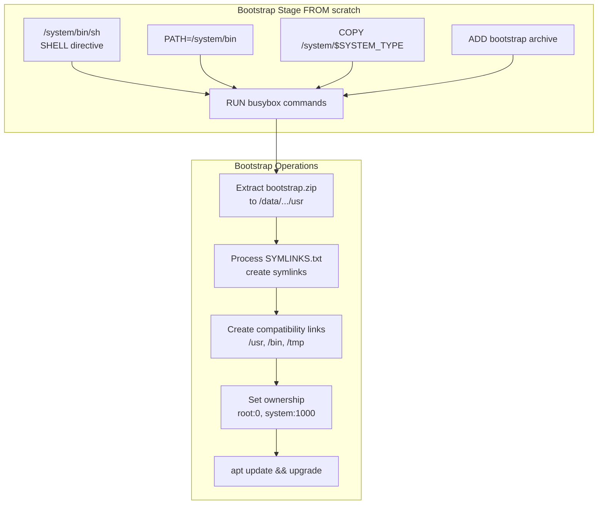

**Bootstrap Stage Operations** [Dockerfile:3-70]():

1. **Base Setup**: `FROM scratch` with `/system/bin/sh` as shell [Dockerfile:3-11]()
2. **System Files**: Copy architecture-specific binaries from `system/{x86,arm}/` [Dockerfile:14]()
3. **Bootstrap Extraction**: Download and unzip Termux bootstrap archive [Dockerfile:21-26]()
4. **Symlink Creation**: Process `SYMLINKS.txt` for Termux package symlinks [Dockerfile:28-33]()
5. **Compatibility Links**: Create `/usr`, `/bin`, `/tmp` pointing to Termux paths [Dockerfile:34-36]()
6. **Permission Setup**: Set ownership (root:0 for `/system`, 1000:1000 for `/data`) [Dockerfile:49-59]()
7. **Package Updates**: Run `apt update && upgrade` for non-ARM architectures [Dockerfile:63-70]()

Sources: [Dockerfile:3-70]()

### Runtime Environment

**Final Stage** [Dockerfile:74-92]():

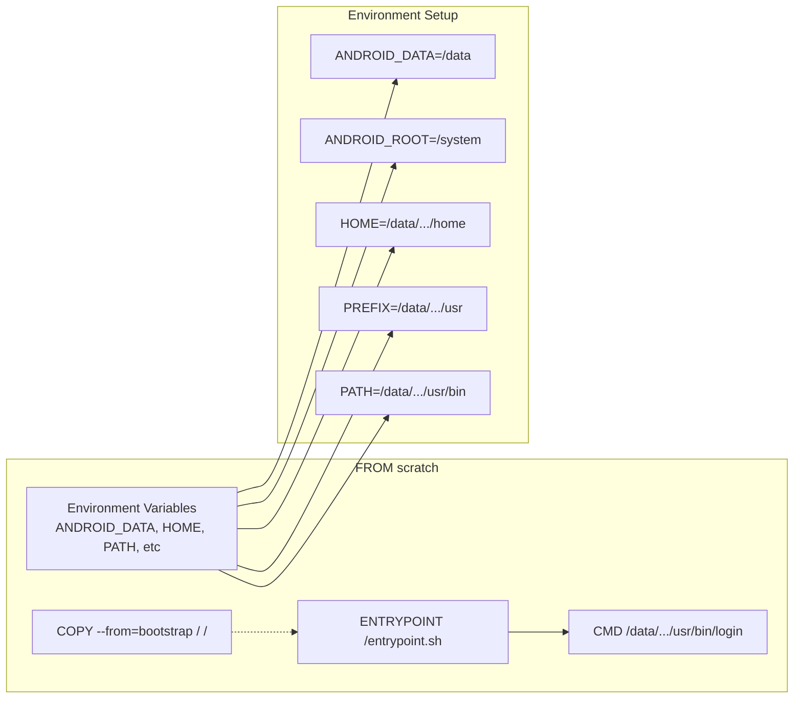

**Key Environment Variables** [Dockerfile:76-83]():

| Variable | Value | Purpose |
|----------|-------|---------|
| `ANDROID_DATA` | `/data` | Android data directory root |
| `ANDROID_ROOT` | `/system` | Android system directory root |
| `HOME` | `/data/data/com.termux/files/home` | User home directory |
| `PATH` | `/data/data/com.termux/files/usr/bin` | Default executable search path |
| `PREFIX` | `/data/data/com.termux/files/usr` | Termux installation prefix |
| `TMPDIR` | `/data/data/com.termux/files/usr/tmp` | Temporary directory |

Sources: [Dockerfile:74-92]()

## Multi-Architecture Support

The project supports four CPU architectures through **architecture-specific builds** and **parallel system directories**:

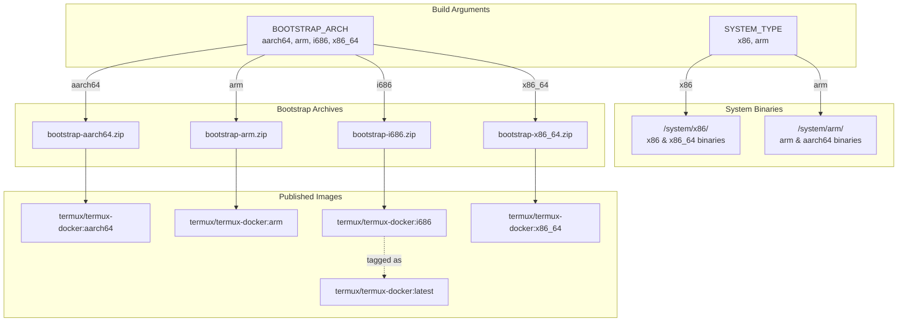

**Architecture Mapping** [Dockerfile:5-7]():

| BOOTSTRAP_ARCH | SYSTEM_TYPE | Published Tag | Notes |
|----------------|-------------|---------------|-------|
| `aarch64` | `arm` | `aarch64` | 64-bit ARM |
| `arm` | `arm` | `arm` | 32-bit ARM |
| `i686` | `x86` | `i686`, `latest` | 32-bit x86 (default) |
| `x86_64` | `x86` | `x86_64` | 64-bit x86 |

The `SYSTEM_TYPE` argument determines which `/system/{x86,arm}` directory is copied, providing the appropriate system binaries for the target architecture. For cross-architecture execution (e.g., ARM on x86 hosts), QEMU emulation must be configured via `binfmt_misc` (see [Cross-Platform Execution](#5.2)).

Sources: [Dockerfile:5-7](), [Dockerfile:14](), [README.md:26-36](), [README.md:42-66]()

## Key Files and Their Roles

### Primary System Files

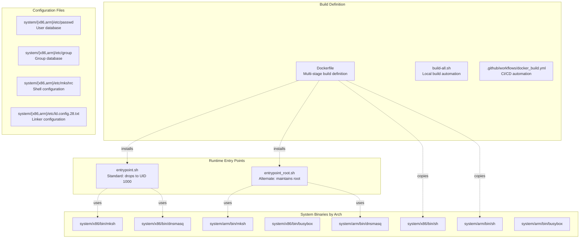

**File Reference Table:**

| File Path | Purpose | Referenced In |
|-----------|---------|---------------|
| `Dockerfile` | Multi-stage image build definition | [The Dockerfile](#3.1) |
| `build-all.sh` | Local build script with Docker/Podman support | [Build Scripts](#3.2) |
| `.github/workflows/docker_build.yml` | CI/CD automation | [CI/CD Pipeline](#3.3) |
| `entrypoint.sh` | Standard entrypoint with privilege drop | [Entrypoint System](#4.1) |
| `entrypoint_root.sh` | Root-mode entrypoint | [Entrypoint System](#4.1) |
| `system/{x86,arm}/bin/sh` | POSIX shell | [Shell Environment](#6.1) |
| `system/{x86,arm}/bin/mksh` | MirBSD Korn Shell | [Shell Environment](#6.1) |
| `system/{x86,arm}/bin/dnsmasq` | DNS/DHCP server | [Network Services](#6.2) |
| `system/{x86,arm}/bin/busybox` | Unix utilities collection | [Architecture-Specific Binaries](#5.1) |
| `system/{x86,arm}/etc/passwd` | User/group definitions | [User and Group Configuration](#6.4) |
| `system/{x86,arm}/etc/mkshrc` | Shell startup script | [Shell Environment](#6.1) |
| `system/{x86,arm}/etc/ld.config.28.txt` | Dynamic linker configuration | [Linker Configuration](#8.1) |

Sources: [Dockerfile:1-92](), [entrypoint_root.sh:1-21](), [README.md:1-121]()

## Filesystem Layout Overview

The container filesystem follows **Android's directory structure** with compatibility symlinks for standard Linux paths:

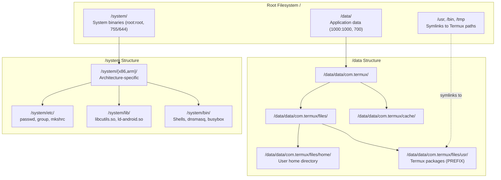

**Directory Ownership and Permissions:**

| Path | Owner:Group | Permissions | Purpose |
|------|-------------|-------------|---------|
| `/system/` | `root:root` | 755 (dirs), 755 (executables), 644 (files) | Immutable system binaries |
| `/data/data/com.termux/` | `1000:1000` | 700 | Mutable Termux environment |
| `/data/data/com.termux/files/usr/` | `1000:1000` | 700 | Installed packages (PREFIX) |
| `/data/data/com.termux/files/home/` | `1000:1000` | 700 | User home directory |

For complete filesystem structure details, see [Filesystem Layout](#7).

Sources: [Dockerfile:22-36](), [Dockerfile:49-59]()

## Next Steps

- **Running containers**: See [Getting Started](#2) for usage examples
- **Building locally**: See [Building Images](#3) for build instructions
- **Understanding initialization**: See [Container Runtime](#4) for startup sequence details
- **Troubleshooting**: See [Known Issues and Troubleshooting](#8.3) for common problems

---

# Page: Getting Started

# Getting Started

<details>
<summary>Relevant source files</summary>

The following files were used as context for generating this wiki page:

- [README.md](README.md)
- [entrypoint.sh](entrypoint.sh)
- [system/arm/bin/mksh](system/arm/bin/mksh)
- [system/x86/bin/mksh](system/x86/bin/mksh)

</details>


This guide provides instructions for pulling and running pre-built Termux Docker images. It covers basic container usage, architecture selection, cross-platform execution, and common configuration patterns.

For information about building images from source, see [Building Images](#3). For details about what happens inside containers at runtime, see [Container Runtime](#4).

---

## Prerequisites

Before using termux-docker, ensure you have:

| Requirement | Description |
|------------|-------------|
| **Docker or Podman** | A properly configured container runtime (version 19.03+ for Docker, 3.0+ for Podman) |
| **Internet Connection** | Required for pulling images from Docker Hub and package management |
| **Host Architecture** | x86_64 or ARM-based system; cross-architecture execution requires additional setup |

All examples in this guide use Docker commands. Podman users can substitute `podman` for `docker` in all commands.

**Sources:** [README.md:9-13]()

---

## Pulling Images

Termux Docker images are published to Docker Hub under the `termux/termux-docker` repository. Images are available for four CPU architectures:

| Tag | Architecture | Bit Width | Default |
|-----|-------------|-----------|---------|
| `i686` | x86 | 32-bit | ✓ (also tagged as `latest`) |
| `x86_64` | x86-64 | 64-bit | |
| `arm` | ARMv7 | 32-bit | |
| `aarch64` | ARMv8/ARM64 | 64-bit | |

To pull a specific architecture:

```sh
# Pull 32-bit x86 (default)
docker pull termux/termux-docker:latest

# Pull 64-bit ARM
docker pull termux/termux-docker:aarch64

# Pull 64-bit x86
docker pull termux/termux-docker:x86_64
```

Images are automatically updated weekly via GitHub Actions to include the latest Termux bootstrap packages.

**Sources:** [README.md:24-36]()

---

## Basic Interactive Usage

The simplest way to start a Termux container is to run an interactive login shell:

```sh
docker run -it termux/termux-docker:latest
```

This command:
1. Creates a new container from the specified image
2. Allocates a pseudo-TTY (`-t`) for terminal interaction
3. Keeps STDIN open (`-i`) for interactive input
4. Executes `/entrypoint.sh`, which initializes services and starts a login shell

Inside the container, you will have a full Termux environment with:
- The `apt` package manager for installing software
- Standard Unix tools (bash, coreutils, etc.)
- A writable home directory at `/data/data/com.termux/files/home`

### Container Initialization Flow

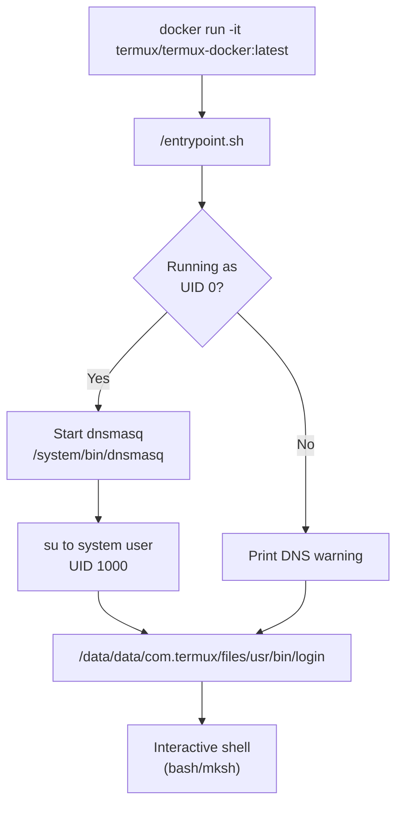

**Sources:** [README.md:15-23](), [entrypoint.sh:1-35]()

---

## Important: User Privilege Model

**Do not use the `--user` flag when starting containers.**

The container must start as root (UID 0) to initialize system services, specifically `dnsmasq` for DNS resolution. After service initialization, the entrypoint script automatically drops privileges to the `system` user (UID 1000) before executing user commands.

```sh
# ✓ CORRECT: Container starts as root, drops to system user
docker run -it termux/termux-docker:latest

# ✗ INCORRECT: DNS will be unavailable
docker run -it --user 1000:1000 termux/termux-docker:latest
```

The privilege drop mechanism is implemented in [entrypoint.sh:3-18](), which:
1. Checks if the effective UID is 0
2. If root, starts `dnsmasq` and uses `su` to switch to the system user
3. If non-root, prints a warning and continues without DNS

For details on the privilege model, see [Privilege Management](#4.3).

**Sources:** [README.md:38-40](), [entrypoint.sh:3-18]()

---

## Architecture Selection and Compatibility

### Native Architecture Execution

When the container architecture matches the host architecture, containers run natively without emulation:

| Host Architecture | Compatible Container Tags |
|------------------|---------------------------|
| x86_64 (64-bit Intel/AMD) | `x86_64`, `i686` |
| aarch64 (64-bit ARM) | `aarch64`, `arm` |
| x86 (32-bit Intel/AMD) | `i686` |
| armv7l (32-bit ARM) | `arm` |

Example on an x86_64 host:

```sh
# Native execution (64-bit)
docker run -it termux/termux-docker:x86_64

# Native execution (32-bit compatibility)
docker run -it termux/termux-docker:i686
```

### Cross-Architecture Execution

To run containers of incompatible architecture (e.g., ARM on x86), you must configure QEMU emulation through the kernel's `binfmt_misc` system. This requires **one-time setup** as root on the host machine.

#### Setting Up QEMU for ARM Emulation

Run this command once on your x86_64 host to enable ARM emulation:

```sh
docker run --rm --privileged aptman/qus -s -- -p aarch64 arm
```

This configures the kernel to automatically invoke QEMU when executing ARM binaries.

#### Running ARM Containers on x86 Hosts

After QEMU setup, ARM containers can be started, but they require relaxed security constraints:

**Option 1: Privileged mode (simplest)**

```sh
docker run -it --privileged termux/termux-docker:aarch64
```

**Option 2: Unconfined seccomp (more secure)**

```sh
docker run -it --security-opt seccomp=unconfined termux/termux-docker:aarch64
```

The security relaxation is necessary because ARM emulation requires the `personality()` system call, which is blocked by Docker's default seccomp profile. For background on this issue, see [Known Issues and Troubleshooting](#8.3).

### Architecture Selection Decision Tree

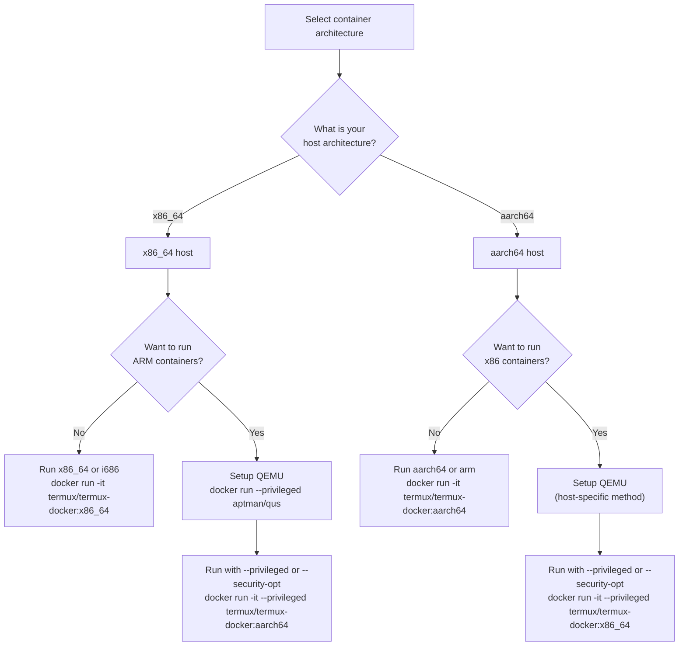

**Sources:** [README.md:34-36](), [README.md:42-66]()

---

## Non-Interactive Command Execution

Containers can execute commands non-interactively by appending them to the `docker run` command. This is useful for automation, CI/CD pipelines, or one-off tasks.

### Executing Single Commands

```sh
# Update package lists
docker run --rm termux/termux-docker:latest apt update

# Install a package
docker run --rm termux/termux-docker:latest apt install -y vim

# Run a Python script
docker run --rm -v $(pwd):/work termux/termux-docker:latest python /work/script.py
```

The `--rm` flag automatically removes the container after execution, preventing accumulation of stopped containers.

### Executing Complex Commands with Bash

For multi-step operations, use `bash -c` to execute a command string:

```sh
docker run -it --rm termux/termux-docker:latest bash -c "apt update && apt install -yq clang"
```

### Command Execution Flow

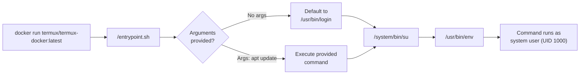

The entrypoint script passes all command-line arguments through the privilege-dropping `su` command, ensuring user commands always run as the `system` user (UID 1000), not root.

**Sources:** [README.md:68-77](), [entrypoint.sh:20-34]()

---

## Persistent Data with Volumes

By default, all changes made inside a container are lost when the container is removed. To persist data across container runs, mount a Docker volume or host directory:

### Using Docker Volumes

```sh
# Create a named volume
docker volume create termux-home

# Run container with persistent home directory
docker run -it \
  -v termux-home:/data/data/com.termux/files/home \
  termux/termux-docker:latest

# Data persists across container restarts
docker run -it \
  -v termux-home:/data/data/com.termux/files/home \
  termux/termux-docker:latest
```

### Using Host Directories

```sh
# Mount current directory as /work inside container
docker run -it \
  -v $(pwd):/work \
  termux/termux-docker:latest

# Inside container: cd /work to access host files
```

### Key Paths to Persist

| Path | Purpose |
|------|---------|
| `/data/data/com.termux/files/home` | User home directory, configuration files |
| `/data/data/com.termux/files/usr` | Installed packages (warning: architecture-specific) |
| `/data/data/com.termux/files/usr/tmp` | Temporary files (mapped to `/tmp`) |

**Note:** The `/data/data/com.termux/files/usr` directory contains architecture-specific binaries. Do not share this volume between containers of different architectures.

**Sources:** Inferred from filesystem structure in [Diagram 4](#diagram-4)

---

## Root Shell Access

The default entrypoint drops privileges for security and package manager compatibility. However, some operations require root access.

### Using the Root Entrypoint

The image provides an alternate entrypoint that does not drop privileges:

```sh
docker run -it --entrypoint /entrypoint_root.sh termux/termux-docker:latest
```

This starts a shell as root (UID 0) but skips the privilege drop to the system user.

### Entrypoint Comparison

| Entrypoint | File | Starts dnsmasq? | Drops to system user? | Use Case |
|-----------|------|-----------------|----------------------|----------|
| Default | `/entrypoint.sh` | Yes | Yes | Normal usage, package management |
| Root | `/entrypoint_root.sh` | Yes | No | System administration, debugging |

### Root vs Non-Root Behavior Mapping

```mermaid
flowchart TD
    subgraph default["Default Entrypoint: /entrypoint.sh"]
        D_START["/entrypoint.sh"]
        D_DNS["Start /system/bin/dnsmasq"]
        D_SU["su to system user"]
        D_CMD["Execute as UID 1000"]
    end
    
    subgraph root["Root Entrypoint: /entrypoint_root.sh"]
        R_START["/entrypoint_root.sh"]
        R_DNS["Start /system/bin/dnsmasq"]
        R_CMD["Execute as UID 0"]
    end
    
    USER["docker run --entrypoint ..."]
    
    USER -->|"--entrypoint /entrypoint.sh"| D_START
    USER -->|"--entrypoint /entrypoint_root.sh"| R_START
    
    D_START --> D_DNS
    D_DNS --> D_SU
    D_SU --> D_CMD
    
    R_START --> R_DNS
    R_DNS --> R_CMD
```

**Warning:** Running the package manager (`apt`, `pkg`) as root is not recommended and may cause permission issues. Use the root entrypoint only when necessary for specific administrative tasks.

**Sources:** [README.md:79-95](), [entrypoint.sh:24-34]()

---

## Common Usage Patterns

### Pattern 1: Development Environment

Create a persistent development container with a mounted project directory:

```sh
docker run -it --name termux-dev \
  -v $(pwd):/project \
  -v termux-dev-home:/data/data/com.termux/files/home \
  termux/termux-docker:latest
```

Inside the container:
```sh
cd /project
apt update && apt install -y git vim clang
```

Stop and restart the container:
```sh
docker stop termux-dev
docker start -ai termux-dev
```

### Pattern 2: CI/CD Build Container

Use containers in automation scripts:

```sh
#!/bin/bash
docker run --rm \
  -v $(pwd):/workspace \
  termux/termux-docker:x86_64 \
  bash -c "cd /workspace && apt install -y clang && make"
```

### Pattern 3: Testing Across Architectures

Test code on multiple architectures using a script:

```sh
for arch in i686 x86_64 aarch64; do
  echo "Testing on $arch..."
  docker run --rm \
    -v $(pwd):/test \
    termux/termux-docker:$arch \
    bash -c "cd /test && ./run-tests.sh"
done
```

**Sources:** [README.md:15-77]()

---

## Quick Reference

### Essential Commands

| Task | Command |
|------|---------|
| **Start interactive shell** | `docker run -it termux/termux-docker:latest` |
| **Start with persistent home** | `docker run -it -v termux-home:/data/data/com.termux/files/home termux/termux-docker:latest` |
| **Execute single command** | `docker run --rm termux/termux-docker:latest apt update` |
| **Start as root** | `docker run -it --entrypoint /entrypoint_root.sh termux/termux-docker:latest` |
| **ARM on x86 (setup)** | `docker run --rm --privileged aptman/qus -s -- -p aarch64 arm` |
| **ARM on x86 (run)** | `docker run -it --privileged termux/termux-docker:aarch64` |

### Image Tags

| Tag | Architecture | Default |
|-----|-------------|---------|
| `latest` | i686 (x86 32-bit) | ✓ |
| `i686` | x86 32-bit | |
| `x86_64` | x86-64 64-bit | |
| `arm` | ARMv7 32-bit | |
| `aarch64` | ARMv8 64-bit | |

### Next Steps

- Learn about the [build process](#3) to create custom images
- Understand the [entrypoint system](#4.1) for advanced initialization
- Explore [multi-architecture support](#5) for cross-platform deployment
- Review [known issues](#8.3) for troubleshooting guidance

**Sources:** [README.md:1-121]()

---

# Page: Building Images

# Building Images

<details>
<summary>Relevant source files</summary>

The following files were used as context for generating this wiki page:

- [.github/workflows/docker_build.yml](.github/workflows/docker_build.yml)
- [Dockerfile](Dockerfile)
- [build-all.sh](build-all.sh)
- [entrypoint_root.sh](entrypoint_root.sh)

</details>


## Purpose and Scope

This document provides an overview of the image build system for termux-docker, covering the components, architecture support, and build methods used to create Termux container images. For detailed information about specific build components, see:
- [The Dockerfile](#3.1) - Multi-stage build process and filesystem setup
- [Build Scripts](#3.2) - Local build automation with `build-all.sh`
- [CI/CD Pipeline](#3.3) - Automated builds and publishing via GitHub Actions

## Build System Components

The build system consists of three primary components that work together to produce multi-architecture Termux container images:

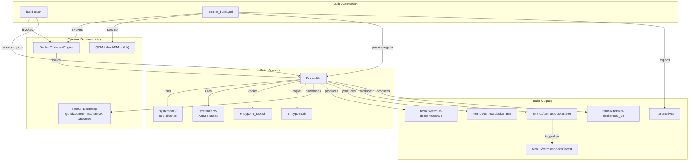

**Sources:** [Dockerfile:1-92](), [build-all.sh:1-47](), [.github/workflows/docker_build.yml:1-85]()

### Component Roles

| Component | File Path | Primary Function |
|-----------|-----------|------------------|
| **Dockerfile** | `Dockerfile` | Multi-stage build definition; extracts bootstrap, configures filesystem |
| **Build Script** | `build-all.sh` | Local build automation; detects host architecture, builds compatible images |
| **CI Workflow** | `.github/workflows/docker_build.yml` | Automated builds on push/PR/schedule; matrix strategy for all architectures |
| **System Binaries** | `system/x86/`, `system/arm/` | Architecture-specific shell, dnsmasq, libraries for bootstrap phase |
| **Entrypoints** | `entrypoint.sh`, `entrypoint_root.sh` | Container initialization scripts copied into images |

**Sources:** [Dockerfile:1-92](), [build-all.sh:1-47](), [.github/workflows/docker_build.yml:1-85]()

## Build Inputs and Outputs

### Build Arguments

The build process accepts two critical build arguments that determine the image architecture and system type:

| Build Argument | Purpose | Valid Values | Default |
|----------------|---------|--------------|---------|
| `BOOTSTRAP_ARCH` | Specifies Termux bootstrap architecture | `aarch64`, `arm`, `i686`, `x86_64` | `i686` |
| `SYSTEM_TYPE` | Selects system binary directory | `x86`, `arm` | `x86` |

The `SYSTEM_TYPE` maps to bootstrap architectures as follows:
- **`x86`**: Used for `i686` and `x86_64` bootstrap architectures
- **`arm`**: Used for `arm` and `aarch64` bootstrap architectures

**Sources:** [Dockerfile:5-7](), [.github/workflows/docker_build.yml:37-48](), [build-all.sh:17-26]()

### Bootstrap Version

The build downloads a specific Termux bootstrap archive from GitHub releases. The version is defined at build time:

- **Default Version:** `2023.02.19-r1%2Bapt-android-7` [Dockerfile:5]()
- **Download URL Pattern:** `https://github.com/termux/termux-packages/releases/download/bootstrap-$BOOTSTRAP_VERSION/bootstrap-$BOOTSTRAP_ARCH.zip` [Dockerfile:21]()

### Output Images

The build produces architecture-specific images tagged by CPU architecture:

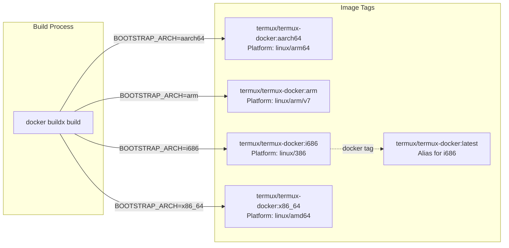

**Sources:** [.github/workflows/docker_build.yml:43-48](), [.github/workflows/docker_build.yml:61-64](), [build-all.sh:28-46]()

## Multi-Architecture Build Strategy

### Architecture Detection and Compatibility

The build system automatically detects the host architecture and builds compatible images:

| Host Architecture (`uname -m`) | SYSTEM_TYPE | Buildable Architectures |
|-------------------------------|-------------|-------------------------|
| `x86_64` | `x86` | `i686`, `x86_64` |
| `i686` | `x86` | `i686` |
| `aarch64` | `arm` | `aarch64`, `arm` |
| `armv7l`, `armv8l` | `arm` | `arm` |

**Sources:** [build-all.sh:17-26]()

### Cross-Architecture Builds

For ARM builds on x86 hosts (or vice versa), the CI workflow configures QEMU emulation:

```bash
# Enable QEMU for ARM architectures
docker run --rm --privileged aptman/qus -s -- -p aarch64 arm
```

This setup is only performed when `matrix.CPU_ARCH` is `aarch64` or `arm` [.github/workflows/docker_build.yml:31-33]().

### Platform Tag Mapping

The CI workflow maps CPU architectures to Docker platform tags:

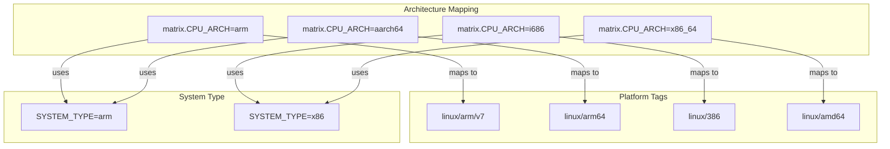

**Sources:** [.github/workflows/docker_build.yml:37-48]()

## Build Process Overview

The build follows a two-stage process defined in the Dockerfile:

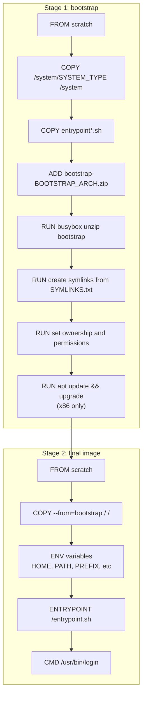

**Sources:** [Dockerfile:1-92]()

### Stage 1: Bootstrap

The first stage builds the complete Termux environment from scratch:

1. **Base Setup** - Copies system binaries for the target `SYSTEM_TYPE` [Dockerfile:14]()
2. **Entrypoint Installation** - Copies initialization scripts [Dockerfile:17-18]()
3. **Bootstrap Download** - Fetches Termux bootstrap archive from GitHub [Dockerfile:21]()
4. **Extraction** - Unpacks bootstrap to `/data/data/com.termux/files/usr` [Dockerfile:22-36]()
5. **Symlink Creation** - Creates symlinks from `SYMLINKS.txt` and standard paths [Dockerfile:28-36]()
6. **Permission Setup** - Sets ownership (root for `/system`, UID 1000 for `/data`) [Dockerfile:49-59]()
7. **Package Updates** - Updates and upgrades packages (x86 only, skipped for ARM) [Dockerfile:63-70]()

### Stage 2: Final Image

The second stage creates a clean image without build artifacts:

1. **Copy Bootstrap** - Copies entire filesystem from Stage 1 [Dockerfile:85]()
2. **Environment Setup** - Defines standard Android/Termux environment variables [Dockerfile:76-83]()
3. **Entrypoint Configuration** - Sets `/entrypoint.sh` as the container entrypoint [Dockerfile:90]()
4. **Default Command** - Sets `/data/data/com.termux/files/usr/bin/login` as default [Dockerfile:91]()

**Sources:** [Dockerfile:72-92]()

## Build Methods

### Local Builds with build-all.sh

The `build-all.sh` script provides a convenient interface for local image builds:

```bash
# Build all compatible architectures for the host
./build-all.sh

# Build with Podman instead of Docker
./build-all.sh --podman

# Build and publish to registry
./build-all.sh publish
```

**Key Features:**
- Auto-detects host architecture [build-all.sh:17-26]()
- Builds only compatible architectures [build-all.sh:28-39]()
- Supports both Docker and Podman [build-all.sh:7-9]()
- Optional `sudo` support via `TERMUX_DOCKER_USE_SUDO` [build-all.sh:11-15]()
- Tags `i686` as `latest` on x86 systems [build-all.sh:41-46]()

**Sources:** [build-all.sh:1-47]()

### CI/CD Builds with GitHub Actions

The GitHub Actions workflow provides automated, multi-architecture builds:

**Trigger Events:**
- Push to `master` branch [.github/workflows/docker_build.yml:4-6]()
- Pull requests [.github/workflows/docker_build.yml:7]()
- Weekly schedule (Sunday 2 AM UTC) [.github/workflows/docker_build.yml:8-9]()
- Manual workflow dispatch [.github/workflows/docker_build.yml:10]()

**Build Matrix:**
The workflow uses a matrix strategy to build all four architectures in parallel:

```yaml
strategy:
  matrix:
    CPU_ARCH:
      - aarch64
      - arm
      - i686
      - x86_64
```

**Sources:** [.github/workflows/docker_build.yml:19-25]()

### Comparison

| Feature | build-all.sh | GitHub Actions |
|---------|--------------|----------------|
| **Architectures** | Host-compatible only | All 4 architectures |
| **Parallelization** | Sequential | Parallel matrix |
| **QEMU Setup** | Manual | Automatic |
| **Registry Push** | Optional (`publish` arg) | Automatic (master only) |
| **Artifacts** | Local images only | Images + .tar exports |
| **Execution** | Local machine | GitHub runners |

**Sources:** [build-all.sh:1-47](), [.github/workflows/docker_build.yml:1-85]()

## Build Artifacts

### Docker Images

Images are tagged with the following naming convention:
- **Repository:** `termux/termux-docker`
- **Tags:** `aarch64`, `arm`, `i686`, `x86_64`, `latest` (alias for `i686`)

Images pushed to Docker Hub are only done from the master branch after successful builds [.github/workflows/docker_build.yml:50-64]().

### TAR Archives

The CI workflow exports each built image as a `.tar` archive for offline use:

```bash
docker export -o termux-docker-${{ matrix.CPU_ARCH }}.tar
```

These archives are uploaded as GitHub Actions artifacts with names like `termux-docker-aarch64-{SHA}` [.github/workflows/docker_build.yml:66-84]().

**Sources:** [.github/workflows/docker_build.yml:66-84]()

## Package Updates During Build

For x86-based images (`i686`, `x86_64`), the build process updates all packages to their latest versions during Stage 1:

```bash
/system/bin/mksh -T /dev/ptmx -c "/system/bin/dnsmasq -u root -g root --pid-file /dnsmasq.pid"
su - system -c "/data/data/com.termux/files/usr/bin/apt update"
su - system -c "/data/data/com.termux/files/usr/bin/apt upgrade -o Dpkg::Options::=--force-confnew -yq"
```

**ARM Builds Skip Updates:** The conditional logic `if [ ${SYSTEM_TYPE} = 'arm' ]; then exit; else ...` skips package updates for ARM architectures due to seccomp profile limitations that prevent `apt` from functioning correctly during Docker builds on ARM [Dockerfile:63-70]().

This means:
- **x86 images** ship with the latest package versions at build time
- **ARM images** ship with the bootstrap archive versions (updates must be performed post-deployment)

**Sources:** [Dockerfile:63-70]()

---

# Page: The Dockerfile

# The Dockerfile

<details>
<summary>Relevant source files</summary>

The following files were used as context for generating this wiki page:

- [Dockerfile](Dockerfile)
- [entrypoint_root.sh](entrypoint_root.sh)

</details>


## Purpose and Scope

This document provides a detailed technical explanation of the `Dockerfile` that constructs Termux Docker images. It covers the multi-stage build process, bootstrap archive extraction, filesystem structure creation, permission configuration, and environment setup. For information about the build scripts that invoke this Dockerfile with specific architecture parameters, see [Build Scripts](#3.2). For the GitHub Actions workflow that orchestrates automated builds, see [CI/CD Pipeline](#3.3).

**Sources:** [Dockerfile:1-92]()

## Multi-Stage Build Overview

The Dockerfile uses a two-stage build pattern to create minimal, efficient images:

```mermaid
graph LR
    subgraph "Stage 1: bootstrap"
        S1["FROM scratch"]
        S1 --> COPY_SYS["COPY /system/$SYSTEM_TYPE"]
        COPY_SYS --> COPY_EP["COPY entrypoint scripts"]
        COPY_EP --> DL_BS["ADD bootstrap archive<br/>from GitHub"]
        DL_BS --> EXTRACT["RUN unzip + symlinks"]
        EXTRACT --> PERMS["RUN set ownership<br/>and permissions"]
        PERMS --> UPDATE["RUN apt update/upgrade<br/>(x86 only)"]
    end
    
    subgraph "Stage 2: final"
        S2["FROM scratch"]
        S2 --> COPY_FROM["COPY --from=bootstrap"]
        COPY_FROM --> ENV["ENV variables"]
        ENV --> EP["ENTRYPOINT + CMD"]
    end
    
    UPDATE --> S2
    
    style S1 fill:#f9f9f9
    style S2 fill:#f9f9f9
```

**Diagram: Multi-stage build flow**

The `bootstrap` stage [Dockerfile:3-70]() performs all heavy operations including downloading the Termux bootstrap archive, extracting it, and configuring the filesystem. The final stage [Dockerfile:74-91]() creates a clean image by copying the entire filesystem from the bootstrap stage without build artifacts.

**Sources:** [Dockerfile:3-92]()

## Build Arguments

Three build arguments control architecture-specific image construction:

| Build Argument | Default Value | Purpose |
|----------------|---------------|---------|
| `BOOTSTRAP_VERSION` | `2023.02.19-r1%2Bapt-android-7` | Specifies which Termux bootstrap release to download |
| `BOOTSTRAP_ARCH` | `i686` | Architecture tag for bootstrap filename (aarch64, arm, i686, x86_64) |
| `SYSTEM_TYPE` | `x86` | Directory name under `/system/` for architecture binaries (x86, arm) |

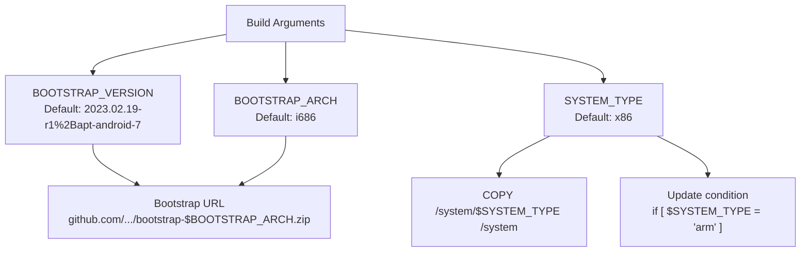

**Diagram: Build argument flow and usage**

The `SYSTEM_TYPE` argument determines which architecture-specific binaries are copied [Dockerfile:14]() and controls whether package updates run during build [Dockerfile:63](). The mapping between `BOOTSTRAP_ARCH` and `SYSTEM_TYPE` is:
- `aarch64` and `arm` → `SYSTEM_TYPE=arm`
- `i686` and `x86_64` → `SYSTEM_TYPE=x86`

**Sources:** [Dockerfile:5-7](), [Dockerfile:14](), [Dockerfile:21](), [Dockerfile:63]()

## Shell and PATH Configuration

Before any operations execute, the Dockerfile configures the execution environment:

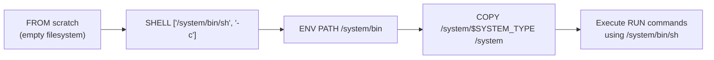

**Diagram: Initial shell configuration sequence**

The `SHELL` directive [Dockerfile:10]() sets `/system/bin/sh` as the shell for `RUN` commands, since Docker's default `/bin/sh` doesn't exist yet. The `PATH` environment variable [Dockerfile:11]() ensures system utilities like `busybox` are discoverable. These settings only apply to the bootstrap stage; the final image resets the shell [Dockerfile:88]().

**Sources:** [Dockerfile:10-11]()

## System Files and Entrypoint Scripts

The bootstrap stage begins by copying essential files into the empty filesystem:

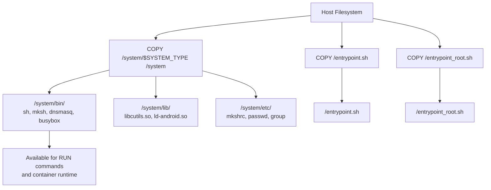

**Diagram: System file copy operations**

The `COPY` commands [Dockerfile:14-18]() populate the image with:
- **System binaries**: Architecture-specific executables including `busybox` (provides Unix utilities), `sh` and `mksh` (shells), and `dnsmasq` (DNS service)
- **System libraries**: Android runtime libraries required by system binaries
- **System configuration**: Shell configuration, user definitions, and linker settings
- **Entrypoint scripts**: Container initialization logic

These files originate from the `system/` directory in the repository, which contains separate subdirectories for x86 and ARM architectures. See [Architecture-Specific Binaries](#5.1) for details on this structure.

**Sources:** [Dockerfile:14-18]()

## Bootstrap Archive Extraction

The Dockerfile downloads and extracts the Termux bootstrap archive, which contains the complete Termux package ecosystem:

```mermaid
graph TB
    ADD["ADD https://github.com/termux/termux-packages/<br/>releases/download/bootstrap-$BOOTSTRAP_VERSION/<br/>bootstrap-$BOOTSTRAP_ARCH.zip"]
    ADD --> DOWNLOAD["/bootstrap.zip<br/>(downloaded to container)"]
    
    DOWNLOAD --> MKDIR["busybox mkdir -p<br/>/data/data/com.termux/files"]
    MKDIR --> SUBDIRS["busybox mkdir<br/>../cache ./usr ./home"]
    SUBDIRS --> UNZIP["busybox unzip -d usr /bootstrap.zip"]
    
    UNZIP --> CONTENTS["usr/ contents:<br/>bin/, lib/, include/, share/, var/, etc."]
    UNZIP --> SYMLINKS["SYMLINKS.txt<br/>(symlink instructions)"]
    
    SYMLINKS --> PARSE["Parse SYMLINKS.txt<br/>Format: dest←link"]
    PARSE --> CREATE["busybox ln -s dest link<br/>(for each entry)"]
    CREATE --> CLEAN["busybox rm SYMLINKS.txt"]
    
    CLEAN --> ROOT_LINKS["Create root-level symlinks<br/>/usr → /data/data/com.termux/files/usr<br/>/bin → /data/data/com.termux/files/usr/bin<br/>/tmp → /data/data/com.termux/files/usr/tmp"]
```

**Diagram: Bootstrap extraction and symlink creation process**

The extraction process [Dockerfile:22-36]() follows this sequence:

1. **Download**: The `ADD` instruction downloads the bootstrap ZIP directly from GitHub releases [Dockerfile:21]()
2. **Directory creation**: Creates the Android-style directory structure `/data/data/com.termux/files` and subdirectories [Dockerfile:22-24]()
3. **Extraction**: Unzips the bootstrap archive into `usr/` [Dockerfile:25]()
4. **Symlink processing**: Parses `SYMLINKS.txt` using the format `destination←link` and creates all required symlinks [Dockerfile:28-32]()
5. **Root symlinks**: Creates compatibility symlinks at filesystem root for standard Linux paths [Dockerfile:34-36]()

The bootstrap archive URL format is:
```
https://github.com/termux/termux-packages/releases/download/
  bootstrap-$BOOTSTRAP_VERSION/bootstrap-$BOOTSTRAP_ARCH.zip
```

**Sources:** [Dockerfile:21-36]()

## Busybox Utility Linking

After bootstrap extraction, the Dockerfile creates symlinks for utilities that Termux packages expect from `/system/bin`:

```mermaid
graph LR
    BB["/system/bin/busybox<br/>(multi-call binary)"]
    
    BB --> DF["/system/bin/df"]
    BB --> MOUNT["/system/bin/mount"]
    BB --> PING["/system/bin/ping"]
    BB --> PING6["/system/bin/ping6"]
    BB --> SU["/system/bin/su"]
    BB --> TOP["/system/bin/top"]
    BB --> UMOUNT["/system/bin/umount"]
    
    DF --> PKG["Required by Termux packages<br/>(termux-tools wrappers)"]
    MOUNT --> PKG
    PING --> PKG
    PING6 --> PKG
    SU --> PKG
    TOP --> PKG
    UMOUNT --> PKG
```

**Diagram: Busybox utility symlink structure**

The `RUN` command [Dockerfile:41-43]() creates symlinks for specific utilities that Termux packages reference as wrappers to system binaries. The comment [Dockerfile:39-40]() notes these correspond to utilities defined in the `termux-tools` package build script. When invoked, `busybox` detects its invocation name and executes the corresponding functionality.

**Sources:** [Dockerfile:38-43]()

## Ownership and Permission Configuration

The Dockerfile implements a strict ownership and permission model:

```mermaid
graph TD
    START["Permission Configuration Start"]
    
    START --> SYS["busybox chown -Rh 0:0 /system<br/>(root owns system files)"]
    START --> DATA["busybox chown -Rh 1000:1000<br/>/data/data/com.termux<br/>(system user owns Termux)"]
    
    SYS --> SYSDIR["Find all directories<br/>chmod 755"]
    SYSDIR --> SYSEXE["Find executables<br/>chmod 755"]
    SYSEXE --> SYSREG["Find regular files<br/>chmod 644"]
    
    DATA --> DATADIR["Find all directories<br/>chmod 755"]
    DATADIR --> DATAPERM["chmod g-rwx,o-rwx<br/>(remove group/other access)"]
    DATAPERM --> DATAEXE["chmod 700<br/>bin/, lib/apt/, libexec/"]
    
    START --> LINKS["Create /etc symlinks<br/>/etc/passwd → /system/etc/passwd<br/>/etc/group → /system/etc/group"]
    
    SYSREG --> RESULT["System: root:root 755/644"]
    DATAEXE --> RESULT2["Termux: 1000:1000 700"]
    LINKS --> RESULT
```

**Diagram: Ownership and permission configuration flow**

The permission configuration [Dockerfile:49-59]() establishes security boundaries:

| Filesystem Area | Owner | Directory Permissions | File Permissions | Purpose |
|----------------|-------|---------------------|------------------|---------|
| `/system/*` | `0:0` (root) | `755` | `755` (executable) / `644` (regular) | Read-only system binaries and configuration |
| `/data/data/com.termux/*` | `1000:1000` (system user) | `700` | `700` (executables) / `600` (regular) | User-writable Termux environment |

Key operations:
- System files receive standard Unix permissions (`755` for executables/directories, `644` for regular files) [Dockerfile:53-55]()
- Termux files remove all group and other permissions (`g-rwx,o-rwx`) [Dockerfile:57]()
- Critical executables in `bin/`, `lib/apt/`, and `libexec/` receive `700` permissions [Dockerfile:59]()
- Password and group files symlink to system locations [Dockerfile:51-52]()

This model mirrors Android's application isolation where each app runs under its own UID. See [Privilege Management](#4.3) for runtime implications.

**Sources:** [Dockerfile:45-59]()

## Package Updates

For x86-based images, the Dockerfile updates all installed packages during build:

```mermaid
graph TD
    COND{"if [ $SYSTEM_TYPE = 'arm' ]"}
    COND -->|Yes| SKIP["exit<br/>(skip updates)"]
    COND -->|No| DNS_START["Start dnsmasq:<br/>/system/bin/mksh -T /dev/ptmx -c<br/>/system/bin/dnsmasq -u root -g root"]
    
    DNS_START --> SLEEP["sleep 1<br/>(allow DNS startup)"]
    SLEEP --> APT_UPDATE["su - system -c<br/>apt update"]
    APT_UPDATE --> APT_UPGRADE["su - system -c<br/>apt upgrade -o Dpkg::Options::=<br/>--force-confnew -yq"]
    
    APT_UPGRADE --> CLEAN1["rm -rf usr/var/lib/apt/*"]
    CLEAN1 --> CLEAN2["rm -rf usr/var/log/apt/*"]
    CLEAN2 --> CLEAN3["rm -rf cache/apt/*"]
    
    SKIP --> END["Continue build"]
    CLEAN3 --> END
```

**Diagram: Conditional package update flow**

The update process [Dockerfile:63-70]() only executes for x86-based images due to seccomp profile restrictions on ARM architectures that cause package manager failures. When updates run:

1. **Start DNS service**: Launches `dnsmasq` using `mksh` with PTY support (`-T /dev/ptmx`) to provide DNS resolution [Dockerfile:64]()
2. **Update package lists**: Runs `apt update` as the system user [Dockerfile:65]()
3. **Upgrade packages**: Runs `apt upgrade` with `--force-confnew` to automatically use new configuration files [Dockerfile:66]()
4. **Clean caches**: Removes all apt cache and log files to reduce image size [Dockerfile:67-69]()

The `su - system -c` wrapper ensures package operations run as UID 1000 rather than root. For more on the DNS requirement, see [Network Services](#6.2).

**Sources:** [Dockerfile:61-70]()

## Final Image Configuration

The second stage creates the final image with minimal content:

```mermaid
graph TB
    SCRATCH["FROM scratch"]
    SCRATCH --> ENVS["Environment Variables"]
    SCRATCH --> COPY["COPY --from=bootstrap / /"]
    
    ENVS --> ANDROID_DATA["ANDROID_DATA=/data"]
    ENVS --> ANDROID_ROOT["ANDROID_ROOT=/system"]
    ENVS --> HOME["HOME=/data/data/com.termux/files/home"]
    ENVS --> LANG["LANG=en_US.UTF-8"]
    ENVS --> PATH["PATH=/data/data/com.termux/files/usr/bin"]
    ENVS --> PREFIX["PREFIX=/data/data/com.termux/files/usr"]
    ENVS --> TMPDIR["TMPDIR=/data/data/com.termux/files/usr/tmp"]
    ENVS --> TZ["TZ=UTC"]
    
    COPY --> WORKDIR["WORKDIR<br/>/data/data/com.termux/files/home"]
    WORKDIR --> SHELL["SHELL<br/>['/data/data/com.termux/files/usr/bin/sh', '-c']"]
    SHELL --> ENTRY["ENTRYPOINT ['/entrypoint.sh']"]
    ENTRY --> CMD["CMD ['/data/data/com.termux/files/usr/bin/login']"]
```

**Diagram: Final image configuration elements**

The final stage [Dockerfile:74-91]() configures the runtime environment:

### Environment Variables

| Variable | Value | Purpose |
|----------|-------|---------|
| `ANDROID_DATA` | `/data` | Android data directory root |
| `ANDROID_ROOT` | `/system` | Android system directory root |
| `HOME` | `/data/data/com.termux/files/home` | User home directory |
| `LANG` | `en_US.UTF-8` | Default locale |
| `PATH` | `/data/data/com.termux/files/usr/bin` | Termux binary search path |
| `PREFIX` | `/data/data/com.termux/files/usr` | Termux package installation prefix |
| `TMPDIR` | `/data/data/com.termux/files/usr/tmp` | Temporary file directory |
| `TZ` | `UTC` | Default timezone |

These variables [Dockerfile:76-83]() establish Android-compatible paths and configure the Termux environment. The `PREFIX` variable is particularly critical as Termux packages use it to locate binaries and libraries.

### Container Execution Configuration

- **WORKDIR**: Sets working directory to the user home directory [Dockerfile:87]()
- **SHELL**: Configures `/data/data/com.termux/files/usr/bin/sh` as the shell for `RUN` commands in derived images [Dockerfile:88]()
- **ENTRYPOINT**: Sets `/entrypoint.sh` as the container entry point [Dockerfile:90]()
- **CMD**: Defaults to `/data/data/com.termux/files/usr/bin/login` (interactive shell) if no command provided [Dockerfile:91]()

The entrypoint script handles privilege checking and service initialization. See [Entrypoint System](#4.1) for detailed execution flow.

**Sources:** [Dockerfile:74-91]()

## Filesystem Structure Created

The Dockerfile produces the following filesystem layout:

```mermaid
graph TD
    ROOT["/"]
    
    ROOT --> SYSTEM["/system/<br/>(root:root 755/644)"]
    ROOT --> DATA["/data/<br/>(partial root ownership)"]
    ROOT --> USR_LINK["/usr → symlink"]
    ROOT --> BIN_LINK["/bin → symlink"]
    ROOT --> TMP_LINK["/tmp → symlink"]
    ROOT --> ETC["/etc/"]
    
    SYSTEM --> SYS_BIN["/system/bin/<br/>sh, mksh, dnsmasq, busybox"]
    SYSTEM --> SYS_LIB["/system/lib/<br/>libcutils.so, ld-android.so"]
    SYSTEM --> SYS_ETC["/system/etc/<br/>mkshrc, passwd, group, ld.config.28.txt"]
    
    DATA --> COM["/data/data/"]
    COM --> TERMUX["/data/data/com.termux/<br/>(1000:1000 700)"]
    
    TERMUX --> CACHE["/cache/"]
    TERMUX --> FILES["/files/"]
    
    FILES --> F_USR["/files/usr/<br/>Termux packages"]
    FILES --> F_HOME["/files/home/<br/>User home"]
    
    F_USR --> U_BIN["/usr/bin/"]
    F_USR --> U_LIB["/usr/lib/"]
    F_USR --> U_SHARE["/usr/share/"]
    F_USR --> U_VAR["/usr/var/"]
    
    USR_LINK -.->|points to| F_USR
    BIN_LINK -.->|points to| U_BIN
    TMP_LINK -.->|points to| U_TMP["usr/tmp/"]
    
    ETC --> PASSWD["/etc/passwd → /system/etc/passwd"]
    ETC --> GROUP["/etc/group → /system/etc/group"]
```

**Diagram: Complete filesystem structure with ownership**

The structure combines:
- **Android system directories** (`/system/`) containing immutable binaries and libraries
- **Android application directory** (`/data/data/com.termux/`) containing the mutable Termux environment
- **Compatibility symlinks** (`/usr`, `/bin`, `/tmp`) providing standard Linux paths
- **Configuration symlinks** (`/etc/passwd`, `/etc/group`) referencing system files

All directories and files under `/data/data/com.termux/` are owned by UID 1000 (system user) with restricted permissions, while `/system/` is owned by root. See [Filesystem Layout](#7) for comprehensive details.

**Sources:** [Dockerfile:14](), [Dockerfile:22-36](), [Dockerfile:49-59]()

---

# Page: Build Scripts

# Build Scripts

<details>
<summary>Relevant source files</summary>

The following files were used as context for generating this wiki page:

- [build-all.sh](build-all.sh)

</details>


## Purpose and Scope

This document provides a detailed explanation of the `build-all.sh` script, which serves as the primary local build automation tool for creating Termux Docker images. The script handles OCI runtime selection (Docker vs Podman), architecture detection, multi-architecture image building, and optional publishing to registries.

For information about the Dockerfile that this script invokes, see [The Dockerfile](#3.1). For information about the automated CI/CD pipeline that uses similar logic, see [CI/CD Pipeline](#3.3). For details on multi-architecture execution and QEMU setup, see [Multi-Architecture Support](#5).

**Sources:** [build-all.sh:1-47]()

---

## Overview

The `build-all.sh` script provides a simplified interface for building one or more architecture-specific Termux Docker images on a local development machine. The script automatically detects the host architecture and determines which target architectures can be built natively or via emulation.

The script supports:
- Docker and Podman as OCI runtimes
- Optional privilege escalation via sudo
- Native builds for architectures supported by the host
- Automatic image tagging with architecture-specific tags
- Optional publishing to Docker Hub or other registries

**Sources:** [build-all.sh:1-47]()

---

## Script Execution Flow

The following diagram illustrates the complete execution flow of the build script, showing the sequence of operations from startup to completion:

**Diagram: Build Script Execution Sequence**

```mermaid
flowchart TD
    START["Script Start"]
    PARSE_ARGS["Parse command line arguments<br/>Lines 7-9"]
    CHECK_PODMAN{"First argument is<br/>-p or --podman?"}
    SET_DOCKER["OCI='docker'<br/>OCI_ARG=''<br/>Line 5-6"]
    SET_PODMAN["OCI='podman'<br/>OCI_ARG='--format docker'<br/>Line 8"]
    
    CHECK_SUDO{"TERMUX_DOCKER_USE_SUDO<br/>environment variable set?<br/>Line 11"}
    SET_SUDO["SUDO='sudo'<br/>Line 12"]
    SET_NO_SUDO["SUDO=''<br/>Line 14"]
    
    DETECT_ARCH["Detect host architecture<br/>uname -m<br/>Line 17"]
    SET_ARCH_VARS["Set SYSTEM_TYPE and<br/>ARCHITECTURES array<br/>Lines 18-26"]
    
    BUILD_LOOP["For each arch in ARCHITECTURES<br/>Line 28"]
    BUILD_IMAGE["Execute OCI build command<br/>Lines 29-35"]
    CHECK_PUBLISH{"First argument is<br/>'publish'?<br/>Line 36"}
    PUSH_IMAGE["Push image to registry<br/>Line 37"]
    
    CHECK_X86{"SYSTEM_TYPE == 'x86'?<br/>Line 41"}
    TAG_LATEST["Tag i686 as 'latest'<br/>Line 42"]
    CHECK_PUBLISH2{"First argument is<br/>'publish'?<br/>Line 43"}
    PUSH_LATEST["Push 'latest' tag<br/>Line 44"]
    
    END["Script Complete"]
    
    START --> PARSE_ARGS
    PARSE_ARGS --> CHECK_PODMAN
    CHECK_PODMAN -->|No| SET_DOCKER
    CHECK_PODMAN -->|Yes| SET_PODMAN
    SET_DOCKER --> CHECK_SUDO
    SET_PODMAN --> CHECK_SUDO
    
    CHECK_SUDO -->|Yes| SET_SUDO
    CHECK_SUDO -->|No| SET_NO_SUDO
    SET_SUDO --> DETECT_ARCH
    SET_NO_SUDO --> DETECT_ARCH
    
    DETECT_ARCH --> SET_ARCH_VARS
    SET_ARCH_VARS --> BUILD_LOOP
    BUILD_LOOP --> BUILD_IMAGE
    BUILD_IMAGE --> CHECK_PUBLISH
    CHECK_PUBLISH -->|Yes| PUSH_IMAGE
    CHECK_PUBLISH -->|No| BUILD_LOOP
    PUSH_IMAGE --> BUILD_LOOP
    BUILD_LOOP -->|All done| CHECK_X86
    
    CHECK_X86 -->|Yes| TAG_LATEST
    CHECK_X86 -->|No| END
    TAG_LATEST --> CHECK_PUBLISH2
    CHECK_PUBLISH2 -->|Yes| PUSH_LATEST
    CHECK_PUBLISH2 -->|No| END
    PUSH_LATEST --> END
```

**Sources:** [build-all.sh:1-47]()

---

## OCI Runtime Selection

The script supports both Docker and Podman as OCI (Open Container Initiative) runtimes. The runtime is selected via command-line arguments:

| Argument | OCI Tool | OCI_ARG Value | Purpose |
|----------|----------|---------------|---------|
| (none) | `docker` | `""` | Default runtime, standard Docker format |
| `-p` or `--podman` | `podman` | `--format docker` | Use Podman with Docker-compatible output format |

The `OCI_ARG` variable is passed to the build command when using Podman to ensure the output image format is Docker-compatible for maximum portability.

**Key Variables:**
- `OCI`: The command name to execute (`docker` or `podman`)
- `OCI_ARG`: Additional arguments passed to the OCI tool

**Sources:** [build-all.sh:5-9]()

---

## Privilege Escalation

The script supports optional privilege escalation via `sudo`, controlled by the `TERMUX_DOCKER_USE_SUDO` environment variable:

```bash
# Run with sudo
TERMUX_DOCKER_USE_SUDO=1 ./build-all.sh

# Run without sudo (default)
./build-all.sh
```

When `TERMUX_DOCKER_USE_SUDO` is set to any non-empty value, the script prefixes all OCI commands with `sudo`. This is useful when:
- The Docker daemon requires root access
- The user is not in the `docker` group
- System-level Podman operations are needed

**Implementation:**
- If `TERMUX_DOCKER_USE_SUDO` is set: `SUDO="sudo"`
- Otherwise: `SUDO=""`
- The `$SUDO` variable is then prepended to all `$OCI` commands

**Sources:** [build-all.sh:11-15]()

---

## Architecture Detection

The script uses `uname -m` to detect the host system architecture and determines which target architectures can be built. The detection logic maps host architectures to build configurations:

**Diagram: Architecture Detection Logic**

```mermaid
flowchart TD
    UNAME["Execute: uname -m<br/>Line 17"]
    
    CHECK_AARCH64{"Architecture is<br/>'aarch64'?"}
    CHECK_ARMV7{"Architecture is<br/>'armv7l' or 'armv8l'?"}
    CHECK_I686{"Architecture is<br/>'i686'?"}
    CHECK_X86_64{"Architecture is<br/>'x86_64'?"}
    
    SET_ARM_FULL["SYSTEM_TYPE='arm'<br/>ARCHITECTURES=('aarch64' 'arm')<br/>Line 18"]
    SET_ARM_32["SYSTEM_TYPE='arm'<br/>ARCHITECTURES=('arm')<br/>Line 19"]
    SET_X86_32["SYSTEM_TYPE='x86'<br/>ARCHITECTURES=('i686')<br/>Line 20"]
    SET_X86_64["SYSTEM_TYPE='x86'<br/>ARCHITECTURES=('i686' 'x86_64')<br/>Line 21"]
    
    ERROR["Echo error and exit 1<br/>Lines 23-24"]
    
    UNAME --> CHECK_AARCH64
    CHECK_AARCH64 -->|Yes| SET_ARM_FULL
    CHECK_AARCH64 -->|No| CHECK_ARMV7
    CHECK_ARMV7 -->|Yes| SET_ARM_32
    CHECK_ARMV7 -->|No| CHECK_I686
    CHECK_I686 -->|Yes| SET_X86_32
    CHECK_I686 -->|No| CHECK_X86_64
    CHECK_X86_64 -->|Yes| SET_X86_64
    CHECK_X86_64 -->|No| ERROR
```

### Architecture Mapping Table

| Host Architecture (`uname -m`) | SYSTEM_TYPE | ARCHITECTURES Array | Notes |
|-------------------------------|-------------|---------------------|-------|
| `aarch64` | `arm` | `["aarch64", "arm"]` | Can build both 64-bit and 32-bit ARM |
| `armv7l`, `armv8l` | `arm` | `["arm"]` | 32-bit ARM host, builds only 32-bit |
| `i686` | `x86` | `["i686"]` | 32-bit x86 host, builds only 32-bit |
| `x86_64` | `x86` | `["i686", "x86_64"]` | Can build both 32-bit and 64-bit x86 |

### Key Variables

- **`SYSTEM_TYPE`**: Determines which system binaries directory to use (`/system/arm/` or `/system/x86/`)
- **`ARCHITECTURES`**: Array of target architectures to build, iterated in the build loop

The script exits with an error if `uname -m` returns an unrecognized architecture.

**Sources:** [build-all.sh:17-26]()

---

## Build Loop

The core build operation iterates over each architecture in the `ARCHITECTURES` array, invoking the OCI build command with appropriate build arguments:

**Diagram: Build Loop and Parameters**

```mermaid
flowchart LR
    LOOP["for arch in ARCHITECTURES<br/>Line 28"]
    
    subgraph BUILD["Build Command Lines 29-35"]
        CMD["SUDO OCI build"]
        ARG1["OCI_ARG"]
        ARG2["-t termux/termux-docker:ARCH"]
        ARG3["-f Dockerfile"]
        ARG4["--build-arg BOOTSTRAP_ARCH=ARCH"]
        ARG5["--build-arg SYSTEM_TYPE=SYSTEM_TYPE"]
        ARG6[". (context)"]
    end
    
    CHECK{"publish argument?<br/>Line 36"}
    PUSH["SUDO OCI push<br/>termux/termux-docker:ARCH<br/>Line 37"]
    NEXT["Next iteration"]
    
    LOOP --> BUILD
    BUILD --> CHECK
    CHECK -->|Yes| PUSH
    CHECK -->|No| NEXT
    PUSH --> NEXT
    NEXT --> LOOP
```

### Build Command Structure

The build command constructed on lines 29-35 has the following structure:

```bash
$SUDO $OCI build \
    ${OCI_ARG} \
    -t 'termux/termux-docker:'"$arch" \
    -f Dockerfile \
    --build-arg BOOTSTRAP_ARCH="$arch" \
    --build-arg SYSTEM_TYPE="$SYSTEM_TYPE" \
    .
```

### Build Arguments

| Argument | Purpose | Example Values |
|----------|---------|----------------|
| `-t` | Image tag | `termux/termux-docker:aarch64`, `termux/termux-docker:i686` |
| `-f` | Dockerfile path | `Dockerfile` (in current directory) |
| `--build-arg BOOTSTRAP_ARCH` | Target architecture for bootstrap download | `aarch64`, `arm`, `i686`, `x86_64` |
| `--build-arg SYSTEM_TYPE` | System binaries directory | `arm`, `x86` |
| `.` | Build context | Current directory |

These build arguments are consumed by the Dockerfile to download the correct Termux bootstrap archive and configure the appropriate system paths.

**Sources:** [build-all.sh:28-39]()

---

## Image Tagging Strategy

After building all architectures, the script applies a special tagging rule for x86-based systems: the `i686` (32-bit) image receives the `latest` tag.

**Diagram: Image Tagging Logic**

```mermaid
flowchart TD
    CHECK_SYSTEM{"SYSTEM_TYPE == 'x86'?<br/>Line 41"}
    TAG["Tag i686 as latest:<br/>OCI tag termux/termux-docker:i686<br/>termux/termux-docker:latest<br/>Line 42"]
    CHECK_PUB{"First argument is<br/>'publish'?<br/>Line 43"}
    PUSH_LATEST["Push latest tag:<br/>OCI push termux/termux-docker:latest<br/>Line 44"]
    DONE["Continue"]
    
    CHECK_SYSTEM -->|Yes| TAG
    CHECK_SYSTEM -->|No| DONE
    TAG --> CHECK_PUB
    CHECK_PUB -->|Yes| PUSH_LATEST
    CHECK_PUB -->|No| DONE
    PUSH_LATEST --> DONE
```

### Tagging Rationale

The `i686` architecture is chosen as the `latest` tag because:
1. 32-bit x86 images have broader compatibility with older hardware
2. 32-bit containers can run on 64-bit hosts via multiarch support
3. It provides a sensible default for users who pull without specifying an architecture

### Available Tags

After a successful build on an `x86_64` host, the following image tags are available:

| Tag | Description |
|-----|-------------|
| `termux/termux-docker:i686` | 32-bit x86 image |
| `termux/termux-docker:x86_64` | 64-bit x86 image |
| `termux/termux-docker:latest` | Alias for `i686` |

On an `aarch64` host:

| Tag | Description |
|-----|-------------|
| `termux/termux-docker:aarch64` | 64-bit ARM image |
| `termux/termux-docker:arm` | 32-bit ARM image |

Note that the `latest` tag is only created for x86 systems, not ARM systems.

**Sources:** [build-all.sh:41-46]()

---

## Publishing Images

The script supports optional publishing to container registries (typically Docker Hub) via the `publish` command-line argument:

```bash
# Build and publish all images
./build-all.sh publish

# Build with Podman and publish
./build-all.sh --podman publish
```

### Publishing Behavior

When the first argument is `publish`:
1. Each architecture-specific image is pushed immediately after building (line 37)
2. The `latest` tag is pushed after tagging (line 44, x86 systems only)

### Published Image Names

All images are published under the `termux/termux-docker` repository with architecture-specific tags:
- `termux/termux-docker:aarch64`
- `termux/termux-docker:arm`
- `termux/termux-docker:i686`
- `termux/termux-docker:x86_64`
- `termux/termux-docker:latest` (x86 systems only)

The script assumes the user is already authenticated to the target registry (via `docker login` or `podman login`).

**Sources:** [build-all.sh:36-38](), [build-all.sh:43-45]()

---

## Usage Examples

### Basic Build (Docker)

```bash
# Build all architectures supported by current host
./build-all.sh
```

### Build with Podman

```bash
# Use Podman instead of Docker
./build-all.sh --podman
```

### Build and Publish

```bash
# Build and push to registry
./build-all.sh publish
```

### Build with Sudo

```bash
# Run with sudo for all OCI commands
TERMUX_DOCKER_USE_SUDO=1 ./build-all.sh
```

### Combined Options

```bash
# Use Podman with sudo and publish
TERMUX_DOCKER_USE_SUDO=1 ./build-all.sh --podman publish
```

**Sources:** [build-all.sh:1-47]()

---

## Error Handling

The script uses `set -e` at line 3, which causes immediate exit if any command returns a non-zero exit code. This ensures:
- Build failures are immediately detected
- The script doesn't continue with partial builds
- Exit codes properly propagate to calling processes (e.g., CI/CD systems)

The only explicit error handling is for unrecognized architectures, where the script prints an error message and exits with code 1.

**Sources:** [build-all.sh:3](), [build-all.sh:22-25]()

---

## Relationship to CI/CD Pipeline

The `build-all.sh` script provides the foundation for local development builds. The CI/CD pipeline (see [CI/CD Pipeline](#3.3)) implements similar logic but with additional features:
- Matrix builds across all four architectures in parallel
- QEMU setup for cross-architecture builds
- GitHub artifact uploads
- Automated publishing on master branch merges

The script serves as both:
1. A standalone tool for developers to build images locally
2. A reference implementation that informs the CI/CD workflow design

**Sources:** [build-all.sh:1-47]()

---

# Page: CI/CD Pipeline

# CI/CD Pipeline

<details>
<summary>Relevant source files</summary>

The following files were used as context for generating this wiki page:

- [.github/dependabot.yml](.github/dependabot.yml)
- [.github/workflows/docker_build.yml](.github/workflows/docker_build.yml)

</details>


## Purpose and Scope

This document describes the automated Continuous Integration and Continuous Deployment (CI/CD) system that builds and publishes termux-docker images. The pipeline is implemented as a GitHub Actions workflow that automatically builds Docker images for four CPU architectures, executes validation tests, and publishes successful builds to Docker Hub.

For details about the Dockerfile structure used by the build process, see [The Dockerfile](#3.1). For information about the manual build script (`build-all.sh`), see [Build Scripts](#3.2). For details about QEMU emulation mechanics, see [Cross-Platform Execution](#5.2).

**Sources:** [.github/workflows/docker_build.yml:1-85]()

---

## Workflow Overview

The CI/CD pipeline is defined in `.github/workflows/docker_build.yml` and is named **"Build and push Docker image"**. The workflow executes on multiple trigger events, providing both automated and manual build capabilities.

### Trigger Events

The workflow responds to four distinct trigger mechanisms:

| Trigger Type | Configuration | Purpose |
|-------------|---------------|---------|
| **Push to master** | `on.push.branches: [master]` | Automatic build and publish when changes are merged |
| **Pull Request** | `on.pull_request` | Validation builds for all PRs without publishing |
| **Weekly Schedule** | `on.schedule: '0 2 * * 0'` | Automated weekly rebuilds every Sunday at 02:00 UTC |
| **Manual Dispatch** | `on.workflow_dispatch` | On-demand builds triggered through GitHub UI |

The schedule trigger ensures images remain up-to-date with the latest Termux bootstrap archives even when no code changes occur. Pull request builds provide validation without publishing to Docker Hub.

**Sources:** [.github/workflows/docker_build.yml:3-10]()

### Global Environment Variables

The workflow sets two global environment variables that affect all jobs:

- `CI=true` - Signals that the build is running in a CI environment
- `DOCKER_BUILDKIT=1` - Enables Docker BuildKit for improved build performance and features

**Sources:** [.github/workflows/docker_build.yml:12-14]()

---

## Build Matrix Strategy

The workflow employs a **matrix build strategy** to generate images for all supported CPU architectures in parallel. This approach significantly reduces total build time compared to sequential builds.

### Matrix Configuration

The `main` job defines a single matrix dimension `CPU_ARCH` with four values:

```yaml
strategy:
  matrix:
    CPU_ARCH:
      - aarch64
      - arm
      - i686
      - x86_64
```

This configuration spawns four parallel job instances, each building for a specific architecture. GitHub Actions executes all matrix jobs concurrently on separate runners, limited only by available runner capacity.

**Sources:** [.github/workflows/docker_build.yml:16-25]()

### Platform Mapping Logic

Each matrix value is mapped to the appropriate Docker platform identifier during the build step:

| `CPU_ARCH` | `SYSTEM_TYPE` | `PLATFORM_TAG` | Architecture Description |
|-----------|---------------|----------------|-------------------------|
| `arm` | `arm` | `linux/arm/v7` | 32-bit ARMv7 |
| `aarch64` | `arm` | `linux/arm64` | 64-bit ARM (ARMv8) |
| `i686` | `x86` | `linux/386` | 32-bit x86 |
| `x86_64` | `x86` | `linux/amd64` | 64-bit x86-64 |

The `SYSTEM_TYPE` variable determines which system binaries are used (from `/system/arm/` or `/system/x86/`), while `PLATFORM_TAG` specifies the target platform for Docker BuildX.

**Sources:** [.github/workflows/docker_build.yml:37-42]()

---

## Workflow Execution Diagram

```mermaid
flowchart TD
    Trigger["Workflow Trigger<br/>(push/PR/schedule/manual)"]
    Clone["Step: Clone repository<br/>actions/checkout@v4"]
    MatrixSplit{"Matrix Strategy<br/>Split into 4 jobs"}
    
    subgraph "Matrix Job: aarch64"
        BinfmtARM64["Step: Setup binfmt_misc<br/>docker run aptman/qus"]
        BuildARM64["Step: Build images<br/>docker buildx build<br/>--platform linux/arm64"]
        LoginARM64["Step: Login to Docker Hub<br/>(conditional)"]
        PushARM64["Step: Push to Docker Hub<br/>docker push :aarch64"]
        ExportARM64["Step: Export container<br/>docker export .tar"]
        ArtifactARM64["Step: Store tar archive<br/>actions/upload-artifact@v5"]
    end
    
    subgraph "Matrix Job: arm"
        BinfmtARM["Step: Setup binfmt_misc<br/>docker run aptman/qus"]
        BuildARM["Step: Build images<br/>docker buildx build<br/>--platform linux/arm/v7"]
        LoginARM["Step: Login to Docker Hub<br/>(conditional)"]
        PushARM["Step: Push to Docker Hub<br/>docker push :arm"]
        ExportARM["Step: Export container<br/>docker export .tar"]
        ArtifactARM["Step: Store tar archive<br/>actions/upload-artifact@v5"]
    end
    
    subgraph "Matrix Job: i686"
        BuildI686["Step: Build images<br/>docker buildx build<br/>--platform linux/386"]
        LoginI686["Step: Login to Docker Hub<br/>(conditional)"]
        PushI686["Step: Push to Docker Hub<br/>docker push :i686<br/>+ docker tag/push :latest"]
        ExportI686["Step: Export container<br/>docker export .tar"]
        ArtifactI686["Step: Store tar archive<br/>actions/upload-artifact@v5"]
    end
    
    subgraph "Matrix Job: x86_64"
        BuildX64["Step: Build images<br/>docker buildx build<br/>--platform linux/amd64"]
        LoginX64["Step: Login to Docker Hub<br/>(conditional)"]
        PushX64["Step: Push to Docker Hub<br/>docker push :x86_64"]
        ExportX64["Step: Export container<br/>docker export .tar"]
        ArtifactX64["Step: Store tar archive<br/>actions/upload-artifact@v5"]
    end
    
    Trigger --> Clone
    Clone --> MatrixSplit
    
    MatrixSplit --> BinfmtARM64
    MatrixSplit --> BinfmtARM
    MatrixSplit --> BuildI686
    MatrixSplit --> BuildX64
    
    BinfmtARM64 --> BuildARM64
    BuildARM64 --> LoginARM64
    LoginARM64 --> PushARM64
    PushARM64 --> ExportARM64
    ExportARM64 --> ArtifactARM64
    
    BinfmtARM --> BuildARM
    BuildARM --> LoginARM
    LoginARM --> PushARM
    PushARM --> ExportARM
    ExportARM --> ArtifactARM
    
    BuildI686 --> LoginI686
    LoginI686 --> PushI686
    PushI686 --> ExportI686
    ExportI686 --> ArtifactI686
    
    BuildX64 --> LoginX64
    LoginX64 --> PushX64
    PushX64 --> ExportX64
    ExportX64 --> ArtifactX64
```

This diagram shows how the workflow splits into four parallel execution paths after repository cloning. ARM-based builds require QEMU setup, while x86 builds execute natively on the Ubuntu runner.

**Sources:** [.github/workflows/docker_build.yml:1-85]()

---

## Detailed Step Analysis

### Step 1: Clone Repository

```yaml
- name: Clone repository
  uses: actions/checkout@v4
```

Uses GitHub's official checkout action to clone the repository at the triggering commit. This provides the `Dockerfile` and all necessary build context files.

**Sources:** [.github/workflows/docker_build.yml:28-29]()

### Step 2: Setup binfmt_misc (ARM Only)

```yaml
- name: Setup binfmt_misc
  if: (matrix.CPU_ARCH == 'aarch64') || (matrix.CPU_ARCH == 'arm')
  run: docker run --rm --privileged aptman/qus -s -- -p aarch64 arm
```

This step executes conditionally only for ARM architectures (`aarch64` and `arm`). The `aptman/qus` container configures the host's `binfmt_misc` kernel module to recognize ARM binaries and execute them through QEMU user-mode emulation. The `-p aarch64 arm` flags register handlers for both 32-bit and 64-bit ARM executables.

**Why needed:** GitHub Actions runners are x86_64 systems. To build ARM images, the host must be able to execute ARM binaries during the Docker build process (e.g., when running commands inside the container during image construction).

**Sources:** [.github/workflows/docker_build.yml:31-33]()

### Step 3: Build Images

```yaml
- name: Build images
  run: |
    case '${{ matrix.CPU_ARCH }}' in
      arm)     SYSTEM_TYPE=arm; PLATFORM_TAG="linux/arm/v7";;
      aarch64) SYSTEM_TYPE=arm; PLATFORM_TAG="linux/arm64";;
      i686)    SYSTEM_TYPE=x86; PLATFORM_TAG="linux/386";;
      *)       SYSTEM_TYPE=x86; PLATFORM_TAG="linux/amd64";;
    esac
    docker buildx build -t \
      termux/termux-docker:${{ matrix.CPU_ARCH }} \
      --platform "$PLATFORM_TAG" \
      --build-arg BOOTSTRAP_ARCH=${{ matrix.CPU_ARCH }} \
      --build-arg SYSTEM_TYPE="${SYSTEM_TYPE}" \
      .
```

This step performs the actual Docker image build using Docker BuildX. Key components:

- **Shell case statement**: Maps `matrix.CPU_ARCH` to appropriate `SYSTEM_TYPE` and `PLATFORM_TAG` values
- **`docker buildx build`**: Uses BuildX for enhanced multi-platform build capabilities
- **`-t termux/termux-docker:${{ matrix.CPU_ARCH }}`**: Tags the image with the architecture-specific name
- **`--platform "$PLATFORM_TAG"`**: Specifies the target platform for the build
- **`--build-arg BOOTSTRAP_ARCH`**: Passed to Dockerfile to download correct bootstrap archive
- **`--build-arg SYSTEM_TYPE`**: Passed to Dockerfile to select correct system binaries directory
- **`.`**: Build context is the repository root

The build arguments are consumed by the Dockerfile's `ARG` directives to customize the build for each architecture.

**Sources:** [.github/workflows/docker_build.yml:35-48]()

### Step 4: Login to Docker Hub

```yaml
- name: Login to Docker Hub
  if: github.ref == 'refs/heads/master' && github.event_name != 'pull_request' && github.repository == 'termux/termux-docker'
  uses: docker/login-action@v3
  with:
    username: grimler
    password: ${{ secrets.GRIMLER_DOCKER_TOKEN }}
```

Authenticates with Docker Hub using stored credentials. This step only executes when all three conditions are met:

1. `github.ref == 'refs/heads/master'` - Build is from the master branch
2. `github.event_name != 'pull_request'` - Not a pull request build
3. `github.repository == 'termux/termux-docker'` - Running in the official repository (not a fork)

The username `grimler` is hardcoded, while the password is retrieved from GitHub Secrets (`GRIMLER_DOCKER_TOKEN`). This ensures pull request builds and fork builds cannot publish to Docker Hub.

**Sources:** [.github/workflows/docker_build.yml:50-55]()

### Step 5: Push to Docker Hub

```yaml
- name: Push to Docker Hub
  if: github.ref == 'refs/heads/master' && github.event_name != 'pull_request' && github.repository == 'termux/termux-docker'
  run: |
    docker push termux/termux-docker:${{ matrix.CPU_ARCH }}
    if [ ${{ matrix.CPU_ARCH }} = i686 ]; then
      docker tag termux/termux-docker:i686 termux/termux-docker:latest
      docker push termux/termux-docker:latest
    fi
```

Publishes the built image to Docker Hub, using the same conditional logic as the login step. The push logic includes special handling for the `i686` architecture:

1. All architectures push their architecture-specific tag (`:aarch64`, `:arm`, `:i686`, `:x86_64`)
2. The `i686` build additionally tags and pushes as `:latest`

This makes `termux/termux-docker:latest` equivalent to `termux/termux-docker:i686`, providing a sensible default for users who don't specify an architecture.

**Sources:** [.github/workflows/docker_build.yml:57-64]()

### Step 6: Export Container as Tar Archive

```yaml
- name: Export container as tar archive
  if: always()
  run: |
    docker run \
      --privileged \
      --name termux-docker-${{ matrix.CPU_ARCH }} \
      termux/termux-docker:${{ matrix.CPU_ARCH }} \
      uname -a
    docker stop termux-docker-${{ matrix.CPU_ARCH }}
    docker export -o termux-docker-${{ matrix.CPU_ARCH }}.tar \
      termux-docker-${{ matrix.CPU_ARCH }}
    sha256sum termux-docker-${{ matrix.CPU_ARCH }}.tar
```

This step creates a tar archive of the built container, executing unconditionally (`if: always()`) even if previous steps failed. The process:

1. **Run the container**: Executes `uname -a` to verify the container starts successfully and to display architecture information
2. **Stop the container**: Halts the running container
3. **Export to tar**: Uses `docker export` to create a filesystem archive of the stopped container
4. **Generate checksum**: Computes SHA-256 hash for integrity verification

The `--privileged` flag allows the container to start services like dnsmasq that require elevated capabilities.

**Sources:** [.github/workflows/docker_build.yml:66-77]()

### Step 7: Store Tar Archive

```yaml
- name: Store tar archive
  if: always()
  uses: actions/upload-artifact@v5
  with:
    name: termux-docker-${{ matrix.CPU_ARCH }}-${{ github.sha }}
    path: termux-docker-${{ matrix.CPU_ARCH }}.tar
```

Uploads the tar archive as a GitHub Actions artifact, making it available for download from the workflow run page. The artifact name includes both the architecture and the commit SHA for uniqueness. This step also runs unconditionally (`if: always()`), ensuring artifacts are available even if the Docker Hub push failed.

**Sources:** [.github/workflows/docker_build.yml:79-84]()

---

## Publishing Decision Flow

```mermaid
flowchart TD
    BuildComplete["Image Build Complete<br/>termux/termux-docker:CPU_ARCH"]
    
    CheckRef{"github.ref ==<br/>'refs/heads/master'?"}
    CheckEvent{"github.event_name !=<br/>'pull_request'?"}
    CheckRepo{"github.repository ==<br/>'termux/termux-docker'?"}
    
    Login["Execute: Login to Docker Hub<br/>docker/login-action@v3<br/>username: grimler"]
    
    PushArch["Execute: docker push<br/>termux/termux-docker:CPU_ARCH"]
    
    CheckI686{"CPU_ARCH == 'i686'?"}
    
    TagLatest["Execute: docker tag<br/>termux/termux-docker:i686<br/>termux/termux-docker:latest"]
    
    PushLatest["Execute: docker push<br/>termux/termux-docker:latest"]
    
    SkipPush["Skip: Push to Docker Hub<br/>(step skipped)"]
    
    ExportTar["Execute: docker export<br/>termux-docker-CPU_ARCH.tar<br/>(always runs)"]
    
    BuildComplete --> CheckRef
    CheckRef -->|No| SkipPush
    CheckRef -->|Yes| CheckEvent
    CheckEvent -->|No| SkipPush
    CheckEvent -->|Yes| CheckRepo
    CheckRepo -->|No| SkipPush
    CheckRepo -->|Yes| Login
    
    Login --> PushArch
    PushArch --> CheckI686
    
    CheckI686 -->|Yes| TagLatest
    CheckI686 -->|No| ExportTar
    
    TagLatest --> PushLatest
    PushLatest --> ExportTar
    
    SkipPush --> ExportTar
```

This diagram illustrates the conditional logic that determines whether images are pushed to Docker Hub. The three-condition check ensures that only builds from the official repository's master branch (excluding pull requests) are published. The special `latest` tag assignment to `i686` provides a default architecture for users.

**Sources:** [.github/workflows/docker_build.yml:50-64]()

---

## Build Artifact System

Every workflow run produces four tar archives (one per architecture), regardless of whether the Docker Hub push succeeds. These artifacts serve multiple purposes:

### Artifact Naming Convention

Artifacts follow the naming pattern:
```
termux-docker-{CPU_ARCH}-{COMMIT_SHA}.tar
```

Examples:
- `termux-docker-aarch64-a1b2c3d4e5f6...tar`
- `termux-docker-i686-a1b2c3d4e5f6...tar`

The commit SHA ensures artifacts from different commits don't collide, while the architecture identifier allows users to select the appropriate build.

### Artifact Contents

Each tar archive contains:
- Complete container filesystem (generated by `docker export`)
- All Termux packages and system files
- Configuration files with proper ownership

These archives can be imported directly using `docker import`:
```bash
docker import termux-docker-aarch64-abc123.tar my-termux:aarch64
```

### Artifact Persistence

GitHub Actions stores artifacts for 90 days (default retention period). Users can download artifacts from:
- The "Summary" tab of any workflow run
- The GitHub CLI: `gh run download {run-id}`
- The GitHub REST API

**Sources:** [.github/workflows/docker_build.yml:66-84]()

---

## Execution Environment

### Runner Configuration

All jobs execute on `ubuntu-latest` runners provided by GitHub Actions. As of this writing, these are Ubuntu 22.04 x86_64 systems with Docker pre-installed.

**Sources:** [.github/workflows/docker_build.yml:18]()

### Concurrency and Parallelism

The matrix strategy spawns four concurrent jobs (one per architecture). GitHub's runner allocation determines actual parallelism:
- Free tier: Limited concurrent runners
- Paid plans: Higher concurrency limits
- Public repositories: Enhanced runner availability

All four jobs typically execute in parallel for this repository, completing all builds simultaneously rather than sequentially.

---

## Cross-Architecture Build Summary

| Architecture | Native on x86_64 Runner? | Emulation Required | Emulation Method |
|-------------|-------------------------|-------------------|------------------|
| `x86_64` | Yes | No | Native execution |
| `i686` | Yes (32-bit compatible) | No | Native execution |
| `aarch64` | No | Yes | QEMU via binfmt_misc |
| `arm` | No | Yes | QEMU via binfmt_misc |

The x86 architectures build quickly with native execution, while ARM builds incur performance overhead from QEMU emulation. Despite emulation overhead, the parallel matrix strategy ensures total workflow time is dominated by the slowest single job rather than the sum of all jobs.

**Sources:** [.github/workflows/docker_build.yml:31-33](), [.github/workflows/docker_build.yml:37-42]()

---

## Dependabot Integration

The repository includes Dependabot configuration for automated dependency updates:

```yaml
version: 2
updates:
- package-ecosystem: github-actions
  directory: /
  schedule:
    interval: daily
```

This configuration instructs Dependabot to check for updates to GitHub Actions versions daily (specifically `actions/checkout` and `docker/login-action`). When updates are available, Dependabot automatically creates pull requests to upgrade action versions, ensuring the workflow uses the latest stable versions with security patches.

**Sources:** [.github/dependabot.yml:1-7]()

---

# Page: Container Runtime

# Container Runtime

<details>
<summary>Relevant source files</summary>

The following files were used as context for generating this wiki page:

- [Dockerfile](Dockerfile)
- [entrypoint.sh](entrypoint.sh)
- [entrypoint_root.sh](entrypoint_root.sh)
- [system/arm/bin/mksh](system/arm/bin/mksh)
- [system/x86/bin/mksh](system/x86/bin/mksh)

</details>


## Purpose and Scope

This document provides an overview of the container runtime behavior in termux-docker: the initialization sequence that occurs when a container starts, how the system determines execution mode, and the path from container creation to an interactive user session. For detailed information about the entrypoint scripts themselves, see [Entrypoint System](#4.1). For specifics on dnsmasq service management, see [Service Initialization](#4.2). For the security model and user switching mechanism, see [Privilege Management](#4.3).

## Container Startup Overview

When a Docker container starts from a termux-docker image, the runtime system follows a deterministic initialization path controlled by the container's entrypoint. The Dockerfile defines two key directives that govern this behavior:

| Directive | Value | Purpose |
|-----------|-------|---------|
| `ENTRYPOINT` | `/entrypoint.sh` | Primary initialization script, always executed |
| `CMD` | `/data/data/com.termux/files/usr/bin/login` | Default command if user provides no arguments |

The entrypoint script acts as PID 1 inside the container and is responsible for system initialization before transferring control to the user's requested command or interactive shell.

Sources: [Dockerfile:90-91]()

## Initialization Sequence

The container initialization follows a privilege-aware path determined by the effective user ID at startup. The following diagram illustrates the complete flow from container start to command execution:

```mermaid
flowchart TD
    START["Container Start<br/>(Docker/Podman)"]
    ENTRYPOINT["/entrypoint.sh<br/>PID 1"]
    IDCHECK{"id -u == 0<br/>(Root check)"}
    
    subgraph "Root Execution Path"
        DNSCHECK{"/system/bin/busybox pidof dnsmasq<br/>(Service check)"}
        STARTDNS["/system/bin/mksh -T /dev/ptmx -c<br/>/system/bin/dnsmasq -u root -g root"]
        SLEEP["sleep 1"]
        DNSVERIFY{"/system/bin/busybox pidof dnsmasq<br/>(Verify started)"}
        WARNFAIL["echo 'Failed to start dnsmasq'"]
        SETUPCMD["Set default CMD if none provided"]
        SUEXEC["/system/bin/su -s .../env system<br/>(Drop to UID 1000)"]
    end
    
    subgraph "Non-Root Execution Path"
        WARNNODNS["echo 'Container is running as non-root'"]
        ARGCHECK{"argc >= 1<br/>(Args provided?)"}
        DIRECTEXEC["exec command"]
        DIRECTLOGIN["exec /data/.../usr/bin/login"]
    end
    
    USERCMD["User Command<br/>or /usr/bin/login"]
    
    START --> ENTRYPOINT
    ENTRYPOINT --> IDCHECK
    
    IDCHECK -->|"UID 0"| DNSCHECK
    IDCHECK -->|"UID != 0"| WARNNODNS
    
    DNSCHECK -->|"Not running"| STARTDNS
    DNSCHECK -->|"Already running"| SETUPCMD
    STARTDNS --> SLEEP
    SLEEP --> DNSVERIFY
    DNSVERIFY -->|"Failed"| WARNFAIL
    DNSVERIFY -->|"Success"| SETUPCMD
    WARNFAIL --> SETUPCMD
    SETUPCMD --> SUEXEC
    SUEXEC --> USERCMD
    
    WARNNODNS --> ARGCHECK
    ARGCHECK -->|"Yes"| DIRECTEXEC
    ARGCHECK -->|"No"| DIRECTLOGIN
    DIRECTEXEC --> USERCMD
    DIRECTLOGIN --> USERCMD
```

**Initialization Sequence Flow: Code-Level View**

This diagram shows the actual code paths and decision points in `/entrypoint.sh`, mapping system behavior to specific script constructs.

Sources: [entrypoint.sh:3-34](), [Dockerfile:90-91]()

## Execution Modes

The container runtime supports two distinct execution modes based on the effective user ID at startup. The mode determines which initialization path is taken and what system services are available.

### Root Mode (UID 0)

When the container starts as root, the entrypoint performs full system initialization:

1. **Service Check**: Queries `dnsmasq` process status using `/system/bin/busybox pidof dnsmasq`
2. **Service Start**: If not running, launches `dnsmasq` through `mksh` with PTY allocation
3. **Verification**: Waits 1 second and re-checks service status
4. **Privilege Drop**: Uses `/system/bin/su` to switch to the `system` user (UID 1000)
5. **Environment Preservation**: Passes through critical environment variables via `su -s .../env`
6. **Command Execution**: Executes the user's command or default login shell

The privilege drop ensures that user-facing processes do not run with elevated permissions, following the principle of least privilege.

### Non-Root Mode (UID != 0)

When the container starts as a non-root user, the entrypoint takes a simplified path:

1. **DNS Warning**: Emits a warning that `dnsmasq` cannot be started
2. **Direct Execution**: Bypasses all service initialization
3. **Command Execution**: Directly executes the requested command or login shell

This mode sacrifices DNS resolution capability for environments where root access is restricted or not desired.

Sources: [entrypoint.sh:3-18]()

## Default Command Behavior

The Dockerfile specifies `/data/data/com.termux/files/usr/bin/login` as the default `CMD`. This is the Termux login binary, which provides an interactive shell session with proper environment setup. The entrypoint script ensures this default is used when no command is provided:

```mermaid
graph LR
    subgraph "Argument Handling Logic"
        ARGTEST{"argc < 1<br/>entrypoint.sh:20"}
        SETDEFAULT["set -- /data/.../usr/bin/login<br/>entrypoint.sh:21"]
        EXEC["exec command<br/>entrypoint.sh:24 or 34"]
    end
    
    USERARGS["User-provided args<br/>(docker run ... CMD)"]
    NOARGS["No args<br/>(docker run ...)"]
    
    USERARGS --> EXEC
    NOARGS --> ARGTEST
    ARGTEST -->|"True"| SETDEFAULT
    SETDEFAULT --> EXEC
```

**Command Resolution Path**

This ensures users get an interactive shell by default while allowing them to override with custom commands like `docker run termux/termux-docker bash` or `docker run termux/termux-docker apt update`.

Sources: [entrypoint.sh:20-22](), [Dockerfile:91]()

## Runtime Environment Variables

The container runtime establishes a comprehensive set of environment variables required by Termux and Android components. These variables are set at image build time and preserved through the privilege drop:

| Variable | Value | Purpose |
|----------|-------|---------|
| `ANDROID_DATA` | `/data` | Android data directory root |
| `ANDROID_ROOT` | `/system` | Android system directory root |
| `HOME` | `/data/data/com.termux/files/home` | User home directory |
| `LANG` | `en_US.UTF-8` | Locale setting |
| `PATH` | `/data/data/com.termux/files/usr/bin` | Executable search path |
| `PREFIX` | `/data/data/com.termux/files/usr` | Termux installation prefix |
| `TMPDIR` | `/data/data/com.termux/files/usr/tmp` | Temporary file directory |
| `TZ` | `UTC` | Timezone setting |

The entrypoint script explicitly passes these variables through the `su` command using the `-i` flag and explicit variable assignments to ensure they survive the privilege transition.

Sources: [Dockerfile:76-83](), [entrypoint.sh:24-34]()

## Component Interaction at Runtime

The following diagram shows how the entrypoint script interacts with system components during container initialization:

```mermaid
graph TB
    subgraph "Entrypoint Script"
        ES["/entrypoint.sh<br/>Shell: /system/bin/sh"]
    end
    
    subgraph "System Utilities"
        BB_ID["/system/bin/busybox<br/>Command: id -u"]
        BB_PIDOF["/system/bin/busybox<br/>Command: pidof dnsmasq"]
        MKSH["/system/bin/mksh<br/>Flag: -T /dev/ptmx"]
        SU["/system/bin/su<br/>Target: system user"]
    end
    
    subgraph "Services"
        DNSMASQ["/system/bin/dnsmasq<br/>Flags: -u root -g root --pid-file"]
    end
    
    subgraph "User Space"
        ENV["/data/.../usr/bin/env<br/>Environment setup"]
        LOGIN["/data/.../usr/bin/login<br/>Interactive shell"]
        USERCMD["User Command<br/>(if provided)"]
    end
    
    ES -->|"Check UID"| BB_ID
    ES -->|"Query service"| BB_PIDOF
    ES -->|"Launch with PTY"| MKSH
    MKSH -->|"Spawn"| DNSMASQ
    ES -->|"Drop privileges"| SU
    SU -->|"Setup env"| ENV
    ENV -->|"Default CMD"| LOGIN
    ENV -->|"Or execute"| USERCMD
```

**Runtime Component Dependencies**

This diagram maps the actual executables and their invocation patterns, showing how `/entrypoint.sh` orchestrates system initialization using specific binaries from `/system/bin/`.

Sources: [entrypoint.sh:3-34]()

## Alternative Root Entrypoint

The system includes an alternative entrypoint at `/entrypoint_root.sh` designed for scenarios where maintaining root privileges throughout execution is required. Unlike the default entrypoint, this variant:

1. **Enforces Root**: Exits with error if not started as UID 0
2. **Starts Services**: Initializes `dnsmasq` if not running
3. **No Privilege Drop**: Executes commands directly as root

This entrypoint can be selected using Docker's `--entrypoint` flag:

```
docker run --entrypoint /entrypoint_root.sh termux/termux-docker command
```

Sources: [entrypoint_root.sh:1-20]()

## Runtime Lifecycle Summary

The complete container lifecycle from startup to termination follows this pattern:

```mermaid
stateDiagram-v2
    [*] --> ContainerCreated
    
    state ContainerCreated {
        [*] --> EntrypointExec
        note left of EntrypointExec
            Docker spawns /entrypoint.sh
            as PID 1 with inherited UID
        end note
    }
    
    state EntrypointExec {
        [*] --> PrivilegeCheck
        PrivilegeCheck --> RootInit: UID 0
        PrivilegeCheck --> UserInit: UID != 0
        
        state RootInit {
            [*] --> ServiceMgmt
            ServiceMgmt --> PrivDrop
            note right of ServiceMgmt
                Start dnsmasq if needed
                Verify operation
            end note
        }
        
        state UserInit {
            [*] --> SkipServices
            note right of SkipServices
                Warn about DNS unavailability
                Proceed directly to exec
            end note
        }
        
        RootInit --> CommandExec
        UserInit --> CommandExec
        PrivDrop --> CommandExec
    }
    
    state CommandExec {
        [*] --> RunningProcess
        note left of RunningProcess
            User command or /usr/bin/login
            Running as UID 1000 (root mode)
            or original UID (non-root mode)
        end note
    }
    
    EntrypointExec --> CommandExec
    CommandExec --> [*]: Process exits
```

**Container Lifecycle State Transitions**

The entrypoint script's `exec` call at the end replaces the script process with the user command, making that command PID 1 and allowing clean signal handling and shutdown.

Sources: [entrypoint.sh:14-34](), [entrypoint_root.sh:16-20]()

---

# Page: Entrypoint System

# Entrypoint System

<details>
<summary>Relevant source files</summary>

The following files were used as context for generating this wiki page:

- [entrypoint.sh](entrypoint.sh)
- [system/arm/bin/mksh](system/arm/bin/mksh)
- [system/x86/bin/mksh](system/x86/bin/mksh)

</details>


## Purpose and Scope

This document describes the container entrypoint system, which is the first script executed when a termux-docker container starts. The entrypoint is responsible for detecting the container's privilege level, initializing system services, and launching the user's command or shell with appropriate permissions.

The entrypoint system consists of a single shell script (`entrypoint.sh`) that implements a privilege-aware initialization sequence. For details on specific services started by the entrypoint, see [Service Initialization](#4.2). For an explanation of the privilege model and user configuration, see [Privilege Management](#4.3).

**Sources:** [entrypoint.sh:1-35]()

---

## System Overview

The entrypoint system implements a conditional initialization strategy based on the effective user ID of the container process. It follows this high-level logic:

1. **Privilege Detection**: Check if the container is running as root (UID 0)
2. **Service Initialization**: If root, start system services (dnsmasq)
3. **Privilege Dropping**: If root, drop to the `system` user (UID 1000)
4. **Command Execution**: Execute the user's command or default login shell

The entrypoint ensures that user processes never run as root, even when the container starts with root privileges. This maintains security isolation while allowing privileged service initialization.

**Sources:** [entrypoint.sh:1-35]()

---

## Entrypoint Execution Flow

The following state diagram illustrates the complete execution flow through the entrypoint script:

**Execution Flow State Diagram**

```mermaid
stateDiagram-v2
    [*] --> CheckUID
    
    CheckUID --> RootPath: id_u_equals_0
    CheckUID --> NonRootPath: id_u_not_0
    
    state RootPath {
        [*] --> CheckDnsmasqPID
        CheckDnsmasqPID --> StartDnsmasq: pidof_returns_empty
        CheckDnsmasqPID --> SetDefaultCmd: pidof_returns_pid
        
        StartDnsmasq --> Sleep1Sec
        Sleep1Sec --> VerifyDnsmasq
        VerifyDnsmasq --> WarnFailure: pidof_still_empty
        VerifyDnsmasq --> SetDefaultCmd: pidof_returns_pid
        WarnFailure --> SetDefaultCmd
        
        SetDefaultCmd --> CheckArgsCount
        CheckArgsCount --> UseLoginDefault: args_lt_1
        CheckArgsCount --> UseProvidedCmd: args_ge_1
        UseLoginDefault --> ExecViaSu
        UseProvidedCmd --> ExecViaSu
    }
    
    state NonRootPath {
        [*] --> WarnNoDNS
        WarnNoDNS --> CheckArgsNonRoot
        CheckArgsNonRoot --> ExecProvidedDirect: args_ge_1
        CheckArgsNonRoot --> ExecLoginDirect: args_lt_1
    }
    
    RootPath --> [*]
    NonRootPath --> [*]
```

This diagram maps directly to the code structure in `entrypoint.sh`. The root path encompasses lines 3-34, while the non-root path is lines 11-18.

**Sources:** [entrypoint.sh:1-35]()

---

## Code Structure Mapping

The entrypoint script is organized into distinct functional blocks that correspond to the execution flow:

| Line Range | Code Block | Purpose | Key Commands |
|------------|------------|---------|--------------|
| [3]() | Privilege Detection | Check if running as root | `id -u` |
| [4-10]() | Service Startup (Root) | Initialize dnsmasq service | `busybox pidof`, `mksh`, `dnsmasq` |
| [11-18]() | Non-Root Handler | Handle non-privileged execution | `exec` |
| [20-22]() | Default Command Setup | Set login as default if no args | `set --` |
| [24-34]() | Privilege Drop & Exec | Drop to system user and execute | `su`, `env` |

**Sources:** [entrypoint.sh:3-34]()

---

## Privilege Detection

The entrypoint's first action is to determine the container's privilege level by checking the effective user ID:

```
if [ "$(id -u)" = "0" ]; then
```

This single conditional at [entrypoint.sh:3]() branches the entire initialization sequence. The `id -u` command returns the numeric UID of the current process. If the value is `0`, the container is running as root and can perform privileged operations like starting network services.

The result of this check determines two fundamentally different execution paths:
- **Root path**: Full initialization with services, followed by privilege dropping
- **Non-root path**: Direct execution with DNS unavailability warning

**Sources:** [entrypoint.sh:3]()

---

## Root Mode Operation

When the container starts as root, the entrypoint performs a multi-step initialization sequence.

### Service Startup Check

The script first checks whether dnsmasq is already running to avoid duplicate instances:

```
if [ -z "$(/system/bin/busybox pidof dnsmasq)" ]; then
```

[entrypoint.sh:4]() uses BusyBox's `pidof` utility to search for running dnsmasq processes. The `-z` test checks if the output is empty (no PIDs found). If dnsmasq is not running, the service startup sequence begins.

### DNS Service Launch

The dnsmasq service is started with specific parameters to ensure proper operation:

```
/system/bin/mksh -T /dev/ptmx -c "/system/bin/dnsmasq -u root -g root --pid-file /dnsmasq.pid" >/dev/null 2>&1
```

At [entrypoint.sh:5](), this command demonstrates several important techniques:

| Component | Purpose |
|-----------|---------|
| `/system/bin/mksh` | MirBSD Korn Shell interpreter |
| `-T /dev/ptmx` | Allocate pseudo-terminal for proper signal handling |
| `-c "..."` | Execute command string |
| `-u root -g root` | Run dnsmasq as root user/group (required for privileged port 53) |
| `--pid-file /dnsmasq.pid` | Store process ID for management |
| `>/dev/null 2>&1` | Suppress all output |

The use of `mksh -T /dev/ptmx` is critical - it ensures dnsmasq receives proper signal handling through a PTY, which is necessary for clean shutdown and prevents orphaned processes.

### Service Verification

After attempting to start dnsmasq, the script waits and verifies the service actually started:

```
sleep 1
if [ -z "$(/system/bin/busybox pidof dnsmasq)" ]; then
    echo "[!] Failed to start dnsmasq, host name resolution may fail." >&2
fi
```

[entrypoint.sh:6-9]() implements a simple verification loop:
1. Wait 1 second for dnsmasq to initialize
2. Re-check for the dnsmasq process
3. If still not running, emit a warning to stderr

This graceful degradation approach allows the container to continue operating even if DNS service initialization fails. The warning is written to stderr (`>&2`) to ensure it appears in container logs without interfering with stdout.

**Sources:** [entrypoint.sh:4-10]()

---

## Non-Root Mode Operation

When the container starts without root privileges, the entrypoint follows a simplified path that skips service initialization entirely:

```
else
    echo "[!] Container is running as non-root, unable to start dnsmasq. DNS will be unavailable." >&2
    if [ $# -ge 1 ]; then
        exec "$@"
    else
        exec /data/data/com.termux/files/usr/bin/login
    fi
fi
```

The non-root handler at [entrypoint.sh:11-18]() implements immediate command execution:

### Warning Emission

[entrypoint.sh:12]() emits a warning about DNS unavailability. This is critical user feedback because without dnsmasq, the container cannot resolve hostnames, which will cause package manager operations (`apt update`, `pkg install`) to fail with connection errors.

### Direct Execution

Unlike the root path, non-root mode uses `exec` directly without privilege dropping:

- **With arguments** [entrypoint.sh:13-14](): Execute the provided command using `exec "$@"`, which replaces the shell process with the specified command
- **Without arguments** [entrypoint.sh:15-16](): Launch the Termux login shell at `/data/data/com.termux/files/usr/bin/login`

The `exec` builtin is used to replace the shell process rather than spawning a subprocess. This ensures the executed command becomes PID 1 in the container, which is important for proper signal handling and clean shutdown.

**Sources:** [entrypoint.sh:11-18]()

---

## Command Execution in Root Mode

After service initialization completes (or is skipped), root mode continues to command execution with privilege dropping.

### Default Command Setup

If no command was provided to the container, the login shell is set as the default:

```
if [ $# -lt 1 ]; then
    set -- /data/data/com.termux/files/usr/bin/login
fi
```

[entrypoint.sh:20-22]() uses the `set --` builtin to manipulate the positional parameters (`$@`). If the argument count (`$#`) is less than 1, it replaces the empty argument list with the path to the Termux login program.

### Privilege Dropping with Environment Preservation

The core of the root mode execution is the privilege drop via `su`:

```
exec /system/bin/su -s /data/data/com.termux/files/usr/bin/env system -- \
    -i \
    ANDROID_DATA="$ANDROID_DATA" \
    ANDROID_ROOT="$ANDROID_ROOT" \
    HOME="$HOME" \
    LANG="$LANG" \
    PATH="$PATH" \
    PREFIX="$PREFIX" \
    TMPDIR="$TMPDIR" \
    TZ=UTC \
    "$@"
```

[entrypoint.sh:24-34]() performs several critical operations in a single command:

| Component | Purpose |
|-----------|---------|
| `exec` | Replace entrypoint process (becomes PID 1) |
| `/system/bin/su` | Switch user utility |
| `-s /data/.../usr/bin/env` | Use `env` as the shell (to set environment) |
| `system` | Target user (UID 1000, GID 1000) |
| `--` | End of su options, begin environment specification |
| `-i` | Ignore inherited environment (clean slate) |
| `ANDROID_DATA="..."` | Explicitly pass required variables |
| `"$@"` | The actual command to execute |

### Environment Variable Preservation

The entrypoint explicitly preserves specific environment variables during the privilege drop:

| Variable | Purpose | Typical Value |
|----------|---------|---------------|
| `ANDROID_DATA` | Android data directory | `/data` |
| `ANDROID_ROOT` | Android system directory | `/system` |
| `HOME` | User home directory | `/data/data/com.termux/files/home` |
| `LANG` | Locale setting | `en_US.UTF-8` |
| `PATH` | Executable search path | `/data/data/com.termux/files/usr/bin:...` |
| `PREFIX` | Termux installation prefix | `/data/data/com.termux/files/usr` |
| `TMPDIR` | Temporary directory | `/data/data/com.termux/files/usr/tmp` |
| `TZ` | Timezone | `UTC` (hardcoded) |

These variables are set at the Dockerfile level and must be passed through the `su` command because the `-i` flag clears the environment. This ensures the Termux environment functions correctly even after privilege dropping.

**Sources:** [entrypoint.sh:20-34]()

---

## Entrypoint Components Diagram

The following diagram maps the entrypoint script components to their code locations and interactions:

**Component Interaction and Code Mapping**

```mermaid
graph TB
    Start["entrypoint.sh<br/>Line 1<br/>#!/system/bin/sh"]
    
    PrivCheck["Privilege Check<br/>Line 3<br/>id -u"]
    
    subgraph RootBranch["Root Mode (Lines 4-34)"]
        PidCheck["pidof Check<br/>Line 4<br/>/system/bin/busybox pidof"]
        MkshLaunch["mksh Launch<br/>Line 5<br/>/system/bin/mksh -T"]
        DnsmasqCmd["dnsmasq Command<br/>Line 5<br/>/system/bin/dnsmasq"]
        SleepVerify["Sleep & Verify<br/>Lines 6-9<br/>sleep 1; pidof"]
        SetDefault["Set Default Cmd<br/>Lines 20-22<br/>set --"]
        SuExec["su Execution<br/>Lines 24-34<br/>/system/bin/su"]
        EnvCmd["env Command<br/>Line 24<br/>.../usr/bin/env"]
    end
    
    subgraph NonRootBranch["Non-Root Mode (Lines 11-18)"]
        WarnMsg["Warning Message<br/>Line 12<br/>echo to stderr"]
        DirectExec["Direct exec<br/>Lines 13-16<br/>exec command"]
    end
    
    Start --> PrivCheck
    PrivCheck --> RootBranch
    PrivCheck --> NonRootBranch
    
    PidCheck --> MkshLaunch
    MkshLaunch --> DnsmasqCmd
    DnsmasqCmd --> SleepVerify
    SleepVerify --> SetDefault
    SetDefault --> SuExec
    SuExec --> EnvCmd
    EnvCmd --> UserCommand["User Command<br/>$@"]
    
    WarnMsg --> DirectExec
    DirectExec --> UserCommand
```

This diagram shows how the script's linear structure implements branching logic through shell conditionals. Each component is labeled with its specific line numbers for easy code navigation.

**Sources:** [entrypoint.sh:1-35]()

---

## Key Design Decisions

The entrypoint system implements several important design patterns:

### 1. Privilege-Aware Initialization

The dual-path design allows the same container image to run securely in both privileged and unprivileged contexts. This flexibility is essential for supporting diverse deployment scenarios.

### 2. Graceful Degradation

Service startup failures do not prevent container execution. The warning-and-continue approach at [entrypoint.sh:8-9]() ensures the container remains functional even when services fail to initialize.

### 3. Process Replacement via exec

Both execution paths use the `exec` builtin ([entrypoint.sh:14](), [entrypoint.sh:16](), [entrypoint.sh:24]()) to replace the shell process rather than forking. This ensures:
- The user's command becomes PID 1
- Proper signal propagation (SIGTERM, SIGKILL)
- No orphaned shell process consuming resources

### 4. Environment Isolation

The `-i` flag at [entrypoint.sh:25]() combined with explicit variable passing (lines 26-33) creates a clean environment boundary. This prevents environment pollution while ensuring required variables are available.

### 5. PTY Allocation for dnsmasq

The `mksh -T /dev/ptmx` invocation at [entrypoint.sh:5]() allocates a pseudo-terminal for the dnsmasq process. This is necessary because dnsmasq requires proper signal handling, which PTYs provide even when stdin/stdout are not attached to a terminal.

**Sources:** [entrypoint.sh:5](), [entrypoint.sh:8-9](), [entrypoint.sh:14](), [entrypoint.sh:16](), [entrypoint.sh:24-25]()

---

## Summary

The entrypoint system provides a robust, privilege-aware initialization sequence for termux-docker containers. It successfully balances security (unprivileged user processes), functionality (DNS service for package management), and flexibility (supporting both root and non-root execution modes) through a single, well-structured shell script.

Key characteristics:
- **Single responsibility**: Initialize services and launch user command
- **Defensive programming**: Checks, verifications, and warnings at every step
- **Security-first**: Privilege dropping ensures user processes never run as root
- **Graceful degradation**: Services failures don't prevent container operation

**Sources:** [entrypoint.sh:1-35]()

---

# Page: Service Initialization

# Service Initialization

<details>
<summary>Relevant source files</summary>

The following files were used as context for generating this wiki page:

- [entrypoint.sh](entrypoint.sh)
- [system/arm/bin/dnsmasq](system/arm/bin/dnsmasq)
- [system/arm/bin/mksh](system/arm/bin/mksh)
- [system/arm/lib/libcutils.so](system/arm/lib/libcutils.so)
- [system/x86/bin/dnsmasq](system/x86/bin/dnsmasq)
- [system/x86/bin/mksh](system/x86/bin/mksh)
- [system/x86/lib/libcutils.so](system/x86/lib/libcutils.so)

</details>


## Purpose and Scope

This page documents how system services are initialized during container startup in termux-docker. The primary service managed is `dnsmasq`, which provides DNS resolution capabilities essential for package management operations. 

For the broader container startup sequence, see [Entrypoint System](#4.1). For details on how privileges are managed during this process, see [Privilege Management](#4.3). For in-depth information about the dnsmasq service itself, see [Network Services](#6.2).

## Overview

Service initialization occurs during the container's entrypoint execution and is **conditional on the container running with root privileges**. The system follows a fail-safe approach where service startup failures result in warnings rather than fatal errors, allowing the container to continue operating with reduced functionality.

Sources: [entrypoint.sh:1-35]()

## Service Initialization Flow

The following diagram illustrates the decision tree and execution flow during service initialization:

```mermaid
flowchart TD
    Start["Container Start<br/>(entrypoint.sh)"]
    CheckRoot{"Check UID<br/>'id -u' == 0?"}
    CheckPidof{"Is dnsmasq running?<br/>busybox pidof dnsmasq"}
    StartDnsmasq["Start dnsmasq:<br/>mksh -T /dev/ptmx -c<br/>/system/bin/dnsmasq<br/>-u root -g root<br/>--pid-file /dnsmasq.pid"]
    Sleep["Sleep 1 second"]
    VerifyPidof{"Verify dnsmasq running?<br/>busybox pidof dnsmasq"}
    WarnFailure["Print warning:<br/>'Failed to start dnsmasq'<br/>to stderr"]
    WarnNoRoot["Print warning:<br/>'Running as non-root'<br/>'unable to start dnsmasq'"]
    DropPrivileges["Drop to system user<br/>su -s ... system"]
    ExecCommand["Execute user command<br/>or /usr/bin/login"]
    
    Start --> CheckRoot
    CheckRoot -->|"Yes (root)"| CheckPidof
    CheckRoot -->|"No (non-root)"| WarnNoRoot
    
    CheckPidof -->|"Not running"| StartDnsmasq
    CheckPidof -->|"Already running"| DropPrivileges
    
    StartDnsmasq --> Sleep
    Sleep --> VerifyPidof
    
    VerifyPidof -->|"Success"| DropPrivileges
    VerifyPidof -->|"Failure"| WarnFailure
    WarnFailure --> DropPrivileges
    
    WarnNoRoot --> ExecCommand
    DropPrivileges --> ExecCommand
```

Sources: [entrypoint.sh:3-34]()

## Root vs Non-Root Initialization

The initialization behavior differs significantly based on the container's privilege level:

| Aspect | Root Container | Non-Root Container |
|--------|---------------|-------------------|
| Service Startup | Attempts to start `dnsmasq` | Skips service initialization entirely |
| Privilege Operations | Can bind to privileged ports | Cannot perform privileged operations |
| DNS Resolution | Available (if startup succeeds) | Unavailable - warning printed |
| User Execution | Drops to UID 1000 (`system`) | Executes directly as current user |
| Package Management | Fully functional with `apt` | Degraded - network operations may fail |

Sources: [entrypoint.sh:3-18]()

## The dnsmasq Service

### Why dnsmasq is Required

The `dnsmasq` service is critical for the Termux environment because:

1. **Package Management**: The `apt` package manager requires DNS resolution to download packages from repositories
2. **Network Connectivity**: User applications need DNS to resolve hostnames
3. **Container Isolation**: Docker's default DNS may not be accessible from within the container's Android-style filesystem hierarchy

### dnsmasq Startup Command

The service is started with a specific command structure:

```bash
/system/bin/mksh -T /dev/ptmx -c "/system/bin/dnsmasq -u root -g root --pid-file /dnsmasq.pid"
```

**Command Breakdown:**

| Component | Purpose |
|-----------|---------|
| `/system/bin/mksh` | MirBSD Korn shell executable |
| `-T /dev/ptmx` | Allocate a pseudo-terminal (PTY) for the service |
| `-c "..."` | Execute the following command string |
| `/system/bin/dnsmasq` | The DNS/DHCP daemon binary |
| `-u root -g root` | Run as root user and root group |
| `--pid-file /dnsmasq.pid` | Write process ID to file for management |

The use of `mksh` with a PTY allocation (`-T /dev/ptmx`) ensures proper signal handling and process management for the backgrounded daemon.

Sources: [entrypoint.sh:5]()

## Service Verification

After attempting to start `dnsmasq`, the system performs verification:

```mermaid
sequenceDiagram
    participant E as entrypoint.sh
    participant B as /system/bin/busybox
    participant D as dnsmasq
    participant F as Filesystem
    
    E->>B: pidof dnsmasq (check #1)
    B-->>E: empty (not running)
    
    E->>D: Start dnsmasq via mksh
    D->>F: Create /dnsmasq.pid
    D-->>E: Process launched
    
    E->>E: sleep 1
    
    E->>B: pidof dnsmasq (check #2)
    alt Service Started
        B-->>E: PID returned
        Note over E: Continue normally
    else Service Failed
        B-->>E: empty
        E->>E: Print warning to stderr
        Note over E: Continue anyway
    end
```

**Verification Steps:**

1. **Pre-check** [entrypoint.sh:4](): Uses `busybox pidof dnsmasq` to check if already running
2. **Post-start delay** [entrypoint.sh:6](): Sleeps 1 second to allow service initialization
3. **Post-check** [entrypoint.sh:7](): Re-checks using `busybox pidof dnsmasq`
4. **Warning on failure** [entrypoint.sh:8](): Prints error message if verification fails

The system **does not exit** on service startup failure, allowing the container to operate in a degraded state.

Sources: [entrypoint.sh:4-9]()

## Architecture-Specific Binaries

The service initialization uses architecture-specific binaries selected at runtime:

```mermaid
graph TB
    subgraph "Container Runtime"
        E["entrypoint.sh"]
    end
    
    subgraph "System Binaries"
        BUSYBOX["/system/bin/busybox<br/>(symlink to arch-specific)"]
        MKSH["/system/bin/mksh<br/>(symlink to arch-specific)"]
        DNSMASQ["/system/bin/dnsmasq<br/>(symlink to arch-specific)"]
    end
    
    subgraph "x86 Architecture"
        X86_BUSYBOX["/system/x86/bin/busybox"]
        X86_MKSH["/system/x86/bin/mksh"]
        X86_DNSMASQ["/system/x86/bin/dnsmasq"]
        X86_LIBC["/system/x86/lib/libcutils.so"]
    end
    
    subgraph "ARM Architecture"
        ARM_BUSYBOX["/system/arm/bin/busybox"]
        ARM_MKSH["/system/arm/bin/mksh"]
        ARM_DNSMASQ["/system/arm/bin/dnsmasq"]
        ARM_LIBC["/system/arm/lib/libcutils.so"]
    end
    
    E --> BUSYBOX
    E --> MKSH
    E --> DNSMASQ
    
    BUSYBOX -.->|"x86 host"| X86_BUSYBOX
    BUSYBOX -.->|"ARM host"| ARM_BUSYBOX
    
    MKSH -.->|"x86 host"| X86_MKSH
    MKSH -.->|"ARM host"| ARM_MKSH
    
    DNSMASQ -.->|"x86 host"| X86_DNSMASQ
    DNSMASQ -.->|"ARM host"| ARM_DNSMASQ
    
    X86_DNSMASQ -.->|"links to"| X86_LIBC
    ARM_DNSMASQ -.->|"links to"| ARM_LIBC
```

**Key Points:**

- Binaries are stored under `/system/x86/` and `/system/arm/` directories
- The Dockerfile creates symlinks from `/system/bin/` to the appropriate architecture
- All service binaries link against architecture-specific libraries like `libcutils.so`

Sources: [system/x86/bin/dnsmasq:1](), [system/arm/bin/dnsmasq:1](), [system/x86/lib/libcutils.so:1](), [system/arm/lib/libcutils.so:1]()

## Error Handling and Graceful Degradation

The service initialization implements a fail-safe design:

### Warning Messages

**Root container, dnsmasq fails:**
```
[!] Failed to start dnsmasq, host name resolution may fail.
```

**Non-root container:**
```
[!] Container is running as non-root, unable to start dnsmasq. DNS will be unavailable.
```

Both warnings are written to stderr (`>&2`) to ensure visibility even when stdout is redirected.

Sources: [entrypoint.sh:8](), [entrypoint.sh:12]()

### Degradation Behavior

When service initialization fails or is skipped:

1. **Container continues to run** - No fatal error
2. **User command executes normally** - Shell access remains functional
3. **Package manager fails gracefully** - `apt` will report network errors
4. **Manual recovery possible** - User can attempt to fix DNS issues from within the container

This design philosophy prioritizes **container availability** over **service availability**, ensuring that containers can be debugged even when services fail.

## Integration with Privilege Dropping

After service initialization completes (or is skipped), the entrypoint transitions to user command execution:

```mermaid
sequenceDiagram
    participant Root as Root Process (UID 0)
    participant Dnsmasq as dnsmasq Service
    participant Su as su Command
    participant System as system User (UID 1000)
    participant Cmd as User Command
    
    Note over Root: Service initialization phase
    Root->>Dnsmasq: Start as root:root
    Dnsmasq-->>Root: Running
    
    Note over Root,Su: Privilege transition
    Root->>Su: /system/bin/su -s ... system
    Su->>System: Drop to UID 1000
    
    Note over System,Cmd: User execution phase
    System->>Cmd: exec user command
    Cmd-->>System: Running as UID 1000
    
    Note over Root,Cmd: Services remain as root<br/>User processes run unprivileged
```

**Important:** The `dnsmasq` service continues running as root (UID 0, GID 0) even after the entrypoint drops privileges to execute user commands. This separation ensures:

- **Service Stability**: Services maintain necessary permissions
- **User Isolation**: User processes cannot interfere with system services  
- **Security**: User code runs with minimal privileges

The privilege drop is performed using [entrypoint.sh:24-34](), which uses `/system/bin/su` to switch to the `system` user while preserving necessary environment variables.

Sources: [entrypoint.sh:20-34]()

## Code-Level Implementation Details

### Key Files and Functions

| File | Purpose | Key Operations |
|------|---------|----------------|
| `entrypoint.sh` | Main initialization logic | Process orchestration, verification |
| `/system/bin/busybox` | Service process detection | `pidof dnsmasq` command |
| `/system/bin/mksh` | Shell for service launch | PTY allocation, command execution |
| `/system/bin/dnsmasq` | DNS/DHCP daemon | Network service implementation |
| `/system/bin/su` | Privilege dropping | User switching after init |

Sources: [entrypoint.sh:1-35]()

### Dependencies

The dnsmasq binary links against several system libraries:

**From dnsmasq ELF headers:**
- `libc.so` - Standard C library functions
- `libcutils.so` - Android utility library for system functions
- `liblog.so` - Android logging infrastructure  
- `libc++.so` - C++ standard library
- `libdl.so` - Dynamic linker functions

These libraries must be present in the architecture-specific library directories (`/system/x86/lib/` or `/system/arm/lib/`) for dnsmasq to execute.

Sources: [system/x86/bin/dnsmasq:1-100](), [system/arm/bin/dnsmasq:1-100]()

## Non-Root Container Behavior

When the container starts as a non-root user, service initialization is completely bypassed:

```mermaid
flowchart LR
    Start["entrypoint.sh starts"]
    Check{"id -u == 0?"}
    Warn["Print DNS warning"]
    Exec["exec user command<br/>directly"]
    
    Start --> Check
    Check -->|"No (non-root)"| Warn
    Warn --> Exec
    
    style Warn fill:#fff,stroke:#666
    style Exec fill:#fff,stroke:#666
```

This early exit path:
- **Skips all service checks** - No `pidof` calls
- **Skips privilege operations** - No `su` invocation needed
- **Executes commands immediately** - Minimal startup overhead
- **Prints single warning** - Informs user of DNS limitation

Users must be aware that non-root containers will have limited functionality, particularly for operations requiring network access.

Sources: [entrypoint.sh:11-17]()

## Summary

The service initialization system in termux-docker provides:

1. **Conditional Service Management**: Only when running as root
2. **Critical Service Focus**: Primarily manages `dnsmasq` for DNS resolution
3. **Robust Verification**: Multi-stage checks with failure detection
4. **Graceful Degradation**: Warnings rather than fatal errors
5. **Architecture Awareness**: Correct binaries selected per platform
6. **Security Model**: Services run as root, user processes don't

This design balances functionality, security, and reliability to ensure the container environment is usable even when system services encounter issues.

---

# Page: Privilege Management

# Privilege Management

<details>
<summary>Relevant source files</summary>

The following files were used as context for generating this wiki page:

- [Dockerfile](Dockerfile)
- [entrypoint.sh](entrypoint.sh)
- [entrypoint_root.sh](entrypoint_root.sh)
- [system/arm/bin/mksh](system/arm/bin/mksh)
- [system/arm/etc/group](system/arm/etc/group)
- [system/arm/etc/passwd](system/arm/etc/passwd)
- [system/x86/bin/mksh](system/x86/bin/mksh)
- [system/x86/etc/group](system/x86/etc/group)
- [system/x86/etc/passwd](system/x86/etc/passwd)

</details>


## Purpose and Scope

This document explains the privilege management system in termux-docker, which implements a dual-mode security model supporting both root and non-root container execution. It covers the privilege dropping mechanism, the `system` user model, filesystem ownership partitioning, and how the entrypoint scripts enforce security boundaries.

For details on how the entrypoint scripts orchestrate initialization, see [Entrypoint System](#4.1). For information about service startup that requires privileges, see [Service Initialization](#4.2).

---

## User and Group Definitions

The system defines two principal users through `/etc/passwd` and `/etc/group` files, which are symlinked from `/system/etc/` to `/etc/`.

**User Definitions**

| Username | UID | GID | Home Directory | Shell/Login |
|----------|-----|-----|----------------|-------------|
| `root` | 0 | 0 | `/` | `/system/bin/sh` |
| `system` | 1000 | 1000 | `/data/data/com.termux/files/home` | `/data/data/com.termux/files/usr/bin/login` |

**Group Definitions**

| Groupname | GID | Members |
|-----------|-----|---------|
| `root` | 0 | (none) |
| `system` | 1000 | `system` |

The `system` user (UID 1000) is the primary unprivileged user under which all Termux packages and user processes execute. The `root` user (UID 0) is reserved exclusively for system service initialization.

**Sources:**
- [system/x86/etc/passwd:1-2]()
- [system/x86/etc/group:1-2]()
- [system/arm/etc/passwd:1-2]()
- [system/arm/etc/group:1-2]()
- [Dockerfile:51-52]() - symlink creation

---

## Privilege Execution Modes

The container supports two distinct execution modes based on the effective user ID at startup:

### Root Mode (UID 0)

When the container starts as root, the system follows this sequence:

1. **Service Initialization**: Start privileged services (dnsmasq for DNS)
2. **Privilege Drop**: Use `/system/bin/su` to switch to the `system` user
3. **Command Execution**: Run user command or login shell as `system`

### Non-Root Mode (UID ≠ 0)

When the container starts as a non-root user:

1. **Warning**: Log message about DNS unavailability
2. **Direct Execution**: Execute command immediately without privilege operations
3. **No Services**: Skip all service initialization

**Privilege Mode Detection Flow**

```mermaid
flowchart TD
    Start["Container Start"]
    CheckUID{"id -u == 0?"}
    RootPath["Root Execution Path"]
    NonRootPath["Non-Root Execution Path"]
    
    CheckDNS["Check dnsmasq running<br/>busybox pidof dnsmasq"]
    StartDNS["Start dnsmasq<br/>mksh -T /dev/ptmx -c dnsmasq"]
    DNSWarn["Warn: DNS may fail"]
    RootExec["Continue as root"]
    
    NonRootWarn["Warn: DNS unavailable"]
    DirectExec["exec command directly"]
    
    DropPriv["su - system<br/>with environment"]
    UserExec["exec command as system"]
    
    Start --> CheckUID
    CheckUID -->|Yes| RootPath
    CheckUID -->|No| NonRootPath
    
    RootPath --> CheckDNS
    CheckDNS -->|Not running| StartDNS
    CheckDNS -->|Running| RootExec
    StartDNS -->|Success| RootExec
    StartDNS -->|Failure| DNSWarn
    DNSWarn --> RootExec
    RootExec --> DropPriv
    DropPriv --> UserExec
    
    NonRootPath --> NonRootWarn
    NonRootWarn --> DirectExec
```

**Sources:**
- [entrypoint.sh:3-34]()
- [entrypoint_root.sh:3-20]()

---

## The Privilege Dropping Mechanism

Root containers drop privileges using the `/system/bin/su` command to transition from UID 0 to UID 1000 before executing user code.

### The `su` Command Structure

```mermaid
flowchart LR
    subgraph "Root Context UID=0"
        SU["/system/bin/su"]
    end
    
    subgraph "Command Structure"
        User["-s /data/.../usr/bin/env"]
        TargetUser["system"]
        EnvFlag["--"]
        EnvVars["-i<br/>ANDROID_DATA=...<br/>ANDROID_ROOT=...<br/>HOME=...<br/>LANG=...<br/>PATH=...<br/>PREFIX=...<br/>TMPDIR=...<br/>TZ=UTC"]
        UserCmd["$@ command"]
    end
    
    subgraph "System Context UID=1000"
        Env["/data/.../usr/bin/env"]
        Exec["exec user command"]
    end
    
    SU --> User
    User --> TargetUser
    TargetUser --> EnvFlag
    EnvFlag --> EnvVars
    EnvVars --> UserCmd
    UserCmd --> Env
    Env --> Exec
```

### Complete `su` Invocation

The exact command executed in [entrypoint.sh:24-34]():

```
exec /system/bin/su -s /data/data/com.termux/files/usr/bin/env system -- \
    -i \
    ANDROID_DATA="$ANDROID_DATA" \
    ANDROID_ROOT="$ANDROID_ROOT" \
    HOME="$HOME" \
    LANG="$LANG" \
    PATH="$PATH" \
    PREFIX="$PREFIX" \
    TMPDIR="$TMPDIR" \
    TZ=UTC \
    "$@"
```

**Parameter Breakdown:**

| Parameter | Purpose |
|-----------|---------|
| `-s /data/.../usr/bin/env` | Use `env` as the shell to set up environment |
| `system` | Target user to switch to (UID 1000) |
| `--` | End of `su` options, start of command |
| `-i` | Ignore inherited environment (clean slate) |
| `ANDROID_DATA=...` | Explicitly set Android-specific variables |
| `"$@"` | User's command arguments |

This approach ensures:
- Clean environment (no leaked root environment variables)
- Proper Android paths set
- Execution context fully transitions to UID 1000

**Sources:**
- [entrypoint.sh:24-34]()

---

## Filesystem Ownership Model

The container filesystem is strictly partitioned by ownership to enforce security boundaries.

### Ownership Structure

```mermaid
flowchart TB
    subgraph "Root Ownership UID=0 GID=0"
        System["/system/"]
        SystemBin["/system/bin/<br/>sh, mksh, busybox, dnsmasq"]
        SystemLib["/system/lib/<br/>libcutils.so, ld-android.so"]
        SystemEtc["/system/etc/<br/>passwd, group, mkshrc"]
        
        System --> SystemBin
        System --> SystemLib
        System --> SystemEtc
    end
    
    subgraph "System User Ownership UID=1000 GID=1000"
        Data["/data/data/com.termux/"]
        Files["files/"]
        Usr["files/usr/<br/>Termux packages"]
        Home["files/home/<br/>User data"]
        Cache["cache/<br/>Package cache"]
        
        Data --> Files
        Data --> Cache
        Files --> Usr
        Files --> Home
    end
    
    subgraph "Symlinks"
        UsrLink["/usr → /data/.../files/usr"]
        BinLink["/bin → /data/.../files/usr/bin"]
        TmpLink["/tmp → /data/.../files/usr/tmp"]
    end
    
    SystemBin -.->|"Readable by all<br/>755 permissions"| Usr
    Usr -.->|"Read/write only by 1000<br/>700 permissions"| Home
```

### Permission Assignment

The Dockerfile establishes ownership during image build:

**Root-Owned System Files:**
```bash
# Line 49: System files owned by root
busybox chown -Rh 0:0 /system

# Lines 53-55: Directory and executable permissions
busybox find /system -type d -exec busybox chmod 755 "{}" \;
busybox find /system -type f -executable -exec busybox chmod 755 "{}" \;
busybox find /system -type f ! -executable -exec busybox chmod 644 "{}" \;
```

**System User-Owned Data:**
```bash
# Line 50: Termux data owned by system user
busybox chown -Rh 1000:1000 /data/data/com.termux

# Lines 56-59: Restricted permissions for security
busybox find /data -type d -exec busybox chmod 755 "{}" \;
busybox find /data/data/com.termux/files -type f -o -type d -exec busybox chmod g-rwx,o-rwx "{}" \;
cd /data/data/com.termux/files/usr
busybox find ./bin ./lib/apt ./libexec -type f -exec busybox chmod 700 "{}" \;
```

### Permission Table

| Path | Owner | Group | Permissions | Purpose |
|------|-------|-------|-------------|---------|
| `/system/` | 0 | 0 | 755 (dirs), 755/644 (files) | Read-only system binaries and libraries |
| `/data/data/com.termux/` | 1000 | 1000 | 700 | User's private workspace |
| `/data/data/com.termux/files/usr/bin/` | 1000 | 1000 | 700 | Executable packages |
| `/data/data/com.termux/files/home/` | 1000 | 1000 | 700 | User home directory |

**Rationale:**
- **Root ownership of `/system/`**: Prevents user processes from modifying critical system components
- **User ownership of `/data/`**: Isolates user data, matches Android security model
- **700 permissions**: Complete isolation—only UID 1000 can access Termux data
- **755/644 on system**: Readable by all users but modifiable only by root

**Sources:**
- [Dockerfile:45-59]()

---

## Entrypoint Behavior by Privilege Mode

### entrypoint.sh (Default Entry Point)

This is the primary entrypoint that implements the privilege-aware execution model.

```mermaid
stateDiagram-v2
    [*] --> CheckPrivilege
    
    state CheckPrivilege {
        [*] --> TestUID
        TestUID --> RootBranch: id -u == 0
        TestUID --> NonRootBranch: id -u != 0
    }
    
    state RootBranch {
        [*] --> CheckDNSMasq
        CheckDNSMasq --> DNSRunning: pidof dnsmasq found
        CheckDNSMasq --> StartDNS: not found
        
        StartDNS --> VerifyStart
        VerifyStart --> DropToSystem: success
        VerifyStart --> WarnAndDrop: failed
        WarnAndDrop --> DropToSystem
        DNSRunning --> DropToSystem
        
        state DropToSystem {
            [*] --> ExecSU
            ExecSU --> SetEnv
            SetEnv --> ExecCommand
        }
    }
    
    state NonRootBranch {
        [*] --> WarnNoDNS
        WarnNoDNS --> DirectExec
    }
    
    RootBranch --> [*]
    NonRootBranch --> [*]
```

**Key Code Sections:**

**Root Detection** [entrypoint.sh:3]():
```bash
if [ "$(id -u)" = "0" ]; then
```

**Service Startup** [entrypoint.sh:4-10]():
```bash
if [ -z "$(/system/bin/busybox pidof dnsmasq)" ]; then
    /system/bin/mksh -T /dev/ptmx -c "/system/bin/dnsmasq -u root -g root --pid-file /dnsmasq.pid" >/dev/null 2>&1
    sleep 1
    if [ -z "$(/system/bin/busybox pidof dnsmasq)" ]; then
        echo "[!] Failed to start dnsmasq, host name resolution may fail." >&2
    fi
fi
```

**Non-Root Warning** [entrypoint.sh:12]():
```bash
echo "[!] Container is running as non-root, unable to start dnsmasq. DNS will be unavailable." >&2
```

**Privilege Drop and Execution** [entrypoint.sh:24-34]():
```bash
exec /system/bin/su -s /data/data/com.termux/files/usr/bin/env system -- \
    -i \
    ANDROID_DATA="$ANDROID_DATA" \
    ...
    "$@"
```

**Sources:**
- [entrypoint.sh:3-34]()

### entrypoint_root.sh (Root-Only Entry Point)

This alternative entrypoint **requires** root and does not drop privileges.

```mermaid
flowchart TD
    Start["Container Start"]
    CheckRoot{"id -u == 0?"}
    Fail["Exit with error:<br/>must be started as root"]
    CheckDNS["Check dnsmasq running"]
    StartDNS["Start dnsmasq"]
    Verify["Verify dnsmasq"]
    Warn["Warn on failure"]
    ExecRoot["exec command as root<br/>NO privilege drop"]
    
    Start --> CheckRoot
    CheckRoot -->|No| Fail
    CheckRoot -->|Yes| CheckDNS
    CheckDNS -->|Not running| StartDNS
    CheckDNS -->|Running| ExecRoot
    StartDNS --> Verify
    Verify -->|Failed| Warn
    Verify -->|Success| ExecRoot
    Warn --> ExecRoot
```

**Root Enforcement** [entrypoint_root.sh:3-6]():
```bash
if [ "$(id -u)" != "0" ]; then
    echo "Failure: /entrypoint_root.sh must be started as root." >&2
    exit 1
fi
```

**Direct Execution (No Privilege Drop)** [entrypoint_root.sh:16-20]():
```bash
if [ $# -ge 1 ]; then
    exec "$@"
else
    exec /data/data/com.termux/files/usr/bin/login
fi
```

**Use Case:** This entrypoint is for scenarios where privileged operations are needed throughout the container's lifetime, not just during initialization.

**Sources:**
- [entrypoint_root.sh:3-20]()

---

## Build-Time Privilege Usage

During image construction, the Dockerfile uses privilege dropping to safely execute package updates.

### Package Update Sequence

```mermaid
sequenceDiagram
    participant Build as Build Process (root)
    participant DNSMasq as dnsmasq Service
    participant SU as /system/bin/su
    participant APT as apt (system user)
    
    Build->>DNSMasq: Start: mksh -T /dev/ptmx -c dnsmasq
    DNSMasq-->>Build: Running as root:root
    Build->>Build: sleep 1 (DNS ready)
    
    Build->>SU: su - system -c "apt update"
    SU->>APT: Execute as UID 1000
    APT->>DNSMasq: Resolve package repositories
    DNSMasq-->>APT: DNS responses
    APT-->>SU: Update complete
    SU-->>Build: Return to root context
    
    Build->>SU: su - system -c "apt upgrade"
    SU->>APT: Execute as UID 1000
    APT->>DNSMasq: Resolve package servers
    DNSMasq-->>APT: DNS responses
    APT-->>SU: Upgrade complete
    SU-->>Build: Return to root context
    
    Build->>Build: Cleanup and finalize
```

**Build Commands** [Dockerfile:64-70]():
```bash
RUN if [ ${SYSTEM_TYPE} = 'arm' ]; then exit; else \
    /system/bin/mksh -T /dev/ptmx -c "/system/bin/dnsmasq -u root -g root --pid-file /dnsmasq.pid" && sleep 1 && \
    su - system -c "/data/data/com.termux/files/usr/bin/apt update" && \
    su - system -c "/data/data/com.termux/files/usr/bin/apt upgrade -o Dpkg::Options::=--force-confnew -yq" && \
    rm -rf /data/data/com.termux/files/usr/var/lib/apt/* && \
    rm -rf /data/data/com.termux/files/usr/var/log/apt/* && \
    rm -rf /data/data/com.termux/cache/apt/* ;\
    fi
```

**Why this matters:**
- `apt` must run as the `system` user (UID 1000) to maintain correct file ownership
- `dnsmasq` must run as root to bind to privileged network ports
- The build process starts as root but delegates package management to the unprivileged user

**Sources:**
- [Dockerfile:64-70]()

---

## Security Considerations

### Privilege Separation Benefits

The privilege management system implements defense-in-depth security:

1. **Least Privilege**: User processes never execute with root privileges
2. **Process Isolation**: UID 1000 cannot access other users' files (700 permissions)
3. **System Integrity**: Read-only `/system/` prevents tampering with core binaries
4. **Attack Surface Reduction**: Only service initialization requires root; user sessions are unprivileged

### Threat Model

**Mitigated Threats:**

| Threat | Mitigation |
|--------|------------|
| Package manager vulnerability | Runs as UID 1000, cannot modify `/system/` |
| Malicious user script | Confined to `/data/data/com.termux/`, cannot elevate privileges |
| Service exploitation | Only dnsmasq runs privileged; user sessions isolated |

**Limitations:**

| Limitation | Impact |
|------------|--------|
| No capability-based security | System relies on DAC (UID/GID), not Linux capabilities |
| Root in Docker has host access | Container escape would grant host privileges (standard Docker risk) |
| No SELinux enforcement | No mandatory access control layer |

### Comparison to Android Security Model

This design mirrors Android's application security model:

- Each application (Termux) runs under a unique UID (1000)
- Application data directories are private (700 permissions)
- System files are owned by root and read-only to applications
- Services requiring privileges run in separate contexts

**Sources:**
- [Dockerfile:45-59]() - ownership model
- [entrypoint.sh:3-34]() - privilege dropping
- [system/x86/etc/passwd:1-2]() - user definitions

---

## Default Behavior Summary

**When no custom entrypoint is specified:**

1. **Container starts** with [Dockerfile:90](): `ENTRYPOINT ["/entrypoint.sh"]`
2. **Default command** from [Dockerfile:91](): `CMD ["/data/data/com.termux/files/usr/bin/login"]`
3. **Privilege detection** determines execution path
4. **Result**: Interactive Termux shell as the `system` user (UID 1000)

**To run as root explicitly:**
```bash
docker run --entrypoint /entrypoint_root.sh termux/termux-docker
```

**To run as non-root from start:**
```bash
docker run --user 1000:1000 termux/termux-docker
```

**Sources:**
- [Dockerfile:90-91]()

---

# Page: Multi-Architecture Support

# Multi-Architecture Support

<details>
<summary>Relevant source files</summary>

The following files were used as context for generating this wiki page:

- [.github/workflows/docker_build.yml](.github/workflows/docker_build.yml)
- [Dockerfile](Dockerfile)
- [build-all.sh](build-all.sh)
- [entrypoint_root.sh](entrypoint_root.sh)

</details>


## Purpose and Scope

This document provides an overview of how termux-docker supports multiple CPU architectures (aarch64, arm, i686, x86_64) through a dual-classification system and matrix-based build strategy. It covers the architecture selection logic, bootstrap archive selection, and image tagging conventions used throughout the build process.

For details on the internal organization of architecture-specific binaries within the container image, see [Architecture-Specific Binaries](#5.1). For information about cross-platform execution using QEMU emulation, see [Cross-Platform Execution](#5.2).

---

## Supported Architectures

The project supports four CPU architectures, each requiring a specific Termux bootstrap archive and Docker platform tag:

| Architecture | Description | Bits | System Type | Docker Platform |
|-------------|-------------|------|-------------|-----------------|
| `aarch64` | ARM 64-bit | 64 | `arm` | `linux/arm64` |
| `arm` | ARM 32-bit (ARMv7) | 32 | `arm` | `linux/arm/v7` |
| `i686` | Intel/AMD 32-bit | 32 | `x86` | `linux/386` |
| `x86_64` | Intel/AMD 64-bit | 64 | `x86` | `linux/amd64` |

The `i686` architecture receives the special `latest` tag, making it the default image when users do not specify an architecture.

**Sources:** [.github/workflows/docker_build.yml:21-25](), [.github/workflows/docker_build.yml:37-42](), [.github/workflows/docker_build.yml:61-64]()

---

## Architecture Classification System

### Dual-Layer Architecture Model

The system uses two distinct architecture identifiers that serve different purposes:

```mermaid
graph LR
    subgraph "Bootstrap Archive Layer"
        ARCH_AARCH64["BOOTSTRAP_ARCH<br/>aarch64"]
        ARCH_ARM["BOOTSTRAP_ARCH<br/>arm"]
        ARCH_I686["BOOTSTRAP_ARCH<br/>i686"]
        ARCH_X86_64["BOOTSTRAP_ARCH<br/>x86_64"]
    end
    
    subgraph "System Binary Layer"
        SYS_ARM["SYSTEM_TYPE<br/>arm"]
        SYS_X86["SYSTEM_TYPE<br/>x86"]
    end
    
    ARCH_AARCH64 --> SYS_ARM
    ARCH_ARM --> SYS_ARM
    ARCH_I686 --> SYS_X86
    ARCH_X86_64 --> SYS_X86
    
    SYS_ARM --> ARM_DIR["/system/arm/<br/>bin/, lib/, etc/"]
    SYS_X86 --> X86_DIR["/system/x86/<br/>bin/, lib/, etc/"]
```

**BOOTSTRAP_ARCH** determines which Termux package bootstrap archive is downloaded from GitHub releases. This must match exactly with the target CPU architecture because these archives contain compiled binaries specific to that instruction set.

**SYSTEM_TYPE** determines which `/system/` directory tree is copied into the image. Only two variants exist because the system-level utilities (shell, dnsmasq, libraries) can be shared between 32-bit and 64-bit variants of the same instruction set family.

**Sources:** [Dockerfile:5-7](), [Dockerfile:14](), [.github/workflows/docker_build.yml:37-42]()

---

## Build-Time Architecture Selection

### CI/CD Matrix Build Strategy

The GitHub Actions workflow uses a matrix strategy to build all four architectures in parallel:

```mermaid
graph TB
    WORKFLOW["docker_build.yml<br/>Workflow Trigger"]
    
    subgraph "Build Matrix"
        direction TB
        MATRIX["strategy.matrix.CPU_ARCH"]
        
        JOB_AARCH64["Build Job<br/>CPU_ARCH=aarch64"]
        JOB_ARM["Build Job<br/>CPU_ARCH=arm"]
        JOB_I686["Build Job<br/>CPU_ARCH=i686"]
        JOB_X86_64["Build Job<br/>CPU_ARCH=x86_64"]
    end
    
    subgraph "Architecture Mapping"
        MAP["Case Statement<br/>lines 37-42"]
    end
    
    subgraph "Build Arguments"
        ARG_BOOTSTRAP["--build-arg<br/>BOOTSTRAP_ARCH"]
        ARG_SYSTEM["--build-arg<br/>SYSTEM_TYPE"]
        ARG_PLATFORM["--platform<br/>PLATFORM_TAG"]
    end
    
    subgraph "Docker Build"
        BUILDX["docker buildx build"]
    end
    
    WORKFLOW --> MATRIX
    MATRIX --> JOB_AARCH64
    MATRIX --> JOB_ARM
    MATRIX --> JOB_I686
    MATRIX --> JOB_X86_64
    
    JOB_AARCH64 --> MAP
    JOB_ARM --> MAP
    JOB_I686 --> MAP
    JOB_X86_64 --> MAP
    
    MAP --> ARG_BOOTSTRAP
    MAP --> ARG_SYSTEM
    MAP --> ARG_PLATFORM
    
    ARG_BOOTSTRAP --> BUILDX
    ARG_SYSTEM --> BUILDX
    ARG_PLATFORM --> BUILDX
```

Each matrix job executes independently with its CPU_ARCH value, then determines the corresponding SYSTEM_TYPE and PLATFORM_TAG through a case statement at [.github/workflows/docker_build.yml:37-42]().

**Sources:** [.github/workflows/docker_build.yml:19-25](), [.github/workflows/docker_build.yml:35-48]()

---

## Architecture Detection in Build Script

The `build-all.sh` script provides local build capability with automatic architecture detection:

```mermaid
graph TD
    START["build-all.sh<br/>Script Start"]
    
    UNAME["uname -m<br/>Host Architecture"]
    
    subgraph "Architecture Detection Logic"
        CASE["Case Statement<br/>lines 17-26"]
        
        DETECT_AARCH64["aarch64<br/>SYSTEM_TYPE=arm<br/>ARCHITECTURES=(aarch64 arm)"]
        DETECT_ARM["armv7l/armv8l<br/>SYSTEM_TYPE=arm<br/>ARCHITECTURES=(arm)"]
        DETECT_I686["i686<br/>SYSTEM_TYPE=x86<br/>ARCHITECTURES=(i686)"]
        DETECT_X86_64["x86_64<br/>SYSTEM_TYPE=x86<br/>ARCHITECTURES=(i686 x86_64)"]
    end
    
    subgraph "Build Loop"
        LOOP["for arch in ARCHITECTURES"]
        BUILD["docker/podman build<br/>--build-arg BOOTSTRAP_ARCH<br/>--build-arg SYSTEM_TYPE"]
    end
    
    START --> UNAME
    UNAME --> CASE
    CASE --> DETECT_AARCH64
    CASE --> DETECT_ARM
    CASE --> DETECT_I686
    CASE --> DETECT_X86_64
    
    DETECT_AARCH64 --> LOOP
    DETECT_ARM --> LOOP
    DETECT_I686 --> LOOP
    DETECT_X86_64 --> LOOP
    
    LOOP --> BUILD
```

The script automatically builds compatible architectures for the host system:
- **x86_64 hosts** can build both i686 and x86_64 images natively
- **aarch64 hosts** can build both arm and aarch64 images natively  
- **i686 hosts** can only build i686 images
- **ARM 32-bit hosts** can only build arm images

**Sources:** [build-all.sh:17-26](), [build-all.sh:28-35]()

---

## Architecture-to-Platform Mapping Table

The complete mapping between architecture identifiers used throughout the system:

| CPU_ARCH | BOOTSTRAP_ARCH | SYSTEM_TYPE | PLATFORM_TAG | Bootstrap URL Pattern |
|----------|----------------|-------------|--------------|----------------------|
| aarch64 | aarch64 | arm | linux/arm64 | `bootstrap-aarch64.zip` |
| arm | arm | arm | linux/arm/v7 | `bootstrap-arm.zip` |
| i686 | i686 | x86 | linux/386 | `bootstrap-i686.zip` |
| x86_64 | x86_64 | x86 | linux/amd64 | `bootstrap-x86_64.zip` |

The `PLATFORM_TAG` is passed to Docker's `--platform` flag to ensure the image metadata correctly identifies its target architecture. This enables Docker to pull the correct image variant on multi-architecture systems.

**Sources:** [.github/workflows/docker_build.yml:37-48](), [Dockerfile:5-7]()

---

## Bootstrap Archive Selection

### Download Process

The Dockerfile uses the BOOTSTRAP_ARCH build argument to construct the download URL:

```dockerfile
ARG BOOTSTRAP_ARCH=i686
ADD https://github.com/termux/termux-packages/releases/download/bootstrap-$BOOTSTRAP_VERSION/bootstrap-$BOOTSTRAP_ARCH.zip /bootstrap.zip
```

This downloads architecture-specific compiled packages from the termux-packages repository. Each bootstrap archive contains:
- Package manager binaries (apt, dpkg) compiled for the target architecture
- Core system utilities compiled for the target architecture
- Architecture-specific shared libraries
- Package database and configuration files

**Sources:** [Dockerfile:5-6](), [Dockerfile:21]()

---

## Image Tagging Strategy

### Tag Assignment Logic

```mermaid
graph TB
    subgraph "Build Process Output"
        BUILD_AARCH64["Image<br/>termux/termux-docker:aarch64"]
        BUILD_ARM["Image<br/>termux/termux-docker:arm"]
        BUILD_I686["Image<br/>termux/termux-docker:i686"]
        BUILD_X86_64["Image<br/>termux/termux-docker:x86_64"]
    end
    
    subgraph "Tag Assignment"
        CHECK{"CPU_ARCH == i686?"}
        TAG_LATEST["docker tag<br/>i686 → latest"]
    end
    
    subgraph "Docker Hub"
        HUB_AARCH64["termux/termux-docker:aarch64"]
        HUB_ARM["termux/termux-docker:arm"]
        HUB_I686["termux/termux-docker:i686"]
        HUB_X86_64["termux/termux-docker:x86_64"]
        HUB_LATEST["termux/termux-docker:latest"]
    end
    
    BUILD_I686 --> CHECK
    CHECK -->|Yes| TAG_LATEST
    CHECK -->|No| HUB_AARCH64
    CHECK -->|No| HUB_ARM
    CHECK -->|No| HUB_X86_64
    
    TAG_LATEST --> HUB_LATEST
    TAG_LATEST --> HUB_I686
    
    BUILD_AARCH64 --> HUB_AARCH64
    BUILD_ARM --> HUB_ARM
    BUILD_X86_64 --> HUB_X86_64
```

The `i686` architecture receives the `latest` tag because:
1. It provides the widest compatibility across systems
2. x86_64 hosts can run i686 containers natively with minimal overhead
3. It serves as a sensible default for users not specifying an architecture

**Sources:** [.github/workflows/docker_build.yml:61-64](), [build-all.sh:41-46]()

---

## Build Argument Flow Through System

The following diagram traces how architecture parameters flow from build invocation through to the final image:

```mermaid
graph TB
    subgraph "Build Invocation"
        CLI["docker buildx build<br/>--build-arg BOOTSTRAP_ARCH=aarch64<br/>--build-arg SYSTEM_TYPE=arm"]
    end
    
    subgraph "Dockerfile Processing"
        ARG_DECL["ARG BOOTSTRAP_ARCH=i686<br/>ARG SYSTEM_TYPE=x86<br/>lines 5-7"]
        
        COPY_SYS["COPY /system/$SYSTEM_TYPE /system<br/>line 14"]
        
        DOWNLOAD["ADD https://.../bootstrap-$BOOTSTRAP_ARCH.zip<br/>line 21"]
    end
    
    subgraph "Image Filesystem"
        FS_SYS["/system/<br/>Contains arm/ or x86/"]
        
        FS_DATA["/data/data/com.termux/<br/>Contains arch-specific packages"]
    end
    
    subgraph "Runtime"
        EXEC["Binary Execution<br/>Native or QEMU"]
    end
    
    CLI --> ARG_DECL
    ARG_DECL --> COPY_SYS
    ARG_DECL --> DOWNLOAD
    
    COPY_SYS --> FS_SYS
    DOWNLOAD --> FS_DATA
    
    FS_SYS --> EXEC
    FS_DATA --> EXEC
```

**Sources:** [Dockerfile:5-7](), [Dockerfile:14](), [Dockerfile:21]()

---

## Architecture Compatibility Matrix

This table shows which architectures can run on which hosts natively versus requiring emulation:

| Host Architecture | aarch64 Image | arm Image | i686 Image | x86_64 Image |
|-------------------|---------------|-----------|------------|--------------|
| **x86_64** | QEMU | QEMU | Native | Native |
| **i686** | QEMU | QEMU | Native | ❌ |
| **aarch64** | Native | Native | QEMU | QEMU |
| **armv7l** | ❌ | Native | QEMU | QEMU |

- **Native**: Binary execution using host CPU directly
- **QEMU**: Requires QEMU user-mode emulation via binfmt_misc
- **❌**: Not supported (32-bit host cannot run 64-bit binaries)

For details on QEMU setup and emulation mechanics, see [Cross-Platform Execution](#5.2).

**Sources:** [.github/workflows/docker_build.yml:31-33]()

---

# Page: Architecture-Specific Binaries

# Architecture-Specific Binaries

<details>
<summary>Relevant source files</summary>

The following files were used as context for generating this wiki page:

- [Dockerfile](Dockerfile)
- [entrypoint_root.sh](entrypoint_root.sh)
- [system/arm/bin/sh](system/arm/bin/sh)
- [system/arm/etc/mkshrc](system/arm/etc/mkshrc)
- [system/x86/bin/sh](system/x86/bin/sh)
- [system/x86/etc/mkshrc](system/x86/etc/mkshrc)

</details>


## Purpose and Scope

This page documents how architecture-specific system binaries are organized in termux-docker, including the directory structure, build-time selection mechanism, binary components, and the relationship between different CPU architectures (i686, x86_64, arm, aarch64) and their corresponding system binary sets.

For information about cross-platform execution (QEMU, binfmt_misc), see [Cross-Platform Execution](#5.2). For details on the Termux bootstrap archive download and extraction, see [Bootstrap Process](#8.2).

## Directory Structure Overview

The repository maintains parallel directory trees for x86 and ARM architectures under `/system/`:

```mermaid
graph TB
    REPO["Repository Root"]
    
    REPO --> SYS["system/"]
    
    SYS --> X86["x86/"]
    SYS --> ARM["arm/"]
    
    X86 --> X86_BIN["bin/<br/>sh, mksh, dnsmasq, busybox"]
    X86 --> X86_LIB["lib/<br/>libcutils.so, ld-android.so"]
    X86 --> X86_ETC["etc/<br/>mkshrc, passwd, group"]
    
    ARM --> ARM_BIN["bin/<br/>sh, mksh, dnsmasq, busybox"]
    ARM --> ARM_LIB["lib/<br/>libcutils.so, ld-android.so"]
    ARM --> ARM_ETC["etc/<br/>mkshrc, passwd, group"]
```

Each architecture directory contains a complete, self-contained set of system binaries, libraries, and configuration files compiled for that specific CPU architecture.

**Sources:** [Dockerfile:14](), [system/x86/bin/sh:1](), [system/arm/bin/sh:1]()

## Build-Time Architecture Selection

### Build Argument Flow

```mermaid
flowchart TD
    BA["Dockerfile Build Arguments<br/>BOOTSTRAP_VERSION<br/>BOOTSTRAP_ARCH<br/>SYSTEM_TYPE"]
    
    BA --> MAP["Architecture Mapping Logic"]
    
    MAP --> I686["BOOTSTRAP_ARCH=i686<br/>SYSTEM_TYPE=x86"]
    MAP --> X64["BOOTSTRAP_ARCH=x86_64<br/>SYSTEM_TYPE=x86"]
    MAP --> ARM32["BOOTSTRAP_ARCH=arm<br/>SYSTEM_TYPE=arm"]
    MAP --> ARM64["BOOTSTRAP_ARCH=aarch64<br/>SYSTEM_TYPE=arm"]
    
    I686 --> COPY_X86["COPY /system/x86 /system"]
    X64 --> COPY_X86
    ARM32 --> COPY_ARM["COPY /system/arm /system"]
    ARM64 --> COPY_ARM
    
    COPY_X86 --> IMG_X86["Container Image<br/>with x86 binaries"]
    COPY_ARM --> IMG_ARM["Container Image<br/>with ARM binaries"]
```

**Sources:** [Dockerfile:5-7](), [Dockerfile:14]()

### Architecture Mapping Table

| BOOTSTRAP_ARCH | SYSTEM_TYPE | Bootstrap Archive | System Binaries Source |
|----------------|-------------|-------------------|------------------------|
| `i686` | `x86` | `bootstrap-i686.zip` | `/system/x86/` |
| `x86_64` | `x86` | `bootstrap-x86_64.zip` | `/system/x86/` |
| `arm` | `arm` | `bootstrap-arm.zip` | `/system/arm/` |
| `aarch64` | `arm` | `bootstrap-aarch64.zip` | `/system/arm/` |

**Key Insight:** Both 32-bit and 64-bit variants within the same architecture family (x86/x86_64 or arm/aarch64) share the same system binary directory. The system utilities are 32-bit binaries that execute correctly on both 32-bit and 64-bit hosts.

**Sources:** [Dockerfile:5-7]()

## Core System Binaries

### Binary Components and Dependencies

```mermaid
graph TB
    subgraph "Executables in /system/bin/"
        SH["sh<br/>(MirBSD Korn Shell)"]
        MKSH["mksh<br/>(same as sh)"]
        DNS["dnsmasq<br/>(DNS/DHCP service)"]
        BB["busybox<br/>(Unix utilities)"]
    end
    
    subgraph "Shared Libraries in /system/lib/"
        CUTILS["libcutils.so<br/>(Android C utilities)"]
        LIBC["libc<br/>(system C library)"]
    end
    
    subgraph "Dynamic Linker"
        LINKER["ld-android.so<br/>(Bionic linker)"]
    end
    
    SH --> CUTILS
    DNS --> CUTILS
    BB --> LIBC
    
    CUTILS --> LIBC
    LIBC --> LINKER
```

**Sources:** [Dockerfile:14](), [entrypoint_root.sh:1,8-9]()

### Binary Format Verification

The binaries are native ELF executables for their respective platforms:

**x86 Binary Header (Intel 80386):**
```
ELF header: 32-bit LSB executable, Intel 80386
```

**ARM Binary Header:**
```
ELF header: 32-bit LSB executable, ARM
```

Both sets contain identical binaries by name and function, differing only in their compiled machine code for the target CPU architecture.

**Sources:** [system/x86/bin/sh:1](), [system/arm/bin/sh:1]()

## Runtime Binary Access Pattern

### Container Runtime Path Resolution

```mermaid
flowchart LR
    subgraph "Build-Time Selection"
        REPO_X86["/system/x86/<br/>(in repository)"]
        REPO_ARM["/system/arm/<br/>(in repository)"]
        
        DOCKERFILE["Dockerfile:<br/>COPY /system/SYSTEM_TYPE /system"]
    end
    
    subgraph "Container Image"
        SYSTEM["/system/<br/>(in container)"]
        
        SYSTEM --> BIN["/system/bin/sh<br/>/system/bin/dnsmasq<br/>/system/bin/busybox"]
        SYSTEM --> LIB["/system/lib/libcutils.so<br/>/system/lib/ld-android.so"]
        SYSTEM --> ETC["/system/etc/mkshrc<br/>/system/etc/passwd"]
    end
    
    subgraph "Runtime Usage"
        ENTRYPOINT["entrypoint_root.sh:<br/>#!/system/bin/sh"]
        DNSMASQ_CMD["/system/bin/mksh -T<br/>/system/bin/dnsmasq"]
        PIDOF["/system/bin/busybox pidof"]
    end
    
    REPO_X86 -.->|"SYSTEM_TYPE=x86"| DOCKERFILE
    REPO_ARM -.->|"SYSTEM_TYPE=arm"| DOCKERFILE
    DOCKERFILE --> SYSTEM
    
    BIN --> ENTRYPOINT
    BIN --> DNSMASQ_CMD
    BIN --> PIDOF
```

**Sources:** [Dockerfile:14](), [entrypoint_root.sh:1,8-9]()

### Dockerfile Shell Configuration

The Dockerfile sets its shell to use the architecture-specific binaries immediately after copying them:

```mermaid
sequenceDiagram
    participant D as Dockerfile
    participant R as Repository
    participant I as Image
    
    D->>R: Read SYSTEM_TYPE build arg
    D->>R: COPY /system/$SYSTEM_TYPE /system
    R->>I: Architecture binaries copied
    D->>I: SHELL ["/system/bin/sh", "-c"]
    Note over D,I: Subsequent RUN commands use<br/>architecture-specific shell
```

**Sources:** [Dockerfile:10]()

## Configuration File Differences

### mkshrc Architecture-Specific Setup

The shell configuration files differ between architectures to accommodate platform-specific needs:

| Configuration Aspect | x86 Implementation | ARM Implementation |
|---------------------|-------------------|-------------------|
| **HOSTNAME Setup** | Uses default from environment | Queries `getprop ro.product.device` |
| **HOSTNAME Fallback** | None | Falls back to `"android"` |
| **TMPDIR Setup** | Uses default | Explicitly sets `/data/local/tmp` |
| **Variable Exports** | None | Exports `HOSTNAME` and `TMPDIR` |

**ARM-specific initialization ([system/arm/etc/mkshrc:9-12]()**:
```bash
: ${HOSTNAME:=$(getprop ro.product.device)}
: ${HOSTNAME:=android}
: ${TMPDIR:=/data/local/tmp}
export HOSTNAME TMPDIR
```

**x86 configuration ([system/x86/etc/mkshrc:1-17]()** omits these lines because x86 containers typically run in Docker environments without Android properties.

**Sources:** [system/x86/etc/mkshrc:1-17](), [system/arm/etc/mkshrc:1-22]()

## Busybox Multi-Call Binary Integration

### Utility Symlink Creation

```mermaid
graph LR
    BB["busybox<br/>(single binary at /system/bin/busybox)"]
    
    BB -.->|"symlink"| DF["/system/bin/df"]
    BB -.->|"symlink"| MOUNT["/system/bin/mount"]
    BB -.->|"symlink"| PING["/system/bin/ping"]
    BB -.->|"symlink"| PING6["/system/bin/ping6"]
    BB -.->|"symlink"| SU["/system/bin/su"]
    BB -.->|"symlink"| TOP["/system/bin/top"]
    BB -.->|"symlink"| UMOUNT["/system/bin/umount"]
    
    NOTE["Busybox detects invocation name<br/>and provides appropriate utility"]
```

These symlinks are created during image build because Termux packages expect certain utilities to be busybox implementations rather than Termux-native versions. The comment in [Dockerfile:39-40]() references `termux-tools/build.sh#L29`, indicating that some Termux utilities are designed as wrappers around `/system/bin/` binaries.

**Sources:** [Dockerfile:41-43]()

## File Ownership and Permission Model

### System Binary Permissions

```mermaid
graph TB
    ROOT["root:root (UID 0, GID 0)"]
    
    ROOT --> DIRS["All /system/ directories<br/>Permission: 0755 (rwxr-xr-x)"]
    ROOT --> EXEC["Executable files<br/>Permission: 0755 (rwxr-xr-x)"]
    ROOT --> FILES["Non-executable files<br/>Permission: 0644 (rw-r--r--)"]
    
    subgraph "Contrast: Termux User Space"
        USER["system user (UID 1000)"]
        USER --> TERMUX["/data/data/com.termux/<br/>Permission: 0700 (g-rwx,o-rwx)"]
    end
```

The permission setup happens in [Dockerfile:49-55]():
1. System binaries owned by `root:root` (immutable system files)
2. Standard Unix permissions (755 for executables/directories, 644 for files)
3. Termux user space owned by UID 1000 with restrictive permissions

This separation ensures system binaries remain immutable while user packages can be modified.

**Sources:** [Dockerfile:49-55]()

## Architecture and Bootstrap Correlation

### Complete Architecture Matrix

```mermaid
graph TB
    subgraph "Build Arguments"
        BA_I686["BOOTSTRAP_ARCH=i686<br/>SYSTEM_TYPE=x86"]
        BA_X64["BOOTSTRAP_ARCH=x86_64<br/>SYSTEM_TYPE=x86"]
        BA_ARM["BOOTSTRAP_ARCH=arm<br/>SYSTEM_TYPE=arm"]
        BA_A64["BOOTSTRAP_ARCH=aarch64<br/>SYSTEM_TYPE=arm"]
    end
    
    subgraph "Bootstrap Archives"
        BST_I686["bootstrap-i686.zip<br/>(32-bit x86 user space)"]
        BST_X64["bootstrap-x86_64.zip<br/>(64-bit x86 user space)"]
        BST_ARM["bootstrap-arm.zip<br/>(32-bit ARM user space)"]
        BST_A64["bootstrap-aarch64.zip<br/>(64-bit ARM user space)"]
    end
    
    subgraph "System Binaries"
        SYS_X86["system/x86/<br/>(32-bit x86 binaries)"]
        SYS_ARM["system/arm/<br/>(32-bit ARM binaries)"]
    end
    
    BA_I686 --> BST_I686
    BA_X64 --> BST_X64
    BA_ARM --> BST_ARM
    BA_A64 --> BST_A64
    
    BA_I686 --> SYS_X86
    BA_X64 --> SYS_X86
    BA_ARM --> SYS_ARM
    BA_A64 --> SYS_ARM
    
    BST_I686 --> USER_32X86["/data/data/com.termux/<br/>32-bit libraries"]
    BST_X64 --> USER_64X86["/data/data/com.termux/<br/>64-bit libraries"]
    BST_ARM --> USER_32ARM["/data/data/com.termux/<br/>32-bit libraries"]
    BST_A64 --> USER_64ARM["/data/data/com.termux/<br/>64-bit libraries"]
```

**Key Distinction:**
- **System binaries** (`/system/`): Always 32-bit, one set per architecture family
- **Termux user space** (`/data/data/com.termux/`): Matches bootstrap architecture (32-bit or 64-bit)

This hybrid approach allows 32-bit system utilities to manage both 32-bit and 64-bit Termux environments.

**Sources:** [Dockerfile:5-7](), [Dockerfile:21]()

## Multi-Stage Build Integration

### Bootstrap Stage Process

```mermaid
sequenceDiagram
    participant Build as Docker Build
    participant Args as Build Arguments
    participant Repo as Repository
    participant Stage1 as Bootstrap Stage
    participant Stage2 as Final Stage
    
    Build->>Args: Receive SYSTEM_TYPE
    Build->>Stage1: FROM scratch AS bootstrap
    Stage1->>Repo: COPY /system/$SYSTEM_TYPE /system
    Repo->>Stage1: Architecture binaries
    Stage1->>Stage1: SHELL ["/system/bin/sh", "-c"]
    Note over Stage1: RUN commands use<br/>arch-specific binaries
    Stage1->>Stage1: Extract bootstrap archive
    Stage1->>Stage1: Set permissions
    Build->>Stage2: FROM scratch (final)
    Stage2->>Stage1: COPY --from=bootstrap / /
    Stage1->>Stage2: Complete filesystem
    Note over Stage2: Contains arch-specific<br/>/system/ binaries
```

The multi-stage build ensures:
1. Architecture selection happens early ([Dockerfile:14]())
2. Correct binaries available for all subsequent operations
3. Clean final image with only selected architecture

**Sources:** [Dockerfile:3-14](), [Dockerfile:74-85]()

## Summary

The architecture-specific binary system operates on these principles:

1. **Parallel Storage:** Repository maintains complete binary sets under `system/x86/` and `system/arm/`
2. **Build-Time Selection:** `SYSTEM_TYPE` build argument determines which set is copied to `/system/`
3. **32-bit System Binaries:** Both 32-bit and 64-bit variants use 32-bit system utilities
4. **Runtime Transparency:** Container sees only `/system/` paths, unaware of source architecture directory
5. **Minimal Configuration Differences:** ARM includes Android-specific setup, x86 remains minimal

This design enables a single Dockerfile to produce images for four CPU architectures (i686, x86_64, arm, aarch64) by changing only build arguments, while maintaining clean separation of platform-specific binaries in the repository structure.

**Sources:** [Dockerfile:5-14](), [system/x86/bin/sh:1](), [system/arm/bin/sh:1](), [system/x86/etc/mkshrc:1-17](), [system/arm/etc/mkshrc:1-22]()

---

# Page: Cross-Platform Execution

# Cross-Platform Execution

<details>
<summary>Relevant source files</summary>

The following files were used as context for generating this wiki page:

- [.github/workflows/docker_build.yml](.github/workflows/docker_build.yml)
- [README.md](README.md)

</details>


This document explains how termux-docker enables containers built for one CPU architecture (e.g., ARM) to execute on hosts running a different architecture (e.g., x86_64). This cross-platform execution capability is achieved through QEMU user-mode emulation integrated with the Linux kernel's `binfmt_misc` mechanism.

For information about the organization of architecture-specific binaries within the container image, see [Architecture-Specific Binaries](#5.1). For details on the CI/CD build process that produces multi-architecture images, see [CI/CD Pipeline](#3.3).

## Overview of Cross-Architecture Execution

Cross-architecture execution allows Docker containers compiled for one CPU instruction set to run on hosts with different CPUs. The termux-docker project supports four target architectures:

| Architecture | System Type | Docker Platform Tag | Typical Use Case |
|--------------|-------------|---------------------|------------------|
| `aarch64` | arm | `linux/arm64` | 64-bit ARM servers, Apple Silicon Macs |
| `arm` | arm | `linux/arm/v7` | 32-bit ARM devices, Raspberry Pi |
| `i686` | x86 | `linux/386` | Legacy 32-bit x86 systems |
| `x86_64` | x86 | `linux/amd64` | Modern x86_64 servers and desktops |

When the host CPU architecture matches the container architecture, binaries execute natively. When they differ, QEMU provides transparent binary translation.

Sources: [.github/workflows/docker_build.yml:37-48](), [README.md:26-36]()

## QEMU User-Mode Emulation

QEMU (Quick Emulator) provides user-mode emulation that translates foreign CPU instructions to the host's native instruction set. Unlike full system emulation, user-mode QEMU only emulates the CPU and forwards system calls directly to the host kernel, resulting in better performance.

### The binfmt_misc Mechanism

Linux's `binfmt_misc` kernel feature allows arbitrary executable file formats to be interpreted by userspace programs. When enabled for QEMU, the kernel automatically invokes the appropriate QEMU binary whenever it encounters an executable compiled for a foreign architecture.

```mermaid
sequenceDiagram
    participant User as "User/Docker"
    participant Kernel as "Linux Kernel"
    participant binfmt as "binfmt_misc Handler"
    participant QEMU as "QEMU User Binary"
    participant Process as "ARM Process"
    
    User->>Kernel: "Execute ARM binary"
    Kernel->>Kernel: "Check ELF magic bytes"
    Kernel->>binfmt: "Binary is ARM format"
    binfmt->>QEMU: "Launch qemu-arm-static"
    QEMU->>Process: "Load and translate ARM instructions"
    Process->>QEMU: "System calls"
    QEMU->>Kernel: "Forward syscalls to native kernel"
    Kernel->>QEMU: "Return results"
    QEMU->>Process: "Translate and deliver"
```

Sources: [README.md:42-50]()

## CI/CD Cross-Architecture Build Configuration

The GitHub Actions workflow sets up cross-architecture support during automated builds for ARM targets (`aarch64` and `arm`).

### binfmt_misc Registration

Before building ARM images on x86_64 GitHub runners, the workflow registers QEMU handlers:

```yaml
- name: Setup binfmt_misc
  if: (matrix.CPU_ARCH == 'aarch64') || (matrix.CPU_ARCH == 'arm')
  run: docker run --rm --privileged aptman/qus -s -- -p aarch64 arm
```

This step executes the `aptman/qus` container, which configures the host kernel to recognize ARM binaries. The `-p aarch64 arm` arguments register handlers for both 64-bit and 32-bit ARM executables.

**Key Points:**
- Only runs for ARM architectures ([.github/workflows/docker_build.yml:32]())
- Requires `--privileged` mode to modify kernel configuration
- Uses the `aptman/qus` utility container for simplified setup
- Persists for the lifetime of the runner, enabling subsequent operations

Sources: [.github/workflows/docker_build.yml:31-33]()

### Architecture-to-Platform Mapping

The build process maps Termux architecture names to Docker platform tags:

```bash
case '${{ matrix.CPU_ARCH }}' in
  arm)     SYSTEM_TYPE=arm; PLATFORM_TAG="linux/arm/v7";;
  aarch64) SYSTEM_TYPE=arm; PLATFORM_TAG="linux/arm64";;
  i686)    SYSTEM_TYPE=x86; PLATFORM_TAG="linux/386";;
  *)       SYSTEM_TYPE=x86; PLATFORM_TAG="linux/amd64";;
esac
```

The `PLATFORM_TAG` is passed to `docker buildx build --platform`, instructing Docker BuildKit to produce binaries for the specified architecture. When cross-compiling, BuildKit automatically invokes QEMU through the registered `binfmt_misc` handlers.

Sources: [.github/workflows/docker_build.yml:37-48]()

## Running ARM Containers on x86 Hosts

End users must perform the same `binfmt_misc` setup to run ARM containers on x86_64 systems.

### One-Time Host Configuration

Execute the QEMU registration command once per host system:

```bash
docker run --rm --privileged aptman/qus -s -- -p aarch64 arm
```

This command:
1. Runs a privileged container that mounts `/proc/sys/fs/binfmt_misc`
2. Registers QEMU interpreters for ARM ELF binaries
3. Cleans up automatically (`--rm`)

After registration, the host can execute ARM binaries transparently for all subsequent container runs.

Sources: [README.md:44-50]()

### Container Execution Modes

ARM containers on x86 hosts require special execution privileges due to how QEMU handles certain system calls.

```mermaid
graph TD
    Start["Start ARM Container on x86"]
    Check{"Execution Mode?"}
    Privileged["docker run -it --privileged"]
    Seccomp["docker run -it --security-opt seccomp:unconfined"]
    Default["docker run -it (standard)"]
    
    PrivOK["✓ Full functionality<br/>All syscalls allowed"]
    SecOK["✓ Works with QEMU<br/>personality() syscall unblocked"]
    Fail["✗ Container may fail<br/>personality() syscall blocked"]
    
    Start --> Check
    Check -->|"Privileged Mode"| Privileged
    Check -->|"Seccomp Unconfined"| Seccomp
    Check -->|"Standard Mode"| Default
    
    Privileged --> PrivOK
    Seccomp --> SecOK
    Default --> Fail
```

**Privileged Mode (Recommended for Testing):**
```bash
docker run -it --privileged termux/termux-docker:aarch64
```

Grants the container full access to the host kernel, bypassing all seccomp restrictions. Use only in trusted environments.

**Seccomp Unconfined (Production Alternative):**
```bash
docker run -it --security-opt seccomp:unconfined termux/termux-docker:aarch64
```

Disables seccomp filtering without granting other privileged capabilities. This allows QEMU's `personality()` syscall while maintaining other security boundaries.

**Why Standard Mode Fails:**

Docker's default seccomp profile blocks the `personality()` system call, which QEMU uses to set the execution domain for emulated ARM binaries. Without this call, process creation fails inside the container.

Sources: [README.md:51-66](), [README.md:115-116]()

## Running x86 Containers on ARM Hosts

The inverse scenario—running x86 containers on ARM hosts—follows the same principles with different QEMU binaries.

### Setup Command for ARM Hosts

```bash
docker run --rm --privileged aptman/qus -s -- -p x86_64 i386
```

This registers `qemu-x86_64-static` and `qemu-i386-static` interpreters for x86 ELF binaries on ARM systems.

### Performance Characteristics

Cross-architecture execution incurs performance overhead:

| Scenario | Relative Performance | Notes |
|----------|---------------------|-------|
| Native execution | 100% | No emulation overhead |
| QEMU user-mode | 50-80% | Depends on instruction mix, system calls |
| QEMU with JIT | 70-90% | Better but requires TCG caching |

CPU-bound workloads experience the most degradation, while I/O-bound operations (package installation, file operations) show less impact.

## Platform Tag Resolution

Docker BuildKit uses platform tags to select the correct base image layers and configure the build environment for the target architecture.

```mermaid
graph LR
    subgraph "Build Arguments"
        ARCH["BOOTSTRAP_ARCH<br/>(aarch64, arm, i686, x86_64)"]
        SYSTYPE["SYSTEM_TYPE<br/>(arm, x86)"]
    end
    
    subgraph "Docker Platform Tags"
        ARMV7["linux/arm/v7"]
        ARM64["linux/arm64"]
        I386["linux/386"]
        AMD64["linux/amd64"]
    end
    
    subgraph "Base Image Selection"
        BUSYBOX["busybox:latest<br/>(architecture-specific variant)"]
    end
    
    subgraph "Execution Context"
        NATIVE["Native Execution<br/>(architecture matches host)"]
        QEMU["QEMU Emulation<br/>(architecture differs)"]
    end
    
    ARCH -->|"arm"| ARMV7
    ARCH -->|"aarch64"| ARM64
    ARCH -->|"i686"| I386
    ARCH -->|"x86_64"| AMD64
    
    ARMV7 --> BUSYBOX
    ARM64 --> BUSYBOX
    I386 --> BUSYBOX
    AMD64 --> BUSYBOX
    
    BUSYBOX -->|"Host CPU = Target CPU"| NATIVE
    BUSYBOX -->|"Host CPU ≠ Target CPU"| QEMU
```

The `--platform` flag passed to `docker buildx build` ensures all subsequent `RUN` commands in the Dockerfile execute in the correct architecture context, either natively or through QEMU.

Sources: [.github/workflows/docker_build.yml:43-48]()

## Verification of Cross-Architecture Execution

The CI/CD pipeline validates that built images execute correctly by running a test command:

```yaml
- name: Export container as tar archive
  run: |
    docker run \
      --privileged \
      --name termux-docker-${{ matrix.CPU_ARCH }} \
      termux/termux-docker:${{ matrix.CPU_ARCH }} \
      uname -a
```

The `uname -a` command reports the emulated architecture from inside the container. For an ARM container on an x86 host, this outputs ARM architecture information, confirming QEMU is correctly translating instructions.

Sources: [.github/workflows/docker_build.yml:69-73]()

## Architecture Detection at Runtime

When a container starts, the system automatically selects the appropriate architecture binaries from `/system/arm/` or `/system/x86/` based on the CPU type. This selection happens through the ELF loader and does not require manual configuration.

```mermaid
graph TD
    START["Container Starts"]
    ELF["Kernel ELF Loader"]
    CHECK{"Check Binary<br/>Architecture"}
    
    NATIVE["Execute Natively<br/>(kernel knows CPU)"]
    BINFMT["binfmt_misc Lookup"]
    QEMU["Invoke QEMU<br/>(registered handler)"]
    EXECUTE["Process Runs"]
    
    START --> ELF
    ELF --> CHECK
    CHECK -->|"Matches Host CPU"| NATIVE
    CHECK -->|"Foreign CPU"| BINFMT
    BINFMT --> QEMU
    NATIVE --> EXECUTE
    QEMU --> EXECUTE
```

The container image contains binaries for both architectures ([Architecture-Specific Binaries](#5.1)), but only the matching set executes. For example, on an x86_64 host running an `aarch64` tagged image, binaries from `/system/arm/` execute through QEMU emulation.

## Known Limitations and Issues

### Seccomp Profile Requirements

**Issue:** ARM containers fail on x86 hosts with default Docker seccomp profile.

**Cause:** The `personality()` system call (required by QEMU) is blocked by Docker's default seccomp filter.

**Solutions:**
1. Use `--privileged` mode (bypasses seccomp entirely)
2. Use `--security-opt seccomp:unconfined` (disables seccomp only)
3. Create custom seccomp profile that allows `personality()` while blocking dangerous syscalls

Sources: [README.md:115-116]()

### PID Exhaustion in 32-bit Containers

**Issue:** Multi-threaded applications in 32-bit containers (i686, arm) may exhaust PID space.

**Cause:** 32-bit libc implementations use thread IDs as PIDs, consuming the limited PID range faster.

**Mitigation:** Increase the host kernel's PID limit:
```bash
echo 65535 | sudo tee /proc/sys/kernel/pid_max
```

This change persists only until reboot. For permanent configuration, modify `/etc/sysctl.conf`.

Sources: [README.md:118-120]()

### Performance Degradation

QEMU user-mode emulation is significantly slower than native execution. For production workloads requiring high performance, use architecture-matched containers whenever possible. Cross-architecture containers are most appropriate for development, testing, and CI/CD scenarios where consistency is more important than raw speed.

## Summary

Cross-platform execution in termux-docker relies on three key components:

1. **QEMU user-mode emulation** - Translates foreign CPU instructions to host architecture
2. **binfmt_misc kernel feature** - Automatically invokes QEMU for foreign binaries
3. **Docker BuildKit platform support** - Handles cross-compilation during image builds

Setup requires a one-time privileged container run to register QEMU handlers. After registration, ARM containers run on x86 hosts (and vice versa) transparently, though with reduced performance and special privilege requirements for ARM targets.

Sources: [.github/workflows/docker_build.yml:31-48](), [README.md:42-66]()

---

# Page: System Components

# System Components

<details>
<summary>Relevant source files</summary>

The following files were used as context for generating this wiki page:

- [Dockerfile](Dockerfile)
- [entrypoint_root.sh](entrypoint_root.sh)
- [system/arm/etc/mkshrc](system/arm/etc/mkshrc)
- [system/x86/bin/sh](system/x86/bin/sh)
- [system/x86/etc/mkshrc](system/x86/etc/mkshrc)

</details>


This document provides an overview of the core system components that comprise the Termux Docker environment. These components work together to create a functional Android-like userspace environment within a Docker container.

For detailed information about specific components, see:
- Shell configuration and environment setup: [Shell Environment](#6.1)
- DNS and network service management: [Network Services](#6.2)
- Core Android libraries and linking: [System Libraries](#6.3)
- User and permission model: [User and Group Configuration](#6.4)

For information about how these components are built into the image, see [The Dockerfile](#3.1). For runtime initialization details, see [Container Runtime](#4).

## Component Architecture

The Termux Docker environment consists of several layers of components that provide Android-compatible userspace functionality. At the foundation are Android system binaries and libraries, supplemented by Busybox utilities during the bootstrap phase, and topped with a complete Termux package ecosystem.

```mermaid
graph TB
    subgraph Bootstrap["Bootstrap Layer"]
        BB["busybox<br/>/system/bin/busybox"]
        BZIP["bootstrap-{arch}.zip<br/>from GitHub releases"]
    end
    
    subgraph System["System Layer (/system)"]
        SH["sh<br/>/system/bin/sh"]
        MKSH["mksh<br/>/system/bin/sh"]
        DNS["dnsmasq<br/>/system/bin/dnsmasq"]
        LIBCUTILS["libcutils.so<br/>/system/lib/"]
        LDANDROID["ld-android.so<br/>/system/bin/linker"]
    end
    
    subgraph Config["Configuration Files"]
        MKSHRC["mkshrc<br/>/system/etc/mkshrc"]
        PASSWD["passwd<br/>/system/etc/passwd"]
        GROUP["group<br/>/system/etc/group"]
        LDCONF["ld.config.28.txt<br/>/system/etc/ld.config.28.txt"]
    end
    
    subgraph Termux["Termux Layer (/data/data/com.termux)"]
        APT["apt<br/>files/usr/bin/apt"]
        DPKG["dpkg<br/>files/usr/bin/dpkg"]
        LOGIN["login<br/>files/usr/bin/login"]
        BASH["bash/zsh/...<br/>files/usr/bin/"]
    end
    
    subgraph Entry["Entrypoint Scripts"]
        ENT["entrypoint.sh<br/>/entrypoint.sh"]
        ENTR["entrypoint_root.sh<br/>/entrypoint_root.sh"]
    end
    
    BB -->|"extracts"| BZIP
    BZIP -->|"creates"| APT
    BZIP -->|"creates"| DPKG
    BZIP -->|"creates"| LOGIN
    
    ENT -->|"executes"| ENTR
    ENTR -->|"starts"| DNS
    ENTR -->|"spawns"| LOGIN
    
    MKSH -->|"reads"| MKSHRC
    MKSH -->|"uses"| LIBCUTILS
    DNS -->|"uses"| LIBCUTILS
    
    SH -->|"links to"| LDANDROID
    MKSH -->|"links to"| LDANDROID
    DNS -->|"links to"| LDANDROID
    LDANDROID -->|"configured by"| LDCONF
    
    LOGIN -->|"checks"| PASSWD
    LOGIN -->|"checks"| GROUP
    LOGIN -->|"spawns"| BASH
    
    APT -->|"requires"| DNS
```

**Sources:** [Dockerfile:1-92](), [entrypoint_root.sh:1-21]()

## Component Inventory

The following table categorizes all system components by their role and location in the filesystem:

| Category | Component | Path | Purpose |
|----------|-----------|------|---------|
| **Bootstrap Utilities** | busybox | `/system/bin/busybox` | Unix utilities for bootstrap phase |
| **System Shells** | sh | `/system/bin/sh` | POSIX shell (symlink to mksh) |
| | mksh | `/system/bin/mksh` | MirBSD Korn Shell - primary shell |
| **Network Services** | dnsmasq | `/system/bin/dnsmasq` | DNS forwarding and DHCP service |
| **System Libraries** | libcutils.so | `/system/lib/libcutils.so` | Android utility library |
| | ld-android.so | `/system/bin/linker` | Bionic dynamic linker |
| **Configuration** | mkshrc | `/system/etc/mkshrc` | Shell initialization script |
| | passwd | `/system/etc/passwd` | User account database |
| | group | `/system/etc/group` | Group account database |
| | ld.config.28.txt | `/system/etc/ld.config.28.txt` | Linker namespace configuration |
| **Package Management** | apt | `/data/.../usr/bin/apt` | Package manager frontend |
| | dpkg | `/data/.../usr/bin/dpkg` | Debian package installer |
| **User Interface** | login | `/data/.../usr/bin/login` | Session manager |
| **Entrypoints** | entrypoint.sh | `/entrypoint.sh` | Non-root container entrypoint |
| | entrypoint_root.sh | `/entrypoint_root.sh` | Root container entrypoint |

**Sources:** [Dockerfile:10-19](), [Dockerfile:34-36](), [Dockerfile:41-43]()

## Bootstrap Archive Structure

The Termux bootstrap archive is the central component that provides the complete Termux userspace. It is downloaded during image build and extracted to create the Termux environment.

```mermaid
graph LR
    subgraph GitHub["GitHub Release"]
        RELEASE["termux/termux-packages<br/>release: bootstrap-VERSION"]
        AARCH64["bootstrap-aarch64.zip"]
        ARM["bootstrap-arm.zip"]
        I686["bootstrap-i686.zip"]
        X86["bootstrap-x86_64.zip"]
    end
    
    subgraph Build["Build Process"]
        DF["Dockerfile<br/>ARG BOOTSTRAP_ARCH"]
        ADD["ADD instruction<br/>Line 21"]
    end
    
    subgraph Extract["Extracted Content"]
        USR["usr/<br/>Complete Termux filesystem"]
        BIN["usr/bin/<br/>Executables"]
        LIB["usr/lib/<br/>Libraries"]
        SYMLINKS["SYMLINKS.txt<br/>Symlink definitions"]
    end
    
    RELEASE --> AARCH64
    RELEASE --> ARM
    RELEASE --> I686
    RELEASE --> X86
    
    DF -->|"selects"| AARCH64
    DF -->|"selects"| ARM
    DF -->|"selects"| I686
    DF -->|"selects"| X86
    
    ADD -->|"downloads & adds"| USR
    USR --> BIN
    USR --> LIB
    USR --> SYMLINKS
```

**Sources:** [Dockerfile:5-7](), [Dockerfile:21-36]()

The bootstrap archive version is controlled by build arguments:

```dockerfile
ARG BOOTSTRAP_VERSION=2023.02.19-r1%2Bapt-android-7
ARG BOOTSTRAP_ARCH=i686
```

The archive is downloaded from `https://github.com/termux/termux-packages/releases/download/bootstrap-$BOOTSTRAP_VERSION/bootstrap-$BOOTSTRAP_ARCH.zip` and extracted to `/data/data/com.termux/files/usr/`.

**Sources:** [Dockerfile:5-6](), [Dockerfile:21]()

## Component Dependencies and Initialization

The system components have specific initialization order requirements and runtime dependencies:

```mermaid
sequenceDiagram
    participant Container as Container Start
    participant EntryRoot as entrypoint_root.sh
    participant Busybox as /system/bin/busybox
    participant Mksh as /system/bin/mksh
    participant Dnsmasq as /system/bin/dnsmasq
    participant Login as usr/bin/login
    participant Shell as User Shell
    
    Container->>EntryRoot: Execute as root
    EntryRoot->>Busybox: pidof dnsmasq
    Busybox-->>EntryRoot: Check if running
    
    alt dnsmasq not running
        EntryRoot->>Mksh: mksh -T /dev/ptmx -c
        Mksh->>Dnsmasq: Start dnsmasq -u root -g root
        Dnsmasq-->>Mksh: Running as daemon
        Mksh-->>EntryRoot: Return
        EntryRoot->>Busybox: pidof dnsmasq
        Busybox-->>EntryRoot: Verify running
        
        alt dnsmasq failed
            EntryRoot->>Container: Warn to stderr
        end
    end
    
    EntryRoot->>Login: exec usr/bin/login
    Login->>Shell: Spawn user shell
    Shell->>Shell: Read mkshrc, setup env
```

**Sources:** [entrypoint_root.sh:8-14](), [entrypoint_root.sh:16-20]()

### Critical Dependencies

1. **dnsmasq depends on mksh**: The DNS service must be started via `mksh -T /dev/ptmx -c` to ensure proper PTY handling for daemon operation.

2. **Package manager depends on dnsmasq**: The `apt` package manager requires DNS resolution for repository access. Without dnsmasq, package operations will fail.

3. **All binaries depend on ld-android.so**: The Bionic dynamic linker must be present and properly configured before any dynamically-linked executables can run.

4. **User processes depend on passwd/group**: The login process and permission system rely on `/system/etc/passwd` and `/system/etc/group` for user identification.

**Sources:** [entrypoint_root.sh:9](), [Dockerfile:64-66]()

## Busybox Utilities

During the bootstrap phase of image building, Busybox provides essential Unix utilities before the full Termux environment exists. These utilities are critical for unpacking and configuring the bootstrap archive.

```mermaid
graph TB
    subgraph Busybox["Busybox Utilities Used"]
        BB["/system/bin/busybox"]
        
        BB -->|"provides"| MKDIR["mkdir"]
        BB -->|"provides"| CD["cd"]
        BB -->|"provides"| UNZIP["unzip"]
        BB -->|"provides"| RM["rm"]
        BB -->|"provides"| CAT["cat"]
        BB -->|"provides"| AWK["awk"]
        BB -->|"provides"| LN["ln"]
        BB -->|"provides"| CHOWN["chown"]
        BB -->|"provides"| CHMOD["chmod"]
        BB -->|"provides"| FIND["find"]
        BB -->|"provides"| PIDOF["pidof"]
    end
    
    subgraph Operations["Bootstrap Operations"]
        MKDIR -->|"creates"| DIRS["Directory structure"]
        UNZIP -->|"extracts"| ARCHIVE["bootstrap archive"]
        CAT -->|"reads"| SYMTXT["SYMLINKS.txt"]
        AWK -->|"parses"| SYMTXT
        LN -->|"creates"| SYMS["Symlinks"]
        CHOWN -->|"sets"| OWNER["File ownership"]
        CHMOD -->|"sets"| PERMS["File permissions"]
    end
    
    subgraph Runtime["Runtime Usage"]
        PIDOF -->|"checks"| DNSPROC["dnsmasq process"]
    end
```

**Sources:** [Dockerfile:22-36](), [Dockerfile:41-43](), [Dockerfile:49-59](), [entrypoint_root.sh:8]()

The following Busybox utilities are explicitly symlinked to system tools for runtime use:

```dockerfile
RUN for tool in df mount ping ping6 su top umount; do \
        busybox ln -s /system/bin/busybox /system/bin/$tool; \
    done
```

These symlinks allow Android-style invocations (e.g., `/system/bin/su`) to work correctly by redirecting to Busybox implementations.

**Sources:** [Dockerfile:41-43]()

## Shell Environment Components

The shell environment is built on `mksh` (MirBSD Korn Shell) with configuration provided by `mkshrc`.

### mksh Configuration

The shell configuration file `/system/etc/mkshrc` sets up the prompt and basic environment:

```bash
if (( USER_ID )); then PS1='$'; else PS1='#'; fi
PS4='[$EPOCHREALTIME] '; PS1='${|
	local e=$?

	(( e )) && REPLY+="$e|"

	return $e
}$HOSTNAME:${PWD:-?} '"$PS1 "
```

This configuration:
- Sets `PS1='$'` for non-root users, `PS1='#'` for root
- Adds command exit status to the prompt when non-zero
- Includes hostname and current directory in the prompt
- Sets `PS4` with epoch timestamp for debugging

**Sources:** [system/x86/etc/mkshrc:9-16](), [system/arm/etc/mkshrc:14-21]()

### Architecture-Specific Variations

The ARM version of `mkshrc` includes additional Android-specific environment setup:

```bash
: ${HOSTNAME:=$(getprop ro.product.device)}
: ${HOSTNAME:=android}
: ${TMPDIR:=/data/local/tmp}
export HOSTNAME TMPDIR
```

This attempts to retrieve the device hostname from Android properties and sets appropriate defaults.

**Sources:** [system/arm/etc/mkshrc:9-12]()

For complete shell environment details, see [Shell Environment](#6.1).

## Network Services

The `dnsmasq` service is the only network service included in the base system. It provides:
- DNS forwarding to resolve hostnames
- DHCP server functionality (though not typically used in containers)

### Service Startup

The `dnsmasq` service is started by `entrypoint_root.sh` using a specific invocation pattern:

```bash
/system/bin/mksh -T /dev/ptmx -c "/system/bin/dnsmasq -u root -g root --pid-file /dnsmasq.pid"
```

Key aspects:
- `mksh -T /dev/ptmx`: Allocates a pseudo-TTY for proper daemon operation
- `-u root -g root`: Runs as root user and group
- `--pid-file /dnsmasq.pid`: Creates PID file at container root

**Sources:** [entrypoint_root.sh:9]()

The startup script checks if dnsmasq is already running and verifies successful startup:

```bash
if [ -z "$(/system/bin/busybox pidof dnsmasq)" ]; then
	# start dnsmasq
	sleep 1
	if [ -z "$(/system/bin/busybox pidof dnsmasq)" ]; then
		echo "[!] Failed to start dnsmasq, host name resolution may fail." >&2
	fi
fi
```

**Sources:** [entrypoint_root.sh:8-14]()

For detailed information about dnsmasq configuration and functionality, see [Network Services](#6.2).

## System Libraries

The core system libraries provide Android-compatible functionality:

### libcutils.so

The Android utility library located at `/system/lib/libcutils.so` (or `/system/lib64/` for 64-bit architectures). This library provides Android-specific utility functions used by system binaries like `dnsmasq` and `mksh`.

### ld-android.so (Bionic Linker)

The dynamic linker located at `/system/bin/linker` (symlinked from `ld-android.so`) is responsible for:
- Loading shared libraries at runtime
- Resolving symbol dependencies
- Managing library namespaces
- Enforcing SELinux policies (when applicable)

The linker is configured by `/system/etc/ld.config.28.txt` which defines namespace isolation and library search paths.

**Sources:** [Dockerfile:14]()

For detailed information about library dependencies and the linker, see [System Libraries](#6.3).

## User and Group Configuration

The user and group databases define the permission model for the system:

### passwd File

Located at `/system/etc/passwd`, this file defines user accounts. The system uses a minimal set of users:
- `root:x:0:0:root:/:/system/bin/sh` - Root user (UID 0)
- `system:x:1000:1000:system:/data/data/com.termux/files/home:/data/data/com.termux/files/usr/bin/sh` - Primary user for Termux operations

### group File

Located at `/system/etc/group`, this file defines group memberships corresponding to the users in passwd.

These files are symlinked from `/etc/` for standard Unix compatibility:

```dockerfile
RUN busybox ln -s /system/etc/passwd /etc/passwd && \
    busybox ln -s /system/etc/group /etc/group
```

**Sources:** [Dockerfile:51-52]()

For complete details on the user model and privilege management, see [User and Group Configuration](#6.4).

## File Ownership and Permissions

The system enforces strict ownership and permission policies during image build:

```mermaid
graph TB
    subgraph Root["Root-Owned (0:0)"]
        SYSD["/system/<br/>755 directories"]
        SYSX["/system/bin/*<br/>755 executables"]
        SYSF["/system/etc/*<br/>644 config files"]
    end
    
    subgraph User["User-Owned (1000:1000)"]
        DATAD["/data/data/com.termux/<br/>755 directories"]
        TERMUXF["/data/.../files/<br/>700 files/dirs"]
        USRBIN["/data/.../usr/bin/*<br/>700 executables"]
        USRLIB["/data/.../usr/lib/apt/*<br/>700 files"]
    end
    
    Root -->|"Read-only for users"| User
    User -->|"Full control for UID 1000"| User
```

**Sources:** [Dockerfile:49-59]()

The ownership model ensures:
1. System files (`/system/`) are immutable and owned by root
2. User data (`/data/data/com.termux/`) is isolated to UID 1000
3. Termux executables and libraries have restrictive permissions (700) to prevent unauthorized access

The permission setup is performed during image build:

```dockerfile
RUN busybox chown -Rh 0:0 /system && \
    busybox chown -Rh 1000:1000 /data/data/com.termux && \
    busybox find /system -type d -exec busybox chmod 755 "{}" \; && \
    busybox find /system -type f -executable -exec busybox chmod 755 "{}" \; && \
    busybox find /system -type f ! -executable -exec busybox chmod 644 "{}" \; && \
    busybox find /data -type d -exec busybox chmod 755 "{}" \; && \
    busybox find /data/data/com.termux/files -type f -o -type d -exec busybox chmod g-rwx,o-rwx "{}" \; && \
    cd /data/data/com.termux/files/usr && \
    busybox find ./bin ./lib/apt ./libexec -type f -exec busybox chmod 700 "{}" \;
```

**Sources:** [Dockerfile:49-59]()

## Package Management Components

The Termux package management system consists of:

### apt (Advanced Package Tool)

Located at `/data/data/com.termux/files/usr/bin/apt`, this is the high-level package manager interface. It depends on:
- `dnsmasq` for DNS resolution to reach package repositories
- `dpkg` for actual package installation

### dpkg (Debian Package Manager)

Located at `/data/data/com.termux/files/usr/bin/dpkg`, this is the low-level package installer that handles `.deb` file installation, removal, and tracking.

During image build, packages are updated and upgraded (except on ARM architectures where seccomp issues prevent this):

```dockerfile
RUN if [ ${SYSTEM_TYPE} = 'arm' ]; then exit; else \
    /system/bin/mksh -T /dev/ptmx -c "/system/bin/dnsmasq -u root -g root --pid-file /dnsmasq.pid" && sleep 1 && \
    su - system -c "/data/data/com.termux/files/usr/bin/apt update" && \
    su - system -c "/data/data/com.termux/files/usr/bin/apt upgrade -o Dpkg::Options::=--force-confnew -yq" && \
    rm -rf /data/data/com.termux/files/usr/var/lib/apt/* && \
    rm -rf /data/data/com.termux/files/usr/var/log/apt/* && \
    rm -rf /data/data/com.termux/cache/apt/* ;\
    fi
```

**Sources:** [Dockerfile:63-70]()

Note that:
- Packages are updated as the `system` user (UID 1000), not root
- The update process requires dnsmasq to be running
- After updates, package cache is cleaned to reduce image size
- ARM builds skip this step due to known issues (see [Known Issues and Troubleshooting](#8.3))

## Component Interaction Summary

The following diagram shows how all system components interact during normal container operation:

```mermaid
graph TB
    User["User: docker run"]
    
    subgraph Init["Initialization (Root)"]
        EntryRoot["entrypoint_root.sh"]
        CheckDNS["Check dnsmasq"]
        StartDNS["Start dnsmasq via mksh"]
        DropPriv["exec to login"]
    end
    
    subgraph Services["Background Services"]
        Dnsmasq["dnsmasq<br/>DNS resolver"]
    end
    
    subgraph UserSpace["User Space (UID 1000)"]
        Login["login<br/>Session manager"]
        Shell["bash/zsh/mksh<br/>User shell"]
        Apt["apt<br/>Package manager"]
        UserProc["User processes"]
    end
    
    subgraph SystemLibs["System Libraries"]
        Linker["ld-android.so<br/>Dynamic linker"]
        Libcutils["libcutils.so<br/>Android utilities"]
    end
    
    subgraph ConfigFiles["Configuration"]
        Passwd["passwd"]
        Group["group"]
        Mkshrc["mkshrc"]
        LdConfig["ld.config.28.txt"]
    end
    
    User --> EntryRoot
    EntryRoot --> CheckDNS
    CheckDNS --> StartDNS
    StartDNS --> Dnsmasq
    EntryRoot --> DropPriv
    DropPriv --> Login
    
    Login --> Passwd
    Login --> Group
    Login --> Shell
    
    Shell --> Mkshrc
    Shell --> UserProc
    UserProc --> Apt
    
    Apt --> Dnsmasq
    
    Dnsmasq --> Linker
    Shell --> Linker
    Apt --> Linker
    UserProc --> Linker
    
    Linker --> LdConfig
    Linker --> Libcutils
    
    Dnsmasq --> Libcutils
```

**Sources:** [entrypoint_root.sh:1-21](), [Dockerfile:76-92]()

---

# Page: Shell Environment

# Shell Environment

<details>
<summary>Relevant source files</summary>

The following files were used as context for generating this wiki page:

- [system/arm/bin/sh](system/arm/bin/sh)
- [system/arm/etc/mkshrc](system/arm/etc/mkshrc)
- [system/x86/bin/sh](system/x86/bin/sh)
- [system/x86/etc/mkshrc](system/x86/etc/mkshrc)

</details>


## Purpose and Scope

This document describes the shell environment provided by termux-docker, including the shell binaries, configuration files, prompt setup, and environment variables. The shell environment is the primary user interface for interacting with Termux containers.

For information about how the shell is invoked during container startup, see [Entrypoint System](#4.1). For user account configuration that affects shell sessions, see [User and Group Configuration](#6.4).

---

## Shell Binary Architecture

The termux-docker image includes the **mksh** (MirBSD Korn Shell) as the primary shell implementation. Shell binaries are provided for multiple architectures in a parallel directory structure:

```mermaid
graph TB
    subgraph "x86 Architecture"
        X86_SH["/system/x86/bin/sh"]
        X86_MKSHRC["/system/x86/etc/mkshrc"]
    end
    
    subgraph "ARM Architecture"
        ARM_SH["/system/arm/bin/sh"]
        ARM_MKSHRC["/system/arm/etc/mkshrc"]
    end
    
    subgraph "Container Runtime"
        ENTRYPOINT["entrypoint.sh<br/>entrypoint_root.sh"]
        LOGIN["/usr/bin/login"]
        USER_SHELL["User Shell Session"]
    end
    
    ENTRYPOINT -->|spawns| LOGIN
    LOGIN -->|executes| USER_SHELL
    
    USER_SHELL -.->|uses x86| X86_SH
    USER_SHELL -.->|uses ARM| ARM_SH
    
    X86_SH -->|sources| X86_MKSHRC
    ARM_SH -->|sources| ARM_MKSHRC
    
    style X86_SH fill:#e1f5ff
    style ARM_SH fill:#ffe1f5
```

**Sources:** [system/x86/bin/sh:1](), [system/arm/bin/sh:1](), high-level architecture diagrams

### Shell Binary Locations

| Architecture | Shell Binary Path | Configuration File Path |
|--------------|------------------|------------------------|
| x86/x86_64 | `/system/x86/bin/sh` | `/system/x86/etc/mkshrc` |
| arm/aarch64 | `/system/arm/bin/sh` | `/system/arm/etc/mkshrc` |

The `sh` binary is the mksh implementation. At runtime, the appropriate architecture's binary is selected based on the host CPU architecture (with QEMU emulation enabling cross-architecture execution when necessary).

**Sources:** [system/x86/bin/sh:1](), [system/arm/bin/sh:1]()

---

## mksh Shell Features

The **mksh** (MirBSD Korn Shell) is a DFSG-free Korn Shell implementation that combines features from both the Korn Shell (ksh) and the Bourne Shell (sh) families. It is chosen for termux-docker due to its:

- **Lightweight footprint**: Suitable for container environments
- **POSIX compliance**: Compatible with standard shell scripts
- **Modern features**: Job control, command-line editing, history
- **Android compatibility**: Commonly used in Android system shells

The shell binaries are statically compiled ELF executables that require minimal system dependencies.

**Sources:** [system/x86/bin/sh:1](), [system/arm/bin/sh:1](), [system/x86/etc/mkshrc:1-8]()

---

## Shell Configuration Files

Each architecture maintains its own mkshrc configuration file that is sourced when an interactive shell starts.

### Configuration File Structure

```mermaid
graph LR
    SHELL_START["Shell Startup"]
    MKSHRC["mkshrc Configuration"]
    
    subgraph "Configuration Steps"
        ENV_SETUP["Environment Variable Setup"]
        PROMPT_CONFIG["Prompt Configuration"]
        PS4_CONFIG["Trace Prompt Setup"]
    end
    
    SHELL_START --> MKSHRC
    MKSHRC --> ENV_SETUP
    ENV_SETUP --> PROMPT_CONFIG
    PROMPT_CONFIG --> PS4_CONFIG
    PS4_CONFIG --> READY["Interactive Shell Ready"]
```

**Sources:** [system/x86/etc/mkshrc:1-17](), [system/arm/etc/mkshrc:1-22]()

### x86 Configuration

The x86 mkshrc configuration is minimal, focusing only on prompt setup:

```
# Minimal /system/etc/mkshrc for Android
```

**Key settings:**
- Prompt character set based on `USER_ID` (root vs non-root)
- Trace prompt (`PS4`) configured with epoch timestamps
- Primary prompt (`PS1`) includes exit status and working directory

**Sources:** [system/x86/etc/mkshrc:1-17]()

### ARM Configuration

The ARM mkshrc configuration includes additional environment variable setup:

```
: ${HOSTNAME:=$(getprop ro.product.device)}
: ${HOSTNAME:=android}
: ${TMPDIR:=/data/local/tmp}
export HOSTNAME TMPDIR
```

**Key differences from x86:**
- Attempts to retrieve hostname from Android system properties using `getprop`
- Falls back to `android` if property retrieval fails
- Explicitly sets `TMPDIR` to `/data/local/tmp`
- Exports `HOSTNAME` and `TMPDIR` to child processes

**Sources:** [system/arm/etc/mkshrc:9-12]()

---

## Prompt Configuration

Both architectures implement a dynamic, information-rich prompt system.

### Prompt Components Diagram

```mermaid
graph LR
    subgraph "PS1 Primary Prompt"
        EXIT_STATUS["Exit Status<br/>(if non-zero)"]
        HOSTNAME_VAR["HOSTNAME"]
        PWD_VAR["PWD or ?"]
        PRIVILEGE["$ or #<br/>(user vs root)"]
    end
    
    subgraph "PS4 Trace Prompt"
        EPOCH["EPOCHREALTIME<br/>(microsecond timestamp)"]
    end
    
    EXIT_STATUS --> DISPLAY["Display Format:<br/>exitcode|hostname:pwd $ "]
    HOSTNAME_VAR --> DISPLAY
    PWD_VAR --> DISPLAY
    PRIVILEGE --> DISPLAY
    
    EPOCH --> TRACE_DISPLAY["Trace Format:<br/>[timestamp] "]
```

**Sources:** [system/x86/etc/mkshrc:9-16](), [system/arm/etc/mkshrc:14-21]()

### Privilege-Based Prompt Character

The prompt character changes based on effective user ID:

```bash
if (( USER_ID )); then PS1='$'; else PS1='#'; fi
```

| Condition | USER_ID | Prompt Character | Meaning |
|-----------|---------|------------------|---------|
| Root | 0 | `#` | Superuser privileges |
| Non-root | ≠ 0 | `$` | Regular user privileges |

**Sources:** [system/x86/etc/mkshrc:9](), [system/arm/etc/mkshrc:14]()

### Dynamic Prompt Evaluation

The prompt uses mksh's `${| ... }` command substitution feature to dynamically include the exit status of the previous command:

```bash
PS1='${|
	local e=$?
	
	(( e )) && REPLY+="$e|"
	
	return $e
}$HOSTNAME:${PWD:-?} '"$PS1 "
```

**Prompt format:** `[exitcode|]hostname:directory $ `

**Example outputs:**
- Successful command: `android:/data/data/com.termux/files/home $ `
- Failed command: `1|android:/data/data/com.termux/files/home $ `

**Sources:** [system/x86/etc/mkshrc:10-16](), [system/arm/etc/mkshrc:15-21]()

### Trace Prompt (PS4)

The `PS4` variable controls the prompt displayed during shell tracing (when `set -x` is active):

```bash
PS4='[$EPOCHREALTIME] '
```

This produces timestamps with microsecond precision for debugging shell scripts.

**Example trace output:**
```
[1234567890.123456] + echo 'Hello, World!'
```

**Sources:** [system/x86/etc/mkshrc:10](), [system/arm/etc/mkshrc:15]()

---

## Environment Variables

### Standard Environment Variables

The shell configuration sets or uses the following environment variables:

| Variable | Set By | Purpose | Default Value |
|----------|--------|---------|---------------|
| `USER_ID` | System | Numeric user ID for prompt logic | (inherited) |
| `HOSTNAME` | mkshrc (ARM only) | System hostname for prompt | `android` |
| `TMPDIR` | mkshrc (ARM only) | Temporary file directory | `/data/local/tmp` |
| `PWD` | Shell | Current working directory | (dynamic) |
| `EPOCHREALTIME` | Shell | Microsecond epoch timestamp | (dynamic) |
| `PS1` | mkshrc | Primary prompt | (see above) |
| `PS4` | mkshrc | Trace/debug prompt | `[$EPOCHREALTIME] ` |

**Sources:** [system/x86/etc/mkshrc:9-16](), [system/arm/etc/mkshrc:9-21]()

### Android Property Integration (ARM Only)

The ARM configuration attempts to integrate with Android system properties:

```bash
: ${HOSTNAME:=$(getprop ro.product.device)}
: ${HOSTNAME:=android}
```

**Behavior:**
1. Attempts to execute `getprop ro.product.device` to retrieve device name
2. If successful, sets `HOSTNAME` to the device identifier
3. If `getprop` fails or is unavailable, falls back to `android`

This provides device-specific hostnames on ARM containers running on Android devices, while gracefully degrading to a default on non-Android hosts.

**Sources:** [system/arm/etc/mkshrc:9-10]()

---

## Architecture-Specific Differences

### Feature Comparison Table

| Feature | x86 Implementation | ARM Implementation |
|---------|-------------------|-------------------|
| Shell binary | `/system/x86/bin/sh` | `/system/arm/bin/sh` |
| Config file | `/system/x86/etc/mkshrc` | `/system/arm/etc/mkshrc` |
| HOSTNAME setup | Not configured | Reads from `getprop` |
| TMPDIR setup | Not configured | Set to `/data/local/tmp` |
| Prompt format | Identical | Identical |
| PS4 format | Identical | Identical |
| File size | Minimal | Minimal |

**Sources:** [system/x86/etc/mkshrc:1-17](), [system/arm/etc/mkshrc:1-22]()

### Rationale for ARM Extensions

The ARM configuration includes additional environment setup because ARM containers are more likely to run on Android devices (or Android emulators) where:

- The `getprop` command is available for reading system properties
- `/data/local/tmp` is the standard temporary directory location
- Device-specific hostnames improve shell prompt clarity on physical devices

The x86 configuration assumes a more traditional Linux environment where these Android-specific features are unavailable.

**Sources:** [system/arm/etc/mkshrc:9-12]()

---

## Integration with Container Runtime

### Shell Invocation Flow

```mermaid
sequenceDiagram
    participant Container as Container Start
    participant Entrypoint as entrypoint.sh
    participant Login as /usr/bin/login
    participant Shell as mksh
    participant Config as mkshrc
    
    Container->>Entrypoint: Container starts
    Entrypoint->>Entrypoint: Initialize services
    Entrypoint->>Entrypoint: Drop privileges (if root)
    Entrypoint->>Login: exec /usr/bin/login
    Login->>Shell: Spawn interactive shell
    Shell->>Config: Source /system/.../etc/mkshrc
    Config->>Config: Set HOSTNAME (ARM)
    Config->>Config: Set TMPDIR (ARM)
    Config->>Config: Configure PS1
    Config->>Config: Configure PS4
    Config-->>Shell: Configuration complete
    Shell-->>Login: Shell ready
    Login-->>Container: Interactive session active
```

**Sources:** High-level runtime architecture diagrams

### Default Shell Behavior

When no command is specified to the container, the entrypoint scripts execute `/usr/bin/login`, which spawns an interactive shell session. The shell:

1. **Reads mkshrc**: Sources the architecture-appropriate configuration file
2. **Configures environment**: Sets up variables (HOSTNAME, TMPDIR on ARM)
3. **Sets up prompts**: Configures PS1 and PS4 with dynamic content
4. **Becomes interactive**: Waits for user input with configured prompt

**Sources:** High-level container runtime diagram, [system/x86/etc/mkshrc:1-17](), [system/arm/etc/mkshrc:1-22]()

### Non-Interactive Shell Usage

When the container is invoked with a command argument, the shell may run in non-interactive mode:

```bash
docker run termux/termux-docker:latest echo "Hello"
```

In non-interactive mode:
- mkshrc is **not sourced** (only read by interactive shells)
- Prompt variables are irrelevant
- The command executes and the container exits

**Sources:** High-level container runtime diagram

---

## Technical Implementation Notes

### Binary Format

Both x86 and ARM shell binaries are ELF (Executable and Linkable Format) executables:

- **x86 binary**: 32-bit ELF executable, dynamically linked
- **ARM binary**: 32-bit ARM ELF executable, dynamically linked

The binaries are extracted from Termux bootstrap archives during image build and placed in architecture-specific directories.

**Sources:** [system/x86/bin/sh:1](), [system/arm/bin/sh:1]()

### Configuration File Format

The mkshrc files follow standard shell script syntax:
- Comments begin with `#`
- Variable assignments use standard shell syntax
- Conditional expressions use `(( ))` arithmetic evaluation
- String concatenation uses `+=` operator
- Command substitution uses `$()`

**Sources:** [system/x86/etc/mkshrc:1-17](), [system/arm/etc/mkshrc:1-22]()

### Portability Considerations

The ARM configuration's use of `getprop` is wrapped in defensive variable assignment:

```bash
: ${HOSTNAME:=$(getprop ro.product.device)}
```

The `:` null command ensures the script continues even if `getprop` fails, maintaining compatibility across different execution environments (Android devices, Linux hosts, emulators).

**Sources:** [system/arm/etc/mkshrc:9]()

---

# Page: Network Services

# Network Services

<details>
<summary>Relevant source files</summary>

The following files were used as context for generating this wiki page:

- [entrypoint.sh](entrypoint.sh)
- [system/arm/bin/dnsmasq](system/arm/bin/dnsmasq)
- [system/arm/bin/mksh](system/arm/bin/mksh)
- [system/arm/lib/libcutils.so](system/arm/lib/libcutils.so)
- [system/x86/bin/dnsmasq](system/x86/bin/dnsmasq)
- [system/x86/bin/mksh](system/x86/bin/mksh)
- [system/x86/lib/libcutils.so](system/x86/lib/libcutils.so)

</details>


## Purpose and Scope

This page documents the network service infrastructure in termux-docker, specifically the `dnsmasq` DNS forwarding service. It covers how DNS resolution is initialized, configured, and managed during container startup, and why this service is critical for package management functionality.

For information about the overall container initialization sequence, see [Container Runtime](#4). For details on privilege management and the root vs non-root startup modes, see [Privilege Management](#4.3).

---

## DNS Service Overview

The primary network service in termux-docker is **dnsmasq**, a lightweight DNS forwarder and DHCP server. In this environment, dnsmasq serves exclusively as a DNS resolver, providing name resolution services to containerized processes.

### Role and Criticality

DNS resolution is essential for the Termux package manager (`apt`) to function correctly. Without functioning DNS:
- Package repository URLs cannot be resolved
- Package installations and updates fail
- Network-dependent applications cannot resolve hostnames

The container implements a **best-effort DNS initialization** strategy: if DNS setup fails, the container continues operating but warns the user about the degraded functionality.

**Sources:** [entrypoint.sh:1-35](), High-level diagrams (Diagram 3, Diagram 5)

---

## Service Initialization Process

### Initialization Sequence

The following diagram illustrates the complete dnsmasq initialization flow:

```mermaid
sequenceDiagram
    participant Entrypoint as entrypoint.sh
    participant Check as Process Check
    participant Shell as /system/bin/mksh
    participant DNS as /system/bin/dnsmasq
    participant Verify as Verification

    Entrypoint->>Check: id -u (check if root)
    
    alt Running as root (UID 0)
        Check->>Check: /system/bin/busybox pidof dnsmasq
        
        alt dnsmasq not running
            Check->>Shell: Start mksh with PTY (-T /dev/ptmx)
            Shell->>DNS: Execute dnsmasq -u root -g root --pid-file
            DNS-->>Shell: Process started
            Shell-->>Entrypoint: Return
            Entrypoint->>Entrypoint: sleep 1 (wait for startup)
            Entrypoint->>Verify: /system/bin/busybox pidof dnsmasq
            
            alt dnsmasq running
                Verify-->>Entrypoint: PID found ✓
            else dnsmasq failed
                Verify-->>Entrypoint: No PID found
                Entrypoint->>Entrypoint: Print warning to stderr
            end
        else dnsmasq already running
            Check-->>Entrypoint: Skip initialization
        end
        
        Entrypoint->>Entrypoint: Continue to privilege drop
    else Running as non-root
        Check->>Entrypoint: Print DNS unavailable warning
        Entrypoint->>Entrypoint: Skip DNS initialization entirely
    end
```

**Sources:** [entrypoint.sh:3-18]()

### Code Implementation

The initialization logic is implemented in `entrypoint.sh`:

```bash
# Check if running as root
if [ "$(id -u)" = "0" ]; then
    # Check if dnsmasq is already running
    if [ -z "$(/system/bin/busybox pidof dnsmasq)" ]; then
        # Start dnsmasq via mksh with PTY allocation
        /system/bin/mksh -T /dev/ptmx -c "/system/bin/dnsmasq -u root -g root --pid-file /dnsmasq.pid" >/dev/null 2>&1
        sleep 1
        
        # Verify startup succeeded
        if [ -z "$(/system/bin/busybox pidof dnsmasq)" ]; then
            echo "[!] Failed to start dnsmasq, host name resolution may fail." >&2
        fi
    fi
else
    # Non-root: DNS unavailable
    echo "[!] Container is running as non-root, unable to start dnsmasq. DNS will be unavailable." >&2
fi
```

**Key Implementation Details:**

1. **Root Check (`id -u`)**: Service initialization only proceeds if the effective UID is 0
2. **Idempotency Check (`busybox pidof`)**: Prevents duplicate dnsmasq instances
3. **PTY Allocation (`mksh -T /dev/ptmx`)**: Ensures proper terminal handling for the subprocess
4. **Startup Delay (`sleep 1`)**: Allows time for the daemon to initialize before verification
5. **Output Suppression (`>/dev/null 2>&1`)**: Keeps initialization quiet unless there's an error

**Sources:** [entrypoint.sh:3-10]()

---

## Configuration and Command-Line Options

### Command-Line Arguments

dnsmasq is invoked with the following flags:

| Flag | Value | Purpose |
|------|-------|---------|
| `-u` | `root` | Run as user `root` (UID 0) |
| `-g` | `root` | Run as group `root` (GID 0) |
| `--pid-file` | `/dnsmasq.pid` | Write process ID to specified file |

### Configuration Analysis

```mermaid
graph TB
    subgraph "dnsmasq Process Configuration"
        CMD["/system/bin/dnsmasq"]
        
        U_FLAG["-u root"]
        G_FLAG["-g root"]
        PID_FLAG["--pid-file /dnsmasq.pid"]
        
        CMD --> U_FLAG
        CMD --> G_FLAG
        CMD --> PID_FLAG
        
        U_FLAG --> USER_PRIV["Runs with root user privileges"]
        G_FLAG --> GROUP_PRIV["Runs with root group privileges"]
        PID_FLAG --> PID_FILE["Creates /dnsmasq.pid file"]
        
        USER_PRIV --> NET_CAP["Can bind to privileged ports"]
        USER_PRIV --> NET_CFG["Can configure network settings"]
        GROUP_PRIV --> FILE_ACCESS["Can access root-owned resources"]
        PID_FILE --> MONITORING["Enables process monitoring"]
    end
```

**Notable Characteristics:**

- **No explicit configuration file**: dnsmasq runs with default settings
- **Minimal options**: Only user/group identity and PID file are specified
- **Default DNS behavior**: Forwards queries to system-configured nameservers (typically from `/etc/resolv.conf`)
- **No DHCP functionality**: Only DNS forwarding is enabled by default

**Sources:** [entrypoint.sh:5]()

---

## Privilege Requirements

### Root vs Non-Root Execution Modes

```mermaid
stateDiagram-v2
    [*] --> CheckPrivilege: Container starts
    
    state CheckPrivilege {
        [*] --> EvaluateUID: Execute id -u
        EvaluateUID --> RootMode: UID == 0
        EvaluateUID --> NonRootMode: UID != 0
    }
    
    state RootMode {
        [*] --> CheckExisting
        CheckExisting --> StartService: dnsmasq not running
        CheckExisting --> SkipStart: dnsmasq already running
        
        StartService --> VerifyStart
        VerifyStart --> Success: PID found
        VerifyStart --> Warning: PID not found
        
        Success --> [*]
        Warning --> [*]
        SkipStart --> [*]
    }
    
    state NonRootMode {
        [*] --> PrintWarning
        PrintWarning --> SkipService
        SkipService --> [*]
    }
    
    RootMode --> [*]: DNS Available
    NonRootMode --> [*]: DNS Unavailable
```

### Privilege Dependency Table

| Capability | Root Required | Reason |
|------------|---------------|--------|
| Bind to port 53 | Yes | Privileged port (<1024) |
| Write to `/dnsmasq.pid` | Yes* | Root filesystem write access |
| Configure network interfaces | Yes | Network configuration requires CAP_NET_ADMIN |
| Access system resolv.conf | No | Readable by all users |

*Depends on filesystem permissions; in this container, root owns `/`

### Non-Root Limitations

When the container runs as a non-root user:

1. **No DNS service**: dnsmasq cannot be started
2. **Warning message**: `[!] Container is running as non-root, unable to start dnsmasq. DNS will be unavailable.`
3. **Degraded functionality**: Package management will fail without external DNS configuration
4. **Direct execution**: The entrypoint proceeds directly to command execution without service initialization

**Sources:** [entrypoint.sh:11-18](), High-level diagrams (Diagram 6)

---

## Architecture Support

### Multi-Architecture Binary Distribution

termux-docker ships architecture-specific dnsmasq binaries:

```mermaid
graph LR
    subgraph "Binary Distribution"
        SYS_ARM["system/arm/bin/dnsmasq"]
        SYS_X86["system/x86/bin/dnsmasq"]
        
        SYS_ARM --> ARM_ARCH["ARM/ARM64 Systems"]
        SYS_X86 --> X86_ARCH["x86/x86_64 Systems"]
    end
    
    subgraph "Runtime Selection"
        HOST["Host CPU Architecture"]
        QEMU["QEMU (if cross-arch)"]
        
        HOST --> NATIVE["Native Execution"]
        HOST --> QEMU
        
        NATIVE --> EXEC["Execute Appropriate Binary"]
        QEMU --> EXEC
    end
    
    ARM_ARCH --> EXEC
    X86_ARCH --> EXEC
```

### Binary Characteristics

#### ARM Binary (`system/arm/bin/dnsmasq`)

- **Format**: ELF 32-bit LSB executable
- **Machine**: ARM
- **Linker**: `/system/bin/linker` (Android dynamic linker)
- **Size**: ~167 KB
- **Platform**: Android/Bionic

#### x86 Binary (`system/x86/bin/dnsmasq`)

- **Format**: ELF 32-bit LSB executable
- **Machine**: Intel 80386
- **Linker**: `/system/bin/linker` (Android dynamic linker)
- **Size**: ~173 KB
- **Platform**: Android/Bionic

Both binaries are compiled for Android's Bionic C library and use the Android linker, not glibc.

**Sources:** [system/arm/bin/dnsmasq:1-10](), [system/x86/bin/dnsmasq:1-10](), High-level diagrams (Diagram 4)

---

## Dependencies

### Library Dependencies

The dnsmasq binary depends on several Android/Bionic libraries:

```mermaid
graph TD
    DNSMASQ["/system/bin/dnsmasq"]
    
    LIBC["libc.so<br/>(Android Bionic C library)"]
    LIBCUTILS["libcutils.so<br/>(Android utilities)"]
    LIBLOG["liblog.so<br/>(Android logging)"]
    LIBDL["libdl.so<br/>(Dynamic loader)"]
    LIBCPP["libc++.so<br/>(C++ standard library)"]
    
    DNSMASQ --> LIBC
    DNSMASQ --> LIBCUTILS
    DNSMASQ --> LIBLOG
    DNSMASQ --> LIBDL
    DNSMASQ --> LIBCPP
    
    LIBC --> SYS_CALLS["System Calls:<br/>socket, bind, recvmsg,<br/>sendmsg, select, etc."]
    LIBCUTILS --> ANDROID_UTILS["Android Utilities:<br/>Property access,<br/>File operations"]
    LIBLOG --> LOGGING["Android Logging:<br/>__android_log_print,<br/>__android_log_vprint"]
```

### Key Library Functions Used

From the binary symbol tables, dnsmasq utilizes:

#### Network Operations (libc.so)
- `socket`, `bind`, `listen`, `accept`, `connect`
- `setsockopt`, `getsockopt`, `getsockname`, `getpeername`
- `recvmsg`, `sendmsg`, `recvfrom`, `sendto`
- `select` (I/O multiplexing)

#### DNS Resolution (libc.so)
- `getaddrinfo`, `freeaddrinfo`, `getnameinfo`
- `inet_addr`, `inet_ntoa`, `inet_ntop`, `inet_pton`

#### Process Management (libc.so)
- `fork`, `exit`, `_exit`, `waitpid`
- `getpid`, `getuid`, `setuid`, `setgid`, `setgroups`
- `prctl`, `capget`, `capset` (Linux capabilities)

#### Android-Specific (libcutils.so)
- Property system access
- Atomic operations
- Configuration handling

**Sources:** [system/arm/bin/dnsmasq](), [system/x86/bin/dnsmasq](), [system/arm/lib/libcutils.so](), [system/x86/lib/libcutils.so]()

---

## Error Handling and Diagnostics

### Failure Detection Mechanism

```mermaid
flowchart TD
    START["Start dnsmasq via mksh"] --> SLEEP["sleep 1<br/>(1 second delay)"]
    SLEEP --> CHECK["Check PID<br/>busybox pidof dnsmasq"]
    
    CHECK --> FOUND{PID<br/>found?}
    
    FOUND -->|Yes| SUCCESS["Success<br/>DNS service active"]
    FOUND -->|No| WARN["Print warning to stderr"]
    
    WARN --> OUTPUT["[!] Failed to start dnsmasq,<br/>host name resolution may fail."]
    OUTPUT --> CONTINUE["Continue container startup"]
    
    SUCCESS --> CONTINUE
    CONTINUE --> PRIVDROP["Proceed to privilege drop"]
```

### Error Messages

| Scenario | Message | Destination |
|----------|---------|-------------|
| Non-root startup | `[!] Container is running as non-root, unable to start dnsmasq. DNS will be unavailable.` | stderr |
| dnsmasq startup failure | `[!] Failed to start dnsmasq, host name resolution may fail.` | stderr |

### Degraded Operation Behavior

When dnsmasq fails to start:

1. **No container termination**: The entrypoint script continues execution
2. **Warning emitted**: Error message printed to stderr for visibility
3. **Continued operation**: User processes are started normally
4. **Limited functionality**: Network operations requiring DNS resolution will fail

This **fail-soft** design prioritizes container availability over complete functionality.

**Sources:** [entrypoint.sh:7-9, 12]()

---

## Integration with Package Management

### Critical Dependency Chain

```mermaid
graph TD
    APT["apt<br/>(Package Manager)"]
    DPKG["dpkg<br/>(Package Installer)"]
    NETWORK["Network Operations"]
    DNS["dnsmasq<br/>(DNS Resolution)"]
    REPOS["Package Repositories<br/>(packages.termux.dev)"]
    
    APT --> NETWORK
    APT --> DPKG
    
    NETWORK --> DNS
    DNS --> RESOLV["Resolve repository hostnames"]
    RESOLV --> REPOS
    
    REPOS --> DOWNLOAD["Download .deb packages"]
    DOWNLOAD --> DPKG
    
    DPKG --> INSTALL["Install to /data/data/com.termux/files/usr"]
    
    style DNS fill:#f9f,stroke:#333,stroke-width:2px
    style NETWORK fill:#ccf,stroke:#333,stroke-width:1px
```

### Why DNS is Essential

The Termux package manager (`apt`) requires functional DNS resolution to:

1. **Resolve repository URLs**: Default repositories use domain names like `packages.termux.dev`
2. **Download package indexes**: `apt update` fetches package lists from network sources
3. **Retrieve packages**: `apt install` downloads `.deb` files via HTTP/HTTPS

Without DNS:
- `apt update` fails with "Temporary failure resolving 'packages.termux.dev'"
- `apt install` cannot fetch packages
- Manual intervention (editing `/etc/hosts` or using IP addresses) would be required

### Startup Timing

The dnsmasq service starts **before** user processes:

1. Container starts → entrypoint.sh executes
2. dnsmasq initialized (if root)
3. Privileges dropped to system user (UID 1000)
4. User command executed (default: `/usr/bin/login`)

This ensures DNS is available when the package manager is first invoked.

**Sources:** [entrypoint.sh:1-35](), High-level diagrams (Diagram 5)

---

## Summary

The dnsmasq service in termux-docker provides essential DNS forwarding capabilities required for package management. Key characteristics:

- **Lightweight**: Minimal configuration, default settings
- **Privilege-dependent**: Requires root for initialization
- **Best-effort**: Fails gracefully if startup is unsuccessful
- **Multi-architecture**: ARM and x86 binaries provided
- **Android-native**: Built against Bionic C library

The service is automatically managed by the entrypoint script, requiring no user intervention in typical use cases. When running as non-root, DNS must be provided externally or package management functionality will be limited.

**Sources:** All files referenced throughout this document

---

# Page: System Libraries

# System Libraries

<details>
<summary>Relevant source files</summary>

The following files were used as context for generating this wiki page:

- [system/arm/bin/dnsmasq](system/arm/bin/dnsmasq)
- [system/arm/lib/libcutils.so](system/arm/lib/libcutils.so)
- [system/x86/bin/dnsmasq](system/x86/bin/dnsmasq)
- [system/x86/lib/libcutils.so](system/x86/lib/libcutils.so)

</details>


This document describes the core system libraries included in the termux-docker container image, focusing on their purpose, functionality, and dependencies. These libraries provide essential Android and POSIX functionality that bridge the gap between the Android userspace environment and the underlying Linux kernel.

For information about the dynamic linker configuration, see [Linker Configuration](#8.1). For details about the system binaries that use these libraries, see [Network Services](#6.2) and [Shell Environment](#6.1).

---

## Overview

The termux-docker container includes a minimal set of system libraries located in architecture-specific directories ([/system/arm/lib/]() and [/system/x86/lib/]()). These libraries originate from Android's system partition and provide:

- **Android-specific utilities** (property system, logging, atomic operations)
- **Filesystem and permission management** (fs_config, multiuser support)
- **Network socket abstractions** (local and network socket helpers)
- **Configuration parsing** (key-value config files)
- **POSIX compatibility layer** (bridging Android to standard Linux)

The primary system library is `libcutils.so` (Android's C utilities library), which serves as the foundation for most system services and utilities.

**Library Organization by Architecture:**

```mermaid
graph TB
    subgraph "Container Root"
        ARM["/system/arm/lib/"]
        X86["/system/x86/lib/"]
    end
    
    subgraph "ARM Libraries"
        ARM_CUTILS["libcutils.so<br/>(ARM build)"]
        ARM_LOG["liblog.so"]
        ARM_CPP["libc++.so"]
        ARM_C["libc.so"]
    end
    
    subgraph "x86 Libraries"
        X86_CUTILS["libcutils.so<br/>(x86 build)"]
        X86_LOG["liblog.so"]
        X86_CPP["libc++.so"]
        X86_C["libc.so"]
    end
    
    ARM --> ARM_CUTILS
    ARM --> ARM_LOG
    ARM --> ARM_CPP
    ARM --> ARM_C
    
    X86 --> X86_CUTILS
    X86 --> X86_LOG
    X86 --> X86_CPP
    X86 --> X86_C
    
    ARM_CUTILS -.->|"depends on"| ARM_C
    ARM_CUTILS -.->|"depends on"| ARM_LOG
    X86_CUTILS -.->|"depends on"| X86_C
    X86_CUTILS -.->|"depends on"| X86_LOG
```

Sources: [system/arm/lib/libcutils.so:1-10]()

---

## libcutils.so: Android C Utilities Library

### Purpose

`libcutils.so` is Android's core C utilities library, providing essential functionality for Android system services and applications. In the termux-docker environment, it enables system binaries like `dnsmasq` to function correctly within Android's execution model.

**Key Characteristics:**
- **Origin**: Android Open Source Project (AOSP) system/core/libcutils
- **Location**: [/system/arm/lib/libcutils.so]() and [/system/x86/lib/libcutils.so]()
- **ABI**: ARM EABI (for ARM) / System V ABI (for x86)
- **Dynamic Linker**: `/system/bin/linker` (Android's Bionic linker)

Sources: [system/arm/lib/libcutils.so:1-100]()

---

### Exported Functionality

The library exports hundreds of functions organized into functional categories:

```mermaid
graph TB
    LIBCUTILS["libcutils.so"]
    
    SOCKET["Socket Utilities"]
    ATOMIC["Atomic Operations"]
    FS["Filesystem Functions"]
    PROPS["Property System"]
    LOG["Logging Functions"]
    CONFIG["Config Parsing"]
    MULTI["Multiuser Support"]
    SCHED["Scheduler Policy"]
    MISC["Miscellaneous"]
    
    LIBCUTILS --> SOCKET
    LIBCUTILS --> ATOMIC
    LIBCUTILS --> FS
    LIBCUTILS --> PROPS
    LIBCUTILS --> LOG
    LIBCUTILS --> CONFIG
    LIBCUTILS --> MULTI
    LIBCUTILS --> SCHED
    LIBCUTILS --> MISC
    
    SOCKET --> SOCKET_LOCAL["socket_local_client<br/>socket_local_server<br/>socket_local_client_connect"]
    SOCKET --> SOCKET_NET["socket_network_client<br/>socket_network_client_timeout<br/>socket_inaddr_any_server"]
    SOCKET --> SOCKET_UTIL["socket_close<br/>socket_peer_is_trusted<br/>socket_get_local_port"]
    
    ATOMIC --> ATOMIC_OPS["android_atomic_inc<br/>android_atomic_dec<br/>android_atomic_add<br/>android_atomic_and"]
    ATOMIC --> ATOMIC_CAS["android_atomic_acquire_cas<br/>android_atomic_release_cas"]
    ATOMIC --> ATOMIC_LOAD["android_atomic_acquire_load<br/>android_atomic_release_load<br/>android_atomic_acquire_store"]
    
    FS --> FS_PERM["fs_config<br/>fs_config_generate<br/>canned_fs_config"]
    FS --> FS_DIR["fs_mkdirs<br/>fs_prepare_dir<br/>fs_prepare_dir_strict"]
    FS --> FS_IO["fs_read_atomic_int<br/>fs_write_atomic_int"]
    
    PROPS --> PROP_GET["property_get<br/>property_get_bool<br/>property_get_int32<br/>property_get_int64"]
    PROPS --> PROP_SET["property_set<br/>property_list"]
    PROPS --> PROP_SYS["__system_property_get<br/>__system_property_set<br/>__system_property_foreach"]
    
    LOG --> LOG_PRINT["__android_log_print<br/>__android_log_vprint<br/>__android_log_write"]
    LOG --> LOG_BUF["__android_log_buf_print<br/>__android_log_buf_write"]
    LOG --> LOG_BINARY["__android_log_bwrite<br/>__android_log_btwrite"]
```

Sources: [system/arm/lib/libcutils.so:1-500]()

---

### Function Categories

#### Socket Utilities

Provides abstractions for creating and managing local (UNIX domain) and network sockets:

| Function | Purpose |
|----------|---------|
| `socket_local_client()` | Create client connection to local socket |
| `socket_local_server()` | Create local server socket |
| `socket_network_client()` | Create TCP client connection |
| `socket_inaddr_any_server()` | Create server socket bound to any interface |
| `socket_get_local_port()` | Retrieve local port number from socket |
| `socket_peer_is_trusted()` | Check if peer has trusted credentials |

These functions abstract POSIX socket APIs with Android-specific behaviors, such as abstract namespace support for UNIX domain sockets and credential checking.

Sources: [system/arm/lib/libcutils.so:1-100](), [system/arm/bin/dnsmasq:1-100]()

#### Atomic Operations

Thread-safe atomic operations for lock-free programming:

| Function | Purpose |
|----------|---------|
| `android_atomic_inc()` | Atomic increment |
| `android_atomic_dec()` | Atomic decrement |
| `android_atomic_add()` | Atomic addition |
| `android_atomic_and()` | Atomic bitwise AND |
| `android_atomic_or()` | Atomic bitwise OR |
| `android_atomic_acquire_cas()` | Atomic compare-and-swap with acquire semantics |
| `android_atomic_release_cas()` | Atomic compare-and-swap with release semantics |
| `android_memory_barrier()` | Full memory barrier |
| `android_compiler_barrier()` | Compiler reordering barrier |

These provide architecture-specific implementations of atomic operations with defined memory ordering semantics.

Sources: [system/arm/lib/libcutils.so:1-100]()

#### Filesystem Operations

Android-specific filesystem utilities for permission management and directory preparation:

| Function | Purpose |
|----------|---------|
| `fs_config()` | Get default Android permissions for path |
| `fs_config_generate()` | Generate filesystem config |
| `fs_mkdirs()` | Create directory hierarchy |
| `fs_prepare_dir()` | Create and set permissions on directory |
| `fs_prepare_dir_strict()` | Strictly prepare directory with validation |
| `fs_prepare_file_strict()` | Prepare file with strict permissions |
| `fs_read_atomic_int()` | Atomically read integer from file |
| `fs_write_atomic_int()` | Atomically write integer to file |

The `fs_config` family of functions implements Android's permission model, assigning appropriate UIDs, GIDs, and permissions based on path patterns.

Sources: [system/arm/lib/libcutils.so:1-100]()

#### Property System

Android's system-wide key-value property store:

| Function | Purpose |
|----------|---------|
| `property_get()` | Read property value |
| `property_set()` | Write property value |
| `property_get_bool()` | Read boolean property |
| `property_get_int32()` | Read 32-bit integer property |
| `property_get_int64()` | Read 64-bit integer property |
| `property_list()` | Enumerate all properties |
| `__system_property_get()` | Low-level property read |
| `__system_property_set()` | Low-level property write |
| `__system_property_foreach()` | Iterate over properties |

Properties are stored in shared memory and provide a lightweight mechanism for system configuration and inter-process communication.

Sources: [system/arm/lib/libcutils.so:1-100]()

#### Configuration Parsing

Simple configuration file parser for key-value pairs:

| Function | Purpose |
|----------|---------|
| `config_load()` | Load configuration from buffer |
| `config_load_file()` | Load configuration from file |
| `config_find()` | Find configuration node by path |
| `config_bool()` | Get boolean value |
| `config_str()` | Get string value |
| `config_node()` | Get child node |
| `config_set()` | Set configuration value |
| `config_free()` | Free configuration structure |

This provides a tree-structured configuration format used by some Android services.

Sources: [system/arm/lib/libcutils.so:1-100]()

#### Multiuser Support

Android's multiuser UID/GID management:

| Function | Purpose |
|----------|---------|
| `multiuser_get_uid()` | Construct UID from user ID and app ID |
| `multiuser_get_user_id()` | Extract user ID from UID |
| `multiuser_get_app_id()` | Extract app ID from UID |
| `multiuser_get_shared_app_gid()` | Get shared GID for app |

Android uses a UID range system where the first 100,000 UIDs are for the primary user, the next 100,000 for secondary user 1, etc. These functions manipulate UIDs according to this scheme.

Sources: [system/arm/lib/libcutils.so:1-100]()

#### Scheduler Policy

CPU scheduler policy management:

| Function | Purpose |
|----------|---------|
| `set_sched_policy()` | Set thread scheduler policy |
| `get_sched_policy()` | Get thread scheduler policy |
| `get_sched_policy_name()` | Get human-readable policy name |
| `set_cpuset_policy()` | Set thread CPU set |

These functions manage Linux scheduler policies and CPU affinity with Android-specific policy names and behaviors.

Sources: [system/arm/lib/libcutils.so:1-100]()

#### Logging Functions

Android's structured logging system:

| Function | Purpose |
|----------|---------|
| `__android_log_print()` | Print formatted log message |
| `__android_log_vprint()` | Print log message (va_list) |
| `__android_log_write()` | Write raw log message |
| `__android_log_buf_print()` | Print to specific log buffer |
| `__android_log_buf_write()` | Write to specific log buffer |
| `__android_log_bwrite()` | Write binary log event |
| `__android_log_assert()` | Log assertion failure |

Android maintains separate log buffers (main, system, radio, events) with priority levels (VERBOSE, DEBUG, INFO, WARN, ERROR, FATAL).

Sources: [system/arm/lib/libcutils.so:1-100]()

---

### Library Dependencies

```mermaid
graph TB
    DNSMASQ["dnsmasq binary"]
    LIBCUTILS["libcutils.so"]
    LIBC["libc.so<br/>(Bionic C library)"]
    LIBLOG["liblog.so<br/>(Android logging)"]
    LIBCPP["libc++.so<br/>(C++ standard library)"]
    LIBDL["libdl.so<br/>(Dynamic linker API)"]
    LIBM["libm.so<br/>(Math library)"]
    
    DNSMASQ -->|"uses"| LIBCUTILS
    DNSMASQ -->|"uses"| LIBC
    DNSMASQ -->|"uses"| LIBLOG
    DNSMASQ -->|"uses"| LIBCPP
    
    LIBCUTILS -->|"depends on"| LIBC
    LIBCUTILS -->|"depends on"| LIBLOG
    LIBCUTILS -->|"depends on"| LIBCPP
    LIBCUTILS -->|"depends on"| LIBDL
    LIBCUTILS -->|"depends on"| LIBM
    
    LIBC -->|"system calls"| KERNEL["Linux Kernel"]
    LIBLOG -->|"writes to"| LOGD["/dev/log/*<br/>(log devices)"]
```

**Dependency Details:**

| Library | Role | Key Functions Used by libcutils.so |
|---------|------|-------------------------------------|
| `libc.so` | C standard library | malloc, free, open, close, pthread_*, socket, bind, listen, etc. |
| `liblog.so` | Android logging | __android_log_vprint, __android_log_buf_print |
| `libc++.so` | C++ runtime | C++ exception handling, RTTI |
| `libdl.so` | Dynamic linking | dladdr (symbol lookup) |
| `libm.so` | Math functions | Floating-point math operations |

Sources: [system/arm/lib/libcutils.so:1-100](), [system/arm/bin/dnsmasq:1-50]()

---

## Bionic Dynamic Linker

The Android Bionic dynamic linker (`ld-android.so`) is responsible for loading shared libraries and resolving symbols at runtime. In the termux-docker container, binaries reference `/system/bin/linker` as their interpreter.

**Key Characteristics:**
- **Location**: `/system/bin/linker` (32-bit) or `/system/bin/linker64` (64-bit)
- **Symbol**: `ld-android.so` (library form)
- **Configuration**: Controlled by `ld.config.28.txt` (see [Linker Configuration](#8.1))

```mermaid
graph LR
    EXEC["Executable<br/>(dnsmasq)"]
    LINKER["/system/bin/linker<br/>(Bionic linker)"]
    LIBCUTILS["libcutils.so"]
    LIBC["libc.so"]
    
    EXEC -->|"PT_INTERP<br/>specifies"| LINKER
    LINKER -->|"loads"| LIBCUTILS
    LINKER -->|"loads"| LIBC
    LINKER -->|"resolves<br/>symbols"| LIBCUTILS
    LINKER -->|"resolves<br/>symbols"| LIBC
    EXEC -->|"calls"| LIBCUTILS
    EXEC -->|"calls"| LIBC
```

**Dynamic Linker Functions:**

The linker exports functions for runtime symbol resolution:

| Function | Purpose |
|----------|---------|
| `dladdr()` | Get information about a symbol address |
| `__gnu_Unwind_Find_exidx()` | ARM exception handling support |

These are used by libcutils.so for introspection and exception unwinding.

Sources: [system/arm/lib/libcutils.so:1-100](), [system/arm/bin/dnsmasq:1-10]()

---

## Other System Libraries

### liblog.so

Android's logging library, providing structured logging to kernel log buffers:

- **Log Buffers**: main, system, radio, events, crash
- **Priority Levels**: VERBOSE (2) through FATAL (6)
- **Output**: Writes to `/dev/log/main`, `/dev/log/system`, etc.

Key exported functions:
- `__android_log_print()` - Printf-style logging
- `__android_log_write()` - Raw message logging  
- `__android_log_buf_print()` - Buffer-specific logging

Sources: [system/arm/lib/libcutils.so:1-100]()

### libc.so (Bionic)

Android's C standard library, based on BSD libc with optimizations:

- **Memory Management**: malloc, free, calloc, realloc
- **String Operations**: Fortified versions (__strcpy_chk, __strlen_chk, etc.)
- **System Calls**: Wrappers for Linux syscalls
- **Threading**: pthread_* family of functions
- **Networking**: socket, bind, listen, connect, etc.

**Fortified Functions**: Bionic provides buffer overflow protection through "checked" variants like:
- `__read_chk()`, `__write_chk()` - Size-checked I/O
- `__strcpy_chk()`, `__strcat_chk()` - Size-checked string operations
- `__FD_SET_chk()`, `__FD_ISSET_chk()` - Size-checked fd_set operations

Sources: [system/arm/lib/libcutils.so:1-100]()

### libc++.so

LLVM's C++ standard library implementation:

- **RTTI**: Runtime Type Information
- **Exceptions**: C++ exception handling
- **STL**: Standard Template Library components
- **Atomics**: C++11 atomic operations

Sources: [system/arm/lib/libcutils.so:1-100]()

### libm.so

Mathematical functions library:

- **Floating Point**: sin, cos, tan, exp, log, etc.
- **Conversions**: Float/integer conversions (__aeabi_f2d, __aeabi_i2f, etc.)
- **ARM EABI Helpers**: Division (__aeabi_uidiv, __aeabi_ldivmod, etc.)

Sources: [system/arm/lib/libcutils.so:1-100]()

---

## Library Loading Process

```mermaid
sequenceDiagram
    participant K as "Linux Kernel"
    participant L as "/system/bin/linker"
    participant B as "dnsmasq binary"
    participant LC as "libcutils.so"
    participant LI as "libc.so"
    
    K->>L: execve(dnsmasq)
    Note over K,L: Kernel loads linker as PT_INTERP
    
    L->>B: Parse ELF headers
    L->>L: Read DT_NEEDED entries
    Note over L: Finds libcutils.so, libc.so, etc.
    
    L->>LC: dlopen(libcutils.so)
    Note over L,LC: Search paths from ld.config.28.txt
    LC->>LI: Implicit dependency on libc.so
    L->>LI: dlopen(libc.so)
    
    L->>LC: Relocate symbols
    L->>LI: Relocate symbols
    
    L->>B: Transfer control to _start
    B->>LC: Call android_atomic_inc()
    LC->>LI: Call pthread_mutex_lock()
    LI->>K: syscall(SYS_futex, ...)
```

**Search Path Resolution:**

1. **LD_LIBRARY_PATH** (if set and permitted)
2. **DT_RUNPATH** (if present in ELF)
3. **Linker Config** (`/system/etc/ld.config.28.txt` namespace rules)
4. **Default paths**: `/system/lib`, `/vendor/lib`

In the termux-docker container, libraries are found in architecture-specific directories:
- ARM: `/system/arm/lib/`
- x86: `/system/x86/lib/`

Sources: [system/arm/lib/libcutils.so:1-50]()

---

## Cross-Architecture Support

The container includes parallel library sets for different CPU architectures, allowing the same image to run on ARM and x86 hosts:

```mermaid
graph TB
    subgraph "Host CPU Detection"
        RUNTIME["Container Runtime"]
        ARCH_DETECT["Architecture Detection<br/>uname -m"]
    end
    
    subgraph "ARM Libraries"
        ARM_PATH["/system/arm/"]
        ARM_BIN["/system/arm/bin/"]
        ARM_LIB["/system/arm/lib/"]
        ARM_DNSMASQ["dnsmasq (ARM)"]
        ARM_LIBCUTILS["libcutils.so (ARM)"]
        
        ARM_PATH --> ARM_BIN
        ARM_PATH --> ARM_LIB
        ARM_BIN --> ARM_DNSMASQ
        ARM_LIB --> ARM_LIBCUTILS
    end
    
    subgraph "x86 Libraries"
        X86_PATH["/system/x86/"]
        X86_BIN["/system/x86/bin/"]
        X86_LIB["/system/x86/lib/"]
        X86_DNSMASQ["dnsmasq (x86)"]
        X86_LIBCUTILS["libcutils.so (x86)"]
        
        X86_PATH --> X86_BIN
        X86_PATH --> X86_LIB
        X86_BIN --> X86_DNSMASQ
        X86_LIB --> X86_LIBCUTILS
    end
    
    RUNTIME --> ARCH_DETECT
    ARCH_DETECT -->|"aarch64/armv7l"| ARM_PATH
    ARCH_DETECT -->|"x86_64/i686"| X86_PATH
    
    ARM_DNSMASQ -.->|"links to"| ARM_LIBCUTILS
    X86_DNSMASQ -.->|"links to"| X86_LIBCUTILS
```

**Architecture Mapping:**

| Host Architecture | Container Path Used |
|-------------------|---------------------|
| aarch64 (64-bit ARM) | `/system/arm/` |
| armv7l (32-bit ARM) | `/system/arm/` |
| x86_64 (64-bit x86) | `/system/x86/` |
| i686 (32-bit x86) | `/system/x86/` |

**Binary Compatibility:**
- ARM binaries can run on ARM hosts natively
- x86 binaries can run on x86 hosts natively
- Cross-architecture execution requires QEMU (see [Cross-Platform Execution](#5.2))

Each architecture's libraries are compiled for their respective ABIs:
- **ARM**: ARM EABI (Embedded Application Binary Interface)
- **x86**: System V ABI for i386/x86-64

Sources: [system/arm/lib/libcutils.so:1-10](), [system/arm/bin/dnsmasq:1-10]()

---

## Summary

The termux-docker container includes essential Android system libraries that provide:

1. **libcutils.so** - Core Android utilities for sockets, atomics, filesystem, properties, logging
2. **libc.so** - Bionic C library with fortified functions and system call wrappers
3. **liblog.so** - Structured logging to Android log buffers
4. **libc++.so** - C++ standard library and runtime support
5. **libm.so** - Mathematical functions and ARM EABI helpers

These libraries enable Android-based system services (like `dnsmasq`) to run in a containerized environment while maintaining compatibility with Android's execution model. The multi-architecture design allows the same container image to run on both ARM and x86 hosts by including parallel library sets in `/system/arm/lib/` and `/system/x86/lib/`.

For detailed linker configuration and namespace isolation, see [Linker Configuration](#8.1). For information about how these libraries are used by system services, see [Network Services](#6.2).

Sources: [system/arm/lib/libcutils.so:1-500](), [system/arm/bin/dnsmasq:1-100]()

---

# Page: User and Group Configuration

# User and Group Configuration

<details>
<summary>Relevant source files</summary>

The following files were used as context for generating this wiki page:

- [Dockerfile](Dockerfile)
- [entrypoint_root.sh](entrypoint_root.sh)
- [system/arm/etc/group](system/arm/etc/group)
- [system/arm/etc/passwd](system/arm/etc/passwd)
- [system/x86/etc/group](system/x86/etc/group)
- [system/x86/etc/passwd](system/x86/etc/passwd)

</details>


This document describes the user and group configuration system in termux-docker, including the `/etc/passwd` and `/etc/group` files, UID/GID assignments, and the ownership model that separates system components from user data. This configuration implements a two-user privilege model inspired by Android's application security architecture.

For information about how these users are utilized during container startup, see [Privilege Management](#4.3). For details on filesystem ownership patterns, see [Filesystem Layout](#7).

## Overview

The termux-docker system defines exactly two users and two groups across all architectures. This minimal configuration separates privileged system operations (performed by `root`) from unprivileged user operations (performed by `system`), implementing defense-in-depth security through strict privilege separation.

Both architecture variants (x86 and ARM) use identical user/group configurations, with the files stored in architecture-specific paths:
- `/system/x86/etc/passwd` and `/system/x86/etc/group`
- `/system/arm/etc/passwd` and `/system/arm/etc/group`

During image build, these files are symlinked to `/etc/passwd` and `/etc/group` [Dockerfile:51-52]() to provide standard Unix paths for authentication and authorization operations.

**Sources:** [Dockerfile:45-59](), [system/x86/etc/passwd:1-3](), [system/x86/etc/group:1-3]()

## User Definitions

The `/etc/passwd` file defines two users with the standard Unix passwd format: `username:password:UID:GID:GECOS:home:shell`.

```mermaid
graph LR
    subgraph "passwd_file[/etc/passwd File Structure]"
        root_entry["root:x:0:0:root:/:/system/bin/sh"]
        system_entry["system:x:1000:1000:system:/data/data/com.termux/files/home:/data/data/com.termux/files/usr/bin/login"]
    end
    
    subgraph "root_user[Root User Attributes]"
        root_uid["UID: 0"]
        root_gid["GID: 0"]
        root_home["Home: /"]
        root_shell["Shell: /system/bin/sh"]
    end
    
    subgraph "system_user[System User Attributes]"
        system_uid["UID: 1000"]
        system_gid["GID: 1000"]
        system_home["Home: /data/data/com.termux/files/home"]
        system_shell["Shell: /data/data/com.termux/files/usr/bin/login"]
    end
    
    root_entry --> root_uid
    root_entry --> root_gid
    root_entry --> root_home
    root_entry --> root_shell
    
    system_entry --> system_uid
    system_entry --> system_gid
    system_entry --> system_home
    system_entry --> system_shell
```

### Root User

The `root` user entry in `/etc/passwd`:
```
root:x:0:0:root:/:/system/bin/sh
```

| Field | Value | Purpose |
|-------|-------|---------|
| Username | `root` | Traditional Unix superuser name |
| Password | `x` | Placeholder (authentication disabled) |
| UID | `0` | Superuser identifier |
| GID | `0` | Root group identifier |
| GECOS | `root` | User description field |
| Home Directory | `/` | Root filesystem (not actively used) |
| Login Shell | `/system/bin/sh` | Basic POSIX shell from Android system |

The root user is used exclusively for system service initialization, specifically starting `dnsmasq` [entrypoint_root.sh:9](). The home directory is set to `/` as root operations do not require a persistent home environment. The shell is `/system/bin/sh` (a basic shell) rather than the full Termux login shell.

**Sources:** [system/x86/etc/passwd:1](), [system/arm/etc/passwd:1]()

### System User

The `system` user entry in `/etc/passwd`:
```
system:x:1000:1000:system:/data/data/com.termux/files/home:/data/data/com.termux/files/usr/bin/login
```

| Field | Value | Purpose |
|-------|-------|---------|
| Username | `system` | Android system service convention |
| Password | `x` | Placeholder (authentication disabled) |
| UID | `1000` | First non-root UID, Android app pattern |
| GID | `1000` | Matching primary group |
| GECOS | `system` | User description field |
| Home Directory | `/data/data/com.termux/files/home` | Persistent user storage |
| Login Shell | `/data/data/com.termux/files/usr/bin/login` | Termux login session manager |

The `system` user represents the unprivileged container user who owns all Termux data and runs all user processes. The UID of 1000 follows Android's convention where application UIDs start at 10000, but this container uses 1000 as the single application user. The login shell is set to `/data/data/com.termux/files/usr/bin/login`, which provides a full Termux interactive session.

**Sources:** [system/x86/etc/passwd:2](), [system/arm/etc/passwd:2](), [Dockerfile:78]()

## Group Definitions

The `/etc/group` file defines two groups with the standard Unix group format: `groupname:password:GID:members`.

```mermaid
graph TD
    subgraph "group_file[/etc/group File Structure]"
        root_group["root:x:0:"]
        system_group["system:!:1000:system"]
    end
    
    subgraph "root_grp[Root Group GID 0]"
        root_gid_val["GID: 0"]
        root_members["Members: (none)"]
        root_purpose["Purpose: System ownership"]
    end
    
    subgraph "system_grp[System Group GID 1000]"
        system_gid_val["GID: 1000"]
        system_members["Members: system"]
        system_purpose["Purpose: User data ownership"]
    end
    
    root_group --> root_gid_val
    root_group --> root_members
    root_group --> root_purpose
    
    system_group --> system_gid_val
    system_group --> system_members
    system_group --> system_purpose
```

### Root Group

The `root` group entry in `/etc/group`:
```
root:x:0:
```

| Field | Value | Purpose |
|-------|-------|---------|
| Group Name | `root` | Superuser group |
| Password | `x` | Placeholder (group passwords unused) |
| GID | `0` | Superuser group identifier |
| Members | (empty) | No additional members beyond root user |

The root group (GID 0) is the primary group for the root user. It owns all system binaries and immutable configuration files under `/system/`.

**Sources:** [system/x86/etc/group:1](), [system/arm/etc/group:1]()

### System Group

The `system` group entry in `/etc/group`:
```
system:!:1000:system
```

| Field | Value | Purpose |
|-------|-------|---------|
| Group Name | `system` | User application group |
| Password | `!` | Locked password field (no group authentication) |
| GID | `1000` | Matches system user's UID |
| Members | `system` | Explicitly lists system user as member |

The system group (GID 1000) is the primary group for the system user and owns all mutable user data under `/data/data/com.termux/`. The password field uses `!` (locked) rather than `x` (shadowed), indicating that group authentication is not permitted.

**Sources:** [system/x86/etc/group:2](), [system/arm/etc/group:2]()

## UID/GID Assignment Strategy

```mermaid
graph TB
    subgraph "uid_space[UID Space Allocation]"
        uid_0["UID 0<br/>Superuser<br/>Reserved for root"]
        uid_1_999["UID 1-999<br/>System Range<br/>Unused in termux-docker"]
        uid_1000["UID 1000<br/>Application User<br/>Assigned to 'system'"]
        uid_1001_plus["UID 1001+<br/>Future Users<br/>Unused"]
    end
    
    subgraph "android_model[Android Security Model]"
        android_root["UID 0: Android System"]
        android_system["UID 1000-9999: System Services"]
        android_apps["UID 10000+: Applications<br/>Each app gets unique UID"]
    end
    
    subgraph "termux_model[Termux-Docker Model]"
        termux_root["UID 0: Service Init<br/>Runs dnsmasq"]
        termux_user["UID 1000: Termux App<br/>Simulates single Android app"]
    end
    
    uid_0 -.->|"Maps to"| android_root
    uid_1000 -.->|"Inspired by"| android_system
    uid_1000 -.->|"Simulates"| android_apps
    
    android_root --> termux_root
    android_system --> termux_user
    android_apps --> termux_user
```

The UID/GID assignment strategy follows these principles:

1. **UID 0 (root)**: Reserved exclusively for privileged system operations, primarily service initialization. This user is never used for interactive sessions or package operations.

2. **UID 1000 (system)**: The single unprivileged user representing the Termux application environment. This UID is chosen to:
   - Follow Unix convention where 1000 is the first regular user UID
   - Reference Android's system service UID range (1000-9999)
   - Simulate Android's per-application UID isolation model with a single application
   - Avoid conflicts with Android's application UID range (10000+)

3. **UIDs 1-999**: Unused system UID range, reserved for potential future system users.

4. **UIDs 1001+**: Unused user UID range, available for future multi-user scenarios.

This minimal two-user model provides the essential privilege separation needed for secure container operation while maintaining simplicity. The system does not support multiple unprivileged users, as the container is designed to simulate a single Android application environment.

**Sources:** [Dockerfile:46-50](), [system/x86/etc/passwd:1-3]()

## Ownership and Permission Model

The image build process establishes strict filesystem ownership boundaries that enforce privilege separation:

```mermaid
graph TB
    subgraph "filesystem[Filesystem Structure]"
        root_fs["/"]
        
        system_dir["/system/"]
        system_bin["/system/bin/"]
        system_lib["/system/lib/"]
        system_etc["/system/etc/"]
        
        data_dir["/data/"]
        termux_dir["/data/data/com.termux/"]
        files_dir["/data/data/com.termux/files/"]
        usr_dir["/data/data/com.termux/files/usr/"]
        home_dir["/data/data/com.termux/files/home/"]
    end
    
    subgraph "ownership[Ownership Model]"
        root_owned["root:root (0:0)<br/>Permissions: 755/644<br/>Immutable system components"]
        system_owned["system:system (1000:1000)<br/>Permissions: 700<br/>Mutable user data"]
    end
    
    root_fs --> system_dir
    root_fs --> data_dir
    
    system_dir --> system_bin
    system_dir --> system_lib
    system_dir --> system_etc
    
    data_dir --> termux_dir
    termux_dir --> files_dir
    files_dir --> usr_dir
    files_dir --> home_dir
    
    system_dir -.->|"Owned by"| root_owned
    system_bin -.->|"Owned by"| root_owned
    system_lib -.->|"Owned by"| root_owned
    system_etc -.->|"Owned by"| root_owned
    
    termux_dir -.->|"Owned by"| system_owned
    files_dir -.->|"Owned by"| system_owned
    usr_dir -.->|"Owned by"| system_owned
    home_dir -.->|"Owned by"| system_owned
```

### System Component Ownership

All files under `/system/` are owned by `root:root` (0:0) and configured with restrictive permissions [Dockerfile:49]():

- **Directories**: Mode 755 (rwxr-xr-x) - root write, all read/execute [Dockerfile:53]()
- **Executable files**: Mode 755 (rwxr-xr-x) - root write, all read/execute [Dockerfile:54]()
- **Non-executable files**: Mode 644 (rw-r--r--) - root write, all read [Dockerfile:55]()

This ownership pattern ensures that system binaries, libraries, and configuration files cannot be modified by unprivileged users, protecting against accidental or malicious corruption.

**Sources:** [Dockerfile:49](), [Dockerfile:53-55]()

### User Data Ownership

All files under `/data/data/com.termux/` are owned by `system:system` (1000:1000) [Dockerfile:50]():

- **All user files**: Mode 700/600 (restricted to owner only) [Dockerfile:57]()
- **Package executables**: Mode 700 in `usr/bin/`, `usr/lib/apt/`, `usr/libexec/` [Dockerfile:59]()

The restrictive 700 permission (rwx------) on user directories ensures complete isolation from other users, following Android's application sandbox model. The user has full read/write/execute permissions on their own data, while other users (if any existed) would have no access.

**Sources:** [Dockerfile:50](), [Dockerfile:56-59]()

### Ownership Setup Process

The ownership configuration is established during image build through a series of `chown` and `chmod` operations [Dockerfile:45-59]():

1. **Reset system ownership**: `chown -Rh 0:0 /system` sets all system files to root
2. **Set user ownership**: `chown -Rh 1000:1000 /data/data/com.termux` transfers Termux data to system user
3. **Create passwd/group symlinks**: Links architecture-specific files to `/etc/`
4. **Apply system permissions**: Recursively sets 755 for directories, 755 for executables, 644 for others
5. **Restrict user permissions**: Strips group/other permissions (g-rwx,o-rwx) from Termux files
6. **Secure executables**: Sets 700 on critical binary directories

This process ensures a consistent, secure ownership model across all container instances.

**Sources:** [Dockerfile:45-59]()

## Integration with Container Initialization

```mermaid
sequenceDiagram
    participant Docker as Docker Engine
    participant Entrypoint as entrypoint.sh / entrypoint_root.sh
    participant RootProc as Root Process (UID 0)
    participant Su as su Command
    participant SystemProc as System Process (UID 1000)
    participant PasswdFile as /etc/passwd
    
    Docker->>Entrypoint: Start container
    Entrypoint->>Entrypoint: Check $(id -u)
    
    alt Container started as root
        Entrypoint->>RootProc: Execute as UID 0
        RootProc->>RootProc: Start dnsmasq service
        Note over RootProc: Service runs as root:root<br/>per dnsmasq -u root -g root
        RootProc->>Su: su - system
        Su->>PasswdFile: Lookup 'system' user
        PasswdFile-->>Su: UID 1000, GID 1000<br/>Home: /data/data/com.termux/files/home<br/>Shell: .../usr/bin/login
        Su->>SystemProc: Drop to UID 1000:1000
        SystemProc->>SystemProc: Execute user command
    else Container started as non-root
        Entrypoint->>SystemProc: Execute as UID 1000
        Note over SystemProc: Skip service initialization<br/>No privilege available
        SystemProc->>SystemProc: Execute user command
    end
```

The user and group configuration directly impacts container initialization behavior:

1. **Root initialization** [entrypoint_root.sh:3-6](): When the container starts as UID 0, the `entrypoint_root.sh` script verifies root privileges, initializes services, then drops to the `system` user using `su`.

2. **User lookup**: The `su` command reads `/etc/passwd` to determine the target user's UID, GID, home directory, and login shell [system/x86/etc/passwd:2]().

3. **Privilege transition**: The kernel changes the process effective UID/GID from 0:0 to 1000:1000, losing all root privileges.

4. **Session initialization**: The `system` user's shell (`/data/data/com.termux/files/usr/bin/login`) is executed, setting up the Termux environment with proper `HOME` and environment variables.

5. **File access**: All subsequent operations are subject to the permission model, with the process able to modify files in `/data/data/com.termux/` but only read files in `/system/`.

**Sources:** [entrypoint_root.sh:1-20](), [Dockerfile:66](), [Dockerfile:91]()

## Android Security Model Mapping

The user and group configuration in termux-docker deliberately mirrors Android's application security architecture:

| Android Concept | Termux-Docker Implementation | Purpose |
|----------------|------------------------------|---------|
| System UID 0 | `root` user (UID 0) | System-level operations, service management |
| Application UID | `system` user (UID 1000) | Represents single Android application (Termux) |
| Application data directory | `/data/data/com.termux/` | Isolated storage for application, owned by app UID |
| Application home | `/data/data/com.termux/files/home/` | User-visible storage within app data |
| System binaries | `/system/bin/`, `/system/lib/` | Android OS components, read-only to apps |
| Per-app isolation | UID 1000 ownership with 700 permissions | No access from other UIDs (if they existed) |

The key difference is that Android uses UIDs 10000+ for applications and would assign unique UIDs to different apps for isolation. Termux-docker uses UID 1000 as it simulates a single application environment, not multiple concurrent applications. The single-user model is sufficient because:

1. Each container instance represents one Termux application environment
2. Multiple users can be isolated by running separate containers
3. The simplified model reduces complexity while maintaining security

This mapping ensures that tools expecting Android's security model (like Termux packages) function correctly within the container environment.

**Sources:** [Dockerfile:76-83](), [system/x86/etc/passwd:1-3](), [Dockerfile:45-59]()

---

# Page: Filesystem Layout

# Filesystem Layout

<details>
<summary>Relevant source files</summary>

The following files were used as context for generating this wiki page:

- [Dockerfile](Dockerfile)
- [entrypoint_root.sh](entrypoint_root.sh)
- [system/arm/etc/group](system/arm/etc/group)
- [system/arm/etc/passwd](system/arm/etc/passwd)
- [system/x86/etc/group](system/x86/etc/group)
- [system/x86/etc/passwd](system/x86/etc/passwd)

</details>


This document describes the complete filesystem structure of the termux-docker container image. It covers the directory hierarchy, the dual-architecture system layout, the Android-style Termux user space, compatibility symlinks, and the ownership/permission model.

For information about how architecture-specific binaries are selected at runtime, see [Multi-Architecture Support](#5). For details on the user and group definitions that govern filesystem ownership, see [User and Group Configuration](#6.4). For the process that creates this filesystem during image build, see [Bootstrap Process](#8.2).

## Filesystem Overview

The termux-docker container uses a hybrid filesystem architecture that combines:
- **Android system structure**: Architecture-specific binaries under `/system/{x86,arm}/`
- **Android application model**: Termux user space under `/data/data/com.termux/`
- **Linux compatibility**: Symlinks providing standard paths like `/usr`, `/bin`, `/tmp`

This design allows the same container image to support multiple CPU architectures while maintaining Android's security model of per-application directories with strict ownership boundaries.

### Complete Directory Structure

```mermaid
graph TB
    ROOT["/"]
    
    SYSTEM["/system"]
    SYSTEM_X86["/system/x86"]
    SYSTEM_ARM["/system/arm"]
    
    SYSTEM_X86_BIN["/system/x86/bin"]
    SYSTEM_X86_LIB["/system/x86/lib"]
    SYSTEM_X86_ETC["/system/x86/etc"]
    
    SYSTEM_ARM_BIN["/system/arm/bin"]
    SYSTEM_ARM_LIB["/system/arm/lib"]
    SYSTEM_ARM_ETC["/system/arm/etc"]
    
    DATA["/data"]
    DATA_COM["/data/data"]
    DATA_TERMUX["/data/data/com.termux"]
    
    TERMUX_FILES["/data/data/com.termux/files"]
    TERMUX_CACHE["/data/data/com.termux/cache"]
    
    FILES_USR["/data/data/com.termux/files/usr"]
    FILES_HOME["/data/data/com.termux/files/home"]
    
    USR_BIN["/data/data/com.termux/files/usr/bin"]
    USR_LIB["/data/data/com.termux/files/usr/lib"]
    USR_TMP["/data/data/com.termux/files/usr/tmp"]
    USR_VAR["/data/data/com.termux/files/usr/var"]
    
    LINK_USR["/usr → files/usr"]
    LINK_BIN["/bin → files/usr/bin"]
    LINK_TMP["/tmp → files/usr/tmp"]
    LINK_ETC_PASSWD["/etc/passwd → /system/etc/passwd"]
    LINK_ETC_GROUP["/etc/group → /system/etc/group"]
    
    ENTRYPOINT["/entrypoint.sh"]
    ENTRYPOINT_ROOT["/entrypoint_root.sh"]
    
    ROOT --> SYSTEM
    ROOT --> DATA
    ROOT --> LINK_USR
    ROOT --> LINK_BIN
    ROOT --> LINK_TMP
    ROOT --> LINK_ETC_PASSWD
    ROOT --> LINK_ETC_GROUP
    ROOT --> ENTRYPOINT
    ROOT --> ENTRYPOINT_ROOT
    
    SYSTEM --> SYSTEM_X86
    SYSTEM --> SYSTEM_ARM
    
    SYSTEM_X86 --> SYSTEM_X86_BIN
    SYSTEM_X86 --> SYSTEM_X86_LIB
    SYSTEM_X86 --> SYSTEM_X86_ETC
    
    SYSTEM_ARM --> SYSTEM_ARM_BIN
    SYSTEM_ARM --> SYSTEM_ARM_LIB
    SYSTEM_ARM --> SYSTEM_ARM_ETC
    
    DATA --> DATA_COM
    DATA_COM --> DATA_TERMUX
    
    DATA_TERMUX --> TERMUX_FILES
    DATA_TERMUX --> TERMUX_CACHE
    
    TERMUX_FILES --> FILES_USR
    TERMUX_FILES --> FILES_HOME
    
    FILES_USR --> USR_BIN
    FILES_USR --> USR_LIB
    FILES_USR --> USR_TMP
    FILES_USR --> USR_VAR
```

**Sources:** [Dockerfile:14](), [Dockerfile:22-36](), [Dockerfile:51-52]()

## System Directory Hierarchy

The `/system` directory contains architecture-specific binaries and configuration files required for basic system operation before the Termux environment is initialized. The structure follows Android's system partition layout.

### Architecture-Specific Directories

The container includes two complete system trees:

| Directory | Purpose | Owner | Permissions |
|-----------|---------|-------|-------------|
| `/system/x86/` | x86/x86_64 architecture binaries | root:root | 755 (dirs), 755 (exec), 644 (files) |
| `/system/arm/` | ARM/ARM64 architecture binaries | root:root | 755 (dirs), 755 (exec), 644 (files) |

At runtime, the appropriate architecture's binaries are used based on the host system. The unused architecture tree remains in the image but is ignored.

**Sources:** [Dockerfile:14](), [Dockerfile:49](), [Dockerfile:53-55]()

### System Directory Contents

Each architecture directory contains the following structure:

```mermaid
graph LR
    SYSARCH["/system/{x86,arm}/"]
    
    BIN["bin/"]
    LIB["lib/"]
    ETC["etc/"]
    
    SYSARCH --> BIN
    SYSARCH --> LIB
    SYSARCH --> ETC
    
    BIN --> SH["sh"]
    BIN --> MKSH["mksh"]
    BIN --> BUSYBOX["busybox"]
    BIN --> DNSMASQ["dnsmasq"]
    BIN --> MOUNT["mount → busybox"]
    BIN --> SU["su → busybox"]
    BIN --> TOP["top → busybox"]
    
    LIB --> LIBCUTILS["libcutils.so"]
    LIB --> LDANDROID["ld-android.so"]
    LIB --> LIBC["libc.so"]
    
    ETC --> PASSWD["passwd"]
    ETC --> GROUP["group"]
    ETC --> MKSHRC["mkshrc"]
    ETC --> LDCONFIG["ld.config.28.txt"]
```

**Sources:** [Dockerfile:14](), [Dockerfile:41-43]()

#### Key Binaries

| Binary | Path | Purpose |
|--------|------|---------|
| `sh` | `/system/{arch}/bin/sh` | POSIX shell, used as SHELL in early build stages |
| `mksh` | `/system/{arch}/bin/mksh` | MirBSD Korn Shell, provides PTY support for dnsmasq |
| `busybox` | `/system/{arch}/bin/busybox` | Multi-call binary providing Unix utilities |
| `dnsmasq` | `/system/{arch}/bin/dnsmasq` | DNS forwarder, critical for package management |

The busybox binary is symlinked to provide additional utilities: `df`, `mount`, `ping`, `ping6`, `su`, `top`, `umount`.

**Sources:** [Dockerfile:41-43]()

#### System Libraries

| Library | Purpose |
|---------|---------|
| `libcutils.so` | Android C utility functions |
| `ld-android.so` | Bionic dynamic linker (loads shared libraries) |
| `libc.so` | Standard C library implementation |

**Sources:** [Dockerfile:14]()

#### Configuration Files

| File | Path | Purpose |
|------|------|---------|
| `passwd` | `/system/{arch}/etc/passwd` | User account definitions (root, system) |
| `group` | `/system/{arch}/etc/group` | Group definitions (root, system) |
| `mkshrc` | `/system/{arch}/etc/mkshrc` | Shell initialization script |
| `ld.config.28.txt` | `/system/{arch}/etc/ld.config.28.txt` | Dynamic linker configuration |

The `/etc/passwd` and `/etc/group` files in the root filesystem are symlinks to the architecture-specific copies.

**Sources:** [Dockerfile:51-52](), [system/x86/etc/passwd:1-2](), [system/x86/etc/group:1-2]()

## Termux User Space

The `/data/data/com.termux` directory contains the complete Termux environment, following Android's application directory structure. This path mirrors the location used by Termux on actual Android devices.

### Directory Structure

```mermaid
graph TD
    TERMUX["/data/data/com.termux"]
    
    FILES["files/"]
    CACHE["cache/"]
    
    TERMUX --> FILES
    TERMUX --> CACHE
    
    FILES --> USR["usr/"]
    FILES --> HOME["home/"]
    
    USR --> BIN["bin/"]
    USR --> LIB["lib/"]
    USR --> SHARE["share/"]
    USR --> VAR["var/"]
    USR --> TMP["tmp/"]
    USR --> LIBEXEC["libexec/"]
    USR --> INCLUDE["include/"]
    
    VAR --> VARLIB["lib/"]
    VAR --> VARLOG["log/"]
    
    VARLIB --> APT["apt/"]
    
    CACHE --> APTCACHE["apt/"]
```

**Sources:** [Dockerfile:22-24]()

### Termux Prefix (`$PREFIX`)

The `/data/data/com.termux/files/usr` directory is the Termux "prefix" (stored in the `$PREFIX` environment variable). It contains all user-installed packages and acts as the equivalent of `/usr` on traditional Linux systems.

| Subdirectory | Purpose |
|--------------|---------|
| `bin/` | Executable programs (apt, bash, python, etc.) |
| `lib/` | Shared libraries for Termux packages |
| `share/` | Architecture-independent data files |
| `var/lib/apt/` | APT package manager state |
| `var/log/apt/` | APT operation logs |
| `tmp/` | Temporary files |
| `libexec/` | Internal executables not directly invoked by users |
| `include/` | C/C++ header files |

**Sources:** [Dockerfile:81]()

### User Home Directory

The `/data/data/com.termux/files/home` directory serves as the home directory for the `system` user (UID 1000). It is set via the `$HOME` environment variable and serves as the working directory for user sessions.

**Sources:** [Dockerfile:78](), [Dockerfile:87](), [system/x86/etc/passwd:2]()

### Cache Directory

The `/data/data/com.termux/cache` directory stores temporary cache data, primarily used by the APT package manager to cache downloaded `.deb` files during package operations.

**Sources:** [Dockerfile:24](), [Dockerfile:69]()

## Compatibility Symlinks

To bridge Android's filesystem conventions with standard Linux paths, the container creates several symlinks at the root level:

```mermaid
graph LR
    USR["/usr"]
    BIN["/bin"]
    TMP["/tmp"]
    ETCPASSWD["/etc/passwd"]
    ETCGROUP["/etc/group"]
    
    USRTARGET["/data/data/com.termux/files/usr"]
    BINTARGET["/data/data/com.termux/files/usr/bin"]
    TMPTARGET["/data/data/com.termux/files/usr/tmp"]
    PASSWDTARGET["/system/etc/passwd"]
    GROUPTARGET["/system/etc/group"]
    
    USR -.->|"symlink"| USRTARGET
    BIN -.->|"symlink"| BINTARGET
    TMP -.->|"symlink"| TMPTARGET
    ETCPASSWD -.->|"symlink"| PASSWDTARGET
    ETCGROUP -.->|"symlink"| GROUPTARGET
```

**Sources:** [Dockerfile:34-36](), [Dockerfile:51-52]()

### Primary Symlinks

| Symlink | Target | Purpose |
|---------|--------|---------|
| `/usr` | `/data/data/com.termux/files/usr` | Standard Unix prefix path |
| `/bin` | `/data/data/com.termux/files/usr/bin` | Standard binary directory |
| `/tmp` | `/data/data/com.termux/files/usr/tmp` | Standard temporary directory |
| `/etc/passwd` | `/system/etc/passwd` | User account database |
| `/etc/group` | `/system/etc/group` | Group database |

These symlinks allow scripts and programs expecting standard Linux paths to function correctly within the Android-style filesystem structure.

**Sources:** [Dockerfile:34-36](), [Dockerfile:51-52]()

### Bootstrap Symlinks

During the bootstrap extraction process, additional symlinks are created within the Termux prefix based on the `SYMLINKS.txt` file included in the bootstrap archive. These symlinks connect alternative installation directories and provide command aliases.

**Sources:** [Dockerfile:28-33]()

## Ownership and Permissions Model

The filesystem uses a strict two-tier ownership model that separates system files from user content:

```mermaid
graph TB
    subgraph "root:root ownership"
        SYSDIR["/system/*<br/>Permissions: 755/644"]
        ENTRYPOINTS["/entrypoint*.sh<br/>Permissions: 755"]
    end
    
    subgraph "system:system ownership UID 1000:1000"
        DATADIR["/data/data/com.termux/*<br/>Permissions: 700 no group/other"]
        USRBIN["/data/.../usr/bin/*<br/>Permissions: 700"]
        USRLIB["/data/.../usr/lib/apt/*<br/>Permissions: 700"]
        USRLIBEXEC["/data/.../usr/libexec/*<br/>Permissions: 700"]
    end
    
    READONLY["System binaries<br/>Read-only for users"]
    READWRITE["User packages<br/>Full control for system user"]
    
    SYSDIR -.-> READONLY
    ENTRYPOINTS -.-> READONLY
    DATADIR -.-> READWRITE
    USRBIN -.-> READWRITE
    USRLIB -.-> READWRITE
    USRLIBEXEC -.-> READWRITE
```

**Sources:** [Dockerfile:45-59]()

### Ownership Rules

The ownership is set during image build as follows:

| Path | Owner:Group | Set By |
|------|-------------|--------|
| `/system/**` | `root:root` (0:0) | [Dockerfile:49]() |
| `/data/data/com.termux/**` | `system:system` (1000:1000) | [Dockerfile:50]() |
| `/entrypoint*.sh` | `root:root` (0:0) | Default (copied before chown) |

**Sources:** [Dockerfile:49-50]()

### Permission Model

Permissions are applied in layers:

1. **System directories**: All directories under `/system` receive `755` permissions
2. **System executables**: Executable files under `/system` receive `755` permissions
3. **System non-executables**: Non-executable files under `/system` receive `644` permissions
4. **Data directories**: All directories under `/data` receive `755` permissions
5. **Termux files**: All files and directories under `/data/data/com.termux/files` receive `g-rwx,o-rwx` (removing all group and other permissions)
6. **Critical executables**: Files in `usr/bin`, `usr/lib/apt`, and `usr/libexec` receive `700` permissions

This model ensures:
- System files are immutable to non-root users
- Termux user content is completely isolated (no group or other access)
- Package management tools have restricted execute permissions

**Sources:** [Dockerfile:53-59]()

## Path Resolution and Environment Variables

The container environment is configured with variables that define key filesystem paths:

| Variable | Value | Purpose |
|----------|-------|---------|
| `ANDROID_DATA` | `/data` | Android data partition root |
| `ANDROID_ROOT` | `/system` | Android system partition root |
| `HOME` | `/data/data/com.termux/files/home` | User home directory |
| `PATH` | `/data/data/com.termux/files/usr/bin` | Executable search path |
| `PREFIX` | `/data/data/com.termux/files/usr` | Termux installation prefix |
| `TMPDIR` | `/data/data/com.termux/files/usr/tmp` | Temporary directory |

These environment variables are set in the final image and are available to all processes running in the container.

**Sources:** [Dockerfile:76-82]()

### Shell Configuration

During early build stages (bootstrap phase), the `PATH` is set to `/system/bin` and the shell is `/system/bin/sh`. After bootstrap extraction, the `PATH` changes to `/data/data/com.termux/files/usr/bin` and the shell becomes `/data/data/com.termux/files/usr/bin/sh`.

**Sources:** [Dockerfile:11](), [Dockerfile:62](), [Dockerfile:88]()

## Special Files

### Entrypoint Scripts

Two entrypoint scripts exist at the root level:

| Script | Purpose | Execution |
|--------|---------|-----------|
| `/entrypoint.sh` | Default entrypoint | Handles privilege detection and routing |
| `/entrypoint_root.sh` | Root-only entrypoint | Starts services, drops privileges |

These scripts are not owned by any directory hierarchy; they exist as standalone files in the root filesystem.

**Sources:** [Dockerfile:17-18](), [Dockerfile:90]()

### Working Directory

The container's default working directory is set to the user home directory: `/data/data/com.termux/files/home`

**Sources:** [Dockerfile:87]()

## Filesystem Creation Timeline

The filesystem is assembled during the Docker build process:

```mermaid
sequenceDiagram
    participant B as Build Process
    participant S as /system
    participant E as Entrypoints
    participant D as /data
    participant L as Symlinks
    
    B->>S: COPY /system/{x86,arm}
    Note over S: Architecture-specific<br/>binaries copied
    
    B->>E: COPY /entrypoint*.sh
    Note over E: Entrypoint scripts<br/>copied to root
    
    B->>D: mkdir /data/data/com.termux/files
    B->>D: mkdir cache, usr, home subdirs
    
    B->>D: unzip bootstrap archive to usr/
    Note over D: Termux packages<br/>extracted
    
    B->>L: Create /usr → files/usr
    B->>L: Create /bin → files/usr/bin
    B->>L: Create /tmp → files/usr/tmp
    B->>L: Create /etc/passwd → /system/etc/passwd
    B->>L: Create /etc/group → /system/etc/group
    
    B->>S: chown -Rh 0:0 /system
    B->>D: chown -Rh 1000:1000 /data/data/com.termux
    
    B->>S: Set 755/644 permissions
    B->>D: Set 700/no-group-other permissions
```

**Sources:** [Dockerfile:14](), [Dockerfile:17-18](), [Dockerfile:22-36](), [Dockerfile:49-59]()

---

# Page: Advanced Topics

# Advanced Topics

<details>
<summary>Relevant source files</summary>

The following files were used as context for generating this wiki page:

- [Dockerfile](Dockerfile)
- [entrypoint_root.sh](entrypoint_root.sh)
- [system/arm/etc/hosts](system/arm/etc/hosts)
- [system/arm/etc/ld.config.28.txt](system/arm/etc/ld.config.28.txt)
- [system/arm/lib/ld-android.so](system/arm/lib/ld-android.so)

</details>


## Purpose and Scope

This page covers advanced technical details of the termux-docker system for developers and system administrators who need to understand the underlying implementation, debug complex issues, or extend the system. Topics include the Android Bionic dynamic linker configuration, low-level bootstrap process mechanics, permission model implementation, and architectural constraints that affect system behavior.

For basic usage patterns, see [Getting Started](#2). For general overview of multi-architecture support, see [Multi-Architecture Support](#5). For specific troubleshooting guidance, see [Known Issues and Troubleshooting](#8.3).

---

## Android Bionic Environment in Docker

Termux-docker runs an Android userspace environment inside a Docker container by combining Android system binaries with a standard Linux kernel. This hybrid approach creates several unique technical challenges that don't exist in typical containerized applications.

### Bionic vs GNU libc

The system uses Android's **Bionic C library** rather than GNU libc (glibc) or musl. Bionic is Android's custom C library implementation with several key differences:

| Aspect | Bionic | GNU libc |
|--------|--------|----------|
| Dynamic Linker | `/system/lib/ld-android.so` | `/lib64/ld-linux-x86-64.so.2` |
| Configuration | `/system/etc/ld.config.28.txt` | `/etc/ld.so.conf` |
| Namespace Isolation | Yes (multiple namespaces) | No (single namespace) |
| Library Paths | `/system/lib`, `/data/.../usr/lib` | `/lib`, `/usr/lib` |
| Thread-local Storage | Android-specific TLS model | POSIX TLS model |

The Bionic linker binary is located at `system/arm/lib/ld-android.so` (ARM) or `system/x86/lib/ld-android.so` (x86). This linker is responsible for loading all shared libraries at runtime using configuration rules defined in `ld.config.28.txt`.

**Sources:** [system/arm/lib/ld-android.so:1](), [system/arm/etc/ld.config.28.txt:1-349]()

---

## Namespace Isolation and Library Loading

### Linker Configuration Structure

The Bionic dynamic linker uses a sophisticated **namespace isolation model** to separate system libraries from vendor libraries and application libraries. This isolation is configured through `ld.config.28.txt`, which defines multiple isolated namespaces with explicit linking rules.

```mermaid
graph TB
    subgraph "Linker Configuration: ld.config.28.txt"
        CONFIG["ld.config.28.txt<br/>/system/etc/"]
    end
    
    subgraph "Namespace Definitions"
        DEFAULT["default namespace<br/>isolated=true"]
        SPHAL["sphal namespace<br/>SP-HAL libraries"]
        VNDK["vndk namespace<br/>VNDK libraries"]
        RS["rs namespace<br/>Renderscript"]
    end
    
    subgraph "Search Paths"
        SYSTEM_PATHS["/system/$\{LIB\}<br/>/system/product/$\{LIB\}"]
        VENDOR_PATHS["/vendor/$\{LIB\}<br/>/odm/$\{LIB\}"]
        DATA_PATHS["/data"]
    end
    
    subgraph "Permitted Paths"
        PERMITTED_SYSTEM["/system/$\{LIB\}/drm<br/>/system/$\{LIB\}/extractors<br/>/system/$\{LIB\}/hw"]
        PERMITTED_DATA["/data<br/>/mnt/expand"]
    end
    
    CONFIG --> DEFAULT
    CONFIG --> SPHAL
    CONFIG --> VNDK
    CONFIG --> RS
    
    DEFAULT --> SYSTEM_PATHS
    DEFAULT --> PERMITTED_SYSTEM
    DEFAULT --> PERMITTED_DATA
    
    SPHAL --> VENDOR_PATHS
    VNDK --> SYSTEM_PATHS
    RS --> VENDOR_PATHS
    RS --> DATA_PATHS
    
    DEFAULT -.->|"links to"| SPHAL
    DEFAULT -.->|"links to"| VNDK
    DEFAULT -.->|"links to"| RS
```

**Diagram: Bionic Linker Namespace Architecture**

### Default Namespace Configuration

The **default namespace** is where Termux application code executes. It has strict isolation to prevent loading incompatible libraries:

```
namespace.default.isolated = true

namespace.default.search.paths  = /system/${LIB}
namespace.default.search.paths += /system/product/${LIB}

namespace.default.permitted.paths  = /system/${LIB}/drm
namespace.default.permitted.paths += /system/${LIB}/extractors
namespace.default.permitted.paths += /system/${LIB}/hw
namespace.default.permitted.paths += /data
namespace.default.permitted.paths += /mnt/expand
```

The `isolated = true` setting means that libraries can **only** be loaded from explicitly permitted paths. The `/data` path inclusion is critical - it allows Termux packages under `/data/data/com.termux/files/usr/lib` to be loaded.

**Sources:** [system/arm/etc/ld.config.28.txt:39-70]()

### Namespace Linking

Namespaces can link to each other to share specific libraries. The default namespace links to three other namespaces:

```
namespace.default.links = sphal,vndk,rs

namespace.default.link.sphal.shared_libs  = libEGL.so:libGLESv1_CM.so:...
namespace.default.link.vndk.shared_libs = android.hardware.graphics.common@1.0.so:...
```

This linking allows the default namespace to use graphics libraries from the `sphal` namespace and hardware abstraction libraries from the `vndk` namespace without loading them directly into the default namespace.

**Sources:** [system/arm/etc/ld.config.28.txt:131-139]()

### VNDK (Vendor NDK) Namespace

The **VNDK namespace** contains vendor-native development kit libraries. These are version-specific libraries that allow vendor code to use stable system APIs:

```
namespace.vndk.search.paths  = /odm/${LIB}/vndk-sp
namespace.vndk.search.paths += /vendor/${LIB}/vndk-sp
namespace.vndk.search.paths += /system/${LIB}/vndk-sp-28
```

The `-28` suffix indicates Android API level 28 (Android 9.0 Pie). This versioning ensures ABI stability across Android releases.

**Sources:** [system/arm/etc/ld.config.28.txt:194-206]()

---

## Bootstrap Process Deep Dive

The bootstrap process transforms a minimal `FROM scratch` container into a complete Termux environment. This process is complex because it must operate in a chroot-like environment with no standard utilities available initially.

### Bootstrap Stages

```mermaid
flowchart TD
    START["FROM scratch"]
    
    COPY_SYSTEM["COPY /system/$SYSTEM_TYPE /system<br/>Copies: sh, mksh, dnsmasq, busybox<br/>libc, ld-android.so"]
    
    COPY_ENTRYPOINT["COPY entrypoint.sh<br/>COPY entrypoint_root.sh"]
    
    DOWNLOAD["ADD bootstrap-$BOOTSTRAP_ARCH.zip<br/>from github.com/termux/termux-packages"]
    
    EXTRACT["busybox unzip -d usr /bootstrap.zip<br/>Extracts: apt, dpkg, bash, coreutils"]
    
    CREATE_DIRS["busybox mkdir -p<br/>/data/data/com.termux/files/usr<br/>/data/data/com.termux/files/home<br/>/data/data/com.termux/cache"]
    
    SYMLINKS["Process SYMLINKS.txt<br/>Create package symlinks<br/>busybox ln -s"]
    
    COMPAT_SYMLINKS["Create compatibility symlinks<br/>/usr → /data/.../usr<br/>/bin → /data/.../bin<br/>/tmp → /data/.../tmp"]
    
    BUSYBOX_TOOLS["Link busybox utilities<br/>df, mount, ping, su, top, umount"]
    
    PERMISSIONS["Set ownership and permissions<br/>busybox chown -Rh 0:0 /system<br/>busybox chown -Rh 1000:1000 /data"]
    
    DNSMASQ_START["mksh -T /dev/ptmx -c dnsmasq<br/>Start DNS service for apt"]
    
    APT_UPDATE["su - system -c apt update<br/>su - system -c apt upgrade"]
    
    CLEANUP["Remove apt cache<br/>rm -rf .../var/lib/apt/*<br/>rm -rf .../cache/apt/*"]
    
    FINAL["Final image ready"]
    
    START --> COPY_SYSTEM
    COPY_SYSTEM --> COPY_ENTRYPOINT
    COPY_ENTRYPOINT --> DOWNLOAD
    DOWNLOAD --> CREATE_DIRS
    CREATE_DIRS --> EXTRACT
    EXTRACT --> SYMLINKS
    SYMLINKS --> COMPAT_SYMLINKS
    COMPAT_SYMLINKS --> BUSYBOX_TOOLS
    BUSYBOX_TOOLS --> PERMISSIONS
    PERMISSIONS --> DNSMASQ_START
    DNSMASQ_START --> APT_UPDATE
    APT_UPDATE --> CLEANUP
    CLEANUP --> FINAL
```

**Diagram: Bootstrap Process Execution Flow**

### Initial Shell Configuration

The Dockerfile sets `SHELL ["/system/bin/sh", "-c"]` because Docker requires a shell to execute `RUN` commands, but no shell exists initially in a `FROM scratch` image. The `/system/bin/sh` binary is a minimal shell from the Android system partition that can execute basic commands.

```dockerfile
# Docker uses /bin/sh by default, but we don't have it currently.
SHELL ["/system/bin/sh", "-c"]
ENV PATH /system/bin
```

**Sources:** [Dockerfile:9-11]()

### Bootstrap Archive Download

The Termux bootstrap archive is downloaded directly from GitHub releases using Docker's `ADD` instruction:

```dockerfile
ADD https://github.com/termux/termux-packages/releases/download/bootstrap-$BOOTSTRAP_VERSION/bootstrap-$BOOTSTRAP_ARCH.zip /bootstrap.zip
```

The archive contains a complete Termux package environment including:
- Package manager (`apt`, `dpkg`)
- Core utilities (`bash`, `coreutils`, `findutils`)
- Development tools (`clang`, `make`, `pkg-config`)
- Network utilities (`curl`, `wget`, `openssh`)

**Sources:** [Dockerfile:21]()

### Symlink Processing

The bootstrap archive includes a `SYMLINKS.txt` file that defines all symlinks needed for the package system. This file uses a custom format with `←` as a delimiter:

```bash
busybox cat SYMLINKS.txt | while read -r line; do
  dest=$(echo "$line" | busybox awk -F '←' '{ print $1 }');
  link=$(echo "$line" | busybox awk -F '←' '{ print $2 }');
  busybox ln -s "$dest" "$link";
done
```

Example entries might be:
```
/data/data/com.termux/files/usr/bin/python3.11 ← /data/data/com.termux/files/usr/bin/python
/data/data/com.termux/files/usr/lib/libpython3.11.so.1.0 ← /data/data/com.termux/files/usr/lib/libpython3.so
```

This approach avoids hardcoding symlink paths and allows the bootstrap archive to define its own link structure.

**Sources:** [Dockerfile:28-33]()

### Busybox Utility Linking

Some utilities in Termux are designed to wrap system binaries rather than provide independent implementations. To support this, busybox is linked to provide these utilities during early bootstrap:

```bash
for tool in df mount ping ping6 su top umount; do
    busybox ln -s /system/bin/busybox /system/bin/$tool;
done
```

This creates minimal implementations that can be called by Termux tools before full packages are installed.

**Sources:** [Dockerfile:41-43]()

---

## Permission Model Implementation

### Two-Tier Ownership Structure

The container filesystem uses a **strict two-tier ownership model** that mirrors Android's security architecture:

```mermaid
graph LR
    subgraph "Root Ownership: UID 0"
        SYSTEM_BIN["/system/bin/<br/>dnsmasq, mksh, sh<br/>owner: 0:0<br/>mode: 755"]
        SYSTEM_LIB["/system/lib/<br/>libcutils.so<br/>ld-android.so<br/>owner: 0:0<br/>mode: 644"]
        SYSTEM_ETC["/system/etc/<br/>passwd, group<br/>mkshrc<br/>owner: 0:0<br/>mode: 644"]
    end
    
    subgraph "User Ownership: UID 1000"
        DATA_USR["/data/data/com.termux/files/usr/<br/>apt, dpkg, bash<br/>owner: 1000:1000<br/>mode: 700"]
        DATA_HOME["/data/data/com.termux/files/home/<br/>user files<br/>owner: 1000:1000<br/>mode: 700"]
        DATA_TMP["/data/data/com.termux/files/usr/tmp/<br/>temporary files<br/>owner: 1000:1000<br/>mode: 700"]
    end
    
    SYSTEM_BIN -.->|"can read"| SYSTEM_LIB
    SYSTEM_BIN -.->|"can read"| SYSTEM_ETC
    DATA_USR -.->|"can read"| SYSTEM_LIB
    DATA_USR -.->|"can read"| SYSTEM_ETC
    DATA_USR -.->|"cannot write"| SYSTEM_BIN
```

**Diagram: Filesystem Ownership and Permission Boundaries**

### Permission Setup Commands

The Dockerfile sets permissions in three phases:

1. **System files owned by root:**
```bash
busybox chown -Rh 0:0 /system
```

2. **User files owned by UID 1000:**
```bash
busybox chown -Rh 1000:1000 /data/data/com.termux
```

3. **Restrictive permissions on user files:**
```bash
busybox find /data/data/com.termux/files -type f -o -type d -exec busybox chmod g-rwx,o-rwx "{}" \;
```

This last command removes all group and other permissions, implementing the Android model where each app's data is accessible only to that app (UID 1000 in this case).

**Sources:** [Dockerfile:49-59]()

### Executable Permissions

Package manager executables require special handling to ensure they're executable by the `system` user:

```bash
busybox find ./bin ./lib/apt ./libexec -type f -exec busybox chmod 700 "{}" \;
```

This sets mode `700` (rwx------) on all files in package-critical directories, ensuring only UID 1000 can read, write, or execute them.

**Sources:** [Dockerfile:59]()

---

## Build-Time Optimizations and Constraints

### Conditional Package Updates

The Dockerfile includes a conditional block that skips package updates during ARM builds:

```dockerfile
RUN if [ ${SYSTEM_TYPE} = 'arm' ]; then exit; else \
    /system/bin/mksh -T /dev/ptmx -c "/system/bin/dnsmasq -u root -g root --pid-file /dnsmasq.pid" && sleep 1 && \
    su - system -c "/data/data/com.termux/files/usr/bin/apt update" && \
    su - system -c "/data/data/com.termux/files/usr/bin/apt upgrade -o Dpkg::Options::=--force-confnew -yq" && \
    rm -rf /data/data/com.termux/files/usr/var/lib/apt/* && \
    rm -rf /data/data/com.termux/files/usr/var/log/apt/* && \
    rm -rf /data/data/com.termux/cache/apt/* ;\
    fi
```

**Why ARM builds skip updates:** ARM container builds often run under QEMU emulation on x86 hosts during CI. QEMU emulation has known issues with seccomp system call filtering and pseudoterminal handling that can cause `apt` operations to fail or hang. Skipping updates for ARM builds avoids these issues, though it means ARM images may have slightly older package versions.

**Sources:** [Dockerfile:63-70]()

### PTY Requirement for dnsmasq

The dnsmasq service is started through mksh with pseudoterminal allocation:

```bash
/system/bin/mksh -T /dev/ptmx -c "/system/bin/dnsmasq -u root -g root --pid-file /dnsmasq.pid"
```

The `-T /dev/ptmx` flag allocates a pseudoterminal for the mksh session. This is required because:

1. dnsmasq may check if it's running in an interactive session
2. Some mksh internal operations require a controlling terminal
3. Without a PTY, certain signal handling may not work correctly

**Sources:** [Dockerfile:64](), [entrypoint_root.sh:9]()

### Dpkg Configuration Handling

Package upgrades use `--force-confnew` to automatically use new configuration files:

```bash
apt upgrade -o Dpkg::Options::=--force-confnew -yq
```

This option tells dpkg to replace old configuration files with new versions from packages without prompting. In a containerized environment, this is safe because:
- No user-specific configuration exists yet
- Configuration will be provided through volume mounts or environment variables
- The container is stateless by design

**Sources:** [Dockerfile:66]()

---

## Cross-Architecture Execution Details

### QEMU Integration Points

When running ARM containers on x86 hosts (or vice versa), the Linux kernel's `binfmt_misc` system provides transparent binary format support. The container runtime automatically invokes QEMU to translate instructions.

```mermaid
graph TB
    subgraph "x86 Host"
        KERNEL["Linux Kernel<br/>binfmt_misc registered"]
    end
    
    subgraph "ARM Container"
        ENTRYPOINT["/entrypoint.sh<br/>ARM binary"]
        SHELL["/system/bin/sh<br/>ARM binary"]
        DNSMASQ["/system/bin/dnsmasq<br/>ARM binary"]
    end
    
    subgraph "Emulation Layer"
        QEMU["qemu-arm-static<br/>Binary translator"]
        BINFMT["binfmt_misc<br/>/proc/sys/fs/binfmt_misc/qemu-arm"]
    end
    
    ENTRYPOINT -->|"ELF ARM header detected"| KERNEL
    KERNEL -->|"invokes"| BINFMT
    BINFMT -->|"executes"| QEMU
    QEMU -->|"translates and runs"| ENTRYPOINT
    
    ENTRYPOINT -->|"spawns"| SHELL
    SHELL -->|"spawns"| DNSMASQ
    
    SHELL -.->|"also emulated"| QEMU
    DNSMASQ -.->|"also emulated"| QEMU
```

**Diagram: QEMU Cross-Architecture Execution Flow**

### Known Emulation Limitations

Cross-architecture execution through QEMU has several limitations:

| Issue | Cause | Impact | Workaround |
|-------|-------|--------|------------|
| Seccomp failures | QEMU syscalls don't match native ARM syscalls | Container fails to start with seccomp errors | Use `--security-opt seccomp=unconfined` |
| PTY handling issues | QEMU's pseudoterminal emulation incomplete | Shell prompt corruption, apt hangs | Skip apt operations during ARM builds |
| Performance degradation | All instructions translated | 5-10x slower execution | Use native architecture when possible |
| PID namespace issues | QEMU interferes with PID tracking | Process management may fail | Avoid heavy process spawning |

For detailed troubleshooting, see [Known Issues and Troubleshooting](#8.3).

**Sources:** [Dockerfile:63-70]()

---

## dnsmasq Service Architecture

### Startup Sequence

The dnsmasq service follows a specific startup pattern in `entrypoint_root.sh`:

```mermaid
stateDiagram-v2
    [*] --> CheckRoot
    
    CheckRoot --> CheckPID: "root user (UID 0)"
    CheckRoot --> Exit: "non-root user"
    
    state CheckPID {
        [*] --> PidofCheck
        PidofCheck --> StartDNS: "no dnsmasq process"
        PidofCheck --> AlreadyRunning: "dnsmasq already running"
    }
    
    state StartDNS {
        [*] --> MkshInvoke
        MkshInvoke --> Sleep1Sec
        Sleep1Sec --> Verify
        note right of MkshInvoke: /system/bin/mksh -T /dev/ptmx -c<br/>"/system/bin/dnsmasq -u root -g root<br/>--pid-file /dnsmasq.pid"
    }
    
    state Verify {
        [*] --> SecondPidofCheck
        SecondPidofCheck --> Success: "process found"
        SecondPidofCheck --> Failed: "process not found"
        Failed --> WarnMessage
        note right of WarnMessage: "[!] Failed to start dnsmasq,<br/>host name resolution may fail."
    }
    
    StartDNS --> ExecCommand
    AlreadyRunning --> ExecCommand
    Verify --> ExecCommand
    Exit --> [*]
    
    ExecCommand --> [*]
```

**Diagram: dnsmasq Service Initialization State Machine**

### PID Detection

The entrypoint uses `busybox pidof` to check if dnsmasq is already running:

```bash
if [ -z "$(/system/bin/busybox pidof dnsmasq)" ]; then
    # Start dnsmasq
fi
```

This check prevents duplicate dnsmasq instances when containers are restarted or when the entrypoint is called multiple times.

**Sources:** [entrypoint_root.sh:8-14]()

### DNS Failure Handling

If dnsmasq fails to start, the container continues to operate but displays a warning:

```bash
if [ -z "$(/system/bin/busybox pidof dnsmasq)" ]; then
    echo "[!] Failed to start dnsmasq, host name resolution may fail." >&2
fi
```

This graceful degradation ensures that DNS failures don't prevent the container from starting. Users will still be able to access the container, though network operations requiring DNS (like `apt update`) will fail.

**Sources:** [entrypoint_root.sh:11-13]()

### Why Root Privileges Required

dnsmasq runs as `root` because it needs to:

1. **Bind to privileged ports:** DNS typically uses port 53, which requires root on Linux
2. **Create PID files:** The `--pid-file /dnsmasq.pid` option writes to the root filesystem
3. **Configure network interfaces:** DNS forwarding may require network configuration capabilities

Running dnsmasq as root is considered acceptable in this context because:
- The container itself is isolated from the host
- dnsmasq is a well-audited, security-focused daemon
- No other services run as root (user sessions drop to UID 1000)

**Sources:** [entrypoint_root.sh:9](), [Dockerfile:64]()

---

## System Integration Points

### Key File Locations

The following table maps functional components to their filesystem locations:

| Component | Path | Purpose | Owner |
|-----------|------|---------|-------|
| Bionic linker (ARM) | `/system/lib/ld-android.so` | Dynamic library loader | root |
| Bionic linker (x86) | `/system/lib/ld-android.so` | Dynamic library loader | root |
| Linker config | `/system/etc/ld.config.28.txt` | Namespace and search path rules | root |
| dnsmasq binary | `/system/bin/dnsmasq` | DNS forwarding service | root |
| mksh shell | `/system/bin/mksh` | MirBSD Korn Shell | root |
| Busybox utilities | `/system/bin/busybox` | Core Unix utilities | root |
| Root entrypoint | `/entrypoint_root.sh` | Privileged container initialization | root |
| User entrypoint | `/entrypoint.sh` | Unprivileged container initialization | root (executable by all) |
| Termux packages | `/data/data/com.termux/files/usr/` | User-installed software | system (1000:1000) |
| User home | `/data/data/com.termux/files/home/` | User data and configuration | system (1000:1000) |
| Hosts file | `/system/etc/hosts` | Static hostname resolution | root |

**Sources:** [Dockerfile:1-92](), [system/arm/etc/ld.config.28.txt:1](), [system/arm/etc/hosts:1-3]()

### Environment Variable Propagation

The final image sets several critical environment variables:

```dockerfile
ENV ANDROID_DATA     /data
ENV ANDROID_ROOT     /system
ENV HOME             /data/data/com.termux/files/home
ENV LANG             en_US.UTF-8
ENV PATH             /data/data/com.termux/files/usr/bin
ENV PREFIX           /data/data/com.termux/files/usr
ENV TMPDIR           /data/data/com.termux/files/usr/tmp
ENV TZ               UTC
```

These variables are used by:
- **ANDROID_DATA/ANDROID_ROOT:** Bionic linker path resolution
- **PREFIX:** Termux package manager installation prefix
- **PATH:** Shell command resolution
- **TMPDIR:** Temporary file location for all packages
- **HOME:** User shell starting directory

**Sources:** [Dockerfile:76-83]()

---

## Next Steps

For detailed information about specific advanced topics:
- **Linker configuration details:** [Linker Configuration](#8.1)
- **Bootstrap process implementation:** [Bootstrap Process](#8.2)
- **Troubleshooting specific issues:** [Known Issues and Troubleshooting](#8.3)

For runtime behavior and service management:
- **Container initialization:** [Entrypoint System](#4.1)
- **Privilege dropping:** [Privilege Management](#4.3)
- **DNS service details:** [Network Services](#6.2)

---

# Page: Linker Configuration

# Linker Configuration

<details>
<summary>Relevant source files</summary>

The following files were used as context for generating this wiki page:

- [system/arm/etc/hosts](system/arm/etc/hosts)
- [system/arm/etc/ld.config.28.txt](system/arm/etc/ld.config.28.txt)
- [system/arm/lib/ld-android.so](system/arm/lib/ld-android.so)

</details>


## Purpose and Scope

This document explains the **Bionic dynamic linker** configuration used in termux-docker, specifically the `ld.config.28.txt` file that controls how shared libraries are loaded at runtime. It covers namespace isolation, library search paths, and the security boundaries that prevent unauthorized library loading between system and vendor partitions.

For information about the libraries themselves (such as `libcutils.so`), see [System Libraries](#6.3). For the filesystem layout that these paths reference, see [Filesystem Layout](#7).

---

## Overview

The termux-docker images include Android's Bionic dynamic linker (`ld-android.so`) and its configuration file (`ld.config.28.txt`) to properly load shared libraries from the `/system` partition. The configuration enforces Android's namespace isolation model, separating system, vendor, and application libraries into distinct security domains.

**Sources:** [system/arm/etc/ld.config.28.txt:1-349](), [system/arm/lib/ld-android.so]()

---

## The Bionic Dynamic Linker

### Linker Binary

The Bionic linker is provided as `ld-android.so` in both x86 and ARM variants:

| Architecture | Binary Location | Purpose |
|--------------|----------------|---------|
| x86 (32-bit) | `/system/x86/lib/ld-android.so` | Dynamic linker for i686 |
| x86 (64-bit) | `/system/x86/lib64/ld-android.so` | Dynamic linker for x86_64 |
| ARM (32-bit) | `/system/arm/lib/ld-android.so` | Dynamic linker for armv7 |
| ARM (64-bit) | `/system/arm/lib64/ld-android.so` | Dynamic linker for aarch64 |

The linker exposes Android-specific extensions through functions prefixed with `__loader_`:

```
__loader_android_dlopen_ext
__loader_android_create_namespace
__loader_android_link_namespaces
__loader_android_get_LD_LIBRARY_PATH
__loader_dl_iterate_phdr
__loader_dladdr
__loader_dlsym
```

These functions enable namespace creation, controlled library loading, and symbol resolution within namespace boundaries.

**Sources:** [system/arm/lib/ld-android.so:1-6]()

---

## Linker Configuration File

### File Location and Version

The linker configuration is specified in `ld.config.28.txt`, where "28" indicates Android API level 28 (Android 9 Pie):

- **ARM:** `/system/arm/etc/ld.config.28.txt`
- **x86:** `/system/x86/etc/ld.config.28.txt`

The linker automatically reads this file at process startup to configure namespace boundaries and library search paths.

### Configuration Structure

```mermaid
graph TB
    CONFIG["ld.config.28.txt"]
    
    subgraph "Process Type Sections"
        SYS_SECTION["[system] section<br/>Lines 30-239"]
        VEN_SECTION["[vendor] section<br/>Lines 247-320"]
        POST_SECTION["[postinstall] section<br/>Lines 345-349"]
    end
    
    subgraph "Namespace Definitions"
        DEFAULT_NS["default namespace"]
        SPHAL_NS["sphal namespace"]
        VNDK_NS["vndk namespace"]
        RS_NS["rs namespace"]
        SYSTEM_NS["system namespace"]
    end
    
    subgraph "Configuration Elements"
        DIR_PATTERNS["Directory patterns<br/>Lines 8-29"]
        SEARCH_PATHS["Search paths"]
        PERMITTED_PATHS["Permitted paths"]
        NAMESPACE_LINKS["Namespace links"]
        ASAN_PATHS["ASAN paths"]
    end
    
    CONFIG --> SYS_SECTION
    CONFIG --> VEN_SECTION
    CONFIG --> POST_SECTION
    
    SYS_SECTION --> DEFAULT_NS
    SYS_SECTION --> SPHAL_NS
    SYS_SECTION --> VNDK_NS
    SYS_SECTION --> RS_NS
    
    VEN_SECTION --> DEFAULT_NS
    VEN_SECTION --> VNDK_NS
    VEN_SECTION --> SYSTEM_NS
    
    DEFAULT_NS --> SEARCH_PATHS
    DEFAULT_NS --> PERMITTED_PATHS
    DEFAULT_NS --> NAMESPACE_LINKS
    DEFAULT_NS --> ASAN_PATHS
```

**Sources:** [system/arm/etc/ld.config.28.txt:1-349]()

---

## Process Type Classification

The linker configuration begins with directory patterns that classify executables into process types:

### Directory Pattern Matching

```mermaid
graph LR
    EXEC["Executable Path"]
    
    EXEC -->|"matches /system/bin/*<br/>/system/xbin/*<br/>/system/product/bin/*"| SYS["System Process<br/>[system] config"]
    EXEC -->|"matches /vendor/bin/*<br/>/odm/bin/*"| VEN["Vendor Process<br/>[vendor] config"]
    EXEC -->|"matches /postinstall/*"| POST["Postinstall Process<br/>[postinstall] config"]
```

**Directory Pattern Definitions:**

```
dir.system = /system/bin/
dir.system = /system/xbin/
dir.system = /system/product/bin/

dir.vendor = /odm/bin/
dir.vendor = /vendor/bin/
```

The **first matching pattern** determines which configuration section applies. Order matters - system patterns are checked before vendor patterns.

**Sources:** [system/arm/etc/ld.config.28.txt:8-29]()

---

## Namespace Architecture

### System Process Namespaces

System processes (executables from `/system/bin/`) operate with four namespaces:

```mermaid
graph TB
    subgraph "System Process ([system] section)"
        DEFAULT["default namespace<br/>isolated=true<br/>Framework code"]
        SPHAL["sphal namespace<br/>isolated=true, visible=true<br/>Same-Process HALs"]
        VNDK["vndk namespace<br/>isolated=true, visible=true<br/>VNDK libraries"]
        RS["rs namespace<br/>isolated=true, visible=true<br/>RenderScript"]
    end
    
    DEFAULT -->|"links to"| SPHAL
    DEFAULT -->|"links to"| VNDK
    DEFAULT -->|"links to"| RS
    
    SPHAL -->|"links to"| DEFAULT
    SPHAL -->|"links to"| VNDK
    SPHAL -->|"links to"| RS
    
    RS -->|"links to"| DEFAULT
    RS -->|"links to"| VNDK
    
    VNDK -->|"links to"| DEFAULT
    VNDK -->|"links to"| SPHAL
```

**Sources:** [system/arm/etc/ld.config.28.txt:30-239]()

### Namespace Properties

| Namespace | Isolated | Visible | Purpose |
|-----------|----------|---------|---------|
| `default` | true | false | Framework-side code, prevents vendor library loading |
| `sphal` | true | true | SP-HAL (Same-Process HAL) vendor libraries |
| `vndk` | true | true | VNDK (Vendor NDK) libraries for stable ABI |
| `rs` | true | true | RenderScript internal libraries |

**Isolation:** When `isolated=true`, the namespace cannot load arbitrary libraries - only from configured search/permitted paths.

**Visibility:** When `visible=true`, other namespaces can link to this namespace.

**Sources:** [system/arm/etc/ld.config.28.txt:39-195]()

---

## Library Search Paths

### Default Namespace Search Paths

The `default` namespace for system processes searches these directories:

```
namespace.default.search.paths = /system/${LIB}
namespace.default.search.paths += /system/product/${LIB}
```

The `${LIB}` variable expands to:
- `lib` for 32-bit processes
- `lib64` for 64-bit processes

**Effective Search Paths (32-bit):**
- `/system/lib/`
- `/system/product/lib/`

**Effective Search Paths (64-bit):**
- `/system/lib64/`
- `/system/product/lib64/`

**Sources:** [system/arm/etc/ld.config.28.txt:41-42]()

### Permitted Paths

While search paths determine where the linker automatically looks, **permitted paths** control which directories can be explicitly loaded via `dlopen()`:

```
namespace.default.permitted.paths = /system/${LIB}/drm
namespace.default.permitted.paths += /system/${LIB}/extractors
namespace.default.permitted.paths += /system/${LIB}/hw
namespace.default.permitted.paths += /system/product/${LIB}
namespace.default.permitted.paths += /system/framework
namespace.default.permitted.paths += /data
namespace.default.permitted.paths += /mnt/expand
```

This allows loading libraries from `/data` (for dynamically compiled code) while preventing access to `/vendor` libraries from system processes.

**Sources:** [system/arm/etc/ld.config.28.txt:51-70]()

---

## Namespace Linking

### Link Configuration

Namespaces communicate through explicitly configured links that specify which shared libraries can cross namespace boundaries:

```mermaid
graph LR
    subgraph "System Process Namespace Links"
        DEFAULT["default namespace"]
        SPHAL["sphal namespace"]
        VNDK["vndk namespace"]
    end
    
    SPHAL -->|"shared_libs:<br/>libEGL.so<br/>libGLESv2.so<br/>libc.so<br/>libdl.so<br/>liblog.so<br/>..."| DEFAULT
    
    SPHAL -->|"shared_libs:<br/>libbase.so<br/>libc++.so<br/>libcutils.so<br/>libhidlbase.so<br/>..."| VNDK
    
    VNDK -->|"shared_libs:<br/>libEGL.so<br/>libc.so<br/>libdl.so<br/>..."| DEFAULT
    
    VNDK -->|"allow_all_shared_libs=true"| SPHAL
```

### Shared Library Whitelist

The `sphal` namespace links to `default` with a restricted whitelist:

```
namespace.sphal.link.default.shared_libs = 
  libEGL.so:libGLESv1_CM.so:libGLESv2.so:libGLESv3.so:
  libRS.so:libandroid_net.so:libc.so:libdl.so:liblog.so:
  libm.so:libmediandk.so:libnativewindow.so:...
```

Only libraries in this colon-separated list can be resolved from the `default` namespace when code in the `sphal` namespace needs them.

**Sources:** [system/arm/etc/ld.config.28.txt:131-139]()

### Allow-All Links

Some namespace links permit all shared libraries:

```
namespace.vndk.link.sphal.allow_all_shared_libs = true
```

This allows VNDK-SP extensions to use any vendor library without explicit whitelisting.

**Sources:** [system/arm/etc/ld.config.28.txt:239]()

---

## Vendor Process Configuration

### Vendor Namespace Structure

Processes launched from `/vendor/bin/` use a different namespace configuration:

```mermaid
graph TB
    subgraph "Vendor Process ([vendor] section)"
        DEFAULT_V["default namespace<br/>isolated=true, visible=true<br/>Vendor libraries"]
        VNDK_V["vndk namespace<br/>isolated=false<br/>VNDK libraries"]
        SYSTEM_V["system namespace<br/>isolated=false<br/>System libraries"]
    end
    
    DEFAULT_V -->|"shared_libs:<br/>LL-NDK only"| SYSTEM_V
    DEFAULT_V -->|"shared_libs:<br/>VNDK libs"| VNDK_V
    
    VNDK_V -->|"shared_libs:<br/>LL-NDK only"| SYSTEM_V
    VNDK_V -->|"allow_all_shared_libs"| DEFAULT_V
```

**Key Difference:** The vendor `default` namespace is isolated but searches `/vendor/lib` instead of `/system/lib`:

```
namespace.default.search.paths = /odm/${LIB}
namespace.default.search.paths += /vendor/${LIB}

namespace.default.permitted.paths = /odm
namespace.default.permitted.paths += /vendor
```

This enforces the **vendor/system partition boundary** - vendor processes cannot directly access system libraries except through explicit LL-NDK links.

**Sources:** [system/arm/etc/ld.config.28.txt:247-320]()

---

## ASAN Configuration

### Address Sanitizer Support

Each namespace includes ASAN (Address Sanitizer) variants of search and permitted paths:

```
namespace.default.asan.search.paths = /data/asan/system/${LIB}
namespace.default.asan.search.paths += /system/${LIB}
namespace.default.asan.search.paths += /data/asan/product/${LIB}
namespace.default.asan.search.paths += /product/${LIB}
```

When ASAN is enabled, the linker searches `/data/asan/` directories first, allowing instrumented library replacements to override system libraries for debugging and testing.

**Sources:** [system/arm/etc/ld.config.28.txt:72-95]()

---

## Path Resolution Flow

### Library Loading Process

```mermaid
flowchart TD
    START["Program calls dlopen('libexample.so')"]
    
    NAMESPACE["Determine current namespace"]
    
    CHECK_ABSOLUTE{"Absolute path?"}
    CHECK_PERMITTED{"Path in<br/>permitted paths?"}
    SEARCH["Search in<br/>namespace.search.paths"]
    LINK_SEARCH["Search in<br/>linked namespaces"]
    
    FOUND["Load library"]
    ERROR["Return NULL<br/>dlopen fails"]
    
    START --> NAMESPACE
    NAMESPACE --> CHECK_ABSOLUTE
    
    CHECK_ABSOLUTE -->|"Yes (/system/lib/...)"| CHECK_PERMITTED
    CHECK_ABSOLUTE -->|"No (libexample.so)"| SEARCH
    
    CHECK_PERMITTED -->|"Allowed"| FOUND
    CHECK_PERMITTED -->|"Denied"| ERROR
    
    SEARCH -->|"Found"| FOUND
    SEARCH -->|"Not found"| LINK_SEARCH
    
    LINK_SEARCH -->|"Found in linked namespace"| FOUND
    LINK_SEARCH -->|"Not found anywhere"| ERROR
```

**Sources:** [system/arm/etc/ld.config.28.txt:39-70]()

---

## Termux-Docker Context

### Relevance to Termux

In termux-docker, the linker configuration serves several purposes:

1. **System Binary Support:** Enables binaries like `dnsmasq` and `mksh` from `/system/bin/` to load their dependencies (`libcutils.so`, etc.) correctly.

2. **Namespace Isolation:** Prevents conflicts between Android system libraries and Termux packages, which install to `/data/data/com.termux/files/usr/lib/`.

3. **Security Boundaries:** Enforces that Termux user processes (running as UID 1000) cannot load privileged system libraries not exposed through namespace links.

### Active Namespaces

Termux processes typically operate in the **system process `default` namespace** because shells are spawned from `/system/bin/sh`:

| Binary | Path | Namespace Configuration |
|--------|------|------------------------|
| `sh` | `/system/x86/bin/sh` | System `[system]` → `default` namespace |
| `mksh` | `/system/arm/bin/mksh` | System `[system]` → `default` namespace |
| `dnsmasq` | `/system/x86/bin/dnsmasq` | System `[system]` → `default` namespace |

These binaries can load:
- System libraries from `/system/lib/`
- Termux libraries from `/data/` (via permitted paths)

### Library Search Order

When a Termux process loads libraries:

1. **System libraries** (if using Android Bionic): Search `/system/lib/`, `/system/product/lib/`
2. **Termux libraries** (via LD_LIBRARY_PATH): Search `/data/data/com.termux/files/usr/lib/`
3. **Namespace links**: Resolve dependencies across namespace boundaries

**Sources:** [system/arm/etc/ld.config.28.txt:30-70]()

---

## Configuration File Syntax

### Section Format

```
[section_name]
additional.namespaces = namespace1,namespace2

namespace.name.isolated = true|false
namespace.name.visible = true|false
namespace.name.search.paths = path1
namespace.name.search.paths += path2
namespace.name.permitted.paths = path1
namespace.name.links = namespace1,namespace2
namespace.name.link.namespace1.shared_libs = lib1.so:lib2.so
```

### Variables

| Variable | Expansion | Purpose |
|----------|-----------|---------|
| `${LIB}` | `lib` or `lib64` | Architecture-specific library directory |

### Special Syntax

- **Continuation:** Lines ending with `+=` append to the previous directive
- **Colon separator:** Shared library lists use `:` as delimiter (`lib1.so:lib2.so:lib3.so`)
- **Comments:** Lines beginning with `#` are ignored

**Sources:** [system/arm/etc/ld.config.28.txt:1-349]()

---

## Summary Table

### Namespace Configuration Matrix

| Namespace | Process Type | Isolation | Search Paths | Key Purpose |
|-----------|--------------|-----------|--------------|-------------|
| `default` | System | Isolated | `/system/lib`, `/system/product/lib` | Framework code execution |
| `sphal` | System | Isolated | `/vendor/lib`, `/odm/lib` | Same-process HAL loading |
| `vndk` | System | Isolated | `/system/lib/vndk-sp-28` | VNDK library loading |
| `rs` | System | Isolated | `/vendor/lib/vndk-sp` | RenderScript execution |
| `default` | Vendor | Isolated | `/vendor/lib`, `/odm/lib` | Vendor binary execution |
| `vndk` | Vendor | Non-isolated | `/system/lib/vndk-28` | VNDK for vendor processes |
| `system` | Vendor | Non-isolated | `/system/lib` | System lib access from vendor |
| `default` | Postinstall | Non-isolated | `/system/lib` | OTA installation scripts |

**Sources:** [system/arm/etc/ld.config.28.txt:30-349]()

---

# Page: Bootstrap Process

# Bootstrap Process

<details>
<summary>Relevant source files</summary>

The following files were used as context for generating this wiki page:

- [Dockerfile](Dockerfile)
- [entrypoint_root.sh](entrypoint_root.sh)

</details>


## Purpose and Scope

This document provides a detailed technical explanation of how the Termux bootstrap archive is downloaded, extracted, and configured during the Docker image build process. The bootstrap process occurs at **build time** as part of the multi-stage Dockerfile and establishes the complete Termux package environment within the container image.

For information about runtime initialization (entrypoint scripts, service startup, privilege management), see [Container Runtime](#4) and [Entrypoint System](#4.1). For details about the overall Dockerfile structure and build stages, see [The Dockerfile](#3.1).

---

## Bootstrap Overview

The bootstrap process transforms a minimal scratch container with only system binaries into a fully functional Termux environment. This occurs in the `bootstrap` stage of the multi-stage Dockerfile [Dockerfile:3-71]() and involves several discrete steps:

1. Download the Termux bootstrap archive from GitHub releases
2. Extract the archive to the Termux application directory
3. Process symlink definitions to establish the package ecosystem
4. Create compatibility symlinks for standard paths
5. Configure file ownership and permissions
6. Update packages (x86 architectures only)

The result is a self-contained Linux environment following Android's application directory structure, with a complete package management system ready for use.

### Bootstrap Architecture Flow

```mermaid
flowchart TD
    START["Docker Build Starts<br/>(FROM scratch)"]
    COPY_SYS["COPY /system/$SYSTEM_TYPE<br/>Lines 14"]
    COPY_EP["COPY entrypoint scripts<br/>Lines 17-18"]
    
    subgraph "Bootstrap Archive Acquisition"
        DOWNLOAD["ADD bootstrap-$BOOTSTRAP_ARCH.zip<br/>Line 21<br/>Source: github.com/termux/termux-packages"]
        MKDIR["busybox mkdir<br/>Lines 22-24<br/>Create /data/data/com.termux/files"]
        UNZIP["busybox unzip -d usr<br/>Line 25<br/>Extract to files/usr/"]
        CLEANUP1["busybox rm /bootstrap.zip<br/>Line 26"]
    end
    
    subgraph "Symlink Configuration"
        READ_SYMLINKS["Read SYMLINKS.txt<br/>Lines 28-32<br/>Parse dest←link format"]
        CREATE_SYMLINKS["busybox ln -s<br/>Create package symlinks"]
        REMOVE_SYMLINKS["busybox rm SYMLINKS.txt<br/>Line 33"]
        COMPAT_SYMLINKS["Create /usr /bin /tmp symlinks<br/>Lines 34-36"]
    end
    
    subgraph "System Integration"
        BUSYBOX_TOOLS["Link system tools to busybox<br/>Lines 41-43<br/>df mount ping su top umount"]
    end
    
    subgraph "Permission Setup"
        CHOWN_SYS["chown 0:0 /system<br/>Line 49"]
        CHOWN_DATA["chown 1000:1000 /data/data/com.termux<br/>Line 50"]
        PASSWD_LINK["Link /etc/passwd and /etc/group<br/>Lines 51-52"]
        CHMOD_SYS["chmod 755/644 /system<br/>Lines 53-55"]
        CHMOD_DATA["chmod g-rwx,o-rwx on Termux files<br/>Lines 56-59"]
    end
    
    subgraph "Package Updates (x86 only)"
        CHECK_ARCH{"SYSTEM_TYPE == 'arm'?<br/>Line 63"}
        START_DNS["mksh -T /dev/ptmx dnsmasq<br/>Line 64"]
        APT_UPDATE["su - system apt update<br/>Line 65"]
        APT_UPGRADE["su - system apt upgrade<br/>Line 66"]
        CLEANUP_APT["rm apt caches<br/>Lines 67-69"]
    end
    
    FINAL["FROM scratch (final stage)<br/>COPY --from=bootstrap<br/>Lines 74-85"]
    
    START --> COPY_SYS
    COPY_SYS --> COPY_EP
    COPY_EP --> DOWNLOAD
    DOWNLOAD --> MKDIR
    MKDIR --> UNZIP
    UNZIP --> CLEANUP1
    
    CLEANUP1 --> READ_SYMLINKS
    READ_SYMLINKS --> CREATE_SYMLINKS
    CREATE_SYMLINKS --> REMOVE_SYMLINKS
    REMOVE_SYMLINKS --> COMPAT_SYMLINKS
    
    COMPAT_SYMLINKS --> BUSYBOX_TOOLS
    BUSYBOX_TOOLS --> CHOWN_SYS
    CHOWN_SYS --> CHOWN_DATA
    CHOWN_DATA --> PASSWD_LINK
    PASSWD_LINK --> CHMOD_SYS
    CHMOD_SYS --> CHMOD_DATA
    
    CHMOD_DATA --> CHECK_ARCH
    CHECK_ARCH -->|"Yes"| FINAL
    CHECK_ARCH -->|"No"| START_DNS
    START_DNS --> APT_UPDATE
    APT_UPDATE --> APT_UPGRADE
    APT_UPGRADE --> CLEANUP_APT
    CLEANUP_APT --> FINAL
```

**Sources:** [Dockerfile:1-91]()

---

## Build Arguments and Bootstrap Archive Selection

The bootstrap process is parameterized through Docker build arguments that control which Termux bootstrap archive is downloaded and how the system is configured.

### Bootstrap Build Arguments

| Argument | Default Value | Purpose |
|----------|---------------|---------|
| `BOOTSTRAP_VERSION` | `2023.02.19-r1%2Bapt-android-7` | Specifies the exact bootstrap release version from termux-packages repository |
| `BOOTSTRAP_ARCH` | `i686` | CPU architecture for the bootstrap archive (`aarch64`, `arm`, `i686`, `x86_64`) |
| `SYSTEM_TYPE` | `x86` | System binary directory to use (`x86` or `arm`) |

These arguments are declared at [Dockerfile:5-7]() and used to construct the download URL for the bootstrap archive.

### Bootstrap Archive Download

The bootstrap archive is fetched directly from the Termux packages GitHub releases using Docker's `ADD` instruction:

```
ADD https://github.com/termux/termux-packages/releases/download/bootstrap-$BOOTSTRAP_VERSION/bootstrap-$BOOTSTRAP_ARCH.zip /bootstrap.zip
```

The `ADD` instruction downloads the archive to `/bootstrap.zip` in the container at build time [Dockerfile:21](). The URL format is:

```
https://github.com/termux/termux-packages/releases/download/
  bootstrap-{VERSION}/
  bootstrap-{ARCH}.zip
```

For example, with default arguments:
```
https://github.com/termux/termux-packages/releases/download/
  bootstrap-2023.02.19-r1%2Bapt-android-7/
  bootstrap-i686.zip
```

**Sources:** [Dockerfile:5-7](), [Dockerfile:21]()

---

## Directory Structure Creation

Before extracting the bootstrap archive, the build process creates the Android-style directory hierarchy that Termux expects. This replicates the directory structure of a Termux installation on an Android device.

### Directory Creation Sequence

```mermaid
graph TB
    ROOT["/"]
    DATA["/data"]
    DATA_APP["/data/data"]
    TERMUX["/data/data/com.termux"]
    FILES["/data/data/com.termux/files"]
    CACHE["/data/data/com.termux/cache"]
    
    USR["files/usr<br/>(Package installation root)"]
    HOME["files/home<br/>(User home directory)"]
    
    ROOT --> DATA
    DATA --> DATA_APP
    DATA_APP --> TERMUX
    TERMUX --> FILES
    TERMUX --> CACHE
    FILES --> USR
    FILES --> HOME
    
    MKDIR["busybox mkdir commands<br/>Lines 22-24"]
    
    MKDIR -.-> DATA
    MKDIR -.-> DATA_APP
    MKDIR -.-> TERMUX
    MKDIR -.-> FILES
    MKDIR -.-> CACHE
    MKDIR -.-> USR
    MKDIR -.-> HOME
```

The directory creation is performed by busybox commands [Dockerfile:22-24]():

```bash
busybox mkdir -p /data/data/com.termux/files
cd /data/data/com.termux/files
busybox mkdir ../cache ./usr ./home
```

This creates:
- `/data/data/com.termux/files` - Main Termux application directory
- `/data/data/com.termux/cache` - APT package cache directory
- `/data/data/com.termux/files/usr` - Package prefix (`$PREFIX`)
- `/data/data/com.termux/files/home` - User home directory (`$HOME`)

**Sources:** [Dockerfile:22-24]()

---

## Bootstrap Archive Extraction

The bootstrap archive contains the complete Termux package ecosystem including the package manager (apt, dpkg), core utilities, and a `SYMLINKS.txt` file that defines symlinks between package files.

### Extraction Process

The archive is extracted to the `usr/` directory using busybox's unzip utility [Dockerfile:25]():

```bash
busybox unzip -d usr /bootstrap.zip
```

This unpacks all files into `/data/data/com.termux/files/usr/`, which becomes the Termux `$PREFIX` directory. The bootstrap archive typically contains:

| Directory/File | Contents |
|----------------|----------|
| `bin/` | Executable commands and utilities |
| `etc/` | Configuration files |
| `include/` | C/C++ header files |
| `lib/` | Shared libraries and library archives |
| `libexec/` | Internal executables not meant for direct user invocation |
| `share/` | Architecture-independent data files |
| `tmp/` | Temporary file directory |
| `var/` | Variable data (logs, package database, etc.) |
| `SYMLINKS.txt` | Symlink definitions in `dest←link` format |

After extraction, the archive file is removed to reduce image size [Dockerfile:26]():

```bash
busybox rm /bootstrap.zip
```

**Sources:** [Dockerfile:25-26]()

---

## Symlink Processing

The bootstrap archive includes a `SYMLINKS.txt` file that defines symlinks within the package ecosystem. These symlinks are necessary for proper package operation, as many commands and libraries are implemented through symlinks to reduce duplication.

### SYMLINKS.txt Format

The `SYMLINKS.txt` file uses a custom format where each line represents a symlink in the form:

```
destination←link_name
```

The `←` character (Unicode U+2190, LEFTWARDS ARROW) separates the target from the link name. For example:

```
/data/data/com.termux/files/usr/bin/less←/data/data/com.termux/files/usr/bin/more
```

This indicates that `more` should be a symlink pointing to `less`.

### Symlink Creation Logic

```mermaid
flowchart TD
    START["cd /data/data/com.termux/files/usr<br/>Line 27"]
    READ["busybox cat SYMLINKS.txt<br/>Line 28"]
    LOOP["while read -r line"]
    
    PARSE_DEST["dest=$(echo $line | busybox awk -F '←' '{print $1}')<br/>Line 29"]
    PARSE_LINK["link=$(echo $line | busybox awk -F '←' '{print $2}')<br/>Line 30"]
    CREATE["busybox ln -s $dest $link<br/>Line 31"]
    
    DONE["Loop complete"]
    REMOVE["busybox rm SYMLINKS.txt<br/>Line 33"]
    
    START --> READ
    READ --> LOOP
    LOOP --> PARSE_DEST
    PARSE_DEST --> PARSE_LINK
    PARSE_LINK --> CREATE
    CREATE --> LOOP
    LOOP --> DONE
    DONE --> REMOVE
```

The symlink processing code [Dockerfile:28-32]():

```bash
busybox cat SYMLINKS.txt | while read -r line; do
  dest=$(echo "$line" | busybox awk -F '←' '{ print $1 }')
  link=$(echo "$line" | busybox awk -F '←' '{ print $2 }')
  busybox ln -s "$dest" "$link"
done
```

This shell loop:
1. Reads each line from `SYMLINKS.txt`
2. Splits the line on the `←` delimiter using awk
3. Extracts the destination (field 1) and link name (field 2)
4. Creates the symlink using `busybox ln -s`

After all symlinks are created, `SYMLINKS.txt` is deleted [Dockerfile:33]() as it is no longer needed.

**Sources:** [Dockerfile:27-33]()

---

## Compatibility Symlinks

After the Termux package symlinks are created, the build process establishes compatibility symlinks that map standard Linux paths to their Termux equivalents. This allows scripts and tools that expect standard FHS (Filesystem Hierarchy Standard) paths to function correctly.

### Standard Path Mapping

```mermaid
graph LR
    subgraph "Standard Paths"
        USR_STD["/usr"]
        BIN_STD["/bin"]
        TMP_STD["/tmp"]
    end
    
    subgraph "Termux Paths"
        USR_TERMUX["/data/data/com.termux/files/usr"]
        BIN_TERMUX["/data/data/com.termux/files/usr/bin"]
        TMP_TERMUX["/data/data/com.termux/files/usr/tmp"]
    end
    
    USR_STD -.->|"symlink<br/>Line 34"| USR_TERMUX
    BIN_STD -.->|"symlink<br/>Line 35"| BIN_TERMUX
    TMP_STD -.->|"symlink<br/>Line 36"| TMP_TERMUX
```

The compatibility symlinks are created with these commands [Dockerfile:34-36]():

```bash
busybox ln -s /data/data/com.termux/files/usr /usr
busybox ln -s /data/data/com.termux/files/usr/bin /bin
busybox ln -s /data/data/com.termux/files/usr/tmp /tmp
```

These symlinks ensure that:
- Scripts using `#!/usr/bin/env` shebangs work correctly
- Tools expecting binaries in `/bin` or `/usr/bin` can find them
- Temporary file operations using `/tmp` function properly

**Sources:** [Dockerfile:34-36]()

---

## System Tool Integration

Some system utilities need to be available from both the system partition and the Termux environment. To avoid duplication and ensure consistency, the build process creates symlinks from system binary names to busybox.

### Busybox Tool Linking

The following system tools are linked to busybox [Dockerfile:41-43]():

```bash
for tool in df mount ping ping6 su top umount; do
    busybox ln -s /system/bin/busybox /system/bin/$tool
done
```

| Tool | Purpose | Why Linked to Busybox |
|------|---------|----------------------|
| `df` | Disk space reporting | Termux wrapper delegates to system binary |
| `mount` | Filesystem mounting | Requires privileged operations |
| `ping` | Network connectivity testing | Requires raw socket capabilities |
| `ping6` | IPv6 connectivity testing | Requires raw socket capabilities |
| `su` | Switch user/privilege escalation | Core security tool, must be consistent |
| `top` | Process monitoring | Accesses /proc filesystem |
| `umount` | Filesystem unmounting | Requires privileged operations |

This matches the pattern in Termux's termux-tools package where certain commands are implemented as wrappers that delegate to system binaries for privileged operations.

**Sources:** [Dockerfile:41-43]()

---

## File Ownership and Permission Configuration

A critical step in the bootstrap process is establishing the correct ownership and permission model that mirrors Android's security architecture and ensures proper isolation between system and user spaces.

### Ownership Model

```mermaid
graph TB
    subgraph "System Files (root:root)"
        SYS["/system"]
        SYS_BIN["/system/bin"]
        SYS_LIB["/system/lib"]
        SYS_ETC["/system/etc"]
    end
    
    subgraph "Termux Files (1000:1000)"
        DATA["/data/data/com.termux"]
        FILES["/data/data/com.termux/files"]
        USR["/data/data/com.termux/files/usr"]
        HOME["/data/data/com.termux/files/home"]
        CACHE["/data/data/com.termux/cache"]
    end
    
    CHOWN_ROOT["busybox chown -Rh 0:0 /system<br/>Line 49"]
    CHOWN_USER["busybox chown -Rh 1000:1000 /data/data/com.termux<br/>Line 50"]
    
    CHOWN_ROOT -.-> SYS
    CHOWN_ROOT -.-> SYS_BIN
    CHOWN_ROOT -.-> SYS_LIB
    CHOWN_ROOT -.-> SYS_ETC
    
    CHOWN_USER -.-> DATA
    CHOWN_USER -.-> FILES
    CHOWN_USER -.-> USR
    CHOWN_USER -.-> HOME
    CHOWN_USER -.-> CACHE
```

Ownership is set with two commands [Dockerfile:49-50]():

```bash
busybox chown -Rh 0:0 /system
busybox chown -Rh 1000:1000 /data/data/com.termux
```

The `-R` flag recursively changes ownership, and `-h` affects symlinks themselves rather than their targets. This establishes:

- **UID 0, GID 0 (root:root)**: Owns all system binaries and libraries under `/system/`
- **UID 1000, GID 1000 (system:system)**: Owns all Termux application data under `/data/data/com.termux/`

### User Database Symlinks

The `/etc/passwd` and `/etc/group` files are linked to their locations in the system partition [Dockerfile:51-52]():

```bash
busybox ln -s /system/etc/passwd /etc/passwd
busybox ln -s /system/etc/group /etc/group
```

This ensures that the system's user and group definitions are visible at standard locations.

### Permission Configuration Sequence

The permission setup proceeds in four phases [Dockerfile:53-59]():

#### Phase 1: System Directory Permissions
```bash
busybox find /system -type d -exec busybox chmod 755 "{}" \;
```
All directories under `/system/` receive `755` permissions (rwxr-xr-x), allowing read and execute for all users.

#### Phase 2: System Executable Permissions
```bash
busybox find /system -type f -executable -exec busybox chmod 755 "{}" \;
```
Executable files receive `755` permissions, making them executable by all users.

#### Phase 3: System Regular File Permissions
```bash
busybox find /system -type f ! -executable -exec busybox chmod 644 "{}" \;
```
Non-executable files receive `644` permissions (rw-r--r--), readable by all but writable only by root.

#### Phase 4: Termux Directory Permissions
```bash
busybox find /data -type d -exec busybox chmod 755 "{}" \;
```
Directories receive `755` to allow traversal.

#### Phase 5: Termux File Isolation
```bash
busybox find /data/data/com.termux/files -type f -o -type d -exec busybox chmod g-rwx,o-rwx "{}" \;
```
Removes all group and other permissions from Termux files, creating complete user isolation (700/600).

#### Phase 6: Termux Executable Permissions
```bash
cd /data/data/com.termux/files/usr
busybox find ./bin ./lib/apt ./libexec -type f -exec busybox chmod 700 "{}" \;
```
Ensures executables and scripts in critical directories have user-only execute permissions.

### Permission Summary Table

| Path | Owner | Permissions | Rationale |
|------|-------|-------------|-----------|
| `/system/*` directories | root:root | 755 | System binaries accessible to all |
| `/system/*` executables | root:root | 755 | Executables runnable by all users |
| `/system/*` regular files | root:root | 644 | Configuration readable by all |
| `/data/data/com.termux/*` directories | 1000:1000 | 755 then 700 | User isolation, no cross-user access |
| `/data/data/com.termux/files/*` files | 1000:1000 | 700/600 | Complete user privacy |
| `$PREFIX/bin/*` executables | 1000:1000 | 700 | User-only execution |

**Sources:** [Dockerfile:49-59]()

---

## Package Update Process (x86 Architectures)

For x86-based architectures (i686 and x86_64), the bootstrap process includes an additional step that updates all packages to their latest versions. This is performed during the build to ensure users start with current software.

### Update Conditional Logic

```mermaid
flowchart TD
    CHECK{"SYSTEM_TYPE == 'arm'?<br/>Line 63"}
    SKIP["Skip updates<br/>exit early"]
    
    subgraph "Update Process (x86 only)"
        DNS_START["Start dnsmasq for network<br/>mksh -T /dev/ptmx<br/>Line 64"]
        SLEEP["sleep 1<br/>Wait for DNS initialization<br/>Line 64"]
        UPDATE["apt update<br/>as system user<br/>Line 65"]
        UPGRADE["apt upgrade -yq<br/>with --force-confnew<br/>Line 66"]
        CLEAN1["rm /data/.../usr/var/lib/apt/*<br/>Line 67"]
        CLEAN2["rm /data/.../usr/var/log/apt/*<br/>Line 68"]
        CLEAN3["rm /data/.../cache/apt/*<br/>Line 69"]
    end
    
    CHECK -->|"Yes"| SKIP
    CHECK -->|"No"| DNS_START
    DNS_START --> SLEEP
    SLEEP --> UPDATE
    UPDATE --> UPGRADE
    UPGRADE --> CLEAN1
    CLEAN1 --> CLEAN2
    CLEAN2 --> CLEAN3
```

The conditional check [Dockerfile:63]() determines whether to proceed with updates:

```bash
if [ ${SYSTEM_TYPE} = 'arm' ]; then exit; else
```

ARM architectures **skip the update process** due to known issues with seccomp profiles during emulated builds. See [Known Issues and Troubleshooting](#8.3) for details on ARM emulation limitations.

### DNS Service Startup for Updates

Package updates require network connectivity. The build process temporarily starts dnsmasq [Dockerfile:64]():

```bash
/system/bin/mksh -T /dev/ptmx -c "/system/bin/dnsmasq -u root -g root --pid-file /dnsmasq.pid"
sleep 1
```

Key aspects of this command:
- **`mksh -T /dev/ptmx`**: Uses the Korn shell with a pseudo-TTY for proper signal handling
- **`dnsmasq -u root -g root`**: Runs DNS service as root (necessary during build, no privilege dropping available yet)
- **`--pid-file /dnsmasq.pid`**: Creates PID file for process tracking
- **`sleep 1`**: Brief pause to allow dnsmasq to initialize before proceeding

### Package Manager Invocation

Package updates execute as the unprivileged system user [Dockerfile:65-66]():

```bash
su - system -c "/data/data/com.termux/files/usr/bin/apt update"
su - system -c "/data/data/com.termux/files/usr/bin/apt upgrade -o Dpkg::Options::=--force-confnew -yq"
```

The `su - system -c` wrapper ensures:
- Commands run with UID 1000 (system user)
- Environment is properly initialized (via `-` flag)
- Package files are owned by the correct user

The upgrade command uses specific options:
- **`-o Dpkg::Options::=--force-confnew`**: Automatically use new configuration files from packages, overwriting local changes
- **`-y`**: Automatically answer yes to prompts
- **`-q`**: Quiet mode, minimal output

### Cache Cleanup

After updates complete, the build process removes cached package data to reduce image size [Dockerfile:67-69]():

```bash
rm -rf /data/data/com.termux/files/usr/var/lib/apt/*
rm -rf /data/data/com.termux/files/usr/var/log/apt/*
rm -rf /data/data/com.termux/cache/apt/*
```

This removes:
- `/var/lib/apt/*`: Package lists and status databases (can be regenerated)
- `/var/log/apt/*`: Installation logs (not needed in final image)
- `cache/apt/*`: Downloaded .deb package files (no longer needed after installation)

**Sources:** [Dockerfile:63-70]()

---

## Bootstrap Stage Output

The bootstrap stage produces a complete filesystem structure that is copied into the final image. The multi-stage build ensures that build-time artifacts (the downloaded .zip file, intermediate files) are not included in the final image.

### Final Image Assembly

```mermaid
flowchart LR
    BOOTSTRAP["Bootstrap Stage<br/>FROM scratch AS bootstrap<br/>Lines 3-70"]
    FINAL["Final Stage<br/>FROM scratch<br/>Lines 74-91"]
    
    subgraph "Bootstrap Output"
        SYS_OUT["/system/"]
        DATA_OUT["/data/"]
        ENTRYPOINT_OUT["/entrypoint.sh<br/>/entrypoint_root.sh"]
    end
    
    BOOTSTRAP --> SYS_OUT
    BOOTSTRAP --> DATA_OUT
    BOOTSTRAP --> ENTRYPOINT_OUT
    
    COPY["COPY --from=bootstrap / /<br/>Line 85"]
    
    SYS_OUT --> COPY
    DATA_OUT --> COPY
    ENTRYPOINT_OUT --> COPY
    
    COPY --> FINAL
    
    ENV["Environment Variables<br/>Lines 76-83"]
    WORKDIR["WORKDIR $HOME<br/>Line 87"]
    SHELL_SET["SHELL [/usr/bin/sh]<br/>Line 88"]
    ENTRYPT["ENTRYPOINT [/entrypoint.sh]<br/>Line 90"]
    CMD["CMD [/usr/bin/login]<br/>Line 91"]
    
    FINAL --> ENV
    ENV --> WORKDIR
    WORKDIR --> SHELL_SET
    SHELL_SET --> ENTRYPT
    ENTRYPT --> CMD
```

The final stage copies the entire bootstrap filesystem [Dockerfile:85]():

```bash
COPY --from=bootstrap / /
```

This brings in:
- System binaries from `/system/`
- Termux environment from `/data/`
- Entrypoint scripts
- All symlinks and permissions configured during bootstrap

### Environment Variable Configuration

The final image sets critical environment variables [Dockerfile:76-83]():

| Variable | Value | Purpose |
|----------|-------|---------|
| `ANDROID_DATA` | `/data` | Android data partition mount point |
| `ANDROID_ROOT` | `/system` | Android system partition mount point |
| `HOME` | `/data/data/com.termux/files/home` | User home directory |
| `LANG` | `en_US.UTF-8` | Locale setting for UTF-8 support |
| `PATH` | `/data/data/com.termux/files/usr/bin` | Search path for executables |
| `PREFIX` | `/data/data/com.termux/files/usr` | Termux installation prefix |
| `TMPDIR` | `/data/data/com.termux/files/usr/tmp` | Temporary file directory |
| `TZ` | `UTC` | Timezone setting |

These variables establish the Termux environment that all processes inherit at runtime.

**Sources:** [Dockerfile:74-91]()

---

## Bootstrap Process vs Runtime Initialization

It is important to distinguish between the bootstrap process described in this document and the runtime initialization handled by entrypoint scripts.

### Comparison Table

| Aspect | Bootstrap Process | Runtime Initialization |
|--------|------------------|----------------------|
| **When** | During Docker image build | When container starts |
| **Where** | [Dockerfile:3-70]() | [entrypoint_root.sh:1-21](), [entrypoint.sh]() |
| **Purpose** | Create Termux filesystem | Start services, execute user command |
| **Occurs** | Once per image build | Every container start |
| **Operations** | Download packages, extract files, set permissions | Start dnsmasq, drop privileges, exec command |
| **Output** | Complete Docker image | Running container with services |
| **User Impact** | Image size, available packages | Container startup time, service availability |

### Bootstrap Creates, Runtime Uses

The bootstrap process **creates the environment** that runtime initialization **uses**:

1. **Bootstrap** downloads and extracts the package manager (apt/dpkg)
2. **Runtime** uses the package manager to install additional packages if needed

1. **Bootstrap** creates the `/data/data/com.termux` directory structure
2. **Runtime** mounts volumes or creates files within this structure

1. **Bootstrap** sets ownership to UID 1000
2. **Runtime** drops privileges to UID 1000 and executes user processes

1. **Bootstrap** updates packages to latest versions (x86 only)
2. **Runtime** does not update packages automatically

For details on runtime initialization, service startup, and privilege management, see:
- [Container Runtime](#4)
- [Entrypoint System](#4.1)
- [Service Initialization](#4.2)
- [Privilege Management](#4.3)

**Sources:** [Dockerfile:1-91](), [entrypoint_root.sh:1-21]()

---

# Page: Known Issues and Troubleshooting

# Known Issues and Troubleshooting

<details>
<summary>Relevant source files</summary>

The following files were used as context for generating this wiki page:

- [README.md](README.md)
- [entrypoint.sh](entrypoint.sh)
- [system/arm/bin/mksh](system/arm/bin/mksh)
- [system/x86/bin/mksh](system/x86/bin/mksh)

</details>


This page documents known issues in termux-docker, their root causes, diagnostic procedures, and workarounds. These issues primarily affect ARM container execution, 32-bit container scalability, and network service initialization.

For information about the service initialization system and how dnsmasq is started, see [Service Initialization](#4.2). For privilege management details, see [Privilege Management](#4.3).

## Overview of Known Issues

The termux-docker project has several documented issues that arise from the intersection of Docker's security model, Linux kernel restrictions, and Termux's Android-based architecture. The following table summarizes the primary issues:

| Issue | Affected Configurations | Severity | Workaround Available |
|-------|------------------------|----------|---------------------|
| ARM seccomp restrictions | ARM/AArch64 on x86 hosts | High | Yes (privileged or custom seccomp) |
| PID exhaustion | 32-bit containers (i686, arm) | Medium | Yes (increase pid_max) |
| dnsmasq startup failure | Non-root containers | Medium | No (requires root) |
| DNS unavailability | Non-root user mode | Low | Limited (manual DNS config) |
| QEMU compatibility | Cross-architecture execution | Medium | Yes (privileged mode) |

Sources: [README.md:111-121]()

## Issue 1: ARM Container Seccomp Restrictions

### Problem Description

ARM and AArch64 containers running on x86/x86_64 hosts through QEMU emulation may fail to start or crash unexpectedly due to Docker's default seccomp profile blocking the `personality()` system call. This syscall is used by QEMU to handle architecture-specific behavior emulation.

### Root Cause

Docker's default seccomp profile (`default.json`) restricts certain system calls for security purposes. The `personality()` syscall, which modifies process execution domain characteristics, is blocked by default. QEMU relies on this syscall when emulating ARM instructions on x86 hardware.

### Symptoms

```
# Typical error output
standard_init_linux.go:XXX: exec user process caused "operation not permitted"
```

Containers may start but certain Termux packages fail to install or execute, particularly compiled binaries.

### Diagnosis

Test if seccomp is the issue by running the container in privileged mode or with seccomp disabled:

```bash
# Test with privileged mode
docker run -it --privileged termux/termux-docker:aarch64

# Test with seccomp disabled
docker run -it --security-opt seccomp=unconfined termux/termux-docker:aarch64
```

If the container works in either mode, seccomp restrictions are the cause.

### Solutions

**Option 1: Run in Privileged Mode** (simplest but less secure)

```bash
docker run -it --privileged termux/termux-docker:aarch64
```

**Option 2: Use Unconfined Seccomp Profile** (recommended)

```bash
docker run -it --security-opt seccomp=unconfined termux/termux-docker:aarch64
```

**Option 3: Custom Seccomp Profile** (most secure)

Create a custom seccomp profile that allows only the `personality()` syscall:

```json
{
  "defaultAction": "SCMP_ACT_ERRNO",
  "architectures": ["SCMP_ARCH_X86_64", "SCMP_ARCH_X86", "SCMP_ARCH_AARCH64", "SCMP_ARCH_ARM"],
  "syscalls": [
    {
      "names": ["personality"],
      "action": "SCMP_ACT_ALLOW"
    }
  ]
}
```

Then run with:
```bash
docker run -it --security-opt seccomp=./custom-seccomp.json termux/termux-docker:aarch64
```

### Affected Components

```mermaid
graph TB
    Docker["Docker Engine<br/>default seccomp profile"]
    QEMU["QEMU User Mode<br/>ARM emulation"]
    Kernel["Linux Kernel<br/>personality() syscall"]
    ARM_BIN["ARM Binaries<br/>/system/arm/bin/*"]
    
    Docker -->|"blocks"| Kernel
    QEMU -->|"requires"| Kernel
    ARM_BIN -->|"executed via"| QEMU
    
    Docker -.->|"restricts"| QEMU
    
    style Docker fill:#f9f9f9
    style Kernel fill:#f9f9f9
    style QEMU fill:#f9f9f9
```

**Issue Location in Codebase:**
- Container startup: [entrypoint.sh:1-35]()
- ARM binaries referenced: `/system/arm/bin/` directory
- Documentation: [README.md:42-66]()

Sources: [README.md:52-66](), [README.md:115-116]()

## Issue 2: PID Exhaustion in 32-bit Containers

### Problem Description

Multi-threaded applications in 32-bit containers (i686, arm) can cause PID allocation to balloon rapidly, exceeding the default Linux PID limit of 32768. This leads to fork failures and process creation errors.

### Root Cause

This issue stems from how 32-bit libc (bionic) implements thread IDs. In 32-bit systems, the PID namespace can be exhausted more quickly due to:

1. **Thread-to-PID Mapping**: Each thread in Linux is represented by a unique PID (technically TID, but allocated from the same namespace)
2. **32-bit PID Space Limitations**: The default `pid_max` of 32768 is often too low for modern multi-threaded applications
3. **Bionic libc Behavior**: Android's bionic libc has specific PID handling that can accelerate exhaustion

### Symptoms

```
# Typical error messages
bash: fork: retry: Resource temporarily unavailable
bash: fork: retry: No child processes
pthread_create failed: Resource temporarily unavailable
```

Applications fail to spawn new processes or threads. The system appears to hang or become unresponsive.

### Diagnosis

Check current PID usage and limits:

```bash
# Inside the container
ls /proc | grep -E '^[0-9]+$' | wc -l  # Count active PIDs

# On the host
cat /proc/sys/kernel/pid_max  # Check maximum PID value
```

Monitor PID consumption during application execution:

```bash
# Watch PID count in real-time
watch -n 1 'ls /proc | grep -E "^[0-9]+$" | wc -l'
```

### Solutions

**Host-Level Fix** (requires root on host, permanent solution)

Increase the kernel's PID limit to the maximum supported value:

```bash
# On the Docker host (requires root)
sudo sysctl -w kernel.pid_max=65535

# Make it persistent across reboots
echo "kernel.pid_max=65535" | sudo tee -a /etc/sysctl.conf
```

**Docker Compose Configuration**

```yaml
version: '3'
services:
  termux:
    image: termux/termux-docker:i686
    sysctls:
      - kernel.pid_max=65535
    privileged: true  # Required for sysctl modifications
```

**Runtime Docker Command**

```bash
docker run -it --privileged \
  --sysctl kernel.pid_max=65535 \
  termux/termux-docker:i686
```

### Affected Architectures

```mermaid
graph LR
    subgraph "32-bit Architectures"
        I686["i686<br/>(x86 32-bit)"]
        ARM32["arm<br/>(ARMv7 32-bit)"]
    end
    
    subgraph "64-bit Architectures"
        X86_64["x86_64<br/>(unaffected)"]
        AARCH64["aarch64<br/>(unaffected)"]
    end
    
    PID_ISSUE["PID Exhaustion<br/>Issue"]
    
    I686 -->|"susceptible to"| PID_ISSUE
    ARM32 -->|"susceptible to"| PID_ISSUE
    
    X86_64 -.->|"not affected"| PID_ISSUE
    AARCH64 -.->|"not affected"| PID_ISSUE
    
    style PID_ISSUE fill:#f9f9f9
```

**Related GitHub Issue**: termux-docker#40

Sources: [README.md:118-121]()

## Issue 3: dnsmasq Startup Failure

### Problem Description

The dnsmasq DNS service may fail to start during container initialization, causing package management operations (`apt update`, `apt install`) to fail due to inability to resolve hostnames.

### Root Cause

dnsmasq startup can fail for several reasons:

1. **Port 53 Already Bound**: Another process (systemd-resolved, another dnsmasq instance) occupies port 53
2. **Insufficient Privileges**: Container not running as root (UID 0)
3. **PTY Allocation Failure**: mksh cannot allocate a pseudo-terminal for dnsmasq
4. **Network Namespace Issues**: Container network configuration is incomplete

### Symptoms

Error message in container logs:
```
[!] Failed to start dnsmasq, host name resolution may fail.
```

Package manager failures:
```bash
$ apt update
Err:1 https://packages.termux.org/apt/termux-main stable InRelease
  Temporary failure resolving 'packages.termux.org'
```

### Diagnosis Flow

```mermaid
flowchart TD
    START["Container Start"]
    ROOT_CHECK{"Running as<br/>root?<br/>[entrypoint.sh:3]"}
    DNSMASQ_CHECK{"dnsmasq already<br/>running?<br/>[entrypoint.sh:4]"}
    START_DNSMASQ["Start dnsmasq<br/>[entrypoint.sh:5]"]
    WAIT["sleep 1<br/>[entrypoint.sh:6]"]
    VERIFY{"dnsmasq<br/>started?<br/>[entrypoint.sh:7]"}
    ERROR_MSG["Print error message<br/>[entrypoint.sh:8]"]
    SUCCESS["DNS Available"]
    NO_ROOT_WARN["Print non-root warning<br/>[entrypoint.sh:12]"]
    
    START --> ROOT_CHECK
    ROOT_CHECK -->|"Yes (UID 0)"| DNSMASQ_CHECK
    ROOT_CHECK -->|"No"| NO_ROOT_WARN
    DNSMASQ_CHECK -->|"Not running"| START_DNSMASQ
    DNSMASQ_CHECK -->|"Already running"| SUCCESS
    START_DNSMASQ --> WAIT
    WAIT --> VERIFY
    VERIFY -->|"Failed"| ERROR_MSG
    VERIFY -->|"Success"| SUCCESS
    NO_ROOT_WARN --> SUCCESS
    ERROR_MSG --> SUCCESS
    
    style ERROR_MSG fill:#f9f9f9
    style NO_ROOT_WARN fill:#f9f9f9
```

### Diagnostic Commands

**Check if dnsmasq is running:**
```bash
# Inside container
/system/bin/busybox pidof dnsmasq
# Empty output means dnsmasq is not running

ps aux | grep dnsmasq
# Should show dnsmasq process if running
```

**Check DNS resolution:**
```bash
# Test hostname resolution
nslookup packages.termux.org
# or
dig packages.termux.org

# Check nameserver configuration
cat /etc/resolv.conf
```

**Check port 53 availability:**
```bash
# On host
sudo netstat -tulpn | grep :53
# or
sudo lsof -i :53
```

**Check container user:**
```bash
# Inside container
id
# Should show uid=0(root) for dnsmasq to start
```

### Solutions

**Solution 1: Ensure Container Runs as Root**

Never use the `--user` flag with termux-docker containers:

```bash
# CORRECT
docker run -it termux/termux-docker:latest

# INCORRECT - will break DNS
docker run -it --user 1000 termux/termux-docker:latest
```

The entrypoint script will drop privileges automatically after starting dnsmasq ([entrypoint.sh:24]()).

**Solution 2: Manual dnsmasq Restart**

If dnsmasq fails after container starts:

```bash
# Inside container as root
/system/bin/mksh -T /dev/ptmx -c "/system/bin/dnsmasq -u root -g root --pid-file /dnsmasq.pid"
```

**Solution 3: Alternative DNS Configuration**

If dnsmasq cannot be started, manually configure DNS:

```bash
# Override resolv.conf
echo "nameserver 8.8.8.8" > /etc/resolv.conf
echo "nameserver 8.8.4.4" >> /etc/resolv.conf
```

**Solution 4: Host Network Mode**

Use host networking to bypass container network namespace issues:

```bash
docker run -it --network host termux/termux-docker:latest
```

### Implementation Details

The dnsmasq startup implementation in the entrypoint:

| Code Element | Purpose | Location |
|--------------|---------|----------|
| `/system/bin/busybox pidof dnsmasq` | Check if dnsmasq is already running | [entrypoint.sh:4]() |
| `/system/bin/mksh -T /dev/ptmx -c "..."` | Start dnsmasq with proper PTY | [entrypoint.sh:5]() |
| `-u root -g root` | Run dnsmasq as root user/group | [entrypoint.sh:5]() |
| `--pid-file /dnsmasq.pid` | Write PID file for process tracking | [entrypoint.sh:5]() |
| `sleep 1` | Wait for dnsmasq to initialize | [entrypoint.sh:6]() |
| Error message to stderr | Alert user of DNS failure | [entrypoint.sh:8]() |

Sources: [entrypoint.sh:3-18](), [README.md:38-40]()

## Issue 4: Non-Root Container DNS Unavailability

### Problem Description

When the container is started as a non-root user (using `--user` flag), dnsmasq cannot be started, resulting in complete DNS unavailability. This is an architectural limitation, not a bug.

### Root Cause

Starting dnsmasq requires:
1. Binding to privileged port 53 (ports < 1024 require CAP_NET_BIND_SERVICE capability)
2. Creating network configuration in `/etc/resolv.conf`
3. Writing PID file to root filesystem locations

All of these operations require root privileges. The entrypoint script detects non-root execution and skips dnsmasq startup entirely ([entrypoint.sh:11-18]()).

### Symptoms

Warning message on container start:
```
[!] Container is running as non-root, unable to start dnsmasq. DNS will be unavailable.
```

All DNS-dependent operations fail:
```bash
$ apt update
Err:1 https://packages.termux.org/apt/termux-main stable InRelease
  Could not resolve 'packages.termux.org'
```

### Non-Root Execution Path

```mermaid
graph TB
    START["Container Start<br/>--user 1000"]
    CHECK["id -u != 0<br/>[entrypoint.sh:3]"]
    WARN["Print warning:<br/>DNS will be unavailable<br/>[entrypoint.sh:12]"]
    CHECK_ARGS{"Command line<br/>args provided?<br/>[entrypoint.sh:13]"}
    EXEC_CMD["exec $@<br/>[entrypoint.sh:14]"]
    EXEC_LOGIN["exec /data/.../login<br/>[entrypoint.sh:16]"]
    
    START --> CHECK
    CHECK --> WARN
    WARN --> CHECK_ARGS
    CHECK_ARGS -->|"Yes"| EXEC_CMD
    CHECK_ARGS -->|"No"| EXEC_LOGIN
    
    style WARN fill:#f9f9f9
    style CHECK fill:#f9f9f9
```

### Solutions

**Solution 1: Do Not Use --user Flag** (recommended)

Simply run the container without `--user`. The entrypoint automatically drops privileges to the `system` user (UID 1000) after starting dnsmasq:

```bash
# RECOMMENDED
docker run -it termux/termux-docker:latest
# Container starts as root, drops to UID 1000 after dnsmasq starts
```

**Solution 2: Use Host DNS**

Mount the host's resolv.conf into the container:

```bash
docker run -it --user 1000 \
  -v /etc/resolv.conf:/etc/resolv.conf:ro \
  termux/termux-docker:latest
```

**Solution 3: Custom DNS Servers**

Specify DNS servers at container runtime:

```bash
docker run -it --user 1000 \
  --dns 8.8.8.8 \
  --dns 8.8.4.4 \
  termux/termux-docker:latest
```

**Solution 4: Host Network Mode**

Use the host's network stack directly:

```bash
docker run -it --user 1000 \
  --network host \
  termux/termux-docker:latest
```

### Comparison: Root vs Non-Root Startup

| Feature | Root Start (Default) | Non-Root Start (--user) |
|---------|---------------------|------------------------|
| dnsmasq service | Started automatically | Not started |
| DNS resolution | Fully functional | Unavailable (unless configured) |
| Package management | Works out of box | Requires manual DNS setup |
| Security | Privilege dropped after init | Already unprivileged |
| Recommended use | General usage | Special security contexts |

Sources: [entrypoint.sh:11-18](), [README.md:38-40]()

## Issue 5: Architecture Incompatibility

### Problem Description

Running a container image built for one CPU architecture on a different host architecture requires additional setup. Without proper QEMU configuration, the container will fail to start with "exec format error".

### Root Cause

Container images contain architecture-specific binaries compiled for a particular CPU instruction set. Docker cannot natively execute binaries compiled for different architectures. For example:
- ARM binaries cannot run on x86 hosts without emulation
- x86 binaries cannot run on ARM hosts without emulation

The error occurs when the kernel attempts to execute a binary with an unsupported ELF machine type.

### Symptoms

```
standard_init_linux.go:XXX: exec user process caused "exec format error"
```

Container exits immediately after start.

### Diagnosis

Check image architecture vs. host architecture:

```bash
# Check image architecture
docker image inspect termux/termux-docker:aarch64 | grep Architecture

# Check host architecture
uname -m
# x86_64 = x86 64-bit
# aarch64 = ARM 64-bit
# armv7l = ARM 32-bit
# i686 = x86 32-bit
```

### Architecture Compatibility Matrix

| Host Architecture | Native Images | Requires QEMU |
|-------------------|---------------|---------------|
| x86_64 | i686, x86_64 | arm, aarch64 |
| aarch64 | arm, aarch64 | i686, x86_64 |
| armv7l | arm | i686, x86_64, aarch64 |
| i686 | i686 | arm, aarch64, x86_64 |

### Solutions

**Solution: Setup QEMU User Mode Emulation**

Configure QEMU with binfmt_misc support using the `aptman/qus` container:

```bash
# Setup QEMU for ARM architectures
docker run --rm --privileged aptman/qus -s -- -p aarch64 arm

# Setup QEMU for x86 architectures (on ARM host)
docker run --rm --privileged aptman/qus -s -- -p x86_64 i686

# Setup all architectures
docker run --rm --privileged aptman/qus -s -- -p --all
```

This command:
1. Registers QEMU binary format handlers with the kernel
2. Installs QEMU static binaries
3. Enables automatic invocation of QEMU for foreign-architecture binaries

After setup, ARM containers can run on x86 hosts transparently.

**Verification:**

```bash
# Check registered binfmt handlers
ls /proc/sys/fs/binfmt_misc/

# Check QEMU registration details
cat /proc/sys/fs/binfmt_misc/qemu-aarch64
```

### Cross-Architecture Execution Flow

```mermaid
graph TB
    HOST["Host System<br/>(e.g., x86_64)"]
    DOCKER["Docker Engine"]
    CONTAINER["Container<br/>(e.g., aarch64)"]
    BINFMT["binfmt_misc<br/>/proc/sys/fs/binfmt_misc/"]
    QEMU["QEMU User Mode<br/>qemu-aarch64-static"]
    ARM_BIN["ARM Binary<br/>/system/arm/bin/sh"]
    
    HOST --> DOCKER
    DOCKER --> CONTAINER
    CONTAINER -->|"attempts to exec"| ARM_BIN
    ARM_BIN -->|"ELF mismatch"| BINFMT
    BINFMT -->|"handler registered?"| QEMU
    QEMU -->|"translates instructions"| HOST
    
    style QEMU fill:#f9f9f9
    style BINFMT fill:#f9f9f9
```

Sources: [README.md:42-66]()

## Diagnostic Toolkit

### Essential Diagnostic Commands

```bash
# System Information
uname -m                     # Host architecture
cat /proc/version            # Kernel version
docker version               # Docker version

# Container State
docker ps -a                 # List containers
docker logs <container_id>   # View container logs
docker inspect <container>   # Detailed container config

# Inside Container
id                          # Current user and groups
/system/bin/busybox pidof dnsmasq  # Check dnsmasq
ps aux                      # Process list
cat /etc/resolv.conf        # DNS configuration
ls /proc | grep -E '^[0-9]+$' | wc -l  # PID count

# Network Diagnostics
nslookup packages.termux.org  # Test DNS
ping -c 3 8.8.8.8            # Test network connectivity
netstat -tulpn               # Open ports

# Process and Resource Checks
cat /proc/sys/kernel/pid_max  # Maximum PID value
lsof -i :53                  # What's using port 53
```

### Log Analysis Patterns

| Log Message | Issue | Reference |
|-------------|-------|-----------|
| `Failed to start dnsmasq` | dnsmasq startup failure | [entrypoint.sh:8]() |
| `DNS will be unavailable` | Non-root container | [entrypoint.sh:12]() |
| `exec format error` | Architecture mismatch | N/A |
| `operation not permitted` | Seccomp restriction | N/A |
| `fork: retry: Resource temporarily unavailable` | PID exhaustion | N/A |

### Quick Troubleshooting Decision Tree

```mermaid
flowchart TD
    PROBLEM["Container Issue"]
    TYPE{"What type<br/>of issue?"}
    
    DNS_ISSUE["DNS/Network<br/>Problem"]
    DNS_ROOT{"Running<br/>as root?"}
    DNS_DNSMASQ{"dnsmasq<br/>running?"}
    DNS_FIX1["Remove --user flag"]
    DNS_FIX2["Restart dnsmasq manually"]
    DNS_FIX3["Use --dns or --network host"]
    
    ARM_ISSUE["ARM Container<br/>Won't Start"]
    ARM_QEMU{"QEMU<br/>configured?"}
    ARM_SECCOMP{"Running<br/>privileged?"}
    ARM_FIX1["Setup QEMU: aptman/qus"]
    ARM_FIX2["Add --privileged or<br/>--security-opt seccomp=unconfined"]
    
    PID_ISSUE["Process Creation<br/>Failures"]
    PID_ARCH{"32-bit<br/>container?"}
    PID_LIMIT{"Check<br/>pid_max"}
    PID_FIX["Increase pid_max to 65535"]
    
    ARCH_ISSUE["Exec Format<br/>Error"]
    ARCH_FIX["Setup QEMU for<br/>target architecture"]
    
    PROBLEM --> TYPE
    TYPE -->|"Network"| DNS_ISSUE
    TYPE -->|"ARM"| ARM_ISSUE
    TYPE -->|"Fork/PID"| PID_ISSUE
    TYPE -->|"Binary"| ARCH_ISSUE
    
    DNS_ISSUE --> DNS_ROOT
    DNS_ROOT -->|"No"| DNS_FIX1
    DNS_ROOT -->|"Yes"| DNS_DNSMASQ
    DNS_DNSMASQ -->|"No"| DNS_FIX2
    DNS_DNSMASQ -->|"Yes"| DNS_FIX3
    
    ARM_ISSUE --> ARM_QEMU
    ARM_QEMU -->|"No"| ARM_FIX1
    ARM_QEMU -->|"Yes"| ARM_SECCOMP
    ARM_SECCOMP -->|"No"| ARM_FIX2
    
    PID_ISSUE --> PID_ARCH
    PID_ARCH -->|"Yes"| PID_LIMIT
    PID_LIMIT --> PID_FIX
    
    ARCH_ISSUE --> ARCH_FIX
```

Sources: [entrypoint.sh:1-35](), [README.md:111-121]()

## Prevention Best Practices

### Recommended Container Launch Command

```bash
# For x86 hosts running x86 containers
docker run -it termux/termux-docker:latest

# For x86 hosts running ARM containers
docker run --rm --privileged aptman/qus -s -- -p aarch64 arm
docker run -it --privileged termux/termux-docker:aarch64
# OR
docker run -it --security-opt seccomp=unconfined termux/termux-docker:aarch64

# For 32-bit containers with heavy threading
docker run -it --privileged \
  --sysctl kernel.pid_max=65535 \
  termux/termux-docker:i686

# Combined: ARM on x86 with PID fix
docker run -it --privileged \
  --sysctl kernel.pid_max=65535 \
  termux/termux-docker:arm
```

### Configuration Checklist

- [ ] Never use `--user` flag (dnsmasq requires root initialization)
- [ ] Configure QEMU before running cross-architecture containers
- [ ] Use `--privileged` or custom seccomp for ARM on x86
- [ ] Set `kernel.pid_max=65535` for 32-bit containers with multithreading
- [ ] Verify dnsmasq starts successfully after container launch
- [ ] Check container logs if unexpected behavior occurs

Sources: [README.md:38-40](), [README.md:52-66](), [README.md:118-121]()

## Additional Resources

### Related Documentation
- [Service Initialization](#4.2) - Details on dnsmasq startup sequence
- [Privilege Management](#4.3) - Understanding root vs non-root execution
- [Cross-Platform Execution](#5.2) - QEMU and binfmt_misc configuration
- [Entrypoint System](#4.1) - How container initialization works

### External References
- GitHub Issue #40: PID exhaustion in 32-bit containers
- Docker seccomp documentation: Custom security profiles
- QEMU documentation: User mode emulation
- Linux kernel documentation: binfmt_misc and pid_max

Sources: [README.md:1-121](), [entrypoint.sh:1-35]()