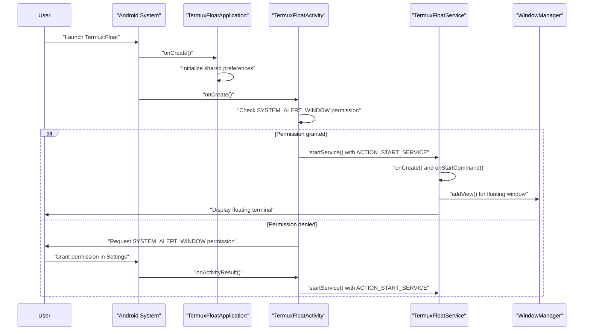
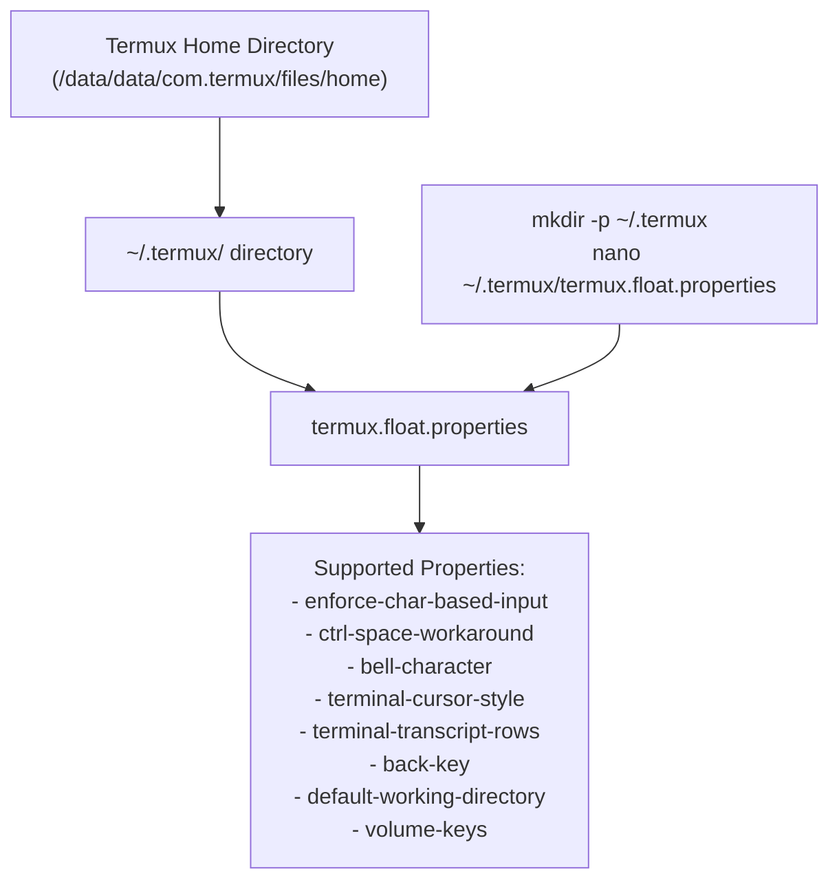
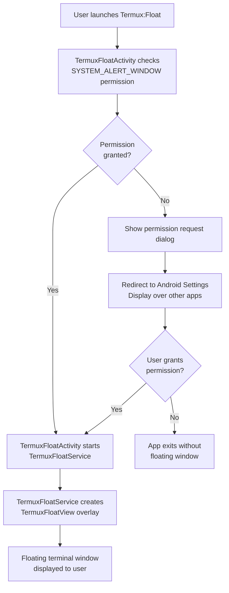

<!-- source: DeepWiki mcp.deepwiki.com · repo termux/termux-float · page 2 Getting Started · fetched 2026-10-26 -->

# Getting Started

<details>
<summary>Relevant source files</summary>

The following files were used as context for generating this wiki page:

- [README.md](README.md)

</details>


This document provides an overview of how to install, configure, and start using Termux:Float. It covers the essential steps needed to get the floating terminal window running on your Android device, from initial installation through basic configuration and first use.

For detailed installation instructions from specific sources, see [Installation](#2.1). For comprehensive configuration options and property settings, see [Configuration](#2.2).

## Prerequisites

Before installing Termux:Float, you must have the main Termux application installed and properly configured. Termux:Float is a plugin application that extends Termux functionality and cannot operate independently.

**Required Components:**
- Main Termux app (installed and functional)
- Android system permissions for overlay windows (`SYSTEM_ALERT_WINDOW`)
- Compatible Android version (API level support varies by distribution channel)

## Installation Overview

Termux:Float can be installed from three primary sources, each with different characteristics:

| Source | Compatibility | Update Frequency | Signing Key |
|--------|--------------|------------------|-------------|
| F-Droid | F-Droid builds only | Weekly (delayed) | F-Droid key |
| GitHub Releases | GitHub builds only | On release | Debug key |
| GitHub Actions | GitHub builds only | Per commit | Debug key |

**Important:** APKs from different sources use different signing keys and are not interchangeable. Choose one source and stick with it for updates.

Sources: [README.md:22-50]()

## Application Startup Flow

The following diagram shows the initialization sequence when Termux:Float starts, including the key classes and Android system interactions involved:

### Termux:Float Initialization Sequence



Sources: [README.md:6](), System architecture diagrams provided

## Basic Configuration Setup

Termux:Float uses a properties file system similar to the main Termux app. Configuration is managed through the `~/.termux/termux.float.properties` file and Android shared preferences.

### Configuration File Location and Creation



The configuration file must be created manually as it doesn't exist by default. Use the following commands in a Termux terminal:

```bash
mkdir -p ~/.termux
nano ~/.termux/termux.float.properties
```

Sources: [README.md:55-64]()

## First Launch Process

After installation, the first launch involves several system interactions and user decisions:

### Initial Launch Flow with Permission Handling



Sources: [README.md:6](), System architecture diagrams provided

## Basic Usage Patterns

Once running, Termux:Float operates as a floating overlay window with several interaction modes:

**Window States:**
- **Full Window**: Complete terminal interface with keyboard input
- **Bubble Mode**: Minimized floating button for quick access
- **Hidden**: Service continues running but window not visible

**Common Actions:**
- Touch inside window: Focus terminal for input
- Touch outside window: Unfocus terminal
- Long press: Enable window movement/resizing
- Minimize gesture: Convert to bubble mode
- Exit action: Stop service and remove overlay

## Debugging and Troubleshooting

Termux:Float supports configurable logging levels for troubleshooting issues. Log levels are set through the main Termux app settings under `Termux:Float` → `Debugging` → `Log Level`.

**Available Log Levels:**
- `Off`: No logging output
- `Normal`: Error, warning, and info messages (default)
- `Debug`: Additional debug information
- `Verbose`: Comprehensive logging (may include sensitive data)

View logs using `logcat` command in terminal or ADB connection from a PC.

Sources: [README.md:70-81]()

## Next Steps

After completing basic setup:

1. **Detailed Installation**: For comprehensive installation instructions including source-specific considerations, see [Installation](#2.1)

2. **Advanced Configuration**: For complete property file configuration options and Android manifest permissions, see [Configuration](#2.2)

3. **Architecture Understanding**: To understand the underlying system components and their relationships, see [Architecture](#3)

The floating terminal window should now be operational and ready for regular terminal usage with the added convenience of overlay functionality.

---

