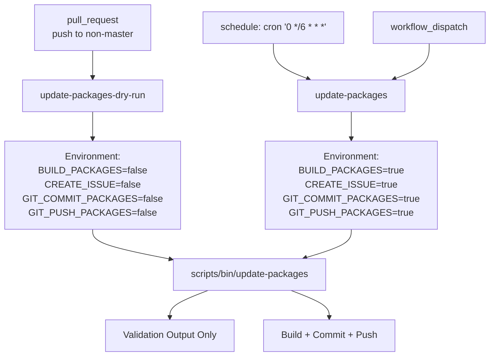
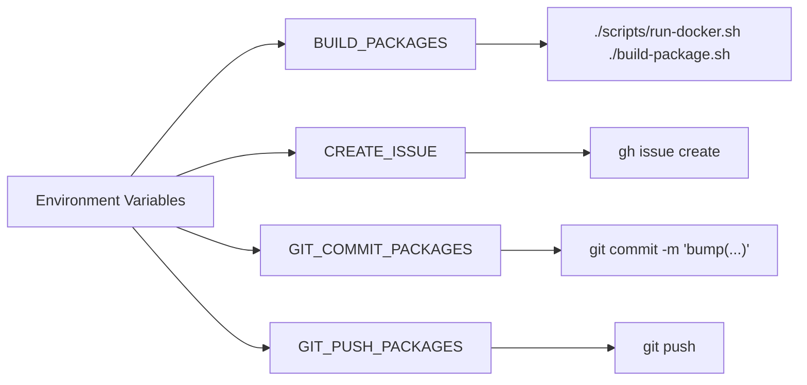
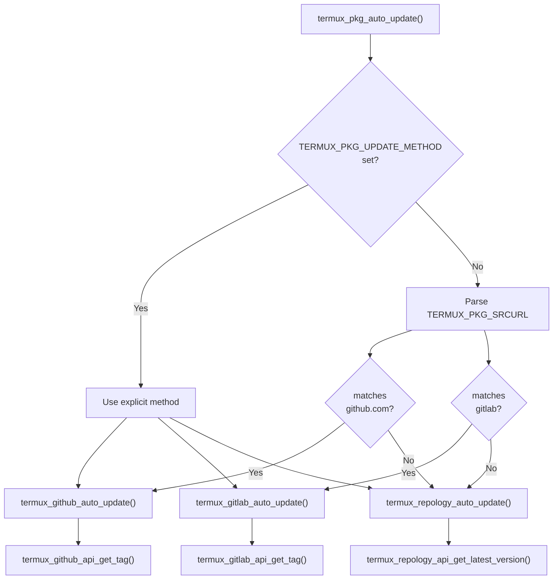
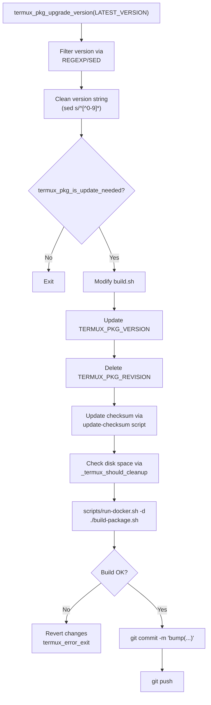
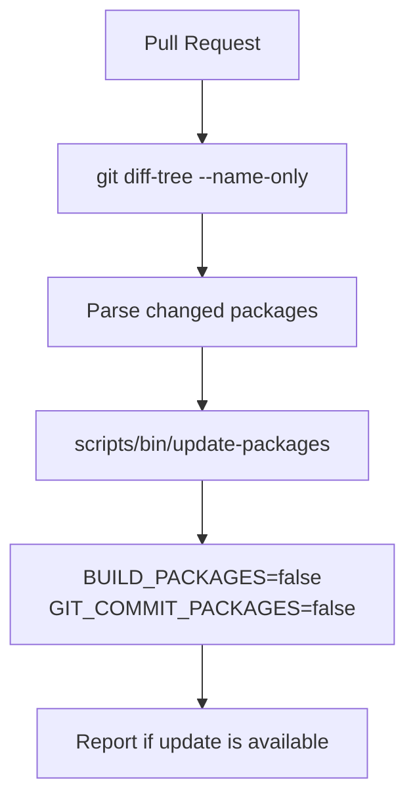

<!-- source: DeepWiki mcp.deepwiki.com · repo termux/termux-packages · page 3.3 Automated Package Updates · fetched 2026-10-26 -->

# Automated Package Updates

Relevant source files

The following files were used as context for generating this wiki page:

- [.github/actions/zram/action.yml](.github/actions/zram/action.yml)
- [.github/workflows/bootstrap_archives.yml](.github/workflows/bootstrap_archives.yml)
- [.github/workflows/check_repository_health.yml](.github/workflows/check_repository_health.yml)
- [.github/workflows/codeql.yml](.github/workflows/codeql.yml)
- [.github/workflows/command_not_found.yml](.github/workflows/command_not_found.yml)
- [.github/workflows/docker_image.yml](.github/workflows/docker_image.yml)
- [.github/workflows/golang_validation.yml](.github/workflows/golang_validation.yml)
- [.github/workflows/package_updates.yml](.github/workflows/package_updates.yml)
- [.github/workflows/packages.yml](.github/workflows/packages.yml)
- [.github/workflows/zig_validation.yml](.github/workflows/zig_validation.yml)
- [packages/asciinema/build.sh](packages/asciinema/build.sh)
- [packages/asciinema/locale.rs.patch](packages/asciinema/locale.rs.patch)
- [packages/texinfo/build.sh](packages/texinfo/build.sh)
- [packages/texinfo/update-info-dir.patch](packages/texinfo/update-info-dir.patch)
- [scripts/bin/check-auto-update](scripts/bin/check-auto-update)
- [scripts/bin/update-packages](scripts/bin/update-packages)
- [scripts/bin/validation](scripts/bin/validation)
- [scripts/build/termux_error_exit.sh](scripts/build/termux_error_exit.sh)
- [scripts/free-space.sh](scripts/free-space.sh)
- [scripts/run-docker.sh](scripts/run-docker.sh)
- [scripts/updates/api/dump-repology-data](scripts/updates/api/dump-repology-data)
- [scripts/updates/api/termux_github_api_get_tag.sh](scripts/updates/api/termux_github_api_get_tag.sh)
- [scripts/updates/api/termux_gitlab_api_get_tag.sh](scripts/updates/api/termux_gitlab_api_get_tag.sh)
- [scripts/updates/api/termux_repology_api_get_latest_version.sh](scripts/updates/api/termux_repology_api_get_latest_version.sh)
- [scripts/updates/internal/termux_github_auto_update.sh](scripts/updates/internal/termux_github_auto_update.sh)
- [scripts/updates/internal/termux_gitlab_auto_update.sh](scripts/updates/internal/termux_gitlab_auto_update.sh)
- [scripts/updates/termux_pkg_auto_update.sh](scripts/updates/termux_pkg_auto_update.sh)
- [scripts/updates/utils/termux_pkg_is_update_needed.sh](scripts/updates/utils/termux_pkg_is_update_needed.sh)
- [scripts/updates/utils/termux_pkg_upgrade_version.sh](scripts/updates/utils/termux_pkg_upgrade_version.sh)

This page documents the `package_updates.yml` workflow that automatically checks for upstream version updates. The workflow operates in two modes: dry-run validation on pull requests and push events, and full update mode on scheduled runs that detects new versions, updates `build.sh` files, rebuilds packages, and commits changes to the repository.

Sources: [.github/workflows/package_updates.yml:1-155]()

## Workflow Architecture

The `package_updates.yml` workflow defines two distinct jobs that share the same underlying script but operate with different environment variables:

**Workflow Triggers and Job Selection**

Sources: [.github/workflows/package_updates.yml:1-155]()

### update-packages-dry-run Job

This job runs on pull requests and push events to non-master branches. It validates that package update configurations are correct without performing actual builds or commits.

**Key characteristics:**
- Runs on `ubuntu-slim` runner [.github/workflows/package_updates.yml:33]()
- Analyzes git diff to identify changed packages using `git diff-tree` [.github/workflows/package_updates.yml:63-67]()
- Calls `update-packages` script with all build/commit flags disabled [.github/workflows/package_updates.yml:83-93]()
- Reports what packages would be updated without modifying repository state.

### update-packages Job

This job performs full package updates on scheduled runs and manual triggers. It has write permissions to create issues and push commits.

**Key characteristics:**
- Runs on `ubuntu-24.04` runner with zram enabled [.github/workflows/package_updates.yml:100-113]()
- Loads Docker image using `scripts/run-docker.sh` and frees disk space via `scripts/free-space.sh` [.github/workflows/package_updates.yml:114-118]()
- Installs dependencies: `curl`, `python3`, `jq` [.github/workflows/package_updates.yml:119-125]()
- Configures git with credentials from `TERMUXBOT2_TOKEN` [.github/workflows/package_updates.yml:135-136]()
- Processes either all packages (`@all`) or manual input packages [.github/workflows/package_updates.yml:138-145]()
- Triggers repology metadata generation on completion via repository dispatch [.github/workflows/package_updates.yml:146-154]()

Sources: [.github/workflows/package_updates.yml:95-155]()

## update-packages Script

The core logic resides in `scripts/bin/update-packages`, which processes packages based on environment variable configuration.

**Script Control Variables**

The script operates in phases:

1. **Environment Setup**: Sources `scripts/properties.sh` and utility scripts like `termux_pkg_upgrade_version.sh` [scripts/bin/update-packages:35-84]()
2. **Tag Caching**: Pre-fetches tags concurrently using Ninja via `_fetch_and_cache_tags` to speed up the process [scripts/bin/update-packages:144-164]()
3. **Package Discovery**: Scans directories defined in `repo.json` for packages [scripts/bin/update-packages:30-31]()
4. **Update Execution**: For each package, sets `TERMUX_PKG_NAME` and `TERMUX_PKG_BUILDER_DIR` and calls `termux_pkg_auto_update` [scripts/bin/update-packages:105-133]()
5. **Failure Handling**: Tracks failed updates in `_FAILED_UPDATES` for reporting or issue creation [scripts/bin/update-packages:136]()

Sources: [scripts/bin/update-packages:1-164]()

### Package Auto-Update Configuration

Packages opt into automatic updates through `build.sh` variables:

| Variable | Purpose | Example |
|----------|---------|---------|
| `TERMUX_PKG_AUTO_UPDATE` | Enable auto-updates | `true` |
| `TERMUX_PKG_UPDATE_METHOD` | Override detection method | `github`, `gitlab`, `repology` |
| `TERMUX_PKG_UPDATE_TAG_TYPE` | Tag selection strategy | `latest-release-tag`, `newest-tag` |
| `TERMUX_PKG_UPDATE_VERSION_REGEXP` | Extract version from tag | `v([0-9.]+)` |
| `TERMUX_PKG_UPDATE_VERSION_SED_REGEXP` | Transform version string | `s/_/./g` |

Sources: [scripts/bin/update-packages:17-21](), [packages/asciinema/build.sh:9]()

## Update Detection Methods

The `termux_pkg_auto_update()` function automatically selects an update method based on `TERMUX_PKG_SRCURL` pattern matching, or uses the explicitly configured `TERMUX_PKG_UPDATE_METHOD`.

**Update Method Dispatch**

Sources: [scripts/bin/update-packages:46-71](), [scripts/updates/api/termux_github_api_get_tag.sh:1-50](), [scripts/updates/api/termux_gitlab_api_get_tag.sh:1-50](), [scripts/updates/api/termux_repology_api_get_latest_version.sh:1-50]()

### GitHub Tag Detection

The `termux_github_api_get_tag()` function implements strategies based on `TERMUX_PKG_UPDATE_TAG_TYPE`:

| Tag Type | Implementation | API Endpoint |
|----------|----------------|--------------|
| `latest-release-tag` | Fetches official release tag | `/repos/{owner}/{repo}/releases/latest` |
| `newest-tag` | Fetches most recent tag by date | GraphQL cached or `/repos/{owner}/{repo}/tags` |

Sources: [scripts/updates/api/termux_github_api_get_tag.sh:1-50](), [scripts/updates/internal/termux_github_graphql.sh:1-77]()

### GitLab Tag Detection

The `termux_gitlab_api_get_tag()` function queries GitLab APIs. It fetches repository tags and selects based on the configured strategy.

Sources: [scripts/updates/api/termux_gitlab_api_get_tag.sh:1-55]()

### Repology Fallback

For packages not on GitHub/GitLab, `termux_repology_api_get_latest_version.sh` queries the Repology API to aggregate version information across multiple packaging systems.

Sources: [scripts/updates/api/termux_repology_api_get_latest_version.sh:1-59]()

## Version Upgrade Process

When a new version is detected, `termux_pkg_upgrade_version()` performs the actual file modifications and build verification.

**Version Upgrade Flow**

Sources: [scripts/updates/utils/termux_pkg_upgrade_version.sh:18-186]()

### Checksum Update Mechanism

The script automatically updates the source checksum:
1. It checks if `TERMUX_PKG_SHA256` is not `SKIP_CHECKSUM` and source is not git-based [scripts/updates/utils/termux_pkg_upgrade_version.sh:109]().
2. It invokes `scripts/bin/update-checksum` for the package [scripts/updates/utils/termux_pkg_upgrade_version.sh:110]().
3. If checksum update fails, it reverts repository changes [scripts/updates/utils/termux_pkg_upgrade_version.sh:111]().

### Build Verification and Cleanup

Before committing, the script verifies the update by building the package:
- It checks available space on `/var/lib/docker` against `TERMUX_CLEANUP_BUILT_PACKAGES_THRESHOLD` [scripts/updates/utils/termux_pkg_upgrade_version.sh:6-13]().
- If space is low or the package is not a "big package" (listed in `scripts/big-pkgs.list`), it runs `clean.sh` via Docker [scripts/updates/utils/termux_pkg_upgrade_version.sh:132-140]().
- It runs `./build-package.sh` inside the container using `scripts/run-docker.sh` [scripts/updates/utils/termux_pkg_upgrade_version.sh:142]().

Sources: [scripts/updates/utils/termux_pkg_upgrade_version.sh:131-148]()

## Dry-Run Validation on Pull Requests

The `update-packages-dry-run` job validates package update configurations when developers modify packages in pull requests.

**Pull Request Validation Flow**

This mode allows developers to verify that `TERMUX_PKG_AUTO_UPDATE` is properly configured without triggering actual builds or commits.

Sources: [.github/workflows/package_updates.yml:29-93]()

## Resource Management and Optimizations

The workflow includes several resource optimization steps to ensure reliability on GitHub Actions runners:

| Optimization | Implementation | Purpose |
|--------------|----------------|---------|
| ZRAM swap | `.github/actions/zram` (16G, zstd) | Prevents OOM during heavy builds [/.github/workflows/package_updates.yml:107-113]() |
| Disk cleanup | `scripts/free-space.sh` | Removes large pre-installed packages (LLVM, .NET, etc.) to free ~36GB [scripts/free-space.sh:1-56]() |
| AppArmor | `scripts/run-docker.sh` | Loads relaxed profiles to allow specific container operations [scripts/run-docker.sh:142-154]() |
| Tag Caching | `_fetch_and_cache_tags` | Uses Ninja for concurrent tag fetching to reduce execution time [scripts/bin/update-packages:144-164]() |

Sources: [.github/workflows/package_updates.yml:107-118](), [scripts/free-space.sh:1-56](), [scripts/run-docker.sh:142-154](), [scripts/bin/update-packages:144-164]()

---

