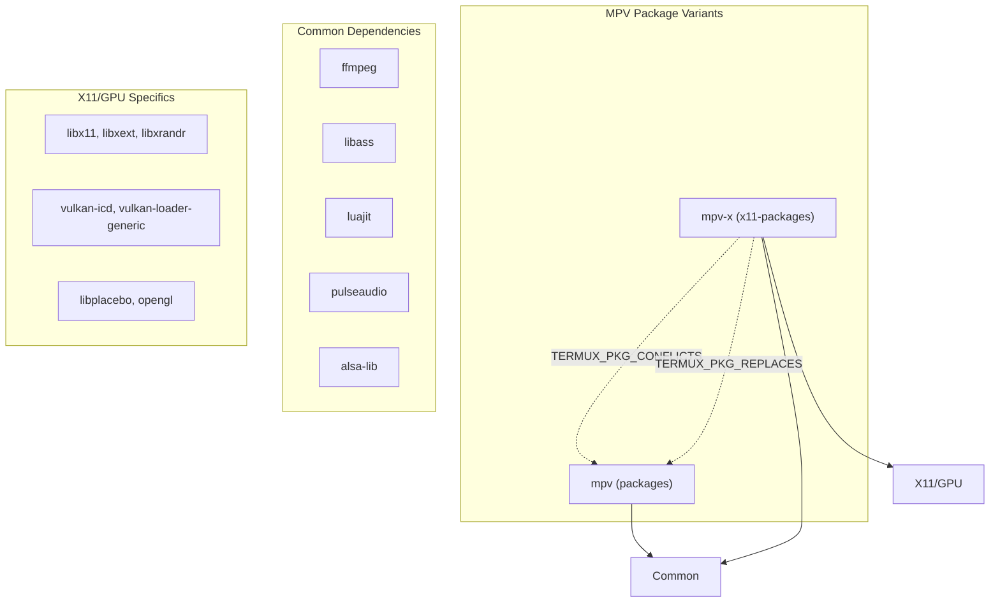
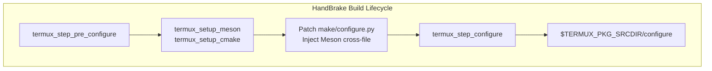

<!-- source: DeepWiki mcp.deepwiki.com · repo termux/termux-packages · page 5.4 Multimedia Applications · fetched 2026-10-26 -->

# Multimedia Applications

<details>
<summary>Relevant source files</summary>

The following files were used as context for generating this wiki page:

- [packages/ffmpeg/build.sh](packages/ffmpeg/build.sh)
- [packages/gst-plugins-good/build.sh](packages/gst-plugins-good/build.sh)
- [packages/libsecret/build.sh](packages/libsecret/build.sh)
- [packages/mp3gain/build.sh](packages/mp3gain/build.sh)
- [packages/mp3splt/build.sh](packages/mp3splt/build.sh)
- [packages/mp3wrap/build.sh](packages/mp3wrap/build.sh)
- [packages/mpc/build.sh](packages/mpc/build.sh)
- [packages/mpd/build.sh](packages/mpd/build.sh)
- [packages/mpd/src-Main.cxx.patch](packages/mpd/src-Main.cxx.patch)
- [packages/mplayer/build.sh](packages/mplayer/build.sh)
- [packages/mplayer/mplayer-1.5-ffmpeg-8.patch](packages/mplayer/mplayer-1.5-ffmpeg-8.patch)
- [packages/mplayer/r38454.patch](packages/mplayer/r38454.patch)
- [packages/mplayer/r38455.patch](packages/mplayer/r38455.patch)
- [packages/mpv/build.sh](packages/mpv/build.sh)
- [packages/mruby/build.sh](packages/mruby/build.sh)
- [packages/msitools/build.sh](packages/msitools/build.sh)
- [packages/neovim-nightly/build.sh](packages/neovim-nightly/build.sh)
- [packages/neovim/build.sh](packages/neovim/build.sh)
- [packages/neovim/disable-checkhealth-locale-warning.patch](packages/neovim/disable-checkhealth-locale-warning.patch)
- [packages/neovim/sysinit.vim](packages/neovim/sysinit.vim)
- [packages/squeezelite/build.sh](packages/squeezelite/build.sh)
- [packages/squid/build.sh](packages/squid/build.sh)
- [packages/sratom/build.sh](packages/sratom/build.sh)
- [packages/srelay/build.sh](packages/srelay/build.sh)
- [packages/tizonia/build.sh](packages/tizonia/build.sh)
- [packages/vbindiff/build.sh](packages/vbindiff/build.sh)
- [packages/vde2/build.sh](packages/vde2/build.sh)
- [packages/vegeta/build.sh](packages/vegeta/build.sh)
- [packages/vgmstream/build.sh](packages/vgmstream/build.sh)
- [packages/vim/build.sh](packages/vim/build.sh)
- [packages/vim/fix-writing-archive.patch](packages/vim/fix-writing-archive.patch)
- [packages/vim/revert-1fe0d1e.patch](packages/vim/revert-1fe0d1e.patch)
- [packages/vim/runtime-syntax-sh.vim.patch](packages/vim/runtime-syntax-sh.vim.patch)
- [packages/vlc/build.sh](packages/vlc/build.sh)
- [x11-packages/audacious-plugins/build.sh](x11-packages/audacious-plugins/build.sh)
- [x11-packages/chocolate-doom/build.sh](x11-packages/chocolate-doom/build.sh)
- [x11-packages/chocolate-doom/fix-tmpdir.patch](x11-packages/chocolate-doom/fix-tmpdir.patch)
- [x11-packages/handbrake/build.sh](x11-packages/handbrake/build.sh)
- [x11-packages/handbrake/remove-embedded-downloaded-copies-of-various-librari.patch](x11-packages/handbrake/remove-embedded-downloaded-copies-of-various-librari.patch)
- [x11-packages/handbrake/revert-dolby-vision-rpu.patch](x11-packages/handbrake/revert-dolby-vision-rpu.patch)
- [x11-packages/mogan/build.sh](x11-packages/mogan/build.sh)
- [x11-packages/mogan/lolly.diff](x11-packages/mogan/lolly.diff)
- [x11-packages/mogan/moebius.diff](x11-packages/mogan/moebius.diff)
- [x11-packages/mogan/xmake-packages-l-lolly.patch](x11-packages/mogan/xmake-packages-l-lolly.patch)
- [x11-packages/mogan/xmake-packages-m-moebius.patch](x11-packages/mogan/xmake-packages-m-moebius.patch)
- [x11-packages/mousepad/build.sh](x11-packages/mousepad/build.sh)
- [x11-packages/mpv-x/build.sh](x11-packages/mpv-x/build.sh)
- [x11-packages/mpv-x/default-to-x11.patch](x11-packages/mpv-x/default-to-x11.patch)
- [x11-packages/vim-gtk/build.sh](x11-packages/vim-gtk/build.sh)
- [x11-packages/vim-gtk/revert-1fe0d1e.patch](x11-packages/vim-gtk/revert-1fe0d1e.patch)
- [x11-packages/vlc-qt/build.sh](x11-packages/vlc-qt/build.sh)

</details>


This page documents multimedia applications in the Termux repository, focusing on media players, transcoders, and streaming engines. These packages demonstrate complex build patterns including X11/Vulkan variants, dynamic backend loading, and deep integration with multimedia frameworks like FFmpeg and GStreamer.

## Media Players: MPV and Variants

MPV is a modern, minimalist media player. In Termux, it is split into two primary variants to accommodate different display environments and dependency weights.

### MPV Package Architecture



Sources: [packages/mpv/build.sh:11-11](), [x11-packages/mpv-x/build.sh:11-14]()

### Feature Comparison and Configuration

The variants are differentiated via `TERMUX_PKG_EXTRA_CONFIGURE_ARGS` passed to the Meson build system.

| Feature | `mpv` (Base) | `mpv-x` (X11) |
| :--- | :--- | :--- |
| **Video Output** | `libcaca`, `libsixel` | `X11`, `OpenGL`, `Vulkan` |
| **Audio Output** | `OpenSLES`, `PulseAudio`, `ALSA` | Same + `Pipewire` |
| **X11 Support** | Disabled (`-Dx11=disabled`) | Enabled (`-Dgl-x11=enabled`) |
| **Vulkan Support**| Disabled (`-Dvulkan=disabled`) | Enabled (`-Dvulkan=enabled`) |
| **DVD/Bluray** | Disabled | Enabled |

Sources: [packages/mpv/build.sh:13-33](), [x11-packages/mpv-x/build.sh:15-28]()

### Version Synchronization
Both packages implement a `termux_step_post_get_source` hook to ensure the console and X11 versions remain in sync. If one is updated without the other, the build fails.

```bash
# Example from packages/mpv/build.sh:36-44
termux_step_post_get_source() {
	local ver_m ver_x
	ver_m="${TERMUX_PKG_VERSION#*:}"
	ver_x="$(. "$TERMUX_SCRIPTDIR/x11-packages/mpv-x/build.sh"; echo "${TERMUX_PKG_VERSION#*:}")"
	if [[ "${ver_m}" != "${ver_x}" ]]; then
		termux_error_exit "Version mismatch between mpv and mpv-x."
	fi
}
```
Sources: [packages/mpv/build.sh:36-44](), [x11-packages/mpv-x/build.sh:31-39]()

## FFmpeg: The Multimedia Backbone

FFmpeg is the central dependency for almost all multimedia packages in Termux. It is configured with extensive support for modern codecs and Android-specific features like `mediacodec`.

### FFmpeg Build Configuration
The build script [packages/ffmpeg/build.sh:66-135]() enables several critical features:
- **Hardware Acceleration**: `--enable-mediacodec`, `--enable-vulkan`, `--enable-opencl`.
- **Codec Support**: `--enable-libx264`, `--enable-libx265`, `--enable-libvpx`, `--enable-libaom`, `--enable-libdav1d`.
- **Platform Fixes**: `--enable-jni` for Android integration and `--extra-libs="-landroid-glob"` for path handling.

### SOVERSION Guard
FFmpeg uses a guard in `termux_step_pre_configure` to prevent accidental breakage of reverse dependencies when shared library versions change.
```bash
# packages/ffmpeg/build.sh:18-22
declare -gA _FFMPEG_SOVER=(
    [avutil]=60
    [avcodec]=62
    [avformat]=62
)
```
Sources: [packages/ffmpeg/build.sh:18-33]()

## VLC Media Player

VLC is provided in two variants: a standard version and a Qt-based GUI version.

### VLC Variants and Dependencies
- **`vlc`**: Standard version with CLI and ncurses interfaces. [packages/vlc/build.sh:1-77]()
- **`vlc-qt`**: X11-enabled version with the full Qt5 interface. [x11-packages/vlc-qt/build.sh:1-79]()

Both packages use `TERMUX_PKG_EXTRA_CONFIGURE_ARGS` to disable features not suitable for the Termux environment, such as `alsa`, `oss`, and `chromecast` (due to complex dependency chains).

Sources: [packages/vlc/build.sh:13-77](), [x11-packages/vlc-qt/build.sh:16-79]()

## MPlayer and FFmpeg 8 Compatibility

MPlayer is a classic player that requires significant patching to work with modern FFmpeg releases.

### Patching for FFmpeg 8
MPlayer (v1.5) requires specific patches to handle API changes in FFmpeg 8:
1. **`mplayer-1.5-ffmpeg-8.patch`**: Addresses major API migrations like `avcodec_close` to `avcodec_free_context`. [packages/mplayer/mplayer-1.5-ffmpeg-8.patch:1-220]()
2. **`r38455.patch`**: Migrates to the new `AVFifo` API (e.g., `av_fifo_alloc2`). [packages/mplayer/r38455.patch:1-94]()

### Dynamic Source Integration
MPlayer's `build.sh` dynamically fetches FFmpeg source code to ensure it builds against the exact version defined in the `ffmpeg` package.
Sources: [packages/mplayer/build.sh:26-36]()

## Audio Tools: MPD and GStreamer

### Music Player Daemon (MPD)
MPD is configured as a background service. It uses a custom service script defined in `TERMUX_PKG_SERVICE_SCRIPT` to handle user-specific configurations in `$HOME/.mpd/mpd.conf`.
Sources: [packages/mpd/build.sh:24-24]()

### GStreamer Plugins
GStreamer is modularized. The `gst-plugins-good` package enables high-quality plugins while explicitly disabling GUI-heavy or incompatible modules like `qt5`, `qt6`, and `v4l2` to avoid build failures.
Sources: [packages/gst-plugins-good/build.sh:10-23]()

## Transcoding: HandBrake

HandBrake is a complex multi-threaded transcoder. Its build process is unique as it uses a Python-based configuration wrapper that triggers nested `meson` and `cmake` builds.

### HandBrake Build Flow

Sources: [x11-packages/handbrake/build.sh:23-46]()

## Summary of Multimedia Packages

| Package | Category | Build System | Key Backend |
| :--- | :--- | :--- | :--- |
| `ffmpeg` | Framework | Autotools-like | `mediacodec`, `vulkan` |
| `mpv` | Player | Meson | `OpenSLES`, `libsixel` |
| `mpv-x` | Player (X11) | Meson | `X11`, `Vulkan`, `OpenGL` |
| `vlc` | Player | Autotools | `PulseAudio`, `ncurses` |
| `mpd` | Server | Meson | `OpenSLES`, `PulseAudio` |
| `handbrake` | Transcoder | Custom/Meson | `ffmpeg`, `x264`, `x265` |

Sources: [packages/ffmpeg/build.sh:1-159](), [packages/mpv/build.sh:1-57](), [x11-packages/mpv-x/build.sh:1-52](), [packages/vlc/build.sh:1-96](), [packages/mpd/build.sh:1-48](), [x11-packages/handbrake/build.sh:1-47]()

---

