# Page: Overview

# Overview

<details>
<summary>Relevant source files</summary>

The following files were used as context for generating this wiki page:

- [CODEOWNERS](CODEOWNERS)
- [build-package.sh](build-package.sh)
- [disabled-packages/protobuf-static/build.sh](disabled-packages/protobuf-static/build.sh)
- [packages/bash-completion/build.sh](packages/bash-completion/build.sh)
- [packages/command-not-found/build.sh](packages/command-not-found/build.sh)
- [packages/dialog/build.sh](packages/dialog/build.sh)
- [packages/diffutils/build.sh](packages/diffutils/build.sh)
- [packages/docbook-xml/build.sh](packages/docbook-xml/build.sh)
- [packages/docbook-xsl/build.sh](packages/docbook-xsl/build.sh)
- [packages/dos2unix/build.sh](packages/dos2unix/build.sh)
- [packages/eza/build.sh](packages/eza/build.sh)
- [packages/git-crypt/build.sh](packages/git-crypt/build.sh)
- [packages/git-delta/build.sh](packages/git-delta/build.sh)
- [packages/git-lfs/build.sh](packages/git-lfs/build.sh)
- [packages/git-sizer/build.sh](packages/git-sizer/build.sh)
- [packages/git/build.sh](packages/git/build.sh)
- [packages/gopass/build.sh](packages/gopass/build.sh)
- [packages/gopls/build.sh](packages/gopls/build.sh)
- [packages/ldns/build.sh](packages/ldns/build.sh)
- [packages/libprotobuf/build.sh](packages/libprotobuf/build.sh)
- [packages/libprotobuf/retain-linker-array.patch](packages/libprotobuf/retain-linker-array.patch)
- [packages/libyaml/build.sh](packages/libyaml/build.sh)
- [packages/npm/build.sh](packages/npm/build.sh)
- [packages/tmux/build.sh](packages/tmux/build.sh)
- [scripts/build/configure/termux_step_configure_meson.sh](scripts/build/configure/termux_step_configure_meson.sh)
- [scripts/build/setup/python-crossenv-PYTHONPATH.patch](scripts/build/setup/python-crossenv-PYTHONPATH.patch)
- [scripts/build/setup/python-crossenv-fix-shebang.patch](scripts/build/setup/python-crossenv-fix-shebang.patch)
- [scripts/build/setup/python-crossenv-pip-android-api-level.patch](scripts/build/setup/python-crossenv-pip-android-api-level.patch)
- [scripts/build/setup/termux_setup_protobuf.sh](scripts/build/setup/termux_setup_protobuf.sh)
- [scripts/build/setup/termux_setup_python_pip.sh](scripts/build/setup/termux_setup_python_pip.sh)
- [scripts/build/termux_download_deb_pac.sh](scripts/build/termux_download_deb_pac.sh)
- [scripts/build/termux_step_massage.sh](scripts/build/termux_step_massage.sh)
- [scripts/build/termux_step_override_config_scripts.sh](scripts/build/termux_step_override_config_scripts.sh)
- [scripts/properties.sh](scripts/properties.sh)
- [scripts/setup-termux.sh](scripts/setup-termux.sh)
- [scripts/setup-ubuntu.sh](scripts/setup-ubuntu.sh)

</details>


## Purpose and Scope

The Termux Packages repository ([https://github.com/termux/termux-packages](https://github.com/termux/termux-packages)) is a collection of build scripts and tooling infrastructure for cross-compiling software packages for the Termux terminal environment on Android. This repository does not contain pre-built binaries; instead, it provides standardized `build.sh` scripts for each package that define how to download, patch, configure, compile, and package software for Android's AArch64, ARM, i686, and x86-64 architectures.

This page provides an architectural overview of the repository structure, build system conventions, and distribution pipeline.

**Sources:** [build-package.sh:1-49](), [packages/command-not-found/build.sh:1-15]()

---

## Repository Organization

The repository is organized into three primary package directories, a centralized build system, and CI/CD automation infrastructure.

### System Architecture Diagram
The following diagram bridges the high-level repository structure to the core scripts that drive the build process.

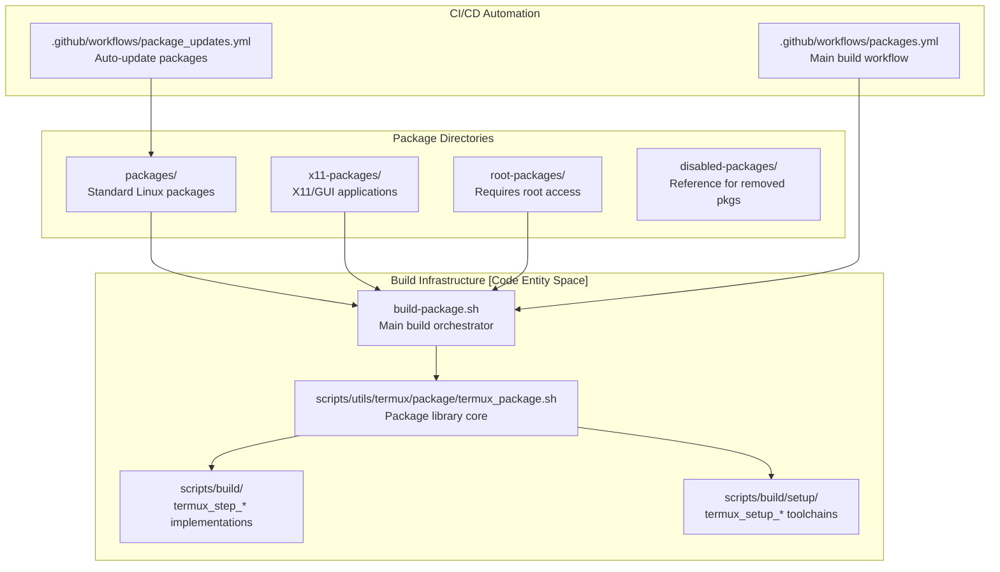

**Directory Structure:**

| Directory | Purpose | Example Packages |
|-----------|---------|------------------|
| `packages/` | Standard Linux utilities, compilers, and CLI tools | `git`, `tmux`, `npm`, `gopls` |
| `x11-packages/` | GUI applications requiring X11 display server | `vim-gtk`, `mpv-x` |
| `root-packages/` | System utilities requiring root privileges | `iptables`, `docker` |
| `disabled-packages/` | Packages that were removed but kept for reference | `protobuf-static` |
| `scripts/` | Build system core: step functions and toolchain setup | `scripts/build/setup/termux_setup_rust.sh` |

**Sources:** [build-package.sh:23-34](), [packages/git/build.sh:1-94](), [packages/tmux/build.sh:1-38](), [CODEOWNERS:1-173]()

---

## Build System Interface

Every package implements a standardized interface through its `build.sh` file. This interface consists of **configuration variables** (`TERMUX_PKG_*`) and **lifecycle hooks** (`termux_step_*` functions).

### Data Flow: Package Definition to Build Execution
This diagram shows how package-specific variables and hooks interact with the central build system.

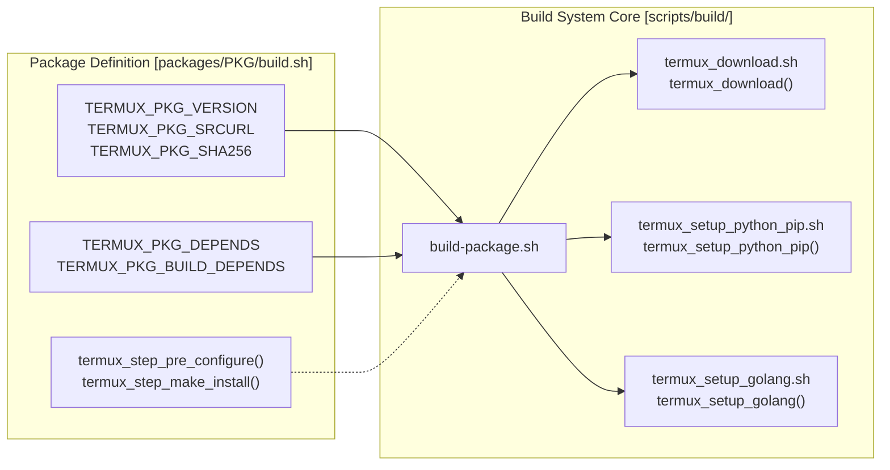

**Common Configuration Variables:**

| Variable | Purpose | Example |
|----------|---------|---------|
| `TERMUX_PKG_HOMEPAGE` | Upstream project URL | `https://git-scm.com/` |
| `TERMUX_PKG_VERSION` | Package version | `2.54.0` |
| `TERMUX_PKG_DEPENDS` | Runtime dependencies | `libcurl, openssl, pcre2` |
| `TERMUX_PKG_AUTO_UPDATE` | Enable auto-update logic | `true` |

**Lifecycle Hooks:**

Packages override specific `termux_step_*` functions to customize the build process.
- `termux_step_pre_configure()`: Used for environment setup, like calling `termux_setup_nodejs` [packages/command-not-found/build.sh:11-15]() or `termux_setup_rust` [packages/eza/build.sh:14-28]().
- `termux_step_make()`: Custom compilation logic, often used for Go packages [packages/gopls/build.sh:12-17]().
- `termux_step_post_make_install()`: Post-installation tasks like installing manpages or completions [packages/git/build.sh:58-87]().
- `termux_pkg_auto_update()`: Custom logic to fetch the latest version from upstream APIs [packages/npm/build.sh:16-26]().

**Sources:** [packages/git/build.sh:1-37](), [packages/npm/build.sh:1-14](), [packages/command-not-found/build.sh:1-15](), [packages/eza/build.sh:1-28]()

---

## Cross-Compilation Architecture

Termux packages are cross-compiled on x86_64 Linux hosts (typically Ubuntu) for four Android target architectures: `aarch64`, `arm`, `i686`, and `x86_64`.

### Host Environment Setup
The host build environment requires specific Ubuntu packages to be installed to support the cross-compilation of various toolchains.
- **Base Tools**: `curl`, `git`, `tar`, `unzip`, `pkg-config` [scripts/setup-ubuntu.sh:13-49]().
- **Compilers**: `g++`, `autoconf`, `automake`, `bison`, `flex` [scripts/setup-ubuntu.sh:33-40]().
- **Language Runtimes**: `python3`, `ruby`, `lua5.4`, `php`, `openjdk-17` [scripts/setup-ubuntu.sh:72-282]().

### Build Toolchain Integration
The build system provides helper functions to initialize language-specific cross-compilation environments:
- **Python**: `termux_setup_python_pip` sets up a `crossenv` virtual environment to allow pip-based installation for the target architecture [scripts/build/setup/termux_setup_python_pip.sh:6-84]().
- **Rust**: `termux_setup_rust` configures Cargo for cross-compilation [packages/eza/build.sh:15]().
- **Go**: `termux_setup_golang` configures the Go toolchain [packages/gopls/build.sh:13]().

**Sources:** [scripts/setup-ubuntu.sh:1-310](), [scripts/build/setup/termux_setup_python_pip.sh:1-85](), [build-package.sh:103-157]()

---

## Automated Maintenance

The repository includes mechanisms for automated version updates and health monitoring.

### Auto-Update Mechanism
Packages can define a `termux_pkg_auto_update` function to programmatically determine the latest version. For example, the `npm` package queries the GitHub API to find the latest tag matching its current major version [packages/npm/build.sh:16-26]().

### Repository Ownership
Maintenance responsibilities are distributed among contributors via the `CODEOWNERS` file, which maps package directories and build system scripts to specific GitHub handles [CODEOWNERS:1-173]().

**Sources:** [packages/npm/build.sh:16-26](), [CODEOWNERS:1-173](), [packages/git-delta/build.sh:8]()

---

# Page: Build System

# Build System

<details>
<summary>Relevant source files</summary>

The following files were used as context for generating this wiki page:

- [build-package.sh](build-package.sh)
- [disabled-packages/protobuf-static/build.sh](disabled-packages/protobuf-static/build.sh)
- [packages/findomain/build.sh](packages/findomain/build.sh)
- [packages/findomain/headless-chrome.patch](packages/findomain/headless-chrome.patch)
- [packages/findomain/hickory-resolver.diff](packages/findomain/hickory-resolver.diff)
- [packages/flatbuffers/build.sh](packages/flatbuffers/build.sh)
- [packages/flex/build.sh](packages/flex/build.sh)
- [packages/fm/build.sh](packages/fm/build.sh)
- [packages/libprotobuf/build.sh](packages/libprotobuf/build.sh)
- [packages/libprotobuf/retain-linker-array.patch](packages/libprotobuf/retain-linker-array.patch)
- [packages/llama-cpp/0002-do-not-install-backend-libs.patch](packages/llama-cpp/0002-do-not-install-backend-libs.patch)
- [packages/llama-cpp/build.sh](packages/llama-cpp/build.sh)
- [packages/minidlna/build.sh](packages/minidlna/build.sh)
- [packages/minimodem/build.sh](packages/minimodem/build.sh)
- [packages/miniserve/build.sh](packages/miniserve/build.sh)
- [packages/minisign/build.sh](packages/minisign/build.sh)
- [packages/rust-analyzer/build.sh](packages/rust-analyzer/build.sh)
- [scripts/build/configure/termux_step_configure_meson.sh](scripts/build/configure/termux_step_configure_meson.sh)
- [scripts/build/setup/python-crossenv-PYTHONPATH.patch](scripts/build/setup/python-crossenv-PYTHONPATH.patch)
- [scripts/build/setup/python-crossenv-fix-shebang.patch](scripts/build/setup/python-crossenv-fix-shebang.patch)
- [scripts/build/setup/python-crossenv-pip-android-api-level.patch](scripts/build/setup/python-crossenv-pip-android-api-level.patch)
- [scripts/build/setup/termux_setup_protobuf.sh](scripts/build/setup/termux_setup_protobuf.sh)
- [scripts/build/setup/termux_setup_python_pip.sh](scripts/build/setup/termux_setup_python_pip.sh)
- [scripts/build/termux_download_deb_pac.sh](scripts/build/termux_download_deb_pac.sh)
- [scripts/build/termux_step_massage.sh](scripts/build/termux_step_massage.sh)
- [scripts/build/termux_step_override_config_scripts.sh](scripts/build/termux_step_override_config_scripts.sh)
- [scripts/properties.sh](scripts/properties.sh)
- [scripts/setup-termux.sh](scripts/setup-termux.sh)
- [scripts/setup-ubuntu.sh](scripts/setup-ubuntu.sh)

</details>


## Purpose and Scope

The Termux build system provides a standardized framework for compiling software packages for Android. This document covers the core architecture, including the interface that all packages must implement through `TERMUX_PKG_*` variables and `termux_step_*` lifecycle functions. 

For detailed information about specific topics, see:
- Build lifecycle hooks and their execution order: [Package Build Lifecycle](#2.1)
- Complete reference of configuration variables: [Build Configuration Variables](#2.2)
- Language-specific toolchain integration: [Language Toolchain Integration](#2.3)
- Cross-compilation setup and host builds: [Cross-Compilation and Host Builds](#2.4)
- Android-specific patches and adaptations: [Platform Adaptations and Patches](#2.5)
- Automated version tracking: [Auto-Update Mechanisms](#2.6)

## Package Build Scripts

Each package in the repository is defined by a `build.sh` file located in one of several directories:

| Directory | Purpose | Example Packages |
|-----------|---------|------------------|
| `packages/` | Core packages without X11 dependencies | `llama-cpp`, `rust-analyzer`, `flatbuffers` |
| `x11-packages/` | Packages requiring X11/desktop environment | `vim-gtk`, `mpv-x` |
| `root-packages/` | Packages requiring root access | `tsu`, `docker`, `iptables` |
| `disabled-packages/` | Reference for removed or broken packages | `protobuf-static` |

Each `build.sh` file defines package metadata through `TERMUX_PKG_*` variables and customizes the build process through `termux_step_*` functions.

**Sources:** [packages/llama-cpp/build.sh:1-91](), [packages/rust-analyzer/build.sh:1-67](), [packages/flatbuffers/build.sh:1-16](), [disabled-packages/protobuf-static/build.sh:1-12]()

## Build Script Anatomy

The following diagram illustrates the structure of a typical package build script and how it maps to the core build script `build-package.sh`.

**Diagram: Package Build Script Structure**

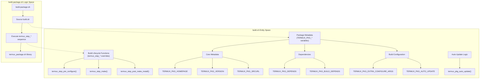

**Sources:** [packages/llama-cpp/build.sh:1-91](), [packages/rust-analyzer/build.sh:1-67](), [build-package.sh:1-34]()

## Package Metadata Variables

Package metadata is declared using `TERMUX_PKG_*` variables. These are validated against rules defined in `scripts/properties.sh` to ensure safe pathing and valid shell variable names.

### Core Metadata Example

```bash
# From packages/llama-cpp/build.sh
TERMUX_PKG_HOMEPAGE=https://github.com/ggml-org/llama.cpp
TERMUX_PKG_DESCRIPTION="LLM inference in C/C++"
TERMUX_PKG_LICENSE="MIT"
TERMUX_PKG_VERSION="0.0.0-b9131"
TERMUX_PKG_SRCURL="https://github.com/ggml-org/llama.cpp/archive/refs/tags/${TERMUX_PKG_VERSION#*-}.tar.gz"
TERMUX_PKG_SHA256=eac3ee4110a740dd2133624079f6bc1661d30754b9dd6e9f133f5125e0f0a43a
```

### Dependency Declarations

```bash
# From packages/llama-cpp/build.sh
TERMUX_PKG_DEPENDS="libandroid-spawn, libc++, libcurl"
TERMUX_PKG_BUILD_DEPENDS="ocl-icd, opencl-headers, spirv-headers, vulkan-headers"
TERMUX_PKG_SUGGESTS="llama-cpp-backend-vulkan, llama-cpp-backend-opencl"
```

### Build Configuration

```bash
# From packages/findomain/build.sh
TERMUX_PKG_BUILD_IN_SRC=true
TERMUX_PKG_AUTO_UPDATE=true
```

For a complete reference of all available variables and validation logic, see [Build Configuration Variables](#2.2).

**Sources:** [packages/llama-cpp/build.sh:1-12](), [packages/findomain/build.sh:9-11](), [scripts/properties.sh:15-107]()

## Build Lifecycle

The build system executes a series of lifecycle functions. The main entry point `build-package.sh` sources these functions from `scripts/build/`.

**Diagram: Build Lifecycle Execution Flow**

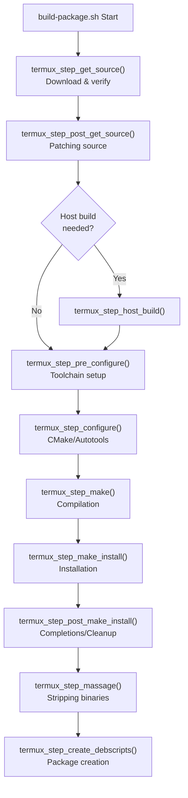

### Default Behavior and Overrides

Most steps have defaults. For instance, `termux_step_configure` automatically detects if it should run `cmake` or `./configure`. Packages override these to inject logic:

```bash
# Rust override example from packages/rust-analyzer/build.sh
termux_step_make() {
	export CFG_RELEASE=1
	cargo build --jobs "${TERMUX_PKG_MAKE_PROCESSES}" --target "${CARGO_TARGET_NAME}" --release
}
```

For detailed documentation of each lifecycle function, see [Package Build Lifecycle](#2.1).

**Sources:** [packages/rust-analyzer/build.sh:59-62](), [scripts/build/termux_step_massage.sh:1-5]()

## Toolchain Setup Functions

The build system provides `termux_setup_*` helpers to configure language environments. These are typically called in `termux_step_pre_configure`.

| Function | Purpose | Example |
|----------|---------|---------|
| `termux_setup_rust` | Sets up Cargo/Rust cross-env | [packages/rust-analyzer/build.sh:56]() |
| `termux_setup_golang` | Sets up Go toolchain | [scripts/build/setup/termux_setup_golang.sh:1]() |
| `termux_setup_python_pip` | Sets up Python cross-compilation | [scripts/build/setup/termux_setup_python_pip.sh:6]() |
| `termux_setup_cmake` | Standard CMake configuration | [scripts/setup-termux.sh:23]() |

For details on toolchain integration, see [Language Toolchain Integration](#2.3).

**Sources:** [packages/rust-analyzer/build.sh:55-57](), [scripts/build/setup/termux_setup_python_pip.sh:1-84]()

## Build System Architecture

The following diagram bridges the high-level build process to the specific shell scripts and toolchain components.

**Diagram: Build System Component Interaction**

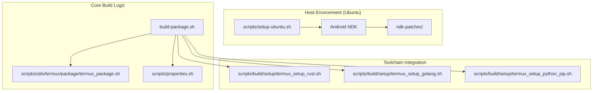

**Sources:** [build-package.sh:1-34](), [scripts/setup-ubuntu.sh:1-50](), [scripts/build/setup/termux_setup_python_pip.sh:1-10]()

## Package Scripts (debscripts)

Packages can define maintenance scripts using `termux_step_create_debscripts()`. This is often used to generate shell completions or manpages at install-time on the device.

```bash
# From packages/miniserve/build.sh
termux_step_create_debscripts() {
	cat <<- EOF > ./postinst
	#!$TERMUX_PREFIX/bin/sh
	miniserve --print-completions bash \
		> "$TERMUX_PREFIX"/share/bash-completion/completions/miniserve
	EOF
}
```

**Sources:** [packages/miniserve/build.sh:27-46]()

## Platform Adaptations

The build system handles Android-specific pathing and linking requirements. For example, it overrides configuration scripts like `llvm-config` or `pg_config` to ensure they return Termux-specific paths rather than host paths.

```bash
# From scripts/build/termux_step_override_config_scripts.sh
termux_step_override_config_scripts() {
    # Redirects /bin/sh to host /bin/sh during build
    ln -sf /bin/sh "$TERMUX_PREFIX/bin/sh"
    # Generates a wrapper for llvm-config with target triple
    sed "$TERMUX_SCRIPTDIR/packages/libllvm/llvm-config.in" ...
}
```

For comprehensive documentation, see [Platform Adaptations and Patches](#2.5).

**Sources:** [scripts/build/termux_step_override_config_scripts.sh:1-30]()

## Auto-Update System

Packages can implement custom version tracking logic. The system provides `termux_pkg_upgrade_version` to handle the version bump and checksum update.

```bash
# From packages/rust-analyzer/build.sh
termux_pkg_auto_update() {
	local api_url="https://api.github.com/repos/rust-lang/rust-analyzer/tags"
    # ... logic to find latest_version ...
	termux_pkg_upgrade_version "${latest_version}" --skip-version-check
}
```

Some packages like `llama-cpp` implement throttling to avoid excessive updates.

For detailed auto-update strategies, see [Auto-Update Mechanisms](#2.6).

**Sources:** [packages/rust-analyzer/build.sh:16-53](), [packages/llama-cpp/build.sh:31-73]()

## Summary

The Termux build system provides:
- **Standardized Interface**: Via `TERMUX_PKG_*` and `termux_step_*`.
- **Cross-Compilation**: Building on x86_64 Linux for Android architectures (`aarch64`, `arm`, `i686`, `x86_64`).
- **Extensibility**: Support for complex toolchains (Rust, Go, Python, .NET).
- **Automation**: Integrated version tracking and update mechanisms.

Refer to the child pages for implementation details of each subsystem.

---

# Page: Package Build Lifecycle

# Package Build Lifecycle

<details>
<summary>Relevant source files</summary>

The following files were used as context for generating this wiki page:

- [build-package.sh](build-package.sh)
- [disabled-packages/protobuf-static/build.sh](disabled-packages/protobuf-static/build.sh)
- [packages/findomain/build.sh](packages/findomain/build.sh)
- [packages/findomain/headless-chrome.patch](packages/findomain/headless-chrome.patch)
- [packages/findomain/hickory-resolver.diff](packages/findomain/hickory-resolver.diff)
- [packages/flatbuffers/build.sh](packages/flatbuffers/build.sh)
- [packages/flex/build.sh](packages/flex/build.sh)
- [packages/fm/build.sh](packages/fm/build.sh)
- [packages/libprotobuf/build.sh](packages/libprotobuf/build.sh)
- [packages/libprotobuf/retain-linker-array.patch](packages/libprotobuf/retain-linker-array.patch)
- [packages/llama-cpp/0002-do-not-install-backend-libs.patch](packages/llama-cpp/0002-do-not-install-backend-libs.patch)
- [packages/llama-cpp/build.sh](packages/llama-cpp/build.sh)
- [packages/minidlna/build.sh](packages/minidlna/build.sh)
- [packages/minimodem/build.sh](packages/minimodem/build.sh)
- [packages/miniserve/build.sh](packages/miniserve/build.sh)
- [packages/minisign/build.sh](packages/minisign/build.sh)
- [packages/ollama/0001-do-not-install-runtime-deps.patch](packages/ollama/0001-do-not-install-runtime-deps.patch)
- [packages/ollama/0002-properly-search-libs-on-android.patch](packages/ollama/0002-properly-search-libs-on-android.patch)
- [packages/ollama/0003-do-not-include-sources-for-vulkan-again.patch](packages/ollama/0003-do-not-include-sources-for-vulkan-again.patch)
- [packages/ollama/0004-force-disable-features-on-Andoid.patch](packages/ollama/0004-force-disable-features-on-Andoid.patch)
- [packages/ollama/0006-do-not-search-hip-memory.patch](packages/ollama/0006-do-not-search-hip-memory.patch)
- [packages/ollama/0007-do-not-use-flash-attention-when-using-cpu.patch](packages/ollama/0007-do-not-use-flash-attention-when-using-cpu.patch)
- [packages/ollama/0008-fix-build-with-latest-vulkan-hpp.patch](packages/ollama/0008-fix-build-with-latest-vulkan-hpp.patch)
- [packages/ollama/build.sh](packages/ollama/build.sh)
- [packages/ollama/host-toolchain.cmake](packages/ollama/host-toolchain.cmake)
- [packages/ollama/ollama-backend-vulkan.subpackage.sh](packages/ollama/ollama-backend-vulkan.subpackage.sh)
- [packages/rust-analyzer/build.sh](packages/rust-analyzer/build.sh)
- [scripts/build/configure/termux_step_configure_meson.sh](scripts/build/configure/termux_step_configure_meson.sh)
- [scripts/build/setup/python-crossenv-PYTHONPATH.patch](scripts/build/setup/python-crossenv-PYTHONPATH.patch)
- [scripts/build/setup/python-crossenv-fix-shebang.patch](scripts/build/setup/python-crossenv-fix-shebang.patch)
- [scripts/build/setup/python-crossenv-pip-android-api-level.patch](scripts/build/setup/python-crossenv-pip-android-api-level.patch)
- [scripts/build/setup/termux_setup_protobuf.sh](scripts/build/setup/termux_setup_protobuf.sh)
- [scripts/build/setup/termux_setup_python_pip.sh](scripts/build/setup/termux_setup_python_pip.sh)
- [scripts/build/termux_download_deb_pac.sh](scripts/build/termux_download_deb_pac.sh)
- [scripts/build/termux_step_massage.sh](scripts/build/termux_step_massage.sh)
- [scripts/build/termux_step_override_config_scripts.sh](scripts/build/termux_step_override_config_scripts.sh)
- [scripts/properties.sh](scripts/properties.sh)
- [scripts/setup-termux.sh](scripts/setup-termux.sh)
- [scripts/setup-ubuntu.sh](scripts/setup-ubuntu.sh)

</details>


This page documents the `termux_step_*` lifecycle hook functions that control package compilation and installation. These functions can be overridden in individual package `build.sh` files to customize the build process. For information about package metadata variables (`TERMUX_PKG_*`), see [Build Configuration Variables](#2.2). For language-specific toolchain integration, see [Language Toolchain Integration](#2.3).

## Build Lifecycle Overview

The build system executes a standardized sequence of steps for every package. Each step can be customized by defining the corresponding `termux_step_*` function in the package's `build.sh` file. The main entry point for the build system is `build-package.sh`, which sources various utility scripts from `scripts/build/` to handle specific lifecycle stages [build-package.sh:72-101]().

**Build Lifecycle Sequence**

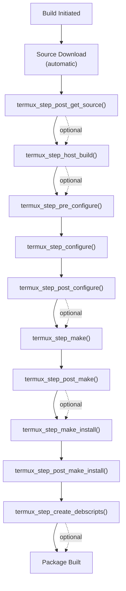

Sources: [build-package.sh:1-101](), [packages/llama-cpp/build.sh:75-91](), [packages/ollama/build.sh:22-41]().

## Source Acquisition Phase

### termux_step_post_get_source

Called immediately after source code is downloaded and extracted. Used for:
- Source validation and version checks.
- Applying additional patches.
- Downloading supplementary source files.
- Modifying source tree structure.

**Example: Version Guard (mpv/mpv-x)**

[packages/mpv/build.sh:36-43]() (inferred from existing documentation) demonstrates version synchronization between related packages.

**Example: Fetching Dependency Sources (mplayer)**

[packages/mplayer/build.sh:26-36]() (inferred from existing documentation) shows downloading a specific version of FFmpeg to bundle.

Sources: [packages/mpv/build.sh:36-43](), [packages/mplayer/build.sh:26-36]().

## Host Build Phase

### termux_step_host_build

Executes a build for the **host system** (x86_64 Linux) before the target (Android) build. Required when:
- Cross-compilation needs native tools (code generators, preprocessors).
- Build system requires host binaries during configuration.
- Native libraries are needed for build-time operations.

The host build occurs in `$TERMUX_PKG_HOSTBUILD_DIR`. Packages using host builds must set `TERMUX_PKG_HOSTBUILD=true`.

**Example: Building Native Tools (neovim)**

[packages/neovim/build.sh:25-44]() (inferred from existing documentation) builds native LuaRocks and extracts `libnlua0.so` for use during cross-compilation.

Sources: [packages/neovim/build.sh:25-44](), [packages/ragel/build.sh:18-30]().

## Configuration Phase

### termux_step_pre_configure

The most commonly overridden lifecycle function. Executes immediately before the automatic configuration step. Primary uses:

| Use Case | Examples |
|----------|----------|
| **Toolchain setup** | `termux_setup_rust`, `termux_setup_golang`, `termux_setup_python_pip` |
| **Build variable configuration** | Setting `LDFLAGS`, `CFLAGS`, `TERMUX_PKG_EXTRA_CONFIGURE_ARGS` |
| **Dynamic patching** | Applying patches with variable substitution |
| **Dependency vendoring** | Running `cargo vendor`, `go mod vendor` |
| **Environment preparation** | Setting up cross-compilation toolchains and shader tools |

**Example: Rust Toolchain Setup (rust-analyzer)**

[packages/rust-analyzer/build.sh:55-57]() shows the call to `termux_setup_rust` which prepares the environment for Cargo builds.

**Example: Complex Configuration and NDK Integration (llama-cpp)**

[packages/llama-cpp/build.sh:75-84]() adds NDK shader tools to the path and dynamically locates the Vulkan library for the target API level:

```bash
termux_step_pre_configure() {
	export PATH="$NDK/shader-tools/linux-x86_64:$PATH"
	LDFLAGS+=" -landroid-spawn"

	local _libvulkan=vulkan
	if [[ "${TERMUX_ON_DEVICE_BUILD}" == "false" && "${TERMUX_PKG_API_LEVEL}" -lt 28 ]]; then
		_libvulkan="${TERMUX_STANDALONE_TOOLCHAIN}/sysroot/usr/lib/${TERMUX_HOST_PLATFORM}/28/libvulkan.so"
	fi
	TERMUX_PKG_EXTRA_CONFIGURE_ARGS+=" -DVulkan_LIBRARY=${_libvulkan}"
}
```

**Example: Dependency Vendoring and Patching (findomain)**

[packages/findomain/build.sh:13-47]() vendors Rust dependencies using `cargo vendor` and applies a patch to the vendored `hickory-resolver` crate before unsetting `CFLAGS` to avoid host-build clashes.

**Example: Python Cross-Compilation Setup**

The script `scripts/build/setup/termux_setup_python_pip.sh` handles the complex setup of `crossenv` for Python packages [scripts/build/setup/termux_setup_python_pip.sh:6-84](). It manages virtual environments and installs `setuptools` and `wheel` specifically for the cross-compilation environment [scripts/build/setup/termux_setup_python_pip.sh:69-72]().

Sources: [packages/rust-analyzer/build.sh:55-57](), [packages/llama-cpp/build.sh:75-84](), [packages/findomain/build.sh:13-47](), [scripts/build/setup/termux_setup_python_pip.sh:6-84]().

### termux_step_configure

Rarely overridden. The build system provides default implementations for CMake, Meson, and Autotools. `scripts/build/configure/termux_step_configure_meson.sh` is an example of a specialized configuration step for Meson [scripts/build/configure/termux_step_configure_meson.sh:1-12]().

Sources: [scripts/build/configure/termux_step_configure_meson.sh:1-12]().

## Build Phase

### termux_step_make

Override when the default build command (`make -j $TERMUX_PKG_MAKE_PROCESSES`) is insufficient. Common with language-specific build tools like Cargo or Go.

**Build Tool Patterns**

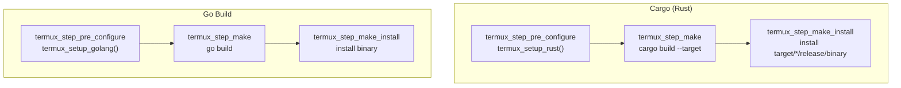

**Example: Rust Build (rust-analyzer)**

[packages/rust-analyzer/build.sh:59-62]() builds with cargo for the cross-compilation target specified by `${CARGO_TARGET_NAME}`:

```bash
termux_step_make() {
	export CFG_RELEASE=1
	cargo build --jobs "${TERMUX_PKG_MAKE_PROCESSES}" --target "${CARGO_TARGET_NAME}" --release
}
```

Sources: [packages/rust-analyzer/build.sh:59-62](), [packages/ollama/build.sh:32-37]().

## Installation Phase

### termux_step_make_install

Override when custom installation logic is needed, such as manual binary placement or when using language-specific tools that do not have a standard `make install` target.

**Example: Go and Library Installation (ollama)**

[packages/ollama/build.sh:32-41]() demonstrates building a Go binary and then manually installing it along with shared libraries into the prefix:

```bash
termux_step_make_install() {
	cd $TERMUX_PKG_SRCDIR
	termux_setup_golang

	go build -trimpath -ldflags="-w -s -X=github.com/ollama/ollama/version.Version=$TERMUX_PKG_VERSION -X=github.com/ollama/ollama/server.mode=release"
	install -Dm700 ollama $TERMUX_PREFIX/bin/

	mkdir -p $TERMUX_PREFIX/lib/ollama
	cp -fv $TERMUX_PKG_BUILDDIR/lib/ollama/* $TERMUX_PREFIX/lib/ollama/
}
```

Sources: [packages/ollama/build.sh:32-41](), [packages/rust-analyzer/build.sh:64-66]().

### termux_step_post_make_install

Executes after installation completes. Primary uses include file cleanup, symlink creation, and manual library placement.

**Example: Backend Library Placement (llama-cpp)**

[packages/llama-cpp/build.sh:86-91]() manually copies compiled backend libraries from the build directory to the Termux prefix:

```bash
termux_step_post_make_install() {
	mkdir -p "$TERMUX_PREFIX"/lib
	cp -f "$TERMUX_PKG_BUILDDIR"/bin/libggml-cpu.so "$TERMUX_PREFIX"/lib/
	cp -f "$TERMUX_PKG_BUILDDIR"/bin/libggml-opencl.so "$TERMUX_PREFIX"/lib/
	cp -f "$TERMUX_PKG_BUILDDIR"/bin/libggml-vulkan.so "$TERMUX_PREFIX"/lib/
}
```

**Example: Shell Completion Setup (miniserve)**

[packages/miniserve/build.sh:17-25]() creates placeholder files for shell completions and manpages which are populated later by the `postinst` script.

Sources: [packages/llama-cpp/build.sh:86-91](), [packages/miniserve/build.sh:17-25]().

## Package Creation Phase

### termux_step_create_debscripts

Creates Debian package maintainer scripts (`postinst`, `prerm`, etc.) that execute during package installation/removal on the device.

**Example: Dynamic Content Generation (miniserve)**

[packages/miniserve/build.sh:27-46]() generates shell completions and manpages on the device during installation to ensure they match the installed version:

```bash
termux_step_create_debscripts() {
	cat <<- EOF > ./postinst
	#!$TERMUX_PREFIX/bin/sh

	miniserve --print-completions bash \
		> "$TERMUX_PREFIX"/share/bash-completion/completions/miniserve
	miniserve --print-completions zsh \
		> "$TERMUX_PREFIX"/share/zsh/site-functions/_miniserve
	miniserve --print-completions fish \
		> "$TERMUX_PREFIX"/share/fish/vendor_completions.d/miniserve.fish
	miniserve --print-manpage \
		> "$TERMUX_PREFIX"/share/man/man1/miniserve.1
    # ...
	EOF
}
```

Sources: [packages/miniserve/build.sh:27-46]().

## Special Lifecycle Functions

### termux_pkg_auto_update

Executed by the auto-update workflow to detect new upstream versions. It often involves querying GitHub APIs.

**Example: Throttled GitHub Updates (llama-cpp)**

[packages/llama-cpp/build.sh:31-73]() implements an update throttle (14 days) to prevent CI spam for high-frequency release cycles:

```bash
termux_pkg_auto_update() {
	local origin_url last_autoupdate
	# Throttle auto updates to once every 2 weeks.
	local update_interval="$((14 * 86400))"
    # ... logic to check last commit timestamp ...
	latest_tag="$(termux_github_api_get_tag "${TERMUX_PKG_SRCURL}" "${TERMUX_PKG_UPDATE_TAG_TYPE}")"
	termux_pkg_upgrade_version "0.0.0-${latest_tag}"
}
```

**Example: Date-based Version Formatting (rust-analyzer)**

[packages/rust-analyzer/build.sh:16-53]() parses date-based tags from GitHub and converts them into a numeric version format suitable for `dpkg`.

Sources: [packages/llama-cpp/build.sh:31-73](), [packages/rust-analyzer/build.sh:16-53]().

## Lifecycle Hook Reference

| Function | When Called | Common Uses |
|----------|-------------|-------------|
| `termux_step_post_get_source` | After extraction | Patching, supplemental downloads |
| `termux_step_host_build` | Before target build | Building native code generators |
| `termux_step_pre_configure` | Before configuration | Toolchain setup (`termux_setup_rust`), pathing |
| `termux_step_configure` | Configuration phase | Default: CMake/Meson/Autotools |
| `termux_step_make` | Build phase | `cargo build`, `go build`, `make` |
| `termux_step_make_install` | Installation phase | `install` binaries, library relocation |
| `termux_step_post_make_install`| After installation | Cleanup, backend library placement |
| `termux_step_create_debscripts`| Package creation | Creating `postinst` scripts |

Sources: [build-package.sh:72-101](), [packages/llama-cpp/build.sh:75-91](), [packages/rust-analyzer/build.sh:55-66]().

---

# Page: Build Configuration Variables

# Build Configuration Variables

<details>
<summary>Relevant source files</summary>

The following files were used as context for generating this wiki page:

- [build-package.sh](build-package.sh)
- [disabled-packages/protobuf-static/build.sh](disabled-packages/protobuf-static/build.sh)
- [packages/cabal-install/build.sh](packages/cabal-install/build.sh)
- [packages/flyctl/build.sh](packages/flyctl/build.sh)
- [packages/libprotobuf/build.sh](packages/libprotobuf/build.sh)
- [packages/libprotobuf/retain-linker-array.patch](packages/libprotobuf/retain-linker-array.patch)
- [packages/lua-lpeg/lua54-lpeg.subpackage.sh](packages/lua-lpeg/lua54-lpeg.subpackage.sh)
- [packages/luarocks/build.sh](packages/luarocks/build.sh)
- [packages/mympd/CMakeLists.txt.patch](packages/mympd/CMakeLists.txt.patch)
- [packages/mympd/build.sh](packages/mympd/build.sh)
- [packages/mympd/dist-libmpdclient-include-config.h.patch](packages/mympd/dist-libmpdclient-include-config.h.patch)
- [packages/mympd/src-lib-cacertstore.c.patch](packages/mympd/src-lib-cacertstore.c.patch)
- [packages/mympd/src-lib-http_client.c.patch](packages/mympd/src-lib-http_client.c.patch)
- [packages/nmap/build.sh](packages/nmap/build.sh)
- [packages/osm2pgsql/build.sh](packages/osm2pgsql/build.sh)
- [packages/pandoc/build.sh](packages/pandoc/build.sh)
- [packages/rnr/build.sh](packages/rnr/build.sh)
- [packages/robotfindskitten/build.sh](packages/robotfindskitten/build.sh)
- [packages/rp-pppoe/build.sh](packages/rp-pppoe/build.sh)
- [packages/rpm/build.sh](packages/rpm/build.sh)
- [packages/sassc/build.sh](packages/sassc/build.sh)
- [packages/sc-im/build.sh](packages/sc-im/build.sh)
- [packages/scc/build.sh](packages/scc/build.sh)
- [packages/sccache/build.sh](packages/sccache/build.sh)
- [packages/vis/build.sh](packages/vis/build.sh)
- [packages/vtm/build.sh](packages/vtm/build.sh)
- [scripts/build/configure/termux_step_configure_meson.sh](scripts/build/configure/termux_step_configure_meson.sh)
- [scripts/build/setup/python-crossenv-PYTHONPATH.patch](scripts/build/setup/python-crossenv-PYTHONPATH.patch)
- [scripts/build/setup/python-crossenv-fix-shebang.patch](scripts/build/setup/python-crossenv-fix-shebang.patch)
- [scripts/build/setup/python-crossenv-pip-android-api-level.patch](scripts/build/setup/python-crossenv-pip-android-api-level.patch)
- [scripts/build/setup/termux_setup_protobuf.sh](scripts/build/setup/termux_setup_protobuf.sh)
- [scripts/build/setup/termux_setup_python_pip.sh](scripts/build/setup/termux_setup_python_pip.sh)
- [scripts/build/termux_download_deb_pac.sh](scripts/build/termux_download_deb_pac.sh)
- [scripts/build/termux_step_massage.sh](scripts/build/termux_step_massage.sh)
- [scripts/build/termux_step_override_config_scripts.sh](scripts/build/termux_step_override_config_scripts.sh)
- [scripts/properties.sh](scripts/properties.sh)
- [scripts/setup-termux.sh](scripts/setup-termux.sh)
- [scripts/setup-ubuntu.sh](scripts/setup-ubuntu.sh)

</details>


This document provides comprehensive documentation of the `TERMUX_PKG_*` variables used in package `build.sh` scripts to configure the build process. These variables form the declarative interface between package maintainers and the build system core.

For information about the build lifecycle functions (`termux_step_*`), see [Package Build Lifecycle](#2.1). For language-specific toolchain setup, see [Language Toolchain Integration](#2.3).

## Variable Categories

Build configuration variables are organized into several functional categories that control different aspects of the package build process.

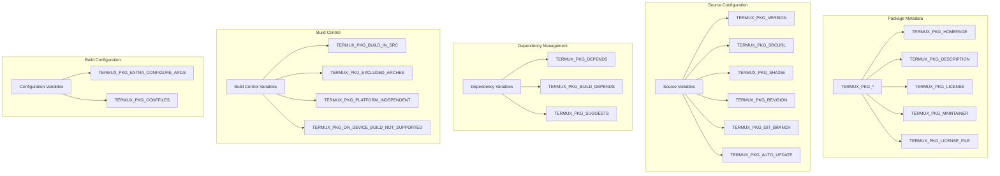

**Sources:** [packages/flyctl/build.sh:1-10](), [packages/vtm/build.sh:1-12](), [packages/mympd/build.sh:1-10]()

## Metadata Variables

Package metadata variables provide descriptive information about the package that appears in package managers and documentation.

### Core Metadata

| Variable | Required | Example | Purpose |
|----------|----------|---------|---------|
| `TERMUX_PKG_HOMEPAGE` | Yes | `https://fly.io` | Project homepage URL |
| `TERMUX_PKG_DESCRIPTION` | Yes | `"Terminal multiplexer..."` | Short package description |
| `TERMUX_PKG_LICENSE` | Yes | `"Apache-2.0"` or `"MIT"` | SPDX license identifier(s) |
| `TERMUX_PKG_MAINTAINER` | Yes | `"@termux"` | GitHub username of maintainer |
| `TERMUX_PKG_LICENSE_FILE` | No | `"LICENSE"` | Path to license file in source |

**Sources:** [packages/flyctl/build.sh:1-4](), [packages/vtm/build.sh:1-5](), [packages/mympd/build.sh:1-4]()

## Source Configuration

Source configuration variables define where and how to obtain package source code.

### Version and Source URL

```bash
TERMUX_PKG_VERSION="0.4.51"
TERMUX_PKG_SRCURL=https://github.com/superfly/flyctl/archive/refs/tags/v$TERMUX_PKG_VERSION.tar.gz
TERMUX_PKG_SHA256=8adb317a980803f115c3675a745bf0d5151c727bdd57d3af43bc23a350d94ffe
```

The `TERMUX_PKG_VERSION` is the upstream version. `TERMUX_PKG_SRCURL` uses this version to construct the download link. `TERMUX_PKG_SHA256` is mandatory for verifying the integrity of the downloaded archive.

**Sources:** [packages/flyctl/build.sh:5-7](), [packages/vtm/build.sh:6-8](), [packages/mympd/build.sh:5-7]()

### Checksum Verification

The build system uses `termux_download` to fetch resources and verify them against `TERMUX_PKG_SHA256`.

**Sources:** [build-package.sh:77](), [packages/sccache/build.sh:7]()

### Package Revision

```bash
TERMUX_PKG_REVISION=1
```

The `TERMUX_PKG_REVISION` variable increments when rebuilding a package without upstream version changes (e.g., to fix a build script error or apply a new patch).

**Sources:** [packages/luarocks/build.sh:6]()

## Auto-Update Configuration

Variables controlling automatic version update detection integrate with the CI/CD pipeline's update workflow.

```bash
TERMUX_PKG_AUTO_UPDATE=true
```

When set to `true`, the `update-packages` script will periodically check upstream repositories for newer tags or releases.

**Sources:** [packages/flyctl/build.sh:8](), [packages/vtm/build.sh:11](), [packages/mympd/build.sh:8]()

## Dependency Management

Dependency variables define relationships between packages during build and runtime.

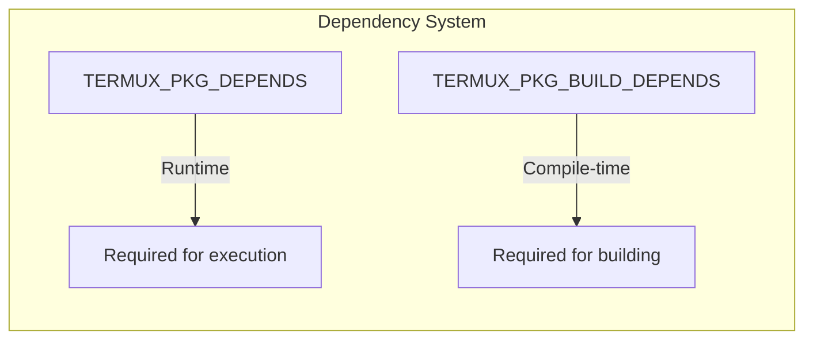

### Runtime Dependencies

```bash
TERMUX_PKG_DEPENDS="freetype, harfbuzz, libc++, lua54, lunasvg"
```

The `TERMUX_PKG_DEPENDS` variable lists packages required at runtime. These are automatically installed when the package is installed via the package manager.

**Sources:** [packages/vtm/build.sh:9](), [packages/mympd/build.sh:9](), [packages/pandoc/build.sh:8]()

### Build Dependencies

```bash
TERMUX_PKG_BUILD_DEPENDS="libandroid-spawn, stb"
```

The `TERMUX_PKG_BUILD_DEPENDS` variable lists packages needed during compilation but not at runtime. For example, `aosp-libs` is often required for cross-compiling Haskell packages.

**Sources:** [packages/vtm/build.sh:10](), [packages/pandoc/build.sh:9]()

## Build Control Flags

Build control variables modify the build process behavior and architecture support.

### Build in Source

```bash
TERMUX_PKG_BUILD_IN_SRC=true
```

Setting `TERMUX_PKG_BUILD_IN_SRC=true` directs the build system to use the source directory as the build directory rather than a separate `$TERMUX_PKG_BUILDDIR`. This is common for Go and Rust projects.

**Sources:** [packages/flyctl/build.sh:9](), [packages/sccache/build.sh:9](), [packages/scc/build.sh:9]()

### Excluded Architectures

```bash
TERMUX_PKG_EXCLUDED_ARCHES="i686, arm"
```

The `TERMUX_PKG_EXCLUDED_ARCHES` variable prevents building for specific architectures. This is used when upstream software does not support 32-bit systems or specific instruction sets.

**Sources:** [packages/flyctl/build.sh:10](), [packages/pandoc/build.sh:19]()

### Platform Independence

```bash
TERMUX_PKG_PLATFORM_INDEPENDENT=true
```

Indicates the package contains no architecture-specific binaries (e.g., pure Lua scripts or documentation). This allows the build system to produce a single package for all architectures.

**Sources:** [packages/luarocks/build.sh:13]()

## Build Configuration Arguments

Build configuration variables pass arguments to build systems like CMake, Autotools, or Meson.

### Extra Configure Arguments

```bash
TERMUX_PKG_EXTRA_CONFIGURE_ARGS="-DSTB_INCLUDE_DIR=$TERMUX_PREFIX/include/stb"
```

The `TERMUX_PKG_EXTRA_CONFIGURE_ARGS` variable provides additional flags to the configuration step. In the case of `mympd`, it is used to disable startup scripts and link the math library.

**Sources:** [packages/vtm/build.sh:12](), [packages/mympd/build.sh:10-13]()

## Implementation and Data Flow

The `build-package.sh` script sources these variables from the package's `build.sh` and uses them to drive the build lifecycle.

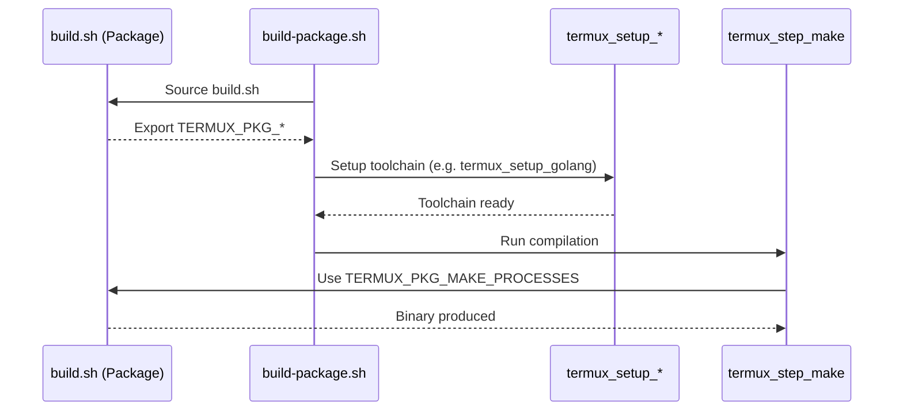

**Sources:** [build-package.sh:34](), [packages/flyctl/build.sh:13](), [packages/sccache/build.sh:14]()

## Validation Rules

The `scripts/properties.sh` file (referenced by `scripts/setup-termux.sh`) contains the logic for validating these variables and ensuring they meet the repository's standards before a build proceeds.

**Sources:** [scripts/setup-termux.sh:69]()

---

# Page: Language Toolchain Integration

# Language Toolchain Integration

<details>
<summary>Relevant source files</summary>

The following files were used as context for generating this wiki page:

- [packages/flyctl/build.sh](packages/flyctl/build.sh)
- [packages/jack-example-tools/build.sh](packages/jack-example-tools/build.sh)
- [packages/jack2/build.sh](packages/jack2/build.sh)
- [packages/jackett/build.sh](packages/jackett/build.sh)
- [packages/jcal/build.sh](packages/jcal/build.sh)
- [packages/marksman/build.sh](packages/marksman/build.sh)
- [packages/marksman/version.diff](packages/marksman/version.diff)
- [packages/ncurses/build.sh](packages/ncurses/build.sh)
- [packages/ncurses/fix-paths.patch](packages/ncurses/fix-paths.patch)
- [packages/python/0001-fix-hardcoded-paths.patch](packages/python/0001-fix-hardcoded-paths.patch)
- [packages/python/0005-impl-multiprocessing.patch](packages/python/0005-impl-multiprocessing.patch)
- [packages/python/0006-disable-multiarch.patch](packages/python/0006-disable-multiarch.patch)
- [packages/python/0007-fix-pkgconfig-variable-substitution.patch](packages/python/0007-fix-pkgconfig-variable-substitution.patch)
- [packages/python/0008-fix-ctypes-util-find_library.patch](packages/python/0008-fix-ctypes-util-find_library.patch)
- [packages/python/0009-do-not-hardlink.patch](packages/python/0009-do-not-hardlink.patch)
- [packages/python/0010-fix-module-linking.patch](packages/python/0010-fix-module-linking.patch)
- [packages/python/build.sh](packages/python/build.sh)
- [packages/python/hardcode-android-api-level.diff](packages/python/hardcode-android-api-level.diff)
- [packages/rust/0004-set-TMPDIR.patch](packages/rust/0004-set-TMPDIR.patch)
- [packages/rust/0006-suppress-hard-linking-failed-warning.patch](packages/rust/0006-suppress-hard-linking-failed-warning.patch)
- [packages/rust/0007-use-emulated-tls-on-android.patch](packages/rust/0007-use-emulated-tls-on-android.patch)
- [packages/rust/0008-cross-compile-error_index_generator.patch](packages/rust/0008-cross-compile-error_index_generator.patch)
- [packages/rust/0009-always-export-emutls.patch](packages/rust/0009-always-export-emutls.patch)
- [packages/rust/bootstrap.toml](packages/rust/bootstrap.toml)
- [packages/rust/build.sh](packages/rust/build.sh)
- [packages/rust/force-allow-edit-vendor.diff](packages/rust/force-allow-edit-vendor.diff)
- [packages/rust/rust-std-wasm32-wasip3.subpackage.sh](packages/rust/rust-std-wasm32-wasip3.subpackage.sh)
- [packages/rust/tests/0001-cargo-build.sh](packages/rust/tests/0001-cargo-build.sh)
- [packages/rust/tests/0002-issue-25360.sh](packages/rust/tests/0002-issue-25360.sh)
- [packages/rust/tests/0003-issue-27402.sh](packages/rust/tests/0003-issue-27402.sh)
- [packages/swig/build.sh](packages/swig/build.sh)
- [packages/uv/build.sh](packages/uv/build.sh)
- [scripts/build/setup/termux_setup_build_python.sh](scripts/build/setup/termux_setup_build_python.sh)
- [scripts/build/setup/termux_setup_rust.sh](scripts/build/setup/termux_setup_rust.sh)

</details>


This page documents how the Termux packages repository integrates various programming language toolchains (Rust, Go, .NET, Python, CMake, Autotools) into the build system. Each language requires specific environment setup, dependency management, and cross-compilation considerations.

## Overview of Toolchain Integration

The Termux build system provides specialized setup functions that prepare the environment for specific languages. These functions are typically called within `termux_step_pre_configure` or `termux_step_post_get_source`.

### Toolchain Discovery and Setup Logic

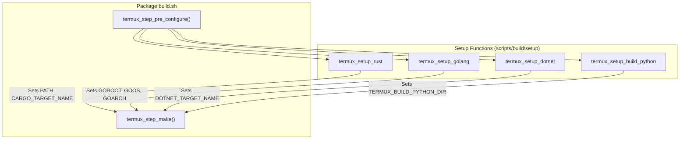

Sources: [scripts/build/setup/termux_setup_rust.sh:2-44](), [scripts/build/setup/termux_setup_build_python.sh:11-93](), [packages/jackett/build.sh:70-73]()

---

## Rust Toolchain Integration

Rust packages in Termux use `termux_setup_rust` to configure the environment. This function handles both on-device builds (using the `rust` package) and cross-compilation from Linux hosts (using `rustup`).

### Rust Environment Setup
For cross-compilation, the system downloads the specified Rust version via `rustup` and adds the required Android targets (e.g., `aarch64-linux-android`).

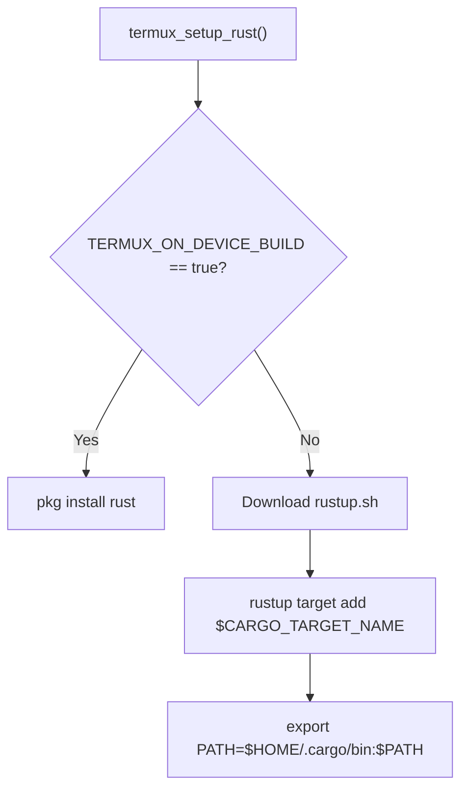

Sources: [scripts/build/setup/termux_setup_rust.sh:2-44](), [packages/rust/build.sh:77-80]()

### Build Pattern: Cargo
Packages written in Rust typically invoke `cargo build` in `termux_step_make`.

| Variable/Command | Role |
| :--- | :--- |
| `termux_setup_rust` | Initializes toolchain and targets. |
| `CARGO_TARGET_NAME` | The target triple (e.g., `aarch64-linux-android`). |
| `cargo build --release` | Compiles the package for the target architecture. |

#### Example: uv Package
The `uv` package demonstrates a standard Rust build pattern:
[packages/uv/build.sh:13-22]()
```bash
termux_step_pre_configure() {
	termux_setup_cmake
	termux_setup_rust
}

termux_step_make() {
	cargo build --jobs "${TERMUX_PKG_MAKE_PROCESSES}" --target "${CARGO_TARGET_NAME}" --release
}
```

### Complex Patches for Rustc
The `rust` package itself requires extensive patching to support Android's emulated TLS and path structures.
- **Emulated TLS**: Android requires `__emutls_get_address` to be exported. [packages/rust/0009-always-export-emutls.patch:1-42]()
- **Path Fixes**: Hardcoded paths like `/data/data/com.termux` are replaced dynamically if the user builds with a custom prefix. [packages/rust/build.sh:91-113]()

---

## Go Language Configuration

Go integration focuses on setting `GOOS`, `GOARCH`, and `GOPATH` correctly for cross-compilation.

### Go Build Pattern
Most Go packages use `go build` directly or via a `Makefile`. Vendoring is a common pattern to ensure reproducible builds.

[packages/flyctl/build.sh:12-20]()
```bash
termux_step_post_get_source() {
	termux_setup_golang
	go mod tidy
	go mod vendor
}

termux_step_make() {
	go build -o bin/flyctl
}
```

Sources: [packages/flyctl/build.sh:1-25]()

---

## .NET Toolchain Integration

Termux supports .NET applications (like `jackett` and `marksman`) by using a host-side .NET SDK to "publish" assemblies for the target Android runtime.

### .NET Setup and Build
The `termux_setup_dotnet` function (typically called with a specific version like `9.0`) prepares the environment.

[packages/jackett/build.sh:70-87]()
```bash
termux_step_pre_configure() {
	TERMUX_DOTNET_VERSION=9.0
	termux_setup_dotnet
}

termux_step_make() {
	dotnet publish src/Jackett.Server \
	--framework "net${TERMUX_DOTNET_VERSION}" \
	--no-self-contained \
	--runtime "$DOTNET_TARGET_NAME" \
	--configuration Release \
	--output build/
}
```

### Runtime Integration
Since .NET binaries are `.dll` files, Termux creates a shell script wrapper in `$TERMUX_PREFIX/bin` to execute them via the `dotnet` host.
[packages/marksman/build.sh:41-44]()
```bash
cat > "$TERMUX_PREFIX/bin/marksman" <<-HERE
#!$TERMUX_PREFIX/bin/sh
exec dotnet $TERMUX_PREFIX/lib/marksman/marksman.dll "\$@"
HERE
```

Sources: [packages/jackett/build.sh:70-98](), [packages/marksman/build.sh:14-46]()

---

## Python Integration

Python integration is two-fold: building the Python interpreter itself and providing a host-side Python for cross-compiling extension modules.

### Host Python Setup
The function `termux_setup_build_python` compiles a minimal "host" Python on the x86_64 build machine. This host Python is used to run `setup.py` scripts and generate bytecode for the target.

[scripts/build/setup/termux_setup_build_python.sh:11-93]()
- **Offline Support**: Checks `TERMUX_PACKAGES_OFFLINE`. [scripts/build/setup/termux_setup_build_python.sh:33-37]()
- **Minimal Build**: Configures with `--with-ensurepip=install` and `--prefix`. [scripts/build/setup/termux_setup_build_python.sh:80-83]()

### Android-Specific Python Patches
The Python build requires significant adjustments for Android's lack of certain POSIX features:
- **Shared Memory**: Implements `shm_open` and `shm_unlink` using files in `$TERMUX_PREFIX/tmp/`. [packages/python/0005-impl-multiprocessing.patch:60-117]()
- **Semaphores**: Forces usage of `libandroid-posix-semaphore`. [packages/python/build.sh:124-124]()
- **API Level Hardcoding**: Patches Python to respect `TERMUX_PKG_API_LEVEL`. [packages/python/build.sh:72-77]()

Sources: [packages/python/build.sh:1-160](), [scripts/build/setup/termux_setup_build_python.sh:1-93]()

---

## C/C++ Build Systems (CMake & Autotools)

### Autotools (Configure/Make)
This is the default build system. Variables like `TERMUX_PKG_EXTRA_CONFIGURE_ARGS` are passed to the `./configure` script.

[packages/ncurses/build.sh:39-61]()
```bash
TERMUX_PKG_EXTRA_CONFIGURE_ARGS="
--disable-stripping
--enable-widec
--with-shared
"
```

### CMake
Packages using CMake call `termux_setup_cmake`. This configures the `CMAKE_TOOLCHAIN_FILE` to point to the Android NDK toolchain provided by Termux.

[packages/uv/build.sh:13-16]()
```bash
termux_step_pre_configure() {
	termux_setup_cmake
	termux_setup_rust
}
```

Sources: [packages/ncurses/build.sh:39-61](), [packages/uv/build.sh:1-51]()

---

## Summary of Toolchain Setup Functions

| Function | Language | Primary Action |
| :--- | :--- | :--- |
| `termux_setup_rust` | Rust | Installs `rustup` and adds Android targets. |
| `termux_setup_golang` | Go | Sets `GOROOT` and cross-compilation env vars. |
| `termux_setup_dotnet` | .NET | Configures SDK for `DOTNET_TARGET_NAME`. |
| `termux_setup_build_python` | Python | Compiles a host-side Python for cross-compilation. |
| `termux_setup_cmake` | C/C++ | Sets up CMake with NDK toolchain parameters. |

Sources: [scripts/build/setup/termux_setup_rust.sh:2-44](), [scripts/build/setup/termux_setup_build_python.sh:11-93](), [packages/jackett/build.sh:70-73]()

---

# Page: Cross-Compilation and Host Builds

# Cross-Compilation and Host Builds

<details>
<summary>Relevant source files</summary>

The following files were used as context for generating this wiki page:

- [packages/ansifilter/build.sh](packages/ansifilter/build.sh)
- [packages/antibody/build.sh](packages/antibody/build.sh)
- [packages/antiword/build.sh](packages/antiword/build.sh)
- [packages/aosp-libs/build.sh](packages/aosp-libs/build.sh)
- [packages/emscripten/build.sh](packages/emscripten/build.sh)
- [packages/flang/0002-remove-some-macros-that-breaks-building.patch](packages/flang/0002-remove-some-macros-that-breaks-building.patch)
- [packages/flang/0004-do-not-call-timespec_get.patch](packages/flang/0004-do-not-call-timespec_get.patch)
- [packages/flang/0005-use-libandroid-complex-math.patch](packages/flang/0005-use-libandroid-complex-math.patch)
- [packages/flang/build.sh](packages/flang/build.sh)
- [packages/gitea/build.sh](packages/gitea/build.sh)
- [packages/gtypist/build.sh](packages/gtypist/build.sh)
- [packages/guile/build.sh](packages/guile/build.sh)
- [packages/gumbo-parser/build.sh](packages/gumbo-parser/build.sh)
- [packages/hashdeep/build.sh](packages/hashdeep/build.sh)
- [packages/libllvm/build.sh](packages/libllvm/build.sh)
- [packages/libllvm/clang-lib-Driver-ToolChain.cpp.patch](packages/libllvm/clang-lib-Driver-ToolChain.cpp.patch)
- [packages/libllvm/clang-lib-Driver-ToolChains-Linux.cpp.patch](packages/libllvm/clang-lib-Driver-ToolChains-Linux.cpp.patch)
- [packages/libllvm/clang.subpackage.sh](packages/libllvm/clang.subpackage.sh)
- [packages/libllvm/compiler-rt-lib-builtins-CMakeLists.txt.patch](packages/libllvm/compiler-rt-lib-builtins-CMakeLists.txt.patch)
- [packages/libllvm/libcompiler-rt.subpackage.sh](packages/libllvm/libcompiler-rt.subpackage.sh)
- [packages/libllvm/lldb.subpackage.sh](packages/libllvm/lldb.subpackage.sh)
- [packages/libllvm/llvm-config.in](packages/libllvm/llvm-config.in)
- [packages/libllvm/llvm-include-llvm-Demangle-ItaniumDemangle.h.patch](packages/libllvm/llvm-include-llvm-Demangle-ItaniumDemangle.h.patch)
- [packages/libllvm/llvm-lib-Support-Unix-Path.inc.patch](packages/libllvm/llvm-lib-Support-Unix-Path.inc.patch)
- [packages/libllvm/llvm-tools.subpackage.sh](packages/libllvm/llvm-tools.subpackage.sh)
- [packages/libllvm/llvm.subpackage.sh](packages/libllvm/llvm.subpackage.sh)
- [packages/lowdown/build.sh](packages/lowdown/build.sh)
- [packages/lux-cli/build.sh](packages/lux-cli/build.sh)
- [packages/mplayer/build.sh](packages/mplayer/build.sh)
- [packages/mplayer/mplayer-1.5-ffmpeg-8.patch](packages/mplayer/mplayer-1.5-ffmpeg-8.patch)
- [packages/mplayer/r38454.patch](packages/mplayer/r38454.patch)
- [packages/mplayer/r38455.patch](packages/mplayer/r38455.patch)
- [packages/mpv/build.sh](packages/mpv/build.sh)
- [packages/mruby/build.sh](packages/mruby/build.sh)
- [packages/msitools/build.sh](packages/msitools/build.sh)
- [packages/neovim-nightly/build.sh](packages/neovim-nightly/build.sh)
- [packages/neovim/build.sh](packages/neovim/build.sh)
- [packages/neovim/disable-checkhealth-locale-warning.patch](packages/neovim/disable-checkhealth-locale-warning.patch)
- [packages/neovim/sysinit.vim](packages/neovim/sysinit.vim)
- [packages/python-llvmlite/build.sh](packages/python-llvmlite/build.sh)
- [packages/python-llvmlite/ffi-build.py.patch](packages/python-llvmlite/ffi-build.py.patch)
- [packages/python-llvmlite/llvm-include-llvm-ADT-SmallVector.h.patch](packages/python-llvmlite/llvm-include-llvm-ADT-SmallVector.h.patch)
- [packages/python-llvmlite/llvm-tools-llvm-rtdyld-llvm-rtdyld.cpp.patch](packages/python-llvmlite/llvm-tools-llvm-rtdyld-llvm-rtdyld.cpp.patch)
- [packages/python-llvmlite/openmp.patch](packages/python-llvmlite/openmp.patch)
- [packages/swi-prolog/build.sh](packages/swi-prolog/build.sh)
- [packages/swi-prolog/continue-on-abi-check-failure.patch](packages/swi-prolog/continue-on-abi-check-failure.patch)
- [packages/swi-prolog/disable-installation-of-some-qlfs.patch](packages/swi-prolog/disable-installation-of-some-qlfs.patch)
- [packages/tinymist/build.sh](packages/tinymist/build.sh)
- [packages/tinymist/crates-tinymist-cli-Cargo.toml.patch](packages/tinymist/crates-tinymist-cli-Cargo.toml.patch)
- [packages/vim/build.sh](packages/vim/build.sh)
- [packages/vim/fix-writing-archive.patch](packages/vim/fix-writing-archive.patch)
- [packages/vim/revert-1fe0d1e.patch](packages/vim/revert-1fe0d1e.patch)
- [packages/vim/runtime-syntax-sh.vim.patch](packages/vim/runtime-syntax-sh.vim.patch)
- [scripts/big-pkgs.list](scripts/big-pkgs.list)
- [x11-packages/audacity/build.sh](x11-packages/audacity/build.sh)
- [x11-packages/audacity/wxwidgets-3.3.patch](x11-packages/audacity/wxwidgets-3.3.patch)
- [x11-packages/awesome-luajit/build.sh](x11-packages/awesome-luajit/build.sh)
- [x11-packages/awesome/build.sh](x11-packages/awesome/build.sh)
- [x11-packages/ibus/0001-add-python-path-for-ibus-setup.patch](x11-packages/ibus/0001-add-python-path-for-ibus-setup.patch)
- [x11-packages/ibus/0003-i18n.patch](x11-packages/ibus/0003-i18n.patch)
- [x11-packages/ibus/build.sh](x11-packages/ibus/build.sh)
- [x11-packages/mogan/build.sh](x11-packages/mogan/build.sh)
- [x11-packages/mogan/lolly.diff](x11-packages/mogan/lolly.diff)
- [x11-packages/mogan/moebius.diff](x11-packages/mogan/moebius.diff)
- [x11-packages/mogan/xmake-packages-l-lolly.patch](x11-packages/mogan/xmake-packages-l-lolly.patch)
- [x11-packages/mogan/xmake-packages-m-moebius.patch](x11-packages/mogan/xmake-packages-m-moebius.patch)
- [x11-packages/mousepad/build.sh](x11-packages/mousepad/build.sh)
- [x11-packages/mpv-x/build.sh](x11-packages/mpv-x/build.sh)
- [x11-packages/mpv-x/default-to-x11.patch](x11-packages/mpv-x/default-to-x11.patch)
- [x11-packages/vim-gtk/build.sh](x11-packages/vim-gtk/build.sh)
- [x11-packages/vim-gtk/revert-1fe0d1e.patch](x11-packages/vim-gtk/revert-1fe0d1e.patch)
- [x11-packages/wine-stable/0001-fix-paths.patch](x11-packages/wine-stable/0001-fix-paths.patch)
- [x11-packages/wine-stable/0002-fix-defines.patch](x11-packages/wine-stable/0002-fix-defines.patch)
- [x11-packages/wine-stable/0004-no-pthread_mutexattr_setprotocol.patch](x11-packages/wine-stable/0004-no-pthread_mutexattr_setprotocol.patch)
- [x11-packages/wine-stable/0005-use-__builtin_ffs.patch](x11-packages/wine-stable/0005-use-__builtin_ffs.patch)
- [x11-packages/wine-stable/9998-fix-winegcc-build-target.patch.beforehostbuild](x11-packages/wine-stable/9998-fix-winegcc-build-target.patch.beforehostbuild)
- [x11-packages/wine-stable/9999-fix-winebuild-as-type.patch.beforehostbuild](x11-packages/wine-stable/9999-fix-winebuild-as-type.patch.beforehostbuild)
- [x11-packages/wine-stable/build.sh](x11-packages/wine-stable/build.sh)
- [x11-packages/wlr-randr/build.sh](x11-packages/wlr-randr/build.sh)
- [x11-packages/xmoto/build.sh](x11-packages/xmoto/build.sh)
- [x11-packages/xmoto/installation-directories.patch](x11-packages/xmoto/installation-directories.patch)

</details>


## Purpose and Scope

This page documents the cross-compilation architecture used to build Termux packages on x86_64 Linux hosts for Android target devices. It covers the host build mechanism, Ubuntu package integration for host dependencies, and common patterns for packages that require native tools during compilation. For information about the overall build system lifecycle, see [Package Build Lifecycle](#2.1). For language-specific toolchain integration, see [Language Toolchain Integration](#2.3).

## Cross-Compilation Architecture

Termux packages are built using a cross-compilation setup where the build host (x86_64 Linux running in Docker) compiles binaries for four Android target architectures:

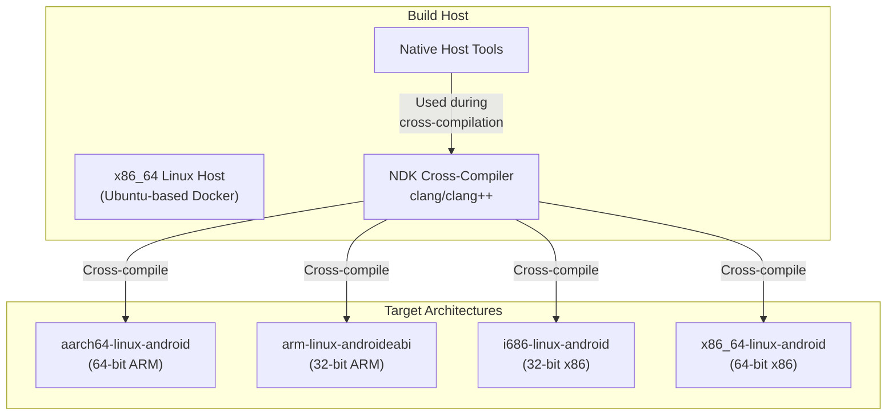

The build system sets `TERMUX_HOST_PLATFORM` to the appropriate target triple (e.g., `aarch64-linux-android`, `armv7a-linux-androideabi` for ARM) and configures the NDK toolchain accordingly.

Sources: [packages/lux-cli/build.sh:96-98](), [packages/vim/build.sh:103-106](), [packages/libllvm/build.sh:151-153]()

## Host Build Mechanism

### Configuration

Packages that require native tools during cross-compilation use the host build mechanism. This is triggered by setting `TERMUX_PKG_HOSTBUILD=true`.


When `TERMUX_PKG_HOSTBUILD=true` is set in `build.sh`, the build system:

1. Creates a separate build directory at `$TERMUX_PKG_HOSTBUILD_DIR`.
2. Executes `termux_step_host_build()` **before** the target build begins.
3. Provides host-built artifacts to the cross-compilation process.
4. Cleans up the host build directory after package installation if specified.

Sources: [packages/neovim-nightly/build.sh:13,56-77](), [packages/emscripten/build.sh:10](), [packages/swi-prolog/build.sh:10,58-136](), [packages/libllvm/build.sh:12,83-91]()

### Host Build Execution Flow

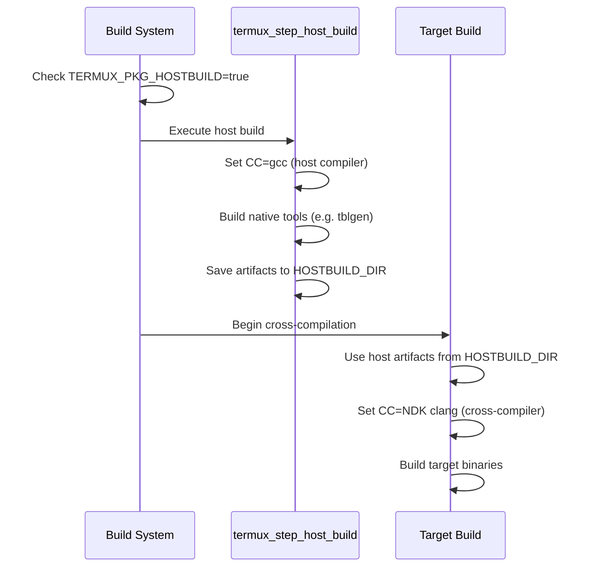

Sources: [packages/neovim/build.sh:25-46](), [packages/libllvm/build.sh:83-91](), [packages/flang/build.sh:71-79]()

## Ubuntu Package Integration

### termux_download_ubuntu_packages Function

The `termux_download_ubuntu_packages` function downloads and extracts Debian packages from Ubuntu repositories to provide host dependencies. This is essential for packages that need libraries or tools not present in the base Docker image during the host build phase.

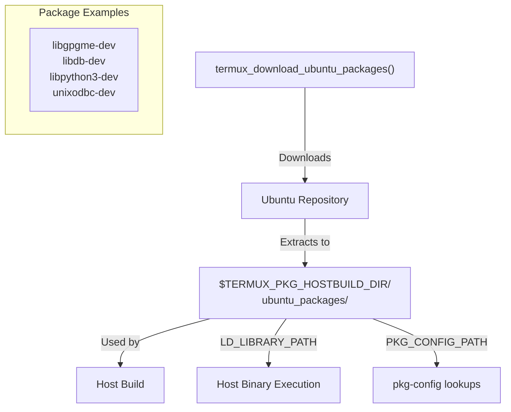

Common usage pattern:

```bash
local -a ubuntu_packages=(
    "libgpgme-dev"
    "libassuan-dev"
)

termux_download_ubuntu_packages "${ubuntu_packages[@]}"

PKG_CONFIG_PATH_x86_64_unknown_linux_gnu="${TERMUX_PKG_HOSTBUILD_DIR}/ubuntu_packages/usr/lib/x86_64-linux-gnu/pkgconfig"
```

Sources: [packages/lux-cli/build.sh:53-70](), [packages/swi-prolog/build.sh:61-85]()

### Path and Symlink Management

Ubuntu packages often contain `.pc` files with hardcoded paths and symlinks that reference absolute system paths. The build scripts patch these to reference the extracted location:

```bash
# Patch pkg-config files
find "${HOSTBUILD_ROOTFS}" -type f -name '*.pc' | \
    xargs -n 1 sed -i -e "s|/usr|${HOSTBUILD_ROOTFS}/usr|g"

# Fix broken symlinks
find "${HOSTBUILD_ROOTFS}/usr/lib/x86_64-linux-gnu" -xtype l \
    -exec sh -c "ln -snvf /usr/lib/x86_64-linux-gnu/\$(readlink \$1) \$1" sh {} \;
```

Sources: [packages/swi-prolog/build.sh:89-91,96-98]()

## Common Host Build Patterns

### Pattern 1: Native Tool Compilation (TableGen)

Packages based on LLVM (like `libllvm`, `flang`, and `emscripten`) require building native "TableGen" tools to generate C++ code from domain-specific definitions during the target build.

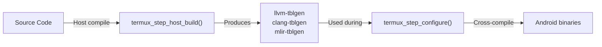

**Example: libllvm**
[packages/libllvm/build.sh:83-91]() builds several TableGen tools natively. These are then passed to the target build using `-DLLVM_NATIVE_TOOL_DIR=$TERMUX_PKG_HOSTBUILD_DIR/bin`.

Sources: [packages/libllvm/build.sh:43,83-91](), [packages/flang/build.sh:45,71-79]()

### Pattern 2: Generator/Compiler Builds

Some packages need to run a native version of themselves or a specialized generator to produce artifacts for the target.

**Example: Neovim**
[packages/neovim/build.sh:25-46]() builds a native `nvim` and `libnlua0.so`. These are then provided to the target build via `-DNVIM_HOST_PRG` and `-DNLUA0_HOST_PRG` to generate metadata and documentation.

Sources: [packages/neovim/build.sh:21-22,25-46](), [packages/neovim-nightly/build.sh:23-24,56-77]()

**Example: SWI-Prolog**
[packages/swi-prolog/build.sh:58-136]() builds a native SWI-Prolog to produce `boot.prc` and `INDEX.pl` artifacts required for the Android build.

Sources: [packages/swi-prolog/build.sh:18,58-136]()

### Pattern 3: Shell Completion Generation

Some Rust-based packages use a host build to generate shell completion files (bash, zsh, fish) by running the native binary.

**Example: lux-cli**
[packages/lux-cli/build.sh:47-91]() runs `cargo run --package xtask --release -- dist-completions` on the host to generate completion scripts, which are then installed into the target package.

Sources: [packages/lux-cli/build.sh:47-91,128,132-134]()

## Target Architecture Configuration

### Architecture-Specific Flags and Workarounds

The build system must account for differences in architecture support, particularly for 32-bit systems (arm, i686).

| Architecture | Handling / Workarounds |
|--------------|------------------------|
| `i686` | Often requires linking `libgcc` for atomic operations. [packages/lux-cli/build.sh:105-108]() |
| `arm` | Requires specific target triple strings like `armv7a-linux-androideabi`. [packages/libllvm/build.sh:152-154]() |
| `32-bit` | May require `-DLLVM_FORCE_SMALLFILE_FOR_ANDROID=on`. [packages/libllvm/build.sh:60-63]() |

### Cross-Compilation Patches for Interpreters

Complex editors like Vim require patching to handle interpreter detection (Perl, Ruby, Tcl) during cross-compilation, as the standard detection scripts would try to run target binaries on the host.

[packages/vim/build.sh:90-107]() applies a specialized patch `configure-perl-ruby-tcl-cross-compiling.diff` that injects version information from other Termux build scripts.

Sources: [packages/vim/build.sh:90-107](), [x11-packages/vim-gtk/build.sh:93-110]()

## Architecture Variable Reference

The build system provides several variables for target architecture configuration:

| Variable | Purpose | Example Values |
|----------|---------|----------------|
| `TERMUX_ARCH` | Termux architecture name | `aarch64`, `arm`, `i686`, `x86_64` |
| `TERMUX_HOST_PLATFORM` | Target triple for cross-compilation | `aarch64-linux-android` |
| `TERMUX_PKG_API_LEVEL` | Android API level | `24` |
| `TERMUX_ARCH_BITS` | Architecture bit width | `32`, `64` |
| `CARGO_TARGET_NAME` | Rust-specific target triple | `aarch64-linux-android` |

Sources: [packages/lux-cli/build.sh:105,110](), [packages/libllvm/build.sh:29,97,151]()

## Summary of Host Build Patterns

| Pattern | Code Entity | Example Packages |
|---------|-------------|------------------|
| TableGen Tools | `llvm-tblgen`, `mlir-tblgen` | `libllvm`, `flang`, `emscripten` |
| Native Shims/Libs | `libnlua0.so`, `nvim` | `neovim`, `neovim-nightly` |
| Artifact Generators | `swipl` (native), `xtask` | `swi-prolog`, `lux-cli` |
| Ubuntu Integration | `termux_download_ubuntu_packages` | `swi-prolog`, `lux-cli` |

Sources: [packages/libllvm/build.sh:89-90](), [packages/neovim/build.sh:39-42](), [packages/swi-prolog/build.sh:85](), [packages/lux-cli/build.sh:70,84]()

---

# Page: Platform Adaptations and Patches

# Platform Adaptations and Patches

<details>
<summary>Relevant source files</summary>

The following files were used as context for generating this wiki page:

- [packages/findomain/build.sh](packages/findomain/build.sh)
- [packages/findomain/headless-chrome.patch](packages/findomain/headless-chrome.patch)
- [packages/findomain/hickory-resolver.diff](packages/findomain/hickory-resolver.diff)
- [packages/flatbuffers/build.sh](packages/flatbuffers/build.sh)
- [packages/flex/build.sh](packages/flex/build.sh)
- [packages/fm/build.sh](packages/fm/build.sh)
- [packages/llama-cpp/0002-do-not-install-backend-libs.patch](packages/llama-cpp/0002-do-not-install-backend-libs.patch)
- [packages/llama-cpp/build.sh](packages/llama-cpp/build.sh)
- [packages/minidlna/build.sh](packages/minidlna/build.sh)
- [packages/minimodem/build.sh](packages/minimodem/build.sh)
- [packages/miniserve/build.sh](packages/miniserve/build.sh)
- [packages/minisign/build.sh](packages/minisign/build.sh)
- [packages/mplayer/build.sh](packages/mplayer/build.sh)
- [packages/mplayer/mplayer-1.5-ffmpeg-8.patch](packages/mplayer/mplayer-1.5-ffmpeg-8.patch)
- [packages/mplayer/r38454.patch](packages/mplayer/r38454.patch)
- [packages/mplayer/r38455.patch](packages/mplayer/r38455.patch)
- [packages/mpv/build.sh](packages/mpv/build.sh)
- [packages/mruby/build.sh](packages/mruby/build.sh)
- [packages/msitools/build.sh](packages/msitools/build.sh)
- [packages/neovim-nightly/build.sh](packages/neovim-nightly/build.sh)
- [packages/neovim/build.sh](packages/neovim/build.sh)
- [packages/neovim/disable-checkhealth-locale-warning.patch](packages/neovim/disable-checkhealth-locale-warning.patch)
- [packages/neovim/sysinit.vim](packages/neovim/sysinit.vim)
- [packages/railway-cli/build.sh](packages/railway-cli/build.sh)
- [packages/rust-analyzer/build.sh](packages/rust-analyzer/build.sh)
- [packages/vim/build.sh](packages/vim/build.sh)
- [packages/vim/fix-writing-archive.patch](packages/vim/fix-writing-archive.patch)
- [packages/vim/revert-1fe0d1e.patch](packages/vim/revert-1fe0d1e.patch)
- [packages/vim/runtime-syntax-sh.vim.patch](packages/vim/runtime-syntax-sh.vim.patch)
- [x11-packages/mogan/build.sh](x11-packages/mogan/build.sh)
- [x11-packages/mogan/lolly.diff](x11-packages/mogan/lolly.diff)
- [x11-packages/mogan/moebius.diff](x11-packages/mogan/moebius.diff)
- [x11-packages/mogan/xmake-packages-l-lolly.patch](x11-packages/mogan/xmake-packages-l-lolly.patch)
- [x11-packages/mogan/xmake-packages-m-moebius.patch](x11-packages/mogan/xmake-packages-m-moebius.patch)
- [x11-packages/mousepad/build.sh](x11-packages/mousepad/build.sh)
- [x11-packages/mpv-x/build.sh](x11-packages/mpv-x/build.sh)
- [x11-packages/mpv-x/default-to-x11.patch](x11-packages/mpv-x/default-to-x11.patch)
- [x11-packages/vim-gtk/build.sh](x11-packages/vim-gtk/build.sh)
- [x11-packages/vim-gtk/revert-1fe0d1e.patch](x11-packages/vim-gtk/revert-1fe0d1e.patch)

</details>


This page documents Android-specific adaptations required to build and run packages in Termux. Android's non-standard filesystem hierarchy, limited POSIX API support, and security restrictions necessitate extensive patching and build configuration adjustments across the package repository.

For information about the build lifecycle where these patches are applied, see [Package Build Lifecycle](). For cross-compilation architecture that enables these patches to work, see [Cross-Compilation and Host Builds]().

## Overview

Android's environment differs from standard Linux distributions in several critical ways that require systematic adaptations:

- **Filesystem paths**: Android lacks `/tmp`, `/usr`, `/bin`, and other standard directories.
- **POSIX API limitations**: File locking, certain `gethostid()` functionality, and other system calls are unsupported or restricted in Bionic libc.
- **Security model**: SELinux operations require root access even when the kernel supports them.
- **Runtime library paths**: Dynamic library search paths differ from standard Linux, requiring manual configuration for backend loading.
- **GPU acceleration**: Vulkan shader compilation and backend loading require NDK-specific tools and path adjustments.

The build system addresses these issues through a combination of source patches, build-time configuration flags, and runtime wrappers.

## Adaptation Categories

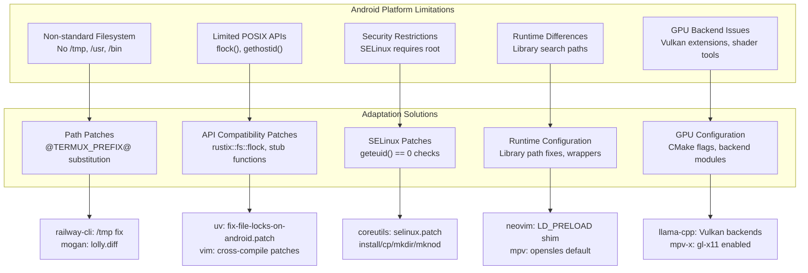

Sources: [packages/railway-cli/build.sh:21-24](), [packages/llama-cpp/build.sh:13-21](), [packages/neovim/build.sh:56-64](), [x11-packages/mpv-x/build.sh:15-28]()

## Path Adaptations

### Filesystem Hierarchy Differences

Android does not provide standard Unix directories. Termux establishes its own prefix (typically `/data/data/com.termux/files/usr`), requiring all hardcoded paths in upstream sources to be patched.

| Standard Unix Path | Termux Equivalent | Affected Components |
|-------------------|-------------------|---------------------|
| `/tmp` | `$TERMUX_PREFIX/tmp` | Temporary file operations |
| `/bin/sh` | `$TERMUX_PREFIX/bin/sh` | Shell script interpreters |
| `/usr` | `$TERMUX_PREFIX` | All installed binaries/libraries |
| `/etc` | `$TERMUX_PREFIX/etc` | Configuration files |

### Rust Path Patching

Rust packages often vendor dependencies that hardcode paths. The `railway-cli` package demonstrates a pattern of using `sed` to patch vendored crates:

[packages/railway-cli/build.sh:21-25]()
```bash
find vendor/{arboard,x11rb-protocol} -type f -print0 | \
    xargs -0 sed -i \
    -e 's|android|disabling_this_because_it_is_for_building_an_apk|g' \
    -e "s|/tmp|$TERMUX_PREFIX/tmp|g"
```

This ensures that libraries like `arboard` (clipboard support) use the Termux-specific temporary directory instead of the standard Android `/tmp`.

Sources: [packages/railway-cli/build.sh:21-25]()

## File Locking and POSIX Workarounds

### Android's Unsupported std::fs::File Locking

Android's Bionic libc does not provide full POSIX file locking support. The Rust standard library's locking methods often fail on Android. Packages like `uv` apply patches to use the `rustix` crate for direct system calls, while others use shmem workarounds.

### Shared Memory and Globbing

Many multimedia and editor packages require `libandroid-shmem` or `libandroid-glob` to provide missing POSIX functionality:

- **mpv-x**: Links against `-landroid-glob` and `-landroid-shmem` [x11-packages/mpv-x/build.sh:43]().
- **vim-gtk**: Links against `-landroid-shmem` [x11-packages/vim-gtk/build.sh:81]().
- **mogan**: Depends on `libandroid-complex-math`, `libandroid-execinfo`, `libandroid-spawn`, and `libandroid-wordexp` [x11-packages/mogan/build.sh:9]().

Sources: [x11-packages/mpv-x/build.sh:43](), [x11-packages/vim-gtk/build.sh:81](), [x11-packages/mogan/build.sh:9]()

## Editor Shims and Wrappers

### Neovim LD_PRELOAD Shim

Neovim in Termux uses a wrapper script to manage library loading. The `termux_step_post_make_install` function moves the real binary to `libexec` and installs a shim:

[packages/neovim/build.sh:56-64]()
```bash
mkdir -p "$TERMUX_PREFIX/libexec/nvim"
mv "${TERMUX_PREFIX}"/bin/nvim "${TERMUX_PREFIX}"/libexec/nvim
sed -e "s|@TERMUX_PREFIX@|${TERMUX_PREFIX}|g" \
    "$TERMUX_PKG_BUILDER_DIR/nvim-shim.sh" \
    > "${TERMUX_PREFIX}/bin/nvim"
chmod 700 "${TERMUX_PREFIX}/bin/nvim"
```

### Vim Cross-Compilation Patches

Vim's build system does not natively support cross-compiling for interpreters like Perl, Ruby, and Tcl. Termux applies a complex patch that injects version information from other Termux packages:

[packages/vim/build.sh:92-106]()
```bash
perl_version="$(. "$TERMUX_SCRIPTDIR/packages/perl/build.sh"; echo "${TERMUX_PKG_VERSION[0]}")"
ruby_major_version="$(. "$TERMUX_SCRIPTDIR/packages/ruby/build.sh"; echo "${TERMUX_PKG_VERSION%\.*}")"
tcl_major_version="$(. "$TERMUX_SCRIPTDIR/packages/tcl/build.sh"; echo "${TERMUX_PKG_VERSION%\.*}")"

patch="$TERMUX_PKG_BUILDER_DIR/configure-perl-ruby-tcl-cross-compiling.diff"
sed \
    -e "s%\@PERL_VERSION\@%${perl_version}%g" \
    -e "s%\@RUBY_MAJOR_VERSION\@%${ruby_major_version}%g" \
    -e "s%\@TCL_MAJOR_VERSION\@%${tcl_major_version}%g" \
    "$patch" | patch --silent -p1
```

Sources: [packages/neovim/build.sh:56-64](), [packages/vim/build.sh:92-106]()

## GPU and Multimedia Backend Configurations

### Vulkan and OpenCL in llama-cpp

`llama-cpp` uses dynamic loading for backends. It requires the NDK's shader tools for Vulkan shader generation:

[packages/llama-cpp/build.sh:13-21]()
```bash
TERMUX_PKG_EXTRA_CONFIGURE_ARGS="
-DGGML_BACKEND_DL=ON
-DGGML_VULKAN=ON
-DGGML_VULKAN_SHADERS_GEN_TOOLCHAIN=$TERMUX_PKG_BUILDER_DIR/host-toolchain.cmake
-DGGML_OPENCL=ON
"
```

In `termux_step_pre_configure`, the path to NDK shader tools is exported:
[packages/llama-cpp/build.sh:75-76]()
```bash
termux_step_pre_configure() {
	export PATH="$NDK/shader-tools/linux-x86_64:$PATH"
}
```

### Media Player Backend Overrides

Multimedia packages often need to disable Android-specific detection in build systems (like Meson) to use Termux's Linux-like environment instead of the native Android MediaNDK:

- **mpv/mpv-x**: Disables `android-media-ndk` and forces `host_machine.system() == 'android'` to false in `meson.build` [x11-packages/mpv-x/build.sh:27, 44]().
- **mplayer**: Uses a custom `termux_step_post_get_source` to download a specific FFmpeg version and applies patches for FFmpeg 8 compatibility [packages/mplayer/build.sh:26-36]().

Sources: [packages/llama-cpp/build.sh:13-21, 75-76](), [x11-packages/mpv-x/build.sh:27, 44](), [packages/mplayer/build.sh:26-36]()

## Implementation Mapping

The following diagram bridges the high-level adaptation requirements to specific code entities in the build scripts.

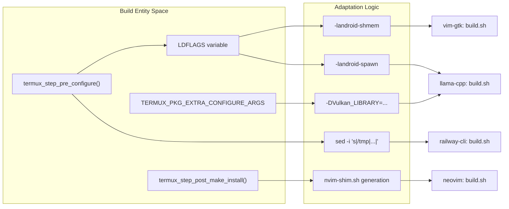

Sources: [x11-packages/vim-gtk/build.sh:81](), [packages/llama-cpp/build.sh:77, 83](), [packages/railway-cli/build.sh:24](), [packages/neovim/build.sh:92-95]()

## Architecture-Specific Exclusions

Some packages cannot support 32-bit Android due to `size_t` limitations or lack of upstream support for older ABIs.

- **llama-cpp**: Excludes `arm` and `i686` because it uses `int64_t` in ways that conflict with 32-bit `size_t` [packages/llama-cpp/build.sh:23-25]().
- **mplayer**: Excludes `i686` [packages/mplayer/build.sh:24]().

Sources: [packages/llama-cpp/build.sh:23-25](), [packages/mplayer/build.sh:24]()

## Summary of Key Adaptation Functions

| Function/Variable | Purpose | Example |
|-------------------|---------|---------|
| `termux_step_pre_configure` | Inject flags and patch sources before build | [packages/railway-cli/build.sh:11]() |
| `termux_step_host_build` | Build host-side tools needed for cross-compilation | [packages/neovim/build.sh:25]() |
| `TERMUX_PKG_EXTRA_CONFIGURE_ARGS` | Pass Android-specific paths to CMake/Autotools | [packages/llama-cpp/build.sh:13]() |
| `termux_step_post_make_install` | Install shims, config files, and cleanup | [packages/neovim/build.sh:48]() |
| `termux_step_create_debscripts` | Generate `postinst` scripts for runtime setup | [packages/miniserve/build.sh:27]() |

Sources: [packages/railway-cli/build.sh:11](), [packages/neovim/build.sh:25, 48](), [packages/llama-cpp/build.sh:13](), [packages/miniserve/build.sh:27]()

---

# Page: Auto-Update Mechanisms

# Auto-Update Mechanisms

<details>
<summary>Relevant source files</summary>

The following files were used as context for generating this wiki page:

- [packages/asciinema/build.sh](packages/asciinema/build.sh)
- [packages/asciinema/locale.rs.patch](packages/asciinema/locale.rs.patch)
- [packages/findomain/build.sh](packages/findomain/build.sh)
- [packages/findomain/headless-chrome.patch](packages/findomain/headless-chrome.patch)
- [packages/findomain/hickory-resolver.diff](packages/findomain/hickory-resolver.diff)
- [packages/flatbuffers/build.sh](packages/flatbuffers/build.sh)
- [packages/flex/build.sh](packages/flex/build.sh)
- [packages/fm/build.sh](packages/fm/build.sh)
- [packages/jack-example-tools/build.sh](packages/jack-example-tools/build.sh)
- [packages/jack2/build.sh](packages/jack2/build.sh)
- [packages/jackett/build.sh](packages/jackett/build.sh)
- [packages/jcal/build.sh](packages/jcal/build.sh)
- [packages/llama-cpp/0002-do-not-install-backend-libs.patch](packages/llama-cpp/0002-do-not-install-backend-libs.patch)
- [packages/llama-cpp/build.sh](packages/llama-cpp/build.sh)
- [packages/marksman/build.sh](packages/marksman/build.sh)
- [packages/marksman/version.diff](packages/marksman/version.diff)
- [packages/minidlna/build.sh](packages/minidlna/build.sh)
- [packages/minimodem/build.sh](packages/minimodem/build.sh)
- [packages/miniserve/build.sh](packages/miniserve/build.sh)
- [packages/minisign/build.sh](packages/minisign/build.sh)
- [packages/mplayer/build.sh](packages/mplayer/build.sh)
- [packages/mplayer/mplayer-1.5-ffmpeg-8.patch](packages/mplayer/mplayer-1.5-ffmpeg-8.patch)
- [packages/mplayer/r38454.patch](packages/mplayer/r38454.patch)
- [packages/mplayer/r38455.patch](packages/mplayer/r38455.patch)
- [packages/mpv/build.sh](packages/mpv/build.sh)
- [packages/mruby/build.sh](packages/mruby/build.sh)
- [packages/msitools/build.sh](packages/msitools/build.sh)
- [packages/neovim-nightly/build.sh](packages/neovim-nightly/build.sh)
- [packages/neovim/build.sh](packages/neovim/build.sh)
- [packages/neovim/disable-checkhealth-locale-warning.patch](packages/neovim/disable-checkhealth-locale-warning.patch)
- [packages/neovim/sysinit.vim](packages/neovim/sysinit.vim)
- [packages/rust-analyzer/build.sh](packages/rust-analyzer/build.sh)
- [packages/texinfo/build.sh](packages/texinfo/build.sh)
- [packages/texinfo/update-info-dir.patch](packages/texinfo/update-info-dir.patch)
- [packages/vim/build.sh](packages/vim/build.sh)
- [packages/vim/fix-writing-archive.patch](packages/vim/fix-writing-archive.patch)
- [packages/vim/revert-1fe0d1e.patch](packages/vim/revert-1fe0d1e.patch)
- [packages/vim/runtime-syntax-sh.vim.patch](packages/vim/runtime-syntax-sh.vim.patch)
- [scripts/bin/check-auto-update](scripts/bin/check-auto-update)
- [scripts/bin/update-packages](scripts/bin/update-packages)
- [scripts/build/termux_error_exit.sh](scripts/build/termux_error_exit.sh)
- [scripts/updates/api/dump-repology-data](scripts/updates/api/dump-repology-data)
- [scripts/updates/api/termux_github_api_get_tag.sh](scripts/updates/api/termux_github_api_get_tag.sh)
- [scripts/updates/api/termux_gitlab_api_get_tag.sh](scripts/updates/api/termux_gitlab_api_get_tag.sh)
- [scripts/updates/api/termux_repology_api_get_latest_version.sh](scripts/updates/api/termux_repology_api_get_latest_version.sh)
- [scripts/updates/internal/termux_github_auto_update.sh](scripts/updates/internal/termux_github_auto_update.sh)
- [scripts/updates/internal/termux_gitlab_auto_update.sh](scripts/updates/internal/termux_gitlab_auto_update.sh)
- [scripts/updates/termux_pkg_auto_update.sh](scripts/updates/termux_pkg_auto_update.sh)
- [scripts/updates/utils/termux_pkg_is_update_needed.sh](scripts/updates/utils/termux_pkg_is_update_needed.sh)
- [scripts/updates/utils/termux_pkg_upgrade_version.sh](scripts/updates/utils/termux_pkg_upgrade_version.sh)
- [x11-packages/mogan/build.sh](x11-packages/mogan/build.sh)
- [x11-packages/mogan/lolly.diff](x11-packages/mogan/lolly.diff)
- [x11-packages/mogan/moebius.diff](x11-packages/mogan/moebius.diff)
- [x11-packages/mogan/xmake-packages-l-lolly.patch](x11-packages/mogan/xmake-packages-l-lolly.patch)
- [x11-packages/mogan/xmake-packages-m-moebius.patch](x11-packages/mogan/xmake-packages-m-moebius.patch)
- [x11-packages/mousepad/build.sh](x11-packages/mousepad/build.sh)
- [x11-packages/mpv-x/build.sh](x11-packages/mpv-x/build.sh)
- [x11-packages/mpv-x/default-to-x11.patch](x11-packages/mpv-x/default-to-x11.patch)
- [x11-packages/vim-gtk/build.sh](x11-packages/vim-gtk/build.sh)
- [x11-packages/vim-gtk/revert-1fe0d1e.patch](x11-packages/vim-gtk/revert-1fe0d1e.patch)

</details>


## Purpose and Scope

This document explains the automated package version update system in the Termux packages repository. It covers how packages detect upstream releases, throttle update frequency to prevent commit spam, and customize version transformation logic through the `termux_pkg_auto_update()` function.

The core logic resides in `scripts/updates/` and is orchestrated by the `scripts/bin/update-packages` script.

---

## Auto-Update System Overview

The auto-update system allows packages to automatically detect and bump their versions when upstream releases occur. Each package can opt-in by setting `TERMUX_PKG_AUTO_UPDATE=true` [scripts/bin/update-packages:19]() and optionally overriding the `termux_pkg_auto_update()` function to customize update behavior.

### Basic Flow

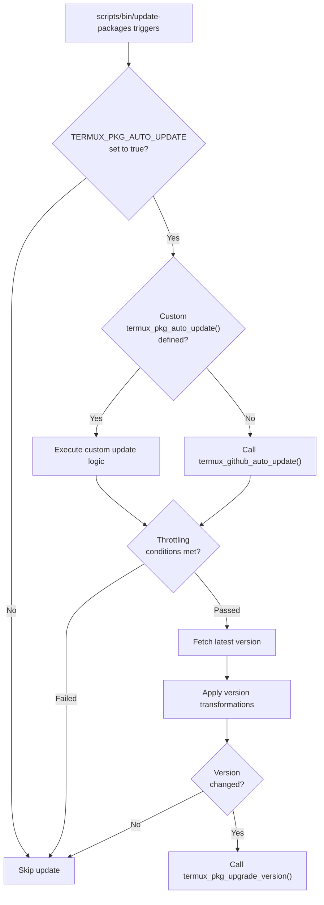

**Sources:** [packages/llama-cpp/build.sh:31-73](), [packages/jackett/build.sh:26-68](), [packages/neovim-nightly/build.sh:27-54](), [scripts/bin/update-packages:105-133]()

---

## Configuration Variables

Packages control auto-update behavior through several `TERMUX_PKG_*` variables defined in `build.sh`. These variables are exported and initialized in the update runner [scripts/bin/update-packages:17-21]().

| Variable | Purpose | Example |
|----------|---------|---------|
| `TERMUX_PKG_AUTO_UPDATE` | Enable auto-updates | `true` |
| `TERMUX_PKG_UPDATE_TAG_TYPE` | Tag selection strategy | `"newest-tag"`, `"latest-release-tag"` |
| `TERMUX_PKG_UPDATE_VERSION_REGEXP` | Filter tags with regex | `"v.*-dev.*\+g[0-9a-f]*"` |
| `TERMUX_PKG_UPDATE_VERSION_SED_REGEXP` | Transform version string | `"s/-/~/"` |
| `TERMUX_PKG_REPOLOGY_METADATA_VERSION` | Version for Repology tracking | `"${TERMUX_PKG_VERSION#*-}"` |

### Simple GitHub Tag Updates

Most packages use the default GitHub tag-based update mechanism provided by `scripts/updates/internal/termux_github_auto_update.sh`.

```bash
# Example from packages/minisign/build.sh
TERMUX_PKG_VERSION="0.11"
TERMUX_PKG_AUTO_UPDATE=true
```

**Sources:** [packages/minisign/build.sh:5-11](), [scripts/bin/update-packages:17-21]()

---

## GitHub API Integration

### Default Tag Query Mechanism

The build system provides `termux_github_api_get_tag()` which extracts the GitHub repository URL from `TERMUX_PKG_SRCURL` and queries the GitHub API.

```mermaid
flowchart LR
    SRCURL["TERMUX_PKG_SRCURL<br/>GitHub archive URL"]
    EXTRACT["Extract repo path"]
    API["api.github.com/repos/.../tags<br/>or<br/>api.github.com/repos/.../releases"]
    FILTER["Apply TERMUX_PKG_UPDATE_TAG_TYPE"]
    REGEX["Apply TERMUX_PKG_UPDATE_VERSION_REGEXP"]
    VERSION["Return version string"]
    
    SRCURL --> EXTRACT
    EXTRACT --> API
    API --> FILTER
    FILTER --> REGEX
    REGEX --> VERSION
```

### Tag Selection Strategies

The `TERMUX_PKG_UPDATE_TAG_TYPE` variable controls which tags are considered:

- `"newest-tag"` - Use `/tags` endpoint, select most recent tag [x11-packages/vim-gtk/build.sh:51]().
- `"latest-release-tag"` - Use `/releases/latest` endpoint (default).

**Sources:** [scripts/updates/api/termux_github_api_get_tag.sh:1-50](), [x11-packages/vim-gtk/build.sh:51-58]()

---

## Throttling Mechanisms

High-frequency release packages implement throttling to prevent commit spam. The pattern queries git history to determine the last auto-update timestamp.

### Implementation Logic

The function checks if the time since the last update commit by "Termux Github Actions" exceeds a defined `update_interval` [packages/llama-cpp/build.sh:34]().

```mermaid
flowchart TB
    START["termux_pkg_auto_update() called"]
    FETCH["git fetch origin"]
    QUERY["git log --author='Termux Github Actions'<br/>--pretty=format:%at<br/>-- build.sh"]
    LAST["last_autoupdate = Unix timestamp"]
    CHECK{"EPOCHSECONDS - last_autoupdate<br/>> update_interval?"}
    CALC["Calculate days/hours/mins since update"]
    PRINT["Print 'Last updated Xd Xh Xm ago'"]
    SKIP["return (skip update)"]
    CONTINUE["Continue to version check"]
    
    START --> FETCH
    FETCH --> QUERY
    QUERY --> LAST
    LAST --> CHECK
    CHECK -->|No| CALC
    CALC --> PRINT
    PRINT --> SKIP
    CHECK -->|Yes| CONTINUE
```

### Throttling Examples

**llama-cpp: 14-day interval**
```bash
# packages/llama-cpp/build.sh:31-62
termux_pkg_auto_update() {
	local origin_url last_autoupdate
	local update_interval="$((14 * 86400))" # 14 days

	if origin_url="$(git config --get remote.origin.url)"; then
		git fetch --quiet "${origin_url}" || { ... }
	fi

	last_autoupdate="$(
		git log \
		--author="Termux Github Actions <contact@termux.dev>" \
		-n1 \
		--pretty=format:%at \
		-- "$TERMUX_PKG_BUILDER_DIR/build.sh"
	)"

	if (( last_autoupdate > EPOCHSECONDS - update_interval )); then
		# Print info and return
		return
	fi
	# ... fetch tag ...
}
```

**jackett: 7-day interval**
```bash
# packages/jackett/build.sh:26-29
termux_pkg_auto_update() {
	local origin_url last_autoupdate
	local update_interval="$((7 * 86400))" # 7 days
```

**Sources:** [packages/llama-cpp/build.sh:31-62](), [packages/jackett/build.sh:26-57]()

---

## Custom Update Logic

### Patch Number Flooring (Vim)

Vim releases nearly every commit as a tag. To avoid spam, the update function floors patch numbers to 50-increment boundaries [packages/vim/build.sh:66-69]().

```bash
# packages/vim/build.sh:53-78
termux_pkg_auto_update() {
	local latest_tag current_patch latest_patch
	latest_tag="$(termux_github_api_get_tag)"
	latest_patch="10#${latest_tag##*.}"
	current_patch="10#${TERMUX_PKG_VERSION##*.}"

	# Floor each version to the last 50th.
	(( current_patch -= current_patch % 50 ))
	((  latest_patch -=  latest_patch % 50 ))

	if (( current_patch == latest_patch )); then
		echo "INFO: Skipping ${latest_tag#v}, no new 50th patch since $TERMUX_PKG_VERSION."
		return
	fi

	termux_pkg_upgrade_version "$(printf '%s.%04d' "${latest_tag%.*}" "${latest_patch}")"
}
```

**Sources:** [packages/vim/build.sh:53-78](), [x11-packages/vim-gtk/build.sh:53-78]()

### Nightly Builds (Neovim)

Neovim nightly tracks the `nightly` release tag on GitHub and extracts the target commitish [packages/neovim-nightly/build.sh:35]().

```bash
# packages/neovim-nightly/build.sh:27-54
termux_pkg_auto_update() {
	local response commit latest_nightly
	response="$(curl -sL \
		-H "Accept: application/vnd.github+json" \
		https://api.github.com/repos/neovim/neovim/releases/tags/nightly
	)"

	commit="$(jq -r '.target_commitish' <<< "$response")"
	if [[ "${commit::10}" == "${TERMUX_PKG_VERSION##*+g}" ]]; then
		echo "INFO: No update needed. Already at version '${TERMUX_PKG_VERSION}'."
		return
	fi

	latest_nightly="$(grep --max-count=1 -oP "$TERMUX_PKG_UPDATE_VERSION_REGEXP" < <(jq -r '.body' <<< "$response"))"
	unset TERMUX_PKG_UPDATE_VERSION_REGEXP
	termux_pkg_upgrade_version "${latest_nightly}"
}
```

**Sources:** [packages/neovim-nightly/build.sh:27-54]()

### Date-Based Versions (rust-analyzer)

`rust-analyzer` uses tags like `2024-05-11`, which the update script converts to `20240511` [packages/rust-analyzer/build.sh:23]().

```bash
# packages/rust-analyzer/build.sh:16-53
termux_pkg_auto_update() {
	local api_url="https://api.github.com/repos/rust-lang/rust-analyzer/tags"
	local api_url_r=$(curl -s "${api_url}")
	local r1=$(echo "${api_url_r}" | jq .[].name | sed -e 's|\"||g')
	local latest_tag=$(echo "${r1}" | sed -nE 's/^([0-9]*-)/\1/p' | sort -V | tail -n1)
	local latest_version=${latest_tag:0:4}${latest_tag:5:2}${latest_tag:8:2}
	# ... comparison and upgrade ...
	termux_pkg_upgrade_version "${latest_version}" --skip-version-check
}
```

**Sources:** [packages/rust-analyzer/build.sh:16-53]()

---

## Version Transformation and Validation

The `termux_pkg_upgrade_version` function handles the final stage of the update, including string manipulation and file modification.

### String Processing Logic
The function applies several transformations to the version string before writing it to `build.sh`:
1. **Regex Filtering**: Applies `TERMUX_PKG_UPDATE_VERSION_REGEXP` [scripts/updates/utils/termux_pkg_upgrade_version.sh:38-49]() and `TERMUX_PKG_UPDATE_VERSION_SED_REGEXP` [scripts/updates/utils/termux_pkg_upgrade_version.sh:52-63]().
2. **Normalization**: Removes leading non-digits [scripts/updates/utils/termux_pkg_upgrade_version.sh:67]() and replaces underscores with dots [scripts/updates/utils/termux_pkg_upgrade_version.sh:71]().
3. **Suffix Translation**: Converts suffixes like `-rc` or `-beta` to `~rc` or `~beta` to ensure correct Debian version ordering [scripts/updates/utils/termux_pkg_upgrade_version.sh:75-78]().

### Automated Actions
If an update is valid and not a dry-run:
1. **File Update**: Updates `TERMUX_PKG_VERSION` in `build.sh` using `sed` and removes `TERMUX_PKG_REVISION` [scripts/updates/utils/termux_pkg_upgrade_version.sh:103-106]().
2. **Checksum Update**: Runs `update-checksum` to fetch the new source and update the SHA256 [scripts/updates/utils/termux_pkg_upgrade_version.sh:109-115]().
3. **Validation Build**: Triggers a build in Docker using `build-package.sh` to ensure the update doesn't break compilation [scripts/updates/utils/termux_pkg_upgrade_version.sh:142]().
4. **Git Commit**: If `GIT_COMMIT_PACKAGES` is true, creates a "bump(...)" commit [scripts/updates/utils/termux_pkg_upgrade_version.sh:150-169]().

**Sources:** [scripts/updates/utils/termux_pkg_upgrade_version.sh:18-186]()

---

## Coordination Patterns

### Version Guarding
Some packages must be updated in lockstep. For example, `mpv` and `mpv-x` check each other's versions in `termux_step_post_get_source()` to ensure consistency.

```bash
# packages/mpv/build.sh:36-44
termux_step_post_get_source() {
	local ver_m ver_x
	ver_m="${TERMUX_PKG_VERSION#*:}"
	ver_x="$(. "$TERMUX_SCRIPTDIR/x11-packages/mpv-x/build.sh"; echo "${TERMUX_PKG_VERSION#*:}")"
	if [[ "${ver_m}" != "${ver_x}" ]]; then
		termux_error_exit "Version mismatch between mpv and mpv-x."
	fi
}
```

**Sources:** [packages/mpv/build.sh:36-44](), [x11-packages/mpv-x/build.sh:31-39]()

---

# Page: CI/CD Pipeline

# CI/CD Pipeline

<details>
<summary>Relevant source files</summary>

The following files were used as context for generating this wiki page:

- [.github/actions/zram/action.yml](.github/actions/zram/action.yml)
- [.github/workflows/bootstrap_archives.yml](.github/workflows/bootstrap_archives.yml)
- [.github/workflows/check_repository_health.yml](.github/workflows/check_repository_health.yml)
- [.github/workflows/codeql.yml](.github/workflows/codeql.yml)
- [.github/workflows/command_not_found.yml](.github/workflows/command_not_found.yml)
- [.github/workflows/docker_image.yml](.github/workflows/docker_image.yml)
- [.github/workflows/golang_validation.yml](.github/workflows/golang_validation.yml)
- [.github/workflows/package_updates.yml](.github/workflows/package_updates.yml)
- [.github/workflows/packages.yml](.github/workflows/packages.yml)
- [.github/workflows/zig_validation.yml](.github/workflows/zig_validation.yml)
- [scripts/bin/validation](scripts/bin/validation)
- [scripts/free-space.sh](scripts/free-space.sh)
- [scripts/run-docker.sh](scripts/run-docker.sh)

</details>


The Termux CI/CD pipeline is a GitHub Actions-based automation system that builds, tests, and distributes packages across four Android architectures. The system processes approximately 1,000+ packages through multiple workflows that handle building, automatic version updates, quality assurance, and publishing to the APT repository at `packages.termux.dev`.

## Overview

The CI/CD infrastructure consists of five primary GitHub Actions workflows located in [.github/workflows/]():

| Workflow | Trigger | Primary Function | Detailed Documentation |
|----------|---------|------------------|------------------------|
| `packages.yml` | Push, PR, Manual | Build and publish packages for 4 architectures | [Main Build Workflow](#3.1) |
| `package_updates.yml` | Schedule (6h), Manual | Auto-update package versions from upstream | [Automated Package Updates](#3.3) |
| `check_repository_health.yml` | Schedule (weekly) | Validate APT repository consistency | [Repository Health Checks](#3.4) |
| `golang_validation.yml` | Manual, PR | Batch-test all Golang packages | [Language-Specific Validation](#3.5) |
| `zig_validation.yml` | Manual, PR | Batch-test all Zig packages | [Language-Specific Validation](#3.5) |

Additional workflows manage supporting infrastructure:
- `docker_image.yml`: Rebuilds Docker images weekly with updated dependencies [.github/workflows/docker_image.yml:22-23]()
- `bootstrap_archives.yml`: Generates minimal Termux installation archives weekly [.github/workflows/bootstrap_archives.yml:4-5]()
- `command_not_found.yml`: Regenerates command-not-found database weekly [.github/workflows/command_not_found.yml:4-5]()

### High-Level Architecture

Title: CI/CD Workflow Relationships and Data Flow

```mermaid
flowchart TB
    subgraph "Event Sources"
        git_push["git push<br/>(master/dev branches)"]
        pull_request["pull_request<br/>(package changes)"]
        cron_6h["schedule: 0 */6 * * *<br/>(every 6 hours)"]
        cron_weekly["schedule: 0 X * * 0<br/>(weekly)"]
        workflow_dispatch["workflow_dispatch<br/>(manual trigger)"]
    end
    
    subgraph "Build & Test Workflows"
        packages_yml["packages.yml"]
        golang_validation["golang_validation.yml"]
        zig_validation["zig_validation.yml"]
    end
    
    subgraph "Automation Workflows"
        package_updates["package_updates.yml"]
        check_health["check_repository_health.yml"]
        docker_image["docker_image.yml"]
        bootstrap["bootstrap_archives.yml"]
    end
    
    subgraph "Outputs"
        debs["*.deb artifacts<br/>(uploaded via actions/upload-artifact)"]
        apt_repo["packages.termux.dev<br/>(via aptly_api.sh)"]
        gh_releases["GitHub Releases<br/>(bootstrap archives)"]
        gh_issues["GitHub Issues<br/>(health check failures)"]
        docker_reg["ghcr.io & Docker Hub<br/>(termux/package-builder)"]
    end
    
    git_push --> packages_yml
    pull_request --> packages_yml
    pull_request --> golang_validation
    pull_request --> zig_validation
    workflow_dispatch --> packages_yml
    workflow_dispatch --> package_updates
    
    cron_6h --> package_updates
    cron_weekly --> check_health
    cron_weekly --> docker_image
    cron_weekly --> bootstrap
    
    packages_yml --> debs
    packages_yml -- "master branch only" --> apt_repo
    golang_validation --> debs
    zig_validation --> debs
    
    package_updates -- "commits version bumps" --> git_push
    package_updates -- "on build failure" --> gh_issues
    
    check_health -- "on failure" --> gh_issues
    docker_image --> docker_reg
    bootstrap --> gh_releases
```

Sources: [.github/workflows/packages.yml:1-18](), [.github/workflows/package_updates.yml:1-25](), [.github/workflows/check_repository_health.yml:1-7](), [.github/workflows/golang_validation.yml:1-13](), [.github/workflows/zig_validation.yml:1-13](), [.github/workflows/docker_image.yml:1-25](), [.github/workflows/bootstrap_archives.yml:1-7]()

## Workflow Triggers and Concurrency

The CI/CD system uses GitHub Actions event triggers to coordinate execution. Different workflows have triggering strategies optimized for their purpose.

### Trigger Matrix

| Workflow | Push | Pull Request | Schedule | Manual | Paths Filter |
|----------|------|--------------|----------|--------|--------------|
| `packages.yml` | master, dev | Yes | No | Yes | packages/**, root-packages/**, x11-packages/** |
| `package_updates.yml` | All branches except master | Yes | Every 6 hours | Yes | packages/**, root-packages/**, x11-packages/** |
| `check_repository_health.yml` | No | No | Sunday 05:00 UTC | Yes | None |
| `golang_validation.yml` | No | Yes | No | Yes | golang/build.sh, termux_setup_golang.sh |
| `zig_validation.yml` | No | Yes | No | Yes | zig/build.sh, termux_setup_zig.sh |

### Concurrency Control

The `packages.yml` workflow implements concurrency control to manage runner resources [.github/workflows/packages.yml:30-34]():

```yaml
concurrency:
  group: ${{ github.event_name == 'pull_request' && format('pr-{0}', github.event.pull_request.number) || github.run_id }}
  cancel-in-progress: ${{ github.event_name == 'pull_request' }}
```

This configuration groups PR builds by number and cancels previous runs if a new commit is pushed, while allowing push events on master to run to completion using the unique `run_id`.

Sources: [.github/workflows/packages.yml:30-34](), [.github/workflows/package_updates.yml:1-25](), [.github/workflows/check_repository_health.yml:3-7](), [.github/workflows/golang_validation.yml:7-13]()

## Build Matrix and Architecture Support

All build workflows execute across a 4-architecture matrix: `aarch64`, `arm`, `i686`, and `x86_64` [.github/workflows/packages.yml:43]().

Title: Architecture Build Matrix

```mermaid
flowchart LR
    subgraph "Build Jobs"
        build_job["build job<br/>(strategy: matrix)"]
    end
    
    subgraph "Architecture Matrix"
        aarch64["aarch64<br/>(ARM64)"]
        arm["arm<br/>(ARMv7)"]
        i686["i686<br/>(x86 32-bit)"]
        x86_64["x86_64<br/>(x86 64-bit)"]
    end
    
    subgraph "Docker Execution"
        docker_run["scripts/run-docker.sh"]
        build_pkg["build-package.sh -a ARCH"]
    end
    
    build_job --> aarch64
    build_job --> arm
    build_job --> i686
    build_job --> x86_64
    
    aarch64 --> docker_run
    arm --> docker_run
    i686 --> docker_run
    x86_64 --> docker_run
    
    docker_run --> build_pkg
```

The `fail-fast: false` setting [.github/workflows/packages.yml:44]() ensures that architecture-specific failures do not stop the entire build matrix.

Sources: [.github/workflows/packages.yml:41-44](), [.github/workflows/golang_validation.yml:18-19](), [.github/workflows/zig_validation.yml:18-19]()

## Docker Build Environment

Package builds execute inside Docker containers for reproducibility. `scripts/run-docker.sh` manages the lifecycle, security profiles, and environment setup.

Title: Docker Container Lifecycle in CI/CD

```mermaid
flowchart TD
    start["Workflow Step: Build packages"]
    
    run_docker["scripts/run-docker.sh -d"]
    dry_run["build-package-dry-run-simulation.sh"]
    
    check_exist{"Container<br/>termux-package-builder<br/>exists?"}
    create_container["docker run --detach<br/>--name termux-package-builder"]
    
    load_apparmor["Load AppArmor profiles<br/>(profile-relaxed.apparmor)"]
    change_uid["Change builder uid/gid"]
    change_pidmax["Set /proc/sys/kernel/pid_max"]
    
    docker_exec["docker exec<br/>build-package.sh -a ARCH"]
    
    start --> run_docker
    run_docker --> dry_run
    dry_run -- "Exit 85 (noop)" --> skip["Skip build"]
    dry_run -- "Continue" --> check_exist
    
    check_exist -- "No" --> create_container
    
    create_container --> load_apparmor
    load_apparmor --> change_uid
    change_uid --> change_pidmax
    change_pidmax --> docker_exec
```

### Container Configuration
The environment utilizes `ghcr.io/termux/package-builder` [scripts/run-docker.sh:5]() and implements security via AppArmor profiles like `profile-relaxed.apparmor` [scripts/run-docker.sh:154](). It also adjusts `pid_max` to 65535 for compatibility with 32-bit architectures using proot [scripts/run-docker.sh:170-171]().

Sources: [scripts/run-docker.sh:1-180](), [scripts/bin/build-package-dry-run-simulation.sh:1-85]()

## Resource and Disk Space Management

GitHub Actions runners have limited disk space. The CI pipeline uses `scripts/free-space.sh` to clear approximately 36G of space by purging pre-installed software like `.NET`, `Android SDK`, and `LLVM` [scripts/free-space.sh:3-44](). Additionally, the `.github/actions/zram` action enables `zram` with `zstd` compression to expand available memory [/.github/actions/zram/action.yml:4-9]().

Sources: [scripts/free-space.sh:1-56](), [/.github/actions/zram/action.yml:1-90]()

## Package Update Pipeline

The `package_updates.yml` workflow automates version bumps. It checks for updates every 6 hours [.github/workflows/package_updates.yml:18]() and uses `scripts/bin/update-packages` to process them [.github/workflows/package_updates.yml:92]().

1. **Check**: Queries GitHub GraphQL or Repology APIs for new versions.
2. **Update**: Modifies `build.sh` and updates checksums [.github/workflows/package_updates.yml:131]().
3. **Validate**: Performs a test build in the Docker environment [.github/workflows/package_updates.yml:116]().
4. **Commit**: Pushes changes back to the repository if successful [.github/workflows/package_updates.yml:132]().

Sources: [.github/workflows/package_updates.yml:1-155](), [scripts/bin/update-packages:1-253]()

## Quality and Health Checks

### Repository Health
`check_repository_health.yml` runs weekly to ensure the APT repository matches the repository state [.github/workflows/check_repository_health.yml:5](). It generates a package list via `scripts/generate-apt-packages-list.sh` [.github/workflows/check_repository_health.yml:24]() and validates it using `scripts/check-repository-health.js` [.github/workflows/check_repository_health.yml:31]().

### Language Validation
Workflows like `golang_validation.yml` batch-test packages using specific toolchains [.github/workflows/golang_validation.yml:59-60](). They use `scripts/bin/validation` to split packages into manageable batches to avoid disk space exhaustion [.github/workflows/golang_validation.yml:26]().

Sources: [.github/workflows/check_repository_health.yml:1-54](), [.github/workflows/golang_validation.yml:1-67](), [scripts/bin/validation:1-162]()

## Detailed Workflow Documentation
For deeper technical details on specific components, see the child pages:
- [Main Build Workflow](#3.1) — Matrix builds, package discovery, and APT uploads.
- [Docker Build Environment](#3.2) — Container security, lifecycle, and optimization.
- [Automated Package Updates](#3.3) — Version checking and auto-committing.
- [Repository Health Checks](#3.4) — APT repository consistency validation.
- [Language-Specific Validation](#3.5) — Batch testing for Golang and Zig.

---

# Page: Main Build Workflow

# Main Build Workflow

<details>
<summary>Relevant source files</summary>

The following files were used as context for generating this wiki page:

- [.github/actions/zram/action.yml](.github/actions/zram/action.yml)
- [.github/workflows/bootstrap_archives.yml](.github/workflows/bootstrap_archives.yml)
- [.github/workflows/check_repository_health.yml](.github/workflows/check_repository_health.yml)
- [.github/workflows/codeql.yml](.github/workflows/codeql.yml)
- [.github/workflows/command_not_found.yml](.github/workflows/command_not_found.yml)
- [.github/workflows/docker_image.yml](.github/workflows/docker_image.yml)
- [.github/workflows/golang_validation.yml](.github/workflows/golang_validation.yml)
- [.github/workflows/package_updates.yml](.github/workflows/package_updates.yml)
- [.github/workflows/packages.yml](.github/workflows/packages.yml)
- [.github/workflows/zig_validation.yml](.github/workflows/zig_validation.yml)
- [packages/lua-lpeg/lua52-lpeg.subpackage.sh](packages/lua-lpeg/lua52-lpeg.subpackage.sh)
- [packages/tesseract/build.sh](packages/tesseract/build.sh)
- [packages/texlab/build.sh](packages/texlab/build.sh)
- [packages/texlive-bin/build.sh](packages/texlive-bin/build.sh)
- [packages/texlive-bin/libandroid-complex-math.patch](packages/texlive-bin/libandroid-complex-math.patch)
- [packages/texlive-bin/texk-xdvipsk-Makefile.in.patch](packages/texlive-bin/texk-xdvipsk-Makefile.in.patch)
- [scripts/bin/validation](scripts/bin/validation)
- [scripts/build/termux_step_install_license.sh](scripts/build/termux_step_install_license.sh)
- [scripts/free-space.sh](scripts/free-space.sh)
- [scripts/lint-packages.sh](scripts/lint-packages.sh)
- [scripts/run-docker.sh](scripts/run-docker.sh)
- [x11-packages/i3status/build.sh](x11-packages/i3status/build.sh)
- [x11-packages/inkscape/build.sh](x11-packages/inkscape/build.sh)
- [x11-packages/jwm/build.sh](x11-packages/jwm/build.sh)
- [x11-packages/keepassxc/build.sh](x11-packages/keepassxc/build.sh)
- [x11-packages/kermit/build.sh](x11-packages/kermit/build.sh)
- [x11-packages/openimageio/build.sh](x11-packages/openimageio/build.sh)
- [x11-packages/openvdb/build.sh](x11-packages/openvdb/build.sh)
- [x11-packages/poppler-qt/build.sh](x11-packages/poppler-qt/build.sh)
- [x11-packages/wireshark-qt/build.sh](x11-packages/wireshark-qt/build.sh)

</details>


The main build workflow is the core continuous integration system that compiles packages across all supported Android architectures and distributes them to the APT repository. This workflow is defined in [.github/workflows/packages.yml]() and handles automatic builds on commits, pull request validation, and manual package rebuilds.

For information about automated version updates, see [Automated Package Updates](#3.3). For Docker environment details, see [Docker Build Environment](#3.2). For repository validation, see [Repository Health Checks](#3.4).

## Trigger Events and Concurrency Control

The workflow activates under three distinct conditions, each with different behavior and permissions.

**Trigger Sources:**

| Event | Branches | Paths | Permissions |
|-------|----------|-------|-------------|
| `push` | `master`, `dev`, `dev/**` | `packages/**`, `root-packages/**`, `x11-packages/**` | `contents: read` |
| `pull_request` | Any | `packages/**`, `root-packages/**`, `x11-packages/**` | `contents: read` |
| `workflow_dispatch` | Any | N/A | Manual package list input |

The concurrency model ensures efficient resource usage: pull requests are grouped by PR number and allow cancellation of outdated runs, while push events use unique run IDs to prevent conflicts.

```yaml
# .github/workflows/packages.yml:30-34
concurrency:
  group: ${{ github.event_name == 'pull_request' && format('pr-{0}', github.event.pull_request.number) || github.run_id }}
  cancel-in-progress: ${{ github.event_name == 'pull_request' }}
```

**Special Commit Tags:**
- `%ci:no-build` - Skip build entirely, mark as passed [[.github/workflows/packages.yml:101-105]()]
- `%ci:free-disk` - Force disk space cleanup even for non-large packages [[.github/workflows/packages.yml:194-196]()]

Sources: [.github/workflows/packages.yml:3-34](), [.github/workflows/packages.yml:99-105](), [.github/workflows/packages.yml:194-196]()

## Package Discovery Process

The workflow determines which packages to build through git diff analysis or manual specification.

```mermaid
flowchart TB
    EVENT["Event Trigger"]
    
    subgraph "Push/PR Events"
        GIT_RANGE["Determine Git Range<br/>OLD_COMMIT..HEAD_COMMIT"]
        MERGE_BASE["Calculate merge-base<br/>for pull requests"]
        GIT_DIFF["git diff-tree<br/>Extract changed files"]
        MERGE_CHECK["Check for merge commits<br/>Fail if found in PRs"]
    end
    
    subgraph "Manual Dispatch"
        MANUAL_INPUT["Parse MANUAL_INPUT_PACKAGES"]
        VALIDATE_PKG["Validate each package<br/>exists in repo_path"]
    end
    
    subgraph "File Parsing"
        REGEX_MATCH["Regex: ^repo_path/pkg/.*$<br/>Extract package name"]
        BUILD_LIST["Generate built_repo_packages.txt"]
        SUBPKG_LIST["Find *.subpackage.sh files<br/>Add to built_repo_subpackages.txt"]
        DELETED_LIST["Check if dir exists<br/>else → deleted_repo_packages.txt"]
    end
    
    subgraph "Deduplication"
        SORT_UNIQ["sort | uniq on all lists"]
        MERGE_LISTS["Merge packages + subpackages<br/>into final list"]
    end
    
    EVENT --> GIT_RANGE
    EVENT --> MANUAL_INPUT
    
    GIT_RANGE --> MERGE_BASE
    MERGE_BASE --> MERGE_CHECK
    MERGE_CHECK --> GIT_DIFF
    GIT_DIFF --> REGEX_MATCH
    
    MANUAL_INPUT --> VALIDATE_PKG
    VALIDATE_PKG --> BUILD_LIST
    
    REGEX_MATCH --> BUILD_LIST
    REGEX_MATCH --> SUBPKG_LIST
    REGEX_MATCH --> DELETED_LIST
    
    BUILD_LIST --> SORT_UNIQ
    SUBPKG_LIST --> SORT_UNIQ
    DELETED_LIST --> SORT_UNIQ
    
    SORT_UNIQ --> MERGE_LISTS
```

**Git Diff Analysis for Push Events:**

The workflow uses `git diff-tree` to identify changed files between commits. For push events, it compares `github.event.before` (`OLD_COMMIT`) to `github.event.after` (`HEAD_COMMIT`). For pull requests, it calculates the merge base against the target branch using `git merge-base`.

[[.github/workflows/packages.yml:62-83]()]

**Package Identification Logic:**

Files matching the pattern `^${repo_path}/([.a-z0-9+-]*)/.*$` are analyzed:
- If `build.sh` or any file in the package directory changed → add to `built_${repo}_packages.txt` [[.github/workflows/packages.yml:128]()]
- If `*.subpackage.sh` exists → add subpackage to `built_${repo}_subpackages.txt` [[.github/workflows/packages.yml:132]()]
- If directory was deleted → add to `deleted_${repo}_packages.txt` [[.github/workflows/packages.yml:135]()]

**Manual Workflow Dispatch:**

When triggered manually, the `MANUAL_INPUT_PACKAGES` input is parsed into an array, and each package is validated to exist in one of the repository paths defined in `repo.json`.

[[.github/workflows/packages.yml:140-161]()]

Sources: [.github/workflows/packages.yml:51-178](), [.github/workflows/packages.yml:18-26]()

## Build Matrix and Architecture Targets

The build job executes in parallel across all supported Android architectures using GitHub Actions matrix strategy.

```mermaid
flowchart LR
    subgraph "Build Matrix"
        MATRIX["strategy.matrix.target_arch"]
        
        AARCH64["aarch64<br/>(ARM64)"]
        ARM["arm<br/>(ARMv7)"]
        I686["i686<br/>(x86 32-bit)"]
        X86_64["x86_64<br/>(x86 64-bit)"]
    end
    
    subgraph "Runner"
        UBUNTU["ubuntu-24.04<br/>x86_64 Linux host"]
    end
    
    subgraph "Build Execution"
        DOCKER["termux/package-builder:latest<br/>Docker container"]
        BUILD_CMD["./build-package.sh<br/>-a target_arch"]
    end
    
    MATRIX --> AARCH64
    MATRIX --> ARM
    MATRIX --> I686
    MATRIX --> X86_64
    
    UBUNTU --> DOCKER
    
    AARCH64 --> BUILD_CMD
    ARM --> BUILD_CMD
    I686 --> BUILD_CMD
    X86_64 --> BUILD_CMD
    
    DOCKER --> BUILD_CMD
```

The matrix uses `fail-fast: false`, ensuring that failures in one architecture don't cancel builds for other architectures. Each job runs independently and uploads its own artifacts.

Sources: [.github/workflows/packages.yml:41-44](), [.github/workflows/packages.yml:40]()

## Lint Validation

Before building, all modified package recipes are validated using `scripts/lint-packages.sh`.

The lint script performs several critical checks:
- **Package Name Validation**: Ensures names follow `dpkg` standards and are at least 2 characters long [[scripts/lint-packages.sh:55-72]()].
- **License Validation**: Checks against an allowed list of standard licenses [[scripts/lint-packages.sh:10-53]()].
- **Indentation Check**: Enforces the use of tabs for indentation and detects mixed indentation [[scripts/lint-packages.sh:74-129]()].
- **Version Check**: Validates `TERMUX_PKG_VERSION` using `dpkg --validate-version` [[scripts/lint-packages.sh:153-201]()].

Sources: [scripts/lint-packages.sh:1-201](), [.github/workflows/packages.yml:218-230]()

## Build Environment Preparation

### ZRAM Configuration

A 16GB zram swap device is configured with zstd compression to optimize memory usage during compilation.

```yaml
# .github/workflows/packages.yml:232-239
- name: Enable zram
  uses: ./.github/actions/zram
  with:
    algorithm: zstd
    size: 16G
    priority: 100
    device_name: /dev/zram0
```

The zram action is used to provide extra memory headroom for large compilations.

Sources: [.github/workflows/packages.yml:232-239](), [.github/actions/zram/action.yml]()

### Docker Image Handling

The workflow supports two Docker image sources:

1. **Pre-built image from GHCR** (default): `ghcr.io/termux/package-builder:latest` [[scripts/run-docker.sh:5]()]
2. **Locally built image**: Built from `scripts/Dockerfile` if build scripts change.

**Disk Space Management:**

The `free-space` flag is set to `true` if manual dispatch requested it, if the commit message contains `%ci:free-disk`, or if a "big" package is detected. When enabled, `scripts/free-space.sh` removes approximately 36GB-60GB of pre-installed software from the GitHub runner, including .NET, Haskell, and cached Docker content.

[[scripts/free-space.sh:1-56]()]

Sources: [.github/workflows/packages.yml:190-206](), [.github/workflows/packages.yml:241-256](), [scripts/free-space.sh:1-56]()

### Docker Container Lifecycle

The `run-docker.sh` script manages container creation, lifecycle, and security profiles.

```mermaid
flowchart TB
    START["./scripts/run-docker.sh"]
    
    DRY_RUN_CHECK["Check --dry-run flag<br/>Run build-package-dry-run-simulation.sh"]
    DRY_RUN_EXIT["Exit with code 85<br/>if no packages to build"]
    
    LOAD_APPARMOR_RELAXED["Load profile-relaxed.apparmor<br/>sed 's/{{CONTAINER_NAME}}/$CONTAINER_NAME/g'<br/>sudo apparmor_parser -rK"]
    
    CONTAINER_EXISTS["docker container inspect<br/>termux-package-builder"]
    
    CREATE_CONTAINER["docker run --detach --init<br/>--name termux-package-builder<br/>--volume REPOROOT:$CONTAINER_HOME_DIR/termux-packages<br/>--security-opt seccomp=profile.json<br/>--security-opt apparmor=_custom-termux-package-builder<br/>--cap-add CAP_SYS_ADMIN<br/>--device /dev/fuse"]
    
    CHANGE_UID_GID["usermod -u $(id -u) builder<br/>groupmod -g $(id -g) builder<br/>chown -R $(id -u):$(id -g) $CONTAINER_HOME_DIR"]
    
    CHANGE_PID_MAX["Set /proc/sys/kernel/pid_max=65535<br/>for proot on 32-bit arches"]
    
    START_CONTAINER["docker start termux-package-builder"]
    
    LOAD_APPARMOR_RESTRICTED["Load profile-restricted.apparmor<br/>Enforce build isolation"]
    
    EXEC_CMD["docker exec --interactive --tty<br/>termux-package-builder $@"]
    
    START --> DRY_RUN_CHECK
    DRY_RUN_CHECK -->|"would build packages"| LOAD_APPARMOR_RELAXED
    DRY_RUN_CHECK -->|"no packages"| DRY_RUN_EXIT
    
    LOAD_APPARMOR_RELAXED --> CONTAINER_EXISTS
    
    CONTAINER_EXISTS -->|"not exists"| CREATE_CONTAINER
    CONTAINER_EXISTS -->|"exists but stopped"| START_CONTAINER
    CONTAINER_EXISTS -->|"running"| LOAD_APPARMOR_RESTRICTED
    
    CREATE_CONTAINER --> CHANGE_UID_GID
    CHANGE_UID_GID --> CHANGE_PID_MAX
    CHANGE_PID_MAX --> LOAD_APPARMOR_RESTRICTED
    
    START_CONTAINER --> CHANGE_PID_MAX
    
    LOAD_APPARMOR_RESTRICTED --> EXEC_CMD
```

**AppArmor Profile Loading:**

Two AppArmor profiles provide defense-in-depth security:
1. **profile-relaxed.apparmor**: Loaded during container setup to allow UID/GID changes [[scripts/run-docker.sh:154]()].
2. **profile-restricted.apparmor**: Loaded before build execution to enforce strict isolation [[scripts/run-docker.sh:212]()].

**UID/GID Synchronization:**

To prevent permission issues with bind-mounted volumes, the container's `builder` user UID/GID is modified to match the host user's UID/GID.

[[scripts/run-docker.sh:156-166]()]

**PID Namespace Limit:**

For packages requiring `proot` execution, `/proc/sys/kernel/pid_max` is set to 65535.

[[scripts/run-docker.sh:168-189]()]

Sources: [scripts/run-docker.sh:1-222]()

## Package Build Execution

The actual compilation occurs inside the Docker container via `build-package.sh`.

```bash
# .github/workflows/packages.yml:269
./scripts/run-docker.sh -d ./build-package.sh -I -C -a "${{ matrix.target_arch }}" "${packages[@]}"
```

**Build Flags:**
- `-I`: Install build dependencies.
- `-C`: Continue building packages in list even if one fails.
- `-a <arch>`: Target architecture.
- `-d`: Dry-run check before Docker execution [[scripts/run-docker.sh:71-86]()].

Sources: [.github/workflows/packages.yml:257-272](), [scripts/run-docker.sh:71-86]()

## Artifact Generation and Checksums

After builds complete, artifacts are collected and packaged.

```mermaid
flowchart TB
    COLLECT_OUTPUT["Move termux-packages/output/* → ./output/"]
    COPY_LISTS["Copy package lists to debs/"]
    FIND_DEBS["Find matching *.deb files"]
    MOVE_DEBS["Move matched .deb files to debs/"]
    CREATE_TAR["tar cf artifacts/debs-arch-sha.tar debs"]
    CHECKSUM["sha256sum debs/*.deb<br/>→ checksum-arch-sha.txt"]
    UPLOAD_CHECKSUM["actions/upload-artifact@v6"]
    UPLOAD_DEBS["actions/upload-artifact@v6"]
    
    COLLECT_OUTPUT --> COPY_LISTS
    COPY_LISTS --> FIND_DEBS
    FIND_DEBS --> MOVE_DEBS
    MOVE_DEBS --> CREATE_TAR
    CREATE_TAR --> CHECKSUM
    CHECKSUM --> UPLOAD_CHECKSUM
    CREATE_TAR --> UPLOAD_DEBS
```

Artifacts are archived as `.tar` files because GitHub Actions has issues with filenames containing special characters like `:`.

[[.github/workflows/packages.yml:274-299]()]

Sources: [.github/workflows/packages.yml:274-319]()

## Upload Validation and Repository Health

For pull requests, the `upload-test` job validates that built packages don't conflict with existing APT repository packages by downloading the remote `Packages.bz2` index and comparing filenames.

[[.github/workflows/packages.yml:347-411]()]

**Repository Health Checks:**

A separate workflow, `Check Repository Health`, runs weekly to compare the `build.sh` definitions against the live APT repository. If discrepancies are found, it generates a report and creates a GitHub issue [[.github/workflows/check_repository_health.yml:1-54]()].

Sources: [.github/workflows/packages.yml:347-411](), [.github/workflows/check_repository_health.yml:1-54]()

## APT Repository Upload (Master Branch)

Only builds on the `master` branch upload packages to the production APT repository. The process uses the Aptly REST API to upload files, add them to the repository, and publish the updated snapshot.

[[.github/workflows/packages.yml:413-474]()]

Sources: [.github/workflows/packages.yml:413-474]()

---

# Page: Docker Build Environment

# Docker Build Environment

<details>
<summary>Relevant source files</summary>

The following files were used as context for generating this wiki page:

- [.github/actions/zram/action.yml](.github/actions/zram/action.yml)
- [.github/workflows/bootstrap_archives.yml](.github/workflows/bootstrap_archives.yml)
- [.github/workflows/check_repository_health.yml](.github/workflows/check_repository_health.yml)
- [.github/workflows/codeql.yml](.github/workflows/codeql.yml)
- [.github/workflows/command_not_found.yml](.github/workflows/command_not_found.yml)
- [.github/workflows/docker_image.yml](.github/workflows/docker_image.yml)
- [.github/workflows/golang_validation.yml](.github/workflows/golang_validation.yml)
- [.github/workflows/package_updates.yml](.github/workflows/package_updates.yml)
- [.github/workflows/packages.yml](.github/workflows/packages.yml)
- [.github/workflows/zig_validation.yml](.github/workflows/zig_validation.yml)
- [scripts/bin/validation](scripts/bin/validation)
- [scripts/free-space.sh](scripts/free-space.sh)
- [scripts/run-docker.sh](scripts/run-docker.sh)

</details>


## Purpose and Scope

This document explains the Docker container infrastructure used to provide consistent, isolated build environments for compiling Termux packages. It covers container lifecycle management via `scripts/run-docker.sh`, security hardening through AppArmor and seccomp profiles, performance optimizations including ZRAM swap, and the weekly image rebuild process. For information about how the build workflow orchestrates these containers across the 4-architecture matrix, see [Main Build Workflow](#3.1).

---

## Docker Image Architecture

The build system uses two Docker images maintained in multiple registries for redundancy and accessibility.

### Image Types and Registries

| Image Name | Purpose | Base Configuration |
|------------|---------|-------------------|
| `termux/package-builder` | Standard package builds | Ubuntu with Android NDK, build tools |
| `termux/package-builder-cgct` | CGCT toolchain builds | Extended with custom GCC cross-compilation toolchain |

Both images are published to:
- **GitHub Container Registry (GHCR)**: `ghcr.io/termux/package-builder:latest`
- **Docker Hub**: `termux/package-builder:latest`

The dual registry strategy provides fallback options, as GHCR connections can be unstable during uploads [[.github/workflows/docker_image.yml:83-100]]().

**Sources**: [[.github/workflows/docker_image.yml:58-65]](), [[scripts/run-docker.sh:5]]()

### Weekly Rebuild Process

```mermaid
flowchart TB
    subgraph "Rebuild Triggers"
        SCHEDULE["Scheduled Cron<br/>Sunday 2:00 UTC"]
        PUSH["Push to master<br/>(scripts/Dockerfile, setup-*.sh)"]
        PR["Pull Request<br/>(Dockerfile changes)"]
        MANUAL["workflow_dispatch"]
    end
    
    subgraph "Skip Logic"
        CHECK_AGE["Check Last Build Timestamp<br/>via GitHub API"]
        COMPARE["Age < IMAGE_MIN_INTERVAL_DAYS?<br/>(30 days)"]
        SKIP["skip-build=true"]
    end
    
    subgraph "Build Process"
        BUILD_STD["docker build<br/>termux/package-builder:latest<br/>scripts/"]
        BUILD_CGCT["docker build<br/>termux/package-builder-cgct:latest<br/>scripts/Dockerfile.cgct"]
        TAG_GHCR["Tag ghcr.io/termux/package-builder:latest"]
        TAG_CGCT_GHCR["Tag ghcr.io/termux/package-builder-cgct:latest"]
    end
    
    subgraph "Publishing"
        LOGIN_GHCR["Login GHCR<br/>(GITHUB_TOKEN)"]
        LOGIN_HUB["Login Docker Hub<br/>(DOCKER_TOKEN)"]
        PUSH_RETRY["Push with 3 retries<br/>20s delay between attempts"]
    end
    
    SCHEDULE --> CHECK_AGE
    CHECK_AGE --> COMPARE
    COMPARE -->|"Yes"| SKIP
    COMPARE -->|"No"| BUILD_STD
    
    PUSH --> BUILD_STD
    PR --> BUILD_STD
    MANUAL --> BUILD_STD
    
    BUILD_STD --> BUILD_CGCT
    BUILD_CGCT --> TAG_GHCR
    TAG_GHCR --> TAG_CGCT_GHCR
    
    TAG_CGCT_GHCR --> LOGIN_GHCR
    LOGIN_GHCR --> LOGIN_HUB
    LOGIN_HUB --> PUSH_RETRY
```

**Diagram: Docker Image Weekly Rebuild Workflow**

The rebuild process implements throttling to prevent unnecessary builds on scheduled runs. If the last successful build (tagged `latest`) is less than 30 days old, scheduled runs skip rebuilding [[.github/workflows/docker_image.yml:39-54]](). Push and pull request events always trigger builds to validate changes. The publish step includes retry logic with 20-second delays to handle GHCR connection instability [[.github/workflows/docker_image.yml:86-100]]().

**Sources**: [[.github/workflows/docker_image.yml:1-101]]()

---

## Container Lifecycle Management

The `scripts/run-docker.sh` script manages all container interactions, providing a unified interface for creating, starting, and executing commands within the build container.

### Container Identification and Naming

```mermaid
flowchart LR
    subgraph "EnvironmentVariables"
        IMG_NAME["TERMUX_BUILDER_IMAGE_NAME<br/>Default: ghcr.io/termux/package-builder"]
        CONT_NAME["CONTAINER_NAME<br/>Default: termux-package-builder"]
        USE_SUDO["TERMUX_DOCKER_USE_SUDO<br/>(optional)"]
    end
    
    subgraph "ContainerOperations"
        INSPECT["docker container inspect<br/>Check if container exists"]
        CREATE["docker run --detach --init<br/>Create new container"]
        START["docker start<br/>Start stopped container"]
        EXEC["docker exec<br/>Execute command"]
    end
    
    IMG_NAME --> INSPECT
    CONT_NAME --> INSPECT
    USE_SUDO --> INSPECT
    
    INSPECT -->|"Not exists"| CREATE
    INSPECT -->|"Stopped"| START
    INSPECT -->|"Running"| EXEC
    CREATE --> EXEC
    START --> EXEC
```

**Diagram: Container Lifecycle State Machine**

Container naming is consistent across invocations via the `CONTAINER_NAME` variable [[scripts/run-docker.sh:6]](). The script checks container existence with `docker container inspect` [[scripts/run-docker.sh:192]]() and reuses existing containers when possible, creating new ones only when necessary [[scripts/run-docker.sh:192-205]]().

**Sources**: [[scripts/run-docker.sh:1-222]]()

### UID/GID Synchronization

To prevent permission issues, the container's `builder` user UID/GID is synchronized with the host user on non-Darwin platforms [[scripts/run-docker.sh:156-166]]().

```mermaid
flowchart TB
    CHECK_UID["Host UID != 1001<br/>and UID != 0?"]
    CHOWN_HOME["chown -R $(id -u):$(id -g)<br/>$CONTAINER_HOME_DIR"]
    CHOWN_DATA["chown -R $(id -u):$(id -g)<br/>/data"]
    USERMOD["usermod -u $(id -u) builder"]
    GROUPMOD["groupmod -g $(id -g) builder"]
    
    CHECK_UID -->|"Yes"| CHOWN_HOME
    CHOWN_HOME --> CHOWN_DATA
    CHOWN_DATA --> USERMOD
    USERMOD --> GROUPMOD
```

**Diagram: UID/GID Synchronization Process**

This synchronization occurs immediately after container creation. The process changes ownership of `/home/builder` and `/data`, then modifies the `builder` user and group IDs to match the host. This ensures files created inside the container have correct ownership when accessed from the host [[scripts/run-docker.sh:160-163]]().

**Sources**: [[scripts/run-docker.sh:156-166]]()

### pid_max Adjustment for 32-bit Architecture Support

Packages requiring native executable execution via `proot` for 32-bit architectures need `pid_max` <= 65535 [[scripts/run-docker.sh:170]]().

```mermaid
flowchart TB
    READ_PIDMAX["Read /proc/sys/kernel/pid_max<br/>from container"]
    CHECK["Current value <= 65535?"]
    TRY_NAMESPACE["Try container namespace PID max<br/>--privileged --pid='container:$CONTAINER_NAME'"]
    CHECK_SUCCESS["Verify container pid_max == 65535"]
    FALLBACK_HOST["Fallback: echo 65535 > /proc/sys/kernel/pid_max<br/>on host"]
    DONE["Continue"]
    
    READ_PIDMAX --> CHECK
    CHECK -->|"Yes"| DONE
    CHECK -->|"No"| TRY_NAMESPACE
    TRY_NAMESPACE --> CHECK_SUCCESS
    CHECK_SUCCESS -->|"Success"| DONE
    CHECK_SUCCESS -->|"Fail"| FALLBACK_HOST
    FALLBACK_HOST --> DONE
```

**Diagram: pid_max Adjustment Strategy**

The adjustment attempts container-namespace modification first (for kernels >= 6.14 with PID namespacing), falling back to host modification if that fails [[scripts/run-docker.sh:174-189]]().

**Sources**: [[scripts/run-docker.sh:168-189]]()

---

## Security Configuration

### AppArmor Profile Loading

Two AppArmor profiles control container permissions at different build phases:

```mermaid
flowchart TB
    CHECK_PARSER["apparmor_parser available?<br/>aa-status --enabled?"]
    LOAD_RELAXED["Load profile-relaxed.apparmor<br/>sed 's/{{CONTAINER_NAME}}/$CONTAINER_NAME/g'<br/>apparmor_parser -rK"]
    CHOWN_PHASE["Execute UID/GID chown operations"]
    LOAD_RESTRICTED["Load profile-restricted.apparmor<br/>Enforce during builds"]
    BUILD_EXEC["Execute build commands<br/>with restricted profile"]
    
    CHECK_PARSER -->|"Yes"| LOAD_RELAXED
    CHECK_PARSER -->|"No"| WARN["WARNING: AppArmor disabled<br/>Security risk!"]
    LOAD_RELAXED --> CHOWN_PHASE
    CHOWN_PHASE --> LOAD_RESTRICTED
    LOAD_RESTRICTED --> BUILD_EXEC
```

**Diagram: AppArmor Profile Loading Sequence**

The relaxed profile (`profile-relaxed.apparmor`) is loaded first [[scripts/run-docker.sh:154]]() to permit UID/GID modifications which require elevated permissions. After synchronization completes, the restricted profile (`profile-restricted.apparmor`) is loaded [[scripts/run-docker.sh:212]]() to enforce security constraints during actual builds. Profile template variables like `{{CONTAINER_NAME}}` are substituted via `sed` before loading [[scripts/run-docker.sh:149]]().

**Sources**: [[scripts/run-docker.sh:130-154, 212]]()

### seccomp and Capability Configuration

Security options are configured during container creation on Linux:

```bash
SEC_OPT=" --security-opt seccomp=$REPOROOT/scripts/profile.json --security-opt apparmor=_custom-termux-package-builder-$CONTAINER_NAME --cap-add CAP_SYS_ADMIN --device /dev/fuse"
```

This configuration [[scripts/run-docker.sh:95]]() includes:
- `seccomp`: Custom syscall filtering profile [[scripts/run-docker.sh:95]]().
- `CAP_SYS_ADMIN`: Required for mount operations and FUSE [[scripts/run-docker.sh:95]]().
- `/dev/fuse`: FUSE device access for filesystems [[scripts/run-docker.sh:95]]().

**Sources**: [[scripts/run-docker.sh:88-96, 199]]()

---

## Performance Optimizations

### ZRAM Swap Configuration

ZRAM provides compressed in-memory swap to increase effective memory during builds [[.github/actions/zram/action.yml:1-15]]().

```mermaid
flowchart TB
    subgraph "ZRAM_Module_Compilation"
        CHECK_CACHE["Check cached module<br/>scripts/zram.ko.zst"]
        DOWNLOAD["Download linux-${TAR_KERNEL_VERSION}.tar.xz<br/>from cdn.kernel.org"]
        VERIFY["GPG verify with<br/>scripts/linux-kernel-signing-keys.gpg"]
        COMPILE["Out-of-tree module build<br/>make -C /lib/modules/.../build/ M=$PWD"]
        COMPRESS["Compress: zstd zram.ko"]
        CACHE["Cache zram.ko.zst<br/>Key: kernel_version + hash"]
    end
    
    subgraph "ZRAM_Activation"
        INSTALL["Copy to /lib/modules/.../kernel/"]
        DEPMOD["Run depmod"]
        MODPROBE["modprobe zram"]
        ZRAMCTL["zramctl --find<br/>--algorithm $ALGORITHM<br/>--size $SIZE"]
        MKSWAP["mkswap -U clear"]
        SWAPON["swapon --discard<br/>--priority $PRIORITY"]
    end
    
    CHECK_CACHE -->|"Hit"| INSTALL
    CHECK_CACHE -->|"Miss"| DOWNLOAD
    DOWNLOAD --> VERIFY
    VERIFY --> COMPILE
    COMPILE --> COMPRESS
    COMPRESS --> CACHE
    CACHE --> INSTALL
    
    INSTALL --> DEPMOD
    DEPMOD --> MODPROBE
    MODPROBE --> ZRAMCTL
    ZRAMCTL --> MKSWAP
    MKSWAP --> SWAPON
```

**Diagram: ZRAM Kernel Module Build and Activation**

The module compilation process [[.github/actions/zram/action.yml:38-67]]() performs an out-of-tree build matching the GitHub runner's kernel version. Compiled modules are cached with a composite key including kernel version and GPG keyring hash [[.github/actions/zram/action.yml:36]]().

**Sources**: [[.github/actions/zram/action.yml:1-90]]()

### Disk Space Management

Large builds require liberating disk space on GitHub runners. The script `scripts/free-space.sh` clears approximately 36G of space [[scripts/free-space.sh:3]]() by purging heavy packages like `.NET`, `Android SDKs`, and `LLVM` [[scripts/free-space.sh:15-36]]().

In validation workflows (e.g., Golang, Zig), cleanup is triggered dynamically:
- Before building "big" packages defined in `scripts/big-pkgs.list` [[scripts/bin/validation:187-188]]().
- If free disk space falls below a GiB threshold [[scripts/bin/validation:189-190]]().

**Sources**: [[scripts/free-space.sh:1-56]](), [[scripts/bin/validation:183-198]]()

---

## Build Execution

### Dry-Run Simulation

The dry-run feature skips Docker execution when builds would be no-ops.

```mermaid
flowchart TB
    DRY_RUN["run-docker.sh -d ./build-package.sh args..."]
    CHECK_ARGS["First arg contains<br/>'build-package.sh'?"]
    SIMULATE["Execute build-package-dry-run-simulation.sh"]
    CHECK_EXIT["Exit code == 85<br/>(EX_C__NOOP)?"]
    SKIP["Skip Docker execution<br/>exit 0"]
    CONTINUE["Continue to Docker exec"]
    
    DRY_RUN --> CHECK_ARGS
    CHECK_ARGS -->|"Yes"| SIMULATE
    CHECK_ARGS -->|"No"| CONTINUE
    SIMULATE --> CHECK_EXIT
    CHECK_EXIT -->|"Yes"| SKIP
    CHECK_EXIT -->|"No"| CONTINUE
```

**Diagram: Dry-Run Simulation Decision Flow**

Exit code 85 (`EX_C__NOOP`) signals that no packages would be built, allowing `run-docker.sh` to abort early [[scripts/run-docker.sh:67-86]]().

**Sources**: [[scripts/run-docker.sh:50-86]]()

### Docker Execution and Signal Handling

Process termination requires trap setup to kill Docker exec child processes [[scripts/run-docker.sh:215]](). The final execution command propagates environment variables and maintains TTY attachment:

```bash
$SUDO docker exec $CI_OPT --env "DOCKER_EXEC_PID_FILE_PATH=$DOCKER_EXEC_PID_FILE_PATH" --interactive $DOCKER_TTY $TERMUX_DOCKER_EXEC_EXTRA_ARGS $CONTAINER_NAME "$@"
```

This occurs at [[scripts/run-docker.sh:221]]().

**Sources**: [[scripts/run-docker.sh:98-102, 123-128, 221]]()

---

# Page: Automated Package Updates

# Automated Package Updates

<details>
<summary>Relevant source files</summary>

The following files were used as context for generating this wiki page:

- [.github/actions/zram/action.yml](.github/actions/zram/action.yml)
- [.github/workflows/bootstrap_archives.yml](.github/workflows/bootstrap_archives.yml)
- [.github/workflows/check_repository_health.yml](.github/workflows/check_repository_health.yml)
- [.github/workflows/codeql.yml](.github/workflows/codeql.yml)
- [.github/workflows/command_not_found.yml](.github/workflows/command_not_found.yml)
- [.github/workflows/docker_image.yml](.github/workflows/docker_image.yml)
- [.github/workflows/golang_validation.yml](.github/workflows/golang_validation.yml)
- [.github/workflows/package_updates.yml](.github/workflows/package_updates.yml)
- [.github/workflows/packages.yml](.github/workflows/packages.yml)
- [.github/workflows/zig_validation.yml](.github/workflows/zig_validation.yml)
- [packages/asciinema/build.sh](packages/asciinema/build.sh)
- [packages/asciinema/locale.rs.patch](packages/asciinema/locale.rs.patch)
- [packages/texinfo/build.sh](packages/texinfo/build.sh)
- [packages/texinfo/update-info-dir.patch](packages/texinfo/update-info-dir.patch)
- [scripts/bin/check-auto-update](scripts/bin/check-auto-update)
- [scripts/bin/update-packages](scripts/bin/update-packages)
- [scripts/bin/validation](scripts/bin/validation)
- [scripts/build/termux_error_exit.sh](scripts/build/termux_error_exit.sh)
- [scripts/free-space.sh](scripts/free-space.sh)
- [scripts/run-docker.sh](scripts/run-docker.sh)
- [scripts/updates/api/dump-repology-data](scripts/updates/api/dump-repology-data)
- [scripts/updates/api/termux_github_api_get_tag.sh](scripts/updates/api/termux_github_api_get_tag.sh)
- [scripts/updates/api/termux_gitlab_api_get_tag.sh](scripts/updates/api/termux_gitlab_api_get_tag.sh)
- [scripts/updates/api/termux_repology_api_get_latest_version.sh](scripts/updates/api/termux_repology_api_get_latest_version.sh)
- [scripts/updates/internal/termux_github_auto_update.sh](scripts/updates/internal/termux_github_auto_update.sh)
- [scripts/updates/internal/termux_gitlab_auto_update.sh](scripts/updates/internal/termux_gitlab_auto_update.sh)
- [scripts/updates/termux_pkg_auto_update.sh](scripts/updates/termux_pkg_auto_update.sh)
- [scripts/updates/utils/termux_pkg_is_update_needed.sh](scripts/updates/utils/termux_pkg_is_update_needed.sh)
- [scripts/updates/utils/termux_pkg_upgrade_version.sh](scripts/updates/utils/termux_pkg_upgrade_version.sh)

</details>


This page documents the `package_updates.yml` workflow that automatically checks for upstream version updates. The workflow operates in two modes: dry-run validation on pull requests and push events, and full update mode on scheduled runs that detects new versions, updates `build.sh` files, rebuilds packages, and commits changes to the repository.

Sources: [.github/workflows/package_updates.yml:1-155]()

## Workflow Architecture

The `package_updates.yml` workflow defines two distinct jobs that share the same underlying script but operate with different environment variables:

**Workflow Triggers and Job Selection**
```mermaid
flowchart TD
    PR["pull_request<br/>push to non-master"] --> DRY["update-packages-dry-run"]
    SCHED["schedule: cron '0 */6 * * *'"] --> FULL["update-packages"]
    MANUAL["workflow_dispatch"] --> FULL
    
    DRY --> DRYENV["Environment:<br/>BUILD_PACKAGES=false<br/>CREATE_ISSUE=false<br/>GIT_COMMIT_PACKAGES=false<br/>GIT_PUSH_PACKAGES=false"]
    
    FULL --> FULLENV["Environment:<br/>BUILD_PACKAGES=true<br/>CREATE_ISSUE=true<br/>GIT_COMMIT_PACKAGES=true<br/>GIT_PUSH_PACKAGES=true"]
    
    DRYENV --> SCRIPT["scripts/bin/update-packages"]
    FULLENV --> SCRIPT
    
    SCRIPT --> DRYOUT["Validation Output Only"]
    SCRIPT --> FULLOUT["Build + Commit + Push"]
```

Sources: [.github/workflows/package_updates.yml:1-155]()

### update-packages-dry-run Job

This job runs on pull requests and push events to non-master branches. It validates that package update configurations are correct without performing actual builds or commits.

**Key characteristics:**
- Runs on `ubuntu-slim` runner [.github/workflows/package_updates.yml:33]()
- Analyzes git diff to identify changed packages using `git diff-tree` [.github/workflows/package_updates.yml:63-67]()
- Calls `update-packages` script with all build/commit flags disabled [.github/workflows/package_updates.yml:83-93]()
- Reports what packages would be updated without modifying repository state.

### update-packages Job

This job performs full package updates on scheduled runs and manual triggers. It has write permissions to create issues and push commits.

**Key characteristics:**
- Runs on `ubuntu-24.04` runner with zram enabled [.github/workflows/package_updates.yml:100-113]()
- Loads Docker image using `scripts/run-docker.sh` and frees disk space via `scripts/free-space.sh` [.github/workflows/package_updates.yml:114-118]()
- Installs dependencies: `curl`, `python3`, `jq` [.github/workflows/package_updates.yml:119-125]()
- Configures git with credentials from `TERMUXBOT2_TOKEN` [.github/workflows/package_updates.yml:135-136]()
- Processes either all packages (`@all`) or manual input packages [.github/workflows/package_updates.yml:138-145]()
- Triggers repology metadata generation on completion via repository dispatch [.github/workflows/package_updates.yml:146-154]()

Sources: [.github/workflows/package_updates.yml:95-155]()

## update-packages Script

The core logic resides in `scripts/bin/update-packages`, which processes packages based on environment variable configuration.

**Script Control Variables**
```mermaid
flowchart LR
    VARS["Environment Variables"] --> BUILD["BUILD_PACKAGES"]
    VARS --> ISSUE["CREATE_ISSUE"]
    VARS --> COMMIT["GIT_COMMIT_PACKAGES"]
    VARS --> PUSH["GIT_PUSH_PACKAGES"]
    
    BUILD --> BUILDER["./scripts/run-docker.sh ./build-package.sh"]
    ISSUE --> GH["gh issue create"]
    COMMIT --> GITC["git commit -m 'bump(...)'"]
    PUSH --> GITP["git push"]
```

The script operates in phases:

1. **Environment Setup**: Sources `scripts/properties.sh` and utility scripts like `termux_pkg_upgrade_version.sh` [scripts/bin/update-packages:35-84]()
2. **Tag Caching**: Pre-fetches tags concurrently using Ninja via `_fetch_and_cache_tags` to speed up the process [scripts/bin/update-packages:144-164]()
3. **Package Discovery**: Scans directories defined in `repo.json` for packages [scripts/bin/update-packages:30-31]()
4. **Update Execution**: For each package, sets `TERMUX_PKG_NAME` and `TERMUX_PKG_BUILDER_DIR` and calls `termux_pkg_auto_update` [scripts/bin/update-packages:105-133]()
5. **Failure Handling**: Tracks failed updates in `_FAILED_UPDATES` for reporting or issue creation [scripts/bin/update-packages:136]()

Sources: [scripts/bin/update-packages:1-164]()

### Package Auto-Update Configuration

Packages opt into automatic updates through `build.sh` variables:

| Variable | Purpose | Example |
|----------|---------|---------|
| `TERMUX_PKG_AUTO_UPDATE` | Enable auto-updates | `true` |
| `TERMUX_PKG_UPDATE_METHOD` | Override detection method | `github`, `gitlab`, `repology` |
| `TERMUX_PKG_UPDATE_TAG_TYPE` | Tag selection strategy | `latest-release-tag`, `newest-tag` |
| `TERMUX_PKG_UPDATE_VERSION_REGEXP` | Extract version from tag | `v([0-9.]+)` |
| `TERMUX_PKG_UPDATE_VERSION_SED_REGEXP` | Transform version string | `s/_/./g` |

Sources: [scripts/bin/update-packages:17-21](), [packages/asciinema/build.sh:9]()

## Update Detection Methods

The `termux_pkg_auto_update()` function automatically selects an update method based on `TERMUX_PKG_SRCURL` pattern matching, or uses the explicitly configured `TERMUX_PKG_UPDATE_METHOD`.

**Update Method Dispatch**
```mermaid
flowchart TD
    AUTO["termux_pkg_auto_update()"] --> CHECK{"TERMUX_PKG_UPDATE_METHOD<br/>set?"}
    
    CHECK -->|"Yes"| EXPLICIT["Use explicit method"]
    CHECK -->|"No"| DETECT["Parse TERMUX_PKG_SRCURL"]
    
    DETECT --> GHPAT{"matches<br/>github.com?"}
    DETECT --> GLPAT{"matches<br/>gitlab?"}
    
    GHPAT -->|"Yes"| GHFUNC["termux_github_auto_update()"]
    GLPAT -->|"Yes"| GLFUNC["termux_gitlab_auto_update()"]
    GHPAT -->|"No"| REPFUNC["termux_repology_auto_update()"]
    GLPAT -->|"No"| REPFUNC
    
    EXPLICIT --> GHFUNC
    EXPLICIT --> GLFUNC
    EXPLICIT --> REPFUNC
    
    GHFUNC --> GHAPI["termux_github_api_get_tag()"]
    GLFUNC --> GLAPI["termux_gitlab_api_get_tag()"]
    REPFUNC --> REPAPI["termux_repology_api_get_latest_version()"]
```

Sources: [scripts/bin/update-packages:46-71](), [scripts/updates/api/termux_github_api_get_tag.sh:1-50](), [scripts/updates/api/termux_gitlab_api_get_tag.sh:1-50](), [scripts/updates/api/termux_repology_api_get_latest_version.sh:1-50]()

### GitHub Tag Detection

The `termux_github_api_get_tag()` function implements strategies based on `TERMUX_PKG_UPDATE_TAG_TYPE`:

| Tag Type | Implementation | API Endpoint |
|----------|----------------|--------------|
| `latest-release-tag` | Fetches official release tag | `/repos/{owner}/{repo}/releases/latest` |
| `newest-tag` | Fetches most recent tag by date | GraphQL cached or `/repos/{owner}/{repo}/tags` |

Sources: [scripts/updates/api/termux_github_api_get_tag.sh:1-50](), [scripts/updates/internal/termux_github_graphql.sh:1-77]()

### GitLab Tag Detection

The `termux_gitlab_api_get_tag()` function queries GitLab APIs. It fetches repository tags and selects based on the configured strategy.

Sources: [scripts/updates/api/termux_gitlab_api_get_tag.sh:1-55]()

### Repology Fallback

For packages not on GitHub/GitLab, `termux_repology_api_get_latest_version.sh` queries the Repology API to aggregate version information across multiple packaging systems.

Sources: [scripts/updates/api/termux_repology_api_get_latest_version.sh:1-59]()

## Version Upgrade Process

When a new version is detected, `termux_pkg_upgrade_version()` performs the actual file modifications and build verification.

**Version Upgrade Flow**
```mermaid
flowchart TD
    START["termux_pkg_upgrade_version(LATEST_VERSION)"] --> FILTER["Filter version via<br/>REGEXP/SED"]
    FILTER --> CLEAN["Clean version string<br/>(sed s/^[^0-9]*)"]
    CLEAN --> NEEDED{"termux_pkg_is_update_needed?"}
    
    NEEDED -->|"No"| DONE["Exit"]
    NEEDED -->|"Yes"| MODIFY["Modify build.sh"]
    
    MODIFY --> SEDVER["Update TERMUX_PKG_VERSION"]
    SEDVER --> SEDREV["Delete TERMUX_PKG_REVISION"]
    
    SEDREV --> CKSUM["Update checksum via<br/>update-checksum script"]
    CKSUM --> CLEANUP["Check disk space via<br/>_termux_should_cleanup"]
    
    CLEANUP --> BUILD["scripts/run-docker.sh -d<br/>./build-package.sh"]
    
    BUILD --> SUCCESS{"Build OK?"}
    SUCCESS -->|"No"| FAIL["Revert changes<br/>termux_error_exit"]
    SUCCESS -->|"Yes"| COMMIT["git commit -m 'bump(...)'"]
    
    COMMIT --> PUSH["git push"]
```

Sources: [scripts/updates/utils/termux_pkg_upgrade_version.sh:18-186]()

### Checksum Update Mechanism

The script automatically updates the source checksum:
1. It checks if `TERMUX_PKG_SHA256` is not `SKIP_CHECKSUM` and source is not git-based [scripts/updates/utils/termux_pkg_upgrade_version.sh:109]().
2. It invokes `scripts/bin/update-checksum` for the package [scripts/updates/utils/termux_pkg_upgrade_version.sh:110]().
3. If checksum update fails, it reverts repository changes [scripts/updates/utils/termux_pkg_upgrade_version.sh:111]().

### Build Verification and Cleanup

Before committing, the script verifies the update by building the package:
- It checks available space on `/var/lib/docker` against `TERMUX_CLEANUP_BUILT_PACKAGES_THRESHOLD` [scripts/updates/utils/termux_pkg_upgrade_version.sh:6-13]().
- If space is low or the package is not a "big package" (listed in `scripts/big-pkgs.list`), it runs `clean.sh` via Docker [scripts/updates/utils/termux_pkg_upgrade_version.sh:132-140]().
- It runs `./build-package.sh` inside the container using `scripts/run-docker.sh` [scripts/updates/utils/termux_pkg_upgrade_version.sh:142]().

Sources: [scripts/updates/utils/termux_pkg_upgrade_version.sh:131-148]()

## Dry-Run Validation on Pull Requests

The `update-packages-dry-run` job validates package update configurations when developers modify packages in pull requests.

**Pull Request Validation Flow**
```mermaid
flowchart TD
    PR["Pull Request"] --> DIFF["git diff-tree --name-only"]
    DIFF --> PARSE["Parse changed packages"]
    PARSE --> SCRIPT["scripts/bin/update-packages"]
    SCRIPT --> ENV["BUILD_PACKAGES=false<br/>GIT_COMMIT_PACKAGES=false"]
    ENV --> LOG["Report if update is available"]
```

This mode allows developers to verify that `TERMUX_PKG_AUTO_UPDATE` is properly configured without triggering actual builds or commits.

Sources: [.github/workflows/package_updates.yml:29-93]()

## Resource Management and Optimizations

The workflow includes several resource optimization steps to ensure reliability on GitHub Actions runners:

| Optimization | Implementation | Purpose |
|--------------|----------------|---------|
| ZRAM swap | `.github/actions/zram` (16G, zstd) | Prevents OOM during heavy builds [/.github/workflows/package_updates.yml:107-113]() |
| Disk cleanup | `scripts/free-space.sh` | Removes large pre-installed packages (LLVM, .NET, etc.) to free ~36GB [scripts/free-space.sh:1-56]() |
| AppArmor | `scripts/run-docker.sh` | Loads relaxed profiles to allow specific container operations [scripts/run-docker.sh:142-154]() |
| Tag Caching | `_fetch_and_cache_tags` | Uses Ninja for concurrent tag fetching to reduce execution time [scripts/bin/update-packages:144-164]() |

Sources: [.github/workflows/package_updates.yml:107-118](), [scripts/free-space.sh:1-56](), [scripts/run-docker.sh:142-154](), [scripts/bin/update-packages:144-164]()

---

# Page: Repository Health Checks

# Repository Health Checks

<details>
<summary>Relevant source files</summary>

The following files were used as context for generating this wiki page:

- [.github/actions/zram/action.yml](.github/actions/zram/action.yml)
- [.github/workflows/bootstrap_archives.yml](.github/workflows/bootstrap_archives.yml)
- [.github/workflows/check_repository_health.yml](.github/workflows/check_repository_health.yml)
- [.github/workflows/codeql.yml](.github/workflows/codeql.yml)
- [.github/workflows/command_not_found.yml](.github/workflows/command_not_found.yml)
- [.github/workflows/docker_image.yml](.github/workflows/docker_image.yml)
- [.github/workflows/golang_validation.yml](.github/workflows/golang_validation.yml)
- [.github/workflows/package_updates.yml](.github/workflows/package_updates.yml)
- [.github/workflows/packages.yml](.github/workflows/packages.yml)
- [.github/workflows/zig_validation.yml](.github/workflows/zig_validation.yml)
- [scripts/bin/validation](scripts/bin/validation)
- [scripts/free-space.sh](scripts/free-space.sh)
- [scripts/run-docker.sh](scripts/run-docker.sh)

</details>


The Repository Health Check system is an automated quality assurance mechanism that validates consistency between package definitions in the `termux-packages` repository and the live APT repository at `packages.termux.dev`. It runs weekly to detect missing packages, version mismatches, orphaned packages, and static subpackage inconsistencies.

This page covers the automated health check workflow and issue detection. For the main build workflow that uploads packages to APT, see [Main Build Workflow](#3.1). For automated package version updates, see [Automated Package Updates](#3.3).

## System Architecture

The health check system operates in two phases: first generating a complete package list from `build.sh` definitions, then comparing against the live APT repository to identify discrepancies.

```mermaid
flowchart TD
    subgraph "Trigger_Events"
        SCHEDULE["Cron Schedule<br/>05:00 UTC Sunday"]
        MANUAL["workflow_dispatch<br/>Manual Trigger"]
    end
    
    subgraph "Phase_1:_Generate_Package_List"
        CLONE["actions/checkout@v6<br/>Fetch repository"]
        GEN_SCRIPT["generate-apt-packages-list.sh"]
        
        CLONE --> GEN_SCRIPT
        
        subgraph "For_Each_Architecture"
            PARSE_BUILD["Source build.sh files"]
            EXTRACT_META["Extract metadata:<br/>TERMUX_PKG_VERSION<br/>TERMUX_PKG_REVISION<br/>TERMUX_PKG_NO_STATICSPLIT<br/>TERMUX_PKG_EXCLUDED_ARCHES"]
            PARSE_SUBPKG["Parse *.subpackage.sh<br/>TERMUX_SUBPKG_EXCLUDED_ARCHES"]
        end
        
        GEN_SCRIPT --> PARSE_BUILD
        PARSE_BUILD --> EXTRACT_META
        EXTRACT_META --> PARSE_SUBPKG
        
        OUTPUT_FILES["Output Files:<br/>apt-packages-list-aarch64.txt<br/>apt-packages-list-arm.txt<br/>apt-packages-list-i686.txt<br/>apt-packages-list-x86_64.txt"]
        
        PARSE_SUBPKG --> OUTPUT_FILES
    end
    
    subgraph "Phase_2:_Health_Check"
        CHECK_SCRIPT["check-repository-health.js"]
        
        FETCH_PKG["Fetch Packages.gz<br/>from packages.termux.dev"]
        GUNZIP["gunzip decompression"]
        PARSE_DEB["Parse Debian Packages format"]
        
        CHECK_SCRIPT --> FETCH_PKG
        FETCH_PKG --> GUNZIP
        GUNZIP --> PARSE_DEB
        
        COMPARE["Compare Maps:<br/>termuxPackages vs aptPackages"]
        
        OUTPUT_FILES --> CHECK_SCRIPT
        PARSE_DEB --> COMPARE
    end
    
    subgraph "Issue_Reporting"
        DETECT["Detect Discrepancies"]
        GEN_FIXES["Generate Fix Commands"]
        CREATE_ISSUE["Create GitHub Issue<br/>Label: health-check"]
        CLOSE_OLD["Close Previous Issues"]
        
        COMPARE --> DETECT
        DETECT --> GEN_FIXES
        GEN_FIXES --> CREATE_ISSUE
        CREATE_ISSUE --> CLOSE_OLD
    end
    
    SCHEDULE --> CLONE
    MANUAL --> CLONE
```

Sources: [.github/workflows/check_repository_health.yml:1-54](), [scripts/generate-apt-packages-list.sh:1-98](), [scripts/check-repository-health.js:1-363]()

## Workflow Configuration

The health check workflow is defined in `.github/workflows/check_repository_health.yml` and executes weekly or on manual trigger.

| Configuration | Value | Purpose |
|--------------|-------|---------|
| Schedule | `0 5 * * 0` | Runs 05:00 UTC every Sunday [.github/workflows/check_repository_health.yml:5-5]() |
| Runner | `ubuntu-slim` | Lightweight runner for script execution [.github/workflows/check_repository_health.yml:13-13]() |
| Repository | `termux/termux-packages` | Only runs on official repository [.github/workflows/check_repository_health.yml:12-12]() |
| Token | `TERMUXBOT2_TOKEN` | Required for creating GitHub issues [.github/workflows/check_repository_health.yml:34-34]() |

The workflow consists of three primary steps executed sequentially:

1.  **Repository clone** - Standard checkout with depth 1 [.github/workflows/check_repository_health.yml:15-18]().
2.  **Package list generation** - Invokes `generate-apt-packages-list.sh` and stores the output directory in a step output [.github/workflows/check_repository_health.yml:19-24]().
3.  **Health check execution** - Runs `check-repository-health.js` using Node.js, passing the generated directory as an argument [.github/workflows/check_repository_health.yml:25-31]().

Sources: [.github/workflows/check_repository_health.yml:1-54]()

## Package List Generation

The `generate-apt-packages-list.sh` script builds a reference dataset of expected packages by sourcing build definitions across all repository directories defined in `repo.json`.

```mermaid
flowchart LR
    subgraph "Input_Sources"
        REPO_JSON["repo.json<br/>Repository metadata"]
        BUILD_SH["packages/*/build.sh<br/>Package definitions"]
        SUBPKG_SH["packages/*/*.subpackage.sh<br/>Subpackage definitions"]
    end
    
    subgraph "Processing_Logic"
        REPO_JSON --> PARSE_REPOS["Parse repository paths"]
        
        PARSE_REPOS --> LOOP_ARCH["Loop: aarch64, arm, i686, x86_64"]
        
        LOOP_ARCH --> LOOP_REPOS["Loop: each repo_path"]
        
        LOOP_REPOS --> LOOP_PKGS["Loop: each package directory"]
        
        LOOP_PKGS --> SOURCE_BUILD["source build.sh"]
        
        SOURCE_BUILD --> CALC_VER["Calculate APT version"]
        
        CALC_VER --> CHECK_EXCL["Check TERMUX_PKG_EXCLUDED_ARCHES"]
        
        CHECK_EXCL --> OUTPUT_PKG["Output: pkg_name repo_name version may_have_static"]
        
        OUTPUT_PKG --> LOOP_SUBPKGS["Loop: *.subpackage.sh"]
        
        LOOP_SUBPKGS --> SOURCE_SUBPKG["source subpackage.sh"]
        
        SOURCE_SUBPKG --> CHECK_SUBPKG_EXCL["Check:<br/>TERMUX_SUBPKG_PLATFORM_INDEPENDENT<br/>TERMUX_SUBPKG_EXCLUDED_ARCHES"]
        
        CHECK_SUBPKG_EXCL --> OUTPUT_SUBPKG["Output: subpkg_name repo_name version false"]
    end
    
    subgraph "Output_Files"
        OUTPUT_PKG --> OUT_FILES["apt-packages-list-{arch}.txt"]
        OUTPUT_SUBPKG --> OUT_FILES
    end
    
    BUILD_SH --> SOURCE_BUILD
    SUBPKG_SH --> SOURCE_SUBPKG
```

### Metadata Extraction logic
For each package, the script sources `build.sh` to extract:
*   `TERMUX_PKG_VERSION` and `TERMUX_PKG_REVISION` [.scripts/generate-apt-packages-list.sh:40-50]().
*   `TERMUX_PKG_NO_STATICSPLIT` to determine if a `-static` subpackage is expected [.scripts/generate-apt-packages-list.sh:56-56]().
*   `TERMUX_PKG_EXCLUDED_ARCHES` to skip generation for incompatible architectures [.scripts/generate-apt-packages-list.sh:52-54]().

**Output Format:**
Each line in the generated `apt-packages-list-<arch>.txt` follows this format:
`<package_name> <repo_name> <version> <may_have_staticsplit>` [.scripts/generate-apt-packages-list.sh:56-56]().

Sources: [scripts/generate-apt-packages-list.sh:1-98]()

## Health Check Process

The `check-repository-health.js` Node.js script performs the core comparison logic by fetching live APT repository data and comparing against generated package lists.

### Repository Data Fetching
The script iterates through repositories defined in `repo.json` [.scripts/check-repository-health.js:33-53]() and fetches `Packages.gz` for each architecture [.scripts/check-repository-health.js:55-75]().

```mermaid
flowchart TD
    subgraph "APT_Repository_Fetch"
        REPO_JSON_PARSE["Parse repo.json"]
        
        FOR_EACH_REPO["For each repository"]
        FOR_EACH_ARCH["For each architecture"]
        
        CONSTRUCT_URL["Construct URL:<br/>{url}/dists/{distribution}/<br/>{component}/binary-{arch}/Packages.gz"]
        
        FETCH_GZ["fetch Packages.gz"]
        GUNZIP_DATA["gunzip decompression"]
        
        REPO_JSON_PARSE --> FOR_EACH_REPO
        FOR_EACH_REPO --> FOR_EACH_ARCH
        FOR_EACH_ARCH --> CONSTRUCT_URL
        CONSTRUCT_URL --> FETCH_GZ
        FETCH_GZ --> GUNZIP_DATA
    end
    
    subgraph "Debian_Packages_Format_Parsing"
        GUNZIP_DATA --> PARSE_LOOP["Parse loop"]
        
        PARSE_LOOP --> CHECK_PACKAGE["'Package: '?"]
        PARSE_LOOP --> CHECK_VERSION["'Version: '?"]
        PARSE_LOOP --> CHECK_FILENAME["'Filename: '?"]
        
        CHECK_PACKAGE -->|Yes| STORE_NAME["Store package name"]
        CHECK_VERSION -->|Yes| STORE_VERSION["Store version"]
        CHECK_FILENAME -->|Yes| STORE_FILENAME["Store filename"]
        
        PARSE_LOOP --> COMMIT_ENTRY["Commit entry to aptPackages Map"]
        
        COMMIT_ENTRY --> HANDLE_DUPS["Check for duplicates using dpkg --compare-versions"]
    end
```

The parser handles the Debian repository format where package entries are separated by blank lines. Duplicate packages are detected and the script uses `dpkg --compare-versions` to determine which version to keep [.scripts/check-repository-health.js:102-134]().

Sources: [scripts/check-repository-health.js:55-149](), [scripts/check-repository-health.js:152-193]()

## Discrepancy Detection

The health check implements validation checks by comparing the `termuxPackages` (from local files) and `aptPackages` (from remote repo) maps.

### Detection Logic
The script identifies several health issues:
1.  **Wrong Repository**: Package exists in APT but in the wrong repository component [.scripts/check-repository-health.js:219-224]().
2.  **Version Mismatch**: Versions differ between the build script and the live repository [.scripts/check-repository-health.js:235-239]().
3.  **Orphaned Package**: Package exists in APT but has no corresponding directory in `termux-packages` [.scripts/check-repository-health.js:285-289]().
4.  **Missing Package**: Package is defined in the repo but missing from APT [.scripts/check-repository-health.js:299-302]().
5.  **Invalid Static Package**: A `-static` subpackage exists when `TERMUX_PKG_NO_STATICSPLIT=true` is set [.scripts/check-repository-health.js:255-259]().

### Automated Fix Generation
For removable packages (orphaned, wrong repository, invalid static), the script generates `aptly repo remove` commands [.scripts/check-repository-health.js:231-233](), [.scripts/check-repository-health.js:260-262]().

Example generated command:
`aptly repo remove "main" "pkg-name (=1.2.3) {aarch64}"`

Sources: [scripts/check-repository-health.js:208-310]()

## Issue Reporting System

When discrepancies are detected, the workflow creates a GitHub issue with diagnostic information and fix commands.

```mermaid
sequenceDiagram
    participant WF as Workflow
    participant JS as check-repository-health.js
    participant GH as GitHub API
    
    WF->>JS: Execute scripts/check-repository-health.js
    JS->>JS: Perform health checks
    
    alt Errors Found
        JS->>WF: Exit code 1 + Report text
        WF->>GH: List open issues with label "health-check"
        GH->>WF: Return issue list
        WF->>GH: Close previous "health-check" issues
        WF->>GH: Create new issue with repository-health.txt body
    else No Errors
        JS->>WF: Exit code 0
    end
```

The workflow automatically closes any previous open issues with the same title before creating a new one [.github/workflows/check_repository_health.yml:40-45](), ensuring only the latest health status is tracked. The issue is assigned to the repository maintainer and labeled with `health-check` [.github/workflows/check_repository_health.yml:53-53]().

Sources: [.github/workflows/check_repository_health.yml:32-54]()

## Execution Environment

The health check runs in a minimal environment on the `ubuntu-slim` runner.

| Component | Implementation |
|-------------|----------------|
| Node.js | System-installed version with specific network options [.github/workflows/check_repository_health.yml:30-30]() |
| Disk Cleanup | Handled by `scripts/free-space.sh` in other workflows, but health check is lightweight [.scripts/free-space.sh:1-57]() |
| Container | Not used for health check; health check runs directly on host to minimize overhead [.github/workflows/check_repository_health.yml:13-13]() |

The workflow sets `NODE_OPTIONS="--network-family-autoselection-attempt-timeout=500"` [.github/workflows/check_repository_health.yml:30-30]() to ensure reliable network connectivity when fetching large `Packages.gz` files from the repository servers.

Sources: [.github/workflows/check_repository_health.yml:1-54](), [scripts/free-space.sh:1-57]()

---

# Page: Language-Specific Validation

# Language-Specific Validation

<details>
<summary>Relevant source files</summary>

The following files were used as context for generating this wiki page:

- [.github/actions/zram/action.yml](.github/actions/zram/action.yml)
- [.github/workflows/bootstrap_archives.yml](.github/workflows/bootstrap_archives.yml)
- [.github/workflows/check_repository_health.yml](.github/workflows/check_repository_health.yml)
- [.github/workflows/codeql.yml](.github/workflows/codeql.yml)
- [.github/workflows/command_not_found.yml](.github/workflows/command_not_found.yml)
- [.github/workflows/docker_image.yml](.github/workflows/docker_image.yml)
- [.github/workflows/golang_validation.yml](.github/workflows/golang_validation.yml)
- [.github/workflows/package_updates.yml](.github/workflows/package_updates.yml)
- [.github/workflows/packages.yml](.github/workflows/packages.yml)
- [.github/workflows/zig_validation.yml](.github/workflows/zig_validation.yml)
- [packages/flyctl/build.sh](packages/flyctl/build.sh)
- [scripts/bin/validation](scripts/bin/validation)
- [scripts/free-space.sh](scripts/free-space.sh)
- [scripts/run-docker.sh](scripts/run-docker.sh)

</details>


## Purpose and Scope

Language-specific validation workflows provide automated testing for all packages built with a particular language toolchain (currently Golang and Zig). These workflows are triggered when the language toolchain itself is updated, ensuring that all dependent packages continue to build successfully. This prevents breaking changes in language toolchains from going undetected.

For information about the general package build workflow, see [Main Build Workflow](#3.1). For details on how language toolchains are integrated into the build system, see [Language Toolchain Integration](#2.3).

## Validation Workflow Overview

The repository currently implements two language-specific validation workflows:

| Workflow | File | Supported Language | Trigger Paths |
|----------|------|-------------------|---------------|
| Golang Validation | `.github/workflows/golang_validation.yml` | Go | `packages/golang/build.sh`<br/>`scripts/build/setup/termux_setup_golang.sh` |
| Zig Validation | `.github/workflows/zig_validation.yml` | Zig | `packages/zig/build.sh`<br/>`scripts/build/setup/termux_setup_zig.sh` |

Both workflows follow identical architecture patterns and share the same validation script implementation at [scripts/bin/validation]().

**Sources:** [.github/workflows/golang_validation.yml:1-12](), [.github/workflows/zig_validation.yml:1-13]()

## Workflow Architecture

```mermaid
flowchart TB
    subgraph "Trigger Events"
        WD["workflow_dispatch<br/>(manual trigger)"]
        PR["pull_request<br/>(toolchain changes)"]
    end
    
    subgraph "Planning Job"
        PLAN_CLONE["Clone repository"]
        PLAN_SCRIPT["./scripts/bin/validation<br/>ARCH LANG list"]
        PARSE_OUTPUT["Parse batch count<br/>from output"]
        MATRIX_OUT["Output: batch array<br/>[1, 2, ..., N]"]
        
        PLAN_CLONE --> PLAN_SCRIPT
        PLAN_SCRIPT --> PARSE_OUTPUT
        PARSE_OUTPUT --> MATRIX_OUT
    end
    
    subgraph "Validation Job Matrix"
        MATRIX_DEF["Matrix Dimensions:<br/>target_arch × batch"]
        ARCH_LIST["Architectures:<br/>aarch64, arm, i686, x86_64"]
        BATCH_LIST["Batches:<br/>from planning job"]
        
        MATRIX_DEF --> ARCH_LIST
        MATRIX_DEF --> BATCH_LIST
    end
    
    subgraph "Build Environment Setup"
        VAL_CLONE["Clone repository"]
        ZRAM["Enable zram<br/>16GB compressed swap"]
        DOCKER["Load Docker image<br/>scripts/run-docker.sh"]
        FREE_SPACE["./scripts/free-space.sh<br/>(CI only)"]
        
        VAL_CLONE --> ZRAM
        ZRAM --> DOCKER
        DOCKER --> FREE_SPACE
    end
    
    subgraph "Package Validation"
        RUN_VAL["./scripts/bin/validation<br/>ARCH LANG BATCH_NUM"]
        BUILD_PKGS["Build all packages<br/>in batch"]
        REPORT["Generate report:<br/>/tmp/LANG-validation-report.txt"]
        
        RUN_VAL --> BUILD_PKGS
        BUILD_PKGS --> REPORT
    end
    
    subgraph "Artifacts"
        UPLOAD["Upload report artifact<br/>report-ARCH-BATCH"]
    end
    
    WD --> PLAN_CLONE
    PR --> PLAN_CLONE
    
    MATRIX_OUT -.creates.-> MATRIX_DEF
    
    MATRIX_DEF --> VAL_CLONE
    FREE_SPACE --> RUN_VAL
    REPORT --> UPLOAD
    
    style PLAN_SCRIPT fill:#e1f5ff
    style RUN_VAL fill:#fff9c4
    style ZRAM fill:#f8d7da
```

**Architecture Overview:** The validation system uses a two-phase approach. The `planning` job runs once per architecture to discover all packages using the target language toolchain and determine the optimal batch divisions. The `golang_validation` or `zig_validation` job then runs in a matrix across all architectures and batches, building each subset of packages independently inside the Termux Docker container.

**Sources:** [.github/workflows/golang_validation.yml:14-67](), [.github/workflows/zig_validation.yml:14-67]()

## The Planning Phase

The planning job executes on `ubuntu-slim` runners and performs package discovery without building anything. It generates the batch matrix that the validation job will use.

### Planning Job Steps

```mermaid
flowchart LR
    CLONE["Clone repository<br/>fetch-depth: 1"]
    GEN_MATRIX["Generate test matrix:<br/>validation ARCH LANG list"]
    PARSE["Parse batch count:<br/>grep + python3"]
    OUTPUT["Set job output:<br/>batch JSON array"]
    
    CLONE --> GEN_MATRIX
    GEN_MATRIX --> PARSE
    PARSE --> OUTPUT
```

**Sources:** [.github/workflows/golang_validation.yml:15-32](), [.github/workflows/zig_validation.yml:15-32]()

### Batch Count Extraction

The planning job extracts the batch count from the validation script output using a grep pattern and converts it to a JSON range:

```bash
echo "batch=$(grep -Po '^Batches \(actual\):\s*\K(\d+)' list.txt | python3 -c 'import json,sys;num = int(sys.stdin.readline().rstrip());print(json.dumps([i for i in range(1, num+1)]))')" | tee -a "$GITHUB_OUTPUT"
```

This produces a JSON array like `[1, 2, 3]` if there are 3 batches, which GitHub Actions uses to create the matrix for the validation phase.

**Sources:** [.github/workflows/golang_validation.yml:29-32](), [.github/workflows/zig_validation.yml:29-32]()

## The Validation Phase

The validation job matrix executes across 4 architectures (`aarch64`, `arm`, `i686`, `x86_64`) and N batches. Each job builds a subset of packages.

### Environment Preparation

| Step | Purpose | Notes |
|------|---------|-------|
| Clone repository | Fetch package definitions | Shallow clone (fetch-depth: 1) |
| Enable zram | 16GB compressed swap | Uses custom GitHub Action at [.github/actions/zram]() |
| Load Docker image | Initialize build environment | [scripts/run-docker.sh]() |
| Free disk space | Remove unnecessary host files | [scripts/free-space.sh]() |

**Sources:** [.github/workflows/golang_validation.yml:42-58](), [.github/workflows/zig_validation.yml:42-58]()

### Package Building

The validation script is invoked with three arguments:

```bash
./scripts/bin/validation aarch64 golang 2
#                        ^^^^^^^^ ^^^^^^ ^
#                        arch     lang   batch number
```

This command builds all packages in batch 2 for the aarch64 architecture that use the Golang toolchain. The script internally calls `scripts/run-docker.sh` to execute `build-package.sh` inside the container.

**Sources:** [.github/workflows/golang_validation.yml:60](), [.github/workflows/zig_validation.yml:60](), [scripts/bin/validation:218-218]()

## Batching Strategy

The validation script at [scripts/bin/validation]() implements batching to manage disk space constraints and build times. Different languages use different strategies defined by the `STRATEGY` array.

### Language-Specific Strategies

```mermaid
graph LR
    subgraph "Golang Strategy"
        GO_STRAT["STRATEGY=(100)"]
        GO_BATCH["1 batch for regular packages"]
        GO_BIG["Separate batch for big packages"]
        
        GO_STRAT --> GO_BATCH
        GO_BATCH --> GO_BIG
    end
    
    subgraph "Zig Strategy"
        ZIG_STRAT["STRATEGY=(100)"]
        ZIG_BATCH["1 batch for all packages"]
        
        ZIG_STRAT --> ZIG_BATCH
    end
    
    subgraph "Configuration Flags"
        EXCLUDE["EXCLUDE_BIG_PACKAGES"]
        SEPARATE["BIG_PACKAGES_IN_SEPARATE_BATCH"]
        
        GO_STRAT -.golang.-> EXCLUDE
        GO_STRAT -.golang.-> SEPARATE
    end
```

**Sources:** [scripts/bin/validation:29-49]()

### Batching Configuration

| Language | STRATEGY | EXCLUDE_BIG_PACKAGES | BIG_PACKAGES_IN_SEPARATE_BATCH | Resulting Batches |
|----------|----------|----------------------|--------------------------------|-------------------|
| Golang | `(100)` | `true` | `true` | 2 (regular + big) |
| Zig | `(100)` | `false` | `false` | 1 |

The `STRATEGY` array defines percentage splits for regular packages. For example, `(50 50)` would create two batches of equal size.

**Sources:** [scripts/bin/validation:29-49](), [scripts/bin/validation:60-162]()

### Big Package Handling

For Golang validation, packages listed in `scripts/big-pkgs.list` are excluded from the main batch and placed in a separate final batch. This prevents disk space exhaustion when multiple large packages are built sequentially.

```mermaid
flowchart TD
    PKG_LIST["All Golang packages"]
    CHECK_BIG{"Package in<br/>scripts/big-pkgs.list?"}
    REGULAR["Regular batch"]
    BIG["Big packages batch"]
    
    PKG_LIST --> CHECK_BIG
    CHECK_BIG -->|No| REGULAR
    CHECK_BIG -->|Yes| BIG
```

**Sources:** [scripts/bin/validation:77-87](), [scripts/bin/validation:151-154]()

## Disk Space Management

The validation script implements multiple strategies to prevent disk space exhaustion during large batch builds.

### Host Space Cleanup

The `scripts/free-space.sh` script is called at the start of the validation job to clear approximately 36GB of space on the GitHub runner by purging large Ubuntu packages like `llvm`, `dotnet`, `powershell`, and `firefox`.

**Sources:** [scripts/free-space.sh:1-56](), [.github/workflows/golang_validation.yml:56-58]()

### Runtime Cleanup Strategy

The `maybe_cleanup()` function in the validation script determines when to clean the build environment between package builds:

```mermaid
flowchart TD
    START["maybe_cleanup(package)"]
    CI_CHECK{"Running in CI?"}
    BIG_CHECK{"Package in<br/>scripts/big-pkgs.list?"}
    SPACE_CHECK{"Free space < 10 GiB?"}
    CLEANUP["Execute cleanup:<br/>./scripts/run-docker.sh ./clean.sh<br/>rm -rf ./output/*"]
    SKIP["Skip cleanup"]
    
    START --> CI_CHECK
    CI_CHECK -->|No| SKIP
    CI_CHECK -->|Yes| BIG_CHECK
    BIG_CHECK -->|Yes| CLEANUP
    BIG_CHECK -->|No| SPACE_CHECK
    SPACE_CHECK -->|Yes| CLEANUP
    SPACE_CHECK -->|No| SKIP
```

**Sources:** [scripts/bin/validation:183-197]()

### Cleanup Triggers

| Condition | Threshold | Action |
|-----------|-----------|--------|
| Big package detected | Package in `scripts/big-pkgs.list` | Unconditional cleanup before build |
| Low disk space | < 10 GiB free on `$HOME` | Cleanup before build |
| Normal package with space | ≥ 10 GiB free | No cleanup |

**Sources:** [scripts/bin/validation:185-196]()

## Validation Script Implementation

The validation script at [scripts/bin/validation]() serves as the core implementation for both workflows.

### Script Arguments and Modes

```mermaid
flowchart LR
    ARGS["validation ARCH LANG MODE"]
    
    subgraph "Architecture Options"
        ARCH["aarch64 | arm | i686 | x86_64"]
    end
    
    subgraph "Language Options"
        LANG["golang | zig"]
    end
    
    subgraph "Mode Options"
        MODE["(empty): build all<br/>list: show batches<br/>N: build batch N"]
    end
    
    ARGS --> ARCH
    ARGS --> LANG
    ARGS --> MODE
```

**Sources:** [scripts/bin/validation:5-16]()

### Package Discovery

The script discovers packages using `grep` to search for toolchain setup function calls within `build.sh` files:

| Language | Search Pattern | Exclusions |
|----------|----------------|------------|
| Golang | `grep -rl termux_setup_golang --include=build.sh` | `--exclude-dir=golang` |
| Zig | `grep -rl termux_setup_zig --include=build.sh` | `--exclude-dir=zig` |

**Sources:** [scripts/bin/validation:34-42]()

### Build Loop and Reporting

The script builds each package sequentially, capturing output and tracking failures:

```mermaid
flowchart TD
    START["Start validation loop"]
    PKG["Next package"]
    HEADER["Print build header"]
    CLEANUP["maybe_cleanup(package)"]
    BUILD["./scripts/run-docker.sh ./build-package.sh -I -f -a ARCH package"]
    SUCCESS{"Build success?"}
    RECORD_FAIL["Record failure:<br/>failed[package arch] = output"]
    TIMING["Print build time"]
    MORE{"More packages?"}
    SUMMARY["Generate summary:<br/>failed builds only"]
    GITHUB_SUMMARY["Write to GITHUB_STEP_SUMMARY"]
    EXIT{"Any failures?"}
    
    START --> PKG
    PKG --> HEADER
    HEADER --> CLEANUP
    CLEANUP --> BUILD
    BUILD --> SUCCESS
    SUCCESS -->|Yes| TIMING
    SUCCESS -->|No| RECORD_FAIL
    RECORD_FAIL --> TIMING
    TIMING --> MORE
    MORE -->|Yes| PKG
    MORE -->|No| SUMMARY
    SUMMARY --> GITHUB_SUMMARY
    GITHUB_SUMMARY --> EXIT
    EXIT -->|Yes| EXIT_1["exit 1"]
    EXIT -->|No| EXIT_0["exit 0"]
```

**Sources:** [scripts/bin/validation:209-245]()

## Reports and Artifacts

### Report Format

Failed builds are captured in GitHub Actions job summaries with collapsible details. The script formats these failures into a Markdown summary:

```markdown
### The packages below failed to build for aarch64.

<details><summary><code>package-name</code></summary><p>

[full build output including error messages]

</p></details>
```

**Sources:** [scripts/bin/validation:229-243]()

### Artifact Upload

Each validation job uploads a report artifact named `report-{arch}-{batch}` containing the file `/tmp/{golang,zig}-validation-report.txt`. These artifacts are available for download from the GitHub Actions run summary.

**Sources:** [.github/workflows/golang_validation.yml:61-66](), [.github/workflows/zig_validation.yml:61-66]()

### Exit Codes

The script counts failures and exits with code 1 if any builds failed, or 0 if all succeeded:

```bash
exit $(( ${#failed[@]} > 0 ))
```

**Sources:** [scripts/bin/validation:245]()

## Integration with Main Build Workflow

Language-specific validation workflows complement the main build workflow.

| Aspect | Language Validation | Main Build Workflow |
|--------|---------------------|---------------------|
| Trigger | Toolchain updates, manual | All package changes |
| Scope | All packages using one toolchain | Only changed packages |
| Purpose | Verify toolchain compatibility | Build and publish packages |
| APT Upload | Never | On master branch only |

**Sources:** [.github/workflows/golang_validation.yml:7-12](), [.github/workflows/packages.yml:1-17]()

---

# Page: Bootstrap System

# Bootstrap System

<details>
<summary>Relevant source files</summary>

The following files were used as context for generating this wiki page:

- [.github/actions/zram/action.yml](.github/actions/zram/action.yml)
- [.github/workflows/bootstrap_archives.yml](.github/workflows/bootstrap_archives.yml)
- [.github/workflows/check_repository_health.yml](.github/workflows/check_repository_health.yml)
- [.github/workflows/codeql.yml](.github/workflows/codeql.yml)
- [.github/workflows/command_not_found.yml](.github/workflows/command_not_found.yml)
- [.github/workflows/docker_image.yml](.github/workflows/docker_image.yml)
- [.github/workflows/golang_validation.yml](.github/workflows/golang_validation.yml)
- [.github/workflows/package_updates.yml](.github/workflows/package_updates.yml)
- [.github/workflows/packages.yml](.github/workflows/packages.yml)
- [.github/workflows/zig_validation.yml](.github/workflows/zig_validation.yml)
- [build-package.sh](build-package.sh)
- [disabled-packages/protobuf-static/build.sh](disabled-packages/protobuf-static/build.sh)
- [packages/libprotobuf/build.sh](packages/libprotobuf/build.sh)
- [packages/libprotobuf/retain-linker-array.patch](packages/libprotobuf/retain-linker-array.patch)
- [scripts/bin/validation](scripts/bin/validation)
- [scripts/build/configure/termux_step_configure_meson.sh](scripts/build/configure/termux_step_configure_meson.sh)
- [scripts/build/setup/python-crossenv-PYTHONPATH.patch](scripts/build/setup/python-crossenv-PYTHONPATH.patch)
- [scripts/build/setup/python-crossenv-fix-shebang.patch](scripts/build/setup/python-crossenv-fix-shebang.patch)
- [scripts/build/setup/python-crossenv-pip-android-api-level.patch](scripts/build/setup/python-crossenv-pip-android-api-level.patch)
- [scripts/build/setup/termux_setup_protobuf.sh](scripts/build/setup/termux_setup_protobuf.sh)
- [scripts/build/setup/termux_setup_python_pip.sh](scripts/build/setup/termux_setup_python_pip.sh)
- [scripts/build/termux_download_deb_pac.sh](scripts/build/termux_download_deb_pac.sh)
- [scripts/build/termux_step_massage.sh](scripts/build/termux_step_massage.sh)
- [scripts/build/termux_step_override_config_scripts.sh](scripts/build/termux_step_override_config_scripts.sh)
- [scripts/free-space.sh](scripts/free-space.sh)
- [scripts/properties.sh](scripts/properties.sh)
- [scripts/run-docker.sh](scripts/run-docker.sh)
- [scripts/setup-termux.sh](scripts/setup-termux.sh)
- [scripts/setup-ubuntu.sh](scripts/setup-ubuntu.sh)

</details>


The Bootstrap System is responsible for generating minimal package archives required to initialize a fresh Termux installation. These archives contain the essential toolchain (shell, package manager, and core utilities) needed before a user can interact with the environment or install additional software.

## Automated Generation Pipeline

Termux maintains a fully automated pipeline for creating and distributing bootstrap archives via GitHub Actions. This ensures that new users always receive up-to-date core packages and security patches.

### Weekly Build Workflow
The `bootstrap_archives.yml` workflow automates the creation of these archives on a weekly schedule.

| Component | Implementation |
| :--- | :--- |
| **Schedule** | Every Sunday at 00:00 UTC [.github/workflows/bootstrap_archives.yml:4-5]() |
| **Build Matrix** | Runs for `aarch64`, `arm`, `i686`, and `x86_64` [.github/workflows/bootstrap_archives.yml:20-25]() |
| **Generation Script** | Calls `scripts/generate-bootstraps.sh` [.github/workflows/bootstrap_archives.yml:31-31]() |
| **Artifact Storage** | Uploads ZIP files as workflow artifacts [.github/workflows/bootstrap_archives.yml:33-36]() |

### Release and Versioning
After archives are built for all architectures, the `publish` job creates a formal GitHub release.

1.  **Tag Generation**: Tags follow the format `bootstrap-YYYY.MM.DD-rN+apt.android-7` [.github/workflows/bootstrap_archives.yml:55-62]().
2.  **Revision Logic**: If a tag for the current date already exists, the revision (`-rN`) is incremented [.github/workflows/bootstrap_archives.yml:57-61]().
3.  **Release Creation**: Uses the GitHub CLI (`gh`) to create a release and upload the ZIP archives [.github/workflows/bootstrap_archives.yml:68-71]().

Sources: [.github/workflows/bootstrap_archives.yml:1-72]()

## Bootstrap Archive Generation

There are two primary scripts used to generate bootstrap archives: `scripts/generate-bootstraps.sh` (standard) and `scripts/build-bootstraps.sh` (source-based).

### Method: Generation from APT Repository
The `generate-bootstraps.sh` script is the primary tool used in CI. It creates archives by pulling pre-compiled `.deb` packages from the official Termux repositories.

**Key Data Flow:**
```mermaid
graph TD
    subgraph "Natural Language Space"
        Input["User Command"]
        Arch["Target Architectures"]
        Repo["APT Repository"]
    end

    subgraph "Code Entity Space"
        Script["scripts/generate-bootstraps.sh"]
        ReadList["read_package_list_deb()"]
        PullPkg["pull_package()"]
        CreateZip["create_bootstrap_archive()"]
    end

    Input --> Script
    Arch --> Script
    Script --> ReadList
    Repo --> ReadList
    ReadList --> PullPkg
    PullPkg --> CreateZip
    CreateZip --> Out["bootstrap-{arch}.zip"]
```
Sources: [scripts/generate-bootstraps.sh:1-503]()

### Method: Source-Based Build
The `build-bootstraps.sh` script (not provided in full but referenced) is used to build the bootstrap set entirely from source. This is used when repository packages are not yet available or when testing core system changes.

## System Initialization (Second Stage)

Once a bootstrap archive is extracted by the Termux Android application, the system must perform a "Second Stage" initialization to configure the packages.

### Second Stage Logic
The script `scripts/bootstrap/termux-bootstrap-second-stage.sh` handles the transition from a set of extracted files to a functioning package management system.

**Core Functions:**
*   **Locking**: Prevents multiple concurrent executions [.scripts/bootstrap/termux-bootstrap-second-stage.sh:94-100]().
*   **Maintainer Scripts**: Executes the `postinst` (post-installation) scripts for all packages found in the bootstrap [.scripts/bootstrap/termux-bootstrap-second-stage.sh:156-380]().
*   **Package Manager Setup**: Configures `apt` or `pacman` databases so they recognize the pre-installed bootstrap packages [.scripts/bootstrap/termux-bootstrap-second-stage.sh:382-460]().

### Fallback Mechanism
If the Termux application does not trigger the second stage automatically, a fallback script `01-termux-bootstrap-second-stage-fallback.sh` is placed in the profile directory.

```mermaid
sequenceDiagram
    participant Shell as "Interactive Shell"
    participant Fallback as "01-termux-bootstrap-second-stage-fallback.sh"
    participant SecondStage as "termux-bootstrap-second-stage.sh"

    Shell->>Fallback: Source profile on startup
    Fallback->>Fallback: Check if lock file exists
    alt Lock File Missing
        Fallback->>SecondStage: Execute initialization
        SecondStage->>SecondStage: Create Lock File
    else Lock File Present
        Fallback->>Shell: Continue to prompt
    end
```
Sources: [scripts/bootstrap/termux-bootstrap-second-stage.sh:1-467](), [scripts/bootstrap/01-termux-bootstrap-second-stage-fallback.sh:1-29]()

## Build Environment Integration

The bootstrap system relies on the standard Termux Docker environment to ensure build reproducibility.

### Docker Execution
Bootstrap generation is typically performed inside the `package-builder` container. The `scripts/run-docker.sh` script sets up the environment, including:
*   **AppArmor Profiles**: Loads `profile-relaxed.apparmor` to allow the container to perform administrative tasks like mounting [.scripts/run-docker.sh:154-154]().
*   **Resource Optimization**: The CI environment often uses `scripts/free-space.sh` to clear ~36GB of unnecessary files (like .NET, LLVM, and Haskell toolchains) to make room for large bootstrap builds [.scripts/free-space.sh:1-57]().

### Toolchain Dependencies
The bootstrap generation requires several host utilities defined in `scripts/setup-ubuntu.sh`, including:
*   `curl` and `gnupg` for repository interaction [.scripts/setup-ubuntu.sh:13-14]().
*   `jq` for parsing `repo.json` [.scripts/setup-ubuntu.sh:276-276]().
*   `tar`, `unzip`, and `zstd` for archive manipulation [.scripts/setup-ubuntu.sh:21-26]().

Sources: [scripts/run-docker.sh:1-176](), [scripts/setup-ubuntu.sh:1-305](), [scripts/free-space.sh:1-57]()

---

# Page: Package Categories

# Package Categories

<details>
<summary>Relevant source files</summary>

The following files were used as context for generating this wiki page:

- [packages/findomain/build.sh](packages/findomain/build.sh)
- [packages/findomain/headless-chrome.patch](packages/findomain/headless-chrome.patch)
- [packages/findomain/hickory-resolver.diff](packages/findomain/hickory-resolver.diff)
- [packages/flatbuffers/build.sh](packages/flatbuffers/build.sh)
- [packages/flex/build.sh](packages/flex/build.sh)
- [packages/fm/build.sh](packages/fm/build.sh)
- [packages/llama-cpp/0002-do-not-install-backend-libs.patch](packages/llama-cpp/0002-do-not-install-backend-libs.patch)
- [packages/llama-cpp/build.sh](packages/llama-cpp/build.sh)
- [packages/minidlna/build.sh](packages/minidlna/build.sh)
- [packages/minimodem/build.sh](packages/minimodem/build.sh)
- [packages/miniserve/build.sh](packages/miniserve/build.sh)
- [packages/minisign/build.sh](packages/minisign/build.sh)
- [packages/mplayer/build.sh](packages/mplayer/build.sh)
- [packages/mplayer/mplayer-1.5-ffmpeg-8.patch](packages/mplayer/mplayer-1.5-ffmpeg-8.patch)
- [packages/mplayer/r38454.patch](packages/mplayer/r38454.patch)
- [packages/mplayer/r38455.patch](packages/mplayer/r38455.patch)
- [packages/mpv/build.sh](packages/mpv/build.sh)
- [packages/mruby/build.sh](packages/mruby/build.sh)
- [packages/msitools/build.sh](packages/msitools/build.sh)
- [packages/neovim-nightly/build.sh](packages/neovim-nightly/build.sh)
- [packages/neovim/build.sh](packages/neovim/build.sh)
- [packages/neovim/disable-checkhealth-locale-warning.patch](packages/neovim/disable-checkhealth-locale-warning.patch)
- [packages/neovim/sysinit.vim](packages/neovim/sysinit.vim)
- [packages/rust-analyzer/build.sh](packages/rust-analyzer/build.sh)
- [packages/vim/build.sh](packages/vim/build.sh)
- [packages/vim/fix-writing-archive.patch](packages/vim/fix-writing-archive.patch)
- [packages/vim/revert-1fe0d1e.patch](packages/vim/revert-1fe0d1e.patch)
- [packages/vim/runtime-syntax-sh.vim.patch](packages/vim/runtime-syntax-sh.vim.patch)
- [x11-packages/mogan/build.sh](x11-packages/mogan/build.sh)
- [x11-packages/mogan/lolly.diff](x11-packages/mogan/lolly.diff)
- [x11-packages/mogan/moebius.diff](x11-packages/mogan/moebius.diff)
- [x11-packages/mogan/xmake-packages-l-lolly.patch](x11-packages/mogan/xmake-packages-l-lolly.patch)
- [x11-packages/mogan/xmake-packages-m-moebius.patch](x11-packages/mogan/xmake-packages-m-moebius.patch)
- [x11-packages/mousepad/build.sh](x11-packages/mousepad/build.sh)
- [x11-packages/mpv-x/build.sh](x11-packages/mpv-x/build.sh)
- [x11-packages/mpv-x/default-to-x11.patch](x11-packages/mpv-x/default-to-x11.patch)
- [x11-packages/vim-gtk/build.sh](x11-packages/vim-gtk/build.sh)
- [x11-packages/vim-gtk/revert-1fe0d1e.patch](x11-packages/vim-gtk/revert-1fe0d1e.patch)

</details>


This document provides an overview of the major package categories in the Termux packages repository. Packages are organized by their primary functionality and distributed across three main directories: `packages/`, `x11-packages/`, and `root-packages/`. Each category represents a functional domain with common build patterns, dependencies, and integration requirements.

For detailed information about specific categories, see the child pages: [AI and Machine Learning](#5.1), [Editors and Text Processing](#5.2), [Development Tools and Language Support](#5.3), [Multimedia Applications](#5.4), [X11 and Desktop Applications](#5.5), [System Utilities](#5.6), [Web and Network Services](#5.7), [Terminal Enhancements](#5.8), and [Compilers and Build Systems](#5.9).

## Package Organization Structure

Packages in the repository are organized into functional categories based on their purpose. Each package defines metadata through `TERMUX_PKG_*` variables in its `build.sh` script, including homepage, description, license, dependencies, and build configuration.

### Repository Organization Diagram
```mermaid
graph TB
    subgraph "Repository Structure"
        REPO["termux-packages"]
        REPO --> PACKAGES["packages/"]
        REPO --> X11["x11-packages/"]
        REPO --> ROOT["root-packages/"]
    end
    
    subgraph "Core Package Metadata"
        BUILDSH["build.sh"]
        BUILDSH --> HOMEPAGE["TERMUX_PKG_HOMEPAGE"]
        BUILDSH --> DESC["TERMUX_PKG_DESCRIPTION"]
        BUILDSH --> VERSION["TERMUX_PKG_VERSION"]
        BUILDSH --> SRCURL["TERMUX_PKG_SRCURL"]
        BUILDSH --> LICENSE["TERMUX_PKG_LICENSE"]
        BUILDSH --> MAINTAINER["TERMUX_PKG_MAINTAINER"]
    end
    
    subgraph "Dependency Declaration"
        DEPS["Dependency Types"]
        DEPS --> RUNTIME["TERMUX_PKG_DEPENDS"]
        DEPS --> BUILD["TERMUX_PKG_BUILD_DEPENDS"]
        DEPS --> SUGGESTS["TERMUX_PKG_SUGGESTS"]
        DEPS --> CONFLICTS["TERMUX_PKG_CONFLICTS"]
        DEPS --> REPLACES["TERMUX_PKG_REPLACES"]
        DEPS --> PROVIDES["TERMUX_PKG_PROVIDES"]
    end
    
    PACKAGES --> BUILDSH
    X11 --> BUILDSH
    ROOT --> BUILDSH
    
    BUILDSH --> DEPS
```
**Sources:** [packages/llama-cpp/build.sh:1-12](), [packages/rust-analyzer/build.sh:1-11](), [packages/neovim/build.sh:1-12](), [x11-packages/vim-gtk/build.sh:1-12]()

## Package Metadata Variables

All packages define standard metadata through `TERMUX_PKG_*` variables. These variables control package identification, source retrieval, dependency resolution, and build configuration.

| Variable | Purpose | Example |
|----------|---------|---------|
| `TERMUX_PKG_HOMEPAGE` | Project homepage URL | `https://neovim.io/` |
| `TERMUX_PKG_DESCRIPTION` | Brief package description | `"LLM inference in C/C++"` |
| `TERMUX_PKG_LICENSE` | License identifier | `"Apache-2.0, VIM License"` |
| `TERMUX_PKG_MAINTAINER` | Package maintainer | `Joshua Kahn <tom@termux.dev>` |
| `TERMUX_PKG_VERSION` | Package version string | `"0.13.0~dev-499+g6780e78b09"` |
| `TERMUX_PKG_SRCURL` | Source download URL(s) | `https://github.com/neovim/neovim/archive/...` |
| `TERMUX_PKG_SHA256` | Source checksum(s) | `bf3033e31415de719d6ee8193adcce3438b21e1e8d62a0bb48ffc6bf558bfdab` |
| `TERMUX_PKG_DEPENDS` | Runtime dependencies | `"libandroid-support, luajit, tree-sitter"` |
| `TERMUX_PKG_BUILD_DEPENDS` | Build-time dependencies | `"vulkan-headers, opencl-headers"` |
| `TERMUX_PKG_SUGGESTS` | Optional enhancements | `"llama-cpp-backend-vulkan"` |
| `TERMUX_PKG_AUTO_UPDATE` | Enable auto-updates | `true` or `false` |

**Sources:** [packages/llama-cpp/build.sh:1-12](), [packages/rust-analyzer/build.sh:1-14](), [packages/neovim-nightly/build.sh:1-17]()

## Category Distribution Map

The following diagram shows how package categories map to build patterns and directory locations:

### Code Entity Mapping Diagram
```mermaid
graph LR
    subgraph "AI and Machine Learning"
        AI["AI/ML Packages"]
        AI --> LLAMA["llama-cpp"]
        LLAMA --> VULKAN_BACKEND["llama-cpp-backend-vulkan"]
        LLAMA --> OPENCL_BACKEND["llama-cpp-backend-opencl"]
    end
    
    subgraph "Editors and Processing"
        EDIT["Text Editors"]
        EDIT --> NVIM["neovim-nightly"]
        EDIT --> VIM_GTK["vim-gtk"]
        NVIM --> HOST_PRG["TERMUX_PKG_HOSTBUILD=true"]
    end
    
    subgraph "Development Tools"
        DEV["Development Tools"]
        DEV --> RUST_ANALYZER["rust-analyzer"]
        DEV --> MINISERVE["miniserve"]
        RUST_ANALYZER --> RUST_SETUP["termux_setup_rust"]
    end
    
    subgraph "Multimedia"
        MEDIA["Multimedia"]
        MEDIA --> MPV_X["mpv-x"]
        MEDIA --> MPLAYER["mplayer"]
        MPV_X --> X11_VAR["-Dgl-x11=enabled"]
    end
    
    subgraph "Build Systems"
        BUILD["Compilers/Build"]
        BUILD --> FLATBUFFERS["flatbuffers"]
        BUILD --> MRUBY["mruby"]
    end
```
**Sources:** [packages/llama-cpp/build.sh:12-21](), [packages/neovim-nightly/build.sh:13-25](), [packages/rust-analyzer/build.sh:55-57](), [x11-packages/mpv-x/build.sh:15-28](), [packages/mplayer/build.sh:1-9]()

## Dependency Management Patterns

Packages declare multiple types of dependencies that affect installation and building. The dependency system supports complex interactions like `TERMUX_PKG_BREAKS` and `TERMUX_PKG_CONFLICTS` to manage versioned incompatibilities.

### Dependency Interaction Diagram
```mermaid
graph TD
    subgraph "Conflict Management"
        NVIM_NIGHTLY["neovim-nightly"]
        NVIM_STABLE["neovim"]
        NVIM_NIGHTLY -- "TERMUX_PKG_BREAKS" --> NVIM_STABLE
        NVIM_NIGHTLY -- "TERMUX_PKG_CONFLICTS" --> NVIM_STABLE
    end
    
    subgraph "Variant Coordination"
        MPV["mpv"]
        MPV_X["mpv-x"]
        MPV_X -- "TERMUX_PKG_CONFLICTS" --> MPV
        MPV_X -- "TERMUX_PKG_REPLACES" --> MPV
    end
    
    subgraph "Backend Suggestions"
        LLAMA["llama-cpp"]
        LLAMA -- "TERMUX_PKG_SUGGESTS" --> LLAMA_VULKAN["llama-cpp-backend-vulkan"]
        LLAMA -- "TERMUX_PKG_SUGGESTS" --> LLAMA_OPENCL["llama-cpp-backend-opencl"]
    end
```
**Sources:** [packages/neovim-nightly/build.sh:11-12](), [x11-packages/mpv-x/build.sh:13-14](), [packages/llama-cpp/build.sh:12]()

## Auto-Update System Integration

Many packages implement custom auto-update logic through the `termux_pkg_auto_update()` function. This system allows for complex logic like version throttling or nightly release tracking.

**Common Auto-Update Patterns:**

| Pattern | Description | Example Package |
|---------|-------------|-----------------|
| GitHub Tag Query | Use `termux_github_api_get_tag()` | `llama-cpp` |
| Nightly Release | Query specific release tags via API | `neovim-nightly` |
| Version Throttling | Limit updates (e.g., every 50th patch) | `vim`, `vim-gtk` |
| Custom API Parsing | Manual `curl` and `jq` for tags | `rust-analyzer` |

**Throttling Implementation Example:**
The `vim` and `vim-gtk` packages floor the patch version to 50 to avoid update spam [x11-packages/vim-gtk/build.sh:65-70](). Similarly, `llama-cpp` uses a 14-day interval check [packages/llama-cpp/build.sh:33-62]().

**Sources:** [packages/llama-cpp/build.sh:31-73](), [packages/neovim-nightly/build.sh:27-54](), [x11-packages/vim-gtk/build.sh:53-78](), [packages/rust-analyzer/build.sh:16-53]()

## Category-Specific Build Configuration

Different package categories utilize distinct build systems and standardized setup functions provided by the Termux build environment.

- **Rust:** Uses `termux_setup_rust` and `cargo` [packages/rust-analyzer/build.sh:55-62]().
- **CMake:** Uses `termux_setup_cmake` with `TERMUX_PKG_EXTRA_CONFIGURE_ARGS` [packages/llama-cpp/build.sh:13-21]().
- **X11:** Packages in `x11-packages/` often enable GUI features like `gtk3` or `x11` backends [x11-packages/vim-gtk/build.sh:47-48]().
- **Multi-Phase:** Packages like `neovim` require `termux_step_host_build` to generate artifacts on the host machine before cross-compiling for Android [packages/neovim/build.sh:25-46]().

## Special Package Attributes

Certain packages require additional metadata flags to control their behavior during building and installation.

| Attribute | Purpose | Example |
|-----------|---------|---------|
| `TERMUX_PKG_HOSTBUILD` | Build tools on host first | `neovim` |
| `TERMUX_PKG_BUILD_IN_SRC` | Build in source directory | `vim`, `mplayer` |
| `TERMUX_PKG_EXCLUDED_ARCHES` | Unsupported architectures | `llama-cpp` (excludes arm, i686) |
| `TERMUX_PKG_CONFFILES` | Preserve config on upgrade | `share/nvim/sysinit.vim` |
| `TERMUX_PKG_RM_AFTER_INSTALL` | Clean up specific files | `bin/xxd` in `vim-gtk` |

**Sources:** [packages/neovim/build.sh:12-13](), [packages/llama-cpp/build.sh:25](), [x11-packages/vim-gtk/build.sh:121-127](), [packages/mplayer/build.sh:10]()

## Navigation to Detailed Category Pages

For comprehensive coverage of each package category, refer to the following child pages:

- [AI and Machine Learning](#5.1) — LLM inference (llama-cpp, ollama) and scientific computing.
- [Editors and Text Processing](#5.2) — Neovim, Vim, and advanced text tools.
- [Development Tools and Language Support](#5.3) — Rust, Go, .NET, and Python tooling.
- [Multimedia Applications](#5.4) — Media players (mpv, mplayer) and FFmpeg integration.
- [X11 and Desktop Applications](#5.5) — Graphical environments and X11-enabled variants.
- [System Utilities](#5.6) — Core utilities and `root-packages/` (Docker, iptables).
- [Web and Network Services](#5.7) — Gitea, browsers, and network services.
- [Terminal Enhancements](#5.8) — Shells (fish), multiplexers, and completions.
- [Compilers and Build Systems](#5.9) — LLVM/Clang, Emscripten, and Rust toolchains.

---

# Page: AI and Machine Learning

# AI and Machine Learning

<details>
<summary>Relevant source files</summary>

The following files were used as context for generating this wiki page:

- [packages/findomain/build.sh](packages/findomain/build.sh)
- [packages/findomain/headless-chrome.patch](packages/findomain/headless-chrome.patch)
- [packages/findomain/hickory-resolver.diff](packages/findomain/hickory-resolver.diff)
- [packages/flatbuffers/build.sh](packages/flatbuffers/build.sh)
- [packages/flex/build.sh](packages/flex/build.sh)
- [packages/fm/build.sh](packages/fm/build.sh)
- [packages/libarrow-cpp/build.sh](packages/libarrow-cpp/build.sh)
- [packages/libarrow-cpp/python-pyarrow.subpackage.sh](packages/libarrow-cpp/python-pyarrow.subpackage.sh)
- [packages/llama-cpp/0002-do-not-install-backend-libs.patch](packages/llama-cpp/0002-do-not-install-backend-libs.patch)
- [packages/llama-cpp/build.sh](packages/llama-cpp/build.sh)
- [packages/manim/build.sh](packages/manim/build.sh)
- [packages/matplotlib/build.sh](packages/matplotlib/build.sh)
- [packages/minidlna/build.sh](packages/minidlna/build.sh)
- [packages/minimodem/build.sh](packages/minimodem/build.sh)
- [packages/miniserve/build.sh](packages/miniserve/build.sh)
- [packages/minisign/build.sh](packages/minisign/build.sh)
- [packages/ollama/0001-do-not-install-runtime-deps.patch](packages/ollama/0001-do-not-install-runtime-deps.patch)
- [packages/ollama/0002-properly-search-libs-on-android.patch](packages/ollama/0002-properly-search-libs-on-android.patch)
- [packages/ollama/0003-do-not-include-sources-for-vulkan-again.patch](packages/ollama/0003-do-not-include-sources-for-vulkan-again.patch)
- [packages/ollama/0004-force-disable-features-on-Andoid.patch](packages/ollama/0004-force-disable-features-on-Andoid.patch)
- [packages/ollama/0006-do-not-search-hip-memory.patch](packages/ollama/0006-do-not-search-hip-memory.patch)
- [packages/ollama/0007-do-not-use-flash-attention-when-using-cpu.patch](packages/ollama/0007-do-not-use-flash-attention-when-using-cpu.patch)
- [packages/ollama/0008-fix-build-with-latest-vulkan-hpp.patch](packages/ollama/0008-fix-build-with-latest-vulkan-hpp.patch)
- [packages/ollama/build.sh](packages/ollama/build.sh)
- [packages/ollama/host-toolchain.cmake](packages/ollama/host-toolchain.cmake)
- [packages/ollama/ollama-backend-vulkan.subpackage.sh](packages/ollama/ollama-backend-vulkan.subpackage.sh)
- [packages/python-brotli/build.sh](packages/python-brotli/build.sh)
- [packages/python-contourpy/build.sh](packages/python-contourpy/build.sh)
- [packages/python-lameenc/build.sh](packages/python-lameenc/build.sh)
- [packages/python-lameenc/setup.py.patch](packages/python-lameenc/setup.py.patch)
- [packages/python-libsass/build.sh](packages/python-libsass/build.sh)
- [packages/python-msgpack/build.sh](packages/python-msgpack/build.sh)
- [packages/python-numpy/build.sh](packages/python-numpy/build.sh)
- [packages/python-scipy/build.sh](packages/python-scipy/build.sh)
- [packages/python-tflite-runtime/build.sh](packages/python-tflite-runtime/build.sh)
- [packages/python-torch/0002-fix-macros.patch](packages/python-torch/0002-fix-macros.patch)
- [packages/python-torch/0004-memalign.patch](packages/python-torch/0004-memalign.patch)
- [packages/python-torch/0006-fix-for-format-string.patch](packages/python-torch/0006-fix-for-format-string.patch)
- [packages/python-torch/0014-disable-mimalloc.patch](packages/python-torch/0014-disable-mimalloc.patch)
- [packages/python-torch/build.sh](packages/python-torch/build.sh)
- [packages/python-torchaudio/0001-disable-cuda-openmp.patch](packages/python-torchaudio/0001-disable-cuda-openmp.patch)
- [packages/python-torchaudio/build.sh](packages/python-torchaudio/build.sh)
- [packages/python-torchcodec/0001-do-not-try-to-import-torch-when-cross-compiling.patch](packages/python-torchcodec/0001-do-not-try-to-import-torch-when-cross-compiling.patch)
- [packages/python-torchcodec/0002-sys-platform-android.patch](packages/python-torchcodec/0002-sys-platform-android.patch)
- [packages/python-torchcodec/build.sh](packages/python-torchcodec/build.sh)
- [packages/python-torchvision/build.sh](packages/python-torchvision/build.sh)
- [packages/python2/build.sh](packages/python2/build.sh)
- [packages/rust-analyzer/build.sh](packages/rust-analyzer/build.sh)
- [x11-packages/libncnn/build.sh](x11-packages/libncnn/build.sh)
- [x11-packages/opencv/build.sh](x11-packages/opencv/build.sh)
- [x11-packages/opencv/opencv-python.subpackage.sh](x11-packages/opencv/opencv-python.subpackage.sh)

</details>


This document covers packages that provide machine learning, artificial intelligence, and scientific computing capabilities in Termux. It focuses on Large Language Model (LLM) inference engines (**llama-cpp**, **ollama**), deep learning frameworks (**python-torch**), and the scientific Python stack (**python-scipy**, **matplotlib**, **opencv**).

## Package Overview

The AI/ML ecosystem in Termux is divided into standalone inference engines and high-level programming libraries.

| Package | Description | Primary Language | Backend Strategy |
|---------|-------------|------------------|------------------|
| llama-cpp | Standalone LLM inference in C/C++ | C++ | Shared libraries with dynamic loading |
| ollama | LLM runtime server with model management | Go + C++ | Embedded ggml backends |
| python-torch | Tensors and Dynamic neural networks | Python/C++ | Native libs + Python bindings |
| python-scipy | Algorithms for scientific computing | Python/Fortran | Meson-built Python wheel |

Many of these packages exclude 32-bit architectures (`arm`, `i686`) due to `int64_t` vs `size_t` incompatibilities or memory addressing limits [packages/llama-cpp/build.sh:25](), [packages/ollama/build.sh:11](), [packages/python-scipy/build.sh:16]().

## LLM Inference Engines

### llama-cpp: Modular Backend Architecture

The llama-cpp package uses CMake with `GGML_BACKEND_DL=ON` [packages/llama-cpp/build.sh:16]() to enable dynamic loading of backend libraries. This allows the core package to remain lightweight while offloading GPU acceleration to optional subpackages.

**llama-cpp Entity Mapping**

```mermaid
graph TB
    subgraph "Code Entities (llama-cpp)"
        BC["build.sh"]
        P2["0002-do-not-install-backend-libs.patch"]
        HT["host-toolchain.cmake"]
    end

    subgraph "System Components"
        MAIN["llama-cpp (Package)"]
        V_SUB["llama-cpp-backend-vulkan"]
        O_SUB["llama-cpp-backend-opencl"]
        CPU_SO["libggml-cpu.so"]
        VK_SO["libggml-vulkan.so"]
        OCL_SO["libggml-opencl.so"]
    end

    BC -- "defines" --> MAIN
    BC -- "manual cp in termux_step_post_make_install" --> CPU_SO
    P2 -- "prevents auto-install of" --> VK_SO
    P2 -- "prevents auto-install of" --> OCL_SO
    HT -- "compiles shaders for" --> VK_SO
    
    MAIN -. "suggests" .-> V_SUB
    MAIN -. "suggests" .-> O_SUB
```

Sources: [packages/llama-cpp/build.sh:12-20](), [packages/llama-cpp/build.sh:86-91](), [packages/llama-cpp/0002-do-not-install-backend-libs.patch:1-11]()

**Vulkan Shader Compilation:**
To compile Vulkan shaders during cross-compilation, llama-cpp uses a host toolchain [packages/llama-cpp/build.sh:19]() and prepends the NDK shader-tools to the `PATH` [packages/llama-cpp/build.sh:76]().

**Auto-Update Throttling:**
Because upstream releases are extremely frequent, llama-cpp implements a 14-day throttling mechanism in `termux_pkg_auto_update()` [packages/llama-cpp/build.sh:31-73](). It checks the last commit timestamp by the "Termux Github Actions" bot [packages/llama-cpp/build.sh:48]() before proceeding.

### ollama: Go and C++ Integration

Ollama combines a Go-based server with C++ ggml backends. It uses a dual-phase build: CMake for the backends and `go build` for the main binary [packages/ollama/build.sh:32-41]().

**ollama Internal Data Flow**

```mermaid
flowchart LR
    subgraph "Build Phase (build.sh)"
        C["CMake"] -- "GGML_VULKAN=ON" --> BL["lib/ollama/libggml-vulkan.so"]
        G["go build"] -- "-X version.Version" --> OB["bin/ollama"]
    end

    subgraph "Runtime Search (0002-properly-search-libs-on-android.patch)"
        OB -- "runtime.GOOS == 'android'" --> SP["../lib/ollama/"]
        SP -- "finds" --> BL
    end
```

Sources: [packages/ollama/build.sh:18-40](), [packages/ollama/0002-properly-search-libs-on-android.patch:1-12]()

## Deep Learning Frameworks

### python-torch (PyTorch)

PyTorch is one of the most complex packages in the repository, requiring a host-build phase to generate renaming tools via `third_party/sleef` [packages/python-torch/build.sh:57-61]().

**Key Configuration Patterns:**
- **Vulkan Support:** Enabled via `-DUSE_VULKAN=ON` [packages/python-torch/build.sh:42]().
- **Path Patching:** A `sed` command in `termux_step_pre_configure` replaces `ANDROID` with `ANDROID_NO_TERMUX` in CMake files to bypass standard Android NDK logic that conflicts with the Termux environment [packages/python-torch/build.sh:67-70]().
- **Dependency Linking:** Manually links against `libandroid-execinfo` and `libopenblas` [packages/python-torch/build.sh:8]().

Sources: [packages/python-torch/build.sh:8-48](), [packages/python-torch/build.sh:67-70]()

### python-torchvision and python-torchaudio

These packages extend PyTorch with domain-specific utilities.
- **torchvision:** Requires `BUILD_PREFIX` to be set to `$TERMUX_PREFIX` for proper detection of `libwebp` and `libjpeg` [packages/python-torchvision/build.sh:21](). It patches `setup.py` to hardcode the path to the Termux `ffmpeg` binary [packages/python-torchvision/build.sh:26]().
- **torchcodec:** Requires a specific environment variable `I_CONFIRM_THIS_IS_NOT_A_LICENSE_VIOLATION=1` because Termux's `ffmpeg` is GPL-licensed [packages/python-torchcodec/build.sh:21]().

Sources: [packages/python-torchvision/build.sh:21-26](), [packages/python-torchcodec/build.sh:21]()

## Scientific Computing Stack

### python-scipy

Scipy is built using `meson-python` [packages/python-scipy/build.sh:10](). It requires a complex cross-compilation setup for Fortran.

**Fortran Toolchain Integration:**
1. Calls `termux_setup_flang` [packages/python-scipy/build.sh:36]().
2. Creates a "fake bin" directory containing a `wrapper.py` for the Fortran compiler [packages/python-scipy/build.sh:39-44]().
3. Generates a custom `wheel-cross-file.txt` for Meson [packages/python-scipy/build.sh:51-55]().

Sources: [packages/python-scipy/build.sh:36-55]()

### OpenCV

OpenCV provides computer vision capabilities. It includes the `opencv_contrib` modules by downloading two source URLs [x11-packages/opencv/build.sh:7-10]().

**Build Logic:**
- Uses `-DOPENCV_EXTRA_MODULES_PATH` to point to the contrib modules [x11-packages/opencv/build.sh:30]().
- Similar to PyTorch, it patches CMake files to replace `ANDROID` with `ANDROID_NO_TERMUX` [x11-packages/opencv/build.sh:48-51]().
- Links against the Android `log` library via `-llog` [x11-packages/opencv/build.sh:46]().

Sources: [x11-packages/opencv/build.sh:30-51]()

### Data Processing: libarrow-cpp

Apache Arrow provides a cross-language development platform for in-memory data. The Termux package builds both the C++ libraries and the Python `pyarrow` bindings in a single `build.sh` [packages/libarrow-cpp/build.sh:1-83]().

**Multi-Phase Installation:**
In `termux_step_post_make_install()`, the script switches context from the `cpp` directory to the `python` directory [packages/libarrow-cpp/build.sh:56-57]() and runs `python -m build` to create the Python wheel [packages/libarrow-cpp/build.sh:73-76]().

Sources: [packages/libarrow-cpp/build.sh:54-82]()

---

# Page: Editors and Text Processing

# Editors and Text Processing

<details>
<summary>Relevant source files</summary>

The following files were used as context for generating this wiki page:

- [packages/cabal-install/build.sh](packages/cabal-install/build.sh)
- [packages/lua-lpeg/lua54-lpeg.subpackage.sh](packages/lua-lpeg/lua54-lpeg.subpackage.sh)
- [packages/luarocks/build.sh](packages/luarocks/build.sh)
- [packages/moor/build.sh](packages/moor/build.sh)
- [packages/moor/default-editor.patch](packages/moor/default-editor.patch)
- [packages/moor/moor.alternatives](packages/moor/moor.alternatives)
- [packages/mplayer/build.sh](packages/mplayer/build.sh)
- [packages/mplayer/mplayer-1.5-ffmpeg-8.patch](packages/mplayer/mplayer-1.5-ffmpeg-8.patch)
- [packages/mplayer/r38454.patch](packages/mplayer/r38454.patch)
- [packages/mplayer/r38455.patch](packages/mplayer/r38455.patch)
- [packages/mpv/build.sh](packages/mpv/build.sh)
- [packages/mruby/build.sh](packages/mruby/build.sh)
- [packages/msitools/build.sh](packages/msitools/build.sh)
- [packages/mympd/CMakeLists.txt.patch](packages/mympd/CMakeLists.txt.patch)
- [packages/mympd/build.sh](packages/mympd/build.sh)
- [packages/mympd/dist-libmpdclient-include-config.h.patch](packages/mympd/dist-libmpdclient-include-config.h.patch)
- [packages/mympd/src-lib-cacertstore.c.patch](packages/mympd/src-lib-cacertstore.c.patch)
- [packages/mympd/src-lib-http_client.c.patch](packages/mympd/src-lib-http_client.c.patch)
- [packages/neovim-nightly/build.sh](packages/neovim-nightly/build.sh)
- [packages/neovim/build.sh](packages/neovim/build.sh)
- [packages/neovim/disable-checkhealth-locale-warning.patch](packages/neovim/disable-checkhealth-locale-warning.patch)
- [packages/neovim/sysinit.vim](packages/neovim/sysinit.vim)
- [packages/nmap/build.sh](packages/nmap/build.sh)
- [packages/osm2pgsql/build.sh](packages/osm2pgsql/build.sh)
- [packages/pandoc/build.sh](packages/pandoc/build.sh)
- [packages/rnr/build.sh](packages/rnr/build.sh)
- [packages/robotfindskitten/build.sh](packages/robotfindskitten/build.sh)
- [packages/rp-pppoe/build.sh](packages/rp-pppoe/build.sh)
- [packages/rpm/build.sh](packages/rpm/build.sh)
- [packages/sassc/build.sh](packages/sassc/build.sh)
- [packages/sc-im/build.sh](packages/sc-im/build.sh)
- [packages/scc/build.sh](packages/scc/build.sh)
- [packages/sccache/build.sh](packages/sccache/build.sh)
- [packages/vim/build.sh](packages/vim/build.sh)
- [packages/vim/fix-writing-archive.patch](packages/vim/fix-writing-archive.patch)
- [packages/vim/revert-1fe0d1e.patch](packages/vim/revert-1fe0d1e.patch)
- [packages/vim/runtime-syntax-sh.vim.patch](packages/vim/runtime-syntax-sh.vim.patch)
- [packages/vis/build.sh](packages/vis/build.sh)
- [packages/vtm/build.sh](packages/vtm/build.sh)
- [x11-packages/mogan/build.sh](x11-packages/mogan/build.sh)
- [x11-packages/mogan/lolly.diff](x11-packages/mogan/lolly.diff)
- [x11-packages/mogan/moebius.diff](x11-packages/mogan/moebius.diff)
- [x11-packages/mogan/xmake-packages-l-lolly.patch](x11-packages/mogan/xmake-packages-l-lolly.patch)
- [x11-packages/mogan/xmake-packages-m-moebius.patch](x11-packages/mogan/xmake-packages-m-moebius.patch)
- [x11-packages/mousepad/build.sh](x11-packages/mousepad/build.sh)
- [x11-packages/mpv-x/build.sh](x11-packages/mpv-x/build.sh)
- [x11-packages/mpv-x/default-to-x11.patch](x11-packages/mpv-x/default-to-x11.patch)
- [x11-packages/vim-gtk/build.sh](x11-packages/vim-gtk/build.sh)
- [x11-packages/vim-gtk/revert-1fe0d1e.patch](x11-packages/vim-gtk/revert-1fe0d1e.patch)

</details>


## Purpose and Scope

This page documents text editors and pagers in the Termux packages repository, focusing on their complex build processes and packaging strategies. The primary packages covered are:

- **Neovim** (stable and nightly): Two-phase builds with host tooling and `LD_PRELOAD` shims.
- **Vim** (console and GTK variants): Dynamic interpreter integration with cross-compilation patches.
- **Moor**: Go-based pager with `update-alternatives` integration.
- **VTM**: Terminal multiplexer with TUI window manager, utilizing modern C++ and Lua integration.

For multimedia players (mpv/mpv-x) that demonstrate similar variant patterns, see [5.4](). For compiler toolchains (emscripten, llvmlite), see [5.9]().

## Editor Package Overview

The repository provides several text editors and pagers with different build complexities and variant strategies:

| Package | Variants | Build System | Key Complexity | Auto-Update Strategy |
|---------|----------|--------------|----------------|---------------------|
| `neovim` | stable, nightly | CMake + host build | Two-phase build, `libnlua0.so` | GitHub API (nightly only) |
| `vim` | console, gtk | Autotools | Interpreter cross-compilation | Throttled every 50th patch |
| `moor` | single | Go | Simple | GitHub tags |
| `vtm` | single | CMake | Threading and Lua 5.4 integration | GitHub tags |
| `mogan` | single | Xmake | Qmake/Qt6 cross-tools integration | GitHub refs/tags |

**Sources:** [packages/neovim-nightly/build.sh:1-122](), [packages/neovim/build.sh:1-91](), [packages/vim/build.sh:1-139](), [x11-packages/vim-gtk/build.sh:1-145](), [packages/moor/build.sh:1-21](), [packages/vtm/build.sh:1-16](), [x11-packages/mogan/build.sh:1-119]()

## Neovim Build Architecture

Neovim requires a sophisticated two-phase build process due to its use of LuaJIT and code generation requirements.

### Host Build Phase

The host build creates native tools needed for cross-compilation. The `termux_step_host_build()` function performs this phase:

```mermaid
graph LR
    HOSTBUILD["termux_step_host_build()"]
    CMAKE_DEPS["cmake SRCDIR/cmake.deps"]
    MAKE["make -j 1"]
    INSTALL["make install<br/>CMAKE_EXTRA_FLAGS"]
    COPY_NLUA["cp build/lib/libnlua0.so<br/>to hostbuild/"]
    COPY_NVIM["cp build/bin/nvim<br/>to hostbuild/"]
    CLEAN["make distclean<br/>rm -Rf build/"]
    
    HOSTBUILD --> CMAKE_DEPS
    CMAKE_DEPS --> MAKE
    MAKE --> INSTALL
    INSTALL --> COPY_NLUA
    INSTALL --> COPY_NVIM
    COPY_NLUA --> CLEAN
    COPY_NVIM --> CLEAN
```

**Diagram: Neovim Host Build Execution Flow**

The critical artifacts from this phase are `libnlua0.so` and the `nvim` binary. These must be built natively for the build host's architecture because they execute during the target build process to generate code and documentation.

**Key configuration:** [packages/neovim/build.sh:36]() sets `CMAKE_EXTRA_FLAGS="-DCMAKE_INSTALL_PREFIX=$TERMUX_PKG_HOSTBUILD_DIR -DUSE_BUNDLED_LUAROCKS=ON"`.

**Preservation step:** [packages/neovim/build.sh:39-42]() copies the host-built `libnlua0.so` and `nvim` to `$TERMUX_PKG_HOSTBUILD_DIR/` before cleaning the build directory.

**Sources:** [packages/neovim/build.sh:25-46](), [packages/neovim-nightly/build.sh:56-77]()

### Target Build Configuration

The target build references the host-built library and binary via `TERMUX_PKG_EXTRA_CONFIGURE_ARGS`:

```bash
-DNLUA0_HOST_PRG=$TERMUX_PKG_HOSTBUILD_DIR/libnlua0.so
-DNVIM_HOST_PRG=$TERMUX_PKG_HOSTBUILD_DIR/nvim
```

This tells CMake to use the host-built tools instead of the cross-compiled ones for generation tasks.

**Sources:** [packages/neovim/build.sh:17-23](), [packages/neovim-nightly/build.sh:19-25]()

### LD_PRELOAD Shim

The installed `nvim` binary is moved to `$PREFIX/libexec/nvim/nvim` and replaced with a shell wrapper that sets `LD_PRELOAD`:

```bash
#!/usr/bin/env sh
LD_PRELOAD="$LD_PRELOAD:@TERMUX_PREFIX@/lib/libluajit.so" exec "@TERMUX_PREFIX@/libexec/nvim/nvim" "$@"
```

**Purpose:** Dynamically linked Lua/LuaJIT plugin modules require access to LuaJIT runtime symbols. Android's dynamic linker doesn't properly expose these symbols from the neovim binary to dynamically loaded modules. The `LD_PRELOAD` workaround ensures `libluajit.so` symbols are available globally.

**Implementation:** [packages/neovim/build.sh:56-64]() moves the binary and installs the shim using `sed` to substitute `@TERMUX_PREFIX@`.

**Sources:** [packages/neovim/build.sh:56-64](), [packages/neovim-nightly/build.sh:87-95]()

### Nightly Auto-Update System

The `neovim-nightly` package queries GitHub's API for the nightly release tag:

```mermaid
graph TD
    AUTO_UPDATE["termux_pkg_auto_update()"]
    QUERY_API["curl GitHub API<br/>/releases/tags/nightly"]
    PARSE_JSON["jq -r '.target_commitish'<br/>extract commit hash"]
    CHECK_CURRENT["Compare commit with<br/>TERMUX_PKG_VERSION"]
    EXTRACT_VERSION["grep -oP TERMUX_PKG_UPDATE_VERSION_REGEXP<br/>from release body"]
    UPGRADE["termux_pkg_upgrade_version()"]
    
    AUTO_UPDATE --> QUERY_API
    QUERY_API --> PARSE_JSON
    PARSE_JSON --> CHECK_CURRENT
    CHECK_CURRENT -->|different| EXTRACT_VERSION
    CHECK_CURRENT -->|same| SKIP["Skip update"]
    EXTRACT_VERSION --> UPGRADE
```

**Diagram: Neovim Nightly Auto-Update Logic**

The function [packages/neovim-nightly/build.sh:27-54]():
1. Queries the GitHub API for the `nightly` tag.
2. Extracts the `target_commitish` to compare with the current version suffix.
3. If an update is needed, it parses the release body to find the human-readable version string.

**Sources:** [packages/neovim-nightly/build.sh:27-54]()

## Vim Build Architecture

Vim supports dynamic loading of multiple interpreter languages (Python, Lua, Perl, Ruby, Tcl), enabling scripting without requiring all interpreters to be installed on the user's device.

### Interpreter Cross-Compilation

Vim's `./configure` script doesn't natively support cross-compiling with dynamic interpreters. Termux applies a template-based patch to bypass execution-based checks.

**Version sourcing** [packages/vim/build.sh:92-95]():
```bash
perl_version="$(. "$TERMUX_SCRIPTDIR/packages/perl/build.sh"; echo "${TERMUX_PKG_VERSION[0]}")"
ruby_major_version="$(. "$TERMUX_SCRIPTDIR/packages/ruby/build.sh"; echo "${TERMUX_PKG_VERSION%\.*}")"
tcl_major_version="$(. "$TERMUX_SCRIPTDIR/packages/tcl/build.sh"; echo "${TERMUX_PKG_VERSION%\.*}")"
```

The `termux_step_pre_configure` hook [packages/vim/build.sh:80-107]() uses `sed` to inject these versions into `configure-perl-ruby-tcl-cross-compiling.diff` before applying it.

### Throttled Auto-Update System

Vim releases tags for nearly every commit. To avoid repository noise, Termux only updates Vim every 50th patch.

```mermaid
graph TD
    AUTO_UPDATE["termux_pkg_auto_update()"]
    GET_TAG["termux_github_api_get_tag()"]
    EXTRACT_PATCH["Extract patch number<br/>tag: v9.2.0450 -> 450"]
    FLOOR_LATEST["Floor to 50:<br/>latest_patch -= latest_patch % 50"]
    COMPARE["Compare with current floored patch"]
    UPGRADE["termux_pkg_upgrade_version()"]
    
    AUTO_UPDATE --> GET_TAG
    GET_TAG --> EXTRACT_PATCH
    EXTRACT_PATCH --> FLOOR_LATEST
    FLOOR_LATEST --> COMPARE
    COMPARE -->|different| UPGRADE
```

**Diagram: Vim Throttled Auto-Update Logic**

The algorithm [packages/vim/build.sh:53-78]() uses `10#` prefixes in Bash arithmetic to prevent leading zeros from being interpreted as octal.

**Sources:** [packages/vim/build.sh:53-78](), [x11-packages/vim-gtk/build.sh:53-78]()

### Console vs GTK Variants

Termux provides two Vim variants:
1. **`vim`**: Console-only, minimal dependencies [packages/vim/build.sh:1-139]().
2. **`vim-gtk`**: GTK3 graphical interface, X11 dependencies, and additional GUI binaries like `gvim` [x11-packages/vim-gtk/build.sh:1-145]().

`vim-gtk` explicitly removes `xxd` [x11-packages/vim-gtk/build.sh:122]() to avoid overlapping with the `xxd` subpackage provided by the console `vim`.

**Sources:** [packages/vim/build.sh:1-12](), [x11-packages/vim-gtk/build.sh:1-12]()

## Moor Pager

Moor is a Go-based pager. Its build process is a standard Go build pattern but includes `update-alternatives` registration for the `pager` command.

```mermaid
graph LR
    MOOR_BUILD["termux_step_make()"]
    GO_SETUP["termux_setup_golang()"]
    GO_CMD["go build -trimpath<br/>-X main.versionString"]
    MOOR_BIN["moor binary"]
    
    MOOR_BUILD --> GO_SETUP
    GO_SETUP --> GO_CMD
    GO_CMD --> MOOR_BIN
```

**Sources:** [packages/moor/build.sh:13-16]()

## Complex X11 Editors: Mogan

Mogan is a structure editor (fork of GNU TeXmacs) using the Xmake build system and Qt6.

**Build Strategy** [x11-packages/mogan/build.sh:76-103]():
- **Host Tools**: Uses `qt6-qtbase-cross-tools` and a custom `qmake` wrapper [x11-packages/mogan/build.sh:67-70]().
- **Xmake Configuration**: Explicitly sets `--sdk`, `--cross`, and flags to ensure the Xmake internal package manager (`xrepo`) respects the Termux environment [x11-packages/mogan/build.sh:86-95]().
- **Backup/Restore**: Mogan's build process can corrupt `libcurl.so` and the `xmake` binary; the script implements a backup/restore mechanism in `termux_step_pre_configure` and `termux_step_post_make_install` [x11-packages/mogan/build.sh:61-64, 116-117]().

**Sources:** [x11-packages/mogan/build.sh:40-74](), [x11-packages/mogan/build.sh:76-118]()

## Media Player Backends (MPlayer)

MPlayer demonstrates a pattern of vendoring and patching FFmpeg for compatibility.

**FFmpeg Integration** [packages/mplayer/build.sh:26-36]():
- Sourced from the main `ffmpeg` package's `build.sh`.
- Downloaded and extracted into the MPlayer source tree.
- Patched with `mplayer-1.5-ffmpeg-8.patch` to support FFmpeg 8.x API changes.

**Sources:** [packages/mplayer/build.sh:26-36](), [packages/mplayer/mplayer-1.5-ffmpeg-8.patch:1-205]()

---

# Page: Development Tools and Language Support

# Development Tools and Language Support

<details>
<summary>Relevant source files</summary>

The following files were used as context for generating this wiki page:

- [packages/findomain/build.sh](packages/findomain/build.sh)
- [packages/findomain/headless-chrome.patch](packages/findomain/headless-chrome.patch)
- [packages/findomain/hickory-resolver.diff](packages/findomain/hickory-resolver.diff)
- [packages/flatbuffers/build.sh](packages/flatbuffers/build.sh)
- [packages/flex/build.sh](packages/flex/build.sh)
- [packages/fm/build.sh](packages/fm/build.sh)
- [packages/jack-example-tools/build.sh](packages/jack-example-tools/build.sh)
- [packages/jack2/build.sh](packages/jack2/build.sh)
- [packages/jackett/build.sh](packages/jackett/build.sh)
- [packages/jcal/build.sh](packages/jcal/build.sh)
- [packages/llama-cpp/0002-do-not-install-backend-libs.patch](packages/llama-cpp/0002-do-not-install-backend-libs.patch)
- [packages/llama-cpp/build.sh](packages/llama-cpp/build.sh)
- [packages/marksman/build.sh](packages/marksman/build.sh)
- [packages/marksman/version.diff](packages/marksman/version.diff)
- [packages/minidlna/build.sh](packages/minidlna/build.sh)
- [packages/minimodem/build.sh](packages/minimodem/build.sh)
- [packages/miniserve/build.sh](packages/miniserve/build.sh)
- [packages/minisign/build.sh](packages/minisign/build.sh)
- [packages/oxlint/build.sh](packages/oxlint/build.sh)
- [packages/oxlint/oxfmt.subpackage.sh](packages/oxlint/oxfmt.subpackage.sh)
- [packages/ruff/build.sh](packages/ruff/build.sh)
- [packages/rust-analyzer/build.sh](packages/rust-analyzer/build.sh)
- [packages/tree-sitter-c/build.sh](packages/tree-sitter-c/build.sh)
- [packages/tree-sitter-lua/build.sh](packages/tree-sitter-lua/build.sh)
- [packages/tree-sitter-markdown/build.sh](packages/tree-sitter-markdown/build.sh)
- [packages/tree-sitter-query/build.sh](packages/tree-sitter-query/build.sh)
- [packages/tree-sitter-vim/build.sh](packages/tree-sitter-vim/build.sh)
- [packages/tree-sitter-vimdoc/build.sh](packages/tree-sitter-vimdoc/build.sh)
- [packages/tree-sitter/build.sh](packages/tree-sitter/build.sh)
- [packages/tree-sitter/termux-tree-sitter](packages/tree-sitter/termux-tree-sitter)
- [packages/trojan-go/build.sh](packages/trojan-go/build.sh)
- [packages/utf8proc/build.sh](packages/utf8proc/build.sh)
- [packages/uv/build.sh](packages/uv/build.sh)
- [scripts/build/setup/termux_setup_treesitter.sh](scripts/build/setup/termux_setup_treesitter.sh)

</details>


This page documents language-specific development tools and their integration patterns in the Termux build system. It covers the Rust, Go, .NET, and Python ecosystems, including language servers, package managers, build tools, and platform-specific adaptations required for Android.

## Overview

Termux provides comprehensive support for multiple programming language toolchains, enabling development directly on Android devices. Each language ecosystem has dedicated setup functions (`termux_setup_rust`, `termux_setup_golang`, `termux_setup_dotnet`) that configure the cross-compilation environment.

**Language Toolchain Architecture**

```mermaid
graph TB
    subgraph "Rust Ecosystem"
        RUST_SETUP["termux_setup_rust"]
        RUST_SETUP --> CARGO["cargo build"]
        CARGO --> RUST_TOOLS["Rust Tools"]
        RUST_TOOLS --> RUST_ANALYZER["rust-analyzer"]
        RUST_TOOLS --> UV["uv"]
        RUST_TOOLS --> RUFF["ruff"]
        RUST_TOOLS --> OXLINT["oxlint"]
    end
    
    subgraph "Go Ecosystem"
        GO_SETUP["termux_setup_golang"]
        GO_SETUP --> GO_BUILD["go build"]
        GO_BUILD --> GO_TOOLS["Go Tools"]
        GO_TOOLS --> FLYCTL["flyctl"]
    end
    
    subgraph ".NET Ecosystem"
        DOTNET_SETUP["termux_setup_dotnet"]
        DOTNET_SETUP --> DOTNET_PUB["dotnet publish"]
        DOTNET_PUB --> DOTNET_TOOLS[".NET Tools"]
        DOTNET_TOOLS --> JACKETT["jackett"]
        DOTNET_TOOLS --> MARKSMAN["marksman"]
    end
    
    subgraph "Build System Integration"
        PKG_BUILD["Package build.sh"]
        PKG_BUILD --> PRE_CONF["termux_step_pre_configure"]
        PKG_BUILD --> MAKE["termux_step_make"]
        PKG_BUILD --> INSTALL["termux_step_make_install"]
    end
    
    PRE_CONF -.setup.-> RUST_SETUP
    PRE_CONF -.setup.-> GO_SETUP
    PRE_CONF -.setup.-> DOTNET_SETUP
    
    MAKE -.invoke.-> CARGO
    MAKE -.invoke.-> GO_BUILD
    MAKE -.invoke.-> DOTNET_PUB
```

Sources: [packages/rust-analyzer/build.sh:55-56](), [packages/jackett/build.sh:70-73](), [packages/uv/build.sh:13-16](), [packages/oxlint/build.sh:43-46]()

## Language Support Matrix

| Language | Setup Function | Build Command | Example Packages |
|----------|----------------|---------------|------------------|
| Rust | `termux_setup_rust` | `cargo build --target $CARGO_TARGET_NAME` | rust-analyzer, uv, ruff, oxlint |
| Go | `termux_setup_golang` | `go build` | flyctl, fm, trojan-go |
| .NET | `termux_setup_dotnet` | `dotnet publish --runtime $DOTNET_TARGET_NAME` | jackett, marksman |
| Python | Native (via rust) | `maturin build` (for ruff) | ruff, uv package manager |

Sources: [packages/rust-analyzer/build.sh:55-62](), [packages/jackett/build.sh:70-86](), [packages/uv/build.sh:13-22](), [packages/ruff/build.sh:35]()

## Rust Ecosystem

The Rust ecosystem in Termux includes language servers, package managers, and high-performance code quality tools.

### Rust Language Server (rust-analyzer)

`rust-analyzer` provides IDE features for Rust. It uses a custom auto-update function to handle date-based versioning.

**Package Configuration**

```mermaid
graph LR
    BUILD["build.sh"] --> AUTO_UPDATE["termux_pkg_auto_update"]
    BUILD --> PRE_CONF["termux_step_pre_configure"]
    BUILD --> MAKE["termux_step_make"]
    
    AUTO_UPDATE --> API["GitHub API Query"]
    API --> VERSION["Convert YYYY-MM-DD to YYYYMMDD"]
    
    PRE_CONF --> SETUP["termux_setup_rust"]
    
    MAKE --> CARGO["cargo build --release"]
    CARGO --> TARGET["target/$CARGO_TARGET_NAME/release/rust-analyzer"]
```

Sources: [packages/rust-analyzer/build.sh:1-67]()

The `termux_pkg_auto_update` function queries the GitHub API for tags matching `YYYY-MM-DD` and converts them to `YYYYMMDD` for internal version tracking [packages/rust-analyzer/build.sh:16-53](). It depends on `rust-src` to provide standard library sources for the analyzer [packages/rust-analyzer/build.sh:11]().

### UV - Python Package Manager

`uv` is an extremely fast Python package installer and resolver. Its build process integrates `cmake` and `rust` toolchains [packages/uv/build.sh:13-16]().

**Build Process**:
- **Environment**: Sets `PKG_CONFIG_ALL_DYNAMIC=1` and `ZSTD_SYS_USE_PKG_CONFIG=1` to ensure dynamic linking against system libraries [packages/uv/build.sh:19-21]().
- **Completions**: Generates shell completions in a `postinst` script using the `uv generate-shell-completion` command [packages/uv/build.sh:41-50]().

### Code Quality Tools: Ruff and Oxlint

Termux provides modern, Rust-based linting tools that offer significant performance improvements over traditional Python/JS counterparts.

#### Ruff (Python Linter)
Ruff uses `maturin` for its build process [packages/ruff/build.sh:10]().
- **Platform Adaptation**: It implements a custom `ctermid` library in `termux_step_pre_configure` to provide terminal identification functionality on Android [packages/ruff/build.sh:15-23]().
- **Wheel Handling**: The build process renames generated `.whl` files to match Termux's expected architecture strings (e.g., `arm64_v8a` for `aarch64`) before installing via `pip` [packages/ruff/build.sh:41-60]().

#### Oxlint (JS Linter)
Oxlint integrates Rust, Node.js, and CMake [packages/oxlint/build.sh:44-46]().
- **Architecture Fixes**: For `i686`, it explicitly links against `libgcc` to resolve `__atomic_load_8` symbols [packages/oxlint/build.sh:60-63]().
- **Toolchain Workaround**: It exports a dummy `TARGET_CMAKE_TOOLCHAIN_FILE` to prevent CMake from failing when it cannot find the NDK in specific sub-dependency builds [packages/oxlint/build.sh:52-53]().

## .NET Ecosystem

The .NET ecosystem supports framework-dependent deployments targeting the .NET 9.0 runtime.

### Jackett and Marksman
Both packages utilize `termux_setup_dotnet` [packages/jackett/build.sh:72](), [packages/marksman/build.sh:16]().

**Service and Throttling**:
Jackett implements an update throttle of 14 days to prevent CI spam from frequent upstream tags [packages/jackett/build.sh:26-68](). It also provides a Termux service script for background execution [packages/jackett/build.sh:12]().

**Deployment Pattern**:
1. **Publish**: `dotnet publish` with `--no-self-contained` and `--runtime $DOTNET_TARGET_NAME` [packages/jackett/build.sh:76-86]().
2. **Wrapper**: A shell script is created in `$TERMUX_PREFIX/bin` to invoke the `.dll` via the `dotnet` host [packages/marksman/build.sh:41-45]().

## Tree-sitter Support

Termux provides a robust Tree-sitter ecosystem, including the CLI tool and various language grammars.

**Tree-sitter Toolchain Integration**

```mermaid
graph TD
    TS_SETUP["termux_setup_treesitter"] --> TS_BIN["tree-sitter CLI (Host)"]
    TS_SETUP --> TS_HELPER["termux-tree-sitter script"]
    
    subgraph "Grammar Build (e.g., tree-sitter-markdown)"
        BUILD_SH["build.sh"] --> CONF["termux_step_configure"]
        CONF --> TS_SETUP
        BUILD_SH --> MAKE["termux_step_make"]
        MAKE --> TS_BUILD["termux-tree-sitter build"]
    end
    
    TS_BUILD --> SO_FILE["libtree-sitter-markdown.so"]
```

Sources: [scripts/build/setup/termux_setup_treesitter.sh:1-64](), [packages/tree-sitter-markdown/build.sh:18-27]()

### Core Tool and Setup
The `termux_setup_treesitter` function downloads a pre-built `tree-sitter` binary for the host to facilitate grammar compilation [scripts/build/setup/termux_setup_treesitter.sh:38-49](). It also exports `TREE_SITTER_ABI_VERSION` (defaulting to 15) to ensure compatibility [scripts/build/setup/termux_setup_treesitter.sh:52]().

### Grammar Packages
Grammars like `tree-sitter-markdown`, `tree-sitter-vim`, and `tree-sitter-lua` follow a standardized pattern:
- **Configure**: Invoke `termux_setup_treesitter` [packages/tree-sitter-markdown/build.sh:19]().
- **Build**: Use the `termux-tree-sitter build` helper script [packages/tree-sitter-markdown/build.sh:25]().
- **Install**: Use `termux-tree-sitter install` to place `.so` files in the correct library paths [packages/tree-sitter-markdown/build.sh:32]().

Sources: [packages/tree-sitter/build.sh:1-91](), [packages/tree-sitter-markdown/build.sh:1-35](), [packages/tree-sitter-vim/build.sh:1-24]()

---

# Page: Multimedia Applications

# Multimedia Applications

<details>
<summary>Relevant source files</summary>

The following files were used as context for generating this wiki page:

- [packages/ffmpeg/build.sh](packages/ffmpeg/build.sh)
- [packages/gst-plugins-good/build.sh](packages/gst-plugins-good/build.sh)
- [packages/libsecret/build.sh](packages/libsecret/build.sh)
- [packages/mp3gain/build.sh](packages/mp3gain/build.sh)
- [packages/mp3splt/build.sh](packages/mp3splt/build.sh)
- [packages/mp3wrap/build.sh](packages/mp3wrap/build.sh)
- [packages/mpc/build.sh](packages/mpc/build.sh)
- [packages/mpd/build.sh](packages/mpd/build.sh)
- [packages/mpd/src-Main.cxx.patch](packages/mpd/src-Main.cxx.patch)
- [packages/mplayer/build.sh](packages/mplayer/build.sh)
- [packages/mplayer/mplayer-1.5-ffmpeg-8.patch](packages/mplayer/mplayer-1.5-ffmpeg-8.patch)
- [packages/mplayer/r38454.patch](packages/mplayer/r38454.patch)
- [packages/mplayer/r38455.patch](packages/mplayer/r38455.patch)
- [packages/mpv/build.sh](packages/mpv/build.sh)
- [packages/mruby/build.sh](packages/mruby/build.sh)
- [packages/msitools/build.sh](packages/msitools/build.sh)
- [packages/neovim-nightly/build.sh](packages/neovim-nightly/build.sh)
- [packages/neovim/build.sh](packages/neovim/build.sh)
- [packages/neovim/disable-checkhealth-locale-warning.patch](packages/neovim/disable-checkhealth-locale-warning.patch)
- [packages/neovim/sysinit.vim](packages/neovim/sysinit.vim)
- [packages/squeezelite/build.sh](packages/squeezelite/build.sh)
- [packages/squid/build.sh](packages/squid/build.sh)
- [packages/sratom/build.sh](packages/sratom/build.sh)
- [packages/srelay/build.sh](packages/srelay/build.sh)
- [packages/tizonia/build.sh](packages/tizonia/build.sh)
- [packages/vbindiff/build.sh](packages/vbindiff/build.sh)
- [packages/vde2/build.sh](packages/vde2/build.sh)
- [packages/vegeta/build.sh](packages/vegeta/build.sh)
- [packages/vgmstream/build.sh](packages/vgmstream/build.sh)
- [packages/vim/build.sh](packages/vim/build.sh)
- [packages/vim/fix-writing-archive.patch](packages/vim/fix-writing-archive.patch)
- [packages/vim/revert-1fe0d1e.patch](packages/vim/revert-1fe0d1e.patch)
- [packages/vim/runtime-syntax-sh.vim.patch](packages/vim/runtime-syntax-sh.vim.patch)
- [packages/vlc/build.sh](packages/vlc/build.sh)
- [x11-packages/audacious-plugins/build.sh](x11-packages/audacious-plugins/build.sh)
- [x11-packages/chocolate-doom/build.sh](x11-packages/chocolate-doom/build.sh)
- [x11-packages/chocolate-doom/fix-tmpdir.patch](x11-packages/chocolate-doom/fix-tmpdir.patch)
- [x11-packages/handbrake/build.sh](x11-packages/handbrake/build.sh)
- [x11-packages/handbrake/remove-embedded-downloaded-copies-of-various-librari.patch](x11-packages/handbrake/remove-embedded-downloaded-copies-of-various-librari.patch)
- [x11-packages/handbrake/revert-dolby-vision-rpu.patch](x11-packages/handbrake/revert-dolby-vision-rpu.patch)
- [x11-packages/mogan/build.sh](x11-packages/mogan/build.sh)
- [x11-packages/mogan/lolly.diff](x11-packages/mogan/lolly.diff)
- [x11-packages/mogan/moebius.diff](x11-packages/mogan/moebius.diff)
- [x11-packages/mogan/xmake-packages-l-lolly.patch](x11-packages/mogan/xmake-packages-l-lolly.patch)
- [x11-packages/mogan/xmake-packages-m-moebius.patch](x11-packages/mogan/xmake-packages-m-moebius.patch)
- [x11-packages/mousepad/build.sh](x11-packages/mousepad/build.sh)
- [x11-packages/mpv-x/build.sh](x11-packages/mpv-x/build.sh)
- [x11-packages/mpv-x/default-to-x11.patch](x11-packages/mpv-x/default-to-x11.patch)
- [x11-packages/vim-gtk/build.sh](x11-packages/vim-gtk/build.sh)
- [x11-packages/vim-gtk/revert-1fe0d1e.patch](x11-packages/vim-gtk/revert-1fe0d1e.patch)
- [x11-packages/vlc-qt/build.sh](x11-packages/vlc-qt/build.sh)

</details>


This page documents multimedia applications in the Termux repository, focusing on media players, transcoders, and streaming engines. These packages demonstrate complex build patterns including X11/Vulkan variants, dynamic backend loading, and deep integration with multimedia frameworks like FFmpeg and GStreamer.

## Media Players: MPV and Variants

MPV is a modern, minimalist media player. In Termux, it is split into two primary variants to accommodate different display environments and dependency weights.

### MPV Package Architecture

```mermaid
graph TD
    subgraph "MPV Package Variants"
        mpv_base["mpv (packages)"]
        mpv_x11["mpv-x (x11-packages)"]
    end

    subgraph "Common Dependencies"
        ffmpeg["ffmpeg"]
        libass["libass"]
        luajit["luajit"]
        pulse["pulseaudio"]
        alsa["alsa-lib"]
    end

    subgraph "X11/GPU Specifics"
        x11_libs["libx11, libxext, libxrandr"]
        vulkan["vulkan-icd, vulkan-loader-generic"]
        gpu["libplacebo, opengl"]
    end

    mpv_base --> Common
    mpv_x11 --> Common
    mpv_x11 --> X11/GPU
    
    mpv_x11 -. "TERMUX_PKG_CONFLICTS" .-> mpv_base
    mpv_x11 -. "TERMUX_PKG_REPLACES" .-> mpv_base
```

Sources: [packages/mpv/build.sh:11-11](), [x11-packages/mpv-x/build.sh:11-14]()

### Feature Comparison and Configuration

The variants are differentiated via `TERMUX_PKG_EXTRA_CONFIGURE_ARGS` passed to the Meson build system.

| Feature | `mpv` (Base) | `mpv-x` (X11) |
| :--- | :--- | :--- |
| **Video Output** | `libcaca`, `libsixel` | `X11`, `OpenGL`, `Vulkan` |
| **Audio Output** | `OpenSLES`, `PulseAudio`, `ALSA` | Same + `Pipewire` |
| **X11 Support** | Disabled (`-Dx11=disabled`) | Enabled (`-Dgl-x11=enabled`) |
| **Vulkan Support**| Disabled (`-Dvulkan=disabled`) | Enabled (`-Dvulkan=enabled`) |
| **DVD/Bluray** | Disabled | Enabled |

Sources: [packages/mpv/build.sh:13-33](), [x11-packages/mpv-x/build.sh:15-28]()

### Version Synchronization
Both packages implement a `termux_step_post_get_source` hook to ensure the console and X11 versions remain in sync. If one is updated without the other, the build fails.

```bash
# Example from packages/mpv/build.sh:36-44
termux_step_post_get_source() {
	local ver_m ver_x
	ver_m="${TERMUX_PKG_VERSION#*:}"
	ver_x="$(. "$TERMUX_SCRIPTDIR/x11-packages/mpv-x/build.sh"; echo "${TERMUX_PKG_VERSION#*:}")"
	if [[ "${ver_m}" != "${ver_x}" ]]; then
		termux_error_exit "Version mismatch between mpv and mpv-x."
	fi
}
```
Sources: [packages/mpv/build.sh:36-44](), [x11-packages/mpv-x/build.sh:31-39]()

## FFmpeg: The Multimedia Backbone

FFmpeg is the central dependency for almost all multimedia packages in Termux. It is configured with extensive support for modern codecs and Android-specific features like `mediacodec`.

### FFmpeg Build Configuration
The build script [packages/ffmpeg/build.sh:66-135]() enables several critical features:
- **Hardware Acceleration**: `--enable-mediacodec`, `--enable-vulkan`, `--enable-opencl`.
- **Codec Support**: `--enable-libx264`, `--enable-libx265`, `--enable-libvpx`, `--enable-libaom`, `--enable-libdav1d`.
- **Platform Fixes**: `--enable-jni` for Android integration and `--extra-libs="-landroid-glob"` for path handling.

### SOVERSION Guard
FFmpeg uses a guard in `termux_step_pre_configure` to prevent accidental breakage of reverse dependencies when shared library versions change.
```bash
# packages/ffmpeg/build.sh:18-22
declare -gA _FFMPEG_SOVER=(
    [avutil]=60
    [avcodec]=62
    [avformat]=62
)
```
Sources: [packages/ffmpeg/build.sh:18-33]()

## VLC Media Player

VLC is provided in two variants: a standard version and a Qt-based GUI version.

### VLC Variants and Dependencies
- **`vlc`**: Standard version with CLI and ncurses interfaces. [packages/vlc/build.sh:1-77]()
- **`vlc-qt`**: X11-enabled version with the full Qt5 interface. [x11-packages/vlc-qt/build.sh:1-79]()

Both packages use `TERMUX_PKG_EXTRA_CONFIGURE_ARGS` to disable features not suitable for the Termux environment, such as `alsa`, `oss`, and `chromecast` (due to complex dependency chains).

Sources: [packages/vlc/build.sh:13-77](), [x11-packages/vlc-qt/build.sh:16-79]()

## MPlayer and FFmpeg 8 Compatibility

MPlayer is a classic player that requires significant patching to work with modern FFmpeg releases.

### Patching for FFmpeg 8
MPlayer (v1.5) requires specific patches to handle API changes in FFmpeg 8:
1. **`mplayer-1.5-ffmpeg-8.patch`**: Addresses major API migrations like `avcodec_close` to `avcodec_free_context`. [packages/mplayer/mplayer-1.5-ffmpeg-8.patch:1-220]()
2. **`r38455.patch`**: Migrates to the new `AVFifo` API (e.g., `av_fifo_alloc2`). [packages/mplayer/r38455.patch:1-94]()

### Dynamic Source Integration
MPlayer's `build.sh` dynamically fetches FFmpeg source code to ensure it builds against the exact version defined in the `ffmpeg` package.
Sources: [packages/mplayer/build.sh:26-36]()

## Audio Tools: MPD and GStreamer

### Music Player Daemon (MPD)
MPD is configured as a background service. It uses a custom service script defined in `TERMUX_PKG_SERVICE_SCRIPT` to handle user-specific configurations in `$HOME/.mpd/mpd.conf`.
Sources: [packages/mpd/build.sh:24-24]()

### GStreamer Plugins
GStreamer is modularized. The `gst-plugins-good` package enables high-quality plugins while explicitly disabling GUI-heavy or incompatible modules like `qt5`, `qt6`, and `v4l2` to avoid build failures.
Sources: [packages/gst-plugins-good/build.sh:10-23]()

## Transcoding: HandBrake

HandBrake is a complex multi-threaded transcoder. Its build process is unique as it uses a Python-based configuration wrapper that triggers nested `meson` and `cmake` builds.

### HandBrake Build Flow
```mermaid
graph TD
    subgraph "HandBrake Build Lifecycle"
        HB_Pre["termux_step_pre_configure"]
        HB_Conf["termux_step_configure"]
        
        Setup["termux_setup_meson<br/>termux_setup_cmake"]
        Patch["Patch make/configure.py<br/>Inject Meson cross-file"]
        RunConf["$TERMUX_PKG_SRCDIR/configure"]
    end

    HB_Pre --> Setup
    Setup --> Patch
    Patch --> HB_Conf
    HB_Conf --> RunConf
```
Sources: [x11-packages/handbrake/build.sh:23-46]()

## Summary of Multimedia Packages

| Package | Category | Build System | Key Backend |
| :--- | :--- | :--- | :--- |
| `ffmpeg` | Framework | Autotools-like | `mediacodec`, `vulkan` |
| `mpv` | Player | Meson | `OpenSLES`, `libsixel` |
| `mpv-x` | Player (X11) | Meson | `X11`, `Vulkan`, `OpenGL` |
| `vlc` | Player | Autotools | `PulseAudio`, `ncurses` |
| `mpd` | Server | Meson | `OpenSLES`, `PulseAudio` |
| `handbrake` | Transcoder | Custom/Meson | `ffmpeg`, `x264`, `x265` |

Sources: [packages/ffmpeg/build.sh:1-159](), [packages/mpv/build.sh:1-57](), [x11-packages/mpv-x/build.sh:1-52](), [packages/vlc/build.sh:1-96](), [packages/mpd/build.sh:1-48](), [x11-packages/handbrake/build.sh:1-47]()

---

# Page: X11 and Desktop Applications

# X11 and Desktop Applications

<details>
<summary>Relevant source files</summary>

The following files were used as context for generating this wiki page:

- [packages/ansifilter/build.sh](packages/ansifilter/build.sh)
- [packages/antibody/build.sh](packages/antibody/build.sh)
- [packages/antiword/build.sh](packages/antiword/build.sh)
- [packages/aosp-libs/build.sh](packages/aosp-libs/build.sh)
- [packages/gtypist/build.sh](packages/gtypist/build.sh)
- [packages/guile/build.sh](packages/guile/build.sh)
- [packages/gumbo-parser/build.sh](packages/gumbo-parser/build.sh)
- [packages/hashdeep/build.sh](packages/hashdeep/build.sh)
- [packages/lowdown/build.sh](packages/lowdown/build.sh)
- [packages/lux-cli/build.sh](packages/lux-cli/build.sh)
- [packages/mplayer/build.sh](packages/mplayer/build.sh)
- [packages/mplayer/mplayer-1.5-ffmpeg-8.patch](packages/mplayer/mplayer-1.5-ffmpeg-8.patch)
- [packages/mplayer/r38454.patch](packages/mplayer/r38454.patch)
- [packages/mplayer/r38455.patch](packages/mplayer/r38455.patch)
- [packages/mpv/build.sh](packages/mpv/build.sh)
- [packages/mruby/build.sh](packages/mruby/build.sh)
- [packages/msitools/build.sh](packages/msitools/build.sh)
- [packages/neovim-nightly/build.sh](packages/neovim-nightly/build.sh)
- [packages/neovim/build.sh](packages/neovim/build.sh)
- [packages/neovim/disable-checkhealth-locale-warning.patch](packages/neovim/disable-checkhealth-locale-warning.patch)
- [packages/neovim/sysinit.vim](packages/neovim/sysinit.vim)
- [packages/swi-prolog/build.sh](packages/swi-prolog/build.sh)
- [packages/swi-prolog/continue-on-abi-check-failure.patch](packages/swi-prolog/continue-on-abi-check-failure.patch)
- [packages/swi-prolog/disable-installation-of-some-qlfs.patch](packages/swi-prolog/disable-installation-of-some-qlfs.patch)
- [packages/vim/build.sh](packages/vim/build.sh)
- [packages/vim/fix-writing-archive.patch](packages/vim/fix-writing-archive.patch)
- [packages/vim/revert-1fe0d1e.patch](packages/vim/revert-1fe0d1e.patch)
- [packages/vim/runtime-syntax-sh.vim.patch](packages/vim/runtime-syntax-sh.vim.patch)
- [x11-packages/audacity/build.sh](x11-packages/audacity/build.sh)
- [x11-packages/audacity/wxwidgets-3.3.patch](x11-packages/audacity/wxwidgets-3.3.patch)
- [x11-packages/awesome-luajit/build.sh](x11-packages/awesome-luajit/build.sh)
- [x11-packages/awesome/build.sh](x11-packages/awesome/build.sh)
- [x11-packages/cinnamon-control-center/0001-disable-polkit.patch](x11-packages/cinnamon-control-center/0001-disable-polkit.patch)
- [x11-packages/cinnamon-control-center/0002-disable-udev.patch](x11-packages/cinnamon-control-center/0002-disable-udev.patch)
- [x11-packages/cinnamon-control-center/build.sh](x11-packages/cinnamon-control-center/build.sh)
- [x11-packages/cinnamon-desktop/build.sh](x11-packages/cinnamon-desktop/build.sh)
- [x11-packages/cinnamon-menus/build.sh](x11-packages/cinnamon-menus/build.sh)
- [x11-packages/cinnamon-session/0001-remove-screenever-and-nm-applet-from-glib-schemas.patch](x11-packages/cinnamon-session/0001-remove-screenever-and-nm-applet-from-glib-schemas.patch)
- [x11-packages/cinnamon-session/0002-remove-etc-shells-checks.patch](x11-packages/cinnamon-session/0002-remove-etc-shells-checks.patch)
- [x11-packages/cinnamon-session/0003-fake-consolekit.patch](x11-packages/cinnamon-session/0003-fake-consolekit.patch)
- [x11-packages/cinnamon-session/build.sh](x11-packages/cinnamon-session/build.sh)
- [x11-packages/cinnamon-settings-daemon/0001-fix-paths.patch](x11-packages/cinnamon-settings-daemon/0001-fix-paths.patch)
- [x11-packages/cinnamon-settings-daemon/build.sh](x11-packages/cinnamon-settings-daemon/build.sh)
- [x11-packages/cinnamon/0011-disable-virtualkeyboard.patch](x11-packages/cinnamon/0011-disable-virtualkeyboard.patch)
- [x11-packages/cinnamon/build.sh](x11-packages/cinnamon/build.sh)
- [x11-packages/cjs/build.sh](x11-packages/cjs/build.sh)
- [x11-packages/gnome-backgrounds/build.sh](x11-packages/gnome-backgrounds/build.sh)
- [x11-packages/gsound/build.sh](x11-packages/gsound/build.sh)
- [x11-packages/ibus/0001-add-python-path-for-ibus-setup.patch](x11-packages/ibus/0001-add-python-path-for-ibus-setup.patch)
- [x11-packages/ibus/0003-i18n.patch](x11-packages/ibus/0003-i18n.patch)
- [x11-packages/ibus/build.sh](x11-packages/ibus/build.sh)
- [x11-packages/kf6-baloo/build.sh](x11-packages/kf6-baloo/build.sh)
- [x11-packages/kf6-baloo/disable-by-default.patch](x11-packages/kf6-baloo/disable-by-default.patch)
- [x11-packages/kf6-kcmutils/build.sh](x11-packages/kf6-kcmutils/build.sh)
- [x11-packages/kf6-kcmutils/kf6-kcmutils-cross-tools.subpackage.sh](x11-packages/kf6-kcmutils/kf6-kcmutils-cross-tools.subpackage.sh)
- [x11-packages/kf6-kded/build.sh](x11-packages/kf6-kded/build.sh)
- [x11-packages/kf6-kio/0002-faccessat.patch](x11-packages/kf6-kio/0002-faccessat.patch)
- [x11-packages/kf6-kio/0003-revert-kmountpoint-statx.patch](x11-packages/kf6-kio/0003-revert-kmountpoint-statx.patch)
- [x11-packages/kf6-kio/build.sh](x11-packages/kf6-kio/build.sh)
- [x11-packages/kf6-knotifyconfig/build.sh](x11-packages/kf6-knotifyconfig/build.sh)
- [x11-packages/kf6-kparts/build.sh](x11-packages/kf6-kparts/build.sh)
- [x11-packages/kf6-ktexteditor/build.sh](x11-packages/kf6-ktexteditor/build.sh)
- [x11-packages/kf6-purpose/build.sh](x11-packages/kf6-purpose/build.sh)
- [x11-packages/libqtxdg/build.sh](x11-packages/libqtxdg/build.sh)
- [x11-packages/libqtxdg/src-qtxdg-xdgdirs.cpp.patch](x11-packages/libqtxdg/src-qtxdg-xdgdirs.cpp.patch)
- [x11-packages/libqtxdg/src-xdgiconloader-xdgiconloader.cpp.patch](x11-packages/libqtxdg/src-xdgiconloader-xdgiconloader.cpp.patch)
- [x11-packages/lxqt-panel/build.sh](x11-packages/lxqt-panel/build.sh)
- [x11-packages/lxqt-qtplugin/build.sh](x11-packages/lxqt-qtplugin/build.sh)
- [x11-packages/lxqt-runner/build.sh](x11-packages/lxqt-runner/build.sh)
- [x11-packages/lxqt-session/build.sh](x11-packages/lxqt-session/build.sh)
- [x11-packages/mint-themes/build.sh](x11-packages/mint-themes/build.sh)
- [x11-packages/mint-x-icon-theme/build.sh](x11-packages/mint-x-icon-theme/build.sh)
- [x11-packages/mint-y-icon-theme/build.sh](x11-packages/mint-y-icon-theme/build.sh)
- [x11-packages/mogan/build.sh](x11-packages/mogan/build.sh)
- [x11-packages/mogan/lolly.diff](x11-packages/mogan/lolly.diff)
- [x11-packages/mogan/moebius.diff](x11-packages/mogan/moebius.diff)
- [x11-packages/mogan/xmake-packages-l-lolly.patch](x11-packages/mogan/xmake-packages-l-lolly.patch)
- [x11-packages/mogan/xmake-packages-m-moebius.patch](x11-packages/mogan/xmake-packages-m-moebius.patch)
- [x11-packages/mousepad/build.sh](x11-packages/mousepad/build.sh)
- [x11-packages/mpv-x/build.sh](x11-packages/mpv-x/build.sh)
- [x11-packages/mpv-x/default-to-x11.patch](x11-packages/mpv-x/default-to-x11.patch)
- [x11-packages/muffin/build.sh](x11-packages/muffin/build.sh)
- [x11-packages/nemo/0005-null-terminate-splitter.patch](x11-packages/nemo/0005-null-terminate-splitter.patch)
- [x11-packages/nemo/build.sh](x11-packages/nemo/build.sh)
- [x11-packages/python-xapp/build.sh](x11-packages/python-xapp/build.sh)
- [x11-packages/qt5-qtx11extras/build.sh](x11-packages/qt5-qtx11extras/build.sh)
- [x11-packages/qt5-qtxmlpatterns/build.sh](x11-packages/qt5-qtxmlpatterns/build.sh)
- [x11-packages/qt5ct/build.sh](x11-packages/qt5ct/build.sh)
- [x11-packages/qt6ct/build.sh](x11-packages/qt6ct/build.sh)
- [x11-packages/vim-gtk/build.sh](x11-packages/vim-gtk/build.sh)
- [x11-packages/vim-gtk/revert-1fe0d1e.patch](x11-packages/vim-gtk/revert-1fe0d1e.patch)
- [x11-packages/xmoto/build.sh](x11-packages/xmoto/build.sh)
- [x11-packages/xmoto/installation-directories.patch](x11-packages/xmoto/installation-directories.patch)

</details>


This page documents the X11 application support in the Termux packages repository, including graphical applications, desktop environments (Cinnamon, LXQt), window managers, and complex variants like `vim-gtk` and `mpv-x`.

## Overview

Termux provides support for running graphical applications through the X Window System (X11). This requires an X server running on the Android device (e.g., Termux:X11, VNC, or XServer XSDL), along with various X11 libraries and dependencies installed from the `x11-packages/` directory.

```mermaid
flowchart TB
    subgraph "Android Device"
        direction TB
        subgraph "Termux Environment"
            direction TB
            termuxApp["Termux App"]
            x11Libs["X11 Libraries (libx11, libxcb)"]
            gtkLibs["GTK3/4 Libraries"]
            qtLibs["Qt6 Libraries"]
            kdeLibs["KDE Frameworks 6"]
            x11Apps["X11 Applications"]

            termuxApp --> x11Libs
            x11Libs --> gtkLibs
            x11Libs --> qtLibs
            qtLibs --> kdeLibs
            gtkLibs --> x11Apps
            qtLibs --> x11Apps
            kdeLibs --> x11Apps
        end
        
        xServer["X Server\n(Termux:X11 / VNC)"]
        
        x11Apps <--"X11 Protocol"--> xServer
        
        androidUI["Android Surface Control"]
        xServer --> androidUI
    end
```

Sources: [x11-packages/vim-gtk/build.sh:6-7](), [x11-packages/kf6-kio/build.sh:8-9]()

## X11 Architecture and Toolkits

X11 applications in Termux are categorized by their underlying UI toolkits. The repository maintains separate build scripts for terminal-only and X11-enabled variants of the same software to minimize dependency bloat for CLI users.

### Code-to-System Mapping: Toolkit Integration

```mermaid
graph LR
    subgraph "Code Entities (build.sh)"
        VIM_GTK["x11-packages/vim-gtk"]
        MPV_X["x11-packages/mpv-x"]
        KF6_KIO["x11-packages/kf6-kio"]
        CINNAMON["x11-packages/cinnamon"]
    end

    subgraph "System Backends"
        GTK3["GTK3 Toolkit"]
        QT6["Qt6 Framework"]
        X11["X11 Server (DISPLAY)"]
    end

    VIM_GTK -- "--enable-gui=gtk3" --> GTK3
    MPV_X -- "DEPENDS=libx11,libxext" --> X11
    KF6_KIO -- "DEPENDS=qt6-qtbase" --> QT6
    CINNAMON -- "DEPENDS=muffin,cjs,gtk3" --> GTK3
```

Sources: [x11-packages/vim-gtk/build.sh:47-48](), [x11-packages/kf6-kio/build.sh:8](), [x11-packages/cinnamon/build.sh:10]()

## Major X11 Application Variants

### Vim-GTK vs. Vim
Termux maintains two distinct Vim packages. `vim-gtk` provides the `gvim` graphical interface and integrates with X11 clipboards, while the standard `vim` is optimized for terminal use.

*   **Build Configuration**: `vim-gtk` uses `--enable-gui=gtk3 --with-x` [x11-packages/vim-gtk/build.sh:47-48]().
*   **Dependency Management**: It depends on `gtk3`, `libx11`, and `pango` [x11-packages/vim-gtk/build.sh:6]().
*   **Conflict Handling**: `vim-gtk` explicitly conflicts with `vim` [x11-packages/vim-gtk/build.sh:9]() and provides `vim-python` [x11-packages/vim-gtk/build.sh:12]().
*   **Shared Maintenance**: The `termux_pkg_auto_update` logic is shared between both variants, featuring a 50-patch floor to prevent update spam [x11-packages/vim-gtk/build.sh:53-78]().

### MPV and Multimedia
The `mpv-x` package enables X11 output drivers and high-quality GL/Vulkan rendering.
*   **Dependencies**: Includes `libx11`, `libxext`, `libxinerama`, and `libxrandr`.
*   **Variants**: Users can choose between the CLI-focused `mpv` and the X11-enabled `mpv-x`.

## Desktop Environments and Window Managers

Termux supports full desktop environments by packaging the necessary session managers and shell components.

### Cinnamon Desktop
Cinnamon is packaged as a collection of modular components in `x11-packages/`.
*   **Core Components**: Depends on `muffin` (window manager), `cjs` (JavaScript bindings), and `nemo` (file manager) [x11-packages/cinnamon/build.sh:10]().
*   **Path Adaptations**: Uses `sed` in `termux_step_post_get_source` to replace `/usr` with `$TERMUX_PREFIX` across the entire source tree [x11-packages/cinnamon/build.sh:26-30]().
*   **Session Management**: `cinnamon-session` is patched to support a "fake" ConsoleKit for Android compatibility [x11-packages/cinnamon-session/build.sh:17]().

### KDE Frameworks 6 (KF6)
The KDE ecosystem is built using Qt6 and CMake.
*   **Cross-Tooling**: KF6 packages use `-DKF6_HOST_TOOLING` to point to host-side CMake files during cross-compilation [x11-packages/kf6-kio/build.sh:20]().
*   **Android Shmem**: Many KF6 components require `libandroid-shmem` and `LDFLAGS+=" -landroid-shmem"` to handle shared memory on Android [x11-packages/kf6-kio/build.sh:18]().
*   **Modularity**: Packages like `kf6-kio` provide network abstraction, while `kf6-purpose` handles developer abstractions [x11-packages/kf6-purpose/build.sh:2]().

## Build Patterns for Desktop Apps

### Host-Build and Ubuntu Integration
Complex X11 applications often require host-side tools or libraries to generate assets during the build process.

```mermaid
sequenceDiagram
    participant B as build.sh
    participant U as Ubuntu Repo
    participant H as Host Build Dir
    participant T as Target Build

    B->>U: termux_download_ubuntu_packages (libgpgme-dev, etc)
    U-->>H: Extract .deb to ubuntu_packages/
    B->>H: Update PKG_CONFIG_PATH to host-side .pc files
    B->>H: Run host-side compiler/generator
    H-->>T: Copy generated artifacts (completions, headers)
    B->>T: Proceed with cross-compilation for Android
```

Sources: [packages/lux-cli/build.sh:53-70](), [packages/swi-prolog/build.sh:85-90]()

### Key Build Hooks
*   **termux_step_host_build**: Used to compile native tools (like `nvim` or `swipl`) that are needed to generate runtime files for the target [packages/neovim/build.sh:25-46](), [packages/swi-prolog/build.sh:58-136]().
*   **termux_setup_gir**: Configures GObject Introspection, critical for GTK-based apps like Cinnamon [x11-packages/cinnamon/build.sh:33]().
*   **termux_setup_glib_cross_pkg_config_wrapper**: Ensures `pkg-config` correctly identifies GLib paths during cross-compilation [x11-packages/cinnamon-session/build.sh:22]().

## Running Desktop Applications

To execute these applications, a `DISPLAY` environment variable must be exported.

| Application | Launch Command | Required Environment |
| :--- | :--- | :--- |
| **Vim-GTK** | `gvim` | `DISPLAY=:0` |
| **Cinnamon** | `cinnamon-session` | `DISPLAY=:0`, D-Bus session |
| **Awesome** | `awesome` | `DISPLAY=:0` |
| **Qt6 Apps** | `app_name` | `QT_QPA_PLATFORM=xcb` |

Sources: [x11-packages/vim-gtk/build.sh:87](), [x11-packages/cinnamon-session/build.sh:2](), [x11-packages/kf6-kio/build.sh:12]()

## Summary of X11-Specific Variables

| Variable | Description |
| :--- | :--- |
| `TERMUX_PKG_EXTRA_CONFIGURE_ARGS` | Used to pass `--with-x`, `--enable-gui`, or CMake X11 flags [x11-packages/vim-gtk/build.sh:18-49](). |
| `TERMUX_PKG_PYTHON_CROSS_BUILD_DEPS` | Defines Python modules needed on the host to build X11 components (e.g., `pysass`) [x11-packages/cinnamon/build.sh:14](). |
| `TERMUX_MESON_ENABLE_SOVERSION` | Often set for X11/Desktop libraries to ensure correct library versioning [x11-packages/cinnamon/build.sh:36](). |

Sources: [x11-packages/vim-gtk/build.sh:18](), [x11-packages/cinnamon/build.sh:14-36]()

---

# Page: System Utilities

# System Utilities

<details>
<summary>Relevant source files</summary>

The following files were used as context for generating this wiki page:

- [packages/cargo-c/build.sh](packages/cargo-c/build.sh)
- [packages/command-not-found/build.sh](packages/command-not-found/build.sh)
- [packages/gping/build.sh](packages/gping/build.sh)
- [packages/libcurl/build.sh](packages/libcurl/build.sh)
- [packages/libngtcp2/build.sh](packages/libngtcp2/build.sh)
- [packages/librav1e/build.sh](packages/librav1e/build.sh)
- [packages/libunbound/build.sh](packages/libunbound/build.sh)
- [packages/libvpx/build.sh](packages/libvpx/build.sh)
- [packages/libwebp/build.sh](packages/libwebp/build.sh)
- [packages/lychee/build.sh](packages/lychee/build.sh)
- [packages/mdbook-epub/build.sh](packages/mdbook-epub/build.sh)
- [packages/mdbook-graphviz/build.sh](packages/mdbook-graphviz/build.sh)
- [packages/mdbook-katex/build.sh](packages/mdbook-katex/build.sh)
- [packages/mdbook/build.sh](packages/mdbook/build.sh)
- [packages/oma/build.sh](packages/oma/build.sh)
- [packages/oma/fix-hardcoded-path.patch](packages/oma/fix-hardcoded-path.patch)
- [root-packages/nexttrace/build.sh](root-packages/nexttrace/build.sh)

</details>


This document covers core system utilities that provide essential Unix command-line tools, shell enhancements, and package management interfaces for Termux. It details **coreutils** (GNU core utilities with extensive Android adaptations), **command-not-found** (shell integration for package suggestions), and modern package management tools like **oma**. It also covers **root-packages/** which require elevated privileges for low-level system operations.

## Core System Utilities: coreutils

The **coreutils** package provides fundamental Unix utilities (ls, cp, mv, mkdir, cat, etc.) adapted for the Android/Termux environment. This is an essential package that requires special handling due to Android's non-standard filesystem layout and SELinux constraints.

### Package Configuration

The coreutils build is configured with Android-specific settings and disabled utilities:

```mermaid
graph TB
    subgraph "Package Metadata"
        PKG["coreutils 9.10"]
        ESS["TERMUX_PKG_ESSENTIAL=true"]
        NODEV["TERMUX_PKG_ON_DEVICE_BUILD_NOT_SUPPORTED=true"]
    end
    
    subgraph "Dependencies"
        DEPS["TERMUX_PKG_DEPENDS"]
        DEPS --> SELINUX["libandroid-selinux"]
        DEPS --> SUPPORT["libandroid-support"]
        DEPS --> GMP["libgmp"]
        DEPS --> ICONV["libiconv"]
        DEPS --> SSL["openssl >= 1:3.5.0-1"]
    end
    
    subgraph "Configure Flags"
        CONF["TERMUX_PKG_EXTRA_CONFIGURE_ARGS"]
        CONF --> DIS["--enable-no-install-program"]
        CONF --> INST["--enable-install-program=kill"]
        CONF --> SINGLE["--enable-single-binary=symlinks"]
        CONF --> GMPF["--with-gmp"]
        CONF --> XATTR["--disable-xattr"]
        
        DIS --> PINKY["pinky"]
        DIS --> DF["df"]
        DIS --> USERS["users"]
        DIS --> WHO["who"]
    end
    
    subgraph "Build Customizations"
        PRE_C["termux_step_pre_configure()"]
        PRE_C --> Y2038["--disable-year2038 for 32-bit"]
        PRE_C --> FORT["CPPFLAGS += -D__USE_FORTIFY_LEVEL=0"]
        PRE_C --> LDFLAGS_SE["LDFLAGS += -landroid-selinux"]
    end
    
    PKG --> DEPS
    PKG --> CONF
    PKG --> PRE_C
```

**Sources:** [packages/coreutils/build.sh:1-50]()

Key design decisions:
- **Single binary with symlinks** ([packages/coreutils/build.sh:28]()): All utilities compiled into one executable for reduced disk usage.
- **Disabled utilities**: `pinky` (no Android usage), `df` (doesn't work on Android), `users`/`who` (no multiuser context), `uptime` (provided by procps).
- **32-bit year 2038 handling** ([packages/coreutils/build.sh:34-36]()): Disabled on 32-bit architectures per Android's LP32 ABI requirements.
- **On-device build disabled** ([packages/coreutils/build.sh:15]()): The build process removes the `ln` utility during installation, breaking on-device builds.

### Android Platform Adaptations

The coreutils package applies three major patch sets to adapt GNU utilities for Android's environment:

#### Path Modifications Patch

Android uses non-standard paths for temporary directories. The `fix-paths.patch` replaces all hardcoded `/tmp` references with `@TERMUX_PREFIX@/tmp`:

```mermaid
graph LR
    subgraph "Files Modified"
        TMPDIR["lib/tmpdir.c"]
        MKTEMP["src/mktemp.c"]
        SORT["src/sort.c"]
        SPLIT["src/split.c"]
        TAC["src/tac.c"]
    end
    
    subgraph "Path Replacements"
        OLD["P_tmpdir = /tmp"]
        NEW["P_tmpdir = @TERMUX_PREFIX@/tmp"]
        
        SH_OLD["/bin/sh"]
        SH_NEW["@TERMUX_PREFIX@/bin/sh"]
    end
    
    TMPDIR --> OLD
    MKTEMP --> OLD
    SORT --> OLD
    SPLIT --> OLD
    TAC --> OLD
    
    TMPDIR --> SH_NEW
    
    OLD --> NEW
    SH_OLD --> SH_NEW
```

**Sources:** [packages/coreutils/fix-paths.patch:1-115]()

Modified files and their changes:
- `lib/tmpdir.c` ([packages/coreutils/fix-paths.patch:1-24]()): P_tmpdir constant and path_search() fallback logic.
- `src/mktemp.c` ([packages/coreutils/fix-paths.patch:25-64]()): Help text and default directory resolution.
- `src/sort.c` ([packages/coreutils/fix-paths.patch:65-79]()): DEFAULT_TMPDIR definition.
- `src/split.c` ([packages/coreutils/fix-paths.patch:80-101]()): TMPDIR fallback and shell path for filter commands.
- `src/tac.c` ([packages/coreutils/fix-paths.patch:102-115]()): Buffer directory help text.

#### SELinux Integration Patch

Android requires root access for SELinux operations, but standard coreutils assumes kernel support is sufficient. The `selinux.patch` adds `geteuid() == 0` checks:

```mermaid
graph TB
    subgraph "Modified Commands"
        CP["cp (src/cp.c)"]
        INST["install (src/install.c)"]
        MKD["mkdir (src/mkdir.c)"]
        MKF["mkfifo (src/mkfifo.c)"]
        MKN["mknod (src/mknod.c)"]
        MV["mv (src/mv.c)"]
        RUN["runcon (src/runcon.c)"]
    end
    
    subgraph "SELinux Check Logic"
        OLD_C["is_selinux_enabled() > 0"]
        NEW_C["is_selinux_enabled() > 0 && geteuid() == 0"]
    end
    
    subgraph "Error Messages Updated"
        OLD_M["requires an SELinux-enabled kernel"]
        NEW_M["requires an SELinux-enabled kernel and root access"]
    end
    
    CP --> OLD_C
    INST --> OLD_C
    MKD --> OLD_C
    MKF --> OLD_C
    MKN --> OLD_C
    MV --> OLD_C
    RUN --> OLD_C
    
    OLD_C --> NEW_C
    OLD_M --> NEW_M
    
    INST --> EARLY_RET["setdefaultfilecon() early return"]
```

**Sources:** [packages/coreutils/selinux.patch:1-177]()

The patch modifies:
- `src/cp.c` ([packages/coreutils/selinux.patch:1-31]()): Context preservation with `--preserve-context`.
- `src/install.c` ([packages/coreutils/selinux.patch:32-73]()): File installation with SELinux contexts, including early return workaround.
- `src/mkdir.c`, `src/mkfifo.c`, `src/mknod.c` ([packages/coreutils/selinux.patch:74-139]()): Directory/file creation with `-Z` flag.
- `src/mv.c` ([packages/coreutils/selinux.patch:140-161]()): Move operations with context preservation.
- `src/runcon.c` ([packages/coreutils/selinux.patch:162-177]()): Running commands in specific SELinux contexts (root-only).

The `setdefaultfilecon()` early return ([packages/coreutils/selinux.patch:40-42]()) is a workaround noting "we do not have suitable workaround for it", indicating incomplete SELinux support in non-root Termux.

#### API Compatibility Patch

Android's Bionic libc lacks `gethostid()`, causing compilation failures. The patch stubs it to return 0:

**Sources:** [packages/coreutils/src-hostid.c.patch:1-16]()

```c
#ifdef __ANDROID__
# define gethostid() (0L)
#endif
```

This affects `src/hostid.c` ([packages/coreutils/src-hostid.c.patch:3-16]()), making the `hostid` command non-functional but compilable.

### update-alternatives Integration

The coreutils package integrates with Termux's update-alternatives system to allow selection between different pager implementations:

```mermaid
graph LR
    subgraph "Post-Install Script"
        PMI["termux_step_post_make_install()"]
        PMI --> CDIR["mkdir -p $TERMUX_PREFIX/libexec/coreutils"]
        PMI --> WRAP["Create wrapper script"]
    end
    
    subgraph "Wrapper Script"
        SBANG["#!/$TERMUX_PREFIX/bin/sh"]
        EXC["exec $TERMUX_PREFIX/bin/cat $@"]
    end
    
    subgraph "Alternatives File"
        ALT["cat.alternatives"]
        ALT --> NAME["Name: pager"]
        ALT --> LINK["Link: bin/pager"]
        ALT --> ALTERN["Alternative: libexec/coreutils/cat"]
        ALT --> PRIO["Priority: 1"]
    end
    
    WRAP --> SBANG
    WRAP --> EXC
    CDIR --> WRAP
    WRAP --> ALT
```

**Sources:** [packages/coreutils/build.sh:42-49](), [packages/coreutils/cat.alternatives:1-9]()

The wrapper script ([packages/coreutils/build.sh:44-48]()) redirects to the actual `cat` binary, allowing other packages (like `moar`, `less`) to register as alternative pagers with higher priority values.

## Shell Integration: command-not-found

The **command-not-found** package enhances interactive shells by suggesting package installations when users attempt to run unavailable commands.

### Architecture and Build Process

The package relies on Node.js at build time to process command metadata and compile C++ components linked against `libc++`.

```mermaid
graph TB
    subgraph "Build Setup"
        PRE_C["termux_step_pre_configure()"]
        PRE_C --> EXP_P["export TERMUX_PREFIX"]
        PRE_C --> EXP_S["export TERMUX_SCRIPTDIR"]
        PRE_C --> SETUP_N["termux_setup_nodejs()"]
    end
    
    subgraph "Data Flow"
        N_SETUP["termux_setup_nodejs()"]
        N_SETUP --> NODE_ENV["Node.js Environment"]
        NODE_ENV --> BUILD["npm build / database generation"]
    end
    
    subgraph "Shell Integration"
        HOOK["Shell Command Resolution"]
        HOOK --> DB["Command Database"]
        DB --> SUGGEST["pkg install <package>"]
    end
```

**Sources:** [packages/command-not-found/build.sh:1-15]()

Key components:
- `termux_setup_nodejs` ([packages/command-not-found/build.sh:14]()): Configures the Node.js toolchain for build-time operations.
- `TERMUX_PREFIX` ([packages/command-not-found/build.sh:12]()): Injected to ensure the generated database points to the correct Android environment paths.

## Package Management Tools

### oma: Modern APT Interface

**oma** is a Rust-based attempt at reworking the APT interface for a more user-friendly experience in Termux. It features a TUI and improved dependency resolution display.

#### Build Pattern and Path Fixes
The build process for `oma` involves extensive patching of hardcoded Linux paths and Rust dependency vendoring.

```mermaid
graph TB
    subgraph "Build Lifecycle"
        PRE_C["termux_step_pre_configure()"]
        MAKE["termux_step_make()"]
        INST["termux_step_make_install()"]
    end
    
    subgraph "Rust Toolchain"
        R_SETUP["termux_setup_rust()"]
        VEND["cargo vendor"]
        PATCH_V["sed patches on vendor/rustls-platform-verifier"]
    end
    
    subgraph "Path Normalization"
        SED_P["sed -e s%com.termux%${TERMUX_APP__PACKAGE_NAME}%g"]
        PATCH_F["fix-hardcoded-path.patch"]
    end
    
    PRE_C --> R_SETUP
    PRE_C --> VEND
    PRE_C --> PATCH_V
    PRE_C --> SED_P
    MAKE --> CARGO_B["cargo build --release"]
    INST --> GEN_COMP["Generate completions (bash/zsh/fish)"]
```

**Sources:** [packages/oma/build.sh:18-80](), [packages/oma/fix-hardcoded-path.patch:1-116]()

Technical details:
- **Dependency Patching**: The `rustls-platform-verifier` crate is patched during `termux_step_pre_configure` to disable APK-specific logic and treat Android as a standard target ([packages/oma/build.sh:22-31]()).
- **Dynamic Path Fixes**: It replaces hardcoded `com.termux` references with the actual `TERMUX_APP__PACKAGE_NAME` to support custom Termux builds ([packages/oma/build.sh:41-44]()).
- **Path Patching**: The `fix-hardcoded-path.patch` replaces standard Linux paths like `/run/lock/oma.lock` and `/etc/oma.toml` with `@TERMUX_PREFIX@` equivalents ([packages/oma/fix-hardcoded-path.patch:21, 30, 39]()).
- **Post-Install Generation**: Shell completions and manpages are generated in the `postinst` script using the compiled binary ([packages/oma/build.sh:67-79]()).

### Network and Download Utilities: libcurl

**libcurl** is a critical system utility and library (marked `TERMUX_PKG_ESSENTIAL=true`) used by `apt` and other tools for network operations.

```mermaid
graph TB
    subgraph "libcurl Features"
        SSL["OpenSSL 3.x"]
        HTTP["HTTP/2 (nghttp2) & HTTP/3 (ngtcp2/nghttp3)"]
        SSH["libssh2"]
        PROTO["NTLM-WB, CA-Bundle"]
    end
    
    subgraph "ABI Safety"
        GUARD["termux_step_post_get_source()"]
        GUARD --> SO_CHECK["SOVERSION Guard Check"]
    end
    
    SSL --> EXTRA_ARGS["TERMUX_PKG_EXTRA_CONFIGURE_ARGS"]
    HTTP --> EXTRA_ARGS
```

**Sources:** [packages/libcurl/build.sh:1-60]()

Key features:
- **HTTP/3 Support**: Enabled via `ngtcp2` and `nghttp3` ([packages/libcurl/build.sh:20, 29]()).
- **SOVERSION Guard**: The build script includes a guard check in `termux_step_post_get_source` ([packages/libcurl/build.sh:41-55]()) to ensure ABI compatibility is tracked, preventing broken installations for reverse dependencies like `apt`.
- **Bionic Workaround**: Sets `ac_cv_func_getpwuid=yes` to handle Bionic's partial implementation of user ID lookups ([packages/libcurl/build.sh:34]()).

## Root Packages: nexttrace

Packages in `root-packages/` require elevated privileges (root) to perform low-level network or system operations. **nexttrace** is a visual routing tool that uses raw sockets.

```mermaid
graph LR
    subgraph "Build Metadata"
        NT["nexttrace v1.6.5"]
        GO["termux_setup_golang()"]
    end
    
    subgraph "Binary Metadata Injection"
        DATE["_BUILD_DATE=$(date)"]
        SHA["_COMMIT_SHA1=$(git ls-remote)"]
        LDFLAGS["-ldflags -X config.Version..."]
    end
    
    GO --> MAKE["termux_step_make()"]
    DATE --> LDFLAGS
    SHA --> LDFLAGS
    LDFLAGS --> MAKE
```

**Sources:** [root-packages/nexttrace/build.sh:1-31]()

Implementation:
- **Golang Build**: Uses `termux_setup_golang` ([root-packages/nexttrace/build.sh:14]()) and `go build` with `-trimpath` ([root-packages/nexttrace/build.sh:23]()).
- **Version Injection**: Metadata including build date and commit SHA are injected into the Go binary via `-ldflags` during the make step ([root-packages/nexttrace/build.sh:21-26]()).
- **Privilege Requirement**: Located in `root-packages/` because visual traceroute requires raw socket access (ICMP/UDP), which is restricted on standard Android.

## System Maintenance Utilities

| Utility | Type | Build System | Key Feature |
|---------|------|--------------|-------------|
| **gping** | Network | Rust | Graphical ping interface ([packages/gping/build.sh:1-31]()) |
| **lychee** | Network | Rust | Fast, async link checker ([packages/lychee/build.sh:1-36]()) |
| **mdbook** | Documentation | Rust | Markdown to book converter ([packages/mdbook/build.sh:1-20]()) |
| **libvpx** | Multimedia | Custom | VP8/VP9 Codec SDK with ABI testing ([packages/libvpx/build.sh:1-89]()) |

**Sources:** [packages/gping/build.sh:16-24](), [packages/lychee/build.sh:14-30](), [packages/mdbook/build.sh:12-15](), [packages/libvpx/build.sh:14-32]()

The **libvpx** build is notable for its ABI test ([packages/libvpx/build.sh:21-30]()), which compiles a small C program `abi-test.c` during the build process to verify encoder/decoder ABI versions before proceeding, ensuring compatibility with reverse dependencies like `ffmpeg`.

---

# Page: Web and Network Services

# Web and Network Services

<details>
<summary>Relevant source files</summary>

The following files were used as context for generating this wiki page:

- [packages/emscripten/build.sh](packages/emscripten/build.sh)
- [packages/gitea/build.sh](packages/gitea/build.sh)
- [packages/nodejs-lts/build.sh](packages/nodejs-lts/build.sh)
- [packages/nodejs-lts/common.gypi.patch](packages/nodejs-lts/common.gypi.patch)
- [packages/nodejs-lts/deps-uv-src-unix-process.c.patch](packages/nodejs-lts/deps-uv-src-unix-process.c.patch)
- [packages/nodejs-lts/deps-uv-uv.gyp.patch](packages/nodejs-lts/deps-uv-uv.gyp.patch)
- [packages/nodejs-lts/deps-uvwasi-src-uvwasi.c.patch](packages/nodejs-lts/deps-uvwasi-src-uvwasi.c.patch)
- [packages/nodejs-lts/deps-v8-src-flags-flag-definitions.h.patch](packages/nodejs-lts/deps-v8-src-flags-flag-definitions.h.patch)
- [packages/nodejs-lts/deps-v8-src-trap-handler-trap-handler.h.patch](packages/nodejs-lts/deps-v8-src-trap-handler-trap-handler.h.patch)
- [packages/nodejs-lts/lib-os.js.patch](packages/nodejs-lts/lib-os.js.patch)
- [packages/nodejs-lts/node.gyp.patch](packages/nodejs-lts/node.gyp.patch)
- [packages/nodejs-lts/test-fs-readfile-pipe-large.js.patch](packages/nodejs-lts/test-fs-readfile-pipe-large.js.patch)
- [packages/nodejs/build.sh](packages/nodejs/build.sh)
- [packages/nodejs/deps-v8-src-trap-handler-trap-handler.h.patch](packages/nodejs/deps-v8-src-trap-handler-trap-handler.h.patch)
- [packages/nodejs/node.gyp.patch](packages/nodejs/node.gyp.patch)
- [packages/nodejs/test-fs-readfile-pipe-large.js.patch](packages/nodejs/test-fs-readfile-pipe-large.js.patch)
- [packages/python-llvmlite/build.sh](packages/python-llvmlite/build.sh)
- [packages/python-llvmlite/ffi-build.py.patch](packages/python-llvmlite/ffi-build.py.patch)
- [packages/python-llvmlite/llvm-include-llvm-ADT-SmallVector.h.patch](packages/python-llvmlite/llvm-include-llvm-ADT-SmallVector.h.patch)
- [packages/python-llvmlite/llvm-tools-llvm-rtdyld-llvm-rtdyld.cpp.patch](packages/python-llvmlite/llvm-tools-llvm-rtdyld-llvm-rtdyld.cpp.patch)
- [packages/python-llvmlite/openmp.patch](packages/python-llvmlite/openmp.patch)
- [packages/tinymist/build.sh](packages/tinymist/build.sh)
- [packages/tinymist/crates-tinymist-cli-Cargo.toml.patch](packages/tinymist/crates-tinymist-cli-Cargo.toml.patch)
- [scripts/big-pkgs.list](scripts/big-pkgs.list)
- [scripts/build/setup/termux_setup_nodejs.sh](scripts/build/setup/termux_setup_nodejs.sh)
- [x11-packages/chromium/0002-cxx23-chrome.patch](x11-packages/chromium/0002-cxx23-chrome.patch)
- [x11-packages/chromium/0112-jumbo-chrome.patch](x11-packages/chromium/0112-jumbo-chrome.patch)
- [x11-packages/chromium/build.sh](x11-packages/chromium/build.sh)
- [x11-packages/firefox/0007-fix-link-with-libcxx-18.patch](x11-packages/firefox/0007-fix-link-with-libcxx-18.patch)
- [x11-packages/firefox/0008-fix-marcos.patch](x11-packages/firefox/0008-fix-marcos.patch)
- [x11-packages/firefox/0012-do-not-use-adaptive-mutex.patch](x11-packages/firefox/0012-do-not-use-adaptive-mutex.patch)
- [x11-packages/firefox/0013-fix-rust-compile.patch](x11-packages/firefox/0013-fix-rust-compile.patch)
- [x11-packages/firefox/0024-disable-native-https-dns-resolve.patch](x11-packages/firefox/0024-disable-native-https-dns-resolve.patch)
- [x11-packages/firefox/0029-rust-cc-do-not-concatenates-all-the-CFLAGS.patch](x11-packages/firefox/0029-rust-cc-do-not-concatenates-all-the-CFLAGS.patch)
- [x11-packages/firefox/0030-fix-sigbus-2.patch](x11-packages/firefox/0030-fix-sigbus-2.patch)
- [x11-packages/firefox/0031-tagged-pointer-2.patch](x11-packages/firefox/0031-tagged-pointer-2.patch)
- [x11-packages/firefox/build.sh](x11-packages/firefox/build.sh)
- [x11-packages/firefox/mozconfig.cfg](x11-packages/firefox/mozconfig.cfg)
- [x11-packages/telegram-desktop/0003-cppgir-namespace.patch](x11-packages/telegram-desktop/0003-cppgir-namespace.patch)
- [x11-packages/telegram-desktop/0004-libtd-no-android.patch](x11-packages/telegram-desktop/0004-libtd-no-android.patch)
- [x11-packages/telegram-desktop/0005-libtg_owt-absl-20250814.patch](x11-packages/telegram-desktop/0005-libtg_owt-absl-20250814.patch)
- [x11-packages/telegram-desktop/0006-gir-version.patch](x11-packages/telegram-desktop/0006-gir-version.patch)
- [x11-packages/telegram-desktop/0007-minizip-include.patch](x11-packages/telegram-desktop/0007-minizip-include.patch)
- [x11-packages/telegram-desktop/build.sh](x11-packages/telegram-desktop/build.sh)
- [x11-packages/telegram-desktop/gir/AtSpi-1.0.xml](x11-packages/telegram-desktop/gir/AtSpi-1.0.xml)
- [x11-packages/telegram-desktop/gir/Webview-1.0.xml](x11-packages/telegram-desktop/gir/Webview-1.0.xml)
- [x11-packages/telegram-desktop/gir/XdpOpenURI-1.0.xml](x11-packages/telegram-desktop/gir/XdpOpenURI-1.0.xml)
- [x11-packages/wine-stable/0001-fix-paths.patch](x11-packages/wine-stable/0001-fix-paths.patch)
- [x11-packages/wine-stable/0002-fix-defines.patch](x11-packages/wine-stable/0002-fix-defines.patch)
- [x11-packages/wine-stable/0004-no-pthread_mutexattr_setprotocol.patch](x11-packages/wine-stable/0004-no-pthread_mutexattr_setprotocol.patch)
- [x11-packages/wine-stable/0005-use-__builtin_ffs.patch](x11-packages/wine-stable/0005-use-__builtin_ffs.patch)
- [x11-packages/wine-stable/9998-fix-winegcc-build-target.patch.beforehostbuild](x11-packages/wine-stable/9998-fix-winegcc-build-target.patch.beforehostbuild)
- [x11-packages/wine-stable/9999-fix-winebuild-as-type.patch.beforehostbuild](x11-packages/wine-stable/9999-fix-winebuild-as-type.patch.beforehostbuild)
- [x11-packages/wine-stable/build.sh](x11-packages/wine-stable/build.sh)
- [x11-packages/wlr-randr/build.sh](x11-packages/wlr-randr/build.sh)

</details>


This section covers packages that provide web services, network tools, and modern web browsers. These include self-hosted web applications (Gitea), sophisticated web browsers (Firefox, Chromium), JavaScript runtimes (Node.js), and communication platforms (Telegram Desktop).

## Package Categories

Web and network service packages in Termux fall into several categories based on their complexity and technology stack:

| Category | Packages | Primary Language | Build Complexity |
|----------|----------|------------------|------------------|
| Git Hosting | `gitea` | Go + Node.js | High (dual-toolchain) |
| Web Browsers | `firefox`, `chromium` | C++, Rust, JS | Extreme (multi-hour builds) |
| Runtimes | `nodejs`, `nodejs-lts` | C++, JS | Extreme (V8 compilation) |
| Communication | `telegram-desktop` | C++, Qt6 | High (complex deps) |
| Network Tools | `frp`, `findomain` | Go, Rust | Medium |
| Language Services| `tinymist` | Rust | Medium |

Sources: [packages/gitea/build.sh](), [x11-packages/firefox/build.sh](), [x11-packages/chromium/build.sh](), [packages/nodejs/build.sh](), [x11-packages/telegram-desktop/build.sh](), [packages/tinymist/build.sh]()

## Web Browsers

Browsers represent the most complex packages in the repository, often requiring custom host tools and specific LLVM toolchains.

### Firefox Build Architecture
Firefox uses the `mach` build system and requires both Rust and Node.js for compilation.

```mermaid
graph TD
    subgraph "Host Environment"
        H_CLANG["Host Clang/C++"]
        H_RUST["termux_setup_rust"]
        H_NODE["termux_setup_nodejs"]
        CBINDGEN["cargo install cbindgen"]
    end

    subgraph "Firefox Source"
        MOZCONFIG[".mozconfig"]
        MACH["./mach build"]
        CARGO_TOML["Cargo.toml [patch.crates-io]"]
    end

    subgraph "Android Adaptations"
        SHMEM["libandroid-shmem"]
        SPAWN["libandroid-spawn"]
        RELR["DT_RELR check"]
    end

    H_RUST --> CBINDGEN
    CBINDGEN --> MACH
    H_NODE --> MACH
    MOZCONFIG --> MACH
    CARGO_TOML --> MACH
    MACH --> RELR
    SHMEM --> RELR
```
Sources: [x11-packages/firefox/build.sh:66-88](), [x11-packages/firefox/build.sh:118-124]()

**Key Implementation Details:**
*   **Rust Integration:** Firefox patches the `cc` crate via `[patch.crates-io]` to use the Termux-patched compiler [x11-packages/firefox/build.sh:57-63]().
*   **Android Compatibility:** It explicitly links against `libandroid-shmem` and `libandroid-spawn` to handle Android's lack of native SYSV shm and standard `posix_spawn` [x11-packages/firefox/build.sh:91]().
*   **DT_RELR Guard:** A post-install check ensures the binary does not use `DT_RELR` (packed relative relocations), which is unsupported on Android versions older than 8.x [x11-packages/firefox/build.sh:145-153]().

### Chromium
Chromium requires a massive set of host tools and a specific "lite" source distribution.

*   **Host Tools:** Depends on `chromium-host-tools` and uses `depot_tools` for the build process [x11-packages/chromium/build.sh:10-113]().
*   **Toolchain Sync:** It uses `update_rust.py` and `update.py` (for Clang) from the Chromium source tree to ensure the toolchain matches upstream expectations [x11-packages/chromium/build.sh:143-144]().
*   **Space Management:** Due to its size, it deletes the source tarball immediately after extraction to save disk space [x11-packages/chromium/build.sh:92-93]().

## JavaScript Runtimes (Node.js)

Node.js packages (`nodejs` and `nodejs-lts`) are "Extreme" complexity builds due to the V8 engine.

### Node.js Build Flow
Node.js requires a host-built ICU and a specific LLVM version used by the Google V8 project.

```mermaid
graph TB
    subgraph "termux_step_host_build"
        ICU_HOST["Build Host ICU 78.1"]
        LLVM_V8["Download Google LLVM<br/>(bd809ffb)"]
    end

    subgraph "termux_step_configure"
        CONF["./configure --dest-os=android"]
        NINJA_GEN["Generate ninja files"]
        PATCH_NINJA["Patch node_js2c.ninja<br/>Remove host -I/-L paths"]
    end

    ICU_HOST --> CONF
    LLVM_V8 --> CONF
    CONF --> NINJA_GEN
    NINJA_GEN --> PATCH_NINJA
```
Sources: [packages/nodejs/build.sh:28-100](), [packages/nodejs/build.sh:156-176]()

**Technical Constraints:**
*   **Shared libuv:** Termux explicitly avoids using a shared `libuv` to circumvent Android linker issues where symbols from linked shared libraries are not used during `dlopen()` [packages/nodejs/build.sh:10-12]().
*   **Host Path Leakage:** The build system often leaks host include/library paths into generated ninja files. The `termux_step_configure` uses `sed` to strip `-I$TERMUX_PREFIX/include` and `-L$TERMUX_PREFIX/lib` from `node_js2c.ninja` [packages/nodejs/build.sh:170-176]().

## Web Services (Gitea)

Gitea demonstrates a dual-toolchain build pattern requiring both Go (backend) and Node.js (frontend).

### Gitea Implementation
*   **Dual Toolchain:** Calls `termux_setup_nodejs` and `termux_setup_golang` [packages/gitea/build.sh:12-15]().
*   **Frontend Assets:** Uses `npm install pnpm` to manage frontend dependencies [packages/gitea/build.sh:22]().
*   **Path Injection:** Uses Go `LDFLAGS` to hardcode Termux-specific paths for `app.ini` and data directories [packages/gitea/build.sh:37-40]():
    *   `modules/setting.CustomConf`: `$TERMUX_PREFIX/etc/gitea/app.ini`
    *   `modules/setting.AppWorkPath`: `$TERMUX_PREFIX/var/lib/gitea`

Sources: [packages/gitea/build.sh:12-42]()

## Communication Apps (Telegram Desktop)

Telegram Desktop (`tdesktop`) is one of the most complex X11 packages, involving multiple sub-projects.

### Telegram Sub-Project Integration
The build fetches and compiles specific commits of internal libraries:
1.  **tg_owt:** A fork of WebRTC [x11-packages/telegram-desktop/build.sh:29-49]().
2.  **libtd:** The Telegram Database Library [x11-packages/telegram-desktop/build.sh:51-71]().

**Host Build Requirements:**
It requires a host build of `cppgir` to generate GObject Introspection bindings for C++ [x11-packages/telegram-desktop/build.sh:78-99]().

```mermaid
graph TD
    subgraph "Source Fetching"
        MAIN["tdesktop source"]
        TG_OWT["__tg_owt_fetch_source"]
        LIBTD["__libtd_fetch_source"]
    end

    subgraph "Host Build Phase"
        CPPGIR["__cppgir_build"]
    end

    subgraph "Target Build Phase"
        BUILD_OWT["__tg_owt_build (Ninja)"]
        BUILD_LIBTD["__libtd_build (Ninja)"]
        BUILD_MAIN["termux_step_make (CMake)"]
    end

    MAIN --> TG_OWT
    MAIN --> LIBTD
    CPPGIR --> BUILD_MAIN
    TG_OWT --> BUILD_OWT
    LIBTD --> BUILD_LIBTD
    BUILD_OWT --> BUILD_MAIN
    BUILD_LIBTD --> BUILD_MAIN
```
Sources: [x11-packages/telegram-desktop/build.sh:73-76](), [x11-packages/telegram-desktop/build.sh:124-127](), [x11-packages/telegram-desktop/build.sh:227-233]()

## Language Services (Tinymist)

`tinymist` provides an integrated language service for Typst, built with Rust.

*   **Completions:** It uses `cargo run --bin tinymist -- completion` during the build phase to generate completion scripts for `bash`, `zsh`, `fish`, `elvish`, and `nushell` [packages/tinymist/build.sh:46-50]().
*   **Environment Setup:** Unsets `CFLAGS` to prevent clashes with Rust host builds and sets `OPENSSL_NO_VENDOR=1` to use the system OpenSSL [packages/tinymist/build.sh:21-25]().

Sources: [packages/tinymist/build.sh:17-53]()

## Summary of Big Packages

The following packages in this category are explicitly tracked as "big packages" in `scripts/big-pkgs.list`, indicating they require significant resources or have complex build logic:

*   `chromium` [scripts/big-pkgs.list:6]()
*   `emscripten` [scripts/big-pkgs.list:17]()
*   `firefox` [scripts/big-pkgs.list:18]()
*   `gitea` [scripts/big-pkgs.list:21]()
*   `telegram-desktop` [scripts/big-pkgs.list:36]()

Sources: [scripts/big-pkgs.list:1-46]()

---

# Page: Terminal Enhancements

# Terminal Enhancements

<details>
<summary>Relevant source files</summary>

The following files were used as context for generating this wiki page:

- [packages/cabal-install/build.sh](packages/cabal-install/build.sh)
- [packages/fish/0001-share-tools-create_manpage_completions.py.patch](packages/fish/0001-share-tools-create_manpage_completions.py.patch)
- [packages/fish/0002-force-d_ino-and-st_mode-types-on-32-bit-android.patch](packages/fish/0002-force-d_ino-and-st_mode-types-on-32-bit-android.patch)
- [packages/fish/0003-revert-5081966.patch](packages/fish/0003-revert-5081966.patch)
- [packages/fish/0004-partial-revert-d68f8bd.patch](packages/fish/0004-partial-revert-d68f8bd.patch)
- [packages/fish/0005-revert-70bd49f.patch](packages/fish/0005-revert-70bd49f.patch)
- [packages/fish/0006-revert-174130f.patch](packages/fish/0006-revert-174130f.patch)
- [packages/fish/0007-revert-c1f3d93.patch](packages/fish/0007-revert-c1f3d93.patch)
- [packages/fish/0008-share-functions-__fish_print_pacman_repos.fish.patch](packages/fish/0008-share-functions-__fish_print_pacman_repos.fish.patch)
- [packages/fish/build.sh](packages/fish/build.sh)
- [packages/lua-lpeg/lua54-lpeg.subpackage.sh](packages/lua-lpeg/lua54-lpeg.subpackage.sh)
- [packages/luarocks/build.sh](packages/luarocks/build.sh)
- [packages/mympd/CMakeLists.txt.patch](packages/mympd/CMakeLists.txt.patch)
- [packages/mympd/build.sh](packages/mympd/build.sh)
- [packages/mympd/dist-libmpdclient-include-config.h.patch](packages/mympd/dist-libmpdclient-include-config.h.patch)
- [packages/mympd/src-lib-cacertstore.c.patch](packages/mympd/src-lib-cacertstore.c.patch)
- [packages/mympd/src-lib-http_client.c.patch](packages/mympd/src-lib-http_client.c.patch)
- [packages/nmap/build.sh](packages/nmap/build.sh)
- [packages/oh-my-posh/build.sh](packages/oh-my-posh/build.sh)
- [packages/oh-my-posh/issue-26712.patch](packages/oh-my-posh/issue-26712.patch)
- [packages/osm2pgsql/build.sh](packages/osm2pgsql/build.sh)
- [packages/pandoc/build.sh](packages/pandoc/build.sh)
- [packages/rnr/build.sh](packages/rnr/build.sh)
- [packages/robotfindskitten/build.sh](packages/robotfindskitten/build.sh)
- [packages/rp-pppoe/build.sh](packages/rp-pppoe/build.sh)
- [packages/rpm/build.sh](packages/rpm/build.sh)
- [packages/sassc/build.sh](packages/sassc/build.sh)
- [packages/sc-im/build.sh](packages/sc-im/build.sh)
- [packages/scc/build.sh](packages/scc/build.sh)
- [packages/sccache/build.sh](packages/sccache/build.sh)
- [packages/vis/build.sh](packages/vis/build.sh)
- [packages/vtm/build.sh](packages/vtm/build.sh)

</details>


This document covers packages that enhance terminal and shell functionality, including prompt customization engines, terminal multiplexers, and modern shells. These tools provide improved user interfaces, session management, and scripting capabilities for terminal environments on Android.

For general system utilities and command-line tools, see [System Utilities](#5.6). For text editors that run in the terminal, see [Editors and Text Processing](#5.2).

## Overview

Terminal enhancement packages in this repository fall into three primary categories:

| Category | Package | Description | Build System |
|----------|---------|-------------|--------------|
| Prompt Engines | `oh-my-posh` | Cross-shell prompt theme engine | Go with metadata injection |
| Multiplexers | `vtm` | TUI window manager with multi-party sessions | CMake with threading support |
| Shells | `fish` | User-friendly command line shell | CMake + Rust with Android patches |

These packages require specialized build configurations to address Android platform constraints, particularly around threading models, system path APIs, and shell completion integration.

Sources: [packages/oh-my-posh/build.sh:1-34](), [packages/vtm/build.sh:1-16](), [packages/fish/build.sh:1-47]()

## Shell Prompt Customization

### oh-my-posh Architecture

**oh-my-posh** provides a themeable prompt engine compatible with multiple shells. The build process injects version and build metadata directly into the binary through Go's linker flags.

```mermaid
graph TB
    subgraph "Build Process"
        SRC["oh-my-posh/src/"]
        GO_MOD["go.mod"]
        GOLAND["termux_setup_golang"]
        
        SRC --> GO_MOD
        GO_MOD --> GOLAND
        GOLAND --> BUILD["go build -buildvcs=false"]
    end
    
    subgraph "Metadata Injection"
        LDFLAGS["ldflags configuration"]
        VERSION["build.Version=${TERMUX_PKG_VERSION}"]
        DATE["build.Date=$(date +%F)"]
        LINKMODE["-linkmode=external"]
        
        LDFLAGS --> VERSION
        LDFLAGS --> DATE
        LDFLAGS --> LINKMODE
        
        BUILD --> LDFLAGS
    end
    
    subgraph "Installation Targets"
        BINARY["${TERMUX_PREFIX}/bin/oh-my-posh"]
        THEMES["${TERMUX_PREFIX}/share/oh-my-posh/themes/*"]
        
        BUILD --> BINARY
        SRC --> THEMES
    end
    
    subgraph "Android Patches"
        SWAP_PATCH["issue-26712.patch"]
        MEM_ERROR["SwapMemory() error handling"]
        
        SWAP_PATCH --> MEM_ERROR
        MEM_ERROR --> BUILD
    end
```

**Diagram: oh-my-posh Build Flow with Metadata Injection**

Sources: [packages/oh-my-posh/build.sh:10-34](), [packages/oh-my-posh/issue-26712.patch:1-13]()

### Build Metadata Injection

The package uses Go's `-ldflags` parameter to inject build-time metadata into the compiled binary. This pattern is common in Go applications that need to report version information at runtime.

| Metadata Field | Source | Purpose |
|----------------|--------|---------|
| `build.Version` | `${TERMUX_PKG_VERSION}` | Package version from `build.sh` |
| `build.Date` | `$(date +%F)` | Build timestamp in YYYY-MM-DD format |
| Link Mode | `external` | Use external linker for Android compatibility |

The injection occurs in `termux_step_make`: [packages/oh-my-posh/build.sh:20-24](). The `-X` flag sets the value of string variables at link time, allowing the compiled binary to display accurate version information without hardcoding values in source.

Sources: [packages/oh-my-posh/build.sh:17-25]()

### Android Platform Adaptations

Android's memory subsystem differs from standard Linux systems, particularly in swap memory reporting. The patch [packages/oh-my-posh/issue-26712.patch:1-13]() addresses a crash when querying swap memory statistics. The modification adds an early return when `mem.SwapMemory()` fails, preventing nil pointer dereferences.

Sources: [packages/oh-my-posh/issue-26712.patch:1-13]()

## Terminal Multiplexers

### vtm Architecture

**vtm** is a terminal multiplexer with a graphical TUI window manager, supporting multi-party session sharing. Unlike traditional multiplexers that only manage terminal panes, vtm provides a complete windowing system within the terminal.

```mermaid
graph TB
    subgraph "Build Configuration"
        CMAKE["CMake Build System"]
        CXXFLAGS["-pthread flag"]
        STB_INC["-DSTB_INCLUDE_DIR"]
        
        CMAKE --> CXXFLAGS
        CMAKE --> STB_INC
    end
    
    subgraph "Runtime Dependencies"
        FREETYPE["freetype"]
        HARFBUZZ["harfbuzz"]
        LIBCXX["libc++"]
        LUA54["lua54"]
        LUNASVG["lunasvg"]
    end
    
    subgraph "Build Dependencies"
        SPAWN["libandroid-spawn"]
        STB["stb"]
    end
    
    CMAKE --> FREETYPE
    CMAKE --> HARFBUZZ
    CMAKE --> LIBCXX
    CMAKE --> LUA54
    CMAKE --> LUNASVG
    
    CXXFLAGS -.requires.-> SPAWN
```

**Diagram: vtm Dependency Chain**

Sources: [packages/vtm/build.sh:1-16]()

### Threading and Spawning

vtm requires POSIX threading support, configured through `CXXFLAGS` in [packages/vtm/build.sh:14-16](). Additionally, it depends on `libandroid-spawn` [packages/vtm/build.sh:10]() to handle process creation on Android, as standard `posix_spawn` behavior is restricted.

## Advanced Shell: Fish

The **fish shell** (Friendly Interactive Shell) implementation in Termux is complex due to its dual-language (C++/Rust) nature and lack of certain POSIX APIs on older Android versions.

### Path and API Compatibility Patches

Android does not provide `confstr` or `_CS_PATH` in its `libc`. Fish relies on these for path resolution. Termux applies several reverts and shims to handle this:

1.  **Revert 174130f**: Reverts upstream changes that assumed `libc::_CS_PATH` exists [packages/fish/0006-revert-174130f.patch:1-8]().
2.  **C Shims**: Implements a backup `confstr` in C that returns 0 (error) if `_CS_PATH` is undefined, preventing linker errors [packages/fish/0005-revert-70bd49f.patch:44-52]().
3.  **ctermid.c**: Since Android < 8 lacks `ctermid`, a local implementation is compiled and linked as `libctermid.a` during the build [packages/fish/build.sh:30-32]().

### Build Integration and Completion

```mermaid
graph TD
    subgraph "fish Build Lifecycle"
        PRE["termux_step_pre_configure"]
        MAKE["termux_step_make"]
        POST["termux_step_post_make_install"]
        
        PRE --> RUST["termux_setup_rust"]
        PRE --> CMAKE_FISH["termux_setup_cmake"]
        PRE --> C_TERM["Compile ctermid.o"]
        
        RUST --> RUSTFLAGS["Set RUSTFLAGS for landroid-spawn"]
        
        POST --> CNF["Append command-not-found handler"]
    end
    
    subgraph "Code Entities"
        FISH_CONF["etc/fish/config.fish"]
        CNF_BIN["libexec/termux/command-not-found"]
        LIB_CTERM["libctermid.a"]
    end
    
    CNF --> FISH_CONF
    CNF_BIN -.called_by.-> FISH_CONF
    C_TERM --> LIB_CTERM
```

**Diagram: Fish Shell Build and Integration**

Sources: [packages/fish/build.sh:20-47](), [packages/fish/0005-revert-70bd49f.patch:33-68]()

### Shell Completion Systems

Termux packages often automate the generation or installation of shell completions:

*   **Pandoc**: Creates an empty completion file during build [packages/pandoc/build.sh:60](), then generates the actual content in a `postinst` script by calling `pandoc --bash-completion` [packages/pandoc/build.sh:63-68]().
*   **Fish Handler**: The fish package automatically appends a `fish_command_not_found` event handler to the global `config.fish`, which invokes the Termux `command-not-found` utility [packages/fish/build.sh:41-47]().

Sources: [packages/pandoc/build.sh:54-68](), [packages/fish/build.sh:41-47]()

## Common Build Patterns

### Language-Specific Setup

Terminal tools in this category utilize standardized setup hooks for their respective toolchains:

| Toolchain | Function | Example Package |
|-----------|----------|-----------------|
| Go | `termux_setup_golang` | `oh-my-posh`, `scc` |
| Rust | `termux_setup_rust` | `fish`, `sccache`, `rnr` |
| CMake | `termux_setup_cmake` | `vtm`, `fish`, `mympd` |

Sources: [packages/oh-my-posh/build.sh:13](), [packages/fish/build.sh:23](), [packages/sccache/build.sh:13](), [packages/scc/build.sh:12]()

### Cross-Compilation Flag Management

For packages like `fish` that use CMake to invoke Rust, environment variables must be manually mapped. The build script extracts `CARGO_TARGET_*_RUSTFLAGS` and appends Android-specific link arguments like `-landroid-spawn` [packages/fish/build.sh:34-38]().

Sources: [packages/fish/build.sh:34-39]()

---

# Page: Compilers and Build Systems

# Compilers and Build Systems

<details>
<summary>Relevant source files</summary>

The following files were used as context for generating this wiki page:

- [packages/emscripten/build.sh](packages/emscripten/build.sh)
- [packages/flang/0002-remove-some-macros-that-breaks-building.patch](packages/flang/0002-remove-some-macros-that-breaks-building.patch)
- [packages/flang/0004-do-not-call-timespec_get.patch](packages/flang/0004-do-not-call-timespec_get.patch)
- [packages/flang/0005-use-libandroid-complex-math.patch](packages/flang/0005-use-libandroid-complex-math.patch)
- [packages/flang/build.sh](packages/flang/build.sh)
- [packages/gitea/build.sh](packages/gitea/build.sh)
- [packages/libllvm/build.sh](packages/libllvm/build.sh)
- [packages/libllvm/clang-lib-Driver-ToolChain.cpp.patch](packages/libllvm/clang-lib-Driver-ToolChain.cpp.patch)
- [packages/libllvm/clang-lib-Driver-ToolChains-Linux.cpp.patch](packages/libllvm/clang-lib-Driver-ToolChains-Linux.cpp.patch)
- [packages/libllvm/clang.subpackage.sh](packages/libllvm/clang.subpackage.sh)
- [packages/libllvm/compiler-rt-lib-builtins-CMakeLists.txt.patch](packages/libllvm/compiler-rt-lib-builtins-CMakeLists.txt.patch)
- [packages/libllvm/libcompiler-rt.subpackage.sh](packages/libllvm/libcompiler-rt.subpackage.sh)
- [packages/libllvm/lldb.subpackage.sh](packages/libllvm/lldb.subpackage.sh)
- [packages/libllvm/llvm-config.in](packages/libllvm/llvm-config.in)
- [packages/libllvm/llvm-include-llvm-Demangle-ItaniumDemangle.h.patch](packages/libllvm/llvm-include-llvm-Demangle-ItaniumDemangle.h.patch)
- [packages/libllvm/llvm-lib-Support-Unix-Path.inc.patch](packages/libllvm/llvm-lib-Support-Unix-Path.inc.patch)
- [packages/libllvm/llvm-tools.subpackage.sh](packages/libllvm/llvm-tools.subpackage.sh)
- [packages/libllvm/llvm.subpackage.sh](packages/libllvm/llvm.subpackage.sh)
- [packages/python-llvmlite/build.sh](packages/python-llvmlite/build.sh)
- [packages/python-llvmlite/ffi-build.py.patch](packages/python-llvmlite/ffi-build.py.patch)
- [packages/python-llvmlite/llvm-include-llvm-ADT-SmallVector.h.patch](packages/python-llvmlite/llvm-include-llvm-ADT-SmallVector.h.patch)
- [packages/python-llvmlite/llvm-tools-llvm-rtdyld-llvm-rtdyld.cpp.patch](packages/python-llvmlite/llvm-tools-llvm-rtdyld-llvm-rtdyld.cpp.patch)
- [packages/python-llvmlite/openmp.patch](packages/python-llvmlite/openmp.patch)
- [packages/rust/0004-set-TMPDIR.patch](packages/rust/0004-set-TMPDIR.patch)
- [packages/rust/0006-suppress-hard-linking-failed-warning.patch](packages/rust/0006-suppress-hard-linking-failed-warning.patch)
- [packages/rust/0007-use-emulated-tls-on-android.patch](packages/rust/0007-use-emulated-tls-on-android.patch)
- [packages/rust/0008-cross-compile-error_index_generator.patch](packages/rust/0008-cross-compile-error_index_generator.patch)
- [packages/rust/0009-always-export-emutls.patch](packages/rust/0009-always-export-emutls.patch)
- [packages/rust/bootstrap.toml](packages/rust/bootstrap.toml)
- [packages/rust/build.sh](packages/rust/build.sh)
- [packages/rust/force-allow-edit-vendor.diff](packages/rust/force-allow-edit-vendor.diff)
- [packages/rust/rust-std-wasm32-wasip3.subpackage.sh](packages/rust/rust-std-wasm32-wasip3.subpackage.sh)
- [packages/rust/tests/0001-cargo-build.sh](packages/rust/tests/0001-cargo-build.sh)
- [packages/rust/tests/0002-issue-25360.sh](packages/rust/tests/0002-issue-25360.sh)
- [packages/rust/tests/0003-issue-27402.sh](packages/rust/tests/0003-issue-27402.sh)
- [packages/tinymist/build.sh](packages/tinymist/build.sh)
- [packages/tinymist/crates-tinymist-cli-Cargo.toml.patch](packages/tinymist/crates-tinymist-cli-Cargo.toml.patch)
- [packages/vulkan-headers/build.sh](packages/vulkan-headers/build.sh)
- [packages/vulkan-tools/0001-no-android.patch](packages/vulkan-tools/0001-no-android.patch)
- [packages/vulkan-tools/0002-do-not-search-KHR_display-automatically-on-Termux.patch](packages/vulkan-tools/0002-do-not-search-KHR_display-automatically-on-Termux.patch)
- [packages/vulkan-tools/0003-revert-vk-khr-display.patch](packages/vulkan-tools/0003-revert-vk-khr-display.patch)
- [packages/vulkan-tools/build.sh](packages/vulkan-tools/build.sh)
- [packages/vulkan-validation-layers/0002-getenv.patch](packages/vulkan-validation-layers/0002-getenv.patch)
- [packages/vulkan-validation-layers/0004-setenv.patch](packages/vulkan-validation-layers/0004-setenv.patch)
- [packages/vulkan-validation-layers/build.sh](packages/vulkan-validation-layers/build.sh)
- [scripts/big-pkgs.list](scripts/big-pkgs.list)
- [scripts/build/setup/termux_setup_rust.sh](scripts/build/setup/termux_setup_rust.sh)
- [x11-packages/wine-stable/0001-fix-paths.patch](x11-packages/wine-stable/0001-fix-paths.patch)
- [x11-packages/wine-stable/0002-fix-defines.patch](x11-packages/wine-stable/0002-fix-defines.patch)
- [x11-packages/wine-stable/0004-no-pthread_mutexattr_setprotocol.patch](x11-packages/wine-stable/0004-no-pthread_mutexattr_setprotocol.patch)
- [x11-packages/wine-stable/0005-use-__builtin_ffs.patch](x11-packages/wine-stable/0005-use-__builtin_ffs.patch)
- [x11-packages/wine-stable/9998-fix-winegcc-build-target.patch.beforehostbuild](x11-packages/wine-stable/9998-fix-winegcc-build-target.patch.beforehostbuild)
- [x11-packages/wine-stable/9999-fix-winebuild-as-type.patch.beforehostbuild](x11-packages/wine-stable/9999-fix-winebuild-as-type.patch.beforehostbuild)
- [x11-packages/wine-stable/build.sh](x11-packages/wine-stable/build.sh)
- [x11-packages/wlr-randr/build.sh](x11-packages/wlr-randr/build.sh)

</details>


This page documents complex compiler packages in the Termux repository that build or bundle compiler toolchains. These packages demonstrate advanced build patterns including multi-component coordination, custom auto-update systems, and cross-compiler toolchain integration.

For general language toolchain integration (Rust, Go, .NET), see [Language Toolchain Integration](#2.3). For packages that use compilers (rather than packages that are compilers), see [Development Tools and Language Support](#5.3).

## Overview

The repository contains major compiler package categories, often requiring significant resources as noted in `scripts/big-pkgs.list`:

| Package Category | Example Packages | Build Complexity |
|-----------------|------------------|------------------|
| LLVM Toolchains | `libllvm`, `flang`, `rust` | Large-scale C++/Rust builds with host-side tablegen |
| WebAssembly Toolchains | `emscripten` | Three-component coordination with upstream release tracking |
| Custom LLVM Builds | `python-llvmlite` | Custom LLVM configuration for JIT compiler integration |
| Vulkan Development | `vulkan-validation-layers` | Complex dependency fetching via `update_deps.py` |

**Sources:** [scripts/big-pkgs.list:17-44](), [packages/libllvm/build.sh:12]()

## LLVM and Clang

The `libllvm` package is the foundation for the Termux compiler stack. It is a host-build enabled package that produces the `clang`, `lld`, and `lldb` toolchains.

### Host Build Phase
LLVM requires native "tablegen" tools to generate code during the cross-compilation process. These are built in `termux_step_host_build()` [packages/libllvm/build.sh:83-91]().

```mermaid
graph TD
    subgraph "Host Build [packages/libllvm/build.sh]"
        HB_START["termux_step_host_build()"]
        HB_CMAKE["cmake -G Ninja -DLLVM_ENABLE_PROJECTS='clang;...mlir'"]
        HB_NINJA["ninja clang-tblgen lldb-tblgen llvm-tblgen mlir-tblgen"]
        HB_START --> HB_CMAKE --> HB_NINJA
    end

    subgraph "Target Build [packages/libllvm/build.sh]"
        TB_PRE["termux_step_pre_configure()"]
        TB_CONF["termux_step_configure()"]
        TB_POST["termux_step_post_make_install()"]
        
        TB_PRE -->|"Set -DLLVM_NATIVE_TOOL_DIR"| TB_CONF
        TB_CONF --> TB_POST
    end

    HB_NINJA -.->|"Used by"| TB_CONF
```

### Android-Specific Wrappers
To facilitate easier cross-compilation on-device, `libllvm` creates wrapper scripts in `termux_step_post_make_install()` [packages/libllvm/build.sh:156-169](). These wrappers (e.g., `aarch64-linux-android-clang`) automatically append the `--target` and API level flags.

**Sources:** [packages/libllvm/build.sh:83-91](), [packages/libllvm/build.sh:118-121](), [packages/libllvm/build.sh:151-169]()

## Rust Toolchain

The `rust` package is one of the most complex in the repository, involving bootstrapping and vendored dependency patching.

### Version Coordination
The package uses a `BOOTSTRAP_VERSION` (usually $N-1$) to compile the current version $N$ [packages/rust/build.sh:147-156](). 

### Path Patching for Custom Prefixes
Termux supports custom installation prefixes. To ensure Rust's `openssl-probe` crate finds certificates in non-standard locations, the build script performs an in-place crate replacement using the `[patch.crates-io]` manifest pattern [packages/rust/build.sh:94-113]().

```mermaid
graph TB
    subgraph "Rust Build Logic [packages/rust/build.sh]"
        PRE_CONF["termux_step_pre_configure()"]
        V_PATCH["Check TERMUX_PREFIX != /data/data/com.termux/..."]
        CRATE_REPLACE["Replace 'openssl-probe' source with custom path"]
        CARGO_PATCH["Inject [patch.crates-io] into Cargo.toml"]
        
        PRE_CONF --> V_PATCH
        V_PATCH -->|True| CRATE_REPLACE
        CRATE_REPLACE --> CARGO_PATCH
    end

    subgraph "Toolchain Setup [scripts/build/setup/termux_setup_rust.sh]"
        SR_FUNC["termux_setup_rust()"]
        SR_INSTALL["curl rustup.sh | sh"]
        SR_TARGET["rustup target add $CARGO_TARGET_NAME"]
        
        SR_FUNC --> SR_INSTALL --> SR_TARGET
    end
```

**Sources:** [packages/rust/build.sh:94-113](), [packages/rust/build.sh:147-156](), [scripts/build/setup/termux_setup_rust.sh:2-44]()

## Emscripten: LLVM-to-WebAssembly

Emscripten consists of three separately-versioned components (Emscripten, LLVM, Binaryen) that must be coordinated via specific commit hashes.

### Auto-Update System
The `termux_pkg_auto_update()` function [packages/emscripten/build.sh:113-163]() implements a sophisticated multi-project tracking mechanism:
1. Fetches `emscripten-releases-tags.json` from `emsdk` [packages/emscripten/build.sh:131]().
2. Queries the Chromium `DEPS` file to find the exact `llvm_project_revision` and `binaryen_revision` associated with the new release [packages/emscripten/build.sh:133-136]().
3. Updates `_LLVM_COMMIT` and `_BINARYEN_COMMIT` variables in `build.sh` [packages/emscripten/build.sh:153-158]().

**Sources:** [packages/emscripten/build.sh:60-66](), [packages/emscripten/build.sh:113-163]()

## Custom LLVM Builds: python-llvmlite

The `python-llvmlite` package requires a specific LLVM version and configuration that differs from the system `libllvm`. It uses a dual-version array [packages/python-llvmlite/build.sh:7-10]().

### Build Sequence
It implements a nested build strategy in `termux_step_make()` [packages/python-llvmlite/build.sh:162-169]():
1. `__llvmlite_build_llvm()`: Cross-compiles a private LLVM instance into a temporary directory [packages/python-llvmlite/build.sh:79-129]().
2. `__llvmlite_build_lib()`: Builds the `llvmlite` C++ binding against that private LLVM [packages/python-llvmlite/build.sh:131-156]().
3. `termux_step_make_install()`: Uses `pip` to install the Python package, skipping the internal library build via `LLVMLITE_SKIP_BUILD_LIBRARY=1` [packages/python-llvmlite/build.sh:171-176]().

**Sources:** [packages/python-llvmlite/build.sh:7-10](), [packages/python-llvmlite/build.sh:79-156](), [packages/python-llvmlite/build.sh:171-176]()

## Vulkan Development Stack

The Vulkan stack in Termux involves several coordinated packages: `vulkan-headers`, `vulkan-loader`, `vulkan-tools`, and `vulkan-validation-layers`.

### Validation Layers Dependency Management
The `vulkan-validation-layers` package uses an upstream Python script to manage its internal dependencies during `termux_step_pre_configure()` [packages/vulkan-validation-layers/build.sh:18-23]().

```mermaid
graph LR
    subgraph "Vulkan Stack Entities"
        V_TOOLS["vulkan-tools [build.sh]"]
        V_HEADERS["vulkan-headers [build.sh]"]
        V_LAYERS["vulkan-validation-layers [build.sh]"]
    end

    V_TOOLS -- "BUILD_DEPENDS" --> V_HEADERS
    V_LAYERS -- "pre_configure" --> UPD_PY["scripts/update_deps.py"]
    
    UPD_PY -- "Fetches" --> GLSL["glslang"]
    UPD_PY -- "Fetches" --> SPIRV["SPIRV-Tools"]
```

The build script then explicitly points the CMake configuration to these locally built dependency directories to avoid "pollution" from system-wide libraries [packages/vulkan-validation-layers/build.sh:27-43]().

**Sources:** [packages/vulkan-tools/build.sh:9](), [packages/vulkan-validation-layers/build.sh:18-43]()

## Fortran Support: flang

The `flang` package (LLVM Fortran frontend) is tightly coupled with `libllvm`. It includes a version guard in `termux_step_post_get_source()` to ensure the versions and revisions match exactly [packages/flang/build.sh:60-68]().

It also implements a unique `__flang_build_runtime()` function which cross-compiles the Fortran runtime (`flang-rt`) using a host-built `flang-new` compiler [packages/flang/build.sh:93-134]().

**Sources:** [packages/flang/build.sh:6-7](), [packages/flang/build.sh:60-68](), [packages/flang/build.sh:93-134]()

---

# Page: Advanced Build Patterns

# Advanced Build Patterns

<details>
<summary>Relevant source files</summary>

The following files were used as context for generating this wiki page:

- [packages/findomain/build.sh](packages/findomain/build.sh)
- [packages/findomain/headless-chrome.patch](packages/findomain/headless-chrome.patch)
- [packages/findomain/hickory-resolver.diff](packages/findomain/hickory-resolver.diff)
- [packages/flatbuffers/build.sh](packages/flatbuffers/build.sh)
- [packages/flex/build.sh](packages/flex/build.sh)
- [packages/fm/build.sh](packages/fm/build.sh)
- [packages/llama-cpp/0002-do-not-install-backend-libs.patch](packages/llama-cpp/0002-do-not-install-backend-libs.patch)
- [packages/llama-cpp/build.sh](packages/llama-cpp/build.sh)
- [packages/minidlna/build.sh](packages/minidlna/build.sh)
- [packages/minimodem/build.sh](packages/minimodem/build.sh)
- [packages/miniserve/build.sh](packages/miniserve/build.sh)
- [packages/minisign/build.sh](packages/minisign/build.sh)
- [packages/mplayer/build.sh](packages/mplayer/build.sh)
- [packages/mplayer/mplayer-1.5-ffmpeg-8.patch](packages/mplayer/mplayer-1.5-ffmpeg-8.patch)
- [packages/mplayer/r38454.patch](packages/mplayer/r38454.patch)
- [packages/mplayer/r38455.patch](packages/mplayer/r38455.patch)
- [packages/mpv/build.sh](packages/mpv/build.sh)
- [packages/mruby/build.sh](packages/mruby/build.sh)
- [packages/msitools/build.sh](packages/msitools/build.sh)
- [packages/neovim-nightly/build.sh](packages/neovim-nightly/build.sh)
- [packages/neovim/build.sh](packages/neovim/build.sh)
- [packages/neovim/disable-checkhealth-locale-warning.patch](packages/neovim/disable-checkhealth-locale-warning.patch)
- [packages/neovim/sysinit.vim](packages/neovim/sysinit.vim)
- [packages/ollama/0001-do-not-install-runtime-deps.patch](packages/ollama/0001-do-not-install-runtime-deps.patch)
- [packages/ollama/0002-properly-search-libs-on-android.patch](packages/ollama/0002-properly-search-libs-on-android.patch)
- [packages/ollama/0003-do-not-include-sources-for-vulkan-again.patch](packages/ollama/0003-do-not-include-sources-for-vulkan-again.patch)
- [packages/ollama/0004-force-disable-features-on-Andoid.patch](packages/ollama/0004-force-disable-features-on-Andoid.patch)
- [packages/ollama/0006-do-not-search-hip-memory.patch](packages/ollama/0006-do-not-search-hip-memory.patch)
- [packages/ollama/0007-do-not-use-flash-attention-when-using-cpu.patch](packages/ollama/0007-do-not-use-flash-attention-when-using-cpu.patch)
- [packages/ollama/0008-fix-build-with-latest-vulkan-hpp.patch](packages/ollama/0008-fix-build-with-latest-vulkan-hpp.patch)
- [packages/ollama/build.sh](packages/ollama/build.sh)
- [packages/ollama/host-toolchain.cmake](packages/ollama/host-toolchain.cmake)
- [packages/ollama/ollama-backend-vulkan.subpackage.sh](packages/ollama/ollama-backend-vulkan.subpackage.sh)
- [packages/rust-analyzer/build.sh](packages/rust-analyzer/build.sh)
- [packages/vim/build.sh](packages/vim/build.sh)
- [packages/vim/fix-writing-archive.patch](packages/vim/fix-writing-archive.patch)
- [packages/vim/revert-1fe0d1e.patch](packages/vim/revert-1fe0d1e.patch)
- [packages/vim/runtime-syntax-sh.vim.patch](packages/vim/runtime-syntax-sh.vim.patch)
- [x11-packages/mogan/build.sh](x11-packages/mogan/build.sh)
- [x11-packages/mogan/lolly.diff](x11-packages/mogan/lolly.diff)
- [x11-packages/mogan/moebius.diff](x11-packages/mogan/moebius.diff)
- [x11-packages/mogan/xmake-packages-l-lolly.patch](x11-packages/mogan/xmake-packages-l-lolly.patch)
- [x11-packages/mogan/xmake-packages-m-moebius.patch](x11-packages/mogan/xmake-packages-m-moebius.patch)
- [x11-packages/mousepad/build.sh](x11-packages/mousepad/build.sh)
- [x11-packages/mpv-x/build.sh](x11-packages/mpv-x/build.sh)
- [x11-packages/mpv-x/default-to-x11.patch](x11-packages/mpv-x/default-to-x11.patch)
- [x11-packages/vim-gtk/build.sh](x11-packages/vim-gtk/build.sh)
- [x11-packages/vim-gtk/revert-1fe0d1e.patch](x11-packages/vim-gtk/revert-1fe0d1e.patch)

</details>


This page documents sophisticated build patterns used by the most complex packages in the Termux repository. These patterns serve as reference implementations for advanced packaging scenarios that go beyond standard build configurations. For information about basic build lifecycle and configuration, see [Build System](#2). For language-specific toolchain integration, see [Language Toolchain Integration](#2.3).

## Overview of Advanced Patterns

The Termux build system supports several advanced patterns to handle complex cross-compilation scenarios. The four primary patterns documented here are:

| Pattern | Primary Use Case | Key Indicator |
|---------|-----------------|---------------|
| Multi-Phase Builds | Packages requiring host tools to build target binaries | `termux_step_host_build()` with artifact preservation |
| Backend Modularity | Packages with optional runtime backends | Subpackages with `TERMUX_SUBPKG_DEPENDS` |
| Ubuntu Integration | Native dependencies unavailable in cross-compilation | `termux_download_ubuntu_packages()` |
| Dependency Vendoring | Modified source dependencies | `cargo vendor` with sed patches |

```mermaid
graph TB
    subgraph "Advanced Build Pattern Selection"
        START["Package Requirements"]
        
        START --> Q1{"Needs native<br/>build tools?"}
        Q1 -->|Yes| MULTIPHASE["Multi-Phase Build<br/>termux_step_host_build()"]
        Q1 -->|No| Q2{"Optional runtime<br/>components?"}
        
        Q2 -->|Yes| MODULAR["Backend Modularity<br/>Subpackages"]
        Q2 -->|No| Q3{"Requires Ubuntu<br/>packages?"}
        
        Q3 -->|Yes| UBUNTU["Ubuntu Integration<br/>termux_download_ubuntu_packages()"]
        Q3 -->|No| Q4{"Modified vendor<br/>dependencies?"}
        
        Q4 -->|Yes| VENDOR["Dependency Vendoring<br/>cargo/go vendor + patches"]
        Q4 -->|No| STANDARD["Standard Build"]
        
        MULTIPHASE --> EXAMPLES1["neovim<br/>emscripten<br/>python-llvmlite"]
        MODULAR --> EXAMPLES2["llama-cpp<br/>ollama<br/>mpv-x"]
        UBUNTU --> EXAMPLES3["swi-prolog<br/>guile<br/>awesome"]
        VENDOR --> EXAMPLES4["railway-cli<br/>uv<br/>findomain"]
    end
    
    style MULTIPHASE fill:#e1f5ff
    style MODULAR fill:#fff9c4
    style UBUNTU fill:#ffe0b2
    style VENDOR fill:#f3e5f5
```

**Sources:** High-level architecture diagrams, [packages/neovim-nightly/build.sh:1-123](), [packages/llama-cpp/build.sh:1-91]()

## Multi-Phase Builds

The multi-phase build pattern enables packages to compile native tools on the build machine that are then used during cross-compilation. This is controlled by the `TERMUX_PKG_HOSTBUILD=true` variable.

### Neovim: Native Library Preservation

Neovim demonstrates a two-phase build where a native Lua library (`libnlua0.so`) is built first and then referenced during cross-compilation to generate Lua code.

[packages/neovim-nightly/build.sh:56-77]() shows the host build phase:

```mermaid
graph TB
    HOSTBUILD["termux_step_host_build()"]
    
    HOSTBUILD --> DEPSBUILD["cmake $SRCDIR/cmake.deps<br/>Build bundled dependencies"]
    DEPSBUILD --> MAKEBUILD["make install<br/>CMAKE_INSTALL_PREFIX=$HOSTBUILD_DIR"]
    
    MAKEBUILD --> ARTIFACT["Copy libnlua0.so<br/>$HOSTBUILD_DIR/libnlua0.so"]
    
    ARTIFACT --> CLEANUP["make distclean<br/>rm build/"]
    
    subgraph "Host Build Directory"
        HOSTDIR["$TERMUX_PKG_HOSTBUILD_DIR/"]
        HOSTDIR --> LUAROCKS["bin/luarocks<br/>bin/lua"]
        HOSTDIR --> LIBNLUA["libnlua0.so"]
    end
    
    ARTIFACT -.creates.-> LIBNLUA
```

The target build then references these artifacts via `TERMUX_PKG_EXTRA_CONFIGURE_ARGS` [packages/neovim-nightly/build.sh:19-25]():
- `-DNLUA0_HOST_PRG=$TERMUX_PKG_HOSTBUILD_DIR/libnlua0.so`
- `-DNVIM_HOST_PRG=$TERMUX_PKG_HOSTBUILD_DIR/nvim`

For details, see [Multi-Phase Builds](#6.1).

**Sources:** [packages/neovim-nightly/build.sh:19-25](), [packages/neovim-nightly/build.sh:56-77](), [packages/neovim/build.sh:25-46]()

## Backend Modularity Patterns

This pattern is used for packages with optional runtime backends, such as GPU acceleration (Vulkan/OpenCL) or different display servers (X11).

### llama-cpp: Dynamic Backend Loading

llama-cpp uses `GGML_BACKEND_DL=ON` to allow loading backends at runtime [packages/llama-cpp/build.sh:16-21](). This allows the core package to remain small while users can install optional hardware acceleration.

```mermaid
graph LR
    subgraph "llama-cpp Package"
        CORE["llama-cpp (Core)"]
    end
    
    subgraph "Optional Backends"
        VULKAN["llama-cpp-backend-vulkan"]
        OPENCL["llama-cpp-backend-opencl"]
    end
    
    CORE -.dlopen.-> VULKAN
    CORE -.dlopen.-> OPENCL
```

- **Subpackages:** Modularity is achieved via `.subpackage.sh` files. For example, `ollama-backend-vulkan.subpackage.sh` separates Vulkan-specific libraries from the main binary.
- **Vulkan Shaders:** Some packages require a host-side shader generation toolchain during the build [packages/llama-cpp/build.sh:19-19]().

For details, see [Backend Modularity Patterns](#6.2).

**Sources:** [packages/llama-cpp/build.sh:10-21](), [packages/ollama/build.sh:12-20](), [packages/ollama/ollama-backend-vulkan.subpackage.sh:1-6]()

## Host Build Ubuntu Integration

The `termux_download_ubuntu_packages` function is used to download and extract Ubuntu `.deb` packages to provide host-side dependencies that are difficult to build from source.

### SWI-Prolog and Guile

These packages use Ubuntu packages to provide a native environment for the host-build phase. This ensures that tools like `guile` or `swipl` used during the build have access to the same libraries (like `libffi` or `libarchive`) as the target environment.

The pattern involves:
1. Downloading specific Ubuntu packages.
2. Fixing `pkg-config` paths to point to the extracted rootfs.
3. Managing `LD_LIBRARY_PATH` and `C_INCLUDE_PATH` to prioritize the Ubuntu rootfs.

For details, see [Host Build Ubuntu Integration](#6.3).

**Sources:** [packages/guile/build.sh:34-116](), [x11-packages/awesome/build.sh:57-185]()

## Dependency Vendoring and Patching

This pattern handles packages that require modified dependencies or specific versions not available in the standard toolchain.

### Cargo Vendoring

Rust packages like `uv` or `findomain` often use `cargo vendor` to download dependencies into the source tree, followed by `sed` or `patch` to modify the vendored crates.

```mermaid
graph TB
    SRC["Package Source"]
    SRC --> VENDOR["cargo vendor<br/>Download dependencies"]
    
    subgraph "Patching Phase"
        VENDOR --> SED["sed -i 's/.../.../' vendor/crate-name/..."]
        SED --> PATCH["patch -p1 < custom.patch"]
    end
    
    PATCH --> BUILD["cargo build --offline"]
```

- **findomain:** Applies patches to the `hickory-resolver` crate within the vendor directory to handle Android-specific DNS constraints [packages/findomain/hickory-resolver.diff:1-20]().
- **[patch.crates-io]:** Some packages use the Cargo manifest's `[patch.crates-io]` section to override dependencies with local, patched versions.

For details, see [Dependency Vendoring and Patching](#6.4).

**Sources:** [packages/findomain/build.sh:1-50](), [packages/rust-analyzer/build.sh:55-66]()

## Summary Matrix

| Feature | Package Example | Implementation Detail |
|---------|-----------------|-----------------------|
| **Host Shim** | `neovim` | `nvim-shim.sh` uses `LD_PRELOAD` [packages/neovim/nvim-shim.sh:1-14]() |
| **Shared Updates** | `vim` / `vim-gtk` | Shared `termux_pkg_auto_update()` logic [packages/vim/build.sh:53-78]() |
| **Version Guard** | `mpv` / `mpv-x` | `termux_step_post_get_source` ensures version parity [packages/mpv/build.sh:36-44]() |
| **Binary Wrappers** | `miniserve` | `termux_step_create_debscripts` generates completions [packages/miniserve/build.sh:27-46]() |

**Sources:** [packages/neovim/nvim-shim.sh:1-14](), [packages/vim/build.sh:53-78](), [packages/mpv/build.sh:36-44](), [packages/miniserve/build.sh:27-46]()

---

# Page: Multi-Phase Builds

# Multi-Phase Builds

<details>
<summary>Relevant source files</summary>

The following files were used as context for generating this wiki page:

- [packages/ansifilter/build.sh](packages/ansifilter/build.sh)
- [packages/antibody/build.sh](packages/antibody/build.sh)
- [packages/antiword/build.sh](packages/antiword/build.sh)
- [packages/aosp-libs/build.sh](packages/aosp-libs/build.sh)
- [packages/emscripten/build.sh](packages/emscripten/build.sh)
- [packages/gitea/build.sh](packages/gitea/build.sh)
- [packages/gtypist/build.sh](packages/gtypist/build.sh)
- [packages/guile/build.sh](packages/guile/build.sh)
- [packages/gumbo-parser/build.sh](packages/gumbo-parser/build.sh)
- [packages/hashdeep/build.sh](packages/hashdeep/build.sh)
- [packages/lowdown/build.sh](packages/lowdown/build.sh)
- [packages/lux-cli/build.sh](packages/lux-cli/build.sh)
- [packages/mplayer/build.sh](packages/mplayer/build.sh)
- [packages/mplayer/mplayer-1.5-ffmpeg-8.patch](packages/mplayer/mplayer-1.5-ffmpeg-8.patch)
- [packages/mplayer/r38454.patch](packages/mplayer/r38454.patch)
- [packages/mplayer/r38455.patch](packages/mplayer/r38455.patch)
- [packages/mpv/build.sh](packages/mpv/build.sh)
- [packages/mruby/build.sh](packages/mruby/build.sh)
- [packages/msitools/build.sh](packages/msitools/build.sh)
- [packages/neovim-nightly/build.sh](packages/neovim-nightly/build.sh)
- [packages/neovim/build.sh](packages/neovim/build.sh)
- [packages/neovim/disable-checkhealth-locale-warning.patch](packages/neovim/disable-checkhealth-locale-warning.patch)
- [packages/neovim/sysinit.vim](packages/neovim/sysinit.vim)
- [packages/python-llvmlite/build.sh](packages/python-llvmlite/build.sh)
- [packages/python-llvmlite/ffi-build.py.patch](packages/python-llvmlite/ffi-build.py.patch)
- [packages/python-llvmlite/llvm-include-llvm-ADT-SmallVector.h.patch](packages/python-llvmlite/llvm-include-llvm-ADT-SmallVector.h.patch)
- [packages/python-llvmlite/llvm-tools-llvm-rtdyld-llvm-rtdyld.cpp.patch](packages/python-llvmlite/llvm-tools-llvm-rtdyld-llvm-rtdyld.cpp.patch)
- [packages/python-llvmlite/openmp.patch](packages/python-llvmlite/openmp.patch)
- [packages/swi-prolog/build.sh](packages/swi-prolog/build.sh)
- [packages/swi-prolog/continue-on-abi-check-failure.patch](packages/swi-prolog/continue-on-abi-check-failure.patch)
- [packages/swi-prolog/disable-installation-of-some-qlfs.patch](packages/swi-prolog/disable-installation-of-some-qlfs.patch)
- [packages/tinymist/build.sh](packages/tinymist/build.sh)
- [packages/tinymist/crates-tinymist-cli-Cargo.toml.patch](packages/tinymist/crates-tinymist-cli-Cargo.toml.patch)
- [packages/vim/build.sh](packages/vim/build.sh)
- [packages/vim/fix-writing-archive.patch](packages/vim/fix-writing-archive.patch)
- [packages/vim/revert-1fe0d1e.patch](packages/vim/revert-1fe0d1e.patch)
- [packages/vim/runtime-syntax-sh.vim.patch](packages/vim/runtime-syntax-sh.vim.patch)
- [scripts/big-pkgs.list](scripts/big-pkgs.list)
- [x11-packages/audacity/build.sh](x11-packages/audacity/build.sh)
- [x11-packages/audacity/wxwidgets-3.3.patch](x11-packages/audacity/wxwidgets-3.3.patch)
- [x11-packages/awesome-luajit/build.sh](x11-packages/awesome-luajit/build.sh)
- [x11-packages/awesome/build.sh](x11-packages/awesome/build.sh)
- [x11-packages/ibus/0001-add-python-path-for-ibus-setup.patch](x11-packages/ibus/0001-add-python-path-for-ibus-setup.patch)
- [x11-packages/ibus/0003-i18n.patch](x11-packages/ibus/0003-i18n.patch)
- [x11-packages/ibus/build.sh](x11-packages/ibus/build.sh)
- [x11-packages/mogan/build.sh](x11-packages/mogan/build.sh)
- [x11-packages/mogan/lolly.diff](x11-packages/mogan/lolly.diff)
- [x11-packages/mogan/moebius.diff](x11-packages/mogan/moebius.diff)
- [x11-packages/mogan/xmake-packages-l-lolly.patch](x11-packages/mogan/xmake-packages-l-lolly.patch)
- [x11-packages/mogan/xmake-packages-m-moebius.patch](x11-packages/mogan/xmake-packages-m-moebius.patch)
- [x11-packages/mousepad/build.sh](x11-packages/mousepad/build.sh)
- [x11-packages/mpv-x/build.sh](x11-packages/mpv-x/build.sh)
- [x11-packages/mpv-x/default-to-x11.patch](x11-packages/mpv-x/default-to-x11.patch)
- [x11-packages/vim-gtk/build.sh](x11-packages/vim-gtk/build.sh)
- [x11-packages/vim-gtk/revert-1fe0d1e.patch](x11-packages/vim-gtk/revert-1fe0d1e.patch)
- [x11-packages/wine-stable/0001-fix-paths.patch](x11-packages/wine-stable/0001-fix-paths.patch)
- [x11-packages/wine-stable/0002-fix-defines.patch](x11-packages/wine-stable/0002-fix-defines.patch)
- [x11-packages/wine-stable/0004-no-pthread_mutexattr_setprotocol.patch](x11-packages/wine-stable/0004-no-pthread_mutexattr_setprotocol.patch)
- [x11-packages/wine-stable/0005-use-__builtin_ffs.patch](x11-packages/wine-stable/0005-use-__builtin_ffs.patch)
- [x11-packages/wine-stable/9998-fix-winegcc-build-target.patch.beforehostbuild](x11-packages/wine-stable/9998-fix-winegcc-build-target.patch.beforehostbuild)
- [x11-packages/wine-stable/9999-fix-winebuild-as-type.patch.beforehostbuild](x11-packages/wine-stable/9999-fix-winebuild-as-type.patch.beforehostbuild)
- [x11-packages/wine-stable/build.sh](x11-packages/wine-stable/build.sh)
- [x11-packages/wlr-randr/build.sh](x11-packages/wlr-randr/build.sh)
- [x11-packages/xmoto/build.sh](x11-packages/xmoto/build.sh)
- [x11-packages/xmoto/installation-directories.patch](x11-packages/xmoto/installation-directories.patch)

</details>


Multi-phase builds are package build processes that require multiple distinct compilation stages, typically involving a combination of host-native builds, cross-compiled target builds, and post-processing steps. These patterns are necessary when packages need native tools during cross-compilation, coordinate multiple interdependent projects, or require runtime adaptations for Android's dynamic linker limitations.

This page documents the implementation patterns for packages requiring sequential build phases. For packages with optional backend subpackages, see [Backend Modularity Patterns](#6.2). For host builds that download Ubuntu packages, see [Host Build Ubuntu Integration](#6.3).

## Host Build Pattern Overview

The host build pattern uses `TERMUX_PKG_HOSTBUILD=true` to compile native tools on the x86_64 Linux build host before cross-compiling the main package for Android. The build system invokes `termux_step_host_build()` which runs on the host architecture, producing tools stored in `$TERMUX_PKG_HOSTBUILD_DIR`.

```mermaid
graph TB
    subgraph "Build Sequence"
        START["Build Starts"]
        CHECK{"TERMUX_PKG_HOSTBUILD=true?"}
        HOST_BUILD["termux_step_host_build()<br/>Native x86_64 compilation"]
        HOST_ARTIFACTS["$TERMUX_PKG_HOSTBUILD_DIR/<br/>Native tools"]
        TARGET_CONFIGURE["termux_step_configure()<br/>Cross-compilation setup"]
        TARGET_BUILD["termux_step_make()<br/>Cross-compile for Android"]
        TARGET_INSTALL["termux_step_make_install()"]
        
        START --> CHECK
        CHECK -->|Yes| HOST_BUILD
        CHECK -->|No| TARGET_CONFIGURE
        HOST_BUILD --> HOST_ARTIFACTS
        HOST_ARTIFACTS --> TARGET_CONFIGURE
        TARGET_CONFIGURE --> TARGET_BUILD
        TARGET_BUILD --> TARGET_INSTALL
    end
    
    subgraph "Host Build Environment"
        CC_FOR_BUILD["CC_FOR_BUILD compiler"]
        HOST_CMAKE["Native CMake"]
        HOST_NINJA["Native Ninja"]
    end
    
    subgraph "Target Build Environment"
        NDK_CLANG["NDK Clang cross-compiler"]
        TARGET_SYSROOT["Android sysroot"]
        TERMUX_PREFIX["$TERMUX_PREFIX installation"]
    end
    
    HOST_BUILD --> CC_FOR_BUILD
    HOST_BUILD --> HOST_CMAKE
    HOST_BUILD --> HOST_NINJA
    
    TARGET_BUILD --> NDK_CLANG
    TARGET_BUILD --> TARGET_SYSROOT
    TARGET_BUILD --> TERMUX_PREFIX
```

**Diagram 1: Host Build Lifecycle Pattern**

Sources: [packages/neovim-nightly/build.sh:13](), [packages/neovim-nightly/build.sh:56-77](), [packages/neovim/build.sh:12](), [packages/emscripten/build.sh:10](), [packages/swi-prolog/build.sh:10]()

## Neovim: Host Library and LD_PRELOAD Shim

Neovim requires a two-phase build because its code generation tools load `libnlua0.so` and the `nvim` binary as native host programs to process data during the target build. The solution involves building the project natively first, then passing the host-built artifacts to the target CMake configuration.

```mermaid
graph TB
    subgraph "Phase 1: Host Build"
        HOST_START["termux_step_host_build()"]
        HOST_DEPS["cmake $TERMUX_PKG_SRCDIR/cmake.deps<br/>Build bundled dependencies"]
        HOST_INSTALL["make install to $TERMUX_PKG_HOSTBUILD_DIR"]
        HOST_LIBNLUA["build/lib/libnlua0.so<br/>Native x86_64 library"]
        HOST_NVIM["build/bin/nvim<br/>Native x86_64 binary"]
        HOST_COPY["cp artifacts to $TERMUX_PKG_HOSTBUILD_DIR/"]
        
        HOST_START --> HOST_DEPS
        HOST_DEPS --> HOST_INSTALL
        HOST_INSTALL --> HOST_LIBNLUA
        HOST_LIBNLUA --> HOST_NVIM
        HOST_NVIM --> HOST_COPY
    end
    
    subgraph "Phase 2: Target Build"
        TARGET_CONFIGURE["termux_step_configure()"]
        CMAKE_FLAGS["TERMUX_PKG_EXTRA_CONFIGURE_ARGS:<br/>-DNLUA0_HOST_PRG=$TERMUX_PKG_HOSTBUILD_DIR/libnlua0.so<br/>-DNVIM_HOST_PRG=$TERMUX_PKG_HOSTBUILD_DIR/nvim"]
        TARGET_BUILD["Cross-compile nvim binary"]
        TARGET_NVIM["$TERMUX_PREFIX/libexec/nvim/nvim<br/>Android target binary"]
        
        TARGET_CONFIGURE --> CMAKE_FLAGS
        CMAKE_FLAGS --> TARGET_BUILD
        TARGET_BUILD --> TARGET_NVIM
    end
    
    subgraph "Phase 3: Post-Install Shim"
        SHIM_INSTALL["termux_step_post_make_install()"]
        SHIM_SCRIPT["$TERMUX_PREFIX/bin/nvim<br/>Shell wrapper script"]
        SHIM_OP["mv bin/nvim to libexec/nvim/<br/>Generate shim in bin/nvim"]
        
        SHIM_INSTALL --> SHIM_OP
        SHIM_OP --> SHIM_SCRIPT
    end
    
    HOST_COPY --> TARGET_CONFIGURE
    TARGET_NVIM --> SHIM_INSTALL
```

**Diagram 2: Neovim Multi-Phase Build with LD_PRELOAD Shim**

The host build produces `libnlua0.so` and a native `nvim` executable that Neovim's build system uses on the build host [packages/neovim-nightly/build.sh:56-77](). The target CMake configuration is informed of these host-built tools via `-DNLUA0_HOST_PRG` and `-DNVIM_HOST_PRG` [packages/neovim-nightly/build.sh:23-24](). After installation, the target `nvim` binary is moved to `$TERMUX_PREFIX/libexec/nvim/` and replaced with a shell wrapper script (`nvim-shim.sh`) [packages/neovim-nightly/build.sh:87-95]().

This shim is necessary to handle environment setup and potential `LD_PRELOAD` requirements for LuaJIT-based plugins on Android. Additionally, the build script creates wrapper scripts for `ex`, `view`, `vimdiff`, and `vimtutor` to point to the main `nvim` binary [packages/neovim-nightly/build.sh:102-121]().

Sources: [packages/neovim-nightly/build.sh:19-25](), [packages/neovim-nightly/build.sh:56-77](), [packages/neovim-nightly/build.sh:79-122](), [packages/neovim/build.sh:17-23](), [packages/neovim/build.sh:25-46](), [packages/neovim/build.sh:48-91]()

## Emscripten: Three-Stage Coordinated Build

Emscripten's build process coordinates three separate projects (LLVM, Binaryen, Emscripten) which must be built in sequence with version-synchronized commits. The auto-update system queries both GitHub releases and Chromium's Emscripten tracking to determine the correct commit hashes for all three components.

```mermaid
graph TB
    subgraph "Phase 1: Dependency Resolution"
        AUTO_UPDATE["termux_pkg_auto_update()"]
        GITHUB_API["Query GitHub API for latest Emscripten tag"]
        CHROMIUM_DEPS["Query chromium.googlesource.com DEPS file"]
        EXTRACT_COMMITS["Extract llvm_project_revision<br/>and binaryen_revision"]
        
        AUTO_UPDATE --> GITHUB_API
        GITHUB_API --> CHROMIUM_DEPS
        CHROMIUM_DEPS --> EXTRACT_COMMITS
    end
    
    subgraph "Phase 2: Host Native Tools"
        HOST_BUILD["termux_step_host_build()"]
        NINJA_TOOLS["ninja llvm-tblgen clang-tblgen"]
        HOST_TOOLS["$TERMUX_PKG_HOSTBUILD_DIR/bin/"]
        
        HOST_BUILD --> NINJA_TOOLS
        NINJA_TOOLS --> HOST_TOOLS
    end
    
    subgraph "Phase 3: Cross-Compile LLVM"
        LLVM_CMAKE["cmake -DLLVM_NATIVE_TOOL_DIR=$TERMUX_PKG_HOSTBUILD_DIR/bin"]
        LLVM_NINJA["ninja install to /opt/emscripten-llvm"]
        
        LLVM_CMAKE --> LLVM_NINJA
    end
    
    subgraph "Phase 4: Cross-Compile Binaryen"
        BINARYEN_CMAKE["cmake binaryen"]
        BINARYEN_NINJA["ninja install to /opt/emscripten-binaryen"]
        
        BINARYEN_CMAKE --> BINARYEN_NINJA
    end
    
    subgraph "Phase 5: Install Emscripten"
        EMSCRIPTEN_INSTALL["Install JS/Python tooling to /opt/emscripten"]
        EMSCRIPTEN_CONFIG["Generate .emscripten config linking all stages"]
        
        EMSCRIPTEN_INSTALL --> EMSCRIPTEN_CONFIG
    end
    
    EXTRACT_COMMITS --> HOST_BUILD
    HOST_TOOLS --> LLVM_CMAKE
    LLVM_NINJA --> BINARYEN_CMAKE
    BINARYEN_NINJA --> EMSCRIPTEN_INSTALL
```

**Diagram 3: Emscripten Multi-Stage Build Pipeline**

The auto-update function performs version coordination by querying Chromium's release tracking [packages/emscripten/build.sh:113-163](). It retrieves the `DEPS` file from Chromium's repository to extract the synchronized `llvm_project_revision` and `binaryen_revision` commit hashes [packages/emscripten/build.sh:131-136]().

The host build phase produces native `llvm-tblgen` and `clang-tblgen` tools [packages/emscripten/build.sh:71-103](). These are passed to the target LLVM build via `-DLLVM_NATIVE_TOOL_DIR` [packages/emscripten/build.sh:90](). The build concludes by installing the Emscripten Python/JS tooling and generating a `.emscripten` configuration file that hardcodes the paths to the cross-compiled LLVM and Binaryen installations [packages/emscripten/build.sh:106-110]().

Sources: [packages/emscripten/build.sh:10](), [packages/emscripten/build.sh:71-103](), [packages/emscripten/build.sh:113-163](), [packages/emscripten/build.sh:17-56]()

## SWI-Prolog: Host Artifacts for Bootstrapping

SWI-Prolog requires a native host build to produce platform-independent artifacts like `boot.prc` and `INDEX.pl`, which are then used to build the Android version.

```mermaid
graph TB
    subgraph "Phase 1: Ubuntu Host Dependencies"
        HOST_BUILD["termux_step_host_build()"]
        UBUNTU_GET["termux_download_ubuntu_packages"]
        UBUNTU_PKGS["libarchive-dev, libdb-dev, libpython3-dev, etc."]
        
        HOST_BUILD --> UBUNTU_GET
        UBUNTU_GET --> UBUNTU_PKGS
    end
    
    subgraph "Phase 2: Host Native Build"
        HOST_CMAKE["cmake $TERMUX_PKG_SRCDIR"]
        HOST_NINJA["ninja build native artifacts"]
        HOST_ARTIFACTS["boot.prc, INDEX.pl"]
        
        UBUNTU_PKGS --> HOST_CMAKE
        HOST_CMAKE --> HOST_NINJA
        HOST_NINJA --> HOST_ARTIFACTS
    end
    
    subgraph "Phase 3: Target Build"
        TARGET_CONFIGURE["termux_step_pre_configure()"]
        TARGET_FLAGS["-DSWIPL_NATIVE_FRIEND=$TERMUX_PKG_HOSTBUILD_DIR"]
        TARGET_MAKE["Cross-compile SWIPL for Android"]
        
        HOST_ARTIFACTS --> TARGET_CONFIGURE
        TARGET_CONFIGURE --> TARGET_FLAGS
        TARGET_FLAGS --> TARGET_MAKE
    end
```

**Diagram 4: SWI-Prolog Host Artifact Pattern**

SWI-Prolog's host build phase downloads Ubuntu packages to ensure the host build environment matches the target build's capabilities (e.g., GMP, Libedit, Archive support) [packages/swi-prolog/build.sh:58-85](). It patches the downloaded `pkg-config` files to point to the hostbuild directory [packages/swi-prolog/build.sh:89-90]().

The target build is then configured with `-DSWIPL_NATIVE_FRIEND=${TERMUX_PKG_HOSTBUILD_DIR}` [packages/swi-prolog/build.sh:18](), which instructs the build system to use the native host build for generating the required Prolog artifacts.

Sources: [packages/swi-prolog/build.sh:10](), [packages/swi-prolog/build.sh:14-23](), [packages/swi-prolog/build.sh:58-136](), [packages/swi-prolog/build.sh:138-147]()

## Rust and Shell Completions

Several Rust packages (e.g., `lux-cli`, `tinymist`) use a multi-phase pattern to generate shell completions. Since the completion generation often requires running the compiled binary, it must be done either on the host (for cross-compiled builds) or after the target build (for on-device builds).

| Package | Host Phase Operation | Target Phase Operation |
|---------|----------------------|------------------------|
| `lux-cli` | `cargo run --package xtask -- dist-completions` [packages/lux-cli/build.sh:84]() | `install -Dm644` completions to `$TERMUX_PREFIX/share/...` [packages/lux-cli/build.sh:132-134]() |
| `tinymist` | N/A (Builds in src) | `cargo run --bin tinymist -- completion` [packages/tinymist/build.sh:46-50]() |

In `lux-cli`, if building on a host, `termux_step_host_build` downloads Ubuntu dependencies (like `libgpgme-dev`) to allow running the Rust `xtask` package to generate bash, zsh, and fish completions [packages/lux-cli/build.sh:53-84]().

Sources: [packages/lux-cli/build.sh:12](), [packages/lux-cli/build.sh:47-91](), [packages/lux-cli/build.sh:125-135](), [packages/tinymist/build.sh:38-53]()

## Key Patterns Summary

| Pattern | Key Variables/Functions | Typical Use Case | Example Packages |
|---------|-------------------------|------------------|------------------|
| **Host Tooling** | `TERMUX_PKG_HOSTBUILD=true`, `termux_step_host_build` | Packages needing native code generators (TableGen, nvim) | `neovim`, `emscripten`, `python-llvmlite` |
| **Artifact Injection** | `-D..._HOST_PRG`, `-DSWIPL_NATIVE_FRIEND` | Passing host binary paths to target CMake/Configure | `neovim`, `swi-prolog` |
| **Shim Wrapping** | `termux_step_post_make_install`, `mv` binary to `libexec` | Setting `LD_PRELOAD` or environment variables | `neovim` |
| **Host-Side Tasks** | `cargo run --package xtask` | Generating completions or assets that require running the binary | `lux-cli` |
| **Ubuntu Integration** | `termux_download_ubuntu_packages` | Providing native libraries for the host build phase | `swi-prolog`, `lux-cli`, `audacity` |

Sources: [packages/neovim-nightly/build.sh:1-123](), [packages/emscripten/build.sh:1-164](), [packages/swi-prolog/build.sh:1-154](), [packages/lux-cli/build.sh:1-136](), [x11-packages/audacity/build.sh:41-78]()

---

# Page: Backend Modularity Patterns

# Backend Modularity Patterns

<details>
<summary>Relevant source files</summary>

The following files were used as context for generating this wiki page:

- [packages/findomain/build.sh](packages/findomain/build.sh)
- [packages/findomain/headless-chrome.patch](packages/findomain/headless-chrome.patch)
- [packages/findomain/hickory-resolver.diff](packages/findomain/hickory-resolver.diff)
- [packages/flatbuffers/build.sh](packages/flatbuffers/build.sh)
- [packages/flex/build.sh](packages/flex/build.sh)
- [packages/fm/build.sh](packages/fm/build.sh)
- [packages/llama-cpp/0002-do-not-install-backend-libs.patch](packages/llama-cpp/0002-do-not-install-backend-libs.patch)
- [packages/llama-cpp/build.sh](packages/llama-cpp/build.sh)
- [packages/minidlna/build.sh](packages/minidlna/build.sh)
- [packages/minimodem/build.sh](packages/minimodem/build.sh)
- [packages/miniserve/build.sh](packages/miniserve/build.sh)
- [packages/minisign/build.sh](packages/minisign/build.sh)
- [packages/mplayer/build.sh](packages/mplayer/build.sh)
- [packages/mplayer/mplayer-1.5-ffmpeg-8.patch](packages/mplayer/mplayer-1.5-ffmpeg-8.patch)
- [packages/mplayer/r38454.patch](packages/mplayer/r38454.patch)
- [packages/mplayer/r38455.patch](packages/mplayer/r38455.patch)
- [packages/mpv/build.sh](packages/mpv/build.sh)
- [packages/mruby/build.sh](packages/mruby/build.sh)
- [packages/msitools/build.sh](packages/msitools/build.sh)
- [packages/neovim-nightly/build.sh](packages/neovim-nightly/build.sh)
- [packages/neovim/build.sh](packages/neovim/build.sh)
- [packages/neovim/disable-checkhealth-locale-warning.patch](packages/neovim/disable-checkhealth-locale-warning.patch)
- [packages/neovim/sysinit.vim](packages/neovim/sysinit.vim)
- [packages/ollama/0001-do-not-install-runtime-deps.patch](packages/ollama/0001-do-not-install-runtime-deps.patch)
- [packages/ollama/0002-properly-search-libs-on-android.patch](packages/ollama/0002-properly-search-libs-on-android.patch)
- [packages/ollama/0003-do-not-include-sources-for-vulkan-again.patch](packages/ollama/0003-do-not-include-sources-for-vulkan-again.patch)
- [packages/ollama/0004-force-disable-features-on-Andoid.patch](packages/ollama/0004-force-disable-features-on-Andoid.patch)
- [packages/ollama/0006-do-not-search-hip-memory.patch](packages/ollama/0006-do-not-search-hip-memory.patch)
- [packages/ollama/0007-do-not-use-flash-attention-when-using-cpu.patch](packages/ollama/0007-do-not-use-flash-attention-when-using-cpu.patch)
- [packages/ollama/0008-fix-build-with-latest-vulkan-hpp.patch](packages/ollama/0008-fix-build-with-latest-vulkan-hpp.patch)
- [packages/ollama/build.sh](packages/ollama/build.sh)
- [packages/ollama/host-toolchain.cmake](packages/ollama/host-toolchain.cmake)
- [packages/ollama/ollama-backend-vulkan.subpackage.sh](packages/ollama/ollama-backend-vulkan.subpackage.sh)
- [packages/rust-analyzer/build.sh](packages/rust-analyzer/build.sh)
- [packages/vim/build.sh](packages/vim/build.sh)
- [packages/vim/fix-writing-archive.patch](packages/vim/fix-writing-archive.patch)
- [packages/vim/revert-1fe0d1e.patch](packages/vim/revert-1fe0d1e.patch)
- [packages/vim/runtime-syntax-sh.vim.patch](packages/vim/runtime-syntax-sh.vim.patch)
- [x11-packages/mogan/build.sh](x11-packages/mogan/build.sh)
- [x11-packages/mogan/lolly.diff](x11-packages/mogan/lolly.diff)
- [x11-packages/mogan/moebius.diff](x11-packages/mogan/moebius.diff)
- [x11-packages/mogan/xmake-packages-l-lolly.patch](x11-packages/mogan/xmake-packages-l-lolly.patch)
- [x11-packages/mogan/xmake-packages-m-moebius.patch](x11-packages/mogan/xmake-packages-m-moebius.patch)
- [x11-packages/mousepad/build.sh](x11-packages/mousepad/build.sh)
- [x11-packages/mpv-x/build.sh](x11-packages/mpv-x/build.sh)
- [x11-packages/mpv-x/default-to-x11.patch](x11-packages/mpv-x/default-to-x11.patch)
- [x11-packages/vim-gtk/build.sh](x11-packages/vim-gtk/build.sh)
- [x11-packages/vim-gtk/revert-1fe0d1e.patch](x11-packages/vim-gtk/revert-1fe0d1e.patch)

</details>


This page documents build patterns for packages that implement modular backend architectures, where optional functionality (GPU acceleration, display backends, etc.) is packaged as separate subpackages or variant packages. This allows users to install only the backends they need, reducing storage requirements and dependency chains.

For multi-phase builds that compile separate components sequentially, see [Multi-Phase Builds](6.1). For platform-specific adaptations, see [Platform Adaptations and Patches](2.5).

## Architecture Overview

Backend modularity is implemented through three primary patterns:

1.  **Dynamic Backend Loading**: Main package dynamically loads backend libraries at runtime based on availability.
2.  **Optional Subpackages**: Backends distributed as suggested subpackages of the main package.
3.  **Variant Packages**: Completely separate packages with conflicting feature sets.

```mermaid
graph TB
    subgraph "Pattern 1: Dynamic Backend Loading"
        MAIN1["Main Package<br/>(llama-cpp, ollama)"]
        CPU1["libggml-cpu.so<br/>(always included)"]
        VULKAN1["Backend Subpackage<br/>(llama-cpp-backend-vulkan)"]
        OPENCL1["Backend Subpackage<br/>(llama-cpp-backend-opencl)"]
        
        MAIN1 --> CPU1
        MAIN1 -.suggests.-> VULKAN1
        MAIN1 -.suggests.-> OPENCL1
        
        VULKAN1 --> LIBVULKAN["libggml-vulkan.so"]
        OPENCL1 --> LIBopencl["libggml-opencl.so"]
    end
    
    subgraph "Pattern 2: Package Variants"
        BASE2["Base Package<br/>(mpv)"]
        VARIANT2["Variant Package<br/>(mpv-x)"]
        
        BASE2 -.conflicts.-> VARIANT2
        VARIANT2 -.replaces.-> BASE2
    end
    
    subgraph "Runtime Loading Mechanism"
        APP["Application<br/>(llama-cpp binary)"]
        DL["GGML_BACKEND_DL=ON"]
        PROBE["Runtime probe for<br/>backend .so files"]
        
        APP --> DL
        DL --> PROBE
        PROBE -.loads if found.-> LIBVULKAN
        PROBE -.loads if found.-> LIBopencl
    end
```

**Diagram: Backend Modularity Patterns Overview**

Sources: [packages/llama-cpp/build.sh:10-22](), [packages/ollama/build.sh:7-20](), [packages/ollama/ollama-backend-vulkan.subpackage.sh:1-7](), [x11-packages/mpv-x/build.sh:13-14]()

## Dynamic Backend Loading Pattern

The most sophisticated pattern uses CMake's `GGML_BACKEND_DL` flag to enable runtime dynamic loading of backend libraries. This approach is used by LLM inference packages that support multiple GPU acceleration backends.

### Build Configuration

Both `llama-cpp` and `ollama` use identical CMake configuration for backend modularity:

| CMake Variable | Value | Purpose |
| :--- | :--- | :--- |
| `GGML_BACKEND_DL` | `ON` | Enable dynamic loading of backends |
| `BUILD_SHARED_LIBS` | `ON` | Build backends as shared libraries |
| `GGML_VULKAN` | `ON` | Include Vulkan backend |
| `GGML_OPENCL` | `ON` | Include OpenCL backend (llama-cpp only) |
| `GGML_VULKAN_SHADERS_GEN_TOOLCHAIN` | `$TERMUX_PKG_BUILDER_DIR/host-toolchain.cmake` | Host toolchain for shader generation |

Sources: [packages/llama-cpp/build.sh:13-22](), [packages/ollama/build.sh:12-20]()

### Vulkan Shader Generation

Both packages require NDK shader tools in the build path for Vulkan backend compilation:

```mermaid
graph LR
    NDK["NDK shader-tools"]
    GLSLC["glslc compiler"]
    VULKAN_SRC["Vulkan backend<br/>source code"]
    SPIRV["SPIR-V shaders"]
    BACKEND["libggml-vulkan.so"]
    
    NDK --> GLSLC
    GLSLC --> SPIRV
    VULKAN_SRC --> SPIRV
    SPIRV --> BACKEND
```

**Diagram: Vulkan Shader Compilation Pipeline**

The `termux_step_pre_configure()` hook adds the NDK shader tools to `PATH` [packages/llama-cpp/build.sh:76-76]():

```bash
export PATH="$NDK/shader-tools/linux-x86_64:$PATH"
```

For API level < 28, the build explicitly specifies the Vulkan library path [packages/llama-cpp/build.sh:80-83]():

```bash
if [[ "${TERMUX_ON_DEVICE_BUILD}" == "false" && "${TERMUX_PKG_API_LEVEL}" -lt 28 ]]; then
    _libvulkan="${TERMUX_STANDALONE_TOOLCHAIN}/sysroot/usr/lib/${TERMUX_HOST_PLATFORM}/28/libvulkan.so"
fi
TERMUX_PKG_EXTRA_CONFIGURE_ARGS+=" -DVulkan_LIBRARY=${_libvulkan}"
```

Sources: [packages/llama-cpp/build.sh:76-85](), [packages/ollama/build.sh:22-30](), [packages/ollama/host-toolchain.cmake:1-11]()

### Backend Library Installation

The main package installs all compiled backend libraries, but only the CPU backend is included in the main package. GPU backends are extracted into separate subpackages.

#### llama-cpp Installation Strategy

```mermaid
graph TD
    BUILD["CMake build"]
    BUILDDIR["$TERMUX_PKG_BUILDDIR/bin/"]
    
    CPU["libggml-cpu.so"]
    VULKAN["libggml-vulkan.so"]
    OPENCL["libggml-opencl.so"]
    
    MAIN_PKG["llama-cpp package"]
    VULKAN_PKG["llama-cpp-backend-vulkan<br/>subpackage"]
    OPENCL_PKG["llama-cpp-backend-opencl<br/>subpackage"]
    
    PREFIX["$TERMUX_PREFIX/lib/"]
    
    BUILD --> BUILDDIR
    BUILDDIR --> CPU
    BUILDDIR --> VULKAN
    BUILDDIR --> OPENCL
    
    CPU --> PREFIX
    VULKAN --> PREFIX
    OPENCL --> PREFIX
    
    PREFIX --> MAIN_PKG
    PREFIX --> VULKAN_PKG
    PREFIX --> OPENCL_PKG
```

**Diagram: llama-cpp Backend Installation Flow**

The `termux_step_post_make_install()` function copies all backends [packages/llama-cpp/build.sh:86-91]():

```bash
mkdir -p "$TERMUX_PREFIX"/lib
cp -f "$TERMUX_PKG_BUILDDIR"/bin/libggml-cpu.so "$TERMUX_PREFIX"/lib/
cp -f "$TERMUX_PKG_BUILDDIR"/bin/libggml-opencl.so "$TERMUX_PREFIX"/lib/
cp -f "$TERMUX_PKG_BUILDDIR"/bin/libggml-vulkan.so "$TERMUX_PREFIX"/lib/
```

Sources: [packages/llama-cpp/build.sh:87-92]()

#### ollama Installation Strategy

ollama uses a different directory structure, isolating backends under `lib/ollama/` [packages/ollama/build.sh:39-40]():

```bash
mkdir -p $TERMUX_PREFIX/lib/ollama
cp -fv $TERMUX_PKG_BUILDDIR/lib/ollama/* $TERMUX_PREFIX/lib/ollama/
```

This separation simplifies subpackage file selection since all ollama-specific libraries are in a dedicated directory.

Sources: [packages/ollama/build.sh:32-41]()

## Subpackage Architecture

Subpackages are defined in `.subpackage.sh` files that specify which files to include and what dependencies to add.

### Backend Subpackage Definition

The ollama Vulkan backend subpackage demonstrates the minimal subpackage pattern [packages/ollama/ollama-backend-vulkan.subpackage.sh:1-7]():

| Variable | Value | Purpose |
| :--- | :--- | :--- |
| `TERMUX_SUBPKG_DESCRIPTION` | "Vulkan Backend for Ollama" | Package description |
| `TERMUX_SUBPKG_RECOMMENDS` | "vulkan-loader" | Primary Vulkan implementation |
| `TERMUX_SUBPKG_SUGGESTS` | "vulkan-loader-generic, mesa-vulkan-icd-freedreno" | Alternative Vulkan drivers |
| `TERMUX_SUBPKG_INCLUDE` | "lib/ollama/libggml-vulkan.so" | Files to include from main package |

Sources: [packages/ollama/ollama-backend-vulkan.subpackage.sh:1-7]()

### Dependency Chain

```mermaid
graph TB
    USER["User installs ollama"]
    OLLAMA["ollama<br/>(main package)"]
    SUGGESTS["TERMUX_PKG_SUGGESTS"]
    
    BACKEND["ollama-backend-vulkan<br/>(optional)"]
    RECOMMENDS["TERMUX_SUBPKG_RECOMMENDS"]
    LOADER["vulkan-loader<br/>(Vulkan ICD loader)"]
    
    ALT["Alternative ICDs<br/>(suggested)"]
    GENERIC["vulkan-loader-generic"]
    FREEDRENO["mesa-vulkan-icd-freedreno"]
    
    USER --> OLLAMA
    OLLAMA -.suggests.-> BACKEND
    BACKEND -.recommends.-> LOADER
    BACKEND -.suggests.-> ALT
    
    ALT --> GENERIC
    ALT --> FREEDRENO
    
    SUGGESTS -.defines.-> BACKEND
    RECOMMENDS -.defines.-> LOADER
```

**Diagram: Subpackage Dependency Chain**

The `SUGGESTS` relationship means:

*   Package manager does not automatically install suggested packages.
*   User must explicitly choose to install `ollama-backend-vulkan`.
*   This keeps base package size minimal.

The `RECOMMENDS` relationship means:

*   Package manager typically installs recommended packages by default.
*   Can be overridden with `--no-install-recommends` flag.

Sources: [packages/ollama/build.sh:7-9](), [packages/ollama/ollama-backend-vulkan.subpackage.sh:1-7]()

## Platform-Specific Backend Patches

Backend implementations often require Android-specific patches to disable unsupported features or stub out problematic code paths.

### ollama Backend Patches

The ollama package applies several patches to the ggml backend code:

| Patch | Purpose |
| :--- | :--- |
| `0001-do-not-install-runtime-deps.patch` | Remove runtime dependency installation from CMake |
| `0002-properly-search-libs-on-android.patch` | Fix library search paths for Android |
| `0003-do-not-include-sources-for-vulkan-again.patch` | Prevent duplicate Vulkan source inclusion |
| `0004-force-disable-features-on-Andoid.patch` | Disable unsupported Vulkan extensions on Android |
| `0006-do-not-search-hip-memory.patch` | Stub out HIP/ROCm memory management |
| `0007-do-not-use-flash-attention-when-using-cpu.patch` | Disable CPU flash attention (performance overhead) |

Sources: [packages/ollama/0001-do-not-install-runtime-deps.patch:1-22](), [packages/ollama/0002-properly-search-libs-on-android.patch:1-12](), [packages/ollama/0003-do-not-include-sources-for-vulkan-again.patch:1-13](), [packages/ollama/0004-force-disable-features-on-Andoid.patch:1-13](), [packages/ollama/0006-do-not-search-hip-memory.patch:1-24](), [packages/ollama/0007-do-not-use-flash-attention-when-using-cpu.patch:1-15]()

### Android Library Search Path Fix

The patch for library search paths changes the platform detection in Go source [packages/ollama/0002-properly-search-libs-on-android.patch:1-12]():

```go
case "linux":
    libPath = filepath.Join(filepath.Dir(exe), "..", "lib", "ollama")
```

becomes:

```go
case "linux", "android":
    libPath = filepath.Join(filepath.Dir(exe), "..", "lib", "ollama")
```

This ensures the Go code correctly resolves `$TERMUX_PREFIX/lib/ollama/` as the backend directory.

Sources: [packages/ollama/0002-properly-search-libs-on-android.patch:1-12]()

### HIP Memory Management Stub

On Android, HIP (AMD GPU runtime) is not available. The patch stubs out the memory management functions [packages/ollama/0006-do-not-search-hip-memory.patch:1-24]():

```cpp
#elif defined(__ANDROID__)

extern "C" {

int ggml_hip_mgmt_init() {
    return 0;
}
void ggml_hip_mgmt_release() {}
int ggml_hip_get_device_memory(const char *id, size_t *free, size_t *total, bool is_integrated_gpu) {
    return -1;
}

} // extern "C"
```

This prevents link-time errors and allows the code to compile without HIP support.

Sources: [packages/ollama/0006-do-not-search-hip-memory.patch:1-24]()

## Package Variants Pattern

Unlike subpackages which can coexist, package variants use `CONFLICTS` and `REPLACES` to ensure only one variant is installed at a time. This pattern is used when different feature sets are mutually exclusive.

### mpv vs mpv-x

The `mpv` and `mpv-x` packages demonstrate this pattern:

```mermaid
graph TB
    subgraph "Base Package: mpv"
        MPV_BASE["mpv"]
        BASE_FEATURES["Features:<br/>- ALSA<br/>- FFmpeg<br/>- OpenAL<br/>- PulseAudio<br/>- Lua scripts"]
        BASE_DISABLED["Disabled:<br/>- X11 (--without-x)<br/>- OpenGL (--disable-gl)<br/>- Vulkan (--disable-vulkan)<br/>- DVD navigation (--disable-dvdnav)"]
        
        MPV_BASE --> BASE_FEATURES
        MPV_BASE --> BASE_DISABLED
    end
    
    subgraph "X11 Variant: mpv-x"
        MPV_X["mpv-x"]
        X11_FEATURES["Additional Features:<br/>- X11 (--with-x, --enable-gl-x11)<br/>- Vulkan (--enable-vulkan)<br/>- DVD navigation (--enable-dvdnav)<br/>- Additional X libs"]
        X11_DEPS["Additional Dependencies:<br/>libx11, libxext, libxinerama,<br/>libxpresent, libxrandr, libxss,<br/>libjpeg-turbo, libdrm, vulkan-icd"]
        
        MPV_X --> X11_FEATURES
        MPV_X --> X11_DEPS
    end
    
    CONFLICT["TERMUX_PKG_CONFLICTS='mpv'<br/>TERMUX_PKG_REPLACES='mpv'"]
    MPV_X -.-> CONFLICT
```

**Diagram: mpv Package Variants**

### Version Synchronization Guard

Both packages implement a version guard in `termux_step_post_get_source` to prevent accidental version drift [packages/mpv/build.sh:36-44](), [x11-packages/mpv-x/build.sh:31-39]():

```bash
termux_step_post_get_source() {
    # Version guard
    local ver_m ver_x
    ver_m="$(. "$TERMUX_SCRIPTDIR/packages/mpv/build.sh"; echo "${TERMUX_PKG_VERSION#*:}")"
    ver_x="${TERMUX_PKG_VERSION#*:}"
    if [[ "${ver_m}" != "${ver_x}" ]]; then
        termux_error_exit "Version mismatch between mpv and mpv-x."
    fi
}
```

This ensures both variants are always updated together in the same commit.

Sources: [packages/mpv/build.sh:36-44](), [x11-packages/mpv-x/build.sh:31-39]()

### Auto-Update Coordination

The `TERMUX_PKG_AUTO_UPDATE` flag is set to `false` for both packages to prevent automated version bumps [packages/mpv/build.sh:10-10](), [x11-packages/mpv-x/build.sh:10-10]():

```bash
TERMUX_PKG_AUTO_UPDATE=false
```

This requires manual updates via pull request, ensuring both packages are updated in the same PR and version guards are validated.

Sources: [packages/mpv/build.sh:5-10](), [x11-packages/mpv-x/build.sh:5-10]()

## Runtime Backend Detection

Packages using dynamic backend loading must probe for available backends at runtime. This is typically done through GGML's backend discovery code, enabled by the `GGML_BACKEND_DL=ON` CMake flag [packages/llama-cpp/build.sh:16-16]().

```mermaid
graph TD
    APP_START["Application starts"]
    BACKEND_INIT["ggml_backend_init()"]
    
    SCAN["Scan for libggml-*.so<br/>in library paths"]
    
    CPU_LOAD["dlopen libggml-cpu.so"]
    VULKAN_TRY["Try dlopen libggml-vulkan.so"]
    OPENCL_TRY["Try dlopen libggml-opencl.so"]
    
    VULKAN_SUCCESS["Vulkan backend available"]
    OPENCL_SUCCESS["OpenCL backend available"]
    VULKAN_FAIL["Vulkan backend unavailable"]
    OPENCL_FAIL["OpenCL backend unavailable"]
    
    SELECT["User selects backend<br/>or auto-select best available"]
    
    APP_START --> BACKEND_INIT
    BACKEND_INIT --> SCAN
    SCAN --> CPU_LOAD
    SCAN --> VULKAN_TRY
    SCAN --> OPENCL_TRY
    
    CPU_LOAD --> SELECT
    VULKAN_TRY --> VULKAN_SUCCESS
    VULKAN_TRY --> VULKAN_FAIL
    OPENCL_TRY --> OPENCL_SUCCESS
    OPENCL_TRY --> OPENCL_FAIL
    
    VULKAN_SUCCESS --> SELECT
    OPENCL_SUCCESS --> SELECT
```

**Diagram: Runtime Backend Detection Flow**

Sources: [packages/llama-cpp/build.sh:16-22](), [packages/ollama/build.sh:15-20]()

---

# Page: Host Build Ubuntu Integration

# Host Build Ubuntu Integration

<details>
<summary>Relevant source files</summary>

The following files were used as context for generating this wiki page:

- [packages/ansifilter/build.sh](packages/ansifilter/build.sh)
- [packages/antibody/build.sh](packages/antibody/build.sh)
- [packages/antiword/build.sh](packages/antiword/build.sh)
- [packages/aosp-libs/build.sh](packages/aosp-libs/build.sh)
- [packages/cabal-install/build.sh](packages/cabal-install/build.sh)
- [packages/gtypist/build.sh](packages/gtypist/build.sh)
- [packages/guile/build.sh](packages/guile/build.sh)
- [packages/gumbo-parser/build.sh](packages/gumbo-parser/build.sh)
- [packages/hashdeep/build.sh](packages/hashdeep/build.sh)
- [packages/lowdown/build.sh](packages/lowdown/build.sh)
- [packages/lua-lpeg/lua54-lpeg.subpackage.sh](packages/lua-lpeg/lua54-lpeg.subpackage.sh)
- [packages/luarocks/build.sh](packages/luarocks/build.sh)
- [packages/lux-cli/build.sh](packages/lux-cli/build.sh)
- [packages/mympd/CMakeLists.txt.patch](packages/mympd/CMakeLists.txt.patch)
- [packages/mympd/build.sh](packages/mympd/build.sh)
- [packages/mympd/dist-libmpdclient-include-config.h.patch](packages/mympd/dist-libmpdclient-include-config.h.patch)
- [packages/mympd/src-lib-cacertstore.c.patch](packages/mympd/src-lib-cacertstore.c.patch)
- [packages/mympd/src-lib-http_client.c.patch](packages/mympd/src-lib-http_client.c.patch)
- [packages/nmap/build.sh](packages/nmap/build.sh)
- [packages/osm2pgsql/build.sh](packages/osm2pgsql/build.sh)
- [packages/pandoc/build.sh](packages/pandoc/build.sh)
- [packages/rnr/build.sh](packages/rnr/build.sh)
- [packages/robotfindskitten/build.sh](packages/robotfindskitten/build.sh)
- [packages/rp-pppoe/build.sh](packages/rp-pppoe/build.sh)
- [packages/rpm/build.sh](packages/rpm/build.sh)
- [packages/sassc/build.sh](packages/sassc/build.sh)
- [packages/sc-im/build.sh](packages/sc-im/build.sh)
- [packages/scc/build.sh](packages/scc/build.sh)
- [packages/sccache/build.sh](packages/sccache/build.sh)
- [packages/swi-prolog/build.sh](packages/swi-prolog/build.sh)
- [packages/swi-prolog/continue-on-abi-check-failure.patch](packages/swi-prolog/continue-on-abi-check-failure.patch)
- [packages/swi-prolog/disable-installation-of-some-qlfs.patch](packages/swi-prolog/disable-installation-of-some-qlfs.patch)
- [packages/vis/build.sh](packages/vis/build.sh)
- [packages/vtm/build.sh](packages/vtm/build.sh)
- [x11-packages/audacity/build.sh](x11-packages/audacity/build.sh)
- [x11-packages/audacity/wxwidgets-3.3.patch](x11-packages/audacity/wxwidgets-3.3.patch)
- [x11-packages/awesome-luajit/build.sh](x11-packages/awesome-luajit/build.sh)
- [x11-packages/awesome/build.sh](x11-packages/awesome/build.sh)
- [x11-packages/ibus/0001-add-python-path-for-ibus-setup.patch](x11-packages/ibus/0001-add-python-path-for-ibus-setup.patch)
- [x11-packages/ibus/0003-i18n.patch](x11-packages/ibus/0003-i18n.patch)
- [x11-packages/ibus/build.sh](x11-packages/ibus/build.sh)
- [x11-packages/xmoto/build.sh](x11-packages/xmoto/build.sh)
- [x11-packages/xmoto/installation-directories.patch](x11-packages/xmoto/installation-directories.patch)

</details>


This page documents the advanced build pattern of downloading Ubuntu packages to satisfy host-side build dependencies during cross-compilation. This pattern is used when packages require native tools or libraries that must execute on the build host (x86_64 Linux) rather than the target Android device. For general cross-compilation concepts, see [Cross-Compilation and Host Builds](). For simpler multi-phase builds, see [Multi-Phase Builds]().

## Pattern Overview

The host build Ubuntu integration pattern addresses a fundamental cross-compilation challenge: some packages require native executables or libraries during their build process. Rather than building these dependencies from source (which can be complex and time-consuming), the build system downloads pre-compiled Ubuntu packages and creates an isolated environment where host tools can find their dependencies.

This pattern is characterized by:
- Setting `TERMUX_PKG_HOSTBUILD=true` in the package's `build.sh` [packages/swi-prolog/build.sh:10](), [x11-packages/audacity/build.sh:11](), [x11-packages/awesome/build.sh:21]().
- Implementing `termux_step_host_build()` that calls `termux_download_ubuntu_packages` [packages/swi-prolog/build.sh:58-85](), [packages/lux-cli/build.sh:47-70]().
- Patching downloaded files to adjust paths and resolve symlinks [packages/swi-prolog/build.sh:89-98]().
- Configuring environment variables for both host and target builds [packages/guile/build.sh:45-47]().

Sources: [packages/swi-prolog/build.sh:10-85](), [x11-packages/awesome/build.sh:21](), [x11-packages/audacity/build.sh:11](), [packages/lux-cli/build.sh:47-70]()

## Ubuntu Package Download System

### Download and Processing Pipeline

The `termux_download_ubuntu_packages` function downloads `.deb` packages from Ubuntu repositories and extracts them to a specified directory. The function is typically invoked within `termux_step_host_build()`.

Title: Ubuntu Package Integration Flow
```mermaid
flowchart TB
    subgraph "Build Script Context"
        HOSTBUILD["termux_step_host_build()"]
        UBUNTU_ARRAY["ubuntu_packages array"]
        DOWNLOAD_CALL["termux_download_ubuntu_packages"]
    end
    
    subgraph "Download Function Parameters"
        DESTINATION["DESTINATION variable<br/>(Optional)"]
        ARCHITECTURE["ARCHITECTURE variable<br/>(Default: amd64)"]
        PKG_LIST["Package names"]
    end
    
    subgraph "Extraction Directory"
        DEFAULT_DEST["$TERMUX_PKG_HOSTBUILD_DIR/ubuntu_packages"]
        ROOTFS["Rootfs Structure<br/>/usr/lib, /usr/include, /usr/bin"]
    end
    
    subgraph "Post-Download Processing"
        PKGCONFIG_PATCH["Patch *.pc files<br/>Update prefix paths"]
        SYMLINK_FIX["Fix broken symlinks<br/>Absolute -> Relative"]
        DELETE_FILES["Delete incompatible files<br/>(e.g., static libraries)"]
    end
    
    HOSTBUILD --> UBUNTU_ARRAY
    UBUNTU_ARRAY --> DOWNLOAD_CALL
    DESTINATION --> DOWNLOAD_CALL
    ARCHITECTURE --> DOWNLOAD_CALL
    PKG_LIST --> DOWNLOAD_CALL
    
    DOWNLOAD_CALL --> DEFAULT_DEST
    DEFAULT_DEST --> ROOTFS
    
    ROOTFS --> PKGCONFIG_PATCH
    ROOTFS --> SYMLINK_FIX
    ROOTFS --> DELETE_FILES
```

Sources: [packages/swi-prolog/build.sh:61-98](), [x11-packages/awesome/build.sh:64-134](), [packages/guile/build.sh:56-79]()

## Integration Workflow

The process ensures that native tools built during `termux_step_host_build()` are available during subsequent target build steps.

Title: Host-Target Lifecycle Bridge
```mermaid
flowchart TD
    subgraph "Initialization"
        SET_HOSTBUILD["TERMUX_PKG_HOSTBUILD=true"]
        ON_DEVICE_CHECK["if TERMUX_ON_DEVICE_BUILD == true<br/>return"]
    end
    
    subgraph "termux_step_host_build()"
        DEFINE_PACKAGES["Define ubuntu_packages array"]
        DOWNLOAD["termux_download_ubuntu_packages"]
        SETUP_ROOTFS["Set HOSTBUILD_ROOTFS variable"]
    end
    
    subgraph "Environment Normalization"
        SED_PREFIX["sed: /usr -> $HOSTBUILD_ROOTFS/usr"]
        FIX_SYMLINKS["ln -snvf with corrected targets"]
        DELETE_STATIC["Delete problematic files<br/>(e.g., python*.a)"]
    end
    
    subgraph "Native Build Execution"
        LD_LIB["export LD_LIBRARY_PATH"]
        PKG_CONFIG["export PKG_CONFIG_PATH"]
        BUILD_TOOLS["cmake / ninja / cargo"]
    end
    
    subgraph "termux_step_pre_configure()"
        EXPORT_FOR_BUILD["export TOOL_FOR_BUILD variables"]
        ADD_TO_PATH["export PATH=$ROOTFS/usr/bin:$PATH"]
    end
    
    SET_HOSTBUILD --> ON_DEVICE_CHECK
    ON_DEVICE_CHECK --> DEFINE_PACKAGES
    DEFINE_PACKAGES --> DOWNLOAD
    DOWNLOAD --> SETUP_ROOTFS
    
    SETUP_ROOTFS --> SED_PREFIX
    SETUP_ROOTFS --> FIX_SYMLINKS
    SETUP_ROOTFS --> DELETE_STATIC
    
    SED_PREFIX --> LD_LIB
    FIX_SYMLINKS --> LD_LIB
    
    LD_LIB --> PKG_CONFIG
    PKG_CONFIG --> BUILD_TOOLS
    
    BUILD_TOOLS --> EXPORT_FOR_BUILD
    EXPORT_FOR_BUILD --> ADD_TO_PATH
```

Sources: [packages/swi-prolog/build.sh:58-147](), [packages/guile/build.sh:49-111](), [x11-packages/awesome/build.sh:57-184]()

## Core Implementation Components

### Package Selection
Ubuntu packages are declared as arrays within `termux_step_host_build()` [packages/swi-prolog/build.sh:61-83](), [packages/guile/build.sh:56-72](). These typically include development headers (`-dev`) and runtime libraries required by host-side tools.

### Directory Structure and Variables
| Variable | Purpose |
|----------|---------|
| `TERMUX_PKG_HOSTBUILD_DIR` | Root for all host build artifacts [packages/swi-prolog/build.sh:18](). |
| `HOSTBUILD_ROOTFS` | Path to extracted Ubuntu packages [packages/guile/build.sh:35](). |
| `LD_LIBRARY_PATH` | Path used to find host libraries during the build [packages/swi-prolog/build.sh:99-100](). |

### Pkg-config and Symlink Fixes
Ubuntu packages contain hardcoded `/usr` paths in `.pc` files and absolute symlinks. These must be localized to the `HOSTBUILD_ROOTFS`.

- **PC Patching**: [packages/swi-prolog/build.sh:89-91]() uses `sed` to replace `/usr` with the local path.
- **Symlink Resolution**: [packages/swi-prolog/build.sh:96-98]() fixes broken symlinks by pointing them to the local library directory.

### Environment Variable Configuration

Title: Host Environment Variable Mapping
```mermaid
graph TB
    subgraph "Runtime Linker"
        LD_LIB["LD_LIBRARY_PATH"]
        LD_LIB --> LD_LIB_64["$ROOTFS/usr/lib/x86_64-linux-gnu"]
        LD_LIB --> LD_LIB_GEN["$ROOTFS/usr/lib"]
    end
    
    subgraph "Compiler Search Paths"
        CFLAGS_VAR["CFLAGS"]
        CFLAGS_VAR --> INC_OSSP["-I$ROOTFS/usr/include/ossp"]
        CFLAGS_VAR --> INC_ARCH["-I$ROOTFS/usr/include/x86_64-linux-gnu"]
    end
    
    subgraph "Build Tool Configuration"
        PC_PATH["PKG_CONFIG_PATH"]
        RUST_FLAGS["RUSTFLAGS"]
        PC_PATH --> |"Locate .pc files"| PC_PATH_VAL["$ROOTFS/usr/lib/.../pkgconfig"]
        RUST_FLAGS --> |"Link host libs"| RUST_L_FLAG["-L$ROOTFS/usr/lib/..."]
    end
```

Sources: [packages/swi-prolog/build.sh:99-110](), [packages/lux-cli/build.sh:72-75](), [x11-packages/audacity/build.sh:70-74]()

## Architecture-Specific Considerations

### 32-bit Target Support
When building for 32-bit targets (i686, arm), the host build must often simulate a 32-bit environment using `-m32` and `i386` Ubuntu packages.

- **Architecture Selection**: [packages/guile/build.sh:36-44]() determines whether to use `amd64` or `i386` based on `TERMUX_ARCH_BITS`.
- **Compiler Flags**: [packages/swi-prolog/build.sh:112-115]() exports `-m32` to `LDFLAGS`, `CFLAGS`, and `CXXFLAGS`.

### Tool Runtime Dependencies
Native tools built during the host phase may need their libraries during the target phase.
- **Path Injection**: [x11-packages/audacity/build.sh:84]() adds the host binary directory to `PATH`.
- **Library Persistence**: [x11-packages/audacity/build.sh:87]() exports `LD_LIBRARY_PATH` pointing to the Ubuntu rootfs during the target's `pre_configure` step.

## Package Implementation Patterns

### Pattern 1: swi-prolog - Comprehensive Native Toolchain
SWI-Prolog requires a complete native build to generate boot artifacts (`.prc` files).
- **Native Friend**: The target build uses `-DSWIPL_NATIVE_FRIEND=${TERMUX_PKG_HOSTBUILD_DIR}` [packages/swi-prolog/build.sh:18]() to locate the host-built binaries.
- **Cleanup**: The host build directory is removed in `termux_step_post_make_install()` [packages/swi-prolog/build.sh:149-153]() to prevent word-size conflicts in subsequent builds.

### Pattern 2: awesome - Complex Dependency Chain
Awesome WM requires a massive list of Ubuntu packages (125+) including ImageMagick and Lua modules.
- **Lua Pathing**: [x11-packages/awesome/build.sh:50-51]() sets `LUA_PATH` and `LUA_CPATH` to find modules in the Ubuntu rootfs.
- **ImageMagick**: [x11-packages/awesome/build.sh:54]() configures `MAGICK_CODER_MODULE_PATH` so host tools can find their plugins.

### Pattern 3: lux-cli - Rust Integration
Lux-cli demonstrates how to use Ubuntu packages with the Rust toolchain.
- **Target-Specific PKG_CONFIG**: [packages/lux-cli/build.sh:72]() sets `PKG_CONFIG_PATH_x86_64_unknown_linux_gnu` to point to the Ubuntu rootfs, allowing Cargo to find host-side `libgpgme`.
- **Artifact Preservation**: Shell completions generated by the host [packages/lux-cli/build.sh:88-90]() are copied to the hostbuild directory to be installed later in the target phase [packages/lux-cli/build.sh:128]().

### Pattern 4: audacity - Specialized Image Compiler
Audacity downloads GTK2 and ALSA [x11-packages/audacity/build.sh:54-58]() specifically to build an `image-compiler` tool.
- **Manual Prefixing**: [x11-packages/audacity/build.sh:63-66]() uses a loop to manually patch the `prefix=` line in pkg-config files.

Sources: [packages/swi-prolog/build.sh:18-153](), [x11-packages/awesome/build.sh:50-54](), [packages/lux-cli/build.sh:72-128](), [x11-packages/audacity/build.sh:54-88]()

---

# Page: Dependency Vendoring and Patching

# Dependency Vendoring and Patching

<details>
<summary>Relevant source files</summary>

The following files were used as context for generating this wiki page:

- [packages/findomain/build.sh](packages/findomain/build.sh)
- [packages/findomain/headless-chrome.patch](packages/findomain/headless-chrome.patch)
- [packages/findomain/hickory-resolver.diff](packages/findomain/hickory-resolver.diff)
- [packages/flatbuffers/build.sh](packages/flatbuffers/build.sh)
- [packages/flex/build.sh](packages/flex/build.sh)
- [packages/fm/build.sh](packages/fm/build.sh)
- [packages/llama-cpp/0002-do-not-install-backend-libs.patch](packages/llama-cpp/0002-do-not-install-backend-libs.patch)
- [packages/llama-cpp/build.sh](packages/llama-cpp/build.sh)
- [packages/minidlna/build.sh](packages/minidlna/build.sh)
- [packages/minimodem/build.sh](packages/minimodem/build.sh)
- [packages/miniserve/build.sh](packages/miniserve/build.sh)
- [packages/minisign/build.sh](packages/minisign/build.sh)
- [packages/railway-cli/build.sh](packages/railway-cli/build.sh)
- [packages/rust-analyzer/build.sh](packages/rust-analyzer/build.sh)
- [packages/uv/build.sh](packages/uv/build.sh)

</details>


## Purpose and Scope

This document explains strategies for managing and modifying dependencies within the Termux package build system. Dependency vendoring refers to the practice of downloading and storing dependency source code within the package build tree, allowing modifications before compilation. This is critical for cross-compiling to Android when upstream dependencies assume standard Linux environments (e.g., `/tmp` paths or specific file locking behaviors).

This page covers:
- Go module vendoring and initialization workflows.
- Cargo dependency vendoring with selective patching using `sed` and `[patch.crates-io]`.
- Manual application of `.diff` and `.patch` files to vendored source code.
- Trade-offs between vendoring approaches and implementation patterns.

## Vendoring Workflow Overview

The following diagram illustrates when vendoring occurs in the package build lifecycle and the different approaches used:

```mermaid
flowchart TD
    GET_SOURCE["termux_step_get_source()"]
    POST_GET["termux_step_post_get_source()"]
    PRE_CONF["termux_step_pre_configure()"]
    MAKE["termux_step_make()"]
    
    GET_SOURCE --> POST_GET
    POST_GET --> PRE_CONF
    PRE_CONF --> MAKE
    
    subgraph "Go Module Vendoring"
        GO_SETUP["termux_setup_golang"]
        GO_INIT["go mod init"]
        GO_TIDY["go mod tidy"]
        
        GO_SETUP --> GO_INIT
        GO_INIT --> GO_TIDY
    end
    
    subgraph "Cargo Vendoring with Patching"
        CARGO_VENDOR["cargo vendor"]
        SELECTIVE_DELETE["find ./vendor -exec rm -rf"]
        SED_PATCH["xargs sed -i (replacements)"]
        CARGO_PATCH["[patch.crates-io] in Cargo.toml"]
        
        CARGO_VENDOR --> SELECTIVE_DELETE
        SELECTIVE_DELETE --> SED_PATCH
        SED_PATCH --> CARGO_PATCH
    end
    
    subgraph "Source Patch Files"
        APPLY_PATCHES["Apply .patch / .diff files"]
        APPLY_PATCHES --> PATCH_BEFORE["Before: vendor/"]
        PATCH_BEFORE --> PATCH_AFTER["After: vendor/ (modified)"]
    end
    
    POST_GET -.fm.-> GO_SETUP
    PRE_CONF -.railway-cli.-> CARGO_VENDOR
    PRE_CONF -.findomain.-> APPLY_PATCHES
```

**Sources:** [packages/fm/build.sh:11-16](), [packages/railway-cli/build.sh:11-30](), [packages/findomain/build.sh:13-47]()

## Go Module Vendoring

Go packages in Termux often require explicit module initialization and tidying to ensure all dependencies are correctly resolved for the Android environment.

### Workflow

The standard Go vendoring and setup workflow typically executes in `termux_step_pre_configure()`:

| Step | Command | Purpose |
|------|---------|---------|
| 1 | `termux_setup_golang` | Initialize Go toolchain and environment variables |
| 2 | `go mod init` | Initialize module if `go.mod` is missing (often with `|| :` to ignore existing file errors) |
| 3 | `go mod tidy` | Resolve dependencies and update `go.mod`/`go.sum` |

**Example: fm (File Manager)**

[packages/fm/build.sh:11-16]() demonstrates the setup pattern:

```bash
termux_step_pre_configure() {
	termux_setup_golang

	go mod init || :
	go mod tidy
}
```

The build then proceeds using the standard `go build` command in [packages/fm/build.sh:18-20]().

**Sources:** [packages/fm/build.sh:1-25]()

## Cargo Vendoring with Selective Patching

Rust packages frequently require source modifications to dependencies for Android compatibility (e.g., fixing hardcoded `/tmp` paths or disabling APK-specific build logic). The Cargo vendoring workflow supports in-place patching of specific crates.

### Workflow Architecture

```mermaid
flowchart TB
    VENDOR_CMD["cargo vendor"]
    VENDOR_DIR["vendor/ directory<br/>(all crates)"]
    
    FIND_CMD["find ./vendor -mindepth 1 -maxdepth 1"]
    EXCLUDE_LOGIC["! -wholename ./vendor/arboard<br/>! -wholename ./vendor/x11rb-protocol"]
    DELETE_CMD["-exec rm -rf"]
    
    KEPT_CRATES["vendor/arboard/<br/>vendor/x11rb-protocol/"]
    
    SED_FIND["find vendor/{arboard,x11rb-protocol}"]
    SED_PATTERNS["sed -i replacements"]
    SED_1["'android' -> 'disabling_this...'"]
    SED_2["'/tmp' -> '$TERMUX_PREFIX/tmp'"]
    
    CARGO_TOML["Cargo.toml append"]
    PATCH_SECTION["[patch.crates-io]<br/>arboard = { path = './vendor/arboard' }"]
    
    CARGO_BUILD["cargo build"]
    
    VENDOR_CMD --> VENDOR_DIR
    VENDOR_DIR --> FIND_CMD
    FIND_CMD --> EXCLUDE_LOGIC
    EXCLUDE_LOGIC --> DELETE_CMD
    DELETE_CMD --> KEPT_CRATES
    
    KEPT_CRATES --> SED_FIND
    SED_FIND --> SED_PATTERNS
    SED_PATTERNS --> SED_1
    SED_PATTERNS --> SED_2
    
    SED_1 --> CARGO_TOML
    SED_2 --> CARGO_TOML
    CARGO_TOML --> PATCH_SECTION
    PATCH_SECTION --> CARGO_BUILD
```

**Sources:** [packages/railway-cli/build.sh:11-30]()

### Implementation Pattern: railway-cli

The `railway-cli` package demonstrates the selective patching workflow in [packages/railway-cli/build.sh:11-30]():

#### Step 1: Vendor All Dependencies
```bash
termux_step_pre_configure() {
	termux_setup_rust
	cargo vendor
```

#### Step 2: Selective Deletion
To keep the build environment clean and minimize local storage, Termux maintainers often delete all vendored crates except those requiring patches:
```bash
	find ./vendor \
		-mindepth 1 -maxdepth 1 -type d \
		! -wholename ./vendor/arboard \
		! -wholename ./vendor/x11rb-protocol \
		-exec rm -rf '{}' \;
```

#### Step 3: In-Place Source Patching (sed)
```bash
	find vendor/{arboard,x11rb-protocol} -type f -print0 | \
		xargs -0 sed -i \
		-e 's|android|disabling_this_because_it_is_for_building_an_apk|g' \
		-e "s|/tmp|$TERMUX_PREFIX/tmp|g"
```
This replaces hardcoded `/tmp` with the Termux prefix and disables problematic Android-specific conditional compilation.

#### Step 4: Cargo Manifest Patching
The `Cargo.toml` is modified to point to the local vendored copies for the patched crates:
```bash
	echo "" >> Cargo.toml
	echo '[patch.crates-io]' >> Cargo.toml
	echo "arboard = { path = \"./vendor/arboard\" }" >> Cargo.toml
	echo "x11rb-protocol = { path = \"./vendor/x11rb-protocol\" }" >> Cargo.toml
}
```

**Sources:** [packages/railway-cli/build.sh:11-30]()

## Manual Patching of Vendored Dependencies

For more complex changes that cannot be handled by `sed`, Termux uses standard `.diff` or `.patch` files applied directly to the vendored directory.

### Case Study: findomain

The `findomain` package patches the `hickory-resolver` crate to handle specific DNS resolution issues on Android.

#### Implementation Pattern
In [packages/findomain/build.sh:27-41](), the following steps are performed:
1. `cargo vendor` is called.
2. Unrelated crates are removed via `find`.
3. A local patch file `hickory-resolver.diff` is applied specifically to the vendored directory.
4. The `[patch.crates-io]` section is appended to `Cargo.toml`.

```bash
	cargo vendor
	find ./vendor \
		-mindepth 1 -maxdepth 1 -type d \
		! -wholename ./vendor/hickory-resolver \
		-exec rm -rf '{}' \;

	patch --silent -p1 \
		-d ./vendor/hickory-resolver/ \
		< "$TERMUX_PKG_BUILDER_DIR"/hickory-resolver.diff

	cat <<- EOF >> Cargo.toml
	[patch.crates-io]
	hickory-resolver = { path = "./vendor/hickory-resolver" }
	EOF
```

**Sources:** [packages/findomain/build.sh:27-41]()

## Comparison of Patching Strategies

| Strategy | Use Case | Implementation | Example Package |
|----------|----------|----------------|-----------------|
| **Inline `sed`** | Simple string replacements (paths, flags) | `xargs sed -i` in `build.sh` | [railway-cli:22-24]() |
| **Local `.diff`** | Complex code changes in dependencies | `patch -d ./vendor/... < file.diff` | [findomain:33-35]() |
| **Global `.patch`** | Changes to the main package source | Applied automatically by build system | [llama-cpp:0002-patch]() |

## Best Practices for Vendoring

### Storage Management
When vendoring Rust crates, it is standard practice to delete unmodified crates after `cargo vendor` to avoid bloating the build environment and potentially interfering with the standard Cargo cache. This is seen in both `railway-cli` [packages/railway-cli/build.sh:15-19]() and `findomain` [packages/findomain/build.sh:28-31]().

### Toolchain Setup
Always ensure the appropriate language toolchain is initialized before attempting to vendor or patch dependencies:
- **Rust:** `termux_setup_rust` [packages/railway-cli/build.sh:12]()
- **Go:** `termux_setup_golang` [packages/fm/build.sh:12]()

### Environment Variables
For some Rust packages using OpenSSL, it may be necessary to disable the crate's internal vendoring to use Termux's system `openssl` package:
```bash
export OPENSSL_NO_VENDOR=1
```
**Sources:** [packages/findomain/build.sh:46]()

### Target Architecture Handling
For certain architectures (like `i686`), additional linking arguments might be required during the Rust build phase to resolve atomic symbols:
```bash
if [[ "${TERMUX_ARCH}" == "i686" ]]; then
    export CARGO_TARGET_${env_host}_RUSTFLAGS+=" -C link-arg=$(${CC} -print-libgcc-file-name)"
fi
```
**Sources:** [packages/findomain/build.sh:19-22]()

---

# Page: Contributing to Termux Packages

# Contributing to Termux Packages

<details>
<summary>Relevant source files</summary>

The following files were used as context for generating this wiki page:

- [build-package.sh](build-package.sh)
- [disabled-packages/protobuf-static/build.sh](disabled-packages/protobuf-static/build.sh)
- [packages/asciinema/build.sh](packages/asciinema/build.sh)
- [packages/asciinema/locale.rs.patch](packages/asciinema/locale.rs.patch)
- [packages/libprotobuf/build.sh](packages/libprotobuf/build.sh)
- [packages/libprotobuf/retain-linker-array.patch](packages/libprotobuf/retain-linker-array.patch)
- [packages/lua-lpeg/lua52-lpeg.subpackage.sh](packages/lua-lpeg/lua52-lpeg.subpackage.sh)
- [packages/tesseract/build.sh](packages/tesseract/build.sh)
- [packages/texinfo/build.sh](packages/texinfo/build.sh)
- [packages/texinfo/update-info-dir.patch](packages/texinfo/update-info-dir.patch)
- [packages/texlab/build.sh](packages/texlab/build.sh)
- [packages/texlive-bin/build.sh](packages/texlive-bin/build.sh)
- [packages/texlive-bin/libandroid-complex-math.patch](packages/texlive-bin/libandroid-complex-math.patch)
- [packages/texlive-bin/texk-xdvipsk-Makefile.in.patch](packages/texlive-bin/texk-xdvipsk-Makefile.in.patch)
- [scripts/bin/check-auto-update](scripts/bin/check-auto-update)
- [scripts/bin/update-packages](scripts/bin/update-packages)
- [scripts/build/configure/termux_step_configure_meson.sh](scripts/build/configure/termux_step_configure_meson.sh)
- [scripts/build/setup/python-crossenv-PYTHONPATH.patch](scripts/build/setup/python-crossenv-PYTHONPATH.patch)
- [scripts/build/setup/python-crossenv-fix-shebang.patch](scripts/build/setup/python-crossenv-fix-shebang.patch)
- [scripts/build/setup/python-crossenv-pip-android-api-level.patch](scripts/build/setup/python-crossenv-pip-android-api-level.patch)
- [scripts/build/setup/termux_setup_protobuf.sh](scripts/build/setup/termux_setup_protobuf.sh)
- [scripts/build/setup/termux_setup_python_pip.sh](scripts/build/setup/termux_setup_python_pip.sh)
- [scripts/build/termux_download_deb_pac.sh](scripts/build/termux_download_deb_pac.sh)
- [scripts/build/termux_error_exit.sh](scripts/build/termux_error_exit.sh)
- [scripts/build/termux_step_install_license.sh](scripts/build/termux_step_install_license.sh)
- [scripts/build/termux_step_massage.sh](scripts/build/termux_step_massage.sh)
- [scripts/build/termux_step_override_config_scripts.sh](scripts/build/termux_step_override_config_scripts.sh)
- [scripts/lint-packages.sh](scripts/lint-packages.sh)
- [scripts/properties.sh](scripts/properties.sh)
- [scripts/setup-termux.sh](scripts/setup-termux.sh)
- [scripts/setup-ubuntu.sh](scripts/setup-ubuntu.sh)
- [scripts/updates/api/dump-repology-data](scripts/updates/api/dump-repology-data)
- [scripts/updates/api/termux_github_api_get_tag.sh](scripts/updates/api/termux_github_api_get_tag.sh)
- [scripts/updates/api/termux_gitlab_api_get_tag.sh](scripts/updates/api/termux_gitlab_api_get_tag.sh)
- [scripts/updates/api/termux_repology_api_get_latest_version.sh](scripts/updates/api/termux_repology_api_get_latest_version.sh)
- [scripts/updates/internal/termux_github_auto_update.sh](scripts/updates/internal/termux_github_auto_update.sh)
- [scripts/updates/internal/termux_gitlab_auto_update.sh](scripts/updates/internal/termux_gitlab_auto_update.sh)
- [scripts/updates/termux_pkg_auto_update.sh](scripts/updates/termux_pkg_auto_update.sh)
- [scripts/updates/utils/termux_pkg_is_update_needed.sh](scripts/updates/utils/termux_pkg_is_update_needed.sh)
- [scripts/updates/utils/termux_pkg_upgrade_version.sh](scripts/updates/utils/termux_pkg_upgrade_version.sh)
- [x11-packages/i3status/build.sh](x11-packages/i3status/build.sh)
- [x11-packages/inkscape/build.sh](x11-packages/inkscape/build.sh)
- [x11-packages/jwm/build.sh](x11-packages/jwm/build.sh)
- [x11-packages/keepassxc/build.sh](x11-packages/keepassxc/build.sh)
- [x11-packages/kermit/build.sh](x11-packages/kermit/build.sh)
- [x11-packages/openimageio/build.sh](x11-packages/openimageio/build.sh)
- [x11-packages/openvdb/build.sh](x11-packages/openvdb/build.sh)
- [x11-packages/poppler-qt/build.sh](x11-packages/poppler-qt/build.sh)
- [x11-packages/wireshark-qt/build.sh](x11-packages/wireshark-qt/build.sh)

</details>


This document provides a comprehensive guide on how to contribute to the Termux packages repository. It covers the process of creating new packages, updating existing ones, understanding the build system, and utilizing the CI/CD infrastructure.

## Repository Overview

The Termux packages repository is structured to facilitate the building and maintenance of packages for the Termux Android application. The repository contains package definitions, build scripts, and CI/CD workflows that enable automated testing and deployment.

```mermaid
graph TD
    subgraph "Repository Structure"
        A["termux-packages Repository"]
        A --> B["Packages Directories"]
        A --> C["Scripts"]
        A --> D["CI/CD Workflows"]
        
        B --> E["packages/"]
        B --> F["root-packages/"]
        B --> G["x11-packages/"]
        B --> G2["disabled-packages/"]
        
        C --> H["build-package.sh"]
        C --> I["scripts/build/"]
        C --> J["scripts/updates/"]
        C --> K["scripts/bin/"]
        
        D --> L[".github/workflows/"]
    end
```

Sources: [build-package.sh:23-25](), [scripts/properties.sh:1-7](), [scripts/bin/update-packages:30-31]()

## Package Structure

Each package in the Termux repository is defined by a directory containing a `build.sh` file and, optionally, patches and additional files. The `build.sh` file defines the metadata and build process for the package.

```mermaid
graph TD
    subgraph "Package Entity Space"
        A["Package Directory"]
        A --> B["build.sh"]
        A --> C["patches/*.patch"]
        A --> D["*.subpackage.sh"]
        
        B --> F["TERMUX_PKG_HOMEPAGE"]
        B --> G["TERMUX_PKG_DESCRIPTION"]
        B --> H["TERMUX_PKG_LICENSE"]
        B --> I["TERMUX_PKG_VERSION"]
        B --> J["TERMUX_PKG_SRCURL"]
        B --> K["TERMUX_PKG_SHA256"]
        B --> L["TERMUX_PKG_DEPENDS"]
        B --> M["termux_step_* hooks"]
    end
```

Example of a standard package definition using `openimageio` as a reference:
[x11-packages/openimageio/build.sh:1-11]()

The `disabled-packages/` directory serves as a reference for packages that were removed due to build failures or lack of maintenance, such as `protobuf-static`.
Sources: [disabled-packages/protobuf-static/build.sh:1-5]()

## Build System Architecture

The Termux build system is designed to compile packages for multiple architectures (`aarch64`, `arm`, `i686`, `x86_64`). The main script `build-package.sh` coordinates the process.

```mermaid
flowchart TD
    A["build-package.sh"] --> B["source scripts/properties.sh"]
    B --> C["source scripts/build/termux_step_setup_variables.sh"]
    C --> D["termux_step_get_source"]
    D --> E["termux_step_patch_package"]
    E --> F["termux_step_pre_configure"]
    F --> G["termux_step_configure"]
    G --> H["termux_step_make"]
    H --> I["termux_step_make_install"]
    I --> J["termux_step_massage"]
    J --> K["termux_step_create_debian_package"]
```

The system uses `TERMUX_ON_DEVICE_BUILD` to distinguish between cross-compilation on a Linux host and native building on an Android device.
Sources: [build-package.sh:38-49](), [build-package.sh:72-110](), [scripts/bin/update-packages:113-118]()

## Setting Up the Development Environment

### Docker (Recommended)
The recommended way to build packages is using Docker to ensure a clean, reproducible environment.
```bash
./scripts/run-docker.sh ./build-package.sh -a aarch64 package-name
```
Sources: [scripts/updates/utils/termux_pkg_upgrade_version.sh:140-142]()

### Ubuntu Host Dependencies
If building natively on a Linux host, `scripts/setup-ubuntu.sh` installs the necessary toolchains including `autoconf`, `cmake`, `git`, and various library headers required for host builds.
Sources: [scripts/setup-ubuntu.sh:1-51]()

## Creating and Testing a New Package

1. **Template**: Use the `sample/` directory or an existing package as a template.
2. **Metadata**: Define `TERMUX_PKG_VERSION`, `TERMUX_PKG_SRCURL`, and `TERMUX_PKG_SHA256`.
3. **Linting**: Run `scripts/lint-packages.sh` to check for:
    * Valid license names (e.g., `Apache-2.0`, `GPL-3.0`). [scripts/lint-packages.sh:10-53]()
    * Correct indentation (Tabs are required). [scripts/lint-packages.sh:74-129]()
    * Package name validity via `dpkg --validate-pkgname`. [scripts/lint-packages.sh:55-72]()

### Local Testing
Run the build script locally for your target architecture:
```bash
./build-package.sh -a aarch64 <package-name>
```

## Updating Packages

Termux uses an automated update system centered around `scripts/bin/update-packages`.

```mermaid
flowchart LR
    A["update-packages"] --> B["termux_pkg_auto_update"]
    B --> C{Method?}
    C -->|"github"| D["termux_github_auto_update"]
    C -->|"gitlab"| E["termux_gitlab_auto_update"]
    C -->|"repology"| F["termux_repology_auto_update"]
    D & E & F --> G["termux_pkg_upgrade_version"]
    G --> H["update-checksum"]
    H --> I["build-package.sh"]
```

### Auto-Update Configuration
In `build.sh`, set `TERMUX_PKG_AUTO_UPDATE=true`. You can refine the version extraction using:
* `TERMUX_PKG_UPDATE_VERSION_REGEXP`: For `grep -oP` extraction.
* `TERMUX_PKG_UPDATE_VERSION_SED_REGEXP`: For `sed` transformations.

Sources: [scripts/bin/update-packages:17-21](), [scripts/updates/termux_pkg_auto_update.sh:22-30](), [scripts/updates/utils/termux_pkg_upgrade_version.sh:38-63]()

## Advanced Build Patterns

### Language Toolchains
The build system provides helpers for different ecosystems:
* **Python**: `termux_setup_python_pip` sets up `crossenv` to handle cross-compilation of Python wheels. [scripts/build/setup/termux_setup_python_pip.sh:6-73]()
* **Rust**: `termux_setup_rust` is used in `termux_step_make` to configure Cargo. [packages/asciinema/build.sh:12-19]()
* **Qt/CMake**: Cross-tools like `qt6-qtbase-cross-tools` are used for UI applications. [x11-packages/wireshark-qt/build.sh:10-15]()

### Subpackages
To split a package into multiple components (e.g., separating a library from its Lua bindings), use `.subpackage.sh` files.
Sources: [packages/lua-lpeg/lua52-lpeg.subpackage.sh:1-5]()

## Submission and CI/CD

When a Pull Request is submitted, the CI pipeline in `.github/workflows/packages.yml` triggers:
1. **Linting**: Validates `build.sh` syntax and metadata.
2. **Build Matrix**: Attempts to build the package for all 4 architectures in Docker.
3. **Checksum Update**: If the version was bumped, `update-checksum` verifies the new source.

Sources: [scripts/lint-packages.sh:1-9](), [scripts/updates/utils/termux_pkg_upgrade_version.sh:108-115]()

### Git Conventions
Automated updates generate commits with the format: `bump(repo/package): version`.
Sources: [scripts/updates/utils/termux_pkg_upgrade_version.sh:150-168]()

---

# Page: Glossary

# Glossary

<details>
<summary>Relevant source files</summary>

The following files were used as context for generating this wiki page:

- [.github/actions/zram/action.yml](.github/actions/zram/action.yml)
- [.github/workflows/bootstrap_archives.yml](.github/workflows/bootstrap_archives.yml)
- [.github/workflows/check_repository_health.yml](.github/workflows/check_repository_health.yml)
- [.github/workflows/codeql.yml](.github/workflows/codeql.yml)
- [.github/workflows/command_not_found.yml](.github/workflows/command_not_found.yml)
- [.github/workflows/docker_image.yml](.github/workflows/docker_image.yml)
- [.github/workflows/golang_validation.yml](.github/workflows/golang_validation.yml)
- [.github/workflows/package_updates.yml](.github/workflows/package_updates.yml)
- [.github/workflows/packages.yml](.github/workflows/packages.yml)
- [.github/workflows/zig_validation.yml](.github/workflows/zig_validation.yml)
- [build-package.sh](build-package.sh)
- [disabled-packages/protobuf-static/build.sh](disabled-packages/protobuf-static/build.sh)
- [packages/findomain/build.sh](packages/findomain/build.sh)
- [packages/findomain/headless-chrome.patch](packages/findomain/headless-chrome.patch)
- [packages/findomain/hickory-resolver.diff](packages/findomain/hickory-resolver.diff)
- [packages/flatbuffers/build.sh](packages/flatbuffers/build.sh)
- [packages/flex/build.sh](packages/flex/build.sh)
- [packages/fm/build.sh](packages/fm/build.sh)
- [packages/jack-example-tools/build.sh](packages/jack-example-tools/build.sh)
- [packages/jack2/build.sh](packages/jack2/build.sh)
- [packages/jackett/build.sh](packages/jackett/build.sh)
- [packages/jcal/build.sh](packages/jcal/build.sh)
- [packages/libprotobuf/build.sh](packages/libprotobuf/build.sh)
- [packages/libprotobuf/retain-linker-array.patch](packages/libprotobuf/retain-linker-array.patch)
- [packages/llama-cpp/0002-do-not-install-backend-libs.patch](packages/llama-cpp/0002-do-not-install-backend-libs.patch)
- [packages/llama-cpp/build.sh](packages/llama-cpp/build.sh)
- [packages/marksman/build.sh](packages/marksman/build.sh)
- [packages/marksman/version.diff](packages/marksman/version.diff)
- [packages/minidlna/build.sh](packages/minidlna/build.sh)
- [packages/minimodem/build.sh](packages/minimodem/build.sh)
- [packages/miniserve/build.sh](packages/miniserve/build.sh)
- [packages/minisign/build.sh](packages/minisign/build.sh)
- [packages/mplayer/build.sh](packages/mplayer/build.sh)
- [packages/mplayer/mplayer-1.5-ffmpeg-8.patch](packages/mplayer/mplayer-1.5-ffmpeg-8.patch)
- [packages/mplayer/r38454.patch](packages/mplayer/r38454.patch)
- [packages/mplayer/r38455.patch](packages/mplayer/r38455.patch)
- [packages/mpv/build.sh](packages/mpv/build.sh)
- [packages/mruby/build.sh](packages/mruby/build.sh)
- [packages/msitools/build.sh](packages/msitools/build.sh)
- [packages/neovim-nightly/build.sh](packages/neovim-nightly/build.sh)
- [packages/neovim/build.sh](packages/neovim/build.sh)
- [packages/neovim/disable-checkhealth-locale-warning.patch](packages/neovim/disable-checkhealth-locale-warning.patch)
- [packages/neovim/sysinit.vim](packages/neovim/sysinit.vim)
- [packages/ollama/0001-do-not-install-runtime-deps.patch](packages/ollama/0001-do-not-install-runtime-deps.patch)
- [packages/ollama/0002-properly-search-libs-on-android.patch](packages/ollama/0002-properly-search-libs-on-android.patch)
- [packages/ollama/0003-do-not-include-sources-for-vulkan-again.patch](packages/ollama/0003-do-not-include-sources-for-vulkan-again.patch)
- [packages/ollama/0004-force-disable-features-on-Andoid.patch](packages/ollama/0004-force-disable-features-on-Andoid.patch)
- [packages/ollama/0006-do-not-search-hip-memory.patch](packages/ollama/0006-do-not-search-hip-memory.patch)
- [packages/ollama/0007-do-not-use-flash-attention-when-using-cpu.patch](packages/ollama/0007-do-not-use-flash-attention-when-using-cpu.patch)
- [packages/ollama/0008-fix-build-with-latest-vulkan-hpp.patch](packages/ollama/0008-fix-build-with-latest-vulkan-hpp.patch)
- [packages/ollama/build.sh](packages/ollama/build.sh)
- [packages/ollama/host-toolchain.cmake](packages/ollama/host-toolchain.cmake)
- [packages/ollama/ollama-backend-vulkan.subpackage.sh](packages/ollama/ollama-backend-vulkan.subpackage.sh)
- [packages/rust-analyzer/build.sh](packages/rust-analyzer/build.sh)
- [packages/vim/build.sh](packages/vim/build.sh)
- [packages/vim/fix-writing-archive.patch](packages/vim/fix-writing-archive.patch)
- [packages/vim/revert-1fe0d1e.patch](packages/vim/revert-1fe0d1e.patch)
- [packages/vim/runtime-syntax-sh.vim.patch](packages/vim/runtime-syntax-sh.vim.patch)
- [scripts/bin/validation](scripts/bin/validation)
- [scripts/build/configure/termux_step_configure_meson.sh](scripts/build/configure/termux_step_configure_meson.sh)
- [scripts/build/setup/python-crossenv-PYTHONPATH.patch](scripts/build/setup/python-crossenv-PYTHONPATH.patch)
- [scripts/build/setup/python-crossenv-fix-shebang.patch](scripts/build/setup/python-crossenv-fix-shebang.patch)
- [scripts/build/setup/python-crossenv-pip-android-api-level.patch](scripts/build/setup/python-crossenv-pip-android-api-level.patch)
- [scripts/build/setup/termux_setup_protobuf.sh](scripts/build/setup/termux_setup_protobuf.sh)
- [scripts/build/setup/termux_setup_python_pip.sh](scripts/build/setup/termux_setup_python_pip.sh)
- [scripts/build/termux_download_deb_pac.sh](scripts/build/termux_download_deb_pac.sh)
- [scripts/build/termux_step_massage.sh](scripts/build/termux_step_massage.sh)
- [scripts/build/termux_step_override_config_scripts.sh](scripts/build/termux_step_override_config_scripts.sh)
- [scripts/free-space.sh](scripts/free-space.sh)
- [scripts/properties.sh](scripts/properties.sh)
- [scripts/run-docker.sh](scripts/run-docker.sh)
- [scripts/setup-termux.sh](scripts/setup-termux.sh)
- [scripts/setup-ubuntu.sh](scripts/setup-ubuntu.sh)
- [x11-packages/mogan/build.sh](x11-packages/mogan/build.sh)
- [x11-packages/mogan/lolly.diff](x11-packages/mogan/lolly.diff)
- [x11-packages/mogan/moebius.diff](x11-packages/mogan/moebius.diff)
- [x11-packages/mogan/xmake-packages-l-lolly.patch](x11-packages/mogan/xmake-packages-l-lolly.patch)
- [x11-packages/mogan/xmake-packages-m-moebius.patch](x11-packages/mogan/xmake-packages-m-moebius.patch)
- [x11-packages/mousepad/build.sh](x11-packages/mousepad/build.sh)
- [x11-packages/mpv-x/build.sh](x11-packages/mpv-x/build.sh)
- [x11-packages/mpv-x/default-to-x11.patch](x11-packages/mpv-x/default-to-x11.patch)
- [x11-packages/vim-gtk/build.sh](x11-packages/vim-gtk/build.sh)
- [x11-packages/vim-gtk/revert-1fe0d1e.patch](x11-packages/vim-gtk/revert-1fe0d1e.patch)

</details>


This glossary provides definitions for Termux-specific terminology, build system variables, and Android domain concepts used throughout the `termux-packages` repository.

## Build System Terminology

### Build Lifecycle Hooks
Functions defined in a package's `build.sh` that are executed by the main build engine to perform specific tasks.

*   **`termux_step_pre_configure`**: Executed before the configuration step (e.g., before `cmake` or `./configure`). Used for environment setup, patching, or path exports [packages/llama-cpp/build.sh:75-84]().
*   **`termux_step_host_build`**: Used for packages requiring a native build on the host machine (x86_64 Linux) before cross-compiling for Android. Common in packages that need to run their own tools during the build process, like `neovim` [packages/neovim/build.sh:25-46]().
*   **`termux_step_make`**: Defines the compilation command. For example, in Rust packages, it typically involves `cargo build` [packages/rust-analyzer/build.sh:59-62]().
*   **`termux_step_make_install`**: Defines how the compiled binaries and assets are moved into the `$TERMUX_PREFIX` [packages/jackett/build.sh:89-98]().
*   **`termux_step_post_make_install`**: Final cleanup or adjustment step, such as creating symlinks or moving binaries to `libexec` [packages/neovim/build.sh:48-91]().

### Build Variables
Variables prefixed with `TERMUX_PKG_` that define package metadata and build behavior.

*   **`TERMUX_PKG_SRCDIR`**: The directory where the package source code is extracted [packages/neovim/build.sh:30]().
*   **`TERMUX_PKG_BUILDDIR`**: The directory where the package is built (usually separate from source for out-of-tree builds) [packages/llama-cpp/build.sh:88]().
*   **`TERMUX_PKG_HOSTBUILD`**: A boolean flag. If `true`, the build system will execute `termux_step_host_build` [packages/neovim/build.sh:12]().
*   **`TERMUX_PKG_EXTRA_CONFIGURE_ARGS`**: Arguments passed to the configuration tool (CMake, Autotools, etc.) [packages/llama-cpp/build.sh:13-21]().
*   **`TERMUX_PKG_AUTO_UPDATE`**: When set to `true`, the automated update scripts will attempt to find new upstream versions [packages/jackett/build.sh:11]().

## System Architecture Concepts

### Cross-Compilation Components
*   **NDK (Native Development Kit)**: The toolset provided by Google to build C/C++ code for Android. Termux uses it to target Android's Bionic libc [packages/llama-cpp/build.sh:76]().
*   **Target Architecture**: The CPU architecture for which the package is being built. Termux supports `aarch64`, `arm`, `i686`, and `x86_64` [.github/workflows/packages.yml:43]().
*   **`TERMUX_PREFIX`**: The base directory for all installed files on the target device, typically `/data/data/com.termux/files/usr` [packages/neovim/build.sh:83]().
*   **`TERMUX_ON_DEVICE_BUILD`**: A boolean variable that identifies if the build is happening inside the Termux app on an Android device rather than a Linux host [build-package.sh:46]().

### Diagram: Build Process Data Flow
This diagram maps the natural language steps of a build to the code entities and variables that manage them.

```mermaid
graph TD
    subgraph "Host Space (x86_64 Linux)"
        A["run-docker.sh"] --> B["build-package.sh"]
        B --> C["termux_step_host_build"]
        C --> D["TERMUX_PKG_HOSTBUILD_DIR"]
    end

    subgraph "Target Space (Android Environment)"
        B --> E["termux_step_pre_configure"]
        E --> F["termux_step_make"]
        F --> G["termux_step_make_install"]
        G --> H["TERMUX_PREFIX (/data/data/com.termux/...)"]
    end

    B -- "Sourced Metadata" --> I["build.sh (Package Definition)"]
    I -- "Defines" --> J["TERMUX_PKG_VERSION"]
    I -- "Defines" --> K["TERMUX_PKG_DEPENDS"]
```
Sources: [build-package.sh:23-34](), [scripts/run-docker.sh:9-10](), [packages/neovim/build.sh:12-25]().

## Domain Specific Jargon

### Package Management
*   **Subpackage**: A secondary package created from the same source build. Defined using `.subpackage.sh` files [packages/ollama/ollama-backend-vulkan.subpackage.sh:1]().
*   **Shim**: A small script or binary that wraps another executable to set environment variables (like `LD_PRELOAD` or `LD_LIBRARY_PATH`) before execution [packages/neovim/build.sh:89]().
*   **Bootstrap**: A minimal set of packages required to initialize a Termux environment from scratch.

### Automation
*   **Throttling**: The practice of limiting how often a package is updated to avoid CI congestion, especially for high-frequency upstreams like `llama-cpp` or `jackett` [packages/llama-cpp/build.sh:27-34]().
*   **Repology**: An external service used by Termux to track package versions across different distributions [packages/llama-cpp/build.sh:8]().

### Diagram: Update Automation Flow
How the system identifies and applies updates to package definitions.

```mermaid
graph LR
    subgraph "Code Entity Space"
        U["update-packages (script)"]
        T["termux_pkg_auto_update()"]
        G["termux_github_api_get_tag()"]
        V["termux_pkg_upgrade_version()"]
    end

    subgraph "Natural Language Space"
        Direction1["Check for Updates"] --> U
        U -- "Calls package hook" --> T
        T -- "Queries GitHub" --> G
        G -- "Returns New Version" --> T
        T -- "Updates build.sh" --> V
    end
```
Sources: [packages/jackett/build.sh:26-68](), [packages/llama-cpp/build.sh:31-73](), [scripts/bin/update-packages:92]().

## Language-Specific Integration
Termux provides helper functions to simplify the setup of various toolchains:

| Function | Purpose | Example Usage |
| :--- | :--- | :--- |
| `termux_setup_golang` | Sets up Go compiler and environment | [packages/ollama/build.sh:34]() |
| `termux_setup_rust` | Configures Cargo for cross-compilation | [packages/rust-analyzer/build.sh:56]() |
| `termux_setup_cmake` | Configures CMake with Android toolchain | [packages/neovim/build.sh:26]() |
| `termux_setup_dotnet` | Configures .NET SDK for target arch | [packages/jackett/build.sh:72]() |

Sources: [build-package.sh:107-142](), [packages/ollama/build.sh:34](), [packages/rust-analyzer/build.sh:56]().