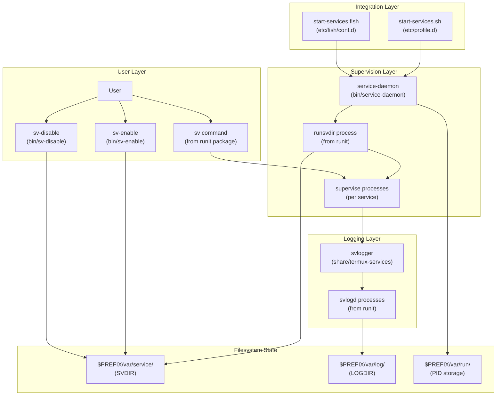
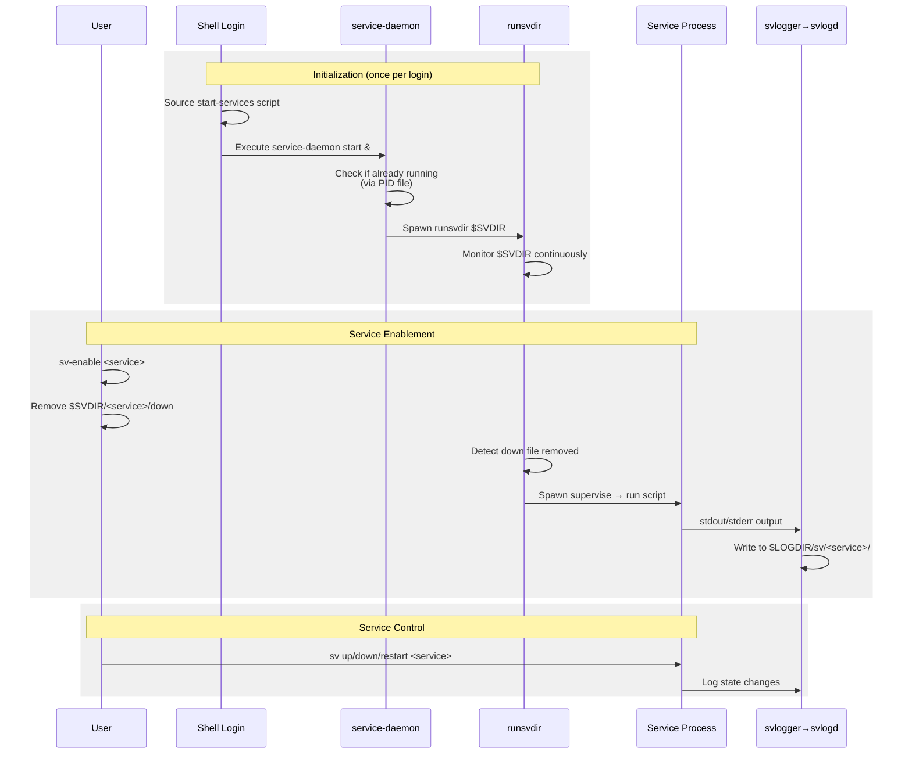

<!-- source: DeepWiki mcp.deepwiki.com · repo termux/termux-services · page 1 Home · fetched 2026-10-26 -->

# Home

<details>
<summary>Relevant source files</summary>

The following files were used as context for generating this wiki page:

- [Makefile](Makefile)
- [README.md](README.md)
- [start-services.fish](start-services.fish)
- [svlogger](svlogger)

</details>


This document provides an overview of termux-services, a package that integrates the runit service supervision system into the Termux Android terminal environment. This page explains what termux-services is, the problem it solves, and how its components work together.

For step-by-step installation instructions, see [Installation](#2). For practical usage examples, see [Quick Start Guide](#3). For detailed technical architecture, see [Architecture](#5).

## What is termux-services?

termux-services is a Termux package that enables persistent background service management using runit, a lightweight UNIX init scheme with service supervision. It provides a way to run long-lived processes (daemons) that automatically restart on failure and survive across shell sessions.

The package wraps runit's supervision tools with Termux-specific components to handle:
- Service lifecycle management (enable, disable, start, stop)
- Automatic daemon initialization on shell login
- Centralized logging infrastructure
- Service state persistence across terminal sessions

**Sources:** [README.md:1-10]()

## Problem Statement

Termux lacks a native service management system. Users who want to run background processes face several challenges:

1. **Process persistence**: Background processes terminate when the shell session ends
2. **Automatic restart**: Crashed processes require manual intervention to restart
3. **Startup automation**: No built-in mechanism to start services on terminal launch
4. **Log management**: No standardized way to capture and rotate service logs

termux-services solves these problems by integrating runit's supervision capabilities into the Termux environment.

## Solution Architecture

termux-services creates a service supervision infrastructure by combining several components:



**Component Mapping to Code Entities**

This diagram shows how system components map to actual files and processes in the codebase. The supervision layer uses runit's `runsvdir` to monitor `$SVDIR`, while user commands manipulate filesystem state in that directory.

**Sources:** [Makefile:1-23](), [README.md:1-10](), [start-services.fish:1-6]()

## Core Components

### Installed Executables

| Component | Location | Purpose |
|-----------|----------|---------|
| `sv-enable` | `$PREFIX/bin/` | Removes `down` file to enable autostart |
| `sv-disable` | `$PREFIX/bin/` | Creates `down` file to disable autostart |
| `service-daemon` | `$PREFIX/bin/` | Manages `runsvdir` lifecycle and PID tracking |

### Shell Integration Scripts

| Script | Location | Purpose |
|--------|----------|---------|
| `start-services.sh` | `$PREFIX/etc/profile.d/` | Bash/POSIX shell initialization |
| `start-services.fish` | `$PREFIX/etc/fish/conf.d/` | Fish shell initialization |

Both scripts set environment variables and start `service-daemon` on login:
- `SVDIR=$PREFIX/var/service` - Service definition directory
- `LOGDIR=$PREFIX/var/log` - Log storage directory

### Logging Infrastructure

| Component | Location | Purpose |
|-----------|----------|---------|
| `svlogger` | `$PREFIX/share/termux-services/` | Wrapper that extracts service name and invokes `svlogd` |

The `svlogger` script [svlogger:1-10]() determines the service name from its working directory and configures `svlogd` to write logs to `$LOGDIR/sv/<service>/`.

**Sources:** [Makefile:4-12](), [svlogger:1-10](), [start-services.fish:1-6]()

## Service Lifecycle Flow



**Lifecycle Stages**

1. **Installation**: `pkg install termux-services` deploys scripts via [Makefile:3-12]()
2. **Initialization**: Shell login sources integration scripts [start-services.fish:1-6]() or `start-services.sh`
3. **Daemon Startup**: `service-daemon start` spawns `runsvdir` to monitor `$SVDIR`
4. **Service Management**: Users control services via `sv-enable`, `sv-disable`, and `sv` commands
5. **Logging**: Service output flows through [svlogger:1-10]() to `svlogd` for persistent storage

**Sources:** [README.md:1-10](), [start-services.fish:1-6](), [svlogger:1-10]()

## Filesystem State Model

termux-services uses filesystem state to control service behavior:

| State Element | Location | Meaning |
|---------------|----------|---------|
| Service directory exists | `$SVDIR/<service>/` | Service is known to `runsvdir` |
| `down` file exists | `$SVDIR/<service>/down` | Service disabled (won't autostart) |
| `down` file absent | `$SVDIR/<service>/down` | Service enabled (will autostart) |
| `run` script | `$SVDIR/<service>/run` | Executable that starts the service |
| `log/run` script | `$SVDIR/<service>/log/run` | Typically invokes [svlogger:9]() |
| PID file | `$PREFIX/var/run/service-daemon.pid` | Tracks `service-daemon` process |

The `sv-enable` and `sv-disable` commands manipulate the `down` file to control service autostart behavior [README.md:9]().

**Sources:** [README.md:9-10](), [svlogger:7-9]()

## Integration with runit

termux-services is a thin wrapper around runit's core tools:

| runit Component | termux-services Usage |
|-----------------|----------------------|
| `runsvdir` | Spawned by `service-daemon` to monitor `$SVDIR` |
| `supervise` | Spawned per-service by `runsvdir` to manage process lifecycle |
| `sv` | Used directly by users for service control (up, down, restart, status) |
| `svlogd` | Invoked by [svlogger:9]() to handle log rotation and storage |

For detailed information on using native runit commands with termux-services, see [Integration with runit](#8).

**Sources:** [README.md:3-8](), [svlogger:9]()

## Key Concepts

### Service Directory (`$SVDIR`)
The directory monitored by `runsvdir`, set to `$PREFIX/var/service` [start-services.fish:3](). Each subdirectory represents a service with its own `run` script and optional `log/run` script.

### Log Directory (`$LOGDIR`)
Centralized log storage location, set to `$PREFIX/var/log` [start-services.fish:4](). Logs are organized as `$LOGDIR/sv/<service>/current`.

### Enable vs. Start
- **Enable** (`sv-enable`): Removes the `down` file so the service autostarts on `runsvdir` restart
- **Start** (`sv up`): Immediately starts the service without modifying autostart behavior

### Disable vs. Stop
- **Disable** (`sv-disable`): Creates the `down` file and stops the service
- **Stop** (`sv down`): Immediately stops the service without modifying autostart behavior

**Sources:** [README.md:5-9](), [start-services.fish:3-4]()

## Quick Reference

### Basic Usage

```bash
# Enable and start a service
sv-enable sshd

# Start a service immediately
sv up sshd

# Check service status
sv status sshd

# View service logs
cat $PREFIX/var/log/sv/sshd/current

# Stop a service
sv down sshd

# Disable a service
sv-disable sshd
```

For comprehensive usage documentation, see [User Guide](#4) and [Command Reference](#6).

**Sources:** [README.md:3-8]()

## System Requirements

termux-services requires:
- Termux terminal environment
- The `runit` package (provides `runsvdir`, `supervise`, `sv`, `svlogd`)
- A POSIX-compatible or Fish shell for login integration

The package installs via `pkg install termux-services` [README.md:3](), which handles dependency resolution automatically.

**Sources:** [README.md:3](), [Makefile:1-23]()

## Documentation Structure

This wiki is organized as follows:

- **[Installation](#2)**: How to install and verify the package
- **[Quick Start Guide](#3)**: Get started with basic service management
- **[User Guide](#4)**: Comprehensive end-user documentation
- **[Architecture](#5)**: Technical design and implementation details
- **[Command Reference](#6)**: Complete command documentation
- **[Environment Variables](#7)**: Reference for `SVDIR`, `LOGDIR`, etc.
- **[Integration with runit](#8)**: How to use native runit commands
- **[License](#9)**: Software license information

---

