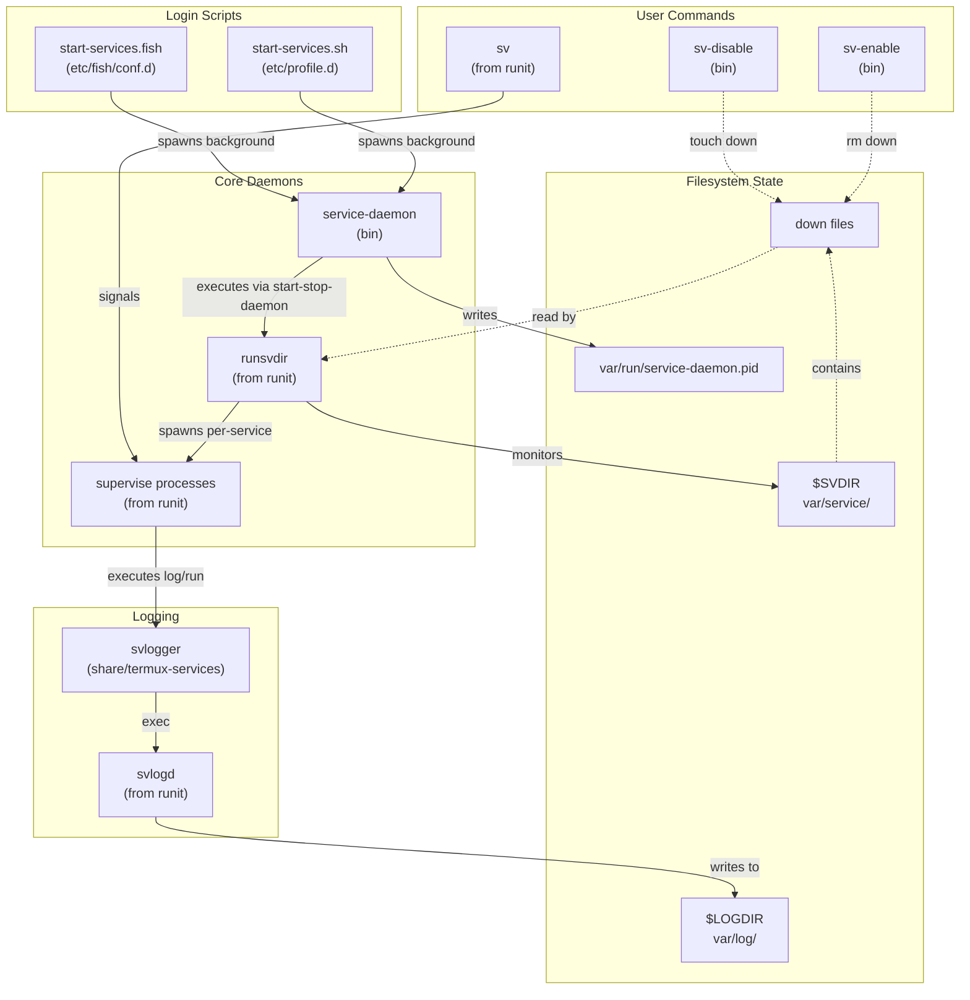
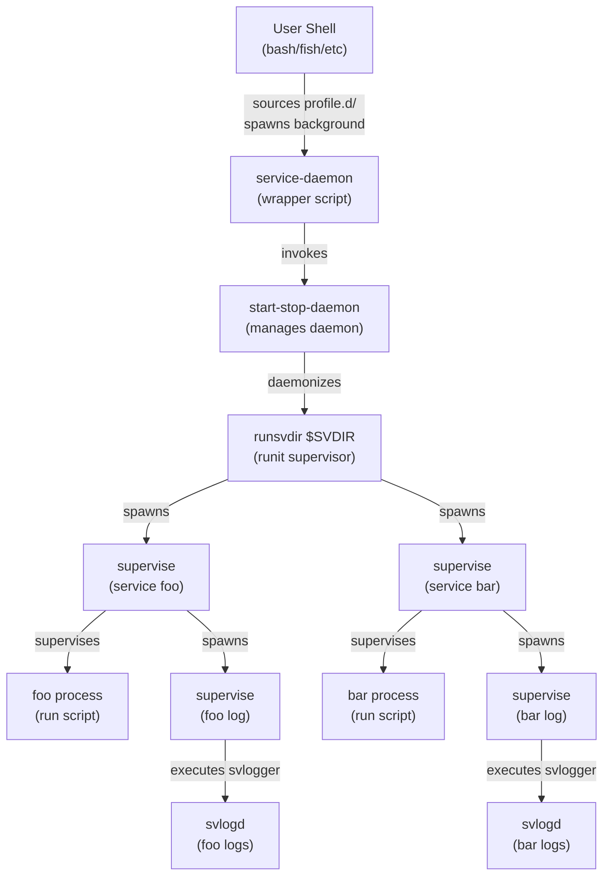
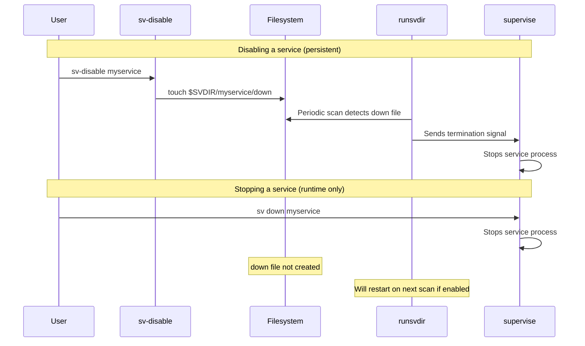

<!-- source: DeepWiki mcp.deepwiki.com · repo termux/termux-services · page 5 Architecture · fetched 2026-10-26 -->

# Architecture

<details>
<summary>Relevant source files</summary>

The following files were used as context for generating this wiki page:

- [Makefile](Makefile)
- [README.md](README.md)
- [service-daemon](service-daemon)
- [start-services.fish](start-services.fish)
- [svlogger](svlogger)

</details>


This document provides a technical overview of the termux-services architecture, describing how components interact to provide runit-based service supervision in Termux. It covers the core design principles, component relationships, and system lifecycle phases.

For detailed information on specific subsystems, see:
- System layering and runit integration: [System Overview](#5.1)
- Service daemon implementation: [Service Daemon](#5.2)
- Shell startup integration: [Login Integration](#5.3)
- Log capture mechanism: [Logging Infrastructure](#5.4)
- Directory organization: [File System Layout](#5.5)

## Design Principles

termux-services is built on three core architectural principles:

1. **Minimal Wrapper Layer**: The system provides a thin integration layer over runit's existing supervision tools (`runsvdir`, `supervise`, `svlogd`) rather than reimplementing service management.

2. **Filesystem-Based State**: Service configuration and state are stored in the filesystem (`$SVDIR`, `$LOGDIR`) following runit conventions, enabling transparent interaction with native runit commands.

3. **Shell-Integrated Lifecycle**: Service supervision starts automatically via shell login scripts, ensuring the daemon runs whenever a Termux session is active.

## Component Architecture

The system consists of three executable scripts, two shell integration files, and one logging helper:

| Component | Type | Location | Purpose |
|-----------|------|----------|---------|
| `sv-enable` | Shell script | `$PREFIX/bin/` | Removes `down` file to enable service autostart |
| `sv-disable` | Shell script | `$PREFIX/bin/` | Creates `down` file to disable service autostart |
| `service-daemon` | Shell script | `$PREFIX/bin/` | Manages `runsvdir` process lifecycle |
| `start-services.sh` | Shell script | `$PREFIX/etc/profile.d/` | Bash/POSIX shell login integration |
| `start-services.fish` | Fish script | `$PREFIX/etc/fish/conf.d/` | Fish shell login integration |
| `svlogger` | Shell script | `$PREFIX/share/termux-services/` | Logging configuration wrapper |

Sources: [Makefile:4-12]()

### Component Interaction Diagram



Sources: [Makefile:4-12](), [service-daemon:1-48](), [start-services.fish:1-6](), [svlogger:1-10]()

## Process Hierarchy

At runtime, termux-services establishes the following process hierarchy:



Sources: [service-daemon:6](), [start-services.fish:5]()

### Process Management Details

The `service-daemon` script uses `start-stop-daemon` to manage the `runsvdir` process:

- **Start**: `start-stop-daemon -S -b -m -p $PIDFILE -x $DAEMON -d $PREFIX -- $DAEMON_OPTS` [service-daemon:6]()
  - `-S`: Start mode
  - `-b`: Background (daemonize)
  - `-m`: Create PID file
  - `-p $PIDFILE`: PID file location at `$PREFIX/var/run/service-daemon.pid`
  - `-x $DAEMON`: Execute `$PREFIX/bin/runsvdir`
  - `$DAEMON_OPTS`: Passes `$SVDIR` as argument

- **Stop**: Sends SIGHUP (signal 1) to the daemon, waits for termination, then aggressively cleans up supervision directories [service-daemon:9-14]()

## System Lifecycle Phases

### Phase 1: Installation

The Makefile deploys components to their designated locations:

| Source File | Destination | Install Line |
|-------------|-------------|--------------|
| `sv-enable` | `$PREFIX/bin/sv-enable` | [Makefile:4]() |
| `sv-disable` | `$PREFIX/bin/sv-disable` | [Makefile:5]() |
| `service-daemon` | `$PREFIX/bin/service-daemon` | [Makefile:6]() |
| `start-services.sh` | `$PREFIX/etc/profile.d/start-services.sh` | [Makefile:8]() |
| `start-services.fish` | `$PREFIX/etc/fish/conf.d/start-services.fish` | [Makefile:10]() |
| `svlogger` | `$PREFIX/share/termux-services/svlogger` | [Makefile:12]() |

Sources: [Makefile:3-12]()

### Phase 2: Initialization (Login)

When a user starts a new shell session:

1. Shell sources appropriate login script based on shell type
2. Login script sets environment variables:
   - `SVDIR=$PREFIX/var/service` [start-services.fish:3]()
   - `LOGDIR=$PREFIX/var/log` [start-services.fish:4]()
3. Login script spawns `service-daemon start` in background [start-services.fish:5]()
4. `service-daemon` creates `$PREFIX/var/run/` directory [service-daemon:5]()
5. `service-daemon` starts `runsvdir $SVDIR` as a daemon [service-daemon:6]()

Sources: [start-services.fish:1-6](), [service-daemon:4-7]()

### Phase 3: Operation

During normal operation:

1. `runsvdir` continuously scans `$SVDIR` for service directories
2. For each service without a `down` file, `runsvdir` spawns a `supervise` process
3. Each `supervise` process executes the service's `run` script
4. If a service has a `log/run` script, `supervise` spawns a logging `supervise` process
5. The logging process executes `svlogger`, which determines service name and invokes `svlogd` [svlogger:4-9]()

Sources: [service-daemon:21-22](), [svlogger:1-10]()

## State Management Model

termux-services uses filesystem-based state management following runit conventions:

### Service Enable/Disable State

| State | Filesystem Indicator | Created By | Detected By |
|-------|---------------------|------------|-------------|
| Enabled | `$SVDIR/<service>/down` does **not** exist | `sv-enable` removes file | `runsvdir` starts service |
| Disabled | `$SVDIR/<service>/down` exists | `sv-disable` creates file | `runsvdir` skips service |

Source: [README.md:9]()

### Runtime State

| State Type | Storage Location | Managed By |
|------------|------------------|------------|
| Service PID | `$SVDIR/<service>/supervise/pid` | `supervise` process |
| Service status | `$SVDIR/<service>/supervise/status` | `supervise` process |
| Daemon PID | `$PREFIX/var/run/service-daemon.pid` | `service-daemon` [service-daemon:19]() |
| Service logs | `$LOGDIR/sv/<service>/current` | `svlogd` [svlogger:7-9]() |

Sources: [service-daemon:19](), [svlogger:7-9]()

## Control Flow: Enable/Disable vs Start/Stop

termux-services distinguishes between persistent configuration (enable/disable) and runtime control (start/stop):



Sources: [README.md:8-9]()

### Command Comparison

| Operation | Command | Effect on Filesystem | Effect on Running Service | Persistence |
|-----------|---------|---------------------|--------------------------|-------------|
| Enable | `sv-enable <service>` | Removes `down` file | None (use `sv up` to start) | Yes - survives restart |
| Disable | `sv-disable <service>` | Creates `down` file | Stops if running | Yes - survives restart |
| Start | `sv up <service>` | None | Starts process | No - disabled services won't restart |
| Stop | `sv down <service>` | None | Stops process | No - enabled services may restart |

Sources: [README.md:5-9]()

## Logging Architecture

The logging infrastructure uses a three-component chain:

1. **Service `run` script** outputs to stdout/stderr
2. **`svlogger` wrapper** [svlogger:1-10]()
   - Determines service name from working directory [svlogger:4-5]()
   - Creates log directory at `$LOGDIR/sv/$service` [svlogger:7]()
   - Executes `svlogd` with appropriate arguments [svlogger:9]()
3. **`svlogd` daemon** captures output and writes to log files

This design allows service authors to write simple `run` scripts that output to stdout, while termux-services handles log capture and rotation transparently.

For detailed logging infrastructure information, see [Logging Infrastructure](#5.4).

Sources: [svlogger:1-10]()

## Daemon Lifecycle Management

The `service-daemon` script provides three operations:

### Start Operation

Creates PID directory, then uses `start-stop-daemon` to daemonize `runsvdir`:

```
mkdir -p $PIDDIR
start-stop-daemon -S -b -m -p $PIDFILE -x $DAEMON -d $PREFIX -- $DAEMON_OPTS
```

Sources: [service-daemon:4-7]()

### Stop Operation

Performs graceful shutdown with aggressive cleanup:

1. Send SIGHUP to daemon process [service-daemon:9]()
2. Wait for daemon termination using `tail -f --pid` [service-daemon:10]()
3. Kill all supervise processes [service-daemon:11-12]()
4. Remove supervise directories [service-daemon:13]()

This aggressive cleanup (kill -9) ensures clean shutdown even if services don't respond to normal termination signals.

Sources: [service-daemon:8-15]()

### Restart Operation

Sequentially executes stop then start [service-daemon:35-39]()

Sources: [service-daemon:35-39]()

## Integration with runit

termux-services delegates core supervision functionality to runit:

| Functionality | Provided By | termux-services Role |
|--------------|-------------|---------------------|
| Process supervision | `runsvdir`, `supervise` (runit) | Starts `runsvdir` via `service-daemon` |
| Service control | `sv` command (runit) | None - users invoke `sv` directly |
| Log rotation | `svlogd` (runit) | `svlogger` wrapper configures paths |
| Service enable/disable | N/A (not in runit) | `sv-enable`/`sv-disable` manage `down` files |
| Automatic startup | N/A (not in runit) | Login scripts start `service-daemon` |

This architecture allows users to use native runit commands (`sv status`, `sv restart`, etc.) directly, while termux-services handles Termux-specific concerns like automatic daemon startup and log path configuration.

For more details on runit integration, see [Integration with runit](#8).

Sources: [service-daemon:21](), [README.md:5-8](), [svlogger:9]()

## Environment Variables

The system relies on two primary environment variables set by login scripts:

- `SVDIR`: Service directory location, set to `$PREFIX/var/service` [start-services.fish:3]()
- `LOGDIR`: Log directory location, set to `$PREFIX/var/log` [start-services.fish:4]()

Additionally, `PREFIX` is assumed to be set by Termux's environment (typically `/data/data/com.termux/files/usr`).

For complete environment variable reference, see [Environment Variables](#7).

Sources: [start-services.fish:3-4](), [service-daemon:18-22]()

## Summary

termux-services provides a minimal integration layer that:

1. Automatically starts runit's `runsvdir` via shell login scripts
2. Manages the supervision daemon lifecycle via `service-daemon`
3. Provides convenience commands (`sv-enable`, `sv-disable`) for persistent service configuration
4. Configures logging infrastructure via the `svlogger` wrapper

The architecture emphasizes simplicity and transparency, allowing users to interact directly with runit's native commands while benefiting from Termux-specific integration.

---

