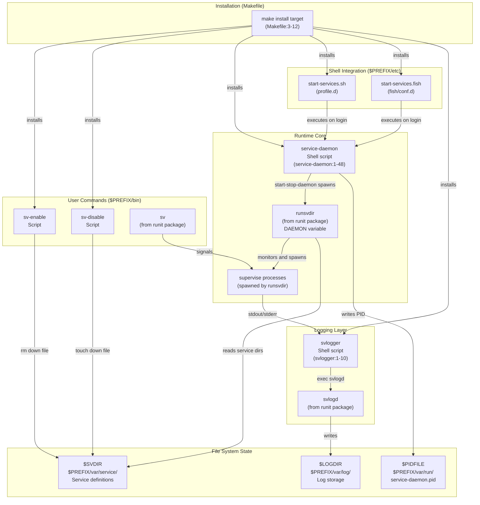
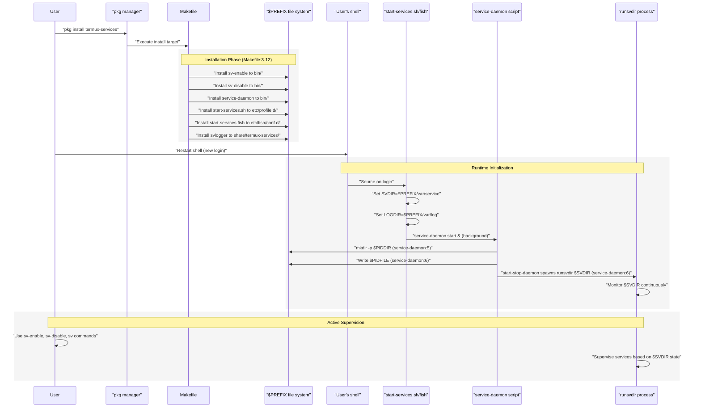
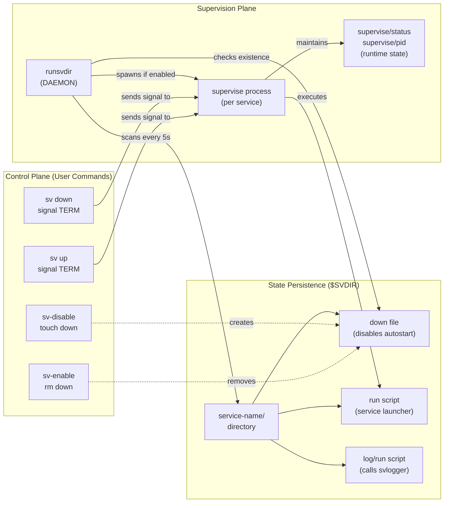
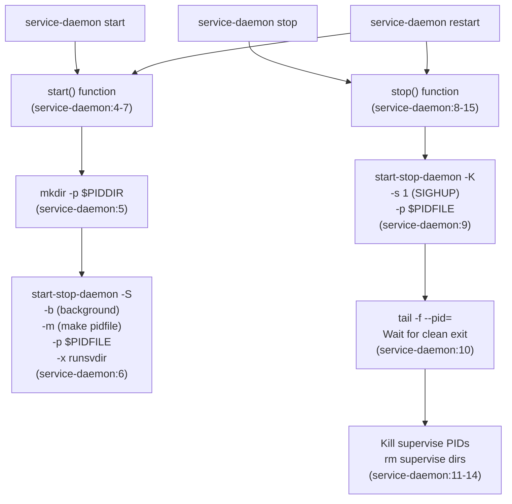
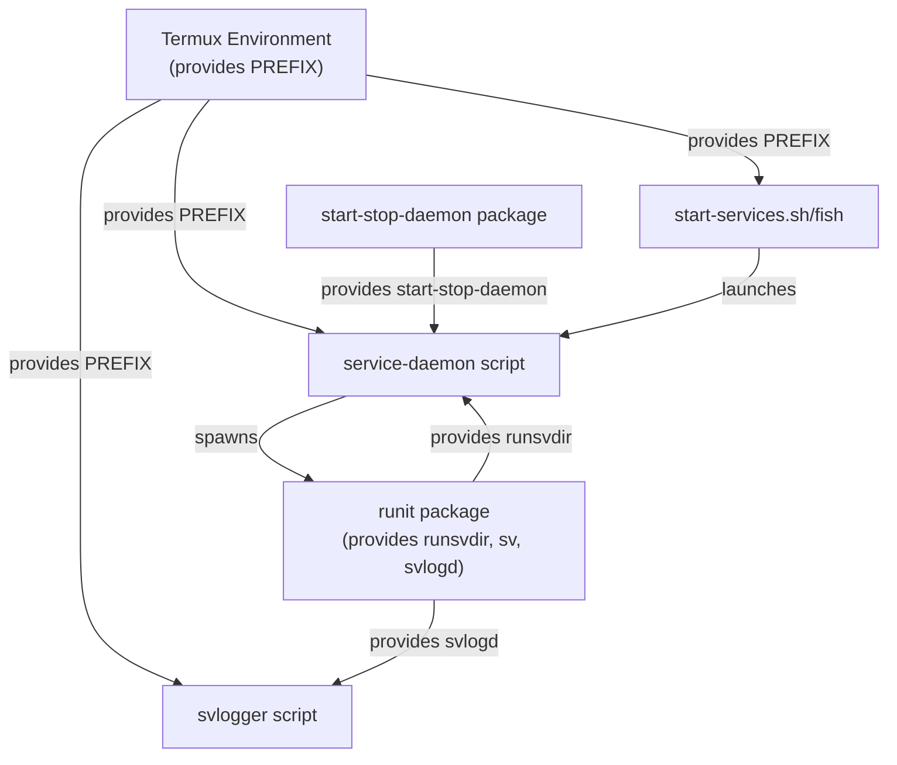

<!-- source: DeepWiki mcp.deepwiki.com · repo termux/termux-services · page 5.1 System Overview · fetched 2026-10-26 -->

# System Overview

Relevant source files

The following files were used as context for generating this wiki page:

- [Makefile](Makefile)
- [README.md](README.md)
- [service-daemon](service-daemon)
- [start-services.fish](start-services.fish)
- [svlogger](svlogger)

## Purpose and Scope

This document describes the high-level architecture of termux-services, explaining how the system layers on top of runit to provide service supervision in the Termux environment. It covers the major components, their relationships, and the data flow during installation, initialization, and runtime operation.

For detailed information about specific components, see:
- Service daemon lifecycle management: [Service Daemon](#5.2)
- Shell integration mechanics: [Login Integration](#5.3)
- Log capture infrastructure: [Logging Infrastructure](#5.4)
- Complete directory reference: [File System Layout](#5.5)

## Architectural Overview

Termux-services is a lightweight adapter that integrates runit's service supervision tools into the Termux Android environment. The system consists of three primary layers:

1. **Deployment Layer**: `Makefile` that installs all components
2. **Integration Layer**: Shell scripts that initialize the supervision daemon on login
3. **Runtime Layer**: `service-daemon` that manages `runsvdir` and service processes

The system operates on a filesystem-based state model where service configuration is stored in `$SVDIR` (`$PREFIX/var/service`) and logs are written to `$LOGDIR` (`$PREFIX/var/log`). User commands manipulate filesystem state, and the supervision layer continuously monitors these changes.

Sources: [README.md:1-10](), [Makefile:1-23]()

## Component Architecture

The following diagram maps the major system components to their code entities:

**Key Components:**

| Component | File Path | Purpose |
|-----------|-----------|---------|
| `sv-enable` | `$PREFIX/bin/sv-enable` | Removes `down` file to enable service autostart |
| `sv-disable` | `$PREFIX/bin/sv-disable` | Creates `down` file to disable service autostart |
| `service-daemon` | `$PREFIX/bin/service-daemon` | Manages `runsvdir` lifecycle using `start-stop-daemon` |
| `start-services.sh` | `$PREFIX/etc/profile.d/start-services.sh` | Bash/POSIX shell initialization script |
| `start-services.fish` | `$PREFIX/etc/fish/conf.d/start-services.fish` | Fish shell initialization script |
| `svlogger` | `$PREFIX/share/termux-services/svlogger` | Wrapper that configures `svlogd` per-service |
| `runsvdir` | `$PREFIX/bin/runsvdir` | Runit's directory supervisor (from runit package) |
| `svlogd` | `$PREFIX/bin/svlogd` | Runit's logging daemon (from runit package) |

Sources: [Makefile:4-12](), [service-daemon:17-22](), [svlogger:1-10](), [start-services.fish:1-6]()

## System Initialization Flow

The following sequence diagram illustrates how termux-services transitions from installation to active supervision:

**Critical Initialization Steps:**

1. **Installation** ([Makefile:3-12]()): The `install` target copies all scripts and binaries to their respective locations in `$PREFIX`
2. **Shell Integration** ([start-services.fish:1-6]()): On login, shell sources the appropriate script which sets `SVDIR` and `LOGDIR` environment variables
3. **Daemon Spawn** ([service-daemon:4-7]()): The `start()` function uses `start-stop-daemon` to launch `runsvdir` as a background daemon
4. **Directory Monitoring** ([service-daemon:22]()): `runsvdir` receives `$SVDIR` as argument (`DAEMON_OPTS`) and begins continuous monitoring

The background execution (`&` in shell scripts) ensures non-blocking login, allowing the user to interact with the shell while supervision initializes.

Sources: [Makefile:3-12](), [service-daemon:4-22](), [start-services.fish:1-6]()

## State Management Model

Termux-services uses a **filesystem-based state model** where service state is persistent and observable through standard file operations:

**State Transitions:**

| Operation | Command | Filesystem Action | Effect |
|-----------|---------|-------------------|--------|
| Enable service | `sv-enable <service>` | Removes `$SVDIR/<service>/down` | Service starts on next `runsvdir` scan |
| Disable service | `sv-disable <service>` | Creates `$SVDIR/<service>/down` | Service stops and won't autostart |
| Start service | `sv up <service>` | Sends signal to `supervise` | Service starts immediately (if not disabled) |
| Stop service | `sv down <service>` | Sends signal to `supervise` | Service stops immediately (remains enabled) |

The `down` file serves as a persistent enable/disable flag. Its presence tells `runsvdir` not to start the service. The `sv-enable` and `sv-disable` scripts are simple wrappers that manipulate this file.

Sources: [README.md:8-9](), [service-daemon:11-14]()

## Daemon Lifecycle Management

The `service-daemon` script provides lifecycle control for the `runsvdir` process:

**Key Implementation Details:**

- **PID Management** ([service-daemon:18-19]()): The daemon stores its PID in `$PREFIX/var/run/service-daemon.pid`
- **Background Execution** ([service-daemon:6]()): The `-b` flag to `start-stop-daemon` daemonizes the process
- **Graceful Shutdown** ([service-daemon:9-10]()): Sends `SIGHUP` (signal 1) and waits for process exit
- **Aggressive Cleanup** ([service-daemon:11-14]()): After shutdown, forcibly kills all `supervise` processes and removes their state directories

The cleanup phase is necessary because runit's `supervise` processes may not exit cleanly when their parent `runsvdir` terminates.

Sources: [service-daemon:4-15](), [service-daemon:17-22]()

## Integration with Runit

Termux-services is a thin wrapper around runit's supervision tools. The relationship is:

| Termux-services Component | Runit Component | Relationship |
|---------------------------|-----------------|--------------|
| `service-daemon` | `runsvdir` | Manages lifecycle, wraps with `start-stop-daemon` |
| `sv-enable` / `sv-disable` | `runsvdir` conventions | Manipulates `down` files that `runsvdir` checks |
| `svlogger` | `svlogd` | Extracts service name and invokes `svlogd` with correct paths |
| N/A (users invoke directly) | `sv` | Users call `sv` command directly for service control |

**Data Flow:**

1. `runsvdir $SVDIR` scans `$SVDIR` every 5 seconds
2. For each subdirectory without a `down` file, it spawns a `supervise` process
3. Each `supervise` process executes the service's `run` script
4. Service output is piped to `log/run` (which invokes `svlogger`)
5. `svlogger` ([svlogger:2-9]()) extracts the service name from `$PWD` and spawns `svlogd` with the appropriate log directory

Sources: [service-daemon:21-22](), [svlogger:1-10](), [README.md:1-10]()

## Environment Variables

The system relies on three critical environment variables set during shell initialization:

| Variable | Set By | Value | Purpose |
|----------|--------|-------|---------|
| `SVDIR` | `start-services.sh/fish` | `$PREFIX/var/service` | Directory where service definitions reside |
| `LOGDIR` | `start-services.sh/fish` | `$PREFIX/var/log` | Base directory for service logs |
| `PREFIX` | Termux environment | `/data/data/com.termux/files/usr` | Termux installation root |

These variables are exported in the shell initialization scripts ([start-services.fish:3-4]()) and consumed by:
- `service-daemon` ([service-daemon:22]()): Passes `$SVDIR` to `runsvdir`
- `svlogger` ([svlogger:7-9]()): Uses `$LOGDIR` to construct log paths

Sources: [start-services.fish:3-4](), [service-daemon:22](), [svlogger:7-9]()

## Component Dependencies

**External Dependencies:**

- **runit package**: Provides `runsvdir`, `sv`, `svlogd`, and `supervise` binaries
- **start-stop-daemon**: Used by `service-daemon` to daemonize `runsvdir`
- **Termux environment**: Provides `$PREFIX` and shell integration hooks (`profile.d`, `fish/conf.d`)

Sources: [service-daemon:6](), [service-daemon:21](), [svlogger:9]()

---

