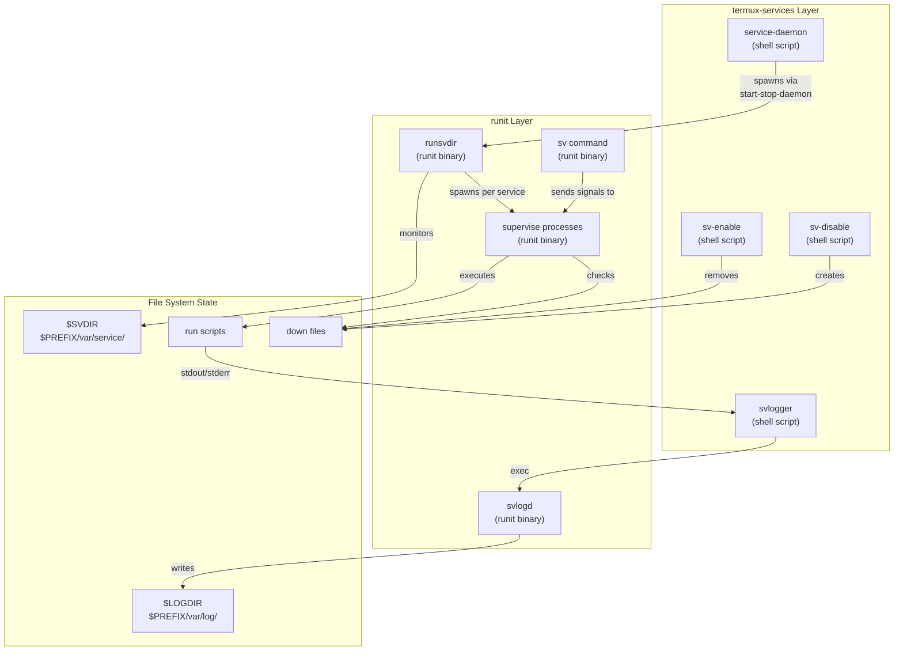
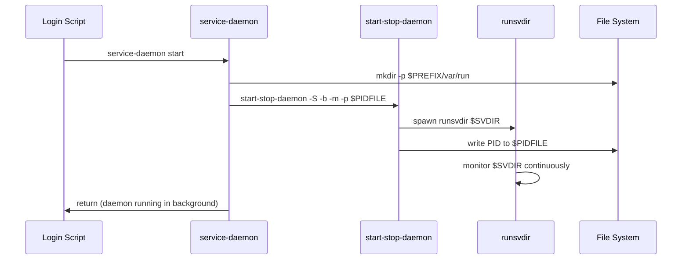
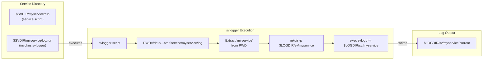
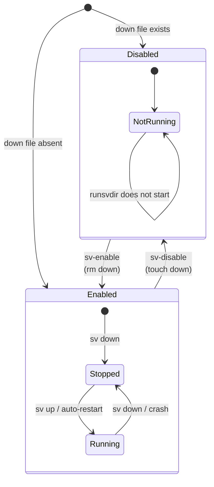

<!-- source: DeepWiki mcp.deepwiki.com · repo termux/termux-services · page 8 Integration with runit · fetched 2026-10-26 -->

# Integration with runit

<details>
<summary>Relevant source files</summary>

The following files were used as context for generating this wiki page:

- [Makefile](Makefile)
- [README.md](README.md)
- [service-daemon](service-daemon)
- [start-services.fish](start-services.fish)
- [svlogger](svlogger)

</details>


## Purpose and Scope

This page explains how termux-services wraps and extends [runit](http://smarden.org/runit), a cross-platform UNIX init scheme with service supervision. It covers which runit components are used, how they are wrapped by termux-services, and how to use native runit commands directly for advanced service control.

For basic service management tasks, see the [User Guide](#4). For architectural details of termux-services components, see [Architecture](#5).

## What is runit?

runit is a lightweight init and service supervision suite consisting of several core utilities:

| Component | Purpose |
|-----------|---------|
| `runsvdir` | Monitors a directory and starts a `supervise` process for each subdirectory |
| `supervise` | Monitors and controls a single service process, restarting it if it fails |
| `sv` | Control utility to send commands to supervised services |
| `svlogd` | Logs service output with automatic rotation |

termux-services does not replace these components—it provides a Termux-specific wrapper layer that integrates them into the Termux environment and adds convenience features.

**Sources:** [README.md:1-10]()

## Core Integration Architecture



**Diagram: termux-services wraps runit components with shell scripts that configure paths and behavior for Termux**

The integration follows a layering principle: termux-services scripts configure and invoke runit binaries but do not modify them. All runit binaries are used as-is from the Termux package repository.

**Sources:** [service-daemon:1-48](), [svlogger:1-10]()

## service-daemon: Wrapping runsvdir

The `service-daemon` script ([service-daemon:1-48]()) is the primary integration point between termux-services and runit. It manages the lifecycle of `runsvdir`, the top-level runit supervision process.

### Startup Process

When `service-daemon start` is invoked (typically from login scripts):



**Diagram: service-daemon uses start-stop-daemon to spawn runsvdir in the background**

Key implementation details from [service-daemon:4-7]():

- **Line 5:** Creates PID directory at `$PREFIX/var/run`
- **Line 6:** Uses `start-stop-daemon -S -b -m` to:
  - `-S`: Start the daemon
  - `-b`: Run in background
  - `-m`: Create PID file
  - `-p $PIDFILE`: Location of PID file
  - `-x $DAEMON`: Execute `$PREFIX/bin/runsvdir`
  - `-d $PREFIX`: Set working directory
- **Lines 21-22:** Configures `runsvdir` to monitor `$SVDIR`

### Shutdown and Cleanup

The `service-daemon stop` command ([service-daemon:8-15]()) performs aggressive cleanup:

1. **Line 9:** Sends SIGHUP (signal 1) to `runsvdir` via PID file
2. **Line 10:** Waits for `runsvdir` process to terminate
3. **Lines 11-14:** Forcefully terminates all `supervise` processes and removes their state directories

The cleanup loop at [service-daemon:11-14]() is necessary because `supervise` processes may not immediately terminate when `runsvdir` exits. This ensures a clean slate for restart.

**Sources:** [service-daemon:1-48](), [start-services.fish:1-6]()

## svlogger: Wrapping svlogd

The `svlogger` script ([svlogger:1-10]()) is a thin wrapper around `svlogd` that automatically configures per-service log directories.

### Context-Aware Configuration



**Diagram: svlogger extracts service name from its execution context (PWD) to configure svlogd**

Implementation from [svlogger:2-9]():

- **Lines 4-5:** Extracts service name using shell parameter expansion:
  - `${PWD%/*}` removes `/log` suffix
  - `${pwd##*/}` extracts the service name
- **Line 7:** Creates log directory at `$LOGDIR/sv/<service>`
- **Line 9:** Executes `svlogd -tt` with:
  - `-tt`: Prefix each line with timestamp
  - Target directory: `$LOGDIR/sv/<service>`

The `exec` at line 9 replaces the `svlogger` process with `svlogd`, maintaining the process tree structure expected by `supervise`.

**Sources:** [svlogger:1-10]()

## Command Integration: Wrapped vs Native

termux-services provides wrapper commands for common operations, but all native runit commands remain available:

| Task | termux-services Command | Native runit Command | Persistence |
|------|------------------------|---------------------|-------------|
| Enable service for autostart | `sv-enable <service>` | `rm $SVDIR/<service>/down` | Persistent |
| Disable service from autostart | `sv-disable <service>` | `touch $SVDIR/<service>/down` | Persistent |
| Start service immediately | `sv up <service>` | `sv up <service>` | Runtime only |
| Stop service immediately | `sv down <service>` | `sv down <service>` | Runtime only |
| Restart service | `sv restart <service>` | `sv restart <service>` | Runtime only |
| Check service status | `sv status <service>` | `sv status <service>` | N/A |
| Send custom signal | N/A | `sv <signal> <service>` | Runtime only |

### The down File Mechanism

The distinction between enable/disable and start/stop is based on runit's `down` file mechanism ([README.md:9]()):



**Diagram: The down file controls whether runsvdir will supervise a service directory**

- If `$SVDIR/<service>/down` exists: `runsvdir` does not start `supervise` for that service
- If `down` is absent: `runsvdir` starts `supervise`, which executes the `run` script

**Sources:** [README.md:5-9]()

## Using Native sv Commands

All `sv` subcommands from runit are available for direct use. These provide more granular control than the wrapper scripts:

### Status and Information

```bash
# Detailed service status
sv status <service>

# Check if service is running
sv check <service>
```

### Process Control

```bash
# Graceful shutdown
sv down <service>

# Start service
sv up <service>

# Restart service (down then up)
sv restart <service>

# Send TERM signal and wait
sv term <service>

# Send KILL signal
sv kill <service>

# Send HUP signal (reload configuration)
sv hup <service>
```

### Advanced Controls

```bash
# Temporarily disable service (once)
sv once <service>

# Exit when service is down
sv exit <service>

# Pause service
sv pause <service>

# Continue paused service
sv cont <service>

# Send custom signal
sv -<signal> <service>
```

All `sv` commands operate on services in `$SVDIR`. The service name corresponds to the directory name under `$SVDIR`.

**Sources:** [README.md:5-8]()

## File System Interface

runit's supervision model is entirely file system-based. Understanding this interface allows direct manipulation when needed:

### Service Directory Structure

```
$SVDIR/<service>/
├── run                 # Required: executable script to start service
├── finish              # Optional: cleanup script run after service exits
├── down                # Optional: if present, service is disabled
├── supervise/          # Created by supervise: runtime state
│   ├── control         # FIFO for sv commands
│   ├── ok              # FIFO for sv commands
│   ├── status          # Binary status information
│   ├── pid             # Process ID of supervised service
│   └── stat            # Human-readable status
└── log/                # Optional: logging service
    ├── run             # Executable script for logger (typically invokes svlogger)
    └── supervise/      # Logger's supervision state
```

### Runtime State Locations

| Location | Purpose | Managed By |
|----------|---------|------------|
| `$SVDIR/<service>/supervise/` | Service supervision state | `supervise` process |
| `$SVDIR/<service>/log/supervise/` | Logger supervision state | `supervise` process |
| `$PREFIX/var/run/service-daemon.pid` | `runsvdir` PID | `service-daemon` |
| `$LOGDIR/sv/<service>/current` | Current log file | `svlogd` |
| `$LOGDIR/sv/<service>/@*.s` | Rotated log files | `svlogd` |

### Direct Manipulation Example

You can manually enable/disable services by manipulating the `down` file:

```bash
# Disable service (equivalent to sv-disable)
touch "$SVDIR/myservice/down"

# Enable service (equivalent to sv-enable)
rm "$SVDIR/myservice/down"

# Note: runsvdir polls $SVDIR every 5 seconds to detect changes
```

**Sources:** [service-daemon:11-14](), [README.md:9]()

## Environment Variables Used by runit

termux-services configures these environment variables before invoking runit components:

| Variable | Set By | Used By | Purpose |
|----------|--------|---------|---------|
| `SVDIR` | Login scripts | `runsvdir`, user commands | Service definition directory |
| `LOGDIR` | Login scripts | `svlogger` | Log storage directory |
| `PREFIX` | Termux environment | All scripts | Termux installation prefix |

runit binaries (`runsvdir`, `supervise`, `sv`, `svlogd`) do not inherently know about these variables—they are used by termux-services scripts to configure paths when invoking runit components.

**Sources:** [start-services.fish:3-4](), [service-daemon:21-22]()

## Advanced Integration Patterns

### Custom Service Scripts with runit Features

When writing `run` scripts for services, you can use runit-specific features:

```bash
#!/data/data/com.termux/files/usr/bin/sh
# Example run script using runit features

# Use chpst to run as different user or set limits
exec chpst -u myuser /path/to/service

# Or set environment variables
exec chpst -e ./env /path/to/service

# Or apply resource limits
exec chpst -m 100000000 /path/to/service  # 100MB memory limit
```

### Custom Logging Configuration

Instead of using `svlogger`, you can invoke `svlogd` directly with custom options:

```bash
#!/data/data/com.termux/files/usr/bin/sh
# Custom log/run script

exec svlogd -tt -s1000000 -n10 "$LOGDIR/sv/myservice"
# -s1000000: rotate at 1MB
# -n10: keep 10 rotated logs
```

### Supervision Without termux-services

You can use runit directly without termux-services wrappers:

```bash
# Start runsvdir manually
runsvdir /path/to/service/dir &

# Use sv directly without $SVDIR
sv -w 7 status /path/to/service/dir/myservice
```

However, this bypasses the initialization provided by `service-daemon` and the path configuration from login scripts.

**Sources:** [svlogger:9](), [service-daemon:6]()

## Relationship to Upstream runit

termux-services uses unmodified runit binaries from the Termux package repository. The runit package provides:

- `/data/data/com.termux/files/usr/bin/runsvdir`
- `/data/data/com.termux/files/usr/bin/supervise`
- `/data/data/com.termux/files/usr/bin/sv`
- `/data/data/com.termux/files/usr/bin/svlogd`
- `/data/data/com.termux/files/usr/bin/chpst`

termux-services adds:

- Wrapper scripts for Termux-specific initialization
- Path configuration through environment variables
- Convenience commands (`sv-enable`, `sv-disable`)
- Automatic logging setup via `svlogger`

This design means:

1. Updates to runit in Termux automatically benefit termux-services
2. All runit documentation applies to termux-services
3. Users can gradually adopt native runit commands as they become more familiar with the system

**Sources:** [Makefile:1-22](), [service-daemon:21]()

---

