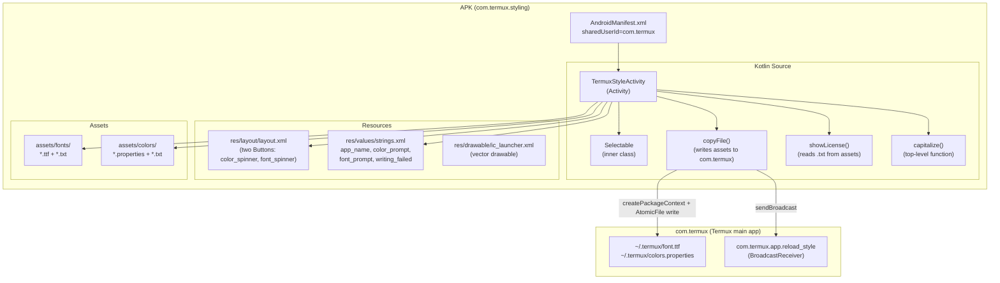

<!-- source: DeepWiki mcp.deepwiki.com · repo termux/termux-styling · page 2 Application · fetched 2026-10-26 -->

# Application

<details>
<summary>Relevant source files</summary>

The following files were used as context for generating this wiki page:

- [app/src/main/AndroidManifest.xml](app/src/main/AndroidManifest.xml)
- [app/src/main/assets/colors/nord.txt](app/src/main/assets/colors/nord.txt)
- [app/src/main/assets/fonts/Monofur.txt](app/src/main/assets/fonts/Monofur.txt)
- [app/src/main/java/com/termux/styling/TermuxStyleActivity.kt](app/src/main/java/com/termux/styling/TermuxStyleActivity.kt)
- [app/src/main/res/drawable/ic_launcher.xml](app/src/main/res/drawable/ic_launcher.xml)
- [app/src/main/res/values/strings.xml](app/src/main/res/values/strings.xml)
- [settings.gradle](settings.gradle)

</details>


This page describes the structural components of the Termux:Styling Android application: the single `Activity`, its `AndroidManifest.xml` configuration, string resources, and the launcher icon. It serves as an entry point for the deeper sub-pages.

- For the full runtime behavior of style selection and file writing, see [TermuxStyleActivity](#2.1).
- For the manifest's `sharedUserId` and signing key requirements, see [Manifest and Permissions](#2.2).
- For the bundled font and color assets consumed by the app, see [Styling Assets](#3).

---

## Overview

Termux:Styling is a minimal Android application. It contains exactly **one `Activity`**, no `Service`, no `ContentProvider`, and no `BroadcastReceiver` of its own. All user interaction happens within `TermuxStyleActivity`, which presents selection dialogs, writes chosen assets into the Termux app's file directory, and broadcasts a reload signal.

The application module lives entirely under `app/src/main/`.

**Component inventory:**

| Component | File | Notes |
|---|---|---|
| Core Activity | `app/src/main/java/com/termux/styling/TermuxStyleActivity.kt` | Only Activity in the app |
| Manifest | `app/src/main/AndroidManifest.xml` | Declares `sharedUserId`, Activity flags |
| Layout | `app/src/main/res/layout/layout.xml` | Two-button UI (color + font) |
| String resources | `app/src/main/res/values/strings.xml` | 4 strings |
| Launcher icon | `app/src/main/res/drawable/ic_launcher.xml` | Vector drawable |
| Font assets | `app/src/main/assets/fonts/` | ~25 `.ttf` files + `.txt` licenses |
| Color assets | `app/src/main/assets/colors/` | ~50+ `.properties` files + `.txt` licenses |

Sources: [app/src/main/AndroidManifest.xml:1-19](), [app/src/main/java/com/termux/styling/TermuxStyleActivity.kt:1-192](), [app/src/main/res/values/strings.xml:1-8]()

---

## Application Component Structure

**Diagram: Static component map of the application module**



Sources: [app/src/main/java/com/termux/styling/TermuxStyleActivity.kt:40-192](), [app/src/main/AndroidManifest.xml:1-19](), [app/src/main/res/values/strings.xml:1-8]()

---

## Manifest Configuration

The manifest [app/src/main/AndroidManifest.xml:1-19]() declares three key items:

1. **`android:sharedUserId="com.termux"`** — Places this app in the same Linux user group as the main Termux app. This is what allows `createPackageContext("com.termux", ...)` to succeed at runtime, enabling cross-app file writes. Both apps must be signed with the same key.
2. **`android:noHistory="true"`** on the `Activity` — The Activity is not kept in the back stack; navigating away destroys it.
3. **`android:exported="false"`** on the `Activity` — The Activity cannot be launched by other apps via an explicit or implicit Intent. It is launched only from within the same app or via the launcher.

The `uses-feature` declaration marks the touchscreen as not required, which allows installation on non-touch devices:

```xml
<uses-feature android:name="android.hardware.touchscreen" android:required="false" />
```

Sources: [app/src/main/AndroidManifest.xml:1-19]()

---

## String Resources

All user-visible strings are defined in [app/src/main/res/values/strings.xml:1-8]().

| String name | Value | Usage |
|---|---|---|
| `app_name` | `Termux:Styling` | Application label |
| `color_prompt` | `Choose color` | Button or dialog label |
| `font_prompt` | `Choose font` | Button or dialog label |
| `writing_failed` | `Failed to install file:\n\n` | Prefix of error `Toast` message in `copyFile()` |

Sources: [app/src/main/res/values/strings.xml:1-8](), [app/src/main/java/com/termux/styling/TermuxStyleActivity.kt:186]()

---

## Launcher Icon

The launcher icon is defined as a vector drawable in [app/src/main/res/drawable/ic_launcher.xml:1-34](). It renders:

- A filled black circle (the terminal "window").
- A white `>` chevron shape (representing a terminal prompt).
- A white horizontal underline segment (representing a cursor or command line).

The manifest references it via `android:icon="@drawable/ic_launcher"` [app/src/main/AndroidManifest.xml:9]().

Sources: [app/src/main/res/drawable/ic_launcher.xml:1-34](), [app/src/main/AndroidManifest.xml:7-11]()

---

## Activity Lifecycle and Runtime Flow

**Diagram: TermuxStyleActivity initialization and interaction sequence**

```mermaid
sequenceDiagram
    participant OS as "Android OS"
    participant ACT as "TermuxStyleActivity.onCreate()"
    participant AM as "AssetManager (assets)"
    participant AD as "ArrayAdapter<Selectable>"
    participant FS as "AtomicFile (~/.termux)"
    participant TX as "com.termux broadcast"

    OS->>ACT: "onCreate(savedInstanceState)"
    ACT->>ACT: "setContentView(R.layout.layout)"
    ACT->>AM: "assets.list(\"colors\") + assets.list(\"fonts\")"
    AM-->>ACT: "filtered *.properties / *.ttf filenames"
    ACT->>AD: "colorAdapter.addAll(colorList)\nfontAdapter.addAll(fontList)"
    note over ACT: "Selectable wraps each filename;\ndisplayName strips extension,\nreplaces hyphens, capitalizes"

    OS->>ACT: "user taps color_spinner or font_spinner"
    ACT->>ACT: "AlertDialog.Builder.setAdapter(adapter)"
    ACT->>OS: "dialog.show()"

    OS->>ACT: "user taps list item → copyFile(selectable, isColors)"
    ACT->>ACT: "createPackageContext(\"com.termux\", CONTEXT_IGNORE_SECURITY)"
    ACT->>FS: "AtomicFile(destinationFile).startWrite()\nassets.open(...).copyTo(out)\natomicFile.finishWrite(out)"
    ACT->>TX: "sendBroadcast(Intent(\"com.termux.app.reload_style\"))"

    OS->>ACT: "user long-presses item → showLicense(selectable, isColors)"
    ACT->>AM: "assets.open(\"colors/{name}.txt\") or assets.open(\"fonts/{name}.txt\")"
    AM-->>ACT: "license text bytes"
    ACT->>OS: "AlertDialog with SpannableString + Linkify"
```

Sources: [app/src/main/java/com/termux/styling/TermuxStyleActivity.kt:58-192]()

---

## Sub-pages

Detailed documentation for each component of the application is covered in the following sections:

- **[TermuxStyleActivity](#2.1)** — Full documentation of `onCreate`, `copyFile`, `showLicense`, the `Selectable` inner class, `DEFAULT_FILENAME` sentinel handling, and the `reload_style` broadcast.
- **[Manifest and Permissions](#2.2)** — Deep dive into `sharedUserId`, signing key constraints, Activity flags, and the `uses-feature` declaration.

---

