# Page: Overview

# Overview

<details>
<summary>Relevant source files</summary>

The following files were used as context for generating this wiki page:

- [.github/workflows/github_action_build.yml](.github/workflows/github_action_build.yml)
- [.github/workflows/github_release_build.yml](.github/workflows/github_release_build.yml)
- [LICENSE.md](LICENSE.md)
- [README.md](README.md)
- [app/src/main/AndroidManifest.xml](app/src/main/AndroidManifest.xml)
- [app/src/main/java/com/termux/styling/TermuxStyleActivity.kt](app/src/main/java/com/termux/styling/TermuxStyleActivity.kt)
- [settings.gradle](settings.gradle)

</details>


This page introduces Termux:Styling — what it is, what problem it solves, and how the repository is organized. For details on specific subsystems, see the linked pages throughout.

---

## What Termux:Styling Is

Termux:Styling is an Android add-on application for the [Termux](https://termux.org) terminal emulator. Its sole purpose is to let users apply a custom font or color scheme to the Termux terminal without restarting or reconfiguring the terminal manually.

The app is distributed primarily via [F-Droid](https://f-droid.org/en/packages/com.termux.styling). Per-commit debug builds are also available via GitHub Actions.

**Application ID:** `com.termux.styling`  
**License:** GPLv3 only  
**Minimum SDK:** 21 (Android 5.0)  
**Compile SDK:** 34

---

## User Interaction Flow

Users access Termux:Styling from within Termux itself via a long-press context menu. The interaction sequence is:

1. Long-press anywhere in the Termux terminal.
2. Select **More...** from the resulting dialog.
3. Select **Style**.
4. Tap **CHOOSE COLOR** or **CHOOSE FONT**.

At that point, `TermuxStyleActivity` opens an `AlertDialog` listing the available assets. Tapping an item writes the selected asset to `~/.termux/` in the main Termux app's file storage and sends a broadcast to reload it. Long-pressing an item shows its license text.

Sources: [README.md:28-32](), [app/src/main/java/com/termux/styling/TermuxStyleActivity.kt:58-116]()

---

## Critical Requirement: Shared Signing Key

Termux:Styling communicates with the main Termux app by writing directly into Termux's private file system directory and sending a `com.termux.app.reload_style` broadcast. This cross-package file access is enabled by the `android:sharedUserId="com.termux"` declaration in `AndroidManifest.xml`.

> **The `sharedUserId` mechanism requires that both `com.termux` and `com.termux.styling` are signed with the same key.** If signing keys differ — for example, when mixing an F-Droid build of Termux with a GitHub Actions debug build of Termux:Styling — the add-on will not have permission to write to Termux's files.

When switching installation sources, both Termux and all plugins must be uninstalled before reinstalling.

Sources: [README.md:9-11](), [app/src/main/AndroidManifest.xml:3]()

---

## Runtime Architecture

The following diagram maps the runtime components and their relationships using the actual class and broadcast names from the codebase.

**Diagram: Runtime Component Relationships**

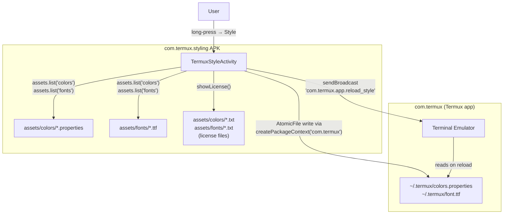

Sources: [app/src/main/java/com/termux/styling/TermuxStyleActivity.kt:144-188]()

---

## Repository Organization

The repository has four primary areas of concern:

| Area | Location | Purpose |
|---|---|---|
| Android application | `app/` | The single `Activity`, assets, layout, manifest |
| Styling assets | `app/src/main/assets/` | Bundled `.ttf` font files and `.properties` color schemes |
| Build system | `build.gradle`, `app/build.gradle`, `gradle.properties` | Gradle multi-project build configuration |
| CI/CD | `.github/workflows/` | Automated debug and release APK builds |
| Asset provisioning | `setup-nerd-fonts.sh`, `setup-fonts.sh` | Developer scripts to populate `assets/fonts/` |

**Diagram: Repository Component Map**

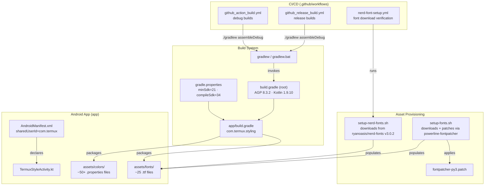

Sources: [app/src/main/AndroidManifest.xml:1-19](), [README.md:1-32](), [.github/workflows/github_action_build.yml:1-81](), [.github/workflows/github_release_build.yml:1-70]()

---

## Key Data Files Written at Runtime

When a user selects a style, `TermuxStyleActivity` writes one of two files into the Termux app's home directory. These are the only persistent outputs the add-on produces.

| User action | Destination file | Content written |
|---|---|---|
| Select color scheme | `~/.termux/colors.properties` | Full `.properties` asset content |
| Select **Default** color | `~/.termux/colors.properties` | Comment sentinel: `# Using default color theme.` |
| Select font | `~/.termux/font.ttf` | Full `.ttf` asset content |
| Select **Default** font | `~/.termux/font.ttf` | Empty file (marker) |

After writing, the broadcast action `com.termux.app.reload_style` is sent with an extra key of the same name, set to either `"colors"` or `"font"`, so the terminal emulator knows which resource to reload.

Sources: [app/src/main/java/com/termux/styling/TermuxStyleActivity.kt:144-188]()

---

## Related Pages

- For the `TermuxStyleActivity` class in detail, see [TermuxStyleActivity](#2.1).
- For the `AndroidManifest.xml` and `sharedUserId` behavior, see [Manifest and Permissions](#2.2).
- For the bundled font and color assets, see [Styling Assets](#3).
- For the Gradle build configuration, see [Build System](#4).
- For CI/CD workflows, see [CI/CD Workflows](#5).
- For the font provisioning shell scripts, see [Asset Provisioning](#6).
- For contributing guidelines and signing key notes, see [Contributing](#7).

---

# Page: Application

# Application

<details>
<summary>Relevant source files</summary>

The following files were used as context for generating this wiki page:

- [app/src/main/AndroidManifest.xml](app/src/main/AndroidManifest.xml)
- [app/src/main/assets/colors/nord.txt](app/src/main/assets/colors/nord.txt)
- [app/src/main/assets/fonts/Monofur.txt](app/src/main/assets/fonts/Monofur.txt)
- [app/src/main/java/com/termux/styling/TermuxStyleActivity.kt](app/src/main/java/com/termux/styling/TermuxStyleActivity.kt)
- [app/src/main/res/drawable/ic_launcher.xml](app/src/main/res/drawable/ic_launcher.xml)
- [app/src/main/res/values/strings.xml](app/src/main/res/values/strings.xml)
- [settings.gradle](settings.gradle)

</details>


This page describes the structural components of the Termux:Styling Android application: the single `Activity`, its `AndroidManifest.xml` configuration, string resources, and the launcher icon. It serves as an entry point for the deeper sub-pages.

- For the full runtime behavior of style selection and file writing, see [TermuxStyleActivity](#2.1).
- For the manifest's `sharedUserId` and signing key requirements, see [Manifest and Permissions](#2.2).
- For the bundled font and color assets consumed by the app, see [Styling Assets](#3).

---

## Overview

Termux:Styling is a minimal Android application. It contains exactly **one `Activity`**, no `Service`, no `ContentProvider`, and no `BroadcastReceiver` of its own. All user interaction happens within `TermuxStyleActivity`, which presents selection dialogs, writes chosen assets into the Termux app's file directory, and broadcasts a reload signal.

The application module lives entirely under `app/src/main/`.

**Component inventory:**

| Component | File | Notes |
|---|---|---|
| Core Activity | `app/src/main/java/com/termux/styling/TermuxStyleActivity.kt` | Only Activity in the app |
| Manifest | `app/src/main/AndroidManifest.xml` | Declares `sharedUserId`, Activity flags |
| Layout | `app/src/main/res/layout/layout.xml` | Two-button UI (color + font) |
| String resources | `app/src/main/res/values/strings.xml` | 4 strings |
| Launcher icon | `app/src/main/res/drawable/ic_launcher.xml` | Vector drawable |
| Font assets | `app/src/main/assets/fonts/` | ~25 `.ttf` files + `.txt` licenses |
| Color assets | `app/src/main/assets/colors/` | ~50+ `.properties` files + `.txt` licenses |

Sources: [app/src/main/AndroidManifest.xml:1-19](), [app/src/main/java/com/termux/styling/TermuxStyleActivity.kt:1-192](), [app/src/main/res/values/strings.xml:1-8]()

---

## Application Component Structure

**Diagram: Static component map of the application module**

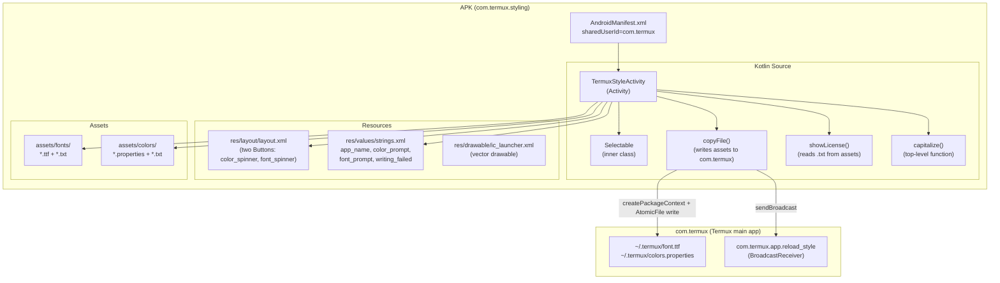

Sources: [app/src/main/java/com/termux/styling/TermuxStyleActivity.kt:40-192](), [app/src/main/AndroidManifest.xml:1-19](), [app/src/main/res/values/strings.xml:1-8]()

---

## Manifest Configuration

The manifest [app/src/main/AndroidManifest.xml:1-19]() declares three key items:

1. **`android:sharedUserId="com.termux"`** — Places this app in the same Linux user group as the main Termux app. This is what allows `createPackageContext("com.termux", ...)` to succeed at runtime, enabling cross-app file writes. Both apps must be signed with the same key.
2. **`android:noHistory="true"`** on the `Activity` — The Activity is not kept in the back stack; navigating away destroys it.
3. **`android:exported="false"`** on the `Activity` — The Activity cannot be launched by other apps via an explicit or implicit Intent. It is launched only from within the same app or via the launcher.

The `uses-feature` declaration marks the touchscreen as not required, which allows installation on non-touch devices:

```xml
<uses-feature android:name="android.hardware.touchscreen" android:required="false" />
```

Sources: [app/src/main/AndroidManifest.xml:1-19]()

---

## String Resources

All user-visible strings are defined in [app/src/main/res/values/strings.xml:1-8]().

| String name | Value | Usage |
|---|---|---|
| `app_name` | `Termux:Styling` | Application label |
| `color_prompt` | `Choose color` | Button or dialog label |
| `font_prompt` | `Choose font` | Button or dialog label |
| `writing_failed` | `Failed to install file:\n\n` | Prefix of error `Toast` message in `copyFile()` |

Sources: [app/src/main/res/values/strings.xml:1-8](), [app/src/main/java/com/termux/styling/TermuxStyleActivity.kt:186]()

---

## Launcher Icon

The launcher icon is defined as a vector drawable in [app/src/main/res/drawable/ic_launcher.xml:1-34](). It renders:

- A filled black circle (the terminal "window").
- A white `>` chevron shape (representing a terminal prompt).
- A white horizontal underline segment (representing a cursor or command line).

The manifest references it via `android:icon="@drawable/ic_launcher"` [app/src/main/AndroidManifest.xml:9]().

Sources: [app/src/main/res/drawable/ic_launcher.xml:1-34](), [app/src/main/AndroidManifest.xml:7-11]()

---

## Activity Lifecycle and Runtime Flow

**Diagram: TermuxStyleActivity initialization and interaction sequence**

```mermaid
sequenceDiagram
    participant OS as "Android OS"
    participant ACT as "TermuxStyleActivity.onCreate()"
    participant AM as "AssetManager (assets)"
    participant AD as "ArrayAdapter<Selectable>"
    participant FS as "AtomicFile (~/.termux)"
    participant TX as "com.termux broadcast"

    OS->>ACT: "onCreate(savedInstanceState)"
    ACT->>ACT: "setContentView(R.layout.layout)"
    ACT->>AM: "assets.list(\"colors\") + assets.list(\"fonts\")"
    AM-->>ACT: "filtered *.properties / *.ttf filenames"
    ACT->>AD: "colorAdapter.addAll(colorList)\nfontAdapter.addAll(fontList)"
    note over ACT: "Selectable wraps each filename;\ndisplayName strips extension,\nreplaces hyphens, capitalizes"

    OS->>ACT: "user taps color_spinner or font_spinner"
    ACT->>ACT: "AlertDialog.Builder.setAdapter(adapter)"
    ACT->>OS: "dialog.show()"

    OS->>ACT: "user taps list item → copyFile(selectable, isColors)"
    ACT->>ACT: "createPackageContext(\"com.termux\", CONTEXT_IGNORE_SECURITY)"
    ACT->>FS: "AtomicFile(destinationFile).startWrite()\nassets.open(...).copyTo(out)\natomicFile.finishWrite(out)"
    ACT->>TX: "sendBroadcast(Intent(\"com.termux.app.reload_style\"))"

    OS->>ACT: "user long-presses item → showLicense(selectable, isColors)"
    ACT->>AM: "assets.open(\"colors/{name}.txt\") or assets.open(\"fonts/{name}.txt\")"
    AM-->>ACT: "license text bytes"
    ACT->>OS: "AlertDialog with SpannableString + Linkify"
```

Sources: [app/src/main/java/com/termux/styling/TermuxStyleActivity.kt:58-192]()

---

## Sub-pages

Detailed documentation for each component of the application is covered in the following sections:

- **[TermuxStyleActivity](#2.1)** — Full documentation of `onCreate`, `copyFile`, `showLicense`, the `Selectable` inner class, `DEFAULT_FILENAME` sentinel handling, and the `reload_style` broadcast.
- **[Manifest and Permissions](#2.2)** — Deep dive into `sharedUserId`, signing key constraints, Activity flags, and the `uses-feature` declaration.

---

# Page: TermuxStyleActivity

# TermuxStyleActivity

<details>
<summary>Relevant source files</summary>

The following files were used as context for generating this wiki page:

- [app/src/main/assets/colors/nord.txt](app/src/main/assets/colors/nord.txt)
- [app/src/main/assets/fonts/Monofur.txt](app/src/main/assets/fonts/Monofur.txt)
- [app/src/main/java/com/termux/styling/TermuxStyleActivity.kt](app/src/main/java/com/termux/styling/TermuxStyleActivity.kt)
- [app/src/main/res/values/strings.xml](app/src/main/res/values/strings.xml)
- [settings.gradle](settings.gradle)

</details>


This page documents `TermuxStyleActivity`, the single Activity that constitutes the entire runtime of the Termux:Styling application. It covers asset enumeration, the `Selectable` data class, the `copyFile` write pipeline (including `AtomicFile` usage and the "Default" sentinel), the `showLicense` method, and the `com.termux.app.reload_style` broadcast mechanism.

For the manifest flags that control how this Activity is launched, see [Manifest and Permissions](#2.2). For the contents of the asset files this Activity reads, see [Font Assets](#3.1) and [Color Scheme Assets](#3.2).

---

## Overview

`TermuxStyleActivity` [app/src/main/java/com/termux/styling/TermuxStyleActivity.kt:40-192]() is a plain `android.app.Activity` subclass with no navigation, no fragments, and no ViewModel. Its single screen presents two buttons — "CHOOSE COLOR" and "CHOOSE FONT" — each of which opens an `AlertDialog` list populated by scanning the APK's bundled assets.

When a user selects an item, the Activity:

1. Writes the asset file to the Termux app's private storage using `createPackageContext`.
2. Sends a broadcast to trigger a live reload inside the running Termux terminal.

The Activity finishes or is dismissed after performing the action; it is not designed to retain state across sessions.

Sources: [app/src/main/java/com/termux/styling/TermuxStyleActivity.kt:1-192]()

---

## Top-Level Declarations

The file defines two top-level members outside the class body:

| Symbol | Type | Value / Purpose |
|---|---|---|
| `DEFAULT_FILENAME` | `const val String` | `"Default"` — sentinel name used to identify the "reset to default" list entry |
| `capitalize(str: String): String` | function | Capitalizes the first letter of each whitespace-separated word in a string; used to derive human-readable display names from file names |

The `capitalize` function [app/src/main/java/com/termux/styling/TermuxStyleActivity.kt:26-38]() iterates over the character array, uppercasing the first letter after any whitespace, and is called exclusively from `Selectable.init`.

Sources: [app/src/main/java/com/termux/styling/TermuxStyleActivity.kt:24-38]()

---

## The `Selectable` Inner Class

`Selectable` [app/src/main/java/com/termux/styling/TermuxStyleActivity.kt:42-56]() is an internal data-holder that wraps a raw asset filename and computes a display name from it. It is used as the item type for both `ArrayAdapter` instances.

**Transformation rules applied in `init`:**

1. Replace all `-` characters with spaces.
2. Strip the file extension (everything from the last `.` onward).
3. Apply `capitalize()` to the result.

**Example transformations:**

| `fileName` (raw asset) | `displayName` |
|---|---|
| `solarized-dark.properties` | `Solarized Dark` |
| `FiraCode-Regular.ttf` | `Firacode Regular` |
| `Default` | `Default` |

`toString()` delegates to `displayName`, so `ArrayAdapter` renders it correctly without a custom view.

Sources: [app/src/main/java/com/termux/styling/TermuxStyleActivity.kt:42-56]()

---

## `onCreate`: Activity Setup and Asset Enumeration

**onCreate flow diagram**

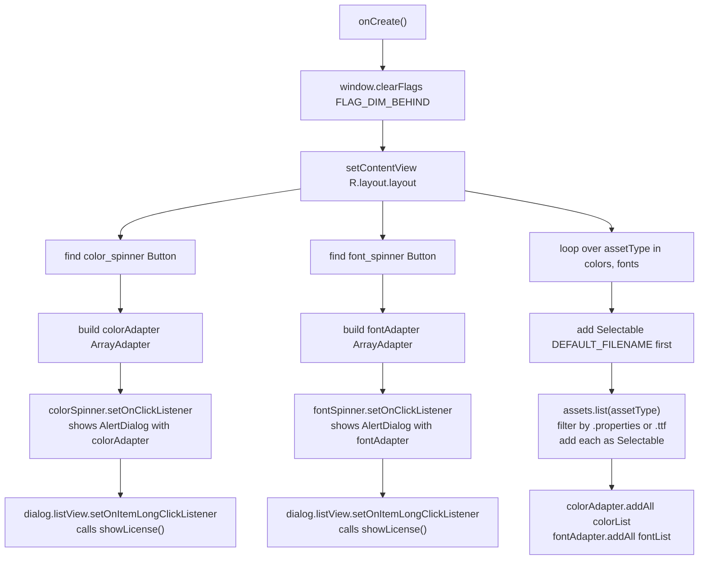

Sources: [app/src/main/java/com/termux/styling/TermuxStyleActivity.kt:58-116]()

### Asset Enumeration

[app/src/main/java/com/termux/styling/TermuxStyleActivity.kt:95-112]()

The loop iterates over two asset folder names: `"colors"` and `"fonts"`. For each:

- The file extension filter is `.properties` (colors) or `.ttf` (fonts).
- `assets.list(assetType)` returns all file names in the folder; the result is filtered to the relevant extension.
- The "Default" entry is prepended to the list before the asset scan, so it always appears first.
- An `IOException` from `assets.list` is re-thrown as `RuntimeException` (a fatal condition).

### Dialog Behavior

Each button's `OnClickListener` constructs a new `AlertDialog.Builder` with `setAdapter`, wiring item-click to `copyFile` and item-long-click to `showLicense`. The `setOnShowListener` hook is needed because `dialog.listView` is only accessible after the dialog is shown.

---

## `copyFile`: Writing Styles to Termux

`copyFile` [app/src/main/java/com/termux/styling/TermuxStyleActivity.kt:144-190]() is the central write operation. It accepts a `Selectable?` and a Boolean `colors` flag.

**copyFile pipeline diagram**

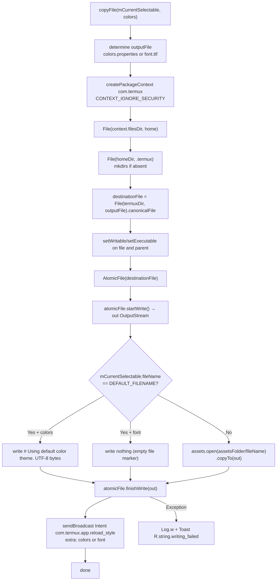

Sources: [app/src/main/java/com/termux/styling/TermuxStyleActivity.kt:144-190]()

### Cross-Package Context

[app/src/main/java/com/termux/styling/TermuxStyleActivity.kt:149-153]()

`createPackageContext("com.termux", Context.CONTEXT_IGNORE_SECURITY)` returns a `Context` scoped to the Termux app's data directory. This call only succeeds because both apps share `sharedUserId="com.termux"` (declared in `AndroidManifest.xml`) and are signed with the same key. The `filesDir` of that context resolves to the Termux app's internal storage root; the target directory is `<filesDir>/home/.termux/`.

### AtomicFile Write

`android.util.AtomicFile` provides crash-safe writes by writing to a temporary file first, then atomically renaming it on `finishWrite`. If an exception occurs before `finishWrite`, the destination is not corrupted.

### Default Sentinel Handling

| Condition | Action |
|---|---|
| `colors = true`, `fileName == "Default"` | Write the UTF-8 string `# Using default color theme.` to `colors.properties` |
| `colors = false`, `fileName == "Default"` | Write nothing; leaves `font.ttf` as an empty file |
| Any other selection | Stream the matching asset directly to the output file |

The Termux app interprets a comment-only `colors.properties` as "no custom color scheme" and an empty `font.ttf` as "use the built-in font."

### File Permission Fixup

Before writing, `copyFile` calls `setWritable(true)` on the destination file and `setWritable(true)` / `setExecutable(true)` on its parent directory. This guards against permission states that might have been set by the user manually.

Sources: [app/src/main/java/com/termux/styling/TermuxStyleActivity.kt:157-159]()

---

## `showLicense`: Displaying License Text

`showLicense` [app/src/main/java/com/termux/styling/TermuxStyleActivity.kt:118-142]() is triggered on long-press of any list item.

**Lookup logic:**

1. Take the `fileName` from the `Selectable`.
2. Strip the file extension.
3. Append `.txt` — e.g., `nord.properties` → `nord.txt`, `FiraCode-Regular.ttf` → `FiraCode-Regular.txt`.
4. Open `assets/<folder>/<name>.txt`.

The content is read into a `SpannableString` and `Linkify.addLinks(license, Linkify.ALL)` is applied so that URLs in the license text become clickable. The `AlertDialog`'s message `TextView` receives `LinkMovementMethod.getInstance()` to enable tap navigation.

If no `.txt` file exists (e.g., for the "Default" entry), the `IOException` is silently ignored and no dialog appears.

Sources: [app/src/main/java/com/termux/styling/TermuxStyleActivity.kt:118-142]()

---

## The `com.termux.app.reload_style` Broadcast

After every successful write, `copyFile` sends:

```
Intent("com.termux.app.reload_style")
    .putExtra("com.termux.app.reload_style", "colors" | "font")
```

[app/src/main/java/com/termux/styling/TermuxStyleActivity.kt:180-183]()

The intent action and the extra key are the same string `"com.termux.app.reload_style"`. The extra value distinguishes which resource was updated. The Termux terminal emulator listens for this broadcast and reloads the relevant style without restarting the terminal session.

The comment in the source [app/src/main/java/com/termux/styling/TermuxStyleActivity.kt:179]() notes: *"Must match constant in Term#onCreate()"*, indicating this string is a shared contract with the main Termux app's `Term` class.

---

## Error Handling

If any exception is thrown during `copyFile` (file permission errors, `PackageManager.NameNotFoundException`, I/O failures), the catch block at [app/src/main/java/com/termux/styling/TermuxStyleActivity.kt:184-188]() logs a warning via `Log.w("termux", ...)` and shows a `Toast` using the string resource `R.string.writing_failed` concatenated with the exception message.

| String resource | Value |
|---|---|
| `R.string.writing_failed` | `"Failed to install file:\n\n"` |

Sources: [app/src/main/res/values/strings.xml:6](), [app/src/main/java/com/termux/styling/TermuxStyleActivity.kt:184-188]()

---

## Component Relationship Summary

**TermuxStyleActivity component map**

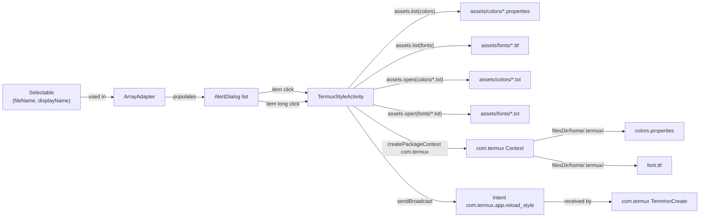

Sources: [app/src/main/java/com/termux/styling/TermuxStyleActivity.kt:1-192]()

---

# Page: Manifest and Permissions

# Manifest and Permissions

<details>
<summary>Relevant source files</summary>

The following files were used as context for generating this wiki page:

- [.github/workflows/github_action_build.yml](.github/workflows/github_action_build.yml)
- [.github/workflows/github_release_build.yml](.github/workflows/github_release_build.yml)
- [LICENSE.md](LICENSE.md)
- [README.md](README.md)
- [app/src/main/AndroidManifest.xml](app/src/main/AndroidManifest.xml)

</details>


This page covers the complete configuration declared in `app/src/main/AndroidManifest.xml`, including the `sharedUserId` mechanism, Activity flags, and hardware feature declaration. For the runtime behavior of the Activity itself (asset enumeration, file writes, broadcasts), see [TermuxStyleActivity](#2.1). For build-time configuration including the `applicationId` and `namespace`, see [App Build Configuration](#4.1).

---

## File Overview

The manifest is located at [app/src/main/AndroidManifest.xml:1-19]() and is minimal by design. The application declares no explicit `<uses-permission>` elements. Its cross-process capability is instead derived entirely from the `sharedUserId` mechanism described below.

---

## `sharedUserId` and the Signing Key Requirement

[app/src/main/AndroidManifest.xml:3]()

```xml
android:sharedUserId="com.termux"
```

This is the most security-critical declaration in the manifest. When two APKs share the same `sharedUserId`, Android grants them access to each other's private file storage at the OS level — but **only if both APKs are signed with the same certificate**.

The consequence for Termux:Styling is direct: the app must write files into the Termux app's private data directory (`~/.termux/font.ttf` and `~/.termux/colors.properties`). Rather than requesting a `READ_EXTERNAL_STORAGE` or custom permission, it uses `Context.createPackageContext("com.termux", ...)` to obtain a cross-package context — which Android only permits when the two packages share a `sharedUserId` backed by a matching signing key.

If the signing keys do not match, `createPackageContext` throws a `SecurityException` at runtime, and no file writes can occur.

**Signing Key Diagram: What Must Match**

```mermaid
flowchart LR
    subgraph apk1 ["termux-styling APK"]
        M1["AndroidManifest.xml\nsharedUserId=\"com.termux\""]
        K1["signing certificate"]
    end
    subgraph apk2 ["termux APK"]
        M2["AndroidManifest.xml\nsharedUserId=\"com.termux\""]
        K2["signing certificate"]
    end
    K1 -->|"must equal"| K2
    M1 -->|"declares same sharedUserId"| M2
    apk1 -->|"createPackageContext(\"com.termux\")\ngrants write access"| apk2
```

> **Note:** `android:sharedUserId` was deprecated in API level 29. However, it remains functional for existing packages and is still the mechanism in use here. Removing it would require a migration path that does not currently exist.

Sources: [app/src/main/AndroidManifest.xml:1-19](), [README.md:9-11]()

---

## Activity Declaration

[app/src/main/AndroidManifest.xml:12-16]()

The application contains exactly one Activity: `TermuxStyleActivity`. Its declaration includes two flags:

| Attribute | Value | Effect |
|---|---|---|
| `android:name` | `.TermuxStyleActivity` | Resolves to `com.termux.styling.TermuxStyleActivity` |
| `android:noHistory` | `true` | Activity is not retained in the back stack after the user leaves it |
| `android:exported` | `false` | Activity cannot be started by external applications via an implicit or explicit Intent |

**`android:noHistory="true"`** means that once the user navigates away from the styling picker (e.g., by pressing Back or Home), the Activity is immediately finished and removed from the task history. This is intentional: the screen is a transient configuration utility, not a destination the user should return to via the Recents list.

**`android:exported="false"`** means the Activity can only be launched by components within the same application (or, due to `sharedUserId`, from within the Termux shared-UID group). The main Termux app launches it via the `Style` menu option in the terminal long-press dialog. Because `exported` is `false`, no third-party app can directly invoke the Activity.

**Activity Launch Context Diagram**

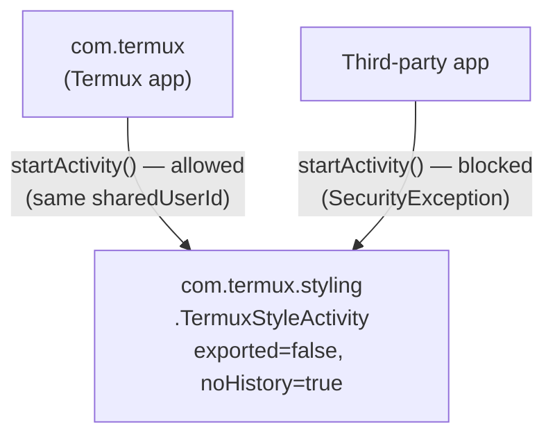

Sources: [app/src/main/AndroidManifest.xml:12-16]()

---

## Application-Level Attributes

[app/src/main/AndroidManifest.xml:7-11]()

| Attribute | Value | Notes |
|---|---|---|
| `android:allowBackup` | `true` | Enables Android Auto Backup; the app has no user data to back up |
| `android:icon` | `@drawable/ic_launcher` | Launcher icon resource |
| `android:label` | `@string/app_name` | Display name from `res/values/strings.xml` |
| `android:theme` | `@style/AppTheme` | Application-wide theme |

Sources: [app/src/main/AndroidManifest.xml:7-11]()

---

## Hardware Feature Declaration

[app/src/main/AndroidManifest.xml:5]()

```xml
<uses-feature android:name="android.hardware.touchscreen" android:required="false" />
```

By default, any app that uses touch events is implicitly assumed to require a touchscreen. This declaration **overrides** that implicit requirement, setting `required="false"`.

The practical effect is that the app remains installable on devices without a touchscreen (e.g., Android TV hardware or Chromebooks in some configurations). Since `TermuxStyleActivity` presents `AlertDialog` lists that can also be navigated with directional input, the app is not fundamentally dependent on touch.

> Without this declaration, Google Play and F-Droid would filter the app out of device catalogs that lack a touchscreen.

Sources: [app/src/main/AndroidManifest.xml:5]()

---

## Permissions Summary

The manifest declares **no `<uses-permission>` elements**. The table below explains how each cross-process capability is achieved without explicit permissions:

| Capability | Mechanism | Why No Permission Needed |
|---|---|---|
| Write to `com.termux` file storage | `Context.createPackageContext("com.termux", ...)` | Granted by matching `sharedUserId` + signing key |
| Send `com.termux.app.reload_style` broadcast | `Context.sendBroadcast(Intent)` | Broadcast is not protected by a `protectionLevel` permission |
| Read own bundled assets | `AssetManager.open(...)` | Same-package access; no permission required |

Sources: [app/src/main/AndroidManifest.xml:1-19](), [README.md:9-11]()

---

## Full Manifest Reference

For completeness, the entire manifest is reproduced here:

[app/src/main/AndroidManifest.xml:1-19]()

```xml
<?xml version="1.0" encoding="utf-8"?>
<manifest xmlns:android="http://schemas.android.com/apk/res/android"
    android:sharedUserId="com.termux" >

    <uses-feature android:name="android.hardware.touchscreen" android:required="false" />

    <application
        android:allowBackup="true"
        android:icon="@drawable/ic_launcher"
        android:label="@string/app_name"
        android:theme="@style/AppTheme" >
        <activity
            android:name=".TermuxStyleActivity"
            android:noHistory="true"
            android:exported="false" >
        </activity>
    </application>

</manifest>
```

Sources: [app/src/main/AndroidManifest.xml:1-19]()

---

# Page: Styling Assets

# Styling Assets

<details>
<summary>Relevant source files</summary>

The following files were used as context for generating this wiki page:

- [app/src/main/assets/colors/argonaut.properties](app/src/main/assets/colors/argonaut.properties)
- [app/src/main/assets/colors/zenburn.properties](app/src/main/assets/colors/zenburn.properties)
- [app/src/main/assets/fonts/Anonymous-Pro.ttf](app/src/main/assets/fonts/Anonymous-Pro.ttf)
- [app/src/main/assets/fonts/Hack.ttf](app/src/main/assets/fonts/Hack.ttf)
- [app/src/main/assets/fonts/Source-Code-Pro.ttf](app/src/main/assets/fonts/Source-Code-Pro.ttf)
- [app/src/main/java/com/termux/styling/TermuxStyleActivity.kt](app/src/main/java/com/termux/styling/TermuxStyleActivity.kt)
- [settings.gradle](settings.gradle)

</details>


This page describes the two categories of bundled assets shipped with Termux:Styling and explains how they are packaged into the APK and accessed at runtime. For a detailed listing of individual font files and their patching status, see [Font Assets](#3.1). For a detailed listing of color schemes and their `.properties` format, see [Color Scheme Assets](#3.2).

---

## Overview

The app ships two directories of bundled assets under `app/src/main/assets/`:

| Directory | File Extension | Written to |
|---|---|---|
| `assets/fonts/` | `.ttf` | `~/.termux/font.ttf` |
| `assets/colors/` | `.properties` | `~/.termux/colors.properties` |

Each asset file has an optional companion `.txt` file in the same directory, used to display license information when the user long-presses an entry in the selection dialog.

The Gradle build system packages the entire `assets/` tree into the APK. At runtime, `TermuxStyleActivity` enumerates both directories using `AssetManager` and presents them to the user as selectable lists.

Sources: [app/src/main/assets/colors/argonaut.properties:1-22](), [app/src/main/assets/colors/zenburn.properties:1-22](), [app/src/main/java/com/termux/styling/TermuxStyleActivity.kt:95-116]()

---

## Directory Structure

**Asset directory layout** — how the two asset categories are organized inside the APK:

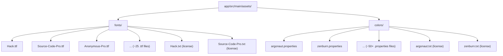

Sources: [app/src/main/java/com/termux/styling/TermuxStyleActivity.kt:97-112]()

---

## Packaging into the APK

The `app/src/main/assets/` directory is the standard Android assets source set. The Android Gradle Plugin automatically bundles everything under this path into the APK without further configuration. No `assets {}` DSL block is required in `app/build.gradle`.

At install time, the entire compressed `assets/` tree is available to the running app via Android's `AssetManager` API. Assets are read-only at runtime; they are never extracted to the filesystem by default — `TermuxStyleActivity` reads them directly as streams and writes the selected file to the Termux home directory.

Sources: [app/src/main/java/com/termux/styling/TermuxStyleActivity.kt:104-110]()

---

## Runtime Access via AssetManager

The following diagram traces how `TermuxStyleActivity` moves from an asset file to a written output file.

**Asset access and write flow** — code entities involved in reading and applying a styling asset:

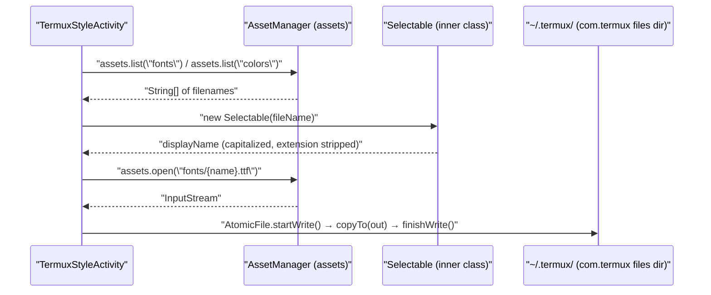

The `assets.list()` call at [app/src/main/java/com/termux/styling/TermuxStyleActivity.kt:105]() returns all filenames in the given asset subfolder. The result is then filtered by extension (`.properties` for colors, `.ttf` for fonts) at [app/src/main/java/com/termux/styling/TermuxStyleActivity.kt:106]().

Sources: [app/src/main/java/com/termux/styling/TermuxStyleActivity.kt:95-116](), [app/src/main/java/com/termux/styling/TermuxStyleActivity.kt:144-189]()

---

## Display Name Derivation

Every asset filename is wrapped in a `Selectable` instance. The `Selectable` inner class at [app/src/main/java/com/termux/styling/TermuxStyleActivity.kt:42-56]() derives a human-readable display name from the raw filename according to these rules:

1. Replace every `-` character with a space.
2. Strip the file extension (remove everything from the last `.` onward).
3. Apply title-case capitalization via the top-level `capitalize()` function at [app/src/main/java/com/termux/styling/TermuxStyleActivity.kt:26-38]().

**Display name derivation** — mapping filename to `displayName` in `Selectable`:

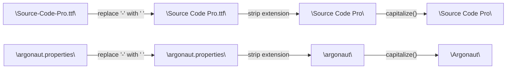

The `fileName` field retains the original filename (including extension) and is used when opening the asset stream. The `displayName` field is what is shown in the `AlertDialog` list via `ArrayAdapter`.

Sources: [app/src/main/java/com/termux/styling/TermuxStyleActivity.kt:42-56](), [app/src/main/java/com/termux/styling/TermuxStyleActivity.kt:26-38]()

---

## The Default Sentinel

Both the fonts and colors lists include a special "Default" entry that does not correspond to any asset file. It is added at [app/src/main/java/com/termux/styling/TermuxStyleActivity.kt:102]() before the asset enumeration loop.

When the user selects "Default", `copyFile()` at [app/src/main/java/com/termux/styling/TermuxStyleActivity.kt:162-176]() writes a sentinel value instead of streaming an asset:

| Type | Default sentinel written to `~/.termux/` |
|---|---|
| Colors | `colors.properties` containing the comment `# Using default color theme.` |
| Fonts | `font.ttf` as an empty file (zero bytes) |

Termux interprets these sentinel values to revert to its built-in defaults. The `DEFAULT_FILENAME` constant at [app/src/main/java/com/termux/styling/TermuxStyleActivity.kt:24]() holds the string `"Default"`.

Sources: [app/src/main/java/com/termux/styling/TermuxStyleActivity.kt:24](), [app/src/main/java/com/termux/styling/TermuxStyleActivity.kt:102](), [app/src/main/java/com/termux/styling/TermuxStyleActivity.kt:162-176]()

---

## License Files

Each asset (font or color scheme) may have an accompanying `.txt` file stored at the same path in the same asset folder. When a user long-presses an entry in the dialog, `showLicense()` at [app/src/main/java/com/termux/styling/TermuxStyleActivity.kt:118-142]() constructs the license filename by:

1. Taking the `fileName` from `Selectable`.
2. Stripping the extension.
3. Appending `.txt`.

For example, `Hack.ttf` → `Hack.txt`, and `argonaut.properties` → `argonaut.txt`.

If the `.txt` file does not exist, the `IOException` is silently caught and nothing is shown ([app/src/main/java/com/termux/styling/TermuxStyleActivity.kt:138-140]()). This means license files are optional — assets without one simply show nothing on long-press.

The license text is rendered in an `AlertDialog` with `Linkify.addLinks()` applied, so URLs in the license text become tappable.

Sources: [app/src/main/java/com/termux/styling/TermuxStyleActivity.kt:118-142]()

---

## Color Scheme File Format

Color scheme assets use the Java `.properties` format — simple `key=value` pairs, one per line. Lines beginning with `#` are comments.

**Required and optional keys:**

| Key | Description | Example |
|---|---|---|
| `background` | Terminal background color | `#0e1019` |
| `foreground` | Default text color | `#fffaf4` |
| `cursor` | Cursor color | `#fffaf4` |
| `color0`–`color7` | Normal 8-color palette | `#ff000f` |
| `color8`–`color15` | Bright 8-color palette | `#ff2740` |

All color values are hex strings in `#RRGGBB` format. A complete example from `assets/colors/argonaut.properties`:

```
background=#0e1019
foreground=#fffaf4
cursor=#fffaf4
color0=#232323
color1=#ff000f
...
color15=#ffffff
```

For a full listing of all bundled color schemes, see [Color Scheme Assets](#3.2).

Sources: [app/src/main/assets/colors/argonaut.properties:1-22](), [app/src/main/assets/colors/zenburn.properties:1-22]()

---

## Font File Format

Font assets are standard TrueType Font (`.ttf`) binary files. Some are patched versions that include additional Unicode codepoints (Powerline symbols, Nerd Font icons); others are unmodified originals. The distinction is not encoded in the filename itself — the accompanying `.txt` license file typically identifies the source and any modifications.

For a full listing of bundled fonts and their patching status, see [Font Assets](#3.1). For documentation of the shell scripts used to produce the patched font files before they are committed to the repository, see [Asset Provisioning](#6).

Sources: [app/src/main/assets/fonts/Hack.ttf:1-1](), [app/src/main/assets/fonts/Source-Code-Pro.ttf:1-1](), [app/src/main/assets/fonts/Anonymous-Pro.ttf:1-1]()

---

# Page: Font Assets

# Font Assets

<details>
<summary>Relevant source files</summary>

The following files were used as context for generating this wiki page:

- [.gitignore](.gitignore)
- [app/src/main/assets/fonts/Anonymous-Pro.ttf](app/src/main/assets/fonts/Anonymous-Pro.ttf)
- [app/src/main/assets/fonts/CascadiaCode.ttf](app/src/main/assets/fonts/CascadiaCode.ttf)
- [app/src/main/assets/fonts/CascadiaCode.txt](app/src/main/assets/fonts/CascadiaCode.txt)
- [app/src/main/assets/fonts/Hack.ttf](app/src/main/assets/fonts/Hack.ttf)
- [app/src/main/assets/fonts/Hermit.ttf](app/src/main/assets/fonts/Hermit.ttf)
- [app/src/main/assets/fonts/Iosevka.ttf](app/src/main/assets/fonts/Iosevka.ttf)
- [app/src/main/assets/fonts/JetBrains-Mono.ttf](app/src/main/assets/fonts/JetBrains-Mono.ttf)
- [app/src/main/assets/fonts/JetBrains-Mono.txt](app/src/main/assets/fonts/JetBrains-Mono.txt)
- [app/src/main/assets/fonts/Meslo.ttf](app/src/main/assets/fonts/Meslo.ttf)
- [app/src/main/assets/fonts/Monofur.ttf](app/src/main/assets/fonts/Monofur.ttf)
- [app/src/main/assets/fonts/Monoid.ttf](app/src/main/assets/fonts/Monoid.ttf)
- [app/src/main/assets/fonts/Source-Code-Pro.ttf](app/src/main/assets/fonts/Source-Code-Pro.ttf)

</details>


This page documents the font TTF files bundled in `app/src/main/assets/fonts/`, including their naming conventions, display name derivation, accompanying license files, and how they are categorized by patching type. For information on how a selected font is written to disk and broadcast to the terminal, see [TermuxStyleActivity](#2.1). For the shell scripts that produce these font files at development time, see [Asset Provisioning](#6).

---

## Overview

The `assets/fonts/` directory ships approximately 25 TrueType font files inside the APK. At runtime, `TermuxStyleActivity` enumerates them with `assets.list("fonts")`, presents them to the user, and copies the chosen file to `~/.termux/font.ttf` in the main Termux app's file space.

Each font file has a paired `.txt` file of the same base name that holds license or attribution text, viewable via a long-press in the font selection dialog.

**Sources:** `app/src/main/assets/fonts/`, Diagram 1 (Repository Component Map), Diagram 3 (Application Runtime — Style Selection Flow)

---

## Storage and Packaging

All font files reside at:

```
app/src/main/assets/fonts/
├── Anonymous-Pro.ttf
├── Anonymous-Pro.txt
├── Hack.ttf
├── Hack.txt
├── Hermit.ttf
├── Hermit.txt
├── Iosevka.ttf
├── Iosevka.txt
├── Meslo.ttf
├── Meslo.txt
├── Monofur.ttf
├── Monofur.txt
├── Monoid.ttf
├── Monoid.txt
├── Source-Code-Pro.ttf
├── Source-Code-Pro.txt
...   (additional fonts, ~25 total)
```

The Gradle build at `app/build.gradle` packages the entire `assets/` tree into the APK without any special configuration; Android's asset pipeline handles the `assets/fonts/` directory automatically.

**Sources:** [app/src/main/assets/fonts/Iosevka.ttf:1-1](), [app/src/main/assets/fonts/Monofur.ttf:1-1](), [app/src/main/assets/fonts/Hack.ttf:1-1]()

---

## File Naming and Display Name Derivation

Font file names follow a **Title-Case-With-Hyphens** convention (e.g., `Source-Code-Pro.ttf`, `Anonymous-Pro.ttf`). When `TermuxStyleActivity` builds the selection dialog, it calls `assets.list("fonts")` and derives the display name by stripping the `.ttf` extension from the returned filename.

| File name | Display name shown to user |
|---|---|
| `Anonymous-Pro.ttf` | `Anonymous-Pro` |
| `Hack.ttf` | `Hack` |
| `Source-Code-Pro.ttf` | `Source-Code-Pro` |
| `Iosevka.ttf` | `Iosevka` |

The special entry **Default** is not a file — it is a synthetic item prepended by `TermuxStyleActivity` that writes an empty file to `~/.termux/font.ttf`, signalling the terminal to revert to its built-in font.

**Sources:** Diagram 3 (Style Selection Flow)

---

## Font Catalog

The table below lists the confirmed bundled fonts grouped by patching type. The "Patching" column reflects how each font was produced before being committed to the repository.

| Font file | Patching | Source |
|---|---|---|
| `Hack.ttf` | Nerd Font | ryanoasis/nerd-fonts v3.0.2 |
| `Hermit.ttf` | Nerd Font | ryanoasis/nerd-fonts v3.0.2 |
| `Iosevka.ttf` | Nerd Font | ryanoasis/nerd-fonts v3.0.2 |
| `Meslo.ttf` | Nerd Font | ryanoasis/nerd-fonts v3.0.2 |
| `Monofur.ttf` | Nerd Font | ryanoasis/nerd-fonts v3.0.2 |
| `Monoid.ttf` | Nerd Font | ryanoasis/nerd-fonts v3.0.2 |
| `Source-Code-Pro.ttf` | Nerd Font | ryanoasis/nerd-fonts v3.0.2 |
| `Anonymous-Pro.ttf` | Powerline | powerline-fontpatcher (Python 3 patched) |
| `Courier-Prime.ttf` | Powerline | powerline-fontpatcher |
| `FreeMono.ttf` | Powerline | powerline-fontpatcher |

> **Note:** The full set is approximately 25 files. Only those confirmed by file listings or documented in the provisioning scripts are listed above. Additional Nerd Font entries originate from the `fonts[]` array in `setup-nerd-fonts.sh`.

**Sources:** [app/src/main/assets/fonts/Anonymous-Pro.ttf:1-1](), [app/src/main/assets/fonts/Hermit.ttf:1-1](), [app/src/main/assets/fonts/Monoid.ttf:1-1](), [app/src/main/assets/fonts/Meslo.ttf:1-1]()

---

## Patching Categories

**Font type comparison:**

| Feature | Nerd Font patched | Powerline patched | Unmodified |
|---|---|---|---|
| Powerline symbols | ✓ | ✓ | ✗ |
| Nerd Font icon glyphs | ✓ | ✗ | ✗ |
| Source | ryanoasis/nerd-fonts | powerline-fontpatcher | Original upstream |
| Script | `setup-nerd-fonts.sh` | `setup-fonts.sh` | — |
| Python 3 patch needed | No | Yes (`fontpatcher-py3.patch`) | — |

### Nerd Font Patched

Produced by `setup-nerd-fonts.sh`. This script declares a `fonts[]` associative array mapping simplified local names to remote paths on the `ryanoasis/nerd-fonts` GitHub repository at tag `v3.0.2`. The download uses `curl -fLo` and saves directly to `assets/fonts/{name}.ttf`. Remote directory names are constructed by stripping hyphens from the font name, with `Go-Mono` as the documented exception.

For full details, see [Nerd Fonts Setup](#6.1).

### Powerline Patched

Produced by `setup-fonts.sh`. The three fonts processed are:

- **Courier Prime** — downloaded as an archive, extracted, then passed through `powerline-fontpatcher`
- **GNU FreeFont FreeMono** — same pipeline
- **Bedstead Condensed** — same pipeline

The script applies `fontpatcher-py3.patch` to the `powerline/fontpatcher` checkout before invoking it, fixing a Python 3 shebang incompatibility.

For full details, see [Powerline Font Setup](#6.2).

---

## Runtime Asset Flow

**Diagram: Font asset flow from provisioning through runtime**

```mermaid
flowchart TD
    subgraph "Dev-Time Provisioning"
        SN["setup-nerd-fonts.sh\n(fonts[] array, curl -fLo)"]
        SF["setup-fonts.sh\n(powerline-fontpatcher)"]
    end

    subgraph "APK Bundle"
        AF["assets/fonts/*.ttf\nassets/fonts/*.txt"]
    end

    subgraph "TermuxStyleActivity Runtime"
        AL["assets.list(\"fonts\")"]
        AO["assets.open(\"fonts/{name}.ttf\")"]
        AX["assets.open(\"fonts/{name}.txt\")"]
    end

    subgraph "com.termux File Space"
        FT["~/.termux/font.ttf\n(AtomicFile write)"]
    end

    TX["com.termux\n(Terminal Emulator)"]

    SN -->|"writes .ttf"| AF
    SF -->|"writes .ttf"| AF
    AF -->|"packaged by Gradle"| AL
    AL -->|"user selects"| AO
    AL -->|"user long-presses"| AX
    AO -->|"copyFile via createPackageContext"| FT
    FT -->|"com.termux.app.reload_style broadcast"| TX
```

**Sources:** Diagram 3 (Application Runtime), Diagram 4 (Dev-Time Asset Provisioning)

---

## License Files

Each `.ttf` file has a corresponding `.txt` companion at the same path stem. For example, `Hack.ttf` is paired with `Hack.txt`.

These files are not loaded during normal font selection. They are opened only when the user **long-presses** a font name in the selection dialog. `TermuxStyleActivity` then calls `assets.open("fonts/{name}.txt")` and displays the content in an `AlertDialog`.

**Diagram: Font file pairs and their access paths in TermuxStyleActivity**

```mermaid
flowchart LR
    subgraph "assets/fonts/"
        T["Hack.ttf"]
        L["Hack.txt"]
        T2["Iosevka.ttf"]
        L2["Iosevka.txt"]
    end

    subgraph "TermuxStyleActivity"
        TAP["normal tap\nassets.open(\"fonts/Hack.ttf\")"]
        LONGPRESS["long-press\nassets.open(\"fonts/Hack.txt\")"]
        DIALOG["AlertDialog\n(license text)"]
        COPY["copyFile()\n→ AtomicFile write"]
    end

    T -->|"InputStream"| TAP
    L -->|"InputStream"| LONGPRESS
    TAP --> COPY
    LONGPRESS --> DIALOG
```

**Sources:** Diagram 3 (Application Runtime — Style Selection Flow)

---

## Relationship to Color Assets

Font assets in `assets/fonts/` follow the same structural conventions as color scheme assets in `assets/colors/`: both use a base file plus a `.txt` license companion, both are enumerated with `assets.list()`, and both follow a `Default` sentinel pattern. For color scheme asset details, see [Color Scheme Assets](#3.2).

---

# Page: Color Scheme Assets

# Color Scheme Assets

<details>
<summary>Relevant source files</summary>

The following files were used as context for generating this wiki page:

- [app/src/main/assets/colors/argonaut.properties](app/src/main/assets/colors/argonaut.properties)
- [app/src/main/assets/colors/catppuccin-frappe.properties](app/src/main/assets/colors/catppuccin-frappe.properties)
- [app/src/main/assets/colors/catppuccin-frappe.txt](app/src/main/assets/colors/catppuccin-frappe.txt)
- [app/src/main/assets/colors/catppuccin-latte.properties](app/src/main/assets/colors/catppuccin-latte.properties)
- [app/src/main/assets/colors/catppuccin-latte.txt](app/src/main/assets/colors/catppuccin-latte.txt)
- [app/src/main/assets/colors/catppuccin-macchiato.properties](app/src/main/assets/colors/catppuccin-macchiato.properties)
- [app/src/main/assets/colors/catppuccin-macchiato.txt](app/src/main/assets/colors/catppuccin-macchiato.txt)
- [app/src/main/assets/colors/catppuccin-mocha.properties](app/src/main/assets/colors/catppuccin-mocha.properties)
- [app/src/main/assets/colors/catppuccin-mocha.txt](app/src/main/assets/colors/catppuccin-mocha.txt)
- [app/src/main/assets/colors/catppuccin.txt](app/src/main/assets/colors/catppuccin.txt)
- [app/src/main/assets/colors/gruvbox-material-dark-hard.properties](app/src/main/assets/colors/gruvbox-material-dark-hard.properties)
- [app/src/main/assets/colors/gruvbox-material-dark-medium.properties](app/src/main/assets/colors/gruvbox-material-dark-medium.properties)
- [app/src/main/assets/colors/gruvbox-material-dark-soft.properties](app/src/main/assets/colors/gruvbox-material-dark-soft.properties)
- [app/src/main/assets/colors/gruvbox-material-light-hard.properties](app/src/main/assets/colors/gruvbox-material-light-hard.properties)
- [app/src/main/assets/colors/gruvbox-material-light-medium.properties](app/src/main/assets/colors/gruvbox-material-light-medium.properties)
- [app/src/main/assets/colors/gruvbox-material-light-soft.properties](app/src/main/assets/colors/gruvbox-material-light-soft.properties)
- [app/src/main/assets/colors/tokyonight-dark.properties](app/src/main/assets/colors/tokyonight-dark.properties)
- [app/src/main/assets/colors/tokyonight-day.properties](app/src/main/assets/colors/tokyonight-day.properties)
- [app/src/main/assets/colors/zenburn.properties](app/src/main/assets/colors/zenburn.properties)

</details>


This page describes the color scheme asset files bundled in `app/src/main/assets/colors/`, their file format, the full set of recognized property keys, and how they are loaded at runtime. For how the activity enumerates and applies these files, see [TermuxStyleActivity](#2.1). For font assets stored alongside color schemes, see [Font Assets](#3.1).

---

## Location and Packaging

All color scheme assets reside in:

```
app/src/main/assets/colors/
```

Each color scheme consists of a pair of files:

| File | Role |
|------|------|
| `{name}.properties` | Color definitions applied to the terminal |
| `{name}.txt` | License text, shown on long-press in the UI |

The entire `assets/colors/` directory is packaged into the APK by the Gradle build. At runtime, `TermuxStyleActivity` uses Android's `AssetManager` to call `assets.list("colors")` and enumerate all entries. Only `.properties` files appear in the selection dialog; `.txt` files are accessed separately when the user long-presses a scheme name.

Sources: [app/src/main/assets/colors/tokyonight-dark.properties:1-33](), [app/src/main/assets/colors/argonaut.properties:1-21](), [app/src/main/assets/colors/catppuccin-mocha.txt:1-23]()

---

## File Format

Color scheme files follow the Java `.properties` convention. Both `=` and `:` are accepted as key-value separators, and whitespace around the separator is permitted.

**Example** — excerpt from [app/src/main/assets/colors/tokyonight-dark.properties:1-16]():

```
## Name: Tokyo Night Dark

# Special
foreground = #c0caf5
cursor     = #c0caf5
background = #1a1b26

# Black
color0 = #15161E
color8 = #414868
```

**Example** — colon separator style from [app/src/main/assets/colors/gruvbox-material-dark-hard.properties:1-8]():

```
background: #1D2021
foreground: #D4BE98

color0:  #665C54
color8:  #928374
```

### Rules

- Lines beginning with `#` (or `##`) are comments and are ignored.
- All hex values use the `#RRGGBB` format (six hex digits, uppercase or lowercase).
- Whitespace before and after the separator is trimmed.
- Keys not present in the file retain their default values in the Termux terminal.

---

## Property Key Reference

The following diagram maps each recognized key to its semantic role in the terminal color palette.

**Diagram: Property Keys to Terminal Color Roles**

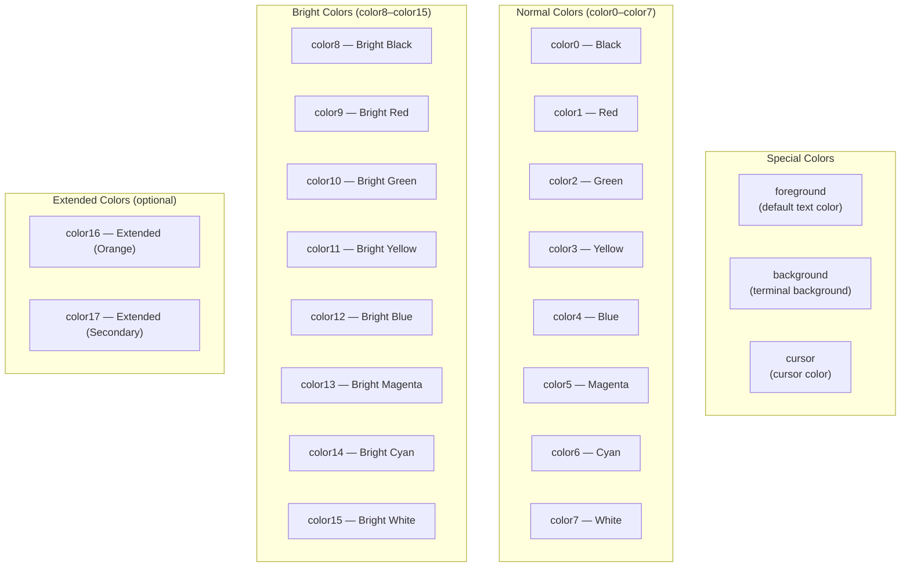

Sources: [app/src/main/assets/colors/catppuccin-mocha.properties:1-25](), [app/src/main/assets/colors/tokyonight-dark.properties:1-33](), [app/src/main/assets/colors/gruvbox-material-dark-hard.properties:1-26]()

### Key Summary Table

| Key | Required | Typical Role |
|-----|----------|-------------|
| `foreground` | Recommended | Default text color |
| `background` | Recommended | Terminal background |
| `cursor` | Optional | Cursor block/bar color |
| `color0` – `color7` | Recommended | Normal 8-color palette |
| `color8` – `color15` | Recommended | Bright 8-color palette |
| `color16` | Optional | Extended color (often orange) |
| `color17` | Optional | Extended color (often dark red or pink) |

`color16` and `color17` are omitted from some schemes (e.g., `argonaut`, `zenburn`, `gruvbox-material-*`). When absent, the Termux terminal falls back to its built-in defaults for those slots.

---

## Asset Pair Structure

**Diagram: `.properties` and `.txt` file pairs in the asset pipeline**

```mermaid
flowchart LR
    subgraph "assets/colors/ (APK bundle)"
        P[""{name}.properties"\n(color definitions)"]
        T[""{name}.txt"\n(license text)"]
    end

    subgraph "TermuxStyleActivity"
        LIST["assets.list(\"colors\")"]
        OPEN_P["assets.open(\"colors/{name}.properties\")"]
        OPEN_T["assets.open(\"colors/{name}.txt\")"]
        WRITE["AtomicFile write →\n~/.termux/colors.properties"]
        DIALOG["AlertDialog\n(license text)"]
    end

    LIST -->|"populates selection list"| OPEN_P
    LIST -->|"populates selection list"| OPEN_T
    OPEN_P --> WRITE
    OPEN_T --> DIALOG
```

Sources: [app/src/main/assets/colors/catppuccin-mocha.txt:1-23](), [app/src/main/assets/colors/catppuccin-latte.properties:1-25]()

---

## Bundled Color Schemes

The table below lists all color schemes confirmed from the repository's `assets/colors/` directory. The repository ships 50+ schemes in total; the subset documented here reflects files present in the codebase.

| Scheme File (`*.properties`) | Style | License File | Origin / Source |
|-------------------------------|-------|-------------|-----------------|
| `argonaut` | Dark | — | [Gogh / Mayccoll](https://github.com/Mayccoll/Gogh) |
| `catppuccin` | Dark | `catppuccin.txt` | [catppuccin/catppuccin](https://github.com/catppuccin/catppuccin), MIT |
| `catppuccin-frappe` | Dark | `catppuccin-frappe.txt` | Catppuccin Frappé variant, MIT |
| `catppuccin-latte` | Light | `catppuccin-latte.txt` | Catppuccin Latte variant, MIT |
| `catppuccin-macchiato` | Dark | `catppuccin-macchiato.txt` | Catppuccin Macchiato variant, MIT |
| `catppuccin-mocha` | Dark | `catppuccin-mocha.txt` | Catppuccin Mocha variant, MIT |
| `gruvbox-material-dark-hard` | Dark | — | Gruvbox Material, hard contrast |
| `gruvbox-material-dark-medium` | Dark | — | Gruvbox Material, medium contrast |
| `gruvbox-material-dark-soft` | Dark | — | Gruvbox Material, soft contrast |
| `gruvbox-material-light-hard` | Light | — | Gruvbox Material, light hard contrast |
| `gruvbox-material-light-medium` | Light | — | Gruvbox Material, light medium contrast |
| `gruvbox-material-light-soft` | Light | — | Gruvbox Material, light soft contrast |
| `tokyonight-dark` | Dark | — | Tokyo Night Dark variant |
| `tokyonight-day` | Light | — | Tokyo Night Day variant |
| `zenburn` | Dark | — | [dotfiles.org](http://dotfiles.org/~jbromley/.Xresources) |

Sources: [app/src/main/assets/colors/argonaut.properties:1-21](), [app/src/main/assets/colors/catppuccin-latte.properties:1-25](), [app/src/main/assets/colors/catppuccin-frappe.properties:1-25](), [app/src/main/assets/colors/catppuccin-macchiato.properties:1-25](), [app/src/main/assets/colors/catppuccin-mocha.properties:1-25](), [app/src/main/assets/colors/gruvbox-material-dark-hard.properties:1-26](), [app/src/main/assets/colors/gruvbox-material-dark-medium.properties:1-26](), [app/src/main/assets/colors/gruvbox-material-dark-soft.properties:1-26](), [app/src/main/assets/colors/gruvbox-material-light-hard.properties:1-26](), [app/src/main/assets/colors/gruvbox-material-light-medium.properties:1-26](), [app/src/main/assets/colors/gruvbox-material-light-soft.properties:1-26](), [app/src/main/assets/colors/tokyonight-dark.properties:1-33](), [app/src/main/assets/colors/tokyonight-day.properties:1-32](), [app/src/main/assets/colors/zenburn.properties:1-21]()

---

## License Files (`.txt`)

Each `.txt` file paired with a `.properties` file contains the full license text for that color scheme. When a user long-presses a scheme in the `TermuxStyleActivity` dialog, the app reads the corresponding `.txt` file via `assets.open("colors/{name}.txt")` and displays its contents in an `AlertDialog`.

Not all schemes include a `.txt` file. When no `.txt` file is present for a given scheme name, the long-press action has no license to display. Schemes from the Catppuccin family all carry MIT license files with the same copyright header referencing `https://github.com/catppuccin/catppuccin`.

Sources: [app/src/main/assets/colors/catppuccin-mocha.txt:1-23](), [app/src/main/assets/colors/catppuccin-frappe.txt:1-23](), [app/src/main/assets/colors/catppuccin-latte.txt:1-23](), [app/src/main/assets/colors/catppuccin-macchiato.txt:1-23](), [app/src/main/assets/colors/catppuccin.txt:1-23]()

---

## The "Default" Sentinel

When the user selects the built-in "Default" color option, `TermuxStyleActivity` does not copy an asset file. Instead, it writes a sentinel value — a comment-only string — to `~/.termux/colors.properties`. The Termux terminal interprets this as "no custom scheme" and reverts to its built-in defaults. This behavior is distinct from copying any file from `assets/colors/` and is handled entirely within the activity's `copyFile` method. See [TermuxStyleActivity](#2.1) for implementation details.

---

## Runtime Flow Summary

**Diagram: Color scheme selection runtime path (file-level)**

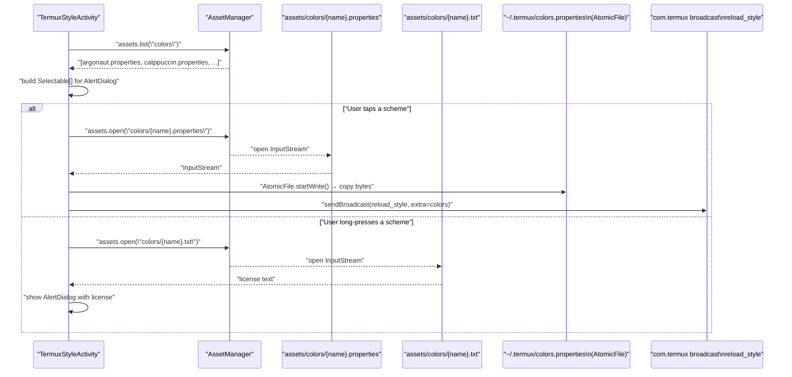

Sources: [app/src/main/assets/colors/tokyonight-dark.properties:1-33](), [app/src/main/assets/colors/catppuccin-mocha.properties:1-25]()

---

# Page: Build System

# Build System

<details>
<summary>Relevant source files</summary>

The following files were used as context for generating this wiki page:

- [app/build.gradle](app/build.gradle)
- [build.gradle](build.gradle)
- [gradle.properties](gradle.properties)
- [gradle/wrapper/gradle-wrapper.jar](gradle/wrapper/gradle-wrapper.jar)
- [gradle/wrapper/gradle-wrapper.properties](gradle/wrapper/gradle-wrapper.properties)

</details>


This page describes the overall structure of the Gradle build system used to compile and package the Termux:Styling APK. It covers how the three configuration files (`build.gradle`, `app/build.gradle`, and `gradle.properties`) relate to each other, the role of the Gradle wrapper, and the version name pipeline. For CI/CD details that invoke this build system, see [CI/CD Workflows](#5). For detailed treatment of each component, see the sub-pages [App Build Configuration](#4.1), [Root Build Configuration](#4.2), and [Gradle Wrapper](#4.3).

---

## Structure Overview

The build system follows a two-tier Gradle project layout: a root project that declares plugin classpaths and repositories, and a single `app` submodule that applies those plugins and defines the Android application.

**Build system file map**

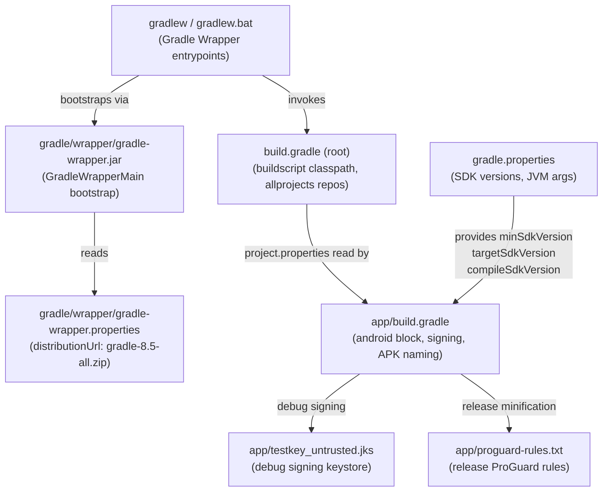

Sources: [build.gradle:1-20](), [app/build.gradle:1-79](), [gradle.properties:1-24](), [gradle/wrapper/gradle-wrapper.properties:1-7]()

---

## Root Build File

[build.gradle:1-20]() is the root project file. Its responsibilities are:

- Declaring the `buildscript` block, which makes the Android Gradle Plugin (AGP) and Kotlin Gradle Plugin available to submodules.
- Setting the `ext.kotlin_version` extra property to `'1.9.10'`, which is referenced by `app/build.gradle` in the `dependencies` block as `$kotlin_version`.
- Declaring `google()` and `mavenCentral()` under both `buildscript.repositories` and `allprojects.repositories`.

| Plugin | Version | Reference in `build.gradle` |
|---|---|---|
| Android Gradle Plugin | 8.3.2 | `com.android.tools.build:gradle:8.3.2` |
| Kotlin Gradle Plugin | 1.9.10 | `org.jetbrains.kotlin:kotlin-gradle-plugin:$kotlin_version` |

Sources: [build.gradle:1-20]()

---

## `gradle.properties` — SDK Versions and JVM Settings

[gradle.properties:1-24]() provides three Android SDK version properties consumed by `app/build.gradle` via `project.properties.*`:

| Property | Value | Consumed as |
|---|---|---|
| `minSdkVersion` | `21` | `minSdk project.properties.minSdkVersion.toInteger()` |
| `targetSdkVersion` | `28` | `targetSdk project.properties.targetSdkVersion.toInteger()` |
| `compileSdkVersion` | `34` | `compileSdk project.properties.compileSdkVersion.toInteger()` |

It also sets:
- `org.gradle.jvmargs=-Xmx1536m` — Gradle daemon heap limit.
- `android.useAndroidX=true` — enables AndroidX.

Sources: [gradle.properties:10-24](), [app/build.gradle:9-17]()

---

## App Build File (`app/build.gradle`)

[app/build.gradle:1-79]() is the sole Android application module configuration. It applies the `com.android.application` and `kotlin-android` plugins declared in the root build file.

### Version Name Resolution

The `versionName` is resolved at configuration time through a two-step pipeline:

**Version name resolution pipeline**

```mermaid
flowchart TD
    ENV["System.getenv\n(TERMUX_STYLING_APP_BUILD__APP_VERSION_NAME)"]
    CHECK{"env var\nnon-empty?"}
    USE_ENV["versionName = appVersionName\n(from env var)"]
    USE_HC["versionName = \"0.32.1\"\n(hardcoded default in defaultConfig)"]
    VALIDATE["validateVersionName(versionName)\n(SemVer 2.0.0 regex check)"]
    FAIL["throw GradleException"]
    OK["Build continues"]

    ENV --> CHECK
    CHECK -->|"Yes"| USE_ENV
    CHECK -->|"No"| USE_HC
    USE_ENV --> VALIDATE
    USE_HC --> VALIDATE
    VALIDATE -->|"no match"| FAIL
    VALIDATE -->|"match"| OK
```

The `validateVersionName` function at [app/build.gradle:73-78]() enforces SemVer 2.0.0 using a full regex match. Any version string that does not match (e.g., missing patch component) causes the build to fail immediately with a `GradleException`.

Sources: [app/build.gradle:11-22](), [app/build.gradle:73-78]()

### APK Output Filename

The `applicationVariants.all` block at [app/build.gradle:55-60]() constructs the output APK filename from a second environment variable:

| Condition | Resulting filename |
|---|---|
| `TERMUX_STYLING_APP_BUILD__APK_VERSION_TAG` is set | `termux-styling-app_{tag}.apk` |
| env var is empty | `termux-styling-app_v{versionName}+{buildType}.apk` |

Examples: `termux-styling-app_v0.32.1+debug.apk` or `termux-styling-app_v0.32.1+release.apk`.

Sources: [app/build.gradle:55-61]()

### Build Types

| Build Type | Signing | Minification | ProGuard |
|---|---|---|---|
| `debug` | `testkey_untrusted.jks` (alias `alias`) | disabled | none |
| `release` | not configured (requires external signing) | enabled (`minifyEnabled true`, `shrinkResources true`) | `proguard-android.txt` + `proguard-rules.txt` |

The debug keystore credentials are hardcoded in [app/build.gradle:26-31]() and are intentionally untrusted — they cannot be used to install alongside a production Termux build.

Sources: [app/build.gradle:25-44]()

### Compile Options

Both Java and Kotlin targets are set to JVM 11:

- `compileOptions.sourceCompatibility` / `targetCompatibility`: `JavaVersion.VERSION_11` ([app/build.gradle:46-49]())
- `kotlinOptions.jvmTarget`: `'11'` ([app/build.gradle:51-53]())

### `versionName` Task

A Gradle task named `versionName` is defined at [app/build.gradle:67-71](). When invoked (`./gradlew versionName`), it prints the resolved `android.defaultConfig.versionName` to stdout. The CI workflows use this to extract the version string for artifact naming. See [Debug and Action Builds](#5.1) for how it is called.

Sources: [app/build.gradle:67-71]()

---

## Gradle Wrapper

The Gradle wrapper ensures all developers and CI agents use the same Gradle version without a system-level installation.

**Wrapper component relationships**

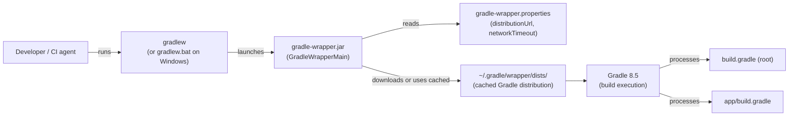

[gradle/wrapper/gradle-wrapper.properties:1-7]() specifies:

| Property | Value |
|---|---|
| `distributionUrl` | `https://services.gradle.org/distributions/gradle-8.5-all.zip` |
| `networkTimeout` | `10000` ms |
| `validateDistributionUrl` | `true` |
| `distributionBase` | `GRADLE_USER_HOME` |
| `distributionPath` | `wrapper/dists` |
| `zipStorePath` | `wrapper/dists` |

The `-all` distribution variant includes Gradle sources, which is useful for IDE integration.

`gradlew` and `gradlew.bat` are the shell-script entrypoints for Unix and Windows respectively. They locate a JVM, set JVM options, and invoke `GradleWrapperMain` from `gradle-wrapper.jar`. For a full description of the wrapper's JVM discovery logic and path handling, see [Gradle Wrapper](#4.3).

Sources: [gradle/wrapper/gradle-wrapper.properties:1-7]()

---

## Configuration Flow Summary

**End-to-end configuration dependency flow**

```mermaid
flowchart TD
    GP["gradle.properties\n(minSdkVersion=21\ntargetSdkVersion=28\ncompileSdkVersion=34)"]
    RBG["build.gradle (root)\next.kotlin_version='1.9.10'\nAGP classpath 8.3.2"]
    ABG["app/build.gradle\nnamespace=com.termux.styling\napplicationId=com.termux.styling\nversionCode=1000"]
    ENV1["Env: TERMUX_STYLING_APP_BUILD__APP_VERSION_NAME"]
    ENV2["Env: TERMUX_STYLING_APP_BUILD__APK_VERSION_TAG"]
    VN["validateVersionName()\nSemVer 2.0.0 regex"]
    APK["output APK\ntermux-styling-app_*.apk"]

    GP -->|"project.properties.*"| ABG
    RBG -->|"plugin classpaths\n$kotlin_version"| ABG
    ENV1 -->|"overrides versionName"| ABG
    ENV2 -->|"overrides APK filename"| ABG
    ABG --> VN
    VN -->|"valid"| APK
```

Sources: [build.gradle:1-20](), [app/build.gradle:1-79](), [gradle.properties:1-24]()

---

# Page: App Build Configuration

# App Build Configuration

<details>
<summary>Relevant source files</summary>

The following files were used as context for generating this wiki page:

- [app/build.gradle](app/build.gradle)

</details>


This page documents `app/build.gradle` in detail: the application identity, SDK version resolution, version name pipeline, signing configuration, build type settings, APK filename construction, and the `versionName` Gradle task. For an overview of the root-level Gradle configuration and the `gradle.properties` values consumed here, see [Root Build Configuration](#4.2). For how the CI/CD workflows inject environment variables into this pipeline, see [Debug and Action Builds](#5.1) and [Release Builds](#5.2).

---

## Application Identity

[app/build.gradle:6-8]()

| Property | Value |
|---|---|
| `namespace` | `com.termux.styling` |
| `applicationId` | `com.termux.styling` |
| `versionCode` | `1000` (static, not incremented per release) |

The `namespace` and `applicationId` are both set to `com.termux.styling`. The namespace controls the generated `R` class and manifest package resolution. The `applicationId` is the unique identifier used on the Android device and in the Play Store / F-Droid.

> **Note:** The `applicationId` must match what the main Termux app expects when resolving the cross-package context. See [Manifest and Permissions](#2.2) for how `sharedUserId` ties these together.

Sources: [app/build.gradle:6-19]()

---

## SDK Version Resolution

[app/build.gradle:9,16-17]()

SDK version values are not hardcoded in `app/build.gradle`. They are read from the `project.properties` map, which is populated by `gradle.properties` in the root of the repository.

```
compileSdk  ← project.properties.compileSdkVersion.toInteger()
minSdk      ← project.properties.minSdkVersion.toInteger()
targetSdk   ← project.properties.targetSdkVersion.toInteger()
```

This means that `gradle.properties` is the single source of truth for SDK versions. See [Root Build Configuration](#4.2) for the actual values defined there.

Sources: [app/build.gradle:9,16-17]()

---

## Version Name Resolution Pipeline

The `versionName` goes through two stages before the build proceeds:

**Stage 1 — Value Selection**

[app/build.gradle:11,19-21]()

A hardcoded default is declared inside `defaultConfig`. An environment variable can override it at build time.

| Source | Mechanism | Value |
|---|---|---|
| Hardcoded default | `versionName "0.32.1"` in `defaultConfig` | `0.32.1` |
| Environment override | `TERMUX_STYLING_APP_BUILD__APP_VERSION_NAME` | Any SemVer 2.0.0 string |

The override logic is:

```
appVersionName = env("TERMUX_STYLING_APP_BUILD__APP_VERSION_NAME") ?: ""
if (appVersionName) versionName = appVersionName
```

If the environment variable is absent or empty, `versionName` stays as `"0.32.1"`.

**Stage 2 — Validation**

[app/build.gradle:22,73-78]()

`validateVersionName(versionName)` is called unconditionally after the value is resolved. It applies the canonical SemVer 2.0.0 regex from [semver.org](semver.org):

```
^(0|[1-9]\d*)\.(0|[1-9]\d*)\.(0|[1-9]\d*)
  (?:-(...))?
  (?:\+(...))?$
```

If the value does not match, a `GradleException` is thrown and the build fails immediately with a descriptive message.

**Version Name Flow Diagram**

```mermaid
flowchart TD
    ENV["env: TERMUX_STYLING_APP_BUILD__APP_VERSION_NAME"]
    DEFAULT["hardcoded default: \"0.32.1\""]
    CHECK{"env var\nset and non-empty?"}
    RESOLVE["resolved versionName"]
    VALIDATE["validateVersionName(versionName)\nSemVer 2.0.0 regex"]
    FAIL["GradleException\nbuild aborted"]
    OK["versionName accepted\nbuild continues"]

    ENV --> CHECK
    DEFAULT --> CHECK
    CHECK -->|"Yes"| RESOLVE
    CHECK -->|"No"| RESOLVE
    RESOLVE --> VALIDATE
    VALIDATE -->|"no match"| FAIL
    VALIDATE -->|"match"| OK
```

Sources: [app/build.gradle:11,19-22,73-78]()

---

## Signing Configuration

[app/build.gradle:25-32,41-43]()

Only a `debug` signing config is declared in `app/build.gradle`. The keystore is checked into the repository and carries an **untrusted test key** — it is explicitly not the signing key used for official Termux releases.

| Property | Value |
|---|---|
| `storeFile` | `testkey_untrusted.jks` |
| `keyAlias` | `alias` |
| `storePassword` | `xrj45yWGLbsO7W0v` |
| `keyPassword` | `xrj45yWGLbsO7W0v` |

The `debug` build type is explicitly bound to this signing config via `signingConfig signingConfigs.debug`. This means CI-produced debug APKs are signed with this key, not the Android SDK's default debug keystore.

> **Important:** APKs signed with `testkey_untrusted.jks` will **not** work with an official Termux installation, because `sharedUserId` requires both APKs to be signed with the same key. See [Manifest and Permissions](#2.2) and [Contributing](#7).

Sources: [app/build.gradle:25-43]()

---

## Build Types

[app/build.gradle:34-44]()

Two build types are configured:

| Build Type | `minifyEnabled` | `shrinkResources` | ProGuard | Signing |
|---|---|---|---|---|
| `release` | `true` | `true` | `proguard-android.txt` + `proguard-rules.txt` | (default — not set in this file) |
| `debug` | `false` (default) | `false` (default) | None | `signingConfigs.debug` |

The `release` build type references two ProGuard files:
- `getDefaultProguardFile('proguard-android.txt')` — the AGP-supplied default rules
- `'proguard-rules.txt'` — project-local custom rules

Sources: [app/build.gradle:34-44]()

---

## APK Output Filename Construction

[app/build.gradle:55-60]()

The output APK filename is controlled by a second environment variable: `TERMUX_STYLING_APP_BUILD__APK_VERSION_TAG`.

The `applicationVariants.all` block iterates over all build variants and sets `outputFileName` using this logic:

```
apkVersionTag = env("TERMUX_STYLING_APP_BUILD__APK_VERSION_TAG") ?: ""

outputFileName = "termux-styling-app_" +
    (apkVersionTag ? apkVersionTag : "v" + versionName + "+" + buildType.name) + ".apk"
```

| Scenario | `APK_VERSION_TAG` set? | Example filename |
|---|---|---|
| Local / CI debug build | No | `termux-styling-app_v0.32.1+debug.apk` |
| Release workflow | Yes (e.g. `v0.32.1`) | `termux-styling-app_v0.32.1.apk` |

**APK Filename Construction Diagram**

```mermaid
flowchart LR
    TAG["env: TERMUX_STYLING_APP_BUILD__APK_VERSION_TAG"]
    VER["resolved versionName"]
    BT["variant.buildType.name\n(debug or release)"]
    CHECK{"APK_VERSION_TAG\nset?"}
    TAG_PATH["\"termux-styling-app_\" + apkVersionTag + \".apk\""]
    DEFAULT_PATH["\"termux-styling-app_v\" + versionName + \"+\" + buildType + \".apk\""]

    TAG --> CHECK
    VER --> CHECK
    BT --> CHECK
    CHECK -->|"Yes"| TAG_PATH
    CHECK -->|"No"| DEFAULT_PATH
```

Sources: [app/build.gradle:55-60]()

---

## Java and Kotlin Compatibility

[app/build.gradle:46-53]()

Both the Java and Kotlin compilers target JVM 11:

| Setting | Value |
|---|---|
| `sourceCompatibility` | `JavaVersion.VERSION_11` |
| `targetCompatibility` | `JavaVersion.VERSION_11` |
| `kotlinOptions.jvmTarget` | `'11'` |

The Kotlin standard library version is sourced from `$kotlin_version`, a property declared in the root `build.gradle`. See [Root Build Configuration](#4.2).

Sources: [app/build.gradle:46-53,63-65]()

---

## The `versionName` Gradle Task

[app/build.gradle:67-71]()

A utility task named `versionName` is registered. It prints the resolved `versionName` to standard output (without a newline, via `print`) when executed:

```
./gradlew versionName
```

This task is used by CI workflows to read the current version into a shell variable for constructing artifact names and validating against git tags. See [Debug and Action Builds](#5.1).

Sources: [app/build.gradle:67-71]()

---

## Full Configuration Summary

The diagram below maps all major configuration elements to their code locations in `app/build.gradle`.

```mermaid
graph TD
    subgraph defaultConfig ["defaultConfig block [lines 14-23]"]
        AID["applicationId\n\"com.termux.styling\""]
        MINSDK["minSdk\n← project.properties.minSdkVersion"]
        TGTSDK["targetSdk\n← project.properties.targetSdkVersion"]
        VERCODE["versionCode = 1000"]
        VERNAME["versionName\n← hardcoded OR env var"]
        VALVER["validateVersionName()\nSemVer 2.0.0 check"]
    end

    subgraph signingConfigs ["signingConfigs block [lines 25-31]"]
        DBGKEY["debug signing\ntestkey_untrusted.jks"]
    end

    subgraph buildTypes ["buildTypes block [lines 34-44]"]
        REL["release:\nminify + shrink + ProGuard"]
        DBG["debug:\nsigningConfig = debug"]
    end

    subgraph variants ["applicationVariants.all [lines 55-60]"]
        FNAME["outputFileName\ntermux-styling-app_{tag-or-version+type}.apk"]
    end

    subgraph tasks ["tasks [lines 67-71]"]
        VNAMETASK["versionName task\nprints android.defaultConfig.versionName"]
    end

    VERNAME --> VALVER
    DBGKEY --> DBG
    VERNAME --> FNAME
```

Sources: [app/build.gradle:1-79]()

---

# Page: Root Build Configuration

# Root Build Configuration

<details>
<summary>Relevant source files</summary>

The following files were used as context for generating this wiki page:

- [build.gradle](build.gradle)
- [gradle.properties](gradle.properties)

</details>


This page covers the two root-level configuration files that establish the shared build environment for all modules in the repository: `build.gradle` and `gradle.properties`. These files define plugin versions, repository sources, JVM settings, and SDK version constants that are consumed by the app module's own build script.

For details on how the app module uses these values (e.g., `minSdkVersion`, `compileSdkVersion`, version name resolution, signing config), see [App Build Configuration](#4.1). For the Gradle wrapper that invokes the build, see [Gradle Wrapper](#4.3).

---

## Role in the Two-Tier Build Structure

The Gradle build system in this repository is split across two tiers:

**Two-tier Gradle build structure**

```mermaid
graph TD
    GP["gradle.properties\n(SDK version constants, JVM args)"]
    RGB["build.gradle (root)\n(plugin classpaths, repositories)"]
    ABG["app/build.gradle\n(applicationId, versionName, signing, APK output)"]
    GW["gradlew / gradlew.bat\n(Gradle wrapper entrypoint)"]

    GW -->|"bootstraps"| RGB
    GP -->|"project.properties lookup"| ABG
    RGB -->|"classpath available to"| ABG
    RGB -->|"allprojects repositories"| ABG
```

Sources: `build.gradle`, `gradle.properties`

The root `build.gradle` is responsible for making plugins available to sub-projects via the `buildscript` block. It does not apply any plugins itself. The `gradle.properties` file provides key-value constants that are read by `app/build.gradle` at configuration time using `project.properties`.

---

## `build.gradle` — Root Build Script

[build.gradle:1-20]()

The file has two top-level blocks:

### `buildscript` Block

[build.gradle:1-13]()

The `buildscript` block configures the classpath used when Gradle itself evaluates build scripts. It is not the classpath of the compiled application.

| Declaration | Value | Purpose |
|---|---|---|
| `ext.kotlin_version` | `'1.9.10'` | Shared version property for Kotlin plugin |
| Android Gradle Plugin | `com.android.tools.build:gradle:8.3.2` | Enables `com.android.application` plugin in app module |
| Kotlin Gradle Plugin | `org.jetbrains.kotlin:kotlin-gradle-plugin:$kotlin_version` | Enables Kotlin compilation in app module |

The `ext.kotlin_version` property is declared at [build.gradle:2]() and referenced in the plugin classpath at [build.gradle:11](). This pattern keeps the version string in a single place; changing `ext.kotlin_version` automatically updates the classpath dependency.

Repositories for plugin resolution are declared at [build.gradle:4-7]():
- `google()` — Android Gradle Plugin and related artifacts
- `mavenCentral()` — Kotlin plugin and other JVM artifacts

### `allprojects` Block

[build.gradle:15-20]()

The `allprojects` block declares repositories that are available to all modules (including `:app`) when resolving their own compile-time and runtime dependencies — not just build script plugins.

```mermaid
graph LR
    subgraph "buildscript block"
        BS_R["repositories:\ngoogle(), mavenCentral()"]
        BS_D["dependencies:\nAGP 8.3.2\nKotlin Plugin 1.9.10"]
    end
    subgraph "allprojects block"
        AP_R["repositories:\ngoogle(), mavenCentral()"]
    end

    BS_R -->|"resolve plugins from"| BS_D
    AP_R -->|"resolve app dependencies from"| APP_MOD[":app module"]
```

Sources: `build.gradle`

Both blocks declare identical repository lists (`google()` and `mavenCentral()`), but they serve different resolution scopes. The `buildscript` repositories resolve Gradle plugins; the `allprojects` repositories resolve library dependencies declared in `app/build.gradle`.

---

## `gradle.properties` — Project-Wide Properties

[gradle.properties:1-23]()

This file sets project-wide Gradle and Android configuration as key-value pairs. Values here can be overridden by IDE settings (e.g., Android Studio).

### JVM Configuration

| Property | Value | Effect |
|---|---|---|
| `org.gradle.jvmargs` | `-Xmx1536m` | Maximum heap for the Gradle daemon process |

[gradle.properties:12]()

### AndroidX Migration Flag

| Property | Value | Effect |
|---|---|---|
| `android.useAndroidX` | `true` | Activates AndroidX artifact mappings; required for modern Android development |

[gradle.properties:19]()

### SDK Version Constants

[gradle.properties:21-23]()

These three properties are the primary shared constants consumed by `app/build.gradle`. They are not applied automatically by Gradle; `app/build.gradle` reads them explicitly via `project.properties`.

| Property | Value | Corresponding `app/build.gradle` field |
|---|---|---|
| `minSdkVersion` | `21` | `defaultConfig.minSdkVersion` |
| `targetSdkVersion` | `28` | `defaultConfig.targetSdkVersion` |
| `compileSdkVersion` | `34` | `android.compileSdkVersion` |

**SDK version constant flow**

```mermaid
flowchart LR
    GP_MIN["gradle.properties\nminSdkVersion=21"]
    GP_TGT["gradle.properties\ntargetSdkVersion=28"]
    GP_CMP["gradle.properties\ncompileSdkVersion=34"]

    ABG_MIN["app/build.gradle\ndefaultConfig.minSdkVersion"]
    ABG_TGT["app/build.gradle\ndefaultConfig.targetSdkVersion"]
    ABG_CMP["app/build.gradle\nandroid.compileSdkVersion"]

    GP_MIN -->|"project.properties['minSdkVersion']"| ABG_MIN
    GP_TGT -->|"project.properties['targetSdkVersion']"| ABG_TGT
    GP_CMP -->|"project.properties['compileSdkVersion']"| ABG_CMP
```

Sources: `gradle.properties`

Setting `minSdkVersion=21` means the application supports Android 5.0 (Lollipop) and later. Setting `targetSdkVersion=28` (Android 9 / Pie) affects runtime behavior flags without restricting the build tools used (governed by `compileSdkVersion=34`).

---

## Summary of All Root-Level Properties

| File | Key | Value |
|---|---|---|
| `build.gradle` | `ext.kotlin_version` | `1.9.10` |
| `build.gradle` | AGP classpath | `com.android.tools.build:gradle:8.3.2` |
| `build.gradle` | Kotlin plugin classpath | `org.jetbrains.kotlin:kotlin-gradle-plugin:1.9.10` |
| `gradle.properties` | `org.gradle.jvmargs` | `-Xmx1536m` |
| `gradle.properties` | `android.useAndroidX` | `true` |
| `gradle.properties` | `minSdkVersion` | `21` |
| `gradle.properties` | `targetSdkVersion` | `28` |
| `gradle.properties` | `compileSdkVersion` | `34` |

Sources: `build.gradle`, `gradle.properties`

---

# Page: Gradle Wrapper

# Gradle Wrapper

<details>
<summary>Relevant source files</summary>

The following files were used as context for generating this wiki page:

- [gradle/wrapper/gradle-wrapper.jar](gradle/wrapper/gradle-wrapper.jar)
- [gradle/wrapper/gradle-wrapper.properties](gradle/wrapper/gradle-wrapper.properties)
- [gradlew](gradlew)
- [gradlew.bat](gradlew.bat)

</details>


This page documents the Gradle Wrapper system in the termux-styling repository: the shell scripts (`gradlew`, `gradlew.bat`), the bootstrap JAR (`gradle-wrapper.jar`), and the configuration file (`gradle-wrapper.properties`). The wrapper ensures that every developer and CI/CD job uses the same Gradle version without requiring a pre-installed Gradle distribution.

For how the wrapper is invoked in CI/CD pipelines, see [Debug and Action Builds](#5.1) and [Release Builds](#5.2). For the Gradle build files that the wrapper drives, see [Root Build Configuration](#4.2) and [App Build Configuration](#4.1).

---

## Overview of Files

| File | Role |
|---|---|
| `gradlew` | POSIX shell entrypoint for Linux/macOS |
| `gradlew.bat` | Windows batch entrypoint |
| `gradle/wrapper/gradle-wrapper.jar` | Bootstrap JAR; downloads and caches the Gradle distribution |
| `gradle/wrapper/gradle-wrapper.properties` | Specifies the Gradle distribution URL and local cache paths |

All four files are committed to the repository. Developers and CI runners execute `./gradlew <task>` rather than invoking Gradle directly.

Sources: [gradlew:1-63](), [gradlew.bat:1-22](), [gradle/wrapper/gradle-wrapper.properties:1-7]()

---

## gradle-wrapper.properties

This file is read by `GradleWrapperMain` at startup to determine which Gradle distribution to use and where to cache it.

[gradle/wrapper/gradle-wrapper.properties:1-7]()

| Property | Value | Effect |
|---|---|---|
| `distributionUrl` | `https://services.gradle.org/distributions/gradle-8.5-all.zip` | Pins Gradle 8.5 (`-all` variant includes sources and docs) |
| `distributionBase` | `GRADLE_USER_HOME` | Root for the cached distribution (resolves to `~/.gradle` by default) |
| `distributionPath` | `wrapper/dists` | Subdirectory under `distributionBase` where the ZIP is extracted |
| `zipStoreBase` | `GRADLE_USER_HOME` | Root for the downloaded ZIP archive |
| `zipStorePath` | `wrapper/dists` | Subdirectory under `zipStoreBase` where the ZIP is stored |
| `networkTimeout` | `10000` | Milliseconds to wait per network operation during download |
| `validateDistributionUrl` | `true` | Enables URL checksum validation before use |

The effective local cache path for the Gradle distribution is `$GRADLE_USER_HOME/wrapper/dists/gradle-8.5-all/`.

Sources: [gradle/wrapper/gradle-wrapper.properties:1-7]()

---

## gradlew — POSIX Shell Entrypoint

`gradlew` is a POSIX-compliant `sh` script. It performs several preparation steps before delegating to `GradleWrapperMain` via `java`.

**Bootstrap flow diagram:**

```mermaid
flowchart TD
    A["gradlew invoked"] --> B["Resolve APP_HOME\n(follow symlinks)"]
    B --> C["Detect OS\ncygwin / darwin / msys / nonstop"]
    C --> D{"JAVA_HOME set?"}
    D -->|"yes, AIX path"| E["JAVACMD=\$JAVA_HOME/jre/sh/java"]
    D -->|"yes, standard"| F["JAVACMD=\$JAVA_HOME/bin/java"]
    D -->|"no"| G["JAVACMD=java\n(must be on PATH)"]
    E & F & G --> H{"cygwin or darwin\nor nonstop?"}
    H -->|"no"| I["Adjust ulimit -n\n(file descriptor limit)"]
    H -->|"yes"| J["Skip FD adjustment"]
    I & J --> K{"cygwin or msys?"}
    K -->|"yes"| L["cygpath path conversion\n(POSIX \u2192 Windows)"]
    K -->|"no"| M["Assemble JVM options\nDEFAULT_JVM_OPTS JAVA_OPTS GRADLE_OPTS"]
    L --> M
    M --> N["exec java\norg.gradle.wrapper.GradleWrapperMain"]
```

Sources: [gradlew:65-249]()

### APP_HOME Resolution

[gradlew:65-87]()

The script uses a `while` loop to follow chains of symlinks before setting `APP_HOME`. This correctly handles the case where `gradlew` itself is a symlink.

### OS Detection

[gradlew:103-113]()

Four boolean variables are set based on `uname` output:

| Variable | Condition |
|---|---|
| `cygwin` | `uname` starts with `CYGWIN` |
| `darwin` | `uname` starts with `Darwin` |
| `msys` | `uname` starts with `MSYS` or `MINGW` |
| `nonstop` | `uname` starts with `NONSTOP` |

These flags gate OS-specific logic later in the script.

### Java Executable Discovery

[gradlew:118-141]()

```
if JAVA_HOME is set:
    if $JAVA_HOME/jre/sh/java exists:       # IBM JDK on AIX
        JAVACMD = $JAVA_HOME/jre/sh/java
    else:
        JAVACMD = $JAVA_HOME/bin/java
    validate JAVACMD is executable
else:
    JAVACMD = java
    validate java is on PATH
```

The AIX-specific path `$JAVA_HOME/jre/sh/java` is handled because IBM's JDK on AIX places the executable in an unusual location.

### File Descriptor Limit Adjustment

[gradlew:143-160]()

On non-Cygwin, non-Darwin, non-NonStop systems, the script attempts to raise the file descriptor limit to the hard maximum using `ulimit -H -n`, then applies that value with `ulimit -n`. Failures produce a warning but do not abort execution. This prevents Gradle daemon failures on systems with low default `ulimit` values.

### Cygwin/MSYS Path Conversion

[gradlew:170-199]()

When running under Cygwin or MSYS, `cygpath` is used to convert `APP_HOME` and `CLASSPATH` from POSIX to Windows-style paths. Individual arguments that look like POSIX file paths (starting with `/`) are also converted.

### JVM Options Assembly

[gradlew:202-249]()

The default JVM heap is bounded by:

```
DEFAULT_JVM_OPTS='"-Xmx64m" "-Xms64m"'
```

The full option set passed to `java` is assembled from `DEFAULT_JVM_OPTS`, `JAVA_OPTS`, and `GRADLE_OPTS` using `xargs -n1` and `sed` to handle quoting safely in POSIX `sh` (which has no arrays). The final `exec` call invokes:

```
java [JVM opts] \
  -Dorg.gradle.appname=$APP_BASE_NAME \
  -classpath $APP_HOME/gradle/wrapper/gradle-wrapper.jar \
  org.gradle.wrapper.GradleWrapperMain \
  [task args]
```

Sources: [gradlew:202-249]()

---

## gradlew.bat — Windows Entrypoint

`gradlew.bat` performs the same role as `gradlew` but using Windows batch scripting conventions. It does not handle Cygwin or AIX — those are POSIX concerns.

**Key steps:**

| Step | Detail |
|---|---|
| Directory resolution | `%~dp0` gives the script's directory; `%%~fi` canonicalises it [gradlew.bat:27-34]() |
| Default JVM opts | `"-Xmx64m" "-Xms64m"` [gradlew.bat:37]() |
| Java discovery | Checks `JAVA_HOME` → `%JAVA_HOME%/bin/java.exe`; falls back to `java.exe` on `PATH` [gradlew.bat:40-66]() |
| CLASSPATH | `%APP_HOME%\gradle\wrapper\gradle-wrapper.jar` [gradlew.bat:71]() |
| Invocation | `%JAVA_EXE% ... org.gradle.wrapper.GradleWrapperMain %*` [gradlew.bat:75]() |
| Exit handling | Propagates `ERRORLEVEL`; respects `GRADLE_EXIT_CONSOLE` for `cmd.exe /c` callers [gradlew.bat:79-92]() |

Both `gradlew` and `gradlew.bat` pass the same main class and CLASSPATH to the JVM; only the path manipulation and shell syntax differ.

Sources: [gradlew.bat:1-92]()

---

## gradle-wrapper.jar — Bootstrap Classes

`gradle-wrapper.jar` contains the compiled classes that are loaded by the JVM when either script launches. The entry point is `org.gradle.wrapper.GradleWrapperMain`.

**Class responsibility diagram:**

```mermaid
flowchart TD
    GWM["org.gradle.wrapper\n.GradleWrapperMain\n(entry point)"]
    WE["org.gradle.wrapper\n.WrapperExecutor\n(orchestrates bootstrap)"]
    WC["org.gradle.wrapper\n.WrapperConfiguration\n(holds properties values)"]
    GUH["org.gradle.wrapper\n.GradleUserHomeLookup\n(resolves GRADLE_USER_HOME)"]
    PA["org.gradle.wrapper\n.PathAssembler\n(builds cache dir paths)"]
    PAL["org.gradle.wrapper\n.PathAssembler.LocalDistribution\n(holds dist + zip paths)"]
    INS["org.gradle.wrapper\n.Install\n(extracts distribution)"]
    DL["org.gradle.wrapper\n.Download\n(HTTP download)"]
    BMS["org.gradle.wrapper\n.BootstrapMainStarter\n(invokes Gradle main)"]
    EFAM["org.gradle.wrapper\n.ExclusiveFileAccessManager\n(file locking)"]
    SPH["org.gradle.wrapper\n.SystemPropertiesHandler\n(system property parsing)"]
    DPL["org.gradle.wrapper\n.DownloadProgressListener"]
    CLP["org.gradle.cli\n.CommandLineParser"]
    PTC["org.gradle.util.internal\n.PathTraversalChecker"]
    WDUC["org.gradle.util.internal\n.WrapperDistributionUrlConverter"]

    GWM --> WE
    WE --> WC
    WE --> GUH
    WE --> PA
    PA --> PAL
    WE --> INS
    INS --> DL
    INS --> EFAM
    DL --> DPL
    WE --> BMS
    GWM --> CLP
    INS --> PTC
    WC --> WDUC
    GWM --> SPH
```

Sources: [gradle/wrapper/gradle-wrapper.jar:1-5]()

### Key Classes

| Class | Role |
|---|---|
| `GradleWrapperMain` | Parses CLI args via `CommandLineParser`; reads `gradle-wrapper.properties`; delegates to `WrapperExecutor` |
| `WrapperExecutor` | Reads `WrapperConfiguration`; calls `Install` to ensure the distribution exists; invokes `BootstrapMainStarter` |
| `WrapperConfiguration` | Data class holding `distributionUrl`, `distributionBase`, `distributionPath`, `networkTimeout`, etc. |
| `Install` | Downloads (via `Download`) and extracts the Gradle ZIP if not already cached; uses `ExclusiveFileAccessManager` to prevent concurrent installs |
| `Download` | Performs the HTTP GET of the distribution ZIP; supports proxy authentication via `Download.ProxyAuthenticator`; reports progress via `Download.DefaultDownloadProgressListener` |
| `PathAssembler` | Combines `distributionBase`, `distributionPath`, and a hash of the distribution URL to produce a unique, reproducible local path |
| `BootstrapMainStarter` | Locates the Gradle launcher class inside the extracted distribution and invokes it reflectively |
| `ExclusiveFileAccessManager` | Uses a lock file to serialise concurrent wrapper installations |
| `GradleUserHomeLookup` | Resolves `GRADLE_USER_HOME` from the environment or falls back to `~/.gradle` |
| `PathTraversalChecker` | Validates that extracted ZIP entries do not traverse outside the target directory |
| `WrapperDistributionUrlConverter` | Converts legacy short-form distribution URLs to full URLs |

---

## End-to-End Flow

The diagram below traces the full execution path from the shell command to the Gradle build running.

```mermaid
sequenceDiagram
    participant "Shell / CI" as shell
    participant "gradlew\n(POSIX) or\ngradlew.bat" as script
    participant "JVM" as jvm
    participant "GradleWrapperMain" as gwm
    participant "WrapperExecutor" as we
    participant "Install + Download" as install
    participant "$GRADLE_USER_HOME/\nwrapper/dists" as cache
    participant "BootstrapMainStarter" as bms
    participant "Gradle\n8.5 Build" as gradle

    shell->>"script": "./gradlew assembleDebug"
    "script"->>"jvm": exec java -cp gradle-wrapper.jar\nGradleWrapperMain
    "jvm"->>"gwm": main()
    "gwm"->>"we": execute(config, install, args)
    "we"->>"install": getOrInstall(distributionUrl)
    "install"->>"cache": distribution already cached?
    alt "not cached"
        "install"->>"install": Download gradle-8.5-all.zip
        "install"->>"cache": extract and store
    end
    "cache"->>"we": path to Gradle home
    "we"->>"bms": start(gradleHome, args)
    "bms"->>"gradle": reflective invocation\nof Gradle launcher
    "gradle"->>"shell": build result
```

Sources: [gradlew:210-249](), [gradlew.bat:68-75](), [gradle/wrapper/gradle-wrapper.properties:1-7]()

---

## Relation to CI/CD

The GitHub Actions workflows invoke the wrapper directly:

```
./gradlew assembleDebug
```

Because the wrapper caches the distribution under `$GRADLE_USER_HOME`, CI runners that do not persist the Gradle cache will download `gradle-8.5-all.zip` on each run. The `networkTimeout` of 10,000 ms limits how long each network operation may block.

For the exact environment variables and tasks passed to `gradlew` in each workflow, see [Debug and Action Builds](#5.1) and [Release Builds](#5.2).

Sources: [gradle/wrapper/gradle-wrapper.properties:4](), [gradlew:1-249]()

---

# Page: CI/CD Workflows

# CI/CD Workflows

<details>
<summary>Relevant source files</summary>

The following files were used as context for generating this wiki page:

- [.github/workflows/github_action_build.yml](.github/workflows/github_action_build.yml)
- [.github/workflows/github_release_build.yml](.github/workflows/github_release_build.yml)
- [.github/workflows/nerd-font-setup.yml](.github/workflows/nerd-font-setup.yml)
- [LICENSE.md](LICENSE.md)
- [README.md](README.md)

</details>


This page covers all GitHub Actions workflows defined in the Termux:Styling repository — their triggers, steps, outputs, and how they interact with the Gradle build system. For details on how the Gradle build itself works (version name resolution, APK naming, signing), see the Build System pages ([4](#4), [4.1](#4.1)). For how the font provisioning script is verified by CI, see [5.3](#5.3).

---

## Workflow Overview

There are three workflows in `.github/workflows/`:

| Workflow File | Display Name | Purpose | Trigger |
|---|---|---|---|
| `github_action_build.yml` | GitHub Action Build | Produces debug APKs for testers | push, PR, schedule, manual |
| `github_release_build.yml` | GitHub Release Build | Publishes APK to GitHub Releases | release published |
| `nerd-font-setup.yml` | Check Nerd Fonts | Verifies font download scripts work | push, PR |

Sources: [.github/workflows/github_action_build.yml:1-13](), [.github/workflows/github_release_build.yml:1-7](), [.github/workflows/nerd-font-setup.yml:1-8]()

---

## Trigger Map

**Workflow trigger diagram**

```mermaid
flowchart TD
    subgraph events ["GitHub Events"]
        E1["push to master"]
        E2["pull_request targeting master"]
        E3["release: published"]
        E4["schedule: cron 15 0 1 */2 *"]
        E5["workflow_dispatch"]
    end

    subgraph workflows ["Workflow Files"]
        WF1[".github/workflows/github_action_build.yml"]
        WF2[".github/workflows/github_release_build.yml"]
        WF3[".github/workflows/nerd-font-setup.yml"]
    end

    E1 --> WF1
    E2 --> WF1
    E4 --> WF1
    E5 --> WF1

    E3 --> WF2

    E1 --> WF3
    E2 --> WF3
```

Sources: [.github/workflows/github_action_build.yml:3-13](), [.github/workflows/github_release_build.yml:3-7](), [.github/workflows/nerd-font-setup.yml:3-8]()

The `schedule` trigger for `github_action_build.yml` fires at `15 0 1 */2 *` — the first day of every other month at 00:15 UTC. This catches dependency or environment regressions even without code changes.

---

## Shared Build Environment

Both `github_action_build.yml` and `github_release_build.yml` run on `ubuntu-latest` and require JDK 17. Both workflows locate the JDK using the runner-provided `JAVA_HOME_17_X64` environment variable and pass it to Gradle via:

```
GRADLE_OPTS="-Dorg.gradle.java.home=$JAVA_HOME_17_X64"
```

If `JAVA_HOME_17_X64` is absent or its `bin/javac` is not executable, both workflows abort immediately with an error message via the `exit_on_error` shell function defined at the start of each run block.

Sources: [.github/workflows/github_action_build.yml:26-29](), [.github/workflows/github_release_build.yml:30-32]()

---

## Debug Build Workflow (`github_action_build.yml`)

This workflow produces a debug APK on every push and PR, making pre-release builds available to testers without requiring a formal GitHub Release.

**Step-by-step flow diagram**

```mermaid
flowchart TD
    S1["actions/checkout@v4"]
    S2["Verify JAVA_HOME_17_X64"]
    S3["Derive CURRENT_VERSION_NAME\nfrom app/build.gradle versionName field"]
    S4["Construct RELEASE_VERSION_NAME\nv{CURRENT_VERSION_NAME}+{GITHUB_SHA:0:7}"]
    S5["Validate SemVer 2.0.0 regex"]
    S6["Set APK_VERSION_TAG\n{RELEASE_VERSION_NAME}.github.debug"]
    S7["Export TERMUX_STYLING_APP_BUILD__APP_VERSION_NAME\nExport TERMUX_STYLING_APP_BUILD__APK_VERSION_TAG"]
    S8["./gradlew assembleDebug"]
    S9["Verify APK exists at\napp/build/outputs/apk/debug/{prefix}.apk"]
    S10["sha256sum -> checksums-sha256.txt"]
    S11["actions/upload-artifact@v4\nname: APK_BASENAME_PREFIX"]

    S1 --> S2 --> S3 --> S4 --> S5 --> S6 --> S7 --> S8 --> S9 --> S10 --> S11
```

Sources: [.github/workflows/github_action_build.yml:17-80]()

### Version Name Derivation

The version string is assembled from two pieces:

1. **`CURRENT_VERSION_NAME`** — extracted from `app/build.gradle` by grepping for `versionName` with the regex `\s+versionName "([^"]+)"$`. [.github/workflows/github_action_build.yml:37-38]()
2. **`GITHUB_SHA`** — the commit SHA. For pull requests, `GITHUB_SHA` is overridden with `github.event.pull_request.head.sha` to avoid using the auto-generated merge commit. [.github/workflows/github_action_build.yml:32-34]()

The resulting `RELEASE_VERSION_NAME` is `v{CURRENT_VERSION_NAME}+{first 7 chars of SHA}`. The `+` separator is intentional — it places the git SHA in the SemVer build metadata position, which does not affect version precedence.

[.github/workflows/github_action_build.yml:39]()

### APK Naming

| Variable | Value Pattern | Example |
|---|---|---|
| `APK_VERSION_TAG` | `{RELEASE_VERSION_NAME}.github.debug` | `v0.32.1+abc1234.github.debug` |
| `APK_BASENAME_PREFIX` | `termux-styling-app_{APK_VERSION_TAG}` | `termux-styling-app_v0.32.1+abc1234.github.debug` |

The `.github.debug` suffix uses a `.` (dot) rather than `+` because `GITHUB_SHA` already introduced a `+`. The SemVer build metadata section is everything after `+`, so the `.github.debug` part becomes additional dot-separated metadata identifiers.

[.github/workflows/github_action_build.yml:45-46]()

### Artifact Upload

The `actions/upload-artifact@v4` step bundles three files under the artifact name `APK_BASENAME_PREFIX`:

- `{APK_BASENAME_PREFIX}.apk`
- `checksums-sha256.txt`
- `output-metadata.json`

[.github/workflows/github_action_build.yml:73-80]()

---

## Release Build Workflow (`github_release_build.yml`)

This workflow fires when a GitHub Release is published. Its output is uploaded directly to the release's asset list rather than as a workflow artifact.

**Step-by-step flow diagram**

```mermaid
flowchart TD
    R1["actions/checkout@v4\nref: GITHUB_REF"]
    R2["Verify JAVA_HOME_17_X64"]
    R3["Derive RELEASE_VERSION_NAME\nfrom GITHUB_REF: strip refs/tags/ prefix"]
    R4["Validate SemVer 2.0.0 regex"]
    R5["Set APK_VERSION_TAG\n{RELEASE_VERSION_NAME}+github.debug"]
    R6["Export TERMUX_STYLING_APP_BUILD__APK_VERSION_TAG"]
    R7["./gradlew assembleDebug"]
    R8["Verify APK exists at\napp/build/outputs/apk/debug/{prefix}.apk"]
    R9["sha256sum -> checksums-sha256.txt"]
    R10["gh release upload {RELEASE_VERSION_NAME}\n.apk + checksums-sha256.txt"]

    ERR["exit_on_error:\nhub release delete + git push --delete origin"]

    R1 --> R2 --> R3 --> R4 --> R5 --> R6 --> R7 --> R8 --> R9 --> R10

    R4 -->|"validation fails"| ERR
    R7 -->|"build fails"| ERR
    R8 -->|"APK not found"| ERR
    R9 -->|"checksum fails"| ERR
    R10 -->|"upload fails"| ERR
```

Sources: [.github/workflows/github_release_build.yml:1-70]()

### Key Differences from the Debug Workflow

| Aspect | `github_action_build.yml` | `github_release_build.yml` |
|---|---|---|
| Version source | `app/build.gradle` `versionName` + git SHA | `GITHUB_REF` tag (e.g. `refs/tags/v0.32.1`) |
| `APP_VERSION_NAME` env var | Set explicitly | Not set; Gradle falls back to `app/build.gradle` default |
| APK_VERSION_TAG format | `{ver}.github.debug` | `{ver}+github.debug` |
| On failure | Exits with error | Deletes the release and tag via `hub release delete` + `git push --delete origin` |
| Output destination | `actions/upload-artifact@v4` | `gh release upload` |
| Auth | None needed | `GITHUB_TOKEN` secret |

Sources: [.github/workflows/github_release_build.yml:11-12](), [.github/workflows/github_release_build.yml:35-36](), [.github/workflows/github_release_build.yml:41](), [.github/workflows/github_action_build.yml:38-39](), [.github/workflows/github_action_build.yml:45]()

The release workflow does **not** export `TERMUX_STYLING_APP_BUILD__APP_VERSION_NAME` [.github/workflows/github_release_build.yml:44-48](), so `app/build.gradle` reads the version name directly from `GITHUB_REF`. The version embedded in the APK is therefore determined entirely by the git tag name, not a separate environment variable.

### Rollback on Error

If any step fails, `exit_on_error` deletes both the GitHub Release and the git tag to avoid leaving a broken release visible:

```
hub release delete "$RELEASE_VERSION_NAME"
git push --delete origin "$GITHUB_REF"
```

[.github/workflows/github_release_build.yml:23-26]()

---

## Nerd Font Verification Workflow (`nerd-font-setup.yml`)

This is a lightweight verification workflow. It has a single job with two steps: check out the repository, then run `./setup-nerd-fonts.sh`. Its sole purpose is to confirm that the Nerd Fonts download URLs remain functional and that the script executes without error on the current runner environment.

```mermaid
flowchart LR
    T1["push to master\nOR pull_request to master"]
    J1["ubuntu-latest runner"]
    STEP1["actions/checkout@v4"]
    STEP2["./setup-nerd-fonts.sh"]
    ASSETS["assets/fonts/*.ttf\n(downloaded, not committed)"]

    T1 --> J1 --> STEP1 --> STEP2 --> ASSETS
```

Sources: [.github/workflows/nerd-font-setup.yml:1-17]()

This workflow does **not** upload its downloaded fonts as artifacts. The downloaded files exist only within the job's temporary workspace. The script being tested here is `setup-nerd-fonts.sh`; for full documentation of that script see [6.1](#6.1).

---

## Environment Variable Interface Between CI and Gradle

The two build workflows communicate version information to `app/build.gradle` through environment variables. This table summarizes which variables each workflow sets:

| Env Variable | `github_action_build.yml` | `github_release_build.yml` | Effect in `app/build.gradle` |
|---|---|---|---|
| `TERMUX_STYLING_APP_BUILD__APP_VERSION_NAME` | Set to `v{ver}+{sha}` (without leading `v`) | **Not set** | Overrides hardcoded `versionName` |
| `TERMUX_STYLING_APP_BUILD__APK_VERSION_TAG` | Set to `{ver}.github.debug` | Set to `{ver}+github.debug` | Controls output APK filename |
| `GRADLE_OPTS` | Set to point at JDK 17 | Set to point at JDK 17 | Selects JDK for Gradle |

Sources: [.github/workflows/github_action_build.yml:54-56](), [.github/workflows/github_release_build.yml:45-46]()

For how `app/build.gradle` reads and validates these variables, see [4.1](#4.1).

---

# Page: Debug and Action Builds

# Debug and Action Builds

<details>
<summary>Relevant source files</summary>

The following files were used as context for generating this wiki page:

- [.github/workflows/github_action_build.yml](.github/workflows/github_action_build.yml)
- [.github/workflows/github_release_build.yml](.github/workflows/github_release_build.yml)
- [LICENSE.md](LICENSE.md)
- [README.md](README.md)
- [app/build.gradle](app/build.gradle)

</details>


This page documents the `github_action_build.yml` workflow — the continuous integration workflow that produces debug APK artifacts on every push, pull request, and scheduled run. It covers the trigger configuration, version name construction, Gradle invocation, APK validation, and artifact upload steps.

For the workflow that produces release artifacts attached to GitHub Releases, see [Release Builds](#5.2). For background on how `app/build.gradle` consumes the environment variables set by this workflow, see [App Build Configuration](#4.1).

---

## Overview

The GitHub Action Build workflow runs `./gradlew assembleDebug` and uploads the resulting APK as a GitHub Actions artifact. It is the primary source of per-commit debug builds for testers and contributors.

The debug APK produced here is signed with the repository's `testkey_untrusted.jks` key, which is **not** the same key used by F-Droid or the main Termux app. Switching installation sources requires uninstalling and reinstalling the app.

Sources: [.github/workflows/github_action_build.yml:1-81](), [README.md:17-24]()

---

## Trigger Configuration

[.github/workflows/github_action_build.yml:1-13]()

| Trigger | Condition |
|---|---|
| `push` | Any push to the `master` branch |
| `pull_request` | Any PR targeting the `master` branch |
| `schedule` | Cron: `15 0 1 */2 *` — first day of every other month at 00:15 UTC |
| `workflow_dispatch` | Manual trigger from the GitHub Actions UI |

The scheduled run serves as a periodic health check to detect breakage from dependency or toolchain drift without waiting for a code change.

Sources: [.github/workflows/github_action_build.yml:3-13]()

---

## Step-by-Step Execution

**Workflow job: `build` — runs on `ubuntu-latest`**

The entire logic runs within a single `Build` step using `shell: bash {0}`. The `{0}` flag disables automatic `set -e`, so each command's exit code is checked explicitly via `exit_on_error`.

### Step 1 — JDK 17 Validation

Before any build logic, the script verifies that JDK 17 is available at the path pointed to by `JAVA_HOME_17_X64`:

```
if [ -z "$JAVA_HOME_17_X64" ] || [ ! -f "$JAVA_HOME_17_X64/bin/javac" ] || ...
```

This relies on the `JAVA_HOME_17_X64` environment variable pre-set by GitHub-hosted `ubuntu-latest` runners, which bundle multiple JDK versions.

Sources: [.github/workflows/github_action_build.yml:26-28]()

---

### Step 2 — Git SHA Resolution

For `pull_request` events, `GITHUB_SHA` is the SHA of the auto-generated merge commit, not the PR branch tip. The workflow overrides it:

[.github/workflows/github_action_build.yml:32-34]()

```bash
if [ "$GITHUB_EVENT_NAME" == "pull_request" ]; then
    GITHUB_SHA="${{ github.event.pull_request.head.sha }}"
fi
```

This ensures the version string embeds the actual PR commit, not the ephemeral merge commit.

Sources: [.github/workflows/github_action_build.yml:32-34]()

---

### Step 3 — Version Name Derivation

[.github/workflows/github_action_build.yml:36-42]()

The `RELEASE_VERSION_NAME` is assembled from two parts:

1. **`CURRENT_VERSION_NAME`** — extracted from `app/build.gradle` by grepping for the `versionName` field using the regex `\s+versionName "([^"]+)"$`.
2. **Truncated git SHA** — the first 7 characters of `GITHUB_SHA`.

```
RELEASE_VERSION_NAME = "v" + CURRENT_VERSION_NAME + "+" + GITHUB_SHA[0:7]
```

Example: if `versionName` in `build.gradle` is `0.32.1` and the SHA prefix is `abc1234`, then:

```
RELEASE_VERSION_NAME = v0.32.1+abc1234
```

The `+` separator between the base version and the SHA is required by SemVer 2.0.0 to mark it as build metadata, ensuring it does not affect version precedence ordering.

Sources: [.github/workflows/github_action_build.yml:36-39](), [app/build.gradle:19]()

---

### Step 4 — SemVer Validation

[.github/workflows/github_action_build.yml:40-42]()

The derived version name (with the `v` prefix stripped) is validated against the full SemVer 2.0.0 regex using `grep -qP`. If it does not match, the workflow fails immediately.

This mirrors the `validateVersionName()` function in `app/build.gradle` [app/build.gradle:73-78](), providing an early shell-level check before Gradle is even invoked.

Sources: [.github/workflows/github_action_build.yml:40-42](), [app/build.gradle:73-78]()

---

### Step 5 — APK Tag and Filename Construction

[.github/workflows/github_action_build.yml:44-51]()

| Variable | Value | Example |
|---|---|---|
| `APK_DIR_PATH` | `./app/build/outputs/apk/debug` | — |
| `APK_VERSION_TAG` | `$RELEASE_VERSION_NAME.github.debug` | `v0.32.1+abc1234.github.debug` |
| `APK_BASENAME_PREFIX` | `termux-styling-app_$APK_VERSION_TAG` | `termux-styling-app_v0.32.1+abc1234.github.debug` |

Note the `.` (dot) separator between the SHA portion and `github.debug`. This is intentional: `RELEASE_VERSION_NAME` already uses `+` before the SHA, and `APK_VERSION_TAG` appends `.github.debug` as an additional build metadata segment.

All three variables are written to `$GITHUB_ENV` so the upload step can reference them.

Sources: [.github/workflows/github_action_build.yml:44-51]()

---

### Step 6 — Gradle Invocation

[.github/workflows/github_action_build.yml:53-59]()

Three environment variables are set before calling `./gradlew assembleDebug`:

| Environment Variable | Value | Consumer in `app/build.gradle` |
|---|---|---|
| `TERMUX_STYLING_APP_BUILD__APP_VERSION_NAME` | `${RELEASE_VERSION_NAME/v/}` (v-prefix stripped) | [app/build.gradle:11](), [app/build.gradle:21]() |
| `TERMUX_STYLING_APP_BUILD__APK_VERSION_TAG` | `$APK_VERSION_TAG` | [app/build.gradle:12](), [app/build.gradle:57-58]() |
| `GRADLE_OPTS` | `-Dorg.gradle.java.home=$JAVA_HOME_17_X64` | Forces Gradle to use JDK 17 |

The `v` prefix is stripped from the version name before passing it to Gradle because `versionName` in Android manifests does not conventionally include the `v`.

Sources: [.github/workflows/github_action_build.yml:53-59](), [app/build.gradle:11-12](), [app/build.gradle:21](), [app/build.gradle:57-58]()

---

### Step 7 — APK Existence Validation

[.github/workflows/github_action_build.yml:61-65]()

After the Gradle build, the script checks that the expected APK file exists at:

```
$APK_DIR_PATH/${APK_BASENAME_PREFIX}.apk
```

If not found, it lists the actual files in `$APK_DIR_PATH` and calls `exit_on_error`. This catches mismatches between the expected filename and what Gradle actually wrote.

Sources: [.github/workflows/github_action_build.yml:61-65]()

---

### Step 8 — SHA256 Checksum Generation

[.github/workflows/github_action_build.yml:67-71]()

```bash
sha256sum "${APK_BASENAME_PREFIX}.apk" > checksums-sha256.txt
```

The checksum file is written alongside the APK in `$APK_DIR_PATH`. Its contents are also echoed to the workflow log for inline inspection.

Sources: [.github/workflows/github_action_build.yml:67-71]()

---

### Step 9 — Artifact Upload

[.github/workflows/github_action_build.yml:73-81]()

Uses `actions/upload-artifact@v4`. Three files are uploaded under a single artifact named after `APK_BASENAME_PREFIX`:

| File | Description |
|---|---|
| `${APK_BASENAME_PREFIX}.apk` | The debug APK |
| `checksums-sha256.txt` | SHA256 checksum of the APK |
| `output-metadata.json` | Gradle-generated build metadata |

The artifact name (e.g., `termux-styling-app_v0.32.1+abc1234.github.debug`) is also used as the download bundle name in the GitHub Actions UI.

Sources: [.github/workflows/github_action_build.yml:73-81]()

---

## Full Workflow Diagram

**`github_action_build.yml` — Execution Flow**

```mermaid
flowchart TD
    T1["push to master"] --> JOB
    T2["pull_request to master"] --> JOB
    T3["schedule: 1st of every 2nd month"] --> JOB
    T4["workflow_dispatch"] --> JOB

    subgraph JOB ["job: build / ubuntu-latest"]
        S1["Validate JAVA_HOME_17_X64\ncheck javac exists + executable"]
        S2{"GITHUB_EVENT_NAME\n== pull_request?"}
        S3["Override GITHUB_SHA\nwith PR head SHA"]
        S4["Extract CURRENT_VERSION_NAME\ngrep app/build.gradle versionName"]
        S5["Build RELEASE_VERSION_NAME\nv{version}+{SHA:0:7}"]
        S6["Validate SemVer 2.0.0\ngrep -qP regex"]
        S7["Set APK_VERSION_TAG\nRELEASE_VERSION_NAME.github.debug"]
        S8["./gradlew assembleDebug\nwith env var injection"]
        S9["Validate APK exists\ntest -f APK_BASENAME_PREFIX.apk"]
        S10["sha256sum → checksums-sha256.txt"]
        S11["actions/upload-artifact@v4\n.apk + checksums + metadata"]

        S1 --> S2
        S2 -->|"Yes"| S3
        S2 -->|"No"| S4
        S3 --> S4
        S4 --> S5 --> S6 --> S7 --> S8 --> S9 --> S10 --> S11
    end
```

Sources: [.github/workflows/github_action_build.yml:1-81]()

---

## Environment Variable to Gradle Mapping

**How CI variables flow into `app/build.gradle`**

```mermaid
flowchart LR
    subgraph CI ["github_action_build.yml"]
        E1["TERMUX_STYLING_APP_BUILD__APP_VERSION_NAME\n= RELEASE_VERSION_NAME stripped of v"]
        E2["TERMUX_STYLING_APP_BUILD__APK_VERSION_TAG\n= APK_VERSION_TAG"]
        E3["GRADLE_OPTS\n= -Dorg.gradle.java.home=JAVA_HOME_17_X64"]
    end

    subgraph GRADLE ["app/build.gradle"]
        G1["appVersionName\n= System.getenv(APP_VERSION_NAME)"]
        G2["apkVersionTag\n= System.getenv(APK_VERSION_TAG)"]
        G3["versionName\n= appVersionName if non-empty"]
        G4["validateVersionName(versionName)"]
        G5["outputFileName\n= termux-styling-app_{apkVersionTag}.apk"]
    end

    E1 --> G1
    E2 --> G2
    G1 --> G3 --> G4
    G2 --> G5
```

Sources: [.github/workflows/github_action_build.yml:54-55](), [app/build.gradle:11-12](), [app/build.gradle:21-22](), [app/build.gradle:55-59]()

---

## Version Name Format Reference

| Event | `CURRENT_VERSION_NAME` | `RELEASE_VERSION_NAME` | `APK_VERSION_TAG` | Final APK filename |
|---|---|---|---|---|
| push / schedule / dispatch | from `build.gradle` `versionName` | `v{ver}+{sha7}` | `v{ver}+{sha7}.github.debug` | `termux-styling-app_v{ver}+{sha7}.github.debug.apk` |
| pull_request | from `build.gradle` `versionName` | `v{ver}+{pr-head-sha7}` | `v{ver}+{pr-head-sha7}.github.debug` | `termux-styling-app_v{ver}+{pr-head-sha7}.github.debug.apk` |

The hardcoded fallback in `app/build.gradle` (`versionName "0.32.1"` at [app/build.gradle:19]()) is only used in local builds where the `TERMUX_STYLING_APP_BUILD__APP_VERSION_NAME` environment variable is not set.

Sources: [.github/workflows/github_action_build.yml:36-51](), [app/build.gradle:11](), [app/build.gradle:19-21]()

---

# Page: Release Builds

# Release Builds

<details>
<summary>Relevant source files</summary>

The following files were used as context for generating this wiki page:

- [.github/workflows/github_action_build.yml](.github/workflows/github_action_build.yml)
- [.github/workflows/github_release_build.yml](.github/workflows/github_release_build.yml)
- [LICENSE.md](LICENSE.md)
- [README.md](README.md)
- [app/build.gradle](app/build.gradle)

</details>


This page documents the `github_release_build.yml` workflow, which produces the official APK artifacts attached to GitHub Releases. It covers the trigger, version name derivation, build invocation, checksum generation, and asset upload sequence.

For debug and continuous integration builds triggered by pushes and pull requests, see [Debug and Action Builds](#5.1). For the Nerd Font verification workflow, see [Nerd Font Verification Workflow](#5.3). For the Gradle build configuration that the workflow invokes, see [App Build Configuration](#4.1).

---

## Trigger

The workflow fires on a single event: a GitHub Release being **published**.

[.github/workflows/github_release_build.yml:1-7]()

```yaml
on:
  release:
    types:
      - published
```

This means the workflow does not run on pushes, pull requests, or scheduled events. It is exclusively activated when a maintainer publishes a release through the GitHub web UI or API.

---

## Job Structure

The entire workflow runs in a single job (`build`) on `ubuntu-latest`. The `GITHUB_TOKEN` secret is exposed as an environment variable at the job level so that the `gh` CLI can authenticate upload calls.

[.github/workflows/github_release_build.yml:8-13]()

| Property | Value |
|---|---|
| Runner | `ubuntu-latest` |
| JDK requirement | JDK 17 at `$JAVA_HOME_17_X64` |
| Authentication | `GITHUB_TOKEN` (from `secrets.GITHUB_TOKEN`) |
| Checkout ref | `${{ env.GITHUB_REF }}` (the tag ref) |

---

## Build and Upload Pipeline

**Workflow step diagram — `github_release_build.yml`**

```mermaid
flowchart TD
    T["release: published"]

    subgraph job ["Job: build (ubuntu-latest)"]
        S1["actions/checkout@v4\nref: GITHUB_REF (tag)"]
        S2["Verify JDK 17\nJAVA_HOME_17_X64"]
        S3["Derive RELEASE_VERSION_NAME\nfrom GITHUB_REF"]
        S4["SemVer 2.0.0 validation\ngrep -qP regex"]
        S5["Set APK_VERSION_TAG\nRELEASE_VERSION_NAME+github.debug"]
        S6["./gradlew assembleDebug\nenv: TERMUX_STYLING_APP_BUILD__APK_VERSION_TAG\nenv: GRADLE_OPTS (JDK 17)"]
        S7["Validate APK exists on disk\nAPK_DIR_PATH/APK_BASENAME_PREFIX.apk"]
        S8["sha256sum -> checksums-sha256.txt"]
        S9["gh release upload\nAPK + checksums-sha256.txt"]
        ERR["exit_on_error()\nhub release delete RELEASE_VERSION_NAME\ngit push --delete origin GITHUB_REF"]
    end

    T --> S1 --> S2 --> S3 --> S4 --> S5 --> S6 --> S7 --> S8 --> S9
    S2 -->|"JDK not found"| ERR
    S4 -->|"invalid SemVer"| ERR
    S6 -->|"build failed"| ERR
    S7 -->|"APK not found"| ERR
    S8 -->|"checksum failed"| ERR
    S9 -->|"upload failed"| ERR
```

Sources: [.github/workflows/github_release_build.yml:1-70]()

---

## Version Name Derivation

Unlike the debug workflow (which appends a git SHA to the version from `build.gradle`), the release workflow derives the version name **directly from the git tag**.

[.github/workflows/github_release_build.yml:35]()

```bash
RELEASE_VERSION_NAME="${GITHUB_REF/refs\/tags\//}"
```

The `refs/tags/` prefix is stripped via Bash parameter substitution, leaving the raw tag name (e.g., `v0.32.1`).

**Critically**, the release workflow does **not** export `TERMUX_STYLING_APP_BUILD__APP_VERSION_NAME`. This means the `versionName` embedded in the APK's `defaultConfig` block will be the hardcoded value in `app/build.gradle` (currently `"0.32.1"` at [app/build.gradle:19]()). Only the APK *filename* is controlled by the tag.

Compare this to the debug workflow, which exports `TERMUX_STYLING_APP_BUILD__APP_VERSION_NAME` to override the in-APK version string.

| Variable | Debug Build | Release Build |
|---|---|---|
| `TERMUX_STYLING_APP_BUILD__APP_VERSION_NAME` | Set (version + git SHA) | **Not set** |
| `TERMUX_STYLING_APP_BUILD__APK_VERSION_TAG` | Set | Set |
| Version source | `build.gradle` value + git SHA | Hardcoded `build.gradle` value |
| Filename source | Git tag + SHA | Git tag |

---

## SemVer Validation

The tag-derived version string is validated against the SemVer 2.0.0 regex before the build proceeds.

[.github/workflows/github_release_build.yml:36-38]()

The `v` prefix is stripped for the regex check (`${RELEASE_VERSION_NAME/v/}`). If validation fails, `exit_on_error` is called, which deletes the GitHub Release and the associated tag before exiting — preventing a broken release from remaining visible.

---

## APK Filename Construction

[.github/workflows/github_release_build.yml:41-42]()

```bash
APK_VERSION_TAG="$RELEASE_VERSION_NAME+github.debug"
APK_BASENAME_PREFIX="termux-styling-app_$APK_VERSION_TAG"
```

For a tag of `v0.32.1`, this yields:

```
termux-styling-app_v0.32.1+github.debug.apk
```

This tag value is passed to Gradle via `TERMUX_STYLING_APP_BUILD__APK_VERSION_TAG`. Inside `app/build.gradle`, the `applicationVariants.all` block reads this environment variable to set `outputFileName` [app/build.gradle:55-60]().

---

## Gradle Invocation

[.github/workflows/github_release_build.yml:44-49]()

```bash
export TERMUX_STYLING_APP_BUILD__APK_VERSION_TAG="$APK_VERSION_TAG"
export GRADLE_OPTS="-Dorg.gradle.java.home=$JAVA_HOME_17_X64"
./gradlew assembleDebug
```

Note that `assembleDebug` is called, not `assembleRelease`. The APK is signed with the debug key defined in `signingConfigs.debug` in [app/build.gradle:25-32](). The `+github.debug` suffix in the filename communicates this fact to users.

---

## Artifact Validation and Checksum

After the build completes, the workflow verifies the APK exists at the expected path and then generates a SHA-256 checksum.

[.github/workflows/github_release_build.yml:51-61]()

```bash
# Validation
test -f "$APK_DIR_PATH/${APK_BASENAME_PREFIX}.apk"

# Checksum
cd "$APK_DIR_PATH"
sha256sum "${APK_BASENAME_PREFIX}.apk" > checksums-sha256.txt
```

The checksum file is named `checksums-sha256.txt` and lives alongside the APK in `./app/build/outputs/apk/debug/`.

---

## Upload to GitHub Release

[.github/workflows/github_release_build.yml:63-69]()

```bash
gh release upload "$RELEASE_VERSION_NAME" \
  "$APK_DIR_PATH/${APK_BASENAME_PREFIX}.apk" \
  "$APK_DIR_PATH/checksums-sha256.txt"
```

The `gh` CLI uses the `GITHUB_TOKEN` environment variable for authentication. Both the APK and the checksum file are uploaded as assets attached to the release identified by `RELEASE_VERSION_NAME` (the tag name).

---

## Error Recovery

The `exit_on_error` function in this workflow does more than print and exit — it also cleans up the release.

[.github/workflows/github_release_build.yml:22-28]()

```bash
exit_on_error() {
    echo "$1"
    echo "Deleting '$RELEASE_VERSION_NAME' release and '$GITHUB_REF' tag"
    hub release delete "$RELEASE_VERSION_NAME"
    git push --delete origin "$GITHUB_REF"
    exit 1
}
```

This ensures that a failed build does not leave a partially-populated GitHub Release. The release and its associated tag are deleted, allowing the maintainer to recreate them after fixing the problem.

This is a significant behavioral difference from the debug workflow, which simply fails the action run without any cleanup.

---

## Environment Variable Reference

The following table summarises every shell and Gradle-facing variable used in the workflow.

| Variable | Scope | Set by | Consumed by |
|---|---|---|---|
| `GITHUB_TOKEN` | Job env | GitHub Actions | `gh release upload` |
| `GITHUB_REF` | GitHub context | GitHub Actions | Tag name extraction |
| `JAVA_HOME_17_X64` | Runner env | GitHub-hosted runner | `GRADLE_OPTS` |
| `RELEASE_VERSION_NAME` | Shell local | Workflow script | Validation, filenames, upload |
| `APK_VERSION_TAG` | Shell local | Workflow script | Filename, `TERMUX_STYLING_APP_BUILD__APK_VERSION_TAG` |
| `APK_BASENAME_PREFIX` | Shell local | Workflow script | Validation, checksum, upload |
| `APK_DIR_PATH` | Shell local | Workflow script | Validation, checksum, upload |
| `TERMUX_STYLING_APP_BUILD__APK_VERSION_TAG` | Exported | Workflow script | `app/build.gradle` `outputFileName` |
| `GRADLE_OPTS` | Exported | Workflow script | Gradle JVM home |

Sources: [.github/workflows/github_release_build.yml:1-70](), [app/build.gradle:11-12](), [app/build.gradle:55-60]()

---

# Page: Nerd Font Verification Workflow

# Nerd Font Verification Workflow

<details>
<summary>Relevant source files</summary>

The following files were used as context for generating this wiki page:

- [.github/workflows/nerd-font-setup.yml](.github/workflows/nerd-font-setup.yml)
- [app/src/main/assets/fonts/Inconsolata.ttf](app/src/main/assets/fonts/Inconsolata.ttf)
- [app/src/main/assets/fonts/Terminus.ttf](app/src/main/assets/fonts/Terminus.ttf)
- [setup-nerd-fonts.sh](setup-nerd-fonts.sh)

</details>


This page documents the `nerd-font-setup.yml` GitHub Actions workflow — its triggers, job structure, and role in the CI system. Its sole purpose is to verify that the `setup-nerd-fonts.sh` provisioning script can successfully download all 20 Nerd Font files from the upstream `ryanoasis/nerd-fonts` repository.

For a full description of what `setup-nerd-fonts.sh` does internally, see [Nerd Fonts Setup](#6.1). For the debug and release build workflows that produce APK artifacts, see [Debug and Action Builds](#5.1) and [Release Builds](#5.2).

---

## Purpose

The fonts stored in `assets/fonts/` are downloaded from an external GitHub release (`ryanoasis/nerd-fonts` at tag `v3.0.2`) before they are committed to the repository. The URLs for those downloads are embedded in `setup-nerd-fonts.sh`. This workflow runs that script in CI on every push and pull request to `master`, providing a canary check that:

- The remote URLs are still reachable.
- The file paths within the `ryanoasis/nerd-fonts` release have not changed.
- The script itself (`setup-nerd-fonts.sh`) runs without error under `set -e -u`.

It does **not** build the Android app or publish any artifact.

Sources: [.github/workflows/nerd-font-setup.yml:1-18]()

---

## Triggers

| Event | Branch Filter |
|---|---|
| `push` | `master` |
| `pull_request` | `master` |

There is no `workflow_dispatch`, `schedule`, or tag filter. The workflow runs exclusively when code lands on, or targets, the `master` branch.

Sources: [.github/workflows/nerd-font-setup.yml:3-7]()

---

## Job Structure

The workflow defines a single job named `build` running on `ubuntu-latest`. It contains two steps:

| Step | Action / Command | Description |
|---|---|---|
| Checkout | `actions/checkout@v4` | Clones the repository so `setup-nerd-fonts.sh` is available |
| Downloads nerd fonts | `./setup-nerd-fonts.sh` | Runs the provisioning script; fails the job if any download fails |

Sources: [.github/workflows/nerd-font-setup.yml:9-17]()

---

## Workflow File Overview

**Workflow structure: `nerd-font-setup.yml`**

```mermaid
flowchart TD
    T1["push to master"]
    T2["pull_request targeting master"]

    subgraph job ["Job: build (ubuntu-latest)"]
        S1["Step 1\nactions/checkout@v4\nclones repository"]
        S2["Step 2\n./setup-nerd-fonts.sh\ndownloads 20 .ttf/.otf files"]
        S1 --> S2
    end

    T1 --> job
    T2 --> job

    S2 -->|"curl exit != 0\nOR set -e triggers"| FAIL["Job fails\n(broken URL detected)"]
    S2 -->|"all 20 fonts downloaded"| PASS["Job passes"]
```

Sources: [.github/workflows/nerd-font-setup.yml:1-18]()

---

## Script Execution Detail

When `./setup-nerd-fonts.sh` runs, it iterates over the `fonts` associative array [setup-nerd-fonts.sh:22-43]() and calls `getNerdFont` [setup-nerd-fonts.sh:4-20]() for each entry. Each call constructs a URL of the form:

```
https://github.com/ryanoasis/nerd-fonts/raw/v3.0.2/patched-fonts/{RemoteName}/{path/to/file.ttf}
```

and issues `curl -fLo` to write the file to `app/src/main/assets/fonts/{font-name}.ttf`. The `-f` flag causes `curl` to return a non-zero exit code on HTTP errors. Combined with `set -e` at the top of the script [setup-nerd-fonts.sh:2](), any single failed download immediately aborts the script and fails the CI job.

**Mapping: workflow step → script internals**

```mermaid
flowchart LR
    subgraph workflow [".github/workflows/nerd-font-setup.yml"]
        WF["./setup-nerd-fonts.sh"]
    end

    subgraph script ["setup-nerd-fonts.sh"]
        ARRAY["fonts{} associative array\n20 entries"]
        LOOP["for font in fonts\niterates all keys"]
        FN["getNerdFont(font_name, font_file)"]
        CURL["curl -fLo\napp/src/main/assets/fonts/{font-name}.ttf"]
        URL["github.com/ryanoasis/nerd-fonts\n@ v3.0.2 / patched-fonts/..."]
    end

    WF --> ARRAY
    ARRAY --> LOOP
    LOOP --> FN
    FN --> CURL
    FN --> URL
    CURL -->|"write"| OUT["app/src/main/assets/fonts/*.ttf"]
```

Sources: [setup-nerd-fonts.sh:1-57](), [.github/workflows/nerd-font-setup.yml:13-17]()

---

## Relationship to Other Workflows

This workflow is entirely independent from the build and release pipelines:

| Workflow | File | Produces |
|---|---|---|
| `Check Nerd Fonts` | `nerd-font-setup.yml` | No artifact — verification only |
| `Github Action Build` | `github_action_build.yml` | Debug APK artifact |
| `Github Release Build` | `github_release_build.yml` | Release APK attached to GitHub Release |

The font files downloaded by this workflow are **not retained** between workflow runs (GitHub Actions runners are ephemeral). The workflow's only output is a pass/fail signal. The actual font files committed to the repository are populated separately by running `setup-nerd-fonts.sh` locally during development.

Sources: [.github/workflows/nerd-font-setup.yml:1-18]()

---

# Page: Asset Provisioning

# Asset Provisioning

<details>
<summary>Relevant source files</summary>

The following files were used as context for generating this wiki page:

- [app/src/main/assets/fonts/Bedstead-Condensed.ttf](app/src/main/assets/fonts/Bedstead-Condensed.ttf)
- [app/src/main/assets/fonts/Bedstead-Condensed.txt](app/src/main/assets/fonts/Bedstead-Condensed.txt)
- [app/src/main/assets/fonts/Inconsolata.ttf](app/src/main/assets/fonts/Inconsolata.ttf)
- [app/src/main/assets/fonts/Terminus.ttf](app/src/main/assets/fonts/Terminus.ttf)
- [fontpatcher-py3.patch](fontpatcher-py3.patch)
- [setup-fonts.sh](setup-fonts.sh)
- [setup-nerd-fonts.sh](setup-nerd-fonts.sh)

</details>


This page explains how the font asset files in `app/src/main/assets/fonts/` are populated before being committed to the repository. It covers the two shell scripts and one patch file used to download and process fonts at developer time — prior to any Gradle build.

For details on how the bundled font files are consumed at runtime, see [Font Assets](#3.1). For how the build system packages these files into the APK, see [App Build Configuration](#4.1). For the CI workflow that verifies the Nerd Fonts download script still works, see [Nerd Font Verification Workflow](#5.3).

---

## Overview

Font files are not generated by the Gradle build. They must exist in `app/src/main/assets/fonts/` **before** `./gradlew assembleDebug` runs. Two scripts are responsible for creating these files:

| Script | Technique | Fonts produced |
|---|---|---|
| `setup-nerd-fonts.sh` | Downloads pre-patched `.ttf`/`.otf` directly from `ryanoasis/nerd-fonts` | ~20 Nerd Font variants |
| `setup-fonts.sh` | Downloads source fonts, then patches with `powerline-fontpatcher` | 3 Powerline-patched fonts |

Both scripts write their output to `app/src/main/assets/fonts/` and are intended to be run by developers or maintainers when the font set needs to be updated. Neither script is invoked by Gradle or by any CI/CD workflow except for `nerd-font-setup.yml`, which runs `setup-nerd-fonts.sh` as a functional check (see [Nerd Font Verification Workflow](#5.3)).

**Diagram: Asset provisioning data flow**

```mermaid
flowchart LR
    subgraph "External Sources"
        NF["github.com/ryanoasis/nerd-fonts\n@ tag v3.0.2"]
        CP["quoteunquoteapps.com\nCourier Prime zip"]
        GNU["ftp.gnu.org\nfreefont-otf-20120503.tar.gz"]
        BD["bjh21.me.uk\nbedstead-condensed.otf"]
        FP["github.com/powerline/fontpatcher"]
    end

    subgraph "setup-nerd-fonts.sh"
        GNF["getNerdFont()"]
    end

    subgraph "setup-fonts.sh"
        PATCH["fontpatcher-py3.patch"]
        PFP["powerline-fontpatcher script"]
    end

    subgraph "app/src/main/assets/fonts/"
        OUT1["Anonymous-Pro.ttf ... Victor-Mono.ttf\n~20 files"]
        OUT2["Courier-Prime.ttf\nGNU-FreeFont.ttf\nBedstead-Condensed.ttf"]
    end

    NF --> GNF --> OUT1
    CP --> PFP --> OUT2
    GNU --> PFP
    BD --> PFP
    FP -->|"git clone"| PFP
    PATCH -->|"git am"| PFP
```

Sources: `setup-nerd-fonts.sh`, `setup-fonts.sh`, `fontpatcher-py3.patch`

---

## `setup-nerd-fonts.sh`

This script downloads Nerd Font-patched files from the upstream `ryanoasis/nerd-fonts` GitHub repository. It is a plain Bash script with no system-level dependencies beyond `curl`.

### Structure

The script defines one function and one associative array:

- **`getNerdFont(font_name, font_file)`** — [setup-nerd-fonts.sh:4-20]() — accepts a simplified local name and a remote path fragment, constructs the full download URL, and writes to `app/src/main/assets/fonts/{font_name}.ttf`.
- **`fonts[]`** — [setup-nerd-fonts.sh:22-43]() — a Bash associative array mapping simplified local font names to their remote path suffixes under the `patched-fonts/` directory.

### Version pin

The release tag `v3.0.2` is hardcoded inside `getNerdFont` [setup-nerd-fonts.sh:8]():

```
local tag="v3.0.2"
```

The base URL constructed is:

```
https://github.com/ryanoasis/nerd-fonts/raw/${tag}/patched-fonts/${font_filename_remote}/${font_file}
```

### Hyphen-stripping logic

Remote directory names in `ryanoasis/nerd-fonts` omit hyphens (e.g., `Anonymous-Pro` → `AnonymousPro`). The script strips hyphens from all font names **except `Go-Mono`**, which uses hyphens in its upstream path [setup-nerd-fonts.sh:10-13]():

```bash
if [ "$font_filename_remote" != "Go-Mono" ]; then
  font_filename_remote="${font_filename_remote//-/}"
fi
```

### Font mapping table

The `fonts[]` array maps each local key (which becomes the output filename) to the remote sub-path:

| Local key (output filename) | Remote path under `patched-fonts/` |
|---|---|
| `Anonymous-Pro` | `AnonymousPro/Regular/AnonymiceProNerdFontMono-Regular.ttf` |
| `DejaVu-Sans-Mono` | `DejaVuSansMono/Regular/DejaVuSansMNerdFontMono-Regular.ttf` |
| `Fira-Code` | `FiraCode/Regular/FiraCodeNerdFontMono-Regular.ttf` |
| `Go-Mono` | `Go-Mono/Regular/GoMonoNerdFontMono-Regular.ttf` |
| `Hack` | `Hack/Regular/HackNerdFontMono-Regular.ttf` |
| `Inconsolata` | `Inconsolata/InconsolataNerdFontMono-Regular.ttf` |
| `Liberation-Mono` | `LiberationMono/LiterationMonoNerdFontMono-Regular.ttf` |
| `Meslo` | `Meslo/L/Regular/MesloLGLNerdFontMono-Regular.ttf` |
| `Source-Code-Pro` | `SourceCodePro/Regular/SauceCodeProNerdFontMono-Regular.ttf` |
| `Terminus` | `Terminus/Regular/TerminessNerdFontMono-Regular.ttf` |
| `Victor-Mono` | `VictorMono/Regular/VictorMonoNerdFontMono-Regular.ttf` |
| *(+ 9 more)* | *(see `fonts[]` array)* |

Sources: [setup-nerd-fonts.sh:4-57]()

### Execution flow

**Diagram: `setup-nerd-fonts.sh` execution**

```mermaid
flowchart TD
    A["declare -A fonts{}"]
    B["font_counter='0'"]
    C["for font in fonts[]"]
    D["getNerdFont(font_name, font_path)"]
    E["Derive font_filename_remote\n(strip hyphens, except Go-Mono)"]
    F["Construct URL:\ngithub.com/ryanoasis/nerd-fonts/raw/v3.0.2/\npatched-fonts/REMOTE_NAME/FILE"]
    G["curl -fLo\napp/src/main/assets/fonts/FONT_NAME.ttf URL"]
    H["Increment font_counter\nprint progress"]
    I["unset fonts[] font font_path font_counter"]

    A --> B --> C --> D --> E --> F --> G --> H --> C
    H --> I
```

Sources: [setup-nerd-fonts.sh:4-57]()

---

## `setup-fonts.sh`

This script downloads three fonts from their original sources and patches them with the Powerline symbol glyphs using `powerline-fontpatcher`. It requires `python3-fontforge` (installed via `apt`) and `git`.

### Variable setup

[setup-fonts.sh:6-8]() establishes three path variables:

| Variable | Value |
|---|---|
| `TOPDIR` | Absolute path to the repository root |
| `TMPDIR` | `$TOPDIR/tmp` — scratch space for downloads/extraction |
| `FONTDIR` | `$TOPDIR/app/src/main/assets/fonts/` — final output |

### Dependency: `python3-fontforge`

[setup-fonts.sh:14-16]() checks for the `python3-fontforge` apt package and installs it if absent. This is a hard runtime dependency of `powerline-fontpatcher`.

### Fontpatcher setup

[setup-fonts.sh:18-28]() clones `https://github.com/powerline/fontpatcher.git` into `$HOME/src/fontpatcher` on first run, or runs `git pull --rebase` on subsequent runs.

After cloning, `fontpatcher-py3.patch` is applied via `git am` [setup-fonts.sh:25](). The patch changes the shebang of `scripts/powerline-fontpatcher` from `python2` to `python3` [fontpatcher-py3.patch:14-16]():

```diff
-#!/usr/bin/env python2
+#!/usr/bin/env python3
```

The `FONTPATCHER` variable is set to the patched script path: `$FONTPATCHER_DIR/scripts/powerline-fontpatcher`.

### Fonts processed

Each font follows a download → extract → patch → move sequence:

**Diagram: `setup-fonts.sh` per-font pipeline**

```mermaid
flowchart LR
    DL["curl download\nto TMPDIR"]
    EX["unzip or tar xf\n(if archive)"]
    PF["powerline-fontpatcher\nsource_file"]
    MV["mv output\nto FONTDIR/NAME.ttf"]

    DL --> EX --> PF --> MV
```

| Font | Source URL | Input to patcher | Output filename |
|---|---|---|---|
| Courier Prime | `quoteunquoteapps.com/.../courier-prime.zip` | `Courier Prime/Courier Prime.ttf` | `Courier-Prime.ttf` |
| GNU FreeFont | `ftp.gnu.org/.../freefont-otf-20120503.tar.gz` | `freefont-20120503/FreeMono.otf` | `GNU-FreeFont.ttf` |
| Bedstead Condensed | `bjh21.me.uk/bedstead/bedstead-condensed.otf` | `bedstead-condensed.otf` | `Bedstead-Condensed.ttf` |

Note that all three output files use the `.ttf` extension regardless of whether the input was `.ttf` or `.otf`. This matches the naming convention expected by `TermuxStyleActivity` (see [TermuxStyleActivity](#2.1)).

Sources: [setup-fonts.sh:1-48](), [fontpatcher-py3.patch:1-22]()

---

## `fontpatcher-py3.patch`

This is a single-line patch file shipped with the repository to fix a Python compatibility issue in the upstream `powerline/fontpatcher` project [fontpatcher-py3.patch:1-22]().

| Field | Value |
|---|---|
| Applied to | `scripts/powerline-fontpatcher` inside the `powerline/fontpatcher` clone |
| Method | `git am` from within the `$FONTPATCHER_DIR` |
| Change | Replaces `python2` shebang with `python3` |
| Author | Henrik Grimler (Termux contributor) |
| Date | 2022-05-16 |

Without this patch, `setup-fonts.sh` fails on any modern Ubuntu system where `python2` is not present.

Sources: [fontpatcher-py3.patch:1-22]()

---

## Output Summary

After both scripts run successfully, `app/src/main/assets/fonts/` contains approximately 23 `.ttf` files. These files are then committed to the repository and packaged into the APK by the Gradle build. Each font file has a corresponding `.txt` license file that must be added separately (see [Font Assets](#3.1)).

**Diagram: Script-to-output file mapping**

```mermaid
flowchart TD
    SH1["setup-nerd-fonts.sh\ngetNerdFont()"]
    SH2["setup-fonts.sh\n+ fontpatcher-py3.patch"]

    SH1 --> F1["Anonymous-Pro.ttf"]
    SH1 --> F2["DejaVu-Sans-Mono.ttf"]
    SH1 --> F3["Fantasque-Sans-Mono.ttf"]
    SH1 --> F4["Fira-Code.ttf"]
    SH1 --> F5["Fira-Mono.ttf"]
    SH1 --> F6["Go-Mono.ttf"]
    SH1 --> F7["Hack.ttf"]
    SH1 --> F8["Hermit.ttf"]
    SH1 --> F9["Inconsolata.ttf"]
    SH1 --> F10["Iosevka.ttf"]
    SH1 --> F11["Liberation-Mono.ttf"]
    SH1 --> F12["Meslo.ttf"]
    SH1 --> F13["Monofur.ttf"]
    SH1 --> F14["Monoid.ttf"]
    SH1 --> F15["OpenDyslexic.ttf"]
    SH1 --> F16["Roboto-Mono.ttf"]
    SH1 --> F17["Source-Code-Pro.ttf"]
    SH1 --> F18["Terminus.ttf"]
    SH1 --> F19["Ubuntu-Mono.ttf"]
    SH1 --> F20["Victor-Mono.ttf"]

    SH2 --> F21["Courier-Prime.ttf"]
    SH2 --> F22["GNU-FreeFont.ttf"]
    SH2 --> F23["Bedstead-Condensed.ttf"]
```

Sources: [setup-nerd-fonts.sh:22-43](), [setup-fonts.sh:31-48]()

---

# Page: Nerd Fonts Setup

# Nerd Fonts Setup

<details>
<summary>Relevant source files</summary>

The following files were used as context for generating this wiki page:

- [.github/workflows/nerd-font-setup.yml](.github/workflows/nerd-font-setup.yml)
- [app/src/main/assets/fonts/Inconsolata.ttf](app/src/main/assets/fonts/Inconsolata.ttf)
- [app/src/main/assets/fonts/Terminus.ttf](app/src/main/assets/fonts/Terminus.ttf)
- [setup-nerd-fonts.sh](setup-nerd-fonts.sh)

</details>


This page documents `setup-nerd-fonts.sh`, the developer-time shell script responsible for downloading Nerd Font–patched TTF files from the upstream `ryanoasis/nerd-fonts` repository and placing them into `app/src/main/assets/fonts/`. This script is run manually by contributors when updating font assets, and is also executed by the CI verification workflow described in [Nerd Font Verification Workflow](#5.3). For the parallel script that handles Powerline-patched fonts, see [Powerline Font Setup](#6.2). For a description of how the resulting font files are consumed at runtime, see [Font Assets](#3.1).

---

## Overview

`setup-nerd-fonts.sh` performs one job: download a specific Regular variant of each Nerd Font from the upstream GitHub release at a pinned version, and write each file to a deterministic local path under `assets/fonts/`. No compilation, patching, or post-processing occurs. The script exits immediately on any error (`set -e -u`).

**Script entry point:** [setup-nerd-fonts.sh:1-2]()

---

## Font Catalog

The script declares an associative array named `fonts` that maps each locally-used font name to its path within the upstream `patched-fonts/` directory tree.

[setup-nerd-fonts.sh:22-43]()

| Local Name (key) | Remote Sub-path (value) |
|---|---|
| `Anonymous-Pro` | `Regular/AnonymiceProNerdFontMono-Regular.ttf` |
| `DejaVu-Sans-Mono` | `Regular/DejaVuSansMNerdFontMono-Regular.ttf` |
| `Fantasque-Sans-Mono` | `Regular/FantasqueSansMNerdFontMono-Regular.ttf` |
| `Fira-Code` | `Regular/FiraCodeNerdFontMono-Regular.ttf` |
| `Fira-Mono` | `Regular/FiraMonoNerdFontMono-Regular.otf` |
| `Go-Mono` | `Regular/GoMonoNerdFontMono-Regular.ttf` |
| `Hack` | `Regular/HackNerdFontMono-Regular.ttf` |
| `Hermit` | `Regular/HurmitNerdFontMono-Regular.otf` |
| `Inconsolata` | `InconsolataNerdFontMono-Regular.ttf` |
| `Iosevka` | `Regular/IosevkaNerdFontMono-Regular.ttf` |
| `Liberation-Mono` | `LiterationMonoNerdFontMono-Regular.ttf` |
| `Meslo` | `L/Regular/MesloLGLNerdFontMono-Regular.ttf` |
| `Monofur` | `Regular/MonofurNerdFontMono-Regular.ttf` |
| `Monoid` | `Regular/MonoidNerdFontMono-Regular.ttf` |
| `OpenDyslexic` | `Mono-Regular/OpenDyslexicMNerdFontMono-Regular.otf` |
| `Roboto-Mono` | `Regular/RobotoMonoNerdFontMono-Regular.ttf` |
| `Source-Code-Pro` | `Regular/SauceCodeProNerdFontMono-Regular.ttf` |
| `Terminus` | `Regular/TerminessNerdFontMono-Regular.ttf` |
| `Ubuntu-Mono` | `Regular/UbuntuMonoNerdFontMono-Regular.ttf` |
| `Victor-Mono` | `Regular/VictorMonoNerdFontMono-Regular.ttf` |

**Note:** Even though some remote files have an `.otf` extension (e.g., `Fira-Mono`, `Hermit`, `OpenDyslexic`), all files are saved locally with a `.ttf` extension. This is handled unconditionally in the `getNerdFont` function.

Sources: [setup-nerd-fonts.sh:22-43]()

---

## `getNerdFont` Function

`getNerdFont` is the sole function in the script. It takes two positional arguments and performs one `curl` download.

**Signature:** [setup-nerd-fonts.sh:4-20]()

| Parameter | Variable | Description |
|---|---|---|
| `$1` | `font_name` | The local name key from the `fonts[]` array (e.g., `Fira-Code`) |
| `$2` | `font_file` | The relative remote sub-path (e.g., `Regular/FiraCodeNerdFontMono-Regular.ttf`) |

### URL Construction

The function constructs a raw GitHub URL with the following structure:

```
https://github.com/ryanoasis/nerd-fonts/raw/{tag}/patched-fonts/{font_filename_remote}/{font_file}
```

- `tag` is hardcoded to `v3.0.2` [setup-nerd-fonts.sh:8]()
- `font_filename_remote` is derived from `font_name` by stripping all hyphens, **unless** the font name is exactly `Go-Mono` [setup-nerd-fonts.sh:10-13]()

### Hyphen-Stripping Logic

The upstream `patched-fonts/` directory uses names without hyphens for most fonts (e.g., the local key `Fira-Code` maps to the directory `FiraCode`). The script strips hyphens using Bash string substitution: `${font_filename_remote//-/}`.

`Go-Mono` is the single exception. Its upstream directory name retains the hyphen (`Go-Mono`), so stripping is skipped for that entry.

[setup-nerd-fonts.sh:9-13]()

### Local File Placement

Regardless of the remote file extension, the local output path is always:

```
app/src/main/assets/fonts/{font_name}.ttf
```

[setup-nerd-fonts.sh:16]()

### `curl` Invocation

```
curl -fLo "${local_file}" "${url}"
```

| Flag | Effect |
|---|---|
| `-f` | Fail silently on HTTP errors (non-2xx returns a non-zero exit code, triggering `set -e`) |
| `-L` | Follow redirects |
| `-o` | Write output to the specified local file path |

[setup-nerd-fonts.sh:19]()

Sources: [setup-nerd-fonts.sh:4-20]()

---

## Execution Flow

The following diagram maps the full execution flow from the `fonts[]` array declaration through to cleanup, associating each step with its code location.

**Diagram: `setup-nerd-fonts.sh` Execution Flow**

```mermaid
flowchart TD
    A["declare -A fonts\n(22 key-value pairs)"] --> B["echo starting log message\n(line 46)"]
    B --> C["font_counter='0'\n(line 48)"]
    C --> D["for font in fonts[@]\n(line 49)"]
    D --> E["font_path=fonts[font]\n(line 50)"]
    E --> F["getNerdFont font font_path\n(line 51)"]

    subgraph getNerdFont ["getNerdFont(font_name, font_file)"]
        G["local tag='v3.0.2'\n(line 8)"]
        H{"font_filename_remote\n== 'Go-Mono'?\n(line 10)"}
        I["strip hyphens from\nfont_filename_remote\n(line 11)"]
        J["keep hyphens\n(Go-Mono exception)"]
        K["construct URL:\npatched-fonts/font_filename_remote/font_file\n(line 14)"]
        L["local_file=\nassets/fonts/font_name.ttf\n(line 16)"]
        M["echo progress:\n[++font_counter / fonts count]\n(line 18)"]
        N["curl -fLo local_file url\n(line 19)"]

        G --> H
        H -->|No| I --> K
        H -->|Yes| J --> K
        K --> L --> M --> N
    end

    F --> getNerdFont
    getNerdFont --> O{"more fonts?"}
    O -->|Yes| D
    O -->|No| P["echo ending log:\nDownloaded font_counter/N Fonts\n(line 55)"]
    P --> Q["unset fonts font font_path font_counter\n(line 57)"]
```

Sources: [setup-nerd-fonts.sh:1-57]()

---

## Progress Reporting

The script maintains a global integer `font_counter` initialized to `0` before the loop [setup-nerd-fonts.sh:48](). Inside `getNerdFont`, the counter is pre-incremented with `$(( ++font_counter ))` and printed alongside the total count `${#fonts[@]}` [setup-nerd-fonts.sh:18]().

Example output line:

```
Fetching https://github.com/ryanoasis/nerd-fonts/raw/v3.0.2/patched-fonts/FiraCode/Regular/FiraCodeNerdFontMono-Regular.ttf ... [1/20]
```

A summary line is emitted after the loop completes [setup-nerd-fonts.sh:55]().

Sources: [setup-nerd-fonts.sh:46-55]()

---

## URL Structure Diagram

This diagram shows precisely how each component of the download URL is assembled for a representative font entry.

**Diagram: URL construction for a single font**

```mermaid
flowchart LR
    A["font_name\ne.g. 'Fira-Code'"] --> B["strip hyphens\nfont_filename_remote\ne.g. 'FiraCode'"]
    C["tag='v3.0.2'"] --> D["base URL:\ngithub.com/ryanoasis/nerd-fonts/raw/v3.0.2/patched-fonts/"]
    B --> D
    E["font_file\ne.g. 'Regular/FiraCodeNerdFontMono-Regular.ttf'"] --> D
    D --> F["full URL\npassed to curl -fLo"]
    A --> G["local_file:\nassets/fonts/Fira-Code.ttf"]
    F --> G
```

Sources: [setup-nerd-fonts.sh:8-19]()

---

## Cleanup

After the loop, the script unsets all variables it introduced into the shell environment [setup-nerd-fonts.sh:57]():

```
unset 'fonts[@]' 'font' 'font_path' 'font_counter'
```

This prevents the associative array and loop variables from leaking into a parent shell if the script is sourced rather than executed.

Sources: [setup-nerd-fonts.sh:57]()

---

## Version Pin

All fonts are fetched from the `v3.0.2` tag of `ryanoasis/nerd-fonts`. This pin is defined as a local variable inside `getNerdFont` [setup-nerd-fonts.sh:8]() and applies uniformly to every font. Updating fonts to a newer upstream release requires changing this value and verifying that every entry in the `fonts[]` array still maps to a valid path under the new tag.

Sources: [setup-nerd-fonts.sh:8]()

---

## CI Verification

The workflow defined in `.github/workflows/nerd-font-setup.yml` runs `setup-nerd-fonts.sh` on every push and pull request to `master` [.github/workflows/nerd-font-setup.yml:1-18](). Its sole purpose is to verify that each `curl` URL still resolves and that the script exits cleanly. Because the script uses `set -e`, any HTTP failure (caught by `curl -f`) will cause a non-zero exit and fail the CI job.

For full workflow documentation, see [Nerd Font Verification Workflow](#5.3).

Sources: [.github/workflows/nerd-font-setup.yml:1-18]()

---

# Page: Powerline Font Setup

# Powerline Font Setup

<details>
<summary>Relevant source files</summary>

The following files were used as context for generating this wiki page:

- [app/src/main/assets/fonts/Bedstead-Condensed.ttf](app/src/main/assets/fonts/Bedstead-Condensed.ttf)
- [app/src/main/assets/fonts/Bedstead-Condensed.txt](app/src/main/assets/fonts/Bedstead-Condensed.txt)
- [fontpatcher-py3.patch](fontpatcher-py3.patch)
- [setup-fonts.sh](setup-fonts.sh)

</details>


This page documents `setup-fonts.sh`, the developer-facing shell script that downloads, patches, and installs three Powerline-patched fonts into `assets/fonts/`. This script is run manually by contributors to update font assets before committing them to the repository — it is not invoked as part of the CI/CD build pipeline.

For fonts sourced from the Nerd Fonts project instead, see [Nerd Fonts Setup](#6.1). For a general overview of what gets bundled and how the APK packages these files, see [Font Assets](#3.1).

---

## Overview

`setup-fonts.sh` uses the [powerline/fontpatcher](https://github.com/powerline/fontpatcher) tool to embed Powerline symbols into three fonts that are not available through the Nerd Fonts distribution. It downloads each font from its upstream source, runs `powerline-fontpatcher` on it, and copies the result into `app/src/main/assets/fonts/`.

The script assumes an **Ubuntu** host environment (it uses `dpkg-query` and `apt`).

**Produced outputs:**

| Output filename | Source font | Upstream URL |
|---|---|---|
| `Courier-Prime.ttf` | Courier Prime (TTF) | `quoteunquoteapps.com/courierprime` |
| `GNU-FreeFont.ttf` | GNU FreeMono (OTF) | `ftp.gnu.org/gnu/freefont/` |
| `Bedstead-Condensed.ttf` | Bedstead Condensed (OTF) | `bjh21.me.uk/bedstead/` |

Note that despite the `.ttf` extension, `GNU-FreeFont.ttf` and `Bedstead-Condensed.ttf` are originally OTF files renamed on copy.

---

## Directory Variables

[setup-fonts.sh:6-8]()

Three path variables are established at the top of the script:

| Variable | Value | Purpose |
|---|---|---|
| `TOPDIR` | Absolute path to the repo root | Base for all other paths |
| `TMPDIR` | `$TOPDIR/tmp` | Scratch area for downloads and extraction |
| `FONTDIR` | `$TOPDIR/app/src/main/assets/fonts/` | Destination for patched font files |

`TMPDIR` is deleted and recreated fresh on every run ([setup-fonts.sh:10-11]()).

---

## Dependency: `python3-fontforge`

[setup-fonts.sh:13-16]()

The fontpatcher tool requires the `python3-fontforge` package. The script checks for it using `dpkg-query` and runs `sudo apt install python3-fontforge` if it is not found:

```
dpkg-query -W -f='${Status}' python3-fontforge 2>/dev/null | grep -c "ok installed"
```

If the count is `0`, the package is installed. This is an Ubuntu-specific check; the script will not function correctly on other distributions without manual intervention.

---

## Fontpatcher Setup

[setup-fonts.sh:18-28]()

The script manages the `powerline/fontpatcher` repository at `$HOME/src/fontpatcher`. Its behaviour depends on whether the directory already exists:

**Script: `setup-fonts.sh` — fontpatcher acquisition logic**

```mermaid
flowchart TD
    A["Check if $HOME/src/fontpatcher exists"]
    B["git pull --rebase\n(update existing clone)"]
    C["mkdir -p $HOME/src"]
    D["git clone powerline/fontpatcher\ninto $FONTPATCHER_DIR"]
    E["git am fontpatcher-py3.patch\n(Python 3 shebang fix)"]
    F["./setup.py build"]
    G["FONTPATCHER=$FONTPATCHER_DIR/scripts/powerline-fontpatcher"]

    A -->|"exists"| B
    A -->|"does not exist"| C
    C --> D --> E --> F
    B --> G
    F --> G
```

Sources: [setup-fonts.sh:18-28]()

The `FONTPATCHER` variable is set to the `scripts/powerline-fontpatcher` executable inside the cloned directory, which is used for all subsequent patching operations.

---

## The Python 3 Compatibility Patch

[fontpatcher-py3.patch:1-21]()

The upstream `powerline/fontpatcher` repository uses a `python2` shebang. `fontpatcher-py3.patch` is a single-line patch committed to this repository that corrects this for modern Ubuntu environments:

| Change | Value |
|---|---|
| File patched | `scripts/powerline-fontpatcher` |
| Original shebang | `#!/usr/bin/env python2` |
| Replacement shebang | `#!/usr/bin/env python3` |

The patch is applied via `git am` only on a fresh clone. If `$FONTPATCHER_DIR` already exists, the script skips the `git am` step and only runs `git pull --rebase`, assuming the patch was already applied.

Sources: [fontpatcher-py3.patch:1-21](), [setup-fonts.sh:25]()

---

## Font Processing Pipeline

Each font follows the same three-step pattern: download, patch, move. All operations occur inside `$TMPDIR`.

**Diagram: Font processing flow through `setup-fonts.sh`**

```mermaid
flowchart LR
    subgraph cp ["Courier Prime"]
        CP1["curl -L -O courier-prime.zip"]
        CP2["unzip -o -q courier-prime.zip"]
        CP3["$FONTPATCHER 'Courier Prime/Courier Prime.ttf'"]
        CP4["mv 'CourierPrime for Powerline.ttf'\n→ $FONTDIR/Courier-Prime.ttf"]
        CP1 --> CP2 --> CP3 --> CP4
    end

    subgraph gf ["GNU FreeMono"]
        GF1["curl -L -O freefont-otf-20120503.tar.gz"]
        GF2["tar xf freefont-otf-20120503.tar.gz"]
        GF3["$FONTPATCHER freefont-20120503/FreeMono.otf"]
        GF4["mv 'FreeMono for Powerline.otf'\n→ $FONTDIR/GNU-FreeFont.ttf"]
        GF1 --> GF2 --> GF3 --> GF4
    end

    subgraph bd ["Bedstead Condensed"]
        BD1["curl -L -O bedstead-condensed.otf"]
        BD3["$FONTPATCHER bedstead-condensed.otf"]
        BD4["mv 'Bedstead Condensed for Powerline.otf'\n→ $FONTDIR/Bedstead-Condensed.ttf"]
        BD1 --> BD3 --> BD4
    end
```

Sources: [setup-fonts.sh:30-48]()

---

### Courier Prime

[setup-fonts.sh:30-35]()

| Step | Detail |
|---|---|
| Archive format | ZIP (`courier-prime.zip`) |
| Extracted input | `Courier Prime/Courier Prime.ttf` |
| Patcher output | `CourierPrime for Powerline.ttf` |
| Destination | `$FONTDIR/Courier-Prime.ttf` |

### GNU FreeFont (FreeMono)

[setup-fonts.sh:37-42]()

| Step | Detail |
|---|---|
| Archive format | `.tar.gz` (`freefont-otf-20120503.tar.gz`) |
| Extracted input | `freefont-20120503/FreeMono.otf` |
| Patcher output | `FreeMono for Powerline.otf` |
| Destination | `$FONTDIR/GNU-FreeFont.ttf` *(OTF renamed to `.ttf`)* |

### Bedstead Condensed

[setup-fonts.sh:44-48]()

| Step | Detail |
|---|---|
| Archive format | Direct OTF download (no archive) |
| Input file | `bedstead-condensed.otf` |
| Patcher output | `Bedstead Condensed for Powerline.otf` |
| Destination | `$FONTDIR/Bedstead-Condensed.ttf` *(OTF renamed to `.ttf`)* |
| License | CC0 |

Sources: [app/src/main/assets/fonts/Bedstead-Condensed.txt:1-8]()

---

## Code Entity Map

The diagram below maps the logical steps of the script to the specific code constructs and file paths involved.

**Diagram: `setup-fonts.sh` — code entity map**

```mermaid
flowchart TD
    SCRIPT["setup-fonts.sh"]

    subgraph vars ["Path Variables (lines 6-8)"]
        TOPDIR["TOPDIR = repo root"]
        TMPDIR_VAR["TMPDIR = TOPDIR/tmp"]
        FONTDIR_VAR["FONTDIR = app/src/main/assets/fonts/"]
    end

    subgraph dep ["Dependency Check (lines 14-16)"]
        DPKG["dpkg-query check: python3-fontforge"]
    end

    subgraph patcher ["Fontpatcher Setup (lines 18-28)"]
        FPDIR["FONTPATCHER_DIR = $HOME/src/fontpatcher"]
        PATCH_FILE["fontpatcher-py3.patch\n(shebang: python2 → python3)"]
        FPBIN["FONTPATCHER = .../scripts/powerline-fontpatcher"]
    end

    subgraph fonts ["Font Invocations (lines 30-48)"]
        F1["$FONTPATCHER 'Courier Prime/Courier Prime.ttf'\n→ Courier-Prime.ttf"]
        F2["$FONTPATCHER freefont-20120503/FreeMono.otf\n→ GNU-FreeFont.ttf"]
        F3["$FONTPATCHER bedstead-condensed.otf\n→ Bedstead-Condensed.ttf"]
    end

    SCRIPT --> vars
    SCRIPT --> dep
    SCRIPT --> patcher
    PATCH_FILE -->|"git am"| FPDIR
    FPDIR --> FPBIN
    SCRIPT --> fonts
    FPBIN --> F1
    FPBIN --> F2
    FPBIN --> F3
    F1 -->|"mv"| FONTDIR_VAR
    F2 -->|"mv"| FONTDIR_VAR
    F3 -->|"mv"| FONTDIR_VAR
```

Sources: [setup-fonts.sh:1-48](), [fontpatcher-py3.patch:1-21]()

---

## Error Handling

The script begins with `set -e -u` ([setup-fonts.sh:4]()), meaning:

- `-e`: exit immediately on any non-zero command return code.
- `-u`: treat references to unset variables as errors.

There is no explicit cleanup on failure; a failed run may leave partial downloads in `$TMPDIR`. Re-running the script clears `$TMPDIR` at startup, so a retry is safe.

---

## Relationship to CI/CD

Unlike `setup-nerd-fonts.sh`, which is executed by the `nerd-font-setup.yml` GitHub Actions workflow (see [Nerd Font Verification Workflow](#5.3)), `setup-fonts.sh` has **no associated CI/CD workflow**. It is run manually by maintainers, and its outputs (the three `.ttf` files in `assets/fonts/`) are committed directly to the repository. The build system then packages those committed files into the APK as described in [App Build Configuration](#4.1).

---

# Page: Contributing

# Contributing

<details>
<summary>Relevant source files</summary>

The following files were used as context for generating this wiki page:

- [.github/ISSUE_TEMPLATE/bug_report.md](.github/ISSUE_TEMPLATE/bug_report.md)
- [.github/ISSUE_TEMPLATE/feature_request.md](.github/ISSUE_TEMPLATE/feature_request.md)
- [.github/workflows/github_action_build.yml](.github/workflows/github_action_build.yml)
- [.github/workflows/github_release_build.yml](.github/workflows/github_release_build.yml)
- [LICENSE.md](LICENSE.md)
- [README.md](README.md)

</details>


This page covers how to contribute to the Termux:Styling repository: filing bug reports, requesting new fonts or color schemes, and the signing-key constraints that affect development builds. For information about how the build pipeline works, see [Build System](#4) and [CI/CD Workflows](#5). For details on how assets are structured and added, see [Styling Assets](#3) and [Asset Provisioning](#6).

---

## Issue Templates

The repository provides two GitHub issue templates under [.github/ISSUE_TEMPLATE/](.github/ISSUE_TEMPLATE). Each template enforces a minimum set of fields required for the issue to be actionable.

### Bug Reports

Template file: [.github/ISSUE_TEMPLATE/bug_report.md](.github/ISSUE_TEMPLATE/bug_report.md)

| Field | Purpose |
|---|---|
| **Problem description** | Clear description of the unexpected behavior; screenshots are acceptable |
| **Steps to reproduce** | Ordered steps including all commands needed to reproduce the issue |
| **Expected behavior** | What you expected to happen |
| **Termux application version** | Version of the main Termux app installed |
| **Android OS version** | e.g. Android 13 |
| **Device model** | e.g. Pixel 7 |

> **Note:** Termux:Styling does not perform color or font rendering. If rendering looks wrong in the terminal, the bug may be in the main Termux app, not in this plugin. File the report in the appropriate repository.

### Feature Requests — New Fonts and Color Schemes

Template file: [.github/ISSUE_TEMPLATE/feature_request.md](.github/ISSUE_TEMPLATE/feature_request.md)

| Field | Purpose |
|---|---|
| **Feature description** | Description of the feature and motivation for including it |
| **Reference implementation** | For fonts: a direct link to a `.ttf` or `.otf` file. For color schemes: a link to the reference implementation. |

The reference implementation field is mandatory for font and color scheme requests so that maintainers can evaluate the asset and verify its license before bundling it.

---

## Unsupported Android Versions

Support for **Android 5.x and 6.x** (API levels 21–23) is finished. Both issue templates include this notice in their header comments:

[.github/ISSUE_TEMPLATE/bug_report.md:10]()
[.github/ISSUE_TEMPLATE/feature_request.md:10]()

Do not open issues that are specific to these Android versions.

---

## Signing Key Requirements for Development Builds

Termux:Styling communicates with the main Termux app by writing files into its data directory via `createPackageContext` and by sending the `com.termux.app.reload_style` broadcast. Both operations require that both apps share the same `sharedUserId` (`com.termux`), which in turn requires that both APKs are signed with the **same key**.

[README.md:9-11]()

This has a direct impact on how you install development builds:

**Signing key decision diagram:**

```mermaid
flowchart TD
    Q1["Which Termux source did\nyou install from?"]
    Q1 -->|"F-Droid"| FD["Must use F-Droid build\nof termux-styling"]
    Q1 -->|"GitHub Actions artifact"| GA["Must use debug build\nfrom GitHub Actions"]
    Q1 -->|"Play Store (legacy)"| PS["Must use Play Store build\nof termux-styling"]

    FD --> NOTE["If switching sources:\nuninstall Termux + all plugins\nbefore reinstalling"]
    GA --> NOTE
    PS --> NOTE
```

Sources: [README.md:9-24]()

The debug signing key used by CI is the `testkey_untrusted.jks` keystore declared in `app/build.gradle`. It is not trusted for interaction with a production-signed Termux install. See [App Build Configuration](#4.1) for details on the signing configuration.

---

## Contribution Workflow

The following diagram maps the contribution types to the relevant code and template entities:

```mermaid
flowchart LR
    subgraph issues ["Issue Templates (.github/ISSUE_TEMPLATE)"]
        BR["bug_report.md"]
        FR["feature_request.md"]
    end

    subgraph assets ["Asset Directories (app/src/main/assets)"]
        AF["assets/fonts/\n*.ttf, *.txt"]
        AC["assets/colors/\n*.properties, *.txt"]
    end

    subgraph scripts ["Asset Provisioning Scripts"]
        NS["setup-nerd-fonts.sh"]
        PS2["setup-fonts.sh"]
    end

    subgraph ci ["CI/CD (.github/workflows)"]
        AB["github_action_build.yml\ndebug builds"]
        RB["github_release_build.yml\nrelease builds"]
    end

    FR -->|"font request"| AF
    FR -->|"color scheme request"| AC
    AF -->|"populated by"| NS
    AF -->|"populated by"| PS2
    BR -->|"triggers investigation of"| AB
    AB -->|"per-commit artifacts\nfor PR testing"| BR
```

Sources: [.github/ISSUE_TEMPLATE/bug_report.md](), [.github/ISSUE_TEMPLATE/feature_request.md](), [README.md:17-19]()

---

## Testing Pull Requests

Per-commit debug builds are produced automatically by [`.github/workflows/github_action_build.yml`](.github/workflows/github_action_build.yml) on every push to `master` and on every pull request targeting `master`. These artifacts are available on the [GitHub Actions](https://github.com/termux/termux-styling/actions/workflows/github_action_build.yml?query=branch%3Amaster+event%3Apush) page.

The artifact is named using the pattern:

```
termux-styling-app_v{versionName}+{gitSHA}.github.debug
```

where `{versionName}` comes from `app/build.gradle` and `{gitSHA}` is the first 7 characters of the commit hash. See [Debug and Action Builds](#5.1) for the full version derivation logic.

> Because these builds use `testkey_untrusted.jks`, they are only compatible with a Termux installation signed with the same key. They cannot communicate with a Termux app installed from F-Droid or the Play Store.

---

## License

The repository is released under **GPLv3 only**.

[LICENSE.md:1]()

Any contributed code, fonts, or color schemes must be compatible with this license. When submitting a feature request for a new font or color scheme, include the license information in the request so it can be verified before the asset is bundled.