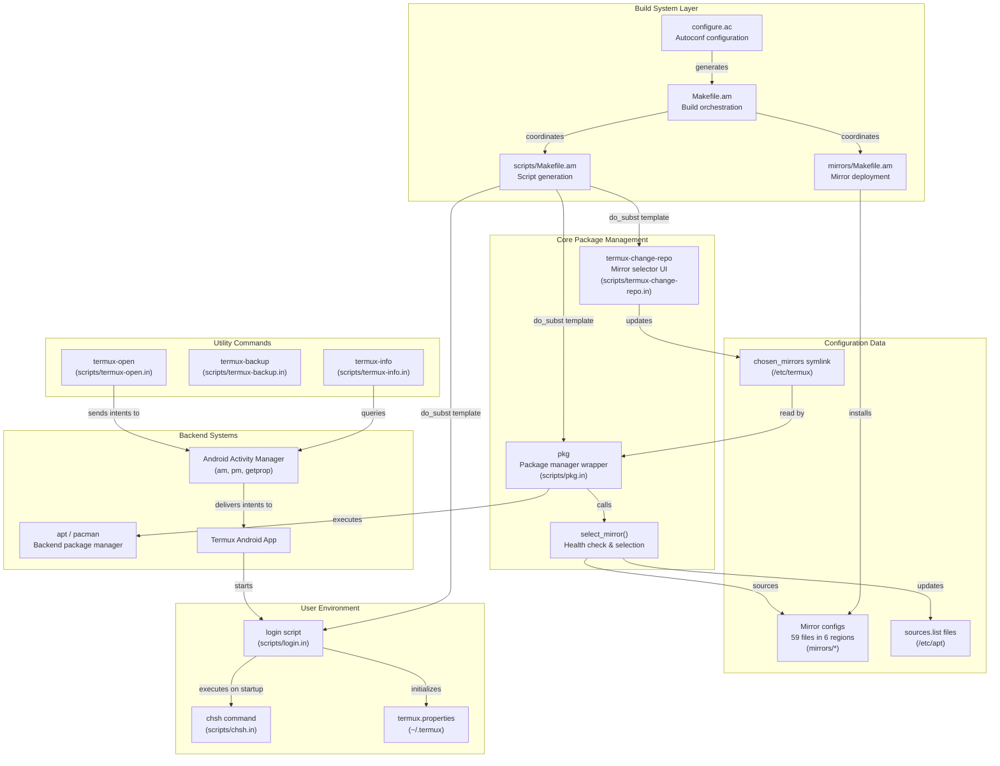
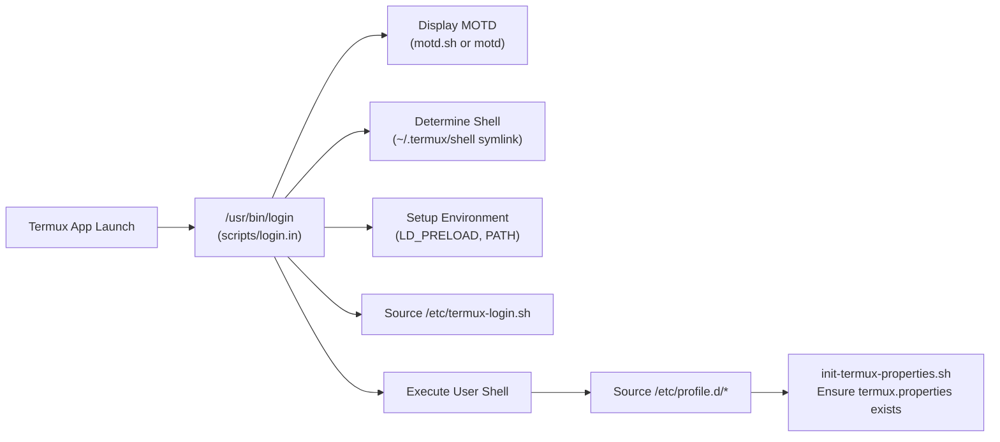
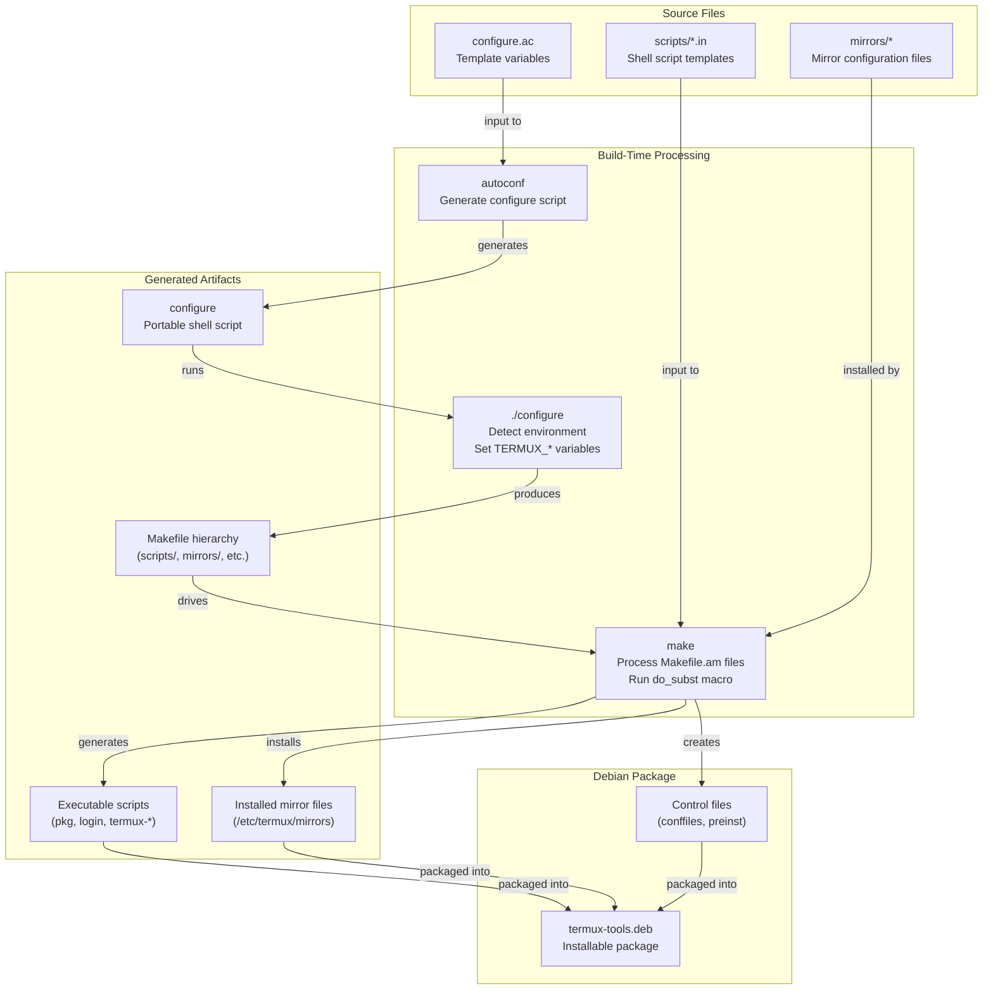

<!-- source: DeepWiki mcp.deepwiki.com · repo termux/termux-tools · page 1 Overview · fetched 2026-10-26 -->

# Overview

<details>
<summary>Relevant source files</summary>

The following files were used as context for generating this wiki page:

- [configure.ac](configure.ac)
- [mirrors/Makefile.am](mirrors/Makefile.am)
- [mirrors/europe/packages.termux.dev](mirrors/europe/packages.termux.dev)
- [mirrors/europe/termux.cdn.lumito.net](mirrors/europe/termux.cdn.lumito.net)
- [mirrors/north_america/mirror.quantum5.ca](mirrors/north_america/mirror.quantum5.ca)
- [scripts/pkg.in](scripts/pkg.in)
- [scripts/termux-change-repo.in](scripts/termux-change-repo.in)

</details>


## Purpose and Scope

This document provides an architectural overview of **termux-tools**, the essential utilities and scripts package for the Termux Android terminal emulator. The termux-tools repository contains the core command-line tools, configuration management, and build infrastructure that enable Termux to function as a complete Linux-like environment on Android devices.

This page introduces the major subsystems and their relationships. For detailed information about specific components:
- Mirror distribution system: see [Mirror Infrastructure](#2)
- Package management commands: see [Package Management](#3)
- Build configuration: see [Build System](#4)
- User environment setup: see [Session and Environment Management](#5)
- Utility commands: see [User Utilities](#6)

## Repository Structure

termux-tools organizes its components into distinct directories that map to functional subsystems:

| Directory | Purpose | Key Outputs |
|-----------|---------|-------------|
| `scripts/` | Shell script templates (`.in` files) | `pkg`, `login`, `chsh`, `termux-*` utilities |
| `mirrors/` | Mirror configuration files | 59 mirror files across 6 geographic regions |
| `motds/` | Login message templates | `motd`, `motd.sh`, `motd-playstore` |
| `src/` | C source code | `cmd` utility |
| `doc/` | Documentation | Man pages |

**Sources:** [configure.ac:97-98](), [mirrors/Makefile.am:1-162]()

## High-Level Architecture



**Diagram: termux-tools System Architecture**

This diagram shows how the build system generates executable scripts that manage both package repositories and user environment. The central component is the `pkg` command, which abstracts either `apt` or `pacman` backends while implementing intelligent mirror selection through the `select_mirror()` function.

**Sources:** [configure.ac:1-100](), [scripts/pkg.in:1-489](), [scripts/termux-change-repo.in:1-206](), [mirrors/Makefile.am:1-162]()

## Major Subsystems

### Mirror Infrastructure

The mirror infrastructure is the most critical subsystem (importance score: 137.98), managing a global network of 59 package repository mirrors across 6 geographic regions. The system provides:

- **Geographic organization:** Mirrors grouped by region (Asia, Chinese Mainland, Europe, North America, Oceania, Russia)
- **Build-time deployment:** [mirrors/Makefile.am:94-157]() generates installation macros for each region
- **Runtime selection:** [scripts/pkg.in:189-394]() implements parallel health checking and weighted random selection
- **Automatic cleanup:** [mirrors/Makefile.am:51-91]() maintains a list of 40+ deprecated mirrors

Each mirror file defines repository URLs through shell variables:

```bash
# Example: mirrors/europe/packages.termux.dev
WEIGHT=1
MAIN="https://packages.termux.dev/apt/termux-main"
ROOT="https://packages.termux.dev/apt/termux-root"
X11="https://packages.termux.dev/apt/termux-x11"
```

For detailed information, see [Mirror Infrastructure](#2).

**Sources:** [mirrors/Makefile.am:1-162](), [mirrors/europe/packages.termux.dev:1-7](), [scripts/pkg.in:189-394]()

### Package Management

The `pkg` command serves as a unified interface to either `apt` or `pacman` package managers, abstracting differences between Debian and Arch-based packaging formats. Key features:

- **Backend abstraction:** [scripts/pkg.in:451-488]() routes commands based on `$TERMUX_APP_PACKAGE_MANAGER`
- **Mirror selection:** [scripts/pkg.in:189-394]() implements intelligent caching (6-hour threshold) and health checks
- **User-friendly subcommands:** Simplified syntax (e.g., `pkg install`, `pkg search`) mapped to backend-specific commands

The `termux-change-repo` command provides an interactive dialog-based UI for manual mirror selection, updating the `/etc/termux/chosen_mirrors` symlink.

For detailed information, see [Package Management](#3).

**Sources:** [scripts/pkg.in:1-489](), [scripts/termux-change-repo.in:1-206]()

### Build System

termux-tools uses GNU Autoconf/Automake to generate environment-specific configurations. The build process:

1. **Configuration detection:** [configure.ac:34-68]() detects or sets Termux-specific variables:
   - `TERMUX_PREFIX` (default: `/data/data/com.termux/files/usr`)
   - `TERMUX_ANDROID_HOME` (default: `/data/data/com.termux/files/home`)
   - `TERMUX_PACKAGE_MANAGER` (default: `apt`)

2. **Template substitution:** [scripts/Makefile.am]() uses `do_subst` to replace `@VARIABLE@` markers in `.in` template files

3. **Multi-output generation:** Produces shell scripts, C programs, configuration files, and Debian control files

For detailed information, see [Build System](#4).

**Sources:** [configure.ac:1-100]()

### User Utilities

termux-tools provides numerous utility commands for system management and Android integration:

| Command Category | Examples | Purpose |
|-----------------|----------|---------|
| System diagnostics | `termux-info` | Gather Termux and Android system information |
| Backup/restore | `termux-backup`, `termux-restore` | Archive PREFIX directory |
| Android integration | `termux-open`, `termux-setup-storage`, `termux-wake-lock` | Interact with Android system |
| Settings management | `termux-reload-settings`, `termux-reset` | Manage configuration and reset installation |

These utilities use Android's Activity Manager (`am`) to send intents to the Termux app and query system properties via `getprop` and `pm`.

For detailed information, see [User Utilities](#6).

**Sources:** [scripts/pkg.in:1-489](), [scripts/termux-change-repo.in:1-206]()

### Session and Environment Management

The `login` script orchestrates user session initialization when the Termux app launches:



**Diagram: Session Initialization Flow**

The initialization sequence ensures consistent environment setup across different shell configurations (bash, zsh, fish).

For detailed information, see [Session and Environment Management](#5).

**Sources:** [scripts/pkg.in:1-489]()

## Build and Deployment Flow



**Diagram: Build Pipeline**

The build system transforms `.in` templates into environment-specific executables through a multi-stage process. The `do_subst` macro performs variable substitution (e.g., replacing `@TERMUX_PREFIX@` with the actual installation prefix).

**Sources:** [configure.ac:1-100](), [mirrors/Makefile.am:149-151]()

## Integration Points with Android

termux-tools integrates with Android through three primary mechanisms:

### System Property Queries

Scripts query Android system properties using wrapped `getprop` commands:
- Device manufacturer and model
- Android version and API level
- Supported CPU architectures (ABIs)

### Intent Broadcasting

Commands send Android intents via Activity Manager (`am broadcast`):
- `termux-open`: Opens files/URLs with Android apps
- `termux-setup-storage`: Requests storage permissions
- `termux-reload-settings`: Reloads Termux app configuration

### Package Manager Integration

The `pkg` command updates APT sources to point at selected mirrors:
- **DEB822 format:** [scripts/pkg.in:369-376]() updates `URIs:` line in `.sources` files
- **Legacy format:** [scripts/pkg.in:375-383]() rewrites `deb` lines in `.list` files

**Sources:** [scripts/pkg.in:368-393](), [scripts/termux-change-repo.in:204-205]()

## Key Design Principles

### Backend Abstraction

termux-tools supports both Debian (`apt`) and Arch Linux (`pacman`) package formats. The `$TERMUX_APP_PACKAGE_MANAGER` variable controls backend selection, with all package operations routed through consistent interfaces in [scripts/pkg.in:451-488]().

### Intelligent Caching

The mirror selection algorithm implements a 6-hour cache to minimize network overhead. Fresh package caches skip full mirror testing, only validating the current mirror. See [scripts/pkg.in:224-236]() for cache validation logic.

### Parallel Health Checking

When selecting mirrors, `pkg` tests up to 10 mirrors concurrently using background processes. This bounded parallelism provides fast selection without overwhelming network connections. See [scripts/pkg.in:240-327]() for implementation.

### Weighted Random Selection

Mirrors specify `WEIGHT` values that control selection probability. Higher-quality mirrors can be preferred by assigning larger weights. The weighted array construction is in [scripts/pkg.in:329-345]().

**Sources:** [scripts/pkg.in:189-394](), [configure.ac:59-68]()

## Configuration Files

| File Path | Purpose | Format |
|-----------|---------|--------|
| `/etc/termux/mirrors/*` | Mirror repository URLs | Shell-sourceable (MAIN, ROOT, X11, WEIGHT variables) |
| `/etc/termux/chosen_mirrors` | Selected mirror symlink | Symlink to mirror file or directory |
| `/etc/apt/sources.list.d/main.sources` | APT repository configuration | DEB822 format |
| `~/.termux/termux.properties` | User settings | Java properties file |
| `~/.termux/shell` | Default shell selection | Symlink to shell executable |

**Sources:** [mirrors/europe/packages.termux.dev:1-7](), [scripts/pkg.in:14](), [scripts/termux-change-repo.in:6]()

---

