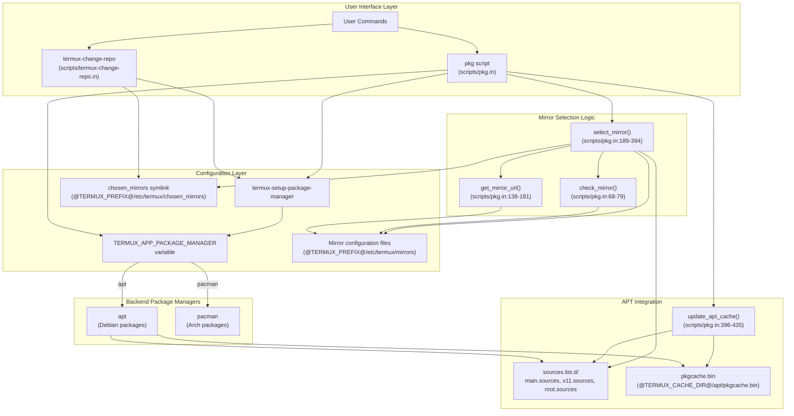
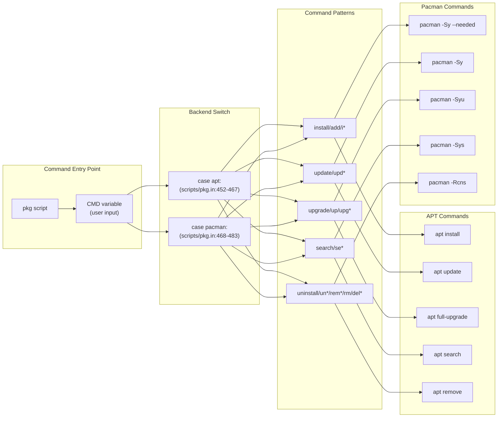
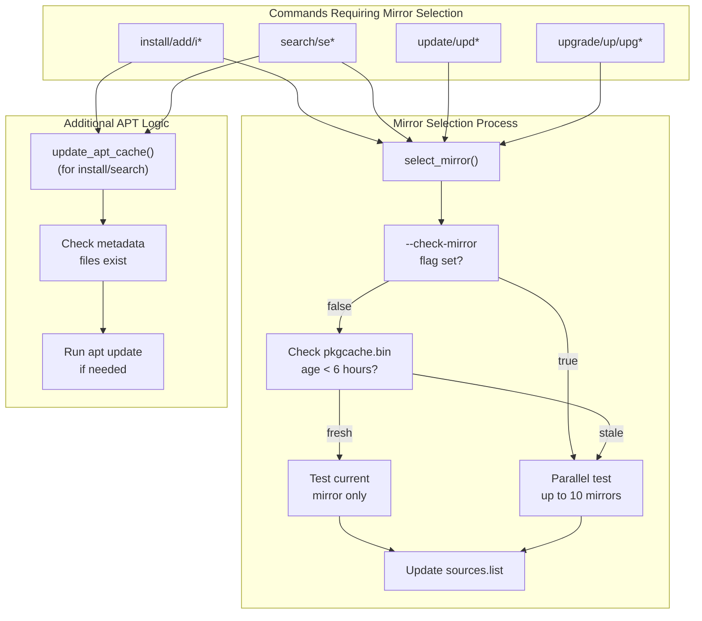
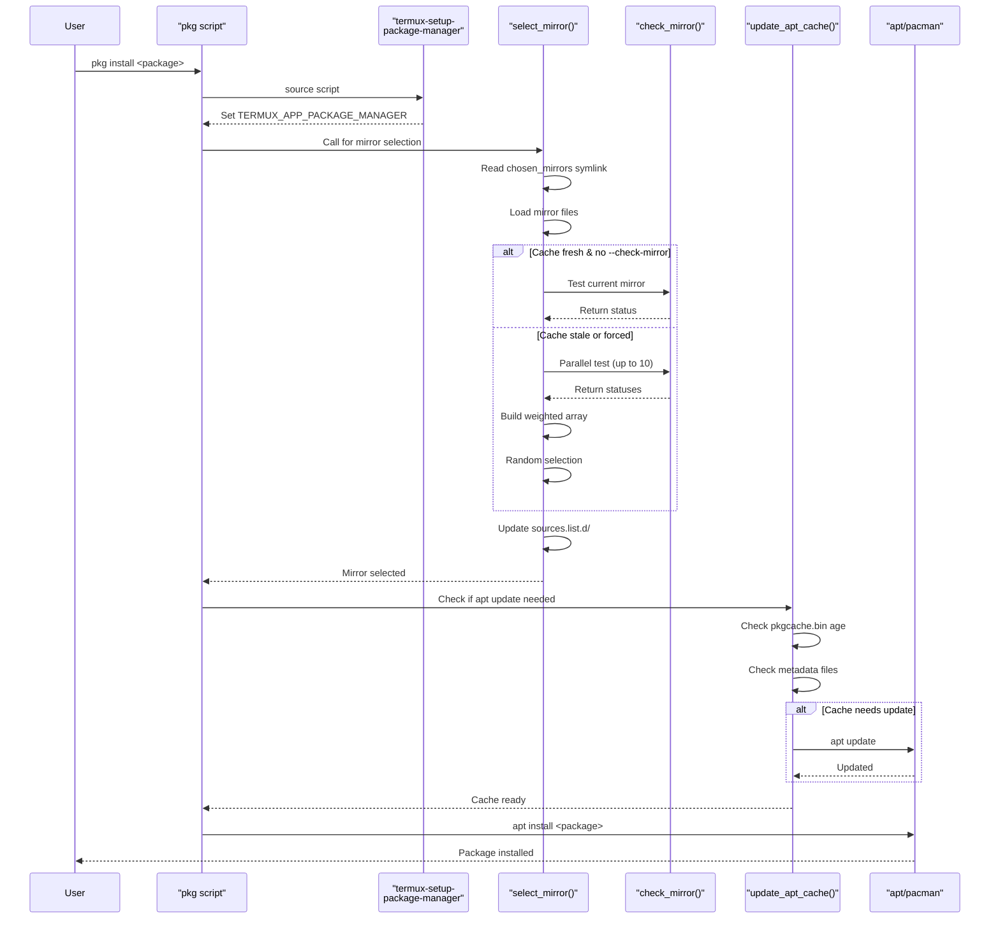
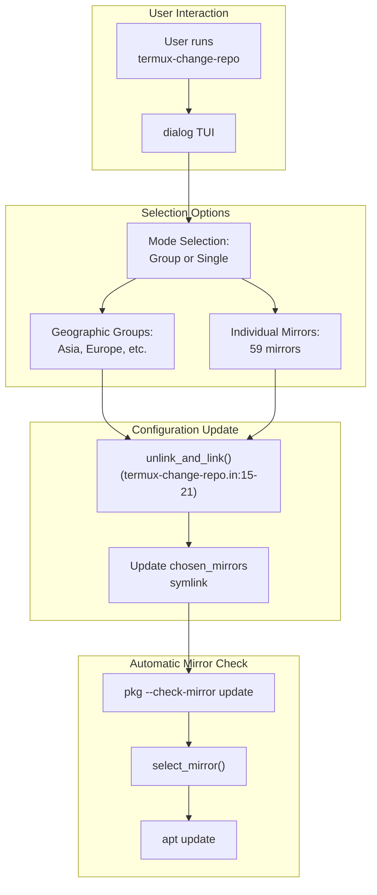

<!-- source: DeepWiki mcp.deepwiki.com · repo termux/termux-tools · page 3 Package Management · fetched 2026-10-26 -->

# Package Management

<details>
<summary>Relevant source files</summary>

The following files were used as context for generating this wiki page:

- [configure.ac](configure.ac)
- [mirrors/europe/packages.termux.dev](mirrors/europe/packages.termux.dev)
- [mirrors/europe/termux.cdn.lumito.net](mirrors/europe/termux.cdn.lumito.net)
- [mirrors/north_america/mirror.quantum5.ca](mirrors/north_america/mirror.quantum5.ca)
- [scripts/pkg.in](scripts/pkg.in)
- [scripts/termux-change-repo.in](scripts/termux-change-repo.in)

</details>


## Purpose and Scope

This document provides an overview of Termux's package management system, centered around the `pkg` command. The `pkg` utility serves as a unified wrapper that abstracts the underlying package manager (either `apt` or `pacman`), providing a consistent command interface regardless of which backend is configured. It integrates tightly with the mirror infrastructure to ensure reliable package downloads through intelligent mirror selection and health checking.

For detailed information about specific `pkg` subcommands and their options, see [pkg Command Reference](#3.1). For the technical details of mirror selection algorithms and caching strategies, see [Mirror Selection Algorithm](#3.2). For the interactive mirror configuration tool, see [termux-change-repo](#3.3). For information about the mirror infrastructure itself, see [Mirror Infrastructure](#2).

## Architecture Overview

The package management system consists of three primary components that work together to provide package installation, updates, and repository management:



**Sources:** [scripts/pkg.in:1-489](), [scripts/termux-change-repo.in:1-206](), [configure.ac:64-68]()

The system operates in three layers:

1. **User Interface Layer**: The `pkg` command and `termux-change-repo` provide user-facing interfaces for package operations and mirror configuration.

2. **Configuration Layer**: The `termux-setup-package-manager` script sets the `TERMUX_APP_PACKAGE_MANAGER` variable, which determines whether `apt` or `pacman` is used. The `chosen_mirrors` symlink points to either a single mirror file or a directory of regional mirrors.

3. **Backend Integration**: Based on `TERMUX_APP_PACKAGE_MANAGER`, commands are translated to either `apt` or `pacman` syntax and executed.

## Dual Backend Support

The `pkg` command supports two package management backends, configured at build time via the `TERMUX_PACKAGE_MANAGER` variable in [configure.ac:64-68](). The backend selection is stored in `TERMUX_APP_PACKAGE_MANAGER` and sourced from the `termux-setup-package-manager` script at runtime.

### Backend Detection and Command Translation



**Sources:** [scripts/pkg.in:451-484](), [configure.ac:64-68]()

The command translation logic uses prefix matching on user input (e.g., `i*` matches `install`, `ins`, `i`) and routes to appropriate backend commands. Key translations include:

| User Command | APT Backend | Pacman Backend |
|--------------|-------------|----------------|
| `install` / `add` / `i*` | `apt install` | `pacman -Sy --needed` |
| `update` / `upd*` | `apt update` | `pacman -Sy` |
| `upgrade` / `up` / `upg*` | `apt update && apt full-upgrade` | `pacman -Syu` |
| `search` / `se*` | `apt search` | `pacman -Sys` |
| `uninstall` / `un*` / `rem*` / `rm` / `del*` | `apt remove` | `pacman -Rcns` |
| `files` / `f*` | `dpkg -L` | `pacman -Ql` |
| `show` / `sh*` / `inf*` | `apt show` | `pacman -Qi` |

**Sources:** [scripts/pkg.in:453-467](), [scripts/pkg.in:469-483]()

## Mirror Integration

The `pkg` command integrates with the mirror infrastructure through the `select_mirror()` function, which performs intelligent mirror selection before operations that require network access.

### Mirror Selection Trigger Points

The `select_mirror()` function is called before specific operations:



**Sources:** [scripts/pkg.in:456-466](), [scripts/pkg.in:189-394](), [scripts/pkg.in:396-435]()

### Configuration Files and Symlink Mechanism

The mirror selection system uses a symlink-based configuration approach:

| Path | Type | Purpose |
|------|------|---------|
| `@TERMUX_PREFIX@/etc/termux/chosen_mirrors` | symlink | Points to selected mirror(s) |
| `@TERMUX_PREFIX@/etc/termux/mirrors/default` | file | Cloudflare CDN fallback |
| `@TERMUX_PREFIX@/etc/termux/mirrors/asia/` | directory | 14 Asian mirrors |
| `@TERMUX_PREFIX@/etc/termux/mirrors/chinese_mainland/` | directory | 15 Chinese mirrors |
| `@TERMUX_PREFIX@/etc/termux/mirrors/europe/` | directory | 19 European mirrors |
| `@TERMUX_PREFIX@/etc/termux/mirrors/north_america/` | directory | 8 North American mirrors |
| `@TERMUX_PREFIX@/etc/apt/sources.list.d/main.sources` | file | deb822 format APT sources |
| `@TERMUX_PREFIX@/etc/apt/sources.list` | file | Legacy APT sources (fallback) |

**Sources:** [scripts/pkg.in:14](), [scripts/pkg.in:204-218](), [scripts/pkg.in:191-195]()

The `chosen_mirrors` symlink can point to:
- A single mirror file (e.g., `mirrors/europe/packages.termux.dev`)
- A regional directory (e.g., `mirrors/asia/`)
- The special `all` pseudo-directory (all mirrors)

When `chosen_mirrors` is a directory, `select_mirror()` tests all mirrors within it. When it's a file, only that mirror is used (unless forced to check with `--check-mirror`).

## Command Execution Flow

The following sequence diagram illustrates how a typical package installation command flows through the system:



**Sources:** [scripts/pkg.in:456](), [scripts/pkg.in:189-394](), [scripts/pkg.in:396-435](), [scripts/pkg.in:68-79]()

Key phases in the execution flow:

1. **Initialization**: Source `termux-setup-package-manager` to set `TERMUX_APP_PACKAGE_MANAGER` [scripts/pkg.in:12]()

2. **Mirror Selection**: Call `select_mirror()` which:
   - Reads `chosen_mirrors` symlink [scripts/pkg.in:204-218]()
   - Validates mirror URLs with `get_mirror_url()` [scripts/pkg.in:138-181]()
   - Tests mirrors using `check_mirror()` with curl [scripts/pkg.in:68-79]()
   - Performs weighted random selection [scripts/pkg.in:329-354]()
   - Updates APT sources files [scripts/pkg.in:368-393]()

3. **Cache Update** (APT only): Call `update_apt_cache()` which:
   - Checks `pkgcache.bin` modification time [scripts/pkg.in:423]()
   - Verifies metadata files exist [scripts/pkg.in:410-420]()
   - Runs `apt update` if cache is stale (>20 minutes) [scripts/pkg.in:432-434]()

4. **Package Operation**: Execute backend command (apt/pacman) [scripts/pkg.in:456]()

## Root Protection

The `pkg` command includes a safety check to prevent execution as root user, which could cause permission and ownership issues in the Termux environment:

**Sources:** [scripts/pkg.in:4-8]()

```bash
if [[ "$(id -u)" == "0" ]]; then
    echo "Error: Cannot run 'pkg' command as root"
    exit 1
fi
```

This check occurs before any package operations, ensuring that all installed packages maintain proper ownership and permissions for the Termux user context.

## Relationship with termux-change-repo

The `termux-change-repo` tool provides an interactive dialog-based interface for configuring which mirrors `pkg` should use. While `pkg` automatically selects mirrors based on the current configuration, `termux-change-repo` allows users to explicitly set their preferences:



**Sources:** [scripts/termux-change-repo.in:1-206](), [scripts/termux-change-repo.in:15-21](), [scripts/termux-change-repo.in:204-205]()

After updating the `chosen_mirrors` symlink, `termux-change-repo` automatically invokes `pkg --check-mirror update` [scripts/termux-change-repo.in:204-205]() to force immediate mirror testing and repository metadata refresh. The `--check-mirror` flag bypasses the 6-hour cache check, ensuring the new mirror configuration takes effect immediately [scripts/pkg.in:438-441]().

## Key Features Summary

| Feature | Implementation | Benefit |
|---------|---------------|---------|
| Unified Interface | Command prefix matching | Consistent UX across apt/pacman |
| Intelligent Caching | 6-hour pkgcache.bin threshold | Reduced mirror checks |
| Parallel Health Checks | Up to 10 concurrent curl processes | Fast mirror selection |
| Weighted Selection | WEIGHT variable in mirror files | Load distribution |
| Geographic Grouping | Regional mirror directories | Low-latency access |
| Automatic Fallback | Default mirror (Cloudflare CDN) | High availability |
| Cache Awareness | update_apt_cache() optimization | Minimal network usage |

**Sources:** [scripts/pkg.in:223-236](), [scripts/pkg.in:240-327](), [scripts/pkg.in:329-354](), [mirrors/europe/packages.termux.dev:3]()

For detailed documentation of individual `pkg` subcommands, their options, and usage examples, see [pkg Command Reference](#3.1). For the internal workings of the mirror selection algorithm including the parallel checking implementation, see [Mirror Selection Algorithm](#3.2).

---

