# Page: Overview

# Overview

<details>
<summary>Relevant source files</summary>

The following files were used as context for generating this wiki page:

- [configure.ac](configure.ac)
- [mirrors/Makefile.am](mirrors/Makefile.am)
- [mirrors/europe/packages.termux.dev](mirrors/europe/packages.termux.dev)
- [mirrors/europe/termux.cdn.lumito.net](mirrors/europe/termux.cdn.lumito.net)
- [mirrors/north_america/mirror.quantum5.ca](mirrors/north_america/mirror.quantum5.ca)
- [scripts/pkg.in](scripts/pkg.in)
- [scripts/termux-change-repo.in](scripts/termux-change-repo.in)

</details>


## Purpose and Scope

This document provides an architectural overview of **termux-tools**, the essential utilities and scripts package for the Termux Android terminal emulator. The termux-tools repository contains the core command-line tools, configuration management, and build infrastructure that enable Termux to function as a complete Linux-like environment on Android devices.

This page introduces the major subsystems and their relationships. For detailed information about specific components:
- Mirror distribution system: see [Mirror Infrastructure](#2)
- Package management commands: see [Package Management](#3)
- Build configuration: see [Build System](#4)
- User environment setup: see [Session and Environment Management](#5)
- Utility commands: see [User Utilities](#6)

## Repository Structure

termux-tools organizes its components into distinct directories that map to functional subsystems:

| Directory | Purpose | Key Outputs |
|-----------|---------|-------------|
| `scripts/` | Shell script templates (`.in` files) | `pkg`, `login`, `chsh`, `termux-*` utilities |
| `mirrors/` | Mirror configuration files | 59 mirror files across 6 geographic regions |
| `motds/` | Login message templates | `motd`, `motd.sh`, `motd-playstore` |
| `src/` | C source code | `cmd` utility |
| `doc/` | Documentation | Man pages |

**Sources:** [configure.ac:97-98](), [mirrors/Makefile.am:1-162]()

## High-Level Architecture

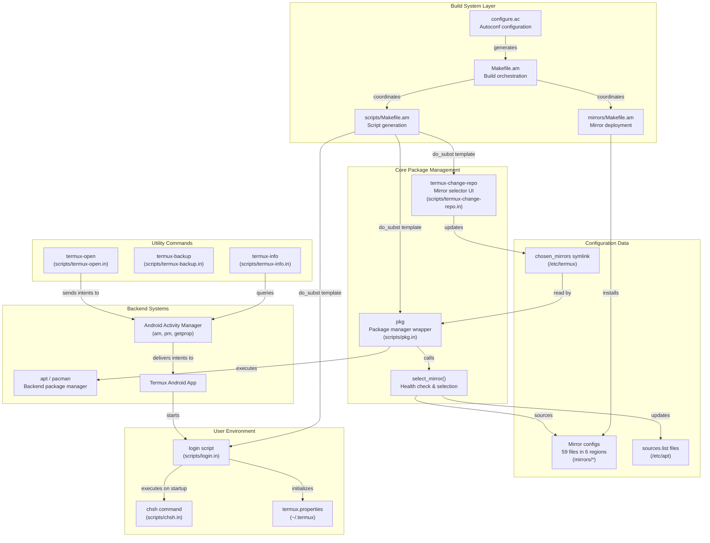

**Diagram: termux-tools System Architecture**

This diagram shows how the build system generates executable scripts that manage both package repositories and user environment. The central component is the `pkg` command, which abstracts either `apt` or `pacman` backends while implementing intelligent mirror selection through the `select_mirror()` function.

**Sources:** [configure.ac:1-100](), [scripts/pkg.in:1-489](), [scripts/termux-change-repo.in:1-206](), [mirrors/Makefile.am:1-162]()

## Major Subsystems

### Mirror Infrastructure

The mirror infrastructure is the most critical subsystem (importance score: 137.98), managing a global network of 59 package repository mirrors across 6 geographic regions. The system provides:

- **Geographic organization:** Mirrors grouped by region (Asia, Chinese Mainland, Europe, North America, Oceania, Russia)
- **Build-time deployment:** [mirrors/Makefile.am:94-157]() generates installation macros for each region
- **Runtime selection:** [scripts/pkg.in:189-394]() implements parallel health checking and weighted random selection
- **Automatic cleanup:** [mirrors/Makefile.am:51-91]() maintains a list of 40+ deprecated mirrors

Each mirror file defines repository URLs through shell variables:

```bash
# Example: mirrors/europe/packages.termux.dev
WEIGHT=1
MAIN="https://packages.termux.dev/apt/termux-main"
ROOT="https://packages.termux.dev/apt/termux-root"
X11="https://packages.termux.dev/apt/termux-x11"
```

For detailed information, see [Mirror Infrastructure](#2).

**Sources:** [mirrors/Makefile.am:1-162](), [mirrors/europe/packages.termux.dev:1-7](), [scripts/pkg.in:189-394]()

### Package Management

The `pkg` command serves as a unified interface to either `apt` or `pacman` package managers, abstracting differences between Debian and Arch-based packaging formats. Key features:

- **Backend abstraction:** [scripts/pkg.in:451-488]() routes commands based on `$TERMUX_APP_PACKAGE_MANAGER`
- **Mirror selection:** [scripts/pkg.in:189-394]() implements intelligent caching (6-hour threshold) and health checks
- **User-friendly subcommands:** Simplified syntax (e.g., `pkg install`, `pkg search`) mapped to backend-specific commands

The `termux-change-repo` command provides an interactive dialog-based UI for manual mirror selection, updating the `/etc/termux/chosen_mirrors` symlink.

For detailed information, see [Package Management](#3).

**Sources:** [scripts/pkg.in:1-489](), [scripts/termux-change-repo.in:1-206]()

### Build System

termux-tools uses GNU Autoconf/Automake to generate environment-specific configurations. The build process:

1. **Configuration detection:** [configure.ac:34-68]() detects or sets Termux-specific variables:
   - `TERMUX_PREFIX` (default: `/data/data/com.termux/files/usr`)
   - `TERMUX_ANDROID_HOME` (default: `/data/data/com.termux/files/home`)
   - `TERMUX_PACKAGE_MANAGER` (default: `apt`)

2. **Template substitution:** [scripts/Makefile.am]() uses `do_subst` to replace `@VARIABLE@` markers in `.in` template files

3. **Multi-output generation:** Produces shell scripts, C programs, configuration files, and Debian control files

For detailed information, see [Build System](#4).

**Sources:** [configure.ac:1-100]()

### User Utilities

termux-tools provides numerous utility commands for system management and Android integration:

| Command Category | Examples | Purpose |
|-----------------|----------|---------|
| System diagnostics | `termux-info` | Gather Termux and Android system information |
| Backup/restore | `termux-backup`, `termux-restore` | Archive PREFIX directory |
| Android integration | `termux-open`, `termux-setup-storage`, `termux-wake-lock` | Interact with Android system |
| Settings management | `termux-reload-settings`, `termux-reset` | Manage configuration and reset installation |

These utilities use Android's Activity Manager (`am`) to send intents to the Termux app and query system properties via `getprop` and `pm`.

For detailed information, see [User Utilities](#6).

**Sources:** [scripts/pkg.in:1-489](), [scripts/termux-change-repo.in:1-206]()

### Session and Environment Management

The `login` script orchestrates user session initialization when the Termux app launches:

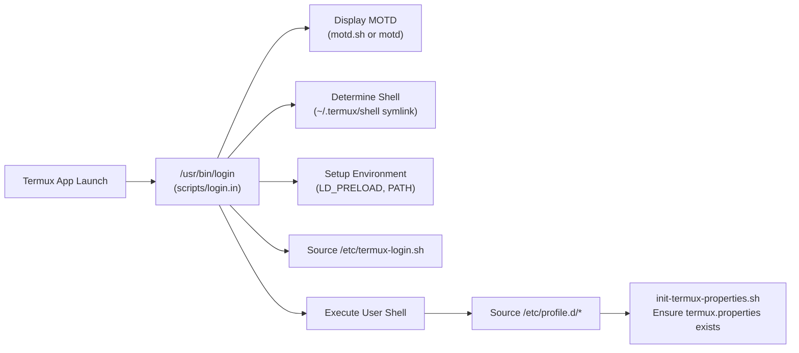

**Diagram: Session Initialization Flow**

The initialization sequence ensures consistent environment setup across different shell configurations (bash, zsh, fish).

For detailed information, see [Session and Environment Management](#5).

**Sources:** [scripts/pkg.in:1-489]()

## Build and Deployment Flow

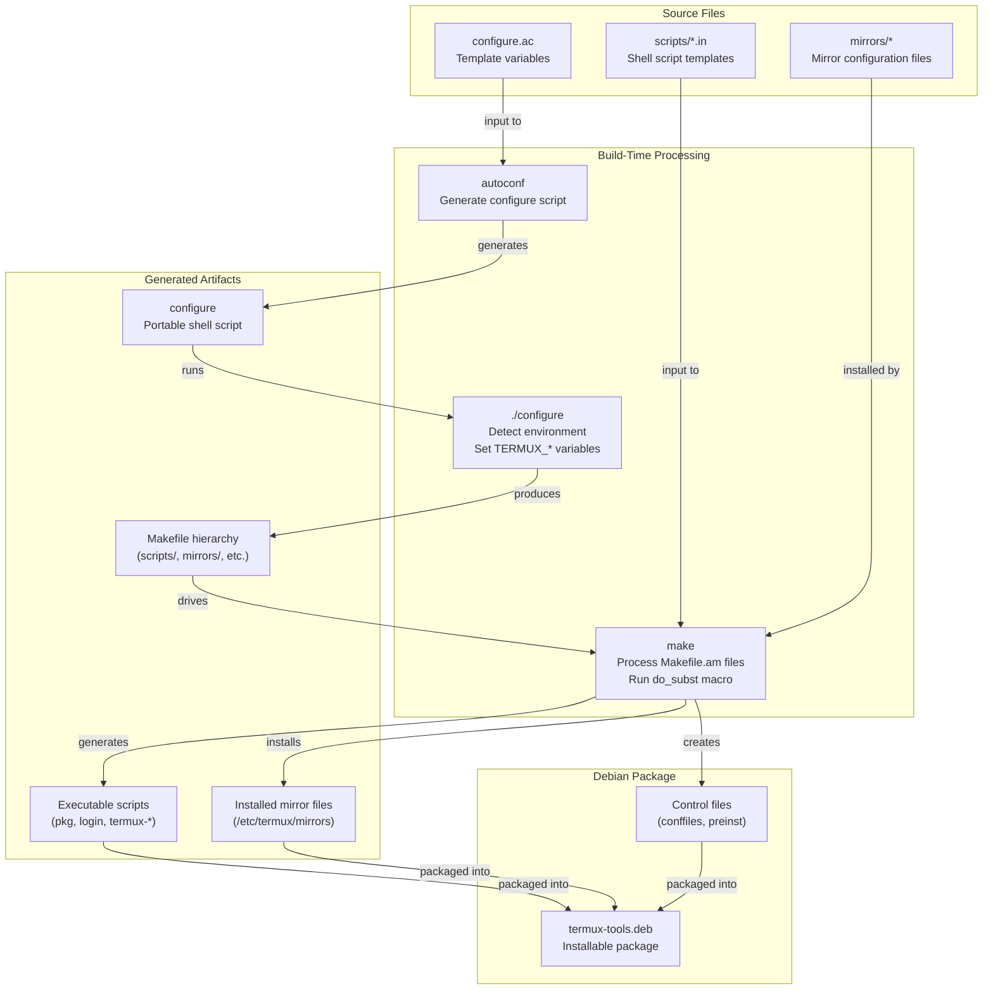

**Diagram: Build Pipeline**

The build system transforms `.in` templates into environment-specific executables through a multi-stage process. The `do_subst` macro performs variable substitution (e.g., replacing `@TERMUX_PREFIX@` with the actual installation prefix).

**Sources:** [configure.ac:1-100](), [mirrors/Makefile.am:149-151]()

## Integration Points with Android

termux-tools integrates with Android through three primary mechanisms:

### System Property Queries

Scripts query Android system properties using wrapped `getprop` commands:
- Device manufacturer and model
- Android version and API level
- Supported CPU architectures (ABIs)

### Intent Broadcasting

Commands send Android intents via Activity Manager (`am broadcast`):
- `termux-open`: Opens files/URLs with Android apps
- `termux-setup-storage`: Requests storage permissions
- `termux-reload-settings`: Reloads Termux app configuration

### Package Manager Integration

The `pkg` command updates APT sources to point at selected mirrors:
- **DEB822 format:** [scripts/pkg.in:369-376]() updates `URIs:` line in `.sources` files
- **Legacy format:** [scripts/pkg.in:375-383]() rewrites `deb` lines in `.list` files

**Sources:** [scripts/pkg.in:368-393](), [scripts/termux-change-repo.in:204-205]()

## Key Design Principles

### Backend Abstraction

termux-tools supports both Debian (`apt`) and Arch Linux (`pacman`) package formats. The `$TERMUX_APP_PACKAGE_MANAGER` variable controls backend selection, with all package operations routed through consistent interfaces in [scripts/pkg.in:451-488]().

### Intelligent Caching

The mirror selection algorithm implements a 6-hour cache to minimize network overhead. Fresh package caches skip full mirror testing, only validating the current mirror. See [scripts/pkg.in:224-236]() for cache validation logic.

### Parallel Health Checking

When selecting mirrors, `pkg` tests up to 10 mirrors concurrently using background processes. This bounded parallelism provides fast selection without overwhelming network connections. See [scripts/pkg.in:240-327]() for implementation.

### Weighted Random Selection

Mirrors specify `WEIGHT` values that control selection probability. Higher-quality mirrors can be preferred by assigning larger weights. The weighted array construction is in [scripts/pkg.in:329-345]().

**Sources:** [scripts/pkg.in:189-394](), [configure.ac:59-68]()

## Configuration Files

| File Path | Purpose | Format |
|-----------|---------|--------|
| `/etc/termux/mirrors/*` | Mirror repository URLs | Shell-sourceable (MAIN, ROOT, X11, WEIGHT variables) |
| `/etc/termux/chosen_mirrors` | Selected mirror symlink | Symlink to mirror file or directory |
| `/etc/apt/sources.list.d/main.sources` | APT repository configuration | DEB822 format |
| `~/.termux/termux.properties` | User settings | Java properties file |
| `~/.termux/shell` | Default shell selection | Symlink to shell executable |

**Sources:** [mirrors/europe/packages.termux.dev:1-7](), [scripts/pkg.in:14](), [scripts/termux-change-repo.in:6]()

---

# Page: Mirror Infrastructure

# Mirror Infrastructure

<details>
<summary>Relevant source files</summary>

The following files were used as context for generating this wiki page:

- [mirrors/Makefile.am](mirrors/Makefile.am)
- [mirrors/europe/packages.termux.dev](mirrors/europe/packages.termux.dev)
- [scripts/pkg.in](scripts/pkg.in)
- [scripts/termux-change-repo.in](scripts/termux-change-repo.in)

</details>


## Purpose and Scope

This document covers the mirror distribution system in termux-tools, which manages a global network of package repository mirrors for the Termux environment. This infrastructure enables reliable package distribution through geographically distributed servers and automatic failover mechanisms.

For information about the `pkg` command that consumes these mirrors, see [Package Management](#3). For details on the interactive mirror selection UI, see [termux-change-repo](#3.3). For the build system that deploys mirror configurations, see [Build System](#4).

---

## Mirror System Overview

The mirror infrastructure is the highest-priority subsystem in termux-tools (importance score: 137.98). It provides a distributed network of 59 package repository mirrors organized across 6 geographic regions, plus 1 default Cloudflare CDN mirror. Mirrors distribute three repository channels:

| Channel | Purpose | Variable |
|---------|---------|----------|
| `termux-main` | Core packages | `MAIN` |
| `termux-root` | Root-only packages | `ROOT` |
| `termux-x11` | X11 graphical packages | `X11` |

Each mirror is defined in a configuration file that specifies its URLs and selection weight. At runtime, the `pkg` command performs health checks on available mirrors and selects one using weighted random selection. Users can choose specific mirrors or mirror groups via `termux-change-repo`.

The system handles mirror deprecation by maintaining a cleanup list of 40+ removed mirrors that are deleted during package upgrades to prevent stale configurations from being used.

**Sources:** [mirrors/Makefile.am:1-162](), [scripts/pkg.in:14-14](), [scripts/pkg.in:189-394]()

---

## Mirror Network Architecture

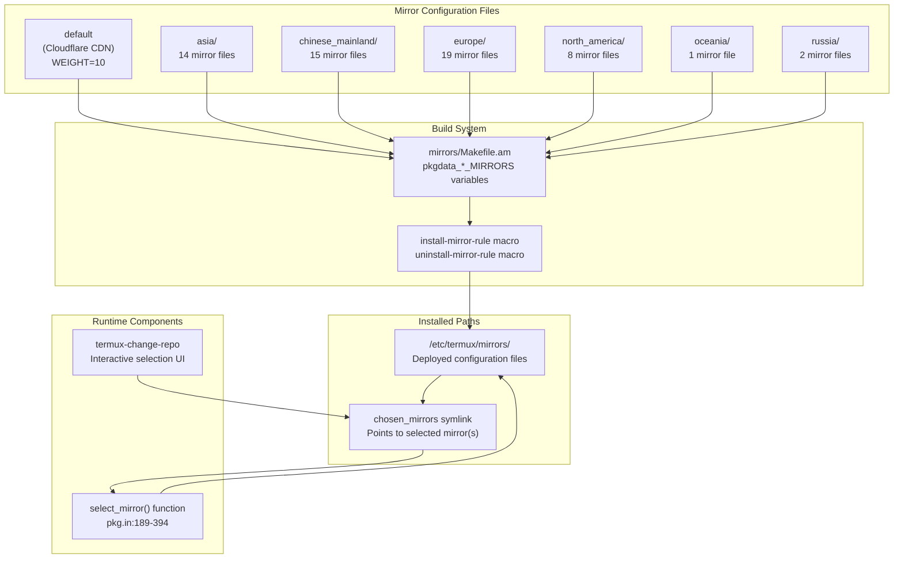

**Diagram: Mirror System Data Flow**

This diagram maps the mirror infrastructure from source files to runtime usage. Mirror definitions in `mirrors/Makefile.am` are installed to `/etc/termux/mirrors/` during build. The `chosen_mirrors` symlink mechanism allows users to select specific mirrors or regions, which `select_mirror()` reads to determine which mirrors to test.

**Sources:** [mirrors/Makefile.am:1-162](), [scripts/pkg.in:189-394](), [scripts/termux-change-repo.in:1-206]()

---

## Geographic Distribution

Mirrors are organized into 6 regional directories plus a default CDN. The geographic organization reduces latency by allowing users to select mirrors close to their location.

| Region | Directory | Mirror Count | Variable Name |
|--------|-----------|--------------|---------------|
| Default (CDN) | `default` | 1 | `pkgdata_MIRRORS` |
| Asia | `asia/` | 14 | `pkgdata_ASIA_MIRRORS` |
| Chinese Mainland | `chinese_mainland/` | 15 | `pkgdata_CHINESE_MAINLAND_MIRRORS` |
| Europe | `europe/` | 19 | `pkgdata_EUROPE_MIRRORS` |
| North America | `north_america/` | 8 | `pkgdata_NORTH_AMERICA_MIRRORS` |
| Oceania | `oceania/` | 1 | `pkgdata_OCEANIA_MIRRORS` |
| Russia | `russia/` | 2 | `pkgdata_RUSSIA_MIRRORS` |
| **Total** | | **60** | |

### Default Mirror

The default mirror uses Cloudflare's CDN with `WEIGHT=10`, giving it a 10x selection probability compared to standard mirrors. This ensures reliable global availability.

**Sources:** [mirrors/Makefile.am:1-2]()

### Regional Mirror Lists

Each region is defined by a Makefile variable listing mirror hostnames:

```makefile
pkgdata_ASIA_MIRRORS = mirror.nag.albony.in \
mirrors.cbrx.io linux.domainesia.com mirror.nevacloud.com \
tmx.xvx.my.id mirrors.nguyenhoang.cloud \
...
```

The build system generates install and uninstall targets for each region using macros.

**Sources:** [mirrors/Makefile.am:4-42]()

---

## Mirror Configuration File Format

Each mirror is defined in a shell script file that sets four variables. The `pkg` command sources these files to extract configuration.

### Standard Format

```bash
# This file is sourced by pkg
# <Description>. Hosted in <Location>.
WEIGHT=<selection_weight>
MAIN="<url_to_termux-main>"
ROOT="<url_to_termux-root>"
X11="<url_to_termux-x11>"
```

### Variable Descriptions

| Variable | Type | Purpose | Validation |
|----------|------|---------|------------|
| `WEIGHT` | Integer | Selection probability multiplier | Must match `^[0-9]+$` |
| `MAIN` | URL | Main repository (required) | Must match `^https?://[^[:space:]]+$` |
| `ROOT` | URL | Root repository (optional) | Must match `^https?://[^[:space:]]+$` |
| `X11` | URL | X11 repository (optional) | Must match `^https?://[^[:space:]]+$` |

### Example: packages.termux.dev

```bash
# This file is sourced by pkg
# Termux origin repo. Hosted in Falkenstein, Germany.
WEIGHT=1
MAIN="https://packages.termux.dev/apt/termux-main"
ROOT="https://packages.termux.dev/apt/termux-root"
X11="https://packages.termux.dev/apt/termux-x11"
```

### Validation Logic

The `get_mirror_url()` function validates mirror files:

1. **Required MAIN URL**: Mirrors without `MAIN` are rejected with warning
2. **URL Format**: All URLs must start with `http://` or `https://`
3. **Repository Requirements**: If `root-repo` or `x11-repo` packages are installed, mirrors must provide corresponding `ROOT` or `X11` URLs
4. **Weight Validation**: `WEIGHT` must be a positive integer

Invalid mirrors are silently skipped during selection with warnings printed to stderr.

**Sources:** [mirrors/europe/packages.termux.dev:1-7](), [scripts/pkg.in:138-181]()

---

## Build-Time Deployment System

The `mirrors/Makefile.am` build file orchestrates mirror deployment through Automake macros. The system generates install and uninstall targets for each geographic region, plus special handling for deprecated mirrors.

### Macro-Based Installation

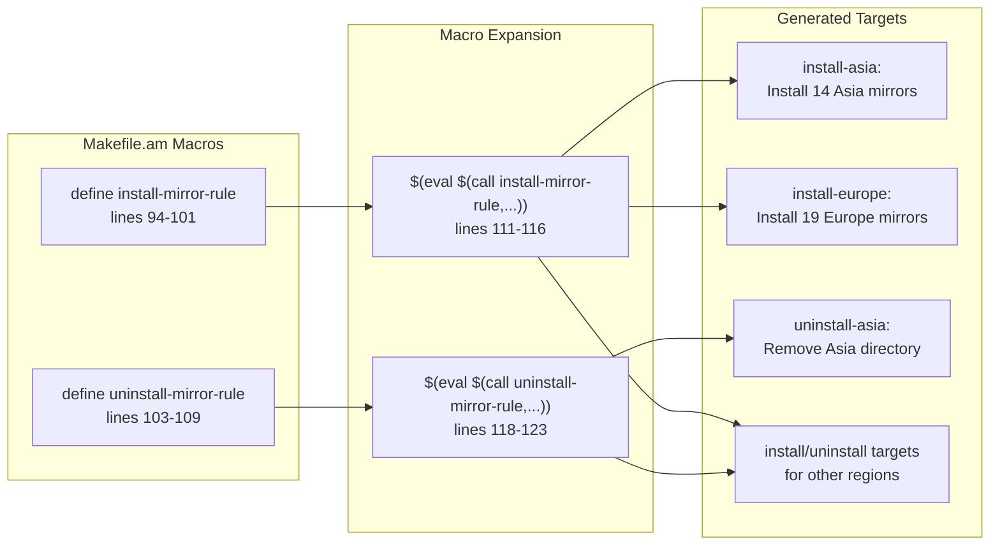

**Diagram: Build-Time Macro Expansion**

The `install-mirror-rule` and `uninstall-mirror-rule` macros are invoked for each region, generating specific targets like `install-asia` and `uninstall-asia`.

### Install Target Generation

The `install-mirror-rule` macro creates region-specific installation targets:

```makefile
define install-mirror-rule
install-$1:
	$$(MKDIR_P) $$(DESTDIR)$$(sysconfdir)/termux/mirrors/$1
	for f in $$(pkgdata_$2_MIRRORS); do \
		$(INSTALL) -m 644 $(srcdir)/$1/$$$$f \
		$(DESTDIR)$(sysconfdir)/termux/mirrors/$1; \
	done
endef
```

**Parameters:**
- `$1`: Region directory name (e.g., `asia`, `europe`)
- `$2`: Variable suffix (e.g., `ASIA`, `EUROPE`)

The macro expands to create directories and install all mirror files for a region with mode `644` (readable by all, writable by owner only).

**Sources:** [mirrors/Makefile.am:94-101](), [mirrors/Makefile.am:111-116]()

### Deprecated Mirror Cleanup

The system maintains a list of 40+ removed mirrors in `pkgdata_MIRRORS_REMOVED`:

```makefile
pkgdata_MIRRORS_REMOVED = \
asia/mirror.bardia.tech \
asia/mirrors.omsinchan.ac.th \
china/mirror.iscas.ac.cn \
europe/cdn.lumito.net \
...
```

These are deleted in two ways:

1. **During Package Upgrade**: The `uninstall-removed-mirrors` target removes deprecated mirror files
2. **Via preinst Script**: A Debian pre-installation script is generated that deletes removed mirrors before the new package is installed

The cleanup is necessary because Debian `conffiles` are not automatically deleted during upgrades unless the package is purged.

**Sources:** [mirrors/Makefile.am:45-91](), [mirrors/Makefile.am:142-145]()

### Debian Package Integration

The `create-deb-control-files` target generates two Debian package control artifacts:

1. **conffiles**: Lists all mirror files as configuration files
   ```bash
   find etc/termux/mirrors -type f >> ../conffiles
   ```

2. **preinst**: Shell script that deletes removed mirrors before installation
   ```bash
   printf "# Delete removed mirrors\nfor f in %s; do\n..." \
       "$(pkgdata_MIRRORS_REMOVED)" >> ../preinst
   ```

This ensures proper Debian package behavior during upgrades and downgrades.

**Sources:** [mirrors/Makefile.am:149-151]()

### Installation Orchestration

The `install-data-local` target orchestrates the complete installation sequence:

```makefile
install-data-local: uninstall-removed-mirrors \
    install-default install-asia install-chinese_mainland \
    install-europe install-north_america install-oceania \
    install-russia create-deb-control-files
```

This ensures:
1. Deprecated mirrors are removed first
2. All regional mirrors are installed
3. Debian control files are generated last

**Sources:** [mirrors/Makefile.am:155-157]()

---

## Runtime Mirror Selection

The `select_mirror()` function in `pkg.in` implements intelligent mirror selection with health checking, caching, and weighted random selection.

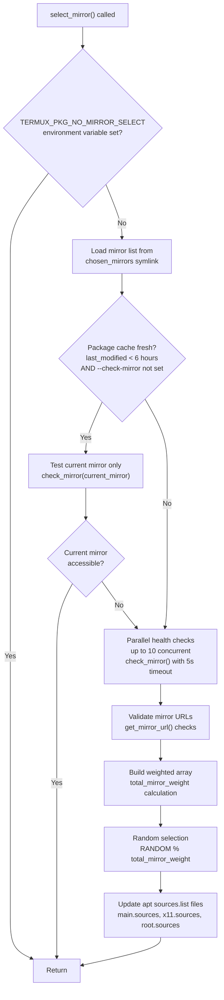

**Diagram: Mirror Selection Algorithm Flow**

The selection algorithm optimizes for speed by caching the current mirror when the package cache is fresh (less than 6 hours old). Only when the cache is stale or `--check-mirror` is specified does it perform full parallel health checks.

**Sources:** [scripts/pkg.in:189-394]()

### Mirror Discovery

The function discovers available mirrors based on the `chosen_mirrors` symlink state:

| Symlink State | Behavior | Code Reference |
|---------------|----------|----------------|
| Directory | All files in directory are tested | [pkg.in:204-206]() |
| File | Single mirror file is used | [pkg.in:207-209]() |
| Broken/Missing | All mirrors from all regions are tested | [pkg.in:210-218]() |

The search explicitly excludes backup files created by package managers: `*\.dpkg-old`, `*\.dpkg-new`, `*~`.

**Sources:** [scripts/pkg.in:204-218]()

### Intelligent Caching

The caching logic uses `last_modified()` to check package cache age:

```bash
local pkgcache="@TERMUX_CACHE_DIR@/apt/pkgcache.bin"
if [ -e "$pkgcache" ] && (( $(last_modified "$pkgcache") <= 6 * 3600 )) && \
   [ "$force_check_mirror" = "false" ]; then
```

If the cache is fresh and `--check-mirror` was not specified, only the current mirror is tested. This reduces latency for routine operations like `pkg search` or `pkg install`.

**Sources:** [scripts/pkg.in:224-236]()

### Parallel Health Checking

The mirror testing logic uses background jobs to check up to 10 mirrors concurrently:

```bash
local parallel_jobs_max_count=10
...
check_mirror "$url" &
job_pid=$!
```

Each `check_mirror()` call:
1. Uses `curl --head --fail --connect-timeout 5`
2. Checks for `/dists/stable/Release` file existence
3. Has a 6-second timeout (5s connect + 1s buffer)
4. Includes a custom User-Agent identifying the Termux version

Failed mirrors are removed from the candidate list by unsetting their array indices.

**Sources:** [scripts/pkg.in:238-327](), [scripts/pkg.in:68-79]()

### Weighted Random Selection

After validation, mirrors are added to a weighted array based on their `WEIGHT` value:

```bash
weight="$(get_mirror_weight ${mirrors[$mirror]})"
total_mirror_weight=$((total_mirror_weight + weight))
j=0
while [ "$j" -lt "$weight" ]; do
    weighted_mirrors+=(${mirrors[$mirror]})
    j=$((j + 1))
done
```

A mirror with `WEIGHT=10` appears 10 times in the array, making it 10x more likely to be selected than a mirror with `WEIGHT=1`.

**Sources:** [scripts/pkg.in:329-345]()

### APT Sources Update

Once a mirror is selected, the function updates APT's sources files based on the format detected:

| Repository | DEB822 Format | Legacy Format |
|------------|---------------|---------------|
| Main | Update `URIs:` in `main.sources` | Write `sources.list` |
| X11 | Update `URIs:` in `x11.sources` | Write `x11.list` |
| Root | Update `URIs:` in `root.sources` | Write `root.list` |

The `sed_escape_replacement()` function escapes special characters (`\`, `/`, `&`) in URLs to prevent sed substitution errors.

**Sources:** [scripts/pkg.in:363-393](), [scripts/pkg.in:112-118]()

---

## Integration with Package Management

The mirror infrastructure integrates with the `pkg` command at two main points: during repository updates and when users explicitly request mirror changes.

### Automatic Mirror Selection

Mirror selection occurs automatically before these operations:

| Command | Triggers `select_mirror()` | Updates Cache |
|---------|---------------------------|---------------|
| `pkg install` | Yes | Yes (via `update_apt_cache()`) |
| `pkg update` | Yes | No (runs `apt update` directly) |
| `pkg upgrade` | Yes | Yes (runs `apt update` first) |
| `pkg search` | Yes | Yes (via `update_apt_cache()`) |
| `pkg reinstall` | No | No |
| `pkg show` | No | No |

The `update_apt_cache()` function implements smart caching to avoid unnecessary `apt update` calls when the package cache is fresh.

**Sources:** [scripts/pkg.in:456-466](), [scripts/pkg.in:396-435]()

### Manual Mirror Selection

Users can manually select mirrors via `termux-change-repo`, which:

1. Displays a dialog menu with two options: "Mirror group" or "Single mirror"
2. For groups: Creates symlink to regional directory (e.g., `/etc/termux/mirrors/asia`)
3. For single mirrors: Creates symlink to specific mirror file
4. Automatically runs `pkg --check-mirror update` to apply changes

The `--check-mirror` flag forces full mirror health checks, bypassing the cache.

**Sources:** [scripts/termux-change-repo.in:15-206](), [scripts/pkg.in:437-441]()

### Mirror Selection Bypass

Setting `TERMUX_PKG_NO_MIRROR_SELECT` environment variable disables automatic mirror selection:

```bash
if [ -n "${TERMUX_PKG_NO_MIRROR_SELECT-}" ] && [ -n "$current_mirror" ]; then
    return
fi
```

This is useful for CI/CD environments or when troubleshooting specific mirror issues.

**Sources:** [scripts/pkg.in:197-200]()

---

## Summary

The mirror infrastructure provides:

- **Global Distribution**: 59 mirrors across 6 regions plus Cloudflare CDN
- **Automated Failover**: Health checks with 5-second timeouts detect unavailable mirrors
- **Performance Optimization**: 6-hour caching reduces latency; parallel checks (up to 10 concurrent) minimize wait time
- **Geographic Selection**: Users can choose regional mirror groups or specific mirrors
- **Weighted Distribution**: Configurable `WEIGHT` values enable load balancing
- **Robust Maintenance**: Automated cleanup of 40+ deprecated mirrors during upgrades

The system balances reliability (multiple mirrors with automatic failover), performance (intelligent caching and parallel testing), and user control (manual selection via `termux-change-repo`).

**Sources:** [mirrors/Makefile.am:1-162](), [scripts/pkg.in:14-489](), [scripts/termux-change-repo.in:1-206]()

---

# Page: Mirror Organization and Deployment

# Mirror Organization and Deployment

<details>
<summary>Relevant source files</summary>

The following files were used as context for generating this wiki page:

- [mirrors/Makefile.am](mirrors/Makefile.am)

</details>


## Purpose and Scope

This document details the build-time deployment infrastructure for Termux's mirror system. It explains how 59 mirrors are organized into 6 geographic regions, how the Automake-based build system installs them into `/etc/termux/mirrors`, and how deprecated mirrors are cleanly removed during package upgrades.

For information about the mirror file format and configuration variables, see [Mirror Configuration Format](#2.2). For runtime mirror selection and health checking, see [Mirror Selection Algorithm](#3.2).

**Sources:** [mirrors/Makefile.am:1-162]()

---

## Geographic Organization

Termux's 59 mirrors are organized into 6 geographic regions plus a default Cloudflare CDN mirror. This organization enables users to select mirrors by proximity through the `termux-change-repo` tool.

### Regional Distribution

| Region | Variable Name | Mirror Count | Directory |
|--------|---------------|--------------|-----------|
| Default | `pkgdata_MIRRORS` | 1 | `default` |
| Asia | `pkgdata_ASIA_MIRRORS` | 14 | `asia/` |
| Chinese Mainland | `pkgdata_CHINESE_MAINLAND_MIRRORS` | 15 | `chinese_mainland/` |
| Europe | `pkgdata_EUROPE_MIRRORS` | 19 | `europe/` |
| North America | `pkgdata_NORTH_AMERICA_MIRRORS` | 8 | `north_america/` |
| Oceania | `pkgdata_OCEANIA_MIRRORS` | 1 | `oceania/` |
| Russia | `pkgdata_RUSSIA_MIRRORS` | 2 | `russia/` |

The default mirror (`default`) is stored at the root level without a subdirectory, while regional mirrors are organized in subdirectories. This structure allows the `chosen_mirrors` symlink to point to either a single file (default) or a directory (regional group).

**Sources:** [mirrors/Makefile.am:1-42]()

---

## Makefile Variables and Structure

The `mirrors/Makefile.am` file defines seven Automake variables that list mirrors for each region. These variables follow the naming convention `pkgdata_<REGION>_MIRRORS`.

### Example: Asia Region Definition

```makefile
pkgdata_ASIA_MIRRORS = mirror.nag.albony.in \
mirrors.cbrx.io linux.domainesia.com mirror.nevacloud.com \
tmx.xvx.my.id mirrors.nguyenhoang.cloud \
mirror.freedif.org mirror.twds.com.tw mirrors.in.sahilister.net \
...
```

Each mirror is identified by its hostname (without protocol or path). The actual mirror configuration files in the source tree match these hostnames exactly. For example, the variable entry `mirror.nag.albony.in` corresponds to the source file `mirrors/asia/mirror.nag.albony.in`.

**Sources:** [mirrors/Makefile.am:5-42]()

---

## Installation Macro System

The build system uses GNU Make macros to generate install and uninstall targets for each region. This avoids code duplication while maintaining consistent behavior across all regions.

### install-mirror-rule Macro

The `install-mirror-rule` macro generates installation targets that:
1. Create the destination directory structure
2. Install all mirror files with mode 644 (read-only)
3. Preserve the regional organization

```makefile
define install-mirror-rule
install-$1:
	$$(MKDIR_P) $$(DESTDIR)$$(sysconfdir)/termux/mirrors/$1
	for f in $$(pkgdata_$2_MIRRORS); do \
		$(INSTALL) -m 644 $(srcdir)/$1/$$$$f \
		$(DESTDIR)$(sysconfdir)/termux/mirrors/$1; \
	done
endef
```

**Parameters:**
- `$1`: Directory name (e.g., `asia`, `europe`)
- `$2`: Variable name suffix (e.g., `ASIA`, `EUROPE`)

**Sources:** [mirrors/Makefile.am:94-101]()

### uninstall-mirror-rule Macro

The `uninstall-mirror-rule` macro removes installed mirrors and attempts to remove the directory:

```makefile
define uninstall-mirror-rule
uninstall-$1:
	for f in $$(pkgdata_$2_MIRRORS); do \
		rm -f $(DESTDIR)$(sysconfdir)/termux/mirrors/$1/$$$$f; \
	done
	-rmdir $(DESTDIR)$(sysconfdir)/termux/mirrors/$1
endef
```

The `-rmdir` command uses a leading dash (`-`) to ignore errors if the directory is not empty or doesn't exist.

**Sources:** [mirrors/Makefile.am:103-109]()

### Macro Evaluation

The macros are evaluated for each region using GNU Make's `eval` function:

```makefile
$(eval $(call install-mirror-rule,asia,ASIA))
$(eval $(call install-mirror-rule,chinese_mainland,CHINESE_MAINLAND))
$(eval $(call install-mirror-rule,europe,EUROPE))
...
```

This generates concrete targets like `install-asia`, `install-europe`, etc.

**Sources:** [mirrors/Makefile.am:111-123]()

---

## Deployment Flow Diagram

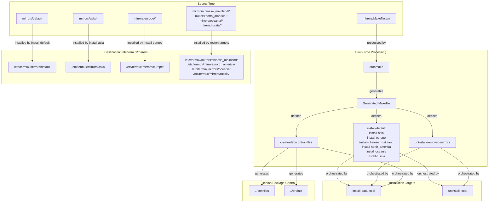

**Sources:** [mirrors/Makefile.am:94-157]()

---

## Default Mirror Installation

The default mirror receives special handling because it's stored at the root level rather than in a subdirectory.

### install-default Target

```makefile
install-default: $(pkgdata_MIRRORS)
	$(MKDIR_P) $(DESTDIR)$(sysconfdir)/termux/mirrors
	for f in $(pkgdata_MIRRORS); do \
		$(INSTALL) -m 644 $(srcdir)/$$f \
		$(DESTDIR)$(sysconfdir)/termux/mirrors; \
	done
```

This creates the root `/etc/termux/mirrors` directory and installs the `default` file directly into it. The default mirror is Cloudflare's CDN and has a `WEIGHT=10` to make it preferred during selection.

**Sources:** [mirrors/Makefile.am:127-132]()

---

## Deprecated Mirror Cleanup

Over time, mirrors may be renamed, moved, or taken offline. The `pkgdata_MIRRORS_REMOVED` variable maintains a list of 40+ deprecated mirrors that must be cleaned up during package upgrades.

### Why Manual Cleanup Is Required

Mirror files are marked as `conffiles` in the Debian package control system. According to Debian policy, when a conffile is removed in a newer version of a package:
- It is **not automatically deleted** during upgrade
- It is only deleted if the package is **purged** (not just removed)
- Without explicit cleanup, old mirror files would remain and still be used during mirror selection

**Sources:** [mirrors/Makefile.am:45-50]()

### Removed Mirrors List

The `pkgdata_MIRRORS_REMOVED` variable contains entries in the format `<region>/<hostname>`:

```makefile
pkgdata_MIRRORS_REMOVED = \
asia/mirror.bardia.tech \
asia/mirrors.omsinchan.ac.th \
china/mirror.iscas.ac.cn \
china/mirrors.aliyun.com \
europe/cdn.lumito.net \
europe/mirror.polido.pt \
north_america/dl.kcubeterm.com \
...
```

Note the historical inconsistency: some entries use `china/` while the current directory is `chinese_mainland/`. This list must include all historical paths.

**Sources:** [mirrors/Makefile.am:51-91]()

### uninstall-removed-mirrors Target

```makefile
uninstall-removed-mirrors:
	for f in $(pkgdata_MIRRORS_REMOVED); do \
		rm -f $(DESTDIR)$(sysconfdir)/termux/mirrors/$$f; \
	done
```

This target is invoked during both installation and uninstallation to ensure deprecated mirrors are cleaned up regardless of the operation type.

**Sources:** [mirrors/Makefile.am:142-145]()

---

## Debian Package Integration

To properly integrate with Debian's package management, the build system generates two control files during installation: `conffiles` and `preinst`.

### conffiles Generation

The `conffiles` file lists all configuration files that should be preserved during package upgrades:

```makefile
create-deb-control-files:
	sh -c "cd $$(dirname $(DESTDIR)$(sysconfdir)); \
	       find $$(basename $(DESTDIR)$(sysconfdir))/termux/mirrors -type f" \
	       >> ../conffiles;
```

This command:
1. Changes to the parent directory of `/etc`
2. Uses `find` to locate all files under `etc/termux/mirrors`
3. Appends the paths to `../conffiles`

The resulting `conffiles` contains entries like:
```
etc/termux/mirrors/default
etc/termux/mirrors/asia/mirror.nag.albony.in
etc/termux/mirrors/asia/mirrors.cbrx.io
...
```

**Sources:** [mirrors/Makefile.am:149-150]()

### preinst Script Generation

The `preinst` script executes before package installation and handles cleanup of deprecated mirrors:

```makefile
printf "# Delete removed mirrors\nfor f in %s; do\n    if test -f \"%s/etc/termux/mirrors/\$$f\"; then\n        echo \"Deleting removed mirror: \$$f\"; rm -f \"%s/etc/termux/mirrors/\$$f\";\n    fi\ndone" "$(pkgdata_MIRRORS_REMOVED)" "$(termux_prefix)" "$(termux_prefix)" >> ../preinst;
```

This generates a shell script snippet that:
1. Iterates through all removed mirrors
2. Checks if each file exists
3. Prints a deletion message
4. Removes the file

The generated script looks like:
```bash
# Delete removed mirrors
for f in asia/mirror.bardia.tech asia/mirrors.omsinchan.ac.th ...; do
    if test -f "/data/data/com.termux/files/usr/etc/termux/mirrors/$f"; then
        echo "Deleting removed mirror: $f"
        rm -f "/data/data/com.termux/files/usr/etc/termux/mirrors/$f"
    fi
done
```

**Sources:** [mirrors/Makefile.am:151]()

---

## Package Integration Flow

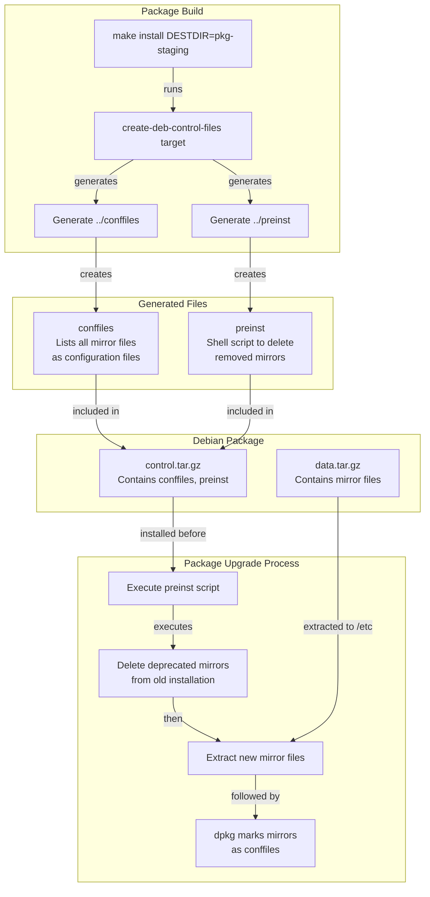

**Sources:** [mirrors/Makefile.am:149-151]()

---

## Top-Level Installation Targets

The `install-data-local` and `uninstall-local` targets orchestrate the entire deployment process.

### install-data-local Target

```makefile
install-data-local: uninstall-removed-mirrors install-default install-asia \
                    install-chinese_mainland install-europe \
                    install-north_america install-oceania install-russia \
                    create-deb-control-files
```

This target ensures that:
1. Deprecated mirrors are removed first
2. All regional mirrors are installed
3. Debian control files are generated

The order is important: removing deprecated mirrors before installing new ones prevents conflicts.

**Sources:** [mirrors/Makefile.am:155]()

### uninstall-local Target

```makefile
uninstall-local: uninstall-removed-mirrors uninstall-default uninstall-asia \
                 uninstall-chinese_mainland uninstall-europe \
                 uninstall-north_america uninstall-oceania uninstall-russia
```

This target removes all mirrors in reverse order of installation.

**Sources:** [mirrors/Makefile.am:157]()

---

## Installed Directory Structure

After installation, the following directory structure is created:

```
/etc/termux/mirrors/
├── default                                    (Cloudflare CDN)
├── asia/
│   ├── mirror.nag.albony.in
│   ├── mirrors.cbrx.io
│   ├── linux.domainesia.com
│   └── ... (14 total)
├── chinese_mainland/
│   ├── mirrors.tuna.tsinghua.edu.cn
│   ├── mirror.iscas.ac.cn
│   └── ... (15 total)
├── europe/
│   ├── grimler.se
│   ├── packages.termux.dev
│   └── ... (19 total)
├── north_america/
│   ├── plug-mirror.rcac.purdue.edu
│   └── ... (8 total)
├── oceania/
│   └── mirrors.middlendian.com            (1 total)
└── russia/
    ├── mirror.mephi.ru
    └── repository.su                       (2 total)
```

The `chosen_mirrors` symlink (created by `termux-change-repo`) will point to either:
- A single file: `/etc/termux/mirrors/default`
- A directory: `/etc/termux/mirrors/asia/`

**Sources:** [mirrors/Makefile.am:1-162]()

---

## Distribution Tarball

The `EXTRA_DIST` variable specifies which files are included in the source distribution tarball:

```makefile
EXTRA_DIST = $(pkgdata_MIRRORS) $(pkgdata_ASIA_MIRRORS) \
$(pkgdata_CHINESE_MAINLAND_MIRRORS) $(pkgdata_EUROPE_MIRRORS) \
$(pkgdata_NORTH_AMERICA_MIRRORS) $(pkgdata_OCEANIA_MIRRORS)
```

This ensures that all mirror configuration files are distributed with the source code, allowing them to be installed on the target system.

**Sources:** [mirrors/Makefile.am:159-161]()

---

## Summary

The mirror deployment system is a sophisticated build-time infrastructure that:

1. **Organizes 59 mirrors** into 6 geographic regions plus a default
2. **Uses Automake macros** to generate install/uninstall targets without code duplication
3. **Handles deprecated mirrors** through explicit cleanup in both `uninstall-removed-mirrors` and `preinst`
4. **Integrates with Debian packaging** by generating `conffiles` and `preinst` control files
5. **Creates a hierarchical directory structure** at `/etc/termux/mirrors` that supports both single-mirror and regional-group selection

The system balances maintainability (macro-based generation), correctness (conffile handling), and flexibility (geographic organization) to provide a robust foundation for Termux's mirror infrastructure.

---

# Page: Mirror Configuration Format

# Mirror Configuration Format

<details>
<summary>Relevant source files</summary>

The following files were used as context for generating this wiki page:

- [mirrors/asia/linux.domainesia.com](mirrors/asia/linux.domainesia.com)
- [mirrors/asia/mirror.freedif.org](mirrors/asia/mirror.freedif.org)
- [mirrors/asia/mirror.jeonnam.school](mirrors/asia/mirror.jeonnam.school)
- [mirrors/asia/mirror.meowsmp.net](mirrors/asia/mirror.meowsmp.net)
- [mirrors/asia/mirror.nevacloud.com](mirrors/asia/mirror.nevacloud.com)
- [mirrors/asia/mirror.rinarin.dev](mirrors/asia/mirror.rinarin.dev)
- [mirrors/asia/mirror.twds.com.tw](mirrors/asia/mirror.twds.com.tw)
- [mirrors/default](mirrors/default)
- [mirrors/europe/grimler.se](mirrors/europe/grimler.se)

</details>


## Purpose and Scope

This document describes the standardized format used by all mirror configuration files in the termux-tools repository. Mirror configuration files define the URLs and priority weighting for package repository mirrors distributed globally across 59 locations.

For information about how mirrors are organized geographically and deployed via the build system, see [Mirror Organization and Deployment](#2.1). For the complete list of available mirrors, see [Geographic Distribution and Mirror List](#2.3). For details on how `pkg` uses these configuration files during mirror selection, see [Mirror Selection Algorithm](#3.2).

## Configuration File Structure

Each mirror configuration file is a shell script fragment that defines four environment variables. The files are designed to be sourced by the `pkg` command during mirror selection operations.

**Diagram: Mirror Configuration File Anatomy**

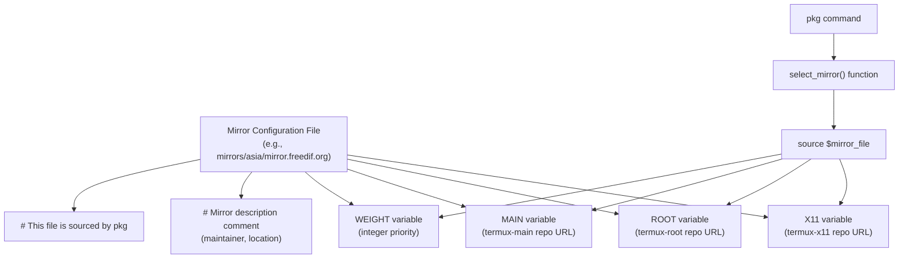

Sources: [mirrors/asia/mirror.freedif.org:1-7](), [mirrors/europe/grimler.se:1-7](), [mirrors/default:1-7]()

### Standard Format Template

All mirror configuration files follow this exact structure:

```bash
# This file is sourced by pkg
# Mirror by <Maintainer>. Hosted in <Location>.
WEIGHT=<integer>
MAIN="<url>/termux-main"
ROOT="<url>/termux-root"
X11="<url>/termux-x11"
```

The first line is always the fixed comment `# This file is sourced by pkg`, which documents the sourcing mechanism. The second line provides human-readable metadata about the mirror's maintainer and hosting location. Lines 3-6 define the four required shell variables.

Sources: [mirrors/asia/mirror.freedif.org:1-7](), [mirrors/asia/mirror.rinarin.dev:1-7]()

## Variable Reference

### WEIGHT

**Type:** Integer  
**Range:** Typically 1-10  
**Purpose:** Defines the relative priority of the mirror during weighted random selection

The `WEIGHT` variable controls how frequently a mirror is selected during the weighted random selection process. Higher weights increase the probability of selection. The default Cloudflare mirror uses `WEIGHT=10`, while most regional mirrors use `WEIGHT=1`. Mirrors with weight 4 (such as grimler.se) represent intermediate priority.

**Example weight distribution:**

| Weight Value | Usage | Example |
|--------------|-------|---------|
| 10 | Primary/default mirrors with highest reliability | [mirrors/default:3]() |
| 4 | High-quality regional mirrors | [mirrors/europe/grimler.se:3]() |
| 1 | Standard regional mirrors | [mirrors/asia/mirror.freedif.org:3]() |

The `pkg` command's `select_mirror()` function builds a weighted array where each mirror appears `WEIGHT` times, enabling proportional random selection.

Sources: [mirrors/default:3](), [mirrors/europe/grimler.se:3](), [mirrors/asia/mirror.freedif.org:3]()

### MAIN

**Type:** String (HTTPS URL)  
**Format:** `https://<hostname>/<path>/termux-main`  
**Purpose:** Base URL for the main Termux package repository

The `MAIN` variable specifies the URL to the primary package repository containing the core Termux packages. This repository includes all standard packages available through `pkg install`. The URL must end with the path component `termux-main` to maintain consistency with Termux's repository structure.

**Example values:**

```bash
MAIN="https://packages-cf.termux.dev/apt/termux-main"        # Default
MAIN="https://grimler.se/termux/termux-main"                  # Europe
MAIN="https://mirror.freedif.org/termux/termux-main"          # Asia
MAIN="https://linux.domainesia.com/applications/termux/termux-main"  # Indonesia
```

The `pkg` command writes this URL to `/data/data/com.termux/files/usr/etc/apt/sources.list` (or the pacman equivalent) after mirror selection.

Sources: [mirrors/default:4](), [mirrors/europe/grimler.se:4](), [mirrors/asia/mirror.freedif.org:4](), [mirrors/asia/linux.domainesia.com:4]()

### ROOT

**Type:** String (HTTPS URL)  
**Format:** `https://<hostname>/<path>/termux-root`  
**Purpose:** Base URL for the root package repository

The `ROOT` variable specifies the URL to the repository containing packages that require root access. These packages are only accessible on rooted Android devices. The URL must end with `termux-root`.

**Example values:**

```bash
ROOT="https://packages-cf.termux.dev/apt/termux-root"        # Default
ROOT="https://grimler.se/termux/termux-root"                  # Europe
ROOT="https://mirror.freedif.org/termux/termux-root"          # Asia
```

This URL is written to `/data/data/com.termux/files/usr/etc/apt/sources.list.d/root.list` (for apt) when the termux-root repository is enabled.

Sources: [mirrors/default:5](), [mirrors/europe/grimler.se:5](), [mirrors/asia/mirror.freedif.org:5]()

### X11

**Type:** String (HTTPS URL)  
**Format:** `https://<hostname>/<path>/termux-x11`  
**Purpose:** Base URL for the X11 package repository

The `X11` variable specifies the URL to the repository containing X Window System packages. These packages provide graphical applications and X server functionality. The URL must end with `termux-x11`.

**Example values:**

```bash
X11="https://packages-cf.termux.dev/apt/termux-x11"         # Default
X11="https://grimler.se/termux/termux-x11"                   # Europe
X11="https://mirror.freedif.org/termux/termux-x11"           # Asia
```

This URL is written to `/data/data/com.termux/files/usr/etc/apt/sources.list.d/x11.list` (for apt) when the termux-x11 repository is enabled.

Sources: [mirrors/default:6](), [mirrors/europe/grimler.se:6](), [mirrors/asia/mirror.freedif.org:6]()

## Sourcing Mechanism

**Diagram: Variable Flow from Configuration to Package Manager**

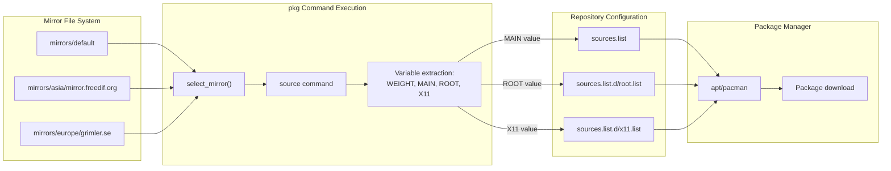

Sources: [mirrors/default:1-7](), [mirrors/asia/mirror.freedif.org:1-7](), [mirrors/europe/grimler.se:1-7]()

Mirror configuration files are sourced using the shell's `source` (or `.`) command. This loads the variable definitions directly into the `pkg` command's execution environment, making the four variables available for immediate use.

The sourcing process occurs within the `select_mirror()` function when:
1. The package cache is older than 6 hours, or
2. The user explicitly requests mirror checking with `pkg --check-mirror`, or
3. The user changes mirrors via `termux-change-repo`

After sourcing, the `pkg` command uses the variable values to:
- Construct weighted arrays for random selection (using `WEIGHT`)
- Update apt/pacman repository configuration files (using `MAIN`, `ROOT`, `X11`)
- Perform mirror health checks by testing URL reachability

The sourcing mechanism allows mirrors to be added or modified without changing the `pkg` command itself, as the configuration is entirely data-driven.

Sources: [mirrors/default:1](), [mirrors/asia/mirror.freedif.org:1]()

## Format Consistency Across Mirrors

All 59 mirrors maintain strict format consistency. The table below shows examples demonstrating this uniformity:

| Mirror File | WEIGHT | MAIN Path Pattern | ROOT Path Pattern | X11 Path Pattern |
|-------------|--------|-------------------|-------------------|------------------|
| [mirrors/default:3-6]() | 10 | `/apt/termux-main` | `/apt/termux-root` | `/apt/termux-x11` |
| [mirrors/europe/grimler.se:3-6]() | 4 | `/termux/termux-main` | `/termux/termux-root` | `/termux/termux-x11` |
| [mirrors/asia/mirror.freedif.org:3-6]() | 1 | `/termux/termux-main` | `/termux/termux-root` | `/termux/termux-x11` |
| [mirrors/asia/linux.domainesia.com:3-6]() | 1 | `/applications/termux/termux-main` | `/applications/termux/termux-root` | `/applications/termux/termux-x11` |
| [mirrors/asia/mirror.nevacloud.com:3-6]() | 1 | `/applications/termux/termux-main` | `/applications/termux/termux-root` | `/applications/termux/termux-x11` |
| [mirrors/asia/mirror.meowsmp.net:3-6]() | 1 | `/termux/termux-main` | `/termux/termux-root` | `/termux/termux-x11` |
| [mirrors/asia/mirror.rinarin.dev:3-6]() | 1 | `/termux/termux-main` | `/termux/termux-root` | `/termux/termux-x11` |
| [mirrors/asia/mirror.twds.com.tw:3-6]() | 1 | `/termux/termux-main` | `/termux/termux-root` | `/termux/termux-x11` |
| [mirrors/asia/mirror.jeonnam.school:3-6]() | 1 | `/termux/termux-main` | `/termux/termux-root` | `/termux/termux-x11` |

**Key consistency requirements:**

1. **Line 1:** Always `# This file is sourced by pkg`
2. **Line 2:** Always `# Mirror by <maintainer>. Hosted in <location>.`
3. **Variable naming:** Exactly `WEIGHT`, `MAIN`, `ROOT`, `X11` (case-sensitive)
4. **Repository suffixes:** Must end with `termux-main`, `termux-root`, `termux-x11`
5. **URL scheme:** Always HTTPS (no HTTP mirrors)
6. **Trailing newline:** Files end with a blank line

This consistency allows the `pkg` command to reliably source any mirror file without special-case handling. The uniform structure also simplifies automated validation and testing during the build process.

Sources: [mirrors/default:1-7](), [mirrors/europe/grimler.se:1-7](), [mirrors/asia/mirror.freedif.org:1-7](), [mirrors/asia/linux.domainesia.com:1-7](), [mirrors/asia/mirror.nevacloud.com:1-7](), [mirrors/asia/mirror.meowsmp.net:1-7](), [mirrors/asia/mirror.rinarin.dev:1-7](), [mirrors/asia/mirror.twds.com.tw:1-7](), [mirrors/asia/mirror.jeonnam.school:1-7]()

## Path Patterns and Naming Conventions

Mirror hostnames and paths vary based on the host organization's infrastructure, but all follow consistent naming for the repository type suffixes:

**Common path patterns:**

- **Pattern 1 (Termux-specific):** `/<path>/termux/termux-{main,root,x11}`  
  Used by: grimler.se, mirror.freedif.org, mirror.meowsmp.net, mirror.rinarin.dev, mirror.twds.com.tw, mirror.jeonnam.school

- **Pattern 2 (Applications directory):** `/<path>/applications/termux/termux-{main,root,x11}`  
  Used by: linux.domainesia.com, mirror.nevacloud.com

- **Pattern 3 (APT directory):** `/<path>/apt/termux-{main,root,x11}`  
  Used by: packages-cf.termux.dev (default mirror)

Despite path variations, the mandatory suffix of `termux-main`, `termux-root`, and `termux-x11` ensures that the `pkg` command can correctly identify repository types when writing apt/pacman configuration files.

Sources: [mirrors/default:4-6](), [mirrors/europe/grimler.se:4-6](), [mirrors/asia/mirror.freedif.org:4-6](), [mirrors/asia/linux.domainesia.com:4-6](), [mirrors/asia/mirror.nevacloud.com:4-6]()

## Variable Validation

The `pkg` command does not perform explicit validation of variable values when sourcing mirror files. However, implicit validation occurs during:

1. **URL reachability testing:** Invalid URLs fail health checks and are excluded from selection
2. **WEIGHT usage:** Non-integer or negative weights cause arithmetic errors in bash, preventing mirror use
3. **Repository configuration:** Malformed URLs cause apt/pacman to fail with descriptive errors

Mirror files in the repository are validated during the build process by `mirrors/Makefile.am`, which ensures all files are syntactically correct shell scripts before installation.

Sources: [mirrors/default:1-7](), [mirrors/asia/mirror.freedif.org:1-7]()

---

# Page: Geographic Distribution and Mirror List

# Geographic Distribution and Mirror List

<details>
<summary>Relevant source files</summary>

The following files were used as context for generating this wiki page:

- [mirrors/Makefile.am](mirrors/Makefile.am)
- [mirrors/asia/linux.domainesia.com](mirrors/asia/linux.domainesia.com)
- [mirrors/asia/mirror.freedif.org](mirrors/asia/mirror.freedif.org)
- [mirrors/asia/mirror.jeonnam.school](mirrors/asia/mirror.jeonnam.school)
- [mirrors/asia/mirror.meowsmp.net](mirrors/asia/mirror.meowsmp.net)
- [mirrors/asia/mirror.nag.albony.in](mirrors/asia/mirror.nag.albony.in)
- [mirrors/asia/mirror.nevacloud.com](mirrors/asia/mirror.nevacloud.com)
- [mirrors/asia/mirror.rinarin.dev](mirrors/asia/mirror.rinarin.dev)
- [mirrors/asia/mirror.twds.com.tw](mirrors/asia/mirror.twds.com.tw)
- [mirrors/asia/mirrors.in.sahilister.net](mirrors/asia/mirrors.in.sahilister.net)
- [mirrors/asia/mirrors.krnk.org](mirrors/asia/mirrors.krnk.org)
- [mirrors/asia/mirrors.saswata.cc](mirrors/asia/mirrors.saswata.cc)
- [mirrors/default](mirrors/default)
- [mirrors/europe/ftp.icm.edu.pl](mirrors/europe/ftp.icm.edu.pl)
- [mirrors/europe/grimler.se](mirrors/europe/grimler.se)
- [mirrors/europe/md.mirrors.hacktegic.com](mirrors/europe/md.mirrors.hacktegic.com)
- [mirrors/europe/mirrors.de.sahilister.net](mirrors/europe/mirrors.de.sahilister.net)
- [mirrors/europe/termux.librehat.com](mirrors/europe/termux.librehat.com)
- [mirrors/europe/termux.mentality.rip](mirrors/europe/termux.mentality.rip)
- [mirrors/north_america/mirror.mwt.me](mirrors/north_america/mirror.mwt.me)
- [mirrors/north_america/mirrors.utermux.dev](mirrors/north_america/mirrors.utermux.dev)
- [mirrors/north_america/plug-mirror.rcac.purdue.edu](mirrors/north_america/plug-mirror.rcac.purdue.edu)
- [mirrors/oceania/mirrors.middlendian.com](mirrors/oceania/mirrors.middlendian.com)
- [mirrors/russia/mirror.mephi.ru](mirrors/russia/mirror.mephi.ru)

</details>


## Purpose and Scope

This page provides a comprehensive reference listing of all Termux package mirrors organized by geographic region. Each mirror entry includes its hostname, physical location, maintainer information, and configuration details. This information is maintained in [mirrors/Makefile.am:1-162]() and deployed as individual configuration files that the `pkg` command uses for mirror selection.

For information about how mirrors are configured and the file format, see [Mirror Configuration Format](#2.2). For details on the runtime mirror selection algorithm and health checking, see [Mirror Selection Algorithm](#3.2).

## Global Distribution Overview

The Termux mirror network consists of a default Cloudflare-cached mirror plus 65 geographically distributed regional mirrors spanning 6 continents. The distribution ensures users worldwide can access package repositories with optimal latency.

| Region | Mirror Count | Configuration Directory |
|--------|-------------|------------------------|
| **Default** | 1 | `/etc/termux/mirrors/` |
| **Asia** | 16 | `/etc/termux/mirrors/asia/` |
| **Chinese Mainland** | 16 | `/etc/termux/mirrors/chinese_mainland/` |
| **Europe** | 21 | `/etc/termux/mirrors/europe/` |
| **North America** | 9 | `/etc/termux/mirrors/north_america/` |
| **Oceania** | 1 | `/etc/termux/mirrors/oceania/` |
| **Russia** | 2 | `/etc/termux/mirrors/russia/` |
| **Total** | **66** | |

**Sources:** [mirrors/Makefile.am:1-42]()

### Geographic Distribution Diagram

```mermaid
graph TB
    subgraph "Default"
        Default["default<br/>Cloudflare CDN<br/>WEIGHT=10"]
    end
    
    subgraph "Asia (16 mirrors)"
        AsiaIndia["India: 4 mirrors<br/>mirror.nag.albony.in<br/>mirrors.in.sahilister.net<br/>mirrors.saswata.cc<br/>mirrors.ravidwivedi.in"]
        AsiaIndo["Indonesia: 2 mirrors<br/>linux.domainesia.com<br/>mirror.nevacloud.com"]
        AsiaKorea["Korea: 3 mirrors<br/>mirror.jeonnam.school<br/>mirror.rinarin.dev<br/>mirrors.krnk.org"]
        AsiaOther["Other: 7 mirrors<br/>Taiwan, Singapore,<br/>Vietnam, Malaysia,<br/>Thailand, Philippines"]
    end
    
    subgraph "Chinese Mainland (16 mirrors)"
        ChinaEdu["Educational: 16 mirrors<br/>Tsinghua, PKU, USTC, NJU,<br/>SJTU, HUST, ZJU, etc."]
    end
    
    subgraph "Europe (21 mirrors)"
        EuropeWest["Western: 8 mirrors<br/>Netherlands, UK, Germany,<br/>Finland, Portugal"]
        EuropeEast["Eastern: 7 mirrors<br/>Poland, Moldova, Romania,<br/>Iceland, Sweden"]
        EuropeOther["Other: 6 mirrors<br/>Various locations"]
    end
    
    subgraph "North America (9 mirrors)"
        NAmerica["USA & Canada: 9 mirrors<br/>California, New Jersey,<br/>Ontario, Quebec"]
    end
    
    subgraph "Oceania (1 mirror)"
        Oceania["Australia: 1 mirror<br/>mirrors.middlendian.com"]
    end
    
    subgraph "Russia (2 mirrors)"
        Russia["Russia: 2 mirrors<br/>mirror.mephi.ru<br/>repository.su"]
    end
```

**Sources:** [mirrors/Makefile.am:1-42]()

## Default Mirror

The default mirror uses Cloudflare's global CDN to cache `packages.termux.dev`, providing high availability and low latency worldwide. It has the highest weight (10) in the selection algorithm.

| Hostname | Type | Weight | Maintainer |
|----------|------|--------|------------|
| `packages-cf.termux.dev` | Cloudflare CDN | 10 | Termux Official |

**Configuration:**
- MAIN: `https://packages-cf.termux.dev/apt/termux-main`
- ROOT: `https://packages-cf.termux.dev/apt/termux-root`
- X11: `https://packages-cf.termux.dev/apt/termux-x11`

**Sources:** [mirrors/default:1-7](), [mirrors/Makefile.am:2]()

## Asia Region Mirrors

The Asia region contains 16 mirrors distributed across India, Indonesia, South Korea, Taiwan, Singapore, Vietnam, Malaysia, Thailand, and the Philippines. This is defined in `pkgdata_ASIA_MIRRORS` in the Makefile.

| Hostname | Location | Maintainer | Weight |
|----------|----------|------------|--------|
| `mirror.nag.albony.in` | India | Albonycal | 1 |
| `mirrors.cbrx.io` | India | cbrxorg | 1 |
| `linux.domainesia.com` | Indonesia | DomaiNesia | 1 |
| `mirror.nevacloud.com` | Indonesia | Nevacloud | 1 |
| `tmx.xvx.my.id` | Indonesia | xvxvx | 1 |
| `mirrors.nguyenhoang.cloud` | Vietnam | nguyenhoang | 1 |
| `mirror.freedif.org` | Singapore | karibu | 1 |
| `mirror.twds.com.tw` | Taiwan | Taiwan Digital Streaming Co | 1 |
| `mirrors.in.sahilister.net` | India | Sahil Dhiman | 1 |
| `mirrors.saswata.cc` | India | saswatasarkar13 | 1 |
| `termux.niranjan.co` | India | niranjan | 1 |
| `mirrors.ravidwivedi.in` | India | ravidwivedi | 1 |
| `mirror.jeonnam.school` | South Korea | Jeonnam HS Software Club | 1 |
| `mirror.rinarin.dev` | Daegu, South Korea | Bombyeol | 1 |
| `mirrors.krnk.org` | Tokyo, Japan | KuronekoServer | 1 |
| `mirror.meowsmp.net` | Ho Chi Minh, Vietnam | MeowIce | 1 |

**Configuration Path:** Each mirror is stored as `/etc/termux/mirrors/asia/<hostname>`

**Sources:** [mirrors/Makefile.am:5-11](), [mirrors/asia/mirrors.krnk.org:1-7](), [mirrors/asia/mirror.meowsmp.net:1-7](), [mirrors/asia/mirror.rinarin.dev:1-7](), [mirrors/asia/mirror.jeonnam.school:1-7](), [mirrors/asia/mirrors.saswata.cc:1-7](), [mirrors/asia/mirrors.in.sahilister.net:1-6](), [mirrors/asia/mirror.twds.com.tw:1-7](), [mirrors/asia/mirror.freedif.org:1-7](), [mirrors/asia/mirror.nag.albony.in:1-7](), [mirrors/asia/linux.domainesia.com:1-7](), [mirrors/asia/mirror.nevacloud.com:1-7]()

## Chinese Mainland Mirrors

The Chinese Mainland region contains 16 mirrors, primarily hosted by major universities and educational institutions. These mirrors are separated into their own region due to network connectivity characteristics within mainland China.

| Hostname | Institution | Type | Weight |
|----------|-------------|------|--------|
| `mirrors.tuna.tsinghua.edu.cn` | Tsinghua University | Educational | 1 |
| `mirror.iscas.ac.cn` | Institute of Software, CAS | Research | 1 |
| `mirrors.nju.edu.cn` | Nanjing University | Educational | 1 |
| `mirrors.pku.edu.cn` | Peking University | Educational | 1 |
| `mirrors.ustc.edu.cn` | USTC | Educational | 1 |
| `mirrors.bfsu.edu.cn` | Beijing Foreign Studies Univ | Educational | 1 |
| `mirrors.aliyun.com` | Alibaba Cloud | Commercial | 1 |
| `mirrors.cqupt.edu.cn` | Chongqing Univ of Posts | Educational | 1 |
| `mirror.nyist.edu.cn` | Nanyang Institute | Educational | 1 |
| `mirrors.sau.edu.cn` | Shenyang Agricultural Univ | Educational | 1 |
| `mirrors.sdu.edu.cn` | Shandong University | Educational | 1 |
| `mirrors.sustech.edu.cn` | SUSTech | Educational | 1 |
| `mirrors.zju.edu.cn` | Zhejiang University | Educational | 1 |
| `mirror.sjtu.edu.cn` | Shanghai Jiao Tong Univ | Educational | 1 |
| `mirrors.hust.edu.cn` | Huazhong Univ of Sci & Tech | Educational | 1 |
| `mirrors.cernet.edu.cn` | CERNET | Network | 1 |

**Configuration Path:** Each mirror is stored as `/etc/termux/mirrors/chinese_mainland/<hostname>`

**Sources:** [mirrors/Makefile.am:14-19]()

## Europe Region Mirrors

The Europe region contains 21 mirrors spanning Western, Eastern, and Northern Europe. This is the largest regional mirror collection, providing extensive coverage across the continent.

| Hostname | Location | Maintainer | Weight |
|----------|----------|------------|--------|
| `grimler.se` | Netherlands | grimler | 4 |
| `packages.termux.dev` | Europe | Termux Official | 1 |
| `termux.librehat.com` | United Kingdom | librehat | 1 |
| `termux.mentality.rip` | Finland | A1batross | 1 |
| `mirrors.de.sahilister.net` | Germany | Sahil Dhiman | 1 |
| `termux.cdn.lumito.net` | Europe | lumito | 1 |
| `termux.3san.dev` | Europe | 3san | 1 |
| `mirror.accum.se` | Sweden | accum | 1 |
| `md.mirrors.hacktegic.com` | Chisinau, Moldova | artiommocrenco | 1 |
| `ftp.fau.de` | Germany | FAU | 1 |
| `is.mirror.flokinet.net` | Iceland | Flokinet | 1 |
| `ro.mirror.flokinet.net` | Romania | Flokinet | 1 |
| `mirrors.medzik.dev` | Europe | medzik | 1 |
| `mirror.sunred.org` | Europe | sunred | 1 |
| `mirror.autkin.net` | Europe | autkin | 1 |
| `mirror.bouwhuis.network` | Europe | bouwhuis | 1 |
| `mirror.leitecastro.com` | Europe | leitecastro | 1 |
| `ftp.agdsn.de` | Germany | AGDSN | 1 |
| `ftp.icm.edu.pl` | Warsaw, Poland | Warsaw University / rzm1 | 1 |
| `nl.mirror.flokinet.net` | Netherlands | Flokinet | 1 |
| `mirror.cutie.dating` | Europe | cutie | 1 |

**Notable:** `grimler.se` has a weight of 4, making it preferentially selected over standard mirrors.

**Configuration Path:** Each mirror is stored as `/etc/termux/mirrors/europe/<hostname>`

**Sources:** [mirrors/Makefile.am:22-30](), [mirrors/europe/grimler.se:1-7](), [mirrors/europe/termux.librehat.com:1-7](), [mirrors/europe/termux.mentality.rip:1-7](), [mirrors/europe/mirrors.de.sahilister.net:1-7](), [mirrors/europe/md.mirrors.hacktegic.com:1-7](), [mirrors/europe/ftp.icm.edu.pl:1-7]()

## North America Region Mirrors

The North America region contains 9 mirrors distributed across the United States and Canada, primarily on the East Coast and West Coast.

| Hostname | Location | Maintainer | Weight |
|----------|----------|------------|--------|
| `plug-mirror.rcac.purdue.edu` | United States | Purdue Linux User Group | 1 |
| `mirrors.utermux.dev` | San Jose, California, US | Utermux | 1 |
| `mirror.fcix.net` | United States | FCIX | 1 |
| `mirror.mwt.me` | New Jersey, US | Mwt | 1 |
| `mirror.vern.cc` | United States | Vern | 1 |
| `mirror.csclub.uwaterloo.ca` | Ontario, Canada | UW Computer Science Club | 1 |
| `mirror.quantum5.ca` | Canada | quantum5 | 1 |
| `termux.danyael.xyz` | United States | danyael | 1 |
| `gnlug.org` | United States | GNLUG | 1 |

**Configuration Path:** Each mirror is stored as `/etc/termux/mirrors/north_america/<hostname>`

**Sources:** [mirrors/Makefile.am:33-36](), [mirrors/north_america/mirrors.utermux.dev:1-7](), [mirrors/north_america/plug-mirror.rcac.purdue.edu:1-7](), [mirrors/north_america/mirror.mwt.me:1-7]()

## Oceania Region Mirrors

The Oceania region currently contains 1 mirror serving Australia and the surrounding region.

| Hostname | Location | Maintainer | Weight |
|----------|----------|------------|--------|
| `mirrors.middlendian.com` | Australia | DiffieHellman | 1 |

**Configuration Path:** `/etc/termux/mirrors/oceania/mirrors.middlendian.com`

**Sources:** [mirrors/Makefile.am:39](), [mirrors/oceania/mirrors.middlendian.com:1-7]()

## Russia Region Mirrors

The Russia region contains 2 mirrors serving the Russian Federation.

| Hostname | Institution | Contact | Weight |
|----------|-------------|---------|--------|
| `mirror.mephi.ru` | National Research Nuclear University MEPhI | mirror-private@ut.mephi.ru | 1 |
| `repository.su` | Repository.su | - | 1 |

**Configuration Path:** Each mirror is stored as `/etc/termux/mirrors/russia/<hostname>`

**Sources:** [mirrors/Makefile.am:42](), [mirrors/russia/mirror.mephi.ru:1-8]()

## Build System Organization

The mirror configuration is maintained through Automake macros in `mirrors/Makefile.am`. The build system uses two key macros to generate install and uninstall rules for each region.

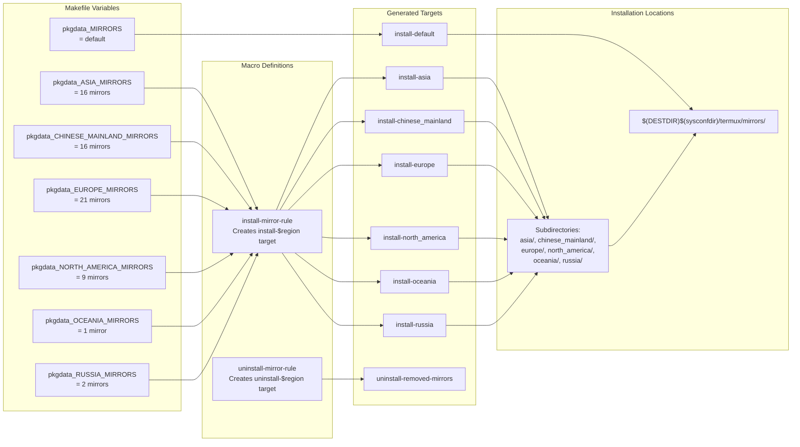

**Sources:** [mirrors/Makefile.am:94-157]()

### Macro Implementation

The `install-mirror-rule` macro generates installation targets that create regional subdirectories and install mirror configuration files with mode 644:

```
define install-mirror-rule
install-$1:
	$(MKDIR_P) $(DESTDIR)$(sysconfdir)/termux/mirrors/$1
	for f in $(pkgdata_$2_MIRRORS); do \
		$(INSTALL) -m 644 $(srcdir)/$1/$$f \
		$(DESTDIR)$(sysconfdir)/termux/mirrors/$1; \
	done
endef
```

The `uninstall-mirror-rule` macro generates corresponding uninstallation targets:

```
define uninstall-mirror-rule
uninstall-$1:
	for f in $(pkgdata_$2_MIRRORS); do \
		rm -f $(DESTDIR)$(sysconfdir)/termux/mirrors/$1/$$f; \
	done
	-rmdir $(DESTDIR)$(sysconfdir)/termux/mirrors/$1
endef
```

These macros are invoked for each region at lines 111-123, generating targets like `install-asia`, `uninstall-europe`, etc.

**Sources:** [mirrors/Makefile.am:94-123]()

### Debian Package Integration

The build system generates Debian control files to manage mirror configurations as conffiles:

1. **conffiles generation:** All mirror files are listed in the Debian conffiles list so they are preserved during package upgrades
2. **preinst script:** A pre-installation script is generated that removes deprecated mirrors before the new package is installed

This ensures that when mirrors are removed or renamed, they are properly cleaned up during package upgrades rather than being left orphaned.

**Sources:** [mirrors/Makefile.am:149-151]()

## Deprecated Mirrors

The Makefile maintains a list of 40+ deprecated mirrors in `pkgdata_MIRRORS_REMOVED`. These mirrors have been removed, renamed, or moved, and the build system generates a preinst script to delete them during package upgrades. This is necessary because Debian conffiles are only deleted on package purge, not on upgrades.

Examples of deprecated mirrors include:
- Former `china/` mirrors (renamed to `chinese_mainland/`)
- Mirrors that changed hostnames (e.g., `cdn.lumito.net` → `termux.cdn.lumito.net`)
- Discontinued mirrors (e.g., `south_america/mirrors.rda.run`)

**Sources:** [mirrors/Makefile.am:45-91](), [mirrors/Makefile.am:142-151]()

---

# Page: Package Management

# Package Management

<details>
<summary>Relevant source files</summary>

The following files were used as context for generating this wiki page:

- [configure.ac](configure.ac)
- [mirrors/europe/packages.termux.dev](mirrors/europe/packages.termux.dev)
- [mirrors/europe/termux.cdn.lumito.net](mirrors/europe/termux.cdn.lumito.net)
- [mirrors/north_america/mirror.quantum5.ca](mirrors/north_america/mirror.quantum5.ca)
- [scripts/pkg.in](scripts/pkg.in)
- [scripts/termux-change-repo.in](scripts/termux-change-repo.in)

</details>


## Purpose and Scope

This document provides an overview of Termux's package management system, centered around the `pkg` command. The `pkg` utility serves as a unified wrapper that abstracts the underlying package manager (either `apt` or `pacman`), providing a consistent command interface regardless of which backend is configured. It integrates tightly with the mirror infrastructure to ensure reliable package downloads through intelligent mirror selection and health checking.

For detailed information about specific `pkg` subcommands and their options, see [pkg Command Reference](#3.1). For the technical details of mirror selection algorithms and caching strategies, see [Mirror Selection Algorithm](#3.2). For the interactive mirror configuration tool, see [termux-change-repo](#3.3). For information about the mirror infrastructure itself, see [Mirror Infrastructure](#2).

## Architecture Overview

The package management system consists of three primary components that work together to provide package installation, updates, and repository management:

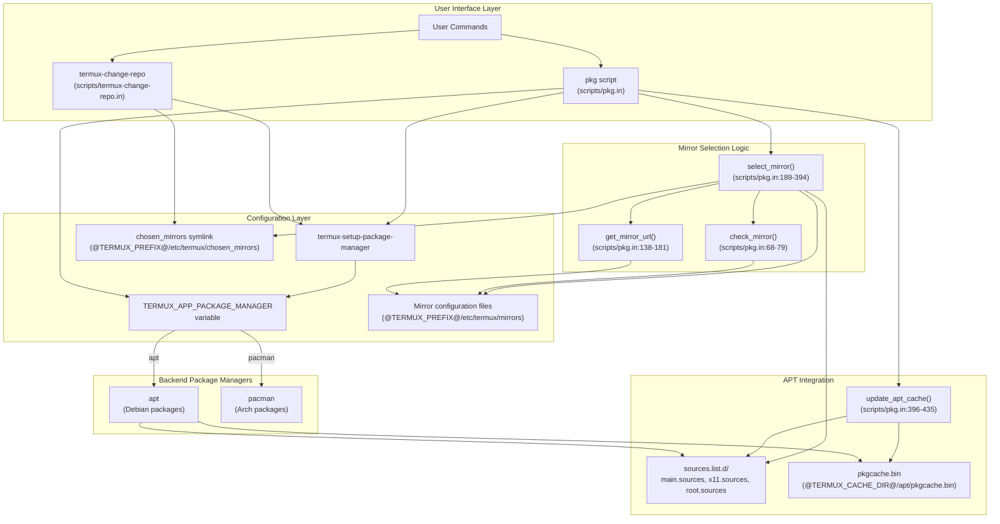

**Sources:** [scripts/pkg.in:1-489](), [scripts/termux-change-repo.in:1-206](), [configure.ac:64-68]()

The system operates in three layers:

1. **User Interface Layer**: The `pkg` command and `termux-change-repo` provide user-facing interfaces for package operations and mirror configuration.

2. **Configuration Layer**: The `termux-setup-package-manager` script sets the `TERMUX_APP_PACKAGE_MANAGER` variable, which determines whether `apt` or `pacman` is used. The `chosen_mirrors` symlink points to either a single mirror file or a directory of regional mirrors.

3. **Backend Integration**: Based on `TERMUX_APP_PACKAGE_MANAGER`, commands are translated to either `apt` or `pacman` syntax and executed.

## Dual Backend Support

The `pkg` command supports two package management backends, configured at build time via the `TERMUX_PACKAGE_MANAGER` variable in [configure.ac:64-68](). The backend selection is stored in `TERMUX_APP_PACKAGE_MANAGER` and sourced from the `termux-setup-package-manager` script at runtime.

### Backend Detection and Command Translation

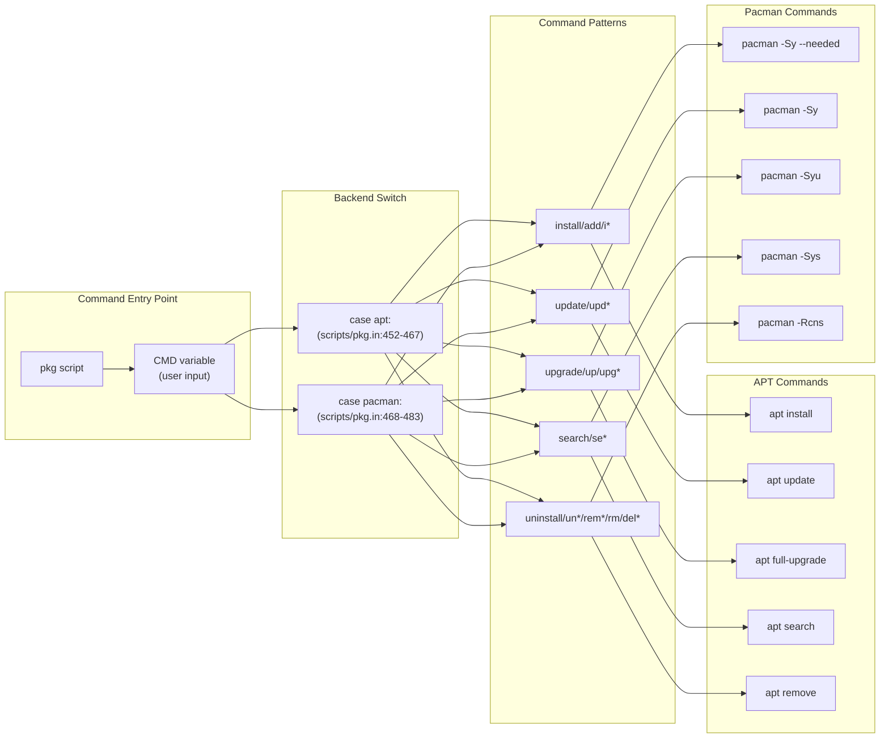

**Sources:** [scripts/pkg.in:451-484](), [configure.ac:64-68]()

The command translation logic uses prefix matching on user input (e.g., `i*` matches `install`, `ins`, `i`) and routes to appropriate backend commands. Key translations include:

| User Command | APT Backend | Pacman Backend |
|--------------|-------------|----------------|
| `install` / `add` / `i*` | `apt install` | `pacman -Sy --needed` |
| `update` / `upd*` | `apt update` | `pacman -Sy` |
| `upgrade` / `up` / `upg*` | `apt update && apt full-upgrade` | `pacman -Syu` |
| `search` / `se*` | `apt search` | `pacman -Sys` |
| `uninstall` / `un*` / `rem*` / `rm` / `del*` | `apt remove` | `pacman -Rcns` |
| `files` / `f*` | `dpkg -L` | `pacman -Ql` |
| `show` / `sh*` / `inf*` | `apt show` | `pacman -Qi` |

**Sources:** [scripts/pkg.in:453-467](), [scripts/pkg.in:469-483]()

## Mirror Integration

The `pkg` command integrates with the mirror infrastructure through the `select_mirror()` function, which performs intelligent mirror selection before operations that require network access.

### Mirror Selection Trigger Points

The `select_mirror()` function is called before specific operations:

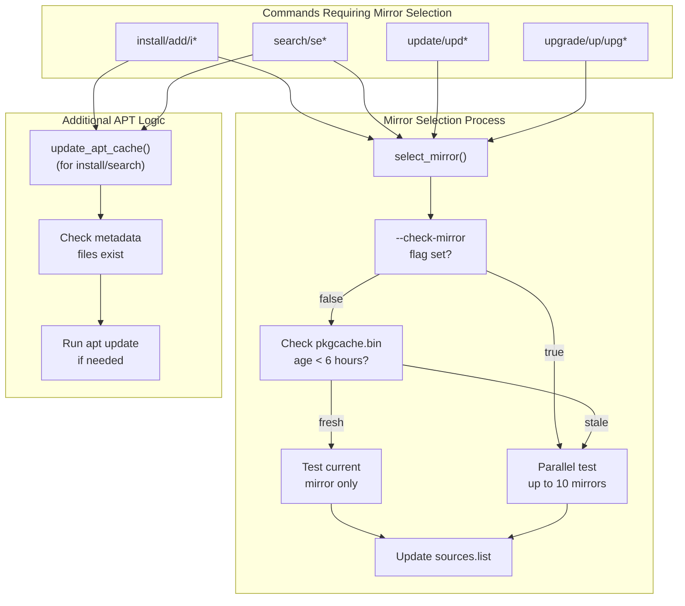

**Sources:** [scripts/pkg.in:456-466](), [scripts/pkg.in:189-394](), [scripts/pkg.in:396-435]()

### Configuration Files and Symlink Mechanism

The mirror selection system uses a symlink-based configuration approach:

| Path | Type | Purpose |
|------|------|---------|
| `@TERMUX_PREFIX@/etc/termux/chosen_mirrors` | symlink | Points to selected mirror(s) |
| `@TERMUX_PREFIX@/etc/termux/mirrors/default` | file | Cloudflare CDN fallback |
| `@TERMUX_PREFIX@/etc/termux/mirrors/asia/` | directory | 14 Asian mirrors |
| `@TERMUX_PREFIX@/etc/termux/mirrors/chinese_mainland/` | directory | 15 Chinese mirrors |
| `@TERMUX_PREFIX@/etc/termux/mirrors/europe/` | directory | 19 European mirrors |
| `@TERMUX_PREFIX@/etc/termux/mirrors/north_america/` | directory | 8 North American mirrors |
| `@TERMUX_PREFIX@/etc/apt/sources.list.d/main.sources` | file | deb822 format APT sources |
| `@TERMUX_PREFIX@/etc/apt/sources.list` | file | Legacy APT sources (fallback) |

**Sources:** [scripts/pkg.in:14](), [scripts/pkg.in:204-218](), [scripts/pkg.in:191-195]()

The `chosen_mirrors` symlink can point to:
- A single mirror file (e.g., `mirrors/europe/packages.termux.dev`)
- A regional directory (e.g., `mirrors/asia/`)
- The special `all` pseudo-directory (all mirrors)

When `chosen_mirrors` is a directory, `select_mirror()` tests all mirrors within it. When it's a file, only that mirror is used (unless forced to check with `--check-mirror`).

## Command Execution Flow

The following sequence diagram illustrates how a typical package installation command flows through the system:

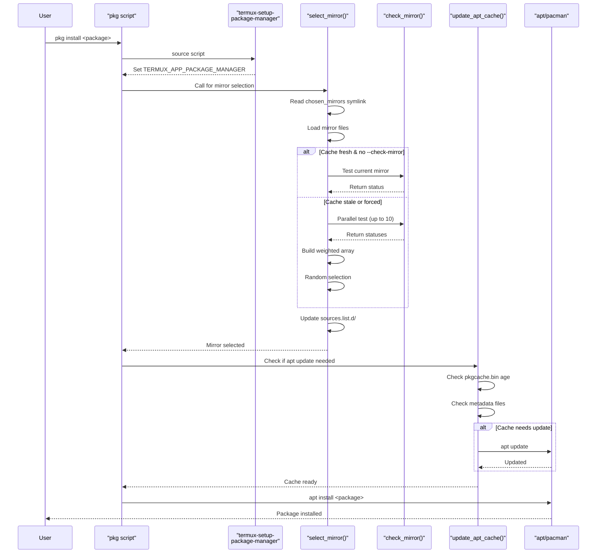

**Sources:** [scripts/pkg.in:456](), [scripts/pkg.in:189-394](), [scripts/pkg.in:396-435](), [scripts/pkg.in:68-79]()

Key phases in the execution flow:

1. **Initialization**: Source `termux-setup-package-manager` to set `TERMUX_APP_PACKAGE_MANAGER` [scripts/pkg.in:12]()

2. **Mirror Selection**: Call `select_mirror()` which:
   - Reads `chosen_mirrors` symlink [scripts/pkg.in:204-218]()
   - Validates mirror URLs with `get_mirror_url()` [scripts/pkg.in:138-181]()
   - Tests mirrors using `check_mirror()` with curl [scripts/pkg.in:68-79]()
   - Performs weighted random selection [scripts/pkg.in:329-354]()
   - Updates APT sources files [scripts/pkg.in:368-393]()

3. **Cache Update** (APT only): Call `update_apt_cache()` which:
   - Checks `pkgcache.bin` modification time [scripts/pkg.in:423]()
   - Verifies metadata files exist [scripts/pkg.in:410-420]()
   - Runs `apt update` if cache is stale (>20 minutes) [scripts/pkg.in:432-434]()

4. **Package Operation**: Execute backend command (apt/pacman) [scripts/pkg.in:456]()

## Root Protection

The `pkg` command includes a safety check to prevent execution as root user, which could cause permission and ownership issues in the Termux environment:

**Sources:** [scripts/pkg.in:4-8]()

```bash
if [[ "$(id -u)" == "0" ]]; then
    echo "Error: Cannot run 'pkg' command as root"
    exit 1
fi
```

This check occurs before any package operations, ensuring that all installed packages maintain proper ownership and permissions for the Termux user context.

## Relationship with termux-change-repo

The `termux-change-repo` tool provides an interactive dialog-based interface for configuring which mirrors `pkg` should use. While `pkg` automatically selects mirrors based on the current configuration, `termux-change-repo` allows users to explicitly set their preferences:

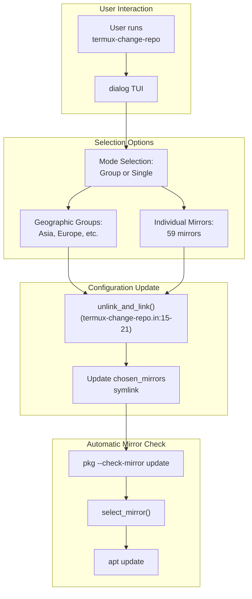

**Sources:** [scripts/termux-change-repo.in:1-206](), [scripts/termux-change-repo.in:15-21](), [scripts/termux-change-repo.in:204-205]()

After updating the `chosen_mirrors` symlink, `termux-change-repo` automatically invokes `pkg --check-mirror update` [scripts/termux-change-repo.in:204-205]() to force immediate mirror testing and repository metadata refresh. The `--check-mirror` flag bypasses the 6-hour cache check, ensuring the new mirror configuration takes effect immediately [scripts/pkg.in:438-441]().

## Key Features Summary

| Feature | Implementation | Benefit |
|---------|---------------|---------|
| Unified Interface | Command prefix matching | Consistent UX across apt/pacman |
| Intelligent Caching | 6-hour pkgcache.bin threshold | Reduced mirror checks |
| Parallel Health Checks | Up to 10 concurrent curl processes | Fast mirror selection |
| Weighted Selection | WEIGHT variable in mirror files | Load distribution |
| Geographic Grouping | Regional mirror directories | Low-latency access |
| Automatic Fallback | Default mirror (Cloudflare CDN) | High availability |
| Cache Awareness | update_apt_cache() optimization | Minimal network usage |

**Sources:** [scripts/pkg.in:223-236](), [scripts/pkg.in:240-327](), [scripts/pkg.in:329-354](), [mirrors/europe/packages.termux.dev:3]()

For detailed documentation of individual `pkg` subcommands, their options, and usage examples, see [pkg Command Reference](#3.1). For the internal workings of the mirror selection algorithm including the parallel checking implementation, see [Mirror Selection Algorithm](#3.2).

---

# Page: pkg Command Reference

# pkg Command Reference

<details>
<summary>Relevant source files</summary>

The following files were used as context for generating this wiki page:

- [mirrors/europe/packages.termux.dev](mirrors/europe/packages.termux.dev)
- [scripts/pkg.in](scripts/pkg.in)
- [scripts/termux-change-repo.in](scripts/termux-change-repo.in)

</details>


This document provides a complete reference for the `pkg` command, which serves as the primary package management interface in Termux. The `pkg` command is a wrapper that abstracts the underlying package manager (`apt` or `pacman`), provides intelligent mirror selection with health checking, and offers a simplified command-line interface for package operations.

For information about mirror infrastructure and organization, see [Mirror Infrastructure](#2). For the interactive mirror selection interface, see [termux-change-repo](#3.3). For details on the mirror selection algorithm internals, see [Mirror Selection Algorithm](#3.2).

## Command Syntax

The `pkg` command follows this syntax:

```bash
pkg [--check-mirror] <command> [arguments]
```

The optional `--check-mirror` flag forces immediate re-checking of mirror availability, bypassing the 6-hour cache timeout (see [Mirror Selection Behavior](#mirror-selection-behavior)).

Sources: [scripts/pkg.in:26-29](), [scripts/pkg.in:437-441]()

## Root User Prevention

The `pkg` command explicitly prevents execution as root to avoid file permission issues within the Termux environment:

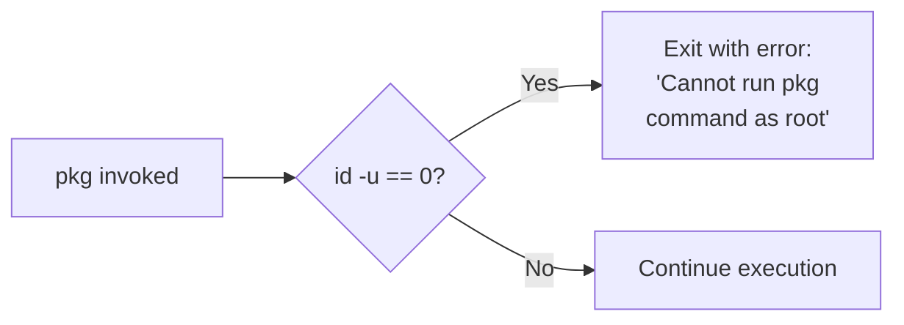

Sources: [scripts/pkg.in:4-8]()

## Package Manager Backend Detection

Before any operation, `pkg` determines the active package manager by sourcing `termux-setup-package-manager`, which sets the `TERMUX_APP_PACKAGE_MANAGER` environment variable to either `apt` or `pacman`:

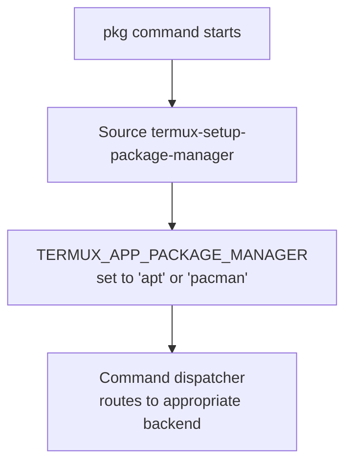

Sources: [scripts/pkg.in:10-12]()

## Available Commands

All commands support abbreviated forms (matching the first few characters). The table below shows command mappings for both backends:

| Command | Description | apt Backend | pacman Backend |
|---------|-------------|-------------|----------------|
| `files <packages>` | Show installed files | `dpkg -L` | `pacman -Ql` |
| `show <packages>` | Display package metadata | `apt show` | `pacman -Qi` |
| `install <packages>` | Install packages | `apt install` | `pacman -Sy --needed` |
| `autoclean` | Remove outdated cached packages | `apt autoclean` | `pacman -Sc` |
| `clean` | Remove all cached packages | `apt clean` | `pacman -Scc` |
| `list-all` | List available packages | `apt list` | `pacman -Sl` |
| `list-installed` | List installed packages | `apt list --installed` | `pacman -Q` |
| `reinstall <packages>` | Reinstall packages | `apt install --reinstall` | `pacman -S` |
| `search <query>` | Search for packages | `apt search` | `pacman -Sys` |
| `uninstall <packages>` | Remove packages | `apt remove` | `pacman -Rcns` |
| `update` | Update package databases | `apt update` | `pacman -Sy` |
| `upgrade` | Upgrade all packages | `apt update && apt full-upgrade` | `pacman -Syu` |

Sources: [scripts/pkg.in:31-65](), [scripts/pkg.in:451-484]()

### Command Abbreviation Matching

Commands are matched using prefix matching with wildcard patterns. For example:
- `pkg i` matches `install`
- `pkg up` matches `upgrade`
- `pkg upd` matches `update`
- `pkg se` matches `search`

The matching is implemented using case pattern matching in bash:

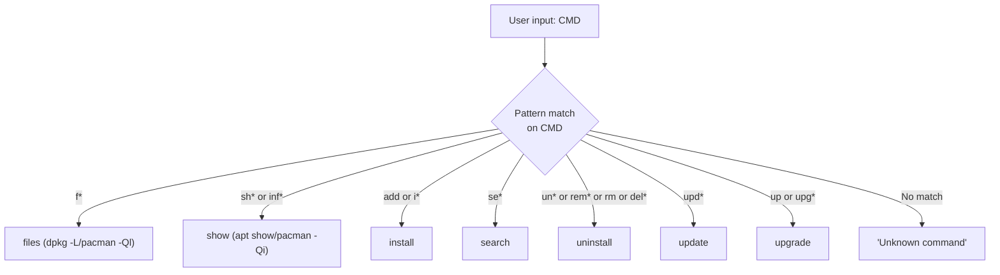

Sources: [scripts/pkg.in:453-466](), [scripts/pkg.in:469-482]()

## Mirror Integration Commands

Several commands automatically trigger mirror selection and cache updates:

| Command | Mirror Selection | Cache Update | Backend Operation |
|---------|------------------|--------------|-------------------|
| `install` | Yes (via `select_mirror()`) | Yes (via `update_apt_cache()`) | Package installation |
| `search` | Yes | Yes | Package search |
| `update` | Yes | No (runs `apt update` directly) | Database refresh |
| `upgrade` | Yes | No (runs `apt update` first) | Full system upgrade |
| `reinstall` | No | No | Package reinstallation |
| `show` | No | No | Metadata display |

Sources: [scripts/pkg.in:456](), [scripts/pkg.in:462](), [scripts/pkg.in:464-465]()

## Mirror Selection Behavior

The `select_mirror()` function implements intelligent caching to minimize latency:

```mermaid
sequenceDiagram
    participant User
    participant pkg
    participant select_mirror
    participant pkgcache as "@TERMUX_CACHE_DIR@/apt/pkgcache.bin"
    participant Mirrors as "Mirror files"
    participant curl
    
    User->>pkg: pkg install foo
    pkg->>select_mirror: Call select_mirror()
    select_mirror->>pkgcache: Check last_modified()
    
    alt Cache < 6 hours old AND no --check-mirror
        select_mirror->>select_mirror: Read current mirror from sources.list
        select_mirror->>curl: Test current mirror only
        alt Current mirror OK
            select_mirror->>pkg: Return (use existing mirror)
        else Current mirror BAD
            select_mirror->>Mirrors: Load all mirrors
            select_mirror->>select_mirror: Parallel health check
        end
    else Cache >= 6 hours OR --check-mirror
        select_mirror->>Mirrors: Load all mirrors
        select_mirror->>select_mirror: Parallel health check (up to 10)
        select_mirror->>select_mirror: Build weighted array
        select_mirror->>select_mirror: Random selection
        select_mirror->>pkg: Update sources.list
    end
```

The caching logic is defined in [scripts/pkg.in:223-236]():
- If `pkgcache.bin` exists and was modified within 6 hours (21600 seconds)
- AND `--check-mirror` flag was NOT provided
- THEN only test the current mirror
- ELSE perform full mirror selection

Sources: [scripts/pkg.in:189-394](), [scripts/pkg.in:223-236]()

## Mirror Selection Algorithm Details

### Chosen Mirrors Resolution

The `select_mirror()` function resolves the active mirror set through a cascading logic:

```mermaid
graph TD
    Start["select_mirror() starts"] --> CheckType{"Type of<br/>chosen_mirrors?"}
    CheckType -->|Directory| Group["Mirror group selected:<br/>load all files in directory"]
    CheckType -->|File| Single["Single mirror selected:<br/>resolve symlink target"]
    CheckType -->|Broken symlink| Fallback1["Use default + all regional mirrors"]
    CheckType -->|Does not exist| Fallback2["Print warning + use all mirrors"]
    
    Group --> Process["Process mirrors array"]
    Single --> Process
    Fallback1 --> Process
    Fallback2 --> Process
    
    Process --> Validate["Validate mirror URLs<br/>via get_mirror_url()"]
    Validate --> Parallel["Parallel health checks"]
```

Sources: [scripts/pkg.in:204-218]()

The `chosen_mirrors` path (`@TERMUX_PREFIX@/etc/termux/chosen_mirrors`) is managed by `termux-change-repo` and can be:
- A directory (mirror group): all files within are tested
- A regular file symlink (single mirror): only that mirror is tested
- A broken symlink: fallback to all mirrors
- Non-existent: fallback with warning

### Mirror URL Validation

Before testing, each mirror file is validated via `get_mirror_url()`:

```mermaid
graph TD
    GetURL["get_mirror_url(mirror_file,<br/>has_x11, has_root)"] --> Source["Source mirror file<br/>(sets MAIN, X11, ROOT, WEIGHT)"]
    Source --> ValidateMain{"MAIN defined<br/>and valid URL?"}
    ValidateMain -->|No| Warn1["Warning + return empty"]
    ValidateMain -->|Yes| CheckX11{"has_x11 == true?"}
    
    CheckX11 -->|Yes| ValidateX11{"X11 defined<br/>and valid URL?"}
    ValidateX11 -->|No| Warn2["Warning + return empty"]
    ValidateX11 -->|Yes| CheckRoot{"has_root == true?"}
    
    CheckX11 -->|No| CheckRoot
    
    CheckRoot -->|Yes| ValidateRoot{"ROOT defined<br/>and valid URL?"}
    ValidateRoot -->|No| Warn3["Warning + return empty"]
    ValidateRoot -->|Yes| ValidateWeight{"WEIGHT is integer?"}
    
    CheckRoot -->|No| ValidateWeight
    ValidateWeight -->|No| Warn4["Warning + return empty"]
    ValidateWeight -->|Yes| Return["Return MAIN URL"]
```

This ensures that mirrors with incomplete repository coverage (e.g., missing x11-repo URLs when x11-repo is installed) are automatically excluded from selection.

Sources: [scripts/pkg.in:138-181]()

### Parallel Health Checking

Mirror availability is tested using bounded parallelism:

```mermaid
graph TB
    subgraph "Parallel Check Process"
        Start["Start with mirrors array"] --> Init["parallel_jobs_max_count = 10"]
        Init --> Loop["For each mirror in array"]
        Loop --> StartJob["Start check_mirror in background<br/>Store PID"]
        StartJob --> Count{"Job count<br/>reached 10?"}
        Count -->|Yes| Wait["Wait for all jobs to complete<br/>Collect return values"]
        Count -->|No| Continue["Continue to next mirror"]
        Continue --> Loop
        Wait --> Print["Print results (ok/bad)<br/>Remove failed mirrors"]
        Print --> Reset["Reset job arrays"]
        Reset --> Continue
    end
```

The health check is performed by `check_mirror()` [scripts/pkg.in:68-79]():
- Uses `curl --head --fail` to check HTTP response
- Tests URL: `$mirror/dists/stable/Release`
- Connection timeout: 5 seconds (plus 1 second for timeout command)
- Custom User-Agent identifying Termux version
- Returns exit code 0 on success, non-zero on failure

Sources: [scripts/pkg.in:238-327](), [scripts/pkg.in:68-79]()

### Weighted Random Selection

After parallel checking, valid mirrors are selected using weighted randomization:

```mermaid
graph LR
    Valid["Valid mirrors<br/>(after health check)"] --> BuildArray["For each mirror:<br/>Add to array<br/>WEIGHT times"]
    BuildArray --> Array["weighted_mirrors[]<br/>(duplicate entries<br/>by weight)"]
    Array --> Random["RANDOM % total_weight"]
    Random --> Select["Select<br/>weighted_mirrors[random_index]"]
```

For example, if three mirrors have weights 10, 5, and 1:
- Mirror A appears 10 times in array (indices 0-9)
- Mirror B appears 5 times (indices 10-14)
- Mirror C appears 1 time (index 15)
- Random index 0-15 is selected
- Mirror A has 62.5% probability, B has 31.25%, C has 6.25%

Sources: [scripts/pkg.in:329-354]()

## Sources.list Update Mechanism

Once a mirror is selected, `pkg` updates the apt sources configuration files based on the detected format:

```mermaid
graph TD
    Selected["Mirror selected"] --> ReadVars["Source mirror file<br/>(MAIN, X11, ROOT)"]
    ReadVars --> DetectMain{"has_repo(main)<br/>returns..."}
    
    DetectMain -->|"deb822"| Deb822Main["sed -i: Update URIs line<br/>in main.sources"]
    DetectMain -->|"legacy" or empty| LegacyMain["echo: Overwrite<br/>sources.list"]
    
    Deb822Main --> CheckX11{"x11-repo installed?"}
    LegacyMain --> CheckX11
    
    CheckX11 -->|Yes, deb822| Deb822X11["Update x11.sources"]
    CheckX11 -->|Yes, legacy| LegacyX11["Overwrite x11.list"]
    CheckX11 -->|No| CheckRoot{"root-repo installed?"}
    
    Deb822X11 --> CheckRoot
    LegacyX11 --> CheckRoot
    
    CheckRoot -->|Yes, deb822| Deb822Root["Update root.sources"]
    CheckRoot -->|Yes, legacy| LegacyRoot["Overwrite root.list"]
    CheckRoot -->|No| Done["Update complete"]
    
    Deb822Root --> Done
    LegacyRoot --> Done
```

The `has_repo()` function [scripts/pkg.in:120-129]() detects the sources file format:
- Returns `"deb822"` if `.sources` file exists (new DEB822 format)
- Returns `"legacy"` if `.list` file exists (traditional one-line format)
- Returns empty if repository not installed

Sources: [scripts/pkg.in:363-393](), [scripts/pkg.in:120-129]()

### DEB822 Format Update

For DEB822 format, the `URIs:` line is updated in place using `sed`:

```
URIs: https://old.mirror.example/path
```
becomes:
```
URIs: https://new.mirror.example/path
```

The `sed_escape_replacement()` function [scripts/pkg.in:112-118]() escapes special characters in the replacement URL to prevent `sed` interpretation errors.

Sources: [scripts/pkg.in:370-371](), [scripts/pkg.in:380-381](), [scripts/pkg.in:388-389]()

### Legacy Format Generation

For legacy format, entire files are regenerated:

**main repository** (`sources.list`):
```
deb https://mirror.example/apt/termux-main stable main
```

**x11-repo** (`x11.list`):
```
deb https://mirror.example/apt/termux-x11 x11 main
```

**root-repo** (`root.list`):
```
deb https://mirror.example/apt/termux-root root stable
```

Sources: [scripts/pkg.in:375](), [scripts/pkg.in:383](), [scripts/pkg.in:391]()

## Conditional Cache Update

The `update_apt_cache()` function implements smart cache updating for apt:

```mermaid
graph TD
    Call["update_apt_cache() called"] --> Extract["Extract current host from<br/>sources.list or main.sources"]
    Extract --> HostCheck{"Host extracted?"}
    HostCheck -->|No| DirectUpdate["apt update"]
    HostCheck -->|Yes| BuildPath["Build metadata file path:<br/>var/lib/apt/lists/<host>_..._Packages"]
    BuildPath --> FileCheck{"pkgcache.bin AND<br/>metadata file exist?"}
    FileCheck -->|No| DirectUpdate
    FileCheck -->|Yes| TimeCheck{"sources_modified <= cache_modified<br/>OR cache_modified > 1200s?"}
    TimeCheck -->|Yes| DirectUpdate
    TimeCheck -->|No| Skip["Skip update<br/>(cache is fresh)"]
```

The 1200-second (20-minute) threshold [scripts/pkg.in:432]() ensures that even if sources are unchanged, the cache is refreshed periodically to catch repository updates.

Sources: [scripts/pkg.in:396-435]()

## Command Error Handling

The `check_command()` helper function validates that package manager commands can execute:

```mermaid
graph TD
    Run["Execute command<br/>(capture stderr)"] --> Check{"Exit code == 0?"}
    Check -->|Yes| Success["Continue"]
    Check -->|No| Print["Print errors to stderr"]
    Print --> LinkCheck{"Error contains<br/>'CANNOT LINK EXECUTABLE'?"}
    LinkCheck -->|Yes| Manual["Suggest manual upgrade:<br/>apt full-upgrade or pacman -Syu"]
    LinkCheck -->|No| Exit["Exit with code 1"]
    Manual --> Exit
```

This specifically handles ABI compatibility issues where the package manager binary cannot load required libraries due to outdated packages.

Sources: [scripts/pkg.in:81-97]()

## Integration with termux-change-repo

The `termux-change-repo` command provides a dialog-based interface for mirror selection and immediately updates the package database:

```mermaid
sequenceDiagram
    participant User
    participant ChangeRepo as "termux-change-repo"
    participant Dialog as "dialog UI"
    participant FS as "File System"
    participant Pkg as "pkg"
    
    User->>ChangeRepo: Run termux-change-repo
    ChangeRepo->>Dialog: Show mode selection<br/>(Mirror group vs Single)
    Dialog-->>ChangeRepo: User selection
    
    alt Mirror group selected
        ChangeRepo->>Dialog: Show region menu
        Dialog-->>ChangeRepo: Region selected
        ChangeRepo->>FS: ln -s mirrors/<region><br/>-> chosen_mirrors
    else Single mirror selected
        ChangeRepo->>Dialog: Show all mirrors
        Dialog-->>ChangeRepo: Mirror selected
        ChangeRepo->>FS: ln -s mirrors/.../mirror_file<br/>-> chosen_mirrors
    end
    
    ChangeRepo->>Pkg: TERMUX_APP_PACKAGE_MANAGER=apt<br/>pkg --check-mirror update
    Pkg->>Pkg: Force mirror re-check<br/>(bypass cache)
    Pkg->>FS: Update sources.list
    Pkg->>Pkg: apt update
```

Key behaviors:
- Always forces apt backend via `TERMUX_APP_PACKAGE_MANAGER=apt` [scripts/termux-change-repo.in:205]()
- Always uses `--check-mirror` flag to bypass caching [scripts/termux-change-repo.in:205]()
- Updates `chosen_mirrors` symlink before calling `pkg` [scripts/termux-change-repo.in:15-21]()

Sources: [scripts/termux-change-repo.in:1-206](), [scripts/termux-change-repo.in:204-205]()

## Environment Variables

### TERMUX_APP_PACKAGE_MANAGER
Set by `termux-setup-package-manager` to either `"apt"` or `"pacman"`. Controls which backend commands are invoked.

**Usage**: [scripts/pkg.in:11-12](), [scripts/pkg.in:451-484]()

### TERMUX_PKG_NO_MIRROR_SELECT
If set (to any non-empty value), disables automatic mirror selection. The current mirror configuration is preserved.

**Usage**: [scripts/pkg.in:197-200]()

### TERMUX_PREFIX
Substituted at build time to the installation prefix (typically `/data/data/com.termux/files/usr`). Used to construct paths to:
- Mirror files: `$TERMUX_PREFIX/etc/termux/mirrors/`
- Sources lists: `$TERMUX_PREFIX/etc/apt/sources.list.d/`
- Cache: Referenced via `TERMUX_CACHE_DIR`

**Build-time substitution**: [scripts/pkg.in:14](), [scripts/pkg.in:124]()

### TERMUX_CACHE_DIR
Substituted at build time to the cache directory. Used for:
- apt package cache: `$TERMUX_CACHE_DIR/apt/archives`
- apt pkgcache.bin: `$TERMUX_CACHE_DIR/apt/pkgcache.bin`

**Usage**: [scripts/pkg.in:20](), [scripts/pkg.in:224]()

## Mirror File Format

Mirror configuration files (e.g., [mirrors/europe/packages.termux.dev]()) are sourced as bash scripts and must define:

| Variable | Required | Format | Description |
|----------|----------|--------|-------------|
| `MAIN` | Yes | URL | Main repository URL (stable channel) |
| `ROOT` | Conditional | URL | Root repository URL (required if root-repo installed) |
| `X11` | Conditional | URL | X11 repository URL (required if x11-repo installed) |
| `WEIGHT` | Yes | Integer | Selection weight (higher = more likely) |

Example:
```bash
# This file is sourced by pkg
# Termux origin repo. Hosted in Falkenstein, Germany.
WEIGHT=1
MAIN="https://packages.termux.dev/apt/termux-main"
ROOT="https://packages.termux.dev/apt/termux-root"
X11="https://packages.termux.dev/apt/termux-x11"
```

For complete mirror listings and geographic distribution, see [Geographic Distribution and Mirror List](#2.3).

Sources: [mirrors/europe/packages.termux.dev:1-7](), [scripts/pkg.in:138-181]()

## Usage Examples

### Basic Package Management
```bash
# Install a package
pkg install vim

# Search for packages
pkg search editor

# Update package lists
pkg update

# Upgrade all packages
pkg upgrade

# Show package information
pkg show vim

# List installed packages
pkg list-installed

# Remove a package
pkg uninstall vim
```

### Mirror Management
```bash
# Force mirror re-check before installing
pkg --check-mirror install neovim

# Force mirror re-check before update
pkg --check-mirror update

# Interactive mirror selection (opens dialog)
termux-change-repo
```

### Cache Management
```bash
# Remove outdated packages from cache
pkg autoclean

# Remove all cached packages
pkg clean
```

### Troubleshooting
```bash
# If package manager is broken, prevent mirror selection
TERMUX_PKG_NO_MIRROR_SELECT=1 apt update
TERMUX_PKG_NO_MIRROR_SELECT=1 apt full-upgrade

# After fixing, re-enable mirror selection
pkg --check-mirror update
```

Sources: [scripts/pkg.in:31-65](), [scripts/pkg.in:26-29]()

---

# Page: Mirror Selection Algorithm

# Mirror Selection Algorithm

<details>
<summary>Relevant source files</summary>

The following files were used as context for generating this wiki page:

- [mirrors/Makefile.am](mirrors/Makefile.am)
- [mirrors/europe/packages.termux.dev](mirrors/europe/packages.termux.dev)
- [scripts/pkg.in](scripts/pkg.in)
- [scripts/termux-change-repo.in](scripts/termux-change-repo.in)

</details>


## Purpose and Scope

This document details the mirror selection algorithm implemented in the `pkg` command. The algorithm determines which mirror to use for package operations through intelligent caching, parallel health checks, and weighted random selection. This page focuses on the runtime selection logic that executes when users run package commands.

For information about the mirror configuration file format, see [Mirror Configuration Format](#2.2). For the interactive mirror selection UI, see [termux-change-repo](#3.3). For the complete `pkg` command reference, see [pkg Command Reference](#3.1).

## Algorithm Overview

The mirror selection algorithm is implemented in the `select_mirror()` function at [scripts/pkg.in:189-394](). It operates in multiple phases:

```mermaid
flowchart TD
    Start["select_mirror() invoked"]
    CheckEnv{"TERMUX_PKG_NO_MIRROR_SELECT set?"}
    ReadCurrent["Read current mirror from sources.list"]
    CheckCache{"Cache age < 6hrs AND<br/>--check-mirror not set?"}
    TestCurrent["Test current mirror only"]
    CurrentOK{"Current mirror OK?"}
    DiscoverMirrors["Discover mirrors from chosen_mirrors"]
    ValidateMirrors["Validate mirror file format"]
    ParallelCheck["Parallel health check (max 10)"]
    BuildWeighted["Build weighted array"]
    RandomSelect["Random selection from weighted array"]
    UpdateSources["Update apt sources.list files"]
    Done["Return"]
    
    Start --> CheckEnv
    CheckEnv -->|Yes| Done
    CheckEnv -->|No| ReadCurrent
    ReadCurrent --> CheckCache
    CheckCache -->|Yes| TestCurrent
    TestCurrent --> CurrentOK
    CurrentOK -->|Yes| Done
    CurrentOK -->|No| DiscoverMirrors
    CheckCache -->|No| DiscoverMirrors
    DiscoverMirrors --> ValidateMirrors
    ValidateMirrors --> ParallelCheck
    ParallelCheck --> BuildWeighted
    BuildWeighted --> RandomSelect
    RandomSelect --> UpdateSources
    UpdateSources --> Done
```

**Diagram: Mirror Selection Algorithm Flow**

Sources: [scripts/pkg.in:189-394]()

## Cache-Based Optimization

The algorithm optimizes performance by testing only the current mirror when the package cache is fresh. This avoids unnecessary network checks on every package operation.

### Cache Age Calculation

The `last_modified()` function calculates the age of the package cache:

```mermaid
graph LR
    pkgcache["@TERMUX_CACHE_DIR@/apt/pkgcache.bin"]
    last_modified["last_modified() function"]
    date_r["date -r command"]
    age["age in seconds"]
    
    pkgcache --> last_modified
    last_modified --> date_r
    date_r --> age
```

**Diagram: Cache Age Calculation**

The function at [scripts/pkg.in:103-110]() computes the difference between the file's modification time and the current time:

| Step | Code Entity | Purpose |
|------|-------------|---------|
| 1 | `date -r "$1" '+%s'` | Get file modification time as Unix timestamp |
| 2 | `date '+%s'` | Get current time as Unix timestamp |
| 3 | `echo $((now - mtime))` | Calculate age in seconds |

Sources: [scripts/pkg.in:103-110]()

### Fast Path Conditions

The algorithm takes the fast path when both conditions are met at [scripts/pkg.in:225-236]():

1. Package cache age ≤ 21600 seconds (6 hours)
2. `force_check_mirror` is `false` (no `--check-mirror` flag)

When the fast path is taken:

```bash
echo "Checking availability of current mirror:"
echo -n "[*] $current_mirror: "
if check_mirror "$current_mirror"; then
    echo "ok"
    return
else
    echo "bad"
fi
```

If the current mirror passes the health check, the function returns immediately. Otherwise, it proceeds to full mirror selection.

Sources: [scripts/pkg.in:223-236]()

## Mirror Discovery

The algorithm discovers available mirrors by reading the `chosen_mirrors` symlink at `@TERMUX_PREFIX@/etc/termux/chosen_mirrors`.

### chosen_mirrors Resolution

```mermaid
flowchart TD
    Check["Check chosen_mirrors"]
    IsDir{"Is directory?"}
    IsFile{"Is file?"}
    IsBroken{"Is broken symlink?"}
    FindDir["Find all files in directory"]
    RealPath["Resolve symlink to single file"]
    UseAll["Use all mirrors from all regions"]
    NoSelection["No selection - use all mirrors"]
    
    Check --> IsDir
    Check --> IsFile
    Check --> IsBroken
    Check --> NoSelection
    
    IsDir -->|Yes| FindDir
    IsFile -->|Yes| RealPath
    IsBroken -->|Yes| UseAll
    NoSelection -->|None exists| UseAll
    
    FindDir --> MirrorList["mirrors array"]
    RealPath --> MirrorList
    UseAll --> MirrorList
```

**Diagram: chosen_mirrors Discovery Logic**

The discovery logic at [scripts/pkg.in:204-218]() handles three cases:

| Case | Test | Action | Code Line |
|------|------|--------|-----------|
| Mirror Group | `-d chosen_mirrors` | Find all files in directory | [204-206]() |
| Single Mirror | `-f chosen_mirrors` | Resolve symlink to single file | [208-209]() |
| Broken/Missing | `-L chosen_mirrors` or no file | Use all mirrors (default + all regions) | [211-218]() |

The `find` commands exclude backup files using patterns: `! -name "*\.dpkg-old" ! -name "*\.dpkg-new" ! -name "*~"`.

Sources: [scripts/pkg.in:204-218]()

## Mirror Validation

Before testing mirrors, the algorithm validates each mirror configuration file by sourcing it and checking required variables.

### Validation Function

The `get_mirror_url()` function at [scripts/pkg.in:138-181]() performs validation:

```mermaid
graph TD
    Source["Source mirror file"]
    CheckMain{"MAIN variable set<br/>and valid URL?"}
    CheckX11{"x11-repo installed?"}
    CheckX11URL{"X11 variable valid?"}
    CheckRoot{"root-repo installed?"}
    CheckRootURL{"ROOT variable valid?"}
    CheckWeight{"WEIGHT is integer?"}
    Return["Return MAIN URL"]
    Ignore["Ignore mirror<br/>(print warning)"]
    
    Source --> CheckMain
    CheckMain -->|No| Ignore
    CheckMain -->|Yes| CheckX11
    CheckX11 -->|Yes| CheckX11URL
    CheckX11URL -->|No| Ignore
    CheckX11URL -->|Yes| CheckRoot
    CheckX11 -->|No| CheckRoot
    CheckRoot -->|Yes| CheckRootURL
    CheckRootURL -->|No| Ignore
    CheckRootURL -->|Yes| CheckWeight
    CheckRoot -->|No| CheckWeight
    CheckWeight -->|No| Ignore
    CheckWeight -->|Yes| Return
```

**Diagram: Mirror Validation Logic**

### Validation Rules

| Variable | Validation Pattern | Lines |
|----------|-------------------|-------|
| `MAIN` | `^https?://[^[:space:]]+$` | [147-153]() |
| `X11` (if x11-repo installed) | `^https?://[^[:space:]]+$` | [155-163]() |
| `ROOT` (if root-repo installed) | `^https?://[^[:space:]]+$` | [165-173]() |
| `WEIGHT` | `^[0-9]+$` | [175-178]() |

The function uses `unset_mirror_variables()` at [scripts/pkg.in:131-136]() before sourcing each mirror file to prevent variable carryover.

Sources: [scripts/pkg.in:131-181]()

## Parallel Health Checking

The algorithm tests mirror availability using parallel background jobs with bounded concurrency.

### Health Check Function

The `check_mirror()` function at [scripts/pkg.in:68-79]() tests a mirror URL:

```bash
timeout "$((timeout + 1))" curl \
    --head \
    --fail \
    --connect-timeout "$timeout" \
    --location \
    --user-agent "Termux-PKG/2.0 mirror-checker (termux-tools @PACKAGE_VERSION@) Termux (@TERMUX_APP_PACKAGE@; install-prefix:@TERMUX_PREFIX@)" \
    "$mirror/dists/stable/Release" >/dev/null 2>&1
```

| Parameter | Value | Purpose |
|-----------|-------|---------|
| Method | HEAD | Only fetch headers, not body |
| Timeout | 5 seconds (default) | Prevent hanging on slow mirrors |
| URL | `$mirror/dists/stable/Release` | Test main repository metadata |
| Exit Code | 0 = success, non-zero = failure | Indicates mirror availability |

Sources: [scripts/pkg.in:68-79]()

### Parallel Execution Logic

The parallel checking implementation at [scripts/pkg.in:239-327]() uses arrays to track concurrent jobs:

```mermaid
graph TD
    Init["Initialize job arrays"]
    Loop["For each mirror"]
    Validate["get_mirror_url() validation"]
    ValidOK{"Valid?"}
    StartJob["check_mirror URL &"]
    StorePID["Store job PID, URL, weight"]
    CheckCount{"Job count >= 10<br/>OR last mirror?"}
    Wait["wait for all jobs"]
    ProcessResults["Check return values"]
    UpdateMirrors["Remove failed mirrors"]
    ResetArrays["Reset job arrays"]
    NextMirror["Next mirror"]
    Done["All mirrors tested"]
    
    Init --> Loop
    Loop --> Validate
    Validate --> ValidOK
    ValidOK -->|No| NextMirror
    ValidOK -->|Yes| StartJob
    StartJob --> StorePID
    StorePID --> CheckCount
    CheckCount -->|No| NextMirror
    CheckCount -->|Yes| Wait
    Wait --> ProcessResults
    ProcessResults --> UpdateMirrors
    UpdateMirrors --> ResetArrays
    ResetArrays --> NextMirror
    NextMirror --> Loop
    Loop --> Done
```

**Diagram: Parallel Job Management**

### Job Tracking Arrays

| Array Name | Purpose | Example Value |
|------------|---------|---------------|
| `parallel_jobs_mirrors` | Mirror array indices | `0 1 2` |
| `parallel_jobs_weights` | Mirror weights | `10 5 3` |
| `parallel_jobs_urls` | Mirror URLs | `https://...` |
| `parallel_jobs_numbers` | Job numbers (1-10) | `1 2 3` |
| `parallel_jobs_pids` | Background process IDs | `12345 12346 12347` |
| `parallel_jobs_return_values` | Exit codes from `wait` | `0 1 0` |

The `parallel_jobs_max_count` variable at [scripts/pkg.in:240]() is set to 10, limiting concurrent checks to prevent resource exhaustion.

Sources: [scripts/pkg.in:239-327]()

## Weighted Random Selection

After filtering out failed mirrors, the algorithm builds a weighted array for random selection.

### Weight Array Construction

The construction logic at [scripts/pkg.in:329-345]() works as follows:

```mermaid
graph LR
    ValidMirrors["Valid mirrors after health check"]
    GetWeight["get_mirror_weight() for each"]
    BuildArray["Repeat mirror WEIGHT times"]
    WeightedArray["weighted_mirrors array"]
    TotalWeight["total_mirror_weight sum"]
    
    ValidMirrors --> GetWeight
    GetWeight --> BuildArray
    BuildArray --> WeightedArray
    GetWeight --> TotalWeight
```

**Diagram: Weighted Array Construction**

For example, given three mirrors:

| Mirror | Weight | Array Entries |
|--------|--------|---------------|
| `default` | 10 | 0, 1, 2, 3, 4, 5, 6, 7, 8, 9 |
| `grimler.se` | 5 | 10, 11, 12, 13, 14 |
| `packages.termux.dev` | 1 | 15 |

Total weight = 16. The array has 16 elements.

Sources: [scripts/pkg.in:329-345]()

### Random Selection

The selection at [scripts/pkg.in:347-354]() uses Bash's `$RANDOM` variable:

```bash
local random_weight
random_weight=$(( (RANDOM % total_mirror_weight + 1) - 1 ))
echo "Picking mirror: (${random_weight}) ${weighted_mirrors[${random_weight}]}"
selected_mirror="${weighted_mirrors[${random_weight}]}"
```

The formula `(RANDOM % total_mirror_weight + 1) - 1` generates a random index from 0 to `total_mirror_weight - 1`. This gives mirrors with higher weights a proportionally higher probability of selection.

Sources: [scripts/pkg.in:347-354]()

## APT Sources.list Updates

After selecting a mirror, the algorithm updates apt's sources.list files based on the installed repository format.

### Repository Format Detection

The `has_repo()` function at [scripts/pkg.in:120-129]() detects the repository format:

| Format | File | Return Value |
|--------|------|--------------|
| DEB822 | `@TERMUX_PREFIX@/etc/apt/sources.list.d/$repo.sources` | `deb822` |
| Legacy | `@TERMUX_PREFIX@/etc/apt/sources.list.d/$repo.list` | `legacy` |
| Not installed | No file exists | Empty string |

Sources: [scripts/pkg.in:120-129]()

### Update Logic

The update logic at [scripts/pkg.in:363-393]() sources the selected mirror file and updates configuration:

```mermaid
graph TD
    Source["Source selected_mirror file"]
    HasMain{"has_repo main"}
    MainDeb822["Update main.sources (sed)"]
    MainLegacy["Create sources.list"]
    HasX11{"has_repo x11"}
    X11Deb822["Update x11.sources"]
    X11Legacy["Create x11.list"]
    HasRoot{"has_repo root"}
    RootDeb822["Update root.sources"]
    RootLegacy["Create root.list"]
    Done["Updates complete"]
    
    Source --> HasMain
    HasMain -->|deb822| MainDeb822
    HasMain -->|legacy| MainLegacy
    MainDeb822 --> HasX11
    MainLegacy --> HasX11
    HasX11 -->|deb822| X11Deb822
    HasX11 -->|legacy| X11Legacy
    HasX11 -->|not installed| HasRoot
    X11Deb822 --> HasRoot
    X11Legacy --> HasRoot
    HasRoot -->|deb822| RootDeb822
    HasRoot -->|legacy| RootLegacy
    HasRoot -->|not installed| Done
    RootDeb822 --> Done
    RootLegacy --> Done
```

**Diagram: Sources.list Update Flow**

### DEB822 Format Updates

For DEB822 format at [scripts/pkg.in:369-391](), the algorithm uses `sed` to update the `URIs:` line:

```bash
sed -i -e "s|URIs:.*|$(sed_escape_replacement "URIs: $MAIN")|" \
    "@TERMUX_PREFIX@/etc/apt/sources.list.d/main.sources"
```

The `sed_escape_replacement()` function at [scripts/pkg.in:112-118]() escapes special characters:

| Character | Escaped As | Purpose |
|-----------|------------|---------|
| `\` | `\\` | Prevent interpretation as escape |
| `/` | `\/` | Escape sed delimiter |
| `&` | `\&` | Prevent replacement reference |

Sources: [scripts/pkg.in:112-118](), [scripts/pkg.in:363-393]()

### Legacy Format Updates

For legacy format, the algorithm writes complete lines:

```bash
echo "deb $MAIN stable main" > "@TERMUX_PREFIX@/etc/apt/sources.list"
echo "deb $X11 x11 main" > "@TERMUX_PREFIX@/etc/apt/sources.list.d/x11.list"
echo "deb $ROOT root stable" > "@TERMUX_PREFIX@/etc/apt/sources.list.d/root.list"
```

Sources: [scripts/pkg.in:375-391]()

## Integration Points

### Invocation Points

The `select_mirror()` function is called from three places in `pkg.in`:

| Command | Line | Additional Action |
|---------|------|-------------------|
| `pkg install` | [456]() | Calls `update_apt_cache()` after |
| `pkg search` | [462]() | Calls `update_apt_cache()` after |
| `pkg update` | [464]() | Calls `apt update` after |
| `pkg upgrade` | [465]() | Calls `apt update` and `apt full-upgrade` after |

Sources: [scripts/pkg.in:456](), [scripts/pkg.in:462](), [scripts/pkg.in:464-465]()

### termux-change-repo Integration

The `termux-change-repo` command at [scripts/termux-change-repo.in:1-206]() updates the `chosen_mirrors` symlink and then triggers mirror selection:

```bash
echo "[*] pkg --check-mirror update"
TERMUX_APP_PACKAGE_MANAGER=apt pkg --check-mirror update
```

The `--check-mirror` flag forces a full mirror check regardless of cache age at [scripts/pkg.in:438-441]().

Sources: [scripts/termux-change-repo.in:204-205](), [scripts/pkg.in:437-441]()

### Environment Variable Override

The environment variable `TERMUX_PKG_NO_MIRROR_SELECT` at [scripts/pkg.in:197-200]() disables mirror selection entirely:

```bash
if [ -n "${TERMUX_PKG_NO_MIRROR_SELECT-}" ] && [ -n "$current_mirror" ]; then
    return
fi
```

This allows advanced users or automated systems to pin a specific mirror.

Sources: [scripts/pkg.in:197-200]()

## Error Handling

### No Accessible Mirrors

If all mirrors fail health checks at [scripts/pkg.in:356-361](), the algorithm exits with an error:

```bash
if [ -z "$selected_mirror" ]; then
    echo "Error: None of the mirrors are accessible"
    exit 1
fi
```

Sources: [scripts/pkg.in:356-361]()

### curl Command Failure

The algorithm verifies that `curl` is executable at [scripts/pkg.in:220-221]() using `check_command()`:

```bash
check_command curl --version
```

The `check_command()` function at [scripts/pkg.in:81-97]() provides helpful error messages if `curl` fails, including detection of library linking issues and suggestions to run `apt update && apt full-upgrade`.

Sources: [scripts/pkg.in:81-97](), [scripts/pkg.in:220-221]()

---

# Page: termux-change-repo

# termux-change-repo

<details>
<summary>Relevant source files</summary>

The following files were used as context for generating this wiki page:

- [mirrors/europe/packages.termux.dev](mirrors/europe/packages.termux.dev)
- [scripts/pkg.in](scripts/pkg.in)
- [scripts/termux-change-repo.in](scripts/termux-change-repo.in)

</details>


`termux-change-repo` is an interactive command-line utility that provides a dialog-based interface for selecting which mirrors the `pkg` command should use for package downloads. It offers two selection modes: mirror groups (recommended for automatic rotation across multiple mirrors) and single mirrors (for users who prefer a specific mirror). After selection, it automatically updates the package repository metadata.

For information about the `pkg` command's mirror selection algorithm and automated mirror testing, see [Mirror Selection Algorithm](#3.2). For details about the mirror infrastructure and file format, see [Mirror Infrastructure](#2) and [Mirror Configuration Format](#2.2).

## Purpose and Functionality

The utility serves three primary functions:

1. **User-Friendly Mirror Selection** - Provides a `dialog`-based terminal UI that eliminates the need to manually edit configuration files or understand the mirror directory structure
2. **Geographic Optimization** - Allows users to select mirror groups by region to reduce latency and improve download speeds
3. **Automated Configuration** - Creates the appropriate symlinks and immediately triggers a package metadata update

## User Interface Flow

The utility presents a two-stage selection process using the `dialog` command for terminal-based menus.

### Dialog Flow Diagram

```mermaid
stateDiagram-v2
    [*] --> CheckPrerequisites
    CheckPrerequisites --> ModeSelection: apt installed
    CheckPrerequisites --> ErrorExit: apt not found
    
    ModeSelection --> MirrorGroupDialog: "Mirror group" selected
    ModeSelection --> SingleMirrorDialog: "Single mirror" selected
    ModeSelection --> [*]: Cancel/ESC pressed
    
    MirrorGroupDialog --> CreateSymlink: Group selected
    SingleMirrorDialog --> CreateSymlink: Mirror selected
    MirrorGroupDialog --> [*]: Cancel/ESC pressed
    SingleMirrorDialog --> [*]: Cancel/ESC pressed
    
    CreateSymlink --> PkgUpdate: unlink_and_link()
    PkgUpdate --> [*]: Complete
```

Sources: [scripts/termux-change-repo.in:151-206]()

### Mode Selection

The initial dialog presents two options:

| Mode | Description | Use Case |
|------|-------------|----------|
| **Mirror group** | Rotate between several mirrors (recommended) | Automatic failover and load distribution across regional mirrors |
| **Single mirror** | Choose a single mirror to use | Specific mirror preference or network requirements |

Sources: [scripts/termux-change-repo.in:170-200]()

## Selection Modes

### Mirror Group Selection

When "Mirror group" is selected, the utility displays seven geographic groupings:

```mermaid
graph TD
    GroupDialog["select_repository_group()"]
    
    GroupDialog --> AllMirrors["All mirrors<br/>all/"]
    GroupDialog --> Asia["Mirrors in Asia<br/>asia/"]
    GroupDialog --> China["Mirrors in Chinese Mainland<br/>chinese_mainland/"]
    GroupDialog --> Europe["Mirrors in Europe<br/>europe/"]
    GroupDialog --> NAmerica["Mirrors in North America<br/>north_america/"]
    GroupDialog --> Oceania["Mirrors in Oceania<br/>oceania/"]
    GroupDialog --> Russia["Mirrors in Russia<br/>russia/"]
    
    AllMirrors --> Symlink["chosen_mirrors → mirrors/all"]
    Asia --> Symlink2["chosen_mirrors → mirrors/asia"]
    China --> Symlink3["chosen_mirrors → mirrors/chinese_mainland"]
    Europe --> Symlink4["chosen_mirrors → mirrors/europe"]
    NAmerica --> Symlink5["chosen_mirrors → mirrors/north_america"]
    Oceania --> Symlink6["chosen_mirrors → mirrors/oceania"]
    Russia --> Symlink7["chosen_mirrors → mirrors/russia"]
```

Sources: [scripts/termux-change-repo.in:23-88]()

#### Geographic Groups

The dialog menu entries are defined in [scripts/termux-change-repo.in:24-31]():

| Menu Item | Description | Directory |
|-----------|-------------|-----------|
| All mirrors | All in the entire world | `${MIRROR_BASE_DIR}/all` |
| Mirrors in Asia | All in Asia (excl. Chinese Mainland and Russia) | `${MIRROR_BASE_DIR}/asia` |
| Mirrors in Chinese Mainland | All in Chinese Mainland | `${MIRROR_BASE_DIR}/chinese_mainland` |
| Mirrors in Europe | All in Europe | `${MIRROR_BASE_DIR}/europe` |
| Mirrors in North America | All in North America | `${MIRROR_BASE_DIR}/north_america` |
| Mirrors in Oceania | All in Oceania | `${MIRROR_BASE_DIR}/oceania` |
| Mirrors in Russia | All in Russia | `${MIRROR_BASE_DIR}/russia` |

### Single Mirror Selection

When "Single mirror" is selected, the utility displays all available mirrors with special handling:

1. **Default Mirror First** - Cloudflare CDN (`packages-cf.termux.dev`) is listed first
2. **Official Mirror Second** - The Termux origin repo (`packages.termux.dev`) is explicitly placed second
3. **Remaining Mirrors** - All other mirrors are listed in discovery order

```mermaid
graph LR
    SingleDialog["select_individual_mirror()"]
    
    FindMirrors["find mirrors in<br/>asia/, chinese_mainland/,<br/>europe/, north_america/,<br/>oceania/, russia/"]
    
    BuildList["Build MIRRORS array:<br/>1. default<br/>2. packages.termux.dev<br/>3. others (sorted)"]
    
    Display["dialog menu with<br/>mirror URL + description"]
    
    Select["User selects mirror"]
    
    Symlink["chosen_mirrors →<br/>specific mirror file"]
    
    SingleDialog --> FindMirrors
    FindMirrors --> BuildList
    BuildList --> Display
    Display --> Select
    Select --> Symlink
```

Sources: [scripts/termux-change-repo.in:104-142]()

#### Mirror Description Parsing

Each mirror file's second line contains a comment with the mirror description. The utility extracts and formats this for display:

- **Input format** (from mirror file): `# Mirror by <provider>. Hosted in <location>.`
- **Output format** (in dialog): `M: <provider>. <location>`

The transformation is performed by `get_mirror_description()` at [scripts/termux-change-repo.in:94-102]():

```
# Mirror by Example Org. Hosted in Berlin, Germany.
    ↓
M: Example Org. Berlin, Germany
```

Sources: [scripts/termux-change-repo.in:94-102](), [mirrors/europe/packages.termux.dev:1-2]()

## Implementation Details

### Symlink Management

The core configuration mechanism is the `chosen_mirrors` symlink at `@TERMUX_PREFIX@/etc/termux/chosen_mirrors`. The `unlink_and_link()` function manages this:

```mermaid
sequenceDiagram
    participant User
    participant termux_change_repo as termux-change-repo
    participant unlink_and_link as unlink_and_link()
    participant Filesystem
    participant pkg
    
    User->>termux_change_repo: Select mirror/group
    termux_change_repo->>unlink_and_link: Call with MIRROR_GROUP path
    
    alt Symlink exists
        unlink_and_link->>Filesystem: unlink chosen_mirrors
    end
    
    unlink_and_link->>Filesystem: ln -s MIRROR_GROUP chosen_mirrors
    unlink_and_link->>termux_change_repo: Return
    
    termux_change_repo->>pkg: pkg --check-mirror update
    pkg->>Filesystem: Read chosen_mirrors symlink
    pkg->>pkg: select_mirror()
    pkg->>pkg: Update apt sources
```

Sources: [scripts/termux-change-repo.in:15-21](), [scripts/termux-change-repo.in:204-205]()

### Symlink Target Types

The `chosen_mirrors` symlink can point to two types of targets, which `pkg` handles differently:

| Target Type | Detection | pkg Behavior |
|-------------|-----------|--------------|
| **Directory** (mirror group) | `[ -d "@TERMUX_PREFIX@/etc/termux/chosen_mirrors" ]` | Loads all files in directory, tests all mirrors |
| **File** (single mirror) | `[ -f "@TERMUX_PREFIX@/etc/termux/chosen_mirrors" ]` | Uses only that mirror file |

The `pkg` command reads this symlink in its `select_mirror()` function at [scripts/pkg.in:204-218]().

Sources: [scripts/pkg.in:204-218]()

### Mirror Discovery

For single mirror selection, the utility discovers all available mirrors using `find`:

```bash
mirrors=($(find ${MIRROR_BASE_DIR}/{asia,chinese_mainland,europe,north_america,oceania,russia}/ -type f ! -name "*\.dpkg-old" ! -name "*\.dpkg-new" ! -name "*~"))
```

This excludes:
- `*.dpkg-old` - Backup files from package manager
- `*.dpkg-new` - New files from package upgrades
- `*~` - Editor backup files

Sources: [scripts/termux-change-repo.in:105]()

### Integration with pkg

After updating the symlink, `termux-change-repo` immediately triggers a mirror check and repository update:

```bash
TERMUX_APP_PACKAGE_MANAGER=apt pkg --check-mirror update
```

Key aspects:
- **Forces apt mode** - Sets `TERMUX_APP_PACKAGE_MANAGER=apt` to ensure apt is used even if pacman is configured
- **Forces mirror check** - Uses `--check-mirror` flag to bypass the 6-hour cache timeout in `pkg`
- **Updates metadata** - Runs `update` command to fetch new package lists

Sources: [scripts/termux-change-repo.in:205]()

### Dialog Command Integration

The utility uses the `dialog` command for terminal-based UI elements:

```mermaid
graph TD
    Script["termux-change-repo"]
    
    TempFile["mktemp creates<br/>temp file"]
    
    Dialog["dialog command<br/>writes selection to<br/>temp file (fd 2)"]
    
    ReadResult["Read selection<br/>from temp file"]
    
    Cleanup["rm temp file"]
    
    Script --> TempFile
    TempFile --> Dialog
    Dialog --> ReadResult
    ReadResult --> Cleanup
```

Dialog output is redirected to a temporary file (`2> "$TEMPFILE"`), then read back and cleaned up. This pattern appears at:
- Mode selection: [scripts/termux-change-repo.in:168-202]()
- Group selection: [scripts/termux-change-repo.in:33-54]()
- Single mirror selection: [scripts/termux-change-repo.in:117-141]()

Sources: [scripts/termux-change-repo.in:33-54](), [scripts/termux-change-repo.in:117-141](), [scripts/termux-change-repo.in:168-202]()

## Configuration Storage

### File System Layout

```
@TERMUX_PREFIX@/etc/termux/
├── mirrors/                    # MIRROR_BASE_DIR
│   ├── default                 # Cloudflare CDN (WEIGHT=10)
│   ├── all/                    # Special directory (not used directly)
│   ├── asia/
│   │   ├── mirror1
│   │   ├── mirror2
│   │   └── ...                 # 14 mirrors total
│   ├── chinese_mainland/       # 15 mirrors
│   ├── europe/                 # 19 mirrors
│   │   └── packages.termux.dev # Origin repo
│   ├── north_america/          # 8 mirrors
│   ├── oceania/                # 1 mirror
│   └── russia/                 # 2 mirrors
└── chosen_mirrors → mirrors/europe  # Symlink (example)
```

Sources: [scripts/termux-change-repo.in:6]()

### Mirror File Format

Each mirror file follows the format documented in [Mirror Configuration Format](#2.2):

```bash
# Comment line
# Description line (parsed by get_mirror_description)
WEIGHT=<integer>
MAIN="<https://url>"
ROOT="<https://url>"   # Optional
X11="<https://url>"    # Optional
```

Sources: [mirrors/europe/packages.termux.dev:1-7]()

## Limitations and Warnings

### Package Manager Compatibility

The utility only modifies apt repository configurations. When invoked with pacman as the active package manager, it displays a warning:

```bash
Warning: termux-change-repo can only change mirrors for apt, is that what you intended? [y|n]
```

Users must confirm before proceeding. This check occurs at [scripts/termux-change-repo.in:160-164]().

Sources: [scripts/termux-change-repo.in:160-164]()

### Prerequisites

The utility requires `apt` to be installed and will exit with an error if not found:

```bash
Error: Cannot change mirrors since apt is not installed.
```

This validation occurs at [scripts/termux-change-repo.in:155-158]().

Sources: [scripts/termux-change-repo.in:155-158]()

### Exit Conditions

The script exits without making changes if:

| Condition | Return Code | Trigger |
|-----------|-------------|---------|
| Cancel pressed | 1 | User presses Cancel button in any dialog |
| ESC pressed | 255 | User presses ESC key in any dialog |
| apt not installed | 1 | `command -v apt` fails |
| Arguments provided | 0 | Any command-line arguments passed |

Sources: [scripts/termux-change-repo.in:42-50](), [scripts/termux-change-repo.in:126-134](), [scripts/termux-change-repo.in:181-199]()

## Usage Examples

### Basic Invocation

```bash
$ termux-change-repo
```

Displays the mode selection dialog (mirror group vs single mirror).

### Help

```bash
$ termux-change-repo --help
```

Displays usage information and directs users to the official mirrors wiki page.

### Typical Workflow

1. **Run the command**: `termux-change-repo`
2. **Select mode**: Choose "Mirror group" (recommended) or "Single mirror"
3. **Select target**: Choose a geographic region or specific mirror
4. **Automatic update**: Script runs `pkg --check-mirror update` automatically
5. **Confirmation**: Output shows selected mirror/group and update progress

Sources: [scripts/termux-change-repo.in:8-12](), [scripts/termux-change-repo.in:144-149]()

## Code Entity Reference

### Key Functions

| Function | Location | Purpose |
|----------|----------|---------|
| `unlink_and_link()` | [scripts/termux-change-repo.in:15-21]() | Manages the `chosen_mirrors` symlink |
| `select_repository_group()` | [scripts/termux-change-repo.in:23-88]() | Displays dialog for regional mirror groups |
| `select_individual_mirror()` | [scripts/termux-change-repo.in:104-142]() | Displays dialog for individual mirror selection |
| `get_mirror_url()` | [scripts/termux-change-repo.in:90-92]() | Extracts filename from mirror path |
| `get_mirror_description()` | [scripts/termux-change-repo.in:94-102]() | Parses description from mirror file |
| `usage()` | [scripts/termux-change-repo.in:144-149]() | Displays help text |

### Key Variables

| Variable | Value | Purpose |
|----------|-------|---------|
| `MIRROR_BASE_DIR` | `@TERMUX_PREFIX@/etc/termux/mirrors` | Base directory for all mirror configurations |
| `TERMUX_APP_PACKAGE_MANAGER` | Set by `termux-setup-package-manager` | Current package manager (apt or pacman) |
| `TEMPFILE` | Result of `mktemp` | Temporary storage for dialog output |
| `MIRRORS` | Array | Dialog menu items (alternating: tag, description) |

Sources: [scripts/termux-change-repo.in:3-6](), [scripts/termux-change-repo.in:168]()

### Integration Points

The script integrates with other termux-tools components:

```mermaid
graph LR
    Setup["termux-setup-package-manager"]
    ChangeRepo["termux-change-repo"]
    Pkg["pkg"]
    MirrorFiles["Mirror configuration files"]
    Symlink["chosen_mirrors symlink"]
    
    Setup -->|"source, sets TERMUX_APP_PACKAGE_MANAGER"| ChangeRepo
    ChangeRepo -->|"reads descriptions from"| MirrorFiles
    ChangeRepo -->|"creates/updates"| Symlink
    ChangeRepo -->|"calls pkg --check-mirror update"| Pkg
    Pkg -->|"reads"| Symlink
    Pkg -->|"tests and selects from"| MirrorFiles
```

Sources: [scripts/termux-change-repo.in:4](), [scripts/termux-change-repo.in:205](), [scripts/pkg.in:204-218]()

---

# Page: Build System

# Build System

<details>
<summary>Relevant source files</summary>

The following files were used as context for generating this wiki page:

- [Makefile.am](Makefile.am)
- [configure.ac](configure.ac)
- [init-termux-properties.sh.in](init-termux-properties.sh.in)
- [mirrors/europe/termux.cdn.lumito.net](mirrors/europe/termux.cdn.lumito.net)
- [mirrors/north_america/mirror.quantum5.ca](mirrors/north_america/mirror.quantum5.ca)
- [scripts/Makefile.am](scripts/Makefile.am)
- [src/Makefile.am](src/Makefile.am)
- [src/cmd.c](src/cmd.c)
- [termux-login.sh.in](termux-login.sh.in)
- [termux.properties](termux.properties)

</details>


The build system in termux-tools uses GNU Autoconf and Automake to generate environment-specific configurations and install scripts, wrappers, and utilities. This page provides an overview of the build pipeline architecture, from template processing to artifact generation.

For detailed information about specific build configuration variables and macros, see [Build Configuration](#4.1). For the complete Makefile hierarchy and installation targets, see [Makefile Structure](#4.2). For script generation mechanics, see [Script Generation](#4.3).

## Build Pipeline Architecture

The termux-tools build system follows a three-stage pipeline: configuration generation, Makefile generation, and artifact creation. The system processes template files (`.in` and `.am` files) through variable substitution to produce environment-specific executables and configuration files.

**Build Pipeline Flow**

```mermaid
flowchart TD
    subgraph "Stage 1: Configuration"
        ConfigAC["configure.ac"]
        Autoconf["autoconf"]
        ConfigScript["configure<br/>(generated shell script)"]
    end
    
    subgraph "Stage 2: Makefile Generation"
        MakefileAM["Makefile.am<br/>scripts/Makefile.am<br/>mirrors/Makefile.am<br/>motds/Makefile.am<br/>src/Makefile.am"]
        Automake["automake"]
        MakefileIn["Makefile.in<br/>(templates)"]
        ConfigRun["./configure execution"]
        Makefiles["Makefile<br/>scripts/Makefile<br/>mirrors/Makefile<br/>motds/Makefile<br/>src/Makefile"]
    end
    
    subgraph "Stage 3: Build and Install"
        MakeRun["make / make install"]
        DoSubst["do_subst<br/>(sed substitution)"]
        ToolRule["tool-rule macro"]
        WrapperRule["wrapper-rule macro"]
        Compile["gcc compilation"]
    end
    
    subgraph "Output Artifacts"
        Scripts["Shell Scripts:<br/>pkg, login, chsh<br/>termux-info, termux-backup<br/>etc."]
        Wrappers["System Wrappers:<br/>df, ping, logcat<br/>getprop, pm, settings"]
        Binary["Compiled Binary:<br/>cmd"]
        Config["Configuration:<br/>termux.properties<br/>init-termux-properties.sh<br/>termux-login.sh"]
    end
    
    ConfigAC --> Autoconf
    Autoconf --> ConfigScript
    MakefileAM --> Automake
    Automake --> MakefileIn
    ConfigScript --> ConfigRun
    MakefileIn --> ConfigRun
    ConfigRun --> Makefiles
    
    Makefiles --> MakeRun
    MakeRun --> DoSubst
    MakeRun --> ToolRule
    MakeRun --> WrapperRule
    MakeRun --> Compile
    
    DoSubst --> Config
    ToolRule --> Scripts
    WrapperRule --> Wrappers
    Compile --> Binary
```

Sources: [configure.ac:1-101](), [Makefile.am:1-89](), [scripts/Makefile.am:1-93]()

## Core Build Components

### configure.ac

The `configure.ac` file is the root configuration script that defines all Termux-specific variables and generates the `configure` shell script via `autoconf`. It establishes seven core environment variables that are substituted throughout the codebase:

| Variable | Default Value | Purpose |
|----------|---------------|---------|
| `TERMUX_APP_PACKAGE` | `com.termux` | Android application package identifier |
| `TERMUX_BASE_DIR` | `/data/data/com.termux/files` | Application base directory |
| `TERMUX_CACHE_DIR` | `/data/data/com.termux/cache` | Package cache directory |
| `TERMUX_PREFIX` | `$TERMUX_BASE_DIR/usr` | Installation prefix (like `/usr`) |
| `TERMUX_ANDROID_HOME` | `$TERMUX_BASE_DIR/home` | User home directory |
| `TERMUX_PACKAGE_FORMAT` | `debian` | Package format (debian or pacman) |
| `TERMUX_PACKAGE_MANAGER` | `apt` | Package manager (apt or pacman) |

These variables can be overridden via environment variables during configuration, enabling custom installations (e.g., `TERMUX_PREFIX=/custom/path ./configure`).

Sources: [configure.ac:34-93]()

### Makefile Hierarchy

The build system uses a hierarchical Makefile structure coordinated by `SUBDIRS`:

```mermaid
flowchart TD
    Root["Root Makefile.am<br/>SUBDIRS = . scripts doc mirrors motds src"]
    Scripts["scripts/Makefile.am<br/>bin_SCRIPTS generation"]
    Doc["doc/Makefile.am<br/>documentation"]
    Mirrors["mirrors/Makefile.am<br/>mirror configuration files"]
    Motds["motds/Makefile.am<br/>MOTD files"]
    Src["src/Makefile.am<br/>bin_PROGRAMS = cmd"]
    
    Root --> Scripts
    Root --> Doc
    Root --> Mirrors
    Root --> Motds
    Root --> Src
    
    Scripts --> ScriptOut["20+ utility scripts"]
    Scripts --> WrapperOut["10 system wrappers"]
    Mirrors --> MirrorOut["59 mirror files<br/>6 regional directories"]
    Motds --> MotdOut["motd, motd.sh<br/>motd-playstore"]
    Src --> CmdOut["cmd binary"]
```

Sources: [Makefile.am:19](), [scripts/Makefile.am:20-27](), [src/Makefile.am:21]()

### Variable Substitution Engine

The `do_subst` macro implements template processing via `sed`, replacing `@VARIABLE@` placeholders with configured values:

```makefile
do_subst = sed -e "s%[@]TERMUX_PREFIX[@]%$(termux_prefix)%g" \
               -e "s%[@]TERMUX_APP_PACKAGE[@]%${termux_app_package}%g" \
               -e "s%[@]TERMUX_BASE_DIR[@]%${termux_base_dir}%g" \
               -e "s%[@]TERMUX_CACHE_DIR[@]%${termux_cache_dir}%g" \
               -e "s%[@]TERMUX_HOME[@]%${termux_android_home}%g" \
               -e "s%[@]PACKAGE_VERSION[@]%${PACKAGE_VERSION}%g" \
               -e "s%[@]TERMUX_PACKAGE_FORMAT[@]%${TERMUX_PACKAGE_FORMAT}%g" \
               -e "s%[@]TERMUX_PACKAGE_MANAGER[@]%${TERMUX_PACKAGE_MANAGER}%g"
```

This substitution applies to all `.in` template files, enabling environment-specific script generation.

Sources: [Makefile.am:28-35](), [scripts/Makefile.am:31-38]()

## Output Artifact Categories

The build system produces four distinct categories of outputs:

**Artifact Generation Mapping**

```mermaid
flowchart LR
    subgraph "Template Files"
        ScriptTemplates["*.in files:<br/>pkg.in, login.in<br/>chsh.in, termux-info.in<br/>etc."]
        ConfigTemplates["init-termux-properties.sh.in<br/>termux-login.sh.in"]
        SourceFiles["cmd.c"]
    end
    
    subgraph "Build Rules"
        ToolRuleMacro["tool-rule macro:<br/>do_subst + chmod"]
        SedRuleMacro["sed-rule macro:<br/>do_subst only"]
        WrapperRuleMacro["wrapper-rule macro:<br/>generate wrapper script"]
        CompileRule["gcc compilation"]
    end
    
    subgraph "Installed Artifacts"
        BinScripts["bin_SCRIPTS:<br/>pkg, login, chsh<br/>termux-* utilities"]
        SysconfData["sysconf_DATA:<br/>termux-login.sh"]
        ProfileScripts["sysconfdir/profile.d:<br/>init-termux-properties.sh"]
        SystemWrappers["bin_SCRIPTS:<br/>df, getprop, logcat<br/>ping, pm, settings"]
        BinPrograms["bin_PROGRAMS:<br/>cmd"]
        Examples["datarootdir/examples:<br/>termux.properties"]
    end
    
    ScriptTemplates --> ToolRuleMacro
    ConfigTemplates --> SedRuleMacro
    ToolRuleMacro --> BinScripts
    SedRuleMacro --> SysconfData
    SedRuleMacro --> ProfileScripts
    WrapperRuleMacro --> SystemWrappers
    SourceFiles --> CompileRule
    CompileRule --> BinPrograms
```

Sources: [scripts/Makefile.am:20-93](), [Makefile.am:44-76](), [src/Makefile.am:21-23]()

### 1. User-Facing Shell Scripts

Scripts generated from `.in` templates via the `tool-rule` macro, which performs variable substitution and sets executable permissions:

```makefile
define tool-rule
$1: $1.in Makefile
	@echo "Creating $1"
	@$$(do_subst) < $(srcdir)/$1.in > $1
	@chmod u+x $1
endef
```

Examples: `pkg`, `login`, `chsh`, `termux-info`, `termux-backup`, `termux-change-repo`, `termux-reset`, and 13 other utilities.

Sources: [scripts/Makefile.am:40-45](), [scripts/Makefile.am:64-81]()

### 2. System Binary Wrappers

Auto-generated wrapper scripts that isolate Android system binaries from Termux's library environment:

```makefile
define wrapper-rule
$1: Makefile
	@echo "Creating $1 wrapper"
	@echo '#!/bin/sh' > $1
	@echo 'unset LD_LIBRARY_PATH LD_PRELOAD' >> $1
	@echo -n 'PATH=/system/bin ' >> $1
	@echo "exec /system/bin/$1 \"\$$$$@\"" >> $1
	@chmod u+x $1
endef
```

Examples: `df`, `getprop`, `logcat`, `ping`, `ping6`, `pm`, `settings`, `top`, `mount`, `umount`.

Sources: [scripts/Makefile.am:47-59](), [scripts/Makefile.am:83-92]()

### 3. Compiled C Programs

Binary programs built from C source files with standard compilation flags:

```makefile
AM_CFLAGS = -Wall -Wextra -pedantic
bin_PROGRAMS = cmd
cmd_SOURCES = cmd.c
```

The `cmd` utility provides isolated execution of Android's `/system/bin/cmd` with proper stdio redirection through pipes and threads.

Sources: [src/Makefile.am:19-23](), [src/cmd.c:1-124]()

### 4. Configuration Files

System and user configuration files generated from templates:

- **sysconf_DATA**: `termux-login.sh` (sourced by `/usr/bin/login`)
- **profile.d scripts**: `init-termux-properties.sh` (auto-creates user config)
- **examples**: `termux.properties` (template for user customization)

Sources: [Makefile.am:44-76](), [init-termux-properties.sh.in:1-5](), [termux-login.sh.in:1-4]()

## Build Process Execution

The typical build workflow involves three commands:

```bash
# 1. Generate configure script (maintainers only)
autoconf

# 2. Configure for environment
./configure

# 3. Build and install
make
make install
```

The `configure` script accepts environment variable overrides:

```bash
TERMUX_PREFIX=/custom/prefix ./configure
TERMUX_PACKAGE_MANAGER=pacman ./configure
```

### Debian Package Integration

The root Makefile generates Debian control files required for `.deb` packaging:

```makefile
create-deb-control-files:
	printf "" > conffiles
	for f in $(CONFFILES); do \
		printf "%s\n" "$$f" >> conffiles; \
	done
	printf "#!%s/bin/bash\n\n" "${termux_prefix}" > preinst
```

This produces:
- **conffiles**: List of configuration files to preserve during upgrades
- **preinst**: Pre-installation script (currently just a shebang)

Sources: [Makefile.am:57-62]()

## Installation Directory Structure

The build system installs files into a hierarchical directory structure under `$TERMUX_PREFIX`:

| Directory | Content | Source |
|-----------|---------|--------|
| `bin/` | Executable scripts and programs | `scripts/Makefile.am`, `src/Makefile.am` |
| `etc/` | System configuration files | `Makefile.am` (sysconf_DATA) |
| `etc/profile.d/` | Profile initialization scripts | `Makefile.am` (pkgdata_PROFILE) |
| `share/examples/termux/` | Example configuration files | `Makefile.am` (pkgdata_EXAMPLES) |
| `var/service/termux/mirrors/` | Mirror configuration files | `mirrors/Makefile.am` |

The installation respects `DESTDIR` for staged installations during package building:

```bash
make install DESTDIR=/tmp/build-root
```

Sources: [Makefile.am:66-76](), [scripts/Makefile.am:61-62]()

## Build-Time Code Generation

The build system demonstrates three distinct code generation patterns:

**Generation Pattern Comparison**

| Pattern | Macro | Input | Process | Output |
|---------|-------|-------|---------|--------|
| **Template Processing** | `tool-rule` | `.in` file | `do_subst` + `chmod` | Executable script |
| **Configuration Processing** | `sed-rule` | `.in` file | `do_subst` only | Non-executable config |
| **Wrapper Generation** | `wrapper-rule` | None | Echo commands | Isolation wrapper |
| **Native Compilation** | Standard make | `.c` file | `gcc` with `AM_CFLAGS` | Binary executable |

The `tool-rule` and `wrapper-rule` macros are invoked via `eval`:

```makefile
$(eval $(call tool-rule,pkg))
$(eval $(call wrapper-rule,df))
```

This expands to Make rules that are interpreted during Makefile processing.

Sources: [scripts/Makefile.am:40-59](), [scripts/Makefile.am:64-92]()

---

# Page: Build Configuration

# Build Configuration

<details>
<summary>Relevant source files</summary>

The following files were used as context for generating this wiki page:

- [configure.ac](configure.ac)
- [mirrors/europe/termux.cdn.lumito.net](mirrors/europe/termux.cdn.lumito.net)
- [mirrors/north_america/mirror.quantum5.ca](mirrors/north_america/mirror.quantum5.ca)

</details>


## Purpose and Scope

This document explains the build-time configuration system for termux-tools, centered on the `configure.ac` Autoconf script. It covers how Termux-specific directory paths and package manager settings are determined, how environment variables can override defaults, and how these values are propagated to generated files through variable substitution and C preprocessor macros.

For information about the generated Makefiles and their structure, see [Makefile Structure](#4.2). For details on how configuration variables are substituted into shell scripts, see [Script Generation](#4.3).

**Sources:** [configure.ac:1-101]()

---

## Configuration Overview

The `configure.ac` file is an Autoconf template that generates the `configure` shell script during the build process. This script performs three primary functions:

1. **Variable Determination**: Establishes Termux-specific paths and settings, with support for environment variable overrides
2. **C Macro Generation**: Creates preprocessor definitions for compilation of C programs
3. **Makefile Substitution**: Exports variables for use in Automake templates

The configuration system allows flexibility for different Termux environments (official app vs. custom builds) while maintaining sensible defaults for standard installations.

```mermaid
graph TD
    subgraph "Input"
        ENV["Environment Variables<br/>(optional overrides)"]
        ConfigureAC["configure.ac<br/>Autoconf template"]
    end
    
    subgraph "Generation Phase"
        Autoconf["autoconf command"]
        ConfigureScript["configure shell script"]
    end
    
    subgraph "Configuration Phase"
        CheckEnv["Check environment variables<br/>lines 34-68"]
        SetDefaults["Apply defaults if not set<br/>TERMUX_APP_PACKAGE=com.termux<br/>TERMUX_PACKAGE_MANAGER=apt"]
        DefineC["AC_DEFINE_UNQUOTED<br/>lines 70-85"]
        SubstMake["AC_SUBST<br/>lines 87-93"]
    end
    
    subgraph "Output"
        ConfigH["config.h<br/>C preprocessor macros"]
        Makefiles["Makefiles<br/>@variable@ substitution"]
    end
    
    ConfigureAC --> Autoconf
    Autoconf --> ConfigureScript
    
    ENV --> ConfigureScript
    ConfigureScript --> CheckEnv
    CheckEnv --> SetDefaults
    SetDefaults --> DefineC
    SetDefaults --> SubstMake
    
    DefineC --> ConfigH
    SubstMake --> Makefiles
```

**Diagram: Build Configuration Flow**

**Sources:** [configure.ac:24-100]()

---

## Configuration Variables

The configuration system manages seven core variables that define the Termux environment. Each variable follows a two-step process: first checking for an environment variable override, then applying a default value if not set.

### Variable Reference Table

| Variable | Default Value | Purpose | Defined At |
|----------|---------------|---------|------------|
| `termux_app_package` | `com.termux` | Android app package name, used for app-specific paths | [configure.ac:34-38]() |
| `termux_base_dir` | `/data/data/$termux_app_package/files` | Root directory of the Termux installation | [configure.ac:39-43]() |
| `termux_cache_dir` | `/data/data/$termux_app_package/cache` | Package cache directory | [configure.ac:44-48]() |
| `termux_prefix` | `$termux_base_dir/usr` | Installation prefix (equivalent to `/usr` on Linux) | [configure.ac:49-53]() |
| `termux_android_home` | `$termux_base_dir/home` | User home directory | [configure.ac:54-58]() |
| `termux_package_format` | `debian` | Package format: `debian` or `pacman` | [configure.ac:59-63]() |
| `termux_package_manager` | `apt` | Package manager: `apt` or `pacman` | [configure.ac:64-68]() |

### Variable Dependencies

Several variables depend on earlier variables in the configuration sequence:

```mermaid
graph LR
    TERMUX_APP_PACKAGE["TERMUX_APP_PACKAGE<br/>default: com.termux"]
    TERMUX_BASE_DIR["TERMUX_BASE_DIR<br/>default: /data/data/\$app_package/files"]
    TERMUX_CACHE_DIR["TERMUX_CACHE_DIR<br/>default: /data/data/\$app_package/cache"]
    TERMUX_PREFIX["TERMUX_PREFIX<br/>default: \$base_dir/usr"]
    TERMUX_ANDROID_HOME["TERMUX_ANDROID_HOME<br/>default: \$base_dir/home"]
    
    TERMUX_APP_PACKAGE --> TERMUX_BASE_DIR
    TERMUX_APP_PACKAGE --> TERMUX_CACHE_DIR
    TERMUX_BASE_DIR --> TERMUX_PREFIX
    TERMUX_BASE_DIR --> TERMUX_ANDROID_HOME
```

**Diagram: Configuration Variable Dependencies**

**Sources:** [configure.ac:34-68]()

---

## Environment Variable Override Mechanism

All configuration variables can be overridden by setting corresponding environment variables before running `configure`. The override logic uses a consistent pattern implemented via shell conditional tests.

### Override Pattern

Each variable uses this pattern from [configure.ac:34-43]():

```bash
if test "${TERMUX_APP_PACKAGE+set}" = set; then
  termux_app_package="$TERMUX_APP_PACKAGE"
else
  termux_app_package="com.termux"
fi
```

The `${VAR+set}` expansion returns "set" if the variable is defined (even if empty), enabling detection of environment overrides.

### Common Override Scenarios

**Custom App Package**: For forked Termux variants:
```bash
TERMUX_APP_PACKAGE="com.custom.termux" ./configure
```

**Alternative Installation Location**: For non-standard paths:
```bash
TERMUX_BASE_DIR="/custom/path" ./configure
```

**Pacman-based Installation**: For Arch Linux-style package management:
```bash
TERMUX_PACKAGE_FORMAT="pacman" TERMUX_PACKAGE_MANAGER="pacman" ./configure
```

**Sources:** [configure.ac:34-68]()

---

## C Preprocessor Macro Generation

The `AC_DEFINE_UNQUOTED` macro generates C preprocessor definitions that are written to `config.h`. These macros allow compiled C programs (like `src/cmd.c`) to access configuration values at compile time.

### Generated Macros

```mermaid
graph TD
    subgraph "configure.ac Definitions"
        AC_DEF_COPYRIGHT["AC_DEFINE_UNQUOTED(COPYRIGHT)<br/>line 70"]
        AC_DEF_APP["AC_DEFINE_UNQUOTED(TERMUX_APP_PACKAGE)<br/>line 72"]
        AC_DEF_BASE["AC_DEFINE_UNQUOTED(TERMUX_BASE_DIR)<br/>line 74"]
        AC_DEF_CACHE["AC_DEFINE_UNQUOTED(TERMUX_CACHE_DIR)<br/>line 76"]
        AC_DEF_PREFIX["AC_DEFINE_UNQUOTED(TERMUX_PREFIX)<br/>line 78"]
        AC_DEF_HOME["AC_DEFINE_UNQUOTED(TERMUX_ANDROID_HOME)<br/>line 80"]
        AC_DEF_FORMAT["AC_DEFINE_UNQUOTED(TERMUX_PACKAGE_FORMAT)<br/>line 82"]
        AC_DEF_MANAGER["AC_DEFINE_UNQUOTED(TERMUX_PACKAGE_MANAGER)<br/>line 84"]
    end
    
    subgraph "Generated config.h"
        MACRO_COPYRIGHT["#define COPYRIGHT \"Copyright...\""]
        MACRO_APP["#define TERMUX_APP_PACKAGE \"com.termux\""]
        MACRO_BASE["#define TERMUX_BASE_DIR \"/data/data/...\""]
        MACRO_CACHE["#define TERMUX_CACHE_DIR \"/data/data/.../cache\""]
        MACRO_PREFIX["#define TERMUX_PREFIX \"/data/data/.../usr\""]
        MACRO_HOME["#define TERMUX_ANDROID_HOME \"/data/data/.../home\""]
        MACRO_FORMAT["#define TERMUX_PACKAGE_FORMAT \"debian\""]
        MACRO_MANAGER["#define TERMUX_PACKAGE_MANAGER \"apt\""]
    end
    
    AC_DEF_COPYRIGHT --> MACRO_COPYRIGHT
    AC_DEF_APP --> MACRO_APP
    AC_DEF_BASE --> MACRO_BASE
    AC_DEF_CACHE --> MACRO_CACHE
    AC_DEF_PREFIX --> MACRO_PREFIX
    AC_DEF_HOME --> MACRO_HOME
    AC_DEF_FORMAT --> MACRO_FORMAT
    AC_DEF_MANAGER --> MACRO_MANAGER
```

**Diagram: C Preprocessor Macro Generation**

The `AC_DEFINE_UNQUOTED` macro is used instead of `AC_DEFINE` because variable values need to be expanded at configure-time, not treated as literal strings. Each definition includes a descriptive comment (third parameter) that appears in `config.h`.

### Usage in C Programs

C source files include `config.h` to access these definitions:

```c
#include "config.h"

// Example usage from src/cmd.c
fprintf(stdout, "Termux prefix: %s\n", TERMUX_PREFIX);
fprintf(stdout, "Package manager: %s\n", TERMUX_PACKAGE_MANAGER);
```

**Sources:** [configure.ac:70-85]()

---

## Makefile Variable Substitution

The `AC_SUBST` macro marks variables for substitution into generated Makefiles. When Automake processes `.am` templates, it replaces `@variable@` placeholders with the configured values.

### Substitution Declaration

All configuration variables are registered for substitution at [configure.ac:87-93]():

```
AC_SUBST(termux_app_package)
AC_SUBST(termux_base_dir)
AC_SUBST(termux_cache_dir)
AC_SUBST(termux_prefix)
AC_SUBST(termux_android_home)
AC_SUBST(termux_package_format)
AC_SUBST(termux_package_manager)
```

### Substitution Flow

```mermaid
graph LR
    subgraph "configure.ac"
        Variables["termux_prefix=/data/data/.../usr<br/>termux_package_manager=apt<br/>etc."]
        AC_SUBST["AC_SUBST declarations<br/>lines 87-93"]
    end
    
    subgraph "Makefile.am Templates"
        Template1["PREFIX = @termux_prefix@"]
        Template2["PKG_MGR = @termux_package_manager@"]
    end
    
    subgraph "Generated Makefiles"
        Generated1["PREFIX = /data/data/.../usr"]
        Generated2["PKG_MGR = apt"]
    end
    
    Variables --> AC_SUBST
    AC_SUBST --> Template1
    AC_SUBST --> Template2
    Template1 --> Generated1
    Template2 --> Generated2
```

**Diagram: Variable Substitution Process**

### Usage in Makefiles

The substituted variables are then used in `Makefile.am` files to configure installation paths and script generation. For example, from `scripts/Makefile.am`:

```makefile
do_subst = sed -e 's![@]TERMUX_PREFIX@!$(termux_prefix)!g' \
               -e 's![@]TERMUX_ANDROID_HOME@!$(termux_android_home)!g' \
               -e 's![@]TERMUX_PACKAGE_MANAGER@!$(termux_package_manager)!g'
```

This `do_subst` command is used to transform `.in` template files into final executable scripts with environment-specific paths. See [Script Generation](#4.3) for details.

**Sources:** [configure.ac:87-93]()

---

## Output File Configuration

The final section of `configure.ac` specifies which Makefiles to generate from their `.am` templates using the `AC_CONFIG_FILES` macro at [configure.ac:97-98]():

```
AC_CONFIG_FILES([Makefile scripts/Makefile doc/Makefile
mirrors/Makefile motds/Makefile src/Makefile])
```

### Generated File Hierarchy

| Input Template | Generated File | Purpose |
|----------------|----------------|---------|
| `Makefile.am` | `Makefile` | Root build coordination |
| `scripts/Makefile.am` | `scripts/Makefile` | Script generation and installation |
| `doc/Makefile.am` | `doc/Makefile` | Documentation installation |
| `mirrors/Makefile.am` | `mirrors/Makefile` | Mirror file deployment |
| `motds/Makefile.am` | `motds/Makefile` | MOTD generation |
| `src/Makefile.am` | `src/Makefile` | C program compilation |

The `AC_OUTPUT` macro at [configure.ac:100]() triggers the actual generation of these files when `configure` is executed.

```mermaid
graph TD
    ConfigureScript["configure script execution"]
    
    subgraph "Makefile Generation"
        RootAM["Makefile.am"]
        ScriptsAM["scripts/Makefile.am"]
        DocAM["doc/Makefile.am"]
        MirrorsAM["mirrors/Makefile.am"]
        MotdsAM["motds/Makefile.am"]
        SrcAM["src/Makefile.am"]
    end
    
    subgraph "Generated Makefiles"
        RootMake["Makefile"]
        ScriptsMake["scripts/Makefile"]
        DocMake["doc/Makefile"]
        MirrorsMake["mirrors/Makefile"]
        MotdsMake["motds/Makefile"]
        SrcMake["src/Makefile"]
    end
    
    ConfigureScript --> RootAM
    ConfigureScript --> ScriptsAM
    ConfigureScript --> DocAM
    ConfigureScript --> MirrorsAM
    ConfigureScript --> MotdsAM
    ConfigureScript --> SrcAM
    
    RootAM --> RootMake
    ScriptsAM --> ScriptsMake
    DocAM --> DocMake
    MirrorsAM --> MirrorsMake
    MotdsAM --> MotdsMake
    SrcAM --> SrcMake
```

**Diagram: Makefile Generation from Templates**

Each generated Makefile contains the substituted configuration variables, allowing consistent path references throughout the build system.

**Sources:** [configure.ac:95-100]()

---

## Autoconf and Automake Integration

The build configuration uses standard GNU Autotools conventions with Termux-specific extensions.

### Initialization Macros

The configuration begins with standard Autoconf/Automake initialization at [configure.ac:24-31]():

| Macro | Purpose | Parameters |
|-------|---------|------------|
| `AC_PREREQ([2.69])` | Require Autoconf version 2.69 or later | Ensures compatibility |
| `AC_INIT` | Initialize package metadata | Name: `termux-tools`, Version: `1.47.1`, Bug report: `support@termux.dev` |
| `AM_INIT_AUTOMAKE([foreign])` | Initialize Automake with foreign option | `foreign` disables GNU-specific file requirements |
| `AC_PROG_MAKE_SET` | Detect make program | Ensures `$(MAKE)` works correctly |
| `AC_PROG_CC` | Detect C compiler | Required for compiling C programs |
| `AC_LANG(C)` | Set default language to C | Affects subsequent compiler tests |
| `AC_PROG_LN_S` | Detect symbolic link support | Used for creating symlinks during installation |

The `foreign` option for Automake is particularly important—it allows the project to omit GNU-mandated files like `NEWS`, `AUTHORS`, and `ChangeLog` which are not relevant for this codebase.

**Sources:** [configure.ac:24-31,95]()

---

## Configuration Summary

The build configuration system provides a flexible, environment-aware foundation for termux-tools:

1. **Default Values**: Sensible defaults for standard Termux installations (`com.termux` package, `apt` package manager, standard paths)
2. **Override Support**: All variables can be overridden via environment variables for custom builds
3. **Dual Output**: Configuration values are made available to both C programs (via `config.h` macros) and Makefiles (via `@variable@` substitution)
4. **Hierarchical Generation**: Variables with dependencies are resolved in the correct order

This configuration is executed once during the build preparation phase. The resulting Makefiles and compiled binaries embed these paths, ensuring runtime components can locate Termux directories without hardcoded paths.

For details on how these variables are used during the actual build process, see [Makefile Structure](#4.2). For information on script template substitution, see [Script Generation](#4.3).

**Sources:** [configure.ac:1-101]()

---

# Page: Makefile Structure

# Makefile Structure

<details>
<summary>Relevant source files</summary>

The following files were used as context for generating this wiki page:

- [Makefile.am](Makefile.am)
- [init-termux-properties.sh.in](init-termux-properties.sh.in)
- [mirrors/Makefile.am](mirrors/Makefile.am)
- [scripts/Makefile.am](scripts/Makefile.am)
- [src/Makefile.am](src/Makefile.am)
- [src/cmd.c](src/cmd.c)
- [termux-login.sh.in](termux-login.sh.in)
- [termux.properties](termux.properties)

</details>


This document describes the Automake-based build system's Makefile hierarchy in termux-tools. It covers how the root [Makefile.am]() orchestrates subdirectory builds, the variable substitution mechanism (`do_subst`), macro definitions for script generation, mirror file installation, and Debian control file generation. For information about the build configuration process that generates these Makefiles, see [Build Configuration](#4.1). For details on how template files are processed, see [Script Generation](#4.3).

## Overview

The termux-tools build system uses a three-level Makefile hierarchy coordinated through Automake's `SUBDIRS` variable. The root [Makefile.am:19]() defines five subdirectories that are built in order: the current directory (`.`), `scripts`, `doc`, `mirrors`, `motds`, and `src`. Each subdirectory contains its own `Makefile.am` that defines targets specific to that component.

```mermaid
graph TD
    Root["Makefile.am<br/>(Root Directory)"]
    Scripts["scripts/Makefile.am"]
    Mirrors["mirrors/Makefile.am"]
    Src["src/Makefile.am"]
    Doc["doc/Makefile.am"]
    Motds["motds/Makefile.am"]
    
    Root -->|"SUBDIRS = . scripts doc mirrors motds src"| Scripts
    Root -->|"SUBDIRS"| Mirrors
    Root -->|"SUBDIRS"| Src
    Root -->|"SUBDIRS"| Doc
    Root -->|"SUBDIRS"| Motds
    
    Root -->|"Generates"| LoginScript["termux-login.sh"]
    Root -->|"Generates"| InitProps["init-termux-properties.sh"]
    Root -->|"Installs"| PropertiesExample["termux.properties<br/>(example template)"]
    Root -->|"Creates"| DebianFiles["conffiles<br/>preinst"]
    
    Scripts -->|"tool-rule macro"| UserScripts["20+ shell scripts<br/>(pkg, termux-info, etc.)"]
    Scripts -->|"wrapper-rule macro"| Wrappers["10 system binary wrappers<br/>(df, ping, getprop, etc.)"]
    
    Mirrors -->|"install-mirror-rule"| MirrorFiles["59 mirror configuration files<br/>6 geographic directories"]
    Mirrors -->|"Creates"| MirrorDebian["conffiles entries<br/>preinst cleanup"]
    
    Src -->|"AM_CFLAGS"| CmdBinary["cmd binary"]
```

**Sources:** [Makefile.am:19](), [scripts/Makefile.am](), [mirrors/Makefile.am](), [src/Makefile.am]()

## Root Makefile Coordination

The root [Makefile.am]() serves as the build orchestrator and defines system-wide variable substitution rules. It declares the `SUBDIRS` variable at [Makefile.am:19]() to specify build order: the current directory builds first (generating `termux-login.sh` and `init-termux-properties.sh`), followed by subdirectories.

### Variable Substitution Mechanism

The `do_subst` variable at [Makefile.am:28-35]() defines a `sed` command that performs template substitution on `.in` files. It replaces placeholder tokens with configuration values:

| Placeholder | Replaced With | Usage |
|-------------|---------------|-------|
| `@TERMUX_PREFIX@` | `$(termux_prefix)` | Installation directory (typically `/data/data/com.termux/files/usr`) |
| `@TERMUX_APP_PACKAGE@` | `${termux_app_package}` | Android app package name |
| `@TERMUX_BASE_DIR@` | `${termux_base_dir}` | Base directory for Termux files |
| `@TERMUX_CACHE_DIR@` | `${termux_cache_dir}` | Package cache location |
| `@TERMUX_HOME@` | `${termux_android_home}` | User home directory |
| `@PACKAGE_VERSION@` | `${PACKAGE_VERSION}` | Version number from configure.ac |
| `@TERMUX_PACKAGE_FORMAT@` | `${TERMUX_PACKAGE_FORMAT}` | Package format (debian or pacman) |
| `@TERMUX_PACKAGE_MANAGER@` | `${TERMUX_PACKAGE_MANAGER}` | Package manager executable name |

The `sed-rule` macro at [Makefile.am:37-41]() applies this substitution to generate files from templates. For example, [Makefile.am:51]() uses it to generate `init-termux-properties.sh` from [init-termux-properties.sh.in]().

**Sources:** [Makefile.am:28-41](), [Makefile.am:51-53]()

### Configuration Files and Examples

The root Makefile declares two categories of data files:

- **Profile Scripts** (`pkgdata_PROFILE`): [Makefile.am:47]() lists `init-termux-properties.sh`, which is installed to `/etc/profile.d/` to initialize user configuration on shell startup
- **Example Templates** (`pkgdata_EXAMPLES`): [Makefile.am:49]() lists `termux.properties`, installed to `/usr/share/examples/termux/` as the template for user configuration

The `install-data-local` target at [Makefile.am:66-76]() creates necessary directories and installs these files with appropriate permissions (644 for read-only configuration).

**Sources:** [Makefile.am:47-49](), [Makefile.am:66-76]()

## Debian Package Integration

Both the root and mirrors Makefiles generate Debian control files required for proper package management behavior.

### Control File Generation

The `create-deb-control-files` target at [Makefile.am:57-62]() generates two files:

1. **conffiles**: Lists configuration files that should not be automatically overwritten during package upgrades. The root Makefile defines `CONFFILES` at [Makefile.am:21-26]() to include:
   - `/etc/motd`, `/etc/motd.sh`, `/etc/motd-playstore`
   - `/etc/profile.d/init-termux-properties.sh`
   - `/etc/termux-login.sh`

2. **preinst**: A pre-installation script that runs before package installation. The root Makefile initializes it with a bash shebang at [Makefile.am:62]().

The mirrors Makefile extends these files at [mirrors/Makefile.am:149-151]():
- Appends all mirror files to `conffiles` using a `find` command
- Appends cleanup code to `preinst` that removes deprecated mirrors listed in `pkgdata_MIRRORS_REMOVED` (40+ old mirrors at [mirrors/Makefile.am:51-90]())

```mermaid
flowchart LR
    RootCreate["create-deb-control-files<br/>(Root Makefile)"]
    MirrorCreate["create-deb-control-files<br/>(Mirrors Makefile)"]
    
    RootCreate -->|"Initialize"| Conffiles["conffiles"]
    RootCreate -->|"Initialize"| Preinst["preinst"]
    
    MirrorCreate -->|"Append mirror files"| Conffiles
    MirrorCreate -->|"Append cleanup code"| Preinst
    
    Conffiles -->|"Used during"| Upgrade["Package Upgrade"]
    Preinst -->|"Executed before"| Installation["Package Installation"]
    
    Upgrade -->|"Preserves"| UserConfigs["User-modified config files"]
    Preinst -->|"Deletes"| OldMirrors["Deprecated mirror files"]
```

**Sources:** [Makefile.am:21-26](), [Makefile.am:57-62](), [mirrors/Makefile.am:149-151]()

## Scripts Makefile

The [scripts/Makefile.am]() generates two types of executables: shell scripts from `.in` templates and wrapper scripts for Android system binaries.

### Generated Scripts List

The `bin_SCRIPTS` variable at [scripts/Makefile.am:20-27]() declares all scripts to be installed to `/usr/bin`:

**User Utilities** (20 scripts):
- Package management: `pkg`, `termux-change-repo`, `termux-setup-package-manager`
- System integration: `chsh`, `dalvikvm`, `login`, `su`
- Backup/restore: `termux-backup`, `termux-restore`
- Android integration: `termux-open`, `termux-open-url`, `termux-setup-storage`, `termux-wake-lock`, `termux-wake-unlock`
- System management: `termux-fix-shebang`, `termux-info`, `termux-reload-settings`, `termux-reset`

**System Binary Wrappers** (10 scripts):
- File system: `df`
- Android system: `getprop`, `logcat`, `pm`, `settings`, `top`
- Networking: `ping`, `ping6`

### Macro Definitions

Two key macros generate scripts:

1. **tool-rule** ([scripts/Makefile.am:40-45]()): Generates scripts from `.in` templates by applying `do_subst` substitution and making the output executable:
```makefile
define tool-rule
$1: $1.in Makefile
	@echo "Creating $1"
	@$$(do_subst) < $(srcdir)/$1.in > $1
	@chmod u+x $1
endef
```

2. **wrapper-rule** ([scripts/Makefile.am:47-59]()): Generates wrapper scripts that execute Android system binaries with cleaned environment:
```makefile
define wrapper-rule
$1: Makefile
	@echo "Creating $1 wrapper"
	@echo '#!/bin/sh' > $1
	@echo 'unset LD_LIBRARY_PATH LD_PRELOAD' >> $1
	@echo -n 'PATH=/system/bin ' >> $1
	@echo "exec /system/bin/$1 \"\$$$$@\"" >> $1
	@chmod u+x $1
endef
```

The wrappers unset `LD_LIBRARY_PATH` and `LD_PRELOAD` at [scripts/Makefile.am:53]() to prevent Termux libraries from interfering with Android system binaries.

### Macro Invocations

The Makefile invokes these macros using `$(eval $(call ...))` syntax. For example:
- [scripts/Makefile.am:64-81](): Invokes `tool-rule` for each user utility script
- [scripts/Makefile.am:83-92](): Invokes `wrapper-rule` for each system binary wrapper

Additionally, [scripts/Makefile.am:61-62]() defines an `install-exec-hook` that creates a symlink from `termux-open` to `xdg-open` for compatibility.

**Sources:** [scripts/Makefile.am:20-27](), [scripts/Makefile.am:40-59](), [scripts/Makefile.am:61-92]()

## Mirrors Makefile

The [mirrors/Makefile.am]() manages installation of 59 mirror configuration files organized into 6 geographic regions plus a default mirror.

### Mirror Organization Variables

The Makefile defines separate variables for each region at [mirrors/Makefile.am:2-42]():

| Variable | Region | Count | Line Reference |
|----------|--------|-------|----------------|
| `pkgdata_MIRRORS` | Default (Cloudflare CDN) | 1 | [mirrors/Makefile.am:2]() |
| `pkgdata_ASIA_MIRRORS` | Asia (excl. China/Russia) | 14 | [mirrors/Makefile.am:5-11]() |
| `pkgdata_CHINESE_MAINLAND_MIRRORS` | Chinese Mainland | 15 | [mirrors/Makefile.am:14-19]() |
| `pkgdata_EUROPE_MIRRORS` | Europe | 19 | [mirrors/Makefile.am:22-30]() |
| `pkgdata_NORTH_AMERICA_MIRRORS` | North America | 8 | [mirrors/Makefile.am:33-36]() |
| `pkgdata_OCEANIA_MIRRORS` | Oceania | 1 | [mirrors/Makefile.am:39]() |
| `pkgdata_RUSSIA_MIRRORS` | Russia | 2 | [mirrors/Makefile.am:42]() |

### Deprecated Mirror Cleanup

The `pkgdata_MIRRORS_REMOVED` variable at [mirrors/Makefile.am:51-90]() lists 40+ deprecated mirror paths. These are removed during package upgrades because Debian's conffile mechanism only deletes removed configuration files when a package is purged, not during upgrades. The comment at [mirrors/Makefile.am:46-50]() explains this behavior.

### Installation Macros

Two macros handle regional mirror installation:

1. **install-mirror-rule** ([mirrors/Makefile.am:94-101]()): Creates a regional directory under `/etc/termux/mirrors/` and installs all mirrors for that region:
```makefile
define install-mirror-rule
install-$1:
	$$(MKDIR_P) $$(DESTDIR)$$(sysconfdir)/termux/mirrors/$1
	for f in $$(pkgdata_$2_MIRRORS); do \
		$(INSTALL) -m 644 $(srcdir)/$1/$$$$f \
		$(DESTDIR)$(sysconfdir)/termux/mirrors/$1; \
	done
endef
```

2. **uninstall-mirror-rule** ([mirrors/Makefile.am:103-109]()): Removes mirror files and attempts to remove the directory:
```makefile
define uninstall-mirror-rule
uninstall-$1:
	for f in $$(pkgdata_$2_MIRRORS); do \
		rm -f $(DESTDIR)$(sysconfdir)/termux/mirrors/$1/$$$$f; \
	done
	-rmdir $(DESTDIR)$(sysconfdir)/termux/mirrors/$1
endef
```

These macros are invoked at [mirrors/Makefile.am:111-123]() for all six regions.

### Special Targets

The Makefile defines three special installation targets:

1. **install-default** ([mirrors/Makefile.am:127-132]()): Installs the default Cloudflare mirror directly to `/etc/termux/mirrors/` (not in a subdirectory)

2. **uninstall-removed-mirrors** ([mirrors/Makefile.am:142-145]()): Iterates through `pkgdata_MIRRORS_REMOVED` and deletes each deprecated mirror file

3. **create-deb-control-files** ([mirrors/Makefile.am:149-151]()): Appends mirror-specific content to Debian control files (as described in the Debian Package Integration section)

The main `install-data-local` target at [mirrors/Makefile.am:155]() chains these targets together: `uninstall-removed-mirrors install-default install-asia install-chinese_mainland install-europe install-north_america install-oceania install-russia create-deb-control-files`.

```mermaid
graph TB
    InstallLocal["install-data-local<br/>(Main Target)"]
    
    UninstallRemoved["uninstall-removed-mirrors"]
    InstallDefault["install-default"]
    InstallAsia["install-asia"]
    InstallChina["install-chinese_mainland"]
    InstallEurope["install-europe"]
    InstallNA["install-north_america"]
    InstallOceania["install-oceania"]
    InstallRussia["install-russia"]
    CreateDeb["create-deb-control-files"]
    
    InstallLocal --> UninstallRemoved
    InstallLocal --> InstallDefault
    InstallLocal --> InstallAsia
    InstallLocal --> InstallChina
    InstallLocal --> InstallEurope
    InstallLocal --> InstallNA
    InstallLocal --> InstallOceania
    InstallLocal --> InstallRussia
    InstallLocal --> CreateDeb
    
    UninstallRemoved -.->|"Deletes"| RemovedFiles["40+ deprecated<br/>mirror files"]
    InstallDefault -.->|"Installs to"| DefaultPath["/etc/termux/mirrors/default"]
    InstallAsia -.->|"Installs to"| AsiaPath["/etc/termux/mirrors/asia/*"]
    InstallChina -.->|"Installs to"| ChinaPath["/etc/termux/mirrors/chinese_mainland/*"]
    CreateDeb -.->|"Appends to"| ControlFiles["conffiles<br/>preinst"]
```

**Sources:** [mirrors/Makefile.am:2-42](), [mirrors/Makefile.am:51-90](), [mirrors/Makefile.am:94-123](), [mirrors/Makefile.am:127-157]()

## Source Compilation

The [src/Makefile.am]() compiles C programs using standard Automake variables.

### Compiler Flags

The `AM_CFLAGS` variable at [src/Makefile.am:19]() sets compilation flags for all C sources:
```makefile
AM_CFLAGS = -Wall -Wextra -pedantic
```

These flags enable comprehensive warnings and enforce strict C standard compliance.

### Binary Programs

The `bin_PROGRAMS` variable at [src/Makefile.am:21]() declares executables to be built and installed to `/usr/bin`:
```makefile
bin_PROGRAMS = cmd
```

Currently, only the `cmd` utility is compiled. The `cmd_SOURCES` variable at [src/Makefile.am:23]() specifies its source file: [src/cmd.c](). This utility (documented at [src/cmd.c:1-123]()) provides a wrapper around Android's `/system/bin/cmd` with proper stdio handling through pipes and threads.

**Sources:** [src/Makefile.am:19-23](), [src/cmd.c]()

## Installation Target Hierarchy

The build system uses Automake's `-local` target hooks to extend default behavior with custom installation logic.

### Install Data Flow

```mermaid
flowchart TD
    MakeInstall["make install"]
    
    MakeInstall --> RootInstall["install-data-local<br/>(Root Makefile)"]
    MakeInstall --> ScriptsInstall["install-exec-hook<br/>(Scripts Makefile)"]
    MakeInstall --> MirrorsInstall["install-data-local<br/>(Mirrors Makefile)"]
    
    RootInstall --> CreateControlRoot["create-deb-control-files"]
    RootInstall --> InstallProfile["Install profile.d scripts<br/>to /etc/profile.d/"]
    RootInstall --> InstallExamples["Install termux.properties<br/>to /usr/share/examples/termux/"]
    
    ScriptsInstall --> CreateSymlink["Create xdg-open symlink<br/>to termux-open"]
    
    MirrorsInstall --> UninstallOld["uninstall-removed-mirrors"]
    MirrorsInstall --> InstallDefaultMirror["install-default"]
    MirrorsInstall --> InstallRegions["install-{asia,chinese_mainland,<br/>europe,north_america,<br/>oceania,russia}"]
    MirrorsInstall --> CreateControlMirrors["create-deb-control-files"]
    
    CreateControlRoot -.-> ConffilesRoot["conffiles<br/>(MOTD, profile scripts)"]
    CreateControlRoot -.-> PreinstRoot["preinst<br/>(bash shebang)"]
    
    CreateControlMirrors -.-> ConffilesMirrors["conffiles<br/>(append mirror files)"]
    CreateControlMirrors -.-> PreinstMirrors["preinst<br/>(append cleanup code)"]
```

### Target Dependencies

Each Makefile defines local targets that are invoked by Automake at specific phases:

- **install-data-local**: Invoked during `make install` for installing data files (non-executables)
  - Root: [Makefile.am:66]()
  - Mirrors: [mirrors/Makefile.am:155]()

- **install-exec-hook**: Invoked after executables are installed, used for post-installation tasks
  - Scripts: [scripts/Makefile.am:61]()

- **uninstall-local**: Invoked during `make uninstall` to remove custom-installed files
  - Root: [Makefile.am:78]()
  - Mirrors: [mirrors/Makefile.am:157]()

The `EXTRA_DIST` variable (e.g., [Makefile.am:88](), [mirrors/Makefile.am:159-161]()) specifies additional files to include in distribution tarballs.

**Sources:** [Makefile.am:66-87](), [scripts/Makefile.am:61-62](), [mirrors/Makefile.am:155-161]()

## Build System Integration

The Makefiles work in concert with the broader build system defined in [configure.ac](#4.1):

1. **Configuration Phase**: Autoconf processes `configure.ac` to generate the `configure` script, which detects system properties and sets Termux-specific variables
2. **Generation Phase**: Automake processes `*.am` files with configured variables to generate `Makefile.in` templates
3. **Instantiation Phase**: The `configure` script processes `Makefile.in` templates to create final `Makefile` files with environment-specific paths
4. **Build Phase**: Make executes the generated Makefiles, invoking `do_subst` to process `.in` template files and generate final executables
5. **Installation Phase**: `make install` invokes `-local` targets to install files and generate Debian control files

This multi-stage pipeline ensures that all paths, package manager types, and environment-specific settings are correctly substituted into scripts and configuration files before installation.

**Sources:** [Makefile.am:19](), [Makefile.am:28-35](), [scripts/Makefile.am:31-38]()

---

# Page: Script Generation

# Script Generation

<details>
<summary>Relevant source files</summary>

The following files were used as context for generating this wiki page:

- [Makefile.am](Makefile.am)
- [init-termux-properties.sh.in](init-termux-properties.sh.in)
- [scripts/Makefile.am](scripts/Makefile.am)
- [src/Makefile.am](src/Makefile.am)
- [src/cmd.c](src/cmd.c)
- [termux-login.sh.in](termux-login.sh.in)
- [termux.properties](termux.properties)

</details>


This page documents the script generation subsystem of termux-tools, which transforms template files (`.in` files) into executable shell scripts with environment-specific configurations. The build system generates two categories of executables: (1) user-facing utility scripts with variable substitution, and (2) wrapper scripts that isolate Android system binaries from Termux's library environment. Additionally, a C-based utility provides process isolation for the Android `cmd` tool.

For information about how the build system is configured, see [Build Configuration](#4.1). For the overall Makefile organization, see [Makefile Structure](#4.2).

## Script Generation Pipeline

The script generation process occurs during the `make` build phase, after Autoconf has processed `configure.ac` and generated the `configure` script with environment-specific variables. The build system uses three distinct mechanisms to create executables:

```mermaid
graph TB
    subgraph "Input Templates"
        TemplateIN["*.in files<br/>(20+ script templates)"]
        NoTemplate["No template<br/>(wrapper scripts)"]
        CSource["cmd.c<br/>(C source)"]
    end
    
    subgraph "Build-Time Variables"
        SubstVars["do_subst variables:<br/>TERMUX_PREFIX<br/>TERMUX_APP_PACKAGE<br/>TERMUX_HOME<br/>PACKAGE_VERSION<br/>etc."]
    end
    
    subgraph "Generation Mechanisms"
        ToolRule["tool-rule macro<br/>sed substitution + chmod"]
        WrapperRule["wrapper-rule macro<br/>echo commands + chmod"]
        Compile["gcc compilation<br/>AM_CFLAGS"]
    end
    
    subgraph "Output: Executables"
        Scripts["bin_SCRIPTS:<br/>pkg, login, chsh<br/>termux-info, termux-backup<br/>termux-change-repo<br/>etc. (20+ scripts)"]
        Wrappers["System wrappers:<br/>df, getprop, logcat<br/>ping, pm, settings<br/>top (10 wrappers)"]
        CmdBin["cmd binary<br/>(compiled)"]
    end
    
    subgraph "Installation"
        BinDir["$(DESTDIR)$(bindir)"]
        Symlink["xdg-open symlink<br/>→ termux-open"]
    end
    
    TemplateIN --> ToolRule
    SubstVars --> ToolRule
    ToolRule --> Scripts
    
    NoTemplate --> WrapperRule
    WrapperRule --> Wrappers
    
    CSource --> Compile
    Compile --> CmdBin
    
    Scripts --> BinDir
    Wrappers --> BinDir
    CmdBin --> BinDir
    Scripts --> Symlink
```

**Sources:** [scripts/Makefile.am:1-93](), [src/Makefile.am:1-24]()

## Variable Substitution Mechanism

The `do_subst` variable defines a `sed` command that performs pattern replacement on template files. This mechanism allows scripts to reference installation-specific paths and configuration values determined during the `configure` phase.

### do_subst Definition

The substitution mechanism is defined identically in both `Makefile.am` and `scripts/Makefile.am`:

```mermaid
graph LR
    subgraph "Template Placeholders"
        P1["@TERMUX_PREFIX@"]
        P2["@TERMUX_APP_PACKAGE@"]
        P3["@TERMUX_BASE_DIR@"]
        P4["@TERMUX_CACHE_DIR@"]
        P5["@TERMUX_HOME@"]
        P6["@PACKAGE_VERSION@"]
        P7["@TERMUX_PACKAGE_FORMAT@"]
        P8["@TERMUX_PACKAGE_MANAGER@"]
    end
    
    subgraph "do_subst sed Command"
        Sed["sed -e 's/@VAR@/$(var)/g'<br/>for each variable"]
    end
    
    subgraph "Runtime Values"
        V1["$(termux_prefix)<br/>/data/data/com.termux/files/usr"]
        V2["${termux_app_package}<br/>com.termux"]
        V3["${termux_base_dir}<br/>/data/data/com.termux/files"]
        V4["${termux_cache_dir}<br/>/data/data/com.termux/cache"]
        V5["${termux_android_home}<br/>/data/data/com.termux/files/home"]
        V6["${PACKAGE_VERSION}<br/>e.g., 1.42.2"]
        V7["${TERMUX_PACKAGE_FORMAT}<br/>debian or pacman"]
        V8["${TERMUX_PACKAGE_MANAGER}<br/>apt or pacman"]
    end
    
    P1 --> Sed
    P2 --> Sed
    P3 --> Sed
    P4 --> Sed
    P5 --> Sed
    P6 --> Sed
    P7 --> Sed
    P8 --> Sed
    
    Sed --> V1
    Sed --> V2
    Sed --> V3
    Sed --> V4
    Sed --> V5
    Sed --> V6
    Sed --> V7
    Sed --> V8
```

| Placeholder | Makefile Variable | Typical Value |
|------------|-------------------|---------------|
| `@TERMUX_PREFIX@` | `$(termux_prefix)` | `/data/data/com.termux/files/usr` |
| `@TERMUX_APP_PACKAGE@` | `${termux_app_package}` | `com.termux` |
| `@TERMUX_BASE_DIR@` | `${termux_base_dir}` | `/data/data/com.termux/files` |
| `@TERMUX_CACHE_DIR@` | `${termux_cache_dir}` | `/data/data/com.termux/cache` |
| `@TERMUX_HOME@` | `${termux_android_home}` | `/data/data/com.termux/files/home` |
| `@PACKAGE_VERSION@` | `${PACKAGE_VERSION}` | `1.42.2` (example) |
| `@TERMUX_PACKAGE_FORMAT@` | `${termux_package_format}` or `${TERMUX_PACKAGE_FORMAT}` | `debian` or `pacman` |
| `@TERMUX_PACKAGE_MANAGER@` | `${termux_package_manager}` or `${TERMUX_PACKAGE_MANAGER}` | `apt` or `pacman` |

**Sources:** [Makefile.am:28-35](), [scripts/Makefile.am:31-38]()

### sed-rule and tool-rule Macros

Two macros handle the actual generation process:

**sed-rule** (used in root `Makefile.am`):
```make
define sed-rule
$1: $1.in Makefile
	@echo "Creating $1"
	@$$(do_subst) < $(srcdir)/$1.in > $1
endef
```

**tool-rule** (used in `scripts/Makefile.am`):
```make
define tool-rule
$1: $1.in Makefile
	@echo "Creating $1"
	@$$(do_subst) < $(srcdir)/$1.in > $1
	@chmod u+x $1
endef
```

The only difference is that `tool-rule` adds `chmod u+x` to make the output executable. These macros are invoked with `$(eval $(call macro-name,script-name))`.

**Sources:** [Makefile.am:37-41](), [scripts/Makefile.am:40-45]()

## Tool Rule: Script Generation from Templates

The `tool-rule` macro generates executable scripts from `.in` template files. Each script listed in `bin_SCRIPTS` has a corresponding `.in` file in the `scripts/` directory.

### Generated Scripts

```mermaid
graph TB
    subgraph "Template Files (scripts/*.in)"
        IN1["chsh.in"]
        IN2["dalvikvm.in"]
        IN3["login.in"]
        IN4["pkg.in"]
        IN5["su.in"]
        IN6["termux-backup.in"]
        IN7["termux-change-repo.in"]
        IN8["termux-fix-shebang.in"]
        IN9["termux-info.in"]
        IN10["termux-open.in"]
        IN11["termux-open-url.in"]
        IN12["termux-reload-settings.in"]
        IN13["termux-reset.in"]
        IN14["termux-restore.in"]
        IN15["termux-setup-package-manager.in"]
        IN16["termux-setup-storage.in"]
        IN17["termux-wake-lock.in"]
        IN18["termux-wake-unlock.in"]
    end
    
    subgraph "tool-rule Processing"
        EvalCall["$(eval $(call tool-rule,script))"]
        DoSubst["$(do_subst) < script.in > script"]
        Chmod["chmod u+x script"]
    end
    
    subgraph "Output Scripts"
        OUT1["chsh"]
        OUT2["dalvikvm"]
        OUT3["login"]
        OUT4["pkg"]
        OUT5["su"]
        OUT6["termux-backup"]
        OUT7["termux-change-repo"]
        OUT8["termux-fix-shebang"]
        OUT9["termux-info"]
        OUT10["termux-open"]
        OUT11["termux-open-url"]
        OUT12["termux-reload-settings"]
        OUT13["termux-reset"]
        OUT14["termux-restore"]
        OUT15["termux-setup-package-manager"]
        OUT16["termux-setup-storage"]
        OUT17["termux-wake-lock"]
        OUT18["termux-wake-unlock"]
    end
    
    IN1 --> EvalCall
    IN2 --> EvalCall
    IN3 --> EvalCall
    IN4 --> EvalCall
    IN5 --> EvalCall
    IN6 --> EvalCall
    IN7 --> EvalCall
    IN8 --> EvalCall
    IN9 --> EvalCall
    IN10 --> EvalCall
    IN11 --> EvalCall
    IN12 --> EvalCall
    IN13 --> EvalCall
    IN14 --> EvalCall
    IN15 --> EvalCall
    IN16 --> EvalCall
    IN17 --> EvalCall
    IN18 --> EvalCall
    
    EvalCall --> DoSubst
    DoSubst --> Chmod
    
    Chmod --> OUT1
    Chmod --> OUT2
    Chmod --> OUT3
    Chmod --> OUT4
    Chmod --> OUT5
    Chmod --> OUT6
    Chmod --> OUT7
    Chmod --> OUT8
    Chmod --> OUT9
    Chmod --> OUT10
    Chmod --> OUT11
    Chmod --> OUT12
    Chmod --> OUT13
    Chmod --> OUT14
    Chmod --> OUT15
    Chmod --> OUT16
    Chmod --> OUT17
    Chmod --> OUT18
```

The complete list of `tool-rule` invocations in `scripts/Makefile.am`:

| Script | Purpose | Documented In |
|--------|---------|---------------|
| `chsh` | Change user shell | [Shell Configuration](#5.2) |
| `dalvikvm` | Dalvik VM wrapper | [System Binary Wrappers](#6.5) |
| `login` | Session initialization | [Login Process](#5.1) |
| `pkg` | Package manager wrapper | [pkg Command Reference](#3.1) |
| `su` | Superuser utility | [System Binary Wrappers](#6.5) |
| `termux-backup` | Backup PREFIX directory | [Backup and Restore](#6.2) |
| `termux-change-repo` | Mirror selection UI | [termux-change-repo](#3.3) |
| `termux-fix-shebang` | Shebang path fixer | [System Binary Wrappers](#6.5) |
| `termux-info` | System diagnostics | [System Information](#6.1) |
| `termux-open` | File/URL opener | [Android Integration Utilities](#6.3) |
| `termux-open-url` | URL opener wrapper | [Android Integration Utilities](#6.3) |
| `termux-reload-settings` | Reload app settings | [Settings and Reset](#6.4) |
| `termux-reset` | Full installation wipe | [Settings and Reset](#6.4) |
| `termux-restore` | Restore from backup | [Backup and Restore](#6.2) |
| `termux-setup-package-manager` | Package manager setup | [Package Management](#3) |
| `termux-setup-storage` | Storage permissions | [Android Integration Utilities](#6.3) |
| `termux-wake-lock` | Acquire wake lock | [Android Integration Utilities](#6.3) |
| `termux-wake-unlock` | Release wake lock | [Android Integration Utilities](#6.3) |

**Sources:** [scripts/Makefile.am:20-24](), [scripts/Makefile.am:64-81]()

### Template Example

The `init-termux-properties.sh.in` template demonstrates substitution:

```bash
if [ ! -f @TERMUX_HOME@/.config/termux/termux.properties ] && [ ! -e @TERMUX_HOME@/.termux/termux.properties ]; then
	mkdir -p @TERMUX_HOME@/.termux
	cp @TERMUX_PREFIX@/share/examples/termux/termux.properties @TERMUX_HOME@/.termux/
fi
```

After `do_subst` processing, this becomes (assuming default Termux installation):

```bash
if [ ! -f /data/data/com.termux/files/home/.config/termux/termux.properties ] && [ ! -e /data/data/com.termux/files/home/.termux/termux.properties ]; then
	mkdir -p /data/data/com.termux/files/home/.termux
	cp /data/data/com.termux/files/usr/share/examples/termux/termux.properties /data/data/com.termux/files/home/.termux/
fi
```

**Sources:** [init-termux-properties.sh.in:1-5]()

## Wrapper Rule: System Binary Isolation

The `wrapper-rule` macro generates shell scripts that wrap Android system binaries (located in `/system/bin`). These wrappers ensure that Termux's custom library paths do not interfere with Android's system tools.

### Wrapper Generation Mechanism

```mermaid
graph TB
    subgraph "wrapper-rule Macro"
        Input["Script name (e.g., 'df')"]
        Echo1["echo '#!/bin/sh' > script"]
        Echo2["echo 'unset LD_LIBRARY_PATH LD_PRELOAD' >> script"]
        Echo3["echo -n 'PATH=/system/bin ' >> script"]
        Echo4["echo 'exec /system/bin/script \"$$@\"' >> script"]
        ChmodX["chmod u+x script"]
    end
    
    subgraph "Generated Wrapper Example (df)"
        Line1["#!/bin/sh"]
        Line2["unset LD_LIBRARY_PATH LD_PRELOAD"]
        Line3["PATH=/system/bin exec /system/bin/df \"$@\""]
    end
    
    subgraph "Execution Behavior"
        UserCmd["User runs: df -h"]
        Unset["Environment vars unset:<br/>LD_LIBRARY_PATH<br/>LD_PRELOAD"]
        PathSet["PATH set to /system/bin"]
        Exec["exec /system/bin/df -h"]
    end
    
    Input --> Echo1
    Echo1 --> Echo2
    Echo2 --> Echo3
    Echo3 --> Echo4
    Echo4 --> ChmodX
    
    ChmodX --> Line1
    ChmodX --> Line2
    ChmodX --> Line3
    
    Line1 -.-> UserCmd
    Line2 -.-> Unset
    Line3 -.-> PathSet
    Line3 -.-> Exec
```

**Sources:** [scripts/Makefile.am:47-59]()

### Why Isolation Is Necessary

Termux sets `LD_LIBRARY_PATH` and `LD_PRELOAD` to use its own libraries (e.g., `termux-exec`). However, Android system binaries in `/system/bin` expect to link against Android's system libraries. If Termux's library paths are present, these binaries may:

1. Fail to load required dependencies
2. Link against incompatible library versions
3. Crash with dynamic linker errors

The wrappers prevent these issues by:
- **Unsetting** `LD_LIBRARY_PATH` and `LD_PRELOAD` to remove Termux libraries from the search path
- **Setting** `PATH=/system/bin` to ensure dependencies like `app_process` are available
- **Using** `exec` to replace the wrapper process with the actual system binary (avoiding unnecessary process overhead)

**Sources:** [scripts/Makefile.am:51-56]()

### Generated Wrappers

The following system binaries have wrappers generated:

```mermaid
graph LR
    subgraph "Filesystem Tools"
        W1["df"]
        W2["mount"]
        W3["umount"]
    end
    
    subgraph "Network Tools"
        W4["ping"]
        W5["ping6"]
    end
    
    subgraph "System Query Tools"
        W6["getprop"]
        W7["pm"]
        W8["settings"]
    end
    
    subgraph "Monitoring Tools"
        W9["logcat"]
        W10["top"]
    end
    
    W1 -.-> SystemBin["/system/bin/df"]
    W2 -.-> SystemBin2["/system/bin/mount"]
    W3 -.-> SystemBin3["/system/bin/umount"]
    W4 -.-> SystemBin4["/system/bin/ping"]
    W5 -.-> SystemBin5["/system/bin/ping6"]
    W6 -.-> SystemBin6["/system/bin/getprop"]
    W7 -.-> SystemBin7["/system/bin/pm"]
    W8 -.-> SystemBin8["/system/bin/settings"]
    W9 -.-> SystemBin9["/system/bin/logcat"]
    W10 -.-> SystemBin10["/system/bin/top"]
```

| Wrapper | System Binary | Purpose |
|---------|--------------|---------|
| `df` | `/system/bin/df` | Disk space reporting |
| `getprop` | `/system/bin/getprop` | Android system property queries |
| `logcat` | `/system/bin/logcat` | Android log viewing |
| `mount` | `/system/bin/mount` | Filesystem mounting (not in bin_SCRIPTS but generated) |
| `ping` | `/system/bin/ping` | Network connectivity testing (IPv4) |
| `ping6` | `/system/bin/ping6` | Network connectivity testing (IPv6) |
| `pm` | `/system/bin/pm` | Android package manager queries |
| `settings` | `/system/bin/settings` | Android system settings management |
| `top` | `/system/bin/top` | Process monitoring |
| `umount` | `/system/bin/umount` | Filesystem unmounting (not in bin_SCRIPTS but generated) |

**Sources:** [scripts/Makefile.am:27](), [scripts/Makefile.am:83-92]()

## The cmd C Utility

The `cmd` utility is a compiled C program that provides process isolation for the Android `cmd` tool, which is used to interact with Android system services. Unlike the shell wrappers, `cmd` requires a more sophisticated isolation mechanism because it needs to handle stdin, stdout, and stderr streams correctly.

### cmd Architecture

```mermaid
graph TB
    subgraph "User Process"
        UserCall["User executes: cmd package ..."]
        Stdin["stdin"]
        Stdout["stdout"]
        Stderr["stderr"]
    end
    
    subgraph "cmd Binary (Parent Process)"
        Main["main()"]
        PipeCreate["Create 3 pipes:<br/>p_std_in<br/>p_std_out<br/>p_std_err"]
        Fork["fork()"]
        ParentLogic["Parent Process"]
        ThreadStdin["pump_stdin thread"]
        ThreadStdout["pump_stdout thread"]
        ThreadStderr["pump_stderr thread"]
        Waitpid["waitpid(child)"]
    end
    
    subgraph "Child Process"
        ChildLogic["Child Process"]
        ReplaceFd["replace_fd() for:<br/>stdin → p_std_in[0]<br/>stdout → p_std_out[1]<br/>stderr → p_std_err[1]"]
        Execv["execv('/system/bin/cmd', argv)"]
    end
    
    subgraph "System Binary"
        SystemCmd["/system/bin/cmd<br/>(Android cmd tool)"]
    end
    
    subgraph "pump Function"
        PumpRead["read() from source"]
        PumpWrite["write() to destination"]
        TempRetry["TEMP_FAILURE_RETRY<br/>(handle EINTR)"]
    end
    
    UserCall --> Main
    Main --> PipeCreate
    PipeCreate --> Fork
    
    Fork --> ParentLogic
    Fork --> ChildLogic
    
    ParentLogic --> ThreadStdin
    ParentLogic --> ThreadStdout
    ParentLogic --> ThreadStderr
    ParentLogic --> Waitpid
    
    Stdin --> ThreadStdin
    ThreadStdin --> PumpRead
    PumpRead --> PumpWrite
    PumpWrite --> ChildLogic
    
    ChildLogic --> ThreadStdout
    ChildLogic --> ThreadStderr
    
    ThreadStdout --> PumpRead
    ThreadStderr --> PumpRead
    PumpRead --> PumpWrite
    PumpWrite --> Stdout
    PumpWrite --> Stderr
    
    PumpRead --> TempRetry
    PumpWrite --> TempRetry
    
    ChildLogic --> ReplaceFd
    ReplaceFd --> Execv
    Execv --> SystemCmd
```

**Sources:** [src/cmd.c:1-124]()

### Key Implementation Details

**Pipe-Based I/O Redirection:**
The parent process creates three bidirectional communication channels:
- `p_std_in[2]` - Parent writes to `[1]`, child reads from `[0]`
- `p_std_out[2]` - Child writes to `[1]`, parent reads from `[0]`
- `p_std_err[2]` - Child writes to `[1]`, parent reads from `[0]`

**Sources:** [src/cmd.c:52](), [src/cmd.c:80-82]()

**Threading Model:**
The parent process spawns three threads to handle asynchronous I/O:
1. `pump_stdin` (detached) - Copies data from user's stdin to child's stdin
2. `pump_stdout` (joined) - Copies data from child's stdout to user's stdout
3. `pump_stderr` (joined) - Copies data from child's stderr to user's stderr

The `pump()` function handles the actual data transfer with `TEMP_FAILURE_RETRY` to handle interrupted system calls:

**Sources:** [src/cmd.c:38-50](), [src/cmd.c:54-70](), [src/cmd.c:95-103]()

**Signal Handling:**
The parent ignores `SIGPIPE` to prevent crashes if the child process closes its stdin prematurely:

**Sources:** [src/cmd.c:93]()

**File Descriptor Replacement:**
The child process uses `replace_fd()` to atomically replace its standard file descriptors:

**Sources:** [src/cmd.c:72-77](), [src/cmd.c:116-118]()

**Execution:**
The child process calls `execv("/system/bin/cmd", argv)` to replace itself with the Android `cmd` binary, inheriting the redirected file descriptors:

**Sources:** [src/cmd.c:120]()

### Build Configuration

The `cmd` utility is compiled with strict compiler flags:

```make
AM_CFLAGS = -Wall -Wextra -pedantic

bin_PROGRAMS = cmd

cmd_SOURCES = cmd.c
```

**Sources:** [src/Makefile.am:19-23]()

## Installation Hooks

After script generation, additional installation steps occur:

### xdg-open Symlink

The `install-exec-hook` target creates a symlink from `xdg-open` to `termux-open`, providing compatibility with the XDG standard for opening files:

```make
install-exec-hook:
	@$(LN_S) -f termux-open $(DESTDIR)$(bindir)/xdg-open
```

This allows programs that use the `xdg-open` command to work correctly in Termux.

**Sources:** [scripts/Makefile.am:61-62]()

## Script Generation Summary Table

| Generation Method | Input | Output | Purpose | Count |
|------------------|-------|--------|---------|-------|
| `tool-rule` | `*.in` templates | Shell scripts | User utilities with environment substitution | 18 |
| `wrapper-rule` | None (generated) | Shell wrappers | System binary isolation | 10 |
| `sed-rule` | `*.in` templates | Config scripts | System initialization | 2 |
| Compilation | `cmd.c` | Binary executable | Process isolation for Android cmd | 1 |

**Total Generated Executables:** 31 scripts + 1 binary = 32 files

**Sources:** [scripts/Makefile.am:20-24](), [scripts/Makefile.am:27](), [Makefile.am:44-53](), [src/Makefile.am:21]()

---

# Page: Session and Environment Management

# Session and Environment Management

<details>
<summary>Relevant source files</summary>

The following files were used as context for generating this wiki page:

- [Makefile.am](Makefile.am)
- [init-termux-properties.sh.in](init-termux-properties.sh.in)
- [motds/Makefile.am](motds/Makefile.am)
- [motds/motd-playstore](motds/motd-playstore)
- [motds/motd.sh.in](motds/motd.sh.in)
- [scripts/chsh.in](scripts/chsh.in)
- [scripts/dalvikvm.in](scripts/dalvikvm.in)
- [scripts/login.in](scripts/login.in)
- [scripts/su.in](scripts/su.in)
- [scripts/termux-backup.in](scripts/termux-backup.in)
- [scripts/termux-fix-shebang.in](scripts/termux-fix-shebang.in)
- [termux-login.sh.in](termux-login.sh.in)
- [termux.properties](termux.properties)

</details>


## Purpose and Scope

This document describes how Termux initializes user sessions when the app launches. It covers the complete session startup sequence, including shell selection, environment variable configuration, MOTD (Message of the Day) display, and user configuration file initialization. 

For information about user-modifiable settings loaded after session initialization, see [User Configuration (termux.properties)](#7). For Android system integration commands, see [Android Integration Utilities](#6.3).

## Overview

When the Termux app starts, it executes the `login` script as the entry point for all new sessions. This script orchestrates a multi-stage initialization process that determines the user's shell, configures environment variables, displays welcome messages, and ensures proper system configuration before handing control to the user's shell.

The initialization sequence is designed to be both flexible (supporting custom shells and user overrides) and robust (providing sensible defaults when user configuration is absent).

**Sources**: [scripts/login.in:1-86](), [Diagram 5 from context]()

## Session Initialization Flow

The following diagram illustrates the complete session initialization sequence, mapping each stage to the responsible code entities:

```mermaid
flowchart TD
    AppLaunch["Termux App Launch"]
    LoginScript["/usr/bin/login<br/>(scripts/login.in)"]
    
    CheckTTY{"tty check<br/>login.in:17"}
    MOTDLogic["MOTD Display Logic<br/>login.in:17-34"]
    
    ShellDetermination["Shell Determination<br/>login.in:36-52"]
    CheckSymlink{"~/.termux/shell exists?<br/>login.in:39"}
    ReadSymlink["readlink shell target<br/>login.in:41"]
    ValidateShell{"is_executable_file()<br/>login.in:4-6,42"}
    CheckNotLogin{"Not /bin/login?<br/>login.in:43"}
    SetDefaultShell["set_default_shell()<br/>login.in:8-15"]
    ExportShell["export SHELL<br/>login.in:52"]
    
    PackageMgrEnv["Package Manager Env<br/>login.in:54-61"]
    CheckPkgMgrVar{"TERMUX_APP_PACKAGE_MANAGER<br/>set? login.in:55"}
    ExportMainFormat["export TERMUX_MAIN_PACKAGE_FORMAT<br/>login.in:59"]
    
    LDPreload["LD_PRELOAD Setup<br/>login.in:63-75"]
    CheckLibV2{"libtermux-exec-ld-preload.so<br/>exists? login.in:69"}
    CheckLibV1{"libtermux-exec.so<br/>exists? login.in:72"}
    ExportLDPreload["export LD_PRELOAD<br/>login.in:70,73"]
    TestPreload["Test with coreutils<br/>login.in:71,74"]
    UnsetIfFail["unset LD_PRELOAD if fails<br/>login.in:71,74"]
    
    SourceLoginSh["Source termux-login.sh<br/>login.in:77-79"]
    ExecShell["exec SHELL -l<br/>login.in:81-85"]
    
    ProfileD["Shell sources /etc/profile.d/*"]
    InitProps["init-termux-properties.sh<br/>init-termux-properties.sh.in:1-4"]
    CheckProps{"~/.termux/termux.properties<br/>exists? line 1"}
    CopyExample["Copy from share/examples/<br/>line 3"]
    
    AppLaunch --> LoginScript
    LoginScript --> CheckTTY
    CheckTTY -->|"yes & no hushlogin"| MOTDLogic
    CheckTTY -->|"no or hushlogin set"| ShellDetermination
    MOTDLogic --> ShellDetermination
    
    ShellDetermination --> CheckSymlink
    CheckSymlink -->|Yes| ReadSymlink
    ReadSymlink --> ValidateShell
    ValidateShell -->|Valid| CheckNotLogin
    CheckNotLogin -->|Valid| ExportShell
    CheckNotLogin -->|Points to login| SetDefaultShell
    ValidateShell -->|Invalid| SetDefaultShell
    CheckSymlink -->|No| SetDefaultShell
    SetDefaultShell --> ExportShell
    
    ExportShell --> PackageMgrEnv
    PackageMgrEnv --> CheckPkgMgrVar
    CheckPkgMgrVar -->|Not set & old version| ExportMainFormat
    CheckPkgMgrVar -->|Set| LDPreload
    ExportMainFormat --> LDPreload
    
    LDPreload --> CheckLibV2
    CheckLibV2 -->|Exists| ExportLDPreload
    CheckLibV2 -->|Not exists| CheckLibV1
    CheckLibV1 -->|Exists| ExportLDPreload
    CheckLibV1 -->|Not exists| SourceLoginSh
    ExportLDPreload --> TestPreload
    TestPreload --> UnsetIfFail
    UnsetIfFail --> SourceLoginSh
    
    SourceLoginSh --> ExecShell
    ExecShell --> ProfileD
    ProfileD --> InitProps
    InitProps --> CheckProps
    CheckProps -->|No| CopyExample
    CheckProps -->|Yes| End["Session Ready"]
    CopyExample --> End
```

**Sources**: [scripts/login.in:1-86](), [init-termux-properties.sh.in:1-4]()

## Shell Determination Process

The `login` script implements a sophisticated shell resolution mechanism with multiple fallback layers. The following diagram shows the decision tree and the specific code constructs involved:

```mermaid
flowchart TD
    Start["Shell Determination Start<br/>login.in:36"]
    UnsetShell["unset SHELL<br/>login.in:36"]
    DefineSymlinkPath["SHELL_FILE=~/.termux/shell<br/>login.in:37"]
    
    CheckSymlink{"[ -L SHELL_FILE ]<br/>login.in:39"}
    Readlink["SHELL_TARGET=$(readlink)<br/>login.in:41"]
    
    ValidateExec{"is_executable_file()<br/>SHELL_TARGET<br/>login.in:42"}
    CheckLogin{"SHELL_TARGET -ef<br/>@TERMUX_PREFIX@/bin/login<br/>login.in:43"}
    
    SetFromSymlink["SHELL=SHELL_TARGET<br/>login.in:44"]
    
    CheckShellSet{"[ -z SHELL ]<br/>login.in:48"}
    SetDefault["set_default_shell()<br/>login.in:49"]
    
    TryBash["Try @TERMUX_PREFIX@/bin/bash<br/>login.in:9"}
    TrySh["Try @TERMUX_PREFIX@/bin/sh<br/>login.in:9"]
    TrySystem["Try /system/bin/sh<br/>login.in:9"]
    
    ExportShell["export SHELL<br/>login.in:52"]
    
    Start --> UnsetShell
    UnsetShell --> DefineSymlinkPath
    DefineSymlinkPath --> CheckSymlink
    
    CheckSymlink -->|"Yes (symlink exists)"| Readlink
    CheckSymlink -->|"No"| CheckShellSet
    
    Readlink --> ValidateExec
    ValidateExec -->|"Yes (executable)"| CheckLogin
    ValidateExec -->|"No"| CheckShellSet
    
    CheckLogin -->|"No (not login)"| SetFromSymlink
    CheckLogin -->|"Yes (is login)"| CheckShellSet
    
    SetFromSymlink --> CheckShellSet
    
    CheckShellSet -->|"Empty"| SetDefault
    CheckShellSet -->|"Set"| ExportShell
    
    SetDefault --> TryBash
    TryBash -->|"Exists & executable"| ExportShell
    TryBash -->|"Not found"| TrySh
    TrySh -->|"Exists & executable"| ExportShell
    TrySh -->|"Not found"| TrySystem
    TrySystem --> ExportShell
```

**Key Functions**:

| Function | Location | Purpose |
|----------|----------|---------|
| `is_executable_file()` | [scripts/login.in:4-6]() | Tests if a file exists and is executable |
| `set_default_shell()` | [scripts/login.in:8-15]() | Iterates through default shell candidates (bash → sh → /system/bin/sh) |

**Validation Rules**:
1. Shell must be an executable file ([scripts/login.in:42]())
2. Shell cannot point to `/bin/login` itself to prevent recursion ([scripts/login.in:43]())
3. Symlink target is resolved with `readlink` ([scripts/login.in:41]())

**Sources**: [scripts/login.in:36-52](), [scripts/login.in:4-15]()

## Shell Configuration with `chsh`

The `chsh` command provides the user interface for changing the login shell. It creates or updates the `~/.termux/shell` symlink that the `login` script reads.

### Command Syntax

```
chsh [-s shell]
```

### Shell Value Resolution

```mermaid
flowchart LR
    Input["User Input"]
    
    CheckEmpty{"Empty string?<br/>chsh.in:25"}
    RemoveSymlink["rm -f ~/.termux/shell<br/>chsh.in:27"]
    RestoreDefault["Restores default (bash/sh)<br/>on next login"]
    
    CheckLogin{"Value == 'login'?<br/>chsh.in:31"}
    ShowError["show_usage 'login'<br/>exit 1<br/>chsh.in:32-33"]
    
    CheckAbsolute{"Starts with '/'?<br/>chsh.in:38-40"}
    AbsolutePath["NEW_SHELL=$1<br/>chsh.in:39"]
    RelativePath["NEW_SHELL=@TERMUX_PREFIX@/bin/$1<br/>chsh.in:40"]
    
    Realpath["SHELL_TARGET=$(realpath -s)<br/>chsh.in:43"]
    
    ValidateExec{"is_executable_file()<br/>chsh.in:45"}
    ValidateNotLogin{"Not pointing to login?<br/>chsh.in:50"}
    
    CreateSymlink["ln -sf SHELL_TARGET<br/>~/.termux/shell<br/>chsh.in:55"]
    
    Input --> CheckEmpty
    CheckEmpty -->|Yes| RemoveSymlink
    RemoveSymlink --> RestoreDefault
    
    CheckEmpty -->|No| CheckLogin
    CheckLogin -->|Yes| ShowError
    CheckLogin -->|No| CheckAbsolute
    
    CheckAbsolute -->|Yes| AbsolutePath
    CheckAbsolute -->|No| RelativePath
    
    AbsolutePath --> Realpath
    RelativePath --> Realpath
    
    Realpath --> ValidateExec
    ValidateExec -->|Yes| ValidateNotLogin
    ValidateExec -->|No| ShowError
    
    ValidateNotLogin -->|Yes| CreateSymlink
    ValidateNotLogin -->|No| ShowError
```

### Usage Examples

| Command | Result |
|---------|--------|
| `chsh -s bash` | Sets shell to `@TERMUX_PREFIX@/bin/bash` |
| `chsh -s /bin/zsh` | Sets shell to `/bin/zsh` (absolute path) |
| `chsh -s ""` | Restores default shell (removes symlink) |
| `chsh -s login` | **Error**: Cannot use login as shell |

**Interactive Mode**: When invoked without arguments, `chsh` prompts the user for input ([scripts/chsh.in:69-77]()):

```
Changing the login shell
Enter the new value, or press ENTER for the default
        Login Shell [bash]:
```

**Sources**: [scripts/chsh.in:1-78]()

## Environment Variable Configuration

The `login` script configures several critical environment variables before executing the user's shell:

### Environment Variables Set

```mermaid
graph TD
    subgraph "SHELL Variable"
        ShellVar["SHELL<br/>login.in:52"]
        ShellDesc["Path to user's shell executable<br/>From symlink or default"]
    end
    
    subgraph "Package Manager Compatibility"
        PkgFmt["TERMUX_MAIN_PACKAGE_FORMAT<br/>login.in:59"]
        PkgDesc["Set to @TERMUX_PACKAGE_FORMAT@<br/>For Termux versions < 0.119.0<br/>Ensures backward compatibility"]
        PkgCheck["Checked: login.in:55-61"]
    end
    
    subgraph "Command Interception"
        LDPreloadVar["LD_PRELOAD<br/>login.in:70 or 73"]
        LDDesc["Points to libtermux-exec library<br/>Intercepts exec() calls<br/>Rewrites shebangs on-the-fly"]
        LibV2["libtermux-exec-ld-preload.so<br/>Checked: login.in:69"]
        LibV1["libtermux-exec.so<br/>Checked: login.in:72"]
        Test["Tested with coreutils<br/>login.in:71,74"]
    end
    
    ShellVar -.-> ShellDesc
    PkgFmt -.-> PkgDesc
    PkgDesc -.-> PkgCheck
    LDPreloadVar -.-> LDDesc
    LDDesc -.-> LibV2
    LibV2 -.-> LibV1
    LibV1 -.-> Test
```

### Environment Variable Details

| Variable | Set At | Purpose | Condition |
|----------|--------|---------|-----------|
| `SHELL` | [scripts/login.in:52]() | Path to user's login shell | Always set |
| `TERMUX_MAIN_PACKAGE_FORMAT` | [scripts/login.in:59]() | Package format (debian/pacman) | Only if `TERMUX_APP_PACKAGE_MANAGER` not set and Termux < 0.119.0 |
| `LD_PRELOAD` | [scripts/login.in:70,73]() | termux-exec library for shebang rewriting | Only if library exists and test succeeds |

### LD_PRELOAD Configuration Logic

The `login` script attempts to configure `LD_PRELOAD` for the `termux-exec` package, which intercepts `exec()` system calls to rewrite shebangs. This allows scripts with shebangs like `#!/bin/bash` to work correctly in Termux's non-standard filesystem layout.

**Configuration steps** ([scripts/login.in:63-75]()):

1. Check for `libtermux-exec-ld-preload.so` (version ≥ 2.0.0)
2. If not found, check for `libtermux-exec.so` (older versions)
3. If found, export `LD_PRELOAD` pointing to the library
4. Test that `LD_PRELOAD` works by running `coreutils --coreutils-prog=true`
5. If test fails, unset `LD_PRELOAD` (some devices don't support it)

**Why the test is necessary**: Some Android devices restrict `LD_PRELOAD` for security reasons. The test ensures the system supports it before proceeding.

**Sources**: [scripts/login.in:52-75]()

## MOTD (Message of the Day) System

The login script displays a Message of the Day (MOTD) when users start a new session. Termux supports three types of MOTD, displayed based on specific conditions.

### MOTD Display Logic

```mermaid
flowchart TD
    Start["Login Script Execution"]
    
    CheckConditions{"tty check &&<br/>no arguments &&<br/>no ~/.hushlogin &&<br/>no TERMUX_HUSHLOGIN<br/>login.in:17"}
    
    UnsetHushlogin["unset TERMUX_HUSHLOGIN<br/>login.in:28"]
    
    CheckCustom{"~/.termux/motd.sh<br/>exists?<br/>login.in:19"}
    ChmodCustom["chmod u+x if needed<br/>login.in:20"]
    ExecCustom["Execute ~/.termux/motd.sh<br/>login.in:21"]
    
    CheckStatic{"@TERMUX_PREFIX@/etc/motd<br/>exists?<br/>login.in:23"}
    CatStatic["cat @TERMUX_PREFIX@/etc/motd<br/>login.in:24"]
    
    CheckPlaystore{"Old version check<br/>TERMUX_VERSION unset &&<br/>PATH == old value<br/>login.in:32"}
    ShowPlaystore["Print red text + cat<br/>@TERMUX_PREFIX@/etc/motd-playstore<br/>login.in:33"]
    
    ContinueInit["Continue initialization"]
    
    Start --> CheckConditions
    CheckConditions -->|"All conditions false"| UnsetHushlogin
    UnsetHushlogin --> ContinueInit
    
    CheckConditions -->|"All conditions true"| CheckCustom
    CheckCustom -->|Yes| ChmodCustom
    ChmodCustom --> ExecCustom
    ExecCustom --> CheckPlaystore
    
    CheckCustom -->|No| CheckStatic
    CheckStatic -->|Yes| CatStatic
    CheckStatic -->|No| CheckPlaystore
    CatStatic --> CheckPlaystore
    
    CheckPlaystore -->|"Old Playstore version"| ShowPlaystore
    CheckPlaystore -->|"Normal version"| ContinueInit
    ShowPlaystore --> ContinueInit
```

### MOTD Types

| MOTD File | Type | Location | Display Condition |
|-----------|------|----------|-------------------|
| `~/.termux/motd.sh` | Dynamic (user custom) | User home | Exists (checked first) |
| `/etc/motd` | Static | [motds/Makefile.am:43-71]() | Custom motd.sh doesn't exist |
| `/etc/motd-playstore` | Warning | [motds/motd-playstore:1-27]() | Very old Termux version detected |

### Dynamic MOTD (`motd.sh`)

The dynamic MOTD script (`motd.sh`) is generated at build time and provides a terminal-width-aware welcome message with optional ASCII art logo.

**Terminal Width Detection** ([motds/motd.sh.in:6-7]()):
```bash
terminal_width="$(stty size | cut -d" " -f2)"
```

**Display Variants**:

| Terminal Width | Display |
|----------------|---------|
| > 60 columns | ASCII logo + links + version ([motds/motd.sh.in:9-17]()) |
| ≤ 60 columns | Text-only format ([motds/motd.sh.in:23-31]()) |

**Package Manager Specific Content**:

The MOTD displays additional repository information only for `apt`-based installations ([motds/motd.sh.in:44-53]()):

```
Subscribing to additional repos:
Root: pkg install root-repo
X11:  pkg install x11-repo
```

**Content Generation**: The MOTD content is assembled dynamically:
1. Welcome message with links to documentation, donations, community
2. Termux version from `$TERMUX_VERSION` variable
3. Basic package commands (search, install, upgrade)
4. Repository information (apt only)
5. Issue reporting link

**Sources**: [motds/motd.sh.in:1-62](), [motds/Makefile.am:20-27]()

### Static MOTD Generation

The static `motd` file is generated at build time by [motds/Makefile.am:43-71]():

```makefile
motd:
	@echo "Welcome to Termux!" > motd
	@echo "" >> motd
	@echo "Docs:       https://termux.dev/docs" >> motd
	...
```

**Conditional Content** ([motds/Makefile.am:59-68]()):

The static MOTD includes repository information only when `TERMUX_PACKAGE_MANAGER=apt`:

```
Subscribing to additional repositories:

 - Root:    pkg install root-repo
 - X11:     pkg install x11-repo
```

**Sources**: [motds/Makefile.am:43-71]()

### Play Store Warning MOTD

The Play Store warning is displayed for very old Termux versions that were installed from Google Play Store, which has been deprecated ([scripts/login.in:32-34]()):

**Detection Criteria**:
1. `TERMUX_VERSION` environment variable is not set (old versions didn't export it)
2. `PATH` equals the old hardcoded value: `@TERMUX_PREFIX@/bin:@TERMUX_PREFIX@/bin/applets`

**Display**: Red ANSI color codes wrap the warning message ([scripts/login.in:33]()):
```bash
printf '\033[0;31m'; cat @TERMUX_PREFIX@/etc/motd-playstore; printf '\033[0m'
```

**Warning Content** ([motds/motd-playstore:1-27]()):
- Notification about Google Play Store deprecation
- Instructions to migrate to F-Droid or GitHub releases
- Links to backup/restore instructions
- Security vulnerability warnings with CVE references

**Sources**: [scripts/login.in:31-34](), [motds/motd-playstore:1-27]()

## Profile Initialization

After the user's shell is executed with the `-l` (login) flag, it sources scripts in `/etc/profile.d/`. One of these scripts is `init-termux-properties.sh`, which ensures the user's configuration file exists.

### Profile.d Script Execution Sequence

```mermaid
sequenceDiagram
    participant Login as login script
    participant Shell as User Shell (bash -l)
    participant Profile as /etc/profile
    participant ProfileD as /etc/profile.d/*
    participant InitProps as init-termux-properties.sh
    participant FS as Filesystem
    
    Login->>Shell: exec $SHELL -l
    Note over Shell: Shell started in login mode
    Shell->>Profile: source /etc/profile
    Profile->>ProfileD: source /etc/profile.d/*.sh
    ProfileD->>InitProps: execute init-termux-properties.sh
    
    InitProps->>FS: Check ~/.config/termux/termux.properties
    InitProps->>FS: Check ~/.termux/termux.properties
    
    alt Neither file exists
        InitProps->>FS: mkdir -p ~/.termux
        InitProps->>FS: cp $PREFIX/share/examples/termux/termux.properties<br/>to ~/.termux/
        Note over InitProps,FS: First-run initialization
    else At least one exists
        Note over InitProps: No action needed
    end
```

### `init-termux-properties.sh` Script

**Complete Script** ([init-termux-properties.sh.in:1-4]()):

```bash
if [ ! -f @TERMUX_HOME@/.config/termux/termux.properties ] && [ ! -e @TERMUX_HOME@/.termux/termux.properties ]; then
	mkdir -p @TERMUX_HOME@/.termux
	cp @TERMUX_PREFIX@/share/examples/termux/termux.properties @TERMUX_HOME@/.termux/
fi
```

**Logic**:
1. Check if configuration file exists in either location:
   - `~/.config/termux/termux.properties` (preferred modern location)
   - `~/.termux/termux.properties` (legacy location)
2. If neither exists (first run), copy the example template from `/usr/share/examples/termux/`
3. Create the `~/.termux/` directory if needed

**Template Source**: The example file is installed by [Makefile.am:66-71]():

```makefile
$(MKDIR_P) $(DESTDIR)$(datarootdir)/examples/termux
for f in $(pkgdata_EXAMPLES); do \
	$(INSTALL) -m 644 $(srcdir)/$$f \
	$(DESTDIR)$(datarootdir)/examples/termux; \
done
```

Where `pkgdata_EXAMPLES = termux.properties` ([Makefile.am:49]())

**Sources**: [init-termux-properties.sh.in:1-4](), [Makefile.am:49,66-71]()

## Custom Login Hooks

The `login` script provides a hook mechanism for system administrators or advanced users to inject custom initialization logic via `termux-login.sh`.

### `termux-login.sh` Integration

```mermaid
flowchart LR
    Login["login script"]
    CheckFile{"termux-login.sh exists?<br/>login.in:77"}
    SourceFile["source termux-login.sh<br/>login.in:78"]
    ExecShell["exec $SHELL -l<br/>login.in:81-85"]
    
    Login --> CheckFile
    CheckFile -->|Yes| SourceFile
    CheckFile -->|No| ExecShell
    SourceFile --> ExecShell
```

**Code** ([scripts/login.in:77-79]()):

```bash
if [ -f @TERMUX_PREFIX@/etc/termux-login.sh ]; then
	. @TERMUX_PREFIX@/etc/termux-login.sh
fi
```

**Purpose**: This hook allows custom shell code to run after all environment setup but before the shell is executed. Common use cases:
- Setting additional environment variables
- Running startup services
- Displaying custom messages
- Modifying PATH or other variables

**Default Content** ([termux-login.sh.in:1-4]()):

```bash
##
## This script is sourced by @TERMUX_PREFIX@/bin/login before executing shell.
##
```

The default file is empty (just comments), serving as documentation for users who want to customize it.

**Installation**: Installed to `/etc/` ([Makefile.am:44,66-76]()):

```makefile
sysconf_DATA = termux-login.sh
```

**Sources**: [scripts/login.in:77-79](), [termux-login.sh.in:1-4](), [Makefile.am:44]()

## Build System Integration

The session management components are generated and installed by the build system using variable substitution and file installation rules.

### Build-Time Configuration

```mermaid
graph TB
    subgraph "Source Templates"
        LoginIN["scripts/login.in"]
        ChshIN["scripts/chsh.in"]
        InitPropsIN["init-termux-properties.sh.in"]
        TermuxLoginIN["termux-login.sh.in"]
        MOTDshIN["motds/motd.sh.in"]
    end
    
    subgraph "Build Variables"
        Prefix["@TERMUX_PREFIX@"]
        Home["@TERMUX_HOME@"]
        PkgFmt["@TERMUX_PACKAGE_FORMAT@"]
        PkgMgr["@TERMUX_PACKAGE_MANAGER@"]
        AppPkg["@TERMUX_APP_PACKAGE@"]
    end
    
    subgraph "do_subst Transformation"
        Sed["sed command<br/>Makefile.am:28-35"]
    end
    
    subgraph "Generated Scripts"
        Login["login"]
        Chsh["chsh"]
        InitProps["init-termux-properties.sh"]
        TermuxLogin["termux-login.sh"]
        MOTDsh["motd.sh"]
        MOTDstatic["motd (generated by Make target)"]
    end
    
    subgraph "Installation Targets"
        BinDir["/usr/bin/"]
        EtcDir["/etc/"]
        ProfileD["/etc/profile.d/"]
        Examples["/usr/share/examples/termux/"]
    end
    
    LoginIN --> Sed
    ChshIN --> Sed
    InitPropsIN --> Sed
    TermuxLoginIN --> Sed
    MOTDshIN --> Sed
    
    Prefix --> Sed
    Home --> Sed
    PkgFmt --> Sed
    PkgMgr --> Sed
    AppPkg --> Sed
    
    Sed --> Login
    Sed --> Chsh
    Sed --> InitProps
    Sed --> TermuxLogin
    Sed --> MOTDsh
    
    MOTDstatic -.->|"Generated by<br/>motds/Makefile.am:43-71"| MOTDstatic
    
    Login --> BinDir
    Chsh --> BinDir
    TermuxLogin --> EtcDir
    InitProps --> ProfileD
    MOTDsh --> EtcDir
    MOTDstatic --> EtcDir
```

### Variable Substitution

The `do_subst` macro ([Makefile.am:28-35]()) performs variable substitution:

```makefile
do_subst = sed -e "s%[@]TERMUX_PREFIX[@]%$(termux_prefix)%g" \
	       -e "s%[@]TERMUX_APP_PACKAGE[@]%${termux_app_package}%g" \
	       -e "s%[@]TERMUX_BASE_DIR[@]%${termux_base_dir}%g" \
	       -e "s%[@]TERMUX_CACHE_DIR[@]%${termux_cache_dir}%g" \
	       -e "s%[@]TERMUX_HOME[@]%${termux_android_home}%g" \
	       -e "s%[@]PACKAGE_VERSION[@]%${PACKAGE_VERSION}%g" \
	       -e "s%[@]TERMUX_PACKAGE_FORMAT[@]%${TERMUX_PACKAGE_FORMAT}%g" \
	       -e "s%[@]TERMUX_PACKAGE_MANAGER[@]%${TERMUX_PACKAGE_MANAGER}%g"
```

### Script Generation Rules

Individual scripts are generated using the `sed-rule` macro ([Makefile.am:37-41,51-53]()):

```makefile
define sed-rule
$1: $1.in Makefile
	@echo "Creating $1"
	@$$(do_subst) < $(srcdir)/$1.in > $1
endef

$(eval $(call sed-rule,init-termux-properties.sh))
$(eval $(call sed-rule,termux-login.sh))
```

### Installation Locations

| Component | Variable | Destination | Installed By |
|-----------|----------|-------------|--------------|
| `termux-login.sh` | `sysconf_DATA` | `/etc/` | [Makefile.am:44,66-76]() |
| `init-termux-properties.sh` | `pkgdata_PROFILE` | `/etc/profile.d/` | [Makefile.am:47,66-76]() |
| `termux.properties` | `pkgdata_EXAMPLES` | `/usr/share/examples/termux/` | [Makefile.am:49,66-71]() |
| `motd`, `motd.sh`, `motd-playstore` | `sysconf_DATA` | `/etc/` | [motds/Makefile.am:27]() |
| `login`, `chsh` | (script) | `/usr/bin/` | [scripts/Makefile.am]() |

### Configuration Files Registration

Files that should not be overwritten during package upgrades are registered in the `conffiles` list ([Makefile.am:21-26]()):

```makefile
CONFFILES = \
etc/motd \
etc/motd.sh \
etc/motd-playstore \
etc/profile.d/init-termux-properties.sh \
etc/termux-login.sh
```

This list is used to generate the Debian `conffiles` control file ([Makefile.am:57-61]()):

```makefile
create-deb-control-files:
	printf "" > conffiles
	for f in $(CONFFILES); do \
		printf "%s\n" "$$f" >> conffiles; \
	done
```

**Sources**: [Makefile.am:21-76](), [motds/Makefile.am:1-72]()

## Integration with System Binary Wrappers

Some Termux utilities that wrap Android system binaries must unset environment variables configured by the `login` script to prevent conflicts with the Android runtime.

### Environment Variable Isolation

```mermaid
graph TB
    subgraph "Login Script Sets"
        SetLDPreload["LD_PRELOAD=<br/>libtermux-exec*.so<br/>login.in:70,73"]
        SetLDLibPath["LD_LIBRARY_PATH<br/>(may be set by user)"]
    end
    
    subgraph "System Binary Wrappers"
        Su["su<br/>scripts/su.in:3"]
        Dalvikvm["dalvikvm<br/>scripts/dalvikvm.in:13"]
    end
    
    subgraph "Unset Command"
        Unset["unset LD_LIBRARY_PATH LD_PRELOAD"]
    end
    
    subgraph "Execute System Binary"
        SystemSu["/system/bin/su<br/>or similar"]
        SystemDalvik["/system/bin/dalvikvm<br/>or /apex/.../dalvikvm"]
    end
    
    SetLDPreload -.->|"Must not interfere"| SystemSu
    SetLDLibPath -.->|"Must not interfere"| SystemSu
    
    Su --> Unset
    Dalvikvm --> Unset
    
    Unset --> SystemSu
    Unset --> SystemDalvik
```

**Examples**:

**`su` wrapper** ([scripts/su.in:3]()):
```bash
unset LD_LIBRARY_PATH LD_PRELOAD
```

**`dalvikvm` wrapper** ([scripts/dalvikvm.in:13]()):
```bash
unset LD_LIBRARY_PATH LD_PRELOAD
exec "$DALVIKVM" -Xusejit:true -Xnoimage-dex2oat ...
```

**Rationale**: These environment variables configure Termux's custom library paths and exec interception, which would interfere with Android system binaries that expect standard system libraries.

For more information about system binary wrappers, see [System Binary Wrappers and Utilities](#6.5).

**Sources**: [scripts/su.in:1-19](), [scripts/dalvikvm.in:1-15]()

## Summary

The session and environment management system in termux-tools provides a robust initialization sequence that:

1. **Determines the user's shell** through a multi-tiered fallback system (custom symlink → bash → sh → system shell)
2. **Configures environment variables** including `SHELL`, `LD_PRELOAD`, and package manager compatibility variables
3. **Displays contextual welcome messages** based on terminal capabilities and Termux version
4. **Initializes user configuration** by ensuring `termux.properties` exists
5. **Provides extensibility** through the `termux-login.sh` hook mechanism
6. **Maintains compatibility** with both old and new Termux app versions

The system is implemented primarily through shell scripts generated at build time with variable substitution, allowing the same codebase to support different installation prefixes and package managers. Critical validation steps (executable checks, recursion prevention) ensure robustness across different device configurations and user customizations.

**Key Files**:
- [scripts/login.in:1-86]() - Main session initialization orchestrator
- [scripts/chsh.in:1-78]() - Shell configuration utility
- [init-termux-properties.sh.in:1-4]() - User configuration initialization
- [motds/motd.sh.in:1-62]() - Dynamic welcome message
- [Makefile.am:21-89]() - Build system integration

---

# Page: Login Process

# Login Process

<details>
<summary>Relevant source files</summary>

The following files were used as context for generating this wiki page:

- [motds/Makefile.am](motds/Makefile.am)
- [motds/motd-playstore](motds/motd-playstore)
- [motds/motd.sh.in](motds/motd.sh.in)
- [scripts/chsh.in](scripts/chsh.in)
- [scripts/dalvikvm.in](scripts/dalvikvm.in)
- [scripts/login.in](scripts/login.in)
- [scripts/su.in](scripts/su.in)
- [scripts/termux-backup.in](scripts/termux-backup.in)
- [scripts/termux-fix-shebang.in](scripts/termux-fix-shebang.in)

</details>


## Purpose and Scope

This page documents the `/usr/bin/login` script, which is the entry point for Termux session initialization. The script is responsible for displaying the Message of the Day (MOTD), determining which shell to execute, configuring environment variables for `termux-exec`, and launching the user's shell with appropriate options.

For information about changing the default shell, see [Shell Configuration (chsh)](#5.2). For details about profile initialization scripts that run after the shell starts, see [Environment Initialization](#5.3). For MOTD customization and content, see [MOTD System](#5.4).

---

## Overview

The `login` script is executed by the Termux Android app when a new terminal session starts. It is generated from the template [scripts/login.in:1-86]() during the build process, with `@TERMUX_PREFIX@` substituted to the actual installation directory (typically `/data/data/com.termux/files/usr`).

The script performs the following operations in sequence:

1. **MOTD Display**: Shows a welcome message unless suppressed
2. **Play Store Warning**: Displays a deprecation notice for outdated app versions
3. **Shell Determination**: Resolves which shell executable to use
4. **Environment Configuration**: Sets `LD_PRELOAD`, `TERMUX_MAIN_PACKAGE_FORMAT`
5. **Login Hook Execution**: Sources `/etc/termux-login.sh` if present
6. **Shell Launch**: Executes the user's shell with appropriate flags

Sources: [scripts/login.in:1-86]()

---

## Script Execution Flow

```mermaid
flowchart TD
    Start["login script invoked"]
    CheckTTY{"tty available &&<br/>no args &&<br/>no .hushlogin &&<br/>no TERMUX_HUSHLOGIN?"}
    CheckCustomMOTD{"~/.termux/motd.sh<br/>exists?"}
    MakeExec["chmod u+x<br/>~/.termux/motd.sh"]
    RunCustom["Execute<br/>~/.termux/motd.sh"]
    CheckSystemMOTD{"PREFIX/etc/motd<br/>exists?"}
    CatMOTD["cat PREFIX/etc/motd"]
    UnsetHush["unset TERMUX_HUSHLOGIN"]
    
    CheckPlayStore{"Old app version?<br/>TERMUX_VERSION unset &&<br/>PATH matches old pattern"}
    ShowPlayStore["Display<br/>PREFIX/etc/motd-playstore<br/>in red"]
    
    CheckShellLink{"~/.termux/shell<br/>symlink exists?"}
    ReadLink["readlink<br/>~/.termux/shell"]
    ValidateShell{"Executable &&<br/>not login itself?"}
    UseSymlink["SHELL = symlink target"]
    SetDefault["set_default_shell()<br/>bash → sh → /system/bin/sh"]
    
    ExportShell["export SHELL"]
    
    CheckPkgMgr{"TERMUX_APP_PACKAGE_MANAGER<br/>set?"}
    CheckVersion{"Old termux app?<br/>version < 0.119.0"}
    ExportFormat["export<br/>TERMUX_MAIN_PACKAGE_FORMAT"]
    
    CheckLDPreload{"libtermux-exec-ld-preload.so<br/>or libtermux-exec.so<br/>exists?"}
    TestPreload["Test with:<br/>coreutils --coreutils-prog=true"]
    SetPreload["export LD_PRELOAD"]
    UnsetPreload["unset LD_PRELOAD"]
    
    CheckLoginSh{"PREFIX/etc/termux-login.sh<br/>exists?"}
    SourceLoginSh["source<br/>PREFIX/etc/termux-login.sh"]
    
    CheckTERM{"TERM set?"}
    ExecLogin["exec SHELL -l"]
    ExecPlain["exec SHELL"]
    
    Start --> CheckTTY
    CheckTTY -->|Yes| CheckCustomMOTD
    CheckTTY -->|No| UnsetHush
    CheckCustomMOTD -->|Yes| MakeExec
    MakeExec --> RunCustom
    CheckCustomMOTD -->|No| CheckSystemMOTD
    CheckSystemMOTD -->|Yes| CatMOTD
    CheckSystemMOTD -->|No| UnsetHush
    RunCustom --> UnsetHush
    CatMOTD --> UnsetHush
    
    UnsetHush --> CheckPlayStore
    CheckPlayStore -->|Yes| ShowPlayStore
    CheckPlayStore -->|No| CheckShellLink
    ShowPlayStore --> CheckShellLink
    
    CheckShellLink -->|Yes| ReadLink
    CheckShellLink -->|No| SetDefault
    ReadLink --> ValidateShell
    ValidateShell -->|Yes| UseSymlink
    ValidateShell -->|No| SetDefault
    UseSymlink --> ExportShell
    SetDefault --> ExportShell
    
    ExportShell --> CheckPkgMgr
    CheckPkgMgr -->|No| CheckVersion
    CheckPkgMgr -->|Yes| CheckLDPreload
    CheckVersion -->|Yes| ExportFormat
    CheckVersion -->|No| CheckLDPreload
    ExportFormat --> CheckLDPreload
    
    CheckLDPreload -->|Yes| TestPreload
    CheckLDPreload -->|No| CheckLoginSh
    TestPreload -->|Success| SetPreload
    TestPreload -->|Fail| UnsetPreload
    SetPreload --> CheckLoginSh
    UnsetPreload --> CheckLoginSh
    
    CheckLoginSh -->|Yes| SourceLoginSh
    CheckLoginSh -->|No| CheckTERM
    SourceLoginSh --> CheckTERM
    
    CheckTERM -->|Yes| ExecLogin
    CheckTERM -->|No| ExecPlain
```

**Diagram: Complete login script execution flow**

Sources: [scripts/login.in:1-86]()

---

## MOTD Display Logic

The login script displays a Message of the Day (MOTD) if all of the following conditions are met [scripts/login.in:17]():

| Condition | Check | Line Reference |
|-----------|-------|----------------|
| TTY available | `tty >/dev/null 2>&1` | [scripts/login.in:17]() |
| No arguments | `[ $# = 0 ]` | [scripts/login.in:17]() |
| Hushlogin not set | `[ ! -f ~/.hushlogin ]` | [scripts/login.in:17]() |
| Environment variable not set | `[ -z "$TERMUX_HUSHLOGIN" ]` | [scripts/login.in:17]() |

### MOTD Priority Order

The script checks for MOTD sources in this order:

1. **Custom Dynamic MOTD** [scripts/login.in:19-21]()
   - Location: `~/.termux/motd.sh`
   - Must be a regular file
   - Automatically made executable if not already
   - Executed as a script (can contain bash logic)

2. **System Static MOTD** [scripts/login.in:23-24]()
   - Location: `@TERMUX_PREFIX@/etc/motd`
   - Displayed with `cat` command
   - Plain text file

3. **No MOTD** [scripts/login.in:26-28]()
   - Falls through if neither file exists
   - The `TERMUX_HUSHLOGIN` variable is unset to prevent it from affecting subsequent logins

### Play Store Deprecation Warning

After the regular MOTD display, the script checks for outdated Termux app versions [scripts/login.in:32-34]():

```mermaid
flowchart LR
    Check["Conditions checked"]
    TTY["TTY available"]
    NoArgs["No arguments"]
    PlaystoreMOTD["motd-playstore exists"]
    NoVersion["TERMUX_VERSION unset"]
    OldPath["PATH =<br/>PREFIX/bin:PREFIX/bin/applets"]
    Display["Display<br/>motd-playstore<br/>in red color"]
    
    Check --> TTY
    Check --> NoArgs
    Check --> PlaystoreMOTD
    Check --> NoVersion
    Check --> OldPath
    
    TTY --> Display
    NoArgs --> Display
    PlaystoreMOTD --> Display
    NoVersion --> Display
    OldPath --> Display
```

**Diagram: Play Store warning display conditions**

The detection logic:
- `TERMUX_VERSION` has been exported since app v0.107 [scripts/login.in:31]()
- Old PATH pattern `@TERMUX_PREFIX@/bin:@TERMUX_PREFIX@/bin/applets` was used in versions < 0.104 [scripts/login.in:32]()
- Last Play Store version was v0.101
- Warning is displayed in red using ANSI escape codes: `\033[0;31m` ... `\033[0m` [scripts/login.in:33]()

Sources: [scripts/login.in:17-34](), [motds/motd-playstore:1-27]()

---

## Shell Determination

The script determines which shell to execute through a multi-step process involving symlinks and fallback defaults.

### Helper Functions

Two functions are defined at the top of the script:

**`is_executable_file()`** [scripts/login.in:4-6]()
- Tests if a path is both a regular file (`-f`) and executable (`-x`)
- Used for validating shell candidates

**`set_default_shell()`** [scripts/login.in:8-15]()
- Iterates through fallback shell paths
- Sets `SHELL` to the first valid executable found
- Fallback order:
  1. `@TERMUX_PREFIX@/bin/bash`
  2. `@TERMUX_PREFIX@/bin/sh`
  3. `/system/bin/sh` (Android system shell)

### Shell Resolution Process

```mermaid
flowchart TD
    Start["unset SHELL<br/>SHELL_FILE=~/.termux/shell"]
    CheckLink{"Symlink exists?"}
    Readlink["SHELL_TARGET = readlink(SHELL_FILE)"]
    Validate{"is_executable_file(SHELL_TARGET) &&<br/>SHELL_TARGET != PREFIX/bin/login"}
    UseTarget["SHELL = SHELL_TARGET"]
    CheckEmpty{"SHELL empty?"}
    CallDefault["set_default_shell()"]
    ExportShell["export SHELL"]
    
    Start --> CheckLink
    CheckLink -->|Yes| Readlink
    CheckLink -->|No| CheckEmpty
    Readlink --> Validate
    Validate -->|Yes| UseTarget
    Validate -->|No| CheckEmpty
    UseTarget --> CheckEmpty
    CheckEmpty -->|Yes| CallDefault
    CheckEmpty -->|No| ExportShell
    CallDefault --> ExportShell
```

**Diagram: Shell resolution algorithm with code entity names**

The script first unsets any existing `SHELL` variable [scripts/login.in:36]() and sets `SHELL_FILE` to `~/.termux/shell` [scripts/login.in:37](). 

If the symlink exists [scripts/login.in:39](), the script:
1. Reads the symlink target with `readlink` [scripts/login.in:41]()
2. Validates the target is executable [scripts/login.in:42]()
3. Ensures the target is not `@TERMUX_PREFIX@/bin/login` itself to prevent recursion [scripts/login.in:43]()
4. If validation passes, uses the symlink target as `SHELL` [scripts/login.in:44]()

If no valid shell is determined, `set_default_shell()` is called [scripts/login.in:48-50]() to establish a fallback.

Finally, the `SHELL` variable is exported [scripts/login.in:52]() to make it available to child processes.

Sources: [scripts/login.in:4-6](), [scripts/login.in:8-15](), [scripts/login.in:36-52]()

---

## Environment Variable Configuration

The login script sets up two categories of environment variables: package manager compatibility and `termux-exec` integration.

### Package Manager Format Variable

For older Termux app versions (< 0.119.0), the script exports `TERMUX_MAIN_PACKAGE_FORMAT` [scripts/login.in:54-61]():

| Condition | Detection Method | Line Reference |
|-----------|------------------|----------------|
| App version < 0.119.0 | `TERMUX_APP_PACKAGE_MANAGER` unset | [scripts/login.in:55]() |
| Using apt | `dpkg --compare-versions` | [scripts/login.in:56]() |
| Using pacman | `vercmp` returns `-1` | [scripts/login.in:57]() |

When conditions are met, the variable is set to `@TERMUX_PACKAGE_FORMAT@` [scripts/login.in:59](), which is substituted during build to either `debian` or `pacman`.

The comment notes this is for "correct operation of scripts that work with the package manager" [scripts/login.in:58]().

### LD_PRELOAD for termux-exec

The script configures `LD_PRELOAD` to enable `termux-exec` library injection [scripts/login.in:63-75]():

```mermaid
flowchart TD
    CheckNewLib{"libtermux-exec-ld-preload.so<br/>exists?"}
    SetNewLib["export LD_PRELOAD=<br/>PREFIX/lib/libtermux-exec-ld-preload.so"]
    TestNew["$SHELL -c 'coreutils --coreutils-prog=true'"]
    CheckOldLib{"libtermux-exec.so<br/>exists?"}
    SetOldLib["export LD_PRELOAD=<br/>PREFIX/lib/libtermux-exec.so"]
    TestOld["$SHELL -c 'coreutils --coreutils-prog=true'"]
    TestSuccess{"Test succeeds?"}
    UnsetPreload["unset LD_PRELOAD"]
    Continue["Continue to next step"]
    
    CheckNewLib -->|Yes| SetNewLib
    CheckNewLib -->|No| CheckOldLib
    SetNewLib --> TestNew
    TestNew --> TestSuccess
    CheckOldLib -->|Yes| SetOldLib
    CheckOldLib -->|No| Continue
    SetOldLib --> TestOld
    TestOld --> TestSuccess
    TestSuccess -->|Yes| Continue
    TestSuccess -->|No| UnsetPreload
    UnsetPreload --> Continue
```

**Diagram: LD_PRELOAD configuration with fallback and validation**

The script first checks for the newer library name `libtermux-exec-ld-preload.so` for `termux-exec` version >= 2.0.0 [scripts/login.in:69-71](). If not found, it falls back to the legacy `libtermux-exec.so` [scripts/login.in:72-74]().

After setting `LD_PRELOAD`, the script tests if the shell can execute with the preloaded library using the command `coreutils --coreutils-prog=true` [scripts/login.in:71](), [scripts/login.in:74](). If the test fails (exit status non-zero or stderr output), `LD_PRELOAD` is unset.

**Rationale**: Some Android devices do not support `LD_PRELOAD` [scripts/login.in:65-68](). The test ensures the preload library works before proceeding.

Sources: [scripts/login.in:54-75]()

---

## Login Hooks and Shell Execution

### System Login Hook

If the file `/etc/termux-login.sh` exists, it is sourced into the login script's environment [scripts/login.in:77-79]():

```sh
if [ -f @TERMUX_PREFIX@/etc/termux-login.sh ]; then
    . @TERMUX_PREFIX@/etc/termux-login.sh
fi
```

This provides a system-wide hook point for administrators or packages to execute initialization code before the user's shell starts. The file is sourced with `.` (dot command), meaning it runs in the current shell context and can modify environment variables.

### Shell Execution

The final action is to replace the login process with the user's shell using `exec` [scripts/login.in:81-85]():

| Condition | Command | Line Reference | Explanation |
|-----------|---------|----------------|-------------|
| `TERM` is set | `exec "$SHELL" -l "$@"` | [scripts/login.in:82]() | Login shell with `-l` flag |
| `TERM` is unset | `exec "$SHELL" "$@"` | [scripts/login.in:84]() | Non-login shell |

The `-l` flag tells the shell to act as a login shell, which causes it to:
- Read login-specific configuration files (e.g., `~/.bash_profile`, `~/.profile`)
- Source `/etc/profile` and profile.d scripts
- Execute the initialization described in [Environment Initialization](#5.3)

The `"$@"` passes any arguments given to the login script to the shell, though typically the login script is invoked with no arguments [scripts/login.in:17]().

The `exec` command replaces the login process with the shell process, meaning the shell becomes PID 1 of the session and the login script does not remain in the process tree.

```mermaid
graph LR
    TermuxApp["Termux App<br/>Process"]
    LoginScript["login script<br/>PID=1"]
    ShellProcess["User shell<br/>PID=1<br/>(bash/zsh/fish)"]
    ProfileD["profile.d scripts<br/>init-termux-properties.sh"]
    UserSession["User Session"]
    
    TermuxApp -->|fork/exec| LoginScript
    LoginScript -->|exec -l| ShellProcess
    ShellProcess -->|sources| ProfileD
    ProfileD --> UserSession
```

**Diagram: Process lifecycle from app launch to user session**

Sources: [scripts/login.in:77-85]()

---

## Summary of Code Entities

The following table maps natural language concepts to specific code entities in the login script:

| Concept | Code Entity | Type | Location |
|---------|-------------|------|----------|
| MOTD suppression file | `~/.hushlogin` | File path | [scripts/login.in:17]() |
| MOTD suppression variable | `TERMUX_HUSHLOGIN` | Environment variable | [scripts/login.in:17]() |
| Custom dynamic MOTD | `~/.termux/motd.sh` | Script path | [scripts/login.in:19]() |
| System static MOTD | `@TERMUX_PREFIX@/etc/motd` | File path | [scripts/login.in:23]() |
| Play Store warning | `@TERMUX_PREFIX@/etc/motd-playstore` | File path | [scripts/login.in:32]() |
| Shell symlink | `~/.termux/shell` | Symlink path | [scripts/login.in:37]() |
| Shell validation | `is_executable_file()` | Function | [scripts/login.in:4-6]() |
| Default shell fallback | `set_default_shell()` | Function | [scripts/login.in:8-15]() |
| Package format variable | `TERMUX_MAIN_PACKAGE_FORMAT` | Environment variable | [scripts/login.in:59]() |
| termux-exec preload (new) | `libtermux-exec-ld-preload.so` | Shared library | [scripts/login.in:69]() |
| termux-exec preload (legacy) | `libtermux-exec.so` | Shared library | [scripts/login.in:72]() |
| Preload test command | `coreutils --coreutils-prog=true` | Test command | [scripts/login.in:71]() |
| System login hook | `@TERMUX_PREFIX@/etc/termux-login.sh` | Script path | [scripts/login.in:77]() |
| Shell execution (login) | `exec "$SHELL" -l "$@"` | Shell command | [scripts/login.in:82]() |
| Shell execution (non-login) | `exec "$SHELL" "$@"` | Shell command | [scripts/login.in:84]() |

Sources: [scripts/login.in:1-86]()

---

# Page: Shell Configuration (chsh)

# Shell Configuration (chsh)

<details>
<summary>Relevant source files</summary>

The following files were used as context for generating this wiki page:

- [scripts/chsh.in](scripts/chsh.in)
- [scripts/dalvikvm.in](scripts/dalvikvm.in)
- [scripts/login.in](scripts/login.in)
- [scripts/su.in](scripts/su.in)
- [scripts/termux-backup.in](scripts/termux-backup.in)
- [scripts/termux-fix-shebang.in](scripts/termux-fix-shebang.in)

</details>


This document describes the `chsh` command and the `~/.termux/shell` symlink mechanism used to configure the user's login shell. The `chsh` utility allows users to change which shell is executed when a new Termux session starts. For information about the complete login initialization sequence, see [Login Process](#5.1). For details about environment setup after shell execution, see [Environment Initialization](#5.3).

## Overview

Termux uses a symlink-based shell configuration system where the user's preferred shell is stored as a symbolic link at `~/.termux/shell`. This design provides flexibility while maintaining safety through validation. The `chsh` command manages this symlink, ensuring that only valid, executable shell binaries are configured and preventing dangerous configurations such as recursive login loops.

The shell configuration system integrates with the login process: when `/usr/bin/login` executes, it reads the `~/.termux/shell` symlink to determine which shell to launch. If the symlink doesn't exist or points to an invalid target, the system falls back to a hierarchy of default shells.

**Sources:** [scripts/chsh.in:1-78](), [scripts/login.in:36-52]()

## Shell Symlink Mechanism

### Symlink Location and Structure

The shell configuration is stored at `$HOME/.termux/shell` as a symbolic link. This location was chosen because:
- It's within the user's home directory, ensuring per-user configuration
- It doesn't require modifying system files like `/etc/passwd`
- The symlink can be easily inspected, modified, or removed by the user

The symlink points directly to an executable shell binary. For example:
```
~/.termux/shell -> /data/data/com.termux/files/usr/bin/zsh
```

**Sources:** [scripts/chsh.in:35-56](), [scripts/login.in:37-46]()

### Shell Determination Flow

The following diagram shows how the login process determines which shell to execute:

```mermaid
flowchart TD
    Start["login script starts"]
    CheckSymlink{"Does ~/.termux/shell<br/>symlink exist?"}
    ReadSymlink["Read symlink target<br/>SHELL_TARGET = readlink()"]
    ValidateTarget{"is_executable_file(SHELL_TARGET)<br/>AND<br/>SHELL_TARGET != login?"}
    UseSymlink["Set SHELL = SHELL_TARGET"]
    CheckBash{"Is /usr/bin/bash<br/>executable?"}
    UseBash["Set SHELL = bash"]
    CheckSh{"Is /usr/bin/sh<br/>executable?"}
    UseSh["Set SHELL = sh"]
    UseSystem["Set SHELL = /system/bin/sh"]
    ExecShell["Export SHELL<br/>exec $SHELL -l"]
    
    Start --> CheckSymlink
    CheckSymlink -->|Yes| ReadSymlink
    CheckSymlink -->|No| CheckBash
    ReadSymlink --> ValidateTarget
    ValidateTarget -->|Yes| UseSymlink
    ValidateTarget -->|No| CheckBash
    UseSymlink --> ExecShell
    
    CheckBash -->|Yes| UseBash
    CheckBash -->|No| CheckSh
    UseBash --> ExecShell
    
    CheckSh -->|Yes| UseSh
    CheckSh -->|No| UseSystem
    UseSh --> ExecShell
    UseSystem --> ExecShell
```

**Sources:** [scripts/login.in:36-52](), [scripts/login.in:8-15]()

## chsh Command Implementation

### Command Interface

The `chsh` command provides two usage modes:

| Mode | Syntax | Description |
|------|--------|-------------|
| Interactive | `chsh` | Prompts user for shell input with default suggestion |
| Non-interactive | `chsh -s <shell>` | Sets shell directly from command argument |
| Help | `chsh --help` or `chsh -h` | Displays usage information |

The command uses `getopt` for option parsing and supports both short (`-s`) and long (`--help`) option formats.

**Sources:** [scripts/chsh.in:58-77]()

### set_shell Function

The core logic is implemented in the `set_shell()` function at [scripts/chsh.in:24-56](). This function performs the following operations:

```mermaid
flowchart TD
    Start["set_shell(shell_arg)"]
    CheckEmpty{"shell_arg empty?"}
    RemoveSymlink["rm -f ~/.termux/shell<br/>Exit 0"]
    CheckLogin{"shell_arg == 'login'?"}
    ShowError["show_usage('login')<br/>Exit 1"]
    MkdirTermux["mkdir -p ~/.termux"]
    ParsePath{"shell_arg starts<br/>with '/'?"}
    UseAbsolute["NEW_SHELL = shell_arg"]
    UseRelative["NEW_SHELL = PREFIX/bin/shell_arg"]
    Realpath["SHELL_TARGET = realpath -s NEW_SHELL"]
    CheckExecutable{"is_executable_file(SHELL_TARGET)?"}
    ErrNotExec["Error: not executable<br/>Exit 1"]
    CheckLoginRecursion{"SHELL_TARGET -ef<br/>PREFIX/bin/login?"}
    ErrRecursion["Error: cannot point to login<br/>Exit 1"]
    CreateSymlink["ln -sf SHELL_TARGET<br/>~/.termux/shell"]
    Success["Exit 0"]
    
    Start --> CheckEmpty
    CheckEmpty -->|Yes| RemoveSymlink
    CheckEmpty -->|No| CheckLogin
    CheckLogin -->|Yes| ShowError
    CheckLogin -->|No| MkdirTermux
    MkdirTermux --> ParsePath
    ParsePath -->|Yes| UseAbsolute
    ParsePath -->|No| UseRelative
    UseAbsolute --> Realpath
    UseRelative --> Realpath
    Realpath --> CheckExecutable
    CheckExecutable -->|No| ErrNotExec
    CheckExecutable -->|Yes| CheckLoginRecursion
    CheckLoginRecursion -->|Yes| ErrRecursion
    CheckLoginRecursion -->|No| CreateSymlink
    CreateSymlink --> Success
```

**Sources:** [scripts/chsh.in:24-56]()

### Path Resolution Logic

The `chsh` command supports two types of shell paths:

1. **Absolute paths** (starting with `/`): Used as-is
2. **Relative paths** (not starting with `/`): Prefixed with `@TERMUX_PREFIX@/bin/`

The path resolution occurs at [scripts/chsh.in:38-41]():
```
case "$1" in
    "/"*) NEW_SHELL="$1" ;;
    *) NEW_SHELL="@TERMUX_PREFIX@/bin/$1" ;;
esac
```

After resolution, `realpath -s` is used to canonicalize the path while preserving symbolic links in parent directories. The `-s` flag ensures the target itself doesn't need to exist yet.

**Sources:** [scripts/chsh.in:37-43]()

### Validation Rules

The `chsh` command enforces three critical validation rules:

#### 1. Executable File Check

Uses the `is_executable_file()` function defined at [scripts/chsh.in:6-8]():
```sh
is_executable_file() {
    test -f "$1" -a -x "$1"
}
```

This verifies the target is both a regular file (`-f`) and executable (`-x`). Directories, special files, and non-executable files are rejected.

#### 2. Login Recursion Prevention

The shell cannot point to `@TERMUX_PREFIX@/bin/login` itself. This check uses the `-ef` test operator at [scripts/chsh.in:50-53](), which compares inodes to detect if two paths refer to the same file, even through symlinks:

```sh
if [ "$SHELL_TARGET" -ef "@TERMUX_PREFIX@/bin/login" ]; then
    echo "The shell file '$SHELL_TARGET' must not point to the '@TERMUX_PREFIX@/bin/login' script." 1>&2
    exit 1
fi
```

Without this check, the login script would execute itself infinitely.

#### 3. 'login' Literal Prevention

The string `"login"` is explicitly forbidden as a shell argument at [scripts/chsh.in:31-34](). This prevents confusion where a user might try to use `login` as a relative path (which would resolve to `@TERMUX_PREFIX@/bin/login`).

**Sources:** [scripts/chsh.in:6-8](), [scripts/chsh.in:31-34](), [scripts/chsh.in:45-53]()

## Integration with Login Process

### Symlink Reading in login Script

The login script reads the `~/.termux/shell` symlink at [scripts/login.in:37-46]():

```sh
SHELL_FILE=~/.termux/shell

if [ -L "$SHELL_FILE" ]; then
    # Set the symlink's value as the shell target.
    SHELL_TARGET="$(readlink "$SHELL_FILE")"
    if is_executable_file "$SHELL_TARGET" &&
        [ ! "$SHELL_TARGET" -ef "@TERMUX_PREFIX@/bin/login" ]; then
        SHELL="$SHELL_TARGET"
    fi
fi
```

The `-L` test checks if the file exists and is a symbolic link. The `readlink` command extracts the symlink's target. The same validation that `chsh` performs (executable check and login recursion prevention) is repeated here for defense in depth.

**Sources:** [scripts/login.in:37-46]()

### Default Shell Fallback

If the symlink doesn't exist or points to an invalid target, the `set_default_shell()` function at [scripts/login.in:8-15]() is called:

```sh
set_default_shell() {
    for file in "@TERMUX_PREFIX@/bin/bash" "@TERMUX_PREFIX@/bin/sh" "/system/bin/sh"; do
        if is_executable_file "$file"; then
            SHELL="$file"
            break
        fi
    done
}
```

The fallback hierarchy is:
1. `@TERMUX_PREFIX@/bin/bash` (most feature-rich)
2. `@TERMUX_PREFIX@/bin/sh` (POSIX-compliant)
3. `/system/bin/sh` (Android system shell)

This ensures a shell is always available, even on minimal installations.

**Sources:** [scripts/login.in:8-15](), [scripts/login.in:48-50]()

## Usage Examples

### Interactive Mode

The interactive mode is triggered when `chsh` is run without arguments. It displays a prompt with the current default shell:

```bash
$ chsh
Changing the login shell
Enter the new value, or press ENTER for the default
        Login Shell [bash]:
```

The default suggestion shown in brackets is determined at [scripts/chsh.in:69-70]():
```sh
DEFAULT_SHELL=bash
if ! is_executable_file "@TERMUX_PREFIX@/bin/$DEFAULT_SHELL"; then DEFAULT_SHELL=sh; fi
```

Users can enter:
- A shell name (e.g., `zsh`, `fish`) - resolved relative to `@TERMUX_PREFIX@/bin/`
- An absolute path (e.g., `/data/data/com.termux/files/usr/bin/fish`)
- An empty string (press Enter) - uses the default shell
- Nothing - press Ctrl-C to cancel

**Sources:** [scripts/chsh.in:69-77]()

### Non-Interactive Mode

Set shell using relative path:
```bash
$ chsh -s zsh
```
Creates symlink: `~/.termux/shell -> /data/data/com.termux/files/usr/bin/zsh`

Set shell using absolute path:
```bash
$ chsh -s /data/data/com.termux/files/usr/bin/fish
```
Creates symlink: `~/.termux/shell -> /data/data/com.termux/files/usr/bin/fish`

Restore default shell:
```bash
$ chsh -s ""
Restoring default shell
```
Removes the `~/.termux/shell` symlink.

**Sources:** [scripts/chsh.in:58-67]()

### Error Scenarios

The following table shows common error cases and their handling:

| Scenario | Command | Result | Exit Code |
|----------|---------|--------|-----------|
| Non-executable file | `chsh -s /path/to/non-exec` | Error: "not an executable file" | 1 |
| Non-existent file | `chsh -s /path/to/missing` | Error: "not an executable file" | 1 |
| Login recursion | `chsh -s login` | Error: "cannot be 'login'" | 1 |
| Login recursion (abs) | `chsh -s $PREFIX/bin/login` | Error: "must not point to...login" | 1 |
| Directory | `chsh -s /tmp` | Error: "not an executable file" | 1 |

**Sources:** [scripts/chsh.in:31-53]()

## Complete Shell Configuration Workflow

The following sequence diagram shows the complete interaction between the user, `chsh`, the filesystem, and the `login` script:

```mermaid
sequenceDiagram
    participant User
    participant chsh as "chsh command"
    participant FS as "Filesystem<br/>(~/.termux/shell)"
    participant login as "login script"
    participant Shell as "User Shell<br/>(bash/zsh/fish)"
    
    User->>chsh: chsh -s zsh
    chsh->>chsh: Parse arguments
    chsh->>chsh: set_shell("zsh")
    chsh->>chsh: NEW_SHELL = PREFIX/bin/zsh
    chsh->>chsh: SHELL_TARGET = realpath -s NEW_SHELL
    chsh->>chsh: is_executable_file(SHELL_TARGET)
    chsh->>chsh: Check not login recursion
    chsh->>FS: ln -sf SHELL_TARGET ~/.termux/shell
    chsh-->>User: Success (exit 0)
    
    Note over User,Shell: User starts new Termux session
    
    User->>login: Termux app executes /usr/bin/login
    login->>FS: Check if ~/.termux/shell exists (-L test)
    FS-->>login: Symlink exists
    login->>FS: readlink ~/.termux/shell
    FS-->>login: /data/data/.../usr/bin/zsh
    login->>login: is_executable_file(SHELL_TARGET)
    login->>login: Validate not login recursion
    login->>login: Set SHELL = SHELL_TARGET
    login->>login: Export SHELL, setup LD_PRELOAD
    login->>Shell: exec $SHELL -l
    Shell-->>User: Shell prompt
```

**Sources:** [scripts/chsh.in:24-56](), [scripts/login.in:36-85]()

## Shell Configuration State Machine

The shell configuration exists in one of the following states:

```mermaid
stateDiagram-v2
    [*] --> Unconfigured: Fresh install
    Unconfigured --> ConfiguredValid: chsh -s <valid-shell>
    ConfiguredValid --> Unconfigured: chsh -s ""
    ConfiguredValid --> ConfiguredValid: chsh -s <different-valid-shell>
    ConfiguredValid --> ConfiguredInvalid: Shell binary deleted/<br/>permissions changed
    ConfiguredInvalid --> ConfiguredValid: chsh -s <valid-shell>
    ConfiguredInvalid --> Unconfigured: chsh -s ""
    
    note right of Unconfigured
        No ~/.termux/shell symlink
        Uses default fallback:
        bash -> sh -> /system/bin/sh
    end note
    
    note right of ConfiguredValid
        ~/.termux/shell points to
        valid, executable shell
        Login uses configured shell
    end note
    
    note right of ConfiguredInvalid
        ~/.termux/shell exists but
        points to non-executable/
        missing file
        Login falls back to default
    end note
```

**Sources:** [scripts/chsh.in:24-56](), [scripts/login.in:36-50]()

## Shell Validation Function

Both `chsh` and `login` use the same `is_executable_file()` helper function to ensure consistency. The function is defined identically in both scripts:

| Script | Location | Implementation |
|--------|----------|----------------|
| chsh.in | [scripts/chsh.in:6-8]() | `test -f "$1" -a -x "$1"` |
| login.in | [scripts/login.in:4-6]() | `test -f "$1" -a -x "$1"` |

This duplication is necessary because:
1. `chsh` needs validation to reject invalid shells at configuration time
2. `login` needs validation to safely handle invalid symlinks at runtime (e.g., if a shell was uninstalled)

The test command performs:
- `-f "$1"`: Checks if the argument is a regular file (not directory, symlink, device file)
- `-a`: Logical AND operator
- `-x "$1"`: Checks if the file has execute permission

**Sources:** [scripts/chsh.in:6-8](), [scripts/login.in:4-6]()

## Security Considerations

### Login Recursion Prevention

The most critical security feature is preventing `~/.termux/shell` from pointing to `@TERMUX_PREFIX@/bin/login`. Without this check, the following infinite loop would occur:

1. Termux app executes `/usr/bin/login`
2. Login reads `~/.termux/shell` → `/usr/bin/login`
3. Login executes `/usr/bin/login` (itself)
4. Go to step 2 (infinite recursion)

The system prevents this in two places:
- **At configuration time**: `chsh` rejects the configuration at [scripts/chsh.in:50-53]()
- **At runtime**: `login` validates the symlink target at [scripts/login.in:42-43]()

The validation uses the `-ef` operator (equal file) which compares inodes, so it catches both direct references and symlinks that ultimately resolve to login.

### File Validation Defense in Depth

The validation is implemented in both scripts:
- **chsh prevents** invalid configurations from being created
- **login handles** invalid configurations that might arise from:
  - Manual symlink manipulation by advanced users
  - Shell package uninstallation
  - Filesystem corruption
  - Permissions changes

This defense-in-depth approach ensures the system degrades gracefully to default shells rather than failing to start.

**Sources:** [scripts/chsh.in:45-53](), [scripts/login.in:42-46]()

## Command Options Reference

### chsh Options

| Option | Description | Example |
|--------|-------------|---------|
| `-s <shell>` | Set shell non-interactively | `chsh -s zsh` |
| `-h`, `--help` | Display usage information | `chsh --help` |
| (no options) | Interactive mode with prompt | `chsh` |

### Shell Argument Format

The shell argument to `-s` or interactive input supports:

| Format | Example | Resolution | Symlink Target |
|--------|---------|------------|----------------|
| Relative path | `zsh` | `@TERMUX_PREFIX@/bin/zsh` | `/data/data/.../usr/bin/zsh` |
| Relative path | `local/bin/myshell` | `@TERMUX_PREFIX@/bin/local/bin/myshell` | `/data/data/.../usr/bin/local/bin/myshell` |
| Absolute path | `/usr/bin/fish` | Used as-is | `/usr/bin/fish` |
| Absolute path | `/data/data/.../usr/bin/bash` | Used as-is | `/data/data/.../usr/bin/bash` |
| Empty string | `""` | N/A | (symlink removed) |
| Literal "login" | `login` | **REJECTED** | N/A |

**Sources:** [scripts/chsh.in:10-22](), [scripts/chsh.in:37-56]()

## File Locations Summary

| Path | Type | Purpose | Created By | Read By |
|------|------|---------|-----------|---------|
| `~/.termux/shell` | Symlink | Points to user's preferred shell | `chsh` | `login` |
| `@TERMUX_PREFIX@/bin/login` | Script | Session initialization, reads shell config | Build system | Termux app |
| `@TERMUX_PREFIX@/bin/chsh` | Script | Changes shell configuration | Build system | User |
| `@TERMUX_PREFIX@/bin/bash` | Binary | Default shell (first choice) | Package manager | `login` |
| `@TERMUX_PREFIX@/bin/sh` | Binary | Default shell (second choice) | Package manager | `login` |
| `/system/bin/sh` | Binary | Default shell (last resort) | Android system | `login` |

**Sources:** [scripts/chsh.in:1-78](), [scripts/login.in:1-86]()

---

# Page: Environment Initialization

# Environment Initialization

<details>
<summary>Relevant source files</summary>

The following files were used as context for generating this wiki page:

- [Makefile.am](Makefile.am)
- [init-termux-properties.sh.in](init-termux-properties.sh.in)
- [scripts/chsh.in](scripts/chsh.in)
- [scripts/dalvikvm.in](scripts/dalvikvm.in)
- [scripts/login.in](scripts/login.in)
- [scripts/su.in](scripts/su.in)
- [scripts/termux-backup.in](scripts/termux-backup.in)
- [scripts/termux-fix-shebang.in](scripts/termux-fix-shebang.in)
- [termux-login.sh.in](termux-login.sh.in)
- [termux.properties](termux.properties)

</details>


This document explains the environment initialization that occurs after the login process completes and a shell session begins. It covers the profile.d script execution mechanism, the automatic creation of `termux.properties` from the example template, and the cascading initialization sequence.

For information about the initial login process (MOTD display, shell determination, LD_PRELOAD setup), see [Login Process](#5.1). For information about configuring which shell to use, see [Shell Configuration (chsh)](#5.2).

## Purpose and Scope

Environment initialization encompasses the final stage of Termux session startup, occurring after the [login](#5.1) script executes the user's shell. When a login shell starts (indicated by the `-l` flag passed to the shell), it automatically sources system-wide profile scripts located in `/etc/profile.d/`. This mechanism allows Termux to perform per-session initialization tasks, primarily ensuring that user configuration files exist.

The primary initialization task is checking for and creating the `~/.termux/termux.properties` file, which controls the behavior of the Termux Android application (UI settings, keyboard shortcuts, bell behavior, etc.). This file is separate from shell configuration and must be reloaded via `termux-reload-settings` to take effect in the app.

## Initialization Sequence

The following diagram shows the complete flow from login script execution through environment initialization:

**Initialization Flow from Login to Ready Shell**

```mermaid
graph TD
    LoginScript["/usr/bin/login<br/>lines 77-85"]
    SourceTermuxLogin["/etc/termux-login.sh<br/>sourced"]
    ExecShell["exec $SHELL -l<br/>login flag set"]
    
    ShellProfile["Shell Profile Loading<br/>(standard shell behavior)"]
    EtcProfile["/etc/profile<br/>(if exists)"]
    ProfileD["/etc/profile.d/*.sh<br/>script sourcing"]
    
    InitProps["init-termux-properties.sh<br/>profile.d script"]
    CheckProps{"~/.termux/<br/>termux.properties<br/>exists?"}
    MkdirTermux["mkdir -p ~/.termux"]
    CopyExample["cp from<br/>/usr/share/examples/termux/"]
    
    UserShellReady["User Shell Ready<br/>with environment"]
    
    LoginScript -->|line 77-78| SourceTermuxLogin
    LoginScript -->|line 81-85| ExecShell
    
    ExecShell -->|"-l flag triggers"| ShellProfile
    ShellProfile --> EtcProfile
    EtcProfile --> ProfileD
    
    ProfileD -->|sources| InitProps
    InitProps --> CheckProps
    
    CheckProps -->|"No"| MkdirTermux
    MkdirTermux --> CopyExample
    CopyExample --> UserShellReady
    
    CheckProps -->|"Yes"| UserShellReady
    
    style LoginScript fill:#e8e8e8
    style InitProps fill:#e8e8e8
    style UserShellReady fill:#e8e8e8
```

**Sources:** [scripts/login.in:77-85](), [init-termux-properties.sh.in:1-5]()

The initialization occurs in three phases:

| Phase | Component | Action | Purpose |
|-------|-----------|--------|---------|
| 1 | Login Script | Sources `/etc/termux-login.sh` | System-wide pre-shell hook |
| 2 | Login Script | Executes shell with `-l` flag | Triggers login shell behavior |
| 3 | Shell | Sources `/etc/profile.d/*` scripts | Per-session initialization |

## Profile.d Script Mechanism

Login shells automatically source scripts from `/etc/profile.d/` as part of standard shell initialization. This is a Unix convention implemented by the shell's profile loading mechanism (e.g., `/etc/profile` for bash).

Termux installs profile.d scripts through the build system:

```
Makefile.am:46-47
pkgdata_PROFILE = init-termux-properties.sh
```

The installation target creates the profile.d directory and installs scripts with appropriate permissions:

```
Makefile.am:72-76
$(MKDIR_P) $(DESTDIR)$(sysconfdir)/profile.d
for f in $(pkgdata_PROFILE); do
    $(INSTALL) -m 644 $$f $(DESTDIR)$(sysconfdir)/profile.d
done
```

This mechanism allows any shell (bash, zsh, fish, etc.) that follows the profile.d convention to automatically execute initialization scripts without requiring shell-specific configuration.

**Sources:** [Makefile.am:46-47](), [Makefile.am:72-76]()

## init-termux-properties.sh Script

The `init-termux-properties.sh` script is the primary profile.d initialization script installed by termux-tools. Its sole responsibility is ensuring the `termux.properties` configuration file exists.

### Script Logic

**init-termux-properties.sh Implementation**

```mermaid
graph LR
    Start["Script Execution"]
    CheckOld{"Old path exists?<br/>~/.termux/termux.properties"}
    CheckNew{"New path exists?<br/>~/.config/termux/termux.properties"}
    
    CreateDir["mkdir -p ~/.termux"]
    CopyExample["cp termux.properties<br/>from /usr/share/examples/termux/"]
    End["Script Complete"]
    
    Start --> CheckNew
    CheckNew -->|"No"| CheckOld
    CheckNew -->|"Yes"| End
    CheckOld -->|"No"| CreateDir
    CheckOld -->|"Yes"| End
    CreateDir --> CopyExample
    CopyExample --> End
    
    style Start fill:#e8e8e8
    style End fill:#e8e8e8
```

**Sources:** [init-termux-properties.sh.in:1-5]()

The complete script implementation:

```bash
if [ ! -f @TERMUX_HOME@/.config/termux/termux.properties ] && [ ! -e @TERMUX_HOME@/.termux/termux.properties ]; then
    mkdir -p @TERMUX_HOME@/.termux
    cp @TERMUX_PREFIX@/share/examples/termux/termux.properties @TERMUX_HOME@/.termux/
fi
```

**Sources:** [init-termux-properties.sh.in:1-5]()

### Path Resolution

The script checks two locations for backward compatibility:

1. **New location**: `~/.config/termux/termux.properties` (XDG Base Directory specification)
2. **Legacy location**: `~/.termux/termux.properties` (original Termux convention)

If neither exists, the script creates the legacy location by default. The build system substitutes `@TERMUX_HOME@` and `@TERMUX_PREFIX@` during script generation:

| Variable | Typical Value | Purpose |
|----------|---------------|---------|
| `@TERMUX_HOME@` | `/data/data/com.termux/files/home` | User home directory |
| `@TERMUX_PREFIX@` | `/data/data/com.termux/files/usr` | Termux installation prefix |

**Sources:** [init-termux-properties.sh.in:1-5](), [Makefile.am:28-35]()

## termux.properties Configuration

The `termux.properties` file controls the Termux Android application's behavior. It is a Java properties file format read by the Termux app during startup and when `termux-reload-settings` is executed.

### File Structure and Installation

The build system installs the example properties file:

```
Makefile.am:49
pkgdata_EXAMPLES = termux.properties

Makefile.am:67-71
$(MKDIR_P) $(DESTDIR)$(datarootdir)/examples/termux
for f in $(pkgdata_EXAMPLES); do
    $(INSTALL) -m 644 $(srcdir)/$$f $(DESTDIR)$(datarootdir)/examples/termux
done
```

**Installation Path**: `/usr/share/examples/termux/termux.properties`

**User Path**: `~/.termux/termux.properties` (created by `init-termux-properties.sh`)

**Sources:** [Makefile.am:49](), [Makefile.am:67-71]()

### Configuration Categories

The properties file is organized into functional categories:

```mermaid
graph TD
    PropertiesFile["termux.properties<br/>Java Properties Format"]
    
    General["General Settings<br/>lines 14-43"]
    Fullscreen["Fullscreen Mode<br/>lines 45-53"]
    Cursor["Cursor Settings<br/>lines 55-63"]
    ExtraKeys["Extra Keys<br/>lines 65-121"]
    Colors["Colors/Themes<br/>lines 123-128"]
    Shortcuts["HW Keyboard Shortcuts<br/>lines 130-148"]
    Bell["Bell Key<br/>lines 150-160"]
    Back["Back Key<br/>lines 162-170"]
    Workarounds["Keyboard Workarounds<br/>lines 172-180"]
    Margins["Terminal Margins<br/>lines 182-191"]
    
    PropertiesFile --> General
    PropertiesFile --> Fullscreen
    PropertiesFile --> Cursor
    PropertiesFile --> ExtraKeys
    PropertiesFile --> Colors
    PropertiesFile --> Shortcuts
    PropertiesFile --> Bell
    PropertiesFile --> Back
    PropertiesFile --> Workarounds
    PropertiesFile --> Margins
    
    style PropertiesFile fill:#e8e8e8
```

**Sources:** [termux.properties:1-191]()

### Key Settings Examples

| Category | Property | Example Value | Purpose |
|----------|----------|---------------|---------|
| General | `allow-external-apps` | `true` | Allow external apps to execute commands |
| General | `default-working-directory` | `/data/data/com.termux/files/home` | Starting directory |
| Cursor | `terminal-cursor-style` | `block`, `bar`, `underline` | Cursor appearance |
| Extra Keys | `extra-keys` | `[[ESC, TAB, CTRL, ALT, ...]]` | Custom keyboard row |
| Shortcuts | `shortcut.create-session` | `ctrl + t` | New session shortcut |
| Bell | `bell-character` | `vibrate`, `beep`, `ignore` | Bell behavior |

**Sources:** [termux.properties:14-191]()

### Reloading Configuration

Changes to `termux.properties` require reloading to take effect. The file header explains:

```
termux.properties:7-10
After making required changes, save the file and run `termux-reload-settings`
in the terminal for changes to take effect. Some properties require app
process to be restarted to be updated which can be done by force stopping
the app from Android app settings.
```

The `termux-reload-settings` command (documented in [Settings and Reset](#6.4)) broadcasts an Android intent to the Termux app, causing it to re-read the properties file.

**Sources:** [termux.properties:7-10]()

## termux-login.sh Hook

The `termux-login.sh` file provides a system-wide hook for custom initialization before the shell executes. It is sourced by the login script after environment setup but before shell execution.

### Hook Mechanism

**Login Script Hook Integration**

```mermaid
sequenceDiagram
    participant Login as "/usr/bin/login"
    participant LoginSh as "/etc/termux-login.sh"
    participant Shell as "User Shell ($SHELL)"
    
    Login->>Login: "Set up environment<br/>(LD_PRELOAD, TERMUX_MAIN_PACKAGE_FORMAT)"
    Login->>LoginSh: "Source (line 77-78)<br/>if file exists"
    LoginSh-->>Login: "Custom initialization<br/>(no-op by default)"
    Login->>Shell: "exec $SHELL -l<br/>(line 81-85)"
    Shell->>Shell: "Source /etc/profile.d/*"
    
```

**Sources:** [scripts/login.in:77-78](), [termux-login.sh.in:1-3]()

The hook file is empty by default:

```bash
##
## This script is sourced by @TERMUX_PREFIX@/bin/login before executing shell.
##
```

**Sources:** [termux-login.sh.in:1-3]()

### Use Cases

Administrators or advanced users can add commands to `termux-login.sh` for:

- Exporting additional environment variables
- Starting background services
- Checking system conditions
- Logging session information

The hook runs before the shell starts, ensuring any exported variables or side effects are available to the shell and its subprocesses.

**Sources:** [termux-login.sh.in:1-3]()

## Build System Configuration

The build system generates and installs environment initialization components through the Automake build pipeline.

### Component Generation

**Build System Flow for Environment Files**

```mermaid
graph TD
    Templates["Template Files<br/>*.in files"]
    DoSubst["do_subst Macro<br/>Variable substitution"]
    Generated["Generated Files<br/>init-termux-properties.sh<br/>termux-login.sh"]
    
    MakefileAM["Makefile.am"]
    InstallTarget["install-data-local Target"]
    
    ProfileD["/etc/profile.d/<br/>installation"]
    Examples["/usr/share/examples/termux/<br/>installation"]
    SysConf["/etc/<br/>installation"]
    
    Templates -->|"sed-rule"| DoSubst
    DoSubst --> Generated
    
    MakefileAM --> InstallTarget
    Generated --> InstallTarget
    
    InstallTarget --> ProfileD
    InstallTarget --> Examples
    InstallTarget --> SysConf
    
    style DoSubst fill:#e8e8e8
    style InstallTarget fill:#e8e8e8
```

**Sources:** [Makefile.am:28-53](), [Makefile.am:66-86]()

### Variable Substitution

The `do_subst` sed macro replaces template variables:

```
Makefile.am:28-35
do_subst = sed -e "s%[@]TERMUX_PREFIX[@]%$(termux_prefix)%g" \
           -e "s%[@]TERMUX_APP_PACKAGE[@]%${termux_app_package}%g" \
           -e "s%[@]TERMUX_BASE_DIR[@]%${termux_base_dir}%g" \
           -e "s%[@]TERMUX_CACHE_DIR[@]%${termux_cache_dir}%g" \
           -e "s%[@]TERMUX_HOME[@]%${termux_android_home}%g" \
           -e "s%[@]PACKAGE_VERSION[@]%${PACKAGE_VERSION}%g" \
           -e "s%[@]TERMUX_PACKAGE_FORMAT[@]%${TERMUX_PACKAGE_FORMAT}%g" \
           -e "s%[@]TERMUX_PACKAGE_MANAGER[@]%${TERMUX_PACKAGE_MANAGER}%g"
```

**Sources:** [Makefile.am:28-35]()

### sed-rule Macro

The `sed-rule` macro defines generation rules for individual scripts:

```
Makefile.am:37-41
define sed-rule
$1: $1.in Makefile
    @echo "Creating $1"
    @$$(do_subst) < $(srcdir)/$1.in > $1
endef
```

Applied to environment scripts:

```
Makefile.am:51-53
$(eval $(call sed-rule,init-termux-properties.sh))
$(eval $(call sed-rule,termux-login.sh))
```

**Sources:** [Makefile.am:37-41](), [Makefile.am:51-53]()

### Installation Targets

The `install-data-local` target coordinates installation:

```
Makefile.am:66-76
install-data-local: create-deb-control-files $(pkgdata_PROFILE)
    $(MKDIR_P) $(DESTDIR)$(datarootdir)/examples/termux
    for f in $(pkgdata_EXAMPLES); do \
        $(INSTALL) -m 644 $(srcdir)/$$f \
        $(DESTDIR)$(datarootdir)/examples/termux; \
    done
    $(MKDIR_P) $(DESTDIR)$(sysconfdir)/profile.d
    for f in $(pkgdata_PROFILE); do \
        $(INSTALL) -m 644 $$f \
        $(DESTDIR)$(sysconfdir)/profile.d; \
    done
```

| Target | Installed Files | Destination |
|--------|-----------------|-------------|
| `pkgdata_PROFILE` | `init-termux-properties.sh` | `/etc/profile.d/` |
| `pkgdata_EXAMPLES` | `termux.properties` | `/usr/share/examples/termux/` |
| `sysconf_DATA` | `termux-login.sh` | `/etc/` |

**Sources:** [Makefile.am:44-49](), [Makefile.am:66-76]()

### Debian Package Integration

The conffiles list marks configuration files for Debian package management:

```
Makefile.am:21-26
CONFFILES = \
etc/motd \
etc/motd.sh \
etc/motd-playstore \
etc/profile.d/init-termux-properties.sh \
etc/termux-login.sh
```

These files are preserved during package upgrades and marked as user-modifiable configuration files in the Debian control file system.

**Sources:** [Makefile.am:21-26](), [Makefile.am:57-61]()

## Initialization Sequence Summary

The complete environment initialization process:

1. **Login Phase** ([Login Process](#5.1))
   - Login script determines shell
   - Sets up `LD_PRELOAD` for termux-exec
   - Sources `/etc/termux-login.sh` hook

2. **Shell Startup Phase** (this page)
   - Login script executes shell with `-l` flag
   - Shell sources `/etc/profile` (standard behavior)
   - Shell sources `/etc/profile.d/*.sh` scripts

3. **Profile.d Execution**
   - `init-termux-properties.sh` checks for properties file
   - Creates `~/.termux/` directory if needed
   - Copies example `termux.properties` if file doesn't exist

4. **User Session Ready**
   - Environment variables configured
   - Configuration files initialized
   - User shell interactive prompt displayed

This cascading initialization ensures all necessary configuration files exist and the environment is properly configured for both the shell and the Termux Android application, while maintaining separation between shell configuration (handled by the shell itself) and app configuration (handled by `termux.properties`).

**Sources:** [scripts/login.in:77-85](), [init-termux-properties.sh.in:1-5](), [Makefile.am:66-76]()

---

# Page: MOTD System

# MOTD System

<details>
<summary>Relevant source files</summary>

The following files were used as context for generating this wiki page:

- [motds/Makefile.am](motds/Makefile.am)
- [motds/motd-playstore](motds/motd-playstore)
- [motds/motd.sh.in](motds/motd.sh.in)

</details>


## Purpose and Scope

The MOTD (Message of the Day) system provides welcome messages and essential information to users when they start a new Termux session. This document covers the three MOTD file variants, their generation process, and display logic. For details on how the login script invokes the MOTD system, see [Login Process](#5.1).

The MOTD system serves three purposes:
- Welcome new users with links to documentation and community resources
- Provide quick reference for common package management commands
- Warn users of deprecated Termux app versions from Google Play Store

---

## MOTD File Variants

The system maintains three distinct MOTD files, all installed to `/etc`:

| File | Type | Display Condition | Generation Method |
|------|------|------------------|-------------------|
| `motd.sh` | Dynamic script | Default (when custom `~/.termux/motd.sh` absent) | Template substitution from `motd.sh.in` |
| `motd` | Static text | Fallback when bash unavailable or custom MOTD set | Generated at build time |
| `motd-playstore` | Static warning | Only for very old Termux app versions | Copied verbatim at build time |

The login script determines which MOTD to display based on these conditions (see [scripts/login.in:48-69]()).

**Sources:** [motds/Makefile.am:20-27]()

---

## Dynamic MOTD (motd.sh)

### Terminal Width Detection

The `motd.sh` script detects terminal width using `stty size` to determine layout:

```bash
terminal_width="$(stty size | cut -d" " -f2)"
if [[ "$terminal_width" =~ ^[0-9]+$ ]] && [ "$terminal_width" -gt 60 ]; then
    # Display with logo
else
    # Display without logo
fi
```

**Wide Terminal Display (> 60 columns):**
- Shows ASCII art Termux logo (white blocks forming a T shape)
- Aligns text to the right of the logo
- Uses ANSI escape sequences for formatting and underlined links

**Narrow Terminal Display (≤ 60 columns):**
- Omits the logo
- Displays text without indentation
- Uses the same ANSI formatting for links and emphasis

**Sources:** [motds/motd.sh.in:6-34]()

### Content Structure

```mermaid
graph TD
    Start["motd.sh execution"] --> Source["Source termux-setup-package-manager"]
    Source --> Width["Detect terminal width (stty size)"]
    Width --> Check{"> 60 columns?"}
    Check -->|Yes| Logo["Build motd with logo<br/>Set motd_indent"]
    Check -->|No| Plain["Build motd without logo<br/>Clear motd_indent"]
    Logo --> Packages["Append package commands<br/>(search, install, upgrade)"]
    Plain --> Packages
    Packages --> Manager{TERMUX_APP_PACKAGE_MANAGER}
    Manager -->|apt| Repos["Append repo info<br/>(root-repo, x11-repo)<br/>termux-change-repo hint"]
    Manager -->|pacman| Skip["Skip repo section"]
    Repos --> Report["Append issue reporting link"]
    Skip --> Report
    Report --> Echo["echo -e motd string"]
```

**Sources:** [motds/motd.sh.in:1-62]()

### Package Manager-Specific Content

The script sources `termux-setup-package-manager` to determine the active package manager ([motds/motd.sh.in:4]()):

```bash
source "@TERMUX_PREFIX@/bin/termux-setup-package-manager" || exit 1
```

If `TERMUX_APP_PACKAGE_MANAGER` equals `apt`, additional content is appended:
- Instructions for subscribing to additional repositories (`root-repo`, `x11-repo`)
- Recommendation to use `termux-change-repo` for repository issues

This content is omitted for `pacman`-based installations.

**Sources:** [motds/motd.sh.in:44-55]()

### Variable Substitution

The script template contains placeholders replaced during build:

| Placeholder | Replacement | Example Value |
|-------------|-------------|---------------|
| `@TERMUX_PREFIX@` | Installation prefix path | `/data/data/com.termux/files/usr` |

The shebang line becomes: `#!/data/data/com.termux/files/usr/bin/bash`

**Sources:** [motds/motd.sh.in:1](), [motds/Makefile.am:32-40]()

---

## Static MOTD (motd)

### Build-Time Generation

The static `motd` file is generated entirely during the build process by the Makefile, not from a template file:

```mermaid
graph LR
    Makefile["motd target in Makefile"] --> Echo1["echo 'Welcome to Termux!'"]
    Echo1 --> Echo2["echo links (docs, donate, community)"]
    Echo2 --> Echo3["echo package commands"]
    Echo3 --> Conditional{TERMUX_PACKAGE_MANAGER?}
    Conditional -->|apt| Apt["Append repo instructions<br/>Append termux-change-repo hint"]
    Conditional -->|pacman| Skip["Skip repo section"]
    Apt --> Issues["echo issue reporting link"]
    Skip --> Issues
    Issues --> File["motd file"]
```

**Sources:** [motds/Makefile.am:43-72]()

### Content Differences from Dynamic MOTD

The static `motd` file differs from `motd.sh` in these ways:

| Feature | motd.sh (Dynamic) | motd (Static) |
|---------|------------------|---------------|
| Logo display | Yes (if terminal > 60 cols) | No |
| ANSI escape sequences | Yes (colors, underlines) | No |
| Termux version | Yes (`${TERMUX_VERSION}`) | No |
| Layout adaptation | Runtime based on terminal width | Fixed at build time |

### Conditional Content

The Makefile uses an `ifeq` directive to conditionally include apt-specific content:

```makefile
ifeq ($(TERMUX_PACKAGE_MANAGER),apt)
    @echo "" >> motd
    @echo "Subscribing to additional repositories:" >> motd
    # ... apt-specific instructions
endif
```

This ensures the static MOTD matches the package manager configured at build time.

**Sources:** [motds/Makefile.am:59-68]()

---

## Play Store Deprecation Warning (motd-playstore)

### Purpose

The `motd-playstore` file is a special warning message displayed only to users running very old versions of the Termux app, typically those installed from Google Play Store. The login script checks the app version and conditionally displays this warning before the regular MOTD.

### Content

The warning covers:

1. **Deprecation notice:** Explains that Play Store versions are outdated and will be disabled
2. **Migration instructions:** Points to F-Droid and GitHub as alternative installation sources
3. **Backup/restore:** Links to wiki instructions for preserving data during migration
4. **Security warning:** Mentions privilege escalation vulnerabilities in old versions
5. **Reference links:** Provides 5 URLs for installation, backup, changelog, deprecation rationale, and security disclosures

The file uses Markdown-style link references `[1]`, `[2]`, etc., though these are displayed as plain text in the terminal.

**Sources:** [motds/motd-playstore:1-27]()

### Display Logic

The login script displays `motd-playstore` if the Termux app version is below a certain threshold. This check happens in the login script before any other MOTD display (see [Login Process](#5.1) for details).

---

## Build-Time Generation Process

### Makefile Rules

The `motds/Makefile.am` defines the generation process:

```mermaid
graph TD
    Configure["configure script<br/>(sets termux_prefix)"] --> Makefile["motds/Makefile"]
    
    subgraph "motd.sh generation"
        Template1["motds/motd.sh.in<br/>(template)"] --> Subst1["do_subst<br/>(sed substitution)"]
        Makefile --> Subst1
        Subst1 --> Output1["motd.sh<br/>(executable script)"]
    end
    
    subgraph "motd generation"
        Makefile --> Echo["Multiple echo commands<br/>with >> redirection"]
        Echo --> Conditional["ifeq TERMUX_PACKAGE_MANAGER"]
        Conditional --> Output2["motd<br/>(static text)"]
    end
    
    subgraph "motd-playstore"
        Static["motds/motd-playstore<br/>(static source)"] --> Copy["Direct copy"]
        Copy --> Output3["motd-playstore<br/>(static text)"]
    end
    
    Output1 --> Install["make install<br/>(to /etc)"]
    Output2 --> Install
    Output3 --> Install
```

**Sources:** [motds/Makefile.am:1-72]()

### Variable Substitution Macro

The `do_subst` macro performs template variable replacement:

```makefile
do_subst = sed -e "s%[@]TERMUX_PREFIX[@]%$(termux_prefix)%g"
```

This macro is invoked by the `process-rule` for `motd.sh`:

```makefile
define process-rule
$1: $1.in Makefile
	@echo "Creating $1"
	@$(do_subst) < $(srcdir)/$1.in > $1
endef

$(eval $(call process-rule,motd.sh))
```

The rule makes `motd.sh` depend on both `motd.sh.in` and `Makefile`, ensuring regeneration when either changes.

**Sources:** [motds/Makefile.am:32-40]()

### Installation

All three files are installed to the system configuration directory (`/etc`) via the `sysconf_DATA` variable:

```makefile
sysconf_DATA = motd.sh motd motd-playstore
```

This Automake variable causes the files to be installed to `$(sysconfdir)`, which expands to `$(prefix)/etc`.

**Sources:** [motds/Makefile.am:27]()

---

## Integration with Login Process

### Login Script MOTD Selection

The login script ([scripts/login.in]()) implements the MOTD display logic in this order:

1. **Check for Play Store version:** If detected, display `motd-playstore`
2. **Check for custom MOTD:** If `~/.termux/motd.sh` exists, execute it
3. **Execute dynamic MOTD:** Execute `/etc/motd.sh` if bash is available
4. **Fallback to static MOTD:** Display `/etc/motd` with `cat` if bash unavailable

### Code Entities in Login Script

The login script references these MOTD-related paths:

| Path Variable/Literal | Purpose |
|----------------------|---------|
| `$TERMUX_PREFIX/etc/motd-playstore` | Play Store deprecation warning |
| `$HOME/.termux/motd.sh` | User's custom MOTD script |
| `$TERMUX_PREFIX/etc/motd.sh` | System dynamic MOTD script |
| `$TERMUX_PREFIX/etc/motd` | System static MOTD fallback |

For complete details on the login script's MOTD display logic and version checking, see [Login Process](#5.1).

**Sources:** [motds/Makefile.am:20-27]()

---

## Summary

The MOTD system provides a flexible welcome message framework:

- **Dynamic adaptation:** `motd.sh` adjusts layout based on terminal width and package manager
- **Fallback support:** `motd` provides plain-text alternative when bash unavailable
- **Version awareness:** `motd-playstore` warns users of deprecated app installations
- **Build-time configuration:** Content is customized for apt vs pacman installations

The system balances visual appeal (ANSI formatting, logo) with compatibility (plain text fallback) while ensuring users receive critical migration warnings when necessary.

**Sources:** [motds/Makefile.am:1-72](), [motds/motd.sh.in:1-62](), [motds/motd-playstore:1-27]()

---

# Page: User Utilities

# User Utilities

<details>
<summary>Relevant source files</summary>

The following files were used as context for generating this wiki page:

- [scripts/chsh.in](scripts/chsh.in)
- [scripts/dalvikvm.in](scripts/dalvikvm.in)
- [scripts/login.in](scripts/login.in)
- [scripts/su.in](scripts/su.in)
- [scripts/termux-backup.in](scripts/termux-backup.in)
- [scripts/termux-fix-shebang.in](scripts/termux-fix-shebang.in)
- [scripts/termux-info.in](scripts/termux-info.in)
- [scripts/termux-open-url.in](scripts/termux-open-url.in)
- [scripts/termux-open.in](scripts/termux-open.in)
- [scripts/termux-reload-settings.in](scripts/termux-reload-settings.in)
- [scripts/termux-reset.in](scripts/termux-reset.in)
- [scripts/termux-setup-storage.in](scripts/termux-setup-storage.in)
- [scripts/termux-wake-lock.in](scripts/termux-wake-lock.in)
- [scripts/termux-wake-unlock.in](scripts/termux-wake-unlock.in)

</details>


## Purpose and Scope

This document provides an overview of the command-line utilities in termux-tools that users interact with directly. These utilities enable system diagnostics, backup/restore operations, Android system integration, settings management, and various helper functions. All utilities are implemented as shell scripts (primarily bash/sh) that are generated from `.in` template files during the build process.

For information about:
- Package management utilities (`pkg`, `termux-change-repo`), see [Package Management](#3)
- Session initialization (`login`) and shell configuration (`chsh`), see [Session and Environment Management](#5)
- User configuration file format (`termux.properties`), see [User Configuration](#7)
- Build-time script generation from templates, see [Script Generation](#4.3)

## Utility Classification

The user utilities in termux-tools are organized into five functional categories based on their primary purpose:

| Category | Utilities | Primary Purpose |
|----------|-----------|----------------|
| **System Diagnostics** | `termux-info` | Gather and display system information for troubleshooting |
| **Backup/Restore** | `termux-backup`, `termux-restore` | Archive and restore the `$PREFIX` installation directory |
| **Android Integration** | `termux-open`, `termux-open-url`, `termux-setup-storage`, `termux-wake-lock`, `termux-wake-unlock` | Interface with Android Activity Manager and system services |
| **Settings Management** | `termux-reload-settings`, `termux-reset` | Manage Termux configuration and perform system reset |
| **System Wrappers** | `su`, `dalvikvm`, `termux-fix-shebang`, plus 10+ binary wrappers | Provide safe access to Android system tools and utilities |

**Sources:** [scripts/termux-info.in](), [scripts/termux-backup.in](), [scripts/termux-open.in](), [scripts/termux-open-url.in](), [scripts/termux-reset.in](), [scripts/termux-reload-settings.in](), [scripts/termux-setup-storage.in](), [scripts/termux-wake-lock.in](), [scripts/termux-wake-unlock.in](), [scripts/su.in](), [scripts/dalvikvm.in](), [scripts/termux-fix-shebang.in]()

## Utility Architecture Overview

```mermaid
graph TB
    subgraph "User Commands"
        Info["termux-info<br/>System diagnostics"]
        Backup["termux-backup<br/>Archive PREFIX"]
        Open["termux-open<br/>File/URL handler"]
        OpenURL["termux-open-url<br/>URL viewer"]
        Storage["termux-setup-storage<br/>Storage permissions"]
        WakeLock["termux-wake-lock<br/>CPU wake control"]
        WakeUnlock["termux-wake-unlock<br/>Release wake lock"]
        Reload["termux-reload-settings<br/>Reload configs"]
        Reset["termux-reset<br/>Full wipe"]
        SU["su<br/>Root access wrapper"]
        Dalvik["dalvikvm<br/>Java VM wrapper"]
        FixShebang["termux-fix-shebang<br/>Shebang rewriter"]
    end
    
    subgraph "Android System Layer"
        AM["am (Activity Manager)<br/>Intent broadcasting<br/>Service control"]
        PM["pm (Package Manager)<br/>Package queries"]
        GetProp["getprop<br/>System properties"]
        SystemBin["/system/bin/*<br/>Native binaries"]
    end
    
    subgraph "Termux App Components"
        OpenReceiver["TermuxOpenReceiver<br/>Intent handler"]
        TermuxService["TermuxService<br/>Background service"]
        AppStorage["App storage<br/>Permission handler"]
    end
    
    subgraph "Environment Isolation"
        LDPreload["LD_PRELOAD unset"]
        LDLibPath["LD_LIBRARY_PATH unset"]
        PathOverride["PATH=/system/bin"]
    end
    
    Info -->|queries| PM
    Info -->|queries| GetProp
    
    Open -->|"am broadcast"| AM
    OpenURL -->|"am start"| AM
    Storage -->|"am broadcast"| AM
    WakeLock -->|"am startservice"| AM
    WakeUnlock -->|"am startservice"| AM
    Reload -->|"am broadcast"| AM
    
    AM -->|"delivers intent"| OpenReceiver
    AM -->|"controls"| TermuxService
    AM -->|"triggers"| AppStorage
    
    Reset -->|"am stopservice"| AM
    Reset -->|"/system/bin/rm"| SystemBin
    
    SU -->|"unsets"| LDPreload
    SU -->|"unsets"| LDLibPath
    SU -->|"searches"| SystemBin
    
    Dalvik -->|"unsets"| LDPreload
    Dalvik -->|"unsets"| LDLibPath
    Dalvik -->|"exec"| SystemBin
    
    Backup -->|"tar archive"| SystemBin
```

**Diagram: User Utility Architecture and Android Integration**

This diagram shows how termux-tools utilities interact with Android's system layer and Termux app components. Three integration patterns are visible: (1) Information querying through `pm` and `getprop`, (2) Intent-based communication via Activity Manager, and (3) Environment isolation for safe system binary execution.

**Sources:** [scripts/termux-info.in:95-166](), [scripts/termux-open.in:38-51](), [scripts/termux-open-url.in:9-12](), [scripts/termux-reset.in:1-59](), [scripts/termux-reload-settings.in:12-14](), [scripts/termux-setup-storage.in:27-32](), [scripts/termux-wake-lock.in:9-15](), [scripts/termux-wake-unlock.in:9-15](), [scripts/su.in:1-19](), [scripts/dalvikvm.in:1-15]()

## Common Implementation Patterns

### User ID Context Management

All Android integration utilities implement standardized user ID validation to ensure commands execute within the correct Android user context. The pattern is:

```bash
case "${TERMUX__USER_ID:-}" in ''|*[!0-9]*|0[0-9]*) TERMUX__USER_ID=0;; esac
```

This validation ensures that `TERMUX__USER_ID` is a valid non-zero integer without leading zeros, defaulting to 0 if unset or invalid. The validated ID is then passed to `am` commands using the `--user` flag.

**Sources:** [scripts/termux-info.in:95-96](), [scripts/termux-open.in:43](), [scripts/termux-open-url.in:9](), [scripts/termux-reload-settings.in:12](), [scripts/termux-setup-storage.in:27](), [scripts/termux-wake-lock.in:9](), [scripts/termux-wake-unlock.in:9]()

### Intent Broadcasting Pattern

Utilities that communicate with the Termux app use Android's Activity Manager to broadcast intents. The general pattern is:

```bash
am broadcast --user "$TERMUX__USER_ID" \
    -a "<action>" \
    -n "@TERMUX_APP_PACKAGE@/<receiver>" \
    [additional flags] \
    > /dev/null
```

For service control, the pattern uses `startservice`:

```bash
am startservice \
    --user "$TERMUX__USER_ID" \
    -a "<action>" \
    "@TERMUX_APP_PACKAGE@/@TERMUX_APP_PACKAGE@.app.TermuxService" \
    > /dev/null
```

**Sources:** [scripts/termux-open.in:45-50](), [scripts/termux-reload-settings.in:14](), [scripts/termux-setup-storage.in:29-32](), [scripts/termux-wake-lock.in:11-15](), [scripts/termux-wake-unlock.in:11-15]()

### Environment Isolation for System Binaries

Utilities that execute Android system binaries must unset Termux-specific environment variables to prevent library conflicts. The standard pattern is:

```bash
unset LD_PRELOAD LD_LIBRARY_PATH
```

For some utilities, `PATH` is also explicitly set to ensure system dependencies are available:

```bash
PATH=/debug_ramdisk:/sbin:/system/bin:/system/xbin exec <system-binary> "$@"
```

**Sources:** [scripts/su.in:3-12](), [scripts/dalvikvm.in:13-14](), [scripts/termux-reset.in:3]()

## Script Generation and Template Variables

All user utilities are generated from `.in` template files using the `do_subst` mechanism defined in the build system. Template variables are substituted at build time:

| Template Variable | Typical Value | Purpose |
|------------------|---------------|---------|
| `@TERMUX_PREFIX@` | `/data/data/com.termux/files/usr` | Installation directory |
| `@TERMUX_HOME@` | `/data/data/com.termux/files/home` | User home directory |
| `@TERMUX_BASE_DIR@` | `/data/data/com.termux/files` | Base data directory |
| `@TERMUX_APP_PACKAGE@` | `com.termux` | Android package name |
| `@TERMUX_CACHE_DIR@` | `/data/data/com.termux/cache` | Cache directory |
| `@PACKAGE_VERSION@` | `1.42.3` (example) | termux-tools version |
| `@TERMUX_PACKAGE_FORMAT@` | `debian` or `pacman` | Package manager type |

These variables allow scripts to work correctly regardless of installation location or package manager backend.

**Sources:** [scripts/termux-info.in:47,78,93,130](), [scripts/termux-backup.in:34,47,135,139](), [scripts/termux-reset.in:5-6,29-43,56](), [scripts/chsh.in:21,39,50,70](), [scripts/termux-open.in:47](), [scripts/termux-reload-settings.in:14](), [scripts/dalvikvm.in:4,14]()

## Utility Invocation Flow

```mermaid
sequenceDiagram
    participant User
    participant Script["User Utility<br/>(bash/sh script)"]
    participant Validation["Argument & Environment<br/>Validation"]
    participant Android["Android System<br/>(am, pm, getprop)"]
    participant TermuxApp["Termux App<br/>(Receivers/Services)"]
    participant System["System Tools<br/>(/system/bin/*)"]
    
    User->>Script: Execute command with args
    Script->>Validation: Parse arguments
    
    alt Invalid arguments
        Validation-->>User: Show usage and exit
    end
    
    Script->>Validation: Validate TERMUX__USER_ID
    
    alt Android Integration Utility
        Script->>Android: am broadcast/startservice
        Android->>TermuxApp: Deliver intent
        TermuxApp-->>User: Perform action
    end
    
    alt System Query Utility
        Script->>Android: pm list / getprop
        Android-->>Script: Return data
        Script-->>User: Display information
    end
    
    alt System Binary Wrapper
        Script->>Script: unset LD_PRELOAD/LD_LIBRARY_PATH
        Script->>System: exec system binary
        System-->>User: Execute with system libs
    end
    
    alt Backup/Restore
        Script->>System: tar with PREFIX directory
        System-->>User: Archive created/extracted
    end
```

**Diagram: Typical Utility Invocation Sequence**

This sequence diagram illustrates the common execution flow for user utilities, showing four distinct patterns: Android integration (using Activity Manager), system queries (using package manager and getprop), system binary wrappers (with environment isolation), and backup operations (using tar).

**Sources:** [scripts/termux-info.in:5-22,95-166](), [scripts/termux-open.in:5-51](), [scripts/termux-backup.in:40-140](), [scripts/su.in:1-19](), [scripts/termux-reset.in:8-58]()

## Utility Installation Structure

User utilities are installed to `$TERMUX_PREFIX/bin` and are directly executable from the command line. The build system's script generation process creates these files with correct permissions (executable) and populates them with environment-specific values.

```mermaid
graph LR
    subgraph "Template Files (scripts/*.in)"
        TemplateInfo["termux-info.in"]
        TemplateBackup["termux-backup.in"]
        TemplateOpen["termux-open.in"]
        TemplateReset["termux-reset.in"]
        TemplateOthers["...other templates..."]
    end
    
    subgraph "Build Process"
        DoSubst["do_subst<br/>Variable substitution"]
        Configure["configure script<br/>Sets TERMUX_* vars"]
    end
    
    subgraph "Installed Utilities ($PREFIX/bin)"
        BinInfo["termux-info"]
        BinBackup["termux-backup"]
        BinOpen["termux-open"]
        BinReset["termux-reset"]
        BinOthers["...other utilities..."]
    end
    
    Configure -->|"provides vars"| DoSubst
    TemplateInfo -->|"processed by"| DoSubst
    TemplateBackup -->|"processed by"| DoSubst
    TemplateOpen -->|"processed by"| DoSubst
    TemplateReset -->|"processed by"| DoSubst
    TemplateOthers -->|"processed by"| DoSubst
    
    DoSubst -->|"generates"| BinInfo
    DoSubst -->|"generates"| BinBackup
    DoSubst -->|"generates"| BinOpen
    DoSubst -->|"generates"| BinReset
    DoSubst -->|"generates"| BinOthers
```

**Diagram: Script Generation and Installation Pipeline**

This diagram shows how template files are processed by the build system's `do_subst` mechanism, with variables substituted from the configure script, to produce executable utilities in `$PREFIX/bin`.

**Sources:** [scripts/termux-info.in](), [scripts/termux-backup.in](), [scripts/termux-open.in](), [scripts/termux-reset.in]()

## Detailed Documentation

For detailed information about specific utilities, see the following pages:

- **System Information**: [termux-info](#6.1) - Comprehensive system diagnostics including Termux variables, package information, Android properties, and plugin detection
- **Backup and Restore**: [Backup and Restore](#6.2) - Archive format, compression options, and safety mechanisms for `termux-backup` and `termux-restore`
- **Android Integration**: [Android Integration Utilities](#6.3) - File/URL opening, storage permissions, and CPU wake lock management
- **Settings Management**: [Settings and Reset](#6.4) - Configuration reloading and complete installation reset procedures
- **System Utilities**: [System Binary Wrappers and Utilities](#6.5) - Root access, Dalvik VM, shebang fixing, and wrapper scripts for Android binaries

---

# Page: System Information (termux-info)

# System Information (termux-info)

<details>
<summary>Relevant source files</summary>

The following files were used as context for generating this wiki page:

- [scripts/termux-info.in](scripts/termux-info.in)
- [scripts/termux-open-url.in](scripts/termux-open-url.in)

</details>


The `termux-info` command provides comprehensive diagnostic information about the Termux installation, package manager configuration, and Android system environment. It serves as the primary tool for gathering system details needed for debugging issues, reporting bugs, and verifying installation configuration.

This page documents the information categories collected by `termux-info`, its internal implementation, and integration with Android system services. For general Android integration utilities, see [Android Integration Utilities](#6.3). For settings management, see [Settings and Reset](#6.4).

## Overview

The `termux-info` utility is implemented as a bash script template [scripts/termux-info.in]() that collects nine categories of system information, formats it as a structured text report, and optionally copies the output to the system clipboard for easy sharing.

### Command-Line Interface

| Option | Description |
|--------|-------------|
| (none) | Display all system information and copy to clipboard |
| `--no-set-clipboard` | Display information without clipboard integration |
| `-h`, `--help` | Show usage information |

**Sources:** [scripts/termux-info.in:5-22]()

## Information Categories

The `termux-info` command collects nine distinct categories of system information, each addressing a specific diagnostic need:

| Category | Data Source | Purpose |
|----------|-------------|---------|
| Termux Variables | Environment variables (`TERMUX_*`) | Application version, paths, package manager |
| Package CPU Architecture | `dpkg` or `pacman-conf` | Verify correct architecture packages |
| Subscribed Repositories | APT sources.list or pacman.conf | Repository configuration validation |
| Updatable Packages | `apt list` or `pacman -Qu` | Package update status |
| termux-tools Version | Build-time substitution | Script version tracking |
| Android Version | `getprop ro.build.version.release` | OS compatibility |
| Kernel Information | `uname -a` | Kernel version and build |
| Device Information | `getprop ro.product.*` | Hardware identification |
| Supported ABIs | `getprop ro.product.cpu.abilist*` | CPU architecture capabilities |
| LD Variables | `$LD_LIBRARY_PATH`, `$LD_PRELOAD` | Dynamic linker configuration |
| Installed Plugins | `pm list packages` | Termux plugin detection |

**Sources:** [scripts/termux-info.in:100-156]()

## Execution Flow

```mermaid
flowchart TD
    Start["termux-info execution"]
    ParseArgs["Parse command-line arguments<br/>[termux-info.in:12-22]"]
    SetupPM["Source termux-setup-package-manager<br/>[termux-info.in:93]"]
    InitUserID["Initialize TERMUX__USER_ID<br/>[termux-info.in:95-96]"]
    
    CollectTermux["Collect Termux Variables<br/>compgen -e TERMUX_<br/>[termux-info.in:102-109]"]
    CollectArch["Collect CPU Architecture<br/>dpkg/pacman-conf<br/>[termux-info.in:111-118]"]
    CollectRepos["Collect Repository Subscriptions<br/>repo_subscriptions_apt/pacman()<br/>[termux-info.in:119-126]"]
    CollectUpdates["Collect Updatable Packages<br/>updates()<br/>[termux-info.in:127-128]"]
    CollectAndroid["Collect Android System Info<br/>getprop commands<br/>[termux-info.in:131-142]"]
    CollectLD["Collect LD Variables<br/>[termux-info.in:143-145]"]
    CollectPlugins["Collect Termux Plugins<br/>pm list packages<br/>[termux-info.in:153]"]
    
    FormatOutput["Format output string<br/>[termux-info.in:98-156]"]
    DisplayOutput["echo output<br/>[termux-info.in:157]"]
    
    CheckClipboard{"NO_SET_CLIPBOARD == 1?<br/>[termux-info.in:159]"}
    CheckTermuxAPI{"termux-clipboard-set available?<br/>[termux-info.in:159]"}
    CopyClipboard["timeout 3 termux-clipboard-set<br/>[termux-info.in:162]"]
    ShowToast["timeout 3 termux-toast<br/>[termux-info.in:163]"]
    
    Start --> ParseArgs
    ParseArgs --> SetupPM
    SetupPM --> InitUserID
    InitUserID --> CollectTermux
    CollectTermux --> CollectArch
    CollectArch --> CollectRepos
    CollectRepos --> CollectUpdates
    CollectUpdates --> CollectAndroid
    CollectAndroid --> CollectLD
    CollectLD --> CollectPlugins
    CollectPlugins --> FormatOutput
    FormatOutput --> DisplayOutput
    DisplayOutput --> CheckClipboard
    CheckClipboard -->|No| CheckTermuxAPI
    CheckClipboard -->|Yes| End["Exit 0"]
    CheckTermuxAPI -->|Available| CopyClipboard
    CheckTermuxAPI -->|Not found| End
    CopyClipboard --> ShowToast
    ShowToast --> End
```

**Sources:** [scripts/termux-info.in:1-167]()

## Package Manager Abstraction

The `termux-info` command adapts its data collection based on the detected package manager (`apt` or `pacman`), as configured by the `TERMUX_APP_PACKAGE_MANAGER` environment variable.

### Architecture Detection

```mermaid
flowchart LR
    CheckPM{"TERMUX_APP_PACKAGE_MANAGER"}
    DpkgArch["dpkg --print-architecture"]
    PacmanArch["pacman-conf | grep Architecture"]
    Output["Output: aarch64, arm, i686, x86_64"]
    
    CheckPM -->|apt| DpkgArch
    CheckPM -->|pacman| PacmanArch
    DpkgArch --> Output
    PacmanArch --> Output
```

**Sources:** [scripts/termux-info.in:111-118]()

### Update Status Checking

The `updates()` function performs package manager-specific queries to determine available updates:

```mermaid
flowchart TD
    UpdatesFunc["updates() function<br/>[termux-info.in:24-44]"]
    RootCheck{"id -u == 0?"}
    RootMsg["Return: 'Running as root.<br/>Cannot check package updates.'"]
    
    PMCheck{"TERMUX_APP_PACKAGE_MANAGER?"}
    
    AptUpdate["apt update > /dev/null 2>&1<br/>[termux-info.in:31]"]
    AptList["apt list --upgradable 2>/dev/null<br/>tail -n +2<br/>[termux-info.in:32]"]
    
    PacmanSync["pacman -Sy > /dev/null 2>&1<br/>[termux-info.in:34]"]
    PacmanQuery["pacman -Qu<br/>[termux-info.in:35]"]
    
    CheckEmpty{"updatable empty?"}
    ReturnAll["Return: 'All packages up to date'"]
    ReturnList["Return: updatable package list"]
    
    UpdatesFunc --> RootCheck
    RootCheck -->|Yes| RootMsg
    RootCheck -->|No| PMCheck
    
    PMCheck -->|apt| AptUpdate
    PMCheck -->|pacman| PacmanSync
    
    AptUpdate --> AptList
    PacmanSync --> PacmanQuery
    
    AptList --> CheckEmpty
    PacmanQuery --> CheckEmpty
    
    CheckEmpty -->|Yes| ReturnAll
    CheckEmpty -->|No| ReturnList
```

**Sources:** [scripts/termux-info.in:24-44]()

## Repository Configuration Querying

The repository listing implementation differs significantly between APT and pacman due to their distinct configuration formats.

### APT Repository Parsing

The `repo_subscriptions_apt()` function [scripts/termux-info.in:46-74]() scans multiple source files and detects their format:

| File Pattern | Format Type | Description |
|--------------|-------------|-------------|
| `$PREFIX/etc/apt/sources.list` | legacy | Single-line format: `deb [options] URI suite components` |
| `$PREFIX/etc/apt/sources.list.d/*.list` | legacy | Additional legacy format sources |
| `$PREFIX/etc/apt/sources.list.d/*.sources` | deb822 | Multi-line RFC822-style format |

For each source file, the function:
1. Reads the entire file content into `source_entry` [scripts/termux-info.in:57]()
2. Uses `dpkg -S` to identify the package that owns the file [scripts/termux-info.in:58]()
3. Formats the output with package name, relative path, and format type [scripts/termux-info.in:60-72]()

**Sources:** [scripts/termux-info.in:46-74]()

### Pacman Repository Configuration

The `repo_subscriptions_pacman()` function [scripts/termux-info.in:76-89]() uses the `pacman-conf` utility to parse `$PREFIX/etc/pacman.conf`:

```mermaid
flowchart LR
    ConfFile["$PREFIX/etc/pacman.conf"]
    ListRepos["pacman-conf -l<br/>List repository names"]
    Loop["For each repository"]
    ShowRepo["pacman-conf -r REPO<br/>Show repository configuration"]
    Output["Output: [repo_name]<br/>Server = URL<br/>SigLevel = ..."]
    
    ConfFile --> ListRepos
    ListRepos --> Loop
    Loop --> ShowRepo
    ShowRepo --> Output
```

**Sources:** [scripts/termux-info.in:76-89]()

## Android System Integration

The `termux-info` command queries Android system properties using the `getprop` command and interacts with the package manager via the `pm` command. Both operations require proper user context handling via `TERMUX__USER_ID`.

### User ID Initialization

The user ID is sanitized to prevent injection attacks [scripts/termux-info.in:95-96]():

```bash
case "${TERMUX__USER_ID:-}" in ''|*[!0-9]*|0[0-9]*) TERMUX__USER_ID=0;; esac
export TERMUX__USER_ID
```

This ensures `TERMUX__USER_ID` contains only valid decimal integers (no leading zeros, no non-digits).

### System Property Queries

```mermaid
graph TD
    subgraph "getprop Queries"
        AndroidVer["getprop ro.build.version.release<br/>[termux-info.in:132]"]
        Manufacturer["getprop ro.product.manufacturer<br/>[termux-info.in:136]"]
        Model["getprop ro.product.model<br/>[termux-info.in:138]"]
        ABIs["getprop ro.product.cpu.abilist<br/>getprop ro.product.cpu.abilist32<br/>getprop ro.product.cpu.abilist64<br/>[termux-info.in:140-142]"]
        SDKVersion["getprop ro.build.version.sdk<br/>[termux-info.in:149]"]
    end
    
    subgraph "Android System"
        PropService["Android Property Service"]
    end
    
    subgraph "Output Categories"
        AndroidInfo["Android version: X.X"]
        DeviceInfo["Device manufacturer: XXX<br/>Device model: XXX"]
        ABIInfo["SUPPORTED_ABIS: ...<br/>SUPPORTED_32_BIT_ABIS: ...<br/>SUPPORTED_64_BIT_ABIS: ..."]
    end
    
    AndroidVer --> PropService
    Manufacturer --> PropService
    Model --> PropService
    ABIs --> PropService
    SDKVersion --> PropService
    
    PropService --> AndroidInfo
    PropService --> DeviceInfo
    PropService --> ABIInfo
```

**Sources:** [scripts/termux-info.in:131-142,149-152]()

### Termux Plugin Detection

The command identifies installed Termux plugins by querying the Android package manager with a user-specific filter:

```mermaid
flowchart TD
    SDKCheck{"SDK version >= 26?"}
    SetFlag["show_version_code='--show-versioncode'<br/>[termux-info.in:150-152]"]
    NoFlag["show_version_code=''"]
    
    PMList["pm list packages --user $TERMUX__USER_ID $show_version_code<br/>[termux-info.in:153]"]
    GrepFilter["grep -E '^package:$escaped_package_name\.[a-zA-Z]'<br/>[termux-info.in:153]"]
    CutPackage["cut -d ':' -f 2-<br/>[termux-info.in:153]"]
    FilterTAPM["grep -vE '^$escaped_package_name\.tapm\.[a-zA-Z]'<br/>[termux-info.in:153]"]
    
    AppendOutput{"TERMUX_PLUGINS not empty?"}
    AddSection["Append 'Installed termux plugins:' section<br/>[termux-info.in:154-156]"]
    
    SDKCheck -->|Yes| SetFlag
    SDKCheck -->|No| NoFlag
    SetFlag --> PMList
    NoFlag --> PMList
    PMList --> GrepFilter
    GrepFilter --> CutPackage
    CutPackage --> FilterTAPM
    FilterTAPM --> AppendOutput
    AppendOutput -->|Yes| AddSection
    AppendOutput -->|No| End["Continue"]
```

The plugin detection:
1. Checks Android SDK version to determine if `--show-versioncode` is supported [scripts/termux-info.in:149-152]()
2. Lists all packages for the current user matching the pattern `$TERMUX_APP_PACKAGE.*` [scripts/termux-info.in:153]()
3. Escapes the package name regex to prevent injection [scripts/termux-info.in:147]()
4. Filters out TAPM (Termux Alternative Package Manager) packages [scripts/termux-info.in:153]()

**Sources:** [scripts/termux-info.in:147-156]()

## Clipboard Integration

When `termux-clipboard-set` is available (provided by the `termux-api` package), `termux-info` automatically copies its output to the Android system clipboard for convenient sharing in bug reports or support requests.

### Clipboard Copy Flow

```mermaid
flowchart TD
    CheckFlag{"NO_SET_CLIPBOARD flag set?<br/>[termux-info.in:159]"}
    CheckCommand{"command -v termux-clipboard-set?<br/>[termux-info.in:159]"}
    
    PipeOutput["echo $output | timeout 3 termux-clipboard-set<br/>[termux-info.in:162]"]
    ShowNotification["timeout 3 termux-toast<br/>'Information has been copied to the clipboard'<br/>[termux-info.in:163]"]
    
    Exit["exit 0"]
    
    CheckFlag -->|Not set| CheckCommand
    CheckFlag -->|Set| Exit
    CheckCommand -->|Found| PipeOutput
    CheckCommand -->|Not found| Exit
    PipeOutput --> ShowNotification
    ShowNotification --> Exit
```

The clipboard integration uses `timeout 3` commands to prevent indefinite hangs if the `termux:api` app is installed but the Termux:API Android app is missing or not functioning [scripts/termux-info.in:162-163]().

**Sources:** [scripts/termux-info.in:159-164]()

## Output Format Example

The `termux-info` command produces a multi-section text report. Each section begins with a header followed by relevant data:

```
Termux Variables:
TERMUX_VERSION=0.118.0
TERMUX_PREFIX=/data/data/com.termux/files/usr
TERMUX_ANDROID_HOME=/data/data/com.termux/files/home
TERMUX_APP_PACKAGE_MANAGER=apt
TERMUX_APP_PID=12345
TERMUX_APP_PACKAGE=com.termux
TERMUX_MAIN_PACKAGE_FORMAT=debian

Packages CPU architecture:
aarch64

Subscribed repositories:
# termux-main(sources.list) [legacy]
deb https://packages.termux.dev/apt/termux-main stable main
# game-packages(sources.list.d/game.list) [legacy]
deb https://packages.termux.dev/apt/termux-games games stable

Updatable packages:
All packages up to date

termux-tools version:
1.42.4

Android version:
13

Kernel build information:
Linux localhost 5.10.157-android13-4-00001-gfcf94cfc47be-ab9850788 #1 SMP PREEMPT Mon Jan 9 06:30:55 UTC 2023 aarch64 Android

Device manufacturer:
Google

Device model:
Pixel 7

Supported ABIs:
SUPPORTED_ABIS: arm64-v8a,armeabi-v7a,armeabi
SUPPORTED_32_BIT_ABIS: armeabi-v7a,armeabi
SUPPORTED_64_BIT_ABIS: arm64-v8a

LD Variables:
LD_LIBRARY_PATH=/data/data/com.termux/files/usr/lib
LD_PRELOAD=/data/data/com.termux/files/usr/lib/libtermux-exec.so

Installed termux plugins:
package:com.termux.api=51
package:com.termux.widget=13
```

**Sources:** [scripts/termux-info.in:102-156]()

## Build-Time Substitutions

The `termux-info.in` template contains several build-time variable substitutions performed by the Makefile during script generation:

| Variable | Purpose | Substituted Value |
|----------|---------|-------------------|
| `@TERMUX_PREFIX@` | Installation prefix | `/data/data/com.termux/files/usr` |
| `@PACKAGE_VERSION@` | termux-tools version | e.g., `1.42.4` |
| `@TERMUX_APP_PACKAGE@` | Termux app package name | `com.termux` or build-specific override |

These substitutions ensure the script operates correctly regardless of installation prefix or package manager configuration.

**Sources:** [scripts/termux-info.in:47,78,93,130,147]()

## Error Handling

The `termux-info` command implements several defensive programming practices:

- **Root User Detection**: Refuses to check package updates when running as root (UID 0) to prevent package manager corruption [scripts/termux-info.in:27-28]()
- **Null Device Redirection**: Uses `</dev/null` when invoking `pm list packages` to prevent stdin-related hangs [scripts/termux-info.in:153]()
- **Timeout Protection**: Wraps clipboard operations in 3-second timeouts to prevent indefinite blocking [scripts/termux-info.in:162-163]()
- **Silent Failure**: Redirects stderr to `/dev/null` for non-critical operations (clipboard, toast) to avoid cluttering output [scripts/termux-info.in:162-163]()
- **Variable Validation**: Sanitizes `TERMUX__USER_ID` to contain only valid integers [scripts/termux-info.in:95]()

**Sources:** [scripts/termux-info.in:27-28,95,153,162-163]()

---

# Page: Backup and Restore

# Backup and Restore

<details>
<summary>Relevant source files</summary>

The following files were used as context for generating this wiki page:

- [scripts/chsh.in](scripts/chsh.in)
- [scripts/dalvikvm.in](scripts/dalvikvm.in)
- [scripts/login.in](scripts/login.in)
- [scripts/su.in](scripts/su.in)
- [scripts/termux-backup.in](scripts/termux-backup.in)
- [scripts/termux-fix-shebang.in](scripts/termux-fix-shebang.in)

</details>


The backup and restore subsystem provides tools for archiving and recovering the Termux installation directory (`$PREFIX`). The `termux-backup` utility creates TAR archives of installed packages and configuration files, while `termux-restore` performs the inverse operation. This system is designed for migrating Termux installations between devices or recovering from system failures.

**Scope**: This page covers the backup/restore mechanism for the Termux package installation directory only. For information about system diagnostics and package listing, see [System Information (termux-info)](#6.1). For information about resetting the entire Termux environment, see [Settings and Reset](#6.4).

---

## Overview

The backup system operates on a single, clearly-defined scope: the `$PREFIX` directory (typically `/data/data/com.termux/files/usr`). It explicitly excludes the user's home directory (`$HOME`) to prevent data loss during restore operations. The workflow consists of two complementary utilities:

```mermaid
graph LR
    subgraph "Backup Operation"
        PREFIX["$PREFIX directory<br/>/data/data/com.termux/files/usr"]
        TermuxBackup["termux-backup"]
        Archive["TAR Archive<br/>(compressed or uncompressed)"]
        
        PREFIX -->|"reads all files"| TermuxBackup
        TermuxBackup -->|"creates"| Archive
    end
    
    subgraph "Restore Operation"
        Archive2["TAR Archive"]
        TermuxRestore["termux-restore"]
        PREFIX2["$PREFIX directory<br/>(recreated)"]
        
        Archive2 -->|"extracts with<br/>--recursive-unlink"| TermuxRestore
        TermuxRestore -->|"overwrites"| PREFIX2
    end
    
    Archive -.->|"transfer to<br/>new device"| Archive2
    
    style TermuxBackup fill:#f9f9f9
    style TermuxRestore fill:#f9f9f9
    style PREFIX fill:#f0f0f0
    style PREFIX2 fill:#f0f0f0
```

**Sources**: [scripts/termux-backup.in:1-140]()

---

## What Gets Backed Up

The backup scope is intentionally limited to the `$PREFIX` directory, which contains:

| Directory Component | Description |
|---------------------|-------------|
| `$PREFIX/bin` | Executable binaries and scripts |
| `$PREFIX/lib` | Shared libraries |
| `$PREFIX/include` | Header files for development |
| `$PREFIX/share` | Application data, documentation |
| `$PREFIX/etc` | System configuration files |
| `$PREFIX/var` | Variable data (package databases, cache) |
| `$PREFIX/opt` | Optional application packages |
| `$PREFIX/tmp` | Temporary files (included in archive) |

### Exclusion of $HOME Directory

The user's home directory (`$HOME`, typically `/data/data/com.termux/files/home`) is **intentionally excluded** from backups. This design decision is based on technical constraints of the `termux-restore` implementation:

```mermaid
graph TB
    subgraph "Why HOME is Excluded"
        RestoreConstraint["termux-restore constraints"]
        RecursiveUnlink["Uses tar --recursive-unlink<br/>(erases directory before extract)"]
        PipedInput["Must support piped input<br/>(cannot seek archive twice)"]
        NoSelection["Cannot selectively restore<br/>(all-or-nothing operation)"]
        
        RestoreConstraint --> RecursiveUnlink
        RestoreConstraint --> PipedInput
        
        RecursiveUnlink --> DataLoss["Risk: Could erase user data<br/>not present in archive"]
        PipedInput --> NoValidation["Cannot validate archive contents<br/>before extracting"]
        NoSelection --> Consistency["Must have hardcoded scope<br/>for consistency"]
        
        DataLoss --> Decision["Decision: Exclude HOME<br/>to prevent data loss"]
        NoValidation --> Decision
        Consistency --> Decision
    end
    
    style Decision fill:#f9f9f9
    style DataLoss fill:#f0f0f0
```

The rationale is documented in [scripts/termux-backup.in:6-29](), which explains:

1. **Recursive Unlink**: The `termux-restore` script uses `tar --recursive-unlink`, which erases the entire directory tree before extraction
2. **Piped Input Support**: The restore operation must work with stdin, making it impossible to validate archive contents before extraction
3. **No Selective Restore**: Cannot choose which directories to restore; it's an all-or-nothing operation

**Sources**: [scripts/termux-backup.in:6-29](), [scripts/termux-backup.in:43-45]()

---

## Backup Process

The `termux-backup` utility is implemented as a bash script that orchestrates the TAR archive creation process.

### Command-Line Interface

```mermaid
graph TD
    subgraph "termux-backup Execution Flow"
        ParseArgs["Parse command-line arguments"]
        ValidatePath["Validate output file path"]
        CheckForce{"Output file exists<br/>and --force not set?"}
        CheckStdout{"Output is stdout<br/>and attached to terminal?"}
        FixPerms["Fix file permissions<br/>(chmod u+rX)"]
        CreateTar["Execute tar command"]
        
        ParseArgs --> ValidatePath
        ValidatePath --> CheckForce
        CheckForce -->|"yes"| Error1["Exit: refuse to overwrite"]
        CheckForce -->|"no"| CheckStdout
        CheckStdout -->|"yes"| Error2["Exit: refuse to write<br/>to console"]
        CheckStdout -->|"no"| FixPerms
        FixPerms --> CreateTar
    end
    
    style CreateTar fill:#f9f9f9
    style Error1 fill:#f0f0f0
    style Error2 fill:#f0f0f0
```

The script accepts the following options:

| Option | Description | Implementation |
|--------|-------------|----------------|
| `-h, --help` | Display usage information | [scripts/termux-backup.in:77-79]() |
| `-f, --force` | Overwrite existing output file | [scripts/termux-backup.in:81-82]() |
| `--ignore-read-failure` | Suppress read permission errors | [scripts/termux-backup.in:84-85]() |
| `[output file]` | Output path or `-` for stdout | [scripts/termux-backup.in:104-111]() |

### Key Variables and Functions

```mermaid
graph LR
    subgraph "Code Entities in termux-backup"
        PREFIX_VAR["PREFIX variable<br/>@TERMUX_PREFIX@"]
        BACKUP_FILE_PATH["BACKUP_FILE_PATH<br/>(output location)"]
        TAR_EXTRA_OPTS["TAR_EXTRA_OPTS<br/>(additional tar flags)"]
        FORCE_WRITE["FORCE_WRITE<br/>(boolean flag)"]
        
        msg["msg() function<br/>(stderr output)"]
        show_usage["show_usage() function<br/>(help text)"]
        
        TarCommand["tar command<br/>(line 138)"]
        
        PREFIX_VAR --> TarCommand
        BACKUP_FILE_PATH --> TarCommand
        TAR_EXTRA_OPTS --> TarCommand
        FORCE_WRITE --> CheckLogic["Overwrite check logic"]
    end
    
    style TarCommand fill:#f9f9f9
```

**Sources**: [scripts/termux-backup.in:34](), [scripts/termux-backup.in:71-73](), [scripts/termux-backup.in:36-38](), [scripts/termux-backup.in:40-57]()

### Permission Fixing

Before creating the archive, the script ensures all files and directories are readable by fixing permissions:

```bash
find "@TERMUX_BASE_DIR@/usr" -type d,f -print0 | xargs -0 -r chmod u+rX || true
```

This operation ([scripts/termux-backup.in:135]()) ensures that the `tar` command can access all files, even if some have been set with restrictive permissions by package installation scripts.

### TAR Invocation

The actual backup is performed with a single `tar` command:

```bash
tar --warning=no-file-ignored $TAR_EXTRA_OPTS -c \
    -f "$BACKUP_FILE_PATH" -C "@TERMUX_BASE_DIR@" ./usr
```

**TAR Options**:
- `--warning=no-file-ignored`: Suppress warnings about files that cannot be archived
- `--auto-compress`: Enable automatic compression based on output filename (when not writing to stdout)
- `--ignore-failed-read`: Added when `--ignore-read-failure` option is used
- `-c`: Create archive
- `-f`: Output file (or `-` for stdout)
- `-C "@TERMUX_BASE_DIR@"`: Change to base directory before archiving
- `./usr`: Archive the `usr` subdirectory (the `$PREFIX`)

**Sources**: [scripts/termux-backup.in:117-118](), [scripts/termux-backup.in:138-139]()

---

## Restore Process

While the `termux-restore` script file is not included in the provided sources, its behavior and constraints are documented extensively in the `termux-backup` comments.

### Restore Characteristics

The restore operation has the following properties:

1. **Destructive Operation**: Uses `tar --recursive-unlink` flag, which removes the entire directory tree before extraction
2. **Piped Input Support**: Must accept input from stdin (pipe), not just from files
3. **No Selective Restoration**: Cannot choose specific subdirectories; restores everything in the archive
4. **Forced Consistency**: Requires a hardcoded configuration (backup only `$PREFIX`) to ensure data consistency

```mermaid
sequenceDiagram
    participant User
    participant TermuxRestore as termux-restore
    participant Tar as tar command
    participant FileSystem as Filesystem
    
    User->>TermuxRestore: Execute with archive
    Note over TermuxRestore: Cannot validate contents<br/>(if piped input)
    TermuxRestore->>Tar: tar --recursive-unlink
    Tar->>FileSystem: Remove $PREFIX tree
    Tar->>FileSystem: Extract archive contents
    FileSystem-->>TermuxRestore: Restore complete
    TermuxRestore-->>User: Success/Failure
    
    Note over Tar,FileSystem: Destructive operation:<br/>Cannot be partially applied
```

This design means that `termux-restore` is inherently dangerous if used incorrectly, as it will erase the entire `$PREFIX` directory before extracting the archive. This is why backup scope consistency (excluding `$HOME`) is critical.

**Sources**: [scripts/termux-backup.in:9-20]()

---

## Archive Format and Compression

### TAR Format

The backup archives are standard TAR files with the following characteristics:

| Property | Value |
|----------|-------|
| Format | POSIX TAR (standard) |
| Root directory | `./usr` (relative path) |
| Compression | Automatic based on file extension |
| Preserve permissions | Yes |
| Preserve timestamps | Yes |
| Preserve ownership | Yes (within Termux context) |

### Compression Support

Compression is handled automatically by `tar`'s `--auto-compress` option, which detects the compression format from the output filename extension:

| Extension | Compression Method | TAR Flag |
|-----------|-------------------|----------|
| `.tar` | None (uncompressed) | (none) |
| `.tar.gz`, `.tgz` | gzip | `-z` (auto) |
| `.tar.bz2`, `.tbz2` | bzip2 | `-j` (auto) |
| `.tar.xz`, `.txz` | xz | `-J` (auto) |
| `.tar.zst` | zstd | `--zstd` (auto) |
| `-` (stdout) | None | (none) |

When writing to stdout (`-` as the output filename), no compression is applied, as the data may be piped to another command for processing.

**Sources**: [scripts/termux-backup.in:117-118](), [scripts/termux-backup.in:53-55]()

---

## Safety Features

The `termux-backup` script implements several safety mechanisms to prevent accidental data loss:

### Overwrite Protection

```mermaid
graph TD
    subgraph "Overwrite Protection Logic"
        CheckOutput{"Output file exists?"}
        CheckForce{"--force flag provided?"}
        
        CheckOutput -->|"no"| Proceed["Proceed with backup"]
        CheckOutput -->|"yes"| CheckForce
        CheckForce -->|"yes"| Proceed
        CheckForce -->|"no"| Error["Exit with error:<br/>Refusing to overwrite"]
    end
    
    style Error fill:#f0f0f0
    style Proceed fill:#f9f9f9
```

Implementation: [scripts/termux-backup.in:119-124]()

The script refuses to overwrite an existing file unless the `--force` flag is explicitly provided:

```bash
if [ -e "$BACKUP_FILE_PATH" ] && ! $FORCE_WRITE; then
    msg "[!] Refusing to overwrite existing file without --force option: '$BACKUP_FILE_PATH'."
    exit 1
fi
```

### Console Output Protection

To prevent accidental output of binary data to the terminal, the script checks if stdout is attached to a TTY when the output is `-`:

```bash
if [ -t 1 ]; then
    msg "[!] Refusing to write archive data to console."
    exit 1
fi
```

Implementation: [scripts/termux-backup.in:126-131]()

### Input Validation

The script validates all inputs before proceeding:

1. **PREFIX Existence**: Verifies that the `$PREFIX` directory exists [scripts/termux-backup.in:59-62]()
2. **Argument Count**: Ensures at least one argument is provided [scripts/termux-backup.in:64-69]()
3. **Non-Empty Path**: Rejects empty string as output path [scripts/termux-backup.in:88-93]()
4. **Option Validation**: Detects unknown options [scripts/termux-backup.in:97-102]()
5. **No Duplicate Paths**: Prevents specifying multiple output files [scripts/termux-backup.in:106-111]()

**Sources**: [scripts/termux-backup.in:59-115]()

---

## Usage Examples

### Basic Backup to File

Create a compressed backup with automatic compression detection:

```bash
termux-backup /sdcard/termux-backup.tar.gz
```

This creates a gzip-compressed archive at `/sdcard/termux-backup.tar.gz`.

### Backup to Stdout and Pipe

Stream the backup to another command:

```bash
termux-backup - | ssh user@server 'cat > termux-backup.tar'
```

The `-` argument directs output to stdout, which can be piped. No compression is applied when using stdout.

### Force Overwrite Existing Backup

Overwrite an existing backup file:

```bash
termux-backup --force /sdcard/termux-backup.tar.xz
```

Uses xz compression (detected from `.tar.xz` extension) and overwrites the file if it exists.

### Ignore Read Failures

Continue backup even if some files cannot be read:

```bash
termux-backup --ignore-read-failure /sdcard/termux-backup.tar.bz2
```

This adds `--ignore-failed-read` to the `tar` command, suppressing errors for files that cannot be accessed.

### Basic Restore

Restore from a backup file (assuming `termux-restore` command):

```bash
termux-restore /sdcard/termux-backup.tar.gz
```

**Warning**: This will erase the current `$PREFIX` directory before extracting the archive.

### Restore from Piped Input

Restore from a remote backup:

```bash
ssh user@server 'cat termux-backup.tar' | termux-restore -
```

The restore operation supports piped input, enabling direct restoration from remote sources.

**Sources**: [scripts/termux-backup.in:40-57]()

---

## Technical Implementation Details

### Environment Variables

The script explicitly exports the `PREFIX` variable to ensure consistency:

```bash
export PREFIX=@TERMUX_PREFIX@
```

The `@TERMUX_PREFIX@` placeholder is substituted at build time by the Autoconf/Automake system with the actual installation prefix (typically `/data/data/com.termux/files/usr`).

**Sources**: [scripts/termux-backup.in:34]()

### Error Handling

The script uses `set -e -u` for strict error handling:

- `set -e`: Exit immediately if any command returns non-zero status
- `set -u`: Treat unset variables as errors

This ensures that any failures during the backup process are immediately caught and reported.

**Sources**: [scripts/termux-backup.in:32]()

### Message Output

All user-facing messages are written to stderr via the `msg()` function:

```bash
msg() {
    echo "$*" >&2
}
```

This ensures that messages don't interfere with archive data when using stdout output (`-`).

**Sources**: [scripts/termux-backup.in:36-38]()

---

## Relationship to Other Components

```mermaid
graph TB
    subgraph "Backup/Restore System"
        TermuxBackup["termux-backup<br/>(scripts/termux-backup.in)"]
        TermuxRestore["termux-restore<br/>(separate utility)"]
    end
    
    subgraph "Data Scope"
        PREFIX["$PREFIX<br/>/data/data/com.termux/files/usr"]
        HOME["$HOME<br/>(excluded from backup)"]
    end
    
    subgraph "Package System"
        InstalledPkgs["Installed Packages<br/>($PREFIX/var/lib/dpkg or pacman)"]
        PkgCache["Package Cache<br/>($PREFIX/var/cache)"]
    end
    
    subgraph "Related Utilities"
        TermuxInfo["termux-info<br/>(system diagnostics)"]
        TermuxReset["termux-reset<br/>(full wipe)"]
    end
    
    TermuxBackup -->|"archives"| PREFIX
    TermuxRestore -->|"recreates"| PREFIX
    PREFIX --> InstalledPkgs
    PREFIX --> PkgCache
    
    TermuxBackup -.->|"does not backup"| HOME
    TermuxInfo -.->|"can list packages"| InstalledPkgs
    TermuxReset -.->|"removes everything"| PREFIX
    
    style TermuxBackup fill:#f9f9f9
    style TermuxRestore fill:#f9f9f9
    style HOME fill:#f0f0f0
```

The backup/restore system integrates with other Termux utilities:

- **termux-info** ([System Information](#6.1)): Can list installed packages and repositories before creating a backup
- **termux-reset** ([Settings and Reset](#6.4)): Performs a complete wipe of both `$PREFIX` and `$HOME`, whereas backup only covers `$PREFIX`
- **Package System** ([Package Management](#3)): The backup includes all installed packages and their configurations

**Sources**: [scripts/termux-backup.in:1-140]()

---

# Page: Android Integration Utilities

# Android Integration Utilities

<details>
<summary>Relevant source files</summary>

The following files were used as context for generating this wiki page:

- [scripts/termux-info.in](scripts/termux-info.in)
- [scripts/termux-open-url.in](scripts/termux-open-url.in)
- [scripts/termux-open.in](scripts/termux-open.in)
- [scripts/termux-reload-settings.in](scripts/termux-reload-settings.in)
- [scripts/termux-reset.in](scripts/termux-reset.in)
- [scripts/termux-setup-storage.in](scripts/termux-setup-storage.in)
- [scripts/termux-wake-lock.in](scripts/termux-wake-lock.in)
- [scripts/termux-wake-unlock.in](scripts/termux-wake-unlock.in)

</details>


This document describes the utilities that enable Termux to interact with Android system services and the Termux Android application. These commands use Android's Activity Manager (`am`) to send intents, start services, and trigger application-level functionality from the command line.

For system information gathering using Android APIs, see [System Information (termux-info)](#6.1). For settings management and system reset commands, see [Settings and Reset](#6.4). For wrapper scripts around Android system binaries like `getprop` and `pm`, see [System Binary Wrappers and Utilities](#6.5).

## Overview

The Android integration utilities bridge the gap between Termux's Linux-like command-line environment and Android's application framework. They enable shell scripts and interactive sessions to trigger Android-specific functionality such as opening files in external applications, managing storage permissions, and controlling CPU wake locks.

### Architecture

```mermaid
graph TB
    subgraph "Command-Line Utilities"
        TermuxOpen["termux-open<br/>(intent broadcaster)"]
        TermuxOpenURL["termux-open-url<br/>(URL launcher)"]
        TermuxStorage["termux-setup-storage<br/>(permission trigger)"]
        TermuxWakeLock["termux-wake-lock<br/>(acquire lock)"]
        TermuxWakeUnlock["termux-wake-unlock<br/>(release lock)"]
    end
    
    subgraph "Android Activity Manager"
        AmBroadcast["am broadcast<br/>(intent delivery)"]
        AmStartservice["am startservice<br/>(service control)"]
        AmStart["am start<br/>(activity launch)"]
    end
    
    subgraph "Termux Android App Components"
        TermuxOpenReceiver["@TERMUX_APP_PACKAGE@.app.TermuxOpenReceiver<br/>(file/URL handler)"]
        ReloadReceiver["Internal receiver<br/>(storage permission)"]
        TermuxService["@TERMUX_APP_PACKAGE@.app.TermuxService<br/>(background service)"]
    end
    
    subgraph "Android System"
        IntentSystem["Intent delivery system"]
        ServiceManager["Service lifecycle manager"]
    end
    
    TermuxOpen --> AmBroadcast
    TermuxStorage --> AmBroadcast
    TermuxWakeLock --> AmStartservice
    TermuxWakeUnlock --> AmStartservice
    TermuxOpenURL --> AmStart
    
    AmBroadcast --> IntentSystem
    AmStartservice --> ServiceManager
    AmStart --> IntentSystem
    
    IntentSystem --> TermuxOpenReceiver
    IntentSystem --> ReloadReceiver
    ServiceManager --> TermuxService
```

**Key Design Patterns:**
- **Intent Broadcasting**: Commands send intents via `am broadcast` to application receivers
- **Service Control**: Wake lock management uses `am startservice` with action strings
- **User Context**: All commands respect `TERMUX__USER_ID` for multi-user Android environments
- **Null Output Suppression**: Android Manager output is redirected to `/dev/null` for clean shell integration

Sources: [scripts/termux-open.in:1-52](), [scripts/termux-open-url.in:1-12](), [scripts/termux-setup-storage.in:1-33](), [scripts/termux-wake-lock.in:1-16](), [scripts/termux-wake-unlock.in:1-16]()

## File and URL Opening

### termux-open

The `termux-open` command opens files or URLs in external Android applications. It supports two intent actions (VIEW or SEND) and provides options for content type specification and app chooser display.

#### Command Syntax

```
termux-open [options] path-or-url
  --send               if the file should be shared for sending
  --view               if the file should be shared for viewing (default)
  --chooser            if an app chooser should always be shown
  --content-type type  specify the content type to use
```

Sources: [scripts/termux-open.in:5-13]()

#### Implementation

```mermaid
flowchart TD
    Start["termux-open invoked"]
    ParseArgs["Parse command-line arguments<br/>getopt processing"]
    SetAction["Set ACTION variable<br/>default: android.intent.action.VIEW"]
    SetExtras["Build EXTRAS string<br/>(chooser, content-type)"]
    CheckFile{"File exists?"}
    Realpath["FILE = realpath(FILE)<br/>Convert to absolute path"]
    ValidateUser["Validate TERMUX__USER_ID<br/>Default to 0 if invalid"]
    SendBroadcast["am broadcast --user $TERMUX__USER_ID<br/>-a $ACTION<br/>-n @TERMUX_APP_PACKAGE@/.app.TermuxOpenReceiver<br/>$EXTRAS -d $FILE"]
    SuppressOutput["> /dev/null"]
    End["Exit"]
    
    Start --> ParseArgs
    ParseArgs --> SetAction
    SetAction --> SetExtras
    SetExtras --> CheckFile
    CheckFile -->|Yes| Realpath
    CheckFile -->|No| ValidateUser
    Realpath --> ValidateUser
    ValidateUser --> SendBroadcast
    SendBroadcast --> SuppressOutput
    SuppressOutput --> End
```

**Key Implementation Details:**

| Aspect | Implementation | Line Reference |
|--------|---------------|----------------|
| Intent Actions | `android.intent.action.VIEW` (default) or `android.intent.action.SEND` (`--send` flag) | [scripts/termux-open.in:22-27]() |
| Path Resolution | Files converted to absolute paths using `realpath` if they exist | [scripts/termux-open.in:39-41]() |
| Receiver Target | Intent broadcast to `@TERMUX_APP_PACKAGE@/@TERMUX_APP_PACKAGE@.app.TermuxOpenReceiver` | [scripts/termux-open.in:45-47]() |
| User Context | `TERMUX__USER_ID` validated to be numeric, defaults to 0 | [scripts/termux-open.in:43]() |
| Extra Parameters | `chooser` (boolean) and `content-type` (string) passed as intent extras | [scripts/termux-open.in:28-29]() |

**Example Usage:**

```bash
# Open a PDF file in default viewer
termux-open document.pdf

# Share an image with app chooser
termux-open --send --chooser photo.jpg

# Open URL with specific content type
termux-open --content-type "text/html" file.html
```

Sources: [scripts/termux-open.in:1-52]()

### termux-open-url

The `termux-open-url` command is a simpler utility for opening URLs. It launches the default application for handling a given URL or optionally specifies an app package/component.

#### Command Syntax

```
termux-open-url <url> [app_package_or_component]
```

Sources: [scripts/termux-open-url.in:3-7]()

#### Implementation

```mermaid
flowchart LR
    Input["URL argument<br/>Optional: app package"]
    ValidateUser["Validate TERMUX__USER_ID<br/>Default to 0"]
    AmStart["am start --user $TERMUX__USER_ID<br/>-a android.intent.action.VIEW<br/>-d <url> [package]"]
    SuppressOutput["> /dev/null"]
    
    Input --> ValidateUser
    ValidateUser --> AmStart
    AmStart --> SuppressOutput
```

**Key Differences from termux-open:**

| Feature | termux-open | termux-open-url |
|---------|-------------|-----------------|
| Intent Mechanism | `am broadcast` to receiver | `am start` to system |
| Target | `TermuxOpenReceiver` component | System activity resolver |
| File Support | Yes (with path resolution) | URLs only |
| Options | Multiple flags (send, view, chooser, content-type) | App package specification only |
| Use Case | Sharing files, complex intent scenarios | Quick URL opening |

Sources: [scripts/termux-open-url.in:1-12]()

## Storage Access Management

### termux-setup-storage

The `termux-setup-storage` command triggers the Android permission request flow for storage access and creates symlinks in `$HOME/storage` pointing to various Android storage locations.

#### Command Syntax

```
termux-setup-storage
```

No arguments are accepted. The command is idempotent and can be run multiple times.

Sources: [scripts/termux-setup-storage.in:3-8]()

#### Implementation Flow

```mermaid
sequenceDiagram
    participant User
    participant Script as termux-setup-storage
    participant StorageDir as "~/storage directory"
    participant Am as Android Manager
    participant Receiver as App storage receiver
    participant System as Android permission system
    participant App as Termux App
    
    User->>Script: Execute command
    Script->>StorageDir: Check if exists
    
    alt Directory exists
        Script->>User: Prompt for confirmation<br/>"Rebuild structure?"
        User->>Script: Respond y/n
        alt User confirms
            Script->>StorageDir: Wipe dangling files
        else User declines
            Script->>User: Exit with message
        end
    end
    
    Script->>Script: Validate TERMUX__USER_ID
    Script->>Am: am broadcast --user $TERMUX__USER_ID<br/>-a @TERMUX_APP_PACKAGE@.app.reload_style<br/>--es reload_style "storage"
    Am->>Receiver: Deliver intent
    Receiver->>System: Request storage permissions
    System->>User: Display permission dialog
    User->>System: Grant permissions
    System->>App: Permission granted callback
    App->>StorageDir: Create symlinks to storage
```

**Storage Directory Structure:**

After successful execution, `~/storage` contains symlinks to:
- `dcim` - Camera photos/videos
- `downloads` - Download directory
- `movies` - Movies directory
- `music` - Music directory
- `pictures` - Pictures directory
- `shared` - Shared storage root
- `external-1` - External SD card (if present)

**Implementation Details:**

| Aspect | Implementation | Line Reference |
|--------|---------------|----------------|
| Confirmation Prompt | If `~/storage` exists, prompts user before rebuilding | [scripts/termux-setup-storage.in:10-25]() |
| Intent Action | `@TERMUX_APP_PACKAGE@.app.reload_style` | [scripts/termux-setup-storage.in:30]() |
| Intent Extra | `--es @TERMUX_APP_PACKAGE@.app.reload_style "storage"` | [scripts/termux-setup-storage.in:31]() |
| User Handling | Validates and uses `TERMUX__USER_ID` | [scripts/termux-setup-storage.in:27]() |
| Side Effects | Does NOT delete actual storage content, only symlinks | [scripts/termux-setup-storage.in:15-16]() |

Sources: [scripts/termux-setup-storage.in:1-33]()

## CPU Wake Lock Management

Wake locks prevent the Android system from putting the CPU into sleep mode. This is critical for long-running processes like servers, downloads, or compilation tasks.

### Wake Lock Architecture

```mermaid
graph TB
    subgraph "Command Interface"
        WakeLock["termux-wake-lock<br/>Acquire lock"]
        WakeUnlock["termux-wake-unlock<br/>Release lock"]
    end
    
    subgraph "Intent Parameters"
        AcquireAction["service_wake_lock<br/>(action string)"]
        ReleaseAction["service_wake_unlock<br/>(action string)"]
        ServiceTarget["@TERMUX_APP_PACKAGE@.app.TermuxService<br/>(service component)"]
    end
    
    subgraph "Android Framework"
        AmCmd["am startservice<br/>--user TERMUX__USER_ID<br/>-a <action><br/><component>"]
        ServiceMgr["Android Service Manager"]
        PowerMgr["Android PowerManager<br/>CPU wake lock control"]
    end
    
    subgraph "Termux App Service"
        Service["TermuxService<br/>onStartCommand()"]
        LockHandler["Wake lock handler<br/>acquire() / release()"]
    end
    
    WakeLock --> AcquireAction
    WakeUnlock --> ReleaseAction
    AcquireAction --> AmCmd
    ReleaseAction --> AmCmd
    ServiceTarget --> AmCmd
    
    AmCmd --> ServiceMgr
    ServiceMgr --> Service
    Service --> LockHandler
    LockHandler --> PowerMgr
```

Sources: [scripts/termux-wake-lock.in:1-16](), [scripts/termux-wake-unlock.in:1-16]()

### termux-wake-lock

Acquires a CPU wake lock to prevent the device from sleeping.

#### Command Syntax

```
termux-wake-lock
```

No arguments. The command is idempotent - calling it multiple times does not create multiple locks.

Sources: [scripts/termux-wake-lock.in:3-7]()

#### Implementation

```mermaid
flowchart TD
    Start["termux-wake-lock invoked"]
    ValidateArgs{"Arguments provided?"}
    ShowUsage["Display usage message<br/>Exit with error"]
    ValidateUser["Validate TERMUX__USER_ID<br/>Default to 0 if invalid"]
    StartService["am startservice<br/>--user $TERMUX__USER_ID<br/>-a @TERMUX_APP_PACKAGE@.service_wake_lock<br/>@TERMUX_APP_PACKAGE@/.app.TermuxService"]
    SuppressOutput["> /dev/null"]
    End["Exit"]
    
    Start --> ValidateArgs
    ValidateArgs -->|Yes| ShowUsage
    ValidateArgs -->|No| ValidateUser
    ValidateUser --> StartService
    StartService --> SuppressOutput
    SuppressOutput --> End
```

**Key Implementation Details:**

| Aspect | Value/Behavior |
|--------|----------------|
| Intent Type | Service start intent |
| Action String | `@TERMUX_APP_PACKAGE@.service_wake_lock` |
| Target Component | `@TERMUX_APP_PACKAGE@/@TERMUX_APP_PACKAGE@.app.TermuxService` |
| Arguments | None accepted |
| Idempotency | Safe to call multiple times |

Sources: [scripts/termux-wake-lock.in:9-16]()

### termux-wake-unlock

Releases the CPU wake lock, allowing the device to sleep normally.

#### Command Syntax

```
termux-wake-unlock
```

No arguments. Safe to call even if no lock is held.

Sources: [scripts/termux-wake-unlock.in:3-7]()

#### Implementation

The implementation mirrors `termux-wake-lock` but uses a different action string:

| Aspect | Value/Behavior |
|--------|----------------|
| Intent Type | Service start intent |
| Action String | `@TERMUX_APP_PACKAGE@.service_wake_unlock` |
| Target Component | `@TERMUX_APP_PACKAGE@/@TERMUX_APP_PACKAGE@.app.TermuxService` |
| Arguments | None accepted |
| Idempotency | Safe to call multiple times |

Sources: [scripts/termux-wake-unlock.in:9-16]()

**Usage Pattern:**

```bash
# Start a long-running process
termux-wake-lock
./long_running_script.sh
termux-wake-unlock

# Or use with trap for cleanup
trap 'termux-wake-unlock' EXIT
termux-wake-lock
./background_task.sh
```

## Intent Communication Mechanism

All Android integration utilities share a common pattern for communicating with the Termux application.

### User ID Validation

Every command validates the `TERMUX__USER_ID` environment variable using the same pattern:

```bash
case "${TERMUX__USER_ID:-}" in ''|*[!0-9]*|0[0-9]*) TERMUX__USER_ID=0;; esac
```

This ensures:
1. Empty values default to 0
2. Non-numeric values default to 0
3. Zero-padded values (like "01") default to 0
4. Valid positive integers are preserved

Sources: [scripts/termux-open.in:43](), [scripts/termux-open-url.in:9](), [scripts/termux-setup-storage.in:27](), [scripts/termux-wake-lock.in:9](), [scripts/termux-wake-unlock.in:9]()

### Android Manager Command Structure

```mermaid
graph TD
    subgraph "Command Types"
        Broadcast["am broadcast<br/>(one-to-many intent)"]
        Start["am start<br/>(activity launch)"]
        Startservice["am startservice<br/>(service control)"]
    end
    
    subgraph "Common Parameters"
        UserFlag["--user TERMUX__USER_ID<br/>(multi-user support)"]
        ActionFlag["-a <action><br/>(intent action)"]
        DataFlag["-d <data><br/>(intent data URI)"]
        ComponentFlag["-n <component><br/>(explicit target)"]
        ExtrasFlag["--es/--ez <key> <value><br/>(intent extras)"]
    end
    
    subgraph "Output Handling"
        Redirect["> /dev/null<br/>(suppress Android Manager output)"]
    end
    
    Broadcast --> UserFlag
    Start --> UserFlag
    Startservice --> UserFlag
    
    UserFlag --> ActionFlag
    ActionFlag --> DataFlag
    DataFlag --> ComponentFlag
    ComponentFlag --> ExtrasFlag
    ExtrasFlag --> Redirect
```

**Command Type Selection:**

| Command | Intent Type | Reason |
|---------|------------|--------|
| `termux-open` | `am broadcast` | Allows app to decide how to handle intent; app remains in control |
| `termux-open-url` | `am start` | Direct activity launch for immediate URL viewing |
| `termux-setup-storage` | `am broadcast` | Triggers internal app logic for permission flow |
| `termux-wake-lock` | `am startservice` | Controls service lifecycle directly |
| `termux-wake-unlock` | `am startservice` | Controls service lifecycle directly |

Sources: [scripts/termux-open.in:45-50](), [scripts/termux-open-url.in:11](), [scripts/termux-setup-storage.in:29-32](), [scripts/termux-wake-lock.in:11-15](), [scripts/termux-wake-unlock.in:11-15]()

### Build-Time Variable Substitution

All Android integration utilities are generated from `.in` template files with build-time variable substitution:

| Variable | Purpose | Typical Value |
|----------|---------|---------------|
| `@TERMUX_APP_PACKAGE@` | Termux app package name | `com.termux` |
| `@TERMUX_PREFIX@` | Installation prefix | `/data/data/com.termux/files/usr` |
| `@TERMUX_HOME@` | User home directory | `/data/data/com.termux/files/home` |
| `@TERMUX_CACHE_DIR@` | Cache directory | `/data/data/com.termux/cache` |

This allows the same source code to support different Termux variants (e.g., Termux, Termux:Float, Termux:X11) by changing the package name at build time.

Sources: [scripts/termux-open.in:47](), [scripts/termux-setup-storage.in:29-31](), [scripts/termux-wake-lock.in:13-14](), [scripts/termux-reset.in:5-6]()

---

# Page: Settings and Reset

# Settings and Reset

<details>
<summary>Relevant source files</summary>

The following files were used as context for generating this wiki page:

- [scripts/termux-open.in](scripts/termux-open.in)
- [scripts/termux-reload-settings.in](scripts/termux-reload-settings.in)
- [scripts/termux-reset.in](scripts/termux-reset.in)
- [scripts/termux-setup-storage.in](scripts/termux-setup-storage.in)
- [scripts/termux-wake-lock.in](scripts/termux-wake-lock.in)
- [scripts/termux-wake-unlock.in](scripts/termux-wake-unlock.in)

</details>


This document covers two utilities for managing Termux configuration and installation state: `termux-reload-settings` and `termux-reset`. These commands provide mechanisms to reload user configuration changes without restarting the application, and to completely wipe the Termux installation when needed.

For information about configuring `termux.properties` settings themselves, see [User Configuration (termux.properties)](#7). For other Android integration utilities like storage setup and wake locks, see [Android Integration Utilities](#6.3).

## Overview

Termux provides two complementary utilities for configuration and state management:

| Command | Purpose | Data Affected | Requires Confirmation |
|---------|---------|---------------|----------------------|
| `termux-reload-settings` | Reload configuration files without restarting app | None (only triggers reload) | No |
| `termux-reset` | Complete installation wipe | All files in `$PREFIX` | Yes |

Both commands use Android's Activity Manager (`am`) to communicate with the Termux app, but serve fundamentally different purposes: one for non-destructive configuration updates, the other for full system reset.

Sources: [scripts/termux-reload-settings.in:1-15](), [scripts/termux-reset.in:1-59]()

## termux-reload-settings

### Purpose and Usage

The `termux-reload-settings` command triggers the Termux app to reload configuration files that control visual appearance and behavior without requiring an app restart. This is useful after modifying:

- `~/.termux/colors.properties` - Terminal color scheme
- `~/.termux/font.ttf` - Terminal font
- `~/.termux/termux.properties` - General application settings

**Usage:**
```bash
termux-reload-settings
```

The command accepts no arguments. If any arguments are provided, it displays usage information and exits [scripts/termux-reload-settings.in:3-10]().

### Implementation

**Settings Reload Flow**

```mermaid
sequenceDiagram
    participant User
    participant ReloadScript as termux-reload-settings
    participant AM as am broadcast
    participant TermuxApp as Termux App
    participant ConfigFiles as Config Files

    User->>User: "Edit ~/.termux/colors.properties"
    User->>User: "Edit ~/.termux/font.ttf"
    User->>User: "Edit ~/.termux/termux.properties"
    User->>ReloadScript: "Execute command"
    ReloadScript->>ReloadScript: "Validate TERMUX__USER_ID"
    ReloadScript->>AM: "broadcast --user $TERMUX__USER_ID<br/>-a com.termux.app.reload_style"
    AM->>TermuxApp: "Deliver intent"
    TermuxApp->>ConfigFiles: "Re-read configuration files"
    TermuxApp->>TermuxApp: "Apply new colors/fonts/settings"
    TermuxApp-->>User: "Visual changes applied"
```

The implementation uses Android's broadcast intent mechanism to notify the Termux app:

1. **User ID Validation** - The script validates `TERMUX__USER_ID` to ensure it's a valid positive integer, defaulting to 0 if unset or invalid [scripts/termux-reload-settings.in:12]()
2. **Intent Broadcast** - Uses `am broadcast` with the action `@TERMUX_APP_PACKAGE@.app.reload_style` targeted at the Termux app package [scripts/termux-reload-settings.in:14]()
3. **App Response** - The Termux app receives the broadcast and reloads the configuration files from disk, applying changes immediately

This approach avoids the need to restart the entire application, maintaining the current session state while updating visual and behavioral settings.

Sources: [scripts/termux-reload-settings.in:1-15]()

## termux-reset

### Purpose and Scope

The `termux-reset` command performs a complete wipe of the Termux installation by removing all files under `$PREFIX`. This is a destructive operation intended for:

- Starting with a clean Termux installation
- Recovering from corrupted package state
- Removing all installed packages and configurations

**What is Removed:**
- All files in `$PREFIX` (typically `/data/data/com.termux/files/usr`)
- Installed packages
- Package configuration files
- System databases
- Cached data

**What is Preserved:**
- `$HOME` directory (user files and scripts)
- Shared storage and external storage
- `termux-am` package (if present) - temporarily preserved for service shutdown

Sources: [scripts/termux-reset.in:8-13]()

### Interactive Confirmation

The reset process requires explicit user confirmation due to its destructive nature:

**Confirmation Dialog**

```mermaid
flowchart TD
    Start["termux-reset executed"]
    Warning["Display warning:<br/>- Erase everything under $PREFIX<br/>- All packages will be lost<br/>- Configuration files removed<br/>- HOME and storage preserved"]
    Prompt["Prompt: Do you want to continue? (y/n)"]
    CheckInput{"Input matches<br/>[Yy]?"}
    Abort["Display: 'Leaving $PREFIX intact'<br/>Exit 1"]
    Proceed["Proceed with reset"]
    
    Start-->Warning
    Warning-->Prompt
    Prompt-->CheckInput
    CheckInput-->|No|Abort
    CheckInput-->|Yes|Proceed
```

The script uses `read -re -p` to prompt for confirmation and validates the input against the regex pattern `(Y|y)` [scripts/termux-reset.in:16-21]().

Sources: [scripts/termux-reset.in:8-21]()

### Reset Process

**Complete Reset Flow**

```mermaid
flowchart TD
    Start["User confirms reset"]
    CheckAM{"termux-am<br/>installed?"}
    PreserveAM["Create cache directory:<br/>$TERMUX_CACHE_DIR/termux-am/<br/>Copy am.apk"]
    VerifyAM{"am.apk copied<br/>successfully?"}
    SetFlag1["HAS_TERMUX_AM = true"]
    SetFlag2["HAS_TERMUX_AM = false"]
    Chmod["/system/bin/chmod -R 700 $PREFIX"]
    RmPrefix["/system/bin/rm -rf $PREFIX"]
    Message["Display: 'Done. Close Termux app now.'"]
    CheckFlag{"HAS_TERMUX_AM?"}
    Killall["/system/bin/killall -9 $SHELL<br/>(Terminate all sessions)"]
    Chmod400["chmod 0400 am.apk<br/>(Make read-only)"]
    StopService["app_process -Xnoimage-dex2oat<br/>com.termux.termuxam.Am stopservice<br/>TermuxService"]
    End["Process complete"]
    
    Start-->CheckAM
    CheckAM-->|Yes|PreserveAM
    CheckAM-->|No|SetFlag2
    PreserveAM-->VerifyAM
    VerifyAM-->|Yes|SetFlag1
    VerifyAM-->|No|SetFlag2
    SetFlag1-->Chmod
    SetFlag2-->Chmod
    Chmod-->RmPrefix
    RmPrefix-->Message
    Message-->CheckFlag
    CheckFlag-->|false|Killall
    CheckFlag-->|true|Chmod400
    Chmod400-->StopService
    Killall-->End
    StopService-->End
```

The reset process involves several critical steps:

#### 1. termux-am Preservation

If `termux-am` is installed, the script preserves it temporarily to enable graceful service shutdown:

- Checks for `$TERMUX_PREFIX/libexec/termux-am/am.apk` [scripts/termux-reset.in:24]()
- Creates cache directory at `$TERMUX_CACHE_DIR/termux-am/` [scripts/termux-reset.in:31]()
- Copies `am.apk` using `/system/bin/cp` to ensure the copy operation succeeds even during deletion [scripts/termux-reset.in:32]()
- Verifies successful copy and sets `HAS_TERMUX_AM` flag accordingly [scripts/termux-reset.in:35-37]()

#### 2. PREFIX Deletion

The script removes the entire `$PREFIX` directory using system binaries:

- Uses `/system/bin/chmod -R 700` to ensure all files are removable [scripts/termux-reset.in:42]()
- Uses `/system/bin/rm -rf` to delete the entire directory tree [scripts/termux-reset.in:43]()

**Why System Binaries?** All deletion operations use absolute paths to Android system binaries (`/system/bin/chmod`, `/system/bin/rm`) rather than Termux-provided versions. This is critical because during the deletion process, Termux's own binaries in `$PREFIX/bin` are being removed, making them unavailable [scripts/termux-reset.in:42-43]().

#### 3. Session Termination

After deletion, the script terminates Termux sessions using one of two methods:

**Method A: Without termux-am**
- Uses `/system/bin/killall -9 $SHELL` to forcefully terminate all shell processes [scripts/termux-reset.in:48]()
- Simple but abrupt termination

**Method B: With termux-am**
- Makes the preserved `am.apk` read-only with `chmod 0400` to prevent tampering [scripts/termux-reset.in:52]()
- Sets `CLASSPATH` to the cached APK location [scripts/termux-reset.in:55]()
- Uses `app_process` to invoke `com.termux.termuxam.Am` to stop the TermuxService gracefully [scripts/termux-reset.in:56]()
- This allows proper cleanup of Android services before termination

Sources: [scripts/termux-reset.in:22-58]()

## Android Integration Details

Both utilities integrate with the Android system through different mechanisms:

### User ID Validation

Both commands validate the `TERMUX__USER_ID` environment variable to ensure operations target the correct Android user profile:

```bash
case "${TERMUX__USER_ID:-}" in ''|*[!0-9]*|0[0-9]*) TERMUX__USER_ID=0;; esac
```

This validation:
- Defaults to 0 if unset
- Rejects non-numeric values
- Rejects octal numbers (leading zeros)
- Ensures the `--user` flag is valid for multi-user Android systems

Sources: [scripts/termux-reload-settings.in:12](), [scripts/termux-reset.in:27]()

### Intent Broadcast Mechanism

The `termux-reload-settings` command uses Android's Activity Manager to send broadcast intents:

| Component | Value | Purpose |
|-----------|-------|---------|
| Command | `am broadcast` | Android broadcast intent API |
| Flag | `--user $TERMUX__USER_ID` | Target specific Android user profile |
| Action | `-a @TERMUX_APP_PACKAGE@.app.reload_style` | Intent action for reloading |
| Target | `@TERMUX_APP_PACKAGE@` | Package to receive intent |

The intent is received by internal broadcast receivers in the Termux app, which then trigger configuration reload logic [scripts/termux-reload-settings.in:14]().

### System Binary Isolation

The `termux-reset` command requires special handling to function during self-deletion:

**Environment Variable Cleanup**
```bash
unset LD_PRELOAD LD_LIBRARY_PATH
```

The script unsets these variables at the start to prevent Termux's custom libraries from interfering with Android system binaries [scripts/termux-reset.in:3]().

**Absolute Path Usage**
All critical operations use absolute paths:
- `/system/bin/rm` - File deletion
- `/system/bin/chmod` - Permission modification  
- `/system/bin/cp` - File copying
- `/system/bin/mkdir` - Directory creation
- `/system/bin/killall` - Process termination
- `/system/bin/app_process` - Java process execution

This ensures commands remain available even as `$PREFIX` is being deleted [scripts/termux-reset.in:30-56]().

Sources: [scripts/termux-reset.in:3](), [scripts/termux-reset.in:30-56]()

## Usage Examples

### Reloading Settings After Configuration Changes

```bash
# Edit color scheme
nano ~/.termux/colors.properties

# Apply changes without restarting
termux-reload-settings
```

### Performing a Complete Reset

```bash
# Execute reset command
termux-reset

# Interactive prompt appears:
# You are going to reset your Termux installation.
#
# This script will erase everything under $PREFIX. All files in that 
# directory will be lost, that includes packages, configuration files, 
# databases, etc.
#
# Termux home directory as well as data in your shared or external 
# storage will not be removed and left as-is.
#
# Do you want to continue ? (y/n) y

# Erasing '/data/data/com.termux/files/usr'...
# Done. You need to close Termux application now.
# [Session terminates]
```

Sources: [scripts/termux-reload-settings.in:1-15](), [scripts/termux-reset.in:1-59]()

## Security Considerations

### termux-reload-settings Security

- **No privilege escalation** - Only triggers configuration reload in the already-running Termux app
- **No data modification** - Does not modify any files, only signals the app to re-read them
- **User profile isolation** - The `--user` flag ensures intents are delivered to the correct Android user

### termux-reset Security

- **User confirmation required** - Interactive prompt prevents accidental execution
- **No HOME deletion** - Personal files in `$HOME` are preserved
- **Read-only APK preservation** - The cached `am.apk` is made read-only to prevent tampering after preservation [scripts/termux-reset.in:52]()
- **System binary usage** - Uses Android system binaries that cannot be compromised by a malicious `$PREFIX` state

Sources: [scripts/termux-reload-settings.in:14](), [scripts/termux-reset.in:16-21](), [scripts/termux-reset.in:52]()

---

# Page: System Binary Wrappers and Utilities

# System Binary Wrappers and Utilities

<details>
<summary>Relevant source files</summary>

The following files were used as context for generating this wiki page:

- [scripts/Makefile.am](scripts/Makefile.am)
- [scripts/chsh.in](scripts/chsh.in)
- [scripts/dalvikvm.in](scripts/dalvikvm.in)
- [scripts/login.in](scripts/login.in)
- [scripts/su.in](scripts/su.in)
- [scripts/termux-backup.in](scripts/termux-backup.in)
- [scripts/termux-fix-shebang.in](scripts/termux-fix-shebang.in)
- [src/Makefile.am](src/Makefile.am)
- [src/cmd.c](src/cmd.c)

</details>


This document describes the system binary wrapper scripts that allow Termux to safely invoke Android system tools, and several specialized utilities for system integration. These wrappers solve environment isolation issues between Termux's custom library paths and Android's system binaries.

For information about Android integration commands that use these wrappers (like `termux-info`, `termux-open`, etc.), see [Android Integration Utilities](#6.3).

## Overview

Termux maintains wrapper scripts for Android system binaries that would otherwise malfunction due to conflicts with Termux's custom `LD_LIBRARY_PATH` and `LD_PRELOAD` environment variables. The wrapper system ensures clean execution of system tools while preserving Termux's environment for user applications.

This page also documents specialized utilities that provide enhanced functionality:
- **System Binary Wrappers**: Isolation wrappers for Android tools
- **su**: Root access utility with multi-path search
- **dalvikvm**: Java VM execution wrapper
- **cmd**: Android service command interface
- **termux-fix-shebang**: Shebang rewriter for imported scripts

## System Binary Wrappers

### Wrapper Generation

The build system generates wrapper scripts for nine Android system binaries at build time. These wrappers are not based on `.in` template files; instead, they are generated programmatically by the `wrapper-rule` macro defined in the Makefile.

```mermaid
graph TD
    subgraph "Build-Time Generation"
        MakefileAM["scripts/Makefile.am"]
        WrapperRule["wrapper-rule macro<br/>(lines 47-59)"]
        BinScripts["bin_SCRIPTS variable<br/>(line 27)"]
    end
    
    subgraph "Generated Wrapper Scripts"
        DF["df wrapper"]
        GetProp["getprop wrapper"]
        Logcat["logcat wrapper"]
        Mount["mount wrapper"]
        Ping["ping wrapper"]
        Ping6["ping6 wrapper"]
        PM["pm wrapper"]
        Settings["settings wrapper"]
        Top["top wrapper"]
        Umount["umount wrapper"]
    end
    
    subgraph "Runtime Execution"
        UserCommand["User executes wrapper"]
        EnvCleanup["Unset LD_LIBRARY_PATH<br/>Unset LD_PRELOAD"]
        PathSet["Set PATH=/system/bin"]
        SystemBin["Execute /system/bin/binary"]
    end
    
    MakefileAM -->|"defines"| WrapperRule
    MakefileAM -->|"lists"| BinScripts
    WrapperRule -->|"generates (line 83)"| DF
    WrapperRule -->|"generates (line 84)"| GetProp
    WrapperRule -->|"generates (line 85)"| Logcat
    WrapperRule -->|"generates (line 86)"| Mount
    WrapperRule -->|"generates (line 87)"| Ping
    WrapperRule -->|"generates (line 88)"| Ping6
    WrapperRule -->|"generates (line 89)"| PM
    WrapperRule -->|"generates (line 90)"| Settings
    WrapperRule -->|"generates (line 91)"| Top
    WrapperRule -->|"generates (line 92)"| Umount
    
    DF -->|"runtime"| UserCommand
    UserCommand --> EnvCleanup
    EnvCleanup --> PathSet
    PathSet --> SystemBin
```

**Sources:** [scripts/Makefile.am:26-27](), [scripts/Makefile.am:47-59](), [scripts/Makefile.am:83-92]()

### Wrapper Implementation

The `wrapper-rule` macro creates shell scripts with three critical operations:

| Operation | Purpose | Implementation |
|-----------|---------|----------------|
| Environment Cleanup | Remove Termux library paths | `unset LD_LIBRARY_PATH LD_PRELOAD` |
| Path Configuration | Ensure system binaries are accessible | `PATH=/system/bin` |
| Binary Execution | Invoke actual system tool | `exec /system/bin/$1 "$@"` |

The complete generated wrapper structure:

```mermaid
sequenceDiagram
    participant User
    participant Wrapper as "Wrapper Script<br/>(e.g., /usr/bin/getprop)"
    participant Env as "Environment Cleanup"
    participant System as "/system/bin/getprop"
    
    User->>Wrapper: Execute with arguments
    Wrapper->>Env: unset LD_LIBRARY_PATH
    Wrapper->>Env: unset LD_PRELOAD
    Wrapper->>Env: Set PATH=/system/bin
    Wrapper->>System: exec /system/bin/getprop "$@"
    System-->>User: Output from system binary
```

**Sources:** [scripts/Makefile.am:47-59]()

### Environment Isolation Rationale

The wrapper mechanism solves a critical compatibility issue. Android system binaries are compiled against Android's system libraries (`/system/lib64`), but Termux sets `LD_LIBRARY_PATH` to point to its own libraries (`$PREFIX/lib`). Without isolation:

1. System binaries attempt to load from Termux's library path
2. ABI mismatches or missing symbols cause crashes
3. Dependencies like `app_process` cannot be resolved

The wrappers ensure system binaries execute in a clean Android environment while Termux applications continue using the customized environment set by `login` [scripts/login.in:69-75]().

**Sources:** [scripts/Makefile.am:51-56]()

### Wrapped Binaries

| Binary | Purpose | Notes |
|--------|---------|-------|
| `df` | Disk space reporting | Mount point queries |
| `getprop` | System property access | Used by `termux-info` [scripts/termux-info.in]() |
| `logcat` | Android log viewer | System-wide logging |
| `mount` | Filesystem mounting | Requires root typically |
| `ping` | IPv4 network diagnostic | ICMP echo requests |
| `ping6` | IPv6 network diagnostic | ICMPv6 echo requests |
| `pm` | Package manager interface | App installation queries |
| `settings` | System settings access | Configuration queries |
| `top` | Process monitoring | System resource usage |
| `umount` | Filesystem unmounting | Requires root typically |

**Note:** The `mount` and `umount` wrappers are generated but not listed in the `bin_SCRIPTS` variable at [scripts/Makefile.am:27](). They are included in the wrapper generation at [scripts/Makefile.am:86,92](), suggesting they may be optional or conditionally installed.

**Sources:** [scripts/Makefile.am:26-27](), [scripts/Makefile.am:83-92]()

## Specialized Utilities

### su - Root Access Utility

The `su` utility searches multiple common locations for root access tools installed by various rooting methods (Magisk, SuperSU, etc.). It does not provide rooting functionality itself.

```mermaid
graph LR
    subgraph "Search Locations (in order)"
        L1["/debug_ramdisk/su"]
        L2["/sbin/su"]
        L3["/system/sbin/su"]
        L4["/system/bin/su"]
        L5["/system/xbin/su"]
        L6["/su/bin/su"]
        L7["/magisk/.core/bin/su"]
    end
    
    subgraph "Execution Flow"
        Start["su invoked"]
        Check{"Check if<br/>executable exists"}
        SetPath["Set PATH to system locations"]
        Exec["exec su with arguments"]
        NotFound["Print error message"]
    end
    
    Start --> L1
    L1 --> Check
    Check -->|"exists (-x test)"| SetPath
    Check -->|"not found"| L2
    L2 --> Check
    Check --> L3
    L3 --> Check
    Check --> L4
    L4 --> Check
    Check --> L5
    L5 --> Check
    Check --> L6
    L6 --> Check
    Check --> L7
    L7 --> Check
    Check -->|"none found"| NotFound
    SetPath --> Exec
```

The script unsets `LD_LIBRARY_PATH` and `LD_PRELOAD` [scripts/su.in:3]() before execution and expands `PATH` to include system locations where `su` might have dependencies [scripts/su.in:9](). If no `su` binary is found, it directs users to external rooting resources [scripts/su.in:14-18]().

**Sources:** [scripts/su.in:1-19]()

### dalvikvm - Java VM Wrapper

The `dalvikvm` utility enables execution of Java code through Android's Dalvik/ART runtime. It configures the VM for Termux's environment:

| Configuration | Value | Purpose |
|--------------|-------|---------|
| `ANDROID_DATA` | `$PREFIX/var/android/` | Dalvik cache location |
| VM Location | `/apex/com.android.art/bin/dalvikvm` or `/system/bin/dalvikvm` | Runtime binary path |
| `Xusejit:true` | Enable | Use JIT compiler |
| `Xnoimage-dex2oat` | Disable | Skip boot image compilation |
| `java.io.tmpdir` | `$PREFIX/tmp` | Temporary file location |

The script creates the dalvik-cache directory [scripts/dalvikvm.in:5](), checks for the APEX-provided ART runtime (Android 10+) [scripts/dalvikvm.in:7-11](), and ensures environment isolation [scripts/dalvikvm.in:13]().

**Sources:** [scripts/dalvikvm.in:1-15]()

### cmd - Android Service Interface

The `cmd` utility is a compiled C program that provides access to Android's service command interface. Unlike the shell wrappers, it is built from source code [src/cmd.c]().

```mermaid
graph TD
    subgraph "Process Architecture"
        Parent["Parent Process<br/>(cmd binary)"]
        Child["Child Process<br/>(forked)"]
        
        StdinPump["stdin pump thread"]
        StdoutPump["stdout pump thread"]
        StderrPump["stderr pump thread"]
    end
    
    subgraph "IPC Pipes"
        PipeIn["p_std_in pipe"]
        PipeOut["p_std_out pipe"]
        PipeErr["p_std_err pipe"]
    end
    
    subgraph "System Execution"
        SystemCmd["/system/bin/cmd"]
    end
    
    Parent -->|"fork()"| Child
    Parent -->|"pthread_create"| StdinPump
    Parent -->|"pthread_create"| StdoutPump
    Parent -->|"pthread_create"| StderrPump
    
    StdinPump -->|"pump data"| PipeIn
    PipeIn --> Child
    
    Child --> PipeOut
    PipeOut -->|"pump data"| StdoutPump
    
    Child --> PipeErr
    PipeErr -->|"pump data"| StderrPump
    
    Child -->|"execv()"| SystemCmd
```

The implementation uses a fork-exec-pump pattern [src/cmd.c:79-123]():

1. **Create pipes**: Three pipes for stdin, stdout, stderr [src/cmd.c:80-82]()
2. **Fork process**: Create child process [src/cmd.c:84]()
3. **Parent thread setup**: Create three pump threads to handle I/O [src/cmd.c:95-103]()
4. **Child execution**: Replace file descriptors and execute `/system/bin/cmd` [src/cmd.c:116-121]()
5. **Wait and cleanup**: Wait for child, join pump threads, return exit status [src/cmd.c:106-114]()

The pump function handles data transfer with EINTR retry logic [src/cmd.c:38-50]().

**Sources:** [src/cmd.c:1-124](), [src/Makefile.am:21-23]()

### termux-fix-shebang - Shebang Rewriter

The `termux-fix-shebang` utility rewrites shebang lines in scripts to use Termux paths. This is necessary when importing scripts written for standard Linux distributions where interpreters live in `/bin` or `/usr/bin`.

```mermaid
graph LR
    subgraph "Input Examples"
        Shebang1["#!/bin/bash"]
        Shebang2["#!/usr/bin/python"]
        Shebang3["#!/usr/bin/env perl"]
    end
    
    subgraph "Transformation"
        Sed["sed -i -E '1 s@^#!(.*)/[sx]?bin/(.*)@#!PREFIX/bin/2@'"]
    end
    
    subgraph "Output Examples"
        Fixed1["#!/data/data/.../usr/bin/bash"]
        Fixed2["#!/data/data/.../usr/bin/python"]
        Fixed3["#!/data/data/.../usr/bin/env perl"]
    end
    
    Shebang1 --> Sed
    Shebang2 --> Sed
    Shebang3 --> Sed
    Sed --> Fixed1
    Sed --> Fixed2
    Sed --> Fixed3
```

The utility:
- Accepts multiple file arguments [scripts/termux-fix-shebang.in:10]()
- Uses `realpath` to resolve symbolic links [scripts/termux-fix-shebang.in:11]()
- Applies regex replacement only to the first line [scripts/termux-fix-shebang.in:11]()
- Replaces paths ending in `/bin` or `/sbin` (with optional `x` prefix) [scripts/termux-fix-shebang.in:11]()

**Example usage:**
```bash
termux-fix-shebang script.sh imported-tool.py
```

**Sources:** [scripts/termux-fix-shebang.in:1-13]()

## Build System Integration

The utilities and wrappers are generated and installed through different build mechanisms:

```mermaid
graph TD
    subgraph "Template-Based Generation"
        ToolRule["tool-rule macro"]
        Templates["*.in template files"]
        DoSubst["do_subst substitution"]
        
        Templates -->|"input to"| ToolRule
        ToolRule -->|"uses"| DoSubst
        DoSubst -->|"generates"| ScriptUtils["su, dalvikvm,<br/>termux-fix-shebang, etc."]
    end
    
    subgraph "Direct Generation"
        WrapperRule["wrapper-rule macro"]
        
        WrapperRule -->|"generates"| SystemWrappers["df, getprop, ping,<br/>logcat, etc."]
    end
    
    subgraph "Compilation"
        CMakefile["src/Makefile.am"]
        CSource["cmd.c"]
        
        CMakefile -->|"compiles"| CSource
        CSource -->|"produces"| CmdBinary["cmd binary"]
    end
    
    subgraph "Installation"
        BinScripts["bin_SCRIPTS variable"]
        BinPrograms["bin_PROGRAMS variable"]
        
        ScriptUtils --> BinScripts
        SystemWrappers --> BinScripts
        CmdBinary --> BinPrograms
        
        BinScripts -->|"install to"| PrefixBin["$PREFIX/bin/"]
        BinPrograms -->|"install to"| PrefixBin
    end
```

**Key differences:**

| Type | Mechanism | Input | Substitutions |
|------|-----------|-------|---------------|
| Template Scripts | `tool-rule` | `.in` files | `@TERMUX_PREFIX@`, `@TERMUX_APP_PACKAGE@`, etc. |
| Wrapper Scripts | `wrapper-rule` | None (generated) | Binary name only |
| Compiled Programs | Standard make | `.c` source | Preprocessor macros |

**Sources:** [scripts/Makefile.am:40-45](), [scripts/Makefile.am:47-59](), [scripts/Makefile.am:64-81](), [scripts/Makefile.am:83-92](), [src/Makefile.am:21-23]()

---

# Page: User Configuration (termux.properties)

# User Configuration (termux.properties)

<details>
<summary>Relevant source files</summary>

The following files were used as context for generating this wiki page:

- [Makefile.am](Makefile.am)
- [init-termux-properties.sh.in](init-termux-properties.sh.in)
- [termux-login.sh.in](termux-login.sh.in)
- [termux.properties](termux.properties)

</details>


This document covers the `termux.properties` configuration file, which controls the behavior and appearance of the Termux Android application. The properties file allows users to customize terminal settings, keyboard behavior, visual themes, shortcuts, and other app-level features.

For information about session initialization and environment variables, see [Session and Environment Management](#5). For shell configuration specifically, see [Shell Configuration (chsh)](#5.2).

---

## Overview

The `termux.properties` file is a user-editable configuration file that controls Termux Android app behavior. Unlike shell environment variables or system-wide settings, properties in this file directly configure the terminal emulator app itself, including:

- Terminal UI behavior (fullscreen, margins, cursor)
- Keyboard configuration (extra keys, hardware shortcuts, volume keys)
- Security settings (external app command execution)
- Visual appearance (themes, cursor style)
- Touch and input behavior

The file uses the standard Java `.properties` format and is read by the Termux app's Android Java/Kotlin code via `java.util.Properties.load()`.

**Sources:** [termux.properties:1-12]()

---

## File Locations and Initialization

### User Configuration Location

The active configuration file is located at:
```
~/.termux/termux.properties
```

Where `~` expands to `@TERMUX_HOME@` (typically `/data/data/com.termux/files/home`).

An alternative location is also supported for compatibility:
```
~/.config/termux/termux.properties
```

### Template Location

The system-provided example template is installed at:
```
@TERMUX_PREFIX@/share/examples/termux/termux.properties
```

Where `@TERMUX_PREFIX@` typically expands to `/data/data/com.termux/files/usr`.

### Automatic Initialization

The user configuration file is automatically created on first login if it doesn't exist. This is handled by the profile initialization script:

```mermaid
flowchart TD
    Login["User Login<br/>(shell starts)"]
    ProfileD["Execute /etc/profile.d/ scripts"]
    InitScript["init-termux-properties.sh"]
    CheckExists{"File exists?<br/>~/.config/termux/ or<br/>~/.termux/"}
    CreateDir["mkdir -p ~/.termux/"]
    CopyTemplate["cp /usr/share/examples/termux/termux.properties<br/>~/.termux/"]
    Done["Configuration Ready"]
    
    Login --> ProfileD
    ProfileD --> InitScript
    InitScript --> CheckExists
    CheckExists -->|"No"| CreateDir
    CreateDir --> CopyTemplate
    CopyTemplate --> Done
    CheckExists -->|"Yes"| Done
    
    style InitScript fill:#f9f9f9
    style CopyTemplate fill:#f9f9f9
```

**Diagram: Automatic initialization of termux.properties on first login**

The initialization logic checks both possible locations (`~/.config/termux/` and `~/.termux/`) before creating the file. If neither exists, it creates the `~/.termux/` directory and copies the template.

**Sources:** [init-termux-properties.sh.in:1-5](), [Makefile.am:47-51](), [Makefile.am:66-76]()

---

## File Format

### Java Properties Format

The `termux.properties` file follows the Java `.properties` format specification as defined by `java.util.Properties`. Key characteristics:

- **Key-Value Pairs:** Format is `key = value` or `key=value` (spaces around `=` are optional)
- **Comments:** Lines starting with `#` are comments
- **Line Continuation:** Use backslash `\` at end of line to continue on next line
- **Special Characters:** Must be properly escaped in values (see escaping rules below)
- **Encoding:** Read as UTF-8 by default

### Comment Syntax and Enabling Properties

All properties in the template file are commented out by default (lines start with `#`). To enable a property:

1. Remove the `#` character at the start of the line
2. Optionally modify the value
3. Save the file
4. Reload settings (see [Reloading Configuration](#reloading-configuration))

Example:
```properties
# Disabled (default):
# allow-external-apps = true

# Enabled:
allow-external-apps = true
```

### Escaping Rules

When setting property values, certain characters require escaping:

| Character | Escaped Form | Example |
|-----------|-------------|---------|
| Backslash `\` | `\\` | `\\path\\to\\file` |
| Newline | `\n` | `line1\nline2` |
| Tab | `\t` | `column1\tcolumn2` |
| Unicode | `\uXXXX` | `\u0041` (letter A) |

Multi-line values use backslash continuation:
```properties
extra-keys = [['ESC','/','-','HOME','UP','END','PGUP'], \
              ['TAB','CTRL','ALT','LEFT','DOWN','RIGHT','PGDN']]
```

**Sources:** [termux.properties:1-7]()

---

## Property Reference

### General Settings

Properties that control fundamental app behavior:

| Property | Type | Default | Description |
|----------|------|---------|-------------|
| `allow-external-apps` | boolean | `false` | Allows external Android apps to execute arbitrary commands in Termux. **Security sensitive** - disabled by default. |
| `default-working-directory` | path | `/data/data/com.termux/files/home` | Default directory when app starts. |
| `disable-terminal-session-change-toast` | boolean | `false` | Suppresses toast notifications when switching terminal sessions. |
| `hide-soft-keyboard-on-startup` | boolean | `false` | Prevents soft keyboard from appearing when app launches. |
| `soft-keyboard-toggle-behaviour` | string | `"show/hide"` | Controls keyboard toggle button behavior. Options: `"show/hide"` or `"enable/disable"` |
| `terminal-transcript-rows` | integer | `2000` | Scrollback buffer size. Maximum is `50000`. Higher values may impact performance. |
| `volume-keys` | string | `"extra-keys"` | Volume key function. Options: `"volume"` (adjust system volume) or `"extra-keys"` (part of extra keys row) |

**Example Configuration:**
```properties
# Enable external apps to run commands (security risk!)
allow-external-apps = true

# Start in home directory explicitly
default-working-directory = /data/data/com.termux/files/home

# Increase scrollback for long outputs
terminal-transcript-rows = 10000

# Use volume keys for actual volume control
volume-keys = volume
```

**Sources:** [termux.properties:14-43]()

### Fullscreen Mode

Controls fullscreen behavior and workarounds:

| Property | Type | Default | Description |
|----------|------|---------|-------------|
| `fullscreen` | boolean | `false` | Launch Termux in fullscreen mode (hides system status bar and navigation). |
| `use-fullscreen-workaround` | boolean | `false` | Enables layout workarounds for devices with fullscreen issues. |

**Sources:** [termux.properties:44-54]()

### Cursor Configuration

Terminal cursor appearance and behavior:

| Property | Type | Default | Description |
|----------|------|---------|-------------|
| `terminal-cursor-blink-rate` | integer | `0` | Cursor blink rate in milliseconds. `0` = no blinking. Valid range: `0`, `100-2000` |
| `terminal-cursor-style` | string | `"block"` | Cursor shape. Options: `"block"`, `"bar"`, `"underline"` |

**Example:**
```properties
# Blinking underline cursor at 500ms intervals
terminal-cursor-blink-rate = 500
terminal-cursor-style = underline
```

**Sources:** [termux.properties:55-64]()

### Extra Keys Configuration

The extra keys row is a customizable button bar above the keyboard providing quick access to special keys and macros.

#### Basic Settings

| Property | Type | Default | Description |
|----------|------|---------|-------------|
| `extra-keys-style` | string | `"default"` | Symbol set for key illustrations. Options: `"default"`, `"arrows-only"`, `"arrows-all"`, `"all"`, `"none"` |
| `extra-keys-text-all-caps` | boolean | `false` | Force uppercase text in extra key button labels. |
| `extra-keys` | JSON array | (see below) | Define custom extra keys layout. |

#### Default Extra Keys Layout

```properties
extra-keys = [[ESC, TAB, CTRL, ALT, {key: '-', popup: '|'}, DOWN, UP]]
```

This creates a single row with 7 buttons. The `-` key has a popup showing `|` when long-pressed.

#### Two-Row Configuration

```properties
extra-keys = [['ESC','/','-','HOME','UP','END','PGUP'], \
              ['TAB','CTRL','ALT','LEFT','DOWN','RIGHT','PGDN']]
```

#### Advanced Configuration with Popups and Macros

Extra keys support complex configurations:

- **Simple keys:** `'ESC'`, `'TAB'`, `'CTRL'`
- **Keys with popups:** `{key: ESC, popup: HOME}`
- **Macro execution:** `{macro: "CTRL f d", display: "tmux exit"}`
- **Combined:** `{key: ESC, popup: {macro: "CTRL f d", display: "exit"}}`

**Example: Tmux-Optimized Layout**
```properties
extra-keys = [[ \
  {key: ESC, popup: {macro: "CTRL f d", display: "tmux exit"}}, \
  {key: CTRL, popup: {macro: "CTRL f BKSP", display: "tmux ←"}}, \
  {key: ALT, popup: {macro: "CTRL f TAB", display: "tmux →"}}, \
  {key: TAB, popup: {macro: "ALT a", display: A-a}}, \
  {key: LEFT, popup: HOME}, \
  {key: DOWN, popup: PGDN}, \
  {key: UP, popup: PGUP}, \
  {key: RIGHT, popup: END}, \
  {macro: "ALT j", display: A-j, popup: {macro: "ALT g", display: A-g}}, \
  {key: KEYBOARD, popup: {macro: "CTRL d", display: exit}} \
]]
```

**Example: Vim-Optimized Layout**
```properties
extra-keys = [ \
  [ \
    { key: ESC, popup: { macro: ":q\n", display: "QuickExit" } }, \
    { key: '/', popup: '\\\\' }, \
    { key: '-', popup: '_' }, \
    { key: HOME, popup: { macro: "CTRL HOME", display: "Top" } }, \
    { key: UP, popup: { macro: "CTRL UP", display: "UP" } }, \
    { key: END, popup: { macro: "CTRL END", display: "End" } }, \
    { key: ":", popup: ";" }, \
    { key: "(", popup: "{" } \
  ], \
  [ \
    { key: TAB, popup: { macro: ":wq\n", display: "Write And Exit" } }, \
    { key: CTRL, popup: { macro: ":w\n", display: "Write" } }, \
    ALT, \
    { key: LEFT, popup: { macro: "CTRL LEFT", display: "Left" } }, \
    { key: DOWN, popup: { macro: "CTRL DOWN", display: "Bottom" } }, \
    { key: RIGHT, popup: { macro: "CTRL RIGHT", display: "Right" } }, \
    { key: "#", popup: "$" }, \
    { key: ")", popup: "}" } \
  ] \
]
```

**Sources:** [termux.properties:65-122]()

### Colors and Themes

| Property | Type | Default | Description |
|----------|------|---------|-------------|
| `use-black-ui` | boolean | `false` | Force black colors for drawer and dialogs (pure black for OLED displays). |

Note: Terminal color schemes are configured separately via `.termux/colors.properties` file (not documented on this page).

**Sources:** [termux.properties:123-129]()

### Hardware Keyboard Shortcuts

Configuration for physical keyboard shortcuts when using a hardware keyboard:

| Property | Type | Default | Description |
|----------|------|---------|-------------|
| `disable-hardware-keyboard-shortcuts` | boolean | `false` | Disable all hardware keyboard shortcuts. |
| `shortcut.create-session` | key combination | `ctrl + t` | Open new terminal session. Also works as `volume-down + t` |
| `shortcut.next-session` | key combination | `ctrl + 2` | Switch to next session. |
| `shortcut.previous-session` | key combination | `ctrl + 1` | Switch to previous session. |
| `shortcut.rename-session` | key combination | `ctrl + n` | Rename current session. |

**Key Combination Format:**
```properties
# Single modifier + key
shortcut.create-session = ctrl + t

# Multiple modifiers
shortcut.some-action = ctrl + shift + t
```

**Example:**
```properties
# Custom vim-like session navigation
shortcut.next-session = ctrl + j
shortcut.previous-session = ctrl + k
shortcut.create-session = ctrl + shift + t
```

**Sources:** [termux.properties:130-148]()

### Bell Character

Controls behavior when terminal bell character (BEL, ASCII 7) is received:

| Property | Type | Default | Description |
|----------|------|---------|-------------|
| `bell-character` | string | `"vibrate"` | Bell behavior. Options: `"vibrate"`, `"beep"`, `"ignore"` |

**Options:**
- `vibrate`: Device vibrates briefly (default)
- `beep`: Play system beep sound
- `ignore`: Silent, no action

**Sources:** [termux.properties:149-161]()

### Back Key

Controls behavior of Android back button:

| Property | Type | Default | Description |
|----------|------|---------|-------------|
| `back-key` | string | `"back"` | Back button action. Options: `"back"`, `"escape"` |

**Options:**
- `back`: Standard Android behavior - hide keyboard or minimize app (default)
- `escape`: Send ESC key to terminal (useful for vim, tmux, etc.)

**Sources:** [termux.properties:162-171]()

### Keyboard Workarounds

Device-specific workarounds for known keyboard issues:

| Property | Type | Default | Description |
|----------|------|---------|-------------|
| `enforce-char-based-input` | boolean | `false` | Workaround for Samsung devices where letters don't appear until Enter is pressed. |
| `ctrl-space-workaround` | boolean | `false` | Fix for devices where Ctrl+Space (Emacs mark command) doesn't work. |

**Sources:** [termux.properties:172-181]()

### Terminal Margins

Adjust spacing around terminal text area:

| Property | Type | Default | Description |
|----------|------|---------|-------------|
| `terminal-margin-horizontal` | integer | `0` | Left and right margin in pixels. |
| `terminal-margin-vertical` | integer | `0` | Top and bottom margin in pixels. |

**Example:**
```properties
# Add small margin for easier thumb reach
terminal-margin-horizontal = 3
terminal-margin-vertical = 0
```

**Sources:** [termux.properties:182-191]()

---

## Reloading Configuration

### Using termux-reload-settings

After modifying `termux.properties`, changes must be reloaded. Run:

```bash
termux-reload-settings
```

This command:
1. Sends a broadcast intent to the Termux app via Android Activity Manager
2. Triggers the app to reload `termux.properties`
3. Applies changes without restarting the app (for most properties)

```mermaid
sequenceDiagram
    participant User
    participant Shell as "Shell<br/>(termux-reload-settings)"
    participant AM as "Android Activity Manager<br/>(am broadcast)"
    participant TermuxApp as "Termux App<br/>(BroadcastReceiver)"
    participant PropsLoader as "Properties Loader"
    
    User->>Shell: "Edit termux.properties"
    User->>Shell: "termux-reload-settings"
    Shell->>AM: "Send com.termux.app.reload_style intent"
    AM->>TermuxApp: "Deliver broadcast"
    TermuxApp->>PropsLoader: "Reload ~/.termux/termux.properties"
    PropsLoader->>TermuxApp: "Apply new configuration"
    TermuxApp-->>User: "Settings applied"
```

**Diagram: Configuration reload process via termux-reload-settings command**

### Properties Requiring App Restart

Some properties only take effect after fully restarting the Termux app process:

- `allow-external-apps` (security setting changes)
- `default-working-directory` (affects app launch)
- Certain keyboard workarounds

To fully restart the app:
1. Force stop Termux from Android app settings, or
2. Swipe away from recent apps and relaunch

**Sources:** [termux.properties:7-10](), Documentation inferred from Android app architecture

---

## Configuration Architecture

### File Read Process

```mermaid
flowchart LR
    subgraph "File System"
        UserFile["~/.termux/termux.properties<br/>(User configuration)"]
        AltFile["~/.config/termux/termux.properties<br/>(Alternative location)"]
        Template["/usr/share/examples/termux/termux.properties<br/>(System template)"]
    end
    
    subgraph "Termux App Process"
        AppStart["App Launch or<br/>Reload Broadcast"]
        Loader["java.util.Properties.load()"]
        ConfigStore["TermuxPropertyConstants<br/>(Configuration state)"]
        UIComponents["Terminal Emulator<br/>Keyboard Handler<br/>Theme Manager"]
    end
    
    subgraph "Shell Commands"
        ReloadCmd["termux-reload-settings"]
        InfoCmd["termux-info"]
    end
    
    UserFile -.->|"Read if exists"| Loader
    AltFile -.->|"Read if exists"| Loader
    Template -.->|"Copied to user location<br/>on first login"| UserFile
    
    AppStart --> Loader
    ReloadCmd -.->|"Triggers reload via<br/>am broadcast"| AppStart
    Loader --> ConfigStore
    ConfigStore --> UIComponents
    
    style UserFile fill:#f9f9f9
    style Loader fill:#f9f9f9
    style ConfigStore fill:#f9f9f9
```

**Diagram: Configuration file architecture showing template, user file, and app integration**

### Property Processing Flow

1. **Template Installation:** During package installation, `termux.properties` is installed to `/usr/share/examples/termux/` [Makefile.am:49]()
2. **User Copy Creation:** On first shell login, `init-termux-properties.sh` checks for user file and creates it if missing [init-termux-properties.sh.in:1-4]()
3. **App Reads Configuration:** The Termux Android app reads the user file via `java.util.Properties.load()` [termux.properties:2-4]()
4. **Settings Applied:** Parsed properties are stored in app configuration state and applied to UI components
5. **Runtime Reload:** `termux-reload-settings` broadcasts an intent causing step 3-4 to repeat

**Sources:** [Makefile.am:47-76](), [init-termux-properties.sh.in:1-5](), [termux.properties:1-12]()

---

## Property Categories Summary

The following table provides a quick reference to all property categories:

| Category | Property Count | Restart Required | Key Properties |
|----------|----------------|------------------|----------------|
| General Settings | 7 | Some | `allow-external-apps`, `terminal-transcript-rows`, `volume-keys` |
| Fullscreen Mode | 2 | No | `fullscreen`, `use-fullscreen-workaround` |
| Cursor | 2 | No | `terminal-cursor-style`, `terminal-cursor-blink-rate` |
| Extra Keys | 3 | No | `extra-keys`, `extra-keys-style` |
| Colors/Themes | 1 | No | `use-black-ui` |
| Hardware Shortcuts | 5 | No | `shortcut.create-session`, `shortcut.next-session` |
| Bell Character | 1 | No | `bell-character` |
| Back Key | 1 | No | `back-key` |
| Keyboard Workarounds | 2 | Sometimes | `enforce-char-based-input`, `ctrl-space-workaround` |
| Terminal Margins | 2 | No | `terminal-margin-horizontal`, `terminal-margin-vertical` |

**Sources:** [termux.properties:1-191]()

---

## Best Practices

### Starting Configuration

For new users, the default configuration is generally sufficient. Consider enabling these properties based on use case:

**For Vim/Emacs Users:**
```properties
back-key = escape
extra-keys = [[ESC, TAB, CTRL, ALT, '-', DOWN, UP]]
```

**For Tmux Users:**
```properties
extra-keys = [[ \
  {key: ESC, popup: {macro: "CTRL f d", display: "exit"}}, \
  {key: CTRL, popup: {macro: "CTRL f BKSP", display: "←"}}, \
  {key: ALT, popup: {macro: "CTRL f TAB", display: "→"}}, \
  TAB, LEFT, DOWN, UP, RIGHT \
]]
```

**For Security-Conscious Users:**
```properties
# Keep default - external apps disabled
# allow-external-apps = true
```

### Troubleshooting

| Issue | Solution |
|-------|----------|
| Settings not applying | Run `termux-reload-settings` or force stop app |
| Syntax error in extra-keys | Check JSON format, escape special characters properly |
| Keys not appearing (Samsung) | Enable `enforce-char-based-input = true` |
| Ctrl+Space not working | Enable `ctrl-space-workaround = true` |
| Template file missing | Reinstall `termux-tools` package |

**Sources:** [termux.properties:176-180]()

---

# Page: Development and Contributing

# Development and Contributing

<details>
<summary>Relevant source files</summary>

The following files were used as context for generating this wiki page:

- [.github/workflows/build.yml](.github/workflows/build.yml)
- [Makefile.am](Makefile.am)
- [configure.ac](configure.ac)
- [init-termux-properties.sh.in](init-termux-properties.sh.in)
- [mirrors/europe/termux.cdn.lumito.net](mirrors/europe/termux.cdn.lumito.net)
- [mirrors/north_america/mirror.quantum5.ca](mirrors/north_america/mirror.quantum5.ca)
- [termux-login.sh.in](termux-login.sh.in)
- [termux.properties](termux.properties)

</details>


This document provides information for developers who wish to contribute to termux-tools or build the project locally. It covers the build system, CI/CD pipeline, local development setup, and contribution guidelines for mirrors and utilities.

For information about the build system's internal architecture and how script generation works, see [Build System](#4). For information about mirror organization and deployment mechanics, see [Mirror Organization and Deployment](#2.1).

---

## Build System Overview

The termux-tools project uses the GNU Autotools build system (Autoconf and Automake) to generate platform-specific build configurations and install scripts across different environments.

```mermaid
graph TB
    ConfigureAC["configure.ac<br/>AC_INIT<br/>AC_DEFINE_UNQUOTED<br/>AC_SUBST"]
    MakefileAM["Makefile.am<br/>scripts/Makefile.am<br/>mirrors/Makefile.am<br/>motds/Makefile.am<br/>src/Makefile.am"]
    
    Autoreconf["autoreconf -vfi<br/>Generates configure script"]
    Configure["./configure<br/>--prefix<br/>TERMUX_PREFIX<br/>TERMUX_PACKAGE_MANAGER"]
    
    GeneratedMake["Generated Makefiles<br/>do_subst sed rules<br/>install/uninstall targets"]
    
    Make["make<br/>Processes .in templates<br/>Compiles C programs"]
    MakeInstall["make install<br/>DESTDIR staging<br/>install-data-local"]
    
    OutputScripts["bin/pkg<br/>bin/login<br/>bin/chsh<br/>bin/termux-*"]
    OutputConfigs["etc/motd<br/>etc/termux-login.sh<br/>mirrors/ directory<br/>conffiles"]
    
    ConfigureAC -->|"autoconf"| Autoreconf
    MakefileAM -->|"automake"| Autoreconf
    Autoreconf --> Configure
    Configure --> GeneratedMake
    GeneratedMake --> Make
    Make --> MakeInstall
    MakeInstall --> OutputScripts
    MakeInstall --> OutputConfigs
```

**Build System Architecture**: The build process follows a standard Autotools workflow. The `configure.ac` file defines project metadata, checks for required tools (C compiler, make), and establishes Termux-specific variables. These variables are then substituted into template files during the make phase.

**Sources**: [configure.ac:1-101](), [Makefile.am:1-89]()

---

## Key Build Variables

The build system exposes several environment variables that can be overridden to customize the installation:

| Variable | Default Value | Purpose | Defined In |
|----------|--------------|---------|------------|
| `TERMUX_APP_PACKAGE` | `com.termux` | Android package namespace | [configure.ac:34-38]() |
| `TERMUX_BASE_DIR` | `/data/data/$TERMUX_APP_PACKAGE/files` | Application base directory | [configure.ac:39-43]() |
| `TERMUX_CACHE_DIR` | `/data/data/$TERMUX_APP_PACKAGE/cache` | Cache directory | [configure.ac:44-48]() |
| `TERMUX_PREFIX` | `$TERMUX_BASE_DIR/usr` | Installation prefix | [configure.ac:49-53]() |
| `TERMUX_ANDROID_HOME` | `$TERMUX_BASE_DIR/home` | User home directory | [configure.ac:54-58]() |
| `TERMUX_PACKAGE_FORMAT` | `debian` | Package format (debian/pacman) | [configure.ac:59-63]() |
| `TERMUX_PACKAGE_MANAGER` | `apt` | Package manager (apt/pacman) | [configure.ac:64-68]() |

These variables are processed by `AC_DEFINE_UNQUOTED` to create C preprocessor macros in [configure.ac:70-85]() and by `AC_SUBST` to make them available for template substitution in [configure.ac:87-93]().

**Sources**: [configure.ac:34-93]()

---

## CI/CD Pipeline

The project uses GitHub Actions for continuous integration. Every push triggers an automated build to verify compilation integrity.

```mermaid
graph TB
    Trigger["GitHub Push Event<br/>any branch"]
    
    Checkout["actions/checkout@v6<br/>Clone repository"]
    
    InstallDeps["apt-get install pandoc<br/>Install host dependencies"]
    
    Prepare["autoreconf -vfi<br/>mkdir build"]
    
    ConfigureStep["cd build<br/>../configure --prefix $(pwd)/prefix"]
    
    MakeStep["make<br/>Compile all targets"]
    
    InstallStep["make install<br/>Install to prefix/"]
    
    Success["Build Artifacts<br/>Generated in prefix/"]
    
    Trigger --> Checkout
    Checkout --> InstallDeps
    InstallDeps --> Prepare
    Prepare --> ConfigureStep
    ConfigureStep --> MakeStep
    MakeStep --> InstallStep
    InstallStep --> Success
```

**CI/CD Workflow Details**: The workflow runs on `ubuntu-latest` and performs a complete build cycle. The `autoreconf -vfi` command generates the configure script with verbose output, forcing installation of missing files, and including all subdirectories. The build is performed in a separate `build/` directory (out-of-tree build) to keep the source tree clean, with installation staged to a local prefix directory.

**Sources**: [.github/workflows/build.yml:1-38]()

### Required Host Dependencies

The CI pipeline installs `pandoc` as a host dependency in [.github/workflows/build.yml:16-17](). This is required for generating documentation from markdown source files. When building locally, ensure pandoc is available.

**Sources**: [.github/workflows/build.yml:15-17]()

---

## Local Development Setup

To build termux-tools locally, follow these steps:

### Prerequisites

```bash
# On Debian/Ubuntu systems
sudo apt-get install autoconf automake pandoc gcc make
```

### Build Commands

```bash
# Step 1: Generate configure script
autoreconf -vfi

# Step 2: Create build directory
mkdir build && cd build

# Step 3: Configure with desired prefix
../configure --prefix=/usr

# Step 4: Compile
make

# Step 5: Install (may require sudo)
make install DESTDIR=/tmp/termux-tools-staging
```

### Variable Overrides

To customize the build for non-standard installations:

```bash
../configure \
  --prefix=/custom/prefix \
  TERMUX_APP_PACKAGE=org.example.termux \
  TERMUX_PACKAGE_MANAGER=pacman \
  TERMUX_PACKAGE_FORMAT=pacman
```

The configure script will generate makefiles with these custom values substituted throughout all templates.

**Sources**: [.github/workflows/build.yml:19-37](), [configure.ac:34-68]()

---

## Template Processing Mechanism

Scripts and configuration files are generated from `.in` templates using the `do_subst` sed command defined in the root Makefile.

```mermaid
graph LR
    Templates["Template Files<br/>*.in files"]
    
    DoSubst["do_subst sed command<br/>Variable substitution"]
    
    Patterns["Substitution Patterns<br/>@TERMUX_PREFIX@<br/>@TERMUX_APP_PACKAGE@<br/>@TERMUX_BASE_DIR@<br/>@TERMUX_CACHE_DIR@<br/>@TERMUX_HOME@<br/>@PACKAGE_VERSION@"]
    
    Generated["Generated Files<br/>Executable scripts<br/>Configuration files"]
    
    Templates --> DoSubst
    Patterns --> DoSubst
    DoSubst --> Generated
```

**Variable Substitution**: The `do_subst` command in [Makefile.am:28-35]() uses sed to replace placeholder patterns with actual values. Each pattern follows the format `@VARIABLE@` and is replaced with the corresponding value determined during the configure phase.

For example, `init-termux-properties.sh.in` contains:
- `@TERMUX_HOME@/.config/termux/termux.properties` in [init-termux-properties.sh.in:1]()
- `@TERMUX_PREFIX@/share/examples/termux/termux.properties` in [init-termux-properties.sh.in:3]()

The `sed-rule` macro in [Makefile.am:37-41]() automates this process for each template file.

**Sources**: [Makefile.am:28-41](), [init-termux-properties.sh.in:1-4](), [termux-login.sh.in:1-3]()

---

## Contributing New Mirrors

The mirror system is the highest-priority subsystem (importance score 137.98). New mirrors are welcomed to improve distribution reliability and geographic coverage.

### Mirror File Format

Each mirror is defined in a shell script file that exports four variables:

```bash
# This file is sourced by pkg
# Mirror by <maintainer>. Hosted in <location>.
WEIGHT=<integer>
MAIN="<URL>/termux-main"
ROOT="<URL>/termux-root"
X11="<URL>/termux-x11"
```

**Variable Specifications**:
- `WEIGHT`: Integer priority for weighted random selection (1-10 typical, default mirror uses 10)
- `MAIN`: URL to main repository (required)
- `ROOT`: URL to root repository (required for root access packages)
- `X11`: URL to X11 repository (required for graphical packages)

**Sources**: [mirrors/north_america/mirror.quantum5.ca:1-7](), [mirrors/europe/termux.cdn.lumito.net:1-7]()

### Adding a New Mirror

```mermaid
graph TD
    CreateFile["Create mirror file<br/>mirrors/<region>/<hostname>"]
    
    SetVars["Define variables<br/>WEIGHT<br/>MAIN<br/>ROOT<br/>X11"]
    
    UpdateMakefile["Update mirrors/Makefile.am<br/>Add to pkgdata_MIRRORS_<REGION>"]
    
    TestBuild["Run autoreconf && configure<br/>Verify build succeeds"]
    
    TestRuntime["Test with pkg --check-mirror<br/>Verify mirror selection"]
    
    Submit["Submit pull request<br/>Include mirror details"]
    
    CreateFile --> SetVars
    SetVars --> UpdateMakefile
    UpdateMakefile --> TestBuild
    TestBuild --> TestRuntime
    TestRuntime --> Submit
```

**Step-by-Step Process**:

1. **Choose Geographic Region**: Mirrors are organized into directories:
   - `mirrors/asia/` (14 mirrors)
   - `mirrors/chinese_mainland/` (15 mirrors)
   - `mirrors/europe/` (19 mirrors)
   - `mirrors/north_america/` (8 mirrors)
   - `mirrors/oceania/` (1 mirror)
   - `mirrors/russia/` (2 mirrors)

2. **Create Mirror File**: Create a file named after the mirror's hostname (e.g., `mirror.example.org`) in the appropriate regional directory. Include a comment with maintainer information and hosting location.

3. **Update Makefile.am**: Add the mirror file to the appropriate `pkgdata_MIRRORS_<REGION>` variable in `mirrors/Makefile.am`. The Makefile uses the `install-mirror-rule` macro to deploy mirrors during installation.

4. **Test**: Build the project and verify the mirror appears in `/usr/share/termux/mirrors/` after installation. Test mirror selection using `pkg --check-mirror`.

5. **Submit**: Create a pull request with the new mirror file and Makefile.am changes. Include information about the mirror's bandwidth, uptime guarantees, and geographic location.

**Sources**: [mirrors/north_america/mirror.quantum5.ca:1-7](), [mirrors/europe/termux.cdn.lumito.net:1-7]()

---

## Contributing New Utilities

New utility scripts follow the established patterns for integration with the Termux environment.

### Script Template Pattern

Utility scripts should be created as `.in` templates that reference Termux variables:

```bash
#!/usr/bin/env bash
# Copyright header

TERMUX_PREFIX="@TERMUX_PREFIX@"
TERMUX_HOME="@TERMUX_HOME@"

# Script functionality
```

### Integration Steps

```mermaid
graph TD
    CreateTemplate["Create scripts/<name>.in<br/>Template with @VARIABLES@"]
    
    UpdateScriptsMakefile["Update scripts/Makefile.am<br/>Add to bin_SCRIPTS<br/>Add sed-rule"]
    
    Permissions["Set executable permissions<br/>chmod +x after generation"]
    
    Documentation["Update relevant wiki pages<br/>Add to User Utilities section"]
    
    Testing["Test with multiple configurations<br/>apt and pacman modes"]
    
    PR["Submit pull request<br/>Include usage examples"]
    
    CreateTemplate --> UpdateScriptsMakefile
    UpdateScriptsMakefile --> Permissions
    Permissions --> Documentation
    Documentation --> Testing
    Testing --> PR
```

**Integration Requirements**:

1. **Template Creation**: Create the script in the `scripts/` directory with a `.in` extension. Use `@TERMUX_PREFIX@`, `@TERMUX_HOME@`, and other standard variables instead of hardcoded paths.

2. **Makefile Integration**: Add the script name (without `.in`) to the `bin_SCRIPTS` variable in `scripts/Makefile.am`. Add a `sed-rule` or `tool-rule` invocation to generate the script from its template.

3. **Executable Permissions**: The generated script will automatically be made executable by the `make install` process.

4. **Package Manager Compatibility**: If the script interacts with the package manager, ensure it works with both `apt` and `pacman` backends by checking the `TERMUX_PACKAGE_MANAGER` variable.

5. **Documentation**: Update the appropriate wiki pages (typically [User Utilities](#6)) to document the new utility's purpose, usage, and options.

**Sources**: [Makefile.am:28-41](), [init-termux-properties.sh.in:1-4]()

---

## Debian Control File Generation

The build system generates Debian control files required for packaging:

```mermaid
graph LR
    CONFFILES["CONFFILES variable<br/>List of config files"]
    
    CreateDebTarget["create-deb-control-files target<br/>Makefile.am"]
    
    Conffiles["conffiles file<br/>Newline-separated paths"]
    
    Preinst["preinst script<br/>Bash shebang header"]
    
    CONFFILES --> CreateDebTarget
    CreateDebTarget --> Conffiles
    CreateDebTarget --> Preinst
```

**Control File Generation**: The `create-deb-control-files` target in [Makefile.am:57-62]() generates two files:

1. **conffiles**: Lists all configuration files that should be preserved during package upgrades. Each file path from the `CONFFILES` variable is written on a separate line.

2. **preinst**: Pre-installation script with a bash shebang pointing to `${termux_prefix}/bin/bash`. Additional pre-installation logic can be appended to this script in subdirectory Makefiles.

These files are automatically generated during `make install` via the `install-data-local` dependency in [Makefile.am:66]().

**Sources**: [Makefile.am:21-26](), [Makefile.am:57-62]()

---

## Testing Guidelines

### Build Verification

Test the build process with different configurations:

```bash
# Test default configuration (apt/debian)
./configure && make && make install DESTDIR=/tmp/test-apt

# Test pacman configuration
./configure TERMUX_PACKAGE_MANAGER=pacman TERMUX_PACKAGE_FORMAT=pacman
make && make install DESTDIR=/tmp/test-pacman

# Test custom prefix
./configure --prefix=/opt/termux
make && make install DESTDIR=/tmp/test-custom
```

### Runtime Verification

After installation, verify key functionality:

1. **Mirror System**: Run `pkg --check-mirror` to verify mirror health checking works
2. **Properties Initialization**: Check that `~/.termux/termux.properties` is created on first login
3. **MOTD Display**: Verify message-of-the-day appears correctly
4. **Variable Substitution**: Inspect generated scripts to ensure all `@VARIABLE@` patterns were replaced

### Template Validation

Ensure template files don't contain syntax errors that would only appear after substitution:

```bash
# Generate a script and check for substitution errors
make scripts/pkg
grep -E '@[A-Z_]+@' scripts/pkg  # Should produce no output
```

**Sources**: [.github/workflows/build.yml:1-38](), [Makefile.am:28-35]()

---

## Example User Configuration

The `termux.properties` file serves as both a template and documentation. When contributing changes that require new configuration options:

### Property File Format

The file follows Java properties format as specified in [termux.properties:1-4]():
- Lines starting with `#` are comments
- Properties use `key = value` syntax
- Changes require running `termux-reload-settings` or restarting the app

### Property Categories

Properties are organized into sections:

| Category | Lines | Examples |
|----------|-------|----------|
| General | [termux.properties:14-42]() | `allow-external-apps`, `default-working-directory` |
| Fullscreen | [termux.properties:44-53]() | `fullscreen`, `use-fullscreen-workaround` |
| Cursor | [termux.properties:55-63]() | `terminal-cursor-blink-rate`, `terminal-cursor-style` |
| Extra Keys | [termux.properties:65-121]() | `extra-keys`, `extra-keys-style` |
| Colors/Themes | [termux.properties:123-128]() | `use-black-ui` |
| HW Keyboard | [termux.properties:130-147]() | `shortcut.create-session` |
| Bell Key | [termux.properties:149-160]() | `bell-character` |
| Back Key | [termux.properties:162-170]() | `back-key` |
| Workarounds | [termux.properties:172-180]() | `enforce-char-based-input` |
| Terminal Margin | [termux.properties:182-190]() | `terminal-margin-horizontal` |

When adding new properties, follow the existing organizational structure and include detailed comments explaining the property's purpose and valid values.

**Sources**: [termux.properties:1-191]()

---

## Submission Checklist

Before submitting a pull request:

- [ ] Run `autoreconf -vfi` to regenerate build system
- [ ] Run `./configure && make` to verify compilation
- [ ] Test with both `apt` and `pacman` configurations if applicable
- [ ] Verify no `@VARIABLE@` patterns remain in generated files
- [ ] Update relevant wiki documentation
- [ ] Include descriptive commit messages
- [ ] Test on actual Android device if possible
- [ ] Verify CI/CD pipeline passes on GitHub

**Sources**: [.github/workflows/build.yml:1-38](), [configure.ac:1-101](), [Makefile.am:1-89]()