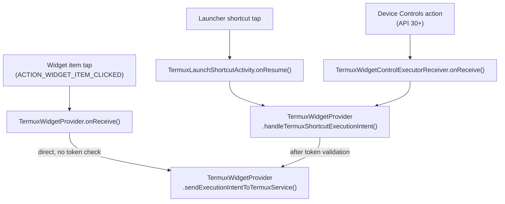
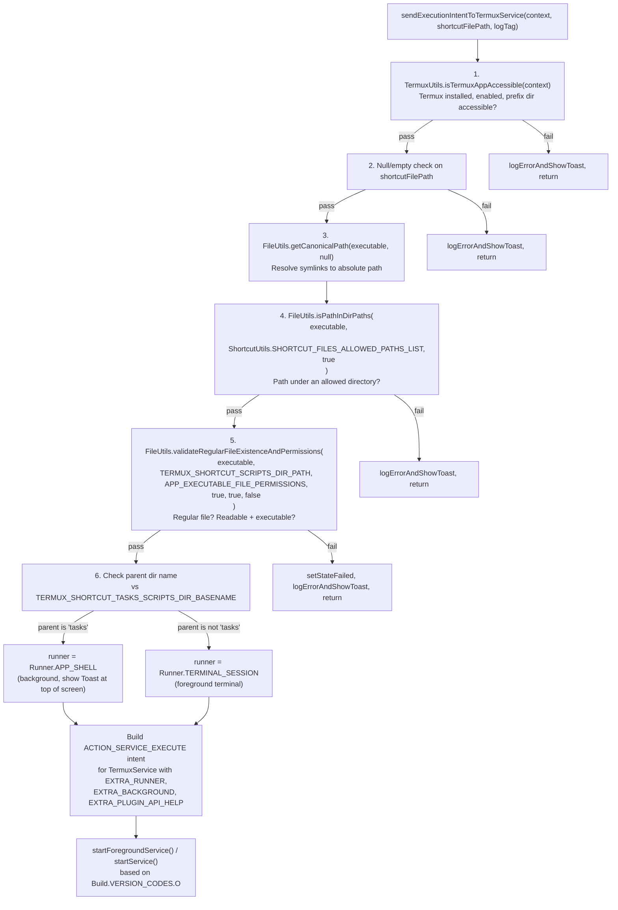
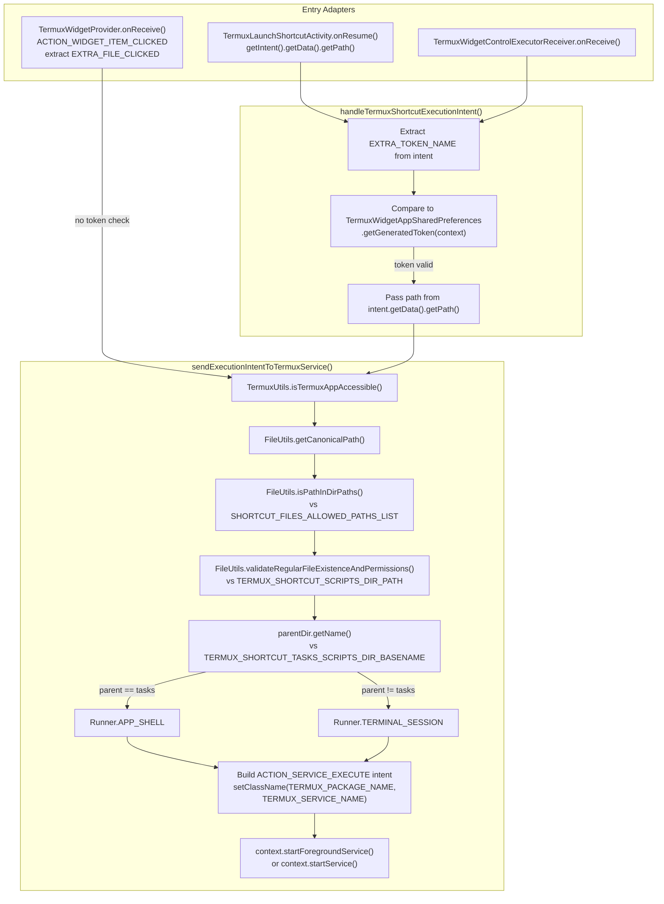

<!-- source: DeepWiki mcp.deepwiki.com · repo termux/termux-widget · page 3.2 Script Execution Pipeline · fetched 2026-10-26 -->

# Script Execution Pipeline

<details>
<summary>Relevant source files</summary>

The following files were used as context for generating this wiki page:

- [app/src/main/java/com/termux/widget/ShortcutFile.java](app/src/main/java/com/termux/widget/ShortcutFile.java)
- [app/src/main/java/com/termux/widget/TermuxLaunchShortcutActivity.java](app/src/main/java/com/termux/widget/TermuxLaunchShortcutActivity.java)
- [app/src/main/java/com/termux/widget/TermuxWidgetControlExecutorReceiver.java](app/src/main/java/com/termux/widget/TermuxWidgetControlExecutorReceiver.java)
- [app/src/main/java/com/termux/widget/TermuxWidgetProvider.java](app/src/main/java/com/termux/widget/TermuxWidgetProvider.java)
- [app/src/main/java/com/termux/widget/utils/ShortcutUtils.java](app/src/main/java/com/termux/widget/utils/ShortcutUtils.java)

</details>


## Purpose and Scope

This page documents the complete internal path a user action takes — from a widget tap, shortcut launch, or Device Controls action — through validation and intent construction, to the final `ACTION_SERVICE_EXECUTE` intent delivered to the Termux app's `TermuxService`.

This page covers only the **execution** path. For how the widget list is populated (file enumeration, `RemoteViews`), see [Widget Data Flow](#3.3). For how launcher shortcuts are created and managed, see [Shortcut Management Internals](#3.4). For the Android components involved, see [Android Components Reference](#3.1).

---

## Entry Points

Three distinct Android components act as entry points, all ultimately converging on the same core dispatch method in `TermuxWidgetProvider`.

| Entry Point | Android Component | User Action |
|---|---|---|
| Widget list item tap | `TermuxWidgetProvider` (`onReceive`) | Tapping a script name in the home screen widget |
| Launcher shortcut | `TermuxLaunchShortcutActivity` (`onResume`) | Tapping a pinned, static, or dynamic shortcut |
| Device Controls | `TermuxWidgetControlExecutorReceiver` (`onReceive`) | Tapping a control in the Android Power Menu (API 30+) |

**Entry point diagram — Entry Points to Core Methods**



Sources: [app/src/main/java/com/termux/widget/TermuxWidgetProvider.java:136-202](), [app/src/main/java/com/termux/widget/TermuxLaunchShortcutActivity.java:14-22](), [app/src/main/java/com/termux/widget/TermuxWidgetControlExecutorReceiver.java:12-17]()

---

## Token Validation

Launcher shortcuts and Device Controls both go through `handleTermuxShortcutExecutionIntent()` before reaching the dispatch method. Widget taps bypass this step entirely and call `sendExecutionIntentToTermuxService()` directly, because the widget's `PendingIntent` is constructed internally and is not accessible to third parties.

`handleTermuxShortcutExecutionIntent()` extracts `TermuxConstants.TERMUX_WIDGET_APP.EXTRA_TOKEN_NAME` from the incoming intent and compares it against the stored value from `TermuxWidgetAppSharedPreferences.getGeneratedToken(context)`. If they do not match, the method logs a warning, shows `R.string.msg_bad_token` as a Toast, and returns without executing anything.

**How the token gets embedded**: `ShortcutFile.getExecutionIntent()` calls `TermuxWidgetAppSharedPreferences.getGeneratedToken(context)` at shortcut creation time and embeds the result as `EXTRA_TOKEN_NAME`. If the stored token changes after a shortcut was created, all previously created shortcuts will fail validation.

Sources: [app/src/main/java/com/termux/widget/TermuxWidgetProvider.java:238-249](), [app/src/main/java/com/termux/widget/ShortcutFile.java:86-93]()

---

## Validation and Dispatch Pipeline

`sendExecutionIntentToTermuxService()` is the single function responsible for all remaining validation and the final intent dispatch. It executes the following steps in order, aborting with a logged error and Toast on any failure.

**Validation pipeline diagram**



Sources: [app/src/main/java/com/termux/widget/TermuxWidgetProvider.java:257-354]()

### Step-by-Step Reference

| Step | Code Call | Failure Behavior |
|---|---|---|
| Termux accessibility | `TermuxUtils.isTermuxAppAccessible(context)` | Log error + Toast, return |
| Null/empty path | Direct null/empty check on `executionCommand.executable` | Log error + Toast, return |
| Canonical path | `FileUtils.getCanonicalPath(executable, null)` | Replaces path in-place; cannot fail |
| Allowed paths check | `FileUtils.isPathInDirPaths(executable, SHORTCUT_FILES_ALLOWED_PATHS_LIST, true)` | Log error + Toast with list of allowed dirs, return |
| File existence + permissions | `FileUtils.validateRegularFileExistenceAndPermissions(...)` | `executionCommand.setStateFailed(error)`, log + Toast, return |
| Runner selection | Compare parent dir name to `TERMUX_SHORTCUT_TASKS_SCRIPTS_DIR_BASENAME` | N/A — always resolves to one of the two runners |

Sources: [app/src/main/java/com/termux/widget/TermuxWidgetProvider.java:257-354]()

---

## Allowed Paths

The allowed paths check uses `ShortcutUtils.SHORTCUT_FILES_ALLOWED_PATHS_LIST`, a static list defined in `ShortcutUtils`.

```
SHORTCUT_FILES_ALLOWED_PATHS_LIST:
  - TermuxConstants.TERMUX_SHORTCUT_SCRIPTS_DIR_PATH   (~/.shortcuts)
  - TermuxConstants.TERMUX_DATA_HOME_DIR_PATH           (~/.termux)
```

A canonical path must be **under** one of these directories (with a path separator check enforced by the `true` argument to `isPathInDirPaths`). This prevents path traversal attacks where a symlink inside `.shortcuts/` could resolve to an arbitrary location outside of these roots.

Sources: [app/src/main/java/com/termux/widget/utils/ShortcutUtils.java:27-35](), [app/src/main/java/com/termux/widget/TermuxWidgetProvider.java:287-294]()

---

## File Permission Handling

`FileUtils.validateRegularFileExistenceAndPermissions()` is called with:
- `setPermissions = true`
- `setMissingPermissionsOnly = true`
- `ignoreErrorsIfPathIsInDirPath` set to `TERMUX_SHORTCUT_SCRIPTS_DIR_PATH`

This means: if the script is under `~/.shortcuts/`, the method will **auto-set** missing read and execute permissions rather than failing. If the script is under `~/.termux/` instead, missing permissions are treated as an error.

Sources: [app/src/main/java/com/termux/widget/TermuxWidgetProvider.java:299-309]()

---

## Runner Selection

After path validation, the pipeline determines whether the script runs in a terminal session (foreground) or as a background app shell.

```
if (parentDir.getName().equals(TERMUX_SHORTCUT_TASKS_SCRIPTS_DIR_BASENAME)):
    executionCommand.runner = Runner.APP_SHELL      // background
    show Toast at Gravity.TOP
else:
    executionCommand.runner = Runner.TERMINAL_SESSION  // foreground
```

`TERMUX_SHORTCUT_TASKS_SCRIPTS_DIR_BASENAME` is the basename of the `tasks` subdirectory (i.e., `~/.shortcuts/tasks/`). The background runner selection is triggered by the **parent directory name**, not the full path, which means any directory named `tasks` at any depth in the allowed paths will qualify.

The Toast for background tasks is displayed at `Gravity.TOP` to avoid being obscured by output from `termux-toast` calls within the script itself.

Sources: [app/src/main/java/com/termux/widget/TermuxWidgetProvider.java:312-328]()

---

## Execution Intent Construction

Once the runner is determined, the execution intent is built and dispatched:

| Intent Field | Value |
|---|---|
| Action | `TERMUX_SERVICE.ACTION_SERVICE_EXECUTE` |
| Data URI | `scheme = TERMUX_SERVICE.URI_SCHEME_SERVICE_EXECUTE`, path = canonical script path |
| Target component | `TermuxConstants.TERMUX_PACKAGE_NAME` / `TermuxConstants.TERMUX_APP.TERMUX_SERVICE_NAME` |
| `EXTRA_RUNNER` | `executionCommand.runner` (string name of runner) |
| `EXTRA_BACKGROUND` | `true` if runner is `APP_SHELL`, for backward compatibility |
| `EXTRA_PLUGIN_API_HELP` | Link to Termux:Widget GitHub repo for error messages |

The intent is dispatched using `context.startForegroundService()` on Android 8.0+ (API 26, `Build.VERSION_CODES.O`) and `context.startService()` on older versions.

Sources: [app/src/main/java/com/termux/widget/TermuxWidgetProvider.java:330-353]()

---

## Full Pipeline Diagram (Code Entity View)

This diagram maps system-level names to the exact code entities involved across all three entry points.



Sources: [app/src/main/java/com/termux/widget/TermuxWidgetProvider.java:136-354](), [app/src/main/java/com/termux/widget/TermuxLaunchShortcutActivity.java:14-22](), [app/src/main/java/com/termux/widget/TermuxWidgetControlExecutorReceiver.java:12-17](), [app/src/main/java/com/termux/widget/utils/ShortcutUtils.java:27-35]()

---

