# Page: Overview

# Overview

<details>
<summary>Relevant source files</summary>

The following files were used as context for generating this wiki page:

- [LICENSE.md](LICENSE.md)
- [README.md](README.md)
- [app/src/main/AndroidManifest.xml](app/src/main/AndroidManifest.xml)
- [app/src/main/res/drawable-anydpi-v26/ic_launcher.xml](app/src/main/res/drawable-anydpi-v26/ic_launcher.xml)
- [app/src/main/res/drawable/ic_foreground.xml](app/src/main/res/drawable/ic_foreground.xml)
- [app/src/main/res/values/strings.xml](app/src/main/res/values/strings.xml)
- [termux-widget.png](termux-widget.png)

</details>


This page introduces the Termux:Widget repository — what the plugin does, how it fits into the Termux ecosystem, and a summary of its major components and architecture. For installation steps, see [Installation](#2.1). For detailed filesystem layout, see [Script Directories](#2.2). For a full technical breakdown of each component, see [Architecture](#3).

---

## What Is Termux:Widget?

Termux:Widget (`com.termux.widget`) is an Android plugin application for the [Termux](https://termux.com) terminal emulator. It provides three mechanisms for launching Termux shell scripts directly from the Android home screen or system UI, without opening the Termux app manually:

| Mechanism | Android Feature Used | Min API |
|---|---|---|
| Home screen widget | `AppWidgetProvider` / `RemoteViewsService` | Any |
| Launcher shortcuts (static, pinned, dynamic) | `ShortcutManager` | 25 (Android 7.1) |
| Device Controls (Power Menu) | `ControlsProviderService` | 30 (Android 11) |

The plugin does **not** execute scripts itself. It dispatches execution intents to the Termux app's `TermuxService`, which handles the actual process lifecycle. The plugin's responsibility is to enumerate scripts from the filesystem, present them in the UI, validate paths and permissions, and forward a structured `ACTION_SERVICE_EXECUTE` intent to Termux.

Sources: [README.md:1-10](), [app/src/main/res/values/strings.xml:12-14]()

---

## Position in the Termux Ecosystem

Termux:Widget shares the same Linux user ID as the Termux app via `android:sharedUserId="${TERMUX_PACKAGE_NAME}"`, declared in [app/src/main/AndroidManifest.xml:4](). This shared UID gives the widget access to Termux's home directory (`/data/data/com.termux/files/home/`) where script directories reside.

**Relationship diagram: Termux:Widget ↔ Termux App**

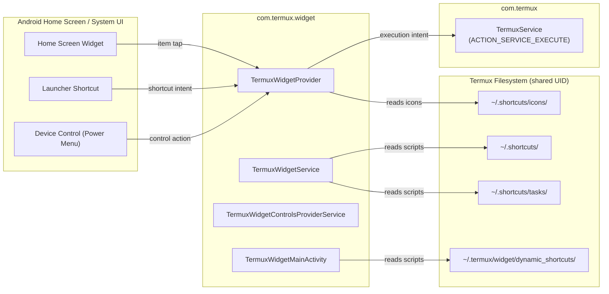

Sources: [app/src/main/AndroidManifest.xml:1-104](), [README.md:55-90]()

---

## Script Directories

Termux:Widget reads scripts from fixed filesystem locations inside the Termux home directory. These must exist and have correct permissions before the plugin can display or run scripts.

| Directory | Purpose |
|---|---|
| `~/.shortcuts/` | Scripts run in a foreground Termux terminal session |
| `~/.shortcuts/tasks/` | Scripts run as background tasks (shown in Termux notification) |
| `~/.shortcuts/icons/` | PNG icon files for shortcuts, named `<script_name>.png` |
| `~/.termux/widget/dynamic_shortcuts/` | Scripts published as Android dynamic shortcuts |

Files inside hidden subdirectories (names starting with `.`), broken symlinks, or files whose canonical path is not under `~/.shortcuts` or `~/.termux` are excluded from display and execution.

Sources: [README.md:61-100](), [app/src/main/res/values/strings.xml:7-9]()

---

## Major Android Components

The following table lists every Android component declared in [app/src/main/AndroidManifest.xml]().

**Component summary diagram**

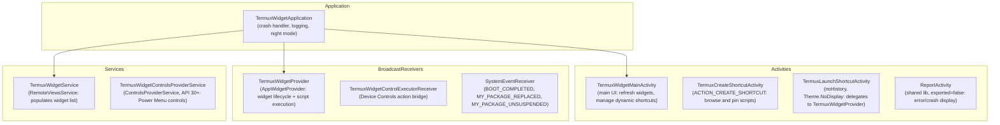

| Component | Type | Role |
|---|---|---|
| `TermuxWidgetApplication` | `Application` | App initialization: crash handler, log level, night mode |
| `TermuxWidgetMainActivity` | `Activity` | Main UI; refresh all widgets; create/remove dynamic shortcuts |
| `TermuxWidgetLauncherActivity` | Activity alias | Launcher icon entry point (alias for `TermuxWidgetMainActivity`) |
| `TermuxCreateShortcutActivity` | `Activity` | Handles `ACTION_CREATE_SHORTCUT`; browses `~/.shortcuts/` to create pinned shortcuts |
| `TermuxLaunchShortcutActivity` | `Activity` | Invisible activity; receives shortcut launch intents and delegates to `TermuxWidgetProvider` |
| `TermuxWidgetProvider` | `AppWidgetProvider` | Widget lifecycle; dispatches `sendExecutionIntentToTermuxService()` |
| `TermuxWidgetControlExecutorReceiver` | `BroadcastReceiver` | Receives Device Controls actions; calls `handleTermuxShortcutExecutionIntent()` |
| `SystemEventReceiver` | `BroadcastReceiver` | Triggers widget refresh on boot, package replace, and unsuspend events |
| `TermuxWidgetService` | `RemoteViewsService` | Provides the `RemoteViews` list for the home screen widget |
| `TermuxWidgetControlsProviderService` | `ControlsProviderService` | Enumerates scripts as Android 11+ Device Controls |
| `ReportActivity` | `Activity` (shared lib) | Displays error/crash reports; `exported=false` |

Sources: [app/src/main/AndroidManifest.xml:1-104]()

---

## High-Level Architecture

**Script execution paths: from user action to Termux**

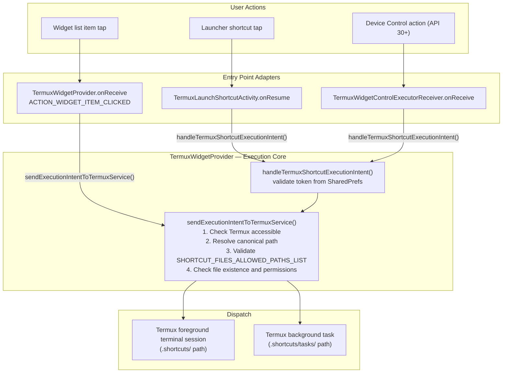

**Widget data population path**

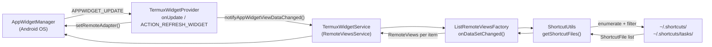

Sources: [app/src/main/AndroidManifest.xml:1-104](), [README.md:55-90]()

---

## Key Utility Classes

Beyond Android components, two utility classes underpin the plugin's core logic:

| Class | File | Role |
|---|---|---|
| `ShortcutFile` | `app/src/main/java/…/ShortcutFile.java` | Models a single script file; resolves icon from `~/.shortcuts/icons/` |
| `ShortcutUtils` | `app/src/main/java/…/ShortcutUtils.java` | Enumerates and filters script files; interacts with `ShortcutManager` to create/remove shortcuts |

These are used by `TermuxWidgetService`, `TermuxCreateShortcutActivity`, and `TermuxWidgetMainActivity` to translate filesystem entries into Android shortcuts and widget list entries.

Sources: [app/src/main/res/values/strings.xml:61-95]()

---

## License

The repository is released under **GPLv3 only**. See [LICENSE.md:1-2]().

---

## Further Reading

- **User Guide** — [2](#2): end-user instructions for installation, setup, widgets, and shortcuts
- **Architecture** — [3](#3): full technical breakdown of every component and data flow
- **Build System** — [4](#4): Gradle configuration and CI/CD workflows
- **Contributing** — [5](#5): bug reports, feature requests, and security policy

---

# Page: User Guide

# User Guide

<details>
<summary>Relevant source files</summary>

The following files were used as context for generating this wiki page:

- [LICENSE.md](LICENSE.md)
- [README.md](README.md)
- [app/src/main/res/values/strings.xml](app/src/main/res/values/strings.xml)
- [termux-widget.png](termux-widget.png)

</details>


This page covers everything an end user needs to install, configure, and operate Termux:Widget. It introduces the plugin's three primary user-facing features — the home screen widget, launcher shortcuts, and device controls — and links to the sub-sections that document each one in detail.

For internal architecture and component details, see [Architecture](#3). For build and CI information, see [Build System](#4).

---

## What Termux:Widget Does

Termux:Widget is an Android plugin for the [Termux](https://termux.com) app. It provides three mechanisms to trigger execution of scripts stored on the Termux filesystem, without needing to open a Termux terminal session first:

| Feature | Where it appears | Android component |
|---|---|---|
| Home screen widget | Launcher home screen | `TermuxWidgetProvider`, `TermuxWidgetService` |
| Launcher shortcuts | Long-press on app icon, pinned shortcuts | `TermuxCreateShortcutActivity`, `TermuxWidgetMainActivity` |
| Device controls | Power menu (Android 11+) | `TermuxWidgetControlsProviderService` |

All three features read scripts from specific directories under the Termux home directory (`~/`) and send an execution intent to the Termux app when a script is selected.

Sources: [README.md:1-17](), [app/src/main/res/values/strings.xml:1-97]()

---

## Prerequisites

Before using any feature of Termux:Widget, two conditions must be met:

1. **Termux app installed and initialized.** The Termux prefix directory `/data/data/com.termux/files/usr/` and home directory `/data/data/com.termux/files/home/` must both exist with `0700` permissions. Start the Termux app at least once to let it install bootstrap files.

2. **Script directories created.** The plugin reads scripts from `~/.shortcuts/` (foreground terminal sessions) and `~/.shortcuts/tasks/` (background tasks). These directories must exist with read and execute permissions before the plugin can display any scripts.

Detailed setup commands are in [Script Directories](#2.2).

Sources: [README.md:57-85]()

---

## Feature Overview

The diagram below maps the three user-facing features to their implementing Android components and the filesystem directories they read from.

**Termux:Widget Feature-to-Component Map**

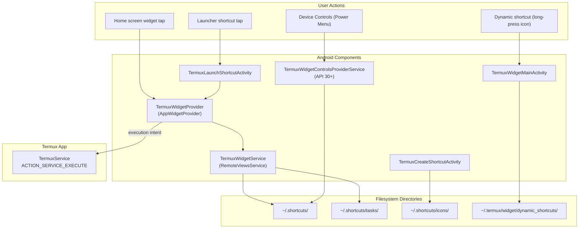

Sources: [README.md:55-120](), [app/src/main/res/values/strings.xml:17-59]()

---

## Setup and Usage Flow

The diagram below shows the sequence of steps a user takes from a fresh installation to running a script through each feature.

**End-to-End User Setup Flow**

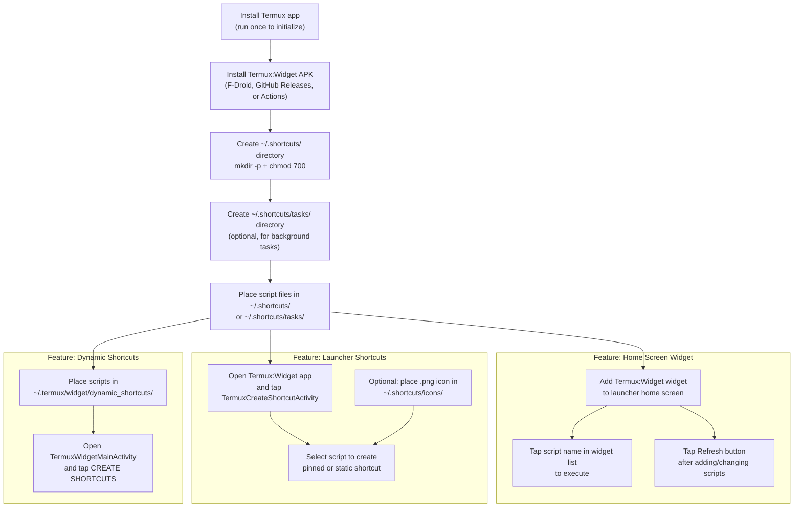

Sources: [README.md:55-120]()

---

## Sub-Sections

The following pages cover each area in detail:

| Page | Title | What it covers |
|---|---|---|
| [2.1](#2.1) | Installation | F-Droid, GitHub Releases, GitHub Actions APKs; deprecated Google Play |
| [2.2](#2.2) | Script Directories | `~/.shortcuts/`, `~/.shortcuts/tasks/`, `~/.shortcuts/icons/`, `~/.termux/widget/dynamic_shortcuts/`; permissions; hidden files; broken symlinks |
| [2.3](#2.3) | Home Screen Widget | Placing the widget; tapping scripts; the Refresh button; the empty-state view; refreshing via broadcast intent |
| [2.4](#2.4) | Launcher Shortcuts | Static, pinned, and dynamic shortcut types; creating and removing via `TermuxCreateShortcutActivity` and `TermuxWidgetMainActivity`; `max_shortcuts` limit; custom PNG icons |
| [2.5](#2.5) | Device Controls | Android 11+ Power Menu integration via `TermuxWidgetControlsProviderService`; adding controls; script execution |
| [2.6](#2.6) | Debugging and Troubleshooting | Log level configuration; `logcat` usage; `Draw Over Apps` permission on Android 10+; common error messages |

---

## Quick Reference: Key Directories

| Directory | Purpose | Required |
|---|---|---|
| `~/.shortcuts/` | Scripts run in foreground terminal sessions | Yes |
| `~/.shortcuts/tasks/` | Scripts run as background tasks | No |
| `~/.shortcuts/icons/` | Custom PNG icons for shortcuts (named `<script_name>.png`) | No |
| `~/.termux/widget/dynamic_shortcuts/` | Scripts published as dynamic shortcuts | No |

The parent directory of any script must have both read (`r`) and execute (`x`) permissions. Directories or files whose name starts with `.` are hidden from the widget and shortcut picker. Broken symlinks and files whose canonical path falls outside the allowed directories are also excluded.

Sources: [README.md:61-118](), [app/src/main/res/values/strings.xml:7-8]()

---

# Page: Installation

# Installation

<details>
<summary>Relevant source files</summary>

The following files were used as context for generating this wiki page:

- [.github/workflows/github_action_build.yml](.github/workflows/github_action_build.yml)
- [.github/workflows/github_release_build.yml](.github/workflows/github_release_build.yml)
- [LICENSE.md](LICENSE.md)
- [README.md](README.md)
- [termux-widget.png](termux-widget.png)

</details>


This page explains how to obtain and install the Termux:Widget APK, what prerequisites are required, and which distribution channels are active versus deprecated. It covers all three supported channels: F-Droid, GitHub Releases, and GitHub Actions artifacts.

For information on setting up script directories after installation, see [Script Directories](#2.2). For general usage, see the [User Guide](#2).

---

## Prerequisites

Termux:Widget is a plugin and **cannot function on its own**. Before installing, the following conditions must be met:

| Requirement | Details |
|---|---|
| Termux app installed | Must be from the **same source** as Termux:Widget (see compatibility note below) |
| Termux bootstrapped | Termux must have been started at least once so it installs its bootstrap files |
| Termux home directory exists | `/data/data/com.termux/files/home/` must exist with `rwx` permissions (`0700`) |
| Termux prefix directory exists | `/data/data/com.termux/files/usr/` must exist with `rwx` permissions (`0700`) |

Permissions and ownership can be verified from a Termux session with `stat <path>`.

> **APK source compatibility:** APKs produced by GitHub (both Releases and Actions) share the same debug signing key and are compatible with each other. They are **not** compatible with F-Droid APKs (which are signed by F-Droid's own key) or with each other across sources. Installing from a different source than your existing Termux app will require uninstalling the old app first.

Sources: [README.md:56-58]()

---

## Distribution Channels

**Distribution channel overview:**

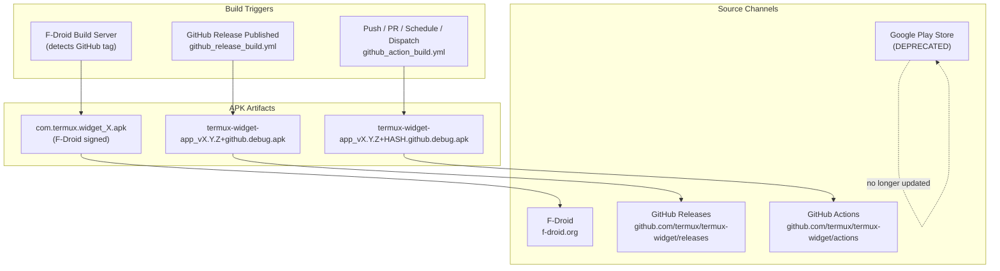

Sources: [README.md:22-50](), [.github/workflows/github_release_build.yml:1-65](), [.github/workflows/github_action_build.yml:1-76]()

---

### F-Droid

F-Droid builds and signs its own APKs independently, triggered when it detects a new GitHub tag in the repository metadata file. The Termux maintainers have no control over build timing or signing keys for the F-Droid channel.

Key points:
- APKs are downloadable directly from the F-Droid website without installing the F-Droid client app.
- There is typically a delay of several days to a week or more between a GitHub release and the F-Droid build becoming available.
- F-Droid app may not automatically notify of updates; a manual pull-to-refresh in the **Updates** tab may be required.
- Battery optimization should be disabled for the F-Droid client to allow background update checks.

Sources: [README.md:29-36]()

---

### GitHub Releases

Releases are published at `github.com/termux/termux-widget/releases` for versions `>= 0.13.0`. The APK is automatically built and attached to the release by the `github_release_build.yml` workflow [.github/workflows/github_release_build.yml:1-8]() when a new release is published.

**APK naming pattern for releases:**

```
termux-widget-app_v{VERSION}+github.debug.apk
```

For example, for version `0.15.0`:
```
termux-widget-app_v0.15.0+github.debug.apk
```

The version tag is validated against the semantic versioning 2.0.0 spec (`major.minor.patch(-prerelease)(+buildmetadata)`) before the build proceeds [.github/workflows/github_release_build.yml:32-34](). If validation fails, the workflow deletes the release and its tag automatically [.github/workflows/github_release_build.yml:22-27]().

Each release also includes a `checksums-sha256.txt` file for verifying APK integrity [.github/workflows/github_release_build.yml:52-56]().

Sources: [README.md:39-46](), [.github/workflows/github_release_build.yml:30-64]()

---

### GitHub Actions Artifacts

The `github_action_build.yml` workflow [.github/workflows/github_action_build.yml:1-76]() produces APKs for every push to `master`, every pull request against `master`, on a bimonthly schedule, and on manual dispatch.

**APK naming pattern for action artifacts:**

```
termux-widget-app_v{VERSION}+{SHORT_SHA}.github.debug.apk
```

For example:
```
termux-widget-app_v0.15.0+a1b2c3d.github.debug.apk
```

The `SHORT_SHA` is the first 7 characters of the commit SHA [.github/workflows/github_action_build.yml:35]().

**Important:** Artifact download links are only enabled for **logged-in GitHub accounts**. Users accessing GitHub via the GitHub mobile app must open the workflow URL in an external browser (Chrome, Firefox, etc.) where their GitHub account is already signed in, as the in-app browser may not be authenticated.

Each artifact bundle contains three files:

| File | Purpose |
|---|---|
| `termux-widget-app_vX.Y.Z+HASH.github.debug.apk` | The installable APK |
| `checksums-sha256.txt` | SHA-256 hash for integrity verification |
| `output-metadata.json` | Gradle build metadata |

Sources: [README.md:40-45](), [.github/workflows/github_action_build.yml:40-75]()

---

### Google Play Store (Deprecated)

> **The Google Play Store channel is no longer maintained and should not be used.**

Termux and its plugin apps, including Termux:Widget, are no longer updated on the Google Play Store due to Android 10 compatibility issues. The Play Store listing (`com.termux.widget`) exists but receives no updates. It is strongly recommended to uninstall any Play Store version and migrate to F-Droid or GitHub.

Sources: [README.md:48-51]()

---

## APK Compatibility Matrix

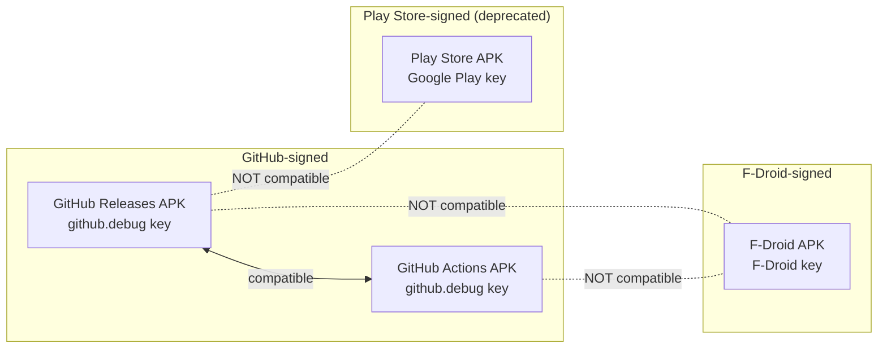

| Source A | Source B | Compatible? |
|---|---|---|
| GitHub Releases | GitHub Actions | ✓ Yes (same debug key) |
| GitHub Releases | F-Droid | ✗ No (different signing keys) |
| GitHub Actions | F-Droid | ✗ No (different signing keys) |
| Any of the above | Google Play | ✗ No (deprecated + different key) |

The APKs produced by both GitHub workflows are marked [`debuggable`](https://developer.android.com/studio/debug) [README.md:46](). Both Termux and Termux:Widget must come from the same source channel.

Sources: [README.md:46-50](), [.github/workflows/github_action_build.yml:40-42](), [.github/workflows/github_release_build.yml:36-38]()

---

# Page: Script Directories

# Script Directories

<details>
<summary>Relevant source files</summary>

The following files were used as context for generating this wiki page:

- [LICENSE.md](LICENSE.md)
- [README.md](README.md)
- [app/src/main/java/com/termux/widget/utils/ShortcutUtils.java](app/src/main/java/com/termux/widget/utils/ShortcutUtils.java)
- [app/src/main/res/values/strings.xml](app/src/main/res/values/strings.xml)
- [termux-widget.png](termux-widget.png)

</details>


This page documents the filesystem layout that Termux:Widget requires to discover and execute scripts. It covers each directory's purpose, required permissions, and how the plugin filters files within them. For how scripts are actually executed once found, see [Script Execution Pipeline](#3.2). For how the widget displays scripts from these directories, see [Widget Data Flow](#3.3). For how launcher shortcuts are created from these directories, see [Shortcut Management Internals](#3.4).

---

## Directory Overview

Termux:Widget reads scripts from two root locations in the Termux home directory (`~/`, i.e. `/data/data/com.termux/files/home/`):

| Directory | Absolute Path | Purpose |
|---|---|---|
| `~/.shortcuts/` | `/data/data/com.termux/files/home/.shortcuts/` | Foreground terminal session scripts |
| `~/.shortcuts/tasks/` | `/data/data/com.termux/files/home/.shortcuts/tasks/` | Background task scripts |
| `~/.shortcuts/icons/` | `/data/data/com.termux/files/home/.shortcuts/icons/` | Custom PNG icons for shortcuts |
| `~/.termux/widget/dynamic_shortcuts/` | `/data/data/com.termux/files/home/.termux/widget/dynamic_shortcuts/` | Scripts for dynamic launcher shortcuts |

The first two directories are mandatory for the widget to function. The icons and dynamic shortcuts directories are optional.

Sources: [README.md:61-88](), [app/src/main/res/values/strings.xml:7-8]()

---

## Directory Descriptions

### `~/.shortcuts/` — Foreground Scripts

Scripts placed directly in `~/.shortcuts/` (or in subdirectories of it, up to a depth of 5) are shown in the home screen widget list and are available for pinned/static shortcut creation. When executed, they run in a **foreground terminal session** inside the Termux app.

The `icons` subdirectory is explicitly excluded from enumeration; see the `SHORTCUT_FILES_FILTER` in [app/src/main/java/com/termux/widget/utils/ShortcutUtils.java:37-55]().

### `~/.shortcuts/tasks/` — Background Task Scripts

Scripts in `~/.shortcuts/tasks/` are also enumerated by the widget and shown in the list. When executed, they run as **background tasks** and appear as running tasks in the Termux notification. No foreground terminal window is opened.

The distinction between foreground and background execution is determined by whether the resolved canonical script path falls under `~/.shortcuts/tasks/`. This check is performed inside `TermuxWidgetProvider` during dispatch.

### `~/.shortcuts/icons/` — Shortcut Icons

This directory holds optional PNG icon files used when creating launcher shortcuts. The icon filename must match the script name with a `.png` suffix appended (e.g., a script named `backup.sh` uses the icon `backup.sh.png`).

- Recommended size: `96×96px` for 1080p screens; `144px` or `196px` for higher resolutions.
- The file must be a regular file (not a symlink to outside the allowed paths).
- The parent directory must have read permission.

The allowed paths for icon files are defined in `ShortcutUtils.SHORTCUT_ICONS_FILES_ALLOWED_PATHS_LIST` [app/src/main/java/com/termux/widget/utils/ShortcutUtils.java:33-35]().

### `~/.termux/widget/dynamic_shortcuts/` — Dynamic Shortcut Scripts

Scripts placed in this directory are used exclusively by `TermuxWidgetMainActivity` to populate **dynamic shortcuts** (shown when long-pressing the app launcher icon). This directory is not enumerated for the home screen widget. Dynamic shortcuts are created or removed manually via the app UI.

Sources: [README.md:61-120](), [app/src/main/java/com/termux/widget/utils/ShortcutUtils.java:28-35]()

---

## Required Permissions

Each directory must have specific Unix permissions set, or the plugin will fail silently (no scripts shown, or errors like `No regular file found at path` on execution).

| Directory | Required Permission | Numeric |
|---|---|---|
| `~/.shortcuts/` | read + execute | `0700` (recommended) |
| `~/.shortcuts/tasks/` | read + execute | `0700` (recommended) |
| `~/.shortcuts/icons/` | read | `0700` for dir, `0600` for files |
| Script files | read + execute | — |

The **read** permission on the parent directory is required for the plugin to enumerate the files. The **execute** permission on the parent directory is required for script execution to be permitted. Both are checked during script dispatch in `TermuxWidgetProvider`.

**Setup commands** (run in a non-root Termux session):

```sh
mkdir -p /data/data/com.termux/files/home/.shortcuts
chmod 700 -R /data/data/com.termux/files/home/.shortcuts

mkdir -p /data/data/com.termux/files/home/.shortcuts/tasks
chmod 700 -R /data/data/com.termux/files/home/.shortcuts/tasks

mkdir -p /data/data/com.termux/files/home/.shortcuts/icons
chmod -R a-x,u=rwX,go-rwx /data/data/com.termux/files/home/.shortcuts/icons
```

Sources: [README.md:69-110]()

---

## File Enumeration and Filtering

The class `ShortcutUtils` in [app/src/main/java/com/termux/widget/utils/ShortcutUtils.java]() is responsible for all file discovery. Two key constants control which paths are valid:

**Allowed paths for script files** (`SHORTCUT_FILES_ALLOWED_PATHS_LIST`):
- `TermuxConstants.TERMUX_SHORTCUT_SCRIPTS_DIR_PATH` (`~/.shortcuts/`)
- `TermuxConstants.TERMUX_DATA_HOME_DIR_PATH` (`~/.termux/`)

**Allowed paths for icon files** (`SHORTCUT_ICONS_FILES_ALLOWED_PATHS_LIST`):
- `TermuxConstants.TERMUX_SHORTCUT_SCRIPT_ICONS_DIR_PATH` (`~/.shortcuts/icons/`)
- `TermuxConstants.TERMUX_DATA_HOME_DIR_PATH` (`~/.termux/`)

The static `SHORTCUT_FILES_FILTER` (`FileFilter`) applied during enumeration rejects any file matching any of the following conditions:

| Condition | Effect |
|---|---|
| Filename starts with `.` | Hidden file — excluded |
| File does not exist at canonical path (broken symlink) | Excluded |
| Canonical path not under `SHORTCUT_FILES_ALLOWED_PATHS_LIST` | Excluded |
| File is in the `icons` subdirectory of `~/.shortcuts/` | Excluded (icons dir suppressed from widget) |

[app/src/main/java/com/termux/widget/utils/ShortcutUtils.java:37-55]()

The recursive search is bounded by `TERMUX_SHORTCUTS_SCRIPTS_DIR_MAX_SEARCH_DEPTH = 5` [app/src/main/java/com/termux/widget/utils/ShortcutUtils.java:25](), preventing unbounded recursion into deeply nested directory trees.

When sorting, directories are listed after files and `NaturalOrderComparator` is used for filename ordering [app/src/main/java/com/termux/widget/utils/ShortcutUtils.java:72-78]().

Sources: [app/src/main/java/com/termux/widget/utils/ShortcutUtils.java:25-88]()

---

## Directory and Filter Diagram

**Directory Structure and Associated Code Entities**

```mermaid
graph TD
    HOME["\"~/ (Termux home)\n/data/data/com.termux/files/home/\""]

    HOME --> SD["\"TERMUX_SHORTCUT_SCRIPTS_DIR\n~/.shortcuts/\""]
    HOME --> TD["\"TERMUX_DATA_HOME_DIR\n~/.termux/\""]

    SD --> TASKS["\"~/.shortcuts/tasks/\n(background scripts)\""]
    SD --> ICONS["\"TERMUX_SHORTCUT_SCRIPT_ICONS_DIR\n~/.shortcuts/icons/\n(excluded from widget)\""]
    SD --> SCRIPTS["\"*.sh / any executable\n(foreground scripts)\""]

    TD --> DYN["\"~/.termux/widget/dynamic_shortcuts/\n(dynamic shortcut scripts)\""]

    SHORTCUT_FILES_ALLOWED_PATHS_LIST["\"SHORTCUT_FILES_ALLOWED_PATHS_LIST\n[TERMUX_SHORTCUT_SCRIPTS_DIR_PATH,\n TERMUX_DATA_HOME_DIR_PATH]\""]
    SHORTCUT_ICONS_FILES_ALLOWED_PATHS_LIST["\"SHORTCUT_ICONS_FILES_ALLOWED_PATHS_LIST\n[TERMUX_SHORTCUT_SCRIPT_ICONS_DIR_PATH,\n TERMUX_DATA_HOME_DIR_PATH]\""]

    SD -->|"validated by"| SHORTCUT_FILES_ALLOWED_PATHS_LIST
    TD -->|"validated by"| SHORTCUT_FILES_ALLOWED_PATHS_LIST
    ICONS -->|"validated by"| SHORTCUT_ICONS_FILES_ALLOWED_PATHS_LIST
```

Sources: [app/src/main/java/com/termux/widget/utils/ShortcutUtils.java:28-35]()

---

**File Filtering Logic in `SHORTCUT_FILES_FILTER`**

```mermaid
flowchart TD
    START["\"File candidate from listFiles()\""]
    START --> H{"\"Name starts\nwith '.'?\""}
    H -->|"yes"| REJECT1["\"Reject\n(hidden file)\""]
    H -->|"no"| E{"\"Canonical path\nexists?\""}
    E -->|"no"| REJECT2["\"Reject\n(broken symlink)\""]
    E -->|"yes"| P{"\"Path under\nSHORTCUT_FILES_ALLOWED_PATHS_LIST?\""}
    P -->|"no"| REJECT3["\"Reject\n(outside allowed paths)\""]
    P -->|"yes"| IC{"\"Parent is TERMUX_SHORTCUT_SCRIPTS_DIR\nand name is icons?\""}
    IC -->|"yes"| REJECT4["\"Reject\n(icons dir suppressed)\""]
    IC -->|"no"| ACCEPT["\"Accept\""]
    ACCEPT --> DIR{"\"Is directory?\""}
    DIR -->|"yes"| RECURSE["\"Recurse if depth\n<= MAX_SEARCH_DEPTH (5)\""]
    DIR -->|"no"| ADD["\"Add as ShortcutFile\""]
```

Sources: [app/src/main/java/com/termux/widget/utils/ShortcutUtils.java:37-88]()

---

## Symlinks

Symlinks **within** the allowed directory trees are supported, with one important constraint: the symlink's **canonical (resolved) path** must itself be under one of the entries in `SHORTCUT_FILES_ALLOWED_PATHS_LIST`. A symlink pointing outside these directories will be rejected by `SHORTCUT_FILES_FILTER` at the path-validation step.

Broken symlinks (where the target does not exist) are also rejected, via the `FileUtils.fileExists(path, true)` call in the filter [app/src/main/java/com/termux/widget/utils/ShortcutUtils.java:42]().

**Note on SAF access:** The Android default Storage Access Framework (SAF) document picker may not display hidden directories like `~/.shortcuts` (which begins with a dot). As a workaround, a non-hidden symlink to the directory can be created:

```sh
ln -s "/data/data/com.termux/files/home/.shortcuts" \
      "/data/data/com.termux/files/home/shortcuts_sym"
```

Sources: [README.md:183-184](), [app/src/main/java/com/termux/widget/utils/ShortcutUtils.java:42-45]()

---

# Page: Home Screen Widget

# Home Screen Widget

<details>
<summary>Relevant source files</summary>

The following files were used as context for generating this wiki page:

- [.gitignore](.gitignore)
- [LICENSE.md](LICENSE.md)
- [README.md](README.md)
- [app/src/main/java/com/termux/widget/TermuxWidgetProvider.java](app/src/main/java/com/termux/widget/TermuxWidgetProvider.java)
- [app/src/main/res/drawable/widget_preview.png](app/src/main/res/drawable/widget_preview.png)
- [app/src/main/res/layout/widget_item.xml](app/src/main/res/layout/widget_item.xml)
- [app/src/main/res/layout/widget_layout.xml](app/src/main/res/layout/widget_layout.xml)
- [app/src/main/res/xml/termux_appwidget_info.xml](app/src/main/res/xml/termux_appwidget_info.xml)
- [termux-widget.png](termux-widget.png)

</details>


This page covers the home screen widget provided by Termux:Widget — how to place it, what it displays, how script execution is triggered from it, the empty-state and refresh behaviors, and how to programmatically refresh it via broadcast. For the underlying data flow between `TermuxWidgetProvider`, `TermuxWidgetService`, and `ListRemoteViewsFactory`, see page [3.3](). For the script directory layout that determines what appears in the list, see page [2.2]().

---

## Overview

The home screen widget renders a scrollable list of scripts found under `~/.shortcuts/`. Tapping any script entry sends an execution intent to the Termux app. A refresh button in the widget header triggers a re-scan of the shortcuts directory. If no scripts are found, an empty-state message is shown in place of the list.

**Widget metadata** is declared in [app/src/main/res/xml/termux_appwidget_info.xml:1-14]():

| Attribute | Value |
|---|---|
| `minHeight` | 110dp |
| `minWidth` | 110dp |
| `resizeMode` | horizontal\|vertical |
| `updatePeriodMillis` | 0 (no automatic polling) |
| `widgetCategory` | home\_screen\|keyguard |
| `previewImage` | `@drawable/widget_preview` |
| `initialLayout` | `@layout/widget_layout` |

The widget does **not** auto-update on a timer (`updatePeriodMillis="0"`). All refreshes are user-initiated or broadcast-triggered.

Sources: [app/src/main/res/xml/termux_appwidget_info.xml:1-14]()

---

## Placing the Widget

1. Long-press an empty area on the home screen.
2. Select **Widgets** from the launcher menu.
3. Find **Termux:Widget** and drag it onto the home screen.
4. The widget is resizable both horizontally and vertically.

When the first widget instance is added, `TermuxWidgetProvider.onEnabled()` runs and immediately checks whether the Termux app is accessible. If it is not installed or not running, an error toast is shown.

Sources: [app/src/main/java/com/termux/widget/TermuxWidgetProvider.java:51-58]()

---

## Widget Layout

**Widget layout structure (`widget_layout.xml`)**

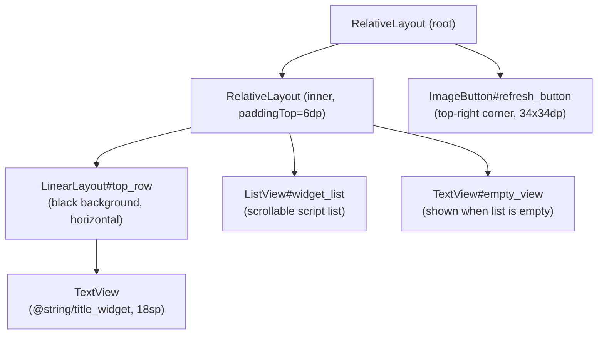

Sources: [app/src/main/res/layout/widget_layout.xml:1-63]()

Each row in `#widget_list` is inflated from `widget_item.xml`, which contains a single `TextView#widget_item` inside a `FrameLayout#widget_item_layout` with a ripple touch feedback drawable.

Sources: [app/src/main/res/layout/widget_item.xml:1-19]()

---

## Script List Population

**How the widget list is wired to script data**

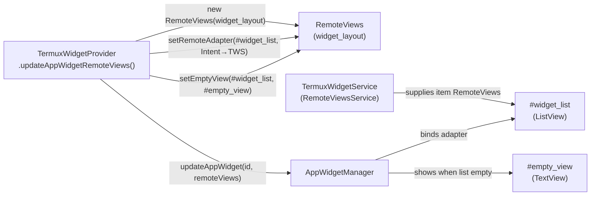

`updateAppWidgetRemoteViews()` in [app/src/main/java/com/termux/widget/TermuxWidgetProvider.java:81-123]() performs the full widget wiring:

1. Creates a `RemoteViews` from `R.layout.widget_layout`.
2. Calls `setEmptyView(R.id.widget_list, R.id.empty_view)` so the empty-state view appears automatically when the list has no items.
3. Sets the empty-state text to `R.string.msg_no_shortcut_scripts`.
4. Builds an `Intent` pointing to `TermuxWidgetService` with the `appWidgetId` embedded in both extras and `setData()` (required so Android distinguishes intents across multiple widget instances).
5. Calls `setRemoteAdapter(R.id.widget_list, intent)` to attach the service as the list's data source.
6. Registers a `PendingIntent` template on `#widget_list` for item click handling (see next section).

Sources: [app/src/main/java/com/termux/widget/TermuxWidgetProvider.java:81-123]()

---

## Empty-State View

When `~/.shortcuts/` contains no eligible scripts (or the directory is unreadable), `#widget_list` has zero items. Android automatically shows `#empty_view` (the `TextView` declared as a sibling of the `ListView` in the layout) because `setEmptyView()` was called.

The empty-state text is set via:

```
remoteViews.setTextViewText(R.id.empty_view, context.getString(R.string.msg_no_shortcut_scripts));
```

[app/src/main/java/com/termux/widget/TermuxWidgetProvider.java:88-89]()

The layout also has a second text value (`@string/msg_refresh_widget_from_app`) set as the XML default on `#empty_view`, which suggests refreshing from inside the app if the widget is unresponsive.

Sources: [app/src/main/res/layout/widget_layout.xml:41-51](), [app/src/main/java/com/termux/widget/TermuxWidgetProvider.java:88-89]()

---

## Tapping a Script to Run It

**Click event path from widget item to Termux execution**

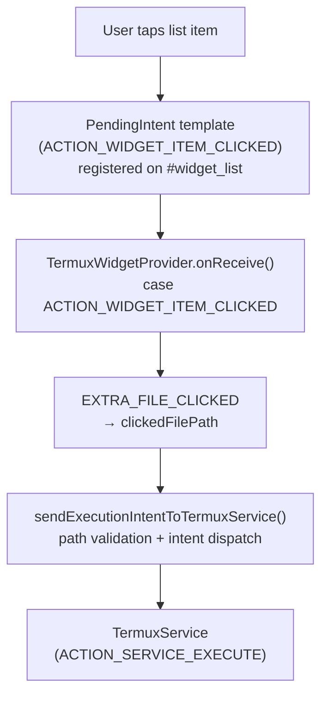

The item-click mechanism uses Android's `PendingIntent` template pattern (required for collection widgets):

- A broadcast `PendingIntent` with action `ACTION_WIDGET_ITEM_CLICKED` is set as the template on the list via `setPendingIntentTemplate()`.
- Each list item sets a `fillInIntent` carrying `EXTRA_FILE_CLICKED` with the script's path. `TermuxWidgetService` (via `ListRemoteViewsFactory`) populates this per-item intent.
- When an item is tapped, Android merges the template and fill-in intent and fires the broadcast.

`TermuxWidgetProvider.onReceive()` handles `ACTION_WIDGET_ITEM_CLICKED` at [app/src/main/java/com/termux/widget/TermuxWidgetProvider.java:152-165]():

1. Reads `EXTRA_FILE_CLICKED` from the intent.
2. Rejects null, empty, or directory paths.
3. Delegates to `sendExecutionIntentToTermuxService()`.

`sendExecutionIntentToTermuxService()` at [app/src/main/java/com/termux/widget/TermuxWidgetProvider.java:257-354]() applies the full validation pipeline before dispatching:

| Step | Check |
|---|---|
| Termux accessible | `TermuxUtils.isTermuxAppAccessible()` |
| Path not null/empty | Guard before `getCanonicalPath()` |
| Canonical path under allowed dirs | `FileUtils.isPathInDirPaths()` against `SHORTCUT_FILES_ALLOWED_PATHS_LIST` |
| File existence and permissions | `FileUtils.validateRegularFileExistenceAndPermissions()` |
| Foreground vs. background runner | Parent directory name equals `TERMUX_SHORTCUT_TASKS_SCRIPTS_DIR_BASENAME` → `APP_SHELL`; otherwise → `TERMINAL_SESSION` |

Scripts under `~/.shortcuts/tasks/` run as background tasks (`Runner.APP_SHELL`) and display a toast at the top of the screen (to avoid blocking `termux-toast` output). All other scripts open a foreground terminal session (`Runner.TERMINAL_SESSION`).

Sources: [app/src/main/java/com/termux/widget/TermuxWidgetProvider.java:109-165](), [app/src/main/java/com/termux/widget/TermuxWidgetProvider.java:257-354]()

---

## Refresh Button

The `ImageButton#refresh_button` sits in the top-right corner of the widget ([app/src/main/res/layout/widget_layout.xml:54-62]()). Its `PendingIntent` is configured in `updateAppWidgetRemoteViews()`:

- Action: `TERMUX_WIDGET_PROVIDER.ACTION_REFRESH_WIDGET`
- Extras: `EXTRA_APPWIDGET_ID` = the widget's specific ID
- The intent's `setData()` is set from `toUri()` to ensure uniqueness per widget instance.

When tapped, `onReceive()` handles `ACTION_REFRESH_WIDGET` at [app/src/main/java/com/termux/widget/TermuxWidgetProvider.java:167-191]():

1. Validates that the Termux app is accessible (shows a toast if not).
2. Reads `EXTRA_APPWIDGET_ID` from the intent.
3. Calls `refreshAppWidgets()` with the single widget ID and `updateRemoteViews = false` (no need to rebuild the `RemoteViews` structure when the user pressed the button directly).
4. Shows a toast with the refreshed widget ID (`R.string.msg_widgets_refreshed`).

`refreshAppWidgets()` at [app/src/main/java/com/termux/widget/TermuxWidgetProvider.java:204-217]() calls:

```
AppWidgetManager.getInstance(context).notifyAppWidgetViewDataChanged(appWidgetId, R.id.widget_list);
```

This signals `TermuxWidgetService` to call `onDataSetChanged()` on its `ListRemoteViewsFactory`, which re-reads the `~/.shortcuts/` directory and rebuilds the item list.

Sources: [app/src/main/java/com/termux/widget/TermuxWidgetProvider.java:99-108](), [app/src/main/java/com/termux/widget/TermuxWidgetProvider.java:167-217]()

---

## Refreshing Widgets via Broadcast

Widgets can be refreshed programmatically from a Termux terminal session or script using `am broadcast`. This is useful in automation, or when the widget becomes unresponsive after an app update.

**Refresh a specific widget by ID:**

```
am broadcast -n com.termux.widget/.TermuxWidgetProvider \
  -a com.termux.widget.ACTION_REFRESH_WIDGET \
  --ei appWidgetId <id>
```

**Refresh all widgets (pass ID = 0 or omit a valid ID):**

```
am broadcast -n com.termux.widget/.TermuxWidgetProvider \
  -a com.termux.widget.ACTION_REFRESH_WIDGET \
  --ei appWidgetId 0
```

The widget ID shown in the "Termux widgets reloaded" toast when you press the refresh button is the value to use for `<id>`.

When `appWidgetId` resolves to `AppWidgetManager.INVALID_APPWIDGET_ID` (which `0` maps to internally), `onReceive()` at [app/src/main/java/com/termux/widget/TermuxWidgetProvider.java:170-184]() queries `AppWidgetManager` for all active widget IDs of `TermuxWidgetProvider` and refreshes each one. In this path, `updateRemoteViews = true`, which rebuilds the full `RemoteViews` structure for each widget — this also recovers widgets that lost their click handlers or adapter bindings.

The internal API for refreshing all widgets programmatically from within the app is `sendIntentToRefreshAllWidgets()` at [app/src/main/java/com/termux/widget/TermuxWidgetProvider.java:219-230](), which sends the same broadcast with `INVALID_APPWIDGET_ID`.

Sources: [app/src/main/java/com/termux/widget/TermuxWidgetProvider.java:167-230](), [README.md:87-87]()

---

## Widget Lifecycle Summary

**`TermuxWidgetProvider` method roles**

```mermaid
flowchart TD
    onEnabled["onEnabled()\nChecks Termux accessibility on first instance"]
    onUpdate["onUpdate()\nCalled by system on add or periodic update\n→ updateAppWidgetRemoteViews() for each ID"]
    onReceive["onReceive()\nDispatch hub for all broadcast actions"]
    refresh["ACTION_REFRESH_WIDGET\n→ refreshAppWidgets()\n→ notifyAppWidgetViewDataChanged()"]
    click["ACTION_WIDGET_ITEM_CLICKED\n→ sendExecutionIntentToTermuxService()"]
    sysupdate["ACTION_APPWIDGET_UPDATE\n→ refreshAppWidgets() (updateRemoteViews=true)"]
    onDeleted["onDeleted()\nLogs deletion (no cleanup needed)"]
    onDisabled["onDisabled()\nLogs last instance removed"]

    onEnabled --> onUpdate
    onUpdate --> onReceive
    onReceive --> refresh
    onReceive --> click
    onReceive --> sysupdate
    onReceive --> onDeleted
    onReceive --> onDisabled
```

| Method | Trigger | Action |
|---|---|---|
| `onEnabled` | First widget instance added | Check Termux accessibility |
| `onUpdate` | System update cycle or widget added | Call `updateAppWidgetRemoteViews()` per ID |
| `onReceive` → `ACTION_APPWIDGET_UPDATE` | System broadcast | `refreshAppWidgets(updateRemoteViews=true)` |
| `onReceive` → `ACTION_REFRESH_WIDGET` | Refresh button or `am broadcast` | `refreshAppWidgets()` + toast |
| `onReceive` → `ACTION_WIDGET_ITEM_CLICKED` | Item tap | `sendExecutionIntentToTermuxService()` |
| `onDeleted` | Widget instance removed | Log only |
| `onDisabled` | Last widget instance removed | Log only |

Sources: [app/src/main/java/com/termux/widget/TermuxWidgetProvider.java:51-202]()

---

# Page: Launcher Shortcuts

# Launcher Shortcuts

<details>
<summary>Relevant source files</summary>

The following files were used as context for generating this wiki page:

- [LICENSE.md](LICENSE.md)
- [README.md](README.md)
- [app/src/main/java/com/termux/widget/TermuxCreateShortcutActivity.java](app/src/main/java/com/termux/widget/TermuxCreateShortcutActivity.java)
- [app/src/main/java/com/termux/widget/activities/TermuxWidgetMainActivity.java](app/src/main/java/com/termux/widget/activities/TermuxWidgetMainActivity.java)
- [app/src/main/res/layout/activity_termux_create_shortcut.xml](app/src/main/res/layout/activity_termux_create_shortcut.xml)
- [app/src/main/res/layout/activity_termux_widget_main.xml](app/src/main/res/layout/activity_termux_widget_main.xml)
- [app/src/main/res/values/strings.xml](app/src/main/res/values/strings.xml)
- [termux-widget.png](termux-widget.png)

</details>


This page explains the three types of launcher shortcuts provided by Termux:Widget — static, pinned, and dynamic — and documents how to create and remove them, the system-imposed limit on shortcut count, and how to supply custom icons. For information about the home screen scrollable widget (which lists scripts in a widget panel rather than as individual launcher shortcuts), see [Home Screen Widget](#2.3). For internal implementation details of shortcut creation, see [Shortcut Management Internals](#3.4).

---

## Shortcut Types

Termux:Widget supports three distinct shortcut mechanisms, each backed by a different Android API.

| Type | Android API | Where it appears | How it is created |
|---|---|---|---|
| **Static** (legacy) | < API 26 (Android 8.0) | Home screen, via launcher intent | `TermuxCreateShortcutActivity` returns `RESULT_OK` with an intent |
| **Pinned** | ≥ API 26 (Android 8.0) | Home screen, user must confirm dialog | `ShortcutManager.requestPinShortcut()` |
| **Dynamic** | ≥ API 25 (Android 7.1) | Long-press app icon; launcher search | `ShortcutManager.addDynamicShortcuts()` |

---

## Creating Pinned and Static Shortcuts

**Entry point:** `TermuxCreateShortcutActivity`

This activity presents a browsable file list rooted at `~/.shortcuts/` (`TermuxConstants.TERMUX_SHORTCUT_SCRIPTS_DIR`). When a script file is selected, `createShortcut()` is called.

**Decision flow in `createShortcut()`** ([app/src/main/java/com/termux/widget/TermuxCreateShortcutActivity.java:107-129]()):

```
Build.VERSION.SDK_INT >= O  AND  isRequestPinShortcutSupported()
    → createPinnedShortcut()   (calls ShortcutManager.requestPinShortcut)
    else
    → createStaticShortcut()   (calls setResult(RESULT_OK, staticShortcutIntent))
```

The following diagram maps the user action to the code path for each shortcut type.

**Shortcut creation code paths in `TermuxCreateShortcutActivity`**

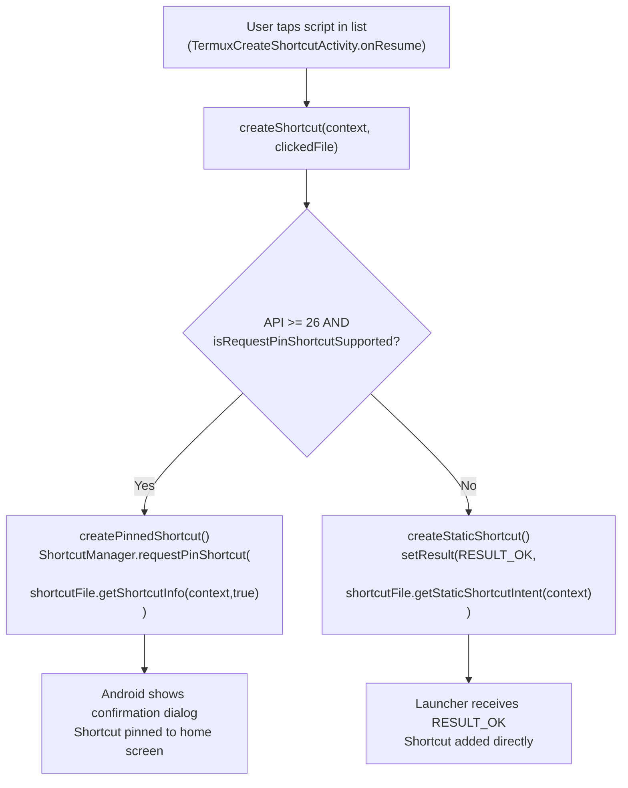

Sources: [app/src/main/java/com/termux/widget/TermuxCreateShortcutActivity.java:107-145]()

---

## Creating and Removing Dynamic Shortcuts

**Entry point:** `TermuxWidgetMainActivity`

Dynamic shortcuts are sourced from a separate directory:

```
~/.termux/widget/dynamic_shortcuts/
```

The constant `TERMUX_WIDGET_DYNAMIC_SHORTCUTS_DIR_PATH` in `TermuxWidgetMainActivity` resolves to `/data/data/com.termux/files/home/.termux/widget/dynamic_shortcuts`.

Dynamic shortcuts require API ≥ 25 (Android 7.1). The `linearlayout_dynamic_shortcuts` section in the main activity layout ([app/src/main/res/layout/activity_termux_widget_main.xml:96-153]()) is hidden on older API levels.

### Create Shortcuts

1. Place script files in `~/.termux/widget/dynamic_shortcuts/` using the Termux app.
2. Open Termux:Widget and tap **CREATE SHORTCUTS**.
3. `createDynamicShortcuts()` ([app/src/main/java/com/termux/widget/activities/TermuxWidgetMainActivity.java:176-219]()) is called, which:
   - Creates the directory if absent.
   - Calls `ShortcutUtils.enumerateShortcutFiles()` to collect `ShortcutFile` objects.
   - Trims the list to `shortcutManager.getMaxShortcutCountPerActivity()` if necessary.
   - Calls `shortcutManager.removeAllDynamicShortcuts()` then `shortcutManager.addDynamicShortcuts(shortcuts)`.

### Remove Shortcuts

Tap **REMOVE SHORTCUTS**. `removeDynamicShortcuts()` ([app/src/main/java/com/termux/widget/activities/TermuxWidgetMainActivity.java:221-234]()) calls `shortcutManager.removeAllDynamicShortcuts()`.

> **Note:** Removing dynamic shortcuts does not affect any shortcuts that were previously promoted to pinned shortcuts by the user.

**Dynamic shortcuts management flow**

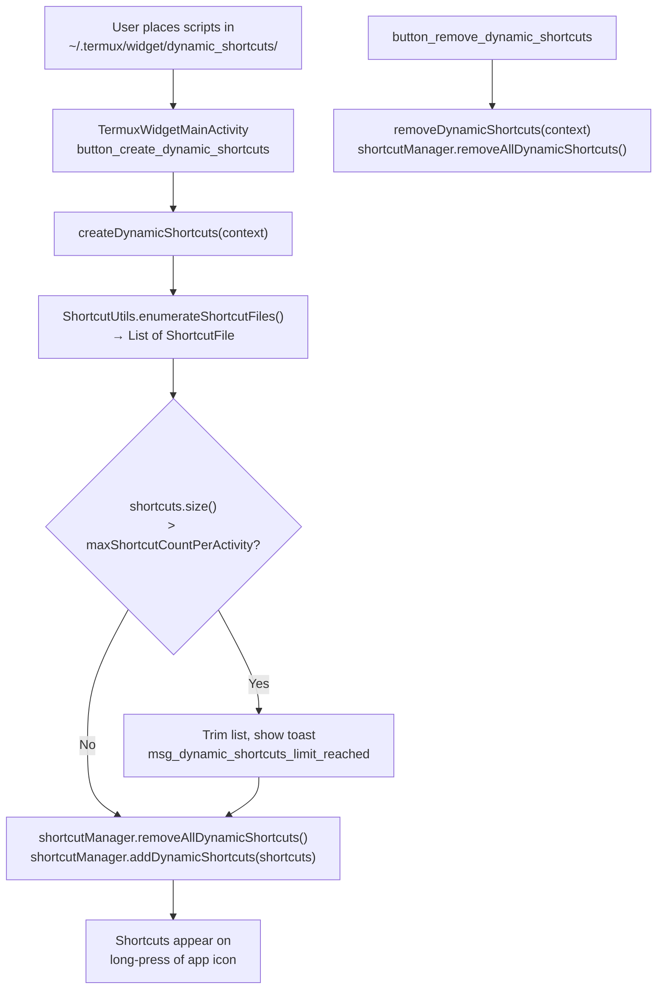

Sources: [app/src/main/java/com/termux/widget/activities/TermuxWidgetMainActivity.java:144-234](), [app/src/main/res/layout/activity_termux_widget_main.xml:96-153]()

---

## Max Shortcuts Limit

Android enforces a per-activity cap on the combined count of static and dynamic shortcuts via the `max_shortcuts` sub-key of the `shortcut_manager_constants` global setting. Default values by Android version:

| Android Version | Default `max_shortcuts` |
|---|---|
| Android 7.0 (API 24) | 5 |
| Android 10 (API 29) | 10 |
| Android 11 (API 30) | 15 |

`TermuxWidgetMainActivity.setMaxShortcutsLimitView()` ([app/src/main/java/com/termux/widget/activities/TermuxWidgetMainActivity.java:84-96]()) reads the active limit via `shortcutManager.getMaxShortcutCountPerActivity()` and displays it in the `textview_max_shortcuts_limit_info` field when API ≥ 25.

### Checking the Current Limit

```
# via adb
adb shell "dumpsys shortcut | grep -E 'maxShortcutsPerActivity|mMaxDynamicShortcuts'"

# via root shell
su -c "dumpsys shortcut | grep -E 'maxShortcutsPerActivity|mMaxDynamicShortcuts'"
```

### Changing the Limit (Until Next Reboot)

```
# set limit to 25
adb shell "cmd shortcut override-config max_shortcuts=25"

# reset to default
adb shell "cmd shortcut override-config max_shortcuts="
```

### Changing the Limit Permanently

Read the current `shortcut_manager_constants` value, append `,max_shortcuts=25`, and write it back:

```
adb shell "settings put global shortcut_manager_constants 'max_shortcuts=25'"
```

To reset (when no other sub-keys are set):

```
adb shell "settings delete global shortcut_manager_constants"
```

Sources: [README.md:122-164](), [app/src/main/java/com/termux/widget/activities/TermuxWidgetMainActivity.java:84-96](), [app/src/main/res/values/strings.xml:33-35]()

---

## Custom Icons

Shortcuts can display a custom PNG icon. Icons are read by the `ShortcutFile` class from:

```
~/.shortcuts/icons/
```

**Naming convention:** The icon filename must exactly match the script filename with `.png` appended.

| Script path | Expected icon path |
|---|---|
| `~/.shortcuts/my_script.sh` | `~/.shortcuts/icons/my_script.sh.png` |
| `~/.shortcuts/tasks/backup` | `~/.shortcuts/icons/backup.png` |

**Icon file requirements:**

- Must be a regular file (not a directory or symlink to outside the allowed path).
- Its canonical path must reside under `~/.shortcuts/icons` or `~/.termux`.
- Recommended size: `96×96 px` for 1080p screens; `144 px` or `196 px` for higher-density displays.

**Permissions for the icons directory:**

```
mkdir -p /data/data/com.termux/files/home/.shortcuts/icons
chmod -R a-x,u=rwX,go-rwx /data/data/com.termux/files/home/.shortcuts/icons
```

This sets the directory to `0700` and any existing icon files to `0600`.

The `~/.shortcuts/icons/` directory must have read permission or `ShortcutFile` will not be able to load icons, and the shortcut will fall back to the default Termux:Widget app icon.

Sources: [README.md:94-110](), [app/src/main/res/values/strings.xml:61-62](), [app/src/main/res/values/strings.xml:91-93]()

---

## Execution of Shortcuts

When a launcher shortcut is tapped, the system starts `TermuxLaunchShortcutActivity` (configured with `noHistory` and `Theme.NoDisplay`). This activity immediately delegates to `TermuxWidgetProvider.handleTermuxShortcutExecutionIntent()`, which validates the token, resolves the canonical path, checks it against allowed paths, and sends an execution intent to the Termux service. This execution pipeline is shared with widget item taps and device controls. For a full description of that pipeline, see [Script Execution Pipeline](#3.2).

Sources: [README.md:55-90]()

---

# Page: Device Controls

# Device Controls

<details>
<summary>Relevant source files</summary>

The following files were used as context for generating this wiki page:

- [LICENSE.md](LICENSE.md)
- [README.md](README.md)
- [app/src/main/AndroidManifest.xml](app/src/main/AndroidManifest.xml)
- [app/src/main/java/com/termux/widget/TermuxWidgetControlsProviderService.java](app/src/main/java/com/termux/widget/TermuxWidgetControlsProviderService.java)
- [termux-widget.png](termux-widget.png)

</details>


This page covers the Android 11+ Device Controls (Power Menu) integration in Termux:Widget — how shortcut scripts are exposed as controls, how a user adds them, and how tapping a control triggers script execution. For general information about shortcut scripts and directory layout, see [Script Directories](#2.2). For the widget and launcher shortcut entry points, see [Home Screen Widget](#2.3) and [Launcher Shortcuts](#2.4).

---

## Platform Requirement

Device Controls is an Android 11 (API 30) feature. The entire integration is gated by `@RequiresApi(api = Build.VERSION_CODES.R)` on `TermuxWidgetControlsProviderService`. On devices running Android 10 or earlier, this feature is not available.

---

## Overview

The Android Device Controls framework lets apps register interactive controls in the system Power Menu. Termux:Widget exposes each script file under `~/.shortcuts/` as a tappable control. When a user taps one, the corresponding script is executed via Termux, using the same pipeline as widget taps and launcher shortcuts.

**Title diagram: Device Controls — Component Overview**

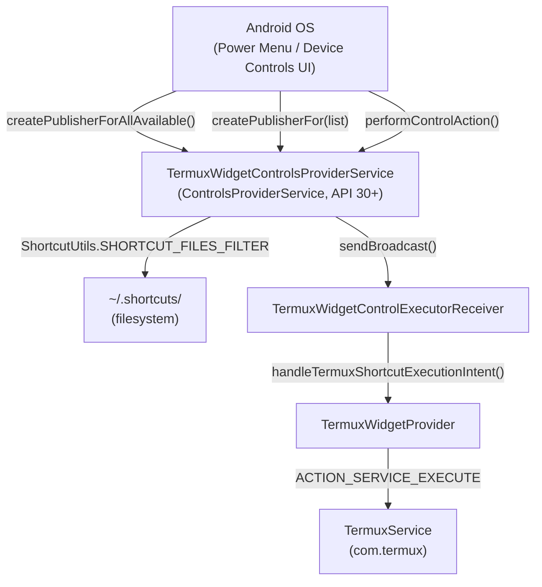

Sources: [app/src/main/java/com/termux/widget/TermuxWidgetControlsProviderService.java:1-268](), [app/src/main/AndroidManifest.xml:91-100]()

---

## Service Declaration

`TermuxWidgetControlsProviderService` is declared in `AndroidManifest.xml` as an exported service with the `android.permission.BIND_CONTROLS` permission. Only the Android system (which holds that permission) can bind to it.

```xml
<service
    android:name=".TermuxWidgetControlsProviderService"
    android:exported="true"
    android:label="@string/title_termux_shortcuts"
    android:permission="android.permission.BIND_CONTROLS"
    tools:targetApi="r">
    <intent-filter>
        <action android:name="android.service.controls.ControlsProviderService" />
    </intent-filter>
</service>
```

Sources: [app/src/main/AndroidManifest.xml:91-100]()

---

## Adding Controls (User Steps)

1. Open the system Power Menu (long-press the power button on supported devices and launchers).
2. Locate the **Device Controls** section and tap **Add controls** (or similar, varies by Android OEM).
3. Select **Termux:Widget** from the app list.
4. The system calls `createPublisherForAllAvailable()`, which enumerates all scripts in `~/.shortcuts/` and presents them as selectable controls.
5. Choose the desired scripts. The system persists the selected control IDs (absolute file paths) and subsequently calls `createPublisherFor(list)` to render them with their live state.

> **Note:** The `~/.shortcuts/` directory must exist and have appropriate permissions before adding controls. See [Script Directories](#2.2).

---

## Script Enumeration

`TermuxWidgetControlsProviderService` uses the same file filter as the home screen widget to discover scripts.

**Title diagram: Script Enumeration in createShortcutFilesList**

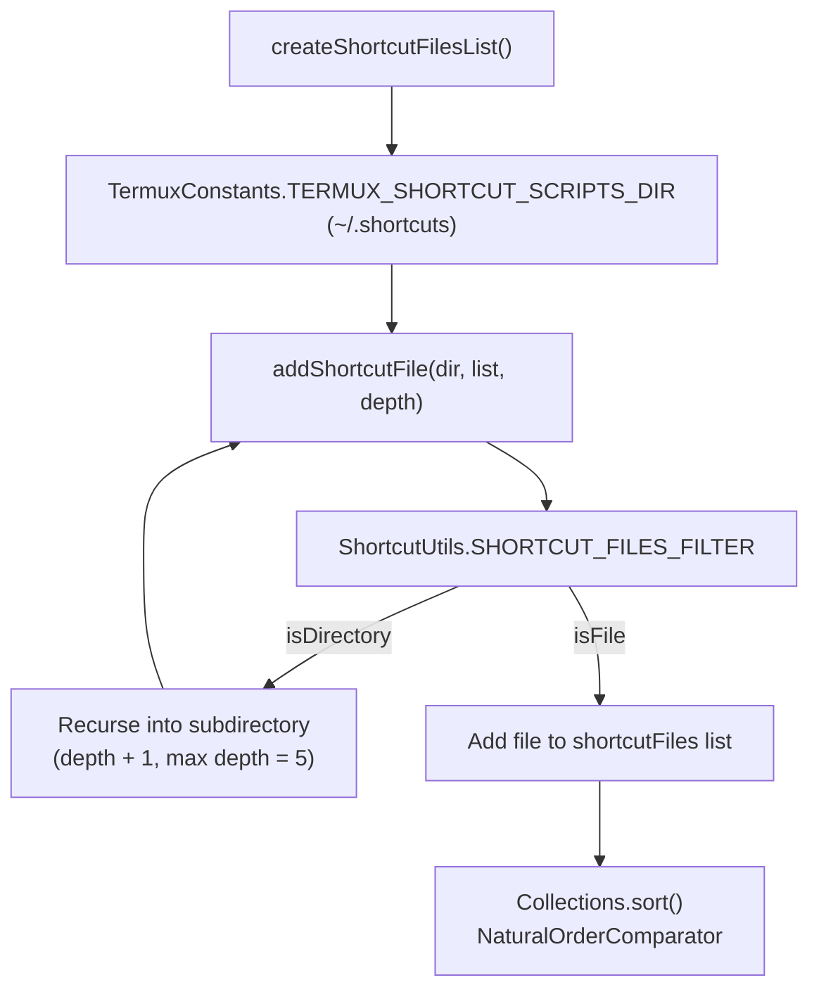

Key behaviors:
- Recursion starts at `TermuxConstants.TERMUX_SHORTCUT_SCRIPTS_DIR` (`~/.shortcuts/`).
- Maximum recursion depth is **5**, matching the behavior of `TermuxWidgetService`.
- `ShortcutUtils.SHORTCUT_FILES_FILTER` excludes hidden files and broken symlinks.
- Results are sorted by filename using `NaturalOrderComparator`.
- The **absolute file path** of each script becomes its **control ID**.

Sources: [app/src/main/java/com/termux/widget/TermuxWidgetControlsProviderService.java:231-266]()

---

## Control States

Each script file maps to a `Control` object. The state depends on whether the backing file is valid at the time `createPublisherFor()` is called.

| Condition | Builder Type | `STATUS` | Template | Behavior on tap |
|---|---|---|---|---|
| File exists and is a regular file | `Control.StatefulBuilder` | `STATUS_OK` | `StatelessTemplate` | Sends broadcast to execute script |
| File missing or not a regular file | `Control.StatefulBuilder` | `STATUS_NOT_FOUND` | _(none)_ | System shows native error popup with "Open App" button |
| Being added (not yet persisted) | `Control.StatelessBuilder` | _(none)_ | _(none)_ | Selectable in the picker UI |

All controls share:
- **Title**: `shortcutFile.getName()` (the script filename)
- **Subtitle**: `shortcutFile.getParentFile().getName()` (the parent directory name)
- **Icon**: `R.drawable.ic_launcher` (the Termux:Widget launcher icon)
- **Device type**: `DeviceTypes.TYPE_UNKNOWN`

Sources: [app/src/main/java/com/termux/widget/TermuxWidgetControlsProviderService.java:122-168]()

---

## Execution Flow

When the user taps an added control, the Android system calls `performControlAction()`.

**Title diagram: performControlAction to Script Execution**

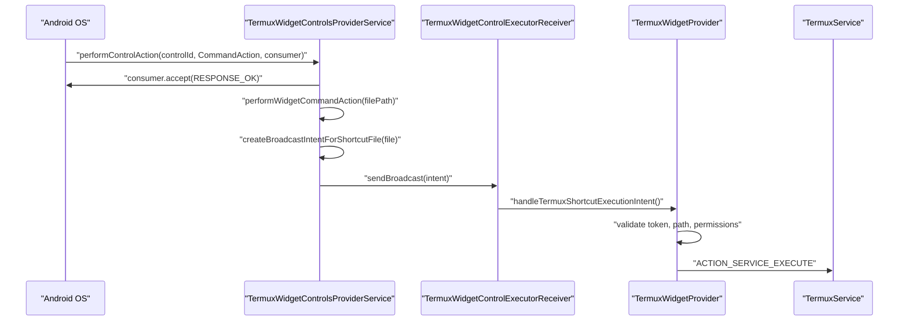

**Steps in detail:**

1. `performControlAction()` immediately calls `consumer.accept(ControlAction.RESPONSE_OK)` to acknowledge receipt, regardless of file state.
2. Only `CommandAction` instances proceed to `performWidgetCommandAction()`.
3. `performWidgetCommandAction()` re-validates that the file exists before dispatching.
4. A broadcast `Intent` is created targeting `TermuxWidgetControlExecutorReceiver` via `createBroadcastIntentForShortcutFile()`.
5. The intent carries:
   - The script URI (built with `TERMUX_SERVICE.URI_SCHEME_SERVICE_EXECUTE` scheme and the file path)
   - The security token from `TermuxWidgetAppSharedPreferences.getGeneratedToken()`
6. `TermuxWidgetControlExecutorReceiver` delegates to `TermuxWidgetProvider.handleTermuxShortcutExecutionIntent()`, which performs token validation, canonical path resolution, allowed-path checks, and file permission validation before sending the final execution intent to `TermuxService`.

> **Why a broadcast receiver?** The implementation comment in `performWidgetCommandAction()` explains this directly: using `TermuxWidgetControlExecutorReceiver` instead of `TermuxLaunchShortcutActivity` prevents the Activity's bottom sheet from briefly appearing on screen when a control is tapped.

For a full description of the validation pipeline, see [Script Execution Pipeline](#3.2).

Sources: [app/src/main/java/com/termux/widget/TermuxWidgetControlsProviderService.java:97-115](), [app/src/main/java/com/termux/widget/TermuxWidgetControlsProviderService.java:214-225]()

---

## Security Token

The broadcast intent includes a security token retrieved from `TermuxWidgetAppSharedPreferences.getGeneratedToken()`. This token is checked in `TermuxWidgetProvider.handleTermuxShortcutExecutionIntent()` to prevent unauthorized broadcasts from triggering script execution. This is the same mechanism used by the widget and launcher shortcut paths.

Sources: [app/src/main/java/com/termux/widget/TermuxWidgetControlsProviderService.java:214-219]()

---

## Limitations

- **Android 11+ only.** The service class is annotated `@RequiresApi(api = Build.VERSION_CODES.R)` and the manifest entry uses `tools:targetApi="r"`.
- **No custom icons.** Unlike launcher shortcuts (which support per-script PNG icons from `~/.shortcuts/icons/`), all Device Controls display the same `ic_launcher` icon.
- **No live state updates.** The `ReplayProcessor` in `createPublisherFor()` emits the initial state but does not push updates when script files change. The control status reflects the file's existence only at the time the Power Menu is opened.
- **Scripts must be in `~/.shortcuts/`** (not `~/.termux/widget/dynamic_shortcuts/`). The enumeration is rooted at `TermuxConstants.TERMUX_SHORTCUT_SCRIPTS_DIR`.

Sources: [app/src/main/java/com/termux/widget/TermuxWidgetControlsProviderService.java:42-48](), [app/src/main/java/com/termux/widget/TermuxWidgetControlsProviderService.java:183-185](), [app/src/main/java/com/termux/widget/TermuxWidgetControlsProviderService.java:231-240]()

---

# Page: Debugging and Troubleshooting

# Debugging and Troubleshooting

<details>
<summary>Relevant source files</summary>

The following files were used as context for generating this wiki page:

- [LICENSE.md](LICENSE.md)
- [README.md](README.md)
- [app/src/main/res/values/strings.xml](app/src/main/res/values/strings.xml)
- [termux-widget.png](termux-widget.png)

</details>


This page covers how to diagnose problems with Termux:Widget: configuring log levels, capturing `logcat` output, the Draw Over Apps permission, and a reference of common error messages. It focuses on the runtime behavior of the plugin. For documentation on script directory layout and permissions setup, see [Script Directories](#2.2). For the internal execution pipeline that produces these errors, see [Script Execution Pipeline](#3.2).

---

## Log Level Configuration

Termux:Widget does not execute commands itself — it sends an execution intent to the Termux app, which runs the command. This means two separate log levels must be configured to capture the full picture.

| Setting Path | Controls |
|---|---|
| Termux app → Settings → **Termux:Widget** → Debugging → Log Level | Widget plugin: intent handling, path validation, token checks |
| Termux app → Settings → **Termux** → Debugging → Log Level | Termux execution engine: session creation, command dispatch |

> Requires Termux app version `>= 0.118.0` for the per-plugin log level setting.

**Log Level Reference**

| Level | Behavior |
|---|---|
| `Off` | No log output at all |
| `Normal` | Errors, warnings, info messages, and stack traces (default) |
| `Debug` | Adds debug-level messages |
| `Verbose` | Adds verbose messages; may expose private data in logcat |

Set both levels to `Verbose` when diagnosing a problem. Revert to `Normal` when done — verbose logging increases execution time and may log sensitive information.

Sources: [README.md:191-203]()

---

## Mapping: Settings → Code Components → Log Output

**Diagram: Log Settings and Their Scope Within the Execution Pipeline**

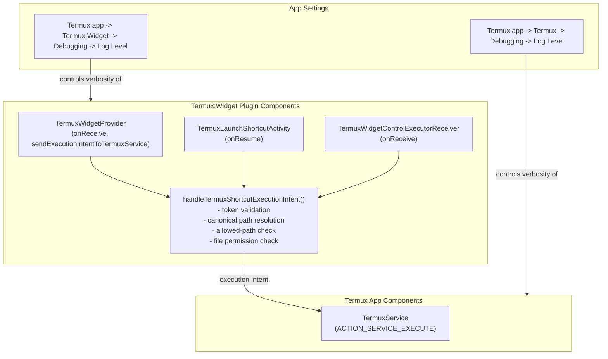

Sources: [README.md:191-196]()

---

## Collecting Logs with logcat

After setting log levels, use `logcat` to capture output. Run in a Termux terminal session:

```
# Live output (Ctrl+C to stop)
logcat

# Dump to file
logcat -d > logcat.txt

# Filter to Termux-related tags only
logcat -s TermuxWidget Termux
```

You can also capture logs over ADB from a PC:

```
adb logcat -d > logcat.txt
```

The full Android `logcat` documentation is available at the official Android developer reference for the `logcat` command-line tool.

Sources: [README.md:194-196]()

---

## Draw Over Apps Permission (Android 10+)

On Android 10 and above, there are restrictions that prevent background activities from starting in the foreground. This affects **foreground** script execution only (scripts in `~/.shortcuts/`, not `~/.shortcuts/tasks/`).

**Effect without permission:** When a foreground script is executed, the Termux terminal session will not automatically open. The user must manually tap the Termux notification in the status bar to see the running session.

**How to grant the permission:**

> Android Settings → Apps → Termux → Advanced → Draw over other apps

Requires Termux app version `>= 0.100`.

Background task execution (scripts in `~/.shortcuts/tasks/`) is not affected by this restriction.

**Diagram: Foreground vs Background Execution and the Permission Effect**

```mermaid
flowchart TD
    subgraph ScriptType["Script Location"]
        FG["~/.shortcuts/*.sh\n(foreground session)"]
        BG["~/.shortcuts/tasks/*.sh\n(background task)"]
    end

    subgraph TermuxService["TermuxService"]
        FGSession["Start terminal session\nin foreground"]
        BGTask["Run as background task\n(visible in notification)"]
    end

    subgraph Permission["Draw Over Apps"]
        Granted["Permission GRANTED"]
        Denied["Permission DENIED"]
    end

    FG --> FGSession
    BG --> BGSession["BGTask"]
    BGSession --> BGTask

    FGSession --> Granted
    FGSession --> Denied

    Granted -->|"session opens automatically"| AutoOpen["Terminal opens immediately"]
    Denied -->|"blocked by Android 10+ restriction"| ManualTap["User must tap Termux notification\nto open session"]
```

Sources: [README.md:167-170]()

---

## Common Error Messages

The following error messages appear in widget UI elements or logcat output. String resource names are from [app/src/main/res/values/strings.xml]().

**Diagram: Error String Resources → Trigger Conditions → Resolution**

```mermaid
flowchart LR
    subgraph StringResources["strings.xml Error Resources"]
        E1["msg_bad_token"]
        E2["error_null_or_empty_executable"]
        E3["error_executable_not_under_shortcuts_directories"]
        E4["error_icon_not_under_shortcut_icons_directories"]
        E5["error_icon_not_a_regular_file"]
        E6["error_failed_to_get_shortcut_manager"]
        E7["msg_no_shortcut_scripts"]
    end

    subgraph Causes["Trigger Conditions"]
        C1["Token in SharedPrefs does not match\ntoken stored in shortcut intent"]
        C2["Shortcut file path is null or empty"]
        C3["Script canonical path not under\n~/.shortcuts/ or ~/.termux/"]
        C4["Icon canonical path not under\n~/.shortcuts/icons or ~/.termux/"]
        C5["Icon path points to a directory\nor special file, not a regular file"]
        C6["Android ShortcutManager unavailable\n(API < 25 or system error)"]
        C7["~/.shortcuts/ directory is empty\nor does not exist"]
    end

    E1 --> C1
    E2 --> C2
    E3 --> C3
    E4 --> C4
    E5 --> C5
    E6 --> C6
    E7 --> C7
```

Sources: [app/src/main/res/values/strings.xml:77-96]()

**Quick Reference Table**

| String Resource | Displayed Message | Cause | Resolution |
|---|---|---|---|
| `msg_bad_token` | "This shortcut is invalid - remove and add again." | Shortcut token mismatch after reinstall or update | Delete the shortcut and recreate it |
| `error_null_or_empty_executable` | "The executable is null or empty." | Shortcut was created with no associated script path | Remove and recreate the shortcut |
| `error_executable_not_under_shortcuts_directories` | "An executable can only be executed if its under the following directories: …" | Script's resolved path escapes `~/.shortcuts/` or `~/.termux/` (e.g. a symlink pointing outside those trees) | Ensure script or symlink target is within the allowed directories |
| `error_icon_not_under_shortcut_icons_directories` | "The icon is not under the following directories: …" | Icon file's canonical path is outside `~/.shortcuts/icons` or `~/.termux/` | Move icon file into `~/.shortcuts/icons/` |
| `error_icon_not_a_regular_file` | "The icon file is not a regular file but is instead a …" | Icon path resolves to a directory or device file | Provide a regular `.png` file |
| `error_failed_to_get_shortcut_manager` | "Failed to get ShortcutManager" | `ShortcutManager` system service unavailable | Check Android API level (requires API 25+) |
| `msg_no_shortcut_scripts` | "No files in ~/.shortcuts/" | Directory is empty, missing, or unreadable | Create `~/.shortcuts/` and set `chmod 700` |

Sources: [app/src/main/res/values/strings.xml:67-96]()

---

## Widget Stuck / Non-Responsive

If the widget reverts to showing "Open Termux:Widget app to refresh widget" and the widget's own refresh button does nothing, the widget RemoteViews state has been lost (typically after an app update).

**Resolution options, in order:**

1. Open the Termux:Widget app main activity — this triggers a widget refresh automatically.
2. Use the **Refresh Widgets** button in the app's main activity.
3. Send a manual broadcast from a Termux terminal:

```
# Refresh a specific widget by ID
am broadcast -n com.termux.widget/.TermuxWidgetProvider \
  -a com.termux.widget.ACTION_REFRESH_WIDGET \
  --ei appWidgetId <id>

# Refresh all widgets (version >= 0.114.0)
am broadcast -n com.termux.widget/.TermuxWidgetProvider \
  -a com.termux.widget.ACTION_REFRESH_WIDGET \
  --ei appWidgetId 0
```

The widget ID is shown in the flash message "Termux widgets refreshed: `<id>`" when the in-widget refresh button is pressed successfully.

Sources: [README.md:87-88](), [app/src/main/res/values/strings.xml:83-84]()

---

## Directory Permission Errors

The following `chmod` values are required for the plugin to function. Incorrect permissions produce silent failures (scripts not shown in widget) or explicit errors (scripts shown but fail to execute).

| Path | Required Permission | Notes |
|---|---|---|
| `~/.shortcuts/` | `0700` | Must be readable + executable for widget to enumerate scripts |
| `~/.shortcuts/tasks/` | `0700` | Same as above for task scripts |
| `~/.shortcuts/icons/` | `0700` (dir), `0600` (files) | Read permission required for icon loading |
| `~/.termux/widget/dynamic_shortcuts/` | `0700` | Required for dynamic shortcut creation |

If the parent directory lacks **read** permission, no scripts appear in the widget and shortcut execution produces `No regular file found at path`. If the parent directory lacks **execute** permission, scripts are visible but execution is blocked by the allowed-path check in `sendExecutionIntentToTermuxService`.

Sources: [README.md:64-76](), [README.md:96-111]()

---

# Page: Architecture

# Architecture

<details>
<summary>Relevant source files</summary>

The following files were used as context for generating this wiki page:

- [app/src/main/AndroidManifest.xml](app/src/main/AndroidManifest.xml)
- [app/src/main/java/com/termux/widget/TermuxWidgetProvider.java](app/src/main/java/com/termux/widget/TermuxWidgetProvider.java)
- [app/src/main/res/values/strings.xml](app/src/main/res/values/strings.xml)

</details>


This page provides a technical overview of Termux:Widget's internal structure — the Android components it declares, how they communicate with each other and with the Termux app, and which subsystems own which responsibilities. For detailed treatment of individual topics, see the child pages: [Android Components Reference](#3.1), [Script Execution Pipeline](#3.2), [Widget Data Flow](#3.3), [Shortcut Management Internals](#3.4), and [Application Initialization and System Events](#3.5).

---

## Component Overview

Termux:Widget is a standard Android application (`com.termux.widget`) that shares a `sharedUserId` with the Termux app (`com.termux`). It declares no content providers and performs no persistent background work of its own. All script execution is delegated to `TermuxService` in the Termux app via explicit intents.

The following table lists every major component class and its role:

| Type | Class | Exported | Role |
|---|---|---|---|
| `Application` | `TermuxWidgetApplication` | — | Crash handler, logging setup, night mode |
| `Activity` | `TermuxWidgetMainActivity` | yes | Dynamic shortcut management, widget refresh |
| `activity-alias` | `TermuxWidgetLauncherActivity` | yes | Launcher entry point for `TermuxWidgetMainActivity` |
| `Activity` | `TermuxCreateShortcutActivity` | yes | Creates pinned/static shortcuts from `.shortcuts/` |
| `Activity` | `TermuxLaunchShortcutActivity` | yes | Receives shortcut tap, delegates to provider, no history |
| `Activity` | `ReportActivity` | no | Error display (from `termux-shared`) |
| `AppWidgetProvider` | `TermuxWidgetProvider` | no | Widget lifecycle, item click dispatch, refresh |
| `BroadcastReceiver` | `TermuxWidgetControlExecutorReceiver` | no | Receives control actions from Device Controls |
| `BroadcastReceiver` | `SystemEventReceiver` | no | Handles `BOOT_COMPLETED`, `MY_PACKAGE_REPLACED`, `MY_PACKAGE_UNSUSPENDED` |
| `RemoteViewsService` | `TermuxWidgetService` | no | Supplies list items (`RemoteViews`) to the widget |
| `ControlsProviderService` | `TermuxWidgetControlsProviderService` | yes | Android 11+ Device Controls integration |

Sources: [app/src/main/AndroidManifest.xml:1-104]()

---

## Component Map

**Diagram: Android Component Relationships**

```mermaid
graph TD
    subgraph "Application Process (com.termux.widget)"
        TWApp["TermuxWidgetApplication"]

        subgraph "Activities"
            TWMain["TermuxWidgetMainActivity\n(alias: TermuxWidgetLauncherActivity)"]
            TCSActivity["TermuxCreateShortcutActivity\nACTION_CREATE_SHORTCUT"]
            TLSActivity["TermuxLaunchShortcutActivity\nnoHistory, Theme.NoDisplay"]
        end

        subgraph "Receivers"
            TWProvider["TermuxWidgetProvider\nAppWidgetProvider"]
            TWCEReceiver["TermuxWidgetControlExecutorReceiver"]
            SysReceiver["SystemEventReceiver\nBOOT_COMPLETED / MY_PACKAGE_REPLACED / MY_PACKAGE_UNSUSPENDED"]
        end

        subgraph "Services"
            TWService["TermuxWidgetService\nRemoteViewsService"]
            TWCPService["TermuxWidgetControlsProviderService\nAPI 30+"]
        end

        subgraph "Utilities"
            ShortcutFile["ShortcutFile"]
            ShortcutUtils["ShortcutUtils"]
        end
    end

    subgraph "Android OS"
        AppWidgetMgr["AppWidgetManager"]
        ShortcutMgr["ShortcutManager (API 25+)"]
        DevControls["Device Controls UI\n(Power Menu, API 30+)"]
    end

    subgraph "Termux App"
        TermuxService["TermuxService\nACTION_SERVICE_EXECUTE"]
    end

    subgraph "Filesystem"
        ScriptsDir["~/.shortcuts/"]
        TasksDir["~/.shortcuts/tasks/"]
        IconsDir["~/.shortcuts/icons/"]
        DynDir["~/.termux/widget/dynamic_shortcuts/"]
    end

    TWApp --> TWMain
    TWMain -->|"ShortcutManager API"| ShortcutMgr
    TWMain -->|"reads"| DynDir
    TCSActivity -->|"ShortcutManager API"| ShortcutMgr
    TCSActivity -->|"browses via ShortcutUtils"| ScriptsDir

    TWProvider -->|"updateAppWidget / notifyAppWidgetViewDataChanged"| AppWidgetMgr
    TWProvider -->|"startForegroundService"| TermuxService
    TWCEReceiver -->|"handleTermuxShortcutExecutionIntent"| TWProvider
    TLSActivity -->|"handleTermuxShortcutExecutionIntent"| TWProvider
    SysReceiver -->|"sendIntentToRefreshAllWidgets"| TWProvider

    TWService -->|"RemoteViews list items"| AppWidgetMgr
    TWService -->|"ShortcutUtils.getShortcutFiles"| ScriptsDir
    TWService -->|"ShortcutUtils.getShortcutFiles"| TasksDir

    TWCPService -->|"enumerates via ShortcutUtils"| ScriptsDir
    TWCPService -->|"broadcasts to"| TWCEReceiver
    TWCPService -->|"stateful controls"| DevControls

    ShortcutFile -->|"resolves icons from"| IconsDir
    ShortcutUtils -->|"filters files in"| ScriptsDir
```

Sources: [app/src/main/AndroidManifest.xml:1-104](), [app/src/main/java/com/termux/widget/TermuxWidgetProvider.java:1-356]()

---

## Subsystem Responsibilities

The codebase is organized around four distinct subsystems. Each is explained in detail in its own child page.

### 1. Home Screen Widget

**Owner classes:** `TermuxWidgetProvider`, `TermuxWidgetService`

The widget is an `AppWidgetProvider` backed by a `RemoteViewsService`. `TermuxWidgetProvider` owns the widget lifecycle (`onUpdate`, `onReceive`) and sets up `RemoteViews` with a `ListView` adapter pointing at `TermuxWidgetService`. `TermuxWidgetService` creates a `ListRemoteViewsFactory` that reads `.shortcuts/` at population time. Widget refresh is driven by `notifyAppWidgetViewDataChanged`.

See [Widget Data Flow](#3.3) for the full lifecycle.

### 2. Script Execution Pipeline

**Owner class:** `TermuxWidgetProvider` (static methods `handleTermuxShortcutExecutionIntent` and `sendExecutionIntentToTermuxService`)

All three entry points — widget item tap, shortcut launch, and Device Controls action — converge on the same two static methods. The pipeline performs:

1. Token validation (for shortcut and Device Controls paths)
2. Termux app accessibility check
3. Canonical path resolution
4. Allowed-path validation against `ShortcutUtils.SHORTCUT_FILES_ALLOWED_PATHS_LIST`
5. File existence and permission validation
6. Runner selection (`TERMINAL_SESSION` vs `APP_SHELL` based on whether path is under `tasks/`)
7. Intent dispatch to `TermuxService` via `ACTION_SERVICE_EXECUTE`

See [Script Execution Pipeline](#3.2) for the full flow.

### 3. Shortcut Management

**Owner classes:** `ShortcutFile`, `ShortcutUtils`, `TermuxCreateShortcutActivity`, `TermuxWidgetMainActivity`

`ShortcutFile` models a single script file — its path, label, and optional icon from `~/.shortcuts/icons/`. `ShortcutUtils` provides file enumeration and filtering utilities. `TermuxCreateShortcutActivity` handles pinned and static shortcut creation; `TermuxWidgetMainActivity` manages dynamic shortcuts via `ShortcutManager`.

See [Shortcut Management Internals](#3.4) for details.

### 4. Application Initialization and System Events

**Owner classes:** `TermuxWidgetApplication`, `SystemEventReceiver`

`TermuxWidgetApplication` configures crash reporting, logging, and night mode on startup. `SystemEventReceiver` listens for `BOOT_COMPLETED`, `MY_PACKAGE_REPLACED`, and `MY_PACKAGE_UNSUSPENDED` broadcasts and triggers a widget refresh via `TermuxWidgetProvider.sendIntentToRefreshAllWidgets`.

See [Application Initialization and System Events](#3.5) for details.

---

## Script Execution Entry Points

**Diagram: Execution Entry Points → Dispatch**

```mermaid
flowchart TD
    subgraph "Entry Points"
        W["Widget list item tap\n(ListView item click)"]
        S["Launcher shortcut tap\n(pinned / static / dynamic)"]
        D["Device Controls action\n(Power Menu, API 30+)"]
    end

    subgraph "Entry Point Adapters"
        TWP_recv["TermuxWidgetProvider.onReceive\nACTION_WIDGET_ITEM_CLICKED"]
        TLS["TermuxLaunchShortcutActivity.onResume"]
        TWCER["TermuxWidgetControlExecutorReceiver.onReceive"]
    end

    W --> TWP_recv
    S --> TLS
    D --> TWCER

    TWP_recv -->|"sendExecutionIntentToTermuxService()"| Validate
    TLS -->|"handleTermuxShortcutExecutionIntent()"| Handle
    TWCER -->|"handleTermuxShortcutExecutionIntent()"| Handle

    subgraph "TermuxWidgetProvider — static methods"
        Handle["handleTermuxShortcutExecutionIntent()\nvalidate token via TermuxWidgetAppSharedPreferences"]
        Handle --> Validate
        Validate["sendExecutionIntentToTermuxService()\n1. isTermuxAppAccessible\n2. getCanonicalPath\n3. isPathInDirPaths (SHORTCUT_FILES_ALLOWED_PATHS_LIST)\n4. validateRegularFileExistenceAndPermissions\n5. select runner (APP_SHELL or TERMINAL_SESSION)\n6. startForegroundService"]
    end

    Validate -->|"ACTION_SERVICE_EXECUTE intent"| TS["TermuxService\n(com.termux)"]
```

Sources: [app/src/main/java/com/termux/widget/TermuxWidgetProvider.java:238-354]()

---

## Inter-Process Communication

Termux:Widget communicates with the Termux app exclusively through explicit intents. The table below lists all IPC surfaces.

| Direction | Mechanism | Action / Extra | Purpose |
|---|---|---|---|
| Widget → Termux | `startForegroundService` | `TERMUX_SERVICE.ACTION_SERVICE_EXECUTE` | Execute a script |
| Widget → Termux | Intent extra | `TERMUX_SERVICE.EXTRA_RUNNER` | Specify `APP_SHELL` or `TERMINAL_SESSION` |
| Widget → Termux | Intent extra | `TERMUX_SERVICE.EXTRA_BACKGROUND` | Backward compatibility runner flag |
| System → Widget | Broadcast | `APPWIDGET_UPDATE` | Trigger widget update |
| System → Widget | Broadcast | `BOOT_COMPLETED` | Refresh widgets on boot |
| User → Widget | Broadcast (`am broadcast`) | `ACTION_REFRESH_WIDGET` | Manual widget refresh |

Sources: [app/src/main/java/com/termux/widget/TermuxWidgetProvider.java:330-348](), [app/src/main/AndroidManifest.xml:76-84]()

---

## Shared Library (`termux-shared`)

Termux:Widget relies heavily on the `termux-shared` library (bundled from the Termux project). Key classes used across multiple components:

| `termux-shared` Class | Usage in Widget |
|---|---|
| `TermuxUtils.isTermuxAppAccessible` | Checked before every execution dispatch |
| `FileUtils.getCanonicalPath` | Path normalization in execution pipeline |
| `FileUtils.isPathInDirPaths` | Allowed-path enforcement |
| `FileUtils.validateRegularFileExistenceAndPermissions` | Permission checks before execution |
| `TermuxWidgetAppSharedPreferences.getGeneratedToken` | Token validation for shortcut intents |
| `TermuxConstants.*` | All package names, directory paths, and action strings |
| `Logger` | Unified logging throughout all components |
| `ExecutionCommand` | Command model used when building execution intents |

Sources: [app/src/main/java/com/termux/widget/TermuxWidgetProvider.java:19-35]()

---

# Page: Android Components Reference

# Android Components Reference

<details>
<summary>Relevant source files</summary>

The following files were used as context for generating this wiki page:

- [app/src/main/AndroidManifest.xml](app/src/main/AndroidManifest.xml)
- [app/src/main/java/com/termux/widget/TermuxWidgetApplication.java](app/src/main/java/com/termux/widget/TermuxWidgetApplication.java)

</details>


This page catalogs every Android component declared in [`app/src/main/AndroidManifest.xml`]() — its type, package path, export status, permissions, intent filters, and its role in the application. It is a reference for the structural composition of the app; for how these components interact at runtime, see the execution pipeline ([3.2](#3.2)), widget data flow ([3.3](#3.3)), shortcut management ([3.4](#3.4)), and system events ([3.5](#3.5)) pages.

---

## Component Inventory

The following table lists every declared component with its key manifest attributes.

| Component | Type | Exported | Permission Required | Key Intent Filter / Attribute |
|---|---|---|---|---|
| `TermuxWidgetApplication` | `Application` | — | — | — |
| `TermuxWidgetMainActivity` | `Activity` | `true` | — | *(none; launched via alias)* |
| `TermuxWidgetLauncherActivity` | `activity-alias` | `true` | — | `ACTION_MAIN`, `CATEGORY_LAUNCHER` |
| `TermuxCreateShortcutActivity` | `Activity` | `true` | — | `ACTION_CREATE_SHORTCUT` |
| `TermuxLaunchShortcutActivity` | `Activity` | `true` | — | `noHistory`, `singleInstance`, `Theme.NoDisplay` |
| `ReportActivity` | `Activity` | `false` | — | `documentLaunchMode=intoExisting` |
| `TermuxWidgetProvider` | `BroadcastReceiver` | `false` | — | `APPWIDGET_UPDATE` |
| `TermuxWidgetControlExecutorReceiver` | `BroadcastReceiver` | *(default)* | — | *(none declared)* |
| `SystemEventReceiver` | `BroadcastReceiver` | `false` | — | `BOOT_COMPLETED`, `MY_PACKAGE_REPLACED`, `MY_PACKAGE_UNSUSPENDED` |
| `TermuxWidgetService` | `Service` | `false` | `BIND_REMOTEVIEWS` | `RemoteViewsService` |
| `TermuxWidgetControlsProviderService` | `Service` | `true` | `BIND_CONTROLS` | `android.service.controls.ControlsProviderService` |

Sources: [app/src/main/AndroidManifest.xml:1-104]()

---

## Component Relationship Map

**Diagram: Component Roles and Connections**

```mermaid
graph TD
    subgraph App["Application Process"]
        TWApp["TermuxWidgetApplication"]

        subgraph Activities["Activities"]
            TWMain["TermuxWidgetMainActivity\n.activities.TermuxWidgetMainActivity"]
            TWAlias["TermuxWidgetLauncherActivity\n(activity-alias → TWMain)"]
            TCS["TermuxCreateShortcutActivity"]
            TLS["TermuxLaunchShortcutActivity\nnoHistory + singleInstance"]
            Report["ReportActivity\nexported=false"]
        end

        subgraph Receivers["BroadcastReceivers"]
            TWP["TermuxWidgetProvider\nexported=false"]
            TWCER["TermuxWidgetControlExecutorReceiver"]
            SER["SystemEventReceiver\nexported=false"]
        end

        subgraph Services["Services"]
            TWS["TermuxWidgetService\nexported=false\nrequires BIND_REMOTEVIEWS"]
            TWCPS["TermuxWidgetControlsProviderService\nexported=true\nrequires BIND_CONTROLS\nAPI 30+"]
        end
    end

    TWAlias -->|"targetActivity"| TWMain
    TWP -->|"provides RemoteViews via"| TWS
    TWCER -->|"delegates to"| TWP
    SER -->|"triggers refresh via"| TWP
    TLS -->|"handleTermuxShortcutExecutionIntent"| TWP
    TWCPS -->|"dispatches action via"| TWCER
```

Sources: [app/src/main/AndroidManifest.xml:1-104]()

---

## Application Class

### `TermuxWidgetApplication`

**Class:** `com.termux.widget.TermuxWidgetApplication`  
**Superclass:** `android.app.Application`

Declared as the application class via `android:name=".TermuxWidgetApplication"` [app/src/main/AndroidManifest.xml:11](). Its `onCreate()` method runs three initialization steps at process start:

1. Registers an uncaught-exception crash handler via `TermuxCrashUtils.setCrashHandler(context)`.
2. Configures the logging level from `TermuxWidgetAppSharedPreferences` via `setLogConfig()`.
3. Sets the app's night mode via `TermuxThemeUtils.setAppNightMode(context)`.

Sources: [app/src/main/java/com/termux/widget/TermuxWidgetApplication.java:1-43](), [app/src/main/AndroidManifest.xml:10-16]()

---

## Activities

### `TermuxWidgetMainActivity`

**Class:** `com.termux.widget.activities.TermuxWidgetMainActivity`  
**Declared at:** [app/src/main/AndroidManifest.xml:32-36]()

| Attribute | Value |
|---|---|
| `exported` | `true` |
| `theme` | `Theme.BaseActivity.DayNight.NoActionBar` |
| Intent filters | *(none directly; see alias below)* |

This is the primary entry point activity. It manages dynamic shortcuts: reading the `~/.termux/widget/dynamic_shortcuts/` directory and creating/removing shortcuts via the Android `ShortcutManager` (API 25+). It has no intent filter of its own — the launcher entry is handled through `TermuxWidgetLauncherActivity`.

---

### `TermuxWidgetLauncherActivity` (activity-alias)

**Declared at:** [app/src/main/AndroidManifest.xml:38-46]()

| Attribute | Value |
|---|---|
| `targetActivity` | `.activities.TermuxWidgetMainActivity` |
| `exported` | `true` |
| Intent filter | `ACTION_MAIN`, `CATEGORY_LAUNCHER` |

This is an `<activity-alias>` element, not a separate class. It provides the launcher icon and `ACTION_MAIN` / `CATEGORY_LAUNCHER` entry point that routes to `TermuxWidgetMainActivity`. Using an alias allows the main activity to exist without an intent filter while still appearing in the app drawer.

---

### `TermuxCreateShortcutActivity`

**Class:** `com.termux.widget.TermuxCreateShortcutActivity`  
**Declared at:** [app/src/main/AndroidManifest.xml:48-57]()

| Attribute | Value |
|---|---|
| `exported` | `true` |
| `label` | `@string/title_single_shortcut_name` |
| `theme` | `Theme.BaseActivity.DayNight.NoActionBar` |
| Intent filter | `ACTION_CREATE_SHORTCUT`, `CATEGORY_DEFAULT` |

Responds to `android.intent.action.CREATE_SHORTCUT`, which is sent by launchers when the user long-presses and selects "Add shortcut." The activity browses the `~/.shortcuts/` directory and allows the user to select a script to create a pinned shortcut. Detailed shortcut creation logic is covered in [3.4](#3.4).

---

### `TermuxLaunchShortcutActivity`

**Class:** `com.termux.widget.TermuxLaunchShortcutActivity`  
**Declared at:** [app/src/main/AndroidManifest.xml:59-65]()

| Attribute | Value |
|---|---|
| `exported` | `true` |
| `noHistory` | `true` |
| `launchMode` | `singleInstance` |
| `taskAffinity` | `.TermuxLaunchShortcutActivity` |
| `theme` | `@android:style/Theme.NoDisplay` |
| Intent filters | *(none declared; called directly by shortcut intents)* |

This activity is intentionally invisible (`Theme.NoDisplay`). It immediately calls `finish()` after processing in `onResume()`. Its sole job is to receive the intent from a launcher shortcut tap and relay the execution to `TermuxWidgetProvider.handleTermuxShortcutExecutionIntent()`.

The `singleInstance` launch mode combined with a dedicated `taskAffinity` ensures it never joins an existing task, which avoids interfering with the foreground app. `noHistory=true` ensures it is never retained in the back stack.

---

### `ReportActivity`

**Class:** `${TERMUX_PACKAGE_NAME}.shared.activities.ReportActivity`  
**Declared at:** [app/src/main/AndroidManifest.xml:69-74]()

| Attribute | Value |
|---|---|
| `exported` | `false` |
| `documentLaunchMode` | `intoExisting` |
| `theme` | `Theme.MarkdownViewActivity.DayNight` |

This activity comes from the shared Termux library, referenced via the `${TERMUX_PACKAGE_NAME}` manifest placeholder. It is not exported (not reachable from external apps) and is used to display crash/error reports in a Markdown view. The `documentLaunchMode=intoExisting` attribute prevents multiple report windows from stacking in the recents screen.

---

## BroadcastReceivers

### `TermuxWidgetProvider`

**Class:** `com.termux.widget.TermuxWidgetProvider`  
**Declared at:** [app/src/main/AndroidManifest.xml:18-28]()

| Attribute | Value |
|---|---|
| `exported` | `false` |
| `label` | `@string/title_shortcut_widget_name` |
| Intent filter | `android.appwidget.action.APPWIDGET_UPDATE` |
| Metadata | `android.appwidget.provider` → `@xml/termux_appwidget_info` |

The central component of the application. It extends `AppWidgetProvider` (which extends `BroadcastReceiver`) and serves three functions:

1. **Widget lifecycle management** — responds to `APPWIDGET_UPDATE` to configure `RemoteViews` for each widget instance via `TermuxWidgetService`.
2. **Script execution dispatch** — validates and forwards execution intents to the Termux app's `TermuxService` when a widget list item is tapped.
3. **Widget refresh** — handles refresh requests from `SystemEventReceiver`, `TermuxLaunchShortcutActivity`, and `TermuxWidgetControlExecutorReceiver`.

The `@xml/termux_appwidget_info` metadata file declares the widget's dimensions, update period, and initial layout to the Android `AppWidgetManager`.

`exported=false` means the system's `AppWidgetManager` can still deliver broadcasts to it, but arbitrary third-party apps cannot. External entry points (shortcuts, device controls) go through `TermuxLaunchShortcutActivity` and `TermuxWidgetControlExecutorReceiver` instead.

---

### `TermuxWidgetControlExecutorReceiver`

**Class:** `com.termux.widget.TermuxWidgetControlExecutorReceiver`  
**Declared at:** [app/src/main/AndroidManifest.xml:30]()

| Attribute | Value |
|---|---|
| `exported` | *(not set; defaults to `false` on API 33+)* |
| Intent filters | *(none declared in manifest)* |

This receiver is the bridge between the Device Controls API (`TermuxWidgetControlsProviderService`) and the core execution logic in `TermuxWidgetProvider`. When a user triggers a script through the Android Power Menu (API 30+), `TermuxWidgetControlsProviderService` sends an intent to this receiver, which then calls `TermuxWidgetProvider.handleTermuxShortcutExecutionIntent()`.

---

### `SystemEventReceiver`

**Class:** `com.termux.widget.receivers.SystemEventReceiver`  
**Declared at:** [app/src/main/AndroidManifest.xml:76-84]()

| Attribute | Value |
|---|---|
| `exported` | `false` |
| Intent filters | `BOOT_COMPLETED`, `MY_PACKAGE_REPLACED`, `MY_PACKAGE_UNSUSPENDED` |

Listens for system-level events and triggers a widget refresh by forwarding to `TermuxWidgetProvider`. The three events covered are:

| Broadcast Action | Trigger Scenario |
|---|---|
| `android.intent.action.BOOT_COMPLETED` | Device reboot — restores widgets after system restart |
| `android.intent.action.MY_PACKAGE_REPLACED` | App update installed — refreshes widgets after self-update |
| `android.intent.action.MY_PACKAGE_UNSUSPENDED` | App un-suspended (e.g., parental controls lifted) — restores widget state |

`exported=false` is intentional: these are self-targeted system broadcasts that do not need to be reachable by other apps. The full initialization and event-handling behavior is documented in [3.5](#3.5).

---

## Services

### `TermuxWidgetService`

**Class:** `com.termux.widget.TermuxWidgetService`  
**Declared at:** [app/src/main/AndroidManifest.xml:86-89]()

| Attribute | Value |
|---|---|
| `exported` | `false` |
| `permission` | `android.permission.BIND_REMOTEVIEWS` |

Extends `RemoteViewsService`. It is bound by the Android framework's `AppWidgetManager` when it needs to populate the scrollable list inside the widget. The `BIND_REMOTEVIEWS` permission ensures only the system can bind to it.

Its internal `ListRemoteViewsFactory` class handles enumerating scripts from the `~/.shortcuts/` directory (via `ShortcutUtils`) and producing `RemoteViews` for each list item. The full widget data flow is described in [3.3](#3.3).

---

### `TermuxWidgetControlsProviderService`

**Class:** `com.termux.widget.TermuxWidgetControlsProviderService`  
**Declared at:** [app/src/main/AndroidManifest.xml:91-100]()

| Attribute | Value |
|---|---|
| `exported` | `true` |
| `label` | `@string/title_termux_shortcuts` |
| `permission` | `android.permission.BIND_CONTROLS` |
| `tools:targetApi` | `r` (API 30) |
| Intent filter | `android.service.controls.ControlsProviderService` |

Extends `ControlsProviderService` (API 30+, Android 11). It exposes scripts from `~/.shortcuts/` as Device Controls in the Android Power Menu. Because the system must be able to bind this service (to populate the controls UI), it is `exported=true`.

The `BIND_CONTROLS` permission restricts binding to the Android system only. When the user activates a control, this service sends an intent to `TermuxWidgetControlExecutorReceiver`. The `tools:targetApi="r"` suppresses lint warnings about the API 30 class on older SDK build targets.

---

## Export and Security Summary

**Diagram: Export Status and Trust Boundaries**

```mermaid
graph LR
    subgraph External["External Callers"]
        Launcher["Launcher App"]
        System["Android System\n(AppWidgetMgr, ControlsUI, PackageManager)"]
        AnyApp["Any App"]
    end

    subgraph Exported["Exported Components (reachable externally)"]
        TWAlias2["TermuxWidgetLauncherActivity\n(activity-alias)"]
        TWMain2["TermuxWidgetMainActivity"]
        TCS2["TermuxCreateShortcutActivity"]
        TLS2["TermuxLaunchShortcutActivity"]
        TWCPS2["TermuxWidgetControlsProviderService\npermission: BIND_CONTROLS"]
    end

    subgraph Internal["Non-Exported (internal only)"]
        TWP2["TermuxWidgetProvider\nexported=false"]
        TWCER2["TermuxWidgetControlExecutorReceiver"]
        SER2["SystemEventReceiver\nexported=false"]
        TWS2["TermuxWidgetService\nexported=false\npermission: BIND_REMOTEVIEWS"]
        Report2["ReportActivity\nexported=false"]
    end

    Launcher -->|"ACTION_MAIN"| TWAlias2
    Launcher -->|"ACTION_CREATE_SHORTCUT"| TCS2
    AnyApp -->|"direct intent"| TWMain2
    AnyApp -->|"shortcut launch"| TLS2
    System -->|"BIND_CONTROLS only"| TWCPS2
    System -->|"APPWIDGET_UPDATE"| TWP2
    System -->|"BIND_REMOTEVIEWS only"| TWS2
    System -->|"BOOT / REPLACED / UNSUSPENDED"| SER2
```

Sources: [app/src/main/AndroidManifest.xml:1-104]()

---

## Shared UID

The manifest declares `android:sharedUserId="${TERMUX_PACKAGE_NAME}"` [app/src/main/AndroidManifest.xml:4](). This causes Termux:Widget to share a Linux UID with the main Termux app, which is required for the two apps to access each other's shared preferences and file system paths without additional IPC overhead.

> **Note:** `sharedUserId` is deprecated as of API 29 but remains in use for backward compatibility with the Termux ecosystem.

Sources: [app/src/main/AndroidManifest.xml:2-4]()

---

# Page: Script Execution Pipeline

# Script Execution Pipeline

<details>
<summary>Relevant source files</summary>

The following files were used as context for generating this wiki page:

- [app/src/main/java/com/termux/widget/ShortcutFile.java](app/src/main/java/com/termux/widget/ShortcutFile.java)
- [app/src/main/java/com/termux/widget/TermuxLaunchShortcutActivity.java](app/src/main/java/com/termux/widget/TermuxLaunchShortcutActivity.java)
- [app/src/main/java/com/termux/widget/TermuxWidgetControlExecutorReceiver.java](app/src/main/java/com/termux/widget/TermuxWidgetControlExecutorReceiver.java)
- [app/src/main/java/com/termux/widget/TermuxWidgetProvider.java](app/src/main/java/com/termux/widget/TermuxWidgetProvider.java)
- [app/src/main/java/com/termux/widget/utils/ShortcutUtils.java](app/src/main/java/com/termux/widget/utils/ShortcutUtils.java)

</details>


## Purpose and Scope

This page documents the complete internal path a user action takes — from a widget tap, shortcut launch, or Device Controls action — through validation and intent construction, to the final `ACTION_SERVICE_EXECUTE` intent delivered to the Termux app's `TermuxService`.

This page covers only the **execution** path. For how the widget list is populated (file enumeration, `RemoteViews`), see [Widget Data Flow](#3.3). For how launcher shortcuts are created and managed, see [Shortcut Management Internals](#3.4). For the Android components involved, see [Android Components Reference](#3.1).

---

## Entry Points

Three distinct Android components act as entry points, all ultimately converging on the same core dispatch method in `TermuxWidgetProvider`.

| Entry Point | Android Component | User Action |
|---|---|---|
| Widget list item tap | `TermuxWidgetProvider` (`onReceive`) | Tapping a script name in the home screen widget |
| Launcher shortcut | `TermuxLaunchShortcutActivity` (`onResume`) | Tapping a pinned, static, or dynamic shortcut |
| Device Controls | `TermuxWidgetControlExecutorReceiver` (`onReceive`) | Tapping a control in the Android Power Menu (API 30+) |

**Entry point diagram — Entry Points to Core Methods**

```mermaid
flowchart TD
    W["Widget item tap\n(ACTION_WIDGET_ITEM_CLICKED)"]
    S["Launcher shortcut tap"]
    D["Device Controls action\n(API 30+)"]

    W --> onReceive["TermuxWidgetProvider.onReceive()"]
    S --> onResume["TermuxLaunchShortcutActivity.onResume()"]
    D --> CEonReceive["TermuxWidgetControlExecutorReceiver.onReceive()"]

    onResume --> handleIntent["TermuxWidgetProvider\n.handleTermuxShortcutExecutionIntent()"]
    CEonReceive --> handleIntent

    onReceive -->|"direct, no token check"| sendExec["TermuxWidgetProvider\n.sendExecutionIntentToTermuxService()"]
    handleIntent -->|"after token validation"| sendExec
```

Sources: [app/src/main/java/com/termux/widget/TermuxWidgetProvider.java:136-202](), [app/src/main/java/com/termux/widget/TermuxLaunchShortcutActivity.java:14-22](), [app/src/main/java/com/termux/widget/TermuxWidgetControlExecutorReceiver.java:12-17]()

---

## Token Validation

Launcher shortcuts and Device Controls both go through `handleTermuxShortcutExecutionIntent()` before reaching the dispatch method. Widget taps bypass this step entirely and call `sendExecutionIntentToTermuxService()` directly, because the widget's `PendingIntent` is constructed internally and is not accessible to third parties.

`handleTermuxShortcutExecutionIntent()` extracts `TermuxConstants.TERMUX_WIDGET_APP.EXTRA_TOKEN_NAME` from the incoming intent and compares it against the stored value from `TermuxWidgetAppSharedPreferences.getGeneratedToken(context)`. If they do not match, the method logs a warning, shows `R.string.msg_bad_token` as a Toast, and returns without executing anything.

**How the token gets embedded**: `ShortcutFile.getExecutionIntent()` calls `TermuxWidgetAppSharedPreferences.getGeneratedToken(context)` at shortcut creation time and embeds the result as `EXTRA_TOKEN_NAME`. If the stored token changes after a shortcut was created, all previously created shortcuts will fail validation.

Sources: [app/src/main/java/com/termux/widget/TermuxWidgetProvider.java:238-249](), [app/src/main/java/com/termux/widget/ShortcutFile.java:86-93]()

---

## Validation and Dispatch Pipeline

`sendExecutionIntentToTermuxService()` is the single function responsible for all remaining validation and the final intent dispatch. It executes the following steps in order, aborting with a logged error and Toast on any failure.

**Validation pipeline diagram**

```mermaid
flowchart TD
    Start["sendExecutionIntentToTermuxService(context, shortcutFilePath, logTag)"]

    A["1. TermuxUtils.isTermuxAppAccessible(context)\nTermux installed, enabled, prefix dir accessible?"]
    B["2. Null/empty check on shortcutFilePath"]
    C["3. FileUtils.getCanonicalPath(executable, null)\nResolve symlinks to absolute path"]
    D["4. FileUtils.isPathInDirPaths(\n  executable,\n  ShortcutUtils.SHORTCUT_FILES_ALLOWED_PATHS_LIST,\n  true\n)\nPath under an allowed directory?"]
    E["5. FileUtils.validateRegularFileExistenceAndPermissions(\n  executable,\n  TERMUX_SHORTCUT_SCRIPTS_DIR_PATH,\n  APP_EXECUTABLE_FILE_PERMISSIONS,\n  true, true, false\n)\nRegular file? Readable + executable?"]
    F["6. Check parent dir name\nvs TERMUX_SHORTCUT_TASKS_SCRIPTS_DIR_BASENAME"]

    G["runner = Runner.APP_SHELL\n(background, show Toast at top of screen)"]
    H["runner = Runner.TERMINAL_SESSION\n(foreground terminal)"]

    I["Build ACTION_SERVICE_EXECUTE intent\nfor TermuxService with EXTRA_RUNNER,\nEXTRA_BACKGROUND, EXTRA_PLUGIN_API_HELP"]
    J["startForegroundService() / startService()\nbased on Build.VERSION_CODES.O"]

    Start --> A
    A -->|"fail"| ErrA["logErrorAndShowToast, return"]
    A -->|"pass"| B
    B -->|"fail"| ErrB["logErrorAndShowToast, return"]
    B -->|"pass"| C
    C --> D
    D -->|"fail"| ErrD["logErrorAndShowToast, return"]
    D -->|"pass"| E
    E -->|"fail"| ErrE["setStateFailed, logErrorAndShowToast, return"]
    E -->|"pass"| F
    F -->|"parent is 'tasks'"| G
    F -->|"parent is not 'tasks'"| H
    G --> I
    H --> I
    I --> J
```

Sources: [app/src/main/java/com/termux/widget/TermuxWidgetProvider.java:257-354]()

### Step-by-Step Reference

| Step | Code Call | Failure Behavior |
|---|---|---|
| Termux accessibility | `TermuxUtils.isTermuxAppAccessible(context)` | Log error + Toast, return |
| Null/empty path | Direct null/empty check on `executionCommand.executable` | Log error + Toast, return |
| Canonical path | `FileUtils.getCanonicalPath(executable, null)` | Replaces path in-place; cannot fail |
| Allowed paths check | `FileUtils.isPathInDirPaths(executable, SHORTCUT_FILES_ALLOWED_PATHS_LIST, true)` | Log error + Toast with list of allowed dirs, return |
| File existence + permissions | `FileUtils.validateRegularFileExistenceAndPermissions(...)` | `executionCommand.setStateFailed(error)`, log + Toast, return |
| Runner selection | Compare parent dir name to `TERMUX_SHORTCUT_TASKS_SCRIPTS_DIR_BASENAME` | N/A — always resolves to one of the two runners |

Sources: [app/src/main/java/com/termux/widget/TermuxWidgetProvider.java:257-354]()

---

## Allowed Paths

The allowed paths check uses `ShortcutUtils.SHORTCUT_FILES_ALLOWED_PATHS_LIST`, a static list defined in `ShortcutUtils`.

```
SHORTCUT_FILES_ALLOWED_PATHS_LIST:
  - TermuxConstants.TERMUX_SHORTCUT_SCRIPTS_DIR_PATH   (~/.shortcuts)
  - TermuxConstants.TERMUX_DATA_HOME_DIR_PATH           (~/.termux)
```

A canonical path must be **under** one of these directories (with a path separator check enforced by the `true` argument to `isPathInDirPaths`). This prevents path traversal attacks where a symlink inside `.shortcuts/` could resolve to an arbitrary location outside of these roots.

Sources: [app/src/main/java/com/termux/widget/utils/ShortcutUtils.java:27-35](), [app/src/main/java/com/termux/widget/TermuxWidgetProvider.java:287-294]()

---

## File Permission Handling

`FileUtils.validateRegularFileExistenceAndPermissions()` is called with:
- `setPermissions = true`
- `setMissingPermissionsOnly = true`
- `ignoreErrorsIfPathIsInDirPath` set to `TERMUX_SHORTCUT_SCRIPTS_DIR_PATH`

This means: if the script is under `~/.shortcuts/`, the method will **auto-set** missing read and execute permissions rather than failing. If the script is under `~/.termux/` instead, missing permissions are treated as an error.

Sources: [app/src/main/java/com/termux/widget/TermuxWidgetProvider.java:299-309]()

---

## Runner Selection

After path validation, the pipeline determines whether the script runs in a terminal session (foreground) or as a background app shell.

```
if (parentDir.getName().equals(TERMUX_SHORTCUT_TASKS_SCRIPTS_DIR_BASENAME)):
    executionCommand.runner = Runner.APP_SHELL      // background
    show Toast at Gravity.TOP
else:
    executionCommand.runner = Runner.TERMINAL_SESSION  // foreground
```

`TERMUX_SHORTCUT_TASKS_SCRIPTS_DIR_BASENAME` is the basename of the `tasks` subdirectory (i.e., `~/.shortcuts/tasks/`). The background runner selection is triggered by the **parent directory name**, not the full path, which means any directory named `tasks` at any depth in the allowed paths will qualify.

The Toast for background tasks is displayed at `Gravity.TOP` to avoid being obscured by output from `termux-toast` calls within the script itself.

Sources: [app/src/main/java/com/termux/widget/TermuxWidgetProvider.java:312-328]()

---

## Execution Intent Construction

Once the runner is determined, the execution intent is built and dispatched:

| Intent Field | Value |
|---|---|
| Action | `TERMUX_SERVICE.ACTION_SERVICE_EXECUTE` |
| Data URI | `scheme = TERMUX_SERVICE.URI_SCHEME_SERVICE_EXECUTE`, path = canonical script path |
| Target component | `TermuxConstants.TERMUX_PACKAGE_NAME` / `TermuxConstants.TERMUX_APP.TERMUX_SERVICE_NAME` |
| `EXTRA_RUNNER` | `executionCommand.runner` (string name of runner) |
| `EXTRA_BACKGROUND` | `true` if runner is `APP_SHELL`, for backward compatibility |
| `EXTRA_PLUGIN_API_HELP` | Link to Termux:Widget GitHub repo for error messages |

The intent is dispatched using `context.startForegroundService()` on Android 8.0+ (API 26, `Build.VERSION_CODES.O`) and `context.startService()` on older versions.

Sources: [app/src/main/java/com/termux/widget/TermuxWidgetProvider.java:330-353]()

---

## Full Pipeline Diagram (Code Entity View)

This diagram maps system-level names to the exact code entities involved across all three entry points.

```mermaid
flowchart TD
    subgraph EntryAdapters["Entry Adapters"]
        TWP["TermuxWidgetProvider.onReceive()\nACTION_WIDGET_ITEM_CLICKED\nextract EXTRA_FILE_CLICKED"]
        TLSA["TermuxLaunchShortcutActivity.onResume()\ngetIntent().getData().getPath()"]
        TWCER["TermuxWidgetControlExecutorReceiver.onReceive()"]
    end

    subgraph TokenGate["handleTermuxShortcutExecutionIntent()"]
        TG1["Extract EXTRA_TOKEN_NAME from intent"]
        TG2["Compare to TermuxWidgetAppSharedPreferences\n.getGeneratedToken(context)"]
        TG3["Pass path from intent.getData().getPath()"]
    end

    subgraph Dispatch["sendExecutionIntentToTermuxService()"]
        D1["TermuxUtils.isTermuxAppAccessible()"]
        D2["FileUtils.getCanonicalPath()"]
        D3["FileUtils.isPathInDirPaths()\nvs SHORTCUT_FILES_ALLOWED_PATHS_LIST"]
        D4["FileUtils.validateRegularFileExistenceAndPermissions()\nvs TERMUX_SHORTCUT_SCRIPTS_DIR_PATH"]
        D5["parentDir.getName()\nvs TERMUX_SHORTCUT_TASKS_SCRIPTS_DIR_BASENAME"]
        D6["Runner.APP_SHELL"]
        D7["Runner.TERMINAL_SESSION"]
        D8["Build ACTION_SERVICE_EXECUTE intent\nsetClassName(TERMUX_PACKAGE_NAME,\nTERMUX_SERVICE_NAME)"]
        D9["context.startForegroundService()\nor context.startService()"]
    end

    TWP -->|"no token check"| D1
    TLSA --> TG1
    TWCER --> TG1
    TG1 --> TG2
    TG2 -->|"token valid"| TG3
    TG3 --> D1
    D1 --> D2 --> D3 --> D4 --> D5
    D5 -->|"parent == tasks"| D6 --> D8
    D5 -->|"parent != tasks"| D7 --> D8
    D8 --> D9
```

Sources: [app/src/main/java/com/termux/widget/TermuxWidgetProvider.java:136-354](), [app/src/main/java/com/termux/widget/TermuxLaunchShortcutActivity.java:14-22](), [app/src/main/java/com/termux/widget/TermuxWidgetControlExecutorReceiver.java:12-17](), [app/src/main/java/com/termux/widget/utils/ShortcutUtils.java:27-35]()

---

# Page: Widget Data Flow

# Widget Data Flow

<details>
<summary>Relevant source files</summary>

The following files were used as context for generating this wiki page:

- [.gitignore](.gitignore)
- [app/src/main/java/com/termux/widget/TermuxWidgetProvider.java](app/src/main/java/com/termux/widget/TermuxWidgetProvider.java)
- [app/src/main/java/com/termux/widget/TermuxWidgetService.java](app/src/main/java/com/termux/widget/TermuxWidgetService.java)
- [app/src/main/res/layout/widget_item.xml](app/src/main/res/layout/widget_item.xml)
- [app/src/main/res/layout/widget_layout.xml](app/src/main/res/layout/widget_layout.xml)

</details>


## Purpose and Scope

This page documents the internal data flow that populates the home screen widget's scrollable script list — specifically how `TermuxWidgetProvider`, `TermuxWidgetService`, and `ListRemoteViewsFactory` cooperate to build and refresh that list. It covers the Android `RemoteViews` lifecycle as it applies here, how `onDataSetChanged` triggers file system enumeration, and how `notifyAppWidgetViewDataChanged` drives refresh.

For the steps that happen after a list item is tapped (path validation, permission checks, and dispatch to Termux), see [Script Execution Pipeline](#3.2). For how shortcut files are modelled and enumerated, see [Shortcut Management Internals](#3.4).

---

## Component Roles

Three classes share responsibility for the widget list:

| Class | File | Android base class | Role |
|---|---|---|---|
| `TermuxWidgetProvider` | `TermuxWidgetProvider.java` | `AppWidgetProvider` | Owns `RemoteViews` skeleton; drives refresh via `notifyAppWidgetViewDataChanged` |
| `TermuxWidgetService` | `TermuxWidgetService.java` | `RemoteViewsService` | Entry point for the Android framework to obtain a `RemoteViewsFactory` |
| `ListRemoteViewsFactory` | `TermuxWidgetService.java` | `RemoteViewsService.RemoteViewsFactory` | Holds the in-memory list of `ShortcutFile` objects; supplies one `RemoteViews` per row |

Sources: [app/src/main/java/com/termux/widget/TermuxWidgetProvider.java:47-123](), [app/src/main/java/com/termux/widget/TermuxWidgetService.java:17-103]()

---

## High-Level Data Flow

**Widget data flow from initialization to displayed list:**

```mermaid
sequenceDiagram
    participant OS as "Android OS / AppWidgetManager"
    participant TWP as "TermuxWidgetProvider"
    participant TWS as "TermuxWidgetService"
    participant LRVF as "ListRemoteViewsFactory"
    participant SU as "ShortcutUtils"

    OS->>TWP: "onUpdate(appWidgetIds)"
    TWP->>TWP: "updateAppWidgetRemoteViews()"
    TWP->>OS: "appWidgetManager.updateAppWidget(remoteViews)"
    note over OS: "RemoteViews skeleton set;\nwidget_list bound to TermuxWidgetService"

    OS->>TWS: "onGetViewFactory(intent)"
    TWS->>LRVF: "new ListRemoteViewsFactory(context, appWidgetId)"
    LRVF-->>OS: "factory returned"

    OS->>LRVF: "onCreate()"
    OS->>LRVF: "onDataSetChanged()"
    LRVF->>SU: "enumerateShortcutFiles(shortcutFiles, true)"
    SU-->>LRVF: "shortcutFiles populated"

    OS->>LRVF: "getCount()"
    LRVF-->>OS: "shortcutFiles.size()"
    loop "for each visible row"
        OS->>LRVF: "getViewAt(position)"
        LRVF->>LRVF: "shortcutFiles.get(position).getListWidgetView(context)"
        LRVF-->>OS: "RemoteViews for row"
    end
```

Sources: [app/src/main/java/com/termux/widget/TermuxWidgetProvider.java:70-123](), [app/src/main/java/com/termux/widget/TermuxWidgetService.java:22-100]()

---

## Widget Initialization: `updateAppWidgetRemoteViews`

When the widget is first placed or when `onUpdate` fires, `TermuxWidgetProvider.updateAppWidgetRemoteViews()` builds a `RemoteViews` instance from `widget_layout.xml` and does three things:

### 1. Empty-state binding

```
remoteViews.setEmptyView(R.id.widget_list, R.id.empty_view)
```

The `empty_view` `TextView` (defined in `widget_layout.xml`) is displayed automatically by the framework when `getCount()` returns `0`.

### 2. Remote adapter binding

An `Intent` targeting `TermuxWidgetService` is constructed, the widget ID is embedded in the intent's data URI (to make each widget instance uniquely identifiable), and passed to `setRemoteAdapter`:

```
intent.setData(Uri.parse(intent.toUri(Intent.URI_INTENT_SCHEME)));
remoteViews.setRemoteAdapter(R.id.widget_list, intent);
```

The data URI trick is necessary because the Android framework compares intents by extras-stripped URI when deciding whether to reuse a factory; embedding the widget ID into the data ensures separate factories are created per widget instance.

### 3. Pending intent template for row clicks

Collection views cannot set per-item pending intents directly. Instead, a single `PendingIntent` template is set on the list:

```
remoteViews.setPendingIntentTemplate(R.id.widget_list, toastPendingIntent);
```

Each row's `RemoteViews` then provides a fill-in intent (via `ShortcutFile.getListWidgetView`) carrying the specific file path. When a row is tapped, Android merges the template and fill-in to form the final intent, which is dispatched to `TermuxWidgetProvider.onReceive` with action `ACTION_WIDGET_ITEM_CLICKED`.

Sources: [app/src/main/java/com/termux/widget/TermuxWidgetProvider.java:81-123](), [app/src/main/res/layout/widget_layout.xml:1-63]()

---

## `TermuxWidgetService` and `ListRemoteViewsFactory`

`TermuxWidgetService.onGetViewFactory()` is called by the framework when it needs to populate a widget list. It extracts `EXTRA_APPWIDGET_ID` from the incoming intent and constructs a `ListRemoteViewsFactory`.

**`ListRemoteViewsFactory` state:**

| Field | Type | Purpose |
|---|---|---|
| `shortcutFiles` | `List<ShortcutFile>` | In-memory cache of enumerated script files |
| `mContext` | `Context` | Application context for resource access |
| `mAppWidgetId` | `int` | Widget instance identifier (used for logging) |

Sources: [app/src/main/java/com/termux/widget/TermuxWidgetService.java:30-39]()

### `onDataSetChanged`: File Enumeration

`onDataSetChanged()` is the central data-loading method. It runs synchronously on a background thread managed by the framework. The widget remains frozen in its previous state while this method executes — no locking of the UI thread occurs.

```
shortcutFiles.clear();
TermuxConstants.TERMUX_SHORTCUT_SCRIPTS_DIR.mkdirs();
ShortcutUtils.enumerateShortcutFiles(shortcutFiles, true);
```

Steps performed:
1. Clear the existing in-memory list.
2. Create `~/.shortcuts/` if it does not exist (so the user more easily discovers where to place scripts).
3. Delegate to `ShortcutUtils.enumerateShortcutFiles()` to walk the filesystem and populate `shortcutFiles`.

Sources: [app/src/main/java/com/termux/widget/TermuxWidgetService.java:86-100]()

### `getViewAt`: Per-Row `RemoteViews`

For each row index, `getViewAt(position)` retrieves the `ShortcutFile` at that position and delegates to `ShortcutFile.getListWidgetView(mContext)` to produce a `RemoteViews` backed by `widget_item.xml`. That `RemoteViews` carries the fill-in intent with the file path embedded.

Sources: [app/src/main/java/com/termux/widget/TermuxWidgetService.java:58-61](), [app/src/main/res/layout/widget_item.xml:1-19]()

---

## Refresh Flow: `notifyAppWidgetViewDataChanged`

Refresh can be triggered from multiple sources. All paths converge on `TermuxWidgetProvider.refreshAppWidgets()`.

**Refresh trigger sources and code paths:**

```mermaid
flowchart TD
    A["Refresh button tap\n(ACTION_REFRESH_WIDGET with valid ID)"]
    B["sendIntentToRefreshAllWidgets()\n(from SystemEventReceiver or internal callers)"]
    C["ACTION_APPWIDGET_UPDATE\n(from Android OS on schedule or install)"]

    A --> D["onReceive: ACTION_REFRESH_WIDGET"]
    B --> D
    C --> E["onReceive: ACTION_APPWIDGET_UPDATE"]

    D --> F["refreshAppWidgets(context, appWidgetIds, updateRemoteViews)"]
    E --> F

    F --> G{"updateRemoteViews?"}
    G -- "true" --> H["updateAppWidgetRemoteViews()\nRebuild RemoteViews skeleton"]
    G -- "false" --> I["skip skeleton rebuild"]
    H --> J["AppWidgetManager.notifyAppWidgetViewDataChanged\n(appWidgetId, R.id.widget_list)"]
    I --> J

    J --> K["Framework calls ListRemoteViewsFactory.onDataSetChanged()"]
    K --> L["ShortcutUtils.enumerateShortcutFiles() re-runs"]
    L --> M["Widget list re-renders"]
```

Sources: [app/src/main/java/com/termux/widget/TermuxWidgetProvider.java:136-217]()

### `updateRemoteViews` Flag

`refreshAppWidgets` accepts a boolean `updateRemoteViews` parameter that controls whether the `RemoteViews` skeleton itself is rebuilt before notifying data changes:

| Trigger | `updateRemoteViews` value | Reason |
|---|---|---|
| Refresh button tap (specific widget ID supplied) | `false` | Widget is responsive; skeleton is still valid |
| `sendIntentToRefreshAllWidgets()` or external broadcast with invalid ID | `true` | Widget may have entered a stale state |
| `ACTION_APPWIDGET_UPDATE` | `true` | Full update required on schedule or reinstall |

Sources: [app/src/main/java/com/termux/widget/TermuxWidgetProvider.java:170-186](), [app/src/main/java/com/termux/widget/TermuxWidgetProvider.java:204-217]()

### `sendIntentToRefreshAllWidgets`

`sendIntentToRefreshAllWidgets()` is a static helper that other components (e.g., `SystemEventReceiver` on boot) call to trigger a broadcast carrying `ACTION_REFRESH_WIDGET` with `EXTRA_APPWIDGET_ID` set to `AppWidgetManager.INVALID_APPWIDGET_ID`. When `onReceive` sees an invalid ID, it queries `AppWidgetManager` for all active widget IDs and refreshes them all.

Sources: [app/src/main/java/com/termux/widget/TermuxWidgetProvider.java:219-230]()

---

## Layout Structure

**Widget layout hierarchy:**

```mermaid
graph TD
    WL["widget_layout.xml\n(RelativeLayout)"]
    TR["top_row\n(LinearLayout, black background)"]
    TV["TextView: title_widget"]
    LV["widget_list\n(ListView, id: R.id.widget_list)"]
    EV["empty_view\n(TextView, shown when list empty)"]
    RB["refresh_button\n(ImageButton, top-right corner)"]
    WI["widget_item.xml\n(FrameLayout per row)"]
    IT["widget_item\n(TextView: script name)"]

    WL --> TR
    WL --> RB
    TR --> TV
    WL --> LV
    WL --> EV
    LV -- "one per ShortcutFile" --> WI
    WI --> IT
```

- `R.id.widget_list` is the `ListView` that `setRemoteAdapter` targets.
- `R.id.empty_view` is shown automatically by Android when `getCount()` returns `0`.
- `R.id.refresh_button` triggers `ACTION_REFRESH_WIDGET` via its `PendingIntent`.
- `R.id.widget_item` (in `widget_item.xml`) displays the script's display name.

Sources: [app/src/main/res/layout/widget_layout.xml:1-63](), [app/src/main/res/layout/widget_item.xml:1-19]()

---

## End-to-End Summary

```mermaid
flowchart LR
    subgraph "Filesystem"
        FS["~/.shortcuts/\n(and subdirs)"]
    end

    subgraph "TermuxWidgetProvider"
        UPD["updateAppWidgetRemoteViews()"]
        REF["refreshAppWidgets()"]
        NOTIFY["notifyAppWidgetViewDataChanged()"]
    end

    subgraph "TermuxWidgetService"
        FACTORY["onGetViewFactory()\n→ ListRemoteViewsFactory"]
    end

    subgraph "ListRemoteViewsFactory"
        ODC["onDataSetChanged()"]
        GVA["getViewAt(position)"]
        LIST["shortcutFiles: List<ShortcutFile>"]
    end

    subgraph "ShortcutUtils"
        ENUM["enumerateShortcutFiles()"]
    end

    subgraph "Android OS"
        AWM["AppWidgetManager"]
        UI["Home Screen Widget UI"]
    end

    UPD -- "setRemoteAdapter → TermuxWidgetService intent" --> AWM
    AWM -- "binds adapter" --> FACTORY
    REF --> NOTIFY
    NOTIFY --> AWM
    AWM -- "triggers" --> ODC
    ODC --> ENUM
    ENUM --> FS
    FS -- "ShortcutFile list" --> LIST
    LIST --> GVA
    GVA -- "RemoteViews per row" --> UI
```

Sources: [app/src/main/java/com/termux/widget/TermuxWidgetProvider.java:70-217](), [app/src/main/java/com/termux/widget/TermuxWidgetService.java:17-103]()

---

# Page: Shortcut Management Internals

# Shortcut Management Internals

<details>
<summary>Relevant source files</summary>

The following files were used as context for generating this wiki page:

- [app/src/main/java/com/termux/widget/ShortcutFile.java](app/src/main/java/com/termux/widget/ShortcutFile.java)
- [app/src/main/java/com/termux/widget/TermuxCreateShortcutActivity.java](app/src/main/java/com/termux/widget/TermuxCreateShortcutActivity.java)
- [app/src/main/java/com/termux/widget/activities/TermuxWidgetMainActivity.java](app/src/main/java/com/termux/widget/activities/TermuxWidgetMainActivity.java)
- [app/src/main/java/com/termux/widget/utils/ShortcutUtils.java](app/src/main/java/com/termux/widget/utils/ShortcutUtils.java)
- [app/src/main/res/layout/activity_termux_widget_main.xml](app/src/main/res/layout/activity_termux_widget_main.xml)

</details>


This page covers the internal data model, file enumeration, and Android `ShortcutManager` integration used to create and manage launcher shortcuts. It focuses on how `ShortcutFile`, `ShortcutUtils`, `TermuxCreateShortcutActivity`, and `TermuxWidgetMainActivity` cooperate to produce pinned, static, and dynamic shortcuts.

For user-facing documentation on shortcut types and how to use them, see [Launcher Shortcuts](#2.4). For how scripts are executed once a shortcut is tapped, see [Script Execution Pipeline](#3.2). For how the home screen widget list is populated from these same files, see [Widget Data Flow](#3.3).

---

## Core Abstractions

### `ShortcutFile` — Script File Model

`ShortcutFile` ([app/src/main/java/com/termux/widget/ShortcutFile.java]()) is the central data model. Every script that can appear in a widget, shortcut, or device control is represented by a single `ShortcutFile` instance. It is a `final` class — it wraps a single absolute path and an optional display label.

**Fields:**

| Field | Type | Description |
|---|---|---|
| `mPath` | `String` | Absolute path to the script file |
| `mLabel` | `String` | Display label shown to the user |

**Constructors:**

The constructor variants differ in how the label is derived:

| Constructor | Label source |
|---|---|
| `ShortcutFile(String path)` | Basename of the file via `ShellUtils.getExecutableBasename` |
| `ShortcutFile(File file)` | Basename of the file |
| `ShortcutFile(File file, int depth)` | If `depth > 0`, prefixes parent directory name (e.g. `subdir/script`) |
| `ShortcutFile(String path, String defaultLabel)` | Uses `defaultLabel` if non-empty, otherwise falls back to basename |

The depth-aware constructor is used during recursive enumeration so that scripts inside subdirectories can show their relative path as the label.

**Path methods:**

| Method | Returns |
|---|---|
| `getPath()` | Raw `mPath` as stored |
| `getCanonicalPath()` | Resolved canonical path (follows symlinks) via `FileUtils.getCanonicalPath` |
| `getUnExpandedPath()` | Canonical path with Termux home prefix replaced by `~` |

**Intent and shortcut-building methods:**

| Method | API | Purpose |
|---|---|---|
| `getExecutionIntent(Context)` | Any | Builds a `termux-service-execute://` URI intent targeting `TermuxLaunchShortcutActivity`, with an auth token from `TermuxWidgetAppSharedPreferences` |
| `getShortcutInfo(Context, boolean)` | API 25+ | Returns a `ShortcutInfo` for use with `ShortcutManager` (pinned/dynamic) |
| `getStaticShortcutIntent(Context)` | Any | Returns an `Intent` with `EXTRA_SHORTCUT_INTENT` and `EXTRA_SHORTCUT_NAME` for legacy static shortcuts |
| `getListWidgetView(Context)` | Any | Returns a `RemoteViews` row for the home screen widget list |

Sources: [app/src/main/java/com/termux/widget/ShortcutFile.java:1-174]()

---

### Icon Resolution in `ShortcutFile`

The private `getIconFile(Context, boolean)` method handles icon lookup. It is called by both `getShortcutInfo` and `getStaticShortcutIntent`.

**Resolution logic:**

```
~/.shortcuts/icons/<script-basename>.png
```

1. Constructs the expected icon path by appending `.png` to `ShellUtils.getExecutableBasename(getPath())` inside `TERMUX_SHORTCUT_SCRIPT_ICONS_DIR_PATH`.
2. Verifies the file is a regular file (not a directory or broken symlink) using `FileUtils.getFileType`.
3. Validates the resolved path is under `SHORTCUT_ICONS_FILES_ALLOWED_PATHS_LIST` using `FileUtils.isPathInDirPaths`.
4. Returns `null` (falling back to `R.drawable.ic_launcher`) if any check fails; logs an error and optionally shows a toast.

**Diagram: Icon Resolution Flow**

```mermaid
flowchart TD
    A["getIconFile(context, showToast)"] --> B["Compute path:\nTERMUX_SHORTCUT_SCRIPT_ICONS_DIR_PATH\n+ basename + .png"]
    B --> C["FileUtils.getFileType(path, followSymlinks=true)"]
    C --> D{"FileType == REGULAR?"}
    D -- "No (NO_EXIST)" --> E["return null\n(use ic_launcher)"]
    D -- "No (other)" --> F["logErrorAndShowToast\nreturn null"]
    D -- "Yes" --> G["FileUtils.isPathInDirPaths\ncheck SHORTCUT_ICONS_FILES_ALLOWED_PATHS_LIST"]
    G -- "Not in list" --> H["logErrorAndShowToast\nreturn null"]
    G -- "In list" --> I["return File(shortcutIconFilePath)"]
```

Sources: [app/src/main/java/com/termux/widget/ShortcutFile.java:140-172]()

---

## File Enumeration — `ShortcutUtils`

`ShortcutUtils` ([app/src/main/java/com/termux/widget/utils/ShortcutUtils.java]()) provides three static utilities used across the codebase: file filtering, recursive enumeration, and `ShortcutManager` acquisition.

### Allowed Path Lists

Two allow-lists restrict which files may be used:

| Constant | Used by | Allowed roots |
|---|---|---|
| `SHORTCUT_FILES_ALLOWED_PATHS_LIST` | `SHORTCUT_FILES_FILTER`, execution pipeline | `TERMUX_SHORTCUT_SCRIPTS_DIR_PATH`, `TERMUX_DATA_HOME_DIR_PATH` |
| `SHORTCUT_ICONS_FILES_ALLOWED_PATHS_LIST` | `ShortcutFile.getIconFile` | `TERMUX_SHORTCUT_SCRIPT_ICONS_DIR_PATH`, `TERMUX_DATA_HOME_DIR_PATH` |

Both lists allow `TERMUX_DATA_HOME_DIR_PATH` as a secondary root to support symlinks that point elsewhere within the Termux home.

### `SHORTCUT_FILES_FILTER` (`FileFilter`)

A stateless `FileFilter` instance applied when listing directory contents. Rejects a file if any of the following are true:

1. The filename starts with `.` (hidden files).
2. The file does not exist after following symlinks (`FileUtils.fileExists(..., true)` returns false — broken symlinks).
3. The resolved path is not under `SHORTCUT_FILES_ALLOWED_PATHS_LIST`.
4. The file is the `icons/` directory itself, when listing directly under `TERMUX_SHORTCUT_SCRIPTS_DIR`.

Sources: [app/src/main/java/com/termux/widget/utils/ShortcutUtils.java:37-55]()

### `enumerateShortcutFiles`

Three overloads perform a depth-limited recursive traversal:

```
enumerateShortcutFiles(List<ShortcutFile>, boolean sorted)
  └── enumerateShortcutFiles(List<ShortcutFile>, File dir, boolean sorted)
        └── enumerateShortcutFiles(List<ShortcutFile>, File dir, boolean sorted, int depth)
```

The recursive overload:
- Returns immediately if `depth > TERMUX_SHORTCUTS_SCRIPTS_DIR_MAX_SEARCH_DEPTH` (5).
- Lists `dir` using `SHORTCUT_FILES_FILTER`.
- When `sorted = true`, sorts by: directories last, then `NaturalOrderComparator` on filename.
- Recurses into subdirectories with `depth + 1`.
- Appends leaf files as `new ShortcutFile(file, depth)` — using the depth-aware constructor so that files in subdirectories are labeled with their relative path segment.

**Diagram: `enumerateShortcutFiles` Traversal**

```mermaid
flowchart TD
    E["enumerateShortcutFiles\n(files, dir, sorted, depth)"] --> D{"depth >\nMAX_SEARCH_DEPTH (5)?"}
    D -- "Yes" --> RET["return"]
    D -- "No" --> L["dir.listFiles(SHORTCUT_FILES_FILTER)"]
    L --> N{"current_files == null?"}
    N -- "Yes" --> RET
    N -- "No" --> S{"sorted?"}
    S -- "Yes" --> SORT["Arrays.sort:\ndirs last,\nNaturalOrderComparator"]
    S -- "No" --> ITER
    SORT --> ITER["for each file"]
    ITER --> ISDIR{"file.isDirectory()"}
    ISDIR -- "Yes" --> REC["recurse:\nenumerateShortcutFiles\n(files, file, sorted, depth+1)"]
    ISDIR -- "No" --> ADD["files.add(\nnew ShortcutFile(file, depth))"]
    REC --> ITER
    ADD --> ITER
```

Sources: [app/src/main/java/com/termux/widget/utils/ShortcutUtils.java:57-88]()

### `getShortcutManager`

A thin wrapper around `context.getSystemService(Context.SHORTCUT_SERVICE)` that logs an error and optionally shows a toast if the service is unavailable, returning `null` in that case. Requires API 25+.

Sources: [app/src/main/java/com/termux/widget/utils/ShortcutUtils.java:90-98]()

---

## Pinned and Static Shortcut Creation — `TermuxCreateShortcutActivity`

`TermuxCreateShortcutActivity` ([app/src/main/java/com/termux/widget/TermuxCreateShortcutActivity.java]()) presents a file browser rooted at `TERMUX_SHORTCUT_SCRIPTS_DIR`. The user navigates directories and taps a script to create a shortcut for it.

### Directory Browsing

`updateListview(File directory)` populates the list:

1. Lists the directory with `SHORTCUT_FILES_FILTER`.
2. Sorts the result alphabetically by filename (simple `compareTo`, not natural order).
3. Appends `/` suffix to directory entries for visual distinction.
4. Adjusts the action bar back button — shown only when not at the top-level `TERMUX_SHORTCUT_SCRIPTS_DIR`.
5. If the top-level directory is empty, attempts `mkdirs()` on it and shows an informational dialog before finishing.

Navigation: tapping a directory calls `updateListview(clickedFile)`; the system back button calls `updateListview(mCurrentDirectory.getParentFile())`.

Sources: [app/src/main/java/com/termux/widget/TermuxCreateShortcutActivity.java:67-103]()

### Shortcut Type Selection

When a script is tapped, `createShortcut(Context, File)` decides the shortcut type:

```mermaid
flowchart TD
    CS["createShortcut(context, clickedFile)"] --> APICHK{"API >= 26\n(Oreo)?"}
    APICHK -- "No" --> STATIC["createStaticShortcut()\nsetResult(RESULT_OK, getStaticShortcutIntent())"]
    APICHK -- "Yes" --> SM["ShortcutUtils.getShortcutManager()"]
    SM --> PIN{"isRequestPinShortcutSupported()?"}
    PIN -- "No" --> STATIC
    PIN -- "Yes" --> PINNED["createPinnedShortcut()\nshortcutManager.requestPinShortcut(\nshortcutFile.getShortcutInfo(context, true), null)"]
```

| Path | Method called on `ShortcutFile` | Android API |
|---|---|---|
| Pinned (API 26+, launcher supports it) | `getShortcutInfo(context, true)` → `shortcutManager.requestPinShortcut(...)` | 26+ |
| Static (fallback) | `getStaticShortcutIntent(context)` → `setResult(RESULT_OK, intent)` | Any |

The `showToastForIconUsed = true` argument in both paths ensures the user sees a notification if a custom icon file is found.

Sources: [app/src/main/java/com/termux/widget/TermuxCreateShortcutActivity.java:107-145]()

---

## Dynamic Shortcut Management — `TermuxWidgetMainActivity`

`TermuxWidgetMainActivity` ([app/src/main/java/com/termux/widget/activities/TermuxWidgetMainActivity.java]()) manages dynamic shortcuts (API 25+). Dynamic shortcuts are registered with the Android launcher via `ShortcutManager` and appear when long-pressing the Termux:Widget launcher icon.

### Dynamic Shortcuts Directory

Scripts are read from:

```
~/.termux/widget/dynamic_shortcuts/
```

Defined as `TERMUX_WIDGET_DYNAMIC_SHORTCUTS_DIR_PATH` in `TermuxWidgetMainActivity`:

```
TERMUX_DATA_HOME_DIR_PATH + "/widget/dynamic_shortcuts"
→ /data/data/com.termux/files/home/.termux/widget/dynamic_shortcuts
```

Sources: [app/src/main/java/com/termux/widget/activities/TermuxWidgetMainActivity.java:42-46]()

### `createDynamicShortcuts(Context)`

[app/src/main/java/com/termux/widget/activities/TermuxWidgetMainActivity.java:176-219]()

Steps:

1. Obtains `ShortcutManager` via `ShortcutUtils.getShortcutManager`.
2. Creates the dynamic shortcuts directory if it does not exist (`FileUtils.createDirectoryFile`).
3. Calls `ShortcutUtils.enumerateShortcutFiles(shortcutFiles, new File(TERMUX_WIDGET_DYNAMIC_SHORTCUTS_DIR_PATH), false)` to collect all scripts.
4. Converts each `ShortcutFile` to a `ShortcutInfo` via `shortcutFile.getShortcutInfo(context, false)`.
5. Enforces the system limit (`shortcutManager.getMaxShortcutCountPerActivity()`): excess shortcuts are removed from the tail of the list and a toast is shown for each skipped entry.
6. Calls `shortcutManager.removeAllDynamicShortcuts()` then `shortcutManager.addDynamicShortcuts(shortcuts)`.

The `showToastForIconUsed = false` argument suppresses per-icon toasts during bulk creation.

### `removeDynamicShortcuts(Context)`

[app/src/main/java/com/termux/widget/activities/TermuxWidgetMainActivity.java:221-234]()

Calls `shortcutManager.getDynamicShortcuts()` to check if any exist, then calls `shortcutManager.removeAllDynamicShortcuts()`. Shows a toast in both cases.

### Max Shortcuts Limit Display

`setMaxShortcutsLimitView()` queries `shortcutManager.getMaxShortcutCountPerActivity()` (API 25+) and displays it in the UI. The same value is used by `createDynamicShortcuts` for enforcement.

Sources: [app/src/main/java/com/termux/widget/activities/TermuxWidgetMainActivity.java:84-96]()

---

## End-to-End Shortcut Creation Flow

The diagram below maps the full creation path from user action to Android system call, using code entity names throughout.

```mermaid
flowchart TD
    subgraph "TermuxCreateShortcutActivity"
        UPD["updateListview(dir)\ndir.listFiles(SHORTCUT_FILES_FILTER)"]
        TAP["onItemClickListener\nclickedFile = mCurrentFiles[position]"]
        CS["createShortcut(context, clickedFile)\nnew ShortcutFile(clickedFile)"]
        CPinned["createPinnedShortcut()\nshortcutFile.getShortcutInfo(context,true)\nshortcutManager.requestPinShortcut()"]
        CStatic["createStaticShortcut()\nshortcutFile.getStaticShortcutIntent(context)\nsetResult(RESULT_OK, intent)"]
    end

    subgraph "TermuxWidgetMainActivity"
        CDS["createDynamicShortcuts(context)"]
        ENUM["ShortcutUtils.enumerateShortcutFiles\n(shortcutFiles, dynamic_shortcuts_dir, false)"]
        BUILD["shortcutFile.getShortcutInfo(context, false)\nfor each ShortcutFile"]
        LIMIT["Enforce getMaxShortcutCountPerActivity()\ntruncate list if needed"]
        ADD["shortcutManager.removeAllDynamicShortcuts()\nshortcutManager.addDynamicShortcuts(shortcuts)"]
        RDS["removeDynamicShortcuts(context)\nshortcutManager.removeAllDynamicShortcuts()"]
    end

    subgraph "ShortcutFile"
        GSI["getShortcutInfo(context, showToast)\nShortcutInfo.Builder\n.setIntent(getExecutionIntent())\n.setShortLabel(getLabel())\n.setIcon(getIconFile())"]
        GSSI["getStaticShortcutIntent(context)\nIntent with EXTRA_SHORTCUT_INTENT\nEXTRA_SHORTCUT_NAME\nEXTRA_SHORTCUT_ICON"]
    end

    UPD --> TAP --> CS
    CS --> CPinned
    CS --> CStatic
    CPinned --> GSI
    CDS --> ENUM --> BUILD --> GSI
    BUILD --> LIMIT --> ADD
    CStatic --> GSSI

    GSI --> SM["Android ShortcutManager\n(pinned / dynamic)"]
    GSSI --> Launcher["Android Launcher\n(static shortcut via RESULT_OK)"]
    ADD --> SM
```

Sources: [app/src/main/java/com/termux/widget/TermuxCreateShortcutActivity.java:1-147](), [app/src/main/java/com/termux/widget/activities/TermuxWidgetMainActivity.java:176-234](), [app/src/main/java/com/termux/widget/ShortcutFile.java:86-124]()

---

## Summary of Responsibilities

| Class | Responsibility |
|---|---|
| `ShortcutFile` | Data model for a single script: paths, labels, icon lookup, intent and `ShortcutInfo` construction |
| `ShortcutUtils` | File filtering (`SHORTCUT_FILES_FILTER`), recursive enumeration (`enumerateShortcutFiles`), `ShortcutManager` acquisition |
| `TermuxCreateShortcutActivity` | Interactive file browser; creates one pinned or static shortcut on user selection |
| `TermuxWidgetMainActivity` | Bulk create/remove dynamic shortcuts from `dynamic_shortcuts/` directory via `ShortcutManager` |

---

# Page: Application Initialization and System Events

# Application Initialization and System Events

<details>
<summary>Relevant source files</summary>

The following files were used as context for generating this wiki page:

- [app/src/main/AndroidManifest.xml](app/src/main/AndroidManifest.xml)
- [app/src/main/java/com/termux/widget/TermuxWidgetApplication.java](app/src/main/java/com/termux/widget/TermuxWidgetApplication.java)
- [app/src/main/java/com/termux/widget/receivers/SystemEventReceiver.java](app/src/main/java/com/termux/widget/receivers/SystemEventReceiver.java)

</details>


This page covers two startup-time concerns: the `TermuxWidgetApplication` class (which runs once when the process is created) and `SystemEventReceiver` (which handles OS-broadcast lifecycle events such as device boot, package replacement, and package unsuspension). Both are responsible for bringing the application and its widgets into a consistent state when the system context changes.

For details on how widgets are subsequently populated with script data, see [Widget Data Flow](#3.3). For the execution pipeline triggered after a widget refresh, see [Script Execution Pipeline](#3.2).

---

## TermuxWidgetApplication

`TermuxWidgetApplication` extends `android.app.Application` and is declared as the application class in [`app/src/main/AndroidManifest.xml:10-16`](), meaning its `onCreate()` method is called before any Activity, Service, or BroadcastReceiver in the process.

**Startup sequence diagram**

```mermaid
sequenceDiagram
    participant OS as "Android OS"
    participant App as "TermuxWidgetApplication.onCreate()"
    participant Crash as "TermuxCrashUtils"
    participant Log as "Logger / TermuxWidgetAppSharedPreferences"
    participant Theme as "TermuxThemeUtils"

    OS->>App: "process created"
    App->>App: "super.onCreate()"
    App->>App: "Log.i(LOG_TAG, AppInit)"
    App->>Crash: "setCrashHandler(context)"
    App->>Log: "setLogConfig(context, commitToFile=true)"
    Log->>Log: "setDefaultLogTag(appName)"
    Log->>Log: "build TermuxWidgetAppSharedPreferences"
    Log->>Log: "preferences.setLogLevel(...)"
    App->>Theme: "setAppNightMode(context)"
```

Sources: [`app/src/main/java/com/termux/widget/TermuxWidgetApplication.java:1-43`]()

### Step-by-step initialization

| Order | Call | Purpose |
|-------|------|---------|
| 1 | `super.onCreate()` | Standard Android `Application` initialization |
| 2 | `Log.i(LOG_TAG, "AppInit")` | Low-level log confirming process start (before logger is configured) |
| 3 | `TermuxCrashUtils.setCrashHandler(context)` | Installs an uncaught exception handler that captures crash reports |
| 4 | `setLogConfig(context, true)` | Sets the default log tag and loads the persisted log level from `TermuxWidgetAppSharedPreferences` |
| 5 | `TermuxThemeUtils.setAppNightMode(context)` | Reads the saved night mode preference and applies it via `AppCompatDelegate` |

Sources: [`app/src/main/java/com/termux/widget/TermuxWidgetApplication.java:17-32`]()

### setLogConfig

`setLogConfig` is a `public static` method so it can also be called from other components without requiring an `Application` reference.

```
setLogConfig(Context context, boolean commitToFile)
```

1. Calls `Logger.setDefaultLogTag(...)` using `TermuxConstants.TERMUX_WIDGET_APP_NAME` with spaces and colons stripped.
2. Builds a `TermuxWidgetAppSharedPreferences` instance; if `null` (i.e. shared preferences are inaccessible), returns early.
3. Reads the current log level with `preferences.getLogLevel(true)` and writes it back via `preferences.setLogLevel(...)`. The `commitToFile` flag controls whether the write is synchronous (`commit`) or asynchronous (`apply`).

Sources: [`app/src/main/java/com/termux/widget/TermuxWidgetApplication.java:34-41`]()

---

## SystemEventReceiver

`SystemEventReceiver` is a `BroadcastReceiver` declared in `AndroidManifest.xml` with `android:exported="false"`, meaning only the OS can deliver intents to it. It listens for three system-level broadcast actions.

**Manifest declaration:**

[`app/src/main/AndroidManifest.xml:76-84`]()

### Handled intents

| Broadcast Action | When fired by Android |
|------------------|-----------------------|
| `ACTION_BOOT_COMPLETED` (`android.intent.action.BOOT_COMPLETED`) | Device finishes booting |
| `ACTION_MY_PACKAGE_REPLACED` (`android.intent.action.MY_PACKAGE_REPLACED`) | This app's own APK has been updated |
| `ACTION_MY_PACKAGE_UNSUSPENDED` (`android.intent.action.MY_PACKAGE_UNSUSPENDED`) | This app was unsuspended by the system (e.g. parental controls lifted) |

All three actions produce the same outcome: a call to `sendIntentToRefreshAllWidgets`.

Sources: [`app/src/main/java/com/termux/widget/receivers/SystemEventReceiver.java:34-43`]()
[`app/src/main/AndroidManifest.xml:76-84`]()

### onReceive logic

**SystemEventReceiver dispatch diagram**

```mermaid
flowchart TD
    OnReceive["SystemEventReceiver.onReceive(context, intent)"]
    NullCheck{"intent == null?"}
    GetAction["action = intent.getAction()"]
    BootLog["Logger.logInfo: uptime since boot"]
    OtherLog["Logger.logDebug: intent string"]
    NullAction{"action == null?"}
    Switch{"switch(action)"}
    BootCase["ACTION_BOOT_COMPLETED"]
    ReplacedCase["ACTION_MY_PACKAGE_REPLACED"]
    UnsuspendedCase["ACTION_MY_PACKAGE_UNSUSPENDED"]
    DefaultCase["Logger.logError: invalid action"]
    Refresh["sendIntentToRefreshAllWidgets(context)"]
    TWP["TermuxWidgetProvider.sendIntentToRefreshAllWidgets(context, LOG_TAG)"]
    Return["return (no-op)"]

    OnReceive --> NullCheck
    NullCheck -->|"yes"| Return
    NullCheck -->|"no"| GetAction
    GetAction --> BootLog
    GetAction --> OtherLog
    BootLog --> NullAction
    OtherLog --> NullAction
    NullAction -->|"yes"| Return
    NullAction -->|"no"| Switch
    Switch --> BootCase
    Switch --> ReplacedCase
    Switch --> UnsuspendedCase
    Switch --> DefaultCase
    BootCase --> Refresh
    ReplacedCase --> Refresh
    UnsuspendedCase --> Refresh
    Refresh --> TWP
```

Sources: [`app/src/main/java/com/termux/widget/receivers/SystemEventReceiver.java:19-48`]()

### Logging behavior

The `BOOT_COMPLETED` action is given special treatment: the receiver logs at `INFO` level and includes `SystemClock.uptimeMillis()` to show how many milliseconds after boot the broadcast arrived. All other handled actions log at `DEBUG` level. Unrecognised actions log at `ERROR` level.

Sources: [`app/src/main/java/com/termux/widget/receivers/SystemEventReceiver.java:26-30`]()

### sendIntentToRefreshAllWidgets

`sendIntentToRefreshAllWidgets` is declared `synchronized` and delegates directly to `TermuxWidgetProvider.sendIntentToRefreshAllWidgets(context, LOG_TAG)`. The `synchronized` modifier prevents duplicate refresh intents if multiple system broadcasts arrive in quick succession on the same receiver instance (though Android typically uses separate instances per delivery, the guard is defensive).

The call chain that follows is part of the widget update mechanism documented in [Widget Data Flow](#3.3).

Sources: [`app/src/main/java/com/termux/widget/receivers/SystemEventReceiver.java:46-48`]()

---

## Component relationship overview

**Code-entity map for initialization and system events**

```mermaid
graph TD
    subgraph "Process Start"
        TWApp["TermuxWidgetApplication\n(Application subclass)"]
        CrashHandler["TermuxCrashUtils.setCrashHandler()"]
        LogConfig["TermuxWidgetApplication.setLogConfig()"]
        DefaultTag["Logger.setDefaultLogTag()"]
        Prefs["TermuxWidgetAppSharedPreferences"]
        NightMode["TermuxThemeUtils.setAppNightMode()"]

        TWApp --> CrashHandler
        TWApp --> LogConfig
        LogConfig --> DefaultTag
        LogConfig --> Prefs
        TWApp --> NightMode
    end

    subgraph "System Broadcasts (exported=false)"
        SER["SystemEventReceiver.onReceive()"]
        BOOT["ACTION_BOOT_COMPLETED"]
        REPLACED["ACTION_MY_PACKAGE_REPLACED"]
        UNSUSPENDED["ACTION_MY_PACKAGE_UNSUSPENDED"]
        RefreshAll["sendIntentToRefreshAllWidgets()"]
        TWP["TermuxWidgetProvider.sendIntentToRefreshAllWidgets()"]

        BOOT --> SER
        REPLACED --> SER
        UNSUSPENDED --> SER
        SER --> RefreshAll
        RefreshAll --> TWP
    end
```

Sources: [`app/src/main/java/com/termux/widget/TermuxWidgetApplication.java:1-43`](), [`app/src/main/java/com/termux/widget/receivers/SystemEventReceiver.java:1-50`](), [`app/src/main/AndroidManifest.xml:10-84`]()

---

# Page: Build System

# Build System

<details>
<summary>Relevant source files</summary>

The following files were used as context for generating this wiki page:

- [app/build.gradle](app/build.gradle)
- [build.gradle](build.gradle)

</details>


This page provides an overview of the Termux:Widget build system. It covers the structure of the Gradle project, key configuration files, and how the project is built both locally and in CI. Detailed treatment of each area is split across sub-pages:

- For SDK version constants, signing configs, APK naming, and dependency declarations, see [Gradle Configuration](#4.1).
- For the Gradle Wrapper (`gradlew`, `gradle-wrapper.properties`), see [Gradle Wrapper](#4.2).
- For GitHub Actions workflows (CI builds and release publication), see [CI/CD Workflows](#4.3).

---

## Project Structure

Termux:Widget is a standard single-module Android application built with Gradle. The project has two Gradle build files and a `gradle.properties` file at the root.

| File | Role |
|---|---|
| `build.gradle` | Root script: declares repositories, AGP classpath, and the `clean` task |
| `app/build.gradle` | App module: SDK targets, signing, build types, APK naming, dependencies |
| `gradle.properties` | Project-wide properties: JVM args, `compileSdkVersion`, `minSdkVersion`, `targetSdkVersion` |
| `gradlew` / `gradlew.bat` | Wrapper scripts for hermetic builds |
| `gradle/wrapper/gradle-wrapper.properties` | Pins the exact Gradle distribution URL |

Sources: [build.gradle:1-23](), [app/build.gradle:1-99]()

---

## Build System Overview

**Root build file** — [build.gradle:1-23]()

The root script configures the Android Gradle Plugin (AGP) classpath and the repository set used by all subprojects.

```
buildscript repositories: google(), mavenCentral()
AGP version: 8.7.3
allprojects repositories: google(), mavenCentral(), jitpack.io
```

**App module build file** — [app/build.gradle:1-99]()

The app-level script applies `com.android.application`, declares SDK levels read from `gradle.properties`, handles version name injection via environment variables, configures two build types (`release` and `debug`), names output APKs deterministically, and declares all runtime dependencies.

---

## Module Dependency Graph

The following diagram maps the Gradle project structure to its key configuration files and the external dependency that supplies shared Termux library code.

```mermaid
graph TD
    subgraph "Gradle Project Root"
        RootBuild["build.gradle\n(AGP 8.7.3 classpath)"]
        GradleProps["gradle.properties\n(SDK version constants)"]
        WrapperProps["gradle/wrapper/gradle-wrapper.properties\n(Gradle distribution URL)"]
    end

    subgraph "app/ module"
        AppBuild["app/build.gradle\n(com.android.application)"]
        SigningKey["testkey_untrusted.jks\n(debug signing key)"]
        Proguard["proguard-rules.pro\n(release shrinking rules)"]
    end

    subgraph "Runtime Dependencies"
        TermuxShared["com.termux.termux-app:termux-shared:8aca6dbbf4\n(JitPack)"]
        RxJava["io.reactivex.rxjava2:rxjava:2.2.10"]
        ReactiveStreams["org.reactivestreams:reactive-streams:1.0.3"]
        Material["com.google.android.material:material:1.12.0"]
        Guava["com.google.guava:guava:24.1-jre"]
        Desugar["com.android.tools:desugar_jdk_libs:1.1.5"]
    end

    RootBuild -->|"applies to"| AppBuild
    GradleProps -->|"compileSdkVersion\nminSdkVersion\ntargetSdkVersion"| AppBuild
    WrapperProps -->|"pins Gradle version"| RootBuild

    AppBuild --> TermuxShared
    AppBuild --> RxJava
    AppBuild --> ReactiveStreams
    AppBuild --> Material
    AppBuild --> Guava
    AppBuild --> Desugar
    AppBuild --> SigningKey
    AppBuild --> Proguard
```

Sources: [build.gradle:1-23](), [app/build.gradle:1-99]()

---

## Build Types

Two build types are declared in [app/build.gradle:34-45]():

| Build Type | Signing | Minification | Notes |
|---|---|---|---|
| `release` | Not configured in file (requires external keystore) | `minifyEnabled true` | `shrinkResources false` to support reproducible builds |
| `debug` | `testkey_untrusted.jks` (bundled) | Not applied | `zipAlignEnabled true` |

The `proguard-android.txt` default ruleset plus `proguard-rules.pro` are applied to release builds.

Sources: [app/build.gradle:25-45]()

---

## APK Naming

Output APK filenames are controlled by [app/build.gradle:54-59]():

```
termux-widget-app_<apkVersionTag>.apk          (when TERMUX_WIDGET_APP__BUILD__APK_VERSION_TAG is set)
termux-widget-app_v<versionName>+<buildType>.apk  (otherwise)
```

Two environment variables influence the build output:

| Environment Variable | Effect |
|---|---|
| `TERMUX_WIDGET_APP__BUILD__APP_VERSION_NAME` | Overrides the hardcoded `versionName` in `defaultConfig` |
| `TERMUX_WIDGET_APP__BUILD__APK_VERSION_TAG` | Overrides the entire APK filename tag |

Sources: [app/build.gradle:7-8](), [app/build.gradle:54-59]()

---

## Version Validation

Every build — local or CI — runs the `validateVersionName` function defined at [app/build.gradle:93-98](). It enforces [Semantic Versioning 2.0.0](https://semver.org/spec/v2.0.0.html) compliance using a regex. If the resolved `versionName` does not match the semver pattern `major.minor.patch(-prerelease)(+buildmetadata)`, Gradle throws a `GradleException` and the build fails immediately.

The `versionName` task at [app/build.gradle:87-91]() prints the resolved version name to stdout; this is consumed by the CI release workflow to tag artifacts.

Sources: [app/build.gradle:87-98]()

---

## Java Compatibility

The app module is compiled against **Java 11** source and target compatibility, with **core library desugaring** enabled to backport Java 8+ APIs to older Android versions ([app/build.gradle:47-52]()). The desugaring library used is `com.android.tools:desugar_jdk_libs:1.1.5`.

Sources: [app/build.gradle:47-52](), [app/build.gradle:68]()

---

## Key External Dependency: `termux-shared`

The `termux-shared` library is consumed from JitPack at a specific commit hash (`8aca6dbbf4`) rather than a published release version ([app/build.gradle:78]()):

```
com.termux.termux-app:termux-shared:8aca6dbbf4
```

An alternative path — publishing `termux-shared` locally via `./gradlew publishReleasePublicationToMavenLocal` and referencing it via `mavenLocal()` — is documented in comments at [app/build.gradle:79-82](). The `packagingOptions` block at [app/build.gradle:61-64]() excludes `libtermux.so` JNI libraries that `termux-shared` otherwise pulls in as a transitive dependency of its terminal-emulator module.

Sources: [app/build.gradle:61-64](), [app/build.gradle:78-84](), [build.gradle:17]()

---

# Page: Gradle Configuration

# Gradle Configuration

<details>
<summary>Relevant source files</summary>

The following files were used as context for generating this wiki page:

- [app/build.gradle](app/build.gradle)
- [build.gradle](build.gradle)
- [gradle.properties](gradle.properties)

</details>


This page documents the Gradle build configuration for Termux:Widget, covering the root `build.gradle`, the app module `app/build.gradle`, and `gradle.properties`. For information about the Gradle wrapper itself, see [Gradle Wrapper](#4.2). For CI/CD workflows that consume these build files, see [CI/CD Workflows](#4.3).

---

## File Layout

The build configuration spans three files:

| File | Scope |
|---|---|
| `build.gradle` | Root project: repositories, Android Gradle Plugin (AGP) classpath, `clean` task |
| `app/build.gradle` | App module: SDK versions, signing, build types, APK naming, dependencies, version validation |
| `gradle.properties` | Project-wide constants: JVM args, SDK version integers, AndroidX flag |

---

## Root `build.gradle`

[build.gradle:1-23]()

The root build file has two responsibilities:

1. **Declaring the AGP classpath** — `com.android.tools.build:gradle:8.7.3` is pulled from the `google()` and `mavenCentral()` repositories inside the `buildscript` block.
2. **Configuring repositories for all subprojects** — the `allprojects` block adds four repositories:

| Repository | Purpose |
|---|---|
| `google()` | AndroidX, Google libraries, AGP |
| `mavenCentral()` | General OSS dependencies |
| `mavenLocal()` *(commented out)* | Local `termux-shared` publish (see note in `app/build.gradle`) |
| `https://jitpack.io` | `termux-shared` published via JitPack |

A `clean` task deletes `rootProject.buildDir` [build.gradle:21-23]().

Sources: [build.gradle:1-23]()

---

## `gradle.properties`

[gradle.properties:1-19]()

This file supplies constants read by `app/build.gradle` and sets the Gradle daemon JVM heap limit.

| Property | Value | Usage |
|---|---|---|
| `org.gradle.jvmargs` | `-Xmx2048M` | Maximum heap for the Gradle daemon |
| `android.useAndroidX` | `true` | Enables AndroidX artifact mappings |
| `minSdkVersion` | `24` | Minimum Android API level |
| `targetSdkVersion` | `28` | Target Android API level |
| `compileSdkVersion` | `35` | SDK used to compile the app |

Properties are accessed in `app/build.gradle` via `project.properties.<key>.toInteger()` [app/build.gradle:6]() [app/build.gradle:12-13]().

Sources: [gradle.properties:1-19]()

---

## App Module `app/build.gradle`

### Android Block Overview

**Diagram: app/build.gradle Android DSL structure**

```mermaid
graph TD
    android["android {}"]
    android --> ns["namespace\ncom.termux.widget"]
    android --> compile["compileSdk\n← compileSdkVersion (35)"]
    android --> dc["defaultConfig {}"]
    android --> sc["signingConfigs {}"]
    android --> bt["buildTypes {}"]
    android --> co["compileOptions {}"]
    android --> av["applicationVariants.all {}"]
    android --> po["packagingOptions {}"]

    dc --> appId["applicationId\ncom.termux.widget"]
    dc --> min["minSdk ← minSdkVersion (24)"]
    dc --> target["targetSdk ← targetSdkVersion (28)"]
    dc --> vc["versionCode 1001"]
    dc --> vn["versionName 0.15.0\n(overridden by env var)"]
    dc --> mp["manifestPlaceholders\nTERMUX_PACKAGE_NAME\nTERMUX_APP_NAME\nTERMUX_WIDGET_APP_NAME"]

    sc --> dbg["debug\ntestkey_untrusted.jks"]

    bt --> rel["release\nminifyEnabled=true\nshrinkResources=false"]
    bt --> debug["debug\nsigningConfig=debug\nzipAlignEnabled=true"]

    co --> desugar["coreLibraryDesugaringEnabled=true"]
    co --> java["sourceCompatibility/targetCompatibility\nJAVA_11"]

    av --> apkname["outputFileName\ntermux-widget-app_<tag>.apk"]
    po --> exclude["exclude lib/*/libtermux.so"]
```

Sources: [app/build.gradle:3-65]()

---

### Version Naming

The app version is controlled by two environment variables and a validation function:

| Environment Variable | Effect |
|---|---|
| `TERMUX_WIDGET_APP__BUILD__APP_VERSION_NAME` | Overrides `versionName` in `defaultConfig` |
| `TERMUX_WIDGET_APP__BUILD__APK_VERSION_TAG` | Used as the APK filename tag instead of `v<versionName>+<buildType>` |

[app/build.gradle:7-18]()

If neither variable is set, the defaults apply:
- `versionCode` = `1001`
- `versionName` = `"0.15.0"`

The APK output file is named according to this pattern [app/build.gradle:54-59]():

```
termux-widget-app_<apkVersionTag>.apk
             — or, if tag is absent —
termux-widget-app_v<versionName>+<buildType>.apk
```

**Diagram: Version name resolution flow**

```mermaid
flowchart TD
    A["Gradle configuration phase"]
    B{"TERMUX_WIDGET_APP__BUILD__APP_VERSION_NAME set?"}
    C["versionName = env var value"]
    D["versionName = \"0.15.0\""]
    E["validateVersionName(versionName)"]
    F{"Matches SemVer 2.0.0 regex?"}
    G["Build proceeds"]
    H["throw GradleException"]

    A --> B
    B -- yes --> C
    B -- no --> D
    C --> E
    D --> E
    E --> F
    F -- yes --> G
    F -- no --> H
```

Sources: [app/build.gradle:7-18](), [app/build.gradle:93-98]()

---

### Version Validation

The `validateVersionName` function [app/build.gradle:93-98]() enforces [Semantic Versioning 2.0.0](). It applies the regex pattern:

```
^(0|[1-9]\d*)\.(0|[1-9]\d*)\.(0|[1-9]\d*)
  (?:-(prerelease))?
  (?:\+(buildmetadata))?$
```

If the version string does not match, a `GradleException` is thrown immediately during configuration, halting the build. This applies whether the version is set from the environment or falls back to the default.

Sources: [app/build.gradle:93-98]()

---

### Signing Configuration

A single `debug` signing config is declared [app/build.gradle:25-32]():

| Property | Value |
|---|---|
| `storeFile` | `testkey_untrusted.jks` |
| `keyAlias` | `alias` |
| `storePassword` | `xrj45yWGLbsO7W0v` |
| `keyPassword` | `xrj45yWGLbsO7W0v` |

This keystore is committed to the repository and is intentionally untrusted — it is used only for debug/test builds and CI artifact APKs. The `release` build type does not specify a signing config in the Gradle file, so it relies on the Android Gradle Plugin's default behavior (unsigned, or externally configured).

Sources: [app/build.gradle:25-32](), [app/build.gradle:34-45]()

---

### Build Types

| Build Type | `minifyEnabled` | `shrinkResources` | `signingConfig` | `zipAlignEnabled` |
|---|---|---|---|---|
| `release` | `true` | `false` (reproducible builds) | *(default — none declared)* | *(default)* |
| `debug` | `false` | *(default)* | `signingConfigs.debug` | `true` |

ProGuard rules for the `release` build are taken from the default `proguard-android.txt` file and a local `proguard-rules.pro` [app/build.gradle:38]().

`shrinkResources` is explicitly disabled in `release` to support reproducible builds [app/build.gradle:37]().

Sources: [app/build.gradle:34-45]()

---

### Java Compile Options

[app/build.gradle:47-52]()

| Option | Value |
|---|---|
| `coreLibraryDesugaringEnabled` | `true` |
| `sourceCompatibility` | `JavaVersion.VERSION_11` |
| `targetCompatibility` | `JavaVersion.VERSION_11` |

Core library desugaring allows use of newer Java APIs on pre-API-26 devices (the `minSdk` is 24).

Sources: [app/build.gradle:47-52]()

---

### Packaging Options

[app/build.gradle:61-64]()

```
exclude 'lib/*/libtermux.so'
```

`termux-shared` is a dependency pulled from JitPack; it transitively includes native JNI libraries from the terminal emulator component. This exclusion strips those `.so` files from the final APK because Termux:Widget does not use terminal emulation.

Sources: [app/build.gradle:61-64]()

---

### Dependencies

[app/build.gradle:67-85]()

| Dependency | Version | Purpose |
|---|---|---|
| `com.android.tools:desugar_jdk_libs` | `1.1.5` | Core library desugaring |
| `org.reactivestreams:reactive-streams` | `1.0.3` | Required by `TermuxWidgetControlsProviderService` |
| `io.reactivex.rxjava2:rxjava` | `2.2.10` | Required by `TermuxWidgetControlsProviderService` |
| `androidx.annotation:annotation` | `1.9.1` | Annotation support |
| `com.google.android.material:material` | `1.12.0` | Material Design components |
| `com.google.guava:guava` | `24.1-jre` | General utilities |
| `com.termux.termux-app:termux-shared` | `8aca6dbbf4` | Shared Termux library (via JitPack commit hash) |
| `com.google.guava:listenablefuture` | `9999.0-empty-to-avoid-conflict-with-guava` | Avoids duplicate `ListenableFuture` class conflict |

`termux-shared` can optionally be swapped for a locally-published version using `mavenLocal()` and a version number — the commented-out alternative is shown at [app/build.gradle:82]().

Sources: [app/build.gradle:67-85]()

---

### `versionName` Task

A utility Gradle task named `versionName` prints the resolved `versionName` to standard output [app/build.gradle:87-91](). This is used by CI scripts (see [CI/CD Workflows](#4.3)) to extract the version string during automated builds.

Sources: [app/build.gradle:87-91]()

---

# Page: Gradle Wrapper

# Gradle Wrapper

<details>
<summary>Relevant source files</summary>

The following files were used as context for generating this wiki page:

- [gradle/wrapper/gradle-wrapper.jar](gradle/wrapper/gradle-wrapper.jar)
- [gradle/wrapper/gradle-wrapper.properties](gradle/wrapper/gradle-wrapper.properties)
- [gradlew](gradlew)
- [gradlew.bat](gradlew.bat)

</details>


This page describes the Gradle Wrapper mechanism used in the Termux:Widget project — the scripts, JAR, and configuration file that allow the project to be built without a pre-installed Gradle installation. For information about the broader Gradle configuration (build scripts, dependencies, SDK versions), see [Gradle Configuration](#4.1). For CI/CD workflows that invoke the wrapper, see [CI/CD Workflows](#4.3).

---

## Overview

The Gradle Wrapper is a set of checked-in files that bootstrap a specific, pinned version of Gradle on any machine that has Java installed. When a developer or CI job runs `./gradlew <task>`, the wrapper automatically downloads the correct Gradle distribution if it is not already cached locally, then delegates to that distribution.

This means:
- No Gradle installation is required on the developer's or CI machine.
- Every contributor and every CI run uses exactly the same Gradle version.
- Upgrading Gradle is done by changing a single URL in a properties file.

---

## Component Files

The wrapper consists of four files:

| File | Purpose |
|---|---|
| `gradlew` | POSIX shell script; entry point on Linux/macOS |
| `gradlew.bat` | Windows batch script; entry point on Windows |
| `gradle/wrapper/gradle-wrapper.jar` | Bootstrap JAR; contains the download and install logic |
| `gradle/wrapper/gradle-wrapper.properties` | Configuration; specifies the Gradle distribution URL and local cache paths |

**File diagram: Gradle Wrapper components**

```mermaid
graph TD
    Dev["Developer / CI runner"]
    Dev -->|"Unix"| gradlew["gradlew"]
    Dev -->|"Windows"| gradlewbat["gradlew.bat"]
    gradlew -->|"loads classpath"| jar["gradle/wrapper/gradle-wrapper.jar"]
    gradlewbat -->|"loads classpath"| jar
    jar -->|"reads"| props["gradle/wrapper/gradle-wrapper.properties"]
    jar -->|"invokes main class"| GWM["org.gradle.wrapper.GradleWrapperMain"]
```

Sources: [gradlew:83](), [gradlew.bat:82](), [gradle/wrapper/gradle-wrapper.properties:1-5]()

---

## `gradlew` and `gradlew.bat`

Both scripts perform the same job on their respective platforms.

### What the scripts do

1. **Locate the project root** (`APP_HOME`) by resolving symlinks on the script path [gradlew:27-41]().
2. **Find a Java executable** — first via `$JAVA_HOME`, then via `java` on `PATH` [gradlew:86-105]().
3. **Set the classpath** to `$APP_HOME/gradle/wrapper/gradle-wrapper.jar` [gradlew:83]().
4. **Pass JVM options**: the default heap is `"-Xmx64m" "-Xms64m"`, supplemented by `JAVA_OPTS` and `GRADLE_OPTS` environment variables [gradlew:47]().
5. **Invoke** `org.gradle.wrapper.GradleWrapperMain` with the original command-line arguments [gradlew:181]().

On Windows, `gradlew.bat` follows the same sequence using Windows shell syntax, setting `CLASSPATH=%APP_HOME%\gradle\wrapper\gradle-wrapper.jar` and invoking the same main class [gradlew.bat:82-85]().

### Environment variables respected

| Variable | Effect |
|---|---|
| `JAVA_HOME` | Path to the JDK/JRE to use |
| `JAVA_OPTS` | Additional JVM options |
| `GRADLE_OPTS` | Additional Gradle JVM options |
| `GRADLE_EXIT_CONSOLE` | (Windows) Return the script exit code instead of `cmd.exe /c` exit code |

Sources: [gradlew:46-47](), [gradlew:86-104](), [gradlew:181](), [gradlew.bat:33](), [gradlew.bat:82-85]()

---

## `gradle-wrapper.properties`

This file controls which Gradle version is used and where it is cached on the local filesystem.

[gradle/wrapper/gradle-wrapper.properties:1-5]()

```
distributionBase=GRADLE_USER_HOME
distributionPath=wrapper/dists
distributionUrl=https\://services.gradle.org/distributions/gradle-8.9-all.zip
zipStoreBase=GRADLE_USER_HOME
zipStorePath=wrapper/dists
```

### Property reference

| Property | Value | Meaning |
|---|---|---|
| `distributionBase` | `GRADLE_USER_HOME` | Root for resolving the unpacked distribution; `GRADLE_USER_HOME` resolves to `~/.gradle` by default |
| `distributionPath` | `wrapper/dists` | Path under `distributionBase` where the distribution is unpacked |
| `distributionUrl` | `https://services.gradle.org/distributions/gradle-8.9-all.zip` | URL of the Gradle distribution ZIP to download |
| `zipStoreBase` | `GRADLE_USER_HOME` | Root for resolving the downloaded ZIP file |
| `zipStorePath` | `wrapper/dists` | Path under `zipStoreBase` where the downloaded ZIP is stored |

> **Note:** The colon in the URL is escaped as `\:` in the properties file syntax. This is standard Java `.properties` file escaping and does not affect the actual URL.

**Distribution cache layout (resolved paths)**

```mermaid
graph TD
    GRADLE_USER_HOME["~/.gradle  (GRADLE_USER_HOME)"]
    GRADLE_USER_HOME --> wrapperDists["wrapper/dists/"]
    wrapperDists --> zipFile["gradle-8.9-all.zip  (downloaded ZIP)"]
    wrapperDists --> unpackedDir["gradle-8.9-all/  (unpacked distribution)"]
    unpackedDir --> gradleBin["bin/gradle  (actual Gradle executable)"]
```

Sources: [gradle/wrapper/gradle-wrapper.properties:1-5]()

---

## `gradle-wrapper.jar`

`gradle/wrapper/gradle-wrapper.jar` is a prebuilt, binary JAR committed to the repository. It contains all the logic needed to download, verify, and launch the correct Gradle distribution. It does not contain any project-specific code.

The JAR is on the classpath when either `gradlew` or `gradlew.bat` is invoked, and `org.gradle.wrapper.GradleWrapperMain` is specified as the main class.

### Key classes inside the JAR

| Class | Role |
|---|---|
| `org.gradle.wrapper.GradleWrapperMain` | Entry point; parses arguments and delegates to `WrapperExecutor` |
| `org.gradle.wrapper.WrapperExecutor` | Reads `gradle-wrapper.properties` via `WrapperConfiguration`; orchestrates installation and launch |
| `org.gradle.wrapper.WrapperConfiguration` | Data object holding the parsed properties (distribution URL, base, path) |
| `org.gradle.wrapper.Install` | Downloads and unpacks the distribution ZIP if not already cached; uses `ExclusiveFileAccessManager` to prevent races |
| `org.gradle.wrapper.Download` | Performs the actual HTTP download; supports proxy authentication |
| `org.gradle.wrapper.PathAssembler` | Resolves `distributionBase`/`distributionPath` and `zipStoreBase`/`zipStorePath` to concrete filesystem paths |
| `org.gradle.wrapper.BootstrapMainStarter` | Locates and invokes the `gradle-launcher-*.jar` inside the unpacked distribution |
| `org.gradle.wrapper.ExclusiveFileAccessManager` | File-lock-based mutex; ensures only one process downloads/unpacks at a time |

Sources: [gradle/wrapper/gradle-wrapper.jar:1-321]()

---

## Execution Flow

**Diagram: `gradlew` invocation to Gradle task execution**

```mermaid
sequenceDiagram
    participant user as "User / CI"
    participant script as "gradlew (shell)"
    participant GWM as "GradleWrapperMain"
    participant WE as "WrapperExecutor"
    participant PA as "PathAssembler"
    participant inst as "Install"
    participant dl as "Download"
    participant BMS as "BootstrapMainStarter"
    participant gradle as "gradle-8.9 (distribution)"

    user->>script: "./gradlew assembleDebug"
    script->>GWM: "java -cp gradle-wrapper.jar GradleWrapperMain assembleDebug"
    GWM->>WE: "execute()"
    WE->>PA: "getDistribution(config)"
    PA-->>WE: "~/.gradle/wrapper/dists/gradle-8.9-all/"
    WE->>inst: "createDist(config)"
    inst->>inst: "already cached?"
    alt "not cached"
        inst->>dl: "download(distributionUrl, zipFile)"
        dl-->>inst: "ZIP saved"
        inst->>inst: "unpack ZIP"
    end
    inst-->>WE: "gradle home dir"
    WE->>BMS: "start(gradleHome, args)"
    BMS->>gradle: "invoke gradle-launcher.jar"
    gradle-->>user: "BUILD SUCCESSFUL"
```

Sources: [gradlew:83](), [gradlew:181](), [gradle/wrapper/gradle-wrapper.properties:1-5](), [gradle/wrapper/gradle-wrapper.jar:1-321]()

---

## Upgrading the Gradle Version

To change the Gradle version used by the project, update the `distributionUrl` in `gradle/wrapper/gradle-wrapper.properties`. The format is:

```
distributionUrl=https\://services.gradle.org/distributions/gradle-<VERSION>-all.zip
```

The `-all` classifier includes Gradle sources and documentation in addition to binaries; `-bin` would provide binaries only. The project currently uses the `-all` variant.

After committing the updated `gradle-wrapper.properties`, the new version will be downloaded automatically on the next `gradlew` invocation by any developer or CI job.

Sources: [gradle/wrapper/gradle-wrapper.properties:3]()

---

# Page: CI/CD Workflows

# CI/CD Workflows

<details>
<summary>Relevant source files</summary>

The following files were used as context for generating this wiki page:

- [.github/workflows/github_action_build.yml](.github/workflows/github_action_build.yml)
- [.github/workflows/github_release_build.yml](.github/workflows/github_release_build.yml)
- [app/build.gradle](app/build.gradle)

</details>


This page documents the two GitHub Actions workflows that build and distribute Termux:Widget APKs. It covers trigger conditions, version string construction, APK naming, semantic version validation, and the release rollback mechanism.

For details on the Gradle build configuration that these workflows invoke, see [Gradle Configuration](#4.1). For details on the Gradle Wrapper (`gradlew`) that is called by the workflow scripts, see [Gradle Wrapper](#4.2).

---

## Overview

The repository defines two workflows under `.github/workflows/`:

| Workflow file | Display name | Purpose |
|---|---|---|
| `github_action_build.yml` | GitHub Action Build | Continuous integration; produces artifact APKs |
| `github_release_build.yml` | GitHub Release Build | Release distribution; uploads APK to a GitHub Release |

Both workflows run on `ubuntu-latest`, check out the repository, invoke `./gradlew assembleDebug`, generate a SHA-256 checksum file, and validate the output APK exists. They differ in their triggers, version string sources, and where the built artifacts go.

Sources: [.github/workflows/github_action_build.yml:1-76](), [.github/workflows/github_release_build.yml:1-65]()

---

## Workflow 1: GitHub Action Build (CI)

### Triggers

[.github/workflows/github_action_build.yml:3-12]()

| Trigger | Condition |
|---|---|
| `push` | Any commit to the `master` branch |
| `pull_request` | Any PR targeting `master` |
| `schedule` | Cron: `15 0 1 */2 *` (01:15 UTC on the 1st day of every other month) |
| `workflow_dispatch` | Manual trigger from the GitHub Actions UI |

### Version String Construction

The CI build does **not** use a pre-tagged release name. Instead, it derives a version string from two sources:

1. **`CURRENT_VERSION_NAME`** — extracted from the `versionName` field in `app/build.gradle` using a regex against the literal string in the file [.github/workflows/github_action_build.yml:33-34]().
2. **`GITHUB_SHA`** — the commit SHA of the build. For pull requests, this is overridden to `github.event.pull_request.head.sha` to avoid using the synthetic merge commit SHA [.github/workflows/github_action_build.yml:28-30]().

These are combined into:

```
RELEASE_VERSION_NAME = v<CURRENT_VERSION_NAME>+<first 7 chars of GITHUB_SHA>
```

Example: `v0.15.0+abc1234`

The `+` separator is intentional — in Semantic Versioning 2.0.0, build metadata after `+` does not affect version precedence [.github/workflows/github_action_build.yml:35]().

### APK Version Tag

```
APK_VERSION_TAG = <RELEASE_VERSION_NAME>.github.debug
```

Example: `v0.15.0+abc1234.github.debug`

Note the `.` between `RELEASE_VERSION_NAME` and `github.debug`. Because `GITHUB_SHA` already contributes a `+` segment, the suffix is appended with `.` (not `+`) to remain a valid SemVer build metadata string [.github/workflows/github_action_build.yml:41]().

### Environment Variables Passed to Gradle

The workflow exports two environment variables consumed by `app/build.gradle`:

| Variable | Value | Used by |
|---|---|---|
| `TERMUX_WIDGET_APP__BUILD__APP_VERSION_NAME` | `RELEASE_VERSION_NAME` without the leading `v` | Sets `versionName` in `defaultConfig` |
| `TERMUX_WIDGET_APP__BUILD__APK_VERSION_TAG` | `APK_VERSION_TAG` | Sets the APK output filename |

See [app/build.gradle:7-8]() and [app/build.gradle:56-57]() for how these are consumed.

### Output and Artifact Upload

The built APK lands at:

```
./app/build/outputs/apk/debug/termux-widget-app_<APK_VERSION_TAG>.apk
```

A `checksums-sha256.txt` is generated via `sha256sum` in the same directory [.github/workflows/github_action_build.yml:62-65]().

The following files are uploaded as a named GitHub Actions artifact [.github/workflows/github_action_build.yml:68-76]():

- `termux-widget-app_<APK_VERSION_TAG>.apk`
- `checksums-sha256.txt`
- `output-metadata.json`

Sources: [.github/workflows/github_action_build.yml:1-76](), [app/build.gradle:7-8](), [app/build.gradle:56-57]()

---

## Workflow 2: GitHub Release Build

### Trigger

[.github/workflows/github_release_build.yml:3-6]()

| Trigger | Condition |
|---|---|
| `release` event | `types: [published]` — fires when a GitHub Release is published |

The workflow checks out the repository at the tag referenced by `GITHUB_REF` [.github/workflows/github_release_build.yml:14-17]().

### Version String Construction

The release version name is derived directly from the Git tag:

```
RELEASE_VERSION_NAME = GITHUB_REF with "refs/tags/" stripped
```

Example: If the tag is `v0.15.0`, then `RELEASE_VERSION_NAME = v0.15.0`.

Unlike the CI workflow, there is no commit hash appended and no `TERMUX_WIDGET_APP__BUILD__APP_VERSION_NAME` is set — the `versionName` in `app/build.gradle` remains at its hardcoded value [.github/workflows/github_release_build.yml:31]().

### APK Version Tag

```
APK_VERSION_TAG = <RELEASE_VERSION_NAME>+github.debug
```

Example: `v0.15.0+github.debug`

Here the separator is `+` (not `.` as in the CI workflow), since `RELEASE_VERSION_NAME` itself contains no `+` segment [.github/workflows/github_release_build.yml:37]().

### Environment Variables Passed to Gradle

Only one environment variable is set for this workflow:

| Variable | Value | Used by |
|---|---|---|
| `TERMUX_WIDGET_APP__BUILD__APK_VERSION_TAG` | `APK_VERSION_TAG` | Sets the APK output filename |

`TERMUX_WIDGET_APP__BUILD__APP_VERSION_NAME` is **not** set, so the `versionName` in the APK remains the value hardcoded in `app/build.gradle` [app/build.gradle:15]().

### Release Upload

After a successful build, the APK and checksum file are uploaded directly to the GitHub Release using the `gh` CLI [.github/workflows/github_release_build.yml:59-63]():

```
gh release upload <RELEASE_VERSION_NAME> \
  <APK>.apk \
  checksums-sha256.txt
```

The `GITHUB_TOKEN` secret is pre-configured in the job environment [.github/workflows/github_release_build.yml:11-12]().

### Release Rollback on Failure

If any step fails, the `exit_on_error` function deletes the GitHub Release and its associated Git tag before exiting [.github/workflows/github_release_build.yml:22-28]():

```
hub release delete "$RELEASE_VERSION_NAME"
git push --delete origin "$GITHUB_REF"
```

This prevents a release from existing in GitHub without its APK attached.

Sources: [.github/workflows/github_release_build.yml:1-65]()

---

## Semantic Version Validation

Both workflows validate the derived version string against the Semantic Versioning 2.0.0 regex before invoking Gradle. The pattern used (in PCRE):

```
^(0|[1-9]\d*)\.(0|[1-9]\d*)\.(0|[1-9]\d*)
  (?:-((?:0|[1-9]\d*|\d*[a-zA-Z-][0-9a-zA-Z-]*)
       (?:\.(?:0|[1-9]\d*|\d*[a-zA-Z-][0-9a-zA-Z-]*))*))?
  (?:\+([0-9a-zA-Z-]+(?:\.[0-9a-zA-Z-]+)*))?$
```

The leading `v` is stripped before validation (`${RELEASE_VERSION_NAME/v/}`).

The same regex is also enforced inside `app/build.gradle` by the `validateVersionName` function [app/build.gradle:93-98](), which runs at Gradle configuration time. This means invalid versions are caught at two independent points: once in the shell script and once in the Gradle build itself.

| Where | When | Action on failure |
|---|---|---|
| Shell script (CI) | Before `./gradlew` is called | `exit 1` with error message |
| Shell script (Release) | Before `./gradlew` is called | `exit_on_error` → deletes release + tag |
| `validateVersionName` in `app/build.gradle` | Gradle configuration phase | Throws `GradleException` |

Sources: [.github/workflows/github_action_build.yml:36-38](), [.github/workflows/github_release_build.yml:32-34](), [app/build.gradle:93-98]()

---

## Workflow Comparison Diagram

**Diagram: CI vs Release Workflow Step Comparison**

```mermaid
flowchart TD
    subgraph "github_action_build.yml"
        A1["Trigger: push / PR / schedule / dispatch"]
        A2["Derive CURRENT_VERSION_NAME\nfrom app/build.gradle"]
        A3["Construct RELEASE_VERSION_NAME\nv{ver}+{sha:0:7}"]
        A4["Validate SemVer regex"]
        A5["Set APK_VERSION_TAG\n{RELEASE_VERSION_NAME}.github.debug"]
        A6["Export TERMUX_WIDGET_APP__BUILD__APP_VERSION_NAME\nExport TERMUX_WIDGET_APP__BUILD__APK_VERSION_TAG"]
        A7["./gradlew assembleDebug"]
        A8["Validate APK file exists"]
        A9["sha256sum -> checksums-sha256.txt"]
        A10["actions/upload-artifact\n(APK + checksums + metadata)"]

        A1 --> A2 --> A3 --> A4 --> A5 --> A6 --> A7 --> A8 --> A9 --> A10
    end

    subgraph "github_release_build.yml"
        B1["Trigger: release published"]
        B2["Derive RELEASE_VERSION_NAME\nfrom GITHUB_REF tag"]
        B3["Validate SemVer regex"]
        B4["Set APK_VERSION_TAG\n{RELEASE_VERSION_NAME}+github.debug"]
        B5["Export TERMUX_WIDGET_APP__BUILD__APK_VERSION_TAG"]
        B6["./gradlew assembleDebug"]
        B7["Validate APK file exists"]
        B8["sha256sum -> checksums-sha256.txt"]
        B9["gh release upload\n(APK + checksums)"]
        B10["exit_on_error\nhub release delete\ngit push --delete"]

        B1 --> B2 --> B3 --> B4 --> B5 --> B6 --> B7 --> B8 --> B9
        B3 -->|"invalid"| B10
        B6 -->|"failed"| B10
        B7 -->|"missing"| B10
        B8 -->|"failed"| B10
        B9 -->|"failed"| B10
    end
```

Sources: [.github/workflows/github_action_build.yml:1-76](), [.github/workflows/github_release_build.yml:1-65]()

---

## APK Naming Diagram

**Diagram: APK Filename Construction from Inputs**

```mermaid
flowchart LR
    subgraph "CI Inputs"
        GS["GITHUB_SHA\n(first 7 chars)"]
        VN["versionName\nin app/build.gradle"]
    end

    subgraph "Release Inputs"
        GR["GITHUB_REF\n(refs/tags/vX.Y.Z)"]
    end

    subgraph "app/build.gradle"
        OFN["outputFileName\ntermux-widget-app_{APK_VERSION_TAG}.apk"]
        VNS["validateVersionName()"]
    end

    GS --> CI_RVN["RELEASE_VERSION_NAME\nv{versionName}+{sha}"]
    VN --> CI_RVN
    CI_RVN --> CI_TAG["APK_VERSION_TAG\n{RELEASE_VERSION_NAME}.github.debug"]
    CI_TAG --> TERMUX_CI["TERMUX_WIDGET_APP__BUILD__APK_VERSION_TAG"]
    CI_RVN --> TERMUX_VN["TERMUX_WIDGET_APP__BUILD__APP_VERSION_NAME"]

    GR --> REL_RVN["RELEASE_VERSION_NAME\nvX.Y.Z"]
    REL_RVN --> REL_TAG["APK_VERSION_TAG\n{RELEASE_VERSION_NAME}+github.debug"]
    REL_TAG --> TERMUX_REL["TERMUX_WIDGET_APP__BUILD__APK_VERSION_TAG"]

    TERMUX_CI --> OFN
    TERMUX_VN --> VNS
    TERMUX_REL --> OFN
```

Sources: [app/build.gradle:7-8](), [app/build.gradle:54-57](), [.github/workflows/github_action_build.yml:32-51](), [.github/workflows/github_release_build.yml:31-41]()

---

## Key Environment Variables Reference

| Variable | Set by | Read by | Purpose |
|---|---|---|---|
| `TERMUX_WIDGET_APP__BUILD__APP_VERSION_NAME` | CI workflow only | `app/build.gradle` line 7 | Overrides `versionName` in `defaultConfig` |
| `TERMUX_WIDGET_APP__BUILD__APK_VERSION_TAG` | Both workflows | `app/build.gradle` line 8 | Sets APK output filename |
| `GITHUB_TOKEN` | GitHub-injected secret | `gh` CLI in release workflow | Authenticates `gh release upload` |
| `GITHUB_SHA` | GitHub-injected | CI workflow | Source of commit hash for build metadata |
| `GITHUB_REF` | GitHub-injected | Release workflow | Source of tag name as release version |

Sources: [.github/workflows/github_action_build.yml:28-51](), [.github/workflows/github_release_build.yml:11-12](), [.github/workflows/github_release_build.yml:31-41](), [app/build.gradle:7-8]()

---

# Page: Contributing

# Contributing

<details>
<summary>Relevant source files</summary>

The following files were used as context for generating this wiki page:

- [.github/ISSUE_TEMPLATE/bug_report.md](.github/ISSUE_TEMPLATE/bug_report.md)
- [.github/ISSUE_TEMPLATE/feature_request.md](.github/ISSUE_TEMPLATE/feature_request.md)
- [.gitignore](.gitignore)
- [SECURITY.md](SECURITY.md)
- [app/src/main/res/layout/widget_item.xml](app/src/main/res/layout/widget_item.xml)

</details>


This page covers the mechanics of contributing to the Termux:Widget project: filing bug reports and feature requests through the provided issue templates, understanding the security disclosure policy, and knowing which files and directories are excluded from version control by `.gitignore`. For documentation on how to build the project locally, see the [Build System](#4) page.

---

## Filing Issues

The repository provides two GitHub issue templates under [.github/ISSUE_TEMPLATE/]() to standardize issue quality.

### Bug Reports

Template: [.github/ISSUE_TEMPLATE/bug_report.md]()

Bug reports must include the following sections:

| Section | Description |
|---|---|
| **Problem description** | A clear, concise description of the bug; screenshots may be included |
| **Steps to reproduce** | All commands and steps needed to reproduce the issue |
| **Expected behavior** | What should have happened instead |
| **Termux application version** | The version of the Termux app installed |
| **Android OS version** | The Android version on the device |
| **Device model** | The hardware model |

> **Note:** Support for Android 5.x and 6.x has ended. Issues specific to those versions will not be addressed.

### Feature Requests

Template: [.github/ISSUE_TEMPLATE/feature_request.md]()

Feature requests require one section:

| Section | Description |
|---|---|
| **Feature description** | A description of the proposed feature and the motivation for it |

The same Android version caveat applies: Android 5.x and 6.x are no longer supported.

---

## Security Policy

Security disclosures are handled through the project-wide Termux security policy rather than through GitHub issues.

[SECURITY.md:1-1]()

The full policy and vulnerability reporting instructions are at `https://termux.dev/security`. Do not file security vulnerabilities as public GitHub issues.

---

## Version Control Exclusions

The [.gitignore]() at the repository root excludes the following paths from version control:

```
build/
release/
*.iml
.idea/
.gradle/

local.properties
github.properties
```

**Diagram: .gitignore Exclusion Map**

```mermaid
graph TD
    subgraph "Build Outputs"
        build["build/\n(Gradle build output directory)"]
        release["release/\n(Signed APK output directory)"]
    end

    subgraph "IDE Metadata"
        iml["*.iml\n(IntelliJ module files)"]
        idea[".idea/\n(IntelliJ/Android Studio project config)"]
    end

    subgraph "Gradle Cache"
        gradle[".gradle/\n(Gradle cache and daemon files)"]
    end

    subgraph "Local Configuration"
        local["local.properties\n(SDK path, local overrides)"]
        github["github.properties\n(Signing credentials for release builds)"]
    end
```

Sources: [.gitignore:1-9]()

### Notes on Excluded Files

- **`local.properties`** — Generated by Android Studio; contains the local Android SDK path. Never committed because it is machine-specific.
- **`github.properties`** — Contains signing keystore credentials used during release builds (referenced in `app/build.gradle`). Must not be committed as it holds secrets.
- **`.idea/` and `*.iml`** — IDE project files generated by Android Studio / IntelliJ IDEA. These are environment-specific and not part of the source.
- **`build/` and `release/`** — Directories containing compiled outputs and signed APKs. These are reproducible from source and excluded to keep the repository clean.

---

## Contribution Workflow Overview

**Diagram: Issue and Contribution Entry Points**

```mermaid
flowchart TD
    Contributor["Contributor"]

    Contributor -->|"observed defect"| BugTemplate[".github/ISSUE_TEMPLATE/bug_report.md"]
    Contributor -->|"new capability"| FeatureTemplate[".github/ISSUE_TEMPLATE/feature_request.md"]
    Contributor -->|"security vulnerability"| SecurityPolicy["SECURITY.md\n→ termux.dev/security"]
    Contributor -->|"code change"| LocalBuild["Local build\n(see Build System page)"]

    BugTemplate -->|"requires: problem, steps, expected,\nTermux version, Android version, device"| GitHubIssue["GitHub Issue Tracker"]
    FeatureTemplate -->|"requires: feature description"| GitHubIssue

    LocalBuild -->|"excludes build/, release/,\n.idea/, .gradle/,\nlocal.properties, github.properties"| gitignore[".gitignore"]
    LocalBuild --> PullRequest["Pull Request"]
```

Sources: [.github/ISSUE_TEMPLATE/bug_report.md:1-35](), [.github/ISSUE_TEMPLATE/feature_request.md:1-18](), [SECURITY.md:1-1](), [.gitignore:1-9]()