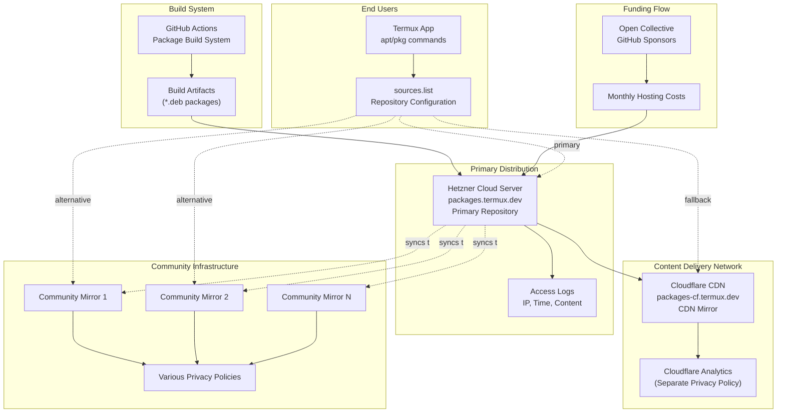
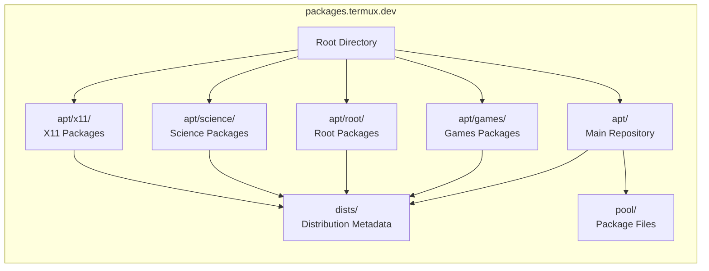
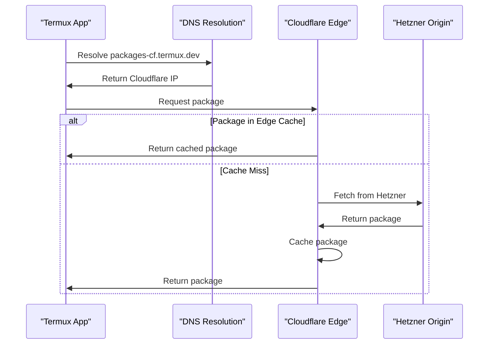
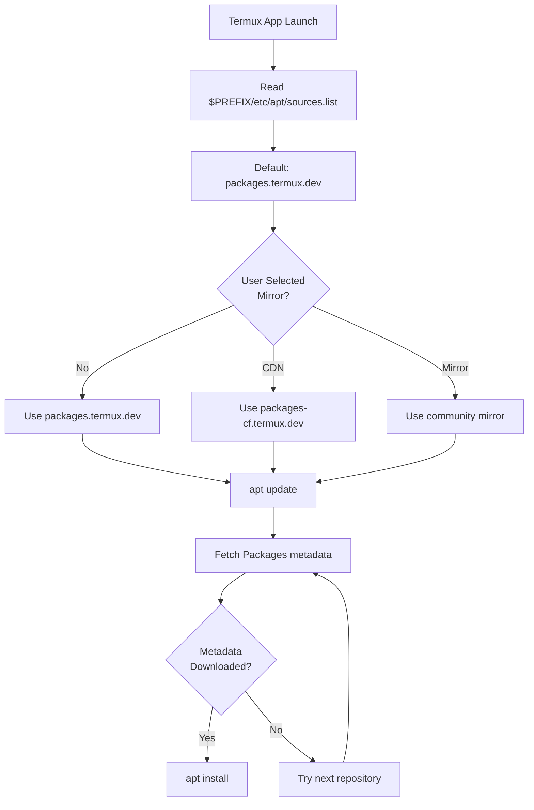
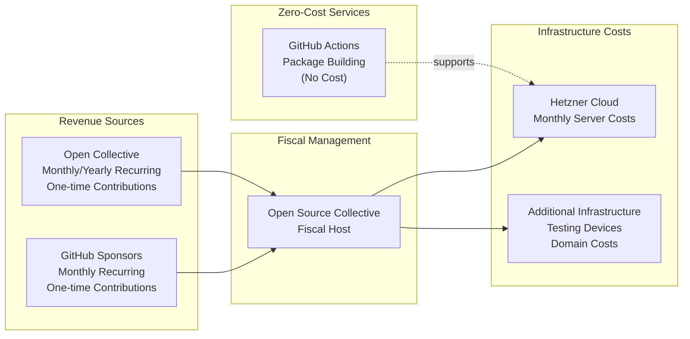
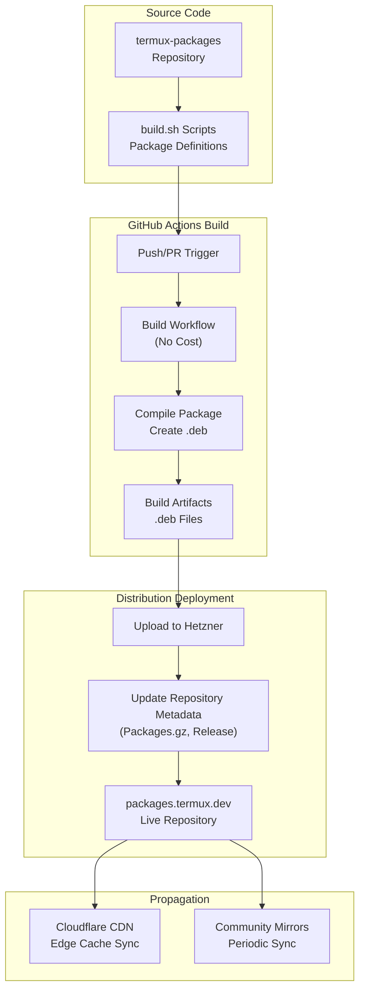

<!-- source: DeepWiki mcp.deepwiki.com · repo termux/termux.github.io · page 6.1 Package Distribution Infrastructure · fetched 2026-10-26 -->

# Package Distribution Infrastructure

Relevant source files

The following files were used as context for generating this wiki page:

- [cn/docs/index.md](cn/docs/index.md)
- [cn/donate.md](cn/donate.md)
- [cn/privacy-policy.md](cn/privacy-policy.md)
- [en/donate.md](en/donate.md)

## Purpose and Scope

This document describes the infrastructure that hosts and delivers Termux packages to end users. It covers the primary package repository, content delivery network, community mirrors, repository configuration, logging practices, and how the infrastructure is funded through donations.

For information about the donation system that funds this infrastructure, see [Funding and Donation System](#6.2). For privacy practices across all Termux services, see [Privacy Policy](#6.3).

---

## Architecture Overview

The Termux package distribution system consists of three tiers of infrastructure that work together to deliver packages reliably to users worldwide.

**Package Distribution Architecture**: This diagram shows the complete package distribution pipeline from build to delivery. GitHub Actions builds packages at no cost, which are then deployed to the Hetzner-hosted primary repository. The Cloudflare CDN provides edge caching, and community mirrors offer geographic redundancy. Donations fund the monthly Hetzner hosting costs. End users access packages through their configured `sources.list` file.

**Sources:** [en/donate.md:1-68](), [cn/privacy-policy.md:1-13]()

---

## Primary Repository (packages.termux.dev)

The primary package repository is hosted on a Hetzner Cloud server and serves as the authoritative source for all Termux packages.

### Hosting Details

| Attribute | Details |
|-----------|---------|
| **URL** | `https://packages.termux.dev` |
| **Hosting Provider** | Hetzner Cloud |
| **Funding Source** | Donations via Open Collective and GitHub Sponsors |
| **Build System** | GitHub Actions (no cost to project) |
| **Purpose** | Primary authoritative package repository |

The repository is funded by donations collected through Open Collective and GitHub Sponsors, which cover the monthly hosting costs. As stated in the donation page: *"the [primary packages repository](https://packages.termux.dev) is hosted by [Hetzner](https://www.hetzner.com/cloud), and we pay the monthly hosting cost with the donations we receive"* [en/donate.md:10]().

### Logging and Privacy Practices

The primary repository implements minimal logging for operational purposes only:

**Data Collected:**
- Remote IP address
- Access timestamp
- Requested content (package paths)

**Data Usage:**
- Troubleshooting purposes only
- Not shared with third parties
- Subject to Hetzner's privacy policy: https://www.hetzner.com/legal/privacy-policy/

As documented in the privacy policy: *"此信息仅用于故障排除目的，不会与任何第三方共享"* (This information is only used for troubleshooting purposes and is not shared with any third party) [cn/privacy-policy.md:10]().

### Repository Structure

The primary repository hosts multiple repository types accessible via standard APT/dpkg tooling:

**Primary Repository Structure**: The Hetzner server hosts multiple specialized repositories under the `packages.termux.dev` domain, each containing distribution metadata and package pools organized according to Debian repository conventions.

**Sources:** [en/donate.md:10](), [cn/privacy-policy.md:10]()

---

## Content Delivery Network

The Cloudflare CDN provides global edge caching and improved download speeds for Termux packages.

### CDN Configuration

| Attribute | Details |
|-----------|---------|
| **URL** | `https://packages-cf.termux.dev` |
| **Provider** | Cloudflare |
| **Purpose** | Global edge caching and acceleration |
| **Origin** | packages.termux.dev (Hetzner) |
| **Privacy Policy** | Separate from Termux (Cloudflare's policy applies) |

### Privacy Considerations

The Cloudflare CDN operates under Cloudflare's privacy policy, which differs from the primary repository's practices. As noted in the privacy documentation: *"主要软件包服务器的 [Cloudflare CDN 节点](https://packages-cf.termux.dev)和[其他 Termux 镜像]由社区或其维护者托管，可能会有不同的隐私政策"* (The Cloudflare CDN nodes and other Termux mirrors are hosted by the community or their maintainers and may have different privacy policies) [cn/privacy-policy.md:12]().

### Usage Pattern

**CDN Request Flow**: This sequence diagram illustrates how package requests are handled by the Cloudflare CDN, showing the cache hit/miss logic and origin fallback to the Hetzner primary server.

**Sources:** [cn/privacy-policy.md:12]()

---

## Community Mirrors

Community-maintained mirrors provide geographic redundancy and alternative download locations for Termux packages.

### Mirror Characteristics

Community mirrors have the following properties:

- **Independent hosting**: Maintained by community members or organizations
- **Separate privacy policies**: Each mirror operator defines their own data collection and privacy practices
- **Synchronization**: Mirrors sync from the primary repository (packages.termux.dev)
- **Documentation**: Listed at https://github.com/termux/termux-packages/wiki/Mirrors

### Privacy and Data Collection

Each mirror operates independently with its own privacy policy. The privacy policy explicitly notes this distinction: *"其他 Termux 镜像由社区或其维护者托管，可能会有不同的隐私政策"* (Other Termux mirrors are hosted by the community or their maintainers and may have different privacy policies) [cn/privacy-policy.md:12]().

Users selecting community mirrors should consult the specific mirror's privacy documentation to understand data collection practices.

**Sources:** [cn/privacy-policy.md:12]()

---

## Repository Configuration

Termux uses standard Debian APT repository configuration via the `sources.list` file system.

### Repository Selection Hierarchy

**Repository Selection Process**: This diagram shows how the Termux app determines which repository to use for package operations. The default is the primary Hetzner repository, but users can configure alternatives, and APT automatically falls back to other sources if the primary fails.

### Standard Repository URLs

The following repository URLs are commonly configured:

| Repository Type | URL Pattern |
|----------------|-------------|
| **Main Repository** | `https://packages.termux.dev/apt/termux-main` |
| **Games Repository** | `https://packages.termux.dev/apt/termux-games` |
| **Root Repository** | `https://packages.termux.dev/apt/termux-root` |
| **Science Repository** | `https://packages.termux.dev/apt/termux-science` |
| **X11 Repository** | `https://packages.termux.dev/apt/termux-x11` |

These can be substituted with `packages-cf.termux.dev` for CDN access or other mirror URLs.

---

## Infrastructure Funding Model

The package distribution infrastructure is funded entirely through community donations.

### Cost Structure

**Infrastructure Funding Flow**: This diagram illustrates how donations flow through Open Source Collective to cover hosting costs. GitHub Actions provides free package building, reducing overall infrastructure expenses. Both Open Collective and GitHub Sponsors route funds through the Open Source Collective fiscal host before paying Hetzner hosting costs.

### Donation Allocation

As documented in the donation page:

> "We are currently using github actions for building our packages and that does not incur any cost to us. However, the [primary packages repository](https://packages.termux.dev) is hosted by [Hetzner](https://www.hetzner.com/cloud), and we pay the monthly hosting cost with the donations we receive at [Open Collective](#open-collective) and [Github Sponsors](#github-sponsors)." [en/donate.md:10]()

The donation page also lists broader uses:
- Hosting costs for sites and package repositories
- Additional package repository mirrors
- Testing device costs
- Development and maintenance support

For detailed information about making donations, see [Funding and Donation System](#6.2).

**Sources:** [en/donate.md:8-22](), [cn/donate.md:8-22]()

---

## Package Build and Deployment Pipeline

While package building happens outside the distribution infrastructure, understanding the pipeline provides context for how packages reach the repositories.

### Build to Distribution Flow

**Build and Deployment Pipeline**: This diagram shows the complete pipeline from source code to user-accessible packages. GitHub Actions provides free build infrastructure, resulting in `.deb` artifacts that are uploaded to Hetzner, where repository metadata is updated to make packages discoverable via APT. Changes then propagate to CDN and mirrors.

**Sources:** [en/donate.md:10]()

---

## Summary

The Termux package distribution infrastructure operates on a three-tier model:

1. **Primary Repository** (packages.termux.dev): Hetzner-hosted authoritative source, funded by donations, with minimal logging for troubleshooting
2. **CDN Layer** (packages-cf.termux.dev): Cloudflare edge caching for improved global performance
3. **Community Mirrors**: Independent mirrors providing geographic redundancy with separate privacy policies

The infrastructure is entirely funded through community donations via Open Collective and GitHub Sponsors, with both services using Open Source Collective as fiscal host. GitHub Actions provides zero-cost package building, minimizing operational expenses to primarily server hosting costs.

Users access packages through standard APT configuration in `sources.list`, with automatic fallback between repositories ensuring high availability.

---

