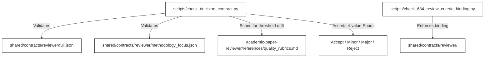
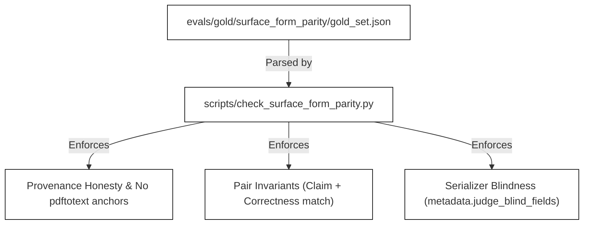
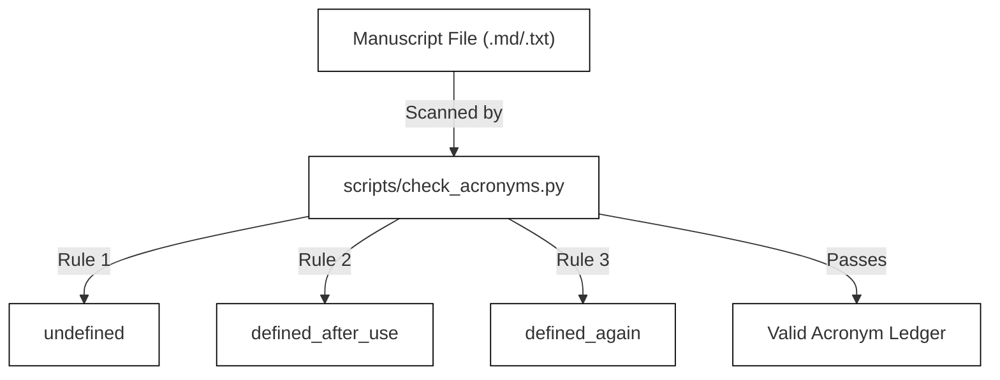
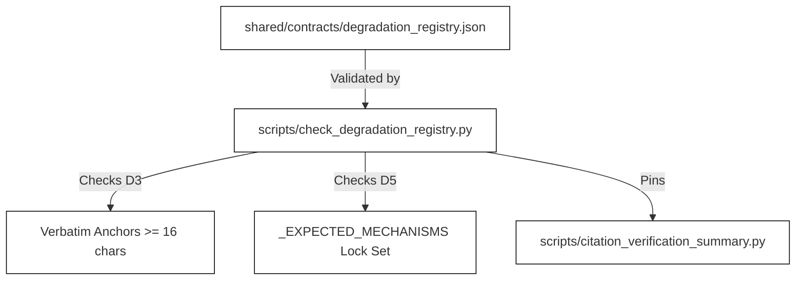
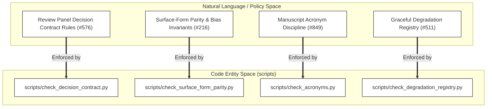
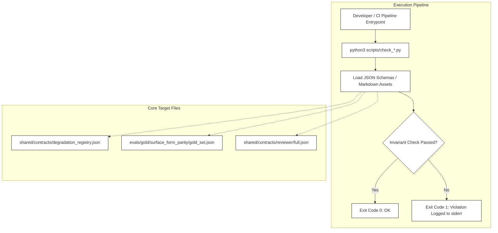

<!-- source: DeepWiki mcp.deepwiki.com · repo Imbad0202/academic-research-skills · page 14.3 Advisory and Conformance Check Families · fetched 2026-10-30 -->

# Advisory and Congence Check Families

Relevant source files

The following files were used as context for generating this wiki page:

- [academic-paper-reviewer/templates/editorial_decision_template.md](academic-paper-reviewer/templates/editorial_decision_template.md)
- [academic-paper/references/workflow_phase_details.md](academic-paper/references/workflow_phase_details.md)
- [academic-paper/references/writing_quality_check.md](academic-paper/references/writing_quality_check.md)
- [docs/design/2026-06-09-216-surface-form-parity-design.md](docs/design/2026-06-09-216-surface-form-parity-design.md)
- [evals/gold/surface_form_parity/README.md](evals/gold/surface_form_parity/README.md)
- [evals/gold/surface_form_parity/gold_set.json](evals/gold/surface_form_parity/gold_set.json)
- [evals/gold/surface_form_parity/manifest.yaml](evals/gold/surface_form_parity/manifest.yaml)
- [scripts/check_216_surface_form.py](scripts/check_216_surface_form.py)
- [scripts/check_684_review_criteria_binding.py](scripts/check_684_review_criteria_binding.py)
- [scripts/check_acronyms.py](scripts/check_acronyms.py)
- [scripts/check_collaboration_depth_rubric.py](scripts/check_collaboration_depth_rubric.py)
- [scripts/check_content_coverage_advisory_integration.py](scripts/check_content_coverage_advisory_integration.py)
- [scripts/check_decision_contract.py](scripts/check_decision_contract.py)
- [scripts/check_degradation_registry.py](scripts/check_degradation_registry.py)
- [scripts/check_surface_form_parity.py](scripts/check_surface_form_parity.py)
- [scripts/check_tortured_phrase_screening_integration.py](scripts/check_tortured_phrase_screening_integration.py)
- [scripts/test_check_684_review_criteria_binding.py](scripts/test_check_684_review_criteria_binding.py)
- [scripts/test_check_acronyms.py](scripts/test_check_acronyms.py)
- [scripts/test_check_collaboration_depth_rubric.py](scripts/test_check_collaboration_depth_rubric.py)
- [scripts/test_check_content_coverage_advisory_integration.py](scripts/test_check_content_coverage_advisory_integration.py)
- [scripts/test_check_cross_document_consistency_advisory_integration.py](scripts/test_check_cross_document_consistency_advisory_integration.py)
- [scripts/test_check_decision_contract.py](scripts/test_check_decision_contract.py)
- [scripts/test_check_surface_form_parity.py](scripts/test_check_surface_form_parity.py)
- [scripts/test_check_tortured_phrase_screening_integration.py](scripts/test_check_tortured_phrase_screening_integration.py)
- [shared/contracts/degradation_registry.json](shared/contracts/degradation_registry.json)

## Purpose and Scope

The Academic Research Skills (ARS) repository enforces strict architectural integrity, contract conformance, and prompt discipline through a specialized toolkit of validator scripts located under the `scripts/` directory [scripts/check_decision_contract.py:1-8](). These check families operate as deterministic, zero-network, local-only test harnesses and CI gates. They ensure that JSON schemas, markdown-based agent definitions, decision rules, acronym usage, and graceful degradation registries never drift from their specified authorities.

This page documents the implementation, data flows, and verification logic of the core check families: decision contracts, surface-form parity, acronym screening, content coverage, degradation registries, and script/skill linters.

---

## Decision Contract and Review Criteria Validation

The decision contract family governs the mapping between review panel evaluations and final editorial decisions (`Accept`, `Minor Revision`, `Major Revision`, `Reject`) [scripts/check_decision_contract.py:21-27](). It ensures that qualitative criteria and threshold arithmetic remain synchronized across specifications, execution scripts, and schema contracts.

### Key Validation Scripts and Classes
- `scripts/check_decision_contract.py`: Pins the four-value decision enum, validates reviewer contracts (e.g., `shared/contracts/reviewer/full.json`), and scans for unauthorized numeric score-capping or threshold drift (such as illegal hard-coded cutoffs like `score >= 80`) [scripts/check_decision_contract.py:1-177]().
- `scripts/check_684_review_criteria_binding.py`: Validates schema binding integrity, role-separated enum orders (`EIC`, `R1`, `R2`, `R3`, `DA`), five-way blinding parameters, and prevents unauthorized network imports or ambient filesystem scans in measurement runners [scripts/test_check_684_review_criteria_binding.py:1-179]().

*Sources: [scripts/check_decision_contract.py:1-52](), [scripts/test_check_684_review_criteria_binding.py:1-35]()*

---

## Surface-Form Parity and Bias Invariant Checks

To prevent reviewer bias stemming from prose style rather than substantive merit (Kim et al. 2026 arXiv:2605.20668v1 §F.3.6), ARS utilizes specialized test harnesses and validators [scripts/check_surface_form_parity.py:1-25]().

### Implementation and Logic
- `scripts/check_surface_form_parity.py`: Validates the #216 surface-form parity mixed-provenance regression fixture (`evals/gold/surface_form_parity/gold_set.json`) [scripts/check_surface_form_parity.py:1-40]().
- **Provenance Honesty**: Asserts that `paper_verbatim` items carry valid verbatim anchors, while maintainer-authored or counterfactual rewrites are explicitly labeled and prohibited from claiming verbatim provenance [scripts/check_surface_form_parity.py:10-15]().
- **Pair Invariants**: Enforces that paired test items share canonical claims and expected correctness while differing strictly in framing style (`informal_vague` vs. `technical_precise`) [scripts/check_surface_form_parity.py:10-18]().
- **Anti-Rot Rule**: Forbids session-scoped `pdftotext` line number anchors (e.g., `L4753`), requiring section or example identifiers instead [scripts/check_surface_form_parity.py:47-51]().
- **Serializer Blindness**: Verifies that the JSON serialization excludes answer-leaking labels and manipulated variables (`expert_verdict`, `asymmetry_direction`, `framing_style`) from the judge's view [scripts/check_surface_form_parity.py:62-76]().

*Sources: [scripts/check_surface_form_parity.py:1-85](), [scripts/test_check_surface_form_parity.py:1-50]()*

---

## Deterministic Acronym Discipline Validation

Manuscript acronym consistency is enforced locally without model calls via deterministic text scanners [scripts/check_acronyms.py:1-12]().

### Core Rules and Mechanisms
- `scripts/check_acronyms.py`: Parses Markdown or plain-text files across three distinct scopes (body, English abstract, Chinese abstract), treating each scope independently [scripts/check_acronyms.py:5-12]().
- **`undefined`**: Flags acronyms used in a scope without prior definition [scripts/check_acronyms.py:8-12]().
- **`defined_after_use`**: Flags instances where an acronym's first usage precedes its definition [scripts/check_acronyms.py:9-12]().
- **`defined_again`**: Flags duplicate definitions within the same scope [scripts/check_acronyms.py:11-12]().
- **Exclusions and Coverage Limits**: Ignores code spans, math blocks, link destinations, table headings, reference lists, chemical formulas, and standard statistical symbols (`SD`, `SE`, `CI`) [scripts/check_acronyms.py:68-107](). Unconfirmed definition patterns are reported as non-blocking coverage limits rather than errors [scripts/check_acronyms.py:27-32]().

*Sources: [scripts/check_acronyms.py:1-65](), [scripts/test_check_acronyms.py:1-50]()*

---

## Degradation Registry and Advisory Integration Checks

ARS provides graceful degradation mechanisms to handle API outages, network errors, and missing optional hardware/software dependencies without failing pipelines arbitrarily [shared/contracts/degradation_registry.json:1-12]().

### Registry Linting and Enforcement
- `scripts/check_degradation_registry.py`: Pins `shared/contracts/degradation_registry.json` to repository code state [scripts/check_degradation_registry.py:1-7]().
- **D1-D5 Validation**: Verifies JSON parseability, unique mechanism IDs, non-empty required fields, and ensures every authority citation references a real repository file with a verbatim content anchor ($\ge 16$ characters) rather than brittle line numbers [scripts/check_degradation_registry.py:8-26]().
- **Lock Semantics (`_EXPECTED_MECHANISMS`)**: Prevents silent deletion or renaming of degradation mechanisms by requiring explicit test/registry updates in the same commit [scripts/check_degradation_registry.py:21-25]().
- **Advisory Integration Checks**: Associated test scripts (e.g., `scripts/check_content_coverage_advisory_integration.py`, `scripts/check_collaboration_depth_rubric.py`) ensure that non-blocking advisory agents (like `collaboration_depth_agent`) are properly wired into orchestrators without violating terminal blocking constraints [scripts/check_collaboration_depth_rubric.py:1-50]().

*Sources: [shared/contracts/degradation_registry.json:1-35](), [scripts/check_degradation_registry.py:1-98]()*

---

## Architecture and Data Flow Mapping (Natural Language Space to Code Entity Space)

The following diagrams illustrate how high-level specification requirements and natural language rules map directly to underlying python validator scripts, schemas, and test harnesses within the codebase.

### Diagram 1: System Rule to Validator Code Entity Mapping

*Sources: [scripts/check_decision_contract.py:1-25](), [scripts/check_surface_form_parity.py:1-25](), [scripts/check_acronyms.py:1-15](), [scripts/check_degradation_registry.py:1-10]*

### Diagram 2: Conformance and Check Execution Flow

*Sources: [scripts/check_degradation_registry.py:34-36](), [scripts/check_surface_form_parity.py:21-25](), [scripts/check_decision_contract.py:7-8]*

---

