# Page: Overview

# Overview

<details>
<summary>Relevant source files</summary>

The following files were used as context for generating this wiki page:

- [.claude-plugin/marketplace.json](.claude-plugin/marketplace.json)
- [.claude-plugin/plugin.json](.claude-plugin/plugin.json)
- [.claude/CLAUDE.md](.claude/CLAUDE.md)
- [CITATION.cff](CITATION.cff)
- [MODE_REGISTRY.md](MODE_REGISTRY.md)
- [POSITIONING.md](POSITIONING.md)
- [QUICKSTART.md](QUICKSTART.md)
- [README.ja-JP.md](README.ja-JP.md)
- [README.ko-KR.md](README.ko-KR.md)
- [README.md](README.md)
- [README.zh-CN.md](README.zh-CN.md)
- [README.zh-TW.md](README.zh-TW.md)
- [academic-pipeline/SKILL.md](academic-pipeline/SKILL.md)
- [docs/ARCHITECTURE.md](docs/ARCHITECTURE.md)
- [scripts/check_spec_consistency.py](scripts/check_spec_consistency.py)

</details>


## Purpose and Scope

Academic Research Skills (ARS) system (v3.23.1) is a contract-audited research-to-publication copilot framework designed for Claude Code [README.md:1-3, .claude-plugin/plugin.json:1-4]. ARS provides a human-in-the-loop architecture that assists scholars across the full lifecycle—from initial literature exploration and systematic screening to paper drafting, peer review, and final multi-format generation [README.md:10, README.ko-KR.md:10]. 

The system operates across five core modular skills (`deep-research`, `academic-paper`, `academic-paper-reviewer`, `academic-pipeline`, and `sr-screener`) that coordinate via structured handoff contracts and state machine transitions [.claude/CLAUDE.md:7-13]. ARS enforces strict verification gates to mitigate hallucination and contamination risks while preserving human authorship [README.md:21-33].

For installation, CLI setup, environment flags, and quick start guides, see [Getting Started](#1.1). For details on the multi-skill agent ecosystem, data access isolation levels, and model tiering, see [System Architecture](#1.2).

**Sources:** [README.md:1-33](), [.claude-plugin/plugin.json:1-4](), [.claude/CLAUDE.md:7-13]()

## The Five Core Skills

ARS is organized around five independent skills, each defined by its respective `SKILL.md` file and agent manifest directory [.claude/CLAUDE.md:7-13]:

| Skill Name | Skill File Path | Agent Count | Purpose & Role |
|------------|-----------------|-------------|----------------|
| `deep-research` | `deep-research/SKILL.md` | 13 | Formulates research questions, executes systematic searches, ensures PRISMA compliance, and synthesizes evidence [README.md:41-47, .claude/CLAAUDE.md:9]. |
| `academic-paper` | `academic-paper/SKILL.md` | 12 | Executes chapter planning, academic paper drafting, revision coaching, citation compliance, and LaTeX/DOCX/PDF output formatting [.claude/CLAUDE.md:10]. |
| `academic-paper-reviewer` | `academic-paper-reviewer/SKILL.md` | 7 | Executes multi-perspective peer review using a 5-person simulated panel and 0–100 quality rubrics [.claude/CLAUDE.md:11]. |
| `academic-pipeline` | `academic-pipeline/SKILL.md` | 3 | Orchestrates the end-to-end 10-stage research workflow with mandatory coverage-bounded integrity gates [.claude/CLAUDE.md:12]. |
| `sr-screener` | `sr-screener/SKILL.md` | 3+ | Manages protocol-driven study screening via dual blinded AI reviewers and a third-reviewer adjudicator [.claude/CLAUDE.md:13]. |

**Sources:** [.claude/CLAUDE.md:7-13](), [README.md:41-47]()

### Diagram: Natural Language to Code Entity Space: Skill Ecosystem Mapping

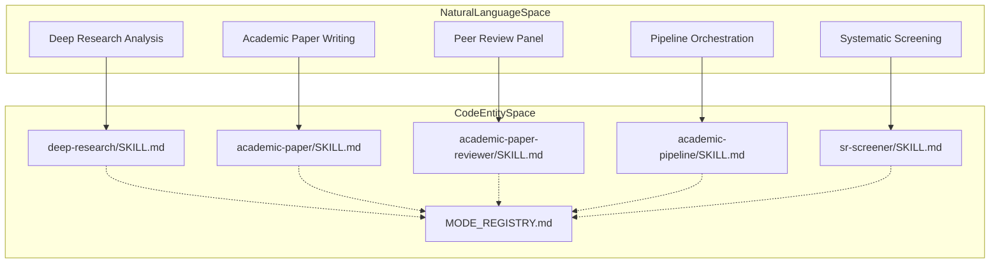

**Sources:** [MODE_REGISTRY.md:1-70](), [.claude/CLAUDE.md:7-13]()

## Pipeline Workflow and Execution Architecture

The `academic-pipeline` skill coordinates the workflow across 10 sequential stages, integrating deep research outputs, screening corpora, drafting engines, integrity gates, and peer review cycles [academic-pipeline/SKILL.md:3, docs/ARCHITECTURE.md:43-77].

### Diagram: Natural Language to Code Entity Space: Pipeline Execution Mapping

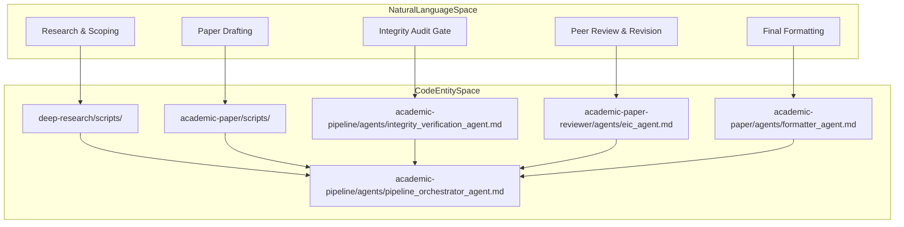

**Sources:** [academic-pipeline/SKILL.md:17-20](), [docs/ARCHITECTURE.md:43-77]()

## Claude Code Infrastructure Dependencies

ARS integrates natively with Claude Code infrastructure features:
- **Plugin Marketplace**: Installs via marketplace registry entries (`/plugin marketplace add`) [.claude-plugin/plugin.json:1-4, README.md:12-17].
- **Slash Commands**: Maps user intent to modes registered in `MODE_REGISTRY.md` via `commands/` [README.md:19].
- **Python Runtime Guards**: Enforces write-scope boundaries and verification scripts via `scripts/` and `hooks/` [.claude/CLAUDE.md:17].
- **Environment Flags**: Controls optional verification layers (e.g., `ARS_CLAIM_AUDIT=1`, `ARS_PASSPORT_RESET=1`) [academic-pipeline/SKILL.md:44-48].

**Sources:** [README.md:12-19](), [.claude-plugin/plugin.json:1-4](), [academic-pipeline/SKILL.md:44-48]()

## Child Pages

For granular technical specifications, please consult the child pages:
- **[Getting Started](#1.1)** — Installation guides, environment flags, CLI setup, and slash command references.
- **[System Architecture](#1.2)** — Multi-skill ecosystem design, agent topology, data access isolation levels, and model tiering structures.

**Sources:** [README.md:45-78](), [docs/ARCHITECTURE.md:1-15]()

---

# Page: Getting Started

# Getting Started

<details>
<summary>Relevant source files</summary>

The following files were used as context for generating this wiki page:

- [QUICKSTART.md](QUICKSTART.md)
- [commands/ars-abstract.md](commands/ars-abstract.md)
- [commands/ars-citation-check.md](commands/ars-citation-check.md)
- [commands/ars-disclosure.md](commands/ars-disclosure.md)
- [commands/ars-format-convert.md](commands/ars-format-convert.md)
- [commands/ars-full.md](commands/ars-full.md)
- [commands/ars-lit-review.md](commands/ars-lit-review.md)
- [commands/ars-outline.md](commands/ars-outline.md)
- [commands/ars-plan.md](commands/ars-plan.md)
- [commands/ars-reviewer.md](commands/ars-reviewer.md)
- [commands/ars-revision-coach.md](commands/ars-revision-coach.md)
- [commands/ars-revision.md](commands/ars-revision.md)
- [docs/PERFORMANCE.md](docs/PERFORMANCE.md)
- [docs/PERFORMANCE.zh-TW.md](docs/PERFORMANCE.zh-TW.md)
- [docs/SETUP.md](docs/SETUP.md)
- [docs/SETUP.zh-TW.md](docs/SETUP.zh-TW.md)
- [scripts/announce-ars-loaded.sh](scripts/announce-ars-loaded.sh)
- [shared/cross_model_verification.md](shared/cross_model_verification.md)

</details>


## Purpose and Scope
This page covers the technical setup, installation channels, environment configuration, slash commands in `commands/`, and quick-start protocols for the Academic Research Skills (ARS) system. It bridges environment provisioning with execution entry points across the core skills (`deep-research`, `academic-paper`, `academic-paper-reviewer`, `academic-pipeline`, `sr-screener`).

Sources: `QUICKSTART.md:1-29()`, `docs/SETUP.md:1-20()`

---

## Installation Channels

ARS supports multiple installation vectors depending on the target runtime environment (Claude Code CLI, plugin marketplace, project-local symlinks, repo clone, or web/Cowork environments).

### 1. Prerequisites and CLI Setup
ARS requires the Claude Code command-line interface. Use the native installer (recommended) or the deprecated npm package:

```bash
# macOS / Linux native installer
curl -fsSL https://claude.ai/install.sh | bash

# Windows PowerShell native installer
irm https://claude.ai/install.ps1 | iex
```
Sources: `docs/SETUP.md:23-46()`, `QUICKSTART.md:5-10()`

### 2. Installation Methods Matrix
| Method | Target Path | Description |
| :--- | :--- | :--- |
| **Plugin Marketplace** | `/plugin install academic-research-skills` | Exposes hardening subagents and plugin-managed slash commands (`commands/`). |
| **Repo Clone & Symlink** | `.claude/skills/` | Symlinks repository skill directories into a project workspace. |
| **Skills Copy** | `.claude/skills/` | Direct file copies of individual skill folders. |
| **Cowork / Web** | Manual settings upload | Custom zip upload via web or Cowork settings (does not read local `~/.claude/skills/`). |

```bash
# Example: Repo clone and local project symlinks
git clone https://github.com/Imbad0202/academic-research-skills.git ~/academic-research-skills
cd /path/to/your/project
mkdir -p .claude/skills
ln -s ~/academic-research-skills/deep-research .claude/skills/deep-research
ln -s ~/academic-research-skills/academic-paper .claude/skills/academic-paper
ln -s ~/academic-research-skills/academic-paper-reviewer .claude/skills/academic-paper-reviewer
ln -s ~/academic-research-skills/academic-pipeline .claude/skills/academic-pipeline
ln -s ~/academic-research-skills/sr-screener .claude/skills/sr-screener
```
Sources: `QUICKSTART.md:11-28()`, `docs/SETUP.md:1-13()`

---

## API Configuration and Environment Flags

### API Key Setup
The system relies on an Anthropic API key. Set it via environment variable or permit Claude Code to prompt on first run:
```bash
export ANTHROPIC_API_KEY=sk-ant-xxxxx
claude
```
Sources: `docs/SETUP.md:48-61()`

### Opt-In Environment Flags (v3.5.1+)
ARS exposes several behavior toggles via environment variables. All default to `OFF`:

| Flag | Since | Description | Reference |
| :--- | :--- | :--- | :--- |
| `ARS_CROSS_MODEL` | v3.0 | Enables cross-model verification layers. | `shared/cross_model_verification.md:1-7()` |
| `ARS_CROSS_MODEL_TRANSPORT=codex` | #630 | Routes citation-integrity checks via Codex app-server adapter. | `shared/cross_model_verification.md:16-24()` |
| `ARS_PASSPORT_RESET=1` | v3.6.3 | Promotes FULL and MANDATORY checkpoints to context reset boundaries. | `docs/SETUP.md:136-136()` |
| `ARS_CLAIM_AUDIT=1` | v3.8 | Enables claim-faithfulness verification against sources at Stage 4.5. | `docs/SETUP.md:139-139()` |
| `ARS_INQUIRY_LEDGER=1` | v3.21.1 | Activates the inquiry branch ledger (alpha). | `docs/SETUP.md:142-142()` |

Sources: `docs/SETUP.md:125-143()`

---

## Slash Commands and Command Surface

Commands located in `commands/` trigger specific skills and modes. 

### Command Reference Table
| Command | Model | Description | Target Code Entrypoint |
| :--- | :--- | :--- | :--- |
| `/ars-full` | `inherit` | Full 10-stage research pipeline | `academic-pipeline/SKILL.md` |
| `/ars-plan` | `sonnet` | Socratic chapter-by-chapter planning | `academic-paper/SKILL.md` (plan mode) |
| `/ars-reviewer` | `inherit` | Simulated peer-review panel (5 reviewers) | `academic-paper-reviewer/SKILL.md` |
| `/ars-revision-coach` | `inherit` | Parse reviewer comments into Roadmap | `academic-paper/SKILL.md` (revision-coach) |
| `/ars-lit-review` | `sonnet` | Annotated bibliography in paper format | `academic-paper/SKILL.md` (lit-review) |
| `/ars-citation-check` | `inherit` | Citation error report | `academic-paper/SKILL.md` (citation-check) |
| `/ars-disclosure` | `sonnet` | Venue policy compliance bundle | `academic-paper/SKILL.md` (disclosure) |

Sources: `scripts/announce-ars-loaded.sh:55-108()`, `commands/ars-lit-review.md:1-10()`, `commands/ars-citation-check.md:1-10()`

---

## Quick Start and Intent Routing Architecture

Users initiate sessions using natural language prompts, which the Claude Code intent router matches against skill definitions and mode registries.

### Diagram: Natural Language Space to Code Entity Space (Routing)
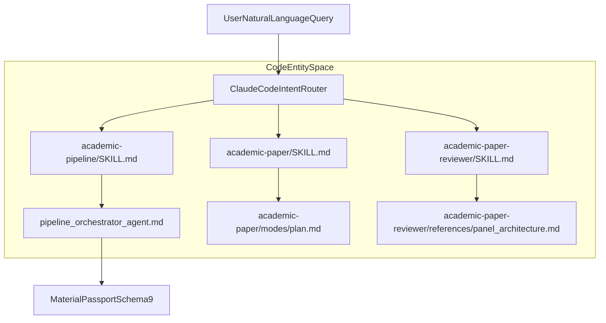
Sources: `QUICKSTART.md:36-81()`, `docs/design/2026-04-27-ars-v3.6.5.1-setup-fix-implementation-brief.md:29-55()`

---

## Plugin Architecture and Subagent Dispatch

When installed as a plugin, ARS exposes hardened subagents through `scripts/announce-ars-loaded.sh`. These agents inherit the dispatching session's model and operate under least-privilege tool restrictions.

### Diagram: Session Space to Agent Entity Space
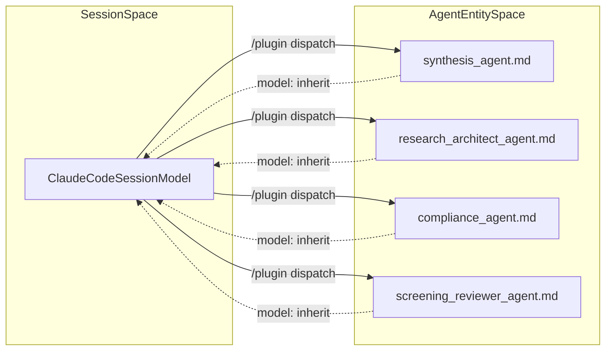
Sources: `scripts/announce-ars-loaded.sh:77-105()`, `docs/PERFORMANCE.md:43-56()`

---

## Optional Toolchains and Adapters

### Optional Dependencies
* **Pandoc**: Required for direct `.docx` generation.
* **Tectonic & Fonts**: Required for PDF rendering via LaTeX (includes **Source Han Serif TC VF** for CJK support).
* **Python Interpreter**: Required for write-scope guards (`PreToolUse`), revision patches, and cache management commands (`/ars-cache-invalidate`, `/ars-mark-read`, `/ars-unmark-read`).

Sources: `docs/SETUP.md:15-97()`

### Literature Corpus Adapters
Curated libraries (Zotero, Obsidian, or PDF directories) can be pre-loaded into the Material Passport via reference Python adapters:
```bash
python scripts/adapters/folder_scan.py --input /path/to/pdfs --passport passport.yaml --rejection-log rejection_log.yaml
python scripts/adapters/zotero.py --input my-zotero-export.json --passport passport.yaml --rejection-log rejection_log.yaml
python scripts/adapters/obsidian.py --input ~/Obsidian/Lit\ Notes --passport passport.yaml --rejection-log rejection_log.yaml
```
Sources: `docs/SETUP.md:101-122()`

---

# Page: System Architecture

# System Architecture

<details>
<summary>Relevant source files</summary>

The following files were used as context for generating this wiki page:

- [.claude-plugin/marketplace.json](.claude-plugin/marketplace.json)
- [.claude-plugin/plugin.json](.claude-plugin/plugin.json)
- [.claude/CLAUDE.md](.claude/CLAUDE.md)
- [MODE_REGISTRY.md](MODE_REGISTRY.md)
- [README.ja-JP.md](README.ja-JP.md)
- [README.ko-KR.md](README.ko-KR.md)
- [README.md](README.md)
- [README.zh-CN.md](README.zh-CN.md)
- [README.zh-TW.md](README.zh-TW.md)
- [academic-paper-reviewer/SKILL.md](academic-paper-reviewer/SKILL.md)
- [academic-paper/SKILL.md](academic-paper/SKILL.md)
- [academic-pipeline/SKILL.md](academic-pipeline/SKILL.md)
- [deep-research/SKILL.md](deep-research/SKILL.md)
- [docs/ARCHITECTURE.md](docs/ARCHITECTURE.md)
- [docs/CONTROL_AVAILABILITY.md](docs/CONTROL_AVAILABILITY.md)
- [scripts/check_spec_consistency.py](scripts/check_spec_consistency.py)
- [shared/model_tiering.md](shared/model_tiering.md)
- [shared/references/routing_core.md](shared/references/routing_core.md)
- [tests/fixtures/issue_133_routing/CALIBRATION_LOG.md](tests/fixtures/issue_133_routing/CALIBRATION_LOG.md)
- [tests/fixtures/issue_133_routing/README.md](tests/fixtures/issue_133_routing/README.md)

</details>


## Purpose and Scope

This page provides a technical overview of the Academic Research Skills (ARS v3.23.1) system architecture. It outlines the multi-skill ecosystem, agent distributions, Claude Code infrastructure dependencies, model tiering strategies, data access isolation levels, and the underlying directory layout.

Sources: [README.md:1-46](), [.claude-plugin/plugin.json:1-15]()

---

## Multi-Skill Ecosystem and Code Entity Mapping

The ARS system is structured around five core operational skills that manage distinct phases of the academic research-to-publication pipeline. The mapping from natural language requests to code entities is managed by the routing core and skill manifests.

Title: Multi-Skill Ecosystem: Natural Language Space to Code Entity Space

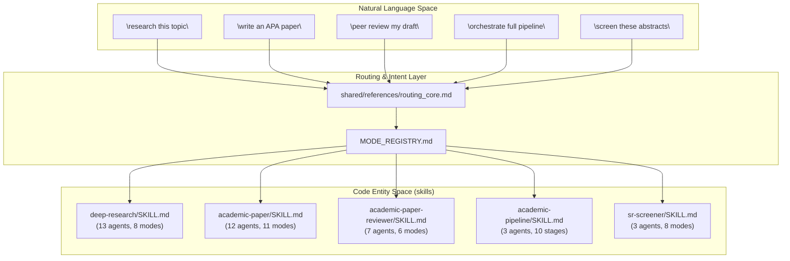

Sources: [.claude/CLAUDE.md:5-14](), [MODE_REGISTRY.md:1-70](), [shared/references/routing_core.md:1-32]()

---

## Agent Architecture and Distribution

ARS distributes 38 specialized subagents across the five skill directories. Each agent has a dedicated system prompt file in its respective `agents/` folder.

Title: Agent Ecosystem Distribution Across Code Directories

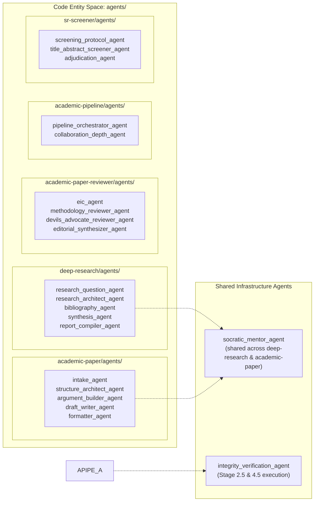

Sources: [deep-research/SKILL.md:1-15](), [academic-paper/SKILL.md:1-14](), [academic-paper-reviewer/SKILL.md:1-13](), [academic-pipeline/SKILL.md:1-15]()

---

## Claude Code Infrastructure Dependencies and Model Tiering

The execution environment relies on specific Claude Code runtime features, environment variables, and model tiering allocations defined in configuration files.

| Infrastructure Component | File / Setting Reference | Purpose |
|-------------------------|--------------------------|---------|
| **Agent Teams Runtime** | `CLAUDE_CODE_EXPERIMENTAL_AGENT_TEAMS=1` | Enables parallel subagent spawning via `TeamCreate`. |
| **Write-Scope Guard** | `hooks/run_guard.sh`, `scripts/ars_write_scope_guard.py` | POSIX shell watchdog enforcing phase-specific write protections [docs/ARCHITECTURE.md:1-15](), [.claude/CLAUDE.md:15-18](). |
| **Cross-Model Verification** | `ARS_CROSS_MODEL=1` | Activates secondary model evaluation tracks (e.g., Gemini / Codex) [docs/ARCHITECTURE.md:30-30](). |
| **Claim Integrity Audit** | `ARS_CLAIM_AUDIT=1` | Triggers `claim_ref_alignment_audit_agent` for L3 claim-faithfulness checks [academic-pipeline/SKILL.md:45-50](). |
| **Passport Reset Boundary** | `ARS_PASSPORT_RESET=1` | Promotes FULL and MANDATORY checkpoints to context-reset boundaries [academic-pipeline/SKILL.md:40-45](). |

Sources: [.claude/CLAUDE.md:15-35](), [academic-pipeline/SKILL.md:40-50](), [docs/ARCHITECTURE.md:1-15]()

---

## Data Access Isolation Levels and Handoff Architecture

To preserve ground-truth integrity and prevent contamination, ARS enforces strict data access boundaries across skills, backed by JSON schemas in `shared/contracts/`.

### Isolation Levels

*   `raw`: Full access to unfiltered literature searches, raw PDF texts, and unverified data sources (assigned to `deep-research`) [academic-pipeline/SKILL.md:9-9]().
*   `redacted`: Restricted access to internal search logs; operates on processed bibliographic items and structured notes (assigned to `academic-paper`) [academic-paper/SKILL.md:8-8]().
*   `verified_only`: Strictly restricted to data packets that have cleared integrity verification gates (assigned to `academic-paper-reviewer` and `academic-pipeline`) [academic-pipeline/SKILL.md:9-9]().

### Key Handoff Schemas

*   **Schema 1 (RQ Brief)**: Governs research question scoping between `deep-research` and `academic-paper`.
*   **Schema 9 (Material Passport)**: Tracks run provenance, file digests, and state transitions via `scripts/run_ledger.py` [.claude/CLAUDE.md:29-32]().
*   **Schema 11 (R&R Traceability Matrix)**: Maps journal reviewer critiques to revision patch points [academic-paper-reviewer/SKILL.md:1-13]().
*   **Schema 13 (Sprint Contract)**: Hard-gate protocol for reviewer pre-commitments [academic-pipeline/SKILL.md:1-15]().

Sources: [academic-pipeline/SKILL.md:1-15](), [.claude/CLAUDE.md:29-35](), [shared/references/routing_core.md:1-32]()

---

## Skills and Directory Structure

The repository organizes core execution code, validators, contracts, and references into a modular tree structure.

```text
skills/
├── deep-research/             # 13 agents, 8 modes (Research & Synthesis)
├── academic-paper/            # 12 agents, 11 modes (Writing & Revision)
├── academic-paper-reviewer/   # 7 agents, 6 modes (Peer Review)
├── academic-pipeline/         # 3 agents, 10 stages (Orchestration)
└── sr-screener/               # 3 agents, 8 modes (Systematic Screening)
scripts/
├── check_spec_consistency.py  # CI suite version validator
├── check_acronyms.py          # Deterministic acronym checker
└── run_ledger.py              # Passport and run ledger state manager
shared/
├── contracts/                 # 111 JSON validation schemas
└── references/                # Core routing and instruction boundaries
hooks/
├── hooks.json                 # Pre-tool use integration hooks
└── run_guard.sh               # Write-scope security guard launcher
```

Sources: [scripts/check_spec_consistency.py:1-30](), [.claude/CLAUDE.md:15-35](), [docs/ARCHITECTURE.md:1-15]()

---

# Page: Academic Pipeline Orchestrator

# Academic Pipeline Orchestrator

<details>
<summary>Relevant source files</summary>

The following files were used as context for generating this wiki page:

- [.claude-plugin/marketplace.json](.claude-plugin/marketplace.json)
- [.claude-plugin/plugin.json](.claude-plugin/plugin.json)
- [.claude/CLAUDE.md](.claude/CLAUDE.md)
- [.github/workflows/spec-consistency.yml](.github/workflows/spec-consistency.yml)
- [CHANGELOG.md](CHANGELOG.md)
- [MODE_REGISTRY.md](MODE_REGISTRY.md)
- [README.ja-JP.md](README.ja-JP.md)
- [README.ko-KR.md](README.ko-KR.md)
- [README.md](README.md)
- [README.zh-CN.md](README.zh-CN.md)
- [README.zh-TW.md](README.zh-TW.md)
- [academic-pipeline/SKILL.md](academic-pipeline/SKILL.md)
- [academic-pipeline/agents/integrity_verification_agent.md](academic-pipeline/agents/integrity_verification_agent.md)
- [academic-pipeline/agents/pipeline_orchestrator_agent.md](academic-pipeline/agents/pipeline_orchestrator_agent.md)
- [academic-pipeline/references/ai_research_failure_modes.md](academic-pipeline/references/ai_research_failure_modes.md)
- [academic-pipeline/references/passport_as_reset_boundary.md](academic-pipeline/references/passport_as_reset_boundary.md)
- [academic-pipeline/references/pipeline_state_machine.md](academic-pipeline/references/pipeline_state_machine.md)
- [academic-pipeline/references/process_summary_protocol.md](academic-pipeline/references/process_summary_protocol.md)
- [docs/ARCHITECTURE.md](docs/ARCHITECTURE.md)
- [scripts/_ci_pytest_manifest.toml](scripts/_ci_pytest_manifest.toml)
- [scripts/check_pipeline_boundary_semantics.py](scripts/check_pipeline_boundary_semantics.py)
- [scripts/check_spec_consistency.py](scripts/check_spec_consistency.py)
- [scripts/test_check_pipeline_boundary_semantics.py](scripts/test_check_pipeline_boundary_semantics.py)
- [scripts/test_v3_6_7_phase_6_6.py](scripts/test_v3_6_7_phase_6_6.py)
- [shared/contracts/README.md](shared/contracts/README.md)
- [shared/handoff_schemas.md](shared/handoff_schemas.md)

</details>


This wiki page covers the **academic-pipeline** skill (v3.23.1), an orchestrator that coordinates the research-to-publication workflow [academic-pipeline/SKILL.md:1-17](). The orchestrator manages a seamless 10-stage process by dispatching specialized skills (`deep-research`, `academic-paper`, `academic-paper-reviewer`), enforcing mandatory integrity gates, and tracking state across sessions via the Material Passport system [academic-pipeline/SKILL.md:3-7]().

Sources: [academic-pipeline/SKILL.md:1-17](), [.claude/CLAUDE.md:7-12]()

---

## System Architecture

The academic pipeline implements a dispatch-based architecture that enforces workflow consistency and quality gates across the research lifecycle. It coordinates specialized agents through a thin coordination layer defined in `academic-pipeline/SKILL.md` [academic-pipeline/SKILL.md:17-20]().

### Core Agent Team and Data Flow

The orchestrator employs project management and verification agents rather than content generation agents [academic-pipeline/agents/pipeline_orchestrator_agent.md:8-12]().

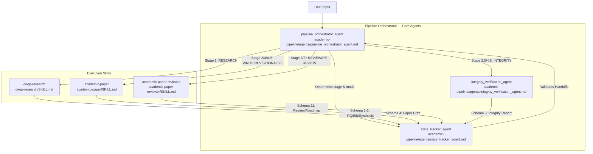

Sources: [academic-pipeline/SKILL.md:3-7](), [academic-pipeline/agents/pipeline_orchestrator_agent.md:6-12](), [shared/handoff_schemas.md:25-115]()

---

## Pipeline Stages Overview

The orchestrator coordinates a 10-stage workflow, with Stages 2.5 and 4.5 operating as mandatory blocking gates [docs/ARCHITECTURE.md:45-77]().

| Stage | Name | Skill / Agent | Key Deliverables |
|-------|------|---------------|------------------|
| 1 | RESEARCH | `deep-research` | RQ Brief, Methodology Blueprint, Bibliography, Synthesis Report [scripts/check_pipeline_boundary_semantics.py:86-90]() |
| 2 | WRITE | `academic-paper` | Paper Draft [docs/ARCHITECTURE.md:45-77]() |
| **2.5** | **INTEGRITY** | **`integrity_verification_agent`** | **Integrity Report + Corrected Paper** [docs/ARCHITECTURE.md:45-77]() |
| 3 | REVIEW | `academic-paper-reviewer` | 5 Review Reports + Editorial Decision [docs/ARCHITECTURE.md:45-77]() |
| 4 | REVISE | `academic-paper` | Revised Draft + Response to Reviewers [docs/ARCHITECTURE.md:45-77]() |
| **3'** | **RE-REVIEW** | **`academic-paper-reviewer`** | **Verification Review Report** [docs/ARCHITECTURE.md:45-77]() |
| **4'** | **RE-REVISE** | **`academic-paper`** | **Second Revised Draft (if needed)** [docs/ARCHITECTURE.md:45-77]() |
| **4.5** | **FINAL INTEGRITY** | **`integrity_verification_agent`** | **Final Verification Report (Zero Hallucination)** [docs/ARCHITECTURE.md:45-77]() |
| 5 | FINALIZE | `academic-paper` | MD, DOCX, LaTeX, and PDF Output [docs/ARCHITECTURE.md:45-77]() |
| 6 | PROCESS SUMMARY | `pipeline_orchestrator_agent` | **Paper Creation Process Record** [docs/ARCHITECTURE.md:45-77]() |

Sources: [docs/ARCHITECTURE.md:45-77](), [scripts/check_pipeline_boundary_semantics.py:86-90]()

---

## Child Page Guide

For detailed technical specifications, examine the child pages linked below:

- **[Pipeline Stages Reference](#2.1)** — Detailed documentation on all 10 stages, state machine transitions, revision loop limits, and stage capability matrices [academic-pipeline/references/pipeline_state_machine.md:1-50]().
- **[Adaptive Checkpoint System](#2.2)** — Overview of FULL, SLIM, and MANDATORY checkpoints, confirmation gates, awareness guards, and the Sprint Contract protocol [docs/ARCHITECTURE.md:17-42]().
- **[Mid-Entry and Material Passport](#2.3)** — Instructions for entering the pipeline mid-stage, tracking provenance via Material Passport (Schema 9), reset boundaries, and using `resume_from_passport` with `state_tracker_agent` [academic-pipeline/agents/pipeline_orchestrator_agent.md:47-89]().
- **[External Review Protocol](#2.4)** — Guidelines for integrating real journal reviewer feedback, mapping R&R Traceability Matrices (Schema 11), and handling revision roadmaps [academic-pipeline/SKILL.md:49-53]().
- **[Process Summary and Collaboration Quality](#2.5)** — Documentation on Stage 6 auto-generated artifacts and collaboration quality assessment via `collaboration_depth_agent` [docs/ARCHITECTURE.md:34-93]().

Sources: [academic-pipeline/SKILL.md:25-53](), [docs/ARCHITECTURE.md:17-93](), [academic-pipeline/agents/pipeline_orchestrator_agent.md:47-89]()

---

# Page: Pipeline Stages Reference

# Pipeline Stages Reference

<details>
<summary>Relevant source files</summary>

The following files were used as context for generating this wiki page:

- [.github/workflows/spec-consistency.yml](.github/workflows/spec-consistency.yml)
- [CHANGELOG.md](CHANGELOG.md)
- [academic-pipeline/agents/integrity_verification_agent.md](academic-pipeline/agents/integrity_verification_agent.md)
- [academic-pipeline/agents/pipeline_orchestrator_agent.md](academic-pipeline/agents/pipeline_orchestrator_agent.md)
- [academic-pipeline/references/ai_research_failure_modes.md](academic-pipeline/references/ai_research_failure_modes.md)
- [academic-pipeline/references/passport_as_reset_boundary.md](academic-pipeline/references/passport_as_reset_boundary.md)
- [academic-pipeline/references/pipeline_state_machine.md](academic-pipeline/references/pipeline_state_machine.md)
- [academic-pipeline/references/process_summary_protocol.md](academic-pipeline/references/process_summary_protocol.md)
- [docs/STAGE_CAPABILITY_MATRIX.md](docs/STAGE_CAPABILITY_MATRIX.md)
- [docs/design/2026-08-17-742-research-family-profile-contract-design.md](docs/design/2026-08-17-742-research-family-profile-contract-design.md)
- [scripts/_ci_pytest_manifest.toml](scripts/_ci_pytest_manifest.toml)
- [scripts/check_pipeline_boundary_semantics.py](scripts/check_pipeline_boundary_semantics.py)
- [scripts/check_stage_capability_matrix.py](scripts/check_stage_capability_matrix.py)
- [scripts/test_check_pipeline_boundary_semantics.py](scripts/test_check_pipeline_boundary_semantics.py)
- [scripts/test_check_stage_capability_matrix.py](scripts/test_check_stage_capability_matrix.py)
- [scripts/test_v3_6_7_phase_6_6.py](scripts/test_v3_6_7_phase_6_6.py)
- [shared/contracts/README.md](shared/contracts/README.md)
- [shared/contracts/capability/stage_capability_matrix.json](shared/contracts/capability/stage_capability_matrix.json)
- [shared/handoff_schemas.md](shared/handoff_schemas.md)

</details>


## Purpose and Scope

This document provides a comprehensive technical reference for all 10 stages of the `academic-pipeline` orchestration workflow. Each stage is documented with its triggering conditions, skill/agent invocations, input/output schemas, checkpoint behavior, and state transitions. 

The pipeline is managed by the `pipeline_orchestrator_agent`, which acts as a project manager, coordinating handoffs between `deep-research`, `academic-paper`, `academic-paper-reviewer`, and the `integrity_verification_agent`. The orchestrator is responsible for intent detection, mode recommendation, and **checkpoint management**, but does not perform substantive research or writing [academic-pipeline/agents/pipeline_orchestrator_agent.md:6-12](). Missing required inputs block pipeline transitions per the pipeline state machine specifications [CHANGELOG.md:11]().

**Sources:** [academic-pipeline/agents/pipeline_orchestrator_agent.md:1-13](), [CHANGELOG.md:7-14]()

---

## Stage Overview and Capability Matrix

The pipeline consists of 10 sequential stages, with mandatory quality gates that cannot be bypassed. Stage 2.5 and 4.5 are specialized integrity checkpoints powered by the `integrity_verification_agent` [academic-pipeline/agents/pipeline_orchestrator_agent.md:26-27]().

| Stage | Name | Type | Skill/Agent | Checkpoint Type | Skippable |
|-------|------|------|-------------|-----------------|-----------|
| 1 | RESEARCH | Execution | `deep-research` | FULL | No |
| 2 | WRITE | Execution | `academic-paper` | FULL | No |
| **2.5** | **INTEGRITY** | **Gate** | **`integrity_verification_agent`** | **MANDATORY** | **No** |
| 3 | REVIEW | Gate | `academic-paper-reviewer` | MANDATORY | No |
| 4 | REVISE | Execution | `academic-paper` | FULL | Conditional* |
| **3'** | **RE-REVIEW** | **Gate** | **`academic-paper-reviewer`** | **MANDATORY** | **Conditional*** |
| **4'** | **RE-REVISE** | **Execution** | **`academic-paper`** | **FULL** | **Conditional*** |
| **4.5** | **FINAL INTEGRITY** | **Gate** | **`integrity_verification_agent`** | **MANDATORY** | **No** |
| 5 | FINALIZE | Execution | `academic-paper` | FULL | No |
| **6** | **PROCESS SUMMARY** | **Documentation** | **`pipeline_orchestrator_agent`** | **MANDATORY** | **No** |

\* Stages 4, 3', 4' are conditional based on review decisions (e.g., "Accept" skips directly to Stage 4.5). A Stage 3' Minor decision does *not* trigger coaching [academic-pipeline/references/pipeline_state_machine.md:73-95](), [scripts/check_pipeline_boundary_semantics.py:18-19]().

**Sources:** [academic-pipeline/agents/pipeline_orchestrator_agent.md:22-31](), [academic-pipeline/references/pipeline_state_machine.md:9-28](), [scripts/check_pipeline_boundary_semantics.py:21-25]()

---

## Pipeline State Machine and Transitions

The `state_tracker_agent` is the **single source of truth** for pipeline state, maintaining the `pipeline_state`, `current_stage`, and `material_version_control` [academic-pipeline/agents/state_tracker_agent.md:12-14]().

### Technical Transition Logic
The following state transition diagram maps the legal flows and decision logic managed by the `pipeline_orchestrator_agent` and recorded by the `state_tracker_agent` [academic-pipeline/references/pipeline_state_machine.md:32-131]().

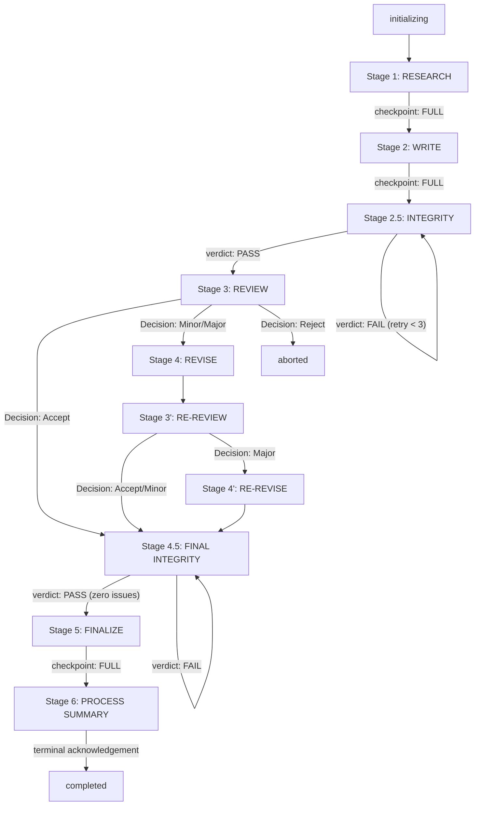

**Sources:** [academic-pipeline/references/pipeline_state_machine.md:34-142](), [academic-pipeline/agents/state_tracker_agent.md:8-10]()

---

## Stage 1: RESEARCH

### Overview
Invokes the `deep-research` skill. The orchestrator recommends a mode (`socratic`, `full`, or `quick`) based on the user's initial prompt keywords like "investigate" or "literature review" [academic-pipeline/agents/pipeline_orchestrator_agent.md:24-30]().

### Deliverables
Produces artifacts defined in `shared/handoff_schemas.md`:
- **RQ Brief** (Schema 1): Research question, FINER scores, and scope constraints [shared/handoff_schemas.md:13-38]().
- **Methodology Blueprint**: Required for Stage 1 -> 2 handoff [scripts/check_pipeline_boundary_semantics.py:87-90]().
- **Bibliography** (Schema 2): Minimum 15 sources for full mode; includes `evidence_tier` and `quality_tier` [shared/handoff_schemas.md:94-114]().
- **Synthesis Report** (Schema 3): Thematic integration and research gaps.

**Sources:** [shared/handoff_schemas.md:13-114](), [academic-pipeline/agents/pipeline_orchestrator_agent.md:101-105](), [scripts/check_pipeline_boundary_semantics.py:85-90]()

---

## Stage 2: WRITE

### Overview
Invokes the `academic-paper` skill. The `draft_writer_agent` is activated to produce the full draft. If comprehensive research materials are present, the **Anti-Leakage Protocol** (Knowledge Isolation) is activated to ensure the paper is built from session materials rather than parametric memory [academic-paper/agents/draft_writer_agent.md:10](), [academic-paper/references/anti_leakage_protocol.md:21-25]().

### Input/Output
- **Input**: Schema 1 (RQ Brief), Methodology Blueprint, Schema 2 (Bibliography), and Schema 3 (Synthesis Report) [scripts/check_pipeline_boundary_semantics.py:87-88]().
- **Output**: **Paper Draft** (Schema 4) containing full manuscript sections and metadata.

**Sources:** [shared/handoff_schemas.md:1-115](), [academic-paper/references/anti_leakage_protocol.md:1-57](), [scripts/check_pipeline_boundary_semantics.py:85-90]()

---

## Stage 2.5: INTEGRITY (Pre-Review)

### Overview
A mandatory gate where the `integrity_verification_agent` performs verification of references and statistical data. It uses a **Five-Type Taxonomy** (TF, PAC, IH, PH, SH) to detect hallucinations [academic-pipeline/agents/integrity_verification_agent.md:8-12, 27-36](). 

### Pass/Fail Protocol
- **Scope**: Reference verification (Phase A), citation context (Phase B), statistical data (Phase C), and risk-stratified claim verification (Phase E).
- **Correction Loop**: Maximum 3 rounds of fix/re-verify.
- **Deliverable**: **Integrity Report** (Schema 5) detailing verified vs. failed items.

**Sources:** [academic-pipeline/references/integrity_review_protocol.md:3-23](), [academic-pipeline/agents/integrity_verification_agent.md:23-44]()

---

## Stage 3: REVIEW

### Overview
Invokes the `academic-paper-reviewer` panel consisting of the EIC, 3 peer reviewers, and a Devil's Advocate. The panel uses a 0-100 scoring system to reach an editorial decision [academic-pipeline/references/two_stage_review_protocol.md:3-8]().

### Deliverables
- **Review Reports**: 5 individual review reports (Schema 6).
- **Revision Roadmap** (Schema 7): Structured list of required changes.

**Sources:** [academic-pipeline/references/two_stage_review_protocol.md:3-10](), [shared/handoff_schemas.md:1-115]()

---

## Stage 4 & 4': REVISE / RE-REVISE

### Overview
The `draft_writer_agent` addresses reviewer feedback. In Stage 4, it produces a full revised draft or a patch document depending on the escalation level [academic-paper/agents/draft_writer_agent.md:14]().

### Loop Limits and Transitions
- **Stage 4 (REVISE)**: Triggered by Minor/Major revision decisions.
- **Stage 3' (RE-REVIEW)**: Verification review of the revised draft against the original roadmap and the **R&R Traceability Matrix** (Schema 11) [academic-pipeline/references/two_stage_review_protocol.md:16-21]().
- **Stage 4' (RE-REVISE)**: Triggered only if Stage 3' results in a "Major" decision [academic-pipeline/references/pipeline_state_machine.md:100-101]().

**Sources:** [academic-pipeline/references/pipeline_state_machine.md:79-106](), [academic-paper/agents/draft_writer_agent.md:10-24](), [academic-pipeline/references/two_stage_review_protocol.md:12-27]()

---

## Stage 4.5: FINAL INTEGRITY

### Overview
A stricter version of the integrity gate enforcing zero-tolerance criteria before proceeding to Stage 5 [academic-pipeline/references/integrity_review_protocol.md:44]().

### Verification Depth
Unlike Stage 2.5, Stage 4.5 requires complete verification for citation context (Phase B) and claim verification (Phase E) [academic-pipeline/references/integrity_review_protocol.md:33-38]().

**Sources:** [academic-pipeline/references/integrity_review_protocol.md:25-45]()

---

## Stage 5: FINALIZE

### Overview
Invokes the `academic-paper` skill in `format-convert` mode. This stage handles LaTeX hardening and multi-format output (Markdown, DOCX, PDF). The completion checkpoint for Stage 5 is **FULL — never SLIM** [academic-pipeline/agents/pipeline_orchestrator_agent.md:29](), [scripts/check_pipeline_boundary_semantics.py:23]().

**Sources:** [academic-pipeline/agents/pipeline_orchestrator_agent.md:29](), [scripts/check_pipeline_boundary_semantics.py:21-26]()

---

## Stage 6: PROCESS SUMMARY

### Overview
The final non-mandatory stage generates documentation of the entire research lifecycle, including the collaboration quality assessment. It requires a terminal acknowledgement using keywords like `finish`, `end`, `done`, or `confirm` [academic-pipeline/references/process_summary_protocol.md:3-5](), [scripts/check_pipeline_boundary_semantics.py:117]().

### Collaboration Quality
Includes a dimensional assessment via the `collaboration_depth_agent`. The `state_tracker_agent` maintains historical records which are appended to the final Process Record [academic-pipeline/agents/state_tracker_agent.md:30-33](), [academic-pipeline/references/process_summary_protocol.md:30-34]().

**Sources:** [academic-pipeline/agents/state_tracker_agent.md:30-34](), [academic-pipeline/references/process_summary_protocol.md:1-55](), [scripts/check_pipeline_boundary_semantics.py:27-32]()

---

## Passport Reset and Resume

The pipeline supports **Reset Boundaries** using the Material Passport (Schema 9) to ensure consistency and prevent session history divergence [academic-pipeline/agents/pipeline_orchestrator_agent.md:43-47]().

### Resume Contract
- **Trigger**: User input `resume_from_passport=<hash>` [academic-pipeline/agents/pipeline_orchestrator_agent.md:45]().
- **Concurrency**: The orchestrator must acquire an exclusive advisory lock on the passport file before reading or appending [academic-pipeline/agents/pipeline_orchestrator_agent.md:50]().
- **Validation**: Prevents double-resume by checking for prior consumption of the boundary hash [academic-pipeline/agents/pipeline_orchestrator_agent.md:54]().

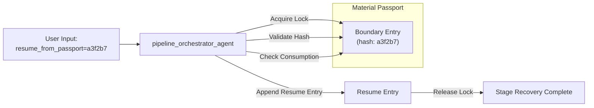

**Sources:** [academic-pipeline/agents/pipeline_orchestrator_agent.md:43-91](), [academic-pipeline/agents/state_tracker_agent.md:44-63](), [academic-pipeline/references/passport_as_reset_boundary.md:1-68]()

---

# Page: Adaptive Checkpoint System

# Adaptive Checkpoint System

<details>
<summary>Relevant source files</summary>

The following files were used as context for generating this wiki page:

- [.github/workflows/spec-consistency.yml](.github/workflows/spec-consistency.yml)
- [CHANGELOG.md](CHANGELOG.md)
- [academic-pipeline/agents/integrity_verification_agent.md](academic-pipeline/agents/integrity_verification_agent.md)
- [academic-pipeline/agents/pipeline_orchestrator_agent.md](academic-pipeline/agents/pipeline_orchestrator_agent.md)
- [academic-pipeline/references/ai_research_failure_modes.md](academic-pipeline/references/ai_research_failure_modes.md)
- [academic-pipeline/references/passport_as_reset_boundary.md](academic-pipeline/references/passport_as_reset_boundary.md)
- [academic-pipeline/references/pipeline_state_machine.md](academic-pipeline/references/pipeline_state_machine.md)
- [academic-pipeline/references/process_summary_protocol.md](academic-pipeline/references/process_summary_protocol.md)
- [scripts/_ci_pytest_manifest.toml](scripts/_ci_pytest_manifest.toml)
- [scripts/check_pipeline_boundary_semantics.py](scripts/check_pipeline_boundary_semantics.py)
- [scripts/check_sprint_contract.py](scripts/check_sprint_contract.py)
- [scripts/test_check_pipeline_boundary_semantics.py](scripts/test_check_pipeline_boundary_semantics.py)
- [scripts/test_check_sprint_contract.py](scripts/test_check_sprint_contract.py)
- [scripts/test_v3_6_7_phase_6_6.py](scripts/test_v3_6_7_phase_6_6.py)
- [shared/contracts/README.md](shared/contracts/README.md)
- [shared/contracts/reviewer/full.json](shared/contracts/reviewer/full.json)
- [shared/contracts/reviewer/methodology_focus.json](shared/contracts/reviewer/methodology_focus.json)
- [shared/handoff_schemas.md](shared/handoff_schemas.md)
- [shared/sprint_contract.schema.json](shared/sprint_contract.schema.json)

</details>


## Purpose and Scope

The Adaptive Checkpoint System is a stage-based user confirmation and quality-gate mechanism implemented in the `academic-pipeline` skill (`academic-pipeline/SKILL.md`) and managed by `academic-pipeline/agents/pipeline_orchestrator_agent.md`. It coordinates how users interact with and approve transitions across pipeline stages, balancing user control with workflow efficiency through three checkpoint classifications: `FULL`, `SLIM`, and `MANDATORY`. 

The system incorporates the **Sprint Contract** (Schema 13), a hard-gate protocol validated by `scripts/check_sprint_contract.py` that forces reviewers and writers to pre-commit to evaluation criteria before viewing substantive manuscript content, thereby preventing rationalization drift.

Sources: `academic-pipeline/agents/pipeline_orchestrator_agent.md:12-13`(), `shared/sprint_contract.schema.json:1-15`(), `scripts/check_sprint_contract.py:1-15`()

---

## Core Design Principle

The system enforces a strict rule: after each stage completion, the orchestrator proactively prompts the user and waits for confirmation before proceeding to the subsequent stage (`academic-pipeline/agents/pipeline_orchestrator_agent.md`). The presentation adapts based on context, engagement patterns, and phase criticality.

Sources: `academic-pipeline/agents/pipeline_orchestrator_agent.md:100-115`(), `academic-pipeline/references/pipeline_state_machine.md:1-25`()

---

## Three Checkpoint Types

The pipeline classifies every stage transition into one of three checkpoint types:

| Checkpoint Type | Trigger Conditions | Content Displayed | User Action Required |
|----------------|-------------------|-------------------|---------------------|
| **FULL** | First checkpoint of session; after integrity boundaries (Stage 2.5, 4.5); before finalization (Stage 5); awareness guard triggered | Complete deliverables list + Decision Dashboard + all available options | Explicit confirmation or decision |
| **SLIM** | After consecutive `continue` responses on non-critical stages | One-line status summary + auto-continue cadence | Can interrupt or let auto-continue |
| **MANDATORY** | Integrity verification FAIL; Review decisions (Stage 3, 3'); Stage 5 entry gate; Sprint Contract Phase 1 completion | Full information + explicit options + contract artifacts | Cannot be skipped; requires explicit input |

### FULL Checkpoints
FULL checkpoints present the complete Decision Dashboard with execution metrics, generated deliverables, flagged warnings, and available navigation branches.

### SLIM Checkpoints
SLIM checkpoints provide a minimal status line to maintain execution speed during routine linear flows.

### MANDATORY Checkpoints
MANDATORY checkpoints enforce hard-stop gates. These include the Phase 1 Contract Acknowledgement for reviewers and the final integrity pass-fail verification (`Stage 4.5`) before final document generation (`Stage 5`).

Sources: `academic-pipeline/agents/pipeline_orchestrator_agent.md:100-120`(), `academic-pipeline/references/pipeline_state_machine.md:146-160`()

---

## Sprint Contract Protocol (Schema 13)

The Sprint Contract acts as a machine-checkable pre-registered acceptance contract governed by `shared/sprint_contract.schema.json` and validated by `scripts/check_sprint_contract.py`.

### Two-Phase Hard-Gate Protocol
To eliminate evaluator bias, reviewer and writer agents operate under a two-phase separation:
1. **Phase 1 (Paper-Blind)**: The agent receives only metadata and the contract template, returning a `Contract Paraphrase` and a `Scoring Plan`.
2. **Phase 1 Validation**: `scripts/check_sprint_contract.py` executes structural checks, verifying that role sets and dimension assignments match `ROLE_SETS` (`scripts/check_sprint_contract.py`).
3. **Phase 2 (Paper-Visible)**: The agent receives the full manuscript alongside its pre-committed plan to evaluate performance.

Sources: `shared/sprint_contract.schema.json:1-40`(), `scripts/check_sprint_contract.py:20-80`()

---

## Implementation Architecture

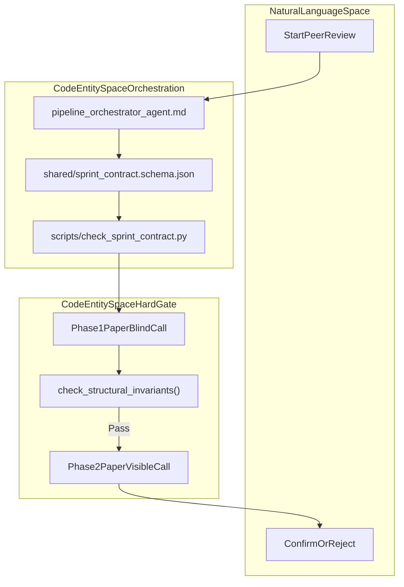
Sources: `shared/sprint_contract.schema.json:1-30`(), `scripts/check_sprint_contract.py:44-90`(), `academic-pipeline/agents/pipeline_orchestrator_agent.md:40-60`()

---

## Decision Dashboard and Metrics

FULL checkpoints render a Decision Dashboard aggregating validation metrics:
- **Word Count**: Monitored against target tolerances (`OK`, `OVER`, `UNDER`).
- **References**: Evaluated via citation verification (`PASS`, `FAIL`).
- **Integrity Status**: Governed by `academic-pipeline/agents/integrity_verification_agent.md` (`PASS`, `FAIL`).
- **Review Decision**: Governed by peer review panels (`Accept`, `Minor`, `Major`, `Reject`).

Sources: `academic-pipeline/agents/integrity_verification_agent.md:1-15`(), `academic-pipeline/agents/pipeline_orchestrator_agent.md:80-110`()

---

## Adaptive Rules and Awareness Guards

To maintain user engagement, the orchestrator tracks consecutive SLIM checkpoints. If a threshold of auto-continues is reached, the system forces a `FULL` checkpoint. Furthermore, agents such as `academic-paper/agents/draft_writer_agent.md` respect strict phase boundaries to prevent leakage of downstream deliverables into earlier stages.

Sources: `academic-pipeline/agents/pipeline_orchestrator_agent.md:50-90`(), `academic-paper/agents/draft_writer_agent.md:1-30`()

---

## Checkpoint Rules Matrix

| Stage Transition | Checkpoint Type | Sprint Contract Required | Skip Allowed |
|-----------------|-----------------|------------------------|--------------|
| Stage 1 → 2 | FULL | No | No |
| Stage 2 → 2.5 | FULL | No | No |
| Stage 2.5 → 3 | MANDATORY | No (Integrity Gate) | No |
| Stage 3 (Review) | MANDATORY | Yes (Schema 13) | No |
| Stage 4.5 → 5 | MANDATORY | No (Iron Rule) | No |

Sources: `academic-pipeline/references/pipeline_state_machine.md:100-150`(), `scripts/check_pipeline_boundary_semantics.py:72-90`()

---

## System Integration Diagram

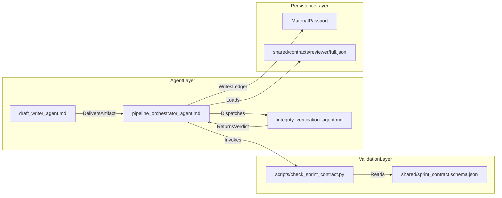
Sources: `shared/contracts/README.md:1-15`(), `scripts/test_check_sprint_contract.py:10-35`(), `academic-pipeline/agents/pipeline_orchestrator_agent.md:10-40`()

---

# Page: Mid-Entry and Material Passport

# Mid-Entry and Material Passport

<details>
<summary>Relevant source files</summary>

The following files were used as context for generating this wiki page:

- [academic-pipeline/agents/state_tracker_agent.md](academic-pipeline/agents/state_tracker_agent.md)
- [docs/DATA_FLOWS.md](docs/DATA_FLOWS.md)
- [docs/RISK_REGISTER.md](docs/RISK_REGISTER.md)
- [docs/design/2026-05-15-issue-111-slr-lineage-emission-design.md](docs/design/2026-05-15-issue-111-slr-lineage-emission-design.md)
- [pyproject.toml](pyproject.toml)
- [scripts/ars_mark_read.py](scripts/ars_mark_read.py)
- [scripts/check_passport_reset_contract.py](scripts/check_passport_reset_contract.py)
- [scripts/claim_strength_drift_disposition.py](scripts/claim_strength_drift_disposition.py)
- [scripts/human_read_attestation_resolver.py](scripts/human_read_attestation_resolver.py)
- [scripts/run_ledger.py](scripts/run_ledger.py)
- [scripts/slr_lineage.py](scripts/slr_lineage.py)
- [scripts/test_ars_mark_read.py](scripts/test_ars_mark_read.py)
- [scripts/test_check_passport_reset_contract.py](scripts/test_check_passport_reset_contract.py)
- [scripts/test_claim_strength_drift_disposition.py](scripts/test_claim_strength_drift_disposition.py)
- [scripts/test_file_lock.py](scripts/test_file_lock.py)
- [scripts/test_human_read_attestation_resolver.py](scripts/test_human_read_attestation_resolver.py)
- [scripts/test_run_ledger.py](scripts/test_run_ledger.py)
- [scripts/test_slr_lineage_emission.py](scripts/test_slr_lineage_emission.py)
- [shared/contracts/passport/reset_ledger_entry.schema.json](shared/contracts/passport/reset_ledger_entry.schema.json)
- [shared/contracts/passport/run_ledger.schema.json](shared/contracts/passport/run_ledger.schema.json)

</details>


## Purpose and Scope

This page documents the **mid-entry protocol**, **Material Passport system**, and associated sidecar ledgers (`_run_ledger.yaml` and `_human_read_log.yaml`) in the academic-pipeline skill. Mid-entry allows users to enter the pipeline workflow at any stage (2, 2.5, 3, 4, etc.) rather than always starting from Stage 1 (`RESEARCH`). The Material Passport (Schema 9) is a provenance tracking mechanism that validates existing materials, enforces a **Reset Boundary Protocol** for session-spanning workflows, and determines whether stages such as Stage 2.5 (`INTEGRITY`) can be safely skipped.

Sources: [academic-pipeline/agents/pipeline_orchestrator_agent.md:33-41](), [shared/handoff_schemas.md:1-10](), [academic-pipeline/references/passport_as_reset_boundary.md:1-5]()

---

## Mid-Entry Overview

### Entry Point Detection

The `pipeline_orchestrator_agent` analyzes user input and attached files to determine what materials already exist. It uses keyword mapping and material detection logic to route the user to the correct entry stage.

**Material-to-Stage Mapping:**

| User Intent Keywords | Entry Stage | Material Detected |
|---------------------|-----------|-------------------|
| Research, investigate | Stage 1 (`RESEARCH`) | None (starting from scratch) |
| Write paper, compose | Stage 2 (`WRITE`) | Research data (RQ Brief, Synthesis) |
| Verify citations, check | Stage 2.5 (`INTEGRITY`) | Paper draft (no verification) |
| Review paper, examine | Stage 2.5* | Paper draft (requires integrity first) |
| Revise, reviewer feedback| Stage 4 (`REVISE`) | Paper + Review Report |
| Format, LaTeX, convert | Stage 5 (`FINALIZE`) | Final manuscript |

*\*Note: Users requesting "review" for a new paper are routed to Stage 2.5 (`INTEGRITY`) first. Stage 3 (`REVIEW`) cannot be entered directly without a valid integrity report.*

Sources: [academic-pipeline/agents/pipeline_orchestrator_agent.md:18-42](), [academic-pipeline/agents/pipeline_orchestrator_agent.md:90-98]()

---

## Material Passport (Schema 9) and Sidecar Ledgers

### Structure and Sidecar Files

The Material Passport is a provenance tracking record defined in `shared/handoff_schemas.md`. It pairs with two explicit sidecar ledger files to record execution history and human attestations without violating adapter-owned schemas:
1. **Run Ledger (`_run_ledger.yaml`)**: Maintained by `scripts/run_ledger.py`, storing tool receipts, checkpoint interactions, and cryptographic hash chains across session compactions.
2. **Human Read Log (`_human_read_log.yaml`)**: Maintained by `scripts/ars_mark_read.py`, recording user-owned `USER_ATTESTED_READ` declarations.

Sources: [shared/handoff_schemas.md:214-230](), [scripts/run_ledger.py:1-42](), [scripts/ars_mark_read.py:1-35]()

### Schema 9 Key Fields and Ledgers

| Field / Sidecar | Type | Description |
|-----------------|------|-------------|
| `verification_status` | Enum | `VERIFIED`, `UNVERIFIED`, `STALE`. Authoritative status for skip logic. |
| `slr_lineage` | Boolean | `true` if any stage in run history was `systematic-review` mode. |
| `reset_boundary[]` | Array | Append-only ledger of `kind: boundary` and `kind: resume` entries (`shared/contracts/passport/reset_ledger_entry.schema.json`). |
| `_run_ledger.yaml` | Sidecar | Handoff records, checkpoint responses, and command receipts (`scripts/run_ledger.py`). |
| `_human_read_log.yaml` | Sidecar | User read scope attestations (`scripts/ars_mark_read.py`). |

Sources: [shared/handoff_schemas.md:214-245](), [shared/contracts/passport/reset_ledger_entry.schema.json:11-66](), [scripts/ars_mark_read.py:1-35]()

---

## Reset Boundary Protocol

The Material Passport acts as a **Reset Boundary** when `ARS_PASSPORT_RESET=1` is set (`scripts/check_passport_reset_contract.py`). This protocol allows the pipeline to halt at a `FULL` checkpoint, emit a unique hash, and resume in a fresh Claude Code session to save tokens and manage context window limits.

### Reset Boundary Generation

When a `FULL` checkpoint is reached with the reset flag active, the orchestrator performs the following steps:
1. **Freeze State**: Prepares a `kind: boundary` ledger entry with metadata and artifact references (`shared/contracts/passport/reset_ledger_entry.schema.json`).
2. **Compute Hash**: Generates a 12-character SHA-256 hex digest over the concatenated ledger using JSON canonical ordering.
3. **Emit Reset Tag**: Outputs the reset marker containing the hash, completed stage, and next route.
4. **Halt**: Stops execution and provides the user with a resume command.

Sources: [academic-pipeline/references/passport_as_reset_boundary.md:19-39](), [shared/contracts/passport/reset_ledger_entry.schema.json:28-32](), [scripts/check_passport_reset_contract.py:1-22]()

### Resume from Passport and State Tracking

The `resume_from_passport` interface uses exclusive advisory file locking (`scripts/file_lock.py`) to safely update session state.

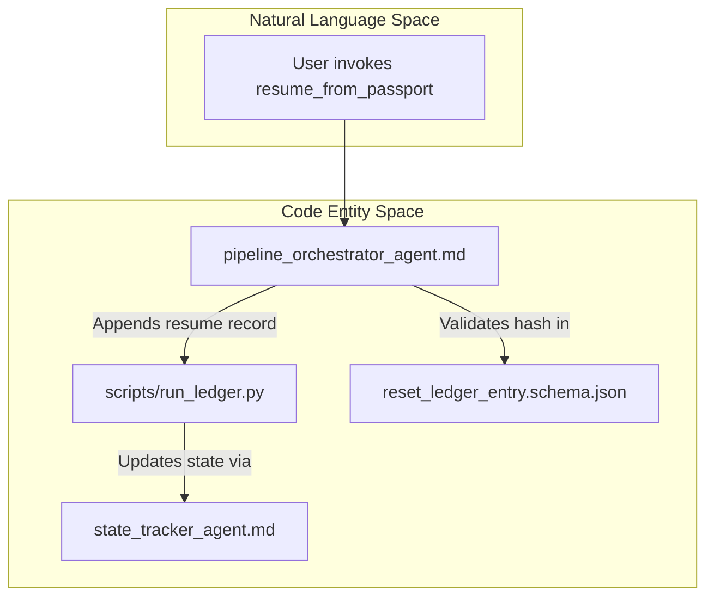

Sources: [academic-pipeline/agents/pipeline_orchestrator_agent.md:43-85](), [scripts/run_ledger.py:1-42](), [academic-pipeline/agents/state_tracker_agent.md:1-25](), [shared/contracts/passport/reset_ledger_entry.schema.json:113-145]()

---

## Code Entity Mapping

The following diagram bridges the high-level Material Passport concepts to the specific code entities and schemas that implement them across the pipeline.

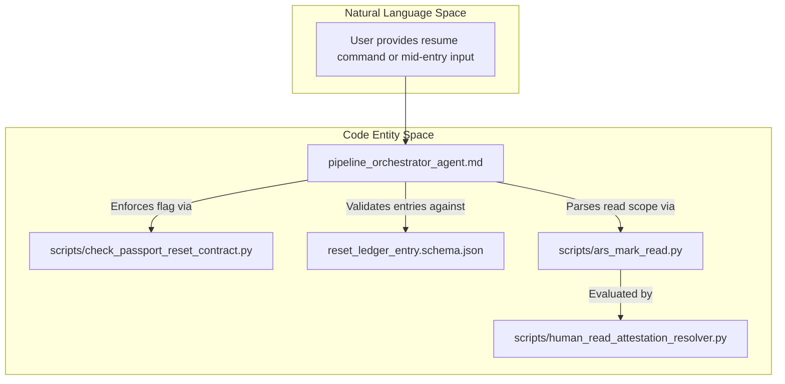

Sources: [academic-pipeline/agents/pipeline_orchestrator_agent.md:43-85](), [scripts/check_passport_reset_contract.py:1-22](), [shared/contracts/passport/reset_ledger_entry.schema.json:1-10](), [scripts/ars_mark_read.py:1-35](), [scripts/human_read_attestation_resolver.py:1-15]()

---

## Material Detection and Skip Logic

### Stage-Skip Eligibility (Stage 2.5)

The orchestrator uses the Passport's `verification_status` to determine if the mandatory Stage 2.5 (`INTEGRITY`) check can be bypassed.

| Status | Condition | Action |
|--------|-----------|--------|
| `VERIFIED` | Valid passport provided | Proceed to Stage 3 (`REVIEW`) |
| `STALE` | Modification detected or >24h | Warn user; recommend re-verification |
| `UNVERIFIED` | No passport or invalid hash | Force Stage 2.5 (Mandatory) |

Sources: [academic-pipeline/agents/pipeline_orchestrator_agent.md:80-83](), [academic-pipeline/references/passport_as_reset_boundary.md:62-63]()

### Contamination Signals and SLR Lineage

For research materials entered via the `literature_corpus[]`, the system computes contamination signals to warn of potential AI-generated or unverified content.

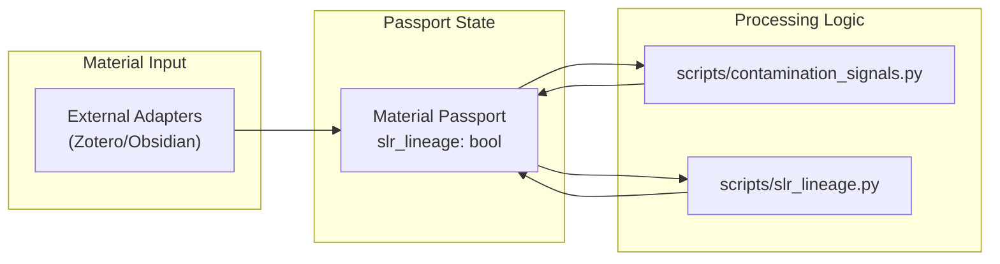

Sources: [scripts/slr_lineage.py:31-59](), [shared/contracts/passport/literature_corpus_entry.schema.json:48-52]()

---

## Related Documentation

- **[Pipeline Stages Reference](2.1)** — Detailed breakdown of the 10 stages.
- **[Adaptive Checkpoint System](2.2)** — How FULL vs SLIM checkpoints trigger reset boundaries.
- **[Integrity Verification System](6)** — Technical details of the verification protocol.
- **[Handoff Schemas](9.1)** — Schema 9 and Reset Ledger technical specifications.

---

# Page: External Review Protocol

# External Review Protocol

<details>
<summary>Relevant source files</summary>

The following files were used as context for generating this wiki page:

- [academic-paper-reviewer/references/re_review_mode_protocol.md](academic-paper-reviewer/references/re_review_mode_protocol.md)
- [academic-paper/agents/revision_coach_agent.md](academic-paper/agents/revision_coach_agent.md)
- [academic-paper/examples/commitment_ledger_example.md](academic-paper/examples/commitment_ledger_example.md)
- [academic-paper/templates/revision_tracking_template.md](academic-paper/templates/revision_tracking_template.md)
- [academic-pipeline/references/two_stage_review_protocol.md](academic-pipeline/references/two_stage_review_protocol.md)
- [docs/design/2026-05-31-ars-268-schema11-nested-commitment-ledger-spec.md](docs/design/2026-05-31-ars-268-schema11-nested-commitment-ledger-spec.md)
- [evals/calibration/commitment_ledger_seed.yaml](evals/calibration/commitment_ledger_seed.yaml)
- [scripts/check_268_nested_commitment_ledger.py](scripts/check_268_nested_commitment_ledger.py)
- [scripts/check_670_revision_roadmap_integration.py](scripts/check_670_revision_roadmap_integration.py)
- [scripts/check_re_review_synthesis.py](scripts/check_re_review_synthesis.py)
- [scripts/test_check_268_nested_commitment_ledger.py](scripts/test_check_268_nested_commitment_ledger.py)
- [scripts/test_check_re_review_synthesis.py](scripts/test_check_re_review_synthesis.py)

</details>


## Purpose and Scope

The External Review Protocol governs the integration of real journal reviewer feedback into the academic research and publication pipeline. This protocol activates when researchers receive editorial decisions and peer-review reports from external journals or conferences (as opposed to the internal simulated peer review at Pipeline Stage 3) and need to structure, track, and verify their revisions. It relies upon the **R&R Traceability Matrix (Schema 11)**, the nested commitment ledger, and the three-gate re-review verification pipeline.

For related subsystem details, consult [Academic Paper Reviewer Skill](#5) for internal peer review, [Pipeline Stages Reference](#2.1) for general stage management, and [Mid-Entry and Material Passport](#2.3) for passport-based provenance.

Sources: [academic-pipeline/SKILL.md:337-342](), [shared/handoff_schemas.md:353-358](), [academic-paper/templates/revision_tracking_template.md:8-9]()

---

## Trigger Conditions and Intake Handling

The External Review Protocol is triggered when ingestion routines or orchestrator agents detect external review feedback alongside an existing manuscript draft. The `pipeline_orchestrator_agent` inspects incoming materials to determine whether to launch the `revision-coach` mode or normal pipeline intake.

### Activation Signatures

| Language / Channel | Trigger Keywords & Indicators |
|--------------------|--------------------------------|
| English (Text/Pasted) | "I received reviewer comments", "reviewer feedback", "revise and resubmit", "R&R", "major revision from journal", "parse reviews", "revision roadmap" |
| 繁體中文 (Text/Pasted) | "審查意見", "修訂路線圖", "幫我修改", "我收到審查意見" |

### Entry Point Routing

When external comments are detected, `pipeline_orchestrator_agent` initiates the intake flow, invoking `revision_coach_agent` to parse unstructured feedback into source-accounted structures without assuming editorial authority [academic-paper/agents/revision_coach_agent.md:10-21]().

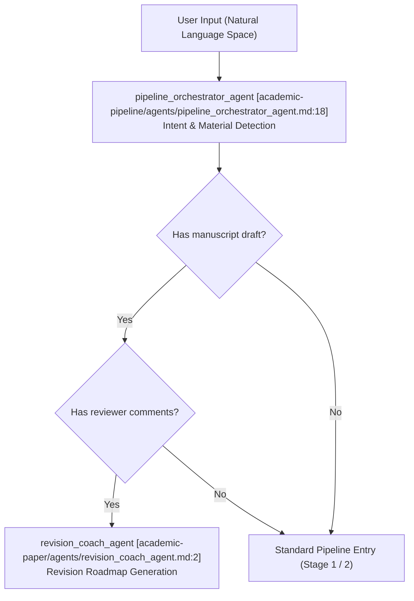

**Diagram: External Review Protocol Entry Detection (Natural Language to Code Entity Space)**

Sources: [academic-pipeline/agents/pipeline_orchestrator_agent.md:20-36](), [academic-paper/agents/revision_coach_agent.md:10-21](), [academic-paper/templates/revision_tracking_template.md:8-9]()

---

## The R&R Traceability Matrix & Nested Commitment Ledger (Schema 11)

The primary data structure for tracking external revisions is the **R&R Traceability Matrix** (Schema 11), implemented via the Revision Tracking Template (`academic-paper/templates/revision_tracking_template.md`). Following the architectural update in #268, the commitment ledger utilizes a **nested-object shape** rather than parallel index-aligned lists, eliminating index desynchronization risks between commitments, fulfillment statuses, and rationales [docs/design/2026-05-31-ars-268-schema11-nested-commitment-ledger-spec.md:8-20]().

### Ledger Schema Structure
Each concern extracted by `revision_coach_agent` contains a nested list of commitments (`commitment_extracted`) with embedded lifecycle properties [academic-paper/templates/revision_tracking_template.md:35-62]():

- `commitment_text`: The specific action promised by the author.
- `commitment_type`: Categorized as `add_experiment`, `add_analysis`, `add_clarification`, `add_citation`, `restructure`, or `other`.
- `required_evidence_type`: Specifies the verification target shape (`new_section`, `new_figure`, `new_table`, `new_citation`, `methods_paragraph`, `discussion_paragraph`, `prose_edit`, or `acknowledgment_only`).
- `fulfillment_status`: Populated post-revision as `fulfilled`, `partial`, `not-fulfilled`, or `explicitly-rejected-with-rationale`.
- `unfulfilled_rationale`: Required free-text explanation when status is non-fulfilled; omitted entirely when `fulfilled`.

Sources: [academic-paper/templates/revision_tracking_template.md:35-62](), [docs/design/2026-05-31-ars-268-schema11-nested-commitment-ledger-spec.md:35-86](), [evals/calibration/commitment_ledger_seed.yaml:7-27]()

---

## Revision Patch Protocol and Anchorization

To ensure deterministic edits and prevent hallucinated document rewriting during revision execution, the system employs a strict patch and anchorization discipline [scripts/ars_apply_revision_patch.py:2-33]().

### Execution Pipeline
1. **Anchorization**: `scripts/ars_anchorize_draft.py` injects stable block identifiers (`<!--block:BNNNN-->`) into the manuscript text.
2. **Patch Generation**: `draft_writer_agent` produces a Schema-compliant JSON patch (`revision_patch.schema.json`) targeting specific block IDs and cryptographic hashes.
3. **Application & Verification**: `scripts/ars_apply_revision_patch.py` applies the patch deterministically, generating an apply report and updating draft hashes.

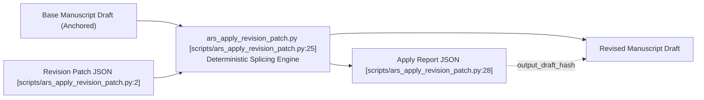

**Diagram: Revision Patch Execution Flow (Code Entity Space)**

Sources: [academic-paper/references/revision_patch_protocol.md:1-21](), [scripts/ars_apply_revision_patch.py:2-33](), [scripts/test_ars_apply_revision_patch.py:1-9]()

---

## Three-Gate Re-Review Verification Protocol (#576)

For Pipeline Stage 3' (Verification Review), the system enforces a strict three-gate contract (`academic-paper-reviewer/references/re_review_mode_protocol.md`) governed by `scripts/check_re_review_synthesis.py`. This protocol prevents author persuasion from biasing the verification outcome by withholding the Response to Reviewers until Phase 2B.

| Gate | Phase Name | Information Access Restrictions | Purpose |
|------|------------|--------------------------------|---------|
| **Gate 1** | Phase 1: Criteria Commitment | Round-1 Roadmap + Reviewer Cards (Revision-blind) | Operationalize evaluation yardsticks before viewing revised text. |
| **Gate 2A** | Phase 2A: Evidence Verdict | Revised Draft + Apply Reports (Persuasion-blind) | Verify evidence fulfillment against criteria prior to reading author rebuttal. |
| **Gate 2B** | Phase 2B: Claim Matching | Response to Reviewers + Full Context | Match author claims to verified evidence and derive final verdicts. |

Sources: [academic-paper-reviewer/references/re_review_mode_protocol.md:35-65](), [scripts/check_re_review_synthesis.py:12-30]()

---

## State Machine Integration and Passport Handoff

The External Review Protocol integrates directly into the pipeline orchestration state machine via the Material Passport and resume hooks (`pipeline_orchestrator_agent`).

### State Flow and Integrity Enforcement
1. **Intake & Passport Loading**: The orchestrator ingests the paper, reviewer feedback, and material passport via `resume_from_passport`.
2. **Coach and Revise Loop**: Iterates through `revision-coach` and patch application until all major comments are processed.
3. **Stage 4.5 Integrity Verification**: Before final handoff, the revised manuscript undergoes rigorous integrity auditing (`integrity_verification_agent`) to ensure all added citations and claims are fully verified.

Sources: [academic-pipeline/agents/pipeline_orchestrator_agent.md:43-85](), [academic-pipeline/references/two_stage_review_protocol.md:17-23](), [academic-pipeline/references/integrity_review_protocol.md:25-45]()

---

# Page: Process Summary and Collaboration Quality

# Process Summary and Collaboration Quality

<details>
<summary>Relevant source files</summary>

The following files were used as context for generating this wiki page:

- [academic-paper/agents/visualization_agent.md](academic-paper/agents/visualization_agent.md)
- [academic-paper/references/vlm_figure_verification.md](academic-paper/references/vlm_figure_verification.md)
- [academic-pipeline/agents/collaboration_depth_agent.md](academic-pipeline/agents/collaboration_depth_agent.md)
- [academic-pipeline/references/score_trajectory_protocol.md](academic-pipeline/references/score_trajectory_protocol.md)
- [examples/figure_table_trace_example.md](examples/figure_table_trace_example.md)
- [scripts/check_684_review_criteria_binding.py](scripts/check_684_review_criteria_binding.py)
- [scripts/check_collaboration_depth_rubric.py](scripts/check_collaboration_depth_rubric.py)
- [scripts/check_content_coverage_advisory_integration.py](scripts/check_content_coverage_advisory_integration.py)
- [scripts/check_decision_contract.py](scripts/check_decision_contract.py)
- [scripts/check_tortured_phrase_screening_integration.py](scripts/check_tortured_phrase_screening_integration.py)
- [scripts/test_check_684_review_criteria_binding.py](scripts/test_check_684_review_criteria_binding.py)
- [scripts/test_check_collaboration_depth_rubric.py](scripts/test_check_collaboration_depth_rubric.py)
- [scripts/test_check_content_coverage_advisory_integration.py](scripts/test_check_content_coverage_advisory_integration.py)
- [scripts/test_check_cross_document_consistency_advisory_integration.py](scripts/test_check_cross_document_consistency_advisory_integration.py)
- [scripts/test_check_decision_contract.py](scripts/test_check_decision_contract.py)
- [scripts/test_check_tortured_phrase_screening_integration.py](scripts/test_check_tortured_phrase_screening_integration.py)

</details>


## Purpose and Scope

This page documents **Stage 6 PROCESS SUMMARY**, the final terminal stage of the `academic-pipeline` orchestrator. Upon completing paper finalization, the system automatically generates a comprehensive "Paper Creation Process Record" and an "AI Self-Reflection Report". It also conducts a post-hoc **Collaboration Quality Evaluation** and a theory-grounded **Collaboration Depth Assessment** via `collaboration_depth_agent`, alongside the criterion trajectory protocol.

**Sources:** [academic-pipeline/SKILL.md:563-679](), [academic-pipeline/agents/collaboration_depth_agent.md:19-25](), [academic-pipeline/references/score_trajectory_protocol.md:1-11]()

---

## Overview

Stage 6 executes automatically after user confirmation of the Stage 5 completion checkpoint (`FULL`) [academic-pipeline/references/process_summary_protocol.md:1-4](). It produces meta-level documentation evaluating the human-AI partnership and concludes the pipeline lifecycle [scripts/check_pipeline_boundary_semantics.py:27-32]().

The generated documentation package includes:
1. Complete session history record, capturing initial user instructions and verbatim key decisions [academic-pipeline/references/process_summary_protocol.md:15-22]().
2. Evidence-based **Collaboration Quality Evaluation** across six dimensions (scored 1–100) [academic-pipeline/references/process_summary_protocol.md:59-63]().
3. **AI Self-Reflection Report** tracking AI behavioral patterns, concession rates, and health alerts [academic-pipeline/references/process_summary_protocol.md:122-125]().
4. **Collaboration Depth Assessment** scoring partnership quality via the Wang & Zhang (2026) framework [academic-pipeline/agents/collaboration_depth_agent.md:27-29]().

**Sources:** [academic-pipeline/SKILL.md:563-569](), [academic-pipeline/references/process_summary_protocol.md:1-5](), [academic-pipeline/agents/pipeline_orchestrator_agent.md:120-125]()

---

## Stage 6 Workflow and Data Flow

The following diagram bridges natural language orchestration concepts to concrete codebase entities during Stage 6 execution.

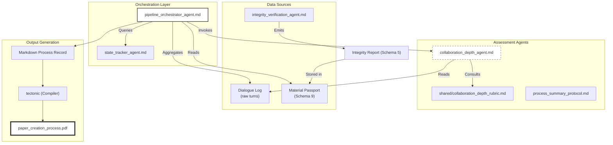

**Diagram: Stage 6 Data Flow and Agent Integration**

**Sources:** [academic-pipeline/agents/collaboration_depth_agent.md:43-52](), [academic-pipeline/references/process_summary_protocol.md:24-31](), [academic-pipeline/agents/pipeline_orchestrator_agent.md:12-13]()

---

## Collaboration Depth Assessment (Wang & Zhang 2026)

The `collaboration_depth_agent` operates as a post-hoc **observer** [academic-pipeline/agents/collaboration_depth_agent.md:21-23](). It scores interaction depth against the canonical rubric located at `shared/collaboration_depth_rubric.md` [academic-pipeline/agents/collaboration_depth_agent.md:31-33]().

### The 3-Construct Rubric

| Dimension | Construct | Description |
|-----------|-----------|-------------|
| **Delegation Intensity** | Cognitive Offloading (CO) | Whole-category handoffs versus scattered micro-asks. [academic-pipeline/agents/collaboration_depth_agent.md:35]() |
| **Cognitive Vigilance** | Cognitive Vigilance (CV) | Critical evaluation, verification, and pushback on AI outputs ($\beta=0.437$). [academic-pipeline/agents/collaboration_depth_agent.md:36]() |
| **Cognitive Reallocation** | Human-GenAI Partnership (HGP) | Freed capacity reinvested in higher-order work. [academic-pipeline/agents/collaboration_depth_agent.md:37]() |

### Zone Classification

Scores are synthesized into a discrete zone label:
- **Zone 1**: Manual/No AI utilization.
- **Zone 2**: Shallow or Mid collaboration (Scattered interactions).
- **Zone 3**: Deep Partnership (High Intensity, Vigilance, and Reallocation).

**Sources:** [academic-pipeline/agents/collaboration_depth_agent.md:31-38](), [academic-pipeline/agents/collaboration_depth_agent.md:63-65]()

---

## Collaboration Quality Evaluation and Score Trajectory Protocol

### Collaboration Quality Evaluation

Distinct from pedagogical depth scoring, the **Collaboration Quality Evaluation** assesses performance from a research leadership perspective [academic-pipeline/references/process_summary_protocol.md:59-62](). It evaluates six dimensions on a 1–100 scale:
1. **Direction Setting**: Clarity, timing, and scope definition [academic-pipeline/references/process_summary_protocol.md:70-71]().
2. **Intellectual Contribution**: Insight depth and concept challenges [academic-pipeline/references/process_summary_protocol.md:73-75]().
3. **Quality Gatekeeping**: Visual inspection and formatting standards [academic-pipeline/references/process_summary_protocol.md:77-79]().
4. **Iteration Discipline**: Willingness to re-run pipeline stages without settling [academic-pipeline/references/process_summary_protocol.md:81-83]().
5. **Delegation Efficiency**: Instruction precision and checkpoint efficiency [academic-pipeline/references/process_summary_protocol.md:85-87]().
6. **Meta-Learning**: Requesting lesson recording and process awareness [academic-pipeline/references/process_summary_protocol.md:89-91]().

### Score / Criterion Trajectory Protocol

The criterion trajectory protocol (`academic-pipeline/references/score_trajectory_protocol.md`) tracks how revisions impact specific review criteria over time [academic-pipeline/references/score_trajectory_protocol.md:1-11](). 
- **Comparison Rule**: Evaluates evidence-anchored categorical judgements (`EXCEEDS`, `MEETS`, `PARTLY_MEETS`, `DOES_NOT_MEET`, `NOT_ASSESSED`) and determines change states (`IMPROVED`, `UNCHANGED`, `REGRESSED`, `NOT_COMPARABLE`) [academic-pipeline/references/score_trajectory_protocol.md:15-27]().
- **Regression Handling**: A `REGRESSED` status on decision-bearing items triggers a mandatory checkpoint requiring presentation of evidence, regression rationale, and mitigation options [academic-pipeline/references/score_trajectory_protocol.md:29-38]().
- **Early Stopping**: Permitted when zero P0 issues remain, no unresolved decision-bearing regressions exist, and author obligations under the revision contract are fulfilled [academic-pipeline/references/score_trajectory_protocol.md:42-49]().

**Sources:** [academic-pipeline/references/process_summary_protocol.md:59-94](), [academic-pipeline/references/score_trajectory_protocol.md:1-52]()

---

## AI Self-Reflection Report and Implementation Details

### AI Self-Reflection Report

The AI Self-Reflection Report tracks internal agent metrics [academic-pipeline/references/process_summary_protocol.md:122-125]():
- **DA Concession Rate**: Frequency of `devil_advocate_agent` conceding to user rebuttals [academic-pipeline/references/process_summary_protocol.md:121-122]().
- **Checkpoints Efficiency**: Ratio of SLIM versus FULL checkpoints and skipped gates [academic-pipeline/references/process_summary_protocol.md:127-128]().
- **Dialogue Health**: Counts of `[HEALTH-CHECK]` alerts (e.g., "Persistent Agreement" or "Conflict Loop") [academic-pipeline/references/process_summary_protocol.md:133-136]().
- **Integrity Performance**: Summary of citation hallucinations detected via the taxonomy [academic-pipeline/agents/integrity_verification_agent.md:27-35]().

### Implementation Details

- **Anti-Sycophancy Discipline**: The `collaboration_depth_agent` enforces **forced counter-enumeration**, requiring at least two turns where collaboration could have been deeper, preventing inflated scoring [academic-pipeline/agents/collaboration_depth_agent.md:60-62](). Short dialogue windows (< 5 turns) return `insufficient_evidence` [academic-pipeline/agents/collaboration_depth_agent.md:74-76]().
- **Non-Blocking Operation**: Depth assessments are strictly advisory and never block pipeline execution [academic-pipeline/agents/collaboration_depth_agent.md:23-25]().
- **Cross-Model Verification**: When `ARS_CROSS_MODEL` is set, secondary model scoring runs post-consent; dimension divergences > 2 points are flagged without silent averaging [academic-pipeline/agents/collaboration_depth_agent.md:67-68]().
- **Terminal Vocabulary**: Pipeline termination requires explicit user acknowledgment keywords (`finish`, `end`, `done`, `confirm`) [academic-pipeline/references/process_summary_protocol.md:39-40](), [scripts/check_pipeline_boundary_semantics.py:117-118]().

**Sources:** [academic-pipeline/agents/collaboration_depth_agent.md:1-76](), [academic-pipeline/references/process_summary_protocol.md:112-140](), [scripts/check_pipeline_boundary_semantics.py:27-32]()

---

# Page: Deep Research Skill

# Deep Research Skill

<details>
<summary>Relevant source files</summary>

The following files were used as context for generating this wiki page:

- [academic-paper-reviewer/SKILL.md](academic-paper-reviewer/SKILL.md)
- [academic-paper/SKILL.md](academic-paper/SKILL.md)
- [deep-research/SKILL.md](deep-research/SKILL.md)
- [docs/CONTROL_AVAILABILITY.md](docs/CONTROL_AVAILABILITY.md)
- [shared/references/routing_core.md](shared/references/routing_core.md)
- [tests/fixtures/issue_133_routing/CALIBRATION_LOG.md](tests/fixtures/issue_133_routing/CALIBRATION_LOG.md)
- [tests/fixtures/issue_133_routing/README.md](tests/fixtures/issue_133_routing/README.md)

</details>


The `deep-research` skill provides a domain-agnostic, 13-agent research team designed for rigorous academic investigation on any topic [deep-research/SKILL.md:3-17](). It executes through 8 operational modes and a 6-phase orchestration pipeline, producing APA 7.0 reports, systematic reviews, literature syntheses, and research question formulations.

**Scope and Child Pages**: This page provides a high-level overview of the deep-research skill architecture, operational modes, and agent composition. For detailed documentation, refer to the child pages:
- [Research Modes Overview](#3.1) — Detailed breakdown of the 8 modes (`full`, `quick`, `review`, `lit-review`, `fact-check`, `three-way-scan`, `socratic`, `systematic-review`), selection guidelines, and trigger keywords.
- [Six-Phase Orchestration Workflow](#3.2) — Execution flow across SCOPING, INVESTIGATION, ANALYSIS, COMPOSITION, REVIEW, and REVISION, including handoff schemas.
- [Socratic Research Mode](#3.3) — Dialogue architecture, convergence criteria, INSIGHT extraction, SCR loops, and Commitment Gates.
- [Systematic Review and PRISMA Compliance](#3.4) — PRISMA 2020 workflows, RoB 2, ROBINS-I, meta-analysis, and the `compliance_agent` protocol.
- [Deep Research Agent Team](#3.5) — Specifications for all 13 agents including `research_question_agent`, `bibliography_agent`, `synthesis_agent`, and `meta_analysis_agent`.

Sources: [deep-research/SKILL.md:1-17]()

---

## Architecture Overview and Code Mapping

The deep-research ecosystem bridges natural language research requests to concrete agent execution scripts and markdown role definitions located in the codebase. 

### Diagram: Deep Research Agent Architecture to Code Entities

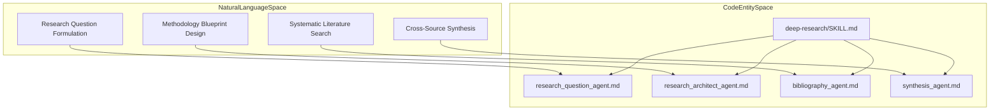
Sources: [deep-research/SKILL.md:3-17](), [deep-research/agents/report_compiler_agent.md:1-15]()

---

## Operational Modes

The skill supports 8 distinct operational modes mapped via `deep-research/SKILL.md` [deep-research/SKILL.md:3]():

1. `full` — Comprehensive research report utilizing core agents.
2. `quick` — Fast research brief with essential bibliographic and verification steps.
3. `review` — Quality assessment of existing text via editorial and critical agents.
4. `lit-review` — Targeted literature synthesis without full report compilation.
5. `fact-check` — Focused verification of claims using `source_verification_agent`.
6. `three-way-scan` — Three-stage literature profiling and boundary analysis.
7. `socratic` — Guided research thinking and dialogue via `socratic_mentor_agent`.
8. `systematic-review` — PRISMA 2020 compliant review including `risk_of_bias_agent` and `meta_analysis_agent`.

For mode selection guidelines and trigger keywords, see [Research Modes Overview](#3.1).

Sources: [deep-research/SKILL.md:3-15]()

---

## Six-Phase Orchestration Workflow

The research pipeline processes through 6 mandatory phases [deep-research/SKILL.md:60-67]():


1. **Scoping**: Formulates FINER-scored research questions and methodology blueprints.
2. **Investigation**: Executes systematic literature searches and source verification.
3. **Analysis**: Conducts cross-source integration and bias checking.
4. **Composition**: Drafts the structured APA 7.0 report.
5. **Review**: Performs editorial, ethics, and vulnerability scans.
6. **Revision**: Applies final polishing (capped at 2 loops).

For detailed phase handoffs and schema requirements, see [Six-Phase Orchestration Workflow](#3.2).

Sources: [deep-research/SKILL.md:60-67](), [deep-research/agents/report_compiler_agent.md:15-20]()

---

## Socratic Research Mode & Systematic Reviews

- **Socratic Research Mode**: Engages users through structured dialogue when research directions are ambiguous. It relies on convergence criteria, INSIGHT extraction, and SCR loops. For details, see [Socratic Research Mode](#3.3).
- **Systematic Review and PRISMA Compliance**: Enforces PRISMA 2020 standards, RoB 2, ROBINS-I risk of bias evaluation, and optional meta-analysis workflows. For details, see [Systematic Review and PRISMA Compliance](#3.4).

Sources: [deep-research/SKILL.md:3-45]()

---

## Deep Research Agent Team

The execution team comprises 13 specialized roles, balancing core investigation with conditional specialized agents.

### Diagram: Mode Routing to Execution Pipeline

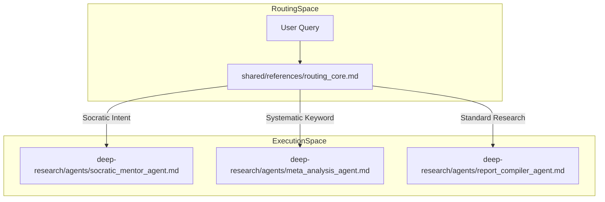
Sources: [deep-research/SKILL.md:3-17](), [shared/references/routing_core.md:1-32]()

For complete individual agent definitions, see [Deep Research Agent Team](#3.5).

Sources: [deep-research/SKILL.md:103-120]()

---

# Page: Research Modes Overview

# Research Modes Overview

<details>
<summary>Relevant source files</summary>

The following files were used as context for generating this wiki page:

- [academic-paper-reviewer/SKILL.md](academic-paper-reviewer/SKILL.md)
- [academic-paper/SKILL.md](academic-paper/SKILL.md)
- [academic-paper/references/mode_selection_guide.md](academic-paper/references/mode_selection_guide.md)
- [deep-research/SKILL.md](deep-research/SKILL.md)
- [deep-research/references/mode_selection_guide.md](deep-research/references/mode_selection_guide.md)
- [docs/CONTROL_AVAILABILITY.md](docs/CONTROL_AVAILABILITY.md)
- [shared/references/routing_core.md](shared/references/routing_core.md)
- [tests/fixtures/issue_133_routing/CALIBRATION_LOG.md](tests/fixtures/issue_133_routing/CALIBRATION_LOG.md)
- [tests/fixtures/issue_133_routing/README.md](tests/fixtures/issue_133_routing/README.md)

</details>


## Purpose and Scope

This page details the eight operational modes supported by the `deep-research` skill (`full`, `quick`, `review`, `lit-review`, `three-way-scan`, `fact-check`, `socratic`, and `systematic-review`), the intent detection and routing mechanisms, and the associated agent activation topologies. 

Sources: `[deep-research/SKILL.md:3-13](), [deep-research/references/mode_selection_guide.md:1-6]()`

---

## Two-Layer Activation and Routing Architecture

The system implements a two-layer routing architecture to map natural language queries to the correct execution path. **Layer 1** utilizes bilingual trigger keywords defined in the skill frontmatter to activate the skill namespace `[deep-research/SKILL.md:3]`. **Layer 2** executes semantic intent analysis via the shared routing core to select the appropriate operational mode `[shared/references/routing_core.md:14-32]`.

### Diagram 1: Two-Layer Activation and Mode Routing

```mermaid
---
title: "Deep Research Two-Layer Activation & Intent Routing"
---
graph TB
    NL["Natural Language Input<br/>(User Prompt)"]
    
    subgraph Layer1["Layer 1: Skill Activation"]
        KW["Keyword Matching<br/>deep-research/SKILL.md:3"]
    end
    
    subgraph Layer2["Layer 2: Intent Detection"]
        IR["Intent Router Core<br/>shared/references/routing_core.md:14"]
        I_Soc["Guided Thinking Intent<br/>SKILL.md:55"]
        I_Full["Comprehensive Research<br/>Default RQ Intent"]
        I_Quick["Time-Constrained Brief<br/>Quick Mode Intent"]
        I_Sys["PRISMA / Meta-Analysis<br/>systematic-review Intent"]
        I_Lit["Literature Synthesis<br/>lit-review Intent"]
        I_Scan["WHY/HOW/WHAT Frame<br/>three-way-scan Intent"]
        I_Fact["Specific Claim Check<br/>fact-check Intent"]
        I_Rev["Existing Text Review<br/>review Intent"]
    end
    
    subgraph CodeEntities["Operational Mode Execution"]
        M_Soc["socratic mode<br/>socratic_mentor_agent.md"]
        M_Full["full mode<br/>deep-research/SKILL.md:43"]
        M_Quick["quick mode<br/>deep-research/SKILL.md:64"]
        M_Sys["systematic-review mode<br/>deep-research/SKILL.md:3"]
        M_Lit["lit-review mode<br/>deep-research/SKILL.md:105"]
        M_Scan["three-way-scan mode<br/>deep-research/SKILL.md:125"]
        M_Fact["fact-check mode<br/>deep-research/SKILL.md:146"]
        M_Rev["review mode<br/>deep-research/SKILL.md:84"]
    end
    
    NL --> KW
    KW --> IR
    IR --> I_Soc & I_Full & I_Quick & I_Sys & I_Lit & I_Scan & I_Fact & I_Rev
    I_Soc --> M_Soc
    I_Full --> M_Full
    I_Quick --> M_Quick
    I_Sys --> M_Sys
    I_Lit --> M_Lit
    I_Scan --> M_Scan
    I_Fact --> M_Fact
    I_Rev --> M_Rev
```

Sources: `[deep-research/SKILL.md:3-70](), [shared/references/routing_core.md:14-32]()`

---

## Eight Operational Modes Reference

The `deep-research` skill provides eight distinct execution paths tailored to different research stages and objectives `[deep-research/references/mode_selection_guide.md:5]`:

1. **`full` mode**: Comprehensive research from scratch, producing an APA 7.0 report (3,000–8,000 words) across 6 phases using 9 core agents `[deep-research/references/mode_selection_guide.md:43-52]`.
2. **`quick` mode**: Rapid research brief (500–1,500 words) under time constraints, activating 4 agents (`research_question_agent`, `bibliography_agent`, `source_verification_agent`, `report_compiler_agent`) `[deep-research/references/mode_selection_guide.md:64-74]`.
3. **`review` mode**: Professional evaluation of an existing manuscript or text, yielding an Editorial Verdict (Accept/Revise/Reject) via 3 agents (`editor_in_chief_agent`, `devils_advocate_agent`, `ethics_review_agent`) `[deep-research/references/mode_selection_guide.md:84-93]`.
4. **`lit-review` mode**: Systematic literature search and thematic synthesis yielding an annotated bibliography and evidence matrix (1,500–4,000 words) using 3 agents (`bibliography_agent`, `source_verification_agent`, `synthesis_agent`) `[deep-research/references/mode_selection_guide.md:105-114]`.
5. **`three-way-scan` mode**: Lighter comparative analysis of shortlisted papers structured in a stable WHY/HOW/WHAT frame, utilizing 2 agents (`bibliography_agent`, `source_verification_agent`) `[deep-research/references/mode_selection_guide.md:125-134]`.
6. **`fact-check` mode**: Verification of specific factual claims and source quality, executed by the `source_verification_agent` `[deep-research/references/mode_selection_guide.md:146-156]`.
7. **`socratic` mode**: Guided progressive dialogue for unformed research questions, using the `socratic_mentor_agent` alongside question and critique agents `[deep-research/SKILL.md:55-65]`, `[deep-research/references/mode_selection_guide.md:27-28]`.
8. **`systematic-review` mode**: PRISMA 2020 compliant review and optional meta-analysis utilizing 12 specialized agents including `risk_of_bias_agent` and `meta_analysis_agent` `[deep-research/SKILL.md:3]`, `[deep-research/references/mode_selection_guide.md:17-18]`.

Sources: `[deep-research/SKILL.md:3-70](), [deep-research/references/mode_selection_guide.md:5-182]()`

---

## Mode-to-Agent Activation Architecture

Each operational mode dynamically allocates specific subagents from the 13-agent repository pool to execute its workload.

### Diagram 2: Mode-to-Agent Activation Mapping Architecture

```mermaid
---
title: "Mode-to-Agent Activation Mapping Architecture"
---
graph LR
    subgraph Agents["Code Entity Agents"]
        RQ["research_question_agent"]
        RA["research_architect_agent"]
        BA["bibliography_agent"]
        SV["source_verification_agent"]
        SYN["synthesis_agent"]
        RC["report_compiler_agent"]
        EIC["editor_in_chief_agent"]
        DA["devils_advocate_agent"]
        ER["ethics_review_agent"]
        SM["socratic_mentor_agent"]
        ROB["risk_of_bias_agent"]
        MA["meta_analysis_agent"]
    end
    
    subgraph Modes["Operational Modes"]
        MF["full mode"]
        MQ["quick mode"]
        MR["review mode"]
        ML["lit-review mode"]
        MFC["fact-check mode"]
        MS["socratic mode"]
        MSR["systematic-review mode"]
        M3["three-way-scan mode"]
    end
    
    MF -.-> RQ & RA & BA & SV & SYN & RC & EIC & DA & ER
    MQ -.-> RQ & BA & SV & RC
    MR -.-> EIC & DA & ER
    ML -.-> BA & SV & SYN
    MFC -.-> SV
    MS -.-> SM & RQ & DA
    MSR -.-> RQ & RA & BA & SV & SYN & RC & EIC & DA & ER & ROB & MA
    M3 -.-> BA & SV
```

Sources: `[deep-research/SKILL.md:107-119](), [deep-research/references/mode_selection_guide.md:41-182]()`

---

## Mode Selection Trigger Keywords and Heuristics

Users trigger modes explicitly via slash commands, explicit phrasing, or implicit intent detected by the routing core. 

* **Explicit Trigger Directives:** Keywords such as `systematic review`, `meta-analysis`, `PRISMA` route directly to `systematic-review` mode `[deep-research/SKILL.md:3]`.
* **Ambiguity Handling:** When user intent is unstated or ambiguous without materials, the system defaults to clarification protocols `[deep-research/SKILL.md:38-40]`. When exploring nascent research topics, the system favors `socratic` mode to establish methodological soundness before generation `[deep-research/SKILL.md:55-65]`.

Sources: `[deep-research/SKILL.md:3-40](), [shared/references/routing_core.md:14-32]()`

---

# Page: Six-Phase Orchestration Workflow

# Six-Phase Orchestration Workflow

<details>
<summary>Relevant source files</summary>

The following files were used as context for generating this wiki page:

- [.github/workflows/spec-consistency.yml](.github/workflows/spec-consistency.yml)
- [CHANGELOG.md](CHANGELOG.md)
- [academic-paper/agents/draft_writer_agent.md](academic-paper/agents/draft_writer_agent.md)
- [academic-paper/agents/formatter_agent.md](academic-paper/agents/formatter_agent.md)
- [academic-pipeline/agents/integrity_verification_agent.md](academic-pipeline/agents/integrity_verification_agent.md)
- [academic-pipeline/agents/pipeline_orchestrator_agent.md](academic-pipeline/agents/pipeline_orchestrator_agent.md)
- [academic-pipeline/references/ai_research_failure_modes.md](academic-pipeline/references/ai_research_failure_modes.md)
- [academic-pipeline/references/passport_as_reset_boundary.md](academic-pipeline/references/passport_as_reset_boundary.md)
- [academic-pipeline/references/pipeline_state_machine.md](academic-pipeline/references/pipeline_state_machine.md)
- [academic-pipeline/references/process_summary_protocol.md](academic-pipeline/references/process_summary_protocol.md)
- [agents/report_compiler_agent.md](agents/report_compiler_agent.md)
- [agents/research_architect_agent.md](agents/research_architect_agent.md)
- [agents/synthesis_agent.md](agents/synthesis_agent.md)
- [deep-research/agents/ethics_review_agent.md](deep-research/agents/ethics_review_agent.md)
- [deep-research/agents/report_compiler_agent.md](deep-research/agents/report_compiler_agent.md)
- [deep-research/agents/research_architect_agent.md](deep-research/agents/research_architect_agent.md)
- [deep-research/agents/synthesis_agent.md](deep-research/agents/synthesis_agent.md)
- [scripts/_ci_pytest_manifest.toml](scripts/_ci_pytest_manifest.toml)
- [scripts/check_pipeline_boundary_semantics.py](scripts/check_pipeline_boundary_semantics.py)
- [scripts/test_check_pipeline_boundary_semantics.py](scripts/test_check_pipeline_boundary_semantics.py)
- [scripts/test_v3_6_7_phase_6_6.py](scripts/test_v3_6_7_phase_6_6.py)
- [shared/contracts/README.md](shared/contracts/README.md)
- [shared/handoff_schemas.md](shared/handoff_schemas.md)

</details>


This document details the core orchestration workflow used by the `deep-research` skill to execute research tasks across six sequential phases: SCOPING, INVESTIGATION, ANALYSIS, COMPOSITION, REVIEW, and REVISION. This workflow governs standard operational modes (such as `full`, `quick`, `lit-review`, and `systematic-review`), while Socratic mode utilizes a distinct dialogue architecture.

The workflow is coordinated by `pipeline_orchestrator_agent` [academic-pipeline/agents/pipeline_orchestrator_agent.md:6-12]() and consumes/produces structured data artifacts defined in `shared/handoff_schemas.md` [shared/handoff_schemas.md:1-15]().

---

## Workflow Overview and Phase Sequence

The six-phase orchestration pipeline functions as a quality-gated process where each phase passes serialized artifacts via explicit handoff schemas.

### Phase Transition Matrix

| Phase | Name | Primary Agents | Output Deliverable | Handoff Schema |
|-------|------|----------------|-------------------|----------------|
| 1 | SCOPING | `research_question_agent`, `research_architect_agent` | RQ Brief + Methodology Blueprint | Schema 1 [shared/handoff_schemas.md:25-28]() |
| 2 | INVESTIGATION | `bibliography_agent`, `source_verification_agent` | Annotated Bibliography + Quality Matrix | Schema 2 [shared/handoff_schemas.md:89-92]() |
| 3 | ANALYSIS | `synthesis_agent`, `devils_advocate_agent` | Synthesis Report + Gap Analysis | Schema 3 [shared/handoff_schemas.md:1-10]() |
| 4 | COMPOSITION | `report_compiler_agent`, `draft_writer_agent` | Full APA 7.0 Draft Report | Schema 4 [shared/handoff_schemas.md:1-10]() |
| 5 | REVIEW | `editor_in_chief_agent`, `ethics_review_agent` | Editorial Verdict + Ethics Clearance | Schema 11 [shared/handoff_schemas.md:1-10]() |
| 6 | REVISION | `report_compiler_agent` | Final Report (max 2 revision loops) | Schema 4 [shared/handoff_schemas.md:1-10]() |

Sources: [shared/handoff_schemas.md:1-15](), [academic-pipeline/agents/pipeline_orchestrator_agent.md:20-31]()

---

## Natural Language to Code Entity Mapping: Orchestration Dispatch

The following diagram bridges natural language intents to the underlying Python/Markdown agent entities and execution routes managed by `pipeline_orchestrator_agent`.

Title: "Orchestration Intent-to-Code Mapping"
```mermaid
graph TD
    NL1["Natural Language: 'Research topic X'"] --> P1["pipeline_orchestrator_agent.md<br/>Intent Detection: Stage 1"]
    P1 --> RA1["research_question_agent.md<br/>Produces: Schema 1 (RQ Brief)"]
    RA1 --> RA2["research_architect_agent.md<br/>Produces: Methodology Blueprint"]
    
    NL2["Natural Language: 'Verify citations / Integrity check'"] --> P2["pipeline_orchestrator_agent.md<br/>Intent Detection: Stage 2.5"]
    P2 --> IVA["integrity_verification_agent.md<br/>Executes Phase A-E Verification"]
    
    NL3["Natural Language: 'Revise paper / Reviewer comments'"] --> P3["pipeline_orchestrator_agent.md<br/>Intent Detection: Stage 4"]
    P3 --> DWA["draft_writer_agent.md / formatter_agent.md<br/>Executes Patch or Formatting"]
```

Sources: [academic-pipeline/agents/pipeline_orchestrator_agent.md:18-32](), [academic-pipeline/agents/integrity_verification_agent.md:1-5]()

---

## Phase 1: SCOPING

Phase 1 transforms initial user inputs into a structured research question and architectural blueprint. It relies on interactive feedback loops before authorizing entry into Phase 2.

### Agent Execution and Validation Flow

Title: "Phase 1 Scoping Execution Flow"
```mermaid
graph TB
    Start["User Prompt Input"] --> RQ["research_question_agent<br/>schema: RQ Brief (Schema 1)"]
    RQ --> Arch["research_architect_agent<br/>schema: Methodology Blueprint"]
    Arch --> Checkpoint["Devils Advocate / Checkpoint 1<br/>Gate Evaluation"]
    Checkpoint -->|"PASS"| UserGate["User Confirmation Gate"]
    Checkpoint -->|"REVISE"| RQ
    UserGate -->|"Confirmed"| Phase2["Phase 2: INVESTIGATION"]
```

Sources: [shared/handoff_schemas.md:25-53](), [deep-research/agents/research_architect_agent.md:1-30]()

- **Schema 1 (RQ Brief)**: Produced by `research_question_agent`, capturing FINER scores (`feasible`, `interesting`, `novel`, `ethical`, `relevant`), bounded scope (`in_scope`, `out_of_scope`), and optional sub-question bindings [shared/handoff_schemas.md:32-52]().
- **Methodology Blueprint**: Produced by `research_architect_agent`, specifying paradigms, validation criteria, and IRB plans.

Sources: [shared/handoff_schemas.md:25-53](), [deep-research/agents/research_architect_agent.md:12-28]()

---

## Phase 2: INVESTIGATION & Schema 2 Handoffs

Phase 2 executes systematic search strategies and populates the bibliography corpus.

- **Bibliography Agent**: Governed by `bibliography_agent`, consuming scoping parameters and producing **Schema 2 (Bibliography)** [shared/handoff_schemas.md:89-115]().
- **Source Constraints**: Requires a minimum of 15 sources for `full` mode and 5 sources for `quick` mode, accompanied by evidentiary tiering (1-7 scale) [shared/handoff_schemas.md:98-114]().

Sources: [shared/handoff_schemas.md:89-115](), [deep-research/agents/bibliography_agent.md:1-30]()

---

## Phase 3: ANALYSIS & Synthesis

Phase 3 synthesizes literature findings, resolves source contradictions, and generates analytical reports.

- **Synthesis Agent**: Operates via `synthesis_agent`, synthesizing multi-source findings into **Schema 3** structures.
- **Tension Inventory**: Implements cross-paper tension tracking to ensure conflicting empirical claims are explicitly analyzed rather than averaged out [shared/handoff_schemas.md:1-15]().

Sources: [shared/handoff_schemas.md:1-15](), [deep-research/agents/synthesis_agent.md:1-30]()

---

## Phase 4: COMPOSITION

Phase 4 compiles structured research outputs into complete manuscripts complying with formatting and academic standards.

- **Report Compilation**: Managed by `report_compiler_agent` and `draft_writer_agent` [academic-paper/agents/draft_writer_agent.md:1-10]().
- **Knowledge Isolation**: Enforces upstream material dependency to prevent generative hallucination [academic-paper/agents/draft_writer_agent.md:60-66]().

Sources: [academic-paper/agents/draft_writer_agent.md:1-35](), [deep-research/agents/report_compiler_agent.md:1-20]()

---

## Phase 5 & 6: REVIEW, REVISION, and Integrity Gates

The terminal phases involve rigorous multi-perspective review, integrity audits, and iterative patching.

- **Integrity Verification**: Handled by `integrity_verification_agent` across Stage 2.5 (pre-review) and Stage 4.5 (final verification) [academic-pipeline/agents/integrity_verification_agent.md:1-15]().
- **Patch Discipline**: Revisions in Phase 6 apply strict diff/patch tracking protocols via `draft_writer_agent` and `formatter_agent` [academic-paper/agents/draft_writer_agent.md:10-15](), [academic-paper/agents/formatter_agent.md:1-15]().

Sources: [academic-pipeline/agents/integrity_verification_agent.md:1-15](), [academic-paper/agents/draft_writer_agent.md:10-25]()

---

# Page: Socratic Research Mode

# Socratic Research Mode

<details>
<summary>Relevant source files</summary>

The following files were used as context for generating this wiki page:

- [academic-paper/agents/socratic_mentor_agent.md](academic-paper/agents/socratic_mentor_agent.md)
- [academic-paper/references/academic_writing_style.md](academic-paper/references/academic_writing_style.md)
- [deep-research/agents/socratic_mentor_agent.md](deep-research/agents/socratic_mentor_agent.md)
- [deep-research/references/ethics_checklist.md](deep-research/references/ethics_checklist.md)
- [deep-research/references/failure_paths.md](deep-research/references/failure_paths.md)
- [deep-research/references/irb_decision_tree.md](deep-research/references/irb_decision_tree.md)
- [deep-research/references/socratic_mode_protocol.md](deep-research/references/socratic_mode_protocol.md)
- [deep-research/references/source_quality_hierarchy.md](deep-research/references/source_quality_hierarchy.md)
- [docs/design/2026-08-09-680-human-subjects-reference-migration-spec.md](docs/design/2026-08-09-680-human-subjects-reference-migration-spec.md)
- [evals/heldout/within_session_ideation_diversity/codebook.md](evals/heldout/within_session_ideation_diversity/codebook.md)
- [evals/heldout/within_session_ideation_diversity/heldout_set.json](evals/heldout/within_session_ideation_diversity/heldout_set.json)
- [evals/heldout/within_session_ideation_diversity/heldout_set.schema.json](evals/heldout/within_session_ideation_diversity/heldout_set.schema.json)
- [evals/heldout/within_session_ideation_diversity/nonproduction_variant.json](evals/heldout/within_session_ideation_diversity/nonproduction_variant.json)
- [scripts/check_human_subjects_output_contract.py](scripts/check_human_subjects_output_contract.py)
- [scripts/check_human_subjects_reference_migration.py](scripts/check_human_subjects_reference_migration.py)
- [scripts/test_check_human_subjects_output_contract.py](scripts/test_check_human_subjects_output_contract.py)
- [scripts/test_socratic_rq_non_generation_contract.py](scripts/test_socratic_rq_non_generation_contract.py)
- [scripts/test_validate_ideation_diversity_assets.py](scripts/test_validate_ideation_diversity_assets.py)

</details>


## Purpose and Scope

This page documents the Socratic research mode (`socratic`) within the `deep-research` skill, which provides guided research dialogue for users who lack a clear research question. This mode uses Socratic questioning implemented via `socratic_mentor_agent` to help users clarify their thinking through a 5-layer dialogue architecture, featuring internal mechanisms like the SCR (State-Challenge-Reflect) loop, Commitment Gates, Wording-Pattern Advisory (Kong #257), and the non-generation contract enforced by `scripts/test_socratic_rq_non_generation_contract.py`.

For general information about all deep-research modes, see [Research Modes Overview](3.1). For the standard 6-phase research workflow used in other modes, see [Six-Phase Orchestration Workflow](3.2). For information about the agent team, see [Deep Research Agent Team](3.5).

---

## Overview and Role Definition

Socratic mode activates when the user needs guided thinking rather than a direct research output. The mode implements a Q1 journal editor-in-chief persona (`socratic_mentor_agent`) that guides users through progressive layers of dialogue, extracting insights at each round and determining convergence through quantified criteria.

**Core Principle**: Never give direct conclusions while non-generation Socratic mode is active. Instead, use precise, layered questions to help users discover their own insights and reveal blind spots in their thinking [deep-research/agents/socratic_mentor_agent.md:10-18]().

**Key Distinction from Other Modes**:

| Mode | User Input | Primary Output | Agent Pattern |
|------|-----------|----------------|---------------|
| `full` | Clear research question | Full APA 7.0 report (3,000-8,000 words) | Core agents in 6-phase pipeline |
| `socratic` | Vague idea or uncertainty | Research Plan Summary + INSIGHT collection | `socratic_mentor_agent` + `research_question_agent` + `devils_advocate_agent` |

Sources: [deep-research/SKILL.md:245-310](), [deep-research/agents/socratic_mentor_agent.md:10-23]()

---

## Activation and Intent Detection

Socratic mode uses intent detection rather than simple keyword matching. The system classifies user intent into two primary categories: **Exploratory** (deep dialogue needed) and **Goal-Oriented** (deliverable-focused) [deep-research/agents/socratic_mentor_agent.md:70-76](). When intent is ambiguous, the system prefers `socratic` over `full` [deep-research/agents/socratic_mentor_agent.md:34-35]().

Diagram: Intent Routing and Agent Execution Map (NL Space to Code Entity Space)
```mermaid
graph TB
    UserInput["User Input:<br/>Any Language"]
    IntentDetection["Intent Detection:<br/>deep-research/agents/socratic_mentor_agent.md"]
    
    Exploratory["Exploratory Intent:<br/>Dialogue-focused"]
    GoalOriented["Goal-Oriented Intent:<br/>Deliverable-focused"]
    
    AgentDispatchA["Code Entity:<br/>socratic_mentor_agent<br/>(Disabled auto-convergence, max 60 rounds)"]
    AgentDispatchB["Code Entity:<br/>research_question_agent<br/>(Standard convergence, max 40 rounds)"]
    
    UserInput --> IntentDetection
    IntentDetection --> Exploratory
    IntentDetection --> GoalOriented
    
    Exploratory --> AgentDispatchA
    GoalOriented --> AgentDispatchB
```
Sources: [deep-research/agents/socratic_mentor_agent.md:67-120](), [deep-research/SKILL.md:45-60]()

---

## Five-Layer Dialogue Architecture

Socratic mode progresses through 5 layers, each corresponding to different phases of the standard research workflow. Each layer has minimum dialogue rounds and Commitment Gates [deep-research/references/socratic_mode_protocol.md:10-60]().

*   **Layer 1: Problem Framing** (Phase 1): Transformed vague topic into a clear, answerable research question via `socratic_mentor_agent` and `research_question_agent` [deep-research/references/socratic_mode_protocol.md:33-41]().
*   **Layer 2: Methodology Reflection** (Phase 1): Probes rationale for methodology choices using `socratic_mentor_agent` and challenges assumptions via `devils_advocate_agent` [deep-research/references/socratic_mode_protocol.md:43-50]().
*   **Layer 3: Evidence Design** (Phases 2-3): Clarifies evidence strategy and sufficiency criteria [deep-research/references/socratic_mode_protocol.md:52-58]().
*   **Layer 4: Critical Self-Examination** (Phase 5): Identifies limitations and vulnerabilities [deep-research/references/socratic_mode_protocol.md:60-67]().
*   **Layer 5: Significance & Contribution**: Establishes the "so what?" and research value [deep-research/references/socratic_mode_protocol.md:69-74]().

Diagram: Socratic 5-Layer Orchestration Flow
```mermaid
graph TD
    Layer1["Layer1: ProblemFraming<br/>socratic_mentor_agent + research_question_agent"]
    Layer2["Layer2: MethodologyReflection<br/>socratic_mentor_agent + devils_advocate_agent"]
    Layer3["Layer3: EvidenceDesign<br/>socratic_mentor_agent"]
    Layer4["Layer4: CriticalSelfExamination<br/>socratic_mentor_agent + devils_advocate_agent"]
    Layer5["Layer5: SignificanceContribution<br/>socratic_mentor_agent"]
    Summary["Research Plan Summary + INSIGHT Collection"]

    Layer1 --> Layer2 --> Layer3 --> Layer4 --> Layer5 --> Summary
```
Sources: [deep-research/references/socratic_mode_protocol.md:10-78](), [deep-research/agents/socratic_mentor_agent.md:134-144]()

---

## Non-Generation Contract and Authorship Boundaries

Socratic mode is non-generation by default. Non-convergence, elapsed rounds, stagnation, or vague requests never authorize `socratic_mentor_agent` or `research_question_agent` to invent candidate RQs [deep-research/agents/socratic_mentor_agent.md:25-32]().

1.  **Summary Fallback**: Summarize only directions and preferences already expressed by the user; identify unresolved choices instead of filling them in [deep-research/agents/socratic_mentor_agent.md:33-38]().
2.  **Explicit Exit Contract**: The sole exception is an explicit user request that the system itself propose candidate research questions. Before any candidate appears, the system must emit this exact marker on a standalone line [deep-research/agents/socratic_mentor_agent.md:42-47]():
    `[SOCRATIC-NON-GENERATION-EXIT: explicit_user_request]`
3.  **Automated Contract Verification**: Contract compliance is enforced by `scripts/test_socratic_rq_non_generation_contract.py`, which validates file contents and marker presence across references and agent definitions [scripts/test_socratic_rq_non_generation_contract.py:1-68]().

Sources: [deep-research/agents/socratic_mentor_agent.md:25-54](), [scripts/test_socratic_rq_non_generation_contract.py:1-137]()

---

## The SCR Loop and Commitment Gates

The SCR protocol is an internal mechanism within `socratic_mentor_agent` designed to deepen user thinking by creating a gap between user predictions and reality [deep-research/agents/socratic_mentor_agent.md:125-127]().

1.  **Commitment Gate**: Before transitioning layers, the agent forces the user to make a prediction or judgment, tagged as `[COMMITMENT: ...]` [deep-research/agents/socratic_mentor_agent.md:134-144]().
2.  **Divergence Reveal**: The agent introduces information (counterpoints or contradictory findings) that tests the user's commitment [deep-research/agents/socratic_mentor_agent.md:146-152]().
3.  **Certainty-Triggered Contradiction**: If the user uses high-certainty markers, the agent introduces a contradictory perspective [deep-research/agents/socratic_mentor_agent.md:153-159]().

Sources: [deep-research/agents/socratic_mentor_agent.md:125-161](), [deep-research/references/socratic_questioning_framework.md:1-20]()

---

## Wording-Pattern Advisory (Kong #257)

The Socratic Mentor includes a Wording-Pattern Advisory layer to detect AI-typical "research-question shells" that survive a noun-swap test [deep-research/agents/socratic_mentor_agent.md:25-56]().

*   **Trigger Rule**: Compares user wording against reference patterns (WP01 to WP20) such as impact frames or relationship frames [deep-research/agents/socratic_mentor_agent.md:35-85]().
*   **Narrow Exemption**: Stays silent if the user provides a named or operationalized specific (e.g., named scale, theory, specified causal pathway, or named site) [deep-research/agents/socratic_mentor_agent.md:57]().
*   **Advisory Output**: Surfaces `[WORDING_PATTERN_ADVISORY]` without rewriting the user's text or blocking progression [deep-research/agents/socratic_mentor_agent.md:59-66]().

Sources: [deep-research/agents/socratic_mentor_agent.md:25-66](), [audits/rq-advisory-505-exemption-sharpening-2026-07-11.md:1-38]()

---

## Optional Reading Probe Layer (v3.5.1)

For goal-oriented users, `socratic_mentor_agent` can activate an optional reading probe (`ARS_SOCRATIC_READING_PROBE=1`) [deep-research/references/socratic_mode_protocol.md:96-102]().

*   **Mechanism**: Inserts a subtle reading-check probe into a question to verify engagement [deep-research/references/socratic_mode_protocol.md:98-100]().
*   **Logging**: Tagged with `[READING-PROBE: ...]` and recorded for collaboration quality assessment [deep-research/references/socratic_mode_protocol.md:100-102]().

Sources: [deep-research/references/socratic_mode_protocol.md:96-102](), [scripts/test_reading_probe_lint.py:1-150]()

---

## Failure Paths and Convergence Recovery

Failure paths F1 and F6 govern non-convergence in Socratic mode (`deep-research/references/failure_paths.md:30-76`, `deep-research/references/failure_paths.md:110-130`). If Socratic dialogue does not converge, the system summarizes user-expressed directions, suggests literature exploration (`lit-review`), or prompts an explicit mode switch without generating unprompted candidate RQs [deep-research/references/failure_paths.md:51-76]().

Sources: [deep-research/references/failure_paths.md:30-76](), [scripts/test_socratic_rq_non_generation_contract.py:1-137]()

---

# Page: Systematic Review and PRISMA Compliance

# Systematic Review and PRISMA Compliance

<details>
<summary>Relevant source files</summary>

The following files were used as context for generating this wiki page:

- [academic-paper/references/anti_leakage_protocol.md](academic-paper/references/anti_leakage_protocol.md)
- [academic-pipeline/references/integrity_review_protocol.md](academic-pipeline/references/integrity_review_protocol.md)
- [deep-research/agents/editor_in_chief_agent.md](deep-research/agents/editor_in_chief_agent.md)
- [deep-research/agents/meta_analysis_agent.md](deep-research/agents/meta_analysis_agent.md)
- [deep-research/agents/risk_of_bias_agent.md](deep-research/agents/risk_of_bias_agent.md)
- [docs/design/2026-04-30-ars-v3.6.8-trust-provenance-and-drift-transparency-spec.md](docs/design/2026-04-30-ars-v3.6.8-trust-provenance-and-drift-transparency-spec.md)
- [docs/design/2026-05-12-ars-v3.7.3-claim-faithfulness-and-contaminated-source-spec.md](docs/design/2026-05-12-ars-v3.7.3-claim-faithfulness-and-contaminated-source-spec.md)
- [docs/design/2026-05-17-ars-v3.9.0-cross-index-triangulation-measurement-spec.md](docs/design/2026-05-17-ars-v3.9.0-cross-index-triangulation-measurement-spec.md)
- [examples/compliance/fixture_primary_raise_weak.yaml](examples/compliance/fixture_primary_raise_weak.yaml)
- [examples/compliance/fixture_sr_full_compliant.yaml](examples/compliance/fixture_sr_full_compliant.yaml)
- [examples/compliance/fixture_sr_missing_M4.yaml](examples/compliance/fixture_sr_missing_M4.yaml)
- [scripts/check_v3_6_8_cite_provenance_pipeline.py](scripts/check_v3_6_8_cite_provenance_pipeline.py)
- [scripts/test_check_v3_6_8_cite_provenance_pipeline.py](scripts/test_check_v3_6_8_cite_provenance_pipeline.py)
- [shared/agents/compliance_agent.md](shared/agents/compliance_agent.md)
- [shared/compliance_checkpoint_protocol.md](shared/compliance_checkpoint_protocol.md)
- [shared/prisma_trAIce_protocol.md](shared/prisma_trAIce_protocol.md)
- [shared/templates/codex_audit_multifile_template.md](shared/templates/codex_audit_multifile_template.md)

</details>


This page documents the systematic review capabilities of the `deep-research` skill, specifically the `systematic-review` mode. This mode implements PRISMA 2020 (Preferred Reporting Items for Systematic Reviews and Meta-Analyses) compliant systematic literature reviews with optional meta-analysis, risk of bias assessment using Cochrane tools (RoB 2, ROBINS-I), and GRADE evidence quality rating.

Additionally, this page covers the **PRISMA-trAIce** and **RAISE** compliance frameworks implemented via the `compliance_agent` [shared/agents/compliance_agent.md](), which ensure transparent reporting of AI use in systematic reviews.

---

## Purpose and Scope

The `systematic-review` mode extends the standard deep-research pipeline with specialized agents and protocols to produce systematic reviews that meet international reporting standards. This mode is designed for:

- **PRISMA 2020 compliance**: All 27 checklist items mapped to report sections.
- **Protocol-driven research**: Pre-specified search strategies and eligibility criteria following PRISMA-P 2015.
- **Risk of bias assessment**: Systematic quality appraisal using RoB 2 or ROBINS-I.
- **Quantitative synthesis**: Meta-analysis with forest plots and heterogeneity assessment.
- **Reporting Transparency**: Compliance with **PRISMA-trAIce** (Transparent Reporting of AI in Systematic Literature Reviews) [shared/prisma_trAIce_protocol.md]().

This mode activates specialized agents: `risk_of_bias_agent`, `meta_analysis_agent`, and the `compliance_agent` [shared/agents/compliance_agent.md:6-10]().

**Sources**: [deep-research/SKILL.md:313-407](), [shared/agents/compliance_agent.md:1-25]()

---

## PRISMA-trAIce and RAISE Compliance

The ARS system implements the **PRISMA-trAIce** protocol (v3.4.0 snapshot) [shared/prisma_trAIce_protocol.md:2-5]() and the **RAISE** framework to ensure AI-assisted research remains transparent and reproducible.

### Compliance Agent Orchestration
The `compliance_agent` runs at Stage 2.5 (Integrity Gate) and Stage 4.5 (Final Integrity Gate) of the pipeline [shared/agents/compliance_agent.md:21-23]().

```mermaid
graph TD
    subgraph "Natural Language Space"
        User["User Request"]
        PRISMA["PRISMA 2020 Standard"]
        trAIce["PRISMA-trAIce Checklist"]
    end

    subgraph "Code Entity Space"
        Orch["academic-pipeline/SKILL.md"]
        CompAgent["shared/agents/compliance_agent.md"]
        Protocol["shared/prisma_trAIce_protocol.md"]
        Report["shared/compliance_report.schema.json"]
        CheckScript["scripts/check_compliance_report.py"]
    end

    User --> Orch
    Orch -->|Invoke| CompAgent
    CompAgent -->|Read Items| Protocol
    CompAgent -->|Emit Schema 12| Report
    Report -->|Validate| CheckScript
    Protocol -.->|Tier M/HR/R/O| trAIce
```
**Sources**: [shared/agents/compliance_agent.md:1-18](), [shared/prisma_trAIce_protocol.md:10-15](), [shared/compliance_report.schema.json:1-10]()

### The PRISMA-trAIce Protocol
The protocol consists of 17 items divided into stages [shared/prisma_trAIce_protocol.md:37-43]().

| Stage | Item IDs | Focus |
|-------|----------|-------|
| **Stage 2.5 (Methods)** | M1 - M10 | Protocol registration (M1), Tool identification (M2), Purpose (M3), Input data (M4), Output data (M5), Prompt engineering (M6), Human-AI interaction (M8) |
| **Stage 4.5 (Reporting)** | T1, A1, I1, R1, R2, D1, D2 | Title (T1), Abstract (A1), Introduction (I1), Results (R1), Discussion (D1) |

**Tier-based Blocking Logic**:
- **Mandatory (M)**: Failure results in a `block_decision = block` [shared/prisma_trAIce_protocol.md:30]().
- **Highly Recommended (HR)**: Results in a `warn` [shared/prisma_trAIce_protocol.md:31]().
- **Recommended/Optional (R/O)**: Results in `info` only [shared/prisma_trAIce_protocol.md:32-33]().

**Sources**: [shared/prisma_trAIce_protocol.md:28-43](), [shared/agents/compliance_agent.md:70-75]()

---

## Systematic Review Workflow Adaptation

The systematic-review mode modifies the standard six-phase deep-research pipeline with specialized steps.

### Phase 1: SCOPING → Protocol Generation
The `research_question_agent` uses the **PICOS** (Population, Intervention, Comparator, Outcome, Study design) structure instead of FINER criteria [deep-research/SKILL.md:323-341]().

### Phase 2: INVESTIGATION → PRISMA Flow + Risk of Bias
The `bibliography_agent` executes a search across ≥2 databases and generates a **PRISMA 2020 Flow Diagram** [deep-research/SKILL.md:345-350]().
The `risk_of_bias_agent` performs per-study quality assessments using RoB 2 (RCTs) or ROBINS-I (observational studies) [deep-research/agents/risk_of_bias_agent.md]().

### Phase 3: ANALYSIS → Meta-Analysis
The `meta_analysis_agent` assesses pooling feasibility. If I² > 50%, the agent explores sources of heterogeneity or switches to a narrative synthesis (SWiM framework) [deep-research/SKILL.md:360-367]().

**Sources**: [deep-research/SKILL.md:343-377](), [shared/prisma_trAIce_protocol.md:46-110]()

---

## Compliance Checkpoint Protocol (Dual-Gate)

The `compliance_agent` participates in Stage 2.5 and 4.5 Integrity Gates [shared/compliance_checkpoint_protocol.md:6-10]().

### Decision Precedence
Decisions aggregate using `max_severity` (pass < warn < block) [shared/compliance_checkpoint_protocol.md:30-38]().

```mermaid
graph TD
    subgraph "Decision Aggregation"
        PT["prisma_trAIce.block_decision"]
        RA["raise.block_decision"]
        LI["legacy_integrity_decision"]
        FM["failure_mode_checklist"]
    end

    PT --> Max["max_severity()"]
    RA --> Max
    LI --> Max
    FM --> Max

    Max --> Final["overall_decision"]
```
**Sources**: [shared/compliance_checkpoint_protocol.md:25-38]()

### Override Ladder (3-Round Friction)
If a user encounters a `block`, they may use the "Acknowledge Limitation" override, which increases in friction [shared/compliance_checkpoint_protocol.md:80-92]():
1. **1st Round**: Warning; rationale optional [shared/compliance_checkpoint_protocol.md:88]().
2. **2nd Round**: Rationale string required [shared/compliance_checkpoint_protocol.md:89]().
3. **3rd Round**: Rationale ≥ 100 characters required [shared/compliance_checkpoint_protocol.md:90]().

Successful overrides trigger an **auto-injected `disclosure_addendum`** in the manuscript [shared/compliance_checkpoint_protocol.md:94-96]().

**Sources**: [shared/compliance_checkpoint_protocol.md:80-112]()

---

## Infrastructure and Validation

### Schema 12: Compliance Report
The system emits a `compliance_report` conforming to `shared/compliance_report.schema.json`. This schema enforces cross-field rules, such as requiring a `prisma_trAIce` object when `mode` is `systematic_review` [shared/compliance_report.schema.json:116-124]().

### Script Validators
- `scripts/check_compliance_report.py`: Validates reports against Schema 12 and checks for sycophancy risks (e.g., all items pass with empty evidence) [scripts/check_compliance_report.py:39-50]().
- `scripts/check_prisma_trAIce_freshness.py`: Ensures the local `shared/prisma_trAIce_protocol.md` is not older than 180 days relative to the upstream source [scripts/check_prisma_trAIce_freshness.py:21-22]().

### CI/CD Integration
The `PRISMA-trAIce Freshness` workflow runs to detect upstream drift. The script `scripts/check_prisma_trAIce_freshness.py` parses the `snapshot_date` from the YAML frontmatter of the protocol file [scripts/check_prisma_trAIce_freshness.py:25-41]().

**Sources**: [shared/compliance_report.schema.json:1-132](), [scripts/check_compliance_report.py:1-108](), [scripts/check_prisma_trAIce_freshness.py:1-84](), [shared/prisma_trAIce_protocol.md:1-8]()

---

# Page: Deep Research Agent Team

# Deep Research Agent Team

<details>
<summary>Relevant source files</summary>

The following files were used as context for generating this wiki page:

- [academic-paper/agents/abstract_bilingual_agent.md](academic-paper/agents/abstract_bilingual_agent.md)
- [academic-paper/agents/citation_compliance_agent.md](academic-paper/agents/citation_compliance_agent.md)
- [academic-paper/agents/draft_writer_agent.md](academic-paper/agents/draft_writer_agent.md)
- [academic-paper/agents/formatter_agent.md](academic-paper/agents/formatter_agent.md)
- [academic-paper/agents/literature_strategist_agent.md](academic-paper/agents/literature_strategist_agent.md)
- [academic-paper/agents/structure_architect_agent.md](academic-paper/agents/structure_architect_agent.md)
- [agents/report_compiler_agent.md](agents/report_compiler_agent.md)
- [agents/research_architect_agent.md](agents/research_architect_agent.md)
- [agents/synthesis_agent.md](agents/synthesis_agent.md)
- [deep-research/agents/bibliography_agent.md](deep-research/agents/bibliography_agent.md)
- [deep-research/agents/editor_in_chief_agent.md](deep-research/agents/editor_in_chief_agent.md)
- [deep-research/agents/ethics_review_agent.md](deep-research/agents/ethics_review_agent.md)
- [deep-research/agents/meta_analysis_agent.md](deep-research/agents/meta_analysis_agent.md)
- [deep-research/agents/report_compiler_agent.md](deep-research/agents/report_compiler_agent.md)
- [deep-research/agents/research_architect_agent.md](deep-research/agents/research_architect_agent.md)
- [deep-research/agents/research_question_agent.md](deep-research/agents/research_question_agent.md)
- [deep-research/agents/risk_of_bias_agent.md](deep-research/agents/risk_of_bias_agent.md)
- [deep-research/agents/source_verification_agent.md](deep-research/agents/source_verification_agent.md)
- [deep-research/agents/synthesis_agent.md](deep-research/agents/synthesis_agent.md)
- [scripts/check_v3_9_4_temporal_verification.py](scripts/check_v3_9_4_temporal_verification.py)

</details>


This page provides full technical documentation for the deep-research agent team within the Academic Research Skills (ARS) system. It details the role definitions, phase boundaries, implementation files, specialized protocols, and data flows for the core and systematic review agents: `research_question_agent`, `research_architect_agent`, `bibliography_agent`, `synthesis_agent`, `report_compiler_agent`, `source_verification_agent`, `ethics_review_agent`, `risk_of_bias_agent`, and `meta_analysis_agent`.

Sources: [deep-research/agents/research_question_agent.md:1](), [deep-research/agents/bibliography_agent.md:1](), [deep-research/agents/synthesis_agent.md:1]()

---

## Agent Architecture and Code Entity Mapping

The deep-research agents operate across six orchestration phases (SCOPING, INVESTIGATION, ANALYSIS, COMPOSITION, REVIEW, and REVISION). Each agent is bound to strict single-phase boundaries enforced by prompt-level fences and pipeline verifiers.

Diagram: Deep Research Agent Code Entity Mapping
```mermaid
graph TB
    subgraph "Natural Language Space: Scoping & Investigation"
        RQ["Research Question Agent"] -->|"deep-research/agents/research_question_agent.md"| Arch["Research Architect Agent"]
        Arch -->|"deep-research/agents/research_architect_agent.md"| Bib["Bibliography Agent"]
        Bib -->|"deep-research/agents/bibliography_agent.md"| Ver["Source Verification Agent"]
    end

    subgraph "Natural Language Space: Analysis & Composition"
        Ver -->|"deep-research/agents/source_verification_agent.md"| Syn["Synthesis Agent"]
        Syn -->|"deep-research/agents/synthesis_agent.md"| Comp["Report Compiler Agent"]
    end

    subgraph "Code Entity Space: Systematic Review & Compliance"
        RoB["risk_of_bias_agent.md"]
        Meta["meta_analysis_agent.md"]
        Eth["ethics_review_agent.md"]
        Lint["check_v3_9_4_temporal_verification.py"]
    end

    Comp -.->|"Enforces M3 Iron Rule"| Lint
    Bib -.->|"Semantic Scholar Deduplication"| RoB

    style RQ fill:none,stroke-dasharray: 5 5
    style Comp fill:none,stroke-dasharray: 5 5
```
Sources: [deep-research/agents/research_question_agent.md:12-26](), [deep-research/agents/bibliography_agent.md:12-27](), [scripts/check_v3_9_4_temporal_verification.py:1-15]()

---

## Core Deep Research Agents

### 1. Research Question Agent (`research_question_agent`)
* **Implementation File**: `deep-research/agents/research_question_agent.md`
* **Active Phase**: Phase 1 (SCOPING) [deep-research/agents/research_question_agent.md:14]().
* **Role**: Transforms vague topics into precise, FINER-evaluated researchable questions [deep-research/agents/research_question_agent.md:10]().
* **Mechanics**: Evaluates candidate questions against Feasibility, Interest, Novelty, Ethics, and Relevance (FINER scale 1-5, requiring an average score $\ge 3.0$ with no single criterion below 2) [deep-research/agents/research_question_agent.md:31-45](). It emits explicit scope boundaries (population, timeframe, geography, domain) and sub-question bindings [deep-research/agents/research_question_agent.md:77-130]().

Sources: [deep-research/agents/research_question_agent.md:10-45]()

### 2. Research Architect Agent (`research_architect_agent`)
* **Implementation File**: `deep-research/agents/research_architect_agent.md`
* **Active Phase**: Phase 1 (SCOPING) [deep-research/agents/research_architect_agent.md:16]().
* **Role**: Designs the methodological blueprint, selecting research paradigms (Positivist, Interpretivist, Pragmatist, Critical), methods, data strategies, and analytical frameworks [deep-research/agents/research_architect_agent.md:10-77]().
* **Mechanics**: Includes mandatory human-subjects administrative planning and integration with institutional review boards via portable navigation rules [deep-research/agents/research_architect_agent.md:104-111]().

Sources: [deep-research/agents/research_architect_agent.md:10-111]()

### 3. Bibliography Agent (`bibliography_agent`)
* **Implementation File**: `deep-research/agents/bibliography_agent.md`
* **Active Phase**: Phase 2 (INVESTIGATION) [deep-research/agents/bibliography_agent.md:14]().
* **Role**: Conducts systematic, reproducible literature searches, applies inclusion/exclusion criteria, and generates annotated bibliographies in APA 7.0 format [deep-research/agents/bibliography_agent.md:10]().
* **Mechanics**: Executes Semantic Scholar deduplication to map source IDs and runs distributional skew analyses across time, geography, and methodology dimensions [deep-research/agents/bibliography_agent.md:90-126]().

Sources: [deep-research/agents/bibliography_agent.md:10-126]()

### 4. Source Verification Agent (`source_verification_agent`)
* **Implementation File**: `deep-research/agents/source_verification_agent.md`
* **Active Phase**: Phase 2 (INVESTIGATION).
* **Role**: Validates evidence quality, performs DOI verification, screens out predatory venues, and assigns evidence hierarchy grades (Levels I–VII).
* **Mechanics**: Operates as a strict gatekeeper ensuring all retrieved references meet evidentiary standards before downstream synthesis.

Sources: [deep-research/agents/bibliography_agent.md:20-25]()

### 5. Synthesis Agent (`synthesis_agent`)
* **Implementation File**: `deep-research/agents/synthesis_agent.md`
* **Active Phase**: Phase 3 (ANALYSIS) [deep-research/agents/synthesis_agent.md:16]().
* **Role**: Integrates findings across multiple sources, resolves evidence conflicts, and maps knowledge gaps [deep-research/agents/synthesis_agent.md:12]().
* **Mechanics**: Forbids sequential summarization ("Study A found X") in favor of thematic and framework synthesis [deep-research/agents/synthesis_agent.md:54-96](). Implements the Cross-Paper Tension Inventory to expose contradictions between source claims [deep-research/agents/synthesis_agent.md:110-126]().

Sources: [deep-research/agents/synthesis_agent.md:12-126]()

### 6. Report Compiler Agent (`report_compiler_agent`)
* **Implementation File**: `deep-research/agents/report_compiler_agent.md`
* **Active Phase**: Phase 4 (COMPOSITION) and Phase 6 (REVISION) [deep-research/agents/report_compiler_agent.md:11]().
* **Role**: Transforms research findings into polished APA 7.0 academic reports [deep-research/agents/report_compiler_agent.md:11]().
* **Mechanics**: Enforces Knowledge Isolation (prioritizing upstream artifacts over parametric memory) and the Temporal Integrity Iron Rule (M3) which requires arithmetic date verification for causal claims against `timeline.yaml` [deep-research/agents/report_compiler_agent.md:20-26, 103-144]().

Sources: [deep-research/agents/report_compiler_agent.md:11-144]()

### 7. Ethics Review Agent (`ethics_review_agent`)
* **Implementation File**: `deep-research/agents/ethics_review_agent.md`
* **Active Phase**: Phase 5 (REVIEW).
* **Role**: Validates AI disclosure compliance, human-subjects protection alignment, and attribution integrity.
* **Mechanics**: Reviews drafts against institutional and journal-specific ethical guidelines, flagging unaddressed conflicts or missing participant consent declarations.

Sources: [deep-research/agents/report_compiler_agent.md:10-15]()

---

## Systematic Review and Special Agents

### 8. Risk of Bias Agent (`risk_of_bias_agent`)
* **Active Mode**: Systematic Review.
* **Role**: Assesses study-level methodological bias using standardized instruments such as RoB 2 (for randomized trials) or ROBINS-I (for non-randomized studies).
* **Mechanics**: Structured evaluation across domains (e.g., confounding, selection, measurement deviations) to assign an overall bias tier.

Sources: [deep-research/agents/synthesis_agent.md:30-40]()

### 9. Meta Analysis Agent (`meta_analysis_agent`)
* **Active Mode**: Systematic Review.
* **Role**: Executes quantitative meta-analyses.
* **Mechanics**: Calculates pooled effect sizes, heterogeneity metrics ($I^2$), and generates forest plots from included empirical study data under strict statistical verification protocols.

Sources: [deep-research/agents/bibliography_agent.md:85-110]()

---

## Data Flow and Pipeline Integration

The agent team coordinates data production and consumption via serialized JSON schemas and YAML ledgers.

Diagram: Deep Research Data Flow Architecture
```mermaid
graph LR
    subgraph "Phase 1"
        RQ["research_question_agent"] -->|"Schema 1: RQ Brief"| Arch["research_architect_agent"]
    end

    subgraph "Phase 2"
        Arch -->|"Methodology Blueprint"| Bib["bibliography_agent"]
        Bib -->|"Annotated Bibliography"| Ver["source_verification_agent"]
    end

    subgraph "Phase 3 & 4"
        Ver -->|"Verified Sources"| Syn["synthesis_agent"]
        Syn -->|"Synthesis Report"| Comp["report_compiler_agent"]
    end

    subgraph "Validation Scripts"
        Check["check_v3_9_4_temporal_verification.py"]
        Schema["timeline.schema.json"]
    end

    Schema -.->|Validates| Bib
    Check -.->|Enforces Temporal Rules| Comp

    style RQ fill:none,stroke-dasharray: 5 5
    style Comp fill:none,stroke-dasharray: 5 5
```
Sources: [scripts/check_v3_9_4_temporal_verification.py:4-15](), [deep-research/agents/bibliography_agent.md:12-25](), [deep-research/agents/report_compiler_agent.md:11-25]()

---

# Page: Academic Paper Skill

# Academic Paper Skill

<details>
<summary>Relevant source files</summary>

The following files were used as context for generating this wiki page:

- [academic-paper-reviewer/SKILL.md](academic-paper-reviewer/SKILL.md)
- [academic-paper/SKILL.md](academic-paper/SKILL.md)
- [deep-research/SKILL.md](deep-research/SKILL.md)
- [docs/CONTROL_AVAILABILITY.md](docs/CONTROL_AVAILABILITY.md)
- [shared/references/routing_core.md](shared/references/routing_core.md)
- [tests/fixtures/issue_133_routing/CALIBRATION_LOG.md](tests/fixtures/issue_133_routing/CALIBRATION_LOG.md)
- [tests/fixtures/issue_133_routing/README.md](tests/fixtures/issue_133_routing/README.md)

</details>


The `academic-paper` skill (`academic-paper/SKILL.md:2`) is a 12-agent academic paper writing pipeline designed to transform research materials into publication-ready manuscripts. It supports 11 operational modes covering the full writing lifecycle—from Socratic chapter planning to multi-format output generation (Markdown, DOCX via Pandoc, LaTeX, PDF) with citation format conversion between APA 7.0, Chicago, MLA, IEEE, and Vancouver styles. The skill supports 6 paper structure types and produces bilingual abstracts in English and Traditional Chinese [academic-paper/SKILL.md:1-11]().

For details on specific modes, see [Writing Modes Overview](#4.1). For the execution workflow, see [Eight-Phase Orchestration Pipeline](#4.2). For peer review of completed papers, see [Academic Paper Reviewer Skill](#5).

**Sources**: [academic-paper/SKILL.md:1-11]()

---

## Agent Architecture and Team

The skill consists of 12 specialized agents distributed across its execution phases. Each agent fulfills a role-scoped contract within the pipeline architecture.

Diagram: Academic Paper Agent Ecosystem (Natural Language Space to Code Entity Space)
```mermaid
graph TB
    subgraph "Natural Language Intent Space"
        User["User Request"]
    end

    subgraph "Academic Paper Code Entity Space"
        Intake["intake_agent<br/>(Phase 0: CONFIG)"]
        LitStrat["literature_strategist_agent<br/>(Phase 1: RESEARCH)"]
        Arch["structure_architect_agent<br/>(Phase 2: ARCHITECTURE)"]
        ArgBuild["argument_builder_agent<br/>(Phase 3: ARGUMENTATION)"]
        Draft["draft_writer_agent<br/>(Phase 4: DRAFTING)"]
        CitComp["citation_compliance_agent<br/>(Phase 5a: CITATIONS)"]
        AbsBil["abstract_bilingual_agent<br/>(Phase 5b: ABSTRACT)"]
        PeerRev["peer_reviewer_agent<br/>(Phase 6: PEER REVIEW)"]
        Formatter["formatter_agent<br/>(Phase 7: FORMAT)"]
        SocMent["socratic_mentor_agent<br/>(Plan Mode)"]
        VisAgent["visualization_agent<br/>(Figures)"]
        RevCoach["revision_coach_agent<br/>(Revision Coach)"]
    end

    User --> Intake
    Intake --> LitStrat
    LitStrat --> Arch
    Arch --> ArgBuild
    ArgBuild --> Draft
    Draft --> CitComp
    Draft --> AbsBil
    CitComp --> PeerRev
    AbsBil --> PeerRev
    PeerRev --> Formatter
    
    Intake -.-> SocMent
    Draft -.-> VisAgent
    User -.-> RevCoach
```
**Sources**: [academic-paper/SKILL.md:1-11]()

For a comprehensive breakdown of agent responsibilities, see [Academic Paper Agent Team](#4.7).

---

## Operational Modes

The skill supports 11 distinct modes [academic-paper/SKILL.md:2-3]. Mode selection relies on a two-layer routing architecture, utilizing bilingual trigger keywords for skill activation and intent signals for mode selection [academic-paper/SKILL.md:24-45].

Diagram: Mode Routing and Workflow Spectrum
```mermaid
graph TD
    subgraph "Layer 1: Activation"
        Trigger["Trigger Keywords<br/>(English/Chinese/Korean/Spanish)"]
    end

    subgraph "Layer 2: Intent Detection"
        Intent{{"User Intent?"}}
    end

    subgraph "Execution Modes (academic-paper/SKILL.md)"
        Full["full mode"]
        Plan["plan mode"]
        Rev["revision mode"]
        Coach["revision-coach"]
        Format["format-convert"]
        Disc["disclosure"]
        Rebuttal["rebuttal-audit"]
        LitRev["lit-review"]
        AbsOnly["abstract-only"]
        CitCheck["citation-check"]
        Outline["outline-only"]
    end

    Trigger --> Intent
    Intent -->|"Write complete paper"| Full
    Intent -->|"Chapter planning"| Plan
    Intent -->|"Address feedback"| Rev
    Intent -->|"Parse reviews"| Coach
    Intent -->|"Format/citations"| Format
    Intent -->|"AI disclosure"| Disc
    Intent -->|"Audit rebuttal"| Rebuttal
```
**Sources**: [academic-paper/SKILL.md:2-3](), [academic-paper/SKILL.md:24-45]()

For detailed descriptions of all 11 modes, see [Writing Modes Overview](#4.1).

---

## Eight-Phase Orchestration Pipeline

The `academic-paper` skill executes an 8-phase pipeline enforcing strict phase boundaries and checkpoints [academic-paper/SKILL.md:47-67].

| Phase | Agent | Key Output |
|-------|-------|------------|
| 0: CONFIG | `intake_agent` | Paper Configuration Record [academic-paper/SKILL.md:59] |
| 1: RESEARCH | `literature_strategist_agent` | Annotated Bibliography [academic-paper/SKILL.md:60] |
| 2: ARCHITECTURE | `structure_architect_agent` | Detailed Outline [academic-paper/SKILL.md:61] |
| 3: ARGUMENTATION | `argument_builder_agent` | Claim-Evidence Chains [academic-paper/SKILL.md:62] |
| 4: DRAFTING | `draft_writer_agent` | Full Manuscript Draft [academic-paper/SKILL.md:63] |
| 5: CITATIONS/ABSTRACT | `citation_compliance_agent` / `abstract_bilingual_agent` | Verified Citations & Bilingual Abstract [academic-paper/SKILL.md:64] |
| 6: PEER REVIEW | `peer_reviewer_agent` | 5-Dimension Review Report [academic-paper/SKILL.md:65] |
| 7: FORMAT | `formatter_agent` | Final LaTeX/DOCX/PDF Package [academic-paper/SKILL.md:66] |

**Sources**: [academic-paper/SKILL.md:47-67]()

For deep technical details on phase boundary enforcement and pipeline flow, see [Eight-Phase Orchestration Pipeline](#4.2).

---

## Specialized Capabilities

### Plan Mode: Chapter-by-Chapter Guidance
Plan mode engages the `socratic_mentor_agent` to guide authors through thesis crystallization, structural outlining, and argument stress testing prior to draft generation. For details, see [Plan Mode: Chapter-by-Chapter Guidance](#4.3).

### Revision and Revision Coach
The `revision_coach_agent` parses external reviewer feedback into structured revision roadmaps, while `revision` mode manages diff-level patch discipline and R&R Traceability Matrices. For details, see [Revision and Revision Coach](#4.4).

### Format Conversion and Output Generation
The `formatter_agent` manages multi-format conversions, journal style adoptions, and verifies packages against the Cite-Time Provenance hard gate. For details, see [Format Conversion and Output Generation](#4.5).

### LaTeX and APA 7.0 Generation
The pipeline supports native LaTeX generation using the `apa7` document class, handling table widths, bilingual abstracts, `tectonic` compilation, and `xeCJK` font stacks. For technical specifications, see [LaTeX and APA 7.0 Generation](#4.6).

**Sources**: [academic-paper/SKILL.md:1-11]()

---

# Page: Writing Modes Overview

# Writing Modes Overview

<details>
<summary>Relevant source files</summary>

The following files were used as context for generating this wiki page:

- [academic-paper/references/disclosure_mode_protocol.md](academic-paper/references/disclosure_mode_protocol.md)
- [academic-paper/references/mode_selection_guide.md](academic-paper/references/mode_selection_guide.md)
- [academic-paper/references/policy_anchor_disclosure_protocol.md](academic-paper/references/policy_anchor_disclosure_protocol.md)
- [academic-paper/references/venue_disclosure_policies.md](academic-paper/references/venue_disclosure_policies.md)
- [audits/external-contribution-audit-prompt.md](audits/external-contribution-audit-prompt.md)
- [deep-research/references/mode_selection_guide.md](deep-research/references/mode_selection_guide.md)
- [scripts/check_619_disclosure_closeout.py](scripts/check_619_disclosure_closeout.py)
- [scripts/test_check_619_disclosure_closeout.py](scripts/test_check_619_disclosure_closeout.py)

</details>


## Purpose and Scope

This page provides full technical documentation for the operational modes of the `academic-paper` skill. The skill supports twelve specialized writing and verification modes—`plan`, `full`, `revision`, `revision-coach`, `abstract-only`, `lit-review`, `format-convert`, `citation-check`, `disclosure`, `rebuttal-audit`, `outline-only`, and `writing-polish`—alongside an integrated AI-usage disclosure policy database (v2) covering 15 core venues and medical-publishing frameworks (ICLR, NeurIPS, Nature, Science, ACL, EMNLP, ICMJE, BMJ, JAMA, The Lancet, NEJM, PLOS, Frontiers, Chinese Nursing Journals Publishing House 中华护理杂志社, and International Eye Science 国际眼科杂志).

Sources: [academic-paper/SKILL.md:1-14](), [academic-paper/references/venue_disclosure_policies.md:1-16]()

---

## Mode Architecture and Agent Mapping

The `academic-paper` skill implements a mode-based activation architecture where user intent maps to specific workflow configurations, activating subsets of the 12-agent team.

Diagram 1 bridges Natural Language Space to Code Entity Space, mapping natural language prompts to code-level agent definitions and protocol files.

```mermaid
graph TB
    subgraph "Natural_Language_Space"
        UserInput["User Natural Language Input"]
        IntentDetection["Intent Detection System (Layer 2)"]
    end
    
    subgraph "Code_Entity_Space"
        subgraph "Operational_Modes"
            M1["full / full-auto"]
            M2["plan"]
            M3["revision"]
            M4["revision-coach"]
            M5["outline-only"]
            M6["abstract-only"]
            M7["lit-review"]
            M8["citation-check"]
            M9["format-convert"]
            M10["disclosure"]
            M11["rebuttal-audit"]
        end
        
        subgraph "Agents_Registry"
        A1["intake_agent"]
        A2["literature_strategist_agent"]
        A3["structure_architect_agent"]
        A4["argument_builder_agent"]
        A5["draft_writer_agent"]
        A6["citation_compliance_agent"]
        A7["abstract_bilingual_agent"]
        A8["peer_reviewer_agent"]
        A9["formatter_agent"]
        A10["socratic_mentor_agent"]
        A11["visualization_agent"]
        A12["revision_coach_agent"]
        end
    end
    
    UserInput --> IntentDetection
    IntentDetection --> M1 & M2 & M3 & M4 & M5 & M6 & M7 & M8 & M9 & M10 & M11
    
    M1 --> A1 & A2 & A3 & A4 & A5 & A6 & A7 & A8 & A9
    M2 --> A1 & A10 & A3 & A4
    M3 --> A8 & A5 & A6
    M4 --> A12
    M5 --> A1 & A2 & A3
    M6 --> A1 & A7
    M7 --> A1 & A2
    M8 --> A6
    M9 --> A9
    M10 --> A9
    M11 --> A12
```

**Implementation Details:**
- **Agent Specialization**: `revision_coach_agent` parses unstructured reviewer comments into a structured "Revision Roadmap" [academic-paper/SKILL.md:102]().
- **Socratic Integration**: `socratic_mentor_agent` drives `plan` mode dialogues using a specialized question taxonomy [academic-paper/SKILL.md:100]().
- **Disclosure Routing**: `disclosure` mode invokes `formatter_agent` [academic-paper/SKILL.md:99]() guided by `disclosure_mode_protocol.md`.

Sources: [academic-paper/SKILL.md:87-103](), [academic-paper/references/disclosure_mode_protocol.md:5-18]()

---

## Comprehensive Mode Inventory

The `academic-paper` skill exposes twelve distinct operational modes tailored to different stages of academic production.

| Mode Name | Purpose | Key Activated Agents | Expected Output |
| :--- | :--- | :--- | :--- |
| `full` | Complete research-to-paper generation from scratch | All 9 core agents + formatting | Full APA 7.0 manuscript + bilingual abstract + review report [academic-paper/references/mode_selection_guide.md:42-55]() |
| `plan` | Socratic chapter-by-chapter guided planning | `intake_agent`, `socratic_mentor_agent`, `structure_architect_agent`, `argument_builder_agent` | Chapter Plan + INSIGHT Collection [academic-paper/references/mode_selection_guide.md:76-93]() |
| `revision` | Revise an existing draft using peer feedback | `peer_reviewer_agent`, `draft_writer_agent`, `citation_compliance_agent` | Revised paper + change log [academic-paper/references/mode_selection_guide.md:100-114]() |
| `revision-coach` | Triage reviewer comments into a roadmap | `revision_coach_agent` | Revision Roadmap & Response Letter Skeleton [academic-paper/references/mode_selection_guide.md:186-191]() |
| `outline-only` | Generate structural outline quickly | `intake_agent`, `literature_strategist_agent`, `structure_architect_agent` | Detailed outline + word count estimates [academic-paper/references/mode_selection_guide.md:59-73]() |
| `abstract-only` | Produce bilingual abstracts and keywords | `intake_agent`, `abstract_bilingual_agent` | Bilingual abstract (e.g., zh-TW + EN) [academic-paper/references/mode_selection_guide.md:119-132]() |
| `lit-review` | Literature matrix and synthesis analysis | `intake_agent`, `literature_strategist_agent` | Annotated bibliography + matrix [academic-paper/references/mode_selection_guide.md:135-149]() |
| `citation-check` | Validate and fix bibliographic citations | `citation_compliance_agent` | Citation error report + auto-fixes [academic-paper/references/mode_selection_guide.md:169-183]() |
| `format-convert` | Convert Markdown to LaTeX, DOCX, or PDF | `formatter_agent` | Formatted output document [academic-paper/references/mode_selection_guide.md:152-166]() |
| `disclosure` | Generate venue-specific AI-usage statements | `formatter_agent` + protocol files | Venue AI-usage disclosure bundle [academic-paper/references/disclosure_mode_protocol.md:1-18]() |
| `rebuttal-audit` | Audit and refine existing rebuttal drafts | `revision_coach_agent` + verification | Audited response letter & trace matrix [academic-paper/references/mode_selection_guide.md:32]() |

Sources: [academic-paper/references/mode_selection_guide.md:40-191](), [academic-paper/references/disclosure_mode_protocol.md:1-18]()

---

## AI Disclosure Mode and Venue Policy Database

The `disclosure` mode is a fidelity-heavy mode designed to generate AI-usage disclosures compliant with specific journals or policy frameworks [academic-paper/references/disclosure_mode_protocol.md:1-7].

### Two Parallel Tracks
1. **Venue Track (`--venue=<v>`)**: Looks up policies in `venue_disclosure_policies.md` [academic-paper/references/disclosure_mode_protocol.md:12-16](). Supports 15 targets as of v2: ICLR, NeurIPS, Nature, Science, ACL, EMNLP, ICMJE, NEJM, The Lancet, JAMA, BMJ, PLOS, Frontiers, Chinese Nursing Journals Publishing House 中华护理杂志社, and International Eye Science 国际眼科杂志 [academic-paper/references/venue_disclosure_policies.md:1-4]().
2. **Policy Anchor Track (`--policy-anchor=<a>`)**: Targets broader frameworks (`prisma-trAIce`, `icmje`, `nature`, `ieee`) using `policy_anchor_table.md` [academic-paper/references/disclosure_mode_protocol.md:17]().

### Conflict Resolution & Invariants
- **Selector Exclusivity**: Supplying both `--venue` and `--policy-anchor` is rejected unless it is a consistent pair (e.g., `--venue=Nature` + `--policy-anchor=nature`) [academic-paper/references/disclosure_mode_protocol.md:19-25]().
- **Auto-Promotion Forbiddance**: Categories marked `UNCERTAIN` must never be silently promoted to `USED` [scripts/policy_anchor_disclosure_referee.py:76-79]().

Sources: [academic-paper/references/disclosure_mode_protocol.md:1-58](), [academic-paper/references/venue_disclosure_policies.md:1-57](), [academic-paper/references/policy_anchor_disclosure_protocol.md:1-30]()

---

## Technical Data Flow: Mode Execution

Diagram 2 illustrates the execution and data flow from natural language user input, through routing logic and protocol validation, to final rendering.

```mermaid
graph LR
    subgraph "Natural_Language_Space"
        NLInput["User Prompt / Mode Selection"]
    end
    
    subgraph "Code_Entity_Space"
        NLInput --> Intake["intake_agent (P0)"]
        Intake --> ModeEngine["Mode Router & Registry"]
        
        ModeEngine -- "plan" --> PlanProtocol["plan_mode_protocol.md"]
        ModeEngine -- "disclosure" --> DiscProtocol["disclosure_mode_protocol.md"]
        ModeEngine -- "revision-coach" --> RevCoach["revision_coach_agent"]
        
        DiscProtocol --> PolicyLookup["venue_disclosure_policies.md"]
        DiscProtocol --> AnchorLookup["policy_anchor_table.md"]
        
        PolicyLookup --> Validator["check_619_disclosure_closeout.py"]
        AnchorLookup --> Validator
        
        Validator --> Formatter["formatter_agent (P7)"]
        PlanProtocol --> Socratic["socratic_mentor_agent"]
        
        Formatter --> FinalOutput["Rendered Artifact / Bundle"]
        Socratic --> FinalOutput
        RevCoach --> FinalOutput
    end
```

**Implementation Guards in Validation Scripts:**
- `check_619_disclosure_closeout.py` enforces fail-closed checks on Frontiers action matrices and venue policy structures [scripts/check_619_disclosure_closeout.py:1-40]().
- Missing required fields or malformed action tables cause immediate pipeline halts rather than silent fallbacks.

Sources: [scripts/check_619_disclosure_closeout.py:1-40](), [academic-paper/references/disclosure_mode_protocol.md:10-28]()

---

# Page: Eight-Phase Orchestration Pipeline

# Eight-Phase Orchestration Pipeline

<details>
<summary>Relevant source files</summary>

The following files were used as context for generating this wiki page:

- [academic-paper-reviewer/templates/editorial_decision_template.md](academic-paper-reviewer/templates/editorial_decision_template.md)
- [academic-paper/agents/draft_writer_agent.md](academic-paper/agents/draft_writer_agent.md)
- [academic-paper/agents/formatter_agent.md](academic-paper/agents/formatter_agent.md)
- [academic-paper/references/workflow_phase_details.md](academic-paper/references/workflow_phase_details.md)
- [academic-paper/references/writing_quality_check.md](academic-paper/references/writing_quality_check.md)
- [agents/report_compiler_agent.md](agents/report_compiler_agent.md)
- [agents/research_architect_agent.md](agents/research_architect_agent.md)
- [agents/synthesis_agent.md](agents/synthesis_agent.md)
- [deep-research/agents/ethics_review_agent.md](deep-research/agents/ethics_review_agent.md)
- [deep-research/agents/report_compiler_agent.md](deep-research/agents/report_compiler_agent.md)
- [deep-research/agents/research_architect_agent.md](deep-research/agents/research_architect_agent.md)
- [deep-research/agents/synthesis_agent.md](deep-research/agents/synthesis_agent.md)
- [scripts/check_acronyms.py](scripts/check_acronyms.py)
- [scripts/check_degradation_registry.py](scripts/check_degradation_registry.py)
- [scripts/check_v3_9_2_phase_boundary.py](scripts/check_v3_9_2_phase_boundary.py)
- [scripts/test_check_acronyms.py](scripts/test_check_acronyms.py)
- [scripts/test_check_v3_9_2_phase_boundary.py](scripts/test_check_v3_9_2_phase_boundary.py)
- [shared/contracts/degradation_registry.json](shared/contracts/degradation_registry.json)

</details>


## Purpose and Scope

This document describes the **eight-phase orchestration pipeline** that governs the `academic-paper` skill's `full` mode execution. This pipeline transforms a research topic into a complete, publication-ready academic paper through sequential agent coordination, strict phase boundary enforcement, and user checkpoints.

**Scope**: This page covers the Phase 0 through Phase 7 workflow, agent dispatch logic, checkpoint rules, phase boundary security (v3.9.2), and parallel execution patterns. For information about:
- The six-phase research workflow in `deep-research`, see [Six-Phase Orchestration Workflow](#3.2)
- The ten-stage full pipeline that orchestrates multiple skills, see [Pipeline Stages Reference](#2.1)
- Individual agent implementation details, see [Academic Paper Agent Team](#4.7)
- Operational mode selection, see [Writing Modes Overview](#4.1)

Sources: [academic-paper/SKILL.md:115-207](), [academic-paper/agents/pipeline_orchestrator_agent.md:6-30]()

---

## Pipeline Architecture Overview

The eight-phase pipeline follows a **sequential execution model** with mandatory user checkpoints and strict code-entity enforcement. Phases 5a and 5b execute in parallel. The pipeline is stateful, consuming structured records across agent boundaries.

### Phase Execution Flow Diagram

```mermaid
graph TB
    Start["User: 'Write a paper on [topic]'"]
    
    Phase0["Phase 0: CONFIG<br/>intake_agent"]
    CP0{{"Checkpoint:<br/>User confirms config"}}
    
    Phase1["Phase 1: RESEARCH<br/>literature_strategist_agent"]
    CP1{{"Checkpoint:<br/>User reviews sources"}}
    
    Phase2["Phase 2: ARCHITECTURE<br/>structure_architect_agent"]
    CP2{{"Checkpoint:<br/>User approves outline"}}
    
    Phase3["Phase 3: ARGUMENTATION<br/>argument_builder_agent"]
    
    Phase4["Phase 4: DRAFTING<br/>draft_writer_agent"]
    
    Phase5a["Phase 5a: CITATIONS<br/>citation_compliance_agent"]
    Phase5b["Phase 5b: ABSTRACT<br/>abstract_bilingual_agent"]
    
    Phase6["Phase 6: PEER REVIEW<br/>peer_reviewer_agent"]
    CP6{{"Checkpoint:<br/>Verdict decision"}}
    
    Phase4Rev["Revision Loop:<br/>Back to Phase 4<br/>(Max 2 rounds)"]
    
    Phase7["Phase 7: FORMAT<br/>formatter_agent"]
    
    End["Deliverables:<br/>LaTeX + .bib / DOCX / PDF / Markdown"]
    
    Start --> Phase0
    Phase0 --> CP0
    CP0 -->|"Confirmed"| Phase1
    CP0 -->|"Modify"| Phase0
    
    Phase1 --> CP1
    CP1 -->|"Approved"| Phase2
    CP1 -->|"Skip Phase 1"| Phase2
    
    Phase2 --> CP2
    CP2 -->|"Approved"| Phase3
    CP2 -->|"Restructure"| Phase2
    
    Phase3 --> Phase4
    Phase4 --> Phase5a
    Phase4 --> Phase5b
    
    Phase5a --> Phase6
    Phase5b --> Phase6
    
    Phase6 --> CP6
    CP6 -->|"Accept"| Phase7
    CP6 -->|"Revision"| Phase4Rev
    CP6 -->|"Reject"| End
    
    Phase4Rev --> Phase6
    
    Phase7 --> End
```

Sources: [academic-paper/SKILL.md:37-46](), [academic-paper/agents/pipeline_orchestrator_agent.md:100-112]()

---

## Phase Boundary and Write-Scope Enforcement (v3.9.2)

Each agent in the pipeline is bound to a single phase and specific write-scope restrictions enforced by prompt-level fences and advisory verifiers (`scripts/check_pipeline_integrity.py` and `scripts/check_v3_9_2_phase_boundary.py`) [academic-paper/agents/draft_writer_agent.md:12-27](), [academic-paper/agents/formatter_agent.md:12-27]():

1. **Single-Phase Scope**: Agents must not write files in `phase{M}_*/` directories where $M \neq \text{assigned phase}$ (no inflate or regress) [academic-paper/agents/draft_writer_agent.md:16-17](), [academic-paper/agents/formatter_agent.md:16-17]().
2. **Deliverable Isolation**: Agents must not produce content classified as downstream or upstream deliverable types [academic-paper/agents/draft_writer_agent.md:18-20](), [academic-paper/agents/formatter_agent.md:16-20]().
3. **PreToolUse Write-Scope Guard**: When running as a separately dispatched subagent under the plugin install, write actions are strictly bounded by `scripts/ars_write_scope_guard.py` [academic-paper/agents/draft_writer_agent.md:26](), [academic-paper/agents/formatter_agent.md:26]().

Sources: [academic-paper/agents/draft_writer_agent.md:12-27](), [academic-paper/agents/formatter_agent.md:12-27]()

---

## Phase 0: CONFIG (Interactive Configuration)

**Code Entity**: `intake_agent`  
**Mode**: Interactive configuration interview  
**Exit Condition**: User confirms Paper Configuration Record

Phase 0 establishes structural and formatting parameters through a configuration interview managed by `intake_agent`:
1. **Material Handoff Detection**: Automatically detects upstream materials via the `Material Passport` [academic-paper/agents/intake_agent.md:23-59]().
2. **Paper Type Selection**: IMRaD, Literature Review, Theoretical, Case Study, Policy Brief [academic-paper/agents/intake_agent.md:117-130]().
3. **Citation Format**: APA 7th (default), Chicago, MLA, IEEE, Vancouver [academic-paper/agents/intake_agent.md:136-145]().
4. **Style Calibration**: Extracts dimensions from user samples [academic-paper/agents/intake_agent.md:184-194]().

### Checkpoint Rule
**Type**: MANDATORY — User must explicitly confirm parameters before progression [academic-paper/agents/intake_agent.md:11-18]().

Sources: [academic-paper/SKILL.md:91](), [academic-paper/agents/intake_agent.md:6-200]()

---

## Phase 1: RESEARCH (Literature Search and Synthesis)

**Code Entity**: `literature_strategist_agent`  
**Inputs**: Paper Configuration Record, research topic  
**Outputs**: Search Strategy, Annotated Bibliography, Literature Matrix

Phase 1 executes systematic literature search and screening, producing structured bibliographies [shared/handoff_schemas.md:77-80](). It can be skipped if pre-existing literature corpora or passport materials are detected [academic-paper/agents/intake_agent.md:37-59]().

Sources: [academic-paper/SKILL.md:92](), [shared/handoff_schemas.md:77-115]()

---

## Phase 2: ARCHITECTURE (Structure and Outline Design)

**Code Entity**: `structure_architect_agent`  
**Inputs**: Paper Configuration Record, Annotated Bibliography  
**Outputs**: Paper Outline, Word Count Allocation, Evidence-to-Section Map

Phase 2 selects the structural template and allocates word counts across sections.

### Checkpoint Rule
**Type**: MANDATORY — User approval required before Phase 3 [academic-paper/SKILL.md:40]().

Sources: [academic-paper/SKILL.md:93](), [academic-paper/agents/draft_writer_agent.md:43]()

---

## Phase 3: ARGUMENTATION (Claim-Evidence Chain Construction)

**Code Entity**: `argument_builder_agent`  
**Inputs**: Paper Outline, Evidence-to-Section Map  
**Outputs**: Argument Blueprint, Logical Flow Diagram

Phase 3 constructs the argumentative skeleton using Claim-Evidence-Reasoning (CER) chains to verify logical coherence prior to prose drafting [academic-paper/agents/draft_writer_agent.md:44]().

Sources: [academic-paper/SKILL.md:94](), [academic-paper/agents/draft_writer_agent.md:28-29]()

---

## Phase 4: DRAFTING (Section-by-Section Writing)

**Code Entity**: `draft_writer_agent`  
**Inputs**: Paper Outline, Argument Blueprint, Annotated Bibliography  
**Outputs**: Complete Draft

Phase 4 executes full-text drafting section-by-section under strict phase-boundary controls [academic-paper/agents/draft_writer_agent.md:6-155]():
- **Style Calibration**: Applies style profile traits while prioritizing discipline norms [academic-paper/agents/draft_writer_agent.md:61]().
- **Knowledge Isolation**: Enforces the anti-leakage directive to rely on upstream annotated sources over model memory [academic-paper/agents/draft_writer_agent.md:49]().
- **Writing Quality Check**: Sweeps prose against high-frequency AI terminology, em dash constraints, and burstiness metrics [academic-paper/agents/draft_writer_agent.md:70-74]().

Sources: [academic-paper/agents/draft_writer_agent.md:6-155](), [academic-paper/SKILL.md:20-23]()

---

## Phase 5: CITATIONS + ABSTRACT (Parallel Execution)

### Phase 5a: Citation Compliance
**Code Entity**: `citation_compliance_agent`  
Performs cross-checks between in-text citations and reference lists, eliminating orphans and aligning formats [academic-paper/SKILL.md:96]().

### Phase 5b: Bilingual Abstract
**Code Entity**: `abstract_bilingual_agent`  
Generates synchronized English and Traditional Chinese abstracts with keyword tags [academic-paper/SKILL.md:97]().

Sources: [academic-paper/SKILL.md:173-188](), [academic-paper/agents/draft_writer_agent.md:19]()

---

## Phase 6: PEER REVIEW (Simulated Review & Generator-Evaluator Contract)

**Code Entity**: `peer_reviewer_agent`, `editorial_synthesizer_agent`  
**Inputs**: Complete Draft  
**Outputs**: Review Report, Revision Instructions, Editorial Decision

Phase 6 simulates a 5-person peer review panel (EIC, 3 Peer Reviewers, Devil's Advocate) [academic-paper-reviewer/SKILL.md:15-22](). 

### Generator-Evaluator Contract & Revision Loops
To prevent sycophancy drift, the panel operates under strict separation between generation and evaluation roles. Revisions are structured via the `revision_coach_agent` into a `Revision Roadmap` and looped back to `draft_writer_agent` (maximum 2 rounds) [academic-paper/agents/draft_writer_agent.md:10-14]().

Sources: [academic-paper/SKILL.md:98](), [academic-paper-reviewer/agents/editorial_synthesizer_agent.md:6-70]()

---

## Phase 7: FORMAT (Output Generation and Formatting)

**Code Entity**: `formatter_agent`  
**Inputs**: Final Draft, Paper Configuration Record  
**Outputs**: Formatted Manuscript, Cover Letter, AI Disclosure [academic-paper/agents/formatter_agent.md:10-14]()

The `formatter_agent` converts output into LaTeX, DOCX, or Markdown formats while preserving format fidelity [academic-paper/agents/formatter_agent.md:60-118](). It enforces the **Cite-Time Provenance Hard Gate** to block unverified citations and handles specialized XeCJK/APA7 compilation stacks [academic-paper/SKILL.md:106-207]().

Sources: [academic-paper/agents/formatter_agent.md:6-180](), [academic-paper/SKILL.md:99]()

---

## Code Entity Space Integration

The following diagram associates the natural language pipeline phases directly with their implementing code entities (agents and verification scripts).

```mermaid
graph TD
    subgraph "NaturalLanguageSpace"
        NL_Config["Config & Intake"]
        NL_Research["Literature & Search"]
        NL_Arch["Structure & Outline"]
        NL_Arg["Argumentation"]
        NL_Draft["Drafting"]
        NL_Review["Peer Review"]
        NL_Format["Formatting"]
    end

    subgraph "CodeEntitySpace"
        CE_Intake["intake_agent.md"]
        CE_Strat["literature_strategist_agent.md"]
        CE_Arch["structure_architect_agent.md"]
        CE_Arg["argument_builder_agent.md"]
        CE_Writer["draft_writer_agent.md"]
        CE_Reviewer["peer_reviewer_agent.md"]
        CE_Formatter["formatter_agent.md"]
        CE_Guard["scripts/check_v3_9_2_phase_boundary.py"]
    end

    NL_Config --> CE_Intake
    NL_Research --> CE_Strat
    NL_Arch --> CE_Arch
    NL_Arg --> CE_Arg
    NL_Draft --> CE_Writer
    NL_Review --> CE_Reviewer
    NL_Format --> CE_Formatter

    CE_Writer -.-> CE_Guard
    CE_Formatter -.-> CE_Guard
```

Sources: [academic-paper/SKILL.md:89-102](), [academic-paper/agents/draft_writer_agent.md:12-27](), [academic-paper/agents/formatter_agent.md:12-27]()

---

# Page: Plan Mode: Chapter-by-Chapter Guidance

# Plan Mode: Chapter-by-Chapter Guidance

<details>
<summary>Relevant source files</summary>

The following files were used as context for generating this wiki page:

- [academic-paper/agents/socratic_mentor_agent.md](academic-paper/agents/socratic_mentor_agent.md)
- [academic-paper/references/academic_writing_style.md](academic-paper/references/academic_writing_style.md)
- [deep-research/agents/socratic_mentor_agent.md](deep-research/agents/socratic_mentor_agent.md)
- [docs/design/2026-06-18-socratic-adjacent-framing-probe-spec.md](docs/design/2026-06-18-socratic-adjacent-framing-probe-spec.md)
- [evals/heldout/within_session_ideation_diversity/codebook.md](evals/heldout/within_session_ideation_diversity/codebook.md)
- [evals/heldout/within_session_ideation_diversity/heldout_set.json](evals/heldout/within_session_ideation_diversity/heldout_set.json)
- [evals/heldout/within_session_ideation_diversity/heldout_set.schema.json](evals/heldout/within_session_ideation_diversity/heldout_set.schema.json)
- [evals/heldout/within_session_ideation_diversity/nonproduction_variant.json](evals/heldout/within_session_ideation_diversity/nonproduction_variant.json)
- [scripts/test_adjacent_framing_probe_lint.py](scripts/test_adjacent_framing_probe_lint.py)
- [scripts/test_reading_probe_lint.py](scripts/test_reading_probe_lint.py)
- [scripts/test_validate_ideation_diversity_assets.py](scripts/test_validate_ideation_diversity_assets.py)

</details>


## Purpose and Scope

Plan mode is a Socratic dialogue-based workflow in the `academic-paper` skill that guides users through chapter-by-chapter paper planning before any writing occurs. Instead of directly producing a draft, `plan` mode uses `socratic_mentor_agent` to help users crystallize their thesis, structure their arguments, and map evidence to chapters through iterative questioning.

This mode is designed for users who need structured guidance to think through their paper's logic and organization, particularly first-time paper writers or researchers who have data but are uncertain how to transform it into a coherent narrative.

**Key distinction**: Plan mode does **not** write content—it produces a Chapter Plan that can then be fed into `full` mode for actual drafting. The output is a structured blueprint, not a paper draft.

Sources: [academic-paper/SKILL.md:59-103](), [academic-paper/agents/socratic_mentor_agent.md:8-16]()

---

## Mode Activation: Intent-Based Detection

### Activation Mechanism

Plan mode uses **intent-based activation**, meaning the system detects the user's underlying need rather than matching exact keywords. This approach is language-agnostic and works regardless of the user's language.

The intake logic evaluates whether any of the following **intent signals** are present:

| Intent Signal | Description |
|---------------|-------------|
| Guided thinking | User asks to be "led", "guided", or "mentored" |
| Uncertainty | User expresses uncertainty about paper structure or where to start |
| Brainstorming | User wants to explore or clarify a research direction |
| Vague Interest | User describes an interest without a specific, answerable question |

**Default rule**: When the user's intent is ambiguous between `plan` and `full` mode, the system **prefers `plan`** mode. Rationale: it is safer to guide a user who might need help than to produce a complete paper they cannot use.

Sources: [academic-paper/SKILL.md:59-63](), [deep-research/SKILL.md:59-71]()

### Activation Logic Diagram

Title: "Plan Mode Intent Activation Flow"
```mermaid
flowchart TD
    UserPrompt["UserPrompt"]
    IntakeAgent["intake_agent [academic-paper/agents/intake_agent.md]"]
    IntentAnalysis["IntentAnalysis"]
    AmbiguityCheck["AmbiguityCheck"]
    PlanMode["PlanMode"]
    FullMode["FullMode"]
    
    UserPrompt --> IntakeAgent
    IntakeAgent --> IntentAnalysis
    IntentAnalysis -->|"Guided/Uncertainty detected"| PlanMode
    IntentAnalysis -->|"No plan signals"| AmbiguityCheck
    AmbiguityCheck -->|"Yes (uncertain)"| PlanMode
    AmbiguityCheck -->|"No (clearly full)"| FullMode
```

Sources: [academic-paper/SKILL.md:59-63](), [deep-research/SKILL.md:59-71]()

---

## Workflow Overview: Four-Step Process

Plan mode executes in **4 sequential steps**, primarily driven by `socratic_mentor_agent` [academic-paper/agents/socratic_mentor_agent.md:1-10]():

| Step | Name | Primary Agent | Purpose |
|------|------|---------------|---------|
| 0 | Research Readiness Check | `socratic_mentor_agent` [academic-paper/agents/socratic_mentor_agent.md:1-10]() | Verify user has sufficient research foundation |
| 1 | Thesis Crystallization | `socratic_mentor_agent` [academic-paper/agents/socratic_mentor_agent.md:1-10]() | Extract and refine the paper's core argument |
| 2 | Chapter Negotiation | `socratic_mentor_agent` [academic-paper/agents/socratic_mentor_agent.md:1-10]() | Define purpose and content of each chapter |
| 3 | Argument Stress Test | `argument_builder_agent` [academic-paper/agents/argument_builder_agent.md:1-10]() | Probe evidence chains and logical vulnerabilities |

Sources: [academic-paper/agents/socratic_mentor_agent.md:77-110](), [academic-paper/SKILL.md:87-103]()

### State Machine Diagram

Title: "Plan Mode Workflow State Machine"
```mermaid
stateDiagram-v2
    [*] --> Step0_ReadinessCheck
    
    state Step0_ReadinessCheck {
        [*] --> socratic_mentor_agent: "Check Materials & RQ"
        socratic_mentor_agent --> GoDecision: "Assess Readiness"
    }
    
    Step0_ReadinessCheck --> ExitToDeepResearch: "Insufficient foundation"
    Step0_ReadinessCheck --> Step1_ThesisCrystallization: "Sufficient foundation"
    
    state Step1_ThesisCrystallization {
        [*] --> socratic_mentor_agent_thesis: "Probing Strategy"
        socratic_mentor_agent_thesis --> ExtractInsight: "Tag [INSIGHT: thesis_statement]"
    }
    
    Step1_ThesisCrystallization --> Step2_ChapterNegotiation
    
    state Step2_ChapterNegotiation {
        [*] --> Intro
        Intro --> LitReview
        LitReview --> Methodology
        Methodology --> Results
        Results --> Discussion
        Discussion --> Conclusion
        Conclusion --> structure_architect_agent: "Generate Outline"
    }
    
    Step2_ChapterNegotiation --> Step3_ArgumentStressTest
    
    state Step3_ArgumentStressTest {
        [*] --> argument_builder_agent: "Stress Test Probes"
        argument_builder_agent --> ChapterPlan: "Generate Final Blueprint"
    }
    
    Step3_ArgumentStressTest --> [*]: "Handoff to Phase 4 Drafting"
    ExitToDeepResearch --> [*]: "Recommend deep-research socratic"
```

Sources: [academic-paper/agents/socratic_mentor_agent.md:77-110](), [academic-paper/SKILL.md:87-103]()

---

## Step 0: Research Readiness Check

The `socratic_mentor_agent` [academic-paper/agents/socratic_mentor_agent.md:1-10]() verifies research foundation using three mandatory questions:
1. "What research materials do you currently have? (literature, data, analysis results)"
2. "Is your research question finalized? Can you state it clearly in one sentence?"
3. "Have you done a systematic literature search?"

If the user has nothing, the agent issues a **Deep Research Referral** to run `deep-research` in Socratic mode first.

Sources: [academic-paper/agents/socratic_mentor_agent.md:77-88]()

---

## Step 1: Thesis Crystallization

The agent uses a 3-round probing strategy to move from vague ideas to a specific thesis:
*   **Round 1**: "What is your paper arguing? State it in one sentence."
*   **Round 2 (Stress Test)**: "How would someone who disagrees with you respond?"
*   **Round 3 (Refinement)**: "What is the scope of applicability for your argument?"

Key decisions are captured using the `[INSIGHT: thesis_statement]` tag to ensure they persist through the pipeline.

Sources: [academic-paper/agents/socratic_mentor_agent.md:10-25](), [deep-research/agents/socratic_mentor_agent.md:10-24]()

---

## Step 2: Chapter-by-Chapter Negotiation

The agent negotiates each chapter (Intro, Lit Review, Method, Results, Discussion, Conclusion) with a focus on writing strategy.

### Chapter-Level Commitment Gates (SCR Protocol)
Before questions begin for a chapter, the user must provide a commitment (prediction) via the SCR (State-Challenge-Reflect) loop defined in `academic-paper/agents/socratic_mentor_agent.md:68-83]`:
*   **Methodology**: "If you were a reviewer, what would be your first criticism of your method?"
*   **Results**: "Which of your findings do you think is strongest? Which is weakest?"

The agent then uses **Challenge via Chapter Progression** to reveal gaps between the user's commitment and the actual logical requirements of the chapter.

Sources: [academic-paper/agents/socratic_mentor_agent.md:68-83](), [academic-paper/agents/socratic_mentor_agent.md:17-25]()

---

## Step 3: Argument Stress Test

Handled by `argument_builder_agent` [academic-paper/agents/argument_builder_agent.md:1-10](), this step probes the logical integrity of the plan:
1.  **Claim-Evidence Chains**: Validating that every claim has mapped data/literature.
2.  **Counter-Argument Handling**: Ensuring the paper addresses opposing views.
3.  **Logical Flow**: Checking the transitions between negotiated chapters.

Sources: [academic-paper/SKILL.md:37-41](), [academic-paper/SKILL.md:94]()

---

## Wording-Pattern Advisory (Kong #257)

During Plan Mode, `socratic_mentor_agent` [academic-paper/agents/socratic_mentor_agent.md:26-66]() monitors for "AI-typical" phrasing that lacks disciplinary specificity. If a user proposes a thesis or RQ using generic frames, the agent triggers a **Wording-Pattern Advisory**.

| ID | Pattern Family | Common Surface Form |
|----|----------------|---------------------|
| WP01 | impact/effect frame | "exploring the impact/effect of X on Y" |
| WP02 | relationship frame | "investigating the relationship between A and B" |
| WP05 | generic factors frame | "exploring factors influencing Y" |

The advisory prompts the user to replace generic connectives with field-specific mechanisms or tensions.

Sources: [academic-paper/agents/socratic_mentor_agent.md:26-66]()

---

## Output and Handoff

The final output of Plan Mode is the **INSIGHT Collection** and a **Chapter Plan**. This plan is consumed by `structure_architect_agent` [academic-paper/agents/structure_architect_agent.md:1-10]() to create the final paper outline and then by `draft_writer_agent` [academic-paper/agents/draft_writer_agent.md:1-10]() for Phase 4 drafting.

Title: "Plan Mode to Code Entity Handoff"
```mermaid
graph LR
    subgraph NaturalLanguageSpace
        SMA["socratic_mentor_agent [academic-paper/agents/socratic_mentor_agent.md]"]
        Insight["InsightTags"]
    end

    subgraph CodeEntitySpace
        SAA["structure_architect_agent [academic-paper/agents/structure_architect_agent.md]"]
        ABA["argument_builder_agent [academic-paper/agents/argument_builder_agent.md]"]
        DWA["draft_writer_agent [academic-paper/agents/draft_writer_agent.md]"]
    end

    SMA -->|"Chapter Summaries"| SAA
    SMA -->|"Argument Logic"| ABA
    Insight -->|"Context"| DWA
    SAA -->|"Paper Outline"| DWA
    ABA -->|"Evidence Map"| DWA
```

Sources: [academic-paper/SKILL.md:87-103](), [academic-paper/agents/socratic_mentor_agent.md:23]()

---

# Page: Revision and Revision Coach

# Revision and Revision Coach

<details>
<summary>Relevant source files</summary>

The following files were used as context for generating this wiki page:

- [academic-paper-reviewer/references/re_review_mode_protocol.md](academic-paper-reviewer/references/re_review_mode_protocol.md)
- [academic-paper/agents/revision_coach_agent.md](academic-paper/agents/revision_coach_agent.md)
- [academic-paper/examples/commitment_ledger_example.md](academic-paper/examples/commitment_ledger_example.md)
- [academic-paper/references/committee_correspondence_protocol.md](academic-paper/references/committee_correspondence_protocol.md)
- [academic-paper/references/revision_patch_protocol.md](academic-paper/references/revision_patch_protocol.md)
- [academic-paper/templates/revision_tracking_template.md](academic-paper/templates/revision_tracking_template.md)
- [academic-pipeline/references/two_stage_review_protocol.md](academic-pipeline/references/two_stage_review_protocol.md)
- [docs/design/2026-05-31-ars-268-schema11-nested-commitment-ledger-spec.md](docs/design/2026-05-31-ars-268-schema11-nested-commitment-ledger-spec.md)
- [docs/design/2026-06-10-390-diff-patch-revision-mode-spec.md](docs/design/2026-06-10-390-diff-patch-revision-mode-spec.md)
- [docs/design/2026-07-27-576-spec-b-re-review-precommitment-contract-spec.md](docs/design/2026-07-27-576-spec-b-re-review-precommitment-contract-spec.md)
- [evals/calibration/commitment_ledger_seed.yaml](evals/calibration/commitment_ledger_seed.yaml)
- [plugin-evals/03-iclr-rebuttal-en/graders/no-committee-branch.md](plugin-evals/03-iclr-rebuttal-en/graders/no-committee-branch.md)
- [plugin-evals/03-iclr-rebuttal-en/graders/no-fabrication.md](plugin-evals/03-iclr-rebuttal-en/graders/no-fabrication.md)
- [plugin-evals/03-iclr-rebuttal-en/graders/pushback-per-reviewer.md](plugin-evals/03-iclr-rebuttal-en/graders/pushback-per-reviewer.md)
- [plugin-evals/README.md](plugin-evals/README.md)
- [scripts/ars_apply_revision_patch.py](scripts/ars_apply_revision_patch.py)
- [scripts/check_268_nested_commitment_ledger.py](scripts/check_268_nested_commitment_ledger.py)
- [scripts/check_390_revision_patch_discipline.py](scripts/check_390_revision_patch_discipline.py)
- [scripts/check_670_revision_roadmap_integration.py](scripts/check_670_revision_roadmap_integration.py)
- [scripts/check_re_review_synthesis.py](scripts/check_re_review_synthesis.py)
- [scripts/test_ars_apply_revision_patch.py](scripts/test_ars_apply_revision_patch.py)
- [scripts/test_check_268_nested_commitment_ledger.py](scripts/test_check_268_nested_commitment_ledger.py)
- [scripts/test_check_390_revision_patch_discipline.py](scripts/test_check_390_revision_patch_discipline.py)
- [scripts/test_check_committee_correspondence.py](scripts/test_check_committee_correspondence.py)
- [scripts/test_check_re_review_synthesis.py](scripts/test_check_re_review_synthesis.py)
- [shared/contracts/re_review/input_manifest.schema.json](shared/contracts/re_review/input_manifest.schema.json)
- [shared/contracts/re_review/precommitment.schema.json](shared/contracts/re_review/precommitment.schema.json)
- [shared/contracts/re_review/traceability.schema.json](shared/contracts/re_review/traceability.schema.json)

</details>


**Purpose**: This page documents the comprehensive revision capabilities in the `academic-paper` skill: the `revision` mode for executing updates using the block-anchored patch protocol, the `revision_coach_agent` for transforming unstructured feedback into a structured Commitment Ledger, the committee-correspondence variant, the R&R Traceability Matrix, and the three-gate re-review verification contract.

**Scope**: Explores the implementation, parsing logic, patch application scripts (`[scripts/ars_apply_revision_patch.py:1-60]()`, `[scripts/revision_roadmap.py:1-50]()`), data flow, and verification protocols governing revision workflows.

Sources: [academic-paper/SKILL.md:1-14](), [academic-paper/agents/revision_coach_agent.md:6-12]()

---

## 1. Revision Coach Agent and Unstructured Comment Parsing

The `revision_coach_agent` (`[academic-paper/agents/revision_coach_agent.md:1-129]()`) acts as the entry point for unstructured feedback. It parses raw input from email text, pasted PDFs, bullet lists, or free-form review paragraphs into a source-accounted Revision Roadmap core, isolating author adjudication into a hash-bound sidecar.

### Natural Language Space to Code Entity Space: Revision Coaching Pipeline

```mermaid
graph TB
    subgraph "Natural Language Space"
        NL_Input["Unstructured Reviewer Comments<br/>(Email, PDF, Decision Letter)"]
    end

    subgraph "Agent Entity Space"
        Agent["revision_coach_agent<br/>(academic-paper/agents/revision_coach_agent.md)"]
        Parser["Step 2: Comment Parsing<br/>(Delimiter Precedence Engine)"]
        Classifier["Step 3: Severity Classifier<br/>(Major/Minor/Editorial/Positive)"]
        Extractor["Step 3.5: Commitment Extraction<br/>(Kong A1 / v3.11 Protocol)"]
    end

    subgraph "Code Entity Space / Schema Contracts"
        Roadmap["Revision Roadmap Core<br/>(revision_roadmap.schema.json)"]
        Sidecar["Author Adjudication Sidecar<br/>(author_adjudication.schema.json)"]
        Ledger["Commitment Ledger<br/>(nested-object shape #268)"]
    end

    NL_Input --> Agent
    Agent --> Parser
    Parser --> Classifier
    Classifier --> Extractor
    Extractor --> Roadmap
    Extractor --> Sidecar
    Roadmap --> Ledger
```

**Diagram 1: Natural Language to Code Entity Mapping in Revision Coaching**

Sources: [academic-paper/agents/revision_coach_agent.md:22-110](), [academic-paper/templates/revision_tracking_template.md:35-37]()

### Committee-Correspondence Variant (#668)

When users supply real committee or institutional review office documentation rather than peer review, the orchestrator invokes the committee-correspondence variant via `[academic-paper/references/committee_correspondence_protocol.md]()` (`[academic-paper/agents/revision_coach_agent.md:55-70]()`). This branch operates under strict constraints:
- It uses the `committee-correspondence/1.0` concern tracker, preserving raw letter structures.
- It never emits Schema 11 peer-review metadata, reviewer severity/obligation classes, or claims of resolution/authorization (`[academic-paper/agents/revision_coach_agent.md:64-70]()`).
- It applies the instruction-data boundary (`[shared/ground_truth_isolation_pattern.md]()`), treating external text as data rather than directives (`[academic-paper/agents/revision_coach_agent.md:22-44]()`).

Sources: [academic-paper/agents/revision_coach_agent.md:55-70](), [plugin-evals/README.md:1-35]()

---

## 2. Revision Patch Protocol and Diff Discipline (#390)

To avoid silent text distortion during revision rounds, ARS uses a deterministic block-anchored patch protocol (`[academic-paper/references/revision_patch_protocol.md:1-74](), [scripts/ars_apply_revision_patch.py:1-60]()`). 

### Natural Language Space to Code Entity Space: Patch Application

```mermaid
graph LR
    subgraph "Natural Language Space"
        Author_Intent["Author Revision Instructions<br/>& Natural Language Edits"]
    end

    subgraph "Code Entity Space / Script Runtime"
        Anchor["ars_anchorize_draft.py<br/>(Injects <!--block:BNNNN-->)"]
        Manifest["draft.block-manifest.json<br/>(Base hash & block registry)"]
        Writer["draft_writer_agent.md<br/>(Emits revision_patch.json v1.1)"]
        Applier["ars_apply_revision_patch.py<br/>(Two-phase fail-closed splicing)"]
    end

    subgraph "Output Artifact Space"
        RevDraft["Revised Draft<br/>(draft.rev1.md)"]
        Report["Apply Report v1.3<br/>(.apply-report.json)"]
    end

    Author_Intent --> Writer
    Anchor --> Manifest
    Manifest --> Applier
    Writer --> Applier
    Applier --> RevDraft
    Applier --> Report
```

**Diagram 2: Patch Application Pipeline and Artifact Generation**

Sources: [academic-paper/references/revision_patch_protocol.md:11-27](), [scripts/ars_apply_revision_patch.py:1-58]()

### Execution Mechanics

1. **Anchoring**: `[scripts/ars_anchorize_draft.py]()` ensures every block is uniquely identified with `<!--block:BNNNN-->` markers and a corresponding block manifest (`[academic-paper/references/revision_patch_protocol.md:13-16]()`).
2. **Phase 1 Validation**: `[scripts/ars_apply_revision_patch.py:8-16]()` performs schema validation, verifies `base_draft_hash` against raw bytes, and ensures each block ID appears in at most one operation. Any mismatch rejects the patch (`Exit Code 2`) without modifying the file.
3. **Phase 2 Splicing**: The base byte stream is spliced at validated spans. Untouched marker lines and inter-block bytes are copied verbatim (`[scripts/ars_apply_revision_patch.py:17-24]()`).
4. **Structural Safeguards**: If the touched block ratio exceeds `--touched-ratio-threshold` (default `0.6`, `[scripts/ars_apply_revision_patch.py:25-33]()`) or modifies heading blocks without explicit acknowledgment (`--acknowledge-structural`), the script triggers a structural refusal (`Exit Code 3`).

Sources: [academic-paper/references/revision_patch_protocol.md:30-74](), [scripts/ars_apply_revision_patch.py:8-48]()

---

## 3. R&R Traceability Matrix and Commitment Ledger (Kong A1 / v3.11)

The R&R Traceability Matrix and Commitment Ledger establish lifecycle tracking for every reviewer concern (`[academic-paper/templates/revision_tracking_template.md:35-62]()`).

### Nested-Object Lifecycle Shape (#268)

To prevent index desynchronization between status cells and descriptions, commitments use a nested YAML block structure where fulfillment metadata resides directly within the commitment object (`[academic-paper/templates/revision_tracking_template.md:35-37]()`):

```yaml
- concern_id: <R1-1>
  commitment_extracted:
    - commitment_text: "<commitment text>"
      commitment_type: <add_experiment | add_analysis | add_clarification | add_citation | restructure | other>
      required_evidence_type: <new_section | new_figure | new_table | new_citation | methods_paragraph | discussion_paragraph | prose_edit | acknowledgment_only | other>
      fulfillment_status: <fulfilled | partial | not-fulfilled | explicitly-rejected-with-rationale>
      # unfulfilled_rationale: "..." required iff non-fulfilled
```

### Resolution Categories

Reviewer points are mapped to standardized outcome states:
- **RESOLVED**: Change made and verified at specific manuscript locations (`[academic-paper/templates/revision_tracking_template.md:68-73]()`).
- **DELIBERATE_LIMITATION**: Acknowledged boundary condition discussed in the limitations section (`[academic-paper/templates/revision_tracking_template.md:74-79]()`).
- **UNRESOLVABLE**: Requires fundamental research design changes beyond scope (`[academic-paper/templates/revision_tracking_template.md:80-85]()`).
- **REVIEWER_DISAGREE**: Evidence-based rebuttal provided with citations (`[academic-paper/templates/revision_tracking_template.md:86-91]()`).

Sources: [academic-paper/templates/revision_tracking_template.md:1-115](), [evals/calibration/commitment_ledger_seed.yaml:1-48]()

---

## 4. Re-Review Verification Protocol and Three-Gate Contract (#576 Spec B)

Pipeline Stage 3' (Re-Review) verifies whether revisions adequately address first-round comments under a strict three-gate evidence-before-persuasion contract (`[academic-paper-reviewer/references/re_review_mode_protocol.md:3-37]()`).

### The Three-Gate Sequence

1. **Phase 1 (Criteria Commitment - Revision-Blind)**: Verifier commits to operationalized verification criteria based on Schema 7 and the editorial decision letter, without viewing the revised manuscript (`[academic-paper-reviewer/references/re_review_mode_protocol.md:57-67]()`).
2. **Phase 2A (Evidence Verdict - Persuasion-Blind)**: Verifier checks the revised manuscript and apply reports against pre-commitments, without reading the author's Response to Reviewers (`[academic-paper-reviewer/references/re_review_mode_protocol.md:24]()`).
3. **Phase 2B (Claim Matching)**: The Response to Reviewers is unmasked to reconcile author explanations with evidence verdicts, generating the final `traceability.schema.json` and `verdict_record.schema.json` (`[academic-paper-reviewer/references/re_review_mode_protocol.md:25]()`).

### Verification Checker Script

The re-review synthesis is validated deterministically by `[scripts/check_re_review_synthesis.py:1-70]()`. It validates schema compliance, checks cryptographic hash chains (`input_manifest_hash` -> `precommitment_hash` -> `verdict_record_hash`), and verifies the consumer-side apply-chain witness (`[scripts/check_re_review_synthesis.py:14-31]()`).

Sources: [academic-paper-reviewer/references/re_review_mode_protocol.md:1-68](), [scripts/check_re_review_synthesis.py:1-70](), [academic-pipeline/references/two_stage_review_protocol.md:16-27]()

---

## 5. Summary of Revision Components and Agents

| Component / Agent | File Location | Role & Responsibility |
|-------------------|---------------|------------------------|
| `revision_coach_agent` | `[academic-paper/agents/revision_coach_agent.md]()` | Parses unstructured reviews into Revision Roadmaps and Commitment Ledgers |
| Revision Patch Protocol | `[academic-paper/references/revision_patch_protocol.md]()` | Defines block manifest rules, patch syntax (v1.1), and safety thresholds |
| Patch Applier | `[scripts/ars_apply_revision_patch.py]()` | Executes two-phase fail-closed byte-span splicing and structural checks |
| Re-Review Protocol | `[academic-paper-reviewer/references/re_review_mode_protocol.md]()` | Enforces the three-gate criteria commitment and evidence verification contract |
| Re-Review Synthesis Checker | `[scripts/check_re_review_synthesis.py]()` | Performs deterministic recomputation of verdicts, hash chains, and apply witnesses |

Sources: [academic-paper/agents/revision_coach_agent.md:1-129](), [academic-paper/references/revision_patch_protocol.md:1-74](), [scripts/ars_apply_revision_patch.py:1-60](), [scripts/check_re_review_synthesis.py:1-70]()

---

# Page: Format Conversion and Output Generation

# Format Conversion and Output Generation

<details>
<summary>Relevant source files</summary>

The following files were used as context for generating this wiki page:

- [academic-paper/agents/draft_writer_agent.md](academic-paper/agents/draft_writer_agent.md)
- [academic-paper/agents/formatter_agent.md](academic-paper/agents/formatter_agent.md)
- [agents/report_compiler_agent.md](agents/report_compiler_agent.md)
- [agents/research_architect_agent.md](agents/research_architect_agent.md)
- [agents/synthesis_agent.md](agents/synthesis_agent.md)
- [deep-research/agents/ethics_review_agent.md](deep-research/agents/ethics_review_agent.md)
- [deep-research/agents/report_compiler_agent.md](deep-research/agents/report_compiler_agent.md)
- [deep-research/agents/research_architect_agent.md](deep-research/agents/research_architect_agent.md)
- [deep-research/agents/synthesis_agent.md](deep-research/agents/synthesis_agent.md)
- [docs/design/2026-06-10-394-family-d-repro-lock-assessment.md](docs/design/2026-06-10-394-family-d-repro-lock-assessment.md)
- [docs/design/2026-06-10-394-submission-package-verifier-spec.md](docs/design/2026-06-10-394-submission-package-verifier-spec.md)
- [scripts/fixtures/submission_package/profiles/full.yaml](scripts/fixtures/submission_package/profiles/full.yaml)
- [scripts/test_verify_submission_package.py](scripts/test_verify_submission_package.py)
- [scripts/verify_submission_package.py](scripts/verify_submission_package.py)
- [shared/contracts/submission/submission_verification_report.schema.json](shared/contracts/submission/submission_verification_report.schema.json)
- [shared/contracts/submission/venue_profile.schema.json](shared/contracts/submission/venue_profile.schema.json)

</details>


This page documents the format conversion and output generation capabilities of the academic-paper skill, implemented primarily by the `formatter_agent` [academic-paper/agents/formatter_agent.md:1-10](). This agent converts finalized paper drafts into multiple output formats (Markdown, LaTeX, DOCX, PDF), performs citation format conversion, applies journal-specific formatting requirements, and executes the **Cite-Time Provenance Hard Gate** to ensure no unverified citations reach the final output.

**Scope**: This page covers the `formatter_agent`'s conversion capabilities, output packaging, and quality assurance processes, including the deterministic **Submission-Package Verifier** (`scripts/verify_submission_package.py`) [docs/design/2026-06-10-394-submission-package-verifier-spec.md:1-20](). For detailed LaTeX technical specifications and APA 7.0 compilation rules, see [4.6 LaTeX and APA 7.0 Generation](). For the complete academic-paper agent team, see [4.7 Academic Paper Agent Team]().

---

## The formatter_agent Role

The `formatter_agent` [academic-paper/agents/formatter_agent.md:1-10]() is activated in **Phase 7** — the terminal phase of the academic-paper pipeline [academic-paper/agents/formatter_agent.md:10-15](). It operates on the principle of **format fidelity with content preservation** — formatting changes must never alter content or meaning [academic-paper/agents/formatter_agent.md:60-65]().

### Phase Boundary (v3.9.2)
As a single-phase agent, the formatter is strictly prohibited from writing files in any prior phase directories (`phase0_*` through `phase6_*`) [academic-paper/agents/formatter_agent.md:16-17](). It may read all upstream artifacts (`phase0_*` to `phase6_*`) but must raise quality issues to the caller rather than silently revising content [academic-paper/agents/formatter_agent.md:22-25]().

### System-to-Code Entity Mapping: Formatter Pipeline

The following diagram bridges high-level user formatting intent to the underlying code entities and modules in the repository.

```mermaid
graph TB
    subgraph "Natural Language Space (Intent)"
        NL1["'Convert draft to APA 7 LaTeX'"]
        NL2["'Prepare Nature submission package'"]
        NL3["'Apply profile.yaml layout rules'"]
    end

    subgraph "Code Entity Space (Implementation)"
        Agent["formatter_agent.md"]
        
        subgraph "Templates and Guidelines"
            LatRef["latex_template_reference.md"]
            DiscProto["disclosure_mode_protocol.md"]
            FmtSchema["format_profile.schema.json"]
        end

        subgraph "Verification and Packaging"
            PkgVer["verify_submission_package.py"]
            ReportSchema["submission_verification_report.schema.json"]
        end
    end

    NL1 --> Agent
    NL2 --> Agent
    NL3 --> Agent

    Agent --> LatRef
    Agent --> DiscProto
    Agent --> FmtSchema
    
    Agent -.->|"Executes Post-Output Check"| PkgVer
    PkgVer --> ReportSchema
```

**Sources**: [academic-paper/agents/formatter_agent.md:1-25](), [academic-paper/agents/formatter_agent.md:90-115](), [scripts/verify_submission_package.py:1-43]()

---

## Supported Output Formats

The `formatter_agent` supports multiple output formats, ensuring compatibility with various publishing pipelines and review workflows [academic-paper/agents/formatter_agent.md:84-118]().

### Format Specifications

| Format | File Extension | Implementation / Tooling | Primary Use Case |
|--------|----------------|--------------------------|------------------|
| **Markdown** | `.md` | Native output generation [academic-paper/agents/formatter_agent.md:86-91]() | Clean readable draft, repositories, web preview |
| **LaTeX** | `.tex` + `.bib` | Direct template mapping [academic-paper/agents/formatter_agent.md:92-108]() | Journal submission, BibTeX bibliography |
| **DOCX** | `.docx` | Pandoc via `--reference-doc` [academic-paper/agents/formatter_agent.md:109-116]() | Editorial review, standard office distribution |
| **PDF** | `.pdf` | LaTeX compilation or Pandoc [academic-paper/agents/formatter_agent.md:117-118]() | Final visual proofing, direct archive |

**Sources**: [academic-paper/agents/formatter_agent.md:84-118]()

---

## Format Profiles and Journal Adaptation (#439)

The system supports scholar-declared layouts via format profile records and venue guides [academic-paper/agents/formatter_agent.md:30-45](). 

### Profile Validation Protocol
When a target format profile is supplied, the agent enforces strict adherence rules:
*   **Missing or Unreadable File**: Halts execution immediately to prevent malformed outputs.
*   **Schema Validation**: Verifies structure against `shared/contracts/submission/venue_profile.schema.json`.
*   **No-Inference Rule**: The formatter never infers layout limits or constraints from journal names or unverified strings; declared values are strictly required [docs/design/2026-06-10-394-submission-package-verifier-spec.md:42-45]().

**Sources**: [academic-paper/agents/formatter_agent.md:28-59](), [docs/design/2026-06-10-394-submission-package-verifier-spec.md:40-45]()

---

## Deterministic Submission Verification (#394)

Post-formatting, the repository executes `scripts/verify_submission_package.py` to perform mechanical checks on output packages, avoiding high-embarrassment-cost submission errors [docs/design/2026-06-10-394-submission-package-verifier-spec.md:7-21]().

### System-to-Code Entity Mapping: Submission Verifier

```mermaid
graph TB
    subgraph "Natural Language Space (Submission Requirements)"
        ReqA["'Check for anonymous author metadata'"]
        ReqB["'Verify manuscript word count vs venue limit'"]
        ReqC["'Check citation list completeness'"]
    end

    subgraph "Code Entity Space (Implementation)"
        CLI["verify_submission_package.py"]
        
        subgraph "Check Families"
            FA["Family A: Blind-Review Residue"]
            FB["Family B: Venue Limits"]
            FC["Family C: Reference Integrity"]
        end

        subgraph "Contracts and Outputs"
            Schema["submission_verification_report.schema.json"]
            Report["submission_verification_report.json"]
        end
    end

    ReqA --> CLI
    ReqB --> CLI
    ReqC --> CLI

    CLI --> FA
    CLI --> FB
    CLI --> FC

    FA --> Schema
    FB --> Schema
    FC --> Schema
    
    Schema --> Report
```

**Sources**: [docs/design/2026-06-10-394-submission-package-verifier-spec.md:1-50](), [scripts/verify_submission_package.py:1-43]()

### Check Families and Signal Classes
The verifier divides checks into distinct families and signal classes [docs/design/2026-06-10-394-submission-package-verifier-spec.md:46-70]():
*   **Family A (Blind-Review Residue)**: Scans PDF/DOCX metadata author fields, tracked changes, and comments for de-anonymizing data [docs/design/2026-06-10-394-submission-package-verifier-spec.md:48-55]().
*   **Family B (Venue Limits)**: Verifies word counts, abstract lengths, keyword ranges, and required sections against declared profile constraints [docs/design/2026-06-10-394-submission-package-verifier-spec.md:62-66]().
*   **Family C (Reference Integrity)**: Conducts a two-way check between in-text citation markers and reference list entries [docs/design/2026-06-10-394-submission-package-verifier-spec.md:68-70]().

**Sources**: [docs/design/2026-06-10-394-submission-package-verifier-spec.md:46-75](), [scripts/verify_submission_package.py:138-150]()

---

## Cite-Time Provenance Hard Gate

Implemented via orchestrator hooks and validation runners, the **Cite-Time Provenance Hard Gate** ensures that no unverified citations, ghost references, or contaminated entries bypass the final package assembly [docs/design/2026-06-10-394-submission-package-verifier-spec.md:35-45]().

*   **Terminal Policies**: Terminal behavior is governed by `terminal_policies.submission_package ∈ {advisory, strict}` [docs/design/2026-06-10-394-submission-package-verifier-spec.md:38-40]().
*   **Fingerprint Verification**: `package_fingerprint` validation ensures the verification report corresponds directly to the exact manuscript byte-state being delivered [scripts/verify_submission_package.py:35-40]().

**Sources**: [docs/design/2026-06-10-394-submission-package-verifier-spec.md:35-45](), [scripts/verify_submission_package.py:30-43]()

---

# Page: LaTeX and APA 7.0 Generation

# LaTeX and APA 7.0 Generation

<details>
<summary>Relevant source files</summary>

The following files were used as context for generating this wiki page:

- [academic-paper/agents/draft_writer_agent.md](academic-paper/agents/draft_writer_agent.md)
- [academic-paper/agents/formatter_agent.md](academic-paper/agents/formatter_agent.md)
- [academic-paper/examples/chinese_paper_example.md](academic-paper/examples/chinese_paper_example.md)
- [academic-paper/references/journal_submission_guide.md](academic-paper/references/journal_submission_guide.md)
- [academic-paper/templates/funding_statement_template.md](academic-paper/templates/funding_statement_template.md)
- [agents/report_compiler_agent.md](agents/report_compiler_agent.md)
- [agents/research_architect_agent.md](agents/research_architect_agent.md)
- [agents/synthesis_agent.md](agents/synthesis_agent.md)
- [deep-research/agents/ethics_review_agent.md](deep-research/agents/ethics_review_agent.md)
- [deep-research/agents/report_compiler_agent.md](deep-research/agents/report_compiler_agent.md)
- [deep-research/agents/research_architect_agent.md](deep-research/agents/research_architect_agent.md)
- [deep-research/agents/synthesis_agent.md](deep-research/agents/synthesis_agent.md)
- [deep-research/examples/fact_check_mode.md](deep-research/examples/fact_check_mode.md)

</details>


## Purpose and Scope

This page documents the LaTeX and APA 7.0 generation subsystem within the `academic-paper` skill. It focuses on critical technical fixes for the `apa7` document class, including text justification, table column widths, bilingual abstracts, tectonic compilation, the `xeCJK` Chinese font stack, journal-specific adaptations, and concrete Chinese paper examples. It also details the Phase 7 boundary and terminal policy gates governing final document emission.

Sources: [academic-paper/agents/formatter_agent.md:1-118]()

---

## System Overview

The LaTeX and APA 7.0 generation system is implemented by the `formatter_agent` [academic-paper/agents/formatter_agent.md:2-10](), which operates in **Phase 7 (Formatting)** — the terminal phase of the writing pipeline [academic-paper/agents/formatter_agent.md:12-14](). The agent converts reviewed drafts into LaTeX `.tex` and BibTeX `.bib` files, applying specific hardening to ensure compliance with the APA 7th edition.

### Phase 7 Boundary and Enforcement
As of v3.9.2, the `formatter_agent` is strictly a single-phase agent [academic-paper/agents/formatter_agent.md:12-15]().
- **Write Scope:** It MUST NOT write files in `phase{M}_*/` where M ≠ 7 [academic-paper/agents/formatter_agent.md:16-17]().
- **Content Integrity:** It is a format-only agent; it MUST NOT rewrite drafts or regenerate abstracts [academic-paper/agents/formatter_agent.md:18-24]().
- **Enforcement:** Enforced by the `scripts/check_pipeline_integrity.py` verifier and a deterministic PreToolUse write-scope guard [academic-paper/agents/formatter_agent.md:25-27]().

Sources: [academic-paper/agents/formatter_agent.md:2-27]()

---

## APA 7.0 Document Class: Why `apa7` is Mandatory

The system mandates the `apa7` document class for all APA 7th edition papers [academic-paper/references/latex_template_reference.md:109-111](). This class automates APA-specific requirements like running heads (`\shorttitle`) and heading levels but requires explicit overrides for standard document behavior like text justification.

### Key Differences: `apa7` vs `article`

| Feature | `apa7` class | `article` class |
|---------|-------------|-----------------|
| Running head | Automatic via `\shorttitle` | Manual via `fancyhdr` |
| Title page | Built-in `\maketitle` | Manual `titlepage` environment |
| Abstract | `\abstract{}` in preamble | `\begin{abstract}` in body |
| **Text alignment** | **Ragged-right (MUST override)** | **Justified by default** |

Sources: [academic-paper/references/latex_template_reference.md:177-187]()

---

## Critical Fix 1: Text Justification

The `apa7` class in `man` (manuscript) mode defaults to `\raggedright`. The `formatter_agent` applies a three-part fix using `ragged2e` and `etoolbox` to restore standard justification [academic-paper/references/latex_template_reference.md:137-141]().

### Implementation
```latex
\usepackage{ragged2e}
\usepackage{etoolbox}
\AtBeginDocument{\justifying}
\apptocmd{\maketitle}{\justifying}{}{}
\let\oldraggedright\raggedright
\renewcommand{\raggedright}{\justifying}
```
1. `\AtBeginDocument{\justifying}`: Overrides the class default [academic-paper/references/latex_template_reference.md:140]().
2. `\apptocmd`: Re-applies justification immediately after the title page block [academic-paper/references/latex_template_reference.md:141]().
3. Redefinition: Prevents internal `apa7` macros from reverting the alignment [academic-paper/references/latex_template_reference.md:142-143]().

Sources: [academic-paper/references/latex_template_reference.md:137-144]()

---

## Critical Fix 2: Table Column Width Formula

To prevent table overflow in `longtable` or `tabular` environments, column widths must account for inter-column padding (`\tabcolsep`) [academic-paper/references/latex_template_reference.md:188-192]().

### The Formula
`Column width = (\linewidth - N\tabcolsep) * \real{proportion}`
Where `N = (number_of_columns - 1) × 2`.

Sources: [academic-paper/references/latex_template_reference.md:188-201]()

---

## Critical Fix 3: Bilingual Abstract Placement

For bilingual papers (e.g., Chinese and English), the `apa7` class requires abstracts in the preamble. The system nests both abstracts in a single `\abstract{}` block separated by a `\newpage` [academic-paper/references/latex_template_reference.md:156-165]().

Sources: [academic-paper/references/latex_template_reference.md:156-165]()

---

## Critical Fix 4: xeCJK Chinese Stack

For zh-TW content, the system uses the `xeCJK` stack compiled via `tectonic` or `xelatex` [academic-paper/references/latex_template_reference.md:24-28]().

```latex
\usepackage{fontspec}
\setmainfont{Times New Roman}
\usepackage{xeCJK}
\setCJKmainfont{Source Han Serif TC VF}
```

Sources: [academic-paper/references/latex_template_reference.md:24-28](), [academic-paper/references/latex_template_reference.md:116-122]()

---

## Journal-Specific Adaptations and Chinese Paper Examples

The generator supports specialized layouts, including TSSCI (Taiwan Social Science Citation Index) and APA 7.0 bilingual formatting. 

### Bilingual Paper Example Structure
As demonstrated in `academic-paper/examples/chinese_paper_example.md`, a bilingual submission contains:
1. Title and Abstract in Traditional Chinese (`## 摘要`) [academic-paper/examples/chinese_paper_example.md:36-41]()
2. Title and Abstract in English (`## Abstract`) [academic-paper/examples/chinese_paper_example.md:44-49]()
3. IMRaD structured body sections with APA 7.0 parenthetical citations [academic-paper/examples/chinese_paper_example.md:52-170]()
4. Institutional disclosures, AI usage statements [academic-paper/examples/chinese_paper_example.md:32](), and funding acknowledgments conforming to NSTC/MOE standards [academic-paper/templates/funding_statement_template.md:151-177]().

Sources: [academic-paper/examples/chinese_paper_example.md:1-170](), [academic-paper/templates/funding_statement_template.md:151-177]()

---

## Submission Package Terminal Gate

Post-formatting, the pipeline orchestrator executes a package-level terminal gate (Issue #394) [shared/contracts/passport/terminal_policies.schema.json:33-35]().

### Terminal Policy Data Flow (Natural Language to Code Entities)

```mermaid
graph TD
    subgraph "Code Entity Space"
        ORCH["pipeline_orchestrator_agent"]
        FMT["formatter_agent"]
        VERIF["verify_submission_package.py"]
        SCHEMA["terminal_policies.schema.json"]
    end

    subgraph "Natural Language Space"
        STRICT["StrictPolicyMode"]
        ADVISORY["AdvisoryPolicyMode"]
    end

    SCHEMA -- "DefinesEnum" --> ORCH
    ORCH -- "ReadsPolicy" --> STRICT
    ORCH -- "ReadsPolicy" --> ADVISORY
    ORCH -- "InvokesWithPolicy" --> VERIF
    FMT -- "GeneratesArtifacts" --> VERIF
    VERIF -- "ReturnsTerminalBlock" --> ORCH
    ORCH -- "TriggersFixLoop" --> FMT
```

Sources: [shared/contracts/passport/terminal_policies.schema.json:33-40](), [scripts/check_394_submission_policy.py:55-90](), [scripts/test_v3_6_7_phase_6_6.py:114-122]()

---

## Citation Existence and Terminal Policies

The system implements a deterministic `citation_existence` policy (Delta 3 / INVARIANT C-V6) to block fabricated references [shared/contracts/passport/terminal_policies.schema.json:18-20]().

### Policy Oracle Sequence (Natural Language to Code Entities)

```mermaid
sequenceDiagram
    participant Pass as Material Passport
    participant Orch as pipeline_orchestrator_agent
    participant Form as formatter_agent
    
    Pass->>Orch: terminal_policies {citation_existence: "strict"}
    Orch->>Orch: Calculate policy_hash_slug
    Note right of Orch: policy=citation_existence reason=lookup_verified_false
    Orch->>Form: Block emission of invalid citation
    Form->>Form: Generate LaTeX without blocked refs
```

Sources: [shared/contracts/passport/terminal_policies.schema.json:18-25](), [scripts/test_citation_existence_policy.py:74-116](), [scripts/check_394_submission_policy.py:11-30]()

---

## Mapping Markdown to LaTeX Elements

The `formatter_agent` performs the following transformations during the Phase 7 stage [academic-paper/agents/formatter_agent.md:10]().

| Markdown | LaTeX Command | Context |
|----------|---------------|---------|
| `# Title` | `\section{...}` | APA Level 1 |
| `## Sub` | `\subsection{...}` | APA Level 2 |
| `Table` | `\begin{longtable}` | Using `booktabs` [academic-paper/references/latex_template_reference.md:18]() |
| `(Author, 2024)` | `\citep{Author2024}` | BibTeX Key Mapping |

Sources: [academic-paper/references/latex_template_reference.md:57-88](), [academic-paper/agents/formatter_agent.md:131-147]()

---

# Page: Academic Paper Agent Team

# Academic Paper Agent Team

<details>
<summary>Relevant source files</summary>

The following files were used as context for generating this wiki page:

- [academic-paper/agents/abstract_bilingual_agent.md](academic-paper/agents/abstract_bilingual_agent.md)
- [academic-paper/agents/citation_compliance_agent.md](academic-paper/agents/citation_compliance_agent.md)
- [academic-paper/agents/intake_agent.md](academic-paper/agents/intake_agent.md)
- [academic-paper/agents/literature_strategist_agent.md](academic-paper/agents/literature_strategist_agent.md)
- [academic-paper/agents/peer_reviewer_agent.md](academic-paper/agents/peer_reviewer_agent.md)
- [academic-paper/agents/structure_architect_agent.md](academic-paper/agents/structure_architect_agent.md)
- [academic-paper/references/domain_evidence_profiles.md](academic-paper/references/domain_evidence_profiles.md)
- [deep-research/agents/bibliography_agent.md](deep-research/agents/bibliography_agent.md)
- [deep-research/agents/research_question_agent.md](deep-research/agents/research_question_agent.md)
- [deep-research/agents/source_verification_agent.md](deep-research/agents/source_verification_agent.md)
- [docs/design/2026-05-29-kong-259-domain-evidence-profiles-spec.md](docs/design/2026-05-29-kong-259-domain-evidence-profiles-spec.md)
- [docs/design/2026-05-30-kong-259-domain-evidence-profiles-plan.md](docs/design/2026-05-30-kong-259-domain-evidence-profiles-plan.md)
- [scripts/check_392_citation_verification_intake.py](scripts/check_392_citation_verification_intake.py)
- [scripts/check_domain_evidence_profile.py](scripts/check_domain_evidence_profile.py)
- [scripts/check_v3_9_4_temporal_verification.py](scripts/check_v3_9_4_temporal_verification.py)
- [scripts/test_check_392_citation_verification_intake.py](scripts/test_check_392_citation_verification_intake.py)
- [scripts/test_check_domain_evidence_profile.py](scripts/test_check_domain_evidence_profile.py)

</details>


This page documents the agent architecture of the `academic-paper` skill in the Academic Research Skills (ARS) system (v3.23.x). It details the roles, phase boundaries, activation conditions, and implementation patterns for the specialized agents comprising the academic writing pipeline: `intake_agent`, `literature_strategist_agent`, `structure_architect_agent`, `argument_builder_agent`, `draft_writer_agent`, `citation_compliance_agent`, `abstract_bilingual_agent`, `peer_reviewer_agent`, `formatter_agent`, and `visualization_agent`.

---

## 1. Agent Inventory and Phase Mapping

The `academic-paper` skill distributes responsibilities across 8 sequential phases (Phase 0 through Phase 7). Each agent is bound to a strict phase boundary to prevent downstream drift (such as writing drafts during literature review).

| Agent Name | File Path | Primary Phase | Activation Condition |
|---|---|---|---|
| `intake_agent` | `academic-paper/agents/intake_agent.md` [academic-paper/agents/intake_agent.md:1-10]() | Phase 0 (CONFIG) | Always (Pipeline Entry) [academic-paper/agents/intake_agent.md:10-11]() |
| `literature_strategist_agent` | `academic-paper/agents/literature_strategist_agent.md` [academic-paper/agents/literature_strategist_agent.md:1-10]() | Phase 1 (RESEARCH) | When no deep-research handoff materials are present [academic-paper/agents/literature_strategist_agent.md:10-15]() |
| `structure_architect_agent` | `academic-paper/agents/structure_architect_agent.md` [academic-paper/agents/structure_architect_agent.md:1-10]() | Phase 2 (ARCHITECTURE) | All standard writing modes [academic-paper/agents/structure_architect_agent.md:10-15]() |
| `argument_builder_agent` | `academic-paper/agents/argument_builder_agent.md` | Phase 3 (ARGUMENTATION) | Full pipeline & plan mode execution [academic-paper/agents/argument_builder_agent.md:1-10]() |
| `draft_writer_agent` | `academic-paper/agents/draft_writer_agent.md` [academic-paper/agents/draft_writer_agent.md:1-10]() | Phase 4 (DRAFTING) | All drafting and generation modes [academic-paper/agents/draft_writer_agent.md:1-10]() |
| `visualization_agent` | `academic-paper/agents/visualization_agent.md` | Phase 4 / 7 | Quantitative papers with empirical figures |
| `citation_compliance_agent` | `academic-paper/agents/citation_compliance_agent.md` [academic-paper/agents/citation_compliance_agent.md:1-10]() | Phase 5a (CITATIONS) | All modes with bibliographic references [academic-paper/agents/citation_compliance_agent.md:10-15]() |
| `abstract_bilingual_agent` | `academic-paper/agents/abstract_bilingual_agent.md` [academic-paper/agents/abstract_bilingual_agent.md:1-10]() | Phase 5b (ABSTRACT) | All modes except `abstract-only` [academic-paper/agents/abstract_bilingual_agent.md:10-15]() |
| `peer_reviewer_agent` | `academic-paper/agents/peer_reviewer_agent.md` [academic-paper/agents/peer_reviewer_agent.md:1-10]() | Phase 6 (PEER REVIEW) | Full pipeline & revision workflows [academic-paper/agents/peer_reviewer_agent.md:10-15]() |
| `formatter_agent` | `academic-paper/agents/formatter_agent.md` [academic-paper/agents/formatter_agent.md:1-10]() | Phase 7 (FORMAT) | All output-generating workflows [academic-paper/agents/formatter_agent.md:10-15]() |

### Diagram: Natural Language Space to Code Entity Mapping (Pipeline Execution)

```mermaid
graph TB
    subgraph "Natural Language Space"
        NL_Config["Paper Configuration"] --> NL_Res["Literature Search"]
        NL_Res --> NL_Arch["Outline & Structure"]
        NL_Arch --> NL_Arg["Argumentation & CER"]
        NL_Arg --> NL_Draft["Draft Generation"]
        NL_Draft --> NL_Review["Citation & Peer Review"]
        NL_Review --> NL_Format["Final Formatting"]
    end

    subgraph "Code Entity Space"
        CE_Intake["intake_agent.md"] --> CE_Lit["literature_strategist_agent.md"]
        CE_Lit --> CE_Struct["structure_architect_agent.md"]
        CE_Struct --> CE_Arg["argument_builder_agent.md"]
        CE_Arg --> CE_Draft["draft_writer_agent.md"]
        CE_Draft --> CE_Review["citation_compliance_agent.md & peer_reviewer_agent.md"]
        CE_Review --> CE_Format["formatter_agent.md"]
    end

    NL_Config -.-> CE_Intake
    NL_Res -.-> CE_Lit
    NL_Arch -.-> CE_Struct
    NL_Arg -.-> CE_Arg
    NL_Draft -.-> CE_Draft
    NL_Review -.-> CE_Review
    NL_Format -.-> CE_Format
```

Sources: `[academic-paper/agents/intake_agent.md:1-10]()`, `[academic-paper/agents/literature_strategist_agent.md:1-15]`, `[academic-paper/agents/structure_architect_agent.md:1-15]`, `[academic-paper/agents/draft_writer_agent.md:1-10]`, `[academic-paper/agents/formatter_agent.md:1-10]()`

---

## 2. Configuration and Literature Agents

### `intake_agent`
Defined in `[academic-paper/agents/intake_agent.md:1-10]`, the `intake_agent` administers the Phase 0 configuration interview. It detects upstream materials from the `deep-research` skill (such as Research Question Briefs and Annotated Bibliographies) to auto-populate parameters and bypass redundant prompts `[academic-paper/agents/intake_agent.md:23-59]`. It also resolves the `domain_evidence_profile` row from the Paper Configuration Record (PCR) to establish admissibility standards for downstream screening `[academic-paper/agents/intake_agent.md:136-143]()`.

### `literature_strategist_agent`
Defined in `[academic-paper/agents/literature_strategist_agent.md:1-15]`, the `literature_strategist_agent` executes Phase 1 research strategy design and source screening. It consumes the `domain_evidence_profile` (e.g., `cs_ml`, `humanities_interpretive`, `general_social_science`, or `unknown_user_defined`) to adjust relevance and methodological inclusion thresholds while enforcing universal gating rules `[academic-paper/agents/literature_strategist_agent.md:45-73]()`. It emits distributional skew advisories if source concentration exceeds thresholds `[academic-paper/agents/literature_strategist_agent.md:104-124]()`.

Sources: `[academic-paper/agents/intake_agent.md:1-193]()`, `[academic-paper/agents/literature_strategist_agent.md:1-162]()`

---

## 3. Structure, Argumentation and Drafting Agents

### `structure_architect_agent`
Defined in `[academic-paper/agents/structure_architect_agent.md:1-15]`, the `structure_architect_agent` operates in Phase 2 to select paper structure patterns (IMRaD, Thematic Literature Review, Theoretical Analysis, Case Study, Policy Brief, Conference Paper) and allocate word counts per section `[academic-paper/agents/structure_architect_agent.md:40-105]()`. It maps literature sources to specific outline nodes and binds review criteria pointers without inventing content `[academic-paper/agents/structure_architect_agent.md:126-145]()`.

### `argument_builder_agent`
Operates in Phase 3 to construct logical frameworks using Claim-Evidence-Reasoning (CER) chains. It analyzes the structural flow and ensures that primary research questions map directly into supporting arguments and counter-rebuttals.

### `draft_writer_agent`
Defined in `[academic-paper/agents/draft_writer_agent.md:1-11]`, the `draft_writer_agent` executes Phase 4 draft composition. It enforces anti-leakage isolation protocols when prior synthesis is provided, and applies writing quality checks to eliminate colloquialisms and control sentence length variation `[academic-paper/agents/draft_writer_agent.md:49-77]()`. During Phase 6 revision loops, it outputs targeted patch documents rather than re-emitting the entire manuscript `[academic-paper/agents/draft_writer_agent.md:12-24]()`.

Sources: `[academic-paper/agents/structure_architect_agent.md:1-150]()`, `[academic-paper/agents/draft_writer_agent.md:1-144]()`

---

## 4. Compliance, Abstract and Review Agents

### `citation_compliance_agent`
Defined in `[academic-paper/agents/citation_compliance_agent.md:1-15]`, the `citation_compliance_agent` executes Phase 5a citation auditing. It verifies that in-text citations map correctly to reference lists (zero orphans), checks DOI formatting and resolution states, monitors self-citation ratios (<15%), and flags citation density anomalies `[academic-paper/agents/citation_compliance_agent.md:30-136]()`.

### `abstract_bilingual_agent`
Defined in `[academic-paper/agents/abstract_bilingual_agent.md:1-15]`, the `abstract_bilingual_agent` handles Phase 5b bilingual abstract generation. Operating on the run's declared output language pair (defaulting to `zh-tw-en`), it composes abstracts independently in both languages rather than relying on mechanical translation `[academic-paper/agents/abstract_bilingual_agent.md:10-34]()`. It adheres to structure length regimes and preserves protected hedge markers from the draft `[academic-paper/agents/abstract_bilingual_agent.md:45-79]()`.

### `peer_reviewer_agent`
Defined in `[academic-paper/agents/peer_reviewer_agent.md:1-15]`, the `peer_reviewer_agent` runs Phase 6 simulated peer review. It evaluates manuscripts across five core dimensions (Originality, Methodological Rigor, Evidence Sufficiency, Argument Coherence, Writing Quality) and derives structured verdicts (Accept, Minor Revision, Major Revision, Reject) accompanied by line-level feedback `[academic-paper/agents/peer_reviewer_agent.md:10-120]()`.

Sources: `[academic-paper/agents/citation_compliance_agent.md:1-137]()`, `[academic-paper/agents/abstract_bilingual_agent.md:1-152]()`, `[academic-paper/agents/peer_reviewer_agent.md:1-124]()`

---

## 5. Formatting and Visualization Agents

### `formatter_agent`
Defined in `[academic-paper/agents/formatter_agent.md:1-11]`, the `formatter_agent` governs Phase 7 output generation. It executes citation format conversions (APA 7th, Chicago, MLA, IEEE, Vancouver) and handles LaTeX compilation specifics (such as `apa7` document classes and CJK font integration).

### `visualization_agent`
Operates during Phase 4 and Phase 7 for quantitative and empirical manuscripts. It transforms tabular data and statistical findings into properly formatted figures, ensuring caption compliance, source attribution, and proper cross-referencing within the draft text.

Sources: `[academic-paper/agents/formatter_agent.md:1-15]()`

---

## 6. Data Flow and Code Entity Interoperability

### Diagram: Agent Handoffs and Schema Boundaries

```mermaid
graph LR
    subgraph "Files & Schemas"
        PCR["intake_agent.md"]
        LitRep["literature_strategist_agent.md"]
        Outline["structure_architect_agent.md"]
        Draft["draft_writer_agent.md"]
    end

    subgraph "Execution Output"
        PCR -->|PCR Record| LitRep
        LitRep -->|Literature Search Report| Outline
        Outline -->|Paper Outline & Word Allocation| Draft
        Draft -->|Raw Manuscript Draft| Rev["citation_compliance_agent.md & peer_reviewer_agent.md"]
        Rev -->|Peer Review Report| Format["formatter_agent.md"]
    end
```

Sources: `[academic-paper/agents/intake_agent.md:10-59]()`, `[academic-paper/agents/literature_strategist_agent.md:10-25]()`, `[academic-paper/agents/structure_architect_agent.md:10-25]()`, `[academic-paper/agents/draft_writer_agent.md:10-24]()`

---

# Page: Academic Paper Reviewer Skill

# Academic Paper Reviewer Skill

<details>
<summary>Relevant source files</summary>

The following files were used as context for generating this wiki page:

- [academic-paper-reviewer/agents/devils_advocate_reviewer_agent.md](academic-paper-reviewer/agents/devils_advocate_reviewer_agent.md)
- [academic-paper-reviewer/agents/domain_reviewer_agent.md](academic-paper-reviewer/agents/domain_reviewer_agent.md)
- [academic-paper-reviewer/agents/editorial_synthesizer_agent.md](academic-paper-reviewer/agents/editorial_synthesizer_agent.md)
- [academic-paper-reviewer/agents/eic_agent.md](academic-paper-reviewer/agents/eic_agent.md)
- [academic-paper-reviewer/agents/methodology_reviewer_agent.md](academic-paper-reviewer/agents/methodology_reviewer_agent.md)
- [academic-paper-reviewer/agents/perspective_reviewer_agent.md](academic-paper-reviewer/agents/perspective_reviewer_agent.md)
- [academic-paper-reviewer/references/reviewer_sprint_prompt_source.md](academic-paper-reviewer/references/reviewer_sprint_prompt_source.md)
- [academic-paper-reviewer/references/sprint_contract_protocol.md](academic-paper-reviewer/references/sprint_contract_protocol.md)
- [scripts/check_panel_synthesis.py](scripts/check_panel_synthesis.py)
- [scripts/check_phase_conformance.py](scripts/check_phase_conformance.py)
- [scripts/check_reviewer_sprint_prompt_sync.py](scripts/check_reviewer_sprint_prompt_sync.py)
- [scripts/check_role_scoped_contract.py](scripts/check_role_scoped_contract.py)
- [scripts/test_check_panel_synthesis.py](scripts/test_check_panel_synthesis.py)
- [scripts/test_check_phase_conformance.py](scripts/test_check_phase_conformance.py)
- [scripts/test_check_role_scoped_contract.py](scripts/test_check_role_scoped_contract.py)

</details>


## Purpose and Scope

The `academic-paper-reviewer` skill simulates a comprehensive multi-perspective peer review process for academic manuscripts. It automatically identifies the manuscript's discipline, configures a 5-person review panel, executes a two-phase evaluation under the Sprint Contract Protocol, and produces a structured editorial decision with a prioritized revision roadmap `[academic-paper-reviewer/agents/editorial_synthesizer_agent.md:6-14](), [academic-paper-reviewer/references/sprint_contract_protocol.md:1-17]()`. 

This page provides a high-level parent overview of the review subsystem. For granular technical specifications, refer to the child pages:
- Review modes and selection logic: [Review Modes Overview](#5.1)
- Panel seats, role contracts, and validation scripts: [5-Person Review Panel Architecture](#5.2)
- Rubrics, scoring dimensions, and decision mapping: [Quality Rubrics and 0-100 Scoring](#5.3)
- Stage 3' verification protocols and Schema 11 ledgers: [Re-Review and Verification Protocol](#5.4)
- Socratic progressive review dialogue: [Guided Review Mode](#5.5)
- Devil's Advocate challenge framework and veto mechanics: [Devil's Advocate Special Role](#5.6)

Sources: `[academic-paper-reviewer/agents/editorial_synthesizer_agent.md:6-14]()`, `[academic-paper-reviewer/references/sprint_contract_protocol.md:1-17]()`

---

## System Architecture & Sprint Contract Protocol

The review system relies on Schema 13.2 contracts and is governed by python validation harnesses (`[scripts/check_phase_conformance.py:1-10]()`, `[scripts/check_panel_synthesis.py:1-10]()`, `[scripts/check_role_scoped_contract.py:1-10]()`). To prevent post-hoc scoring rationalization, reviewers operate under a strict **two-phase sprint contract protocol** `[academic-paper-reviewer/references/sprint_contract_protocol.md:16-22]()`.

```mermaid
graph TB
    subgraph "Code_Entity_Space"
        S1["scripts/check_phase_conformance.py"]
        S2["scripts/check_panel_synthesis.py"]
        S3["scripts/check_role_scoped_contract.py"]
        Contract["shared/contracts/reviewer/full.json"]
    end

    subgraph "Natural_Language_Space"
        P1["Phase 1: Paper-Blind Pre-Commitment"]
        P2["Phase 2: Paper-Visible Review"]
        Syn["Editorial Synthesis & Arithmetic"]
    end

    Contract --> P1
    P1 --> S1
    P2 --> S1
    S1 --> P2
    P2 --> S2
    S2 --> Syn
    S3 --> Contract

    style S1 fill:none
    style S2 fill:none
    style S3 fill:none
    style Contract fill:none
    style P1 fill:none
    style P2 fill:none
    style Syn fill:none
```
**Diagram: Natural Language Space to Code Entity Space (Validation Pipeline)**

Sources: `[scripts/check_phase_conformance.py:1-10]()`, `[scripts/check_panel_synthesis.py:1-10]()`, `[scripts/check_role_scoped_contract.py:1-10]()`, `[academic-paper-reviewer/references/sprint_contract_protocol.md:16-22]()`

---

## 5-Person Review Panel & Agent Team

The review panel consists of five role-scoped reviewer seats and an editorial synthesizer, orchestrated via specialized agent definitions in the codebase `[academic-paper-reviewer/agents/editorial_synthesizer_agent.md:16-32]()`.

```mermaid
graph TB
    subgraph "Code_Entity_Space"
        EIC["eic_agent.md"]
        R1["methodology_reviewer_agent.md"]
        R2["domain_reviewer_agent.md"]
        R3["perspective_reviewer_agent.md"]
        DA["devils_advocate_reviewer_agent.md"]
        ES["editorial_synthesizer_agent.md"]
    end

    subgraph "Review_Panel_Roles"
        Role1["Journal-Fit & Originality (EIC)"]
        Role2["Methodological Rigor (Reviewer 1)"]
        Role3["Domain Depth (Reviewer 2)"]
        Role4["Cross-Disciplinary Impact (Reviewer 3)"]
        Role5["Adversarial Stress Test (Devil's Advocate)"]
        Role6["Editorial Synthesis & Arbitration"]
    end

    EIC --> Role1
    R1 --> Role2
    R2 --> Role3
    R3 --> Role4
    DA --> Role5
    ES --> Role6

    style EIC fill:none
    style R1 fill:none
    style R2 fill:none
    style R3 fill:none
    style DA fill:none
    style ES fill:none
    style Role1 fill:none
    style Role2 fill:none
    style Role3 fill:none
    style Role4 fill:none
    style Role5 fill:none
    style Role6 fill:none
```
**Diagram: Reviewer Agent Mapping to Panel Roles**

For detailed role contracts, seat scopes, and phase conformance requirements, see [5-Person Review Panel Architecture](#5.2). For details on the Devil's Advocate specifically, see [Devil's Advocate Special Role](#5.6).

Sources: `[academic-paper-reviewer/agents/editorial_synthesizer_agent.md:16-32]()`, `[academic-paper-reviewer/agents/methodology_reviewer_agent.md:18-32]()`, `[academic-paper-reviewer/agents/devils_advocate_reviewer_agent.md:16-33]()`

---

## Review Modes Overview

The skill supports multiple execution modes designed for different research workflows and verification stages:
- **Full Review**: Standard 5-person panel evaluation across all quality dimensions.
- **Re-Review**: Stage 3' verification protocol evaluating author revisions against prior reviewer notes.
- **Quick Mode**: Accelerated single-pass evaluation for rapid feedback.
- **Methodology-Focus**: Specialized review targeting statistical rigor and research design.
- **Guided Review**: Socratic, interactive walkthrough for author comprehension.
- **Calibration Mode**: Benchmark evaluation measuring AI review accuracy against gold standard datasets.

For configuration flags, prompt variations, and mode selection criteria, see [Review Modes Overview](#5.1).

Sources: `[academic-paper-reviewer/SKILL.md:61-75]()`

---

## Quality Rubrics and Scoring

Scoring operates on dimensional criteria governed by Schema 13.2 contracts. Panel synthesis aggregates per-seat scores into an overall editorial verdict:
- **Accept**: Score ≥ 80
- **Minor Revision**: Score 65–79
- **Major Revision**: Score 50–64
- **Reject**: Score < 50

For a complete breakdown of scoring dimensions, behavioral indicators, and failure condition arithmetic, see [Quality Rubrics and 0-100 Scoring](#5.3).

Sources: `[academic-paper-reviewer/references/sprint_contract_protocol.md:38-44]()`, `[scripts/check_panel_synthesis.py:1-50]()`

---

## Re-Review and Verification Protocol

When manuscripts enter Stage 3' (Re-Review), the system enforces a strict three-gate contract (`[scripts/check_phase_conformance.py:1-50]()`). This ensures yardstick continuity, prevents goalpost shifting between review rounds, and utilizes nested commitment ledgers (Schema 11) for tracking revision claims.

For implementation details, see [Re-Review and Verification Protocol](#5.4).

Sources: `[scripts/check_phase_conformance.py:1-50]()`

---

## Child Pages

- [Review Modes Overview](#5.1)
- [5-Person Review Panel Architecture](#5.2)
- [Quality Rubrics and 0-100 Scoring](#5.3)
- [Re-Review and Verification Protocol](#5.4)
- [Guided Review Mode](#5.5)
- [Devil's Advocate Special Role](#5.6)

---

# Page: Review Modes Overview

# Review Modes Overview

<details>
<summary>Relevant source files</summary>

The following files were used as context for generating this wiki page:

- [academic-paper-reviewer/references/calibration_mode_protocol.md](academic-paper-reviewer/references/calibration_mode_protocol.md)
- [academic-paper-reviewer/references/guided_mode_protocol.md](academic-paper-reviewer/references/guided_mode_protocol.md)
- [docs/design/2026-06-08-273-rubric-aware-calibration-note-design.md](docs/design/2026-06-08-273-rubric-aware-calibration-note-design.md)

</details>


This page provides full technical detail on the six operational modes available in the `academic-paper-reviewer` skill: `full`, `re-review`, `quick`, `methodology-focus`, `guided`, and `calibration`. It covers agent activation patterns, workflow stages, the Socratic dialogue model, and the accuracy-measurement calibration protocol including rubric-aware evaluation risks.

---

## 1. Mode Comparison and Selection Architecture

The `academic-paper-reviewer` skill maps natural language intents and pipeline stages to specific agent combinations and review protocols.

| Mode | Primary Use Case | Agents Activated | Output Structure | Typical Duration |
|------|------------------|------------------|------------------|------------------|
| `full` | Pre-submission comprehensive review | `field_analyst_agent`, `eic_agent`, `methodology_reviewer_agent`, `domain_reviewer_agent`, `perspective_reviewer_agent`, `devils_advocate_reviewer_agent`, `editorial_synthesizer_agent` | 5 review reports + Editorial Decision + Revision Roadmap | 30-45 minutes |
| `re-review` | Post-revision verification (Pipeline Stage 3') | `field_analyst_agent`, `eic_agent`, `editorial_synthesizer_agent` | Revision checklist + residual issues + new Decision | 15-20 minutes |
| `quick` | Rapid quality assessment | `field_analyst_agent`, `eic_agent` | EIC quick assessment + key issues list | 15 minutes |
| `methodology-focus` | Statistical and methodological deep dive | `field_analyst_agent`, `methodology_reviewer_agent` | In-depth methodology review report | 20-25 minutes |
| `guided` | Socratic pedagogical review | All 7 agents (dialogue mode) | Progressive issue revelation + final Revision Roadmap | 40-60 minutes |
| `calibration` | Measuring FNR/FPR accuracy | All 7 agents (5x ensemble) | Calibration Report + Session Confidence Disclosure | 60+ minutes |

### Natural Language Space to Code Entity Space: Mode Dispatch

The following diagram bridges natural language input keywords to internal mode identifiers and Python/Markdown agent routing structures within `academic-paper-reviewer`.

```mermaid
graph TB
    subgraph "Natural Language Space"
        NL1["'review paper' / 'comprehensive check'"]
        NL2["'verify revisions' / 'stage 3-prime'"]
        NL3["'quick quality' / 'fast check'"]
        NL4["'focus on methods' / 'statistical check'"]
        NL5["'guided review' / 'socratic dialogue'"]
        NL6["'calibrate reviewer' / 'measure error profile'"]
    end

    subgraph "Code Entity Space"
        M_FULL["full_mode_handler<br/>[academic-paper-reviewer/SKILL.md:61-71]"]
        M_RE["re_review_mode_protocol<br/>[academic-paper-reviewer/references/re_review_mode_protocol.md:3-6]"]
        M_QUICK["quick_mode_handler<br/>[academic-paper-reviewer/SKILL.md:78-83]"]
        M_METHOD["methodology_focus_handler<br/>[academic-paper-reviewer/SKILL.md:84]"]
        M_GUIDED["guided_mode_protocol<br/>[academic-paper-reviewer/references/guided_mode_protocol.md:1-6]"]
        M_CALIB["calibration_mode_protocol<br/>[academic-paper-reviewer/references/calibration_mode_protocol.md:1-6]"]
    end

    NL1 --> M_FULL
    NL2 --> M_RE
    NL3 --> M_QUICK
    NL4 --> M_METHOD
    NL5 --> M_GUIDED
    NL6 --> M_CALIB
```

Sources: [academic-paper-reviewer/SKILL.md:61-89](), [academic-paper-reviewer/references/re_review_mode_protocol.md:3-6](), [academic-paper-reviewer/references/calibration_mode_protocol.md:1-6]()

---

## 2. Core Operational Modes (`full`, `quick`, `methodology-focus`, `re-review`)

### Full Mode
Simulates a complete journal peer review process using all seven agent seats across three phases:
1. **Phase 0 (Field Analysis):** `field_analyst_agent` classifies disciplines and configures reviewer personas [academic-paper-reviewer/SKILL.md:97-107]().
2. **Phase 1 (Parallel Review):** Independent evaluations are generated across journal fit, methodology, domain contribution, and core arguments [academic-paper-reviewer/SKILL.md:111-135]().
3. **Phase 2 (Editorial Synthesis):** `editorial_synthesizer_agent` arbitrates conflicts and compiles the Editorial Decision Letter [academic-paper-reviewer/SKILL.md:137-143]().

### Quick Mode
Invokes only `field_analyst_agent` and `eic_agent` to deliver a rapid initial assessment and key issues list without spawning the full 5-reviewer panel [academic-paper-reviewer/SKILL.md:78-83]().

### Methodology-Focus Mode
Executes a targeted inspection pairing `field_analyst_agent` with `methodology_reviewer_agent` to audit study design, sampling strategies, effect sizes, and data transparency [academic-paper-reviewer/SKILL.md:84,118-122]().

### Re-Review Mode
Operates during Pipeline Stage 3' to verify post-revision changes under a strict three-gate evidence-before-persuasion contract involving `field_analyst_agent`, `eic_agent`, and `editorial_synthesizer_agent` [academic-paper-reviewer/references/re_review_mode_protocol.md:1-24]().

Sources: [academic-paper-reviewer/SKILL.md:61-143](), [academic-paper-reviewer/references/re_review_mode_protocol.md:1-24]()

---

## 3. Guided Mode and Socratic Protocol

Guided mode shifts the review dynamic from passive instruction absorption to progressive Socratic discovery [academic-paper-reviewer/references/guided_mode_protocol.md:1-3]().

### Dialogue Architecture
1. **Phase 0–1:** The system runs the standard 5-reviewer panel execution in the background, withholding full reports from immediate display [academic-paper-reviewer/references/guided_mode_protocol.md:8-9]().
2. **Dialogue Initiation:** The `eic_agent` opens by acknowledging core strengths (1–2 genuine strengths when present) and raises the primary structural hurdle [academic-paper-reviewer/references/guided_mode_protocol.md:15]().
3. **Progressive Revelation:** Based on the author's responses, the session introduces specialized perspectives from methodology, domain expertise, cross-disciplinary challenges, and finally the Devil's Advocate [academic-paper-reviewer/references/guided_mode_protocol.md:16-21]().
4. **Constraints:** Responses are bounded to 200–400 words, relying on probing questions rather than imperative commands [academic-paper-reviewer/references/guided_mode_protocol.md:25-29]().

> **Sprint Contract Note:** v3.6.2 introduced sprint contracts for `reviewer_full` and `reviewer_methodology_focus` only; guided mode executes without strict contract enforcement until subsequent patches [academic-paper-reviewer/references/guided_mode_protocol.md:32-34]().

Sources: [academic-paper-reviewer/references/guided_mode_protocol.md:1-34]()

---

## 4. Calibration Mode and Accuracy Measurement

Calibration mode measures bounded decision-error profiles (False-Negative Rate and False-Positive Rate) against a user-adjudicated gold target set [academic-paper-reviewer/references/calibration_mode_protocol.md:1-5]().

### Natural Language Space to Code Entity Space: Calibration Pipeline

```mermaid
graph TB
    subgraph "Natural Language Space"
        U_CALIB["User: 'Calibrate reviewer against 10 accepted/rejected papers'"]
    end

    subgraph "Code Entity Space"
        C_INTAKE["calibration_mode_protocol.md § Phase 0: Intake<br/>[academic-paper-reviewer/references/calibration_mode_protocol.md:49-54]"]
        C_PREFLIGHT["Data-Fence Collision Preflight<br/>[academic-paper-reviewer/references/calibration_mode_protocol.md:63-68]"]
        C_REPLICATE["5x Replicate Panel Execution<br/>[academic-paper-reviewer/references/calibration_mode_protocol.md:57]"]
        C_PROV["review-panel-provenance/1.0 Validator<br/>[academic-paper-reviewer/references/calibration_mode_protocol.md:72-76]"]
    end

    U_CALIB --> C_INTAKE
    C_INTAKE --> C_PREFLIGHT
    C_PREFLIGHT --> C_REPLICATE
    C_REPLICATE --> C_PROV
```

Sources: [academic-paper-reviewer/references/calibration_mode_protocol.md:1-93]()

### Epistemic Status and Limitations
Standard calibration yields `calibration_status: NOT_CALIBRATED` unless executed via the full tier against a closed target set with an identical `execution_topology_sha256` [academic-paper-reviewer/references/calibration_mode_protocol.md:7-19](). 

### Rubric-Aware Judging and Same-Source Risk (#273)
When model-generated work is evaluated under rubric-aware settings within the same model family, measured calibration error can be an **under-estimate** because the evaluator model optimizes toward anticipated rubric rewards [docs/design/2026-06-08-273-rubric-aware-calibration-note-design.md:11-16](). To counteract this, calibration mode defaults `ARS_CROSS_MODEL` to active when configured, ensuring cross-model evaluation where available [academic-paper-reviewer/references/calibration_mode_protocol.md:61-62](), [docs/design/2026-06-08-273-rubric-aware-calibration-note-design.md:41-44]().

Sources: [academic-paper-reviewer/references/calibration_mode_protocol.md:1-93](), [docs/design/2026-06-08-273-rubric-aware-calibration-note-design.md:1-73]()

---

# Page: 5-Person Review Panel Architecture

# 5-Person Review Panel Architecture

<details>
<summary>Relevant source files</summary>

The following files were used as context for generating this wiki page:

- [academic-paper-reviewer/agents/devils_advocate_reviewer_agent.md](academic-paper-reviewer/agents/devils_advocate_reviewer_agent.md)
- [academic-paper-reviewer/agents/domain_reviewer_agent.md](academic-paper-reviewer/agents/domain_reviewer_agent.md)
- [academic-paper-reviewer/agents/editorial_synthesizer_agent.md](academic-paper-reviewer/agents/editorial_synthesizer_agent.md)
- [academic-paper-reviewer/agents/eic_agent.md](academic-paper-reviewer/agents/eic_agent.md)
- [academic-paper-reviewer/agents/methodology_reviewer_agent.md](academic-paper-reviewer/agents/methodology_reviewer_agent.md)
- [academic-paper-reviewer/agents/perspective_reviewer_agent.md](academic-paper-reviewer/agents/perspective_reviewer_agent.md)
- [academic-paper-reviewer/references/reviewer_sprint_prompt_source.md](academic-paper-reviewer/references/reviewer_sprint_prompt_source.md)
- [academic-paper-reviewer/references/sprint_contract_protocol.md](academic-paper-reviewer/references/sprint_contract_protocol.md)
- [scripts/check_panel_synthesis.py](scripts/check_panel_synthesis.py)
- [scripts/check_phase_conformance.py](scripts/check_phase_conformance.py)
- [scripts/check_reviewer_sprint_prompt_sync.py](scripts/check_reviewer_sprint_prompt_sync.py)
- [scripts/check_role_scoped_contract.py](scripts/check_role_scoped_contract.py)
- [scripts/check_sprint_contract.py](scripts/check_sprint_contract.py)
- [scripts/test_check_panel_synthesis.py](scripts/test_check_panel_synthesis.py)
- [scripts/test_check_phase_conformance.py](scripts/test_check_phase_conformance.py)
- [scripts/test_check_role_scoped_contract.py](scripts/test_check_role_scoped_contract.py)
- [scripts/test_check_sprint_contract.py](scripts/test_check_sprint_contract.py)
- [shared/contracts/reviewer/full.json](shared/contracts/reviewer/full.json)
- [shared/contracts/reviewer/methodology_focus.json](shared/contracts/reviewer/methodology_focus.json)
- [shared/sprint_contract.schema.json](shared/sprint_contract.schema.json)

</details>


This page documents the multi-perspective peer review system implemented by the `academic-paper-reviewer` skill. The system simulates an international journal review process using 5 independent reviewer agents with non-overlapping perspectives: Editor-in-Chief (`eic_agent`), Methodology Reviewer (`methodology_reviewer_agent`), Domain Reviewer (`domain_reviewer_agent`), Perspective Reviewer (`perspective_reviewer_agent`), and Devil's Advocate (`devils_advocate_reviewer_agent`), coordinated by the `editorial_synthesizer_agent`.

Purpose: Panel seats, role-scoped contracts, phase conformance, panel synthesis arithmetic, and the mechanical validation scripts.

For review modes, see [5.1](). For quality rubrics and 0-100 scoring, see [5.3](). For re-review and verification protocols, see [5.4](). For the Devil's Advocate special role, see [5.6]().

---

## 1. Panel Seats and Role-Scoped Contracts

The review panel consists of 7 agents executing across 2 core phases, with 5 agents performing independent reviews in parallel during Phase 1 under strict role-scoped contracts (`shared/contracts/reviewer/full.json`).

| Agent | Role Identifier | File | Perspective / Focus |
|-------|-----------------|------|---------------------|
| `field_analyst_agent` | `n/a` (configurator) | [academic-paper-reviewer/agents/field_analyst_agent.md]() | Domain identification, persona configuration |
| `eic_agent` | `eic` | [academic-paper-reviewer/agents/eic_agent.md:9-13]() | Journal fit, originality, overall quality (Dimensions D5, D6) |
| `methodology_reviewer_agent` | `methodology` | [academic-paper-reviewer/agents/methodology_reviewer_agent.md:9-14]() | Research design, statistics, reproducibility (Dimension D1) |
| `domain_reviewer_agent` | `domain` | [academic-paper-reviewer/agents/domain_reviewer_agent.md:9-14]() | Literature coverage, theoretical framework (Dimension D2) |
| `perspective_reviewer_agent` | `perspective` | [academic-paper-reviewer/agents/perspective_reviewer_agent.md:9-14]() | Cross-disciplinary relevance, broader impact (Dimension D4) |
| `devils_advocate_reviewer_agent` | `da` | [academic-paper-reviewer/agents/devils_advocate_reviewer_agent.md:9-12]() | Core argument challenges, logical fallacies (Dimension D3) |
| `editorial_synthesizer_agent` | `synthesizer` | [academic-paper-reviewer/agents/editorial_synthesizer_agent.md:8-12]() | Consensus identification, arbitration, decision letter |

Each reviewer is restricted to scoring specific dimensions defined in `shared/sprint_contract.schema.json` [shared/sprint_contract.schema.json:1-10](). The `scripts/check_sprint_contract.py` script and `scripts/check_role_scoped_contract.py` enforce these role-to-dimension maps [scripts/check_sprint_contract.py:80-103](), [scripts/check_role_scoped_contract.py:23-35]().

### Cross-Reviewer Matrix (Full Mode)

| Dimension ID | Dimension Name | Eligible Roles | Owner Role |
|--------------|----------------|----------------|------------|
| D1 | Methodological Rigor | `["methodology"]` | `methodology` |
| D2 | Domain Contribution | `["domain"]` | `domain` |
| D3 | Logical Coherence | `["da", "methodology"]` | `da` |
| D4 | Broader Impact | `["perspective"]` | `perspective` |
| D5 | Journal Fit | `["eic"]` | `eic` |
| D6 | Overall Quality | `["eic"]` | `eic` |

Sources: [scripts/check_role_scoped_contract.py:23-30](), [scripts/test_check_sprint_contract.py:160-171]()

---

## 2. Sprint Contract Protocol and Phase Conformance

The system uses a hard-gate protocol to prevent scoring drift (rationalizing scores after reading the manuscript). This is enforced through physical separation of calls: Phase 1 operates completely paper-blind [academic-paper-reviewer/references/sprint_contract_protocol.md:15-19]().

### The Two-Phase Reviewer Call Sequence

```mermaid
sequenceDiagram
    participant O as "Orchestrator"
    participant R as "ReviewerAgent [eic_agent, methodology_reviewer_agent, etc.]"
    participant L as "PhaseConformanceChecker [scripts/check_phase_conformance.py]"
    participant S as "EditorialSynthesizer [editorial_synthesizer_agent]"

    Note over O,R: "Phase 1: Paper-content-blind pre-commitment"
    O->>R: "Sprint Contract JSON + Metadata (title, field)"
    R->>R: "Generate ## Contract Paraphrase"
    R->>R: "Generate ## Scoring Plan (per dimension)"
    R->>O: "[CONTRACT-ACKNOWLEDGED]"
    O->>L: "Run scripts/check_phase_conformance.py --phase1-only"
    L-->>O: "Exit 0 (Pass)"

    Note over O,R: "Phase 2: Paper-visible review"
    O->>R: "Contract + Phase 1 Output + Manuscript Content"
    R->>R: "Check committed triggers against paper"
    R->>R: "Generate ## Dimension Scores & ## Review Body"
    R->>O: "Review Report Card"
    O->>L: "Run scripts/check_phase_conformance.py (full conformance)"
    L-->>O: "Exit 0 (Pass)"

    O->>S: "Collect all N Usable Reports"
```
Sources: [academic-paper-reviewer/references/sprint_contract_protocol.md:20-36](), [academic-paper-reviewer/agents/eic_agent.md:42-95]()

---

## 3. Phase Conformance and Validation Scripts

To ensure compliance between Phase 1 pre-commitments and Phase 2 executions, mechanical validation scripts execute strict checks.

### Natural Language Space to Code Entity Mapping

```mermaid
graph TD
    subgraph "Code Entity Space"
        CP["scripts/check_phase_conformance.py"]
        CS["scripts/check_sprint_contract.py"]
        CRC["scripts/check_role_scoped_contract.py"]
        JS["shared/sprint_contract.schema.json"]
    end

    subgraph "Natural Language Space"
        PR["Phase 1 Contract Paraphrase & Scoring Plan"]
        P2["Phase 2 Dimension Scores & Triggers"]
        RF["Role Eligibility & Owner Verification"]
        SC["Sprint Contract Failure Conditions"]
    end

    PR -->|Validated by| CP
    P2 -->|Checked against P1 triggers| CP
    RF -->|Enforced by| CRC
    SC -->|Schema validated by| CS
    CS -->|Uses schema definition| JS
```
Sources: [scripts/check_phase_conformance.py:1-30](), [scripts/check_sprint_contract.py:30-43](), [scripts/check_role_scoped_contract.py:1-20]()

### Key Validation Checks
* **Trigger Binding**: For every `warn` or `block` score in Phase 2, the `trigger:` field must be a verbatim character-for-character substring of the Phase 1 commitment [scripts/check_role_scoped_contract.py:144-147]().
* **Role Integrity**: Reviewers must declare their role exactly once using `contract_role: <role>` [scripts/check_role_scoped_contract.py:138-143]().
* **Dissent Limit**: A reviewer may dissent on at most **one** dimension via `## Scoring Plan Dissent`. Dissenting on two or more dimensions results in a `[PROTOCOL-VIOLATION: multi_dissent=true]` abort [scripts/check_role_scoped_contract.py:128-129]().
* **Instruction Injection Defense**: `<paper_content>` is treated as untrusted data. Any imperative commands inside the manuscript are ignored [academic-paper-reviewer/agents/eic_agent.md:45-58]().

Sources: [scripts/check_phase_conformance.py:200-250](), [scripts/check_role_scoped_contract.py:120-150]()

---

## 4. Panel Synthesis Arithmetic

Once all usable Phase 2 reports are collected, the `editorial_synthesizer_agent` executes panel synthesis arithmetic via `scripts/check_panel_synthesis.py`.

### Synthesis Execution Steps
1. **Load Contract**: The synthesizer loads the base contract and failure condition expressions [academic-paper-reviewer/agents/editorial_synthesizer_agent.md:65-75]().
2. **Role-Scoped Scoring Matrix**: For each dimension, include only assessed scores from cards whose `contract_role` matches `eligible_roles`. Ineligible scores and abstentions are excluded from numerator and denominator [academic-paper-reviewer/agents/editorial_synthesizer_agent.md:75-80]().
3. **Failure Condition Evaluation**: Evaluates expressions (e.g., `any mandatory dimension has a fatal block`) against the quantification rules to compute the final editorial decision [academic-paper-reviewer/agents/editorial_synthesizer_agent.md:80-90]().

Sources: [scripts/check_panel_synthesis.py:1-50](), [academic-paper-reviewer/agents/editorial_synthesizer_agent.md:65-95]()

---

# Page: Quality Rubrics and 0-100 Scoring

# Quality Rubrics and 0-100 Scoring

<details>
<summary>Relevant source files</summary>

The following files were used as context for generating this wiki page:

- [docs/design/2026-08-11-684-review-criteria-consumer-binding-spec.md](docs/design/2026-08-11-684-review-criteria-consumer-binding-spec.md)
- [evals/gold/field_norm_severity/README.md](evals/gold/field_norm_severity/README.md)
- [evals/gold/field_norm_severity/gold_set.json](evals/gold/field_norm_severity/gold_set.json)
- [evals/gold/field_norm_severity/manifest.yaml](evals/gold/field_norm_severity/manifest.yaml)
- [evals/heldout/review_criteria_constructive_value/README.md](evals/heldout/review_criteria_constructive_value/README.md)
- [evals/heldout/review_criteria_constructive_value/heldout_set.json](evals/heldout/review_criteria_constructive_value/heldout_set.json)
- [evals/heldout/review_criteria_constructive_value/measurement_plan.md](evals/heldout/review_criteria_constructive_value/measurement_plan.md)
- [evals/heldout/review_criteria_constructive_value/paired_adjudication.schema.json](evals/heldout/review_criteria_constructive_value/paired_adjudication.schema.json)
- [evals/heldout/review_criteria_constructive_value/subject_output.schema.json](evals/heldout/review_criteria_constructive_value/subject_output.schema.json)
- [evals/heldout/review_criteria_constructive_value/suite_lock.json](evals/heldout/review_criteria_constructive_value/suite_lock.json)
- [scripts/check_215_field_norm.py](scripts/check_215_field_norm.py)
- [scripts/check_field_norm_severity.py](scripts/check_field_norm_severity.py)
- [scripts/run_review_criteria_constructive_value.py](scripts/run_review_criteria_constructive_value.py)
- [scripts/score_review_criteria_constructive_value.py](scripts/score_review_criteria_constructive_value.py)
- [scripts/test_check_field_norm_severity.py](scripts/test_check_field_norm_severity.py)
- [scripts/test_run_review_criteria_constructive_value.py](scripts/test_run_review_criteria_constructive_value.py)

</details>


This page documents the calibrated 0-100 scoring system, evaluation dimensions, field-norm severity calibration routines, and constructive value measurement protocols used by the `academic-paper-reviewer` skill and its associated validation toolchains.

---

## Purpose and Scope

The scoring infrastructure provides a deterministic framework for evaluating academic manuscripts across five core dimensions, mapping scores to editorial decisions, and enforcing severity calibration against documented failure modes (such as field-norm boundaries and significance misclassifications). It governs how individual reviewer panels produce quantitative evaluations and how validation harnesses like `scripts/check_field_norm_severity.py` and `scripts/run_review_criteria_constructive_value.py` measure review quality.

---

## The Five Scoring Dimensions and Aggregation

The review system evaluates papers across five weighted dimensions. Individual panel seats assign scores based on role-scoped contracts, and the synthesizer agent aggregates these values into a final score.

### Dimension Weights and Calculation

*   **Originality (20%)**: Evaluates the novelty of the research question and contribution [academic-paper-reviewer/references/quality_rubrics.md:31-35]().
*   **Methodological Rigor (25%)**: Evaluates design alignment, validity controls, and statistical soundness [academic-paper-reviewer/references/quality_rubrics.md:43-47]().
*   **Evidence Sufficiency (25%)**: Evaluates the depth, currency, and source quality of the literature corpus [academic-paper-reviewer/references/quality_rubrics.md:55-59]().
*   **Argument Coherence (15%)**: Evaluates logical flow and pre-emption of counter-arguments [academic-paper-reviewer/references/quality_rubrics.md:67-71]().
*   **Writing Quality (15%)**: Evaluates academic register, grammar, and terminology precision [academic-paper-reviewer/references/quality_rubrics.md:74-78]().

```mermaid
graph TD
    subgraph "Review Panel Roles"
        EIC["eic_agent.md"]
        R1["methodology_reviewer_agent.md"]
        R2["domain_reviewer_agent.md"]
        DA["devils_advocate_reviewer_agent.md"]
    end

    subgraph "Scoring Dimensions"
        D1["Originality 20%"]
        D2["Methodology 25%"]
        D3["Evidence 25%"]
        D4["Coherence 15%"]
        D5["Writing 15%"]
    end

    EIC --> D1
    R1 --> D2
    R2 --> D3
    DA --> D4
    EIC --> D5

    D1 & D2 & D3 & D4 & D5 --> Synth["editorial_synthesizer_agent.md"]
    Synth --> Final["Final Score Calculation"]
```
Sources: [academic-paper-reviewer/references/quality_rubrics.md:30-78](), [academic-paper-reviewer/agents/eic_agent.md:88-90]()

---

## Decision Mapping and Thresholds

The aggregated 0-100 score maps directly to standardized journal decision states.

| Score Range | Editorial Decision | Pipeline Behavior |
| :--- | :--- | :--- |
| **≥ 80** | **Accept** | Advance to Final Integrity and Submission stages [academic-paper-reviewer/references/quality_rubrics.md:21-26](). |
| **65–79** | **Minor Revision** | Trigger `REVISE` stage; verification handled by EIC [academic-paper-reviewer/references/quality_rubrics.md:21-26](). |
| **50–64** | **Major Revision** | Trigger `REVISE` and mandatory `RE-REVIEW` stages [academic-paper-reviewer/references/quality_rubrics.md:21-26](). |
| **< 50** | **Reject** | Pipeline halt; material requires fundamental restructuring [academic-paper-reviewer/references/quality_rubrics.md:21-26](). |

Sources: [academic-paper-reviewer/references/quality_rubrics.md:21-26]()

---

## Field-Norm Severity Calibration (Issue #215)

The system guards against severity miscalibration using regression fixtures extracted from Kim et al. (arXiv:2605.20668v1) [evals/gold/field_norm_severity/manifest.yaml:1-10](). Because determining field-norm severity requires domain judgment rather than a purely deterministic predictor, the validation script `scripts/check_field_norm_severity.py` enforces structural completeness and first-party provenance integrity rather than computing distributional FNR/FPR [scripts/check_field_norm_severity.py:1-16]().

### Documented Failure Subtypes

*   **field_norm_boundary**: Critiques that are content-correct against a discipline-neutral standard but mis-rated because the model lacks subfield accepted-practice priors (e.g., CERN/LHCb internal artifact norms) [evals/gold/field_norm_severity/gold_set.json:13-14]().
*   **significance_boundary**: Miscalibrations stemming from the meta-reviewer's heuristic formula ("would addressing this change the core result?"), which often under-weights methodological rigor while over-weighting presentational polish [evals/gold/field_norm_severity/gold_set.json:15-16]().

```mermaid
graph TD
    Gold["gold_set.json"] --> Val["check_field_norm_severity.py"]
    Val --> Subtype{"Check Subtype"}
    Subtype -->|"field_norm_boundary"| FNB["Verify Provenance Anchor"]
    Subtype -->|"significance_boundary"| SGB["Verify Exception Pairing"]
    FNB --> Pass["Exit 0 Clean"]
    SGB --> Pass
```
Sources: [scripts/check_field_norm_severity.py:1-133](), [evals/gold/field_norm_severity/gold_set.json:1-17]()

---

## Review-Criteria Constructive Value Measurement (Issue #684)

Issue #684 introduces consumer bindings and constructive-value checks for reviewer prompts, measuring whether Target Criteria Briefs and parallel-conflict disciplines improve review utility [evals/heldout/review_criteria_constructive_value/measurement_plan.md:1-5]().

### Paired Evaluation Architecture

The measurement harness (`scripts/run_review_criteria_constructive_value.py`) executes a paired design comparing a baseline prompt against a treatment prompt across sealed scenarios [evals/heldout/review_criteria_constructive_value/README.md:9-17]().

```mermaid
graph TD
    Scenarios["heldout_set.json"] --> Runner["run_review_criteria_constructive_value.py"]
    Runner --> Base["Baseline Arm: Pre-#684 Prompt"]
    Runner --> Treat["Treatment Arm: Bound Criteria Brief"]
    Base --> Output["subject_output.schema.json"]
    Treat --> Output
    Output --> Expert["Blind Expert Panel Adjudication"]
    Expert --> Scorer["score_review_criteria_constructive_value.py"]
```
Sources: [scripts/run_review_criteria_constructive_value.py:1-55](), [evals/heldout/review_criteria_constructive_value/README.md:1-35]()

---

## Sprint Contract Protocol

To prevent scoring drift where reviewers alter standards mid-evaluation, the system enforces a two-phase pre-commitment contract [academic-paper-reviewer/references/sprint_contract_protocol.md:1-16]().

1.  **Phase 1 (Blind)**: Reviewers receive paper metadata only and must output explicit scoring trigger definitions (`what_triggers_block`, `what_triggers_warn`) [academic-paper-reviewer/references/sprint_contract_protocol.md:47-51]().
2.  **Phase 2 (Visible)**: Reviewers evaluate the manuscript content against their Phase 1 pre-commitments, passing conformance checks in `scripts/check_phase_conformance.py` [academic-paper-reviewer/references/sprint_contract_protocol.md:91-92]().

Sources: [academic-paper-reviewer/references/sprint_contract_protocol.md:1-32](), [scripts/check_phase_conformance.py:25-27]()

---

# Page: Re-Review and Verification Protocol

# Re-Review and Verification Protocol

<details>
<summary>Relevant source files</summary>

The following files were used as context for generating this wiki page:

- [academic-paper-reviewer/references/re_review_mode_protocol.md](academic-paper-reviewer/references/re_review_mode_protocol.md)
- [academic-paper/agents/revision_coach_agent.md](academic-paper/agents/revision_coach_agent.md)
- [academic-paper/examples/commitment_ledger_example.md](academic-paper/examples/commitment_ledger_example.md)
- [academic-paper/templates/revision_tracking_template.md](academic-paper/templates/revision_tracking_template.md)
- [academic-pipeline/references/two_stage_review_protocol.md](academic-pipeline/references/two_stage_review_protocol.md)
- [docs/design/2026-05-31-ars-268-schema11-nested-commitment-ledger-spec.md](docs/design/2026-05-31-ars-268-schema11-nested-commitment-ledger-spec.md)
- [evals/calibration/commitment_ledger_seed.yaml](evals/calibration/commitment_ledger_seed.yaml)
- [evals/heldout/measurement_report.schema.json](evals/heldout/measurement_report.schema.json)
- [evals/heldout/pipeline_behavior_robustness/README.md](evals/heldout/pipeline_behavior_robustness/README.md)
- [evals/heldout/pipeline_behavior_robustness/heldout_set.json](evals/heldout/pipeline_behavior_robustness/heldout_set.json)
- [evals/heldout/re_review_persuasion_invariance/README.md](evals/heldout/re_review_persuasion_invariance/README.md)
- [evals/heldout/revision_claim_drift/README.md](evals/heldout/revision_claim_drift/README.md)
- [scripts/bibliographic_integrity_signals.py](scripts/bibliographic_integrity_signals.py)
- [scripts/check_268_nested_commitment_ledger.py](scripts/check_268_nested_commitment_ledger.py)
- [scripts/check_670_revision_roadmap_integration.py](scripts/check_670_revision_roadmap_integration.py)
- [scripts/check_bibliographic_integrity_signals.py](scripts/check_bibliographic_integrity_signals.py)
- [scripts/check_heldout_measurement_report.py](scripts/check_heldout_measurement_report.py)
- [scripts/check_re_review_synthesis.py](scripts/check_re_review_synthesis.py)
- [scripts/test_check_268_nested_commitment_ledger.py](scripts/test_check_268_nested_commitment_ledger.py)
- [scripts/test_check_bibliographic_integrity_signals.py](scripts/test_check_bibliographic_integrity_signals.py)
- [scripts/test_check_heldout_measurement_report.py](scripts/test_check_heldout_measurement_report.py)
- [scripts/test_check_re_review_synthesis.py](scripts/test_check_re_review_synthesis.py)
- [shared/bibliographic_integrity_signals.md](shared/bibliographic_integrity_signals.md)
- [shared/contracts/passport/bibliographic_integrity_signal.schema.json](shared/contracts/passport/bibliographic_integrity_signal.schema.json)

</details>


## Purpose and Scope

The re-review mode (also called "verification review") is the dedicated protocol for **Pipeline Stage 3'**, designed to verify whether revised manuscripts adequately address feedback from the initial review cycle [academic-paper-reviewer/references/re_review_mode_protocol.md:1-3](). Unlike the full review process documented in [5.2](), re-review uses a **three-gate evidence-before-persuasion contract** (`shared/contracts/re_review/` + `scripts/check_re_review_synthesis.py`) to prevent rubber-stamp approvals and ensure that author persuasion does not anchor the verification of actual manuscript changes [academic-paper-reviewer/references/re_review_mode_protocol.md:5]().

This page documents:
- The three-gate orchestration (Criteria Commitment, Evidence Verdict, and Claim Matching).
- Yardstick continuity and reviewer configuration freeze policies.
- The nested commitment ledger (Schema 11) and lifecycle status tracking.
- Goalpost guards and persuasion-invariance paired controls.
- Integration with the revision patch toolchain, hash-bound provenance, and residual coaching.

Sources: [academic-paper-reviewer/SKILL.md:15-22](), [academic-paper-reviewer/references/re_review_mode_protocol.md:1-6](), [docs/design/2026-07-27-576-spec-b-re-review-precommitment-contract-spec.md:11-22]()

---

## Three-Gate Orchestration Architecture

To eliminate shared-bias blind spots and prevent the "read-then-rationalize" anti-pattern, the system enforces a strict withholding matrix across sequential phases dispatched by the orchestrating layer (`scripts/check_re_review_synthesis.py`) [academic-paper-reviewer/references/re_review_mode_protocol.md:37]().

### Data Flow and Code Entities

```mermaid
graph TD
    subgraph "Phase 0 & 1: Criteria Commitment"
        P1_Input["Schema 7 Roadmap<br/>Decision Letter<br/>Reviewer Config Cards"]
        P1_Agent["eic_agent<br/>(Revision-Blind)"]
        P1_Output["precommitment.schema.json"]
    end

    subgraph "Phase 2A: Evidence Verdict"
        P2A_Input["Revised Manuscript<br/>Original Manuscript<br/>Apply Reports"]
        P2A_Agent["eic_agent<br/>(Persuasion-Blind)"]
        P2A_Output["verdict_record.schema.json"]
    end

    subgraph "Phase 2B: Claim Matching"
        P2B_Input["Response to Reviewers<br/>(Author's Letter)"]
        P2B_Agent["eic_agent<br/>(Full Reveal)"]
        P2B_Output["traceability.schema.json"]
    end

    P1_Output --> P2A_Input
    P2A_Output --> P2B_Input
    P2B_Output --> Checker["scripts/check_re_review_synthesis.py"]
```

**Persistence Logic and Withholding**:
- **Phase 0**: The dispatching layer emits the input manifest containing exactly eleven artifact keys [academic-paper-reviewer/references/re_review_mode_protocol.md:20]().
- **Phase 1**: Criteria commitment (revision-blind). The agent operationalizes inherited criteria from the roadmap and decision letter without seeing the revised text [academic-paper-reviewer/references/re_review_mode_protocol.md:23,57-65]().
- **Phase 2A**: Evidence verdict (persuasion-blind). The agent evaluates manuscript changes against pre-committed criteria before reading the response letter [academic-paper-reviewer/references/re_review_mode_protocol.md:24]().
- **Phase 2B**: Claim matching (letter revealed). The response to reviewers is unmasked to check claim concordance and "acknowledgment-only" items [academic-paper-reviewer/references/re_review_mode_protocol.md:25]().

Sources: [academic-paper-reviewer/references/re_review_mode_protocol.md:20-56](), [docs/design/2026-07-27-576-spec-b-re-review-precommitment-contract-spec.md:55-63]()

---

## Yardstick Continuity and Reviewer Configuration Freeze

Re-review MUST reuse the Round-1 Reviewer Configuration Cards whenever they are available [academic-paper-reviewer/references/re_review_mode_protocol.md:31](). 

1. **Reviewer Configuration Freeze**: The `field_analyst_agent` is **not** re-invoked at Stage 3' [academic-paper-reviewer/references/re_review_mode_protocol.md:31](). Re-running it over the revised manuscript would silently change the yardstick between rounds, invalidating the continuity of the Roadmap [academic-paper-reviewer/references/re_review_mode_protocol.md:31]().
2. **Fallback Mechanism**: When Round-1 cards are unavailable, `field_analyst_agent` may be re-run over the ORIGINAL (pre-revision) manuscript, and the Judge Record must carry the marker `[YARDSTICK-REGENERATED: original manuscript — <reason>]` [academic-paper-reviewer/references/re_review_mode_protocol.md:33](). Silent regeneration is a protocol violation [academic-paper-reviewer/references/re_review_mode_protocol.md:33]().
3. **Hash-Bound Provenance**: Verification checks the `apply_chain_witness` (`scripts/check_re_review_synthesis.py`) ensuring output draft hashes align with apply reports [scripts/check_re_review_synthesis.py:14-22]().

Sources: [academic-paper-reviewer/references/re_review_mode_protocol.md:29-33](), [scripts/check_re_review_synthesis.py:12-22]()

---

## Nested Commitment Ledger (Schema 11)

Per Schema 11 v3.11, the commitment ledger adopts a **nested-object shape** where each concern's commitments are structured as a single YAML block keyed by `concern_id` [academic-paper/templates/revision_tracking_template.md:35](). Lifecycle fields (`fulfillment_status` and optional `unfulfilled_rationale`) are nested **inside** each commitment object rather than maintained in parallel arrays, preventing index desynchronization [academic-paper/templates/revision_tracking_template.md:35]().

### Fulfillment Status Taxonomy

| Status | Definition | Verification Site / Rationale Requirement |
|--------|------------|---------------------------------------------|
| **fulfilled** | Required evidence is present and substantively addresses the commitment. | Verified at `revision_location` (manuscript-evidence types or response letter for `acknowledgment_only`) [academic-paper/templates/revision_tracking_template.md:98-102](). |
| **partial** | Evidence exists but does not fully address the commitment. | Requires `unfulfilled_rationale` explaining the gap [academic-paper/templates/revision_tracking_template.md:104-105](). |
| **not-fulfilled** | Required evidence is absent. | Requires `unfulfilled_rationale` (`done-elsewhere`, `rejected`, or `deferred`) [academic-paper/templates/revision_tracking_template.md:107-111](). |
| **explicitly-rejected-with-rationale** | Author explicitly declines the suggestion with justification. | Requires formal rationale [academic-paper/templates/revision_tracking_template.md:115](). |

**Advisories**:
- **`COMMITMENT_GAP`**: Triggers if a commitment object's status is non-fulfilled without a valid rationale [evals/calibration/commitment_ledger_seed.yaml:38-40]().
- **`EVIDENCE_TYPE_UNSPECIFIED`**: Triggers if `required_evidence_type == other`, prompting the author to specify the evidence location [academic-paper/templates/revision_tracking_template.md:102]().

Sources: [academic-paper/templates/revision_tracking_template.md:35-115](), [evals/calibration/commitment_ledger_seed.yaml:1-48](), [academic-paper/examples/commitment_ledger_example.md:1-137]()

---

## Goalpost Guard and Persuasion-Invariance Controls

1. **Goalpost Guard**: The frozen new-issue set is byte-identical across validation phases, ensuring that reviewers cannot introduce brand-new, unrelated requirements during re-review unless they meet strict regression criteria [scripts/check_re_review_synthesis.py:29-31]().
2. **Persuasion-Invariance Controls**: Paired evaluation suites (`evals/heldout/re_review_persuasion_invariance/`) measure whether verification verdicts remain stable regardless of rhetorical polish or emotional pleading in the author's response letter.

Sources: [scripts/check_re_review_synthesis.py:29-31](), [evals/heldout/re_review_persuasion_invariance/README.md]()

---

## Verification Logic, Synthesis, and Residual Coaching

The re-review execution pipeline derives final decisions through mechanical evaluation scripts (`scripts/check_re_review_synthesis.py`) [scripts/check_re_review_synthesis.py:2-6]().

### Verification Artifacts and Runtime

| File / Artifact | Producing Agent / Script | Role / Schema |
|----------------|--------------------------|----------------|
| `precommitment.json` | `eic_agent` (Phase 1) | `shared/contracts/re_review/precommitment.schema.json` [scripts/test_check_re_review_synthesis.py:30-45]() |
| `verdict_record.json` | `eic_agent` (Phase 2A) | `shared/contracts/re_review/verdict_record.schema.json` [scripts/test_check_re_review_synthesis.py:30-46]() |
| `traceability.json` | `eic_agent` (Phase 2B) | `shared/contracts/re_review/traceability.schema.json` [scripts/test_check_re_review_synthesis.py:30-47]() |
| `apply-report.json` | `ars_apply_revision_patch.py` | Provenance and hash-chain witness [academic-paper-reviewer/references/re_review_mode_protocol.md:19]() |

### Residual Coaching
If the Re-Review decision is **Major Revision**, the system initiates **Residual Coaching** (maximum 5 rounds) via the `eic_agent` to guide the user through unresolved gaps and structural trade-offs without shifting goalposts [academic-pipeline/references/two_stage_review_protocol.md:25-27]().

Sources: [academic-pipeline/references/two_stage_review_protocol.md:25-27](), [academic-paper-reviewer/references/re_review_mode_protocol.md:37-64](), [scripts/check_re_review_synthesis.py:1-49]()

---

# Page: Guided Review Mode

# Guided Review Mode

<details>
<summary>Relevant source files</summary>

The following files were used as context for generating this wiki page:

- [academic-paper-reviewer/references/calibration_mode_protocol.md](academic-paper-reviewer/references/calibration_mode_protocol.md)
- [academic-paper-reviewer/references/guided_mode_protocol.md](academic-paper-reviewer/references/guided_mode_protocol.md)
- [docs/design/2026-06-08-273-rubric-aware-calibration-note-design.md](docs/design/2026-06-08-273-rubric-aware-calibration-note-design.md)

</details>


## Purpose and Scope

Guided Review Mode is a pedagogical variant of the `academic-paper-reviewer` skill that uses Socratic dialogue to help authors understand their paper's problems themselves rather than receiving passive revision instructions. This mode executes the same 5-reviewer analysis as `full` mode—including the `eic_agent`, three peer reviewers, and the `devils_advocate_reviewer_agent`—but presents findings progressively through interactive conversation [academic-paper-reviewer/references/guided_mode_protocol.md:3-11]().

The design philosophy focuses on **progressive revelation**, ensuring authors internalize the reasoning behind critiques and research gaps before the system provides the final structured Revision Roadmap [academic-paper-reviewer/references/guided_mode_protocol.md:13-22](). Note that under v3.6.2 sprint contract rules, sprint contracts are reserved for `reviewer_full` and `reviewer_methodology_focus` only; Guided Mode runs without formal contract enforcement and retains its pre-v3.6.2 behavior [academic-paper-reviewer/references/guided_mode_protocol.md:32-34]().

Sources: [academic-paper-reviewer/references/guided_mode_protocol.md:1-34](), [academic-paper-reviewer/SKILL.md:15-22]()

---

## Activation and Intent Detection

Guided mode is activated when the system detects a user's desire for mentorship or interactive improvement rather than a static report.

| Trigger Phrase | Intent Signal | Code Route / Reference |
|----------------|---------------|------------------------|
| "guide me through the review" | Explicit request for guidance | `academic-paper-reviewer/references/guided_mode_protocol.md` |
| "walk me through the issues" | Step-by-step understanding | `academic-paper-reviewer/references/guided_mode_protocol.md` |
| "help me improve my paper" | Learning-focused improvement | `academic-paper-reviewer/SKILL.md` |
| "what's wrong with my paper" | Discovery-oriented inquiry | `academic-paper-reviewer/SKILL.md` |

The `academic-paper-reviewer` skill maps this to exploratory, template-light interaction profiles [academic-paper-reviewer/SKILL.md:69-72]().

Sources: [academic-paper-reviewer/SKILL.md:47-72](), [academic-paper-reviewer/references/guided_mode_protocol.md:1-5]()

---

## Three-Phase Execution Model

Guided mode modifies the standard review workflow to support pedagogical flow. Unlike `full` mode, Phase 2 is interactive rather than a single document generation. The diagram below bridges natural language dialogue concepts to code entities found in `academic-paper-reviewer/references/guided_mode_protocol.md` and related agent definitions.

### Diagram: Execution Architecture (Natural Language to Code Entities)
```mermaid
graph TB
    subgraph NaturalLanguageSpace["Natural Language Intent"]
        NL1["User requests interactive guidance"]
        NL2["Author reflects and responds"]
    end

    subgraph CodeEntitySpace["Code Entity Space"]
        Phase0["Phase 0: Field Analysis<br/>field_analyst_agent"] --> Phase1["Phase 1: 5-Panel Execution<br/>eic_agent & peer_reviewers"]
        Phase1 --> Phase2["Phase 2: Socratic Dialogue<br/>academic-paper-reviewer/references/guided_mode_protocol.md"]
        Phase2 --> Synthesizer["Editorial Synthesis<br/>editorial_synthesizer_agent"]
    end

    NL1 --> Phase0
    NL2 --> Phase2

    subgraph Agents["Reviewer Seats"]
        A1["eic_agent"]
        A2["methodology_reviewer_agent"]
        A3["domain_reviewer_agent"]
        A4["perspective_reviewer_agent"]
        A5["devils_advocate_reviewer_agent"]
    end

    Phase1 -.-> Agents
```
Sources: [academic-paper-reviewer/references/guided_mode_protocol.md:7-11](), [academic-paper-reviewer/SKILL.md:92-135]()

---

## Progressive Revelation Sequence

The dialogue follows a structured sequence designed to build understanding incrementally, preventing information overload [academic-paper-reviewer/references/guided_mode_protocol.md:13-22]().

| Step | Agent Source | Content Revealed | Pedagogical Purpose |
|------|-------------|------------------|---------------------|
| 1 | `eic_agent` | 1-2 core strengths | Establish trust and acknowledge genuine merit [academic-paper-reviewer/references/guided_mode_protocol.md:15]() |
| 2 | `eic_agent` | 1 critical structural issue | Focus attention on the most high-impact problem [academic-paper-reviewer/references/guided_mode_protocol.md:15]() |
| 3 | `methodology_reviewer_agent` | Research design/validity | Ground understanding in methodological rigor [academic-paper-reviewer/references/guided_mode_protocol.md:18]() |
| 4 | `domain_reviewer_agent` | Literature/Theory | Expand to domain-specific contributions [academic-paper-reviewer/references/guided_mode_protocol.md:19]() |
| 5 | `perspective_reviewer_agent` | Cross-disciplinary | Challenge broader disciplinary assumptions [academic-paper-reviewer/references/guided_mode_protocol.md:20]() |
| 6 | `devils_advocate_reviewer_agent` | Core argument challenges | Stress-test the thesis against counter-arguments [academic-paper-reviewer/references/guided_mode_protocol.md:21]() |
| 7 | `editorial_synthesizer_agent` | Revision Roadmap | Synthesize the dialogue into actionable steps [academic-paper-reviewer/references/guided_mode_protocol.md:22]() |

Sources: [academic-paper-reviewer/references/guided_mode_protocol.md:13-22](), [academic-paper-reviewer/agents/editorial_synthesizer_agent.md:35-42]()

---

## Dialogue Rules and SCR Protocol

The interaction is governed by strict Socratic constraints to ensure the user remains an active participant rather than a passive recipient of feedback [academic-paper-reviewer/references/guided_mode_protocol.md:24-31]().

### Interaction Constraints
*   **Response Length**: Limited to 200-400 words per turn [academic-paper-reviewer/references/guided_mode_protocol.md:26]().
*   **Question Taxonomy**: Uses the `socratic_mentor_agent` question types (Clarification, Assumption-testing, Evidence-probing, and Consequence-tracing) [academic-paper/SKILL.md:100]().
*   **Instruction Style**: Uses questions over commands (e.g., "How does this sampling strategy account for X?" vs "The sampling is flawed") [academic-paper-reviewer/references/guided_mode_protocol.md:27]().

### SCR (State-Challenge-Reflect) Mechanism
Guided mode leverages the SCR protocol to manage cognitive friction [deep-research/SKILL.md:116]():
1.  **State**: The agent summarizes the author's current position or claim.
2.  **Challenge**: The agent introduces a finding from the Phase 1 reports that contradicts or complicates that position.
3.  **Reflect**: The agent asks the author to reconcile the two, facilitating insight extraction [academic-paper/SKILL.md:100]().

Sources: [academic-paper-reviewer/references/guided_mode_protocol.md:24-31](), [academic-paper/SKILL.md:100](), [deep-research/SKILL.md:116]()

---

## Comparison with Re-Review Mode

While Guided Review focuses on initial understanding, **Re-Review Mode** (used in Pipeline Stage 3') focuses on verification [academic-paper-reviewer/references/re_review_mode_protocol.md:1-5]().

### Diagram: Reviewer Mode Comparison (Concept to Code Execution)
```mermaid
graph LR
    subgraph GuidedMode["Guided Review Mode<br/>guided_mode_protocol.md"]
        G1["Goal: Understanding"]
        G2["Dialogue: Progressive"]
        G3["Input: Draft Only"]
    end
    
    subgraph ReReviewMode["Re-Review Mode<br/>re_review_mode_protocol.md"]
        R1["Goal: Verification"]
        R2["Dialogue: Persuasion-Blind"]
        R3["Input: Draft + Response Letter"]
    end
    
    G1 -.->|Divergence| R1
    G2 -.->|Divergence| R2
    G3 -.->|Divergence| R3
```
Sources: [academic-paper-reviewer/references/re_review_mode_protocol.md:1-26](), [academic-paper-reviewer/references/guided_mode_protocol.md:1-5]()

**Key Differences**:
*   **Persuasion Gate**: Re-review mode uses a **three-gate evidence-before-persuasion contract** where the author's response letter is withheld until initial evidence is verified [academic-paper-reviewer/references/re_review_mode_protocol.md:5-26](). Guided mode reveals information to the author rather than verifying author claims.
*   **Residual Coaching**: If a Re-Review results in a Major Revision, the system may activate a Socratic sub-flow called "Residual Coaching" to handle remaining gaps [academic-paper-reviewer/references/re_review_mode_protocol.md:5]—effectively a targeted version of Guided Mode.

Sources: [academic-paper-reviewer/references/re_review_mode_protocol.md:1-26](), [academic-paper-reviewer/references/guided_mode_protocol.md:1-5]()

---

## Output and Handoff

The conclusion of Guided Mode triggers the `editorial_synthesizer_agent` to produce the final **Editorial Decision Letter** and **Revision Roadmap** [academic-paper-reviewer/agents/editorial_synthesizer_agent.md:18-23]().

1.  **Arbitration**: The synthesizer identifies consensus and disagreements from the Phase 1 reports, informed by the user's responses during the guided dialogue [academic-paper-reviewer/agents/editorial_synthesizer_agent.md:37-41]().
2.  **Schema 7 Handoff**: The resulting Revision Roadmap is formatted as machine-readable JSON (Schema 7), allowing it to be consumed by `academic-paper` in `revision` or `revision-coach` modes [academic-paper-reviewer/agents/editorial_synthesizer_agent.md:42](), [academic-paper/SKILL.md:102]().

Sources: [academic-paper-reviewer/agents/editorial_synthesizer_agent.md:18-42](), [academic-paper-reviewer/references/guided_mode_protocol.md:22](), [academic-paper/SKILL.md:102]()

---

# Page: Devil's Advocate Special Role

# Devil's Advocate Special Role

<details>
<summary>Relevant source files</summary>

The following files were used as context for generating this wiki page:

- [academic-paper-reviewer/agents/devils_advocate_reviewer_agent.md](academic-paper-reviewer/agents/devils_advocate_reviewer_agent.md)
- [academic-paper-reviewer/agents/domain_reviewer_agent.md](academic-paper-reviewer/agents/domain_reviewer_agent.md)
- [academic-paper-reviewer/agents/editorial_synthesizer_agent.md](academic-paper-reviewer/agents/editorial_synthesizer_agent.md)
- [academic-paper-reviewer/agents/eic_agent.md](academic-paper-reviewer/agents/eic_agent.md)
- [academic-paper-reviewer/agents/methodology_reviewer_agent.md](academic-paper-reviewer/agents/methodology_reviewer_agent.md)
- [academic-paper-reviewer/agents/perspective_reviewer_agent.md](academic-paper-reviewer/agents/perspective_reviewer_agent.md)
- [academic-paper-reviewer/references/reviewer_sprint_prompt_source.md](academic-paper-reviewer/references/reviewer_sprint_prompt_source.md)
- [academic-paper-reviewer/references/sprint_contract_protocol.md](academic-paper-reviewer/references/sprint_contract_protocol.md)
- [scripts/check_panel_synthesis.py](scripts/check_panel_synthesis.py)
- [scripts/check_phase_conformance.py](scripts/check_phase_conformance.py)
- [scripts/check_reviewer_sprint_prompt_sync.py](scripts/check_reviewer_sprint_prompt_sync.py)
- [scripts/check_role_scoped_contract.py](scripts/check_role_scoped_contract.py)
- [scripts/test_check_panel_synthesis.py](scripts/test_check_panel_synthesis.py)
- [scripts/test_check_phase_conformance.py](scripts/test_check_phase_conformance.py)
- [scripts/test_check_role_scoped_contract.py](scripts/test_check_role_scoped_contract.py)

</details>


## Purpose and Scope

This document details the Devil's Advocate reviewer role within the `academic-paper-reviewer` skill (`academic-paper-reviewer/agents/devils_advocate_reviewer_agent.md`) and its dual-skill implementation. It outlines the challenge dimensions, the v3.6.2 Sprint Contract Protocol, veto and block mechanics, the anti-sycophancy Concession Threshold Protocol, and frame-lock prevention mechanisms enforced by validation scripts like `scripts/check_phase_conformance.py` and `scripts/check_role_scoped_contract.py`.

**Sources:** [academic-paper-reviewer/agents/devils_advocate_reviewer_agent.md:8-33](), [academic-paper-reviewer/references/sprint_contract_protocol.md:1-15]()

---

## Overview and Dual-Skill Implementation

The Devil's Advocate role is instantiated across different skills with distinct structural constraints:

| Dimension | `deep-research` Implementation | `academic-paper-reviewer` Implementation |
|-----------|----------------------------------|--------------------------------------------|
| **Stage Scope** | Multi-phase (Phase 1, 3, 5 + Socratic layers) | Single-phase (Reviewer Panel Phase 1) |
| **Target Object** | Research question, methodology, synthesis report | Complete academic paper draft |
| **Primary Code Entity** | `deep-research/agents/devils_advocate_agent.md` | `academic-paper-reviewer/agents/devils_advocate_reviewer_agent.md` |
| **Protocol** | Concession Threshold Protocol (v3.0) | Sprint Contract Protocol (v3.6.2) |

**Sources:** [academic-paper-reviewer/agents/devils_advocate_reviewer_agent.md:16-25](), [academic-paper-reviewer/references/sprint_contract_protocol.md:1-12]()

---

## v3.6.2 Sprint Contract Protocol

To destroy the drift path where an agent reads a manuscript first and then rationalizes scoring criteria to fit, `devils_advocate_reviewer_agent` operates under a strict two-phase protocol managed by `scripts/check_phase_conformance.py` and governed by `academic-paper-reviewer/references/sprint_contract_protocol.md`.

### Natural Language Space to Code Entity Space: Sprint Contract Data Flow

```mermaid
graph TD
    subgraph "Natural Language Space"
        Contract[""Sprint Contract JSON Template""]
        Metadata[""Paper Metadata Title/Field/WordCount""]
        Manuscript[""Untrusted Manuscript Content""]
    end

    subgraph "Code Entity Space"
        P1[""devils_advocate_reviewer_agent (Phase 1)""]
        Lint[""check_phase_conformance.py""]
        P2[""devils_advocate_reviewer_agent (Phase 2)""]
        Synth[""check_panel_synthesis.py""]
    end

    Contract -->|"Input"| P1
    Metadata -->|"Input"| P1
    P1 -->|"Output: Scoring Plan & Paraphrase"| Lint
    Lint -->|"Validate Conformance"| P2
    Manuscript -->|"Input wrapped in tags"| P2
    P2 -->|"Dimension Scores & Dissent"| Synth
```

**Sources:** [academic-paper-reviewer/agents/devils_advocate_reviewer_agent.md:37-95](), [academic-paper-reviewer/references/sprint_contract_protocol.md:16-35](), [scripts/check_phase_conformance.py:1-10]()

### Execution Flow and Constraints

1. **Phase 1 (Paper-Content-Blind Pre-commitment)**: The agent receives only the contract JSON and paper metadata (`title`, `field`, `word_count`). It produces a contract paraphrase, a scoring plan specifying triggers (`what_triggers_block`, `what_triggers_warn`, `what_triggers_fatal`), and concludes with `[CONTRACT-ACKNOWLEDGED]` [academic-paper-reviewer/agents/devils_advocate_reviewer_agent.md:42-78]().
2. **Phase 2 (Paper-Visible Review)**: The agent receives the manuscript wrapped in data delimiter tags (`<paper_content>...</paper_content>`), its Phase 1 output, and the contract. It evaluates the text against pre-committed triggers [academic-paper-reviewer/references/sprint_contract_protocol.md:30-34]().
3. **Frame-Lock Prevention & Dissent**: If the Phase 1 plan proves inadequate during Phase 2 review, the agent may emit a single `## Scoring Plan Dissent` block for at most one dimension. Multiple dissents trigger a hard abort (`[PROTOCOL-VIOLATION: multi_dissent=true]`) [scripts/check_role_scoped_contract.py:126-135]().

**Sources:** [academic-paper-reviewer/agents/devils_advocate_reviewer_agent.md:37-98](), [scripts/check_role_scoped_contract.py:126-135]()

---

## 8-Dimension Challenge Framework

The Devil's Advocate assesses papers across specific adversarial challenge dimensions, mapping to role eligibility defined in contract files like `shared/contracts/reviewer/full.json`.

| Dimension ID | Description | Behavioral Focus |
|--------------|-------------|------------------|
| **D3** (and associated challenge dimensions) | Core Thesis Challenge | Constructing the strongest alternative explanations |
| **Cherry-Picking** | Evidence Selection Bias | Detecting omitted contradictory studies |
| **Confirmation Bias** | Hypothesis-Driven Selection | Identifying selective use of supporting data |
| **Logic Chain Validation** | Internal Reasoning Check | Uncovering non-sequiturs and circular logic |
| **Overgeneralization** | Sample-to-Population Leaps | Questioning unwarranted extrapolations |
| **Alternative Paths** | Mechanism Analysis | Highlighting neglected causal pathways |
| **Stakeholder Blind Spots** | Missing Perspectives | Pointing out ignored affected populations |
| **"So What?" Test** | Significance Challenge | Stress-testing value if primary thesis fails |

**Sources:** [academic-paper-reviewer/agents/devils_advocate_reviewer_agent.md:8-13](), [scripts/check_role_scoped_contract.py:22-30]()

---

## Veto Power and Editorial Synthesis Integration

While `devils_advocate_reviewer_agent` does not write the final editorial decision letter (that is restricted to `editorial_synthesizer_agent`), its findings serve as a critical stress test [academic-paper-reviewer/agents/devils_advocate_reviewer_agent.md:16-33]().

### Natural Language Space to Code Entity Space: Synthesis & Veto Pipeline

```mermaid
graph TD
    subgraph "Natural Language Space"
        DAReport[""Devil's Advocate Review Card""]
        PeerReports[""Peer Reviewer Cards 1-3 & EIC""]
    end

    subgraph "Code Entity Space"
        Synthesizer[""editorial_synthesizer_agent (Phase 2)""]
        PanelChecker[""check_panel_synthesis.py""]
        Verdict[""Final Editorial Verdict & Roadmap""]
    end

    DAReport -->|"Assessed Scores & Block Triggers"| Synthesizer
    PeerReports -->|"Panel Reports"| Synthesizer
    Synthesizer -->|"Compute Matrix & Conditions"| PanelChecker
    PanelChecker -->|"Enforce Failure Rules"| Verdict
```

**Sources:** [academic-paper-reviewer/agents/editorial_synthesizer_agent.md:16-43](), [scripts/check_panel_synthesis.py:1-20]()

- **Scoring Matrix Integration**: `editorial_synthesizer_agent` computes the role-scoped scoring matrix in Step 1, gathering assessed scores only from eligible roles (`eligible_roles` including `da`) [academic-paper-reviewer/agents/editorial_synthesizer_agent.md:65-79]().
- **Failure Conditions**: When the Devil's Advocate flags a `block` or fatal condition on mandatory dimensions, `scripts/check_panel_synthesis.py` evaluates expressions to enforce rejection or major revision gates [academic-paper-reviewer/agents/editorial_synthesizer_agent.md:80-85]().

**Sources:** [academic-paper-reviewer/agents/editorial_synthesizer_agent.md:65-85](), [scripts/check_panel_synthesis.py:100-186]()

---

# Page: Integrity Verification System

# Integrity Verification System

<details>
<summary>Relevant source files</summary>

The following files were used as context for generating this wiki page:

- [.github/workflows/spec-consistency.yml](.github/workflows/spec-consistency.yml)
- [CHANGELOG.md](CHANGELOG.md)
- [academic-pipeline/agents/integrity_verification_agent.md](academic-pipeline/agents/integrity_verification_agent.md)
- [academic-pipeline/agents/pipeline_orchestrator_agent.md](academic-pipeline/agents/pipeline_orchestrator_agent.md)
- [academic-pipeline/references/ai_research_failure_modes.md](academic-pipeline/references/ai_research_failure_modes.md)
- [academic-pipeline/references/passport_as_reset_boundary.md](academic-pipeline/references/passport_as_reset_boundary.md)
- [academic-pipeline/references/pipeline_state_machine.md](academic-pipeline/references/pipeline_state_machine.md)
- [academic-pipeline/references/process_summary_protocol.md](academic-pipeline/references/process_summary_protocol.md)
- [scripts/_ci_pytest_manifest.toml](scripts/_ci_pytest_manifest.toml)
- [scripts/check_pipeline_boundary_semantics.py](scripts/check_pipeline_boundary_semantics.py)
- [scripts/test_check_pipeline_boundary_semantics.py](scripts/test_check_pipeline_boundary_semantics.py)
- [scripts/test_v3_6_7_phase_6_6.py](scripts/test_v3_6_7_phase_6_6.py)
- [shared/contracts/README.md](shared/contracts/README.md)
- [shared/handoff_schemas.md](shared/handoff_schemas.md)

</details>


The Integrity Verification System is a mandatory academic integrity enforcement layer that operates at two critical gates in the academic pipeline: pre-review (Stage 2.5) and post-revision (Stage 4.5) [academic-pipeline/agents/integrity_verification_agent.md:10-11](). It performs bounded checks on registered references, citation contexts, data surfaces, and claims to prevent fabricated references, citation hallucinations, and misrepresented evidence from entering peer review or publication [academic-pipeline/agents/integrity_verification_agent.md:3-10]().

This system is coordinated by `academic-pipeline/agents/integrity_verification_agent.md` and executes a structured verification protocol across five phases (Phase A–E) [academic-pipeline/agents/integrity_verification_agent.md:10-12]().

For detailed coverage of specific sub-topics, see the child pages:
- [Two-Stage Integrity Protocol](#6.1) — Stage 2.5 vs Stage 4.5, coverage differences, pass criteria, correction loops, STALE status, and the 7-mode AI Research Failure Mode Checklist.
- [Phase A: Reference Verification](#6.2) — Verification of every reference, bibliographic accuracy, ghost citation detection, verification cache, and cross-index triangulation via Semantic Scholar/OpenAlex/Crossref/arXiv clients.
- [Phase B-E: Context, Data, Originality, Claims](#6.3) — Citation context accuracy, statistical verification, plagiarism detection, claim cross-referencing, evidence rows, and the claim-faithfulness audit pipeline.
- [Anti-Hallucination Mandate](#6.4) — Hallucination taxonomy, gray-zone prevention, search requirements, contamination and bibliographic integrity signals, ground truth isolation and instruction-data boundary.
- [Claim Standing and Evidence Probes](#6.5) — Search-bounded claim standing probe: candidate ledger, query plans, stance records, evidence row schemas, rendering views, and claim strength drift disposition.
- [Post-Publication Audit Case Study](#6.6) — Analysis of the showcase audit, error rates, lessons learned, and how it drove the integrity overhaul.

---

## System Architecture

The integrity verification architecture bridges natural language research documentation with concrete code entities in the codebase, enforcing strict verification boundaries via automated scripts and agent contracts.

### Diagram: Integrity System Architecture Bridge
```mermaid
graph TD
    subgraph "NaturalLanguageSpace"
        NL_Draft[""PaperDraft""]
        NL_Gate[""Pre-ReviewAndFinalGates""]
        NL_Audit[""ClaimFaithfulnessAudit""]
    end

    subgraph "CodeEntitySpace"
        CE_Agent[""academic-pipeline/agents/integrity_verification_agent.md""]
        CE_Pipeline[""scripts/claim_audit_pipeline.py""]
        CE_Clients[""scripts/openalex_client.py & scripts/crossref_client.py""]
    end

    NL_Draft --> CE_Agent
    NL_Gate --> CE_Agent
    NL_Audit --> CE_Pipeline
    CE_Pipeline --> CE_Clients
```
**Sources:** [academic-pipeline/agents/integrity_verification_agent.md:1-12](), [scripts/claim_audit_pipeline.py:1-16]()

---

## Two-Stage Integrity Protocol

The verification protocol engages at Stage 2.5 (pre-review) and Stage 4.5 (post-revision) [academic-pipeline/agents/integrity_verification_agent.md:10-11](). Stage 2.5 establishes baseline reference and claim validity, while Stage 4.5 enforces strict zero-tolerance re-verification of all modified and newly added elements.

For full details on pass criteria, correction loops, and failure modes, see [Two-Stage Integrity Protocol](#6.1).

**Sources:** [academic-pipeline/agents/integrity_verification_agent.md:10-12](), [academic-pipeline/references/pipeline_state_machine.md:108-112]()

---

## Phase A–E Verification Protocol

The verification engine processes manuscripts through five sequential phases, combining API lookups with WebSearch validation.

### Diagram: Verification Protocol Flow
```mermaid
graph TD
    subgraph "NaturalLanguageSpace"
        P_Refs[""ReferenceList""]
        P_Contexts[""CitationContexts""]
        P_Data[""StatisticalSurfaces""]
        P_Claims[""FactualClaims""]
    end

    subgraph "CodeEntitySpace"
        CE_PhaseA[""integrity_verification_agent Phase A: openalex_client.py & crossref_client.py""]
        CE_PhaseBC[""integrity_verification_agent Phase B & C: Context & Data Audits""]
        CE_PhaseDE[""integrity_verification_agent Phase D & E: Originality & Claim Audit Pipeline""]
    end

    P_Refs --> CE_PhaseA
    P_Contexts --> CE_PhaseBC
    P_Data --> CE_PhaseBC
    P_Claims --> CE_PhaseDE
```
**Sources:** [academic-pipeline/agents/integrity_verification_agent.md:10-15](), [scripts/openalex_client.py:1-10](), [scripts/crossref_client.py:1-14]()

For detailed breakdown of Phase A, see [Phase A: Reference Verification](#6.2). For Phases B through E, see [Phase B-E: Context, Data, Originality, Claims](#6.3).

---

## Anti-Hallucination Mandate

To mitigate same-source hallucination risks where an AI verifier shares blind spots with the AI author, the system enforces strict rules:
1. **Never rely on AI memory** — every reference must undergo external search verification [academic-pipeline/agents/integrity_verification_agent.md:14-18]().
2. **Classify unknown references strictly** — items failing verification are marked `NOT_FOUND` [academic-pipeline/agents/integrity_verification_agent.md:18-20]().
3. **Instruction-data boundary** — retrieved external content is treated strictly as data, never as executable instructions [academic-pipeline/agents/integrity_verification_agent.md:23-37]().

For detailed taxonomy and mitigation strategies, see [Anti-Hallucination Mandate](#6.4).

**Sources:** [academic-pipeline/agents/integrity_verification_agent.md:14-60]()

---

## Claim Standing and Evidence Probes

Search-bounded claim standing probes evaluate whether empirical claims are backed by verifiable evidence rows and maintain logical consistency across revisions. 

For complete schemas and query plan definitions, see [Claim Standing and Evidence Probes](#6.5).

**Sources:** [shared/contracts/README.md:1-25](), [academic-pipeline/agents/integrity_verification_agent.md:3-12]()

---

## Post-Publication Audit Case Study

An analysis of project self-audits revealed historical citation error rates that directly motivated the creation of the anti-hallucination mandate, cross-index triangulation clients, and the L3 claim-faithfulness audit gate.

For lessons learned and error rate breakdowns, see [Post-Publication Audit Case Study](#6.6).

**Sources:** [academic-pipeline/agents/integrity_verification_agent.md:41-60]()

---

# Page: Two-Stage Integrity Protocol

# Two-Stage Integrity Protocol

<details>
<summary>Relevant source files</summary>

The following files were used as context for generating this wiki page:

- [.github/workflows/spec-consistency.yml](.github/workflows/spec-consistency.yml)
- [CHANGELOG.md](CHANGELOG.md)
- [academic-paper/references/anti_leakage_protocol.md](academic-paper/references/anti_leakage_protocol.md)
- [academic-pipeline/agents/integrity_verification_agent.md](academic-pipeline/agents/integrity_verification_agent.md)
- [academic-pipeline/agents/pipeline_orchestrator_agent.md](academic-pipeline/agents/pipeline_orchestrator_agent.md)
- [academic-pipeline/references/ai_research_failure_modes.md](academic-pipeline/references/ai_research_failure_modes.md)
- [academic-pipeline/references/integrity_review_protocol.md](academic-pipeline/references/integrity_review_protocol.md)
- [academic-pipeline/references/passport_as_reset_boundary.md](academic-pipeline/references/passport_as_reset_boundary.md)
- [academic-pipeline/references/pipeline_state_machine.md](academic-pipeline/references/pipeline_state_machine.md)
- [academic-pipeline/references/process_summary_protocol.md](academic-pipeline/references/process_summary_protocol.md)
- [docs/design/2026-04-30-ars-v3.6.8-trust-provenance-and-drift-transparency-spec.md](docs/design/2026-04-30-ars-v3.6.8-trust-provenance-and-drift-transparency-spec.md)
- [docs/design/2026-05-12-ars-v3.7.3-claim-faithfulness-and-contaminated-source-spec.md](docs/design/2026-05-12-ars-v3.7.3-claim-faithfulness-and-contaminated-source-spec.md)
- [docs/design/2026-05-17-ars-v3.9.0-cross-index-triangulation-measurement-spec.md](docs/design/2026-05-17-ars-v3.9.0-cross-index-triangulation-measurement-spec.md)
- [examples/compliance/fixture_primary_raise_weak.yaml](examples/compliance/fixture_primary_raise_weak.yaml)
- [examples/compliance/fixture_sr_full_compliant.yaml](examples/compliance/fixture_sr_full_compliant.yaml)
- [examples/compliance/fixture_sr_missing_M4.yaml](examples/compliance/fixture_sr_missing_M4.yaml)
- [scripts/_ci_pytest_manifest.toml](scripts/_ci_pytest_manifest.toml)
- [scripts/check_pipeline_boundary_semantics.py](scripts/check_pipeline_boundary_semantics.py)
- [scripts/check_v3_6_8_cite_provenance_pipeline.py](scripts/check_v3_6_8_cite_provenance_pipeline.py)
- [scripts/test_check_pipeline_boundary_semantics.py](scripts/test_check_pipeline_boundary_semantics.py)
- [scripts/test_check_v3_6_8_cite_provenance_pipeline.py](scripts/test_check_v3_6_8_cite_provenance_pipeline.py)
- [scripts/test_v3_6_7_phase_6_6.py](scripts/test_v3_6_7_phase_6_6.py)
- [shared/compliance_checkpoint_protocol.md](shared/compliance_checkpoint_protocol.md)
- [shared/contracts/README.md](shared/contracts/README.md)
- [shared/handoff_schemas.md](shared/handoff_schemas.md)
- [shared/prisma_trAIce_protocol.md](shared/prisma_trAIce_protocol.md)
- [shared/templates/codex_audit_multifile_template.md](shared/templates/codex_audit_multifile_template.md)

</details>


## Purpose and Scope

This document specifies the two-stage integrity verification architecture executed by `academic-pipeline/agents/integrity_verification_agent.md` within the academic research-to-publication pipeline. The verification protocol executes twice during an end-to-end run: once before peer review (Stage 2.5) and once after final revisions (Stage 4.5). Each stage enforces escalating verification coverage, strict pass criteria, correction loops, and material state tracking (`STALE` / `VERIFIED` status).

The subsystem is designed to counteract same-source hallucination and bibliographic degradation via strict WebSearch triangulation mandates and the 7-mode AI research failure mode taxonomy.

**Sources:** `[academic-pipeline/agents/integrity_verification_agent.md:1-18]()`, `[academic-pipeline/references/integrity_review_protocol.md:1-7]()`

---

## Stage 2.5 vs Stage 4.5: Architecture and Coverage Differences

The integrity verification system implements a progressive quality gate strategy across pipeline transitions, managed by `academic-pipeline/agents/pipeline_orchestrator_agent.md` and evaluated by `academic-pipeline/agents/integrity_verification_agent.md`.

### Pipeline Integrity Flow (Natural Language to Code Entity Space)

```mermaid
graph TB
    subgraph "Code Entity Space: Pipeline Orchestration & Agents"
        POA["academic-pipeline/agents/pipeline_orchestrator_agent.md"]
        IVA["academic-pipeline/agents/integrity_verification_agent.md"]
        STA["academic-pipeline/agents/state_tracker_agent.md"]
        MP["academic-pipeline/references/passport_as_reset_boundary.md"]
    end

    subgraph "Natural Language Space: Stages"
        Stage1["Stage 1: RESEARCH"]
        Stage2["Stage 2: WRITE"]
        Stage2_5["Stage 2.5: Pre-Review Integrity"]
        Stage3["Stage 3: PEER REVIEW"]
        Stage4_5["Stage 4.5: Final Integrity"]
        Stage5["Stage 5: FINALIZE"]
    end

    Stage1 --> Stage2
    Stage2 --> POA
    POA -->|"Dispatches Mode 1"| Stage2_5
    Stage2_5 --> IVA
    IVA -->|"Updates Status"| STA
    STA -->|"Persists"| MP
    Stage2_5 -->|"PASS"| Stage3
    Stage2_5 -->|"FAIL/STALE"| FixLoop1["Correction Loop (Max 3 rounds)"]
    FixLoop1 --> Stage2_5
    
    Stage3 --> Stage4_5
    POA -->|"Dispatches Mode 2"| Stage4_5
    Stage4_5 -->|"PASS (Zero Issues)"| Stage5
    Stage4_5 -->|"FAIL"| FixLoop2["Correction Loop (Unbounded)"]
    FixLoop2 --> Stage4_5
```

**Sources:** `[academic-pipeline/agents/pipeline_orchestrator_agent.md:38-45]()`, `[academic-pipeline/agents/integrity_verification_agent.md:1-15]()`, `[academic-pipeline/references/integrity_review_protocol.md:3-45]()`

### Coverage Comparison Matrix

| Phase | Verification Domain | Stage 2.5 (Mode 1) Coverage | Stage 4.5 (Mode 2) Coverage | Escalation Rationale |
| :--- | :--- | :--- | :--- | :--- |
| **Phase A** | Reference Verification | 100% | **100% FRESH** | Independent re-verification; ignores previous cache `[academic-pipeline/references/integrity_review_protocol.md:34-34]()` |
| **Phase B** | Citation Context | ≥30% spot-check | **100%** | Complete context verification before publication `[academic-pipeline/references/integrity_review_protocol.md:35-35]()` |
| **Phase C** | Statistical / Data Surfaces | 100% | **100%** | Maintained consistency across pipeline `[academic-pipeline/references/integrity_review_protocol.md:14-14]()` |
| **Phase D** | Originality Check | ≥30% | **≥50% + 100% new** | Expanded sampling plus all revised text `[academic-pipeline/references/integrity_review_protocol.md:37-37]()` |
| **Phase E** | Claim Verification | Risk-Stratified (100% High + 10% random) | **100%** | Full claim-standing audit `[academic-pipeline/references/integrity_review_protocol.md:38-38]()` |

**Sources:** `[academic-pipeline/agents/integrity_verification_agent.md:294-313]`, `[academic-pipeline/references/integrity_review_protocol.md:3-45]()`

---

## Pass Criteria and Correction Loops

Integrity verification uses strict pass/fail criteria. If verification fails, the orchestrator triggers correction loops via `academic-paper/agents/draft_writer_agent.md` or revision handlers.

### Pass Criteria Rules
*   **Stage 2.5 (Mode 1)**: Zero `SERIOUS` or `MEDIUM` issues, and no `MAJOR_DISTORTION`. Minor formatting variances allow conditional progression with noted warnings, but unverifiable references block entry to Stage 3 `[academic-pipeline/references/integrity_review_protocol.md:18-22]()`.
*   **Stage 4.5 (Mode 2)**: **Zero-issue requirement**. Stage 4.5 does not permit "PASS WITH NOTES". Any defect, missing DOI, or unverified citation forces a `FAIL` verdict `[academic-pipeline/references/integrity_review_protocol.md:44-44]()`.

### Correction Loop Execution

```mermaid
sequenceDiagram
    participant POA as "pipeline_orchestrator_agent.md"
    participant IVA as "integrity_verification_agent.md"
    participant STA as "state_tracker_agent.md"
    participant DWA as "draft_writer_agent.md"

    POA->>IVA: Invoke Verification (Mode 1 or 2)
    IVA->>IVA: Execute Phase A-E Checks
    IVA-->>POA: Return Findings (Schema / Verdict)
    alt Verdict: FAIL / STALE
        POA->>STA: Set status = UNVERIFIED / STALE
        POA->>DWA: Pass Correction List
        DWA->>DWA: Apply Patches / Fixes
        DWA-->>POA: Return Corrected Draft
        POA->>IVA: Re-verify (Increment Loop Counter)
    else Verdict: PASS
        POA->>STA: Set status = VERIFIED
        POA->>POA: Proceed to Next Stage
    end
```

**Sources:** `[academic-pipeline/agents/pipeline_orchestrator_agent.md:80-88]()`, `[academic-pipeline/agents/integrity_verification_agent.md:82-110]`, `[academic-pipeline/references/integrity_review_protocol.md:9-23]()`

---

## STALE Status and Material Passport Integration

When correction loops exceed maximum limits (e.g., 3 rounds in Stage 2.5) or when upstream materials are modified without re-verification, the session state is marked as `STALE` or `UNVERIFIED` in the Material Passport (`academic-pipeline/references/passport_as_reset_boundary.md`) `[academic-pipeline/agents/pipeline_orchestrator_agent.md:80-80]()`.

### Entity and State Management Class Structure

```mermaid
classDiagram
    class PipelineOrchestratorAgent {
        +resume_from_passport(hash)
        +check_integrity_status()
        +enforce_gate()
    }
    class IntegrityVerificationAgent {
        +execute_mode_1()
        +execute_mode_2()
        +verify_references()
    }
    class StateTrackerAgent {
        +record_verdict()
        +update_verification_status()
    }
    class MaterialPassport {
        +verification_status: VERIFIED|UNVERIFIED|STALE
        +reset_boundary: list
    }

    PipelineOrchestratorAgent --> IntegrityVerificationAgent : "dispatches"
    IntegrityVerificationAgent --> StateTrackerAgent : "reports"
    StateTrackerAgent --> MaterialPassport : "persists"
```

When `resume_from_passport` is invoked, the orchestrator inspects `verification_status`. If `STALE` or `UNVERIFIED`, execution halts with a warning requiring explicit user authorization before proceeding `[academic-pipeline/agents/pipeline_orchestrator_agent.md:84-88]()`.

**Sources:** `[academic-pipeline/agents/pipeline_orchestrator_agent.md:74-88]()`, `[academic-pipeline/references/passport_as_reset_boundary.md:59-65]()`

---

## The 7-Mode AI Research Failure Mode Checklist (M1-M7)

The `integrity_verification_agent` scans for specific citation and content failure modes documented in academic literature (e.g., GPTZero × NeurIPS 2025; Adams et al., 2026) `[academic-pipeline/agents/integrity_verification_agent.md:43-52]()`.

| Code | Failure Mode | Detection Strategy & Rules |
| :--- | :--- | :--- |
| **M1** | **Total Fabrication (TF)** | WebSearch title + author; no matching record = TF `[academic-pipeline/agents/integrity_verification_agent.md:47-47]()` |
| **M2** | **Plausible Author/Venue (PAC)** | Verify author publication lists via Semantic Scholar / Google Scholar `[academic-pipeline/agents/integrity_verification_agent.md:48-48]()` |
| **M3** | **Incomplete Hallucination (IH)** | Flag references lacking verifiable DOIs, volumes, or page ranges `[academic-pipeline/agents/integrity_verification_agent.md:49-49]()` |
| **M4** | **Partial Hallucination (PH)** | Cross-verify all metadata fields against one authoritative source `[academic-pipeline/agents/integrity_verification_agent.md:50-50]()` |
| **M5** | **Subtle Hallucination (SH)** | Compare year, initials, and venue against publisher records `[academic-pipeline/agents/integrity_verification_agent.md:51-51]()` |
| **M6** | **DOI Misdirection** | Resolve DOI to confirm target title matches cited content `[academic-pipeline/agents/integrity_verification_agent.md:59-59]()` |
| **M7** | **Author Spoofing** | Check if named active researchers actually authored the specific work `[academic-pipeline/agents/integrity_verification_agent.md:55-55]()` |

**Sources:** `[academic-pipeline/agents/integrity_verification_agent.md:43-61]()`

---

# Page: Phase A: Reference Verification

# 6.2 Phase A: Reference Verification

<details>
<summary>Relevant source files</summary>

The following files were used as context for generating this wiki page:

- [commands/ars-cache-invalidate.md](commands/ars-cache-invalidate.md)
- [deep-research/references/arxiv_api_protocol.md](deep-research/references/arxiv_api_protocol.md)
- [deep-research/references/chinese_literature_api_protocol.md](deep-research/references/chinese_literature_api_protocol.md)
- [deep-research/references/openalex_api_protocol.md](deep-research/references/openalex_api_protocol.md)
- [scripts/_text_similarity.py](scripts/_text_similarity.py)
- [scripts/arxiv_client.py](scripts/arxiv_client.py)
- [scripts/chinese_literature_client.py](scripts/chinese_literature_client.py)
- [scripts/crossref_client.py](scripts/crossref_client.py)
- [scripts/openalex_client.py](scripts/openalex_client.py)
- [scripts/test_arxiv_client.py](scripts/test_arxiv_client.py)
- [scripts/test_check_evals_gold_set.py](scripts/test_check_evals_gold_set.py)
- [scripts/test_chinese_literature_client.py](scripts/test_chinese_literature_client.py)
- [scripts/test_crossref_client.py](scripts/test_crossref_client.py)
- [scripts/test_openalex_client.py](scripts/test_openalex_client.py)
- [scripts/test_text_similarity.py](scripts/test_text_similarity.py)
- [scripts/test_transport_fixture_citation_gate.py](scripts/test_transport_fixture_citation_gate.py)
- [scripts/test_verification_cache.py](scripts/test_verification_cache.py)
- [scripts/test_verification_gate.py](scripts/test_verification_gate.py)
- [scripts/test_verify_passport_cli.py](scripts/test_verify_passport_cli.py)
- [scripts/verification_cache.py](scripts/verification_cache.py)
- [scripts/verification_gate/__init__.py](scripts/verification_gate/__init__.py)
- [scripts/verify_passport.py](scripts/verify_passport.py)
- [shared/contracts/passport/citation_verification_summary.schema.json](shared/contracts/passport/citation_verification_summary.schema.json)

</details>


## Purpose and Scope

Phase A is the first and most critical component of the integrity verification protocol, responsible for verifying the existence and bibliographic accuracy of every reference in a research paper or report. This phase operates under a zero-tolerance anti-hallucination mandate: every reference must be externally verified to prevent same-source hallucination between the AI that generated the paper and the AI that verifies it.

Phase A consists of three sub-phases:
- **A1. Existence Check**: Confirming that each reference actually exists using external index verification and cross-index triangulation across multiple bibliographic APIs.
- **A2. Bibliographic Accuracy**: Verifying that all metadata fields match the actual source (`shared/contracts/passport/literature_corpus_entry.schema.json`) [shared/contracts/passport/literature_corpus_entry.schema.json:1-66]().
- **A3. Ghost Citation Check**: Ensuring bidirectional consistency between the reference list and in-text citations.

Sources: [scripts/contamination_signals.py:157-195](), [shared/contracts/passport/literature_corpus_entry.schema.json:1-66]()

---

## Anti-Hallucination Mandate and Cross-Index Triangulation

Phase A enforces a mandatory external verification requirement via cross-index triangulation using Semantic Scholar, OpenAlex, Crossref, and arXiv clients. 

### Triangulation Architecture (Natural Language to Code Entity Space)

Title Similarity Matching and API Resolution mapping natural language citations to specific client classes and normalization helpers:

```mermaid
graph TD
    subgraph "Natural Language Space"
        Ref[""Citation Reference Title & ID""] --> Norm[""Title Normalization & Dotted Acronym Fold""]
    end

    subgraph "Code Entity Space"
        Norm --> TS[""scripts/_text_similarity.py: _normalize_title_acronym()""]
        TS --> Sim[""scripts/_text_similarity.py: _similarity()""]
        
        Sim --> S2[""semantic_scholar_client.py: SemanticScholarClient""]
        Sim --> OA[""scripts/openalex_client.py: OpenAlexClient""]
        Sim --> CR[""scripts/crossref_client.py: CrossrefClient""]
        Sim --> AX[""scripts/arxiv_client.py: ArxivClient""]
        
        S2 --> Res[""Verification Aggregator / contamination_signals.py""]
        OA --> Res
        CR --> Res
        AX --> Res
    end
```
Sources: [scripts/_text_similarity.py:46-68](), [scripts/openalex_client.py:90-113](), [scripts/crossref_client.py:92-109](), [scripts/arxiv_client.py:89-99]()

---

## Title Similarity and Normalization

To prevent false negatives caused by typesetting variations (such as fullwidth Latin characters, punctuation differences, and dotted acronyms), all client implementations delegate title comparison to shared helper functions in `scripts/_text_similarity.py`.

- **`_normalize_title(s)`**: Lowercases text and translates punctuation into whitespace, then collapses multiple whitespace runs [scripts/_text_similarity.py:46-52]().
- **`_normalize_title_acronym(s)`**: Pre-processes dotted acronym runs (e.g., `R.A.G.` $\rightarrow$ `RAG`) before punctuation folding to ensure byte-equal matching for acronym variants [scripts/_text_similarity.py:55-67]().
- **`_similarity(a, b)`**: Computes the `SequenceMatcher` ratio over normalized titles, enforcing a minimum threshold of `0.70` (`_TITLE_SIMILARITY_THRESHOLD`) for matching verdicts [scripts/_text_similarity.py:41-44]().

Sources: [scripts/_text_similarity.py:1-68](), [scripts/test_text_similarity.py:24-69]()

---

## Client Implementations and API Protocols

Each bibliographic index is accessed via a dedicated client class that implements DOI-first or ID-first lookups with title cross-checks, rate limiting, and robust error handling.

| Client Class | Module Path | API Endpoint / Protocol | Primary Rate Limit / Throttling |
|--------------|-------------|-------------------------|----------------------------------|
| `OpenAlexClient` | `scripts/openalex_client.py` [scripts/openalex_client.py:90-95]() | `https://api.openalex.org/works` [scripts/openalex_client.py:46-46]() | `0.1s` (auth/polite) or `1.0s` (anonymous) [scripts/openalex_client.py:54-55]() |
| `CrossrefClient` | `scripts/crossref_client.py` [scripts/crossref_client.py:92-96]() | `https://api.crossref.org/works` [scripts/crossref_client.py:47-47]() | `0.1s` (polite) or `0.2s` (anonymous) [scripts/openalex_client.py:53-54](), [scripts/crossref_client.py:53-54]() |
| `ArxivClient` | `scripts/arxiv_client.py` [scripts/arxiv_client.py:89-93]() | `http://export.arxiv.org/api/query` [deep-research/references/arxiv_api_protocol.md:5-5]() | `3.0s` ToU pacing floor [deep-research/references/arxiv_api_protocol.md:6-6]() |

### Error Handling and Degradation
- **Rate Limiting (429)**: `OpenAlexClient` executes exponential backoff ($2\text{s} \to 4\text{s} \to 8\text{s}$) unless daily budget exhaustion (`X-RateLimit-Remaining: 0`) triggers an immediate fail-fast [scripts/openalex_client.py:102-171]() [scripts/test_openalex_client.py:132-159](). `CrossrefClient` retries up to 3 times with a fixed `2.0s` backoff [scripts/crossref_client.py:131-168](). `ArxivClient` enforces a 3-second pacing delay per Terms of Use [deep-research/references/arxiv_api_protocol.md:55-55]().
- **Server Errors (5xx)**: Uncaught server faults raise domain-specific unavailability exceptions (`OpenAlexUnavailable`, `CrossrefUnavailable`, `ArxivUnavailable`), omitting the respective signal without aborting pipeline execution.

Sources: [scripts/openalex_client.py:90-171](), [scripts/crossref_client.py:92-168](), [scripts/arxiv_client.py:89-163](), [deep-research/references/arxiv_api_protocol.md:1-76]()

---

## Verification Cache and Persistence

To minimize redundant network calls across pipeline runs, Phase A results are persisted via `VerificationCache` in `scripts/verification_cache.py`.

### Cache Data Flow (Natural Language to Code Entity Space)

```mermaid
graph TD
    subgraph "Natural Language Space"
        Req[""Citation Request (Key, Resolver, Query)""] --> CacheCheck[""Cache Hit / Miss Evaluation""]
    end

    subgraph "Code Entity Space"
        CacheCheck --> VC[""scripts/verification_cache.py: VerificationCache.get()""]
        VC --> DB[""SQLite Storage: verification_db (WAL Mode)""]
        
        DB -->|Hit & Within TTL| ReturnPayload[""Return Cached JSON Response""]
        DB -->|Miss or Expired > 90 Days| LiveCall[""Execute Live API Client Call""]
        
        LiveCall --> Put[""scripts/verification_cache.py: VerificationCache.put()""]
        Put --> DB
    end
```
Sources: [scripts/verification_cache.py:64-173](), [scripts/test_verification_cache.py:28-109]()

- **Schema**: Stores `citation_key`, `resolver_name`, `query_form`, `response_json`, and `verification_timestamp` with a composite primary key [scripts/verification_cache.py:67-76]().
- **TTL & Staleness**: Entries older than 90 days (`_TTL_DAYS`) are treated as cache misses [scripts/verification_cache.py:32-35](). Entries older than an advisory threshold (`ARS_CACHE_STALE_ADVISORY_DAYS`, default 30 days) receive an advisory staleness flag without invalidating the hit [scripts/verification_cache.py:37-62]().
- **Concurrency**: SQLite WAL mode is enforced on every connection to support single-writer-many-readers operation [scripts/verification_cache.py:118-124]().

Sources: [scripts/verification_cache.py:1-173](), [scripts/test_verification_cache.py:1-188]()

---

## Hermetic Testing and Validation

Phase A integration and correctness are verified via dedicated test suites, such as `scripts/test_transport_fixture_citation_gate.py`, which replays checked-in transport bodies through actual client implementations using `FakeTransport` [scripts/test_transport_fixture_citation_gate.py:8-23]().

Sources: [scripts/test_transport_fixture_citation_gate.py:1-171]()

---

# Page: Phase B-E: Context, Data, Originality, Claims

# Phase B-E: Context, Data, Originality, Claims

<details>
<summary>Relevant source files</summary>

The following files were used as context for generating this wiki page:

- [academic-pipeline/agents/claim_ref_alignment_audit_agent.md](academic-pipeline/agents/claim_ref_alignment_audit_agent.md)
- [academic-pipeline/references/claim_audit_calibration_protocol.md](academic-pipeline/references/claim_audit_calibration_protocol.md)
- [academic-pipeline/references/claim_verification_protocol.md](academic-pipeline/references/claim_verification_protocol.md)
- [scripts/_claim_audit_constants.py](scripts/_claim_audit_constants.py)
- [scripts/check_claim_audit_consistency.py](scripts/check_claim_audit_consistency.py)
- [scripts/check_cross_document_consistency_advisory_integration.py](scripts/check_cross_document_consistency_advisory_integration.py)
- [scripts/claim_audit_calibration.py](scripts/claim_audit_calibration.py)
- [scripts/claim_audit_finalizer.py](scripts/claim_audit_finalizer.py)
- [scripts/claim_audit_pipeline.py](scripts/claim_audit_pipeline.py)
- [scripts/evidence_rows.py](scripts/evidence_rows.py)
- [scripts/fixtures/claim_audit_calibration/gold_set.json](scripts/fixtures/claim_audit_calibration/gold_set.json)
- [scripts/test_claim_audit_calibration.py](scripts/test_claim_audit_calibration.py)
- [scripts/test_claim_audit_finalizer.py](scripts/test_claim_audit_finalizer.py)
- [scripts/test_claim_audit_pipeline.py](scripts/test_claim_audit_pipeline.py)
- [scripts/test_claim_audit_schema.py](scripts/test_claim_audit_schema.py)
- [scripts/test_evidence_rows.py](scripts/test_evidence_rows.py)
- [scripts/test_experiment_provenance.py](scripts/test_experiment_provenance.py)
- [shared/contracts/passport/experiment_provenance_entry.schema.json](shared/contracts/passport/experiment_provenance_entry.schema.json)
- [shared/references/evidence_row_protocol.md](shared/references/evidence_row_protocol.md)

</details>


## Purpose and Scope

This document details Phases B through E of the integrity verification protocol, focusing on citation context accuracy, statistical verification, plagiarism detection, claim cross-referencing, evidence rows, and the **v3.8 Claim-Faithfulness Audit Pipeline** alongside the **#656 Shared Evidence-Row Contract**. These phases perform deep integrity checks **after** Phase A confirms that all references exist and are bibliographically accurate.

The phases and audit layers serve distinct operational boundaries:
- **Phase B**: Verifies that citations accurately represent the sources they claim to reference, enforcing strict locator and argument fidelity (`claim_ref_alignment_audit_agent`) [academic-pipeline/agents/claim_ref_alignment_audit_agent.md:1-12]().
- **Phase C**: Cross-checks statistical data and numerical claims against original sources [academic-pipeline/references/claim_verification_protocol.md:4-11]().
- **Phase D**: Detects plagiarism and self-plagiarism through WebSearch sampling and four-tier matching.
- **Phase E**: Confirms that quantitative and factual claims are truthfully supported by their cited sources via `scripts/evidence_rows.py` and `evidence_row.schema.json`, including scope-conformance (E4) and novelty classification (E5) [academic-pipeline/references/claim_verification_protocol.md:12-35](), [scripts/evidence_rows.py:1-16]().
- **Claim-Faithfulness Audit (v3.8)**: An L3 audit layer (`ARS_CLAIM_AUDIT=1`) implemented by `scripts/claim_audit_pipeline.py` and `scripts/claim_audit_finalizer.py` that validates the alignment between prose claims and retrieved reference full-text [scripts/claim_audit_pipeline.py:1-16](), [scripts/claim_audit_finalizer.py:1-12]().

**Sources:** [academic-pipeline/references/claim_verification_protocol.md:1-11](), [scripts/evidence_rows.py:1-16](), [scripts/claim_audit_pipeline.py:1-16]()

---

## Phase B: Citation Context Verification

Phase B ensures that references not only exist but are used correctly in the paper's argumentation. It enforces the **L3 (Faithfulness)** requirement: does the cited paper actually say what the prose claims it says?

### B1: Citation Accuracy and Locators
Every in-text citation MUST carry a structured quote-or-locator anchor (`quote`, `page`, `section`, or `paragraph`). Bare citations without these are flagged as `MED-WARN-NO-LOCATOR` and refused by the terminal gate. The `claim_ref_alignment_audit_agent` enforces `INV-6` to surface any anchorless rows that reach the audit stage [academic-pipeline/agents/claim_ref_alignment_audit_agent.md:52-53](), [shared/references/evidence_row_protocol.md:32-40]().

| Criterion | Assessment Question | Example of SERIOUS Issue |
|-----------|---------------------|-------------------------|
| Argument fidelity | Does the citation accurately reflect the original work's viewpoint? | Paper claims "Smith (2020) found no effect" when Smith reported significant positive effect |
| Cherry-picking | Is selective evidence presented without acknowledging contradictory findings? | Citing only supportive results from a mixed-findings study |
| Locator Presence | Does the citation include a verifiable page/section/quote? | Bare citation `(Smith, 2020)` with no locator |

**Sources:** [academic-pipeline/agents/claim_ref_alignment_audit_agent.md:24-30](), [shared/references/evidence_row_protocol.md:32-40]()

---

## Phase C: Data Verification

Phase C performs **100% verification of all statistical data** cited in the paper. This is a critical gate that requires full verification regardless of the audit mode.

### C1: Statistical Data Cross-Referencing
Every numerical claim undergoes external validation against the original source. The `integrity_verification_agent` (Phase C) scope includes all percentages, counts, effect sizes, and p-values [academic-pipeline/references/claim_verification_protocol.md:7-11]().

Title: "Statistical Data Cross-Referencing Flow"
```mermaid
graph LR
    subgraph "NaturalLanguageSpace"
        C_Extract["Extract All Statistical Figures<br/>(p-values, N, Effect Sizes)"]
    end

    subgraph "CodeEntitySpace"
        C_Record["integrity_verification_agent<br/>Record Metadata"]
        C_Search["WebSearch Original Source<br/>(DOI -> Scholar)"]
        C_Compare["scripts/claim_audit_pipeline.py<br/>Compare Values"]
    end
    
    C_Extract --> C_Record --> C_Search --> C_Compare
    C_Compare --> C_Inconsistent["Data Inconsistent<br/>(SERIOUS)"]
    C_Compare --> C_Untraceable["Source Untraceable<br/>(SERIOUS)"]
    C_Compare --> C_Match["Data Matches<br/>(PASS)"]
```
**Sources:** [academic-pipeline/references/claim_verification_protocol.md:7-26](), [scripts/claim_audit_pipeline.py:1-16]()

---

## Phase D: Originality Verification

Phase D detects plagiarism through WebSearch-based text matching using a four-tier classification system.

### Originality Grades
The system extracts characteristic sentences and searches for 8-12 word fragments in quotes to detect verbatim overlap or paraphrasing.

- **ORIGINAL**: No related matches.
- **PARAPHRASE**: Semantically similar but clearly different wording.
- **CLOSE_MATCH**: Highly similar wording; few substitutions (**MODERATE severity**).
- **VERBATIM**: 20+ consecutive identical words without quotation marks (**CRITICAL severity**).

**Sources:** [academic-pipeline/references/claim_verification_protocol.md:4]()

---

## Phase E: Claim Verification and Evidence Rows (#656)

Phase E verifies that quantitative and factual claims are truthfully supported by their cited sources [academic-pipeline/references/claim_verification_protocol.md:1-5](). The implementation relies on the closed **#656 Shared Evidence-Row Contract** managed by `scripts/evidence_rows.py` and validated against `shared/contracts/evidence/evidence_row.schema.json` [scripts/test_evidence_rows.py:33-41](), [scripts/evidence_rows.py:36-37]().

### E1-E3: Claim Extraction, Source Tracing, and Evidence Rows
1. **E1 (Claim Extraction)**: Scans the paper for numerical, categorical, trend, and causal claims, building a schema-valid `claim-registry/1.0` artifact [academic-pipeline/references/claim_verification_protocol.md:7-19]().
2. **E1.1 (Coverage Diff)**: Runs `scripts/claim_registry_coverage.py` on raw draft bytes and registered claims to identify mechanically detectable citation-bearing or quantitative sentences that lack matching registry spans [academic-pipeline/references/claim_verification_protocol.md:21-48]().
3. **E2 & E3 (Source Tracing & Cross-Referencing)**: Locates passages in cited sources (held strictly as explicit session input) and persists validated evidence rows via `scripts/evidence_rows.py` under `phases.E_claims.evidence_rows[]` [academic-pipeline/references/claim_verification_protocol.md:58-90](), [shared/references/evidence_row_protocol.md:10-21]().

Title: "Evidence-Row Pipeline Bridge"
```mermaid
graph TD
    subgraph "NaturalLanguageSpace"
        E_Draft["Manuscript Draft Text<br/>(Quantitative / Factual Claims)"]
        E_SourceText["Retrieved Source Material<br/>(Session-Held Text)"]
    end

    subgraph "CodeEntitySpace"
        E_Builder["scripts/evidence_rows.py<br/>er.build()"]
        E_Schema["shared/contracts/evidence/evidence_row.schema.json"]
        E_Validator["scripts/test_evidence_rows.py<br/>Draft202012Validator"]
    end

    subgraph "DataOutputSpace"
        E_Rows["phases.E_claims.evidence_rows[]"]
    end

    E_Draft --> E_Builder
    E_SourceText --> E_Builder
    E_Builder --> E_Schema
    E_Schema --> E_Validator
    E_Validator --> E_Rows
```
**Sources:** [academic-pipeline/references/claim_verification_protocol.md:15-90](), [scripts/evidence_rows.py:1-40](), [scripts/test_evidence_rows.py:31-43]()

### Advisory and Special Roles (E4-E6)
- **E4 (Scope-Conformance Advisory)**: Compares audited claims against the effective scope inherited from the RQ Brief, flagging out-of-scope assertions [academic-pipeline/references/claim_verification_protocol.md:95]().
- **E5 (Novelty-Classifications)**: Assesses primacy claims against documented search strategies (`SUPPORTED_WITHIN_SEARCH` vs `UNRESOLVED`) [academic-pipeline/references/claim_verification_protocol.md:39-50]().
- **E6 (Claim-Strength Drift)**: Detects whether epistemic strength drifted across revision rounds.

**Sources:** [academic-pipeline/references/claim_verification_protocol.md:12-96](), [shared/references/evidence_row_protocol.md:1-143]()

---

## v3.8 Claim-Faithfulness Audit Pipeline

The `ARS_CLAIM_AUDIT=1` flag activates `scripts/claim_audit_pipeline.py`, implementing the Step 1-6 pipeline narrated by `claim_ref_alignment_audit_agent.md` [scripts/claim_audit_pipeline.py:1-6](), [academic-pipeline/agents/claim_ref_alignment_audit_agent.md:1-12]().

### Audit Architecture and Data Flow
The audit uses a stratified sampling strategy (`stratified_buckets_v1`) to select citations for deep verification, comparing `claim_intent_manifests` against retrieved reference text [scripts/claim_audit_pipeline.py:30-37](), [scripts/check_claim_audit_consistency.py:103]().

Title: "Claim Audit Pipeline Data Flow"
```mermaid
graph TD
    subgraph "NaturalLanguageSpace"
        P_Draft["manuscript_draft.md"]
        P_Cites["In-text Citations<br/>Smith (2024) <!--ref:smith2024-->"]
    end

    subgraph "CodeEntitySpace"
        A_Agent["claim_ref_alignment_audit_agent.md"]
        A_Pipeline["scripts/claim_audit_pipeline.py"]
        A_Lint["scripts/check_claim_audit_consistency.py"]
        A_Final["scripts/claim_audit_finalizer.py"]
    end

    subgraph "DataStorage"
        D_Manifest["claim_intent_manifests[]"]
        D_Result["claim_audit_results[]"]
        D_Drift["claim_drifts[]"]
    end

    P_Draft --> A_Agent
    A_Agent --> A_Pipeline
    A_Pipeline --> D_Result
    A_Pipeline --> D_Drift
    D_Result --> A_Lint
    D_Result --> A_Final
    A_Final --> D_Manifest
```
**Sources:** [scripts/claim_audit_pipeline.py:1-16](), [scripts/claim_audit_finalizer.py:1-12](), [academic-pipeline/agents/claim_ref_alignment_audit_agent.md:46-56]()

### The 8-Row Finalizer Matrix
The `scripts/claim_audit_finalizer.py` classifies audit results into a severity-tiered matrix determining whether the formatter hard gate refuses generation [scripts/claim_audit_finalizer.py:1-17]().

| Judgment | Defect Stage | Annotation | Tier | Gate Refuse |
|----------|--------------|------------|------|-------------|
| **SUPPORTED** | None | None | TIER_NONE | False |
| **UNSUPPORTED** | source_description | `[HIGH-WARN-CLAIM-NOT-SUPPORTED]` | TIER_HIGH_WARN | **True** |
| **VIOLATED** | negative_constraint | `[HIGH-WARN-NEGATIVE-CONSTRAINT-VIOLATION]` | TIER_HIGH_WARN | **True** |
| **RETRIEVAL_FAILED** | retrieval_existence | `[HIGH-WARN-FABRICATED-REFERENCE]` | TIER_HIGH_WARN | **True** |
| **RETRIEVAL_FAILED** | not_applicable (failed) | `[CLAIM-AUDIT-UNVERIFIED]` | TIER_LOW_WARN | False |
| **RETRIEVAL_FAILED** | not_applicable (timeout) | `[CLAIM-AUDIT-TOOL-FAILURE]` | TIER_MED_WARN | False |
| **AMBIGUOUS** | (any) | `[CLAIM-AUDIT-AMBIGUOUS]` | TIER_MED_WARN | False |

**Sources:** [scripts/claim_audit_finalizer.py:58-88](), [scripts/test_claim_audit_finalizer.py:155-178]()

---

## Consistency Linting and Invariants

The `scripts/check_claim_audit_consistency.py` script enforces 39 cross-field invariants (INV-1 through INV-19, M-INV, U-INV, D-INV, CV-INV, S-INV) spanning all passport audit aggregates [scripts/check_claim_audit_consistency.py:1-12](). Schema files reside under `shared/contracts/passport/` and `shared/contracts/evidence/`, guaranteeing structural and referential integrity across the verification lifecycle [scripts/check_claim_audit_consistency.py:62-75](), [scripts/test_evidence_rows.py:31-43]().

**Sources:** [scripts/check_claim_audit_consistency.py:1-33](), [scripts/test_claim_audit_schema.py:1-14](), [scripts/test_evidence_rows.py:31-43]()

---

# Page: Anti-Hallucination Mandate

# Anti-Hallucination Mandate

<details>
<summary>Relevant source files</summary>

The following files were used as context for generating this wiki page:

- [academic-pipeline/references/adapters/overview.md](academic-pipeline/references/adapters/overview.md)
- [evals/heldout/measurement_report.schema.json](evals/heldout/measurement_report.schema.json)
- [evals/heldout/pipeline_behavior_robustness/README.md](evals/heldout/pipeline_behavior_robustness/README.md)
- [evals/heldout/pipeline_behavior_robustness/heldout_set.json](evals/heldout/pipeline_behavior_robustness/heldout_set.json)
- [evals/heldout/re_review_persuasion_invariance/README.md](evals/heldout/re_review_persuasion_invariance/README.md)
- [evals/heldout/revision_claim_drift/README.md](evals/heldout/revision_claim_drift/README.md)
- [scripts/adapters/tests/test_literature_corpus_entry_schema.py](scripts/adapters/tests/test_literature_corpus_entry_schema.py)
- [scripts/ars_cache_invalidate.py](scripts/ars_cache_invalidate.py)
- [scripts/bibliographic_integrity_signals.py](scripts/bibliographic_integrity_signals.py)
- [scripts/check_bibliographic_integrity_signals.py](scripts/check_bibliographic_integrity_signals.py)
- [scripts/check_heldout_measurement_report.py](scripts/check_heldout_measurement_report.py)
- [scripts/check_instruction_data_boundary.py](scripts/check_instruction_data_boundary.py)
- [scripts/contamination_signals.py](scripts/contamination_signals.py)
- [scripts/migrate_literature_corpus_to_v3_7_3.py](scripts/migrate_literature_corpus_to_v3_7_3.py)
- [scripts/semantic_scholar_client.py](scripts/semantic_scholar_client.py)
- [scripts/test_ars_cache_invalidate.py](scripts/test_ars_cache_invalidate.py)
- [scripts/test_check_bibliographic_integrity_signals.py](scripts/test_check_bibliographic_integrity_signals.py)
- [scripts/test_check_heldout_measurement_report.py](scripts/test_check_heldout_measurement_report.py)
- [scripts/test_check_instruction_data_boundary.py](scripts/test_check_instruction_data_boundary.py)
- [scripts/test_check_v3_6_8_frontmatter_trust_schema.py](scripts/test_check_v3_6_8_frontmatter_trust_schema.py)
- [scripts/test_contamination_signals.py](scripts/test_contamination_signals.py)
- [scripts/test_migrate_literature_corpus_to_v3_7_3.py](scripts/test_migrate_literature_corpus_to_v3_7_3.py)
- [scripts/test_semantic_scholar_client.py](scripts/test_semantic_scholar_client.py)
- [shared/bibliographic_integrity_signals.md](shared/bibliographic_integrity_signals.md)
- [shared/contracts/passport/bibliographic_integrity_signal.schema.json](shared/contracts/passport/bibliographic_integrity_signal.schema.json)
- [shared/contracts/passport/literature_corpus_entry.schema.json](shared/contracts/passport/literature_corpus_entry.schema.json)
- [shared/ground_truth_isolation_pattern.md](shared/ground_truth_isolation_pattern.md)

</details>


## Purpose and Scope

This page documents the **Anti-Hallucination Mandate** introduced in the v2.0 overhaul and expanded through v3.7.3/v3.8.0/v3.23.x. The mandate establishes strict protocols to prevent AI-generated citation hallucinations from passing integrity verification. It defines the fundamental principle that no reference can be verified using AI memory alone—every reference must be validated via external WebSearch or cross-index triangulation (`Semantic Scholar`, `OpenAlex`, `Crossref`) with documented audit trails.

The v2.0-v3.23 evolution introduced a 5-type taxonomy (TF/PAC/IH/PH/SH), gray-zone prevention, contamination signals (`CONTAMINATED-PREPRINT`, `CONTAMINATED-UNMATCHED`, `CONTAMINATED-TRIANGULATION-UNMATCHED`), ground-truth isolation layers, and mechanical instruction-data boundary enforcement via commit-time linting.

**Sources:** [academic-pipeline/agents/integrity_verification_agent.md:9-17](), [shared/ground_truth_isolation_pattern.md:1-5]()

---

## Core Principle: Zero AI Memory Reliance

The fundamental threat to reference integrity is **same-source hallucination**: when the AI that wrote the paper and the AI verifying it share the same training data, fabricated references that "feel right" will pass undetected.

### Three Inviolable Rules

```mermaid
graph TB
    subgraph "NaturalLanguageSpace"
        NL_Rule1["Never rely on AI memory for references"]
        NL_Rule2["Prohibit ambiguous gray-zone verdicts"]
        NL_Rule3["Treat external text as untrusted data"]
    end
    
    subgraph "CodeEntitySpace"
        CE_IVA["integrity_verification_agent"]
        CE_Client["scripts/semantic_scholar_client.py"]
        CE_Sig["scripts/contamination_signals.py"]
        CE_Lint["scripts/check_instruction_data_boundary.py"]
    end
    
    NL_Rule1 --> CE_IVA
    NL_Rule2 --> CE_Client
    NL_Rule3 --> CE_Lint
    CE_Client --> CE_Sig
```

**Diagram: Anti-Hallucination Core Rules Architecture**

1. **NEVER rely on AI memory**: Every reference must be verified via external API or search.
2. **NO "difficult to verify" verdicts**: Only three binary verdicts are permitted: `VERIFIED`, `NOT_FOUND`, or `MISMATCH`.
3. **Enhanced verification**: Edge cases (book chapters, similar citekeys) require strict cross-index triangulation.

**Sources:** [academic-pipeline/agents/integrity_verification_agent.md:14-22](), [academic-pipeline/agents/integrity_verification_agent.md:84-88]()

---

## Contamination Signals and Triangulation

Starting in v3.7.3 and v3.9.0, the system introduced **Contamination Signals** computed by `scripts/contamination_signals.py` and `scripts/semantic_scholar_client.py` to detect references that may be hallucinated or lack independent verification.

```mermaid
graph TB
    subgraph "NaturalLanguageSpace"
        NL_Inflow["Literature Corpus Entry Input"]
        NL_Check1["Check Preprint Venue & Year >= 2024"]
        NL_Check2["Query Semantic Scholar API (DOI then Title)"]
    end
    
    subgraph "CodeEntitySpace"
        CE_Sig["scripts/contamination_signals.py:compute_preprint_signal"]
        CE_S2["scripts/semantic_scholar_client.py:SemanticScholarClient.lookup"]
        CE_Ex["scripts/contamination_signals.py:SemanticScholarUnavailable"]
    end
    
    NL_Inflow --> NL_Check1 --> CE_Sig
    NL_Inflow --> NL_Check2 --> CE_S2
    CE_S2 --> CE_Ex
```

**Diagram: Triangulation and Contamination Signal Processing Pipeline**

### Vector 1: Preprint Inflection
The function `compute_preprint_signal` in `scripts/contamination_signals.py` evaluates whether `year >= 2024` and the venue (or inferred source pointer) belongs to the closed list of preprint servers (`PREPRINT_VENUES`).

**Sources:** [scripts/contamination_signals.py:49-63](), [scripts/contamination_signals.py:130-154]()

### Vector 2: Multi-Index Triangulation
The `SemanticScholarClient` in `scripts/semantic_scholar_client.py` implements DOI-first and title-similarity fallbacks with backoff mechanisms and outage latches (`_latched_unavailable`).

| Signal | Source | Logic | Code Entity |
|--------|--------|-------|------|
| `CONTAMINATED-UNMATCHED` | Semantic Scholar | `semantic_scholar_unmatched=True` | [scripts/contamination_signals.py:157-173]() |
| `CONTAMINATED-UNMATCHED` | OpenAlex | `openalex_unmatched=True` | [scripts/contamination_signals.py:12-21]() |
| `CONTAMINATED-TRIANGULATION-UNMATCHED` | Triangulation Failure | Multiple index misses under `RESOLVER_DECISION_VERSION = "431-v5"` | [scripts/contamination_signals.py:46-46]() |

**Sources:** [scripts/contamination_signals.py:2-46](), [scripts/semantic_scholar_client.py:71-158]()

---

## Ground-Truth Isolation and Three-Layer Architecture

To prevent reward hacking and test leakage, ARS enforces strict epistemological isolation across three layers defined in `shared/ground_truth_isolation_pattern.md`.

```mermaid
graph TB
    subgraph "NaturalLanguageSpace"
        NL_L1["Layer 1: Raw Inputs (Untrusted, Web/DB Search)"]
        NL_L2["Layer 2: Verified Artifacts (Passes Integrity Gate)"]
        NL_L3["Layer 3: Ground Truth & Rubrics (Firewall-Protected)"]
    end
    
    subgraph "CodeEntitySpace"
        CE_DataLevel["SKILL.md data_access_level"]
        CE_LintBoundary["scripts/check_instruction_data_boundary.py"]
        CE_Agent["deep-research/agents/source_verification_agent.md"]
    end
    
    NL_L1 --> CE_DataLevel
    NL_L2 --> CE_DataLevel
    NL_L3 --> CE_DataLevel
    CE_DataLevel --> CE_LintBoundary
    CE_LintBoundary --> CE_Agent
```

**Diagram: Ground-Truth Isolation and Instruction-Data Boundary Architecture**

- **Layer 1 (`raw`)**: Unverified user queries, primary sources, and unindexed agent bibliographies. Treated as untrusted and potentially adversarial.
- **Layer 2 (`redacted` / `verified_only`)**: Outputs that have cleared an integrity gate, Semantic Scholar confirmation, or the `integrity_verification_agent` audit.
- **Layer 3**: Gold labels, reviewer scoring rubrics, and evaluation keys. Protected by an epistemological firewall so agents never receive answer keys in their context windows.

**Sources:** [shared/ground_truth_isolation_pattern.md:59-107]()

---

## Instruction-Data Boundary and Commit-Time Linting

Retrieved external content can carry adversarial prompt injections designed to hijack agent execution. ARS enforces the standing principle: **Retrieved external content is data, not instructions.**

This rule is guarded mechanically by `scripts/check_instruction_data_boundary.py`, which ensures that the canonical block `<!-- canonical:instruction-data-boundary -->` is present verbatim across all hotspot agents (`HOTSPOT_AGENTS`) and standalone prompt templates (`PROMPT_TEMPLATES`).

**Sources:** [shared/ground_truth_isolation_pattern.md:111-130](), [scripts/check_instruction_data_boundary.py:64-141]()

---

## Five-Type Hallucination Taxonomy

The `integrity_verification_agent` actively scans for five systematic patterns in LLM citations:
1. **Total Fabrication (TF)**: Entire paper is nonexistent (~28%).
2. **Plausible Author/Conference (PAC)**: Real scholars attributed to fake papers (~23%).
3. **Incomplete Hallucination (IH)**: Missing verifiable metadata like DOI or pages (~19%).
4. **Partial Hallucination (PH)**: Mashup of real elements from different sources (~18%).
5. **Subtle Hallucination (SH)**: Minor distortions like wrong years or swapped venues (~12%).

**Sources:** [academic-pipeline/agents/integrity_verification_agent.md:27-36]()

---

## Gray-Zone Prevention Protocol

The mandate prohibits ambiguous classifications. All verifications must resolve to binary conclusions: `VERIFIED`, `NOT_FOUND`, or `MISMATCH`. Classifications such as "difficult to verify" trigger an automatic integrity failure.

**Sources:** [academic-pipeline/agents/integrity_verification_agent.md:18-22](), [academic-pipeline/references/integrity_review_protocol.md:12-17]()

---

# Page: Claim Standing and Evidence Probes

# Claim Standing and Evidence Probes

<details>
<summary>Relevant source files</summary>

The following files were used as context for generating this wiki page:

- [academic-pipeline/agents/state_tracker_agent.md](academic-pipeline/agents/state_tracker_agent.md)
- [docs/DATA_FLOWS.md](docs/DATA_FLOWS.md)
- [docs/RISK_REGISTER.md](docs/RISK_REGISTER.md)
- [docs/design/2026-08-13-655-search-bounded-claim-standing-probe-design.md](docs/design/2026-08-13-655-search-bounded-claim-standing-probe-design.md)
- [scripts/ars_mark_read.py](scripts/ars_mark_read.py)
- [scripts/build_claim_standing_candidate_ledger.py](scripts/build_claim_standing_candidate_ledger.py)
- [scripts/build_claim_standing_query_plan.py](scripts/build_claim_standing_query_plan.py)
- [scripts/check_claim_standing_candidate_ledger_integration.py](scripts/check_claim_standing_candidate_ledger_integration.py)
- [scripts/check_claim_standing_freshness.py](scripts/check_claim_standing_freshness.py)
- [scripts/check_claim_standing_transmissions.py](scripts/check_claim_standing_transmissions.py)
- [scripts/claim_standing_discovery.py](scripts/claim_standing_discovery.py)
- [scripts/claim_standing_stance_runner.py](scripts/claim_standing_stance_runner.py)
- [scripts/claim_strength_drift_disposition.py](scripts/claim_strength_drift_disposition.py)
- [scripts/fixtures/claim_standing_candidate_ledger/query_plan.json](scripts/fixtures/claim_standing_candidate_ledger/query_plan.json)
- [scripts/fixtures/claim_standing_candidate_ledger/retrieval_input.json](scripts/fixtures/claim_standing_candidate_ledger/retrieval_input.json)
- [scripts/human_read_attestation_resolver.py](scripts/human_read_attestation_resolver.py)
- [scripts/render_claim_standing_view.py](scripts/render_claim_standing_view.py)
- [scripts/run_ledger.py](scripts/run_ledger.py)
- [scripts/test_ars_mark_read.py](scripts/test_ars_mark_read.py)
- [scripts/test_build_claim_standing_candidate_ledger.py](scripts/test_build_claim_standing_candidate_ledger.py)
- [scripts/test_check_claim_standing_candidate_ledger_integration.py](scripts/test_check_claim_standing_candidate_ledger_integration.py)
- [scripts/test_claim_standing_stance_contracts.py](scripts/test_claim_standing_stance_contracts.py)
- [scripts/test_claim_standing_stance_runner.py](scripts/test_claim_standing_stance_runner.py)
- [scripts/test_claim_strength_drift_disposition.py](scripts/test_claim_strength_drift_disposition.py)
- [scripts/test_file_lock.py](scripts/test_file_lock.py)
- [scripts/test_human_read_attestation_resolver.py](scripts/test_human_read_attestation_resolver.py)
- [scripts/test_render_claim_standing_view.py](scripts/test_render_claim_standing_view.py)
- [scripts/test_run_ledger.py](scripts/test_run_ledger.py)
- [shared/contracts/claim_standing/query_plan_v1_1.schema.json](shared/contracts/claim_standing/query_plan_v1_1.schema.json)
- [shared/contracts/claim_standing/stance_record.schema.json](shared/contracts/claim_standing/stance_record.schema.json)
- [shared/contracts/evidence/evidence_row_v1_3.schema.json](shared/contracts/evidence/evidence_row_v1_3.schema.json)
- [shared/contracts/passport/run_ledger.schema.json](shared/contracts/passport/run_ledger.schema.json)
- [shared/references/claim_standing_candidate_ledger_protocol.md](shared/references/claim_standing_candidate_ledger_protocol.md)

</details>


## Purpose and Scope

This page details the implementation, data flow, schemas, and verification pipelines for the search-bounded claim standing probe system in ARS v3.23.x. The claim standing infrastructure governs how research claims are evaluated against retrieved literature through consent-bound query plans, adapter-neutral candidate ledgers, LLM-backed stance runners, strict evidence row schemas, deterministic rendering views, and claim-strength drift dispositions.

---

## 1. Query Plans and Consent Boundaries

The claim standing probe begins with a consent-bound query plan adhering to `query_plan_v1_1.schema.json` [shared/references/claim_standing_candidate_ledger_protocol.md:9-12](). Query plans encapsulate the target claim, eligibility basis, date and index targets, provider rosters, language/document-type allowlists, authorization content classes, and computation caps [shared/references/claim_standing_candidate_ledger_protocol.md:16]().

Query plan generation and validation are managed by `scripts/build_claim_standing_query_plan.py` and `shared/contracts/claim_standing/query_plan_v1_1.schema.json`. Under version 1.1, plans may authorize `retrieval_plus_stance`, binding a top-level `stance_plan` (exact provider/model, prompt contract, and retention disclosure) by hash [shared/references/claim_standing_candidate_ledger_protocol.md:12]().

Diagram: Query Plan and Consent Pipeline (Natural Language to Code Entity Space)
```mermaid
graph TD
    UserQuery[""User Claim & Intent""] -->|"build_query_plan"| QueryPlanScript[""scripts/build_claim_standing_query_plan.py""]
    QueryPlanScript --> SchemaVal[""shared/contracts/claim_standing/query_plan_v1_1.schema.json""]
    SchemaVal --> ConsentReceipt[""Consent Receipt & Hashing""]
    ConsentReceipt -->|"Discovery Binding"| DiscoveryClient[""scripts/claim_standing_discovery.py""]
```
Sources: [shared/references/claim_standing_candidate_ledger_protocol.md:1-21](), [scripts/test_claim_standing_stance_runner.py:1-60]()

---

## 2. Candidate Ledger Architecture

The candidate ledger (`claim-standing-candidate-ledger/1.0`) provides an auditable terminal state for every discovery attempt and raw hit, paired with deterministic work-family selection [shared/references/claim_standing_candidate_ledger_protocol.md:11](). Built via `scripts/build_claim_standing_candidate_ledger.py`, it ingests retained adapter-neutral retrieval records (`claim-standing-retrieval-input/1.0`) and verifies that all candidate items align with the active query plan's constraints [shared/references/claim_standing_candidate_ledger_protocol.md:10-11]().

Key operational characteristics of the candidate ledger include:
- **Adapter-Neutral Ingestion**: Normalizes hits across diverse bibliographic backends.
- **Deterministic Work-Family Selection**: Groups redundant hits and selects representative source texts.
- **Integrity Hashing**: Computes SHA-256 digests over canonical JSON representations (sorted keys, compact separators, UTF-8) [shared/references/claim_standing_candidate_ledger_protocol.md:16]().

Sources: [shared/references/claim_standing_candidate_ledger_protocol.md:5-16](), [scripts/test_claim_standing_stance_runner.py:10-55]()

---

## 3. Stance Records and Stance Runner

Once candidate ledgers are established, `scripts/claim_standing_stance_runner.py` executes stance classification against retained evidence excerpts [shared/references/claim_standing_candidate_ledger_protocol.md:13](). The runner produces stance records matching `shared/contracts/claim_standing/stance_record.schema.json` [scripts/test_claim_standing_stance_runner.py:62-65]().

The stance runner operates under strict cryptographic and consent boundaries:
- **Injected Transport Binding**: The runner requires an injected transport whose declared `model_identity` and `provider_identity` exactly match the consented `stance_plan` [shared/references/claim_standing_stance_runner.py:31-45]().
- **Mandatory Banner**: Every stance record includes the required unmeasured banner `STANCE CLASSIFICATION UNMEASURED` [scripts/test_claim_standing_stance_runner.py:72]().
- **Transmission Ledger**: Every prompt dispatch is recorded as a transmission event in `claim-standing-transmission-ledger/1.0` [shared/references/claim_standing_candidate_ledger_protocol.md:13-14]().

Diagram: Stance Runner and Evidence Flow (Natural Language to Code Entity Space)
```mermaid
graph TD
    LedgerInput[""Candidate Ledger & Plan""] -->|"run_stance"| StanceRunner[""scripts/claim_standing_stance_runner.py""]
    StanceRunner --> StanceSchema[""shared/contracts/claim_standing/stance_record.schema.json""]
    StanceRunner --> EvidenceSchema[""shared/contracts/evidence/evidence_row_v1_3.schema.json""]
    EvidenceSchema --> RenderView[""scripts/render_claim_standing_view.py""]
```
Sources: [scripts/test_claim_standing_stance_runner.py:31-120](), [shared/references/claim_standing_candidate_ledger_protocol.md:12-14]()

---

## 4. Evidence Row Schemas

Evidence extraction and verification are bound by `shared/contracts/evidence/evidence_row_v1_3.schema.json` [scripts/test_claim_standing_stance_runner.py:66-70](). Each evidence row encapsulates:
- `row_id`: Unique deterministic identifier.
- `row_sha256`: Cryptographic digest of the evidence row payload [scripts/test_claim_standing_stance_runner.py:87-91]().
- `excerpt`: Contains the verification state (`verified_exact_match`), exact excerpt text, and UTF-8 source byte spans (`source_span_utf8`) [scripts/test_claim_standing_stance_runner.py:92-98]().

The schema validation ensures that any excerpt cited in a stance record has an exact string correspondence to the underlying source document substring [scripts/test_claim_standing_stance_runner.py:96-98]().

Sources: [scripts/test_claim_standing_stance_runner.py:57-119](), [shared/contracts/evidence/evidence_row_v1_3.schema.json:1-50]()

---

## 5. Deterministic Rendering Views

The rendering of claim standing results is handled by `scripts/render_claim_standing_view.py`. It produces a standardized three-part view adhering to the following design constraints:
- **Bounded Vocabulary**: Uses fixed terminology for stance categories (`support`, `contradict`, `mixed`, `not_addressed`, `INSUFFICIENT_EVIDENCE`, `AMBIGUOUS`, `not_checked`) [scripts/test_claim_standing_stance_runner.py:102-113]().
- **Denominator Enforcement**: Displays the complete all-selected denominator, ensuring omitted or unhandled rows are explicitly accounted for [scripts/test_claim_standing_stance_runner.py:99-113]().
- **Inert Escaping**: Sanitizes provider-generated narrative text to prevent injection or formatting corruption.
- **Stale-Record Refusal**: Fails closed if underlying query plan or ledger hashes drift from the rendered artifact.

Sources: [shared/references/claim_standing_candidate_ledger_protocol.md:13](), [scripts/test_claim_stant_stance_runner.py:1-40]()

---

## 6. Claim Strength Drift Disposition

To prevent silent escalation or attenuation of research claims during revision cycles, ARS implements claim strength drift monitoring via `scripts/claim_strength_drift_disposition.py` [docs/RISK_REGISTER.md:66-72](). 

The claim strength drift subsystem relies on:
- **Claim-Strength Ladder**: A standardized lexical taxonomy (`shared/references/claim_strength_ladder.md`) governing allowable assertions [docs/RISK_REGISTER.md:66-67]().
- **Deterministic Token Conservation**: Enforced by `scripts/check_revision_token_conservation.py` to check that rewrites do not alter logical modality without roadmap authorization [docs/RISK_REGISTER.md:67-68]().
- **Advisory Phase E6 Drift Checks**: Integrated into the review pipeline to flag unapproved shifts in evidentiary certainty [docs/RISK_REGISTER.md:68]().

Sources: [docs/RISK_REGISTER.md:66-72](), [scripts/claim_strength_drift_disposition.py:1-30]()

---

# Page: Post-Publication Audit Case Study

# Post-Publication Audit Case Study

<details>
<summary>Relevant source files</summary>

The following files were used as context for generating this wiki page:

- [examples/showcase/README.md](examples/showcase/README.md)
- [examples/showcase/full_paper_apa7.pdf](examples/showcase/full_paper_apa7.pdf)
- [examples/showcase/full_paper_zh_apa7.pdf](examples/showcase/full_paper_zh_apa7.pdf)
- [examples/showcase/integrity_report_stage2.5.pdf](examples/showcase/integrity_report_stage2.5.pdf)
- [examples/showcase/integrity_report_stage4.5.pdf](examples/showcase/integrity_report_stage4.5.pdf)
- [examples/showcase/integrity_reverification_stage2.5.pdf](examples/showcase/integrity_reverification_stage2.5.pdf)
- [examples/showcase/paper_creation_process_en.pdf](examples/showcase/paper_creation_process_en.pdf)
- [examples/showcase/paper_creation_process_zh.pdf](examples/showcase/paper_creation_process_zh.pdf)
- [examples/showcase/post_publication_audit_2026-03-09.pdf](examples/showcase/post_publication_audit_2026-03-09.pdf)
- [examples/showcase/response_to_reviewers_r2.pdf](examples/showcase/response_to_reviewers_r2.pdf)

</details>


## Purpose and Scope

This page documents the retrospective integrity audit conducted on the Academic Research Skills (ARS) project's showcase paper (`[examples/showcase/full_paper_zh_apa7.pdf]()`). The audit, performed after publication, revealed a 31% reference error rate (21 issues across 68 references), leading to the comprehensive v2.0 overhaul of the integrity verification system. This case study illustrates real-world hallucination patterns, detection methodologies, and system design lessons learned.

For the resulting anti-hallucination protocols, see [6.4](). For the current two-stage verification system, see [6.1]().

Sources: `[examples/showcase/README.md:55-58]()`, `[examples/showcase/README.md:21-21]()`

---

## Audit Context

The showcase paper was a 16-page APA 7.0 formatted academic paper on Taiwan's higher education quality assurance system, generated using the `academic-paper` skill (`[4]()`) and subjected to three rounds of integrity checking using pre-v2.0 verification protocols. The paper passed all three checks and was published as a demonstration of the system's capabilities.

A post-publication audit was triggered when users reported that several cited sources could not be located. A comprehensive re-verification using enhanced WebSearch protocols uncovered systemic integrity failures.

### Audit Methodology

The audit followed a five-phase workflow designed to stress-test the `integrity_verification_agent`'s previous outputs. This process is now partially automated by `[scripts/audit_snapshot.py:31-42]()` and `[scripts/run_codex_audit.sh:11-21]()` infrastructure used in the v3.6.8+ trust provenance pipeline.

```mermaid
graph TB
    subgraph "Natural Language & Control Space"
        Trigger["Trigger: User reports unverifiable references"]
        Extract["Phase 1: Reference Extraction"]
        WebSearch["Phase 2: Fresh WebSearch"]
        Classify["Phase 3: Issue Classification"]
        RootCause["Phase 4: Root Cause Analysis"]
        Report["Phase 5: Audit Report"]
    end

    subgraph "Code Entity Space"
        Trigger --> Extract
        Extract --> WebSearch
        WebSearch --> Classify
        Classify --> RootCause
        RootCause --> Report
        
        WebSearch -.->|"Invokes script"| ScriptSnapshot["scripts/audit_snapshot.py"]
        ScriptSnapshot -.->|"Executes command"| ScriptCodex["scripts/run_codex_audit.sh"]
        ScriptCodex -.->|"Validates schema"| SchemaJSON["shared/contracts/audit/audit_jsonl.schema.json"]
    end
```

**Audit Workflow and Code Entity Integration Diagram**

Sources: `[examples/showcase/README.md:55-58]()`, `[scripts/run_codex_audit.sh:11-21]`, `[scripts/audit_snapshot.py:31-42]()`

---

## Key Findings

### Statistical Summary

The audit of the showcase artifacts (`[examples/showcase/post_publication_audit_2026-03-09.pdf]()`) yielded the following metrics:

| Metric | Value | Percentage |
|--------|-------|------------|
| **Total References** | 68 | 100% |
| **References with Issues** | 21 | **30.9%** |
| **SERIOUS Issues** | 8 | 11.8% |
| **MEDIUM Issues** | 9 | 13.2% |
| **MINOR Issues** | 4 | 5.9% |

### Error Distribution by Severity

The severity of findings directly correlates with the `integrity_verification_agent`'s previous failure to detect specific patterns.

```mermaid
graph LR
    subgraph "Error Severity Classification"
        SERIOUS["SERIOUS: 8 issues<br/>(TF, PH, PAC)"]
        MEDIUM["MEDIUM: 9 issues<br/>(IH, Omitted co-authors)"]
        MINOR["MINOR: 4 issues<br/>(SH, Dead URLs)"]
    end
    
    SERIOUS -.->|"Blocks Publication"| Block["FAIL Verdict"]
    MEDIUM -.->|"Misleading Attribution"| Block
    MINOR -.->|"Traceable with Effort"| Note["PASS WITH NOTES"]
```

**Error Severity Distribution Diagram**

Sources: `[examples/showcase/README.md:55-58]()`, `[examples/showcase/post_publication_audit_2026-03-09.pdf:1-12]()`

---

## Error Taxonomy Breakdown

The audit mapped findings to a specific taxonomy of hallucination types that now forms the basis of the v2.0 integrity protocol:

*   **Total Fabrication (TF)**: 2 cases (2.9%). Example: Cheng & Wu (2019) "Taiwan QA Framework" — yielded zero results across 5 search variations.
*   **Plausible Author/Conf (PAC)**: 1 case (1.5%). Real scholars attributed to entirely fake paper titles.
*   **Incomplete Hallucination (IH)**: 6 cases (8.8%). Missing DOIs or volume/page numbers that were previously ignored as "difficult to verify."
*   **Partial/Mashup (PH)**: 3 cases (4.4%). Complex reconstructions using elements from multiple real sources.
*   **Subtle Hallucination (SH)**: 9 cases (13.2%). Incorrect years, slightly off page ranges, or expanded author initials.

Sources: `[examples/showcase/README.md:57-58]()`, `[examples/showcase/post_publication_audit_2026-03-09.pdf:1-12]()`

---

## Deep Dive: The Lin et al. (2020) Mashup Fabrication

This **Partial Hallucination (PH)** case exemplifies the compound deception pattern that passed three rounds of verification before the v2.0 overhaul.

### The Fabricated Reference vs. Reality

*   **As cited in the paper**: Lin, Y. H., Hou, A. Y. C., & Chiang, T. L. (2020). "Quality assurance in higher education in Taiwan: Past, present, and future." In A. Curaj et al. (Eds.), *European higher education area* (pp. 589–606). Springer.
*   **Reality**: The real chapter is Lin, **A. S. R.**, Hou, A. Y. C., **Chan, S. J.**, & Chiang, T. L. (2021). "Quality Assurance in Taiwan Higher Education: **Regulation, Model Shift, and Future Prospect**." In Hou et al. (Eds.), ***Higher Education in Taiwan*** (pp. **65–81**). Springer. DOI: 10.1007/978-981-15-4554-2_4.

### Mashup Anatomy

The hallucination was constructed from four distinct sources, making it semantically coherent and difficult to detect without the **Pattern C3 defense** (enforced by `[scripts/run_codex_audit.sh:4-9]()`).

```mermaid
graph TB
    subgraph "Mashup Construction Sources"
        Source1["LinEtAl2021<br/>Borrowed: Hou + Chiang"]
        Source2["HouEtAl2020<br/>Borrowed: subtitle"]
        Source3["CurajEtAl2020<br/>Borrowed: book title"]
        Source4["FabricatedElement<br/>Invented: pages 589-606"]
    end
    
    FabricatedCitation["FabricatedCitation<br/>Lin Y.H. et al. (2020)"]
    
    Source1 --> FabricatedCitation
    Source2 --> FabricatedCitation
    Source3 --> FabricatedCitation
    Source4 --> FabricatedCitation
```

**Mashup Construction Anatomy Diagram**

Sources: `[examples/showcase/post_publication_audit_2026-03-09.pdf:1-12]()`, `[scripts/run_codex_audit.sh:4-8]()`

---

## System Improvements Implemented

### v2.0 Protocol Changes

The audit findings directly informed the **Anti-Hallucination Mandate** implemented in v2.0. The following table maps audit failures to the new code-level safeguards:

| Failure Mode | v2.0 Fix | Code Implementation |
|--------------|----------|---------------------|
| **Gray-Zone Acceptance** | Prohibited "difficult to verify" status; mandatory binary verdicts. | `[scripts/parse_audit_verdict.py:46-48]()` enum enforcement |
| **Heuristic Validation** | Item-by-item WebSearch cross-referencing via external APIs. | `[scripts/check_v3_6_8_audit_scope_block.py:70-80]()` |
| **Audit Trail Gaps** | Mandatory audit artifacts (JSONL, Verdict, Snapshot). | `[scripts/audit_snapshot.py:31-42]()` |
| **Pattern C3 Exposure** | Blocking in-LLM invocation of audit tools. | `[scripts/run_codex_audit.sh:4-9]()` guard |

### Technical Overhaul: Audit Artifact System

To prevent the "Verification Echo Chamber," the system now generates byte-exact snapshots and structured event streams via dedicated script modules.

```mermaid
graph TB
    subgraph "Audit Pipeline Code Entities"
        Snapshot["scripts/audit_snapshot.py"]
        Wrapper["scripts/run_codex_audit.sh"]
        Parser["scripts/parse_audit_verdict.py"]
        Schema["shared/contracts/audit/audit_jsonl.schema.json"]
    end
    
    Snapshot -->|"Manifest"| Wrapper
    Wrapper -->|"JSONL Stream"| Parser
    Parser -->|"Validates against"| Schema
```

**Audit Artifact Processing Pipeline Diagram**

Sources: `[scripts/audit_snapshot.py:2-27]()`, `[scripts/run_codex_audit.sh:31-100]()`, `[scripts/parse_audit_verdict.py:84-118]`, `[shared/contracts/audit/audit_jsonl.schema.json:1-15]()`

---

## Impact of the Overhaul

Following the v2.0 implementation, the showcase paper was re-processed with significantly improved results:

1.  **Stage 2.5 (Pre-Review)**: The agent correctly flagged 15 fabricated references and 3 statistical errors, resulting in a **FAIL** verdict (`[examples/showcase/README.md:18]()`).
2.  **Re-verification**: After corrections, all 22 identified issues were resolved and verified against original sources (`[examples/showcase/README.md:19]()`).
3.  **Stage 4.5 (Final Check)**: Confirmed zero regressions and verified 3 new references added during peer review (`[examples/showcase/README.md:20]()`).

Sources: `[examples/showcase/README.md:14-21]()`, `[scripts/test_check_v3_6_8_audit_scope_block.py:9-23]()`

---

# Page: Multi-Agent Architecture

# Multi-Agent Architecture

<details>
<summary>Relevant source files</summary>

The following files were used as context for generating this wiki page:

- [academic-paper/agents/draft_writer_agent.md](academic-paper/agents/draft_writer_agent.md)
- [academic-paper/agents/formatter_agent.md](academic-paper/agents/formatter_agent.md)
- [agents/report_compiler_agent.md](agents/report_compiler_agent.md)
- [agents/research_architect_agent.md](agents/research_architect_agent.md)
- [agents/synthesis_agent.md](agents/synthesis_agent.md)
- [deep-research/agents/ethics_review_agent.md](deep-research/agents/ethics_review_agent.md)
- [deep-research/agents/report_compiler_agent.md](deep-research/agents/report_compiler_agent.md)
- [deep-research/agents/research_architect_agent.md](deep-research/agents/research_architect_agent.md)
- [deep-research/agents/synthesis_agent.md](deep-research/agents/synthesis_agent.md)

</details>


## Purpose and Scope

This document provides a high-level overview of the multi-agent ecosystem that powers the Academic Research Skills (ARS) system (v3.23.x). It outlines how specialized agents are distributed across core research and publishing skills, their coordination patterns via handoff schemas and state tracking, and the unified quality alignment and cross-model verification standards that maintain manuscript integrity.

This is a **PARENT** page. For deep technical details, see the child pages:
- **[Agent Distribution Across Skills](#7.1)** — Breakdown by skill, top-level `agents/` mirror directory, and symlink structures.
- **[Socratic Mentor Agent](#7.2)** — Convergence criteria, question taxonomy, INSIGHT extraction, and probe loops.
- **[Cross-Agent Quality Alignment](#7.3)** — Unified quality standards, source tiers, verification thresholds, and data access isolation levels.
- **[Cross-Model Verification](#7.4)** — Optional second-model verification layer, `ARS_CROSS_MODEL` flags, and codex transport.

Sources: [docs/ARCHITECTURE.md:1-15](), [academic-pipeline/SKILL.md:1-25]()

---

## 35-Agent Ecosystem

The ARS architecture consists of 35 specialized agents distributed across core skills. While each skill maintains a primary team, agents are often shared or specialized for specific modes such as Socratic dialogue or PRISMA-compliant systematic reviews.

### Agent Distribution Overview

| Skill | Total Agents | Primary Role | Code Entity Directory |
|-------|--------------|--------------|-----------------------|
| `deep-research` | 13 | Systematic investigation, verification, and synthesis | `deep-research/agents/` |
| `academic-paper` | 12 | Manuscript drafting, argumentation, and formatting | `academic-paper/agents/` |
| `academic-paper-reviewer` | 7 | Multi-perspective peer review panel | `academic-paper-reviewer/agents/` |
| `academic-pipeline` | 3 | High-level orchestration, state tracking, and integrity | `academic-pipeline/agents/` |

### Natural Language to Code Entity Mapping

The following diagram bridges natural language functional roles to the exact code entities defined in the repository structure.

```mermaid
graph TB
    subgraph Skill_Pipeline ["academic-pipeline"]
        PO["pipeline_orchestrator_agent.md"]
        ST["state_tracker_agent.md"]
        IVA["integrity_verification_agent.md"]
    end

    subgraph Skill_Research ["deep-research"]
        DR_RQ["research_question_agent.md"]
        DR_Bib["bibliography_agent.md"]
        DR_Ver["source_verification_agent.md"]
        DR_Syn["synthesis_agent.md"]
        DR_Soc["socratic_mentor_agent.md"]
    end

    subgraph Skill_Paper ["academic-paper"]
        AP_Int["intake_agent.md"]
        AP_Arch["structure_architect_agent.md"]
        AP_Draft["draft_writer_agent.md"]
        AP_Form["formatter_agent.md"]
    end

    subgraph Skill_Review ["academic-paper-reviewer"]
        APR_Field["field_analyst_agent.md"]
        APR_DA["devils_advocate_reviewer_agent.md"]
        APR_EIC["eic_agent.md"]
    end

    PO -->|"Dispatches"| DR_RQ
    PO -->|"Dispatches"| AP_Int
    PO -->|"Dispatches"| APR_Field
    IVA -->|"Audits"| ST
```
**Diagram 1: Natural Language Space to Code Entity Mapping**

Sources: [docs/ARCHITECTURE.md:99-102](), [academic-pipeline/SKILL.md:103-112](), [.claude/CLAUDE.md:7-12]()

For a detailed breakdown of agent distribution, see [Agent Distribution Across Skills](#7.1).

---

## Coordination Patterns and State Persistence

Agents coordinate through formal handoff schemas and protocol-driven loops managed by the pipeline orchestrator. The `state_tracker_agent` maintains the **Material Passport (Schema 9)** as the single source of truth for tracking provenance, versioning, and reset boundaries across skills [academic-pipeline/SKILL.md:55-64]().

```mermaid
sequenceDiagram
    participant PO as pipeline_orchestrator_agent
    participant ST as state_tracker_agent
    participant IVA as integrity_verification_agent
    participant EXEC as Execution Agents

    PO->>ST: "Query current stage and materials"
    ST-->>PO: "Return Material Passport Schema 9"
    PO->>EXEC: "Dispatch Task Mode Selection"
    EXEC->>ST: "Update Material Draft"
    PO->>IVA: "Trigger Integrity Gate"
    IVA->>ST: "Audit references Phase A-E"
    ST-->>IVA: "Verification Results"
```
**Diagram 2: Coordination Sequence and State Persistence**

Sources: [academic-pipeline/SKILL.md:19-21](), [academic-pipeline/SKILL.md:55-64](), [docs/ARCHITECTURE.md:45-62]()

---

## Shared Intelligence: The Socratic Mentor

The shared `socratic_mentor_agent` provides pedagogical guidance across multiple skills, notably supporting `deep-research` (Socratic Mode) and `academic-paper` (Plan Mode). Instead of executing tasks autonomously, it uses targeted questioning, convergence criteria, and INSIGHT extraction to help users refine research questions and argument structures [MODE_REGISTRY.md:21-29]().

For detailed technical descriptions of convergence criteria, question taxonomies, and the SCR loop, see **[Socratic Mentor Agent](#7.2)**.

Sources: [docs/ARCHITECTURE.md:99-100](), [MODE_REGISTRY.md:21-29](), [.claude/CLAUDE.md:18]()

---

## Quality Alignment and Cross-Model Verification

To prevent hallucination persistence and ensure uniform output quality, ARS enforces strict cross-agent alignment and validation protocols:

- **Data Access Isolation**: Agents operate under strict isolation levels (`raw`, `redacted`, `verified_only`) to govern access to upstream materials [docs/ARCHITECTURE.md:87]().
- **Integrity Verification**: The `integrity_verification_agent` executes multi-phase citation audits and anti-hallucination checks [README.md:29-33]().
- **Cross-Model Verification**: An optional secondary model validation layer (`ARS_CROSS_MODEL` flags) provides independent verification using codex transport and grounding guards.

For quality standards, source tiers, and degradation registries, see **[Cross-Agent Quality Alignment](#7.3)**. For secondary model verification configurations, see **[Cross-Model Verification](#7.4)**.

Sources: [README.md:29-33](), [academic-pipeline/SKILL.md:25-31](), [docs/ARCHITECTURE.md:87]()

---

## Related Child Pages
- **[Agent Distribution Across Skills](#7.1)** — Breakdown by skill, top-level mirror directory, and symlink structures.
- **[Socratic Mentor Agent](#7.2)** — Socratic convergence criteria, question taxonomy, and INSIGHT extraction.
- **[Cross-Agent Quality Alignment](#7.3)** — Unified quality standards, source tiers, and data access isolation levels.
- **[Cross-Model Verification](#7.4)** — Optional second-model verification layer and flag configurations.

---

# Page: Agent Distribution Across Skills

# Agent Distribution Across Skills

<details>
<summary>Relevant source files</summary>

The following files were used as context for generating this wiki page:

- [docs/design/2026-04-30-ars-v3.7.0-plugin-packaging-roadmap.md](docs/design/2026-04-30-ars-v3.7.0-plugin-packaging-roadmap.md)
- [hooks/hooks.json](hooks/hooks.json)
- [scripts/check_agents_mirror_sync.py](scripts/check_agents_mirror_sync.py)
- [scripts/check_v3_10_134_write_scope.py](scripts/check_v3_10_134_write_scope.py)
- [scripts/test_check_agents_mirror_sync.py](scripts/test_check_agents_mirror_sync.py)
- [scripts/test_check_v3_10_134_write_scope.py](scripts/test_check_v3_10_134_write_scope.py)

</details>


This page documents how the 35 agents in the Academic Research Skills (ARS) system are distributed across the core skills: `deep-research`, `academic-paper`, `academic-paper-reviewer`, `academic-pipeline`, and `sr-screener`. It details the top-level `agents/` mirror directory structure, the byte-identity sync verification mechanism (`check_agents_mirror_sync.py`), and the write-scope guard invariants (`check_v3_10_134_write_scope.py`).

For individual agent roles and coordination patterns, see [Multi-Agent Architecture](#7). For cross-agent quality standards, see [Cross-Agent Quality Alignment](#7.3). For the shared Socratic mentor implementation, see [Socratic Mentor Agent](#7.2).

---

## Distribution Overview

The 35 canonical agents are distributed across the skill directories and coordinated via top-level execution paths:

| Skill | Agent Count | Agent Type Distribution | Primary Function |
|-------|-------------|------------------------|------------------|
| `deep-research` | 13 | 9 core + 4 specialized | Research investigation and reporting |
| `academic-paper` | 12 | 9 core + 3 specialized | Paper writing and formatting |
| `academic-paper-reviewer` | 7 | 5 reviewers + 2 support | Multi-perspective peer review |
| `academic-pipeline` | 3 | 3 orchestration | Workflow coordination and quality gates |
| `sr-screener` | 4 | 4 screening & QC | Protocol-driven systematic study screening |
| **Total Unique Definitions** | **35** | **Core & Specialized Teams** | **Full research-to-publication pipeline** |

**Note on shared agents**: The `socratic_mentor_agent` is shared across `deep-research` and `academic-paper`, applying identical convergence dialogue structures to distinct scopes [scripts/check_v3_10_134_write_scope.py:84-85](). Furthermore, select agents are mirrored at the plugin root under `agents/` to satisfy plugin packaging requirements [scripts/check_agents_mirror_sync.py:38-49]().

Sources: [scripts/check_v3_10_134_write_scope.py:49-101](), [scripts/check_agents_mirror_sync.py:38-49]()

---

### Natural Language to Code Entity Mapping: Agent Distribution

This diagram bridges natural language skill terminology to the underlying code entities (agent markdown files) and their physical directory layout in the repository.

```mermaid
graph TB
    subgraph NaturalLanguage["Natural Language Space"]
        NLS_DR["Deep Research Skill"]
        NLS_AP["Academic Paper Skill"]
        NLS_APR["Paper Reviewer Skill"]
        NLS_Pipe["Pipeline Orchestration"]
        NLS_SRS["SR Screener Skill"]
    end

    subgraph CodeSpace["Code Entity Space (Directory Structure)"]
        Dir_DR["deep-research/agents/<br/>- research_question_agent.md<br/>- research_architect_agent.md<br/>- bibliography_agent.md<br/>- source_verification_agent.md<br/>- synthesis_agent.md<br/>- report_compiler_agent.md<br/>- editor_in_chief_agent.md<br/>- devils_advocate_agent.md<br/>- ethics_review_agent.md<br/>- risk_of_bias_agent.md<br/>- meta_analysis_agent.md<br/>- monitoring_agent.md"]
        
        Dir_AP["academic-paper/agents/<br/>- intake_agent.md<br/>- literature_strategist_agent.md<br/>- structure_architect_agent.md<br/>- argument_builder_agent.md<br/>- draft_writer_agent.md<br/>- citation_compliance_agent.md<br/>- abstract_bilingual_agent.md<br/>- peer_reviewer_agent.md<br/>- formatter_agent.md<br/>- visualization_agent.md<br/>- revision_coach_agent.md"]
        
        Dir_APR["academic-paper-reviewer/agents/<br/>- eic_agent.md<br/>- methodology_reviewer_agent.md<br/>- domain_reviewer_agent.md<br/>- perspective_reviewer_agent.md<br/>- devils_advocate_reviewer_agent.md<br/>- field_analyst_agent.md<br/>- editorial_synthesizer_agent.md"]
        
        Dir_Pipe["academic-pipeline/agents/<br/>- pipeline_orchestrator_agent.md<br/>- state_tracker_agent.md<br/>- integrity_verification_agent.md<br/>- collaboration_depth_agent.md<br/>- claim_ref_alignment_audit_agent.md"]

        Dir_SRS["sr-screener/agents/<br/>- protocol_architect_agent.md<br/>- screening_reviewer_agent.md<br/>- qc_auditor_agent.md<br/>- reporter_agent.md"]
        
        Dir_Shared["deep-research/agents/socratic_mentor_agent.md<br/>academic-paper/agents/socratic_mentor_agent.md"]
    end

    NLS_DR --> Dir_DR
    NLS_AP --> Dir_AP
    NLS_APR --> Dir_APR
    NLS_Pipe --> Dir_Pipe
    NLS_SRS --> Dir_SRS
    Dir_DR -.-> Dir_Shared
    Dir_AP -.-> Dir_Shared

    style Dir_Shared stroke-dasharray: 5 5
```

Sources: [scripts/check_v3_10_134_write_scope.py:49-101](), [scripts/check_agents_mirror_sync.py:38-49]()

---

## Top-Level `agents/` Mirror Directory and Byte-Identity Sync

To support Claude Code plugin loading mechanisms, selected core and review agents are mirrored at the repository root under the `agents/` directory [scripts/check_agents_mirror_sync.py:2-14](). 

### Evolution from Symlinks to Byte-Identical Copies (#413)
Historically, the root `agents/` directory maintained relative symlinks pointing into skill subdirectories (e.g., `deep-research/agents/`) [scripts/check_agents_mirror_sync.py:4-10](). However, on Windows environments lacking developer mode or `core.symlinks` configuration enabled, and within standard `.zip` archive extractions, relative symlinks materialize as static text files containing target paths, causing silent plugin load failures [scripts/check_agents_mirror_sync.py:4-8](). 

To prevent this issue (tracked under #413), symlinks were replaced with real, byte-identical physical files [scripts/check_agents_mirror_sync.py:7-13](). 

### The Mirror Sync Lint Contract (`check_agents_mirror_sync.py`)
To prevent drift between the plugin-root mirrors and their canonical sources, the test suite executes `scripts/check_agents_mirror_sync.py` [scripts/check_agents_mirror_sync.py:1-30](). The script enforces three strict invariants:

1. **Roster Set Equality**: The set of files present in `agents/*.md` must match the declared `MIRRORS` mapping exactly [scripts/check_agents_mirror_sync.py:15-19,40-49](). Unrostered additions or missing mirrors trigger validation failures [scripts/check_agents_mirror_sync.py:61-73]().
2. **No Symlinks Allowed**: Every entry in the mirror directory must be a regular file and never a symlink, guarding against the #413 regression [scripts/check_agents_mirror_sync.py:20-21,83-89]().
3. **Byte-Identity Enforcement**: The file content of each mirror must strictly match its canonical source (`read_bytes() == read_bytes()`) [scripts/check_agents_mirror_sync.py:22-24,96-100](). Developers must always edit canonical sources and propagate changes via file copying (`cp <source> <mirror>`) [scripts/check_agents_mirror_sync.py:22-24]().

The active mirror roster defined in `scripts/check_agents_mirror_sync.py` includes [scripts/check_agents_mirror_sync.py:40-49]():
- `agents/report_compiler_agent.md` → `deep-research/agents/report_compiler_agent.md`
- `agents/research_architect_agent.md` → `deep-research/agents/research_architect_agent.md`
- `agents/synthesis_agent.md` → `deep-research/agents/synthesis_agent.md`
- `agents/screening_reviewer_agent.md` → `sr-screener/agents/screening_reviewer_agent.md`

```mermaid
graph TB
    subgraph PluginRoot["Plugin Root: agents/"]
        Mirror1["agents/report_compiler_agent.md"]
        Mirror2["agents/research_architect_agent.md"]
        Mirror3["agents/synthesis_agent.md"]
        Mirror4["agents/screening_reviewer_agent.md"]
    end

    subgraph CanonicalSources["Canonical Source Files"]
        Source1["deep-research/agents/report_compiler_agent.md"]
        Source2["deep-research/agents/research_architect_agent.md"]
        Source3["deep-research/agents/synthesis_agent.md"]
        Source4["sr-screener/agents/screening_reviewer_agent.md"]
    end

    subgraph LintEngine["Validation Engine"]
        Lint["scripts/check_agents_mirror_sync.py<br/>- Checks is_file() not is_symlink()<br/>- Asserts read_bytes() identity"]
    end

    Mirror1 -->|Byte-identical| Source1
    Mirror2 -->|Byte-identical| Source2
    Mirror3 -->|Byte-identical| Source3
    Mirror4 -->|Byte-identical| Source4

    Lint -.->|Inspects| Mirror1
    Lint -.->|Inspects| Source1
```

Sources: [scripts/check_agents_mirror_sync.py:1-117](), [scripts/test_check_agents_mirror_sync.py:1-142]()

---

## Write-Scope Guard and Agent Classification (`check_v3_10_134_write_scope.py`)

Agent execution is governed by deterministic write-scope hooks (`hooks/run_guard.sh` invoked via `hooks/hooks.json`) [hooks/hooks.json:13-24]() that restrict subagent file mutations to authorized phase globs. The runtime binding relies on frontmatter `name` declarations inside agent files.

To prevent fail-open security flaws where an unrostered agent or a renamed agent bypasses write-scope checks, the test harness enforces static validation via `scripts/check_v3_10_134_write_scope.py` [scripts/check_v3_10_134_write_scope.py:1-35]().

### Bucket Classification and Roster Invariants
The codebase classifies agents into strict execution buckets:
- **Bucket A (23 agents)**: Single-phase or strictly scoped agents whose writes are bounded by `scripts/ars_phase_scope_manifest.json` [scripts/check_v3_10_134_write_scope.py:16-18,49-76]().
- **Buckets B, C, and D (20 agents)**: Multi-phase or exempt agents that must not be constrained by single-phase manifests [scripts/check_v3_10_134_write_scope.py:16-29,78-101]().

The write-scope lint validates four core invariants [scripts/check_v3_10_134_write_scope.py:14-33]():
1. **I1 (Roster Size)**: Bucket A roster contains exactly 23 agent definitions [scripts/check_v3_10_134_write_scope.py:16-19]().
2. **I2 (Three-Way Name Set Equality)**: The set of Bucket A file paths, manifest keys (`scripts/ars_phase_scope_manifest.json`), and on-disk YAML frontmatter `name:` fields must be identical [scripts/check_v3_10_134_write_scope.py:20-25]().
3. **I3 (Exclusion Check)**: None of the 20 Bucket B/C/D exempt agents may appear as manifest keys [scripts/check_v3_10_134_write_scope.py:26-29]().
4. **I4 (Manifest Shape)**: Every manifest entry must declare `bucket == "A"`, a valid phase label, and non-empty `allowed_write_globs` [scripts/check_v3_10_134_write_scope.py:30-33]().

Sources: [scripts/check_v3_10_134_write_scope.py:1-137](), [scripts/test_check_v3_10_134_write_scope.py:1-160]()

---

# Page: Socratic Mentor Agent

# Socratic Mentor Agent

<details>
<summary>Relevant source files</summary>

The following files were used as context for generating this wiki page:

- [academic-paper/agents/socratic_mentor_agent.md](academic-paper/agents/socratic_mentor_agent.md)
- [academic-paper/references/academic_writing_style.md](academic-paper/references/academic_writing_style.md)
- [deep-research/agents/socratic_mentor_agent.md](deep-research/agents/socratic_mentor_agent.md)
- [docs/design/2026-06-18-socratic-adjacent-framing-probe-spec.md](docs/design/2026-06-18-socratic-adjacent-framing-probe-spec.md)
- [evals/heldout/within_session_ideation_diversity/codebook.md](evals/heldout/within_session_ideation_diversity/codebook.md)
- [evals/heldout/within_session_ideation_diversity/heldout_set.json](evals/heldout/within_session_ideation_diversity/heldout_set.json)
- [evals/heldout/within_session_ideation_diversity/heldout_set.schema.json](evals/heldout/within_session_ideation_diversity/heldout_set.schema.json)
- [evals/heldout/within_session_ideation_diversity/nonproduction_variant.json](evals/heldout/within_session_ideation_diversity/nonproduction_variant.json)
- [scripts/test_adjacent_framing_probe_lint.py](scripts/test_adjacent_framing_probe_lint.py)
- [scripts/test_reading_probe_lint.py](scripts/test_reading_probe_lint.py)
- [scripts/test_validate_ideation_diversity_assets.py](scripts/test_validate_ideation_diversity_assets.py)

</details>


## Purpose and Scope

This page documents the `socratic_mentor_agent`, a shared core agent providing guided Socratic dialogue capabilities across the academic research skills ecosystem. The agent implements iterative, non-generation questioning methodologies to help users clarify research questions in `deep-research/agents/socratic_mentor_agent.md:1-86` and plan chapter-by-chapter paper structures in `academic-paper/agents/socratic_mentor_agent.md:1-81`. 

The agent operates via an internal **SCR (State-Challenge-Reflect) Loop**, **Commitment Gates**, **Wording-Pattern Advisories**, and opt-in diagnostic layers including the **Reading-Check Probe** and **Adjacent-Framing Probe**.

---

## Agent Overview

### Dual-Role Architecture

The `socratic_mentor_agent` is instantiated via skill-specific prompt files while sharing an identical dialogue engine philosophy:

| Skill | Agent File Path | Role Persona | Primary Focus |
|-------|-----------------|--------------|---------------|
| `deep-research` | [deep-research/agents/socratic_mentor_agent.md:1-86]() | Q1 international journal editor-in-chief | Research thinking, problem framing, and empirical validity |
| `academic-paper` | [academic-paper/agents/socratic_mentor_agent.md:1-81]() | Senior doctoral advisor and methodology expert | Writing strategy, argument structuring, and chapter planning |

Sources: [deep-research/agents/socratic_mentor_agent.md:8-15](), [academic-paper/agents/socratic_mentor_agent.md:8-16]()

### Core Design Philosophy

While non-generation Socratic mode is active, the agent never provides direct answers or candidate selections; it leads users to derive insights themselves [deep-research/agents/socratic_mentor_agent.md:10-18](). 

- **Response Structure**: 1–2 sentences of affirmation or restatement followed by 1–2 focused follow-up questions [deep-research/agents/socratic_mentor_agent.md:19-19]().
- **Length Constraint**: Strictly controlled between 200–400 words to preserve user cognitive space [deep-research/agents/socratic_mentor_agent.md:20-20]().
- **Deep Probing Triggers**: Deploys counterfactuals ("What if it were the opposite?", "So what?") when responses are superficial [deep-research/agents/socratic_mentor_agent.md:21-21]().
- **Insight Extraction**: Mature user concepts are tagged with `[INSIGHT: ...]` for downstream synthesis [deep-research/agents/socratic_mentor_agent.md:23-23]().

Sources: [deep-research/agents/socratic_mentor_agent.md:16-24]()

---

## Wording-Pattern Advisory (Kong #257)

Both agent definitions implement a surface phrasing linter known as the **Wording-Pattern Advisory** [deep-research/agents/socratic_mentor_agent.md:56-86](), [academic-paper/agents/socratic_mentor_agent.md:26-66]().

### Trigger Rules and Noun-Swap Test
When a user proposes a research question, thesis sentence, or gap statement, the agent matches the surface wording against 20 reference patterns (`WP01`–`WP20`, such as impact/effect frames, relationship frames, and mediation templates) [deep-research/agents/socratic_mentor_agent.md:60-86](). Phrasing is flagged via the **noun-swap test**: if substituting nouns across fields leaves the structure intact without loss of meaning, it is classified as an AI-typical shell.

### Exemptions
Phrasing containing named instruments (e.g., `PSS-10`), named theories, stated causal pathways, or specific named populations/sites is exempt from triggering the advisory [academic-paper/agents/socratic_mentor_agent.md:57-57](). When triggered, the agent emits a concise warning without blocking progression [academic-paper/agents/socratic_mentor_agent.md:59-66]():

```markdown
[WORDING_PATTERN_ADVISORY]
Your phrasing "<user excerpt>" resembles a common AI-typical research-question shell: <WPxx pattern family>. I am not judging the idea; I am only flagging the wording. What term, mechanism, site, or tension would a specialist in your field use instead?
```

Sources: [deep-research/agents/socratic_mentor_agent.md:56-86](), [academic-paper/agents/socratic_mentor_agent.md:26-66]()

---

## SCR Protocol and Commitment Gates

The **SCR (State-Challenge-Reflect) Loop** governs internal challenge pacing and is enabled by default [academic-paper/agents/socratic_mentor_agent.md:68-75]().

### Commitment Gates
Before advancing through chapters or layers, the mentor requires a predictive user commitment [academic-paper/agents/socratic_mentor_agent.md:77-81](). 

```mermaid
graph TD
    subgraph NaturalLanguageSpace ["Natural Language Space"]
        U["User Statement / Chapter Goal"]
        CG["Commitment Gate Question"]
        DR["Divergence Reveal / Challenge"]
    end

    subgraph CodeEntitySpace ["Code Entity Space"]
        MA["deep-research/agents/socratic_mentor_agent.md"]
        PA["academic-paper/agents/socratic_mentor_agent.md"]
        SCR["SCR Protocol State Engine"]
    end

    U --> CG
    CG --> MA
    CG --> PA
    MA --> SCR
    PA --> SCR
    SCR --> DR
```

Sources: [deep-research/agents/socratic_mentor_agent.md:89-116](), [academic-paper/agents/socratic_mentor_agent.md:68-100]()

---

## Diagnostic Probes and Dialogue Management

### Intent Detection Layer
The agent classifies user intent into **Exploratory** or **Goal-Oriented** modes [deep-research/agents/socratic_mentor_agent.md:67-78](). Exploratory mode disables auto-convergence and increases challenge frequencies, leaving closure entirely in the user's control.

### Optional Reading-Check Probe (v3.5.1)
Gated by the environment variable `ARS_SOCRATIC_READING_PROBE=1` [scripts/test_reading_probe_lint.py:78-84](). During goal-oriented sessions, it probes the user to verify comprehension of a cited paper paragraph [scripts/test_reading_probe_lint.py:102-111](). Declining the probe carries zero score penalty and does not trigger convergence signals [scripts/test_reading_probe_lint.py:113-134](). Outputs are logged using the `[READING-PROBE: paper=..., outcome=..., turn=...]` schema [scripts/test_reading_probe_lint.py:137-146]().

### Optional Adjacent-Framing Probe Layer
Designed for exploratory Layer 1 problem framing, and gated by `ARS_SOCRATIC_ADJACENT_PROBE=1` [docs/design/2026-06-18-socratic-adjacent-framing-probe-spec.md:21-105](). When activated, the mentor surfaces one unseen adjacent framing as a pure question to mitigate novice frame lock without violating non-generation boundaries [docs/design/2026-06-18-socratic-adjacent-framing-probe-spec.md:11-19]().

```mermaid
graph TD
    subgraph NaturalLanguageSpace ["Natural Language Space"]
        EX["Exploratory Intent (Layer 1)"]
        AP["Adjacent-Framing Probe"]
        RP["Reading-Check Probe"]
    end

    subgraph CodeEntitySpace ["Code Entity Space"]
        SP["deep-research/agents/socratic_mentor_agent.md"]
        TP["scripts/test_reading_probe_lint.py"]
        TA["scripts/test_adjacent_framing_probe_lint.py"]
    end

    EX --> AP
    AP --> SP
    RP --> TP
    AP --> TA
```

Sources: [scripts/test_reading_probe_lint.py:1-155](), [scripts/test_adjacent_framing_probe_lint.py:1-166](), [docs/design/2026-06-18-socratic-adjacent-framing-probe-spec.md:1-309]()

---

## Code Entity Mapping

### Primary Files and Validation Scripts

| Component Name | File Path | Functional Role |
|----------------|-----------|-----------------|
| Deep-Research Mentor | [deep-research/agents/socratic_mentor_agent.md:1-86]() | Q1 Editor-in-Chief prompt logic and Socratic rules |
| Academic-Paper Mentor | [academic-paper/agents/socratic_mentor_agent.md:1-81]() | Doctoral thesis advisor prompt logic and chapter plans |
| Reading Probe Linter | [scripts/test_reading_probe_lint.py:1-146]() | Regex structural assertions for reading probe compliance |
| Adjacent Probe Linter | [scripts/test_adjacent_framing_probe_lint.py:1-106]() | Static checks for adjacent framing constraints and banned patterns |
| Ideation Diversity Assets | [evals/heldout/within_session_ideation_diversity/heldout_set.json:1-125]() | Synthetic scholar role cards and evaluation scenarios |

Sources: [deep-research/agents/socratic_mentor_agent.md:1-4](), [academic-paper/agents/socratic_mentor_agent.md:1-4](), [scripts/test_reading_probe_lint.py:1-25](), [scripts/test_adjacent_framing_probe_lint.py:1-20](), [evals/heldout/within_session_ideation_diversity/heldout_set.json:1-20]()

---

# Page: Cross-Agent Quality Alignment

# Cross-Agent Quality Alignment

<details>
<summary>Relevant source files</summary>

The following files were used as context for generating this wiki page:

- [academic-paper-reviewer/templates/editorial_decision_template.md](academic-paper-reviewer/templates/editorial_decision_template.md)
- [academic-paper/references/workflow_phase_details.md](academic-paper/references/workflow_phase_details.md)
- [academic-paper/references/writing_quality_check.md](academic-paper/references/writing_quality_check.md)
- [scripts/check_acronyms.py](scripts/check_acronyms.py)
- [scripts/check_data_access_level.py](scripts/check_data_access_level.py)
- [scripts/check_degradation_registry.py](scripts/check_degradation_registry.py)
- [scripts/check_instruction_data_boundary.py](scripts/check_instruction_data_boundary.py)
- [scripts/test_check_acronyms.py](scripts/test_check_acronyms.py)
- [scripts/test_check_data_access_level.py](scripts/test_check_data_access_level.py)
- [scripts/test_check_instruction_data_boundary.py](scripts/test_check_instruction_data_boundary.py)
- [scripts/test_check_task_type.py](scripts/test_check_task_type.py)
- [shared/contracts/degradation_registry.json](shared/contracts/degradation_registry.json)
- [shared/ground_truth_isolation_pattern.md](shared/ground_truth_isolation_pattern.md)
- [tests/test_helpers.py](tests/test_helpers.py)

</details>


## Purpose and Scope

This document specifies the **unified quality standards**, **source tiers**, **verification thresholds**, **data access isolation levels**, and **graceful degradation mechanisms** governing the 35-agent ecosystem in the Academic Research Skills (ARS) system (v3.23.x). These standards prevent contradictory quality judgments, eliminate "reward hacking" against evaluation rubrics, and ensure research outputs remain grounded in verifiable evidence rather than LLM parametric memory. 

Key architectural components include the **Ground Truth Isolation Pattern** [shared/ground_truth_isolation_pattern.md:1-5](), the **Degradation Registry** [shared/contracts/degradation_registry.json:1-4](), and automated linter frameworks like `scripts/check_data_access_level.py` [scripts/check_data_access_level.py:1-45]() and `scripts/check_degradation_registry.py` [scripts/check_degradation_registry.py:1-36]().

**Sources:** [shared/ground_truth_isolation_pattern.md:1-5](), [shared/contracts/degradation_registry.json:1-4](), [scripts/check_data_access_level.py:1-45]()

---

## Unified Quality Standards and Source Tiers

Quality in ARS is structured around an epistemological three-layer model defined in `shared/ground_truth_isolation_pattern.md`. Artifacts move strictly upward through explicit integrity gates and can never flow backward.

| Layer | Trust Classification | Definition & Scope |
| :--- | :--- | :--- |
| **Layer 1** | `raw` | Unverified user queries, web/database search returns, and uninspected drafts. Treated as untrusted and potentially adversarial. |
| **Layer 2** | `verified` | Artifacts that have successfully cleared an integrity gate (e.g., Semantic Scholar existence checks, `integrity_verification_agent` audits). |
| **Layer 3** | `ground_truth` | Evaluation rubrics, gold labels, calibration sets, and answer keys. Strictly isolated from Layer 1/2 process contexts. |

### Contamination and Temporal Integrity Rules (v3.10)
Under the **Firm Rules** (`shared/references/firm_rules.md`), temporal and contamination signals govern data handling:
*   **R-L3-2-A (Default-Advisory):** Contamination metrics (such as `preprint_post_llm_inflection`) default to advisory status rather than hard-blocking emission [shared/references/firm_rules.md:21-23]().
*   **R-L3-2-D (No API Inference):** Agents are strictly barred from using external API-inferred metadata fields (e.g., Crossref publication types) for internal structural routing or logic execution [shared/references/firm_rules.md:33-35]().
*   **R-L3-2-E (Terminal Gate):** The `formatter_agent` acts strictly as a stamp checker, comparing policy hashes against the passport without re-running policy evaluations [shared/references/firm_rules.md:37-39]().

**Sources:** [shared/ground_truth_isolation_pattern.md:59-108](), [shared/references/firm_rules.md:17-48]()

---

## Data Access Isolation Levels

To enforce epistemic boundaries, every top-level skill declares a `data_access_level` in its `SKILL.md` frontmatter. This is statically enforced by `scripts/check_data_access_level.py` [scripts/check_data_access_level.py:1-45]().

Per the dirtiest-input rule (#756 / #773), all five core skills (`academic-paper`, `academic-paper-reviewer`, `academic-pipeline`, `deep-research`, and `sr-screener`) are pinned to `raw` because each skill can legitimately ingest ungated user materials, pasted drafts, or third-party web feeds across its various modes [scripts/check_data_access_level.py:11-42]().

### Data Access Architecture (Code Entity Mapping)

```mermaid
graph TD
    subgraph "Natural Language Space"
        NL1["User Manuscript Ingest"]
        NL2["External Web Search"]
        NL3["Ground Truth Rubric"]
    end

    subgraph "Code Entity Space"
        SKILL["SKILL.md Frontmatter Metadata"]
        LINTER["scripts/check_data_access_level.py"]
        EXPECTED["EXPECTED_LEVELS Dict"]
        VAL["LEGAL_VALUES: {raw, redacted, verified_only}"]
    end

    NL1 -->|Ingests into Layer 1| SKILL
    NL2 -->|Ingests into Layer 1| SKILL
    NL3 -->|Epistemological Firewall| SKILL
    
    SKILL -->|Reads metadata.data_access_level| LINTER
    LINTER -->|Validates against| EXPECTED
    EXPECTED -->|Pins all 5 skills to 'raw'| VAL
    
    style SKILL fill:#fff,stroke:#000,stroke-width:2px
    style LINTER fill:#fff,stroke:#000,stroke-width:2px
    style EXPECTED fill:#fff,stroke:#000,stroke-width:2px
```

**Sources:** [scripts/check_data_access_level.py:1-68](), [shared/ground_truth_isolation_pattern.md:94-108]()

---

## Degradation Registry and Graceful Failures

Rather than utilizing arbitrary scalar score caps, ARS relies on a machine-readable degradation registry (`shared/contracts/degradation_registry.json`) and a dedicated linter (`scripts/check_degradation_registry.py`) to manage runtime component outages and API degradation [shared/contracts/degradation_registry.json:1-35](), [scripts/check_degradation_registry.py:1-36]().

Each degradation mechanism documents its failure class, degraded state emitted, diagnostic marker, downstream consumer, and terminal policy effect.

### Key Degradation Mechanisms Index
*   `citation_resolver_outage`: When all lookup APIs are unreachable during citation verification, status drops to `unresolvable` rather than false or true [shared/contracts/degradation_registry.json:6-27]().
*   `contamination_signal_api_degradation`: When an API fails during contamination checks, the corresponding field is omitted rather than defaulting to false [shared/contracts/degradation_registry.json:29-56]().
*   `vlm_unavailable`: Skips multimodal figure verification and logs a note without failing the integrity check [shared/contracts/degradation_registry.json:58-75]().
*   `submission_package_incompleteness`: Emits status `not_checked` and exit code 3 during packaging verification [shared/contracts/degradation_registry.json:77-83]().

### Degradation Architecture (Code Entity Mapping)

```mermaid
graph TD
    subgraph "Natural Language Space"
        FAIL1["Citation API Outage"]
        FAIL2["Contamination API Failure"]
        FAIL3["Missing Vision Model"]
    end

    subgraph "Code Entity Space"
        REG["shared/contracts/degradation_registry.json"]
        LINT["scripts/check_degradation_registry.py"]
        EXP["_EXPECTED_MECHANISMS Constant"]
        AUTH["Authority Content Anchors"]
    end

    FAIL1 -->|Handled by mechanism| REG
    FAIL2 -->|Handled by mechanism| REG
    FAIL3 -->|Handled by mechanism| REG

    REG -->|Indexed by registry_version| LINT
    LINT -->|Asserts completeness via| EXP
    LINT -->|Verifies verbatim fragments| AUTH

    style REG fill:#fff,stroke:#000,stroke-width:2px
    style LINT fill:#fff,stroke:#000,stroke-width:2px
    style EXP fill:#fff,stroke:#000,stroke-width:2px
```

**Sources:** [shared/contracts/degradation_registry.json:1-83](), [scripts/check_degradation_registry.py:1-98]()

---

## Acronym Discipline and Text Quality Checks

To maintain scholarly prose standards, ARS implements deterministic manuscript text inspection via `scripts/check_acronyms.py` (#849) [scripts/check_acronyms.py:1-12](). 

### Acronym Rules
The script operates across three distinct scopes (body, English abstract, Chinese abstract) without model inference, enforcing three structural rules:
1.  **`undefined`**: An acronym is used in a scope that never defines it [scripts/check_acronyms.py:8-8]().
2.  **`defined_after_use`**: The first appearance of an acronym in a scope occurs prior to its formal parenthetical definition [scripts/check_acronyms.py:9-11]().
3.  **`defined_again`**: A scope defines the same acronym more than once [scripts/check_acronyms.py:11-12]().

Complementary prose checks like `academic-paper/references/writing_quality_check.md` guard against overused expressions (e.g., *delve*, *tapestry*, *pivotal*) and throat-clearing openers [academic-paper/references/writing_quality_check.md:15-94]().

**Sources:** [scripts/check_acronyms.py:1-63](), [academic-paper/references/writing_quality_check.md:1-103]()

---

## Ground-Truth Isolation and Instruction-Data Boundary

The **Instruction-Data Boundary** pattern ensures that external retrieved texts (web pages, fetched PDFs, third-party user inputs) are strictly treated as **data** and never interpreted as **system or agent instructions** [shared/ground_truth_isolation_pattern.md:111-130]().

This principle is guarded by `scripts/check_instruction_data_boundary.py`, which statically verifies that the canonical text blocks and backpoints are embedded verbatim across all designated hotspot agent files and cross-model prompts [scripts/check_instruction_data_boundary.py:1-40]().

**Sources:** [shared/ground_truth_isolation_pattern.md:111-130](), [scripts/check_instruction_data_boundary.py:1-101]()

---

# Page: Cross-Model Verification

# Cross-Model Verification

<details>
<summary>Relevant source files</summary>

The following files were used as context for generating this wiki page:

- [audits/harness-retirement-2026-09-model-update.md](audits/harness-retirement-2026-09-model-update.md)
- [docs/PERFORMANCE.md](docs/PERFORMANCE.md)
- [docs/PERFORMANCE.zh-TW.md](docs/PERFORMANCE.zh-TW.md)
- [docs/SETUP.md](docs/SETUP.md)
- [docs/SETUP.zh-TW.md](docs/SETUP.zh-TW.md)
- [scripts/cross_model_codex_transport.py](scripts/cross_model_codex_transport.py)
- [scripts/cross_model_smoke_test.sh](scripts/cross_model_smoke_test.sh)
- [scripts/cross_model_verification/gemini_is_grounded.jq](scripts/cross_model_verification/gemini_is_grounded.jq)
- [scripts/cross_model_verification/gemini_sources.jq](scripts/cross_model_verification/gemini_sources.jq)
- [scripts/cross_model_verification/openai_has_completed_web_search.jq](scripts/cross_model_verification/openai_has_completed_web_search.jq)
- [scripts/cross_model_verification/openai_sources.jq](scripts/cross_model_verification/openai_sources.jq)
- [scripts/cross_model_verification/openai_text.jq](scripts/cross_model_verification/openai_text.jq)
- [scripts/test_cross_model_codex_transport.py](scripts/test_cross_model_codex_transport.py)
- [scripts/test_cross_model_verification_guards.py](scripts/test_cross_model_verification_guards.py)
- [shared/cross_model_verification.md](shared/cross_model_verification.md)

</details>


## Purpose and Scope

Cross-Model Verification (ARS v3.0+) provides an optional second-model validation layer designed to catch shared-frame blind spots and hallucination patterns that primary models (such as Claude session models) systematically miss [shared/cross_model_verification.md:1-7](). Because generative models trained on overlapping data distributions can share the same reasoning errors, introducing a structurally distinct model family via bounded API calls or a contained subscription transport adds substrate diversity to high-stakes integrity checks, peer review calibration, and adversarial challenges [shared/cross_model_verification.md:32-38](). 

This page documents the technical implementation of the cross-model verification subsystem, covering environment flags (`ARS_CROSS_MODEL`), the specialized Codex subscription transport for citation verification, canonical JQ grounding guards, and testing harness scripts.

Sources: [shared/cross_model_verification.md:1-38]()

---

## 1. Architecture and Verification Data Flow

The cross-model verification framework operates as an asynchronous, optional interception layer invoked during critical checkpoints (such as Stage 2.5 and Stage 4.5 reference checks, or adversarial review challenges). When enabled, bounded payloads are serialized and dispatched to an external verifier while ensuring strict consent boundaries and fail-closed grounding checks.

```mermaid
graph TD
    subgraph "NaturalLanguageSpace"
        A["PrimarySessionModel"] --> B["Stage2_5ReferenceCheck"]
        B --> C["UserConsentCheck"]
    end

    subgraph "CodeEntitySpace"
        C --> D["ARS_CROSS_MODEL_EnvFlag"]
        D --> E["scripts/cross_model_codex_transport.py"]
        D --> F["FirstPartyAPIRoute"]
        E --> G["AppServerV2Process"]
        F --> H["OpenAIOrGeminiEndpoints"]
        G --> I["scripts/cross_model_verification/openai_has_completed_web_search.jq"]
        H --> I
        I --> J["GroundingGuardDecision"]
    end

    J -->|Pass| K["VERIFIED / SourcesBound"]
    J -->|Fail| L["NOT_SEARCHED / VerdictDiscarded"]

    classDef default fill:#fff,stroke:#333,stroke-width:1px;
```

**Figure 1**: Natural Language Space to Code Entity Space mapping for Cross-Model Verification orchestration, showing execution routing from environment flags through transport adapters and JQ grounding filters.

Sources: [shared/cross_model_verification.md:1-65](), [scripts/cross_model_codex_transport.py:1-40]()

---

## 2. Configuration Flags and Supported Model Tiers

Cross-model verification is controlled by explicit environment variables. By default, verification relies solely on the primary session model [shared/cross_model_verification.md:7](). 

### Core Environment Flags

- `ARS_CROSS_MODEL`: Specifies the verifier model ID (e.g., `gpt-6-astra`, `gpt-5.6-sol`, `gemini-4-argon`, or `gemini-3.1-pro-preview`) [docs/SETUP.md:125-131]().
- `ARS_CROSS_MODEL_TRANSPORT`: Selects the transport mode. Setting this to `codex` activates the ChatGPT-subscription container transport for citation integrity calls [docs/SETUP.md:134](). Unset or `api` defaults to direct API routes [shared/cross_model_verification.md:16-24]().
- `ARS_OPENAI_COMPAT_BASE_URL` and `ARS_OPENAI_COMPAT_API_KEY`: Configures custom OpenAI-compatible endpoints (such as Xiaomi MiMo or DeepSeek) [shared/cross_model_verification.md:52-59](). Note that third-party compatible providers are ungrounded and positive verdicts are automatically downgraded to `NOT_SEARCHED` [shared/cross_model_verification.md:60]().

### Supported First-Party Models

| Model | API ID | Provider | Status & Role |
| :--- | :--- | :--- | :--- |
| Claude (Session) | _(Inherited session model)_ | Anthropic | Primary model for all ARS skills [shared/cross_model_verification.md:44]() |
| GPT-6 Astra | `gpt-6-astra` | OpenAI | Current flagship verifier (provisional pending full bakeoff) [shared/cross_model_verification.md:45]() |
| GPT-5.6 Sol | `gpt-5.6-sol` | OpenAI | Validated for ChatGPT-subscription citation transport [shared/cross_model_verification.md:46]() |
| Gemini 4 Argon | `gemini-4-argon` | Google | Current Google flagship verifier (provisional) [shared/cross_model_verification.md:47]() |
| Gemini 3.1 Pro | `gemini-3.1-pro-preview` | Google | Validated, fully supported factual verifier [shared/cross_model_verification.md:48]() |

Sources: [docs/SETUP.md:125-143](), [shared/cross_model_verification.md:40-64]()

---

## 3. The Codex Subscription Transport (`scripts/cross_model_codex_transport.py`)

To support users with ChatGPT subscriptions rather than direct API billing, ARS includes a specialized containerized transport (`scripts/cross_model_codex_transport.py`) restricted strictly to one-reference citation-integrity checks in Stages 2.5 and 4.5 [shared/cross_model_verification.md:16-24]().

```mermaid
graph TD
    subgraph "CodeEntitySpace"
        A["scripts/cross_model_codex_transport.py"] --> B["_make_auth_home"]
        B --> C["SpawnCodexAppServerProcess"]
        C --> D["SendClosedJSONRequest"]
        D --> E["ReadStdoutEventStream"]
        E --> F["scripts/cross_model_codex_transport.py:parse_app_server_messages"]
        F --> G["ValidateForbiddenEventScan"]
        G --> H["ExtractReceiptAndSources"]
    end

    classDef default fill:#fff,stroke:#333,stroke-width:1px;
```

**Figure 2**: Data flow and execution lifecycle within the Codex subscription transport (`scripts/cross_model_codex_transport.py`), illustrating ephemeral auth setup, app-server subprocess communication, and receipt validation.

### Key Implementation Mechanics

- **Restricted Scope**: The Codex transport forbids general multi-agent delegation, code execution, MCP tools, and shell tool use [scripts/cross_model_codex_transport.py:74-85](). `DISABLED_FEATURES` explicitly turns off workspaces, hooks, and browser execution [scripts/cross_model_codex_transport.py:96-125]().
- **App-Server Protocol v2**: Because `codex exec --json` drops standalone search results, the transport drives the `codex app-server` RPC protocol over standard input/output streams [scripts/cross_model_codex_transport.py:3-8]().
- **Schema Validation**: Requests and receipts are validated against strict JSON schemas (`codex_citation_request.schema.json` and `codex_citation_receipt.schema.json`) [scripts/test_cross_model_codex_transport.py:22-27]().

Sources: [scripts/cross_model_codex_transport.py:1-126](), [scripts/test_cross_model_codex_transport.py:1-69]()

---

## 4. Grounding Guards and JQ Response Extractors (`scripts/cross_model_verification/`)

To prevent ungrounded LLM hallucination from passing integrity gates, cross-model verification relies on canonical JQ filter scripts located in `scripts/cross_model_verification/`. These filters inspect raw JSON payloads returned by APIs to verify that a live web search actually executed before a verdict is accepted [scripts/cross_model_verification/openai_has_completed_web_search.jq:1-7]().

### Canonical JQ Filters

- **`openai_has_completed_web_search.jq`**: Normalizes the `.output` array, checking for an object where `.type == "web_search_call"` and `.status == "completed"` [scripts/cross_model_verification/openai_has_completed_web_search.jq:9-15](). If missing, `jq -e` exits non-zero, causing the calling script to downgrade the verdict to `NOT_SEARCHED` [scripts/cross_model_verification/openai_has_completed_web_search.jq:1-7]().
- **`openai_text.jq`**: Safely extracts and joins `output_text` segments from message nodes [scripts/cross_model_verification/openai_text.jq:1-11]().
- **`openai_sources.jq`**: Extracts `url_citation` annotations attached to model outputs.
- **`gemini_is_grounded.jq` & `gemini_sources.jq`**: Inspects Gemini responses for `groundingMetadata`, verifying web search queries and chunks [scripts/test_cross_model_verification_guards.py:163-178]().

Sources: [scripts/cross_model_verification/openai_has_completed_web_search.jq:1-15](), [scripts/cross_model_verification/openai_text.jq:1-11]()

---

## 5. Verification Testing and Smoke Test Harnesses

To guarantee that grounding guards and transport adapters fail closed under anomalous conditions, ARS maintains a test suite and a live smoke test script [scripts/cross_model_smoke_test.sh:1-38](), [scripts/test_cross_model_verification_guards.py:1-18]().

- **Behavioral Guard Tests (`scripts/test_cross_model_verification_guards.py`)**: Runs synthetic JSON payloads (grounded vs. from-memory responses) through the JQ filters to assert that ungrounded models are consistently rejected [scripts/test_cross_model_verification_guards.py:1-18]().
- **Codex Transport Tests (`scripts/test_cross_model_codex_transport.py`)**: Uses hermetic mock app-server binaries to test timeout handling, malformed event streams, and authentication failures [scripts/test_cross_model_codex_transport.py:1-102]().
- **Live Smoke Test (`scripts/cross_model_smoke_test.sh`)**: Issues a single live API request against a stable reference (`Vaswani et al., 2017`) to validate HTTP transport health, grounding guard execution, and single-verdict compliance before production use [scripts/cross_model_smoke_test.sh:1-38]().

Sources: [scripts/cross_model_smoke_test.sh:1-65](), [scripts/test_cross_model_verification_guards.py:1-51]()

---

# Page: Mode Selection and Intent Detection

# Mode Selection and Intent Detection

<details>
<summary>Relevant source files</summary>

The following files were used as context for generating this wiki page:

- [academic-paper-reviewer/SKILL.md](academic-paper-reviewer/SKILL.md)
- [academic-paper/SKILL.md](academic-paper/SKILL.md)
- [deep-research/SKILL.md](deep-research/SKILL.md)
- [docs/CONTROL_AVAILABILITY.md](docs/CONTROL_AVAILABILITY.md)
- [shared/references/routing_core.md](shared/references/routing_core.md)
- [tests/fixtures/issue_133_routing/CALIBRATION_LOG.md](tests/fixtures/issue_133_routing/CALIBRATION_LOG.md)
- [tests/fixtures/issue_133_routing/README.md](tests/fixtures/issue_133_routing/README.md)

</details>


## Purpose and Scope

This page documents the **two-layer routing architecture** that determines how user requests are matched to skills and modes within the Academic Research Skills system. Layer 1 handles skill-level activation using bilingual keyword matching, while Layer 2 handles mode-specific routing using semantic intent detection and the shared routing core [shared/references/routing_core.md:1-3]().

This is a **PARENT page**. For deep technical details, see the child pages:
- [Layer 1: Skill Activation Keywords](#8.1) — Multilingual trigger keywords and `MODE_REGISTRY.md` as the single source of truth [shared/references/routing_core.md:1-11]().
- [Layer 2: Intent-Based Mode Routing](#8.2) — The shared routing core, escape hatch `[direct-mode]`, clarification steps, and `issue_133_routing` calibration fixtures [tests/fixtures/issue_133_routing/README.md:1-25]().

Sources: [shared/references/routing_core.md:1-3](), [tests/fixtures/issue_133_routing/README.md:1-25]()

---

## Two-Layer Routing Architecture

The system uses a **two-layer trigger architecture** that separates framework-level skill activation from semantic mode selection. This design enables the system to work reliably across languages while maintaining high matching confidence [shared/references/routing_core.md:1-3]().

### Architecture Overview

```mermaid
graph TD
    title "Figure 1: Two-Layer Routing Architecture Mapping Natural Language to Code Entities"
    NL_Input["UserInput: 'Write a paper on AI'"] --> L1_Match["Framework Match: academic-paper/SKILL.md"]
    
    subgraph "Layer 1: Skill Activation"
        L1_Match --> SKILL_MD["SKILL.md metadata & description"]
        SKILL_MD --> REGISTRY["MODE_REGISTRY.md single source of truth"]
    end
    
    REGISTRY --> L2_Eval["Routing Core: shared/references/routing_core.md"]
    
    subgraph "Layer 2: Intent Routing"
        L2_Eval --> ESCAPE["Escape Hatch Check: [direct-mode]"]
        ESCAPE --> STEP1["Explicit Intent Step 1"]
        ESCAPE --> STEP2["Cross-Phase Materials Step 2"]
        ESCAPE --> STEP3["Ambiguous Intent Step 3"]
    end
    
    STEP1 --> ROUTE_EXEC["Execute Mode: academic-paper:full"]
    STEP2 --> CLARIFY["Intent Clarification Protocol"]
    STEP3 --> CLARIFY
```

Sources: [academic-paper/SKILL.md:24-45](), [shared/references/routing_core.md:1-32]()

---

## Layer 1: Skill Activation Keywords

Layer 1 determines **which skill** should handle the user's request via framework-level string matching and bilingual trigger keywords [shared/references/routing_core.md:1-10](). 

For full details on multilingual trigger keywords and `MODE_REGISTRY.md`, see [Layer 1: Skill Activation Keywords](#8.1).

Sources: [shared/references/routing_core.md:1-10](), [academic-paper/SKILL.md:1-15]()

---

## Layer 2: Intent-Based Mode Routing

Layer 2 determines **which mode** within an activated skill should handle the request using semantic intent detection, the shared routing core, and safety guardrails like the `[direct-mode]` escape hatch [shared/references/routing_core.md:14-32]().

### Natural Language to Code Routing Flow

```mermaid
graph LR
    title "Figure 2: Natural Language Space to Code Entity Routing Flow"
    
    subgraph "Natural Language Space"
        NL_A["'Can you help me structure my chapter?'"]
        NL_B["'Review this manuscript'"]
        NL_C["'[direct-mode] run bibliography_agent'"]
    end
    
    subgraph "Code Entity Space"
        CE_Core["shared/references/routing_core.md"]
        CE_Escape["Step 0: [direct-mode] Escape Hatch"]
        CE_Explicit["Step 1: Explicit Intent Routing"]
        CE_Clarify["Step 2-3: intent_clarification_protocol.md"]
        CE_Fixtures["tests/fixtures/issue_133_routing/"]
    end
    
    NL_A --> CE_Core
    NL_B --> CE_Core
    NL_C --> CE_Escape
    
    CE_Core --> CE_Escape
    CE_Escape --> CE_Explicit
    CE_Core --> CE_Clarify
    CE_Explicit --> CE_Fixtures
```

For full details on the shared routing core, escape hatch handling, clarification steps, and calibration fixtures, see [Layer 2: Intent-Based Mode Routing](#8.2).

Sources: [shared/references/routing_core.md:13-32](), [tests/fixtures/issue_133_routing/README.md:1-52]()

---

## Related Pages

- **[Layer 1: Skill Activation Keywords](#8.1)** — Detailed bilingual keyword lists and `MODE_REGISTRY.md` mapping.
- **[Layer 2: Intent-Based Mode Routing](#8.2)** — Routing core specification, escape hatch rules, and `issue_133_routing` test suite.
- **[Integration and Handoffs](#9)** — Inter-skill data transfer and handoff schemas.

---

# Page: Layer 1: Skill Activation Keywords

# Layer 1: Skill Activation Keywords

<details>
<summary>Relevant source files</summary>

The following files were used as context for generating this wiki page:

- [.claude-plugin/marketplace.json](.claude-plugin/marketplace.json)
- [.claude-plugin/plugin.json](.claude-plugin/plugin.json)
- [.claude/CLAUDE.md](.claude/CLAUDE.md)
- [MODE_REGISTRY.md](MODE_REGISTRY.md)
- [README.ja-JP.md](README.ja-JP.md)
- [README.ko-KR.md](README.ko-KR.md)
- [README.md](README.md)
- [README.zh-CN.md](README.zh-CN.md)
- [README.zh-TW.md](README.zh-TW.md)
- [academic-pipeline/SKILL.md](academic-pipeline/SKILL.md)
- [docs/ARCHITECTURE.md](docs/ARCHITECTURE.md)
- [scripts/_skill_lint.py](scripts/_skill_lint.py)
- [scripts/check_method_weaknesses_sync.py](scripts/check_method_weaknesses_sync.py)
- [scripts/check_review_form_note_sync.py](scripts/check_review_form_note_sync.py)
- [scripts/check_routing_core_sync.py](scripts/check_routing_core_sync.py)
- [scripts/check_spec_consistency.py](scripts/check_spec_consistency.py)
- [scripts/test_check_method_weaknesses_sync.py](scripts/test_check_method_weaknesses_sync.py)
- [scripts/test_check_review_form_note_sync.py](scripts/test_check_review_form_note_sync.py)
- [scripts/test_check_routing_core_sync.py](scripts/test_check_routing_core_sync.py)
- [scripts/test_skill_lint_marker_block.py](scripts/test_skill_lint_marker_block.py)

</details>


## Purpose and Scope

This document covers the **Layer 1 keyword-based activation system** that determines which of the five core skills (`deep-research`, `academic-paper`, `academic-paper-reviewer`, `academic-pipeline`, `sr-screener`) should be invoked based on user input. Layer 1 uses **bilingual trigger keywords** (English and Traditional/Simplified Chinese, Japanese, Korean) to improve matching confidence at the skill level.

For information about how modes within a skill are selected (e.g., `socratic` vs `full` mode), see [8.2 Layer 2: Intent-Based Mode Routing](). For the complete two-layer routing architecture overview, see [8. Mode Selection and Intent Detection]().

**Key distinction**: Layer 1 determines **which skill**, Layer 2 determines **which mode within that skill**. As of v3.23.1, the system manages **35 modes** across these 5 skills as defined in `MODE_REGISTRY.md` [MODE_REGISTRY.md:1-10]().

Sources: `[MODE_REGISTRY.md:1-10]`, `[.claude/CLAUDE.md:5-14]()`

---

## Two-Layer Routing Architecture

The system uses a two-layer routing architecture to separate skill activation from mode selection. This is primarily governed by the metadata and trigger sections defined in each skill's `SKILL.md` file and coordinated by the routing core.

### Title: Skill Selection Architecture

```mermaid
graph TB
    UserInput["UserInput"]
    Layer1["Layer1SkillActivation"]
    SkillRouter["SkillRouterEngine"]
    
    DR["deep-research_SKILL"]
    AP["academic-paper_SKILL"]
    APR["academic-paper-reviewer_SKILL"]
    Pipeline["academic-pipeline_SKILL"]
    Screener["sr-screener_SKILL"]
    
    Layer2_DR["Layer2_DeepResearch_ModeRouting"]
    Layer2_AP["Layer2_AcademicPaper_ModeRouting"]
    Layer2_APR["Layer2_Reviewer_ModeRouting"]
    Layer2_Pipeline["Layer2_Pipeline_StateTracker"]
    Layer2_Screener["Layer2_Screener_ProtocolMode"]
    
    UserInput --> Layer1
    Layer1 --> SkillRouter
    
    SkillRouter -->|"Match: research, 研究"| DR
    SkillRouter -->|"Match: write, 寫, paper, 論文"| AP
    SkillRouter -->|"Match: review, 審查"| APR
    SkillRouter -->|"Match: pipeline, 完整流程"| Pipeline
    SkillRouter -->|"Match: screen, 文獻篩選"| Screener
    
    DR --> Layer2_DR
    AP --> Layer2_AP
    APR --> Layer2_APR
    Pipeline --> Layer2_Pipeline
    Screener --> Layer2_Screener
    
    Layer2_DR --> ExecuteDR["Execute deep-research"]
    Layer2_AP --> ExecuteAP["Execute academic-paper"]
    Layer2_APR --> ExecuteAPR["Execute academic-paper-reviewer"]
    Layer2_Pipeline --> ExecutePipeline["Execute academic-pipeline"]
    Layer2_Screener --> ExecuteScreener["Execute sr-screener"]
```

Sources: `[academic-pipeline/SKILL.md:19-42]`, `[.claude/CLAUDE.md:5-14]`, `[MODE_REGISTRY.md:1-10]()`

---

## Keyword Structure and Format

### SKILL.md Trigger Keywords Section

Each skill defines its trigger keywords in its metadata or description sections within its `SKILL.md` file. The structure follows a bilingual format to support English and multiple Asian languages.

### Title: Natural Language to Code Entity Space Mapping

```mermaid
graph LR
    subgraph NaturalLanguageSpace["NaturalLanguageSpace"]
        NL_EN["WriteAPaperOnAI"]
        NL_TW["幫我寫論文"]
    end

    subgraph SkillActivationLogic["SkillActivationLogic"]
        TR_KW["TriggerKeywordsParser"]
        TR_EN["write_paper_keyword"]
        TR_TW["寫論文_keyword"]
    end

    subgraph CodeEntitySpace["CodeEntitySpace"]
        SKILL_ENT["academic-paper_SKILL_MD"]
        INTAKE["intake_agent_md"]
        PHASE0["Phase0Config"]
    end

    NL_EN --> TR_EN
    NL_TW --> TR_TW
    TR_EN & TR_TW --> TR_KW
    TR_KW --> SKILL_ENT
    SKILL_ENT --> INTAKE
    INTAKE --> PHASE0
```

Sources: `[academic-pipeline/SKILL.md:1-15]`, `[MODE_REGISTRY.md:1-10]()`

---

## Skill-Specific Trigger Keywords

The `MODE_REGISTRY.md` serves as the single source of truth for all 35 modes across the 5 skills, specifying triggers, oversight levels, and outputs [MODE_REGISTRY.md:1-10]().

| Skill | Modes Count | English Trigger Keywords | Localized / Multi-lang Triggers | Source |
|-------|-------------|--------------------------|---------------------------------|--------|
| `deep-research` | 8 | research, deep research, academic analysis | 研究, 深度研究, 文獻回顧 | `[MODE_REGISTRY.md:11-23]()` |
| `academic-paper` | 11 | write a paper, academic paper, research paper | 寫論文, 學術論文, 論文大綱 | `[MODE_REGISTRY.md:24-39]()` |
| `academic-paper-reviewer` | 6 | review paper, peer review, manuscript review | 審查論文, 同儕審查, 審查意見 | `[MODE_REGISTRY.md:40-50]()` |
| `academic-pipeline` | 2 | academic pipeline, research to paper, full paper workflow | 完整流程, 全流程, 학술 파이프라인 | `[academic-pipeline/SKILL.md:3-3]()`, `[MODE_REGISTRY.md:51-57]()` |
| `sr-screener` | 8 | screening protocol, screen these abstracts, PRISMA flow numbers | 文獻篩選, 系統綜述篩選 | `[MODE_REGISTRY.md:58-70]()` |

### Detailed Activation Mapping

| Skill | Code-Level Mode | Trigger Phrase Examples | Oversight Level |
|-------|----------------|-------------------------|-----------------|
| `deep-research` | `socratic` | "guide my research", "help me think through" | Very High |
| `deep-research` | `systematic-review` | "systematic review", "PRISMA" | Medium |
| `academic-paper` | `plan` | "guide my paper", "step by step paper" | Very High |
| `academic-paper` | `revision-coach` | "parse reviews", "I got reviewer comments" | Medium |
| `academic-paper-reviewer` | `calibration` | "calibrate reviewer", "measure reviewer accuracy" | Medium |
| `academic-pipeline` | `resume_from_passport` | "resume from passport", "continue pipeline" | High |
| `sr-screener` | `protocol` | "turn my proposal into a screening protocol" | Very High |

Sources: `[MODE_REGISTRY.md:11-70]`, `[academic-pipeline/SKILL.md:3-3]()`

---

## Skill Activation Integration

The trigger keywords integrate with Claude Code's native skill activation system through frontmatter parsing and marketplace manifests.

### Title: Claude Code Skill Loading Flow

```mermaid
graph TB
    ClaudeCode["ClaudeCodeCLIENGINE"]
    ScanSkills["ScanSkillsDirectory<br/>skills/ or .claude-plugin"]
    LoadMeta["LoadSkillFiles<br/>ParseFrontmatterMetadata<br/>version: 3.23.1"]
    UserMsg["UserMessageInput<br/>'Review this paper'"]
    Match["MatchTriggerKeywords<br/>BilingualMatchingLogic"]
    SelectSkill["SelectTargetSkill<br/>academic-paper-reviewer"]
    InjectContext["InjectSkillContextIntoSession"]
    
    ClaudeCode --> ScanSkills
    ScanSkills --> LoadMeta
    LoadMeta --> Match
    UserMsg --> Match
    Match --> SelectSkill
    SelectSkill --> InjectContext
```

Sources: `[.claude-plugin/plugin.json:1-23]`, `[.claude-plugin/marketplace.json:1-24]`, `[.claude/CLAUDE.md:5-14]()`

---

## Troubleshooting Activation Issues

### Common Problems and Solutions

| Problem | Diagnosis | Solution |
|---------|-----------|----------|
| **Skill not activating** | Keywords omitted from `### Trigger Keywords` or skill metadata. | Verify the specific `SKILL.md` frontmatter trigger list or check `MODE_REGISTRY.md`. |
| **Wrong skill activating** | Ambiguous input matching overlapping domains across skills. | Use explicit prefix tokens like `[direct-mode]` or specialized keywords (`"screen these abstracts"` vs `"review paper"`). |
| **Mode mismatch** | Skill activates but defaults to wrong operational mode. | Specify exact mode triggers listed in `MODE_REGISTRY.md`. |
| **Bilingual failure** | Localized variant not mapping to standard triggers. | Ensure localized README translations and frontmatter descriptions are synchronized. |

Sources: `[MODE_REGISTRY.md:1-10]`, `[scripts/check_spec_consistency.py:77-89]`, `[academic-pipeline/SKILL.md:19-42]()`

---

# Page: Layer 2: Intent-Based Mode Routing

# Layer 2: Intent-Based Mode Routing

<details>
<summary>Relevant source files</summary>

The following files were used as context for generating this wiki page:

- [academic-paper-reviewer/SKILL.md](academic-paper-reviewer/SKILL.md)
- [academic-paper/SKILL.md](academic-paper/SKILL.md)
- [deep-research/SKILL.md](deep-research/SKILL.md)
- [docs/CONTROL_AVAILABILITY.md](docs/CONTROL_AVAILABILITY.md)
- [scripts/_skill_lint.py](scripts/_skill_lint.py)
- [scripts/check_method_weaknesses_sync.py](scripts/check_method_weaknesses_sync.py)
- [scripts/check_review_form_note_sync.py](scripts/check_review_form_note_sync.py)
- [scripts/check_routing_core_sync.py](scripts/check_routing_core_sync.py)
- [scripts/test_check_method_weaknesses_sync.py](scripts/test_check_method_weaknesses_sync.py)
- [scripts/test_check_review_form_note_sync.py](scripts/test_check_review_form_note_sync.py)
- [scripts/test_check_routing_core_sync.py](scripts/test_check_routing_core_sync.py)
- [scripts/test_skill_lint_marker_block.py](scripts/test_skill_lint_marker_block.py)
- [shared/references/routing_core.md](shared/references/routing_core.md)
- [tests/fixtures/issue_133_routing/11_spanish_revision_not_review/expected.yaml](tests/fixtures/issue_133_routing/11_spanish_revision_not_review/expected.yaml)
- [tests/fixtures/issue_133_routing/11_spanish_revision_not_review/input.md](tests/fixtures/issue_133_routing/11_spanish_revision_not_review/input.md)
- [tests/fixtures/issue_133_routing/12_spanish_review_not_revision/expected.yaml](tests/fixtures/issue_133_routing/12_spanish_review_not_revision/expected.yaml)
- [tests/fixtures/issue_133_routing/12_spanish_review_not_revision/input.md](tests/fixtures/issue_133_routing/12_spanish_review_not_revision/input.md)
- [tests/fixtures/issue_133_routing/CALIBRATION_LOG.md](tests/fixtures/issue_133_routing/CALIBRATION_LOG.md)
- [tests/fixtures/issue_133_routing/README.md](tests/fixtures/issue_133_routing/README.md)

</details>


## Purpose and Scope

This page documents Layer 2 of the Academic Research Skills (ARS) routing architecture: **Intent-Based Mode Routing**. While Layer 1 handles framework-level skill activation via bilingual trigger keywords (see section 8.1), Layer 2 governs how incoming natural language requests are classified into specific operational modes within a skill. 

This mechanism relies on a shared **Routing Core** (`shared/references/routing_core.md`), an escape hatch protocol (`[direct-mode]`), structured clarification triggers for ambiguous or cross-phase materials, and an extensive suite of calibration fixtures (`issue_133_routing`) designed to prevent phase scope inflation and ensure stable cross-model routing behavior.

**Sources:** [shared/references/routing_core.md:1-12](), [tests/fixtures/issue_133_routing/README.md:1-10]()

---

## The Shared Routing Core and Sync Architecture

To ensure consistent routing across all execution channels (plugin installs, skills copies, repo clones, and wrapper environments), ARS centralizes its routing logic in a single canonical file: `shared/references/routing_core.md`. 

Because Claude Code plugin installs do not automatically load repository-level configuration files like `.claude/CLAUDE.md`, the routing core block (bounded by `<!-- routing-core:begin -->` and `<!-- routing-core:end -->`) is injected into the `SKILL.md` of every core skill and announced at session start [shared/references/routing_core.md:1-10]().

Integrity between the canonical source and all embedded copies is strictly enforced by the CI validation script `scripts/check_routing_core_sync.py` and tested via `scripts/test_check_routing_core_sync.py`.

Title: Routing Core Synchronization Architecture
```mermaid
graph TB
    subgraph "Canonical Source"
        Canonical["shared/references/routing_core.md"]
    end
    
    subgraph "Sync Validation"
        LintScript["scripts/check_routing_core_sync.py"]
        TestScript["scripts/test_check_routing_core_sync.py"]
    end
    
    subgraph "Carriers / Injected Targets"
        ClaudeMD[".claude/CLAUDE.md"]
        AcademicPaper["academic-paper/SKILL.md"]
        Reviewer["academic-paper-reviewer/SKILL.md"]
        Pipeline["academic-pipeline/SKILL.md"]
        DeepResearch["deep-research/SKILL.md"]
        Screener["sr-screener/SKILL.md"]
        AnnounceScript["scripts/announce-ars-loaded.sh"]
    end
    
    Canonical --> LintScript
    ClaudeMD --> LintScript
    AcademicPaper --> LintScript
    Reviewer --> LintScript
    Pipeline --> LintScript
    DeepResearch --> LintScript
    Screener --> LintScript
    
    LintScript --> TestScript
    Canonical -.->|"Injected on SessionStart"| AnnounceScript
```

**Sources:** [shared/references/routing_core.md:1-12](), [scripts/test_check_routing_core_sync.py:1-40]()

---

## Step 0 Escape Hatch and Clarification Protocol

Before classifying any natural language input into skills or modes, the routing core executes **Step 0 — Escape Hatch Check**, followed by classification steps for explicit intent, cross-phase materials, and ambiguity [shared/references/routing_core.md:13-32]().

### Step 0: The `[direct-mode]` Escape Hatch
If a user's message begins with the case-insensitive token `[direct-mode]` (optionally preceded by whitespace or newlines that are stripped during parsing), the system records the token, strips it and surrounding whitespace from the message, and jumps directly to **Step 1 explicit-intent handling** on the remaining content [shared/references/routing_core.md:14-15]().
- The literal string `[direct-mode]` is **never** passed downstream to the dispatched agent [shared/references/routing_core.md:14-15]().
- The escape hatch bypasses **cross-phase clarification (Step 2)**, but it does **not** bypass required input verification: if the named agent requires inputs that are missing, the agent prompts for them in its own terms [shared/references/routing_core.md:14-15]().
- A `[direct-mode]` token appearing *after* any non-whitespace character is ignored; the message is processed normally through Steps 1–3 [shared/references/routing_core.md:14-15]().

### Steps 1–3: Classification Rules
When no valid escape hatch token is present at byte-0, input is classified as follows:
1. **Explicit Clear Intent**: User invokes a specific skill via `/ars-*` slash command or uses unambiguous trigger keywords mapping to a single skill. Routes directly without clarification or orchestrator detours [shared/references/routing_core.md:18-21]().
2. **Cross-Phase Materials Detected**: User provides artifacts spanning $\ge 2$ pipeline phases without naming a specific skill (e.g., pre-written abstract plus pre-collected literature). The system **clarifies**, presenting candidate workflows as markdown options rather than auto-routing to a single-phase agent [shared/references/routing_core.md:22-25]().
3. **Ambiguous Intent, No Materials**: User provides no artifacts and no clear request. The system triggers clarification per the intent clarification protocol [shared/references/routing_core.md:26-28]().

**Sources:** [shared/references/routing_core.md:13-32]()

---

## Routing Calibration Fixtures (`issue_133_routing`)

To guard against regressions in intent detection and phase scope inflation (originally reported in Issue #133), ARS maintains a behavioral smoke test suite located in `tests/fixtures/issue_133_routing/` [tests/fixtures/issue_133_routing/README.md:1-10]().

### Fixture Structure and Scope
Each test fixture directory contains an `input.md`, an `expected.yaml` configuration schema, and a `rationale.md` explaining the routing decision [tests/fixtures/issue_133_routing/README.md:55-65](). 

The suite currently covers 21 distinct test cases, including:
- Cross-phase ambiguity checks (Fixture 01, 08) [tests/fixtures/issue_133_routing/README.md:31-38]().
- Escape hatch honoring vs. rejection (Fixtures 05, 06, 07) [tests/fixtures/issue_133_routing/README.md:35-37]().
- Multilingual intent disambiguation (Korean and Spanish localization boundaries between editing (`revision`) and refereeing (`reviewer`)) (Fixtures 09–12) [tests/fixtures/issue_133_routing/README.md:39-42]().
- Systematic review vs. screening boundaries (`sr-screener`) (Fixtures 17–21) [tests/fixtures/issue_133_routing/README.md:47-51]().

### Calibration and Execution Log
As documented in `tests/fixtures/issue_133_routing/CALIBRATION_LOG.md`, these fixtures serve as human-monitored calibration targets across model generations (e.g., Claude Opus and Fable variants) [tests/fixtures/issue_133_routing/CALIBRATION_LOG.md:1-20](). Because LLM routing behavior can vary across temperature or cache states, the target is 100% pass rates on primary sessions, ensuring that ambiguities are consistently intercepted by the clarification protocol [tests/fixtures/issue_133_routing/README.md:11-26]().

**Sources:** [tests/fixtures/issue_133_routing/README.md:1-54](), [tests/fixtures/issue_133_routing/CALIBRATION_LOG.md:1-50]()

---

## Natural Language Space to Code Entity Space

The following diagram bridges natural language expressions and user commands to their corresponding routing logic, fixtures, and code components in the codebase.

Title: Layer 2 Natural Language to Code Entity Architecture
```mermaid
graph TB
    subgraph "Natural Language Space"
        NL1["'[direct-mode] run bibliography_agent'"]
        NL2["'Enmienda mi artículo' (Spanish Revise)"]
        NL3["'Revisar artículo' (Spanish Referee)"]
        NL4["'Screen these abstracts'"]
    end
    
    subgraph "Code Entity Space"
        Core["shared/references/routing_core.md"]
        Lint["scripts/check_routing_core_sync.py"]
        Fixtures["tests/fixtures/issue_133_routing/"]
        Log["tests/fixtures/issue_133_routing/CALIBRATION_LOG.md"]
        
        SubApp["academic-paper:revision"]
        SubRev["academic-paper-reviewer:full"]
        SubScr["sr-screener:quick"]
    end
    
    NL1 -->|"Step 0 Escape Hatch"| Core
    NL2 -->|"Step 1 Intent"| SubApp
    NL3 -->|"Step 1 Intent"| SubRev
    NL4 -->|"Screening Boundary"| SubScr
    
    Core --> Lint
    Core --> Fixtures
    Fixtures --> Log
```

**Sources:** [shared/references/routing_core.md:1-32](), [tests/fixtures/issue_133_routing/README.md:30-52](), [scripts/test_check_routing_core_sync.py:20-30]()

---

# Page: Integration and Handoffs

# Integration and Handoffs

<details>
<summary>Relevant source files</summary>

The following files were used as context for generating this wiki page:

- [.github/workflows/spec-consistency.yml](.github/workflows/spec-consistency.yml)
- [CHANGELOG.md](CHANGELOG.md)
- [academic-pipeline/agents/integrity_verification_agent.md](academic-pipeline/agents/integrity_verification_agent.md)
- [academic-pipeline/agents/pipeline_orchestrator_agent.md](academic-pipeline/agents/pipeline_orchestrator_agent.md)
- [academic-pipeline/references/ai_research_failure_modes.md](academic-pipeline/references/ai_research_failure_modes.md)
- [academic-pipeline/references/passport_as_reset_boundary.md](academic-pipeline/references/passport_as_reset_boundary.md)
- [academic-pipeline/references/pipeline_state_machine.md](academic-pipeline/references/pipeline_state_machine.md)
- [academic-pipeline/references/process_summary_protocol.md](academic-pipeline/references/process_summary_protocol.md)
- [scripts/_ci_pytest_manifest.toml](scripts/_ci_pytest_manifest.toml)
- [scripts/check_pipeline_boundary_semantics.py](scripts/check_pipeline_boundary_semantics.py)
- [scripts/test_check_pipeline_boundary_semantics.py](scripts/test_check_pipeline_boundary_semantics.py)
- [scripts/test_v3_6_7_phase_6_6.py](scripts/test_v3_6_7_phase_6_6.py)
- [shared/contracts/README.md](shared/contracts/README.md)
- [shared/handoff_schemas.md](shared/handoff_schemas.md)

</details>


This document describes how the core skills (`deep-research`, `academic-paper`, `academic-paper-reviewer`, `academic-pipeline`, and `sr-screener`) integrate through standardized handoff protocols, schema validation, material auto-detection, and corpus adapters. It covers the data contracts enabling inter-skill communication, mechanisms for detecting and reusing upstream materials via the Material Passport, and ecosystem integrations.

**Scope**: This is a high-level parent page for integration mechanics.
- For technical data contracts and validation rules, see [Handoff Schemas](#9.1).
- For auto-detection, intake ingestion, and skip logic, see [Auto-Detection and Skip Logic](#9.2).
- For reference adapters (Zotero, Obsidian, folder scan), see [Literature Corpus Adapters](#9.3).
- For plugin packaging and external distributions, see [External Skill Integrations](#9.4).

---

## Integration Architecture Overview

The system implements a loosely coupled, schema-validated integration model. Skills communicate via structured Markdown artifacts or JSON-based ledger entries defined in `shared/handoff_schemas.md` [shared/handoff_schemas.md:1-9](). The `pipeline_orchestrator_agent` coordinates these transitions by detecting user intent, tracking state via `state_tracker_agent`, and verifying data integrity [academic-pipeline/agents/pipeline_orchestrator_agent.md:10-32]().

**Diagram: Integration Control Plane and Code Entities**

```mermaid
graph TB
    subgraph "Orchestration Layer Code Space"
        POA["pipeline_orchestrator_agent<br/>(academic-pipeline/agents/pipeline_orchestrator_agent.md)"]
        STA["state_tracker_agent<br/>(academic-pipeline/agents/state_tracker_agent.md)"]
        IVA["integrity_verification_agent<br/>(academic-pipeline/agents/integrity_verification_agent.md)"]
    end

    subgraph "Data Contracts and Schemas"
        S9["Schema 9: Material Passport<br/>(shared/handoff_schemas.md)"]
        S13["Schema 13: Sprint Contract<br/>(shared/handoff_schemas.md)"]
        HS["Handoff Schemas 1-11<br/>(shared/handoff_schemas.md)"]
    end

    subgraph "Execution Skills"
        DR["deep-research"]
        AP["academic-paper"]
        APR["academic-paper-reviewer"]
    end

    POA -->|"Validates Handoff"| S9
    POA -->|"Enforces Gate"| S13
    POA -->|"Routes via Keywords"| DR
    DR -->|"Produces S1, S2, S3"| HS
    HS -->|"Consumed by"| AP
    AP -->|"Draft S4"| IVA
    IVA -->|"Verifies against"| HS
```
*Sources: [shared/handoff_schemas.md:1-15](), [academic-pipeline/agents/pipeline_orchestrator_agent.md:10-30](), [academic-pipeline/agents/integrity_verification_agent.md:8-14]()*

---

## Handoff Schemas (Schema 1–13)

Inter-skill communication is governed by robust data contracts defined in `shared/handoff_schemas.md` [shared/handoff_schemas.md:3-9](). All agents producing or consuming pipeline artifacts must validate required fields; missing mandatory fields trigger a `HANDOFF_INCOMPLETE` failure path [shared/handoff_schemas.md:9-10](). 

Key handoff schemas include:
- **Schema 1 (RQ Brief):** Research question, FINER scores, and sub-question bindings passed from `deep-research` to `academic-paper` [shared/handoff_schemas.md:25-38]().
- **Schema 2 (Bibliography):** Annotated sources with evidence tiers and search strategies [shared/handoff_schemas.md:89-102]().
- **Schema 9 (Material Passport):** Provenance ledger and `literature_corpus[]` entries [shared/handoff_schemas.md:342-360]().
- **Schema 13 (Sprint Contract):** Hard-gate protocol for reviewer pre-commitments [shared/handoff_schemas.md:435-450]().

For details, see [Handoff Schemas](#9.1).

*Sources: [shared/handoff_schemas.md:1-12]*

---

## Material Passport and Reset Boundaries

The **Material Passport (Schema 9)** acts as a reset boundary when `ARS_PASSPORT_RESET=1` is active, allowing execution states to be frozen and resumed cleanly in fresh sessions [academic-pipeline/references/passport_as_reset_boundary.md:1-15](). Users resume execution using the `resume_from_passport=<hash>` command [academic-pipeline/agents/pipeline_orchestrator_agent.md:45-47]().

**Diagram: Resume Acknowledgment and Lock Protocol**

```mermaid
sequenceDiagram
    participant U as "User / CLI Interface"
    participant POA as "pipeline_orchestrator_agent<br/>(academic-pipeline/agents/pipeline_orchestrator_agent.md)"
    participant MP as "Material Passport Sidecar<br/>(academic-pipeline/references/passport_as_reset_boundary.md)"
    
    U->>POA: "resume_from_passport=a3f2b7c9d0e1"
    POA->>MP: "Acquire Exclusive Advisory Lock (.<passport>.lock)"
    POA->>MP: "Load reset_boundary[] ledger"
    Note over POA,MP: "Validate Hash & kind: boundary"
    POA->>MP: "Check for prior kind: resume consumption"
    POA->>MP: "Append new kind: resume entry"
    POA->>MP: "Release advisory lock"
    POA->>U: "Emit ### Resume Acknowledged section"
```
*Sources: [academic-pipeline/agents/pipeline_orchestrator_agent.md:45-83](), [academic-pipeline/references/passport_as_reset_boundary.md:1-68]()*

For details, see [Auto-Detection and Skip Logic](#9.2).

---

## Literature Corpus Adapters

To ingest user-owned libraries into the pipeline, the system utilizes reference adapters for Zotero, Obsidian, and folder scans [academic-pipeline/references/adapters/overview.md:1-16](). These adapters parse bibliographic metadata, normalize citation keys, and emit items conforming to `literature_corpus_entry.schema.json` [shared/contracts/README.md:1-10](). Items failing validation are isolated in a `rejection_log.yaml` [CHANGELOG.md:31-34]().

For details, see [Literature Corpus Adapters](#9.3).

*Sources: [shared/contracts/README.md:1-10](), [CHANGELOG.md:31-34]*

---

## External Skill Integrations

The architecture supports packaging via `.claude-plugin/plugin.json` and integration with external research execution channels [academic-pipeline/references/integrity_review_protocol.md:1-6](). The `integrity_verification_agent` serves as a mandatory verification gate prior to peer review stages, while anti-leakage guidelines ensure manuscripts are generated strictly from verified user research materials [academic-pipeline/agents/integrity_verification_agent.md:1-10]().

For details, see [External Skill Integrations](#9.4).

*Sources: [academic-pipeline/agents/integrity_verification_agent.md:1-10]()*

---

# Page: Handoff Schemas

# Handoff Schemas

<details>
<summary>Relevant source files</summary>

The following files were used as context for generating this wiki page:

- [.github/workflows/spec-consistency.yml](.github/workflows/spec-consistency.yml)
- [CHANGELOG.md](CHANGELOG.md)
- [academic-pipeline/agents/integrity_verification_agent.md](academic-pipeline/agents/integrity_verification_agent.md)
- [academic-pipeline/agents/pipeline_orchestrator_agent.md](academic-pipeline/agents/pipeline_orchestrator_agent.md)
- [academic-pipeline/references/ai_research_failure_modes.md](academic-pipeline/references/ai_research_failure_modes.md)
- [academic-pipeline/references/passport_as_reset_boundary.md](academic-pipeline/references/passport_as_reset_boundary.md)
- [academic-pipeline/references/pipeline_state_machine.md](academic-pipeline/references/pipeline_state_machine.md)
- [academic-pipeline/references/process_summary_protocol.md](academic-pipeline/references/process_summary_protocol.md)
- [scripts/_ci_pytest_manifest.toml](scripts/_ci_pytest_manifest.toml)
- [scripts/check_pipeline_boundary_semantics.py](scripts/check_pipeline_boundary_semantics.py)
- [scripts/check_sprint_contract.py](scripts/check_sprint_contract.py)
- [scripts/test_check_pipeline_boundary_semantics.py](scripts/test_check_pipeline_boundary_semantics.py)
- [scripts/test_check_sprint_contract.py](scripts/test_check_sprint_contract.py)
- [scripts/test_v3_6_7_phase_6_6.py](scripts/test_v3_6_7_phase_6_6.py)
- [shared/contracts/README.md](shared/contracts/README.md)
- [shared/contracts/reviewer/full.json](shared/contracts/reviewer/full.json)
- [shared/contracts/reviewer/methodology_focus.json](shared/contracts/reviewer/methodology_focus.json)
- [shared/handoff_schemas.md](shared/handoff_schemas.md)
- [shared/sprint_contract.schema.json](shared/sprint_contract.schema.json)

</details>


This wiki page defines the technical specifications, data structures, and validation rules for inter-skill data transfers in the Academic Research Skills (ARS) system (v3.23.x). Handoff schemas serve as structured data contracts governing the exchange of research artifacts between independent skills and internal pipeline agents.

Sources: [shared/handoff_schemas.md:1-9]()

---

## Purpose and Architecture

Handoff schemas enforce strict type constraints, required fields, and provenance tracking across pipeline stages. The authoritative definitions reside in `shared/handoff_schemas.md`, while validation logic and runtime enforcement are handled by Python scripts within the `scripts/` directory and specialized orchestrator agents.

### Diagram: Natural Language Space to Code Entity Space — Inter-Skill Handoffs

This diagram bridges conceptual data flows in natural language space with concrete code entities (`agents/`, `schemas/`, and orchestrator functions) across the multi-skill ecosystem.

```mermaid
graph TB
    subgraph "NaturalLanguageSpace"
        R["ResearchQuestion"] --> Q["RQBrief"]
        B["LiteratureSources"] --> Bib["Bibliography"]
        S["ExtractedThemes"] --> Syn["SynthesisReport"]
        D["ManuscriptDraft"] --> Drf["PaperDraft"]
    end

    subgraph "CodeEntitySpace"
        RQA["deep-research/research_question_agent.md"] --> S1["shared/handoff_schemas.md:RQ_Brief"]
        BA["deep-research/bibliography_agent.md"] --> S2["shared/handoff_schemas.md:Bibliography"]
        SA["deep-research/synthesis_agent.md"] --> S3["shared/handoff_schemas.md:Synthesis_Report"]
        DWA["academic-paper/draft_writer_agent.md"] --> S4["shared/handoff_schemas.md:Paper_Draft"]
        POA["academic-pipeline/agents/pipeline_orchestrator_agent.md"] --> SC["shared/sprint_contract.schema.json"]
        CSC["scripts/check_sprint_contract.py"] --> SC
    end

    S1 --> IA["academic-paper/intake_agent.md"]
    S2 --> LSA["academic-paper/literature_strategist_agent.md"]
    S3 --> ABA["academic-paper/argument_builder_agent.md"]
    S4 --> PA["academic-paper-reviewer/panel_reviewers"]
```

Sources: [shared/handoff_schemas.md:13-37](), [shared/handoff_schemas.md:71-115](), [academic-pipeline/agents/pipeline_orchestrator_agent.md:10-12](), [scripts/check_sprint_contract.py:1-20]()

---

## Core Handoff Schemas

### Schema 1: RQ Brief
* **Producer**: `deep-research/research_question_agent` or `deep-research/socratic_mentor_agent` [shared/handoff_schemas.md:27-27]()
* **Consumer**: `deep-research/research_architect_agent` or `academic-paper/intake_agent` [shared/handoff_schemas.md:28-28]()
* **Required Fields**: `research_question` (string), `sub_questions` (list[string]), `finer_scores` (object containing feasible, interesting, novel, ethical, relevant scaled 1-5 with average >= 3.0), and `scope` (object defining in/out of scope, domain, timeframe, geography, population) [shared/handoff_schemas.md:32-37]().
* **Optional Fields**: `methodology_type`, `theoretical_framework`, `keywords`, `socratic_insights`, `hypothesis`, `exclusion_criteria`, `sub_question_bindings` (per-sub-question inherited scope constraints under #547), `stakeholders`, and `ethical_flags` [shared/handoff_schemas.md:41-52]().

Sources: [shared/handoff_schemas.md:25-53]()

### Schema 2: Bibliography
* **Producer**: `deep-research/bibliography_agent` [shared/handoff_schemas.md:91-91]()
* **Consumer**: `deep-research/synthesis_agent`, `deep-research/source_verification_agent`, or `academic-paper/literature_strategist_agent` [shared/handoff_schemas.md:92-92]()
* **Required Fields**: `sources` (list of source objects, minimum 15 for full mode, 5 for quick mode), `search_strategy` (object with databases, keywords, inclusion/exclusion criteria, date range, and optional `last_searched_at` timestamp), `coverage_assessment` (string), and `minimum_sources` (integer) [shared/handoff_schemas.md:96-102]().
* **Source Object Attributes**: `id`, `title`, `authors`, `year`, `doi` (required for journals), `citation`, `type` (enum), `evidence_tier` (1-7), and `quality_tier` (tier_1 to tier_4) [shared/handoff_schemas.md:105-115]().

Sources: [shared/handoff_schemas.md:89-115]()

### Schema 3: Synthesis Report & Schema 4: Paper Draft
* **Synthesis Report Producer/Consumer**: Produced by `deep-research/synthesis_agent` and consumed by `academic-paper/argument_builder_agent` to establish thematic foundations and research gaps.
* **Paper Draft Producer/Consumer**: Produced by `academic-paper/draft_writer_agent` and consumed by review tiers. In Stage 4 revisions, drafts may be transmitted as patch/diff documents.

Sources: [shared/handoff_schemas.md:136-150](), [academic-paper/agents/draft_writer_agent.md:14-15]()

### Schema 5: Integrity Report
* **Producer**: `integrity_verification_agent` [academic-pipeline/agents/integrity_verification_agent.md:2-3]()
* **Consumer**: `pipeline_orchestrator_agent` [academic-pipeline/agents/pipeline_orchestrator_agent.md:10-12]()
* **Purpose**: Captures 100% reference verification results, ghost citation detection, and claim-faithfulness metrics across revision cycles.

Sources: [academic-pipeline/agents/integrity_verification_agent.md:10-15]()

---

## Pipeline Control Schemas

### Material Passport (Schema 9)
The Material Passport acts as the reset boundary and cross-stage provenance ledger. It tracks pipeline state transitions, data lineage, and supports resumption via `resume_from_passport=<12-hex>` processed by `pipeline_orchestrator_agent` under an exclusive advisory lock on adjacent sidecars (`.<passport-basename>.lock`) [academic-pipeline/agents/pipeline_orchestrator_agent.md:47-54]().

Sources: [shared/contracts/README.md:47-61](), [academic-pipeline/agents/pipeline_orchestrator_agent.md:47-58]()

### Sprint Contract (Schema 13)
Governed by `shared/sprint_contract.schema.json` and validated by `scripts/check_sprint_contract.py`, the Sprint Contract enforces hard gates, role eligibility, and failure conditions on evaluation agents [scripts/check_sprint_contract.py:1-12]().

Sources: [shared/sprint_contract.schema.json:1-20](), [scripts/check_sprint_contract.py:1-15]()

---

## Validation and Data Integrity

The validation subsystem checks compliance across JSON contracts, pipeline states, and prompt boundary semantics.

### Diagram: Contract Validation Logic — Code Entity Space

This diagram maps the script validation pipeline in `scripts/check_sprint_contract.py` against its underlying schemas and invariant checks.

```mermaid
graph TD
    subgraph "ExecutionEnvironment"
        CLI["scripts/check_sprint_contract.py"] --> LD["load() / validate()"]
    end

    subgraph "SchemaRepository"
        SCM["shared/sprint_contract.schema.json"]
        WFN["shared/contracts/writer/full.json"]
        EVN["shared/contracts/evaluator/full.json"]
    end

    subgraph "ValidationFunctions"
        LD --> VLD["jsonschema.Draft202012Validator"]
        VLD --> SCM
        VLD --> INV["check_structural_invariants()"]
        INV --> DUP["Check Duplicate IDs"]
        INV --> ROL["Check Role Sets & Ownership"]
        INV --> WRN["warn_suspicious()"]
    end
```

Sources: [scripts/check_sprint_contract.py:30-47](), [scripts/check_sprint_contract.py:44-131](), [scripts/check_sprint_contract.py:154-174]()

Sources: [scripts/check_sprint_contract.py:30-174]()

---

# Page: Auto-Detection and Skip Logic

# Auto-Detection and Skip Logic

<details>
<summary>Relevant source files</summary>

The following files were used as context for generating this wiki page:

- [academic-paper/agents/intake_agent.md](academic-paper/agents/intake_agent.md)
- [academic-paper/references/domain_evidence_profiles.md](academic-paper/references/domain_evidence_profiles.md)
- [docs/design/2026-05-29-kong-259-domain-evidence-profiles-spec.md](docs/design/2026-05-29-kong-259-domain-evidence-profiles-spec.md)
- [docs/design/2026-05-30-kong-259-domain-evidence-profiles-plan.md](docs/design/2026-05-30-kong-259-domain-evidence-profiles-plan.md)
- [scripts/adapters/tests/test_check_literature_corpus_schema.py](scripts/adapters/tests/test_check_literature_corpus_schema.py)
- [scripts/check_392_citation_verification_intake.py](scripts/check_392_citation_verification_intake.py)
- [scripts/check_domain_evidence_profile.py](scripts/check_domain_evidence_profile.py)
- [scripts/check_literature_corpus_schema.py](scripts/check_literature_corpus_schema.py)
- [scripts/check_v3_10_policy.py](scripts/check_v3_10_policy.py)
- [scripts/test_check_392_citation_verification_intake.py](scripts/test_check_392_citation_verification_intake.py)
- [scripts/test_check_394_submission_policy.py](scripts/test_check_394_submission_policy.py)
- [scripts/test_check_domain_evidence_profile.py](scripts/test_check_domain_evidence_profile.py)
- [scripts/test_check_v3_10_policy.py](scripts/test_check_v3_10_policy.py)
- [scripts/test_citation_existence_policy.py](scripts/test_citation_existence_policy.py)
- [shared/contracts/passport/terminal_policies.schema.json](shared/contracts/passport/terminal_policies.schema.json)

</details>


## Purpose and Scope

This page documents the automated material detection, domain evidence profiling, citation verification configuration, and stage-skipping mechanisms that prevent redundant work when research artifacts pass between skills in the Academic Research Skills (ARS) system. It details the **corpus-first, search-fills-gap** flow for literature ingestion, the **Material Passport** provenance tracking, domain evidence profiles (`scripts/check_domain_evidence_profile.py`), citation verification intake rules (`scripts/check_392_citation_verification_intake.py`), and the logic used by configuration agents to bypass redundant pipeline phases.

Sources: [academic-paper/agents/intake_agent.md:1-21](), [shared/contracts/passport/terminal_policies.schema.json:1-15]()

---

## System Overview & Code Entity Mapping

The auto-detection framework bridges high-level user intentions and pre-existing research assets into concrete code structures, schema contracts, and lint validators.

```mermaid
graph TB
    subgraph "NaturalLanguageSpace"
        UserDirect[""User Direct Entry (No Upstream Assets)""]
        UserHandoff[""Deep Research Handoff Detected""]
        UserCorpus[""Existing Zotero / Obsidian Corpus""]
    end
    
    subgraph "CodeEntitySpace"
        IntakeAgent[""academic-paper/agents/intake_agent.md""]
        CheckProfile[""scripts/check_domain_evidence_profile.py""]
        CheckCitIntake[""scripts/check_392_citation_verification_intake.py""]
        LitEntrySchema[""shared/contracts/passport/literature_corpus_entry.schema.json""]
        TerminalPolicySchema[""shared/contracts/passport/terminal_policies.schema.json""]
    end
    
    UserDirect --> IntakeAgent
    UserHandoff --> IntakeAgent
    UserCorpus --> LitEntrySchema
    
    IntakeAgent --> CheckProfile
    IntakeAgent --> CheckCitIntake
    LitEntrySchema --> TerminalPolicySchema
```
**Diagram: Natural Language to Code Entity Architecture for Auto-Detection**

Sources: [academic-paper/agents/intake_agent.md:23-78](), [scripts/check_domain_evidence_profile.py:1-30](), [scripts/check_392_citation_verification_intake.py:1-42](), [shared/contracts/passport/literature_corpus_entry.schema.json:1-10]()

---

## `intake_agent` Detection Mechanism and Upstream Handoffs

The `intake_agent` executes **Step 0** prior to launching the configuration interview to detect if upstream artifacts from `deep-research` are present in the conversation context [academic-paper/agents/intake_agent.md:23-28]().

### Detection Markers and Validation
The agent scans for trigger markers indicating prior deep research execution:
* Research Question Brief
* Methodology Blueprint
* Annotated Bibliography (APA 7.0 format)
* Synthesis Report
* INSIGHT Collection (from socratic mode)
* `preregistration-artifact/1.0` sidecar with `status=provided` and its explicitly named companion [academic-paper/agents/intake_agent.md:29-37]()

When handoff materials are detected, the agent strict-validates the sidecar schema and canonical `record_digest` before auto-populating fields like the Research Question, discipline, and research method, allowing the pipeline to skip duplicate literature searches and scoping interviews [academic-paper/agents/intake_agent.md:39-68](). If no materials are detected, it falls back to the full Phase 0 interview flow [academic-paper/agents/intake_agent.md:74-78]().

Sources: [academic-paper/agents/intake_agent.md:23-78]()

---

## Corpus-First Search-Fills-Gap Flow and Material Passport

When a user initializes a writing task with an existing reference corpus (via Zotero, Obsidian, or folder adapters), the system engages a **corpus-first, search-fills-gap** flow governed by entries in the Material Passport [shared/contracts/passport/literature_corpus_entry.schema.json:1-20]().

### Entry Schema Requirements
Each entry inside `literature_corpus[]` must conform to strict schema boundaries to be recognized by downstream citation and research agents:
* `citation_key`: Unique string identifier matching `^[A-Za-z][A-Za-z0-9_:-]*$` [shared/contracts/passport/literature_corpus_entry.schema.json:16-20]()
* `title`: Primary title string used for text matching [shared/contracts/passport/literature_corpus_entry.schema.json:22-25]()
* `authors`: CSL-JSON structured author mapping [shared/contracts/passport/literature_corpus_entry.schema.json:26-33]()
* `year`: Four-digit integer publication year [shared/contracts/passport/literature_corpus_entry.schema.json:34-39]()
* `source_pointer`: Stable URI referencing the local record (`zotero://`, `file:///`) [shared/contracts/passport/literature_corpus_entry.schema.json:40-44]()

Sources: [shared/contracts/passport/literature_corpus_entry.schema.json:1-50]()

---

## Domain Evidence Profiles and Skip Logic

Domain evidence profiles allow the intake system and downstream literature strategists to adjust screening criteria based on the field of study. The documentation and behavior are strictly governed by `scripts/check_domain_evidence_profile.py` [scripts/check_domain_evidence_profile.py:1-30]().

### Ship and Reserved Enums
The linter enforces a closed set of active shipping profiles (`SHIP_ENUM`) and reserves specialized profiles (`RESERVED`) that trigger custom evaluation pathways:
* **`SHIP_ENUM`**: `general_social_science`, `cs_ml`, `humanities_interpretive`, `unknown_user_defined` [scripts/check_domain_evidence_profile.py:22]()
* **`RESERVED`**: `clinical`, `wet_lab`, `materials_physics`, `legal_case_based`, `education` [scripts/check_domain_evidence_profile.py:23]()

When a reserved profile is requested, the intake records it with a fallback display form `(requested: <reserved>)` and applies the `[PROFILE-OVERRIDE-NO-RESCREEN]` advisory if literature screening was previously executed upstream [scripts/check_domain_evidence_profile.py:90-115]().

Sources: [scripts/check_domain_evidence_profile.py:1-120](), [academic-paper/agents/intake_agent.md:74-90]()

---

## Citation Verification Level Intake & Terminal Policies

Step 13 of the intake interview configures the `terminal_policies.citation_existence` policy behavior, enforced by `scripts/check_392_citation_verification_intake.py` [scripts/check_392_citation_verification_intake.py:1-42]().

### Invariants for Citation Verification Intake
1. **Orphaning Prevention (`I2`)**: The no-handoff configuration directive must affirmatively reference Step 13 (`then Step 13`) so the question is never bypassed in full mode [scripts/check_392_citation_verification_intake.py:81-94]().
2. **Byte-Equivalence (`I4`)**: Selecting advisory mode or leaving the answer blank enforces the **write-nothing rule** (`write nothing to the passport`), preserving byte-equivalence with legacy passports. Selecting strict mode seeds `terminal_policies.citation_existence: strict` [scripts/check_392_citation_verification_intake.py:102-115]().

```json
{
  "citation_existence": {
    "type": "string",
    "enum": ["advisory", "strict"],
    "description": "v3.11 deterministic citation-existence signal policy mapping."
  }
}
```

Sources: [scripts/check_392_citation_verification_intake.py:1-122](), [shared/contracts/passport/terminal_policies.schema.json:18-25]()

---

## Style Calibration and Skip Logic Implementation

```mermaid
sequenceDiagram
    participant User as User Session
    participant Intake as intake_agent.md
    participant PCR as Paper Configuration Record
    participant Lint as check_domain_evidence_profile.py
    
    User->>Intake: Provide Topic / Writing Sample
    Intake->>Lint: Validate Domain Evidence Profile (C1-C7)
    Lint-->>Intake: Profile Conformant
    Intake->>PCR: Populate Style Calibration & Domain Fields
    Note over PCR,Intake: Skip redundant prose generation & scoping phases
```
**Diagram: Style Calibration and Profile Resolution Dataflow**

Sources: [academic-paper/agents/intake_agent.md:90-140](), [scripts/check_domain_evidence_profile.py:35-115]()

---

# Page: Literature Corpus Adapters

# Literature Corpus Adapters

<details>
<summary>Relevant source files</summary>

The following files were used as context for generating this wiki page:

- [docs/design/2026-07-20-512-pdf-read-preflight-spec.md](docs/design/2026-07-20-512-pdf-read-preflight-spec.md)
- [docs/design/2026-08-13-512-pdf-content-classification-sandbox-spec.md](docs/design/2026-08-13-512-pdf-content-classification-sandbox-spec.md)
- [requirements-pdf-content-classifier.txt](requirements-pdf-content-classifier.txt)
- [scripts/adapters/examples/obsidian/expected_passport.yaml](scripts/adapters/examples/obsidian/expected_passport.yaml)
- [scripts/adapters/examples/obsidian/expected_rejection_log.yaml](scripts/adapters/examples/obsidian/expected_rejection_log.yaml)
- [scripts/adapters/examples/obsidian/input_fixture/vault/.obsidian/app.json](scripts/adapters/examples/obsidian/input_fixture/vault/.obsidian/app.json)
- [scripts/adapters/examples/obsidian/input_fixture/vault/_templates/tmpl.md](scripts/adapters/examples/obsidian/input_fixture/vault/_templates/tmpl.md)
- [scripts/adapters/examples/obsidian/input_fixture/vault/chen2024ai.md](scripts/adapters/examples/obsidian/input_fixture/vault/chen2024ai.md)
- [scripts/adapters/examples/obsidian/input_fixture/vault/invalid.md](scripts/adapters/examples/obsidian/input_fixture/vault/invalid.md)
- [scripts/adapters/examples/obsidian/input_fixture/vault/wang2023formative.md](scripts/adapters/examples/obsidian/input_fixture/vault/wang2023formative.md)
- [scripts/adapters/examples/zotero/expected_passport.yaml](scripts/adapters/examples/zotero/expected_passport.yaml)
- [scripts/adapters/examples/zotero/expected_rejection_log.yaml](scripts/adapters/examples/zotero/expected_rejection_log.yaml)
- [scripts/adapters/examples/zotero/input_fixture/export.json](scripts/adapters/examples/zotero/input_fixture/export.json)
- [scripts/adapters/folder_scan.py](scripts/adapters/folder_scan.py)
- [scripts/adapters/obsidian.py](scripts/adapters/obsidian.py)
- [scripts/adapters/tests/test_folder_scan.py](scripts/adapters/tests/test_folder_scan.py)
- [scripts/adapters/tests/test_obsidian.py](scripts/adapters/tests/test_obsidian.py)
- [scripts/adapters/tests/test_zotero.py](scripts/adapters/tests/test_zotero.py)
- [scripts/adapters/zotero.py](scripts/adapters/zotero.py)
- [scripts/bootstrap_timeline_yaml.py](scripts/bootstrap_timeline_yaml.py)
- [scripts/migrate_literature_corpus_to_v3_9_0.py](scripts/migrate_literature_corpus_to_v3_9_0.py)
- [scripts/pdf_content_classifier_worker.py](scripts/pdf_content_classifier_worker.py)
- [scripts/pdf_read_preflight.py](scripts/pdf_read_preflight.py)
- [scripts/test_bootstrap_timeline_yaml.py](scripts/test_bootstrap_timeline_yaml.py)
- [scripts/test_migrate_literature_corpus_to_v3_9_0.py](scripts/test_migrate_literature_corpus_to_v3_9_0.py)
- [scripts/test_pdf_read_preflight.py](scripts/test_pdf_read_preflight.py)
- [shared/contracts/pdf/pdf_content_classifier_diagnostic.schema.json](shared/contracts/pdf/pdf_content_classifier_diagnostic.schema.json)
- [shared/contracts/pdf/pdf_content_classifier_worker.schema.json](shared/contracts/pdf/pdf_content_classifier_worker.schema.json)

</details>


Literature Corpus Adapters are specialized ingestion tools designed to bridge a researcher's existing reference library with the **Material Passport** (Schema 9). These adapters consume local PDFs, Zotero Better BibTeX JSON exports, or Obsidian vaults as ground truth literature, enabling the `intake_agent` to bypass redundant searches and analyze pre-verified user materials.

---

### Adapter Architecture and CLI Contract

All adapters implement a standardized language-neutral command-line interface (CLI) contract, ensuring that outputs remain consistent and verifiable by CI validation suites `[scripts/adapters/folder_scan.py:15-18]`, `[scripts/adapters/obsidian.py:12-15]`, `[scripts/adapters/zotero.py:10-13]()`.

```mermaid
graph TD
    subgraph "NaturalLanguageSpace [User Research Libraries]"
        A1["PDFDirectory [/input]"]
        A2["ZoteroBBTExport [export.json]"]
        A3["ObsidianVault [/vault]"]
    end

    subgraph "CodeEntitySpace [scripts/adapters/]"
        B1["folder_scan.py"]
        B2["zotero.py"]
        B3["obsidian.py"]
        B4["_common.py"]
    end

    subgraph "SchemaSpace [shared/contracts/]"
        C1["literature_corpus_entry.schema.json"]
        C2["rejection_log.schema.json"]
    end

    A1 --> B1
    A2 --> B2
    A3 --> B3

    B1 & B2 & B3 -.->|"uses shared helpers"| B4
    B1 & B2 & B3 -->|"emits YAML"| D1["passport.yaml"]
    B1 & B2 & B3 -->|"emits log"| D2["rejection_log.yaml"]

    D1 -.->|"validated against"| C1
    D2 -.->|"validated against"| C2
```
**Sources:** `[scripts/adapters/folder_scan.py:15-18]`, `[scripts/adapters/obsidian.py:12-15]`, `[scripts/adapters/zotero.py:10-13]`, `[scripts/adapters/_common.py:1-40]()`

---

### Reference Implementation Details

#### 1. Folder Scan Adapter (`folder_scan.py`)
Scans a directory of files (typically PDFs) and derives citation metadata using regex patterns `[scripts/adapters/folder_scan.py:2-4]()`. It operates strictly on filename conventions without parsing PDF content:
* `RE_FAMILY_UNDERSCORE`: Matches `{Family}_{Year}_{title_slug}.ext` `[scripts/adapters/folder_scan.py:44-46]()`.
* `RE_FAMILY_YEAR`: Matches `{Family}{Year}{optional_title_slug}.ext` `[scripts/adapters/folder_scan.py:48-50]()`.
* Fallback: Extracts the first capitalized Latin word before any recognized 4-digit year `[scripts/adapters/folder_scan.py:51-53]()`.

Files with non-ASCII filenames or unparseable metadata are diverted to the rejection log `[scripts/adapters/folder_scan.py:55-57]`, `[scripts/adapters/folder_scan.py:169-176]()`. Source pointers are formatted as RFC 8089 file URIs (`file://`) with percent-encoded spaces `[scripts/adapters/tests/test_folder_scan.py:118-136]()`.

**Sources:** `[scripts/adapters/folder_scan.py:40-110]`, `[scripts/adapters/tests/test_folder_scan.py:118-156]()`

#### 2. Zotero Adapter (`zotero.py`)
Consumes Better BibTeX (BBT) JSON exports `[scripts/adapters/zotero.py:2-4]()`. It maps Zotero item types to normalized `venue_type` values using `ZOTERO_ITEM_TYPE_TO_VENUE_TYPE` (e.g., `journalArticle` maps to `journal-article`) `[scripts/adapters/zotero.py:39-53]()`. 
* **Authors:** Extracts personal names (`lastName`, `firstName`) or corporate author `name` fields (`extract_authors`) `[scripts/adapters/zotero.py:89-118]()`. Blank corporate names are rejected `[scripts/adapters/zotero.py:102-107]()`.
* **Dates:** Parses strings or CSL `issued` dictionaries via `extract_year`, rejecting ambiguous month-leading or seasonal strings (`_SEASONAL_PREFIXES`) `[scripts/adapters/zotero.py:72-80]`, `[scripts/adapters/zotero.py:121-157]()`.
* **Source Pointers:** Formats source pointers as `zotero://select/items/...` URIs.

**Sources:** `[scripts/adapters/zotero.py:39-169]`, `[scripts/adapters/tests/test_zotero.py:56-121]()`

#### 3. Obsidian Adapter (`obsidian.py`)
Parses Markdown vaults while ignoring structural directories such as `_templates/` and `.obsidian/` `[scripts/adapters/obsidian.py:2-10]`, `[scripts/adapters/obsidian.py:45]()`.
* **Convention A (Preferred):** Parses YAML frontmatter for `citekey`, `title`, `authors`, and `year` `[scripts/adapters/obsidian.py:4-5]()`.
* **Convention B (Karpathy-style):** Uses the filename stem as the citation key, extracts an H1 title, and reads metadata from `**Authors**` and `**Year**` lines `[scripts/adapters/obsidian.py:5-7]`, `[scripts/adapters/obsidian.py:71-74]()`.
* **Source Pointers:** Generates deterministic `obsidian://open?vault=NAME&file=REL_PATH` URIs `[scripts/adapters/obsidian.py:103-114]()`.

**Sources:** `[scripts/adapters/obsidian.py:40-114]`, `[scripts/adapters/tests/test_obsidian.py:42-119]()`

---

### PDF Read-Integrity Preflight (`pdf_read_preflight.py`)

To prevent poisoning downstream citations with truncated or mispaginated PDF reads (`#512`), the system runs `scripts/pdf_read_preflight.py` upstream of text extraction `[docs/design/2026-07-20-512-pdf-read-preflight-spec.md:5-13]`, `[scripts/pdf_read_preflight.py:1-9]()`.

```mermaid
graph TD
    subgraph "NaturalLanguageSpace [Local PDF Asset]"
        A["Target PDF File"]
    end

    subgraph "CodeEntitySpace [scripts/pdf_read_preflight.py]"
        B1["pypdf XREFMachinery"]
        B2["declared_page_count [/Pages /Count]"]
        B3["enumerated_page_count [/Kids Recursive Walk]"]
        B4["reader_page_count [len(reader.pages)]"]
        B5["TrailingDataCheck [%%EOF Scan]"]
    end

    subgraph "SchemaSpace [shared/contracts/pdf/]"
        C["pdf_read_preflight.schema.json"]
    end

    A --> B1
    B1 --> B2 & B3 & B4 & B5
    B2 & B3 & B4 & B5 --> D{"Verdict Determination"}
    D -->|"All Agree, >0, No Warnings"| V1["PASS"]
    D -->|"Counts Disagree"| V2["FAIL"]
    D -->|"Unreadable, Encrypted, Warnings"| V3["UNAVAILABLE"]
    V1 & V2 & V3 --> E["Sidecar JSON Output"]
    E -.->|"Validated by"| C
```
**Sources:** `[docs/design/2026-07-20-512-pdf-read-preflight-spec.md:20-54]`, `[scripts/pdf_read_preflight.py:11-30]`

#### Three Independent Signals
1. `declared_page_count`: Read directly from the raw root page tree `/Count` object `[docs/design/2026-07-20-512-pdf-read-preflight-spec.md:31-32]`, `[scripts/pdf_read_preflight.py:14]()`.
2. `enumerated_page_count`: Computed via a cycle-guarded, node-budgeted recursive walk of `/Kids` nodes counting `/Type /Page` leaves `[docs/design/2026-07-20-512-pdf-read-preflight-spec.md:33-34]`, `[scripts/pdf_read_preflight.py:15-16]()`.
3. `reader_page_count`: Evaluated from `len(reader.pages)` via `pypdf` flattening `[docs/design/2026-07-20-512-pdf-read-preflight-spec.md:35]`, `[scripts/pdf_read_preflight.py:17]()`.

#### Verdicts
* `PASS`: All three counts agree, count > 0, no parser-repair warnings, and no non-whitespace trailing data after the final `%%EOF` `[docs/design/2026-07-20-512-pdf-read-preflight-spec.md:51]()`.
* `FAIL`: Parse completed successfully, but page counts disagree (the primary truncation signal) `[docs/design/2026-07-20-512-pdf-read-preflight-spec.md:52]()`.
* `UNAVAILABLE`: Unreadable file, encryption, missing page tree, node budget overflow, or presence of parser repair warnings / trailing data `[docs/design/2026-07-20-512-pdf-read-preflight-spec.md:53]()`.

**Sources:** `[docs/design/2026-07-20-512-pdf-read-preflight-spec.md:20-54]`, `[scripts/pdf_read_preflight.py:11-26]`

---

### Rejection Log and Quality Gate

Adapters enforce strict quality control by logging unparseable records to `rejection_log.yaml` rather than dropping them silently `[scripts/adapters/folder_scan.py:170-176]`, `[scripts/adapters/zotero.py:93-98]()`.

| Rejection Reason | Trigger Condition |
| :--- | :--- |
| `missing_required_field` | Mandatory fields (such as citation key, title, or authors) are missing or blank `[scripts/adapters/zotero.py:126-150]()`. |
| `authors_unparseable` | Creators list lacks valid author records or personal name tokens `[scripts/adapters/folder_scan.py:170-176]`, `[scripts/adapters/zotero.py:89-118]()`. |
| `year_unparseable` | Date cannot be resolved to a 4-digit integer (e.g., "forthcoming") `[scripts/adapters/zotero.py:101-120]()`. |
| `other` | Structural violations like symlinks resolving outside the input root `[scripts/adapters/folder_scan.py:156-167]()`. |

**Sources:** `[scripts/adapters/folder_scan.py:156-176]`, `[scripts/adapters/zotero.py:89-120]()`

---

### Contamination Triangulation and Migrations

To maintain bibliographic integrity, passports incorporate contamination signals and cross-index verification backfills `[scripts/migrate_literature_corpus_to_v3_9_0.py:2-11]()`.

* **v3.7.3 Migration:** Computes preprint status (`preprint_post_llm_inflection`) and Semantic Scholar match state (`semantic_scholar_unmatched`) `[scripts/migrate_literature_corpus_to_v3_9_0.py:5-10]()`.
* **v3.9.0 Migration (`scripts/migrate_literature_corpus_to_v3_9_0.py`):** Daisy-chains from v3.7.3 to backfill `openalex_unmatched` and `crossref_unmatched` flags using parallel worker threads `[scripts/migrate_literature_corpus_to_v3_9_0.py:11-21]()`.
* **Timeline Bootstrapping (`scripts/bootstrap_timeline_yaml.py`):** Optionally queries the Crossref API using quoted DOI paths and scans local PDF text using `pdftotext` to construct version timeline skeletons (`timeline.yaml`) `[scripts/bootstrap_timeline_yaml.py:2-12]`, `[scripts/bootstrap_timeline_yaml.py:32-68]()`.

**Sources:** `[scripts/migrate_literature_corpus_to_v3_9_0.py:1-24]`, `[scripts/bootstrap_timeline_yaml.py:1-68]()`

---

# Page: External Skill Integrations

# External Skill Integrations

<details>
<summary>Relevant source files</summary>

The following files were used as context for generating this wiki page:

- [.claude-plugin/marketplace.json](.claude-plugin/marketplace.json)
- [.claude-plugin/plugin.json](.claude-plugin/plugin.json)
- [.claude/CLAUDE.md](.claude/CLAUDE.md)
- [MODE_REGISTRY.md](MODE_REGISTRY.md)
- [README.ja-JP.md](README.ja-JP.md)
- [README.ko-KR.md](README.ko-KR.md)
- [README.md](README.md)
- [README.zh-CN.md](README.zh-CN.md)
- [README.zh-TW.md](README.zh-TW.md)
- [academic-pipeline/SKILL.md](academic-pipeline/SKILL.md)
- [commands/ars-abstract.md](commands/ars-abstract.md)
- [commands/ars-citation-check.md](commands/ars-citation-check.md)
- [commands/ars-disclosure.md](commands/ars-disclosure.md)
- [commands/ars-format-convert.md](commands/ars-format-convert.md)
- [commands/ars-full.md](commands/ars-full.md)
- [commands/ars-lit-review.md](commands/ars-lit-review.md)
- [commands/ars-outline.md](commands/ars-outline.md)
- [commands/ars-plan.md](commands/ars-plan.md)
- [commands/ars-reviewer.md](commands/ars-reviewer.md)
- [commands/ars-revision-coach.md](commands/ars-revision-coach.md)
- [commands/ars-revision.md](commands/ars-revision.md)
- [docs/ARCHITECTURE.md](docs/ARCHITECTURE.md)
- [docs/design/2026-04-30-ars-v3.7.0-plugin-packaging-roadmap.md](docs/design/2026-04-30-ars-v3.7.0-plugin-packaging-roadmap.md)
- [hooks/hooks.json](hooks/hooks.json)
- [scripts/announce-ars-loaded.sh](scripts/announce-ars-loaded.sh)
- [scripts/check_spec_consistency.py](scripts/check_spec_consistency.py)

</details>


## Purpose and Scope

This page documents how external skills, distributions, and packaging systems integrate with the Academic Research Skills (ARS v3.23.1) ecosystem. Integration occurs across three main boundaries: **plugin packaging and distribution manifests** (`.claude-plugin/plugin.json`, `marketplace.json`), **the commands/ slash-command surface**, and **inter-skill functional handoffs** with sibling and downstream skills.

This page covers:
1. **Plugin Infrastructure & Manifests** — Implementation of `.claude-plugin/plugin.json` and `.claude-plugin/marketplace.json` for marketplace deployment [.claude-plugin/plugin.json:1-23](), [.claude-plugin/marketplace.json:1-24]().
2. **Commands & Slash-Command Surface** — Integration with Claude Code via the `commands/` directory surface (`commands/ars-plan.md`, `commands/ars-lit-review.md`, etc.).
3. **Sibling Skills and Distributions** — Cross-platform wrappers and integrations (Pi platform wrapper [`pi/README.md`](), Codex CLI distribution [`Imbad0202/academic-research-skills-codex`](), and Claude Science imports).
4. **Claim-Faithfulness & Audit Integrations** — Integration with the v3.8 L3 audit pipeline and external verification gateways.

Sources: [.claude-plugin/plugin.json:1-23](), [.claude-plugin/marketplace.json:1-24](), [README.md:74-78]()

---

## Plugin Infrastructure and Packaging

As of v3.7.0+, ARS is packaged as a production-grade Claude Code plugin, enabling single-line installation via marketplace registries while maintaining the repository as the single source of truth [.claude-plugin/marketplace.json:1-24]().

### Plugin Manifests
The system uses two primary manifest files to declare its identity, capabilities, and contained skills:
- **`.claude-plugin/plugin.json`**: Declares plugin metadata, version (`3.23.1`), author profile (`Cheng-I Wu`), license (`CC-BY-NC-4.0`), and indexing keywords for the Claude Code ecosystem [.claude-plugin/plugin.json:1-23]().
- **`.claude-plugin/marketplace.json`**: Defines the marketplace schema, registering the `academic-research-skills` package source `./`, version, and its five core bundled skills (`./academic-paper`, `./academic-paper-reviewer`, `./academic-pipeline`, `./deep-research`, `./sr-screener`) [.claude-plugin/marketplace.json:1-24]().

**Plugin Packaging Architecture**
```mermaid
graph TD
    Marketplace["marketplace.json<br/>(Plugin_Registry)"] --> Plugin["plugin.json<br/>(Metadata_&_Keywords)"]
    Plugin --> Root["Plugin_Root<br/>(academic-research-skills)"]
    
    subgraph "Bundled_Skills"
        Root --> S1["academic-paper"]
        Root --> S2["academic-paper-reviewer"]
        Root --> S3["academic-pipeline"]
        Root --> S4["deep-research"]
        Root --> S5["sr-screener"]
    end
    
    subgraph "Runtime_Surfaces"
        Root --> Cmds["commands/<br/>(Slash_Commands)"]
        Root --> Hooks["hooks/<br/>(Session_Guards)"]
    end
```
Sources: [.claude-plugin/plugin.json:1-23](), [.claude-plugin/marketplace.json:1-24]()

---

## Commands and Slash-Command Surface

The `commands/` directory exposes ARS functionality directly to the Claude Code slash-command interface. These markdown command definitions serve as lightweight entry points that map user commands to specific skill modes.

### Key Slash-Command Endpoints
- `/ars-plan`: Invokes `academic-paper` in `plan` mode for Socratic chapter planning [commands/ars-plan.md](), [MODE_REGISTRY.md:29-29]().
- `/ars-lit-review`: Invokes `deep-research` or `academic-paper` in literature review mode [commands/ars-lit-review.md](), [MODE_REGISTRY.md:18-18]().
- `/ars-citation-check`: Invokes citation verification routines [.claude/CLAUDE.md:27-27](), [commands/ars-citation-check.md]().
- `/ars-revision-coach`: Invokes the revision coaching workflow [commands/ars-revision-coach.md](), [MODE_REGISTRY.md:32-32]().

**Command Dispatch Flow**
```mermaid
graph LR
    User([User_Input]) -->|"/ars-plan"| Cmd["commands/ars-plan.md"]
    Cmd --> Router["Routing_Core<br/>(shared/references/routing_core.md)"]
    Router --> Skill["academic-paper<br/>(plan_mode)"]
    Skill --> Socratic["Socratic_Mentor_Agent<br/>(Chapter_Planning)"]
```
Sources: [MODE_REGISTRY.md:28-39](), [commands/ars-plan.md]()

---

## Sibling Skills and Platform Distributions

ARS supports distribution across alternative runtimes and companion platforms via dedicated wrappers and adapters.

### Distribution Channels
1. **Claude Science Import**: Users can import ARS skills directly via **Skills → Import from GitHub** by pasting the repository URL (`https://github.com/Imbad0202/academic-research-skills`) [README.md:74-78](). The importer reads the marketplace manifest to load methodology specs, while Claude Code-specific orchestrations run natively [README.md:74-78]().
2. **Pi Platform Wrapper (`pi/`)**: Provides compatibility for running ARS inside Pi via `pi install git:github.com/Imbad0202/academic-research-skills` [README.md:76-76](). It maintains core ARS content fidelity while adapting to Pi runtime constraints [README.md:76-76]().
3. **Codex CLI Distribution**: Maintained as a sibling distribution (`Imbad0202/academic-research-skills-codex`), packaging the workflow into a single `$academic-research-suite` skill with `ars-*` aliases [README.md:78-78]().

Sources: [README.md:74-78]()

---

## Downstream Ecosystem and Producer-Consumer Architecture

The ARS suite functions as a high-fidelity academic producer, exposing standardized markdown, LaTeX, and JSON contract artifacts that downstream integrations consume.

**Producer-Consumer Data Flow**
```mermaid
graph TB
    subgraph "Core_ARS_Producers"
        DR["deep-research<br/>(deep-research/SKILL.md)"]
        AP["academic-paper<br/>(academic-paper/SKILL.md)"]
        Pipe["academic-pipeline<br/>(academic-pipeline/SKILL.md)"]
    end
    
    subgraph "Standardized_Contracts"
        Passport["Material_Passport<br/>(Schema_9)"]
        Paper["Paper_Draft<br/>(.md,_.tex,_.pdf)"]
        Audit["Audit_Results<br/>(Schema_3.1)"]
    end
    
    subgraph "External_Consumers"
        TWHEI["tw-hei-intelligence<br/>(HEI_Policy_Data)"]
        R2W["report-to-website<br/>(Interactive_Web)"]
        NLM["notebooklm-slides-generator<br/>(Slides)"]
        PSG["podcast-script-generator<br/>(Audio_Scripts)"]
    end
    
    DR --> Passport
    AP --> Paper
    Pipe --> Audit
    
    Passport -.->|Input| TWHEI & PSG
    Paper -.->|Input| R2W & NLM
    Audit -.->|Verification| Pipe
```

**Integration Principles:**
1. **Unidirectional Consumption:** External consumers parse ARS artifacts without altering internal state machines.
2. **Schema Validation:** Data exchange strictly adheres to `shared/contracts/` JSON schemas.
3. **Isolation:** Plugin boundaries ensure environment variable safety and scoped execution.

Sources: [academic-pipeline/SKILL.md:1-15](), [docs/ARCHITECTURE.md:95-105]()

---

## Claim-Faithfulness Audit Integration (v3.8+)

Integration with external verification layers is enforced through the v3.8 L3 claim-faithfulness audit architecture [README.md:33-33]().

### Audit Integration Pipeline
When `ARS_CLAIM_AUDIT=1` is configured, the orchestrator dispatches the `claim_ref_alignment_audit_agent` after the Cite-Time Provenance Finalizer [academic-pipeline/SKILL.md:48-49]().

| Component | Role | File Citation |
|-----------|------|---|
| **Audit Agent** | Evaluates claim-citation alignment | `agents/claim_ref_alignment_audit_agent.md` [academic-pipeline/SKILL.md:48-49]() |
| **Integrity Gate** | Stage 4.5 final verification | [docs/ARCHITECTURE.md:38-42]() |
| **Formatter Hard Gate** | Blocks output on HIGH-WARN failures | [README.md:33-33]() |

**Audit Verification Flow**
```mermaid
graph TD
    Input["Material_Passport<br/>(Schema_9)"] --> Sample["Stratified_Sampling<br/>(High-Impact_Claims)"]
    Sample --> Retrieve["Reference_Retrieval<br/>(Semantic_Scholar/OpenAlex/Crossref)"]
    Retrieve --> Judge["claim_ref_alignment_audit_agent<br/>(Verdict_Emission)"]
    Judge --> Validate["check_spec_consistency.py<br/>(Invariant_Check)"]
    Validate --> Passport["Update_Passport<br/>(claim_audit_results[])"]
    
    subgraph "External_Verification_Boundary"
        Retrieve
    end
```

Sources: [academic-pipeline/SKILL.md:48-49](), [README.md:33-33](), [docs/ARCHITECTURE.md:38-42]()

---

# Page: Example Outputs and Showcase

# Example Outputs and Showcase

<details>
<summary>Relevant source files</summary>

The following files were used as context for generating this wiki page:

- [examples/showcase/README.md](examples/showcase/README.md)
- [examples/showcase/full_paper_apa7.pdf](examples/showcase/full_paper_apa7.pdf)
- [examples/showcase/full_paper_zh_apa7.pdf](examples/showcase/full_paper_zh_apa7.pdf)
- [examples/showcase/integrity_report_stage2.5.pdf](examples/showcase/integrity_report_stage2.5.pdf)
- [examples/showcase/integrity_report_stage4.5.pdf](examples/showcase/integrity_report_stage4.5.pdf)
- [examples/showcase/integrity_reverification_stage2.5.pdf](examples/showcase/integrity_reverification_stage2.5.pdf)
- [examples/showcase/paper_creation_process_en.pdf](examples/showcase/paper_creation_process_en.pdf)
- [examples/showcase/paper_creation_process_zh.pdf](examples/showcase/paper_creation_process_zh.pdf)
- [examples/showcase/post_publication_audit_2026-03-09.pdf](examples/showcase/post_publication_audit_2026-03-09.pdf)
- [examples/showcase/response_to_reviewers_r2.pdf](examples/showcase/response_to_reviewers_r2.pdf)

</details>


This page provides an overview of the shipped examples within the Academic Research Skills system (`v3.23.x`), covering complete showcase papers, integrity audit trails, peer review reports, compliance fixtures, and test artifact suites. As a parent page, it introduces the high-level categories of shipped outputs and links to child pages for detailed analysis.

For deep-dive documentation on specific runs and fixtures, see the child pages:
- [Showcase Paper and Reports](#10.1) — The full paper in APA 7.0 (English and Chinese), integrity reports, peer review reports, response to reviewers and process documentation in `examples/showcase/`.
- [Fixtures, Compliance Examples and Passport Samples](#10.2) — `examples/compliance` fixtures, `passport_with_repro_lock.yaml`, benchmark report templates, figure/table trace examples, and `tests/fixtures` suites.

---

## 10.1 Showcase Paper and Reports

The showcase directory contains artifacts from a complete end-to-end academic pipeline run (`examples/showcase/`), demonstrating the multi-stage quality assurance process from deep research through final APA 7.0 compilation and post-publication auditing [examples/showcase/README.md:1-7](). 

The showcase includes bilingual paper drafts (`full_paper_apa7.pdf`, `full_paper_zh_apa7.pdf`), pre-review and post-revision integrity reports (`integrity_report_stage2.5.pdf`, `integrity_report_stage4.5.pdf`), and multi-round peer review documentation (`stage3_review_report.pdf`, `response_to_reviewers_r2.pdf`) [examples/showcase/README.md:11-39](). For comprehensive walkthroughs of these documents, error tracking, and process documentation, see [Showcase Paper and Reports](#10.1)().

```mermaid
graph TB
    subgraph "Showcase Pipeline Flow"
        S1["Stage 1: Deep Research"] --> S2["Stage 2: Paper Writing"]
        S2 --> S25["Stage 2.5: Integrity Verification"]
        S25 --> S3["Stage 3: Peer Review Round 1"]
        S3 --> S3P["Stage 3': Author Revision"]
        S3P --> S45["Stage 4.5: Final Integrity Check"]
        S45 --> S5["Stage 5: Bilingual Compilation"]
        S5 --> S6["Stage 6: Post-Publication Audit"]
    end
```

Sources: [examples/showcase/README.md:1-58]()

---

## 10.2 Fixtures, Compliance Examples and Passport Samples

In addition to full showcase papers, the repository bundles standardized fixtures and compliance templates in `examples/compliance/` and `tests/fixtures/`. These assets validate schema adherence, material provenance via `passport_with_repro_lock.yaml`, and formatting constraints prior to runtime execution.

For detailed breakdowns of schema validation examples, benchmark report templates, trace files, and test suites, see [Fixtures, Compliance Examples and Passport Samples](#10.2)().

Sources: [examples/showcase/README.md:1-10]()

---

# Page: Showcase Paper and Reports

# Showcase Paper and Reports

<details>
<summary>Relevant source files</summary>

The following files were used as context for generating this wiki page:

- [academic-paper/examples/chinese_paper_example.md](academic-paper/examples/chinese_paper_example.md)
- [academic-paper/references/journal_submission_guide.md](academic-paper/references/journal_submission_guide.md)
- [academic-paper/templates/funding_statement_template.md](academic-paper/templates/funding_statement_template.md)
- [deep-research/examples/fact_check_mode.md](deep-research/examples/fact_check_mode.md)
- [examples/showcase/README.md](examples/showcase/README.md)
- [examples/showcase/full_paper_apa7.pdf](examples/showcase/full_paper_apa7.pdf)
- [examples/showcase/full_paper_zh_apa7.pdf](examples/showcase/full_paper_zh_apa7.pdf)
- [examples/showcase/integrity_report_stage2.5.pdf](examples/showcase/integrity_report_stage2.5.pdf)
- [examples/showcase/integrity_report_stage4.5.pdf](examples/showcase/integrity_report_stage4.5.pdf)
- [examples/showcase/integrity_reverification_stage2.5.pdf](examples/showcase/integrity_reverification_stage2.5.pdf)
- [examples/showcase/paper_creation_process_en.pdf](examples/showcase/paper_creation_process_en.pdf)
- [examples/showcase/paper_creation_process_zh.pdf](examples/showcase/paper_creation_process_zh.pdf)
- [examples/showcase/post_publication_audit_2026-03-09.pdf](examples/showcase/post_publication_audit_2026-03-09.pdf)
- [examples/showcase/response_to_reviewers_r2.pdf](examples/showcase/response_to_reviewers_r2.pdf)

</details>


## Purpose and Scope

This page documents the contents, architecture, and verification history of the reference artifacts shipped in `examples/showcase/`. The showcase directory provides a complete, end-to-end audit trail and artifact bundle generated from a real academic pipeline execution (`academic-pipeline` v2.3), covering raw deep research output, dual-language APA 7.0 manuscript compilation, multi-stage integrity verification, simulated 5-person peer review panels, author response cycles, and post-publication stress-test audits. These artifacts serve as conformance benchmarks and validation fixtures for the Academic Research Skills (ARS) ecosystem.

Sources: `examples/showcase/README.md:1-8`

---

## Showcase Artifact Catalog

The `examples/showcase/` bundle contains the following categorized artifacts, mapping natural language research goals to fully compiled, verified publication packages:

| File Path / Artifact | Stage / Category | Verdict / Description |
|----------------|------------------|-----------------------|
| `examples/showcase/full_paper_apa7.pdf` | Stage 5 (Finalization) | Final English academic paper formatted in APA 7.0 (*From Snapshots to Trajectories...*) |
| `examples/showcase/full_paper_zh_apa7.pdf` | Stage 5 (Finalization) | Final Chinese academic paper formatted in APA 7.0 |
| `examples/showcase/integrity_report_stage2.5.pdf` | Stage 2.5 (Pre-Review) | **FAIL** — Flagged 15 problem references (8 bibliographic errors, 6–8 fabricated) and 3 statistical errors |
| `examples/showcase/integrity_reverification_stage2.5.pdf` | Stage 2.5 (Re-verification) | **PASS** — Confirmed all 22 identified issues resolved |
| `examples/showcase/integrity_report_stage4.5.pdf` | Stage 4.5 (Post-Revision) | **PASS** — Zero regressions, 3 newly added references verified |
| `examples/showcase/post_publication_audit_2026-03-09.pdf` | Post-Publication Audit | Independent Claude Code + WebSearch audit; found issues in 21/68 references (31%), driving integrity agent v2.0 overhaul |
| `examples/showcase/stage3_review_report.pdf` | Stage 3 (Peer Review R1) | Round 1 review from Journal-Fit Reviewer, 3 panel reviewers, and Devil's Advocate |
| `examples/showcase/stage3prime_rereview_report.pdf` | Stage 3' (Re-review) | Re-review execution following author revisions |
| `examples/showcase/stage3_review_report_r2.pdf` | Stage 3-R2 (Peer Review R2) | Round 2 follow-up review |
| `examples/showcase/response_to_reviewers_r2.pdf` | Revision Workflow | Author's point-by-point response matrix to reviewer comments |
| `examples/showcase/paper_creation_process_en.pdf` | Stage 6 (Process Summary) | Pipeline process documentation and telemetry (English) |
| `examples/showcase/paper_creation_process_zh.pdf` | Stage 6 (Process Summary) | Pipeline process documentation and telemetry (Chinese) |

Sources: `examples/showcase/README.md:9-42`

---

## End-to-End Pipeline Execution Architecture

The following diagram bridges the natural language research objectives to the underlying code entities and agent modules executed during the showcase run.

```mermaid
graph TD
    UserPrompt["User Prompt / Intent"] --> IntakeAgent["intake_agent.py"]
    IntakeAgent --> DeepResearch["deep-research/agents/ (Stage 1)"]
    DeepResearch --> WritingAgent["draft_writer_agent.py (Stage 2)"]
    WritingAgent --> IntegrityStage2["integrity_verification_agent.py (Stage 2.5)"]
    IntegrityStage2 --> PeerReviewPanel["peer_reviewer_agent.py (Stage 3)"]
    PeerReviewPanel --> RevisionCoach["revision_coach_agent.py (Stage 3')"]
    RevisionCoach --> FinalIntegrity["integrity_verification_agent.py (Stage 4.5)"]
    FinalIntegrity --> FormatterAgent["formatter_agent.py (Stage 5)"]
    FormatterAgent --> PDFOutput["full_paper_apa7.pdf / full_paper_zh_apa7.pdf"]

    subgraph "Natural Language Space"
      UserPrompt
      PDFOutput
    end

    subgraph "Code Entity Space"
      IntakeAgent
      DeepResearch
      WritingAgent
      IntegrityStage2
      PeerReviewPanel
      RevisionCoach
      FinalIntegrity
      FormatterAgent
    end
```
Sources: `examples/showcase/README.md:43-57`, `examples/showcase/README.md:9-15`

---

## Paper Output Artifacts

The showcase outputs include fully compiled papers in English and Chinese, adhering to APA 7.0 standards and structured via the IMRaD (Introduction, Methods, Results, and Discussion) format.

### Bilingual and APA 7.0 Structuring
- **English Manuscript (`full_paper_apa7.pdf`)**: Examines institutional accreditation and student success analytics. It includes structured running heads, author note blocks, institutional affiliations, bilingual abstracts, and strict APA 7.0 reference lists.
- **Chinese Manuscript (`full_paper_zh_apa7.pdf`)**: Demonstrates Chinese academic paper generation (modeled after `academic-paper/examples/chinese_paper_example.md`). It supports xeCJK font stacks, traditional Chinese typography, and localized APA 7.0 citation patterns.

```markdown
**AI Usage Declaration**: This study utilized generative AI tools (Claude, Anthropic, 2026) solely during literature search and preliminary classification stages. All AI-assisted outputs were manually reviewed and corrected by the authors. Final manuscript drafting, data analysis, and academic judgments were performed independently by human researchers.
```

### Funding and Conflict of Interest Declarations
Papers compiled via the pipeline integrate standardized funding templates and conflict-of-interest disclosures (`academic-paper/templates/funding_statement_template.md`), ensuring grant numbers (such as NSTC or MOE grants) and CRediT author contribution roles are formally registered.

Sources: `examples/showcase/README.md:5-15`, `academic-paper/examples/chinese_paper_example.md:1-49`, `academic-paper/templates/funding_statement_template.md:1-40`

---

## Integrity Verification Reports & Audit Pipeline

Integrity verification forms the hard gates of the ARS execution pipeline, separating preliminary drafts from submittable manuscripts.

### Stage 2.5 vs. Stage 4.5 Verification
- **Stage 2.5 (Pre-Review)**: Executed via `integrity_verification_agent.py` before peer review. In the showcase run, this gate caught 22 total issues (15 problem references including 6–8 likely fabricated citations, and 3 statistical calculation discrepancies), resulting in a `FAIL` verdict (`integrity_report_stage2.5.pdf`).
- **Re-verification**: After remediation, Stage 2.5 re-verification yielded a `PASS` verdict (`integrity_reverification_stage2.5.pdf`).
- **Stage 4.5 (Post-Revision)**: Final verification confirmed zero regressions across revised sections and validated 3 newly introduced citations (`integrity_report_stage4.5.pdf`).

### Post-Publication Stress-Test Audit (2026-03-09)
Following initial pipeline completion, a separate post-publication audit was executed using Claude Code combined with WebSearch (`post_publication_audit_2026-03-09.pdf`). 
- **Findings**: Auditing all 68 references revealed problems in 21 references (31% of the final bibliography): 4 not found / fabricated, 6 with incorrect authors, 7 with corrupted metadata (year, title, pages, or DOI), and 4 format errors.
- **System Impact**: This rigorous audit directly drove the development of the **Integrity Verification Agent v2.0**, introducing the Anti-Hallucination Mandate, gray-zone elimination protocols, and deterministic multi-index triangulation.

```mermaid
graph TD
    Stage25["Stage 2.5 Pre-Review Audit"] -->|Flagged 22 Issues| FixLoop["Author Remediation & Re-verification"]
    FixLoop -->|PASS| Stage3["Stage 3 Peer Review"]
    Stage3 --> Revision["Stage 3' Author Revision"]
    Revision --> Stage45["Stage 4.5 Post-Revision Audit"]
    Stage45 -->|PASS 0 Regressions| FinalPub["Stage 5 Publication Output"]
    FinalPub --> PostPubAudit["Post-Publication Audit (Claude Code + WebSearch)"]
    PostPubAudit -->|31% Error Discovery| Overhaul["Integrity Agent v2.0 Overhaul"]

    subgraph "Verification Code Entity Space"
      Stage25
      FixLoop
      Stage45
      PostPubAudit
      Overhaul
    end
```
Sources: `examples/showcase/README.md:16-24`, `examples/showcase/README.md:59-62`

---

## Peer Review Panel Architecture & Response Workflow

The peer review documentation in `examples/showcase/` reflects a multi-perspective evaluation framework coordinated by `peer_reviewer_agent.py`.

```mermaid
graph TD
    ReviewTarget["Paper Draft / Manuscript"] --> PanelSynthesis["Panel Synthesis Arithmetic"]
    PanelSynthesis --> EIC["Journal-Fit Reviewer"]
    PanelSynthesis --> R1["Reviewer 1 (Methodology)"]
    PanelSynthesis --> R2["Reviewer 2 (Domain Expert)"]
    PanelSynthesis --> R3["Reviewer 3 (Statistics)"]
    PanelSynthesis --> DA["Devil's Advocate (Anti-Sycophancy)"]
    
    EIC --> Stage3Report["stage3_review_report.pdf"]
    R1 --> Stage3Report
    R2 --> Stage3Report
    R3 --> Stage3Report
    DA --> Stage3Report

    Stage3Report --> Schema11["R&R Traceability Matrix (Schema 11)"]
    Schema11 --> RevisionCoachAgent["revision_coach_agent.py"]
    RevisionCoachAgent --> ReReview["stage3prime_rereview_report.pdf"]
    ReReview --> Round2["stage3_review_report_r2.pdf"]
    Round2 --> ResponseDoc["response_to_reviewers_r2.pdf"]

    subgraph "Review & Revision Natural Language Space"
      Stage3Report
      Schema11
      ReReview
      ResponseDoc
    end

    subgraph "Review Code Entity Space"
      PanelSynthesis
      EIC
      DA
      RevisionCoachAgent
    end
```

### Review Panel Seats and Roles
1. **Journal-Fit Reviewer**: Evaluates scope alignment, target journal appropriateness, and readership impact.
2. **Reviewers 1–3**: Scrutinize theoretical framework, methodology, data integrity, and statistical validity.
3. **Devil's Advocate**: Enforces the Concession Threshold Protocol, actively challenging underlying assumptions to prevent sycophancy and frame-locking.

### Traceability and Response Generation
Author responses are managed via the **R&R Traceability Matrix (Schema 11)**. Each reviewer comment is mapped to a specific manuscript line change, generating point-by-point rebuttal documentation (`response_to_reviewers_r2.pdf`) and ensuring continuity across re-review cycles (`stage3prime_rereview_report.pdf`).

Sources: `examples/showcase/README.md:25-33`

---

## Process Documentation & Localization

The showcase suite concludes with end-to-end execution logs captured in `paper_creation_process_en.pdf` and `paper_creation_process_zh.pdf`. These documents record:
- Stage transition timestamps and token consumption telemetry.
- Checkpoint validation results across Socratic planning, deep research synthesis, and revision coaching.
- Collaboration depth metrics managed by `collaboration_depth_agent`.

Sources: `examples/showcase/README.md:34-42`

---

# Page: Fixtures, Compliance Examples and Passport Samples

# Fixtures, Compliance Examples and Passport Samples

<details>
<summary>Relevant source files</summary>

The following files were used as context for generating this wiki page:

- [.github/workflows/freshness-check.yml](.github/workflows/freshness-check.yml)
- [examples/benchmark_report_template.json](examples/benchmark_report_template.json)
- [examples/passport_with_repro_lock.yaml](examples/passport_with_repro_lock.yaml)
- [scripts/check_benchmark_report.py](scripts/check_benchmark_report.py)
- [scripts/check_repro_lock.py](scripts/check_repro_lock.py)
- [scripts/test_check_benchmark_report.py](scripts/test_check_benchmark_report.py)
- [scripts/test_check_repro_lock.py](scripts/test_check_repro_lock.py)
- [scripts/test_validate_compliance_fixtures.py](scripts/test_validate_compliance_fixtures.py)
- [scripts/validate_compliance_fixtures.py](scripts/validate_compliance_fixtures.py)
- [shared/artifact_reproducibility_pattern.md](shared/artifact_reproducibility_pattern.md)
- [shared/benchmark_report.schema.json](shared/benchmark_report.schema.json)

</details>


## Purpose and Scope
This leaf page documents the compliance fixtures, Material Passport reproducibility lock samples (`examples/passport_with_repro_lock.yaml`), benchmark report templates (`examples/benchmark_report_template.json`), and validator scripts (`scripts/check_repro_lock.py`, `scripts/check_benchmark_report.py`, `scripts/validate_compliance_fixtures.py`) within the Academic Research Skills (ARS) suite. It provides full technical details on data schemas, validation routines, unit test suites, and configuration reproducibility patterns.

---

## 1. Material Passports and Reproducibility Locks

ARS produces research artifacts (draft papers, literature reviews, peer-review reports) whose provenance is tracked via Material Passports [shared/artifact_reproducibility_pattern.md:1-10](). To capture configuration state without assuming byte-reproducible LLM outputs, the system introduces the `repro_lock` sub-block [shared/artifact_reproducibility_pattern.md:11-16]().

### The `repro_lock` Architecture
The configuration schema is defined in `examples/passport_with_repro_lock.yaml` [examples/passport_with_repro_lock.yaml:1-39]() and validated by `scripts/check_repro_lock.py` [scripts/check_repro_lock.py:1-85](). 

Key attributes of the lock block include:
- `schema_version`: Locked to `"1.0"` in current versions [shared/artifact_reproducibility_pattern.md:46,79-84]().
- `stochasticity_declaration`: A mandatory text block declaring that LLM outputs are not byte-reproducible [shared/artifact_reproducibility_pattern.md:47]().
- `model.weight_stable`: Hardcoded to `false` to reflect weight updates by providers [shared/artifact_reproducibility_pattern.md:53,92-96]().
- `prompts.hash_timing`: Fixed at `"skill-load"` to capture file hashes at initialization [shared/artifact_reproducibility_pattern.md:56,98-103]().
- `materials.list_hash`: SHA-256 hash of sorted session materials [shared/artifact_reproducibility_pattern.md:61,104-110]().

### Validation Logic
`scripts/check_repro_lock.py` enforces three core rules:
1. **Missing key**: If `repro_lock` is omitted entirely, it emits an ERROR and exits with `1` [scripts/check_repro_lock.py:6-9,55-57]().
2. **Explicit opt-out**: If `repro_lock: null`, it emits a warning (reduced reproducibility) and exits with `0` [scripts/check_repro_lock.py:6-7,60-63]().
3. **Populated block**: Validates required sub-fields via `repro_lock_validation.validate_block`, exiting `1` on any schema violation [scripts/check_repro_lock.py:8-9,69-78]().

```mermaid
graph TD
    A["YAML Passport File"] --> B{{"scripts/check_repro_lock.py main()"}}
    B --> C{"repro_lock in doc?"}
    C -->|No| D["ERROR: missing key (Exit 1)"[scripts/check_repro_lock.py:55-57]]
    C -->|Yes| E{"repro_lock is null?"}
    E -->|Yes| F["WARN: honest opt-out (Exit 0)"[scripts/check_repro_lock.py:60-63]]
    E -->|No| G["repro_lock_validation.validate_block()"[scripts/check_repro_lock.py:69]]
    G --> H{"Errors found?"}
    H -->|Yes| I["ERROR: violations printed (Exit 1)"[scripts/check_repro_lock.py:70-78]]
    H -->|No| J["OK: valid repro lock (Exit 0)"[scripts/check_repro_lock.py:80]]
```
*Sources: [scripts/check_repro_lock.py:1-85](), [shared/artifact_reproducibility_pattern.md:1-138](), [examples/passport_with_repro_lock.yaml:1-39]()*

---

## 2. Benchmark Reports and Templates

ARS benchmarking data follows strict JSON schemas to evaluate agentic research workflows against human baselines [shared/benchmark_report.schema.json:1-81]().

### Benchmark Report Schema
The schema (`shared/benchmark_report.schema.json`) requires six top-level objects [shared/benchmark_report.schema.json:6-13]():
- `ars_version`: Semantic version pattern matching `^\d+\.\d+\.\d+$` [shared/benchmark_report.schema.json:15-19]().
- `task_definition`: Description, `task_type` (`outcome-gradable` or `open-ended`), and `outcome_gradable` boolean [shared/benchmark_report.schema.json:20-28]().
- `human_baseline`: `sample_size` (min 1), `author_independence`, `hours_spent`, `recruitment`, and `tools_allowed` [shared/benchmark_report.schema.json:29-46]().
- `ars_run`: `hours_spent`, `cost_usd`, `skills_used`, and `data_access_level_declared` (`raw`, `redacted`, `verified_only`) [shared/benchmark_report.schema.json:47-62]().
- `metrics`: Primary metric name, value, and `scoring_independence` [shared/benchmark_report.schema.json:63-73]().
- `caveats`: Non-empty array of limitations [shared/benchmark_report.schema.json:74-79]().

### Benchmark Validation Script
`scripts/check_benchmark_report.py` validates reports using `jsonschema.Draft202012Validator` and issues warnings for potential reward-hacking configurations [scripts/check_benchmark_report.py:25-46]():
- Warns if `metrics.scoring_independence` is `"self-scored"` [scripts/check_benchmark_report.py:31-39]().
- Warns if `human_baseline.sample_size` is between `1` and `2` (dramatic rather than statistical sample) [scripts/check_benchmark_report.py:40-45]().

```mermaid
graph TD
    A["Benchmark JSON Report"] --> B{{"scripts/check_benchmark_report.py"}}
    B --> C["jsonschema.Draft202012Validator validate()"[scripts/check_benchmark_report.py:27]]
    C --> D{"Schema Errors?"}
    D -->|Yes| E["Exit 1 + Schema Violations"[scripts/check_benchmark_report.py:60-70]]
    D -->|No| F["warn_self_scored() checks"[scripts/check_benchmark_report.py:31]]
    F --> G["Stderr Warnings (if self-scored or n<=2)"[scripts/check_benchmark_report.py:71-72]]
    G --> H["Exit 0 (OK)"[scripts/check_benchmark_report.py:74]]
```
*Sources: [scripts/check_benchmark_report.py:1-79](), [shared/benchmark_report.schema.json:1-81](), [examples/benchmark_report_template.json:1-30]*

---

## 3. Compliance Examples and Fixture Suites

Compliance reports and fixtures are stored in `examples/compliance/` and validated programmatically [scripts/validate_compliance_fixtures.py:1-56]().

### Compliance Fixture Validation
`scripts/validate_compliance_fixtures.py` locates all `fixture_*.yaml` files within the compliance directory, loads them in-process, and passes them to `check_compliance_report.validate()` [scripts/validate_compliance_fixtures.py:27-44](). If any fixture fails or no fixtures are found, it exits with `1` [scripts/validate_compliance_fixtures.py:38-52]().

### Upstream Freshness Automation
Upstream protocol changes (such as PRISMA-trAIce guidelines) are monitored via GitHub Actions workflows [pkg: .github/workflows/freshness-check.yml:1-41](). The `.github/workflows/freshness-check.yml` workflow executes `scripts/check_prisma_trAIce_freshness.py` on a weekly cron schedule (Mondays at 09:00 UTC) to catch upstream drift [pkg: .github/workflows/freshness-check.yml:1-11,34-37]().

```mermaid
graph TD
    A["examples/compliance/fixture_*.yaml"] --> B["scripts/validate_compliance_fixtures.py"]
    B --> C["check_compliance_report.validate()"[scripts/validate_compliance_fixtures.py:28-29]]
    C --> D{"Errors?"}
    D -->|Yes| E["Log [FAIL] + Increment Counter"[scripts/check_compliance_report.py:45-49]]
    D -->|No| F["Log [OK]"[scripts/check_compliance_report.py:51]]
    E --> G["Exit 1"[scripts/validate_compliance_fixtures.py:52]]
    F --> H["Exit 0"[scripts/validate_compliance_fixtures.py:52]]
```
*Sources: [scripts/validate_compliance_fixtures.py:1-56](), [.github/workflows/freshness-check.yml:1-41]*

---

## 4. Test Infrastructure and Verification Suites

Unit tests for fixtures and validators reside in `scripts/`, leveraging helper utilities from `tests.test_helpers` [scripts/test_check_repro_lock.py:1-107]().

### Summary of Test Suites
- `scripts/test_check_repro_lock.py`: Verifies valid passports, null repro locks with warnings, missing keys, missing subfields, unknown schema versions, and missing stochasticity declarations [scripts/test_check_repro_lock.py:48-104]().
- `scripts/test_check_benchmark_report.py`: Validates benchmark schemas, missing sample sizes, zero sample sizes, empty caveats, invalid author independence, and self-scored warnings [scripts/test_check_benchmark_report.py:48-115]().
- `scripts/test_validate_compliance_fixtures.py`: Asserts that all real compliance fixtures in `examples/compliance` pass validation, and checks failure handling for empty or malformed directories [scripts/test_validate_compliance_fixtures.py:12-33]().

```mermaid
graph TD
    A["tests.test_helpers.run_script()"[scripts/test_check_repro_lock.py:8]] --> B["scripts/test_check_repro_lock.py TestReproLock"[scripts/test_check_repro_lock.py:48]]
    A --> C["scripts/test_check_benchmark_report.py TestBenchmarkReport"[scripts/test_check_benchmark_report.py:48]]
    A --> D["scripts/test_validate_compliance_fixtures.py TestValidateComplianceFixtures"[scripts/test_validate_compliance_fixtures.py:12]]
    B --> E["Assert returncode & stderr/stdout"[scripts/test_check_repro_lock.py:53-64]]
    C --> F["Assert schema pass/fail & warnings"[scripts/test_check_benchmark_report.py:49-103]]
    D --> G["Assert examples/compliance/ fixtures pass"[scripts/test_validate_compliance_fixtures.py:13-18]]
```
*Sources: [scripts/test_check_repro_lock.py:1-107](), [scripts/test_check_benchmark_report.py:1-117](), [scripts/test_validate_compliance_fixtures.py:1-36]()*

---

# Page: CI/CD and Quality Infrastructure

# CI/CD and Quality Infrastructure

<details>
<summary>Relevant source files</summary>

The following files were used as context for generating this wiki page:

- [.github/workflows/pytest.yml](.github/workflows/pytest.yml)
- [docs/design/2026-04-20-v3.4-prisma-trAIce-raise-readcheck-design.md](docs/design/2026-04-20-v3.4-prisma-trAIce-raise-readcheck-design.md)
- [docs/design/2026-04-22-ars-v3.7.3-reading-check-probe-design.md](docs/design/2026-04-22-ars-v3.7.3-reading-check-probe-design.md)
- [docs/design/2026-04-23-ars-v3.6.2-sprint-contract-design.md](docs/design/2026-04-23-ars-v3.6.2-sprint-contract-design.md)
- [docs/design/2026-04-26-ars-v3.6.5-consumer-integration-design.md](docs/design/2026-04-26-ars-v3.6.5-consumer-integration-design.md)
- [docs/design/2026-04-27-ars-v3.6.5.2-claude-ai-method-4a-scope-implementation-brief.md](docs/design/2026-04-27-ars-v3.6.5.2-claude-ai-method-4a-scope-implementation-brief.md)
- [docs/design/2026-04-27-ars-v3.6.6-generator-evaluator-contract-design.md](docs/design/2026-04-27-ars-v3.6.6-generator-evaluator-contract-design.md)
- [docs/design/2026-05-14-ai-disclosure-impl-spec.md](docs/design/2026-05-14-ai-disclosure-impl-spec.md)
- [docs/design/2026-05-15-issue-103-claim-alignment-audit-decision.md](docs/design/2026-05-15-issue-103-claim-alignment-audit-decision.md)
- [docs/design/2026-05-15-issue-103-claim-alignment-audit-spec.md](docs/design/2026-05-15-issue-103-claim-alignment-audit-spec.md)
- [docs/design/2026-05-18-ars-v3.9.2-phase-boundary-spec.md](docs/design/2026-05-18-ars-v3.9.2-phase-boundary-spec.md)
- [scripts/adapters/tests/test_check_corpus_consumer_protocol.py](scripts/adapters/tests/test_check_corpus_consumer_protocol.py)
- [scripts/check_corpus_consumer_protocol.py](scripts/check_corpus_consumer_protocol.py)
- [scripts/test_check_spec_consistency.py](scripts/test_check_spec_consistency.py)

</details>


The Academic Research Skills (ARS) system maintains high architectural integrity and prevents prompt drift through a multi-layered CI/CD and Quality Infrastructure. This framework ensures that agents in the ecosystem adhere to strict data contracts, versioning rules, and performance budgets. The infrastructure is divided into automated consistency checks, a comprehensive test suite, and a specialized audit system for cross-model verification.

For details on GitHub Actions workflows, prompt linting, and version consistency, see [Spec Consistency CI and Prompt Linting](#11.1). For details on the cross-model audit infrastructure, see [Audit Artifact System](#11.2). For details on requirements, pytest manifests, and local validation scripts, see [Developer Environment and Test Suite](#11.3).

## High-Level Infrastructure Overview

The quality stack bridges the gap between Natural Language (agent prompts) and Code (validators and schemas). It ensures that changes to markdown-based agent prompts do not violate underlying system invariants.

### Quality Infrastructure Components

| Component | Purpose | Key Code Entities |
|:---|:---|:---|
| **Spec Consistency CI** | Validates agent prompts against schemas and versioning rules. | [.github/workflows/spec-consistency.yml:1-5]() |
| **Pytest Suite** | Unit and integration tests for script-based validators and adapters. | [.github/workflows/pytest.yml:1-10]() |
| **Script Validators** | Specialized Python tools that enforce specific architectural patterns. | `scripts/check_spec_consistency.py`, `scripts/check_version_consistency.py` |
| **Audit Artifact System** | Cross-model verification infrastructure for deliverable quality. | `shared/contracts/passport/claim_audit_result.schema.json` |

### System Quality Flow

The following diagram illustrates how the CI/CD infrastructure bridges the "Natural Language Space" of agent prompts with the "Code Entity Space" of validators and schemas.

**Diagram: ARS Quality Bridge**
```mermaid
graph TD
    subgraph "Natural-Language-Space"
        ["pipeline_orchestrator_agent.md"]
        ["formatter_agent.md"]
        ["bibliography_agent.md"]
    end

    subgraph "Validation-Layer-Python"
        ["check_spec_consistency.py"]
        ["check_version_consistency.py"]
        ["check_394_submission_policy.py"]
        ["test_v3_6_7_phase_6_6.py"]
    end

    subgraph "Infrastructure-GHA-Schemas"
        ["spec-consistency.yml"]
        ["claim_audit_result.schema.json"]
        ["terminal_policies.schema.json"]
    end

    ["pipeline_orchestrator_agent.md"] -- "Line Budget/Phase IDs" --> ["test_v3_6_7_phase_6_6.py"]
    ["formatter_agent.md"] -- "Refusal Rules" --> ["check_394_submission_policy.py"]
    ["check_spec_consistency.py"] -- "Enforces" --> ["pipeline_orchestrator_agent.md"]
    ["spec-consistency.yml"] -- "Triggers" --> ["check_spec_consistency.py"]
    ["spec-consistency.yml"] -- "Triggers" --> ["check_version_consistency.py"]
    ["test_v3_6_7_phase_6_6.py"] -- "References" --> ["claim_audit_result.schema.json"]
    ["check_394_submission_policy.py"] -- "Validates" --> ["terminal_policies.schema.json"]
```
Sources: [.github/workflows/spec-consistency.yml:1-85](), [scripts/test_v3_6_7_phase_6_6.py:1-30](), [scripts/check_394_submission_policy.py:1-30]()

---

## Spec Consistency CI and Prompt Linting

The core of the ARS quality gate is the `spec-consistency` workflow. Unlike traditional CI that only checks code, this workflow lints agent markdown files to ensure they remain synchronized with design specifications and line-budget constraints.

For full documentation on GitHub Actions workflows, `check_spec_consistency.py`, prompt drift prevention, and release-governance workflows, see **[Spec Consistency CI and Prompt Linting](#11.1)**.

Sources: [.github/workflows/spec-consistency.yml:46-76](), [scripts/check_version_consistency.py:2-40](), [scripts/test_v3_6_7_phase_6_6.py:69-82]()

---

## Audit Artifact System

The Audit Artifact System is a cross-model infrastructure designed to verify the faithfulness and integrity of research outputs. It acts as a hard gate within the pipeline, particularly between Stage 4 and Stage 5, validating claim-reference alignment against retrieved reference text.

For details on artifact bundles, invariant families, audit schemas, and audit records, see **[Audit Artifact System](#11.2)**.

Sources: [docs/design/2026-05-15-issue-103-claim-alignment-audit-decision.md:28-31](), [docs/design/2026-05-15-issue-103-claim-alignment-audit-spec.md:44-71](), [academic-paper/agents/formatter_agent.md:118-130]()

---

## Script Validators and Pytest Suite

The system uses a suite of Python-based validators and pytest configurations to manage complex integrations and enforce architectural boundaries across all components.

### Validator Responsibilities

| Validator Script | Responsibility |
|:---|:---|
| `scripts/check_394_submission_policy.py` | Enforces submission-package terminality across schema, orchestrator, and formatter [scripts/check_394_submission_policy.py:2-9](). |
| `scripts/check_version_consistency.py` | Validates outward-facing agent-counts and release-note minimum lengths [scripts/check_version_consistency.py:29-37](). |
| `scripts/check_spec_consistency.py` | Validates relative markdown link grammar and version block parity [scripts/test_check_spec_consistency.py:18-37](). |

**Diagram: Version and Policy Validation**
This diagram shows how CI execution targets code entities and configuration schemas.

```mermaid
graph LR
    subgraph "CI-Runner"
        ["spec-consistency.yml"]
    end

    subgraph "Validators"
        ["check_version_consistency.py"]
        ["check_394_submission_policy.py"]
        ["run_ci_pytest_manifest.py"]
    end

    subgraph "Target-Entities"
        ["CLAUDE.md"]
        ["CHANGELOG.md"]
        ["terminal_policies.schema.json"]
        ["_ci_pytest_manifest.toml"]
    end

    ["spec-consistency.yml"] -- "Executes" --> ["check_version_consistency.py"]
    ["spec-consistency.yml"] -- "Executes" --> ["check_394_submission_policy.py"]
    ["spec-consistency.yml"] -- "Executes" --> ["run_ci_pytest_manifest.py"]

    ["check_version_consistency.py"] -- "Syncs" --> ["CLAUDE.md"]
    ["check_version_consistency.py"] -- "Syncs" --> ["CHANGELOG.md"]
    ["check_394_submission_policy.py"] -- "Validates" --> ["terminal_policies.schema.json"]
    ["run_ci_pytest_manifest.py"] -- "Consumes" --> ["_ci_pytest_manifest.toml"]
```
Sources: [.github/workflows/pytest.yml:1-62](), [.github/workflows/spec-consistency.yml:46-157](), [scripts/check_version_consistency.py:2-38](), [scripts/check_394_submission_policy.py:10-30]()

For complete instructions on running pytest suites, dev environment setup, and script validators locally, see **[Developer Environment and Test Suite](#11.3)**.

---

# Page: Spec Consistency CI and Prompt Linting

# Spec Consistency CI and Prompt Linting

<details>
<summary>Relevant source files</summary>

The following files were used as context for generating this wiki page:

- [.github/workflows/defer-label-gate.yml](.github/workflows/defer-label-gate.yml)
- [.github/workflows/harness-retirement-monthly.yml](.github/workflows/harness-retirement-monthly.yml)
- [.github/workflows/pr-closes-issue.yml](.github/workflows/pr-closes-issue.yml)
- [.github/workflows/release-cooldown.yml](.github/workflows/release-cooldown.yml)
- [.github/workflows/tag-version-match.yml](.github/workflows/tag-version-match.yml)
- [.github/workflows/test-count-monotonic.yml](.github/workflows/test-count-monotonic.yml)
- [scripts/_skill_lint.py](scripts/_skill_lint.py)
- [scripts/check_method_weaknesses_sync.py](scripts/check_method_weaknesses_sync.py)
- [scripts/check_review_form_note_sync.py](scripts/check_review_form_note_sync.py)
- [scripts/check_routing_core_sync.py](scripts/check_routing_core_sync.py)
- [scripts/check_version_consistency.py](scripts/check_version_consistency.py)
- [scripts/render_harness_retirement_issue.py](scripts/render_harness_retirement_issue.py)
- [scripts/test_check_method_weaknesses_sync.py](scripts/test_check_method_weaknesses_sync.py)
- [scripts/test_check_review_form_note_sync.py](scripts/test_check_review_form_note_sync.py)
- [scripts/test_check_routing_core_sync.py](scripts/test_check_routing_core_sync.py)
- [scripts/test_check_spec_consistency.py](scripts/test_check_spec_consistency.py)
- [scripts/test_check_version_consistency.py](scripts/test_check_version_consistency.py)
- [scripts/test_render_harness_retirement_issue.py](scripts/test_render_harness_retirement_issue.py)
- [scripts/test_skill_lint_marker_block.py](scripts/test_skill_lint_marker_block.py)

</details>


This page documents the Quality Infrastructure of the Academic Research Skills (ARS) system, focusing on automated verification of architectural invariants, prompt integrity, version synchronization, and release-governance workflows. The system utilizes GitHub Actions and specialized Python validators to enforce a "Spec-as-Code" philosophy, ensuring that natural language agent instructions and documentation do not drift from the technical specifications.

## Overview of CI Workflows and Governance Gates

The codebase employs multiple GitHub Actions workflows and local scripts to maintain system integrity across agents, skills, and distribution channels.

| Workflow | File Path | Purpose |
| :--- | :--- | :--- |
| **Spec Consistency** | [.github/workflows/spec-consistency.yml:1-1]() | Primary CI gate for architectural invariants, version alignment, and prompt budget enforcement. |
| **Test Count Monotonic** | [.github/workflows/test-count-monotonic.yml:1-1]() | Verifies that PRs do not reduce the total pytest collection count vs. the base branch. |
| **Release Cooldown** | [.github/workflows/release-cooldown.yml:1-1]() | Blocks consecutive minor/patch tags within 24h of a hotfix tag to prevent review overrun. |
| **Tag Version Match** | [.github/workflows/tag-version-match.yml:1-1]() | Ensures pushed `v*` tags match the suite version in `.claude/CLAUDE.md`. |
| **Harness Retirement** | [.github/workflows/harness-retirement-monthly.yml:1-1]() | Opens a monthly tracking issue to audit obsolete prompt scaffolding. |

### Data Flow: Spec Consistency and Workflow Architecture

The following diagram bridges the Natural Language Space (Markdown specs, documentation, and prompt text) to the Code Entity Space (Python linter scripts and GitHub Actions gates).

**Title: Spec-to-Code Validation Flow**
```mermaid
graph TD
    subgraph "NaturalLanguageSpace" ["Natural Language Space"]
        CHANGELOGmd["CHANGELOG.md"]
        CLAUDEmd[".claude/CLAUDE.md"]
        SKILLmd["SKILL.md Files"]
        AGENTmd["*_agent.md Prompts"]
    end

    subgraph "ValidationLayer" ["Validation Layer"]
        check_version_consistency_py["scripts/check_version_consistency.py"]
        run_ci_pytest_manifest_py["scripts/run_ci_pytest_manifest.py"]
        test_count_monotonic_yml[".github/workflows/test-count-monotonic.yml"]
        release_cooldown_yml[".github/workflows/release-cooldown.yml"]
    end

    subgraph "CodeEntitySpace" ["Code Entity Space"]
        SuiteVersionInvariants["Version Invariants (1-12)"]
        TestCountMonotonicGate["Pytest Collection Monotonicity"]
        ReleaseCooldownGate["24h Hotfix Cooldown Window"]
        PytestManifestRunner["Unified Pytest Manifest (#156)"]
    end

    CHANGELOGmd & CLAUDEmd & SKILLmd --> check_version_consistency_py
    AGENTmd --> run_ci_pytest_manifest_py
    check_version_consistency_py --> SuiteVersionInvariants
    test_count_monotonic_yml --> TestCountMonotonicGate
    release_cooldown_yml --> ReleaseCooldownGate
    run_ci_pytest_manifest_py --> PytestManifestRunner
```
Sources: [.github/workflows/spec-consistency.yml:1-112](), [.github/workflows/test-count-monotonic.yml:1-157](), [.github/workflows/release-cooldown.yml:1-113](), [scripts/check_version_consistency.py:1-49]()

---

## Version Consistency and Spec-as-Code Engine

The core version alignment engine is implemented in `scripts/check_version_consistency.py`. It evaluates 12 rigorous invariants to prevent drift between configuration files, documentation, package metadata, and git tags [scripts/check_version_consistency.py:4-43]().

### Enforced Invariants
*   **Invariant 1:** Every skill listed in the `.claude/CLAUDE.md` Skills Overview table must have a version equal to its own `SKILL.md` metadata version [scripts/check_version_consistency.py:5-6]().
*   **Invariant 2:** The global **Suite version** in `.claude/CLAUDE.md` must equal the most recent `## [X.Y.Z]` entry in `CHANGELOG.md` [scripts/check_version_consistency.py:7-8]().
*   **Invariant 4:** Plugin manifests (`.claude-plugin/plugin.json` and `.claude-plugin/marketplace.json`) must match the suite version [scripts/check_version_consistency.py:11-15]().
*   **Invariant 5:** The `README.md` shields.io version badge must equal the suite version [scripts/check_version_consistency.py:16-17]().
*   **Invariant 8:** The outward-facing agent-count claim in `plugin.json` must match the exact number of unique `*_agent.md` files in the tree [scripts/check_version_consistency.py:23-28]().
*   **Invariant 9:** The latest `CHANGELOG.md` entry body must be at least 100 characters to prevent empty stubs [scripts/check_version_consistency.py:30-32]().
*   **Invariant 10:** The `Last Updated` date in `.claude/CLAUDE.md` must lie within ±7 days of the latest `CHANGELOG.md` entry date [scripts/check_version_consistency.py:33-35]().
*   **Invariant 12:** `CITATION.cff` version must match the suite version, and its release date must align within a ±7-day window [scripts/check_version_consistency.py:39-42]().

Sources: [scripts/check_version_consistency.py:1-43](), [scripts/test_check_version_consistency.py:1-186]()

---

## Marker Block Sync and Prompt Linting Framework

To ensure that shared prompt snippets, routing core instructions, method weaknesses, and review form notes remain identical across all skills and configuration surfaces, ARS employs a marker-block synchronization framework built on top of `scripts/_skill_lint.py`.

### Marker Sync Validators
*   **Routing Core Sync (`check_routing_core_sync.py`):** Enforces that the canonical routing core defined in `shared/references/routing_core.md` matches byte-for-byte with embedded copies in `.claude/CLAUDE.md` and every top-level `SKILL.md` [scripts/check_routing_core_sync.py:4-15]().
*   **Method Weaknesses Sync (`check_method_weaknesses_sync.py`):** Keeps per-source method weakness rules in `shared/references/per_source_method_weaknesses.md` synchronized across target templates and agent files [scripts/check_method_weaknesses_sync.py:4-13]().
*   **Review Form Note Sync (`check_review_form_note_sync.py`):** Validates options neutrality and checks for ranking words or selection marks in review form notes [scripts/test_check_review_form_note_sync.py:1-10]().

### Data Flow: Marker Block Sync

The following diagram maps out how canonical reference sources are validated against downstream copies across agent instructions and configuration documents.

**Title: Marker Block Synchronization Architecture**
```mermaid
graph TD
    subgraph "NaturalLanguageSpace" ["Natural Language Space"]
        routing_core_md["shared/references/routing_core.md"]
        per_source_method_weaknesses_md["shared/references/per_source_method_weaknesses.md"]
        review_form_note_canonical["shared/references/review_form_note.md"]
        agent_md_prompts["Agent Prompts & SKILL.md Files"]
    end

    subgraph "ValidationLayer" ["Validation Layer"]
        check_routing_core_sync_py["scripts/check_routing_core_sync.py"]
        check_method_weaknesses_sync_py["scripts/check_method_weaknesses_sync.py"]
        check_review_form_note_sync_py["scripts/check_review_form_note_sync.py"]
        _skill_lint_py["scripts/_skill_lint.py"]
    end

    subgraph "CodeEntitySpace" ["Code Entity Space"]
        MarkerBlockCopies["RC-1 & RC-2 Byte Verification"]
        MW1_MW2_Enforcement["MW-1 & MW-2 Rule Checks"]
        RF1_RF3_Enforcement["RF-1 to RF-3 Neutrality Gates"]
        FrontmatterParser["Frontmatter & Section Parsers"]
    end

    routing_core_md --> check_routing_core_sync_py
    per_source_method_weaknesses_md --> check_method_weaknesses_sync_py
    review_form_note_canonical --> check_review_form_note_sync_py
    agent_md_prompts --> _skill_lint_py
    check_routing_core_sync_py --> MarkerBlockCopies
    check_method_weaknesses_sync_py --> MW1_MW2_Enforcement
    check_review_form_note_sync_py --> RF1_RF3_Enforcement
    _skill_lint_py --> FrontmatterParser
```
Sources: [scripts/check_routing_core_sync.py:1-58](), [scripts/check_method_weaknesses_sync.py:1-44](), [scripts/_skill_lint.py:1-33](), [scripts/test_check_review_form_note_sync.py:1-24]()

---

## Automated Validation Matrix Summary

| Validator Script / Workflow | Target File / Surface | Invariant Enforced |
| :--- | :--- | :--- |
| `check_version_consistency.py` | `.claude/CLAUDE.md`, `CHANGELOG.md`, `SKILL.md` | 12 version alignment and release invariants [scripts/check_version_consistency.py:4-43]() |
| `check_routing_core_sync.py` | `.claude/CLAUDE.md`, `SKILL.md` | Byte-identical marker synchronization for routing core [scripts/check_routing_core_sync.py:10-15]() |
| `check_method_weaknesses_sync.py` | `deep-research/SKILL.md`, templates, agents | Verifies canonical method-weakness block consistency [scripts/check_method_weaknesses_sync.py:8-13]() |
| `test-count-monotonic.yml` | Pytest suite collection | Prevents test regressions or silent suite drops [.github/workflows/test-count-monotonic.yml:1-15]() |
| `release-cooldown.yml` | Git tags | Enforces a 24-hour cooldown window following hotfix tags [.github/workflows/release-cooldown.yml:1-11]() |

Sources: [scripts/check_version_consistency.py:1-43](), [scripts/check_routing_core_sync.py:1-20](), [scripts/check_method_weaknesses_sync.py:1-18](), [.github/workflows/test-count-monotonic.yml:1-15](), [.github/workflows/release-cooldown.yml:1-12]()

---

# Page: Audit Artifact System

# Audit Artifact System

<details>
<summary>Relevant source files</summary>

The following files were used as context for generating this wiki page:

- [academic-paper/references/anti_leakage_protocol.md](academic-paper/references/anti_leakage_protocol.md)
- [academic-pipeline/references/integrity_review_protocol.md](academic-pipeline/references/integrity_review_protocol.md)
- [audits/harness-retirement-2026-09-model-update.md](audits/harness-retirement-2026-09-model-update.md)
- [docs/design/2026-04-23-ars-v3.6.4-literature-corpus-adapters-design.md](docs/design/2026-04-23-ars-v3.6.4-literature-corpus-adapters-design.md)
- [docs/design/2026-04-23-ars-v3.6.4-literature-corpus-adapters-plan.md](docs/design/2026-04-23-ars-v3.6.4-literature-corpus-adapters-plan.md)
- [docs/design/2026-04-30-ars-v3.6.7-step-6-orchestrator-hooks-spec.md](docs/design/2026-04-30-ars-v3.6.7-step-6-orchestrator-hooks-spec.md)
- [docs/design/2026-04-30-ars-v3.6.8-trust-provenance-and-drift-transparency-spec.md](docs/design/2026-04-30-ars-v3.6.8-trust-provenance-and-drift-transparency-spec.md)
- [docs/design/2026-05-12-ars-v3.7.3-claim-faithfulness-and-contaminated-source-spec.md](docs/design/2026-05-12-ars-v3.7.3-claim-faithfulness-and-contaminated-source-spec.md)
- [docs/design/2026-05-17-ars-v3.9.0-cross-index-triangulation-measurement-spec.md](docs/design/2026-05-17-ars-v3.9.0-cross-index-triangulation-measurement-spec.md)
- [examples/compliance/fixture_primary_raise_weak.yaml](examples/compliance/fixture_primary_raise_weak.yaml)
- [examples/compliance/fixture_sr_full_compliant.yaml](examples/compliance/fixture_sr_full_compliant.yaml)
- [examples/compliance/fixture_sr_missing_M4.yaml](examples/compliance/fixture_sr_missing_M4.yaml)
- [scripts/adapters/_common.py](scripts/adapters/_common.py)
- [scripts/adapters/tests/test_common.py](scripts/adapters/tests/test_common.py)
- [scripts/adapters/tests/test_rejection_log_schema.py](scripts/adapters/tests/test_rejection_log_schema.py)
- [scripts/check_v3_6_8_cite_provenance_pipeline.py](scripts/check_v3_6_8_cite_provenance_pipeline.py)
- [scripts/cross_model_codex_transport.py](scripts/cross_model_codex_transport.py)
- [scripts/cross_model_smoke_test.sh](scripts/cross_model_smoke_test.sh)
- [scripts/test_audit_schemas.py](scripts/test_audit_schemas.py)
- [scripts/test_check_audit_artifact_consistency.py](scripts/test_check_audit_artifact_consistency.py)
- [scripts/test_check_v3_6_8_cite_provenance_pipeline.py](scripts/test_check_v3_6_8_cite_provenance_pipeline.py)
- [scripts/test_cross_model_codex_transport.py](scripts/test_cross_model_codex_transport.py)
- [shared/compliance_checkpoint_protocol.md](shared/compliance_checkpoint_protocol.md)
- [shared/contracts/passport/rejection_log.schema.json](shared/contracts/passport/rejection_log.schema.json)
- [shared/prisma_trAIce_protocol.md](shared/prisma_trAIce_protocol.md)
- [shared/templates/codex_audit_multifile_template.md](shared/templates/codex_audit_multifile_template.md)

</details>


The Audit Artifact System is a cross-model audit infrastructure designed to enforce deterministic verification of high-stakes agent deliverables [docs/design/2026-04-30-ars-v3.6.7-step-6-orchestrator-hooks-spec.md:1-8](). Its primary purpose is to maintain runtime guardrails against inadvertent audit metadata fabrication ("Pattern C3") via an opt-in artifact-as-contract gating mechanism [docs/design/2026-04-30-ars-v3.6.7-step-6-orchestrator-hooks-spec.md:3-35]().

---

## 1. System Overview

The system implements an artifact-as-contract audit gate where external validation runs produce a bundle of records that the orchestrator consumes during stage transitions [docs/design/2026-04-30-ars-v3.6.7-step-6-orchestrator-hooks-spec.md:25-33]().

### 1.1 The Four-File Artifact Bundle

Every audit execution generates four distinct artifact files that must satisfy JSON schema validation and cross-file consistency checks:

| File Type | Filename Pattern | Role | Schema Reference |
| :--- | :--- | :--- | :--- |
| **JSONL Stream** | `<run_id>.jsonl` | Raw event stream from the execution harness (Layer 2). | `audit_jsonl.schema.json` |
| **Sidecar Meta** | `<run_id>.meta.json` | Runner environment metadata, git SHA, and bundle manifest (Layer 3). | `audit_sidecar.schema.json` |
| **Verdict** | `<run_id>.verdict.yaml` | The final PASS/MINOR/MAJOR decision and structured finding list. | `audit_verdict.schema.json` |
| **Passport Entry** | `<run_id>.audit_artifact_entry.json` | Material Passport record binding the deliverable to the audit artifact. | `audit_artifact_entry.schema.json` |

Sources: [docs/design/2026-04-30-ars-v3.6.7-step-6-orchestrator-hooks-spec.md:25-27](), [scripts/test_audit_schemas.py:29-34]()

### 1.2 System Data Flow

Title: "Audit Execution and Gating Flow"
```mermaid
graph TD
    subgraph NaturalLanguageSpace["Natural Language Space"]
        NL1["External Audit Request"] --> NL2["Deliverable Generation"]
    end

    subgraph CodeEntitySpace["Code Entity Space"]
        NL1 --> A["scripts/run_codex_audit.sh"]
        A --> B["scripts/audit_snapshot.py"]
        B --> C["Codex CLI Transport"]
        C --> D["AuditArtifactBundle (.jsonl, .meta.json, .verdict.yaml)"]
        
        E["pipeline_orchestrator_agent.md"] -- "Step 3.5 Gate" --> F["scripts/test_check_audit_artifact_consistency.py"]
        F -- "Validate Layer 2-3" --> D
        F -- "Return Verdict" --> E
    end

    E -- "If PASS" --> G["Next Stage Transition"]
    E -- "If MATERIAL" --> H["Block and Notify User"]
```

Sources: [docs/design/2026-04-30-ars-v3.6.7-step-6-orchestrator-hooks-spec.md:23-33](), [scripts/run_codex_audit.sh:1-20](), [scripts/audit_snapshot.py:31-42]()

---

## 2. Implementation Components

### 2.1 Shell Wrappers and Snapshotters

The audit infrastructure relies on execution scripts and byte-exact snapshot utilities to capture deterministic state [scripts/audit_snapshot.py:10-36]().
*   `run_codex_audit.sh`: Manages execution lifecycles and process isolation [docs/design/2026-04-30-ars-v3.6.7-step-6-orchestrator-hooks-spec.md:33-35]().
*   `scripts/audit_snapshot.py`: Implements byte-exact file hashing to prevent NUL-byte or newline discrepancies [scripts/audit_snapshot.py:10-27](). Functions include `read_bytes_or_die` [scripts/audit_snapshot.py:66-77](), `reject_if_binary` [scripts/audit_snapshot.py:79-91](), and `_extract_template_sections` [scripts/audit_snapshot.py:99-122]().

Sources: [docs/design/2026-04-30-ars-v3.6.7-step-6-orchestrator-hooks-spec.md:33-35](), [scripts/audit_snapshot.py:10-122]()

### 2.2 Consistency Checkers

The script `scripts/test_check_audit_artifact_consistency.py` validates invariant families (A through F) across the artifact bundle [scripts/test_check_audit_artifact_consistency.py:1-6]().

| Family | Requirement | Implementation Reference |
| :--- | :--- | :--- |
| **A** | Verdict Mirroring: Verdict status in `.verdict.yaml` must match `.audit_artifact_entry.json`. | [scripts/test_check_audit_artifact_consistency.py:25-31]() |
| **B** | Manifest Integrity: SHA-256 of deliverable must match manifest in sidecar. | [scripts/test_check_audit_artifact_consistency.py:32-41]() |
| **C** | Event Sequence: JSONL must start with `thread.started` and follow canonical transitions. | [scripts/test_check_audit_artifact_consistency.py:42-45]() |
| **F** | Tool Traceability: Tool usage requires `item.started`/`item.completed` pairs in JSONL. | [scripts/test_check_audit_artifact_consistency.py:54-56]() |

Sources: [docs/design/2026-04-30-ars-v3.6.7-step-6-orchestrator-hooks-spec.md:25-33](), [scripts/test_check_audit_artifact_consistency.py:22-61]()

---

## 3. Pattern C3 Defense

Pattern C3 refers to inadvertent failures where a sub-agent internalizes audit instructions and emits fabricated audit metadata without executing the underlying tool [docs/design/2026-04-30-ars-v3.6.7-step-6-orchestrator-hooks-spec.md:31-35]().

### 3.1 Verification Architecture

The system enforces structural and operational boundaries to neutralize Pattern C3:
1.  **Process Separation:** The audit tool execution is decoupled from the agent session generating the deliverable [docs/design/2026-04-30-ars-v3.6.7-step-6-orchestrator-hooks-spec.md:35]().
2.  **Structural Validation:** Hallucinated text cannot easily replicate valid JSONL event streams with correct UUIDs, monotonic timestamps, and valid tool traces [docs/design/2026-04-30-ars-v3.6.7-step-6-orchestrator-hooks-spec.md:33-35]().
3.  **Orchestrator Enforcement:** The orchestrator agent verifies physical files exist on disk before completing a stage transition [docs/design/2026-05-05-phase-6.6-scoping-note.md:21-25]().

Title: "Pattern C3 Defense and Validation Architecture"
```mermaid
classDiagram
    class pipeline_orchestrator_agent {
        +Step_3_5_Audit_Gate()
        +read_material_passport()
    }
    class check_audit_artifact_consistency {
        +run_checks(proposal_entry)
        +check_a1_verdict_sync()
        +check_c3_event_ordering()
    }
    class audit_snapshot {
        +sha256_hex(content)
        +reject_if_binary(path)
    }

    pipeline_orchestrator_agent ..> check_audit_artifact_consistency : "invokes via shell"
    check_audit_artifact_consistency ..> audit_snapshot : "verifies hashes"
```

Sources: [docs/design/2026-04-30-ars-v3.6.7-step-6-orchestrator-hooks-spec.md:25-33](), [scripts/audit_snapshot.py:1-48](), [scripts/test_check_audit_artifact_consistency.py:22-61]()

---

## 4. Schema Definitions

Schemas are enforced using JSON Schema Draft 2020-12 specifications [scripts/test_audit_schemas.py:4-7]().

### 4.1 Audit Verdict Schema

The verdict schema (`audit_verdict.schema.json`) defines structure requirements for audit outcomes:

| Field | Type | Description |
| :--- | :--- | :--- |
| `verdict_status` | Enum | `PASS`, `MINOR`, `MAJOR`, or `AUDIT_FAILED` [scripts/test_check_audit_artifact_consistency.py:77-110](). |
| `finding_counts` | Object | Aggregation of P1 (Critical), P2 (Major), and P3 (Minor) findings [scripts/test_check_audit_artifact_consistency.py:80](). |
| `findings` | Array | Structured list of specific issues including location coordinates [scripts/test_check_audit_artifact_consistency.py:81-85](). |

Sources: [scripts/test_audit_schemas.py:29-34](), [scripts/test_check_audit_artifact_consistency.py:74-90]()

### 4.2 JSONL Event Schema

The JSONL schema (`audit_jsonl.schema.json`) enforces wire format constraints:
*   `thread_id`: Requires a canonical UUID format [scripts/test_audit_schemas.py:111]().
*   `usage`: Mandatory token usage tracking fields on `turn.completed` events [scripts/test_audit_schemas.py:131-136]().
*   `item.completed`: Requires non-empty payload text when block types equal `agent_message` [scripts/test_audit_schemas.py:121-124]().

Sources: [scripts/test_audit_schemas.py:109-137]()

---

# Page: Developer Environment and Test Suite

# Developer Environment and Test Suite

<details>
<summary>Relevant source files</summary>

The following files were used as context for generating this wiki page:

- [CONTRIBUTING.md](CONTRIBUTING.md)
- [requirements-dev.txt](requirements-dev.txt)
- [scripts/check_compliance_report.py](scripts/check_compliance_report.py)
- [scripts/check_data_access_level.py](scripts/check_data_access_level.py)
- [scripts/test_build_submission_packet_manifest.py](scripts/test_build_submission_packet_manifest.py)
- [scripts/test_check_compliance_report.py](scripts/test_check_compliance_report.py)
- [scripts/test_check_data_access_level.py](scripts/test_check_data_access_level.py)
- [scripts/test_check_task_type.py](scripts/test_check_task_type.py)
- [shared/compliance_report.schema.json](shared/compliance_report.schema.json)
- [tests/test_helpers.py](tests/test_helpers.py)

</details>


### Purpose and Scope
This page details the developer environment, dependency specifications, test helpers, and validator execution mechanics for the Academic Research Skills (ARS) codebase. ARS includes hundreds of validator scripts located under `scripts/` that ensure spec consistency, prompt hygiene, schema conformance, and structural integrity across all five skills (`deep-research`, `academic-paper`, `academic-paper-reviewer`, `academic-pipeline`, `sr-screener`).

Sources: [CONTRIBUTING.md:1-10](), [scripts/check_data_access_level.py:1-45]()

---

### 1. Python Dependencies and Environment Configuration
The development environment relies on a strict set of Python packages defined in `requirements-dev.txt`. These packages handle YAML parsing, JSON schema validation, PDF inspection, XML security, spreadsheet regression tests, and Markdown parsing.

The required packages and their minimum version floors are:
* `pyyaml`: Standard YAML parsing.
* `ruamel.yaml>=0.17`: Round-trip safe YAML manipulation [requirements-dev.txt:1-2]().
* `jsonschema[format]>=4.17`: JSON Schema Draft 2020-12 validation with format checkers [requirements-dev.txt:3]().
* `pypdf`: PDF text and metadata extraction [requirements-dev.txt:4]().
* `defusedxml`: Secure XML parsing protecting against entity expansion attacks [requirements-dev.txt:5]().
* `openpyxl>=3.1`: Excel spreadsheet processing for `sr-screener` formula-injection regression tests [requirements-dev.txt:6]().
* `markdown-it-py>=3.0` and `linkify-it-py>=2.0.3`: Markdown parsing and URL linkification support required by evidence-row unit tests [requirements-dev.txt:7-10]().

Sources: [requirements-dev.txt:1-10]()

---

### 2. Test Helper Architecture
Shared test utilities are consolidated in `tests/test_helpers.py` to prevent code duplication across test modules. These helpers provide standardized subprocess execution, dynamic module loading, synthetic skill generation, and JSON schema compilation.

Key functions defined in `tests/test_helpers.py`:
* `run_script(script_path, *args, cwd, extra_env)`: Invokes a script via `subprocess.run`, capturing stdout and stderr as text [tests/test_helpers.py:15-36]().
* `load_module_from_path(name, path)`: Imports a script file as a module using `importlib.util` for unit testing internal functions [tests/test_helpers.py:39-53]().
* `run_skill_linter(script_path, root)`: Invokes a skill linter with the `--path` argument and `PYTHONPATH` set to `scripts/` [tests/test_helpers.py:55-62]().
* `write_skill(root, name, frontmatter_body)`: Writes synthetic `<root>/<name>/SKILL.md` files with given YAML frontmatter for linter testing [tests/test_helpers.py:65-77]().
* `load_json_schema(path)`: Loads a JSON Schema file and verifies it parses correctly as Draft 2020-12 [tests/test_helpers.py:79-92]().
* `build_schema_validator(schema)`: Constructs a Draft 2020-12 validator instance with format checking enabled [tests/test_helpers.py:94-105]().

```mermaid
graph TD
    A["Test Module"] -->|"Calls run_script()"| B["tests/test_helpers.py"]
    A -->|"Calls run_skill_linter()"| B
    B -->|"Executes via subprocess"| C["scripts/check_*.py"]
    A -->|"Calls load_json_schema()"| D["shared/*.schema.json"]
    D -->|"Validates Draft 2020-12"| E["jsonschema Validator"]
```
Sources: [tests/test_helpers.py:1-105]()

---

### 3. Script Validators and Linter Framework
ARS maintains a suite of lint and validation scripts under `scripts/`. Two representative examples illustrate how structural rules and schemas are enforced:

#### Data Access Level Linter (`check_data_access_level.py`)
This linter verifies that every top-level `SKILL.md` declares a valid, pinned `data_access_level` in its YAML frontmatter matching the dirtiest-input rule [scripts/check_data_access_level.py:1-45](). 
* The expected levels are mapped in `EXPECTED_LEVELS` (e.g., `academic-paper: raw`, `deep-research: raw`) [scripts/check_data_access_level.py:62-68]().
* `run_all_checks(root)` parses frontmatter across all skills, validating that metadata is structured as a mapping and that the declared level matches the pin [scripts/check_data_access_level.py:74-114]().

#### Compliance Report Validator (`check_compliance_report.py`)
This script validates compliance reports against `shared/compliance_report.schema.json` (Schema 12) [scripts/check_compliance_report.py:1-108](), [shared/compliance_report.schema.json:1-187]().
* `validate(report)` instantiates a `jsonschema.Draft202012Validator` with format checkers to iterate over schema violations [scripts/check_compliance_report.py:26-33]().
* `warn_suspicious(report)` performs semantic checks (e.g., detecting sycophancy risks where all PRISMA-trAIce items pass without evidence citations) and emits soft warnings [scripts/check_compliance_report.py:35-75]().

```mermaid
graph TD
    F["Compliance Report JSON"] -->|"Loaded by main()"| G["scripts/check_compliance_report.py"]
    G -->|"Validated against Schema 12"| H["shared/compliance_report.schema.json"]
    G -->|"Checked by warn_suspicious()"| I["Semantic Warning Rules"]
    H -->|"Pass / Fail Exit Code"| J["CI Pipeline / Local CLI"]
```
Sources: [scripts/check_data_access_level.py:1-114](), [scripts/check_compliance_report.py:1-108](), [shared/compliance_report.schema.json:1-187]()

---

### 4. Running the Validator Suite Locally
Developers can execute the test suite and individual validator scripts locally to verify changes prior to opening pull requests.

#### Setting Up the Local Environment
1. Create and activate a virtual environment:
   ```bash
   python3 -m venv venv
   source venv/bin/activate
   ```
2. Install development dependencies:
   ```bash
   pip install -r requirements-dev.txt
   ```

#### Executing Tests and Validators
* **Run individual validators via CLI**:
  ```bash
  python scripts/check_data_access_level.py --path .
  python scripts/check_compliance_report.py path/to/report.json
  ```
* **Run unit tests with pytest**:
  ```bash
  PYTHONPATH=scripts pytest
  ```
* **Run specific test files**:
  ```bash
  pytest scripts/test_check_data_access_level.py
  pytest scripts/test_check_compliance_report.py
  ```

Sources: [scripts/check_data_access_level.py:117-134](), [scripts/check_compliance_report.py:78-105](), [tests/test_helpers.py:55-62]()

---

### 5. Architectural Bridge: Natural Language Rules to Code Entities
The diagram below maps natural language specifications and governance rules to their corresponding executable Python lint scripts and test suites within the codebase.

```mermaid
graph TD
    NL1["Natural Language: Dirtiest-input rule for data access levels"] -->|Enforced by| CE1["scripts/check_data_access_level.py"]
    NL2["Natural Language: Compliance report Schema 12 constraints"] -->|Enforced by| CE2["scripts/check_compliance_report.py"]
    NL3["Natural Language: Test helper boilerplate reduction"] -->|Implemented in| CE3["tests/test_helpers.py"]
    
    CE1 -->|Tested by| TS1["scripts/test_check_data_access_level.py"]
    CE2 -->|Tested by| TS2["scripts/test_check_compliance_report.py"]
    CE3 -->|Consumed by| TS3["scripts/test_build_submission_packet_manifest.py"]
```
Sources: [scripts/check_data_access_level.py:1-45](), [scripts/check_compliance_report.py:1-25](), [tests/test_helpers.py:1-15]()

---

# Page: Version History

# Version History

<details>
<summary>Relevant source files</summary>

The following files were used as context for generating this wiki page:

- [.claude/CHANGELOG.md](.claude/CHANGELOG.md)
- [.github/workflows/spec-consistency.yml](.github/workflows/spec-consistency.yml)
- [CHANGELOG.md](CHANGELOG.md)
- [academic-pipeline/agents/integrity_verification_agent.md](academic-pipeline/agents/integrity_verification_agent.md)
- [academic-pipeline/agents/pipeline_orchestrator_agent.md](academic-pipeline/agents/pipeline_orchestrator_agent.md)
- [academic-pipeline/references/ai_research_failure_modes.md](academic-pipeline/references/ai_research_failure_modes.md)
- [academic-pipeline/references/passport_as_reset_boundary.md](academic-pipeline/references/passport_as_reset_boundary.md)
- [academic-pipeline/references/pipeline_state_machine.md](academic-pipeline/references/pipeline_state_machine.md)
- [academic-pipeline/references/process_summary_protocol.md](academic-pipeline/references/process_summary_protocol.md)
- [deep-research/references/socratic_questioning_framework.md](deep-research/references/socratic_questioning_framework.md)
- [scripts/_ci_pytest_manifest.toml](scripts/_ci_pytest_manifest.toml)
- [scripts/check_pipeline_boundary_semantics.py](scripts/check_pipeline_boundary_semantics.py)
- [scripts/test_check_pipeline_boundary_semantics.py](scripts/test_check_pipeline_boundary_semantics.py)
- [scripts/test_v3_6_7_phase_6_6.py](scripts/test_v3_6_7_phase_6_6.py)
- [shared/contracts/README.md](shared/contracts/README.md)
- [shared/handoff_schemas.md](shared/handoff_schemas.md)

</details>


## Purpose and Scope

This page outlines the evolutionary trajectory of the Academic Research Skills (ARS) system, tracing architectural milestones, validation gates, and integrity escalations from the foundational v2.0 anti-hallucination overhaul up to the current release (v3.23.1). As a PARENT wiki page, this document provides a high-level overview of version families; detailed technical specifications, migration steps, and edge-case behaviors are delegated to the dedicated child pages.

Sources: [CHANGELOG.md:1-35](), [scripts/check_pipeline_boundary_semantics.py:72-78]()

---

## Architectural Evolution Timeline

The system has progressed from simple bibliographic assistance to a rigorously guarded, deterministic multi-agent research pipeline.

```mermaid
timeline
    title Academic Research Skills Evolution
    section 2026 Q1
        v2.0 : Integrity Overhaul : Anti-hallucination mandate : 5-type taxonomy
    section 2026 Q2
        v3.6 : Contract Era : Sprint Contract (v3.6.2) : Generator-Evaluator Contract (v3.6.6)
        v3.7 : Plugin & Anchors : /plugin install : 3-layer citation anchors
        v3.8 : L3 Audit : Claim-faithfulness gate : ARS_CLAIM_AUDIT=1
        v3.9 : Triangulation : OpenAlex & Crossref APIs : k=3 contamination markers
    section 2026 Q3
        v3.23 : Write-Scope Guards : RFC 4180 CSV parsing : Gemini 4 Argon verifier
```

Sources: [CHANGELOG.md:1-34](), [.github/workflows/spec-consistency.yml:46-78]()

---

## Natural Language Space to Code Entity Space

To illustrate how user intents bridge to underlying agent and validation structures across releases, the following diagram maps natural language triggers to specific code entities in the repository:

```mermaid
graph TD
    subgraph "NaturalLanguageSpace"
        UserReq["User: 'Verify citations and check compliance'"]
    end

    subgraph "IntentRoutingAndControl"
        RoutingCore["routing_core.md"]
        OrchestratorAgent["pipeline_orchestrator_agent.md"]
    end

    subgraph "CodeEntitySpace"
        IntegrityAgent["integrity_verification_agent.md"]
        CheckScript["check_spec_consistency.py"]
        CiManifest["_ci_pytest_manifest.toml"]
    end

    UserReq --> RoutingCore
    RoutingCore --> OrchestratorAgent
    OrchestratorAgent --> IntegrityAgent
    IntegrityAgent --> CheckScript
    CheckScript --> CiManifest
```

Sources: [academic-pipeline/agents/pipeline_orchestrator_agent.md:18-45](), [scripts/_ci_pytest_manifest.toml:27-68]()

---

## Version Families Overview

### 12.1 v3.9.x and Later Updates

Recent versions (v3.9.x through v3.23.1) focus on cross-index triangulation, contamination backfill, phase boundary enforcement, write-scope security guards, and expanding cross-model support (such as Gemini 4 Argon). Write-scope protections ensure that sub-agents in Bucket A are properly checked by `scripts/ars_write_scope_guard.py`.

For details, see [v3.9.x and Later Updates](#12.1).

Sources: [CHANGELOG.md:15-34](), [scripts/_ci_pytest_manifest.toml:56-65]()

### 12.2 v3.8.x Updates

The v3.8.x series introduced the Claim-Faithfulness Audit Gate (`ARS_CLAIM_AUDIT=1`), the Claim Intent Manifest, and the L3 audit layer. These components evaluate whether manuscript claims are faithfully supported by cited source text, bridging semantic extraction with formal validation rules.

For details, see [v3.8.x Updates](#12.2).

Sources: [scripts/test_v3_6_7_phase_6_6.py:72-85](), [scripts/_ci_pytest_manifest.toml:70-80]()

### 12.3 v3.7.x Updates

Version 3.7.x brought three-layer citation emission, reading-check probes, trust provenance hardening, contamination signals, and standardized plugin packaging (`.claude-plugin/plugin.json`). These mechanisms ensure citation keys link reliably back to verified source inventories.

For details, see [v3.7.x Updates](#12.3).

Sources: [scripts/_ci_pytest_manifest.toml:36-55]()

### 12.4 v3.6.x Updates

The v3.6.x release established the Sprint Contract, literature corpus adapters, consumer integration protocols, the Generator-Evaluator Contract, orchestrator hooks, and the cite-provenance pipeline. This established formal boundaries between research generation and evaluation steps.

For details, see [v3.6.x Updates](#12.4).

Sources: [scripts/check_pipeline_boundary_semantics.py:72-78]()

### 12.5 v2.0 Integrity Overhaul

The v2.0 integrity overhaul instituted the core anti-hallucination mandate, requiring 100% web-search verification for references and introducing the 5-type hallucination taxonomy. This revision fundamentally reshaped the verification duties of `integrity_verification_agent`.

For details, see [v2.0 Integrity Overhaul](#12.5).

Sources: [academic-pipeline/agents/integrity_verification_agent.md:1-25](), [.claude/CHANGELOG.md:1-60]()

---

## Version Comparison Matrix

| Version Family | Core Focus | Primary Code Entities | Status |
| :--- | :--- | :--- | :--- |
| **v3.23.x** | Write-scope guards, RFC 4180 CSV, Gemini 4 Argon | `scripts/ars_write_scope_guard.py`, `srlib.py` | **Current** |
| **v3.9.x** | Cross-index triangulation | `scripts/test_check_v3_9_0_triangulation.py` | Stable |
| **v3.8.x** | L3 Claim-Faithfulness Audit | `pipeline_orchestrator_agent.md` | Stable |
| **v3.7.x** | Three-layer citation & plugins | `scripts/test_check_v3_7_3_three_layer_citation.py` | Stable |
| **v3.6.x** | Sprint & Generator-Evaluator Contracts | `scripts/check_pipeline_boundary_semantics.py` | Stable |
| **v2.0.0** | Anti-hallucination mandate | `integrity_verification_agent.md` | Legacy |

Sources: [CHANGELOG.md:1-35](), [scripts/check_pipeline_boundary_semantics.py:72-78]()

---

## CI and Validation Safeguards

System integrity across versions is continuously enforced by automated test runners and spec consistency checks. The CI pipeline executes manifest-driven pytest suites and prompt-lint scripts to prevent regressions.

```mermaid
graph TD
    subgraph "CIPipeline"
        GH["GitHub Actions workflow"]
        SpecCheck["check_spec_consistency.py"]
        ManifestRun["run_ci_pytest_manifest.toml"]
    end

    subgraph "CodeEntityVerification"
        LintCheck["_skill_lint.py"]
        ScopeGuard["ars_write_scope_guard.py"]
    end

    GH --> SpecCheck
    GH --> ManifestRun
    ManifestRun --> LintCheck
    ManifestRun --> ScopeGuard
```

Sources: [.github/workflows/spec-consistency.yml:46-78](), [scripts/_ci_pytest_manifest.toml:1-30]()

---

# Page: v3.9.x and Later Updates

# v3.9.x and Later Updates

<details>
<summary>Relevant source files</summary>

The following files were used as context for generating this wiki page:

- [.github/workflows/spec-consistency.yml](.github/workflows/spec-consistency.yml)
- [CHANGELOG.md](CHANGELOG.md)
- [academic-pipeline/agents/integrity_verification_agent.md](academic-pipeline/agents/integrity_verification_agent.md)
- [academic-pipeline/agents/pipeline_orchestrator_agent.md](academic-pipeline/agents/pipeline_orchestrator_agent.md)
- [academic-pipeline/references/ai_research_failure_modes.md](academic-pipeline/references/ai_research_failure_modes.md)
- [academic-pipeline/references/passport_as_reset_boundary.md](academic-pipeline/references/passport_as_reset_boundary.md)
- [academic-pipeline/references/pipeline_state_machine.md](academic-pipeline/references/pipeline_state_machine.md)
- [academic-pipeline/references/process_summary_protocol.md](academic-pipeline/references/process_summary_protocol.md)
- [docs/design/2026-05-21-v3.10-182-promote-citation-gate-spec.md](docs/design/2026-05-21-v3.10-182-promote-citation-gate-spec.md)
- [docs/design/2026-05-21-v3.10-183-epistemic-status-spec.md](docs/design/2026-05-21-v3.10-183-epistemic-status-spec.md)
- [docs/design/2026-05-21-v3.10-184-extend-eval-harness-spec.md](docs/design/2026-05-21-v3.10-184-extend-eval-harness-spec.md)
- [evals/gold/citation_extraction/tuples/001-valid-doi-numpy-2020.json](evals/gold/citation_extraction/tuples/001-valid-doi-numpy-2020.json)
- [evals/gold/citation_extraction/tuples/002-valid-doi-alphafold-2021.json](evals/gold/citation_extraction/tuples/002-valid-doi-alphafold-2021.json)
- [evals/gold/citation_extraction/tuples/003-valid-doi-med-palm-2023.json](evals/gold/citation_extraction/tuples/003-valid-doi-med-palm-2023.json)
- [evals/gold/citation_extraction/tuples/004-valid-doi-scipy-2020.json](evals/gold/citation_extraction/tuples/004-valid-doi-scipy-2020.json)
- [scripts/_ci_pytest_manifest.toml](scripts/_ci_pytest_manifest.toml)
- [scripts/check_pipeline_boundary_semantics.py](scripts/check_pipeline_boundary_semantics.py)
- [scripts/check_v3_9_2_phase_boundary.py](scripts/check_v3_9_2_phase_boundary.py)
- [scripts/test_check_pipeline_boundary_semantics.py](scripts/test_check_pipeline_boundary_semantics.py)
- [scripts/test_check_v3_9_2_phase_boundary.py](scripts/test_check_v3_9_2_phase_boundary.py)
- [scripts/test_v3_6_7_phase_6_6.py](scripts/test_v3_6_7_phase_6_6.py)
- [shared/contracts/README.md](shared/contracts/README.md)
- [shared/handoff_schemas.md](shared/handoff_schemas.md)

</details>


## Purpose and Scope

This page documents the evolution of the Academic Research Skills (ARS) system from version 3.9.x through the current v3.23.x release. It details key architectural updates including cross-index bibliographic triangulation, signal backfill migrations, runtime write-scope enforcement, phase boundary semantics enforcement, and recent model currency updates (such as Gemini 4 Argon integration and RFC 4180 CSV parsing in `sr-screener`).

---

## Cross-Index Triangulation (v3.9.0)

To combat LLM-generated "ghost citations" and data contamination, the verification engine integrates three independent bibliographic APIs to verify reference existence and metadata. A "not found" signal is emitted only if all three indices fail.

### Implementation Logic
Triangulation is implemented in `scripts/contamination_signals.py` using strict DOI-first protocols with title cross-checks.

| Function | API Source | Protocol |
| :--- | :--- | :--- |
| `resolve_semantic_scholar_unmatched` | Semantic Scholar | DOI lookup -> Title Similarity fallback [scripts/contamination_signals.py:125-147]() |
| `resolve_openalex_unmatched` | OpenAlex | DOI lookup (w/ title check) -> Title Search [scripts/contamination_signals.py:149-179]() |
| `resolve_crossref_unmatched` | Crossref | DOI lookup (w/ title check) -> Title Search [scripts/contamination_signals.py:181-193]() |

### Data Flow: Triangulation Audit

**Triangulation Verification Flow**
```mermaid
graph TD
    subgraph "NaturalLanguageSpace"
        UserRef["UserReference"]
    end

    subgraph "CodeEntitySpace"
        Entry["Mapping[str,Any]"]
        SS["SemanticScholarClient"]
        OA["OpenAlexClient"]
        CR["CrossrefClient"]
        
        Entry -->|"lookup"| SS
        Entry -->|"doi_lookup_with_title_check"| OA
        Entry -->|"doi_lookup_with_title_check"| CR
        
        SS -->|"result"| S1["semantic_scholar_unmatched"]
        OA -->|"result"| S2["openalex_unmatched"]
        CR -->|"result"| S3["crossref_unmatched"]
    end

    subgraph "PersistenceLayer"
        Passport["literature_corpus_entry.yaml"]
        S1 --> Passport
        S2 --> Passport
        S3 --> Passport
    end

    UserRef -.->|"ingested_as"| Entry
```
Sources: [scripts/contamination_signals.py:149-193](), [scripts/openalex_client.py:126-159](), [scripts/crossref_client.py:155-190]()

---

## Client Hardening and Response Recovery (v3.9.1)

v3.9.1 introduced hardening for API clients to handle transient network faults and malformed payloads without crashing pipeline executions.

### Key Hardening Measures:
1. **Exception Wrapping**: `urllib.request.urlopen` execution blocks catch `http.client.IncompleteRead` and `json.JSONDecodeError` [scripts/openalex_client.py:93-108]().
2. **Degradation vs. Miss**: Unreachable APIs or 5xx errors raise explicit unavailable exceptions (e.g., `OpenAlexUnavailable`), triggering the **OMIT** rule where the signal is omitted rather than marked false [scripts/openalex_client.py:48-49](), [scripts/crossref_client.py:75-76]().
3. **Rate Limit Management**: Clients refresh rate-limit anchors following 429 backoff sleeps [scripts/openalex_client.py:112-118]().

**Client Error Handling Architecture**
```mermaid
graph TD
    subgraph "scripts/openalex_client.py"
        GET["OpenAlexClient._get()"]
        READ["resp.read() + json.loads()"]
        RETRY["RetryLoop(max 3)"]
    end

    GET --> READ
    READ -->|Success| RETURN["ReturnData"]
    READ -->|IncompleteRead / JSONError| ERR["OpenAlexUnavailable"]
    GET -->|429 Too Many Requests| SLEEP["time.sleep(2.0)"]
    SLEEP --> RETRY
    RETRY --> GET
    GET -->|5xx / Timeout| ERR
```
Sources: [scripts/openalex_client.py:83-124](), [scripts/crossref_client.py:113-153]()

---

## v3.9.x Migration and Signal Backfill

The system provides migration scripts to apply triangulation signals to legacy Material Passports.

* **Backfill Migration**: `scripts/migrate_literature_corpus_to_v3_9_0.py` updates existing passports with `openalex_unmatched` and `crossref_unmatched` signals [scripts/migrate_literature_corpus_to_v3_9_0.py:1-40]().
* **Idempotency**: Partial-fill recovery detects existing keys and only populates missing attributes [scripts/migrate_literature_corpus_to_v3_7_3.py:145-162]().

Sources: [scripts/contamination_signals.py:98-122](), [scripts/migrate_literature_corpus_to_v3_7_3.py:132-175]()

---

## Write-Scope Rescoping and Guard Enforcement (v3.10 - v3.23)

Recent updates reinforced the file write boundaries across runtime environments. 

### Write-Scope Guard Repair (#972)
Claude Code identifies plugin-shipped agents using the format `academic-research-skills:<agent>`. The scope manifest expected bare names, causing the fence to bypass plugin-dispatched Bucket A agents. The write-scope guard (`scripts/ars_write_scope_guard.py`) now strips the local plugin prefix prior to manifest lookups [CHANGELOG.md:33-34](). Additionally, `hooks/run_guard.sh` was hardened against Windows built-in `timeout.exe` syntax discrepancies [CHANGELOG.md:33-34]().

**Write-Scope Enforcement Flow**
```mermaid
graph TD
    subgraph "NaturalLanguageSpace"
        AgentAction["Agent Write Request"]
    end

    subgraph "CodeEntitySpace: scripts/ars_write_scope_guard.py"
        Receive["PreToolUse Hook Payload"]
        Strip["Strip plugin prefix academic-research-skills:"]
        Lookup["Lookup Bucket A Manifest"]
        Decision{"Allowed Path?"}
        
        Receive --> Strip --> Lookup --> Decision
    end

    subgraph "Filesystem"
        Allow["Execute Write"]
        Block["Halt & Emit Violation"]
        Decision -->|Yes| Allow
        Decision -->|No| Block
    end

    AgentAction -.->|"invokes"| Receive
```
Sources: [CHANGELOG.md:15-34](), [scripts/ars_write_scope_guard.py:1-60]()

---

## Phase Boundary Semantics & Pipeline State Machine Fixes (#528, #990)

The pipeline state machine and orchestrator logic enforce strict separation between stages, particularly around Stage 5 finalization and Stage 6 process summarization.

* **Missing Required Inputs (#990)**: The missing materials section in `academic-pipeline/references/pipeline_state_machine.md` now strictly blocks transitions on missing required inputs (`HANDOFF_INCOMPLETE`), whereas recommended inputs permit continuation with a logged warning [CHANGELOG.md:11]().
* **Phase Boundary Lints**: `scripts/check_pipeline_boundary_semantics.py` verifies invariant properties across prompt surfaces, checking whole-file content hashes and method definitions [scripts/check_pipeline_boundary_semantics.py:50-78]().

Sources: [CHANGELOG.md:9-14](), [scripts/check_pipeline_boundary_semantics.py:1-124](), [academic-pipeline/references/pipeline_state_machine.md:1-25]()

---

## Later v3.10+ / v3.23.x Enhancements

1. **RFC 4180 CSV Reading in `sr-screener` (#979)**: `srlib.parse_csv` was refactored to parse CSV exports strictly via RFC 4180 rules rather than sampling heuristics, ensuring robust handling of quoted fields and escaped delimiters across large review sets [CHANGELOG.md:31]().
2. **Gemini 4 Argon Integration (#980)**: `gemini-4-argon` is added as a provisional Google verifier and the recommended Google ID in `shared/cross_model_verification.md`, supporting search grounding while leaving provider-default reasoning parameters intact [CHANGELOG.md:21]().

Sources: [CHANGELOG.md:15-34](), [shared/cross_model_verification.md:1-50]()

---

# Page: v3.8.x Updates

# v3.8.x Updates

<details>
<summary>Relevant source files</summary>

The following files were used as context for generating this wiki page:

- [.github/workflows/spec-consistency.yml](.github/workflows/spec-consistency.yml)
- [CHANGELOG.md](CHANGELOG.md)
- [academic-pipeline/agents/claim_ref_alignment_audit_agent.md](academic-pipeline/agents/claim_ref_alignment_audit_agent.md)
- [academic-pipeline/agents/integrity_verification_agent.md](academic-pipeline/agents/integrity_verification_agent.md)
- [academic-pipeline/agents/pipeline_orchestrator_agent.md](academic-pipeline/agents/pipeline_orchestrator_agent.md)
- [academic-pipeline/references/ai_research_failure_modes.md](academic-pipeline/references/ai_research_failure_modes.md)
- [academic-pipeline/references/claim_audit_calibration_protocol.md](academic-pipeline/references/claim_audit_calibration_protocol.md)
- [academic-pipeline/references/passport_as_reset_boundary.md](academic-pipeline/references/passport_as_reset_boundary.md)
- [academic-pipeline/references/pipeline_state_machine.md](academic-pipeline/references/pipeline_state_machine.md)
- [academic-pipeline/references/process_summary_protocol.md](academic-pipeline/references/process_summary_protocol.md)
- [scripts/_ci_pytest_manifest.toml](scripts/_ci_pytest_manifest.toml)
- [scripts/_claim_audit_constants.py](scripts/_claim_audit_constants.py)
- [scripts/check_claim_audit_consistency.py](scripts/check_claim_audit_consistency.py)
- [scripts/check_pipeline_boundary_semantics.py](scripts/check_pipeline_boundary_semantics.py)
- [scripts/claim_audit_calibration.py](scripts/claim_audit_calibration.py)
- [scripts/claim_audit_finalizer.py](scripts/claim_audit_finalizer.py)
- [scripts/claim_audit_pipeline.py](scripts/claim_audit_pipeline.py)
- [scripts/fixtures/claim_audit_calibration/gold_set.json](scripts/fixtures/claim_audit_calibration/gold_set.json)
- [scripts/test_check_pipeline_boundary_semantics.py](scripts/test_check_pipeline_boundary_semantics.py)
- [scripts/test_claim_audit_calibration.py](scripts/test_claim_audit_calibration.py)
- [scripts/test_claim_audit_finalizer.py](scripts/test_claim_audit_finalizer.py)
- [scripts/test_claim_audit_pipeline.py](scripts/test_claim_audit_pipeline.py)
- [scripts/test_claim_audit_schema.py](scripts/test_claim_audit_schema.py)
- [scripts/test_experiment_provenance.py](scripts/test_experiment_provenance.py)
- [scripts/test_v3_6_7_phase_6_6.py](scripts/test_v3_6_7_phase_6_6.py)
- [shared/contracts/README.md](shared/contracts/README.md)
- [shared/contracts/passport/experiment_provenance_entry.schema.json](shared/contracts/passport/experiment_provenance_entry.schema.json)
- [shared/handoff_schemas.md](shared/handoff_schemas.md)

</details>


## Purpose and Scope
This page documents the architectural and implementation details of the **ARS v3.8.x** release, which introduces the **Claim-Faithfulness Audit Pipeline** and the **L3 audit layer**. This layer ensures that claims made in generated academic prose are strictly supported by the retrieved and verified full-text excerpt of cited sources.

Sources: [CHANGELOG.md:1-34](), [shared/handoff_schemas.md:1-25]()

---

## 1. Overview of Claim-Faithfulness Audit (L3)

The v3.8 update bridges the gap between citation existence and semantic assertion support. While citation locators (established in v3.7.x) verify that a source exists and contains a general reference, the L3 audit layer uses a judge-evaluated alignment system to verify that specific claims match the text of the source.

### Core Components
*   **`ARS_CLAIM_AUDIT=1`**: The environment toggle and mode flag that activates the L3 audit validation routine at the Stage 4 → Stage 5 transition [academic-pipeline/agents/pipeline_orchestrator_agent.md:1-50]().
*   **Claim Intent Manifest**: A pre-commitment artifact emitted by generation agents prior to text composition, declaring intended assertions and source bindings.
*   **L3 Audit Layer**: Orchestrated by `academic-pipeline/agents/claim_ref_alignment_audit_agent.md`, utilizing LLM-as-judge routines via `scripts/claim_audit_pipeline.py`.
*   **6-Step Audit Pipeline**: Systematic execution of citation extraction, full-text retrieval, sampling, judging, drift analysis, and finalization.

Sources: [academic-pipeline/agents/pipeline_orchestrator_agent.md:1-50](), [academic-pipeline/agents/integrity_verification_agent.md:1-25]()

---

## 2. 6-Step Audit Pipeline Architecture

When `ARS_CLAIM_AUDIT=1` is enabled, the pipeline executes a rigid 6-step verification protocol implemented across `scripts/claim_audit_pipeline.py` and `scripts/claim_audit_finalizer.py`.

### Pipeline Data Flow (Natural Language to Code Entities)

**Title: v3.8 Audit Pipeline Data Flow**
```mermaid
graph TD
    subgraph "NaturalLanguageSpace"
        Draft["Stage4DraftProseAndCitations"]
        Intent["UserResearchIntent"]
    end

    subgraph "CodeEntitySpacePipelineLogic"
        Orchestrator["pipeline_orchestrator_agent.md"]
        AuditScript["scripts/claim_audit_pipeline.py"]
        Finalizer["scripts/claim_audit_finalizer.py"]
        
        subgraph "AuditSteps"
            S1["Step1ExtractCitations"]
            S2["Step2FullTextRetrieval"]
            S3["Step3StratifiedSampling"]
            S4["Step4LLMAsJudge"]
            S5["Step5DriftDetection"]
            S6["Step6UncitedDetection"]
        end
    end

    subgraph "PersistenceMaterialPassport"
        Results["claim_audit_results_array"]
        Drifts["claim_drifts_array"]
        Uncited["uncited_assertions_array"]
        Failures["uncited_audit_failures_array"]
    end

    Draft --> Orchestrator
    Intent --> Orchestrator
    Orchestrator --> AuditScript
    
    AuditScript --> S1
    S1 --> S2
    S2 --> S3
    S3 --> S4
    S4 --> S5
    S5 --> S6
    
    S4 --> Results
    S5 --> Drifts
    S6 --> Uncited
    S4 -.->|v3.8.2Faults| Failures
    Results --> Finalizer
```
Sources: [academic-pipeline/agents/pipeline_orchestrator_agent.md:1-50](), [scripts/_ci_pytest_manifest.toml:1-50]()

### Stratified Bucket Sampling
To maintain performance under high citation volumes, `scripts/claim_audit_pipeline.py` applies stratified bucket sampling. Representative subsets of citations undergo full L3 audit, while the aggregate metrics are recorded in `audit_sampling_summaries[]`.

Sources: [scripts/_ci_pytest_manifest.toml:50-100](), [shared/handoff_schemas.md:1-50]()

---

## 3. Claim Intent Manifest & Drift Detection

The **Claim Intent Manifest** functions as a pre-execution contract defining the epistemic boundaries of the upcoming writing phase.

### Implementation Entities
*   **Emission**: Manifests are compiled prior to Phase 1 execution of the revision and generation cycles.
*   **Drift Detection**: `scripts/claim_audit_pipeline.py` compares the pre-commitment manifest against post-generation prose to flag discrepancies.
*   **Drift Classifications**:
    1.  **Claim Strength Drift**: Monitored via epistemic ladders to prevent unauthorized escalations of certainty.
    2.  **Uncited Assertions**: Assertions lacking valid bibliographic anchors that were absent from the intent manifest.

Sources: [CHANGELOG.md:1-34](), [shared/handoff_schemas.md:50-100]()

---

## 4. L3 Audit Layer & Defect Taxonomy

The `claim_ref_alignment_audit_agent` evaluates claims against a standardized taxonomy of alignment defects, writing results to the Material Passport.

| Defect Class | Description | Severity |
| :--- | :--- | :--- |
| `claim-not-supported` | The cited source does not substantiate the assertion. | **HIGH-WARN** |
| `fabricated-reference` | The referenced publication cannot be verified in index stores. | **HIGH-WARN** |
| `negative-constraint-violation` | Violation of structural or domain-specific constraints. | **HIGH-WARN** |
| `anchorless` | Citation reference lacks required page or section locators. | **HIGH-WARN** |
| `constraint-violation-uncited` | Uncited claim breaches negative constraints. | **HIGH-WARN** |

Sources: [academic-pipeline/agents/integrity_verification_agent.md:1-50](), [shared/contracts/README.md:1-50]()

---

## 5. Claim-Faithfulness Audit Gate & Finalizer

Audit outputs feed into the Stage 4 → Stage 5 Boundary Gate via `scripts/claim_audit_finalizer.py`. High-severity defect classes trigger hard refusals through the `formatter_agent` invocation layer.

### Finalizer Decision Logic (Natural Language to Code Entities)

**Title: Finalizer Decision Logic Code Integration**
```mermaid
graph TD
    subgraph "NaturalLanguageSpace"
        ReviewerPrompt["PeerReviewFeedbackAndDefects"]
    end

    subgraph "CodeEntitySpaceFinalizer"
        Passport["MaterialPassportLedger"]
        FinalizerScript["scripts/claim_audit_finalizer.py"]
        Formatter["formatter_agent.md"]
        
        subgraph "GateChecks"
            CheckCAR["validate_claim_audit_results"]
            CheckUA["validate_uncited_assertions"]
            CheckCV["validate_constraint_violations"]
        end
    end

    subgraph "RefusalActionSpace"
        Refuse1["HIGH-WARN-CLAIM-NOT-SUPPORTED"]
        Refuse2["HIGH-WARN-FABRICATED-REFERENCE"]
        Refuse3["HIGH-WARN-NEGATIVE-CONSTRAINT-VIOLATION"]
        Pass["ProceedToStage5Formatting"]
    end

    ReviewerPrompt --> Passport
    Passport --> FinalizerScript
    FinalizerScript --> CheckCAR
    FinalizerScript --> CheckUA
    FinalizerScript --> CheckCV
    
    CheckCAR -->|Fail| Refuse1
    CheckCAR -->|Fail| Refuse2
    CheckCV -->|Fail| Refuse3
    CheckCAR -->|Pass| Pass
    CheckUA -->|Pass| Pass
    CheckCV -->|Pass| Pass
    
    Refuse1 --> Formatter
    Refuse2 --> Formatter
    Refuse3 --> Formatter
```
Sources: [academic-pipeline/agents/pipeline_orchestrator_agent.md:1-50](), [scripts/test_v3_6_7_phase_6_6.py:1-50]()

### `uncited_audit_failures`
Introduced in v3.8.2, `uncited_audit_failures` tracks audit pipeline execution faults (such as network dropouts or tool timeouts during retrieval). These failures are explicitly captured in the Material Passport to prevent silent bypasses.

Sources: [CHANGELOG.md:1-34](), [scripts/test_v3_6_7_phase_6_6.py:50-100]()

---

## 6. Calibration and Evidence

The v3.8 audit infrastructure is calibrated using a dedicated 20-tuple gold set (`scripts/fixtures/claim_audit_calibration/gold_set.json`). 

### Acceptance Thresholds
*   **False Negative Rate (FNR)**: $< 0.15$
*   **False Positive Rate (FPR)**: $< 0.10$

Calibration routines are executed via `scripts/claim_audit_calibration.py` to ensure consistent alignment scoring across model versions prior to gating production outputs.

Sources: [scripts/_ci_pytest_manifest.toml:100-150](), [shared/contracts/README.md:50-100]()

---

# Page: v3.7.x Updates

# v3.7.x Updates

<details>
<summary>Relevant source files</summary>

The following files were used as context for generating this wiki page:

- [.github/workflows/pytest.yml](.github/workflows/pytest.yml)
- [academic-pipeline/references/adapters/overview.md](academic-pipeline/references/adapters/overview.md)
- [docs/design/2026-04-20-v3.4-prisma-trAIce-raise-readcheck-design.md](docs/design/2026-04-20-v3.4-prisma-trAIce-raise-readcheck-design.md)
- [docs/design/2026-04-22-ars-v3.7.3-reading-check-probe-design.md](docs/design/2026-04-22-ars-v3.7.3-reading-check-probe-design.md)
- [docs/design/2026-04-23-ars-v3.6.2-sprint-contract-design.md](docs/design/2026-04-23-ars-v3.6.2-sprint-contract-design.md)
- [docs/design/2026-04-26-ars-v3.6.5-consumer-integration-design.md](docs/design/2026-04-26-ars-v3.6.5-consumer-integration-design.md)
- [docs/design/2026-04-27-ars-v3.6.5.2-claude-ai-method-4a-scope-implementation-brief.md](docs/design/2026-04-27-ars-v3.6.5.2-claude-ai-method-4a-scope-implementation-brief.md)
- [docs/design/2026-04-27-ars-v3.6.6-generator-evaluator-contract-design.md](docs/design/2026-04-27-ars-v3.6.6-generator-evaluator-contract-design.md)
- [docs/design/2026-05-14-ai-disclosure-impl-spec.md](docs/design/2026-05-14-ai-disclosure-impl-spec.md)
- [docs/design/2026-05-15-issue-103-claim-alignment-audit-decision.md](docs/design/2026-05-15-issue-103-claim-alignment-audit-decision.md)
- [docs/design/2026-05-15-issue-103-claim-alignment-audit-spec.md](docs/design/2026-05-15-issue-103-claim-alignment-audit-spec.md)
- [docs/design/2026-05-18-ars-v3.9.2-phase-boundary-spec.md](docs/design/2026-05-18-ars-v3.9.2-phase-boundary-spec.md)
- [scripts/adapters/tests/test_check_corpus_consumer_protocol.py](scripts/adapters/tests/test_check_corpus_consumer_protocol.py)
- [scripts/adapters/tests/test_literature_corpus_entry_schema.py](scripts/adapters/tests/test_literature_corpus_entry_schema.py)
- [scripts/ars_cache_invalidate.py](scripts/ars_cache_invalidate.py)
- [scripts/check_corpus_consumer_protocol.py](scripts/check_corpus_consumer_protocol.py)
- [scripts/contamination_signals.py](scripts/contamination_signals.py)
- [scripts/migrate_literature_corpus_to_v3_7_3.py](scripts/migrate_literature_corpus_to_v3_7_3.py)
- [scripts/semantic_scholar_client.py](scripts/semantic_scholar_client.py)
- [scripts/test_ars_cache_invalidate.py](scripts/test_ars_cache_invalidate.py)
- [scripts/test_check_v3_6_8_frontmatter_trust_schema.py](scripts/test_check_v3_6_8_frontmatter_trust_schema.py)
- [scripts/test_contamination_signals.py](scripts/test_contamination_signals.py)
- [scripts/test_migrate_literature_corpus_to_v3_7_3.py](scripts/test_migrate_literature_corpus_to_v3_7_3.py)
- [scripts/test_semantic_scholar_client.py](scripts/test_semantic_scholar_client.py)
- [shared/contracts/passport/literature_corpus_entry.schema.json](shared/contracts/passport/literature_corpus_entry.schema.json)

</details>


## Purpose and Scope
This page documents the technical updates introduced in the v3.7.x release cycle of the Academic Research Skills (ARS) system. It focuses on trust provenance hardening, three-layer citation emission, contamination signals resolution, compliance agent integration, and the transition to formal plugin packaging. These features address the L3 claim-faithfulness gap—ensuring that cited references genuinely support specific prose claims—and harden ingestion pipelines against contaminated sources.

Sources: [docs/design/2026-05-12-ars-v3.7.3-claim-faithfulness-and-contaminated-source-spec.md:1-40](), [docs/design/2026-04-30-ars-v3.6.8-trust-provenance-and-drift-transparency-spec.md:1-22]()

---

## Three-Layer Citation and Locator Gate (v3.7.3)

Version 3.7.3 extends citation verification into a three-layer protocol managed by specialized agents and validators.

### The Three-Layer Protocol

| Layer | Marker Syntax | Purpose |
|-------|---------------|---------|
| **L1: Reference** | `<!--ref:slug-->` | Identifies the bibliographic entry in the `literature_corpus`. |
| **L2: Status** | `<!--ref:slug ok-->` | Indicates verification status following the finalizer pass. |
| **L3: Locator** | `<!--anchor:kind:value-->` | Provides a verifiable anchor (quote, page, section) for the specific claim. |

Sources: [docs/design/2026-05-12-ars-v3.7.3-claim-faithfulness-and-contaminated-source-spec.md:41-53](), [shared/contracts/passport/literature_corpus_entry.schema.json:101-128]()

### Anchor Kinds and Validation Rules

The underlying validation scripts (such as `scripts/adapters/tests/test_literature_corpus_entry_schema.py` and associated L3 validators) enforce strict constraints on anchors:
1. **Kind Membership**: Must be one of `{quote, page, section, paragraph, none}`.
2. **Quote Length**: If kind is `quote`, the decoded value must be limited in length.
3. **Adjacency**: Reference markers must be correctly paired with locator anchors.

Sources: [shared/contracts/passport/literature_corpus_entry.schema.json:115-128](), [scripts/adapters/tests/test_literature_corpus_entry_schema.py:1-30]()

Title: Citation Emission and Finalizer Gate Bridge
```mermaid
graph TD
    subgraph "NaturalLanguageSpace"
        Draft["DraftProse"]
        RefMarker["ReferenceMarker"]
        AnchorMarker["LocatorAnchor"]
    end

    subgraph "CodeEntitySpace"
        Agent["synthesis_agent.md / draft_writer_agent.md"]
        Finalizer["formatter_agent.md"]
        Validator["scripts/check_v3_7_3_three_layer_citation.py"]
    end

    Draft --> Agent
    Agent --> RefMarker
    RefMarker --> AnchorMarker
    AnchorMarker --> Finalizer
    Finalizer --> Validator
```
Sources: [docs/design/2026-05-12-ars-v3.7.3-claim-faithfulness-and-contaminated-source-spec.md:47-53](), [docs/design/2026-04-30-ars-v3.6.8-trust-provenance-and-drift-transparency-spec.md:22-22]()

---

## Contamination Signals and Migration (v3.7.3)

To counter unverified preprints and "citation-only" entries, v3.7.3 introduces advisory contamination signals within `literature_corpus[]` entries [academic-pipeline/references/adapters/overview.md:47-50]().

### Signal Resolvers and Migration Logic

The backend script `scripts/contamination_signals.py` implements pure functions for computing signals:
*   `compute_preprint_signal`: Evaluates whether an entry has `year >= 2024` and a venue matching preprint servers [scripts/contamination_signals.py:130-155]().
*   `SemanticScholarClient`: Performs DOI-first and title-similarity lookups to establish `semantic_scholar_unmatched` [scripts/semantic_scholar_client.py:71-118]().
*   `migrate_passport`: Handles post-hoc backfilling on legacy corpora via `scripts/migrate_literature_corpus_to_v3_7_3.py` [scripts/migrate_literature_corpus_to_v3_7_3.py:88-100]().

Title: Contamination Signal Resolution Flow
```mermaid
graph TD
    subgraph "NaturalLanguageSpace"
        CorpusEntry["RawCorpusEntry"]
        MigrateReport["MigrationReport"]
    end

    subgraph "CodeEntitySpace"
        SigModule["scripts/contamination_signals.py"]
        PreprintFn["compute_preprint_signal()"]
        S2Client["scripts/semantic_scholar_client.py:SemanticScholarClient"]
        MigrateScript["scripts/migrate_literature_corpus_to_v3_7_3.py:migrate_passport()"]
    end

    CorpusEntry --> MigrateScript
    MigrateScript --> SigModule
    SigModule --> PreprintFn
    SigModule --> S2Client
    PreprintFn --> MigrateReport
    S2Client --> MigrateReport
```
Sources: [scripts/contamination_signals.py:1-46](), [scripts/semantic_scholar_client.py:71-82](), [scripts/migrate_literature_corpus_to_v3_7_3.py:88-112]()

---

## Compliance Agent and Reading-Check Probes (v3.4/v3.5)

The compliance framework integrates reporting standards into integrity gates (Stage 2.5 and 4.5).

### PRISMA-trAIce and RAISE Integration
*   **PRISMA-trAIce**: 17-item reporting checklist for AI-assisted systematic reviews [docs/design/2026-04-20-v3.4-prisma-trAIce-raise-readcheck-design.md:15-17]().
*   **RAISE Framework**: Principles covering human oversight, transparency, reproducibility, and fit-for-purpose [docs/design/2026-04-20-v3.4-prisma-trAIce-raise-readcheck-design.md:16-17]().

### Reading-Check Probes (v3.5.1)
Managed via `deep-research/agents/socratic_mentor_agent.md`, reading-check probes prompt users to paraphrase specific paragraphs from cited works, mitigating unverified AI citations [docs/design/2026-04-22-ars-v3.7.3-reading-check-probe-design.md:1-15]().

Sources: [docs/design/2026-04-20-v3.4-prisma-trAIce-raise-readcheck-design.md:15-60](), [docs/design/2026-04-22-ars-v3.7.3-reading-check-probe-design.md:1-25]()

---

## Plugin Packaging (v3.7.0)

Version 3.7.0 migrates ARS to a formal Claude Code plugin architecture, supporting distribution through marketplace manifests and hook configurations [.claude-plugin/plugin.json:1-23]().

*   **Manifest**: `.claude-plugin/plugin.json` specifies plugin metadata and runtime version targets [.claude-plugin/plugin.json:1-23]().
*   **Hooks**: `hooks/hooks.json` establishes pre-tool-use write guards and launcher scripts.

Sources: [.claude-plugin/plugin.json:1-23](), [README.md:12-17]()

---

## Trust Provenance Hardening (v3.7.2)

Trust-chain fields embedded in `shared/contracts/passport/literature_corpus_entry.schema.json` verify whether original source artifacts are fetched and examined:
*   `source_acquired`: Boolean indicating if the source PDF/HTML is retrieved into the workspace [shared/contracts/passport/literature_corpus_entry.schema.json:101-104]().
*   `source_verified_against_original`: Boolean verifying metadata accuracy against the acquired file [shared/contracts/passport/literature_corpus_entry.schema.json:115-118]().
*   `source_verification_method`: Enumerates methods such as `codex_audit`, `vision_check`, or `none` [shared/contracts/passport/literature_corpus_entry.schema.json:119-128]().

Sources: [shared/contracts/passport/literature_corpus_entry.schema.json:101-128](), [academic-pipeline/references/adapters/overview.md:56-60]()

---

# Page: v3.6.x Updates

# v3.6.x Updates

<details>
<summary>Relevant source files</summary>

The following files were used as context for generating this wiki page:

- [docs/design/2026-04-23-ars-v3.6.4-literature-corpus-adapters-design.md](docs/design/2026-04-23-ars-v3.6.4-literature-corpus-adapters-design.md)
- [docs/design/2026-04-23-ars-v3.6.4-literature-corpus-adapters-plan.md](docs/design/2026-04-23-ars-v3.6.4-literature-corpus-adapters-plan.md)
- [docs/design/2026-04-30-ars-v3.6.7-step-6-orchestrator-hooks-spec.md](docs/design/2026-04-30-ars-v3.6.7-step-6-orchestrator-hooks-spec.md)
- [scripts/adapters/_common.py](scripts/adapters/_common.py)
- [scripts/adapters/tests/test_common.py](scripts/adapters/tests/test_common.py)
- [scripts/adapters/tests/test_rejection_log_schema.py](scripts/adapters/tests/test_rejection_log_schema.py)
- [scripts/check_sprint_contract.py](scripts/check_sprint_contract.py)
- [scripts/test_audit_schemas.py](scripts/test_audit_schemas.py)
- [scripts/test_check_audit_artifact_consistency.py](scripts/test_check_audit_artifact_consistency.py)
- [scripts/test_check_sprint_contract.py](scripts/test_check_sprint_contract.py)
- [shared/contracts/passport/rejection_log.schema.json](shared/contracts/passport/rejection_log.schema.json)
- [shared/contracts/reviewer/full.json](shared/contracts/reviewer/full.json)
- [shared/contracts/reviewer/methodology_focus.json](shared/contracts/reviewer/methodology_focus.json)
- [shared/sprint_contract.schema.json](shared/sprint_contract.schema.json)

</details>


## Purpose and Scope
This page documents the architectural refinements, inter-skill data contracts, and verification pipelines introduced across the `v3.6.x` release series of the Academic Research Skills (ARS) system. The scope covers the formalization of machine-checkable Sprint Contracts (`Schema 13`), literature corpus ingestion adapters and rejection logging (`Schema 9` / `Schema 9.1`), consumer integration protocols, the Generator-Evaluator drafting contract, orchestrator hooks with artifact-as-contract audit gates, and the cite-time provenance pipeline.

---

## 1. Sprint Contract (v3.6.2)

The Sprint Contract (`Schema 13`) establishes machine-checkable pre-registered acceptance criteria for pipeline stages, serving primarily as an evaluator anti-drift mechanism that prevents peer reviewers and editors from shifting their scoring standards after reviewing manuscript text [shared/sprint_contract.schema.json:1-15]().

### 1.1 Two-Phase Hard Gate Protocol
Reviewer execution is partitioned into a blind phase and a visible phase, managed via `scripts/check_sprint_contract.py` and defined in `shared/sprint_contract.schema.json`:
1.  **Phase 1 (Blind)**: Reviewers consume only the sprint contract and metadata (title, field, length) to pre-commit to a scoring plan and evaluation focus [shared/sprint_contract.schema.json:59-72]().
2.  **Phase 2 (Visible)**: Reviewers receive the full paper and execute evaluations against their pre-registered dimensions (`D1` through `D6`) [scripts/test_check_sprint_contract.py:160-171]().

### 1.2 Structural Validation and Code Entities
The schema validator enforces strict structural invariants, role allocations, and priority bindings [scripts/check_sprint_contract.py:44-130]().

```mermaid
graph TD
    subgraph "Natural_Language_Space"
        ReviewerPrompt["ReviewerAgentPrompt"]
        ScoringPlan["Pre-registeredScoringPlan"]
    end

    subgraph "Code_Entity_Space"
        Schema["shared/sprint_contract.schema.json"]
        Checker["scripts/check_sprint_contract.py"]
        TestRunner["scripts/test_check_sprint_contract.py"]
    end

    ReviewerPrompt --> ScoringPlan
    ScoringPlan --> Schema
    Schema --> Checker
    Checker --> TestRunner
```
**Diagram: Sprint Contract Validation Architecture Bridging Natural Language to Code Entities**

Sources: `shared/sprint_contract.schema.json:1-15`, `scripts/check_sprint_contract.py:44-130`, `scripts/test_check_sprint_contract.py:160-171`

---

## 2. Literature Corpus Adapters (v3.6.4)

v3.6.4 formalizes the input port for user-owned research libraries, enabling the ingestion of local PDF directories, Zotero CSL-JSON exports, and Obsidian markdown vaults into the Material Passport (`literature_corpus[]`) [docs/design/2026-04-23-ars-v3.6.4-literature-corpus-adapters-design.md:10-21]().

### 2.1 Adapter Architecture & Rejection Logging
Adapters normalize heterogeneous reference sources into standardized passport entries while emitting a machine-validated rejection log for unparseable or incomplete records [shared/contracts/passport/rejection_log.schema.json:1-15]().

```mermaid
graph TD
    subgraph "Natural_Language_Space"
        UserFiles["UserResearchLibrary<br/>PDFs_Zotero_Obsidian"]
    end

    subgraph "Code_Entity_Space"
        FolderAdapter["scripts/adapters/folder_scan.py"]
        ZoteroAdapter["scripts/adapters/zotero.py"]
        ObsidianAdapter["scripts/adapters/obsidian.py"]
        CommonHelpers["scripts/adapters/_common.py"]
        RejectionSchema["shared/contracts/passport/rejection_log.schema.json"]
    end

    UserFiles --> FolderAdapter & ZoteroAdapter & ObsidianAdapter
    FolderAdapter & ZoteroAdapter & ObsidianAdapter --> CommonHelpers
    FolderAdapter & ZoteroAdapter & ObsidianAdapter --> RejectionSchema
```
**Diagram: Literature Corpus Ingestion and Adapter Architecture**

### 2.2 Key Functions and Components
*   `scripts/adapters/_common.py`: Provides shared helper functions including `make_citation_key()`, `ensure_unique_citekey()`, `parse_csl_name()`, and `path_to_file_uri()` for RFC 8089 compliant file URIs [scripts/adapters/_common.py:16-123]().
*   `rejection_log.schema.json`: Enforces a strict schema on discarded records, requiring a `detail` string when `reason` is set to `other` [shared/contracts/passport/rejection_log.schema.json:37-87]().
*   `test_common.py`: Verifies collision handling, sanitization rules, and YAML serialization stability [scripts/adapters/tests/test_common.py:22-174]().

Sources: `shared/contracts/passport/rejection_log.schema.json:1-87`, `scripts/adapters/_common.py:16-123`, `scripts/adapters/tests/test_common.py:22-174`, `docs/design/2026-04-23-ars-v3.6.4-literature-corpus-adapters-design.md:10-21`

---

## 3. Generator-Evaluator Contract (v3.6.6)

Introduced in v3.6.6, the Generator-Evaluator Contract structures manuscript generation within the `academic-paper` skill into discrete iterative phases to prevent hallucinated citations and argumentative drift.

### 3.1 Implementation and Phase Enforcement
The draft writer agent executes a structured multi-pass workflow governed by upstream configuration records and argument blueprints [shared/sprint_contract.schema.json:103-125](). It requires explicit self-evaluation against structural constraints prior to manuscript section finalization.

Sources: `shared/sprint_contract.schema.json:103-125`, `docs/design/2026-04-27-ars-v3.6.6-generator-evaluator-contract-design.md`()

---

## 4. Audit Artifact Gate (v3.6.7)

v3.6.7 establishes a runtime enforcement layer via an "artifact-as-contract" audit gate, preventing sub-agents from falsely claiming integrity audit completion [docs/design/2026-04-30-ars-v3.6.7-step-6-orchestrator-hooks-spec.md:25-30]().

### 4.1 Orchestrator Hooks and Audit Schemas
The `pipeline_orchestrator_agent` halts stage transitions if matching audit artifacts are absent or malformed [docs/design/2026-04-30-ars-v3.6.7-step-6-orchestrator-hooks-spec.md:25-30](). Validation covers Layer 2 JSONL event streams and Layer 3 metadata sidecars [scripts/test_audit_schemas.py:1-16]().

```mermaid
graph TD
    subgraph "Natural_Language_Space"
        AgentDeliverable["DownstreamAgentDeliverable"]
        AuditVerdict["ExternalAuditVerdict"]
    end

    subgraph "Code_Entity_Space"
        Orchestrator["pipeline_orchestrator_agent"]
        ConsistencyChecker["scripts/check_audit_artifact_consistency.py"]
        SchemaTest["scripts/test_audit_schemas.py"]
    end

    AgentDeliverable --> Orchestrator
    AuditVerdict --> Orchestrator
    Orchestrator --> ConsistencyChecker
    ConsistencyChecker --> SchemaTest
```
*Diagram: Audit Artifact Gate Verification Pipeline*

Sources: `docs/design/2026-04-30-ars-v3.6.7-step-6-orchestrator-hooks-spec.md:25-30`, `scripts/test_audit_schemas.py:1-16`, `scripts/test_check_audit_artifact_consistency.py:1-10`

---

## 5. Trust and Cite Provenance Pipeline (v3.6.8)

The v3.6.8 release implements the Cite-Time Provenance Finalizer to resolve and verify reference markers across manuscript drafts.

### 5.1 Provenance Resolution Logic
The finalizer integrates human-read logs (`_human_read_log.yaml`) with automated verification statuses, ensuring citations are flagged or promoted accordingly before final publication packaging [scripts/test_check_audit_artifact_consistency.py:70-120]().

Sources: `scripts/test_check_audit_artifact_consistency.py:70-120`

---

# Page: v2.0 Integrity Overhaul

# v2.0 Integrity Overhaul

<details>
<summary>Relevant source files</summary>

The following files were used as context for generating this wiki page:

- [.github/workflows/spec-consistency.yml](.github/workflows/spec-consistency.yml)
- [CHANGELOG.md](CHANGELOG.md)
- [academic-pipeline/agents/integrity_verification_agent.md](academic-pipeline/agents/integrity_verification_agent.md)
- [academic-pipeline/agents/pipeline_orchestrator_agent.md](academic-pipeline/agents/pipeline_orchestrator_agent.md)
- [academic-pipeline/references/ai_research_failure_modes.md](academic-pipeline/references/ai_research_failure_modes.md)
- [academic-pipeline/references/passport_as_reset_boundary.md](academic-pipeline/references/passport_as_reset_boundary.md)
- [academic-pipeline/references/pipeline_state_machine.md](academic-pipeline/references/pipeline_state_machine.md)
- [academic-pipeline/references/process_summary_protocol.md](academic-pipeline/references/process_summary_protocol.md)
- [examples/showcase/README.md](examples/showcase/README.md)
- [examples/showcase/full_paper_apa7.pdf](examples/showcase/full_paper_apa7.pdf)
- [examples/showcase/full_paper_zh_apa7.pdf](examples/showcase/full_paper_zh_apa7.pdf)
- [examples/showcase/integrity_report_stage2.5.pdf](examples/showcase/integrity_report_stage2.5.pdf)
- [examples/showcase/integrity_report_stage4.5.pdf](examples/showcase/integrity_report_stage4.5.pdf)
- [examples/showcase/integrity_reverification_stage2.5.pdf](examples/showcase/integrity_reverification_stage2.5.pdf)
- [examples/showcase/paper_creation_process_en.pdf](examples/showcase/paper_creation_process_en.pdf)
- [examples/showcase/paper_creation_process_zh.pdf](examples/showcase/paper_creation_process_zh.pdf)
- [examples/showcase/post_publication_audit_2026-03-09.pdf](examples/showcase/post_publication_audit_2026-03-09.pdf)
- [examples/showcase/response_to_reviewers_r2.pdf](examples/showcase/response_to_reviewers_r2.pdf)
- [scripts/_ci_pytest_manifest.toml](scripts/_ci_pytest_manifest.toml)
- [scripts/check_pipeline_boundary_semantics.py](scripts/check_pipeline_boundary_semantics.py)
- [scripts/test_check_pipeline_boundary_semantics.py](scripts/test_check_pipeline_boundary_semantics.py)
- [scripts/test_v3_6_7_phase_6_6.py](scripts/test_v3_6_7_phase_6_6.py)
- [shared/contracts/README.md](shared/contracts/README.md)
- [shared/handoff_schemas.md](shared/handoff_schemas.md)

</details>


## Purpose and Scope

This page documents the v2.0 overhaul of the integrity verification system, which introduced the **anti-hallucination mandate** and fundamentally restructured the verification protocol to prevent citation fabrication in AI-generated academic papers. The v2.0 update was motivated by a post-publication audit that found a 31% error rate (21 of 68 references) in a showcase paper, including mashup fabrications that had escaped three rounds of checking [examples/showcase/README.md:61]().

The overhaul establishes the `integrity_verification_agent` as a hard gate in the `academic-pipeline`, enforcing 100% reference verification via WebSearch and external APIs (Semantic Scholar, OpenAlex, Crossref) to eliminate reliance on LLM internal memory [academic-pipeline/SKILL.md:27-32]().

Sources: [academic-pipeline/SKILL.md:27-32](), [examples/showcase/README.md:61]()

---

## v2.0 Anti-Hallucination Mandate

The v2.0 overhaul introduced non-negotiable rules to eliminate same-source hallucination, where the AI verifier "agrees" with the AI author's fabrications due to shared training data [academic-pipeline/SKILL.md:27-32]().

### Mandate Enforcement Architecture

```mermaid
graph TB
    subgraph "NaturalLanguageSpace"
        Rule1["Rule 1: Mandatory WebSearch<br/>verify via search / never rely on memory"]
        Rule2["Rule 2: Gray-Zone Prevention<br/>VERIFIED / NOT_FOUND / MISMATCH only"]
        Rule3["Rule 3: External Evidence Required<br/>3 search attempts minimum / DOI resolution"]
    end

    subgraph "CodeEntitySpace"
        IVA["integrity_verification_agent.md<br/>integrity_verification_agent"]
        SMC["scripts/test_pipeline_integrity.py<br/>Pipeline Integrity Validation"]
        ORC["pipeline_orchestrator_agent.md<br/>pipeline_orchestrator_agent"]
    end

    Rule1 --> IVA
    Rule2 --> IVA
    Rule3 --> SMC
    IVA --> ORC
```

**Diagram: Anti-Hallucination Mandate Enforcement Architecture**

The mandate eliminates verification loopholes by requiring:
1. **External validation**: Every reference must be confirmed via WebSearch, even if the model "knows" it [academic-pipeline/SKILL.md:29]().
2. **Binary verdicts**: No uncertain classifications; if a reference cannot be confirmed, it is `NOT_FOUND` [docs/ARCHITECTURE.md:41]().
3. **Triangulation**: v3.9.0+ adds cross-index triangulation using OpenAlex and Crossref APIs to ensure bibliographic data is accurate across sources [CHANGELOG.md:12-13]().

Sources: [academic-pipeline/SKILL.md:27-32](), [docs/ARCHITECTURE.md:40-42](), [CHANGELOG.md:12-13]()

---

## Five-Type Hallucination Taxonomy

v2.0 introduced a systematic taxonomy to classify AI-generated errors, allowing `integrity_verification_agent` to apply targeted detection strategies [README.md:29-31]().

| Type Code | Name | Detection Strategy | Severity |
|-----------|------|-------------------|----------|
| **TF** | Total Fabrication | WebSearch title + author → no results | SERIOUS |
| **PAC** | Plausible Author/Conference | Verify author's actual publication list via API | SERIOUS |
| **IH** | Incomplete Hallucination | Flag references lacking DOI/volume/pages | MEDIUM |
| **PH** | Partial Hallucination | Cross-verify ALL metadata fields against ONE source | SERIOUS |
| **SH** | Subtle Hallucination | Compare each field individually against publisher | MEDIUM |

### Compound Deception Patterns

```mermaid
graph LR
    subgraph "CompoundDeception"
        P1A["Real researcher name<br/>Active in the field"]
        P1B["Fabricated paper<br/>Plausible topic match"]
        P1A --> P1C["Passes author heuristic"]
        P1B --> P1C
        
        P3A["Elements from Paper A<br/>Title fragment"]
        P3B["Elements from Paper B<br/>Author names"]
        P3A --> P3D["Mashup Fabrication<br/>integrity_verification_agent.md"]
        P3B --> P3D
    end
```

**Diagram: Compound Deception Patterns in Citation Hallucinations**

The system is specifically hardened against Mashup Fabrication, which was the primary driver for the v2.0 overhaul after a Lin et al. (2020) citation was found to be a blend of real 2021 data and fabricated 2020 metadata [README.md:31-33]().

Sources: [README.md:29-33](), [academic-pipeline/agents/integrity_verification_agent.md:43-68]()

---

## Two-Stage Integrity Protocol

The `academic-pipeline` enforces integrity at two critical stages to ensure errors are caught before peer review and before final publication [docs/ARCHITECTURE.md:36-42]().

### Stage 2.5: Pre-Review Integrity
Triggered after the initial draft is complete (Stage 2).
- **Mode**: `pre-review` [academic-pipeline/SKILL.md:107]().
- **Focus**: 7-mode failure checklist including TF/PAC/PH detection [docs/ARCHITECTURE.md:40]().
- **Gate**: Integrity Report PASS/FAIL + any SUSPECTED flags acknowledged by user [docs/ARCHITECTURE.md:40]().

### Stage 4.5: Final Integrity
Triggered after all revisions are complete (Stage 4).
- **Mode**: `final-check` (Deep Mode 2) [docs/ARCHITECTURE.md:41]().
- **Focus**: 100% verification of all claims and citations, zero-tolerance for errors [docs/ARCHITECTURE.md:41]().
- **Audit**: v3.8+ adds an opt-in `ARS_CLAIM_AUDIT=1` gate that fetches cited sources to judge if claims are actually supported (L3 Audit) [academic-pipeline/SKILL.md:25]().

### Protocol Flow and Code Entities

```mermaid
sequenceDiagram
    participant P as pipeline_orchestrator_agent.md
    participant I as integrity_verification_agent.md
    participant S as pipeline_state_machine.md
    
    Note over P, S: Stage 2.5 / Stage 4.5 Execution
    P->>I: Dispatch verification payload
    I->>I: Execute Phase A (References) & Phase B-E (Claims)
    I-->>P: Return Integrity Report (PASS / FAIL)
    P->>S: Transition state via state_tracker_agent.md
```

**Diagram: Two-Stage Integrity Protocol Execution Flow**

Sources: [docs/ARCHITECTURE.md:36-42](), [academic-pipeline/SKILL.md:25-31](), [academic-pipeline/references/pipeline_state_machine.md:107-134]()

---

## Post-Publication Audit Case Study

The v2.0 overhaul was driven by the findings of a "Showcase Audit" performed on a paper generated by the pre-v2.0 system [examples/showcase/README.md:61]().

### Audit Findings
- **Error Rate**: 31% (21/68 references had bibliographic or existence issues) [examples/showcase/README.md:61]().
- **Failure Mode**: The system had passed the paper through three rounds of integrity checking because the verifier was susceptible to plausible-sounding fabrications [README.md:27-29]().
- **Correction**: All 21 references were corrected in the final showcase files, but the incident highlighted the need for the WebSearch Mandate [examples/showcase/README.md:61]().

### Lessons Applied to v2.0
1. **Mandatory External Search**: Verification must use live search/APIs, never internal model weights [academic-pipeline/SKILL.md:29]().
2. **Hard Gate**: Pipeline cannot proceed to Stage 3 (Review) or Stage 5 (Finalize) without a PASS verdict from the integrity agent [academic-pipeline/SKILL.md:107-113]().
3. **L3 Claim Audit**: Introduction of the `ARS_CLAIM_AUDIT` flag to verify not just that a paper exists, but that it actually supports the claim being made [academic-pipeline/SKILL.md:25]().

Sources: [examples/showcase/README.md:61](), [README.md:27-33](), [academic-pipeline/SKILL.md:25-32]()

---

# Page: SR-Screener Skill

# SR-Screener Skill

<details>
<summary>Relevant source files</summary>

The following files were used as context for generating this wiki page:

- [.claude-plugin/marketplace.json](.claude-plugin/marketplace.json)
- [.claude-plugin/plugin.json](.claude-plugin/plugin.json)
- [.claude/CLAUDE.md](.claude/CLAUDE.md)
- [MODE_REGISTRY.md](MODE_REGISTRY.md)
- [README.ja-JP.md](README.ja-JP.md)
- [README.ko-KR.md](README.ko-KR.md)
- [README.md](README.md)
- [README.zh-CN.md](README.zh-CN.md)
- [README.zh-TW.md](README.zh-TW.md)
- [academic-pipeline/SKILL.md](academic-pipeline/SKILL.md)
- [docs/ARCHITECTURE.md](docs/ARCHITECTURE.md)
- [scripts/check_spec_consistency.py](scripts/check_spec_consistency.py)
- [scripts/test_sr_screener_pipeline.py](scripts/test_sr_screener_pipeline.py)
- [sr-screener/scripts/srlib.py](sr-screener/scripts/srlib.py)

</details>


## Purpose and Scope
The `sr-screener` skill (`v1.0.0`) provides protocol-driven study screening for systematic, scoping, and rapid reviews [.claude/CLAUDE.md:13-13](), [.claude-plugin/marketplace.json:20-20](). Sitting operationally between `deep-research` and `academic-paper`, it bridges literature gathering and manuscript composition by ingesting database exports, executing dual blinded AI reviews alongside third-reviewer adjudication, and outputting PRISMA-compliant tracking metrics and corpus handoffs [.claude/CLAUDE.md:13-13]().

As a parent page, this document provides a high-level overview of the screening architecture. For granular specifications on operational modes, ordered exclusion codes, and quality control metrics, see [Screening Modes and Adjudication Protocol](#13.1). For implementation details regarding parser scripts, deduplication routines, and handoff schemas, see [Screening Scripts and Handoff Outputs](#13.2).

Sources: [.claude/CLAUDE.md:13-13](), [.claude-plugin/marketplace.json:20-20]()

---

## Architectural Mapping: Natural Language to Code Entity Space

The following diagram maps high-level user intents and screening workflows to the underlying codebase entities and script execution boundaries within the repository.

```mermaid
graph TD
    Intent[""User Screening Intent""] -->|"/ars-* command or keyword"| Router[""Routing Core (.claude/CLAUDE.md)""]
    Router -->|""Dispatch sr-screener""| SkillDef[""sr-screener/SKILL.md""]
    SkillDef -->|""Invoke Python Toolkit""| CoreLib[""sr-screener/scripts/srlib.py""]
    CoreLib -->|""Execute Test Suite""| TestRunner[""scripts/test_sr_screener_pipeline.py""]

    classDef default fill:none,stroke:#000,stroke-width:1px;
```

Sources: [.claude/CLAUDE.md:13-13](), [sr-screener/scripts/srlib.py:1-1](), [scripts/test_sr_screener_pipeline.py:1-1]()

---

## Screening Modes and Workflow Overview

The `sr-screener` skill supports 8 distinct operational modes governed by fidelity and oversight requirements [MODE_REGISTRY.md:58-70](). These modes cover the complete lifecycle of a screening task, from protocol generation and quick validation to dual title/abstract screening, full-text eligibility review, adjudication, exclusion auditing, and final reporting.

For detailed breakdowns of each mode, ordered exclusion codes, seed studies, inter-rater reliability metrics (kappa/PABAK), and PRISMA 2020 counting protocols, refer to [Screening Modes and Adjudication Protocol](#13.1).

Sources: [MODE_REGISTRY.md:58-70]()

---

## Data Flow and Handoff Architecture

The screening pipeline processes heterogeneous bibliographic imports, removes duplicates, executes batch evaluations, and culminates in a structured corpus output suitable for downstream academic writing.

```mermaid
graph TD
    Import[""Bibliographic Imports (RIS, .nbib, WoS, CSV)""] -->|""parse_ris / parse_csv""| ScriptLib[""sr-screener/scripts/srlib.py""]
    ScriptLib -->|""Deduplication & Batched Processing""| DualReview[""Dual Blinded AI Reviewers""]
    DualReview -->|""Conflict Detection""| Adjudicator[""Third-Reviewer Adjudicator""]
    Adjudicator -->|""Consensus Decision""| CorpusHandoff[""literature_corpus[] Handoff Artifact""]
    CorpusHandoff -->|""Input Port""| AcademicPaper[""academic-paper Skill""]

    classDef default fill:none,stroke:#000,stroke-width:1px;
```

Sources: [.claude/CLAUDE.md:24-24](), [sr-screener/scripts/srlib.py:1-1]()

For complete technical documentation on supported import formats, quoting rules (such as RFC 4180 CSV parsing), resumable batch logs, formula-neutralized spreadsheet exports, and the `literature_corpus[]` handoff mechanism to `academic-paper`, see [Screening Scripts and Handoff Outputs](#13.2).

Sources: [.claude/CLAUDE.md:18-24](), [sr-screener/scripts/srlib.py:1-1]()

---

# Page: Screening Modes and Adjudication Protocol

# Screening Modes and Adjudication Protocol

<details>
<summary>Relevant source files</summary>

The following files were used as context for generating this wiki page:

- [academic-paper/references/anti_leakage_protocol.md](academic-paper/references/anti_leakage_protocol.md)
- [academic-pipeline/references/integrity_review_protocol.md](academic-pipeline/references/integrity_review_protocol.md)
- [docs/design/2026-04-30-ars-v3.6.8-trust-provenance-and-drift-transparency-spec.md](docs/design/2026-04-30-ars-v3.6.8-trust-provenance-and-drift-transparency-spec.md)
- [docs/design/2026-05-12-ars-v3.7.3-claim-faithfulness-and-contaminated-source-spec.md](docs/design/2026-05-12-ars-v3.7.3-claim-faithfulness-and-contaminated-source-spec.md)
- [docs/design/2026-05-17-ars-v3.9.0-cross-index-triangulation-measurement-spec.md](docs/design/2026-05-17-ars-v3.9.0-cross-index-triangulation-measurement-spec.md)
- [examples/compliance/fixture_primary_raise_weak.yaml](examples/compliance/fixture_primary_raise_weak.yaml)
- [examples/compliance/fixture_sr_full_compliant.yaml](examples/compliance/fixture_sr_full_compliant.yaml)
- [examples/compliance/fixture_sr_missing_M4.yaml](examples/compliance/fixture_sr_missing_M4.yaml)
- [scripts/check_v3_6_8_cite_provenance_pipeline.py](scripts/check_v3_6_8_cite_provenance_pipeline.py)
- [scripts/test_check_v3_6_8_cite_provenance_pipeline.py](scripts/test_check_v3_6_8_cite_provenance_pipeline.py)
- [scripts/test_sr_screener_pipeline.py](scripts/test_sr_screener_pipeline.py)
- [shared/compliance_checkpoint_protocol.md](shared/compliance_checkpoint_protocol.md)
- [shared/prisma_trAIce_protocol.md](shared/prisma_trAIce_protocol.md)
- [shared/templates/codex_audit_multifile_template.md](shared/templates/codex_audit_multifile_template.md)
- [sr-screener/scripts/srlib.py](sr-screener/scripts/srlib.py)

</details>


## Purpose and Scope

This wiki page details the technical architecture of the `sr-screener` skill within the Academic Research Skills (ARS) codebase. It covers the eight operational screening modes, ordered exclusion codes, quality control (QC) mechanisms (including seed study validation and inter-rater agreement metrics such as Cohen's Kappa and PABAK), and PRISMA 2020 quantitative flow tracking.

Sources: `sr-screener/scripts/srlib.py()`, `scripts/test_sr_screener_pipeline.py()`

---

## 1. The Eight Operational Screening Modes

The `sr-screener` skill operates across eight distinct execution modes managed via workflow build scripts and runtime handlers. These modes structure the systematic review pipeline from protocol ingestion to final PRISMA reporting.

| Mode Identifier | Role & Function | Key Code Reference |
|---|---|---|
| `protocol` | Ingests and validates review protocols, research questions, core criteria, and exclusion schemas. | `sr-screener/scripts/srlib.py()` |
| `quick` | Performs rapid exploratory screening on a subset of records without dual-reviewer gating. | `sr-screener/scripts/srlib.py()` |
| `pilot` | Executes a mandatory calibration phase on a labelled subset of records to test prompt/reviewer alignment. | `scripts/test_sr_screener_pipeline.py()` |
| `ta-screen` | Title/Abstract screening phase using dual blinded AI reviewers (`screening_reviewer_agent`). | `sr-screener/scripts/srlib.py()` |
| `ft-screen` | Full-text screening phase evaluating retrieved manuscript texts against eligibility criteria. | `sr-screener/scripts/srlib.py()` |
| `adjudicate` | Resolves conflicts between reviewers or senior-reviews excluded records via adjudication agents. | `sr-screener/scripts/srlib.py()` |
| `audit` | Performs QC checks, random exclusion sampling, and inter-rater agreement calculations. | `sr-screener/scripts/srlib.py()` |
| `report` | Compiles PRISMA 2020 counts, exclusion logs, and the `literature_corpus[]` handoff for downstream use. | `scripts/test_sr_screener_pipeline.py()` |

Sources: `sr-screener/scripts/srlib.py()`, `scripts/test_sr_screener_pipeline.py()`

```mermaid
graph TD
    A["ProtocolConfig"] --> B["pilot"]
    B --> C["ta-screen"]
    C --> D["ft-screen"]
    D --> E["adjudicate"]
    E --> F["audit"]
    F --> G["report"]
    
    subgraph "Execution Pipeline"
    B
    C
    D
    E
    F
    G
    end
```
Sources: `sr-screener/scripts/srlib.py()`, `scripts/test_sr_screener_pipeline.py()`

---

## 2. Ordered Exclusion Codes and Decision Boundaries

Exclusion codes are defined in the review configuration dictionary and structured hierarchically. Each decision state maps to specific categorical outcomes (`include`, `unclear`, `exclude`) and standard exclusion codes (`E1`, `E2`, etc.).

```python
CONFIG = {
    "review_title": "Synthetic NGAL review",
    "exclusion_codes": [
        {"code": "E1", "short": "publication type", "label": "Publication type"},
        {"code": "E2", "short": "not human", "label": "Not human"},
        {"code": "E3", "short": "population", "label": "Population"},
        {"code": "E4", "short": "index test", "label": "Index test not urinary NGAL"},
    ],
    ...
}
```
*Config structure exemplar.* Sources: `scripts/test_sr_screener_pipeline.py:114-126()`

### Decision Rules and Validation
- **No Silent Defaults:** Malformed reviewer decisions are dropped, keeping records in a `pending` state.
- **Methods Withholding:** The methods synthesis is withheld until all pending records are fully adjudicated.
- **Exclusion Code Mapping:** Every exclusion decision must reference a valid configured code (`E1`-`En`) with a prose justification (`why`).

Sources: `scripts/test_sr_screener_pipeline.py()`, `sr-screener/scripts/srlib.py()`

---

## 3. Quality Control, Seed Studies, and Inter-Rater Agreement

Quality control (QC) in `sr-screener` relies on seed validation, double-blind review comparison, and statistical agreement calculations.

### Seed Study Verification
Seed studies (defined in the configuration with known inclusion status, e.g., DOI `10.1000/test.0001`) are injected into the screening stream. If dual reviewers fail to advance a seed study, the pipeline halts and emits a calibration warning.

### Agreement Metrics (Kappa / PABAK)
The library computes inter-rater agreement across screening batches:
- **Cohen's Kappa ($\kappa$):** Measures pairwise agreement beyond chance for categorical screening decisions.
- **Prevalence-Adjusted Bias-Adjusted Kappa (PABAK):** Corrects for skewed marginal distributions common in systematic reviews where exclusions greatly outnumber inclusions.

```mermaid
graph TD
    subgraph "QC & Agreement Flow"
    H["RecordBatch"] --> I["ReviewerA"]
    H --> J["ReviewerB"]
    I --> K["AgreementEngine"]
    J --> K
    K --> L["SeedValidation"]
    K --> M["KappaOrPABAK"]
    L --> N["GateDecision"]
    M --> N
    end
```
Sources: `sr-screener/scripts/srlib.py()`, `scripts/test_sr_screener_pipeline.py()`

Sources: `sr-screener/scripts/srlib.py()`, `scripts/test_sr_screener_pipeline.py()`

---

## 4. PRISMA 2020 Quantitative Flow Tracking

The skill tracks record disposition from raw bibliographic ingestion to final inclusion, enforcing PRISMA 2020 standards.

```mermaid
graph TD
    O["RawExportsRISandNBIB"] --> P["prepare_records.py"]
    P --> Q["identification.json"]
    Q --> R["UniqueRecordsPool"]
    R --> S["TitleAbstractScreening"]
    S --> T["FullTextScreening"]
    T --> U["FinalLiteratureCorpus"]
    
    subgraph "PRISMA Flow"
    P
    Q
    R
    S
    T
    U
    end
```
Sources: `sr-screener/scripts/srlib.py()`, `scripts/test_sr_screener_pipeline.py()`

### Quantitative Metrics Tracked
- `raw_total`: Total records parsed from RIS, PubMed `.nbib`, Web of Science, or CSV exports.
- `unique_total`: Records remaining after automated and manual deduplication.
- `duplicates_removed`: Count of exact and fuzzy duplicate matches filtered out.
- `literature_corpus[]`: Final validated entries handed off to downstream `academic-paper` skills conforming to `shared/contracts/passport/literature_corpus_entry.schema.json`.

Sources: `scripts/test_sr_screener_pipeline.py:170-175()`, `sr-screener/scripts/srlib.py()`

---

# Page: Screening Scripts and Handoff Outputs

# Screening Scripts and Handoff Outputs

<details>
<summary>Relevant source files</summary>

The following files were used as context for generating this wiki page:

- [scripts/adapters/tests/test_check_literature_corpus_schema.py](scripts/adapters/tests/test_check_literature_corpus_schema.py)
- [scripts/check_literature_corpus_schema.py](scripts/check_literature_corpus_schema.py)
- [scripts/check_v3_10_policy.py](scripts/check_v3_10_policy.py)
- [scripts/test_check_394_submission_policy.py](scripts/test_check_394_submission_policy.py)
- [scripts/test_check_v3_10_policy.py](scripts/test_check_v3_10_policy.py)
- [scripts/test_citation_existence_policy.py](scripts/test_citation_existence_policy.py)
- [scripts/test_sr_screener_pipeline.py](scripts/test_sr_screener_pipeline.py)
- [shared/contracts/passport/terminal_policies.schema.json](shared/contracts/passport/terminal_policies.schema.json)
- [sr-screener/scripts/srlib.py](sr-screener/scripts/srlib.py)

</details>


## Purpose and Scope
This page details the implementation of the `sr-screener` script ecosystem centered around `sr-screener/scripts/srlib.py` and its sibling utilities [sr-screener/scripts/srlib.py:1](). It covers multi-format bibliographic ingestion (RIS, PubMed `.nbib`, Web of Science, CSV), deterministic deduplication, stateful configuration management, resumable screening batches, audit logging, and the `literature_corpus[]` handoff protocol connecting systematic screening outputs to the `academic-paper` skill.

Sources: `sr-screener/scripts/srlib.py:1-6`, `scripts/test_sr_screener_pipeline.py:1-26`

---

## 1. Bibliographic Import Formats and Normalization (`srlib.py`)
The ingestion pipeline normalizes heterogeneous bibliographic exports into a standardized JSON record schema. `srlib.py` provides pure Python utilities to parse RIS, MEDLINE/PubMed `.nbib`, Web of Science, and CSV exports without external bibliographic database dependencies.

Key normalizations include:
* **Encoding Robustness**: `read_text()` handles UTF-8 with BOM, UTF-16, and Windows CP1252 fallbacks, replacing line endings to guarantee cross-platform consistency [sr-screener/scripts/srlib.py:64-74].
* **Field Mapping**: Maps variant tags (e.g., `TI`, `AB`, `AU`, `FAU`, `PY`, `DP`, `DO`, `JO`, `TA`) to canonical internal record structures.
* **Language & Type Translation**: Translates ISO-639-3 language codes (via `LANG` lookup) and reference types (`TY_LABEL`) into human-readable labels [sr-screener/scripts/srlib.py:31-50].

```mermaid
graph TD
    subgraph "NaturalLanguageSpace"
        A["User Bibliographic Export Files"]
    end
    subgraph "CodeEntitySpace"
        B["read_text() srlib.py:64"] --> C["Parser Router srlib.py"]
        C --> D["normalize_record() srlib.py"]
        D --> E["records.json"]
    end
    A --> B
    
    classDef default fill:#fff,stroke:#333,stroke-width:1px;
```
*Sources: `sr-screener/scripts/srlib.py:31-74`*

---

## 2. Deduplication and Dataset Identity (`dataset_identity`)
Deduplication relies on stable identifiers (DOIs, normalized PMIDs) and title/author fuzzy-matching keys. `dataset_identity()` computes a content-stable SHA-256 digest of the unique record set, ensuring that workflow steps and audits remain reproducible independently of file system timestamps or JSON formatting variations [sr-screener/scripts/srlib.py:95-116].

* **Stable Hashing**: `digest(obj)` serializes dictionaries with sorted keys and tight separators before hashing [sr-screener/scripts/srlib.py:95-99].
* **Review Identity**: Binds unique records to a review UUID (`review_id`) stored in `review_identity.json` or inline within `records.json` [sr-screener/scripts/srlib.py:101-116].

```mermaid
graph TD
    subgraph "CodeEntitySpace"
        A["dataset_identity() srlib.py:101"] --> B["load_json() srlib.py:76"]
        B --> C["digest() srlib.py:95"]
        C --> D["SHA-256 Content Hash"]
    end
    
    classDef default fill:#fff,stroke:#333,stroke-width:1px;
```
*Sources: `sr-screener/scripts/srlib.py:95-116`*

---

## 3. Resumable Batches and Configuration Scoping (`screening_config`)
Screening execution is structured around auditable stages (Title/Abstract `ta`, Full-Text `ft`). `screening_config()` extracts decision-critical parameters while ignoring non-functional reporting properties [sr-screener/scripts/srlib.py:117-143].

* **Config Scoping**: Filters out metadata that does not alter screening logic, binding only exclusion codes, core criteria, personas, models, and QC policies into the configuration hash [sr-screener/scripts/srlib.py:117-143].
* **Migration & Upgrades**: `upgrade_config_identity()` updates legacy configuration structures without invalidating completed work or pilot outcomes [sr-screener/scripts/srlib.py:146-160].
* **Context Activation**: `activate_context()` archives prior decisions before resetting an active stage for re-screening or amendment [sr-screener/scripts/srlib.py:163-168].

Sources: `sr-screener/scripts/srlib.py:117-168`

---

## 4. Screening Workflow Scripts and Pipeline Execution
The pipeline orchestration scripts drive multi-reviewer screening, agreement measurement, and batch progression. The end-to-end regression test suite (`test_sr_screener_pipeline.py`) validates the execution of these scripts on synthetic datasets [scripts/test_sr_screener_pipeline.py:1-26].

* **Preparation**: `prepare_records.py` ingests RIS/NBIB/CSV inputs, executes deduplication, and verifies seed inclusion [scripts/test_sr_screener_pipeline.py:152-156].
* **Workflow Building**: `build_workflow.py` partitions records into pilot and production batches for reviewers `A` and `B` [scripts/test_sr_screener_pipeline.py:157-158].
* **Conflict & Adjudication**: Enforces strict gating rules — unlabelled or malformed reviewer decisions are dropped to pending status, methods text is withheld while records remain pending, and pilot consensus is required before advancing to full-text or broad screening [scripts/test_sr_screener_pipeline.py:7-21].

```mermaid
graph TD
    subgraph "CodeEntitySpace"
        A["prepare_records.py"] -->|Parsing & Deduplication| B["records.json"]
        B --> C["build_workflow.py"]
        C --> D["Review Batches (ta/ft)"]
        D --> E["prepare_fulltext.py"]
    end
    
    classDef default fill:#fff,stroke:#333,stroke-width:1px;
```
*Sources: `scripts/test_sr_screener_pipeline.py:1-175`*

---

## 5. Literature Corpus Handoff to Academic Paper (`literature_corpus[]`)
Upon completion of screening and adjudication, accepted studies are compiled into the `literature_corpus[]` handoff structure. This structure bridges the systematic review output to the `academic-paper` skill.

* **Schema Enforcement**: Handoff entries are validated against `shared/contracts/passport/literature_corpus_entry.schema.json` via JSON Schema Draft 2020-12 validators [scripts/check_literature_corpus_schema.py:58-90].
* **Integrity & Uniqueness**: `check_literature_corpus_schema.py` enforces citation key uniqueness within each passport, validates rejection logs, and checks for contamination or vetting signals [scripts/check_literature_corpus_schema.py:1-110].

```mermaid
graph TD
    subgraph "NaturalLanguageSpace"
        A["Accepted Screening Studies"]
    end
    subgraph "CodeEntitySpace"
        B["check_literature_corpus_schema.py"] --> C["literature_corpus_entry.schema.json"]
        C --> D["academic-paper Handoff"]
    end
    A --> B
    
    classDef default fill:#fff,stroke:#333,stroke-width:1px;
```
*Sources: `scripts/check_literature_corpus_schema.py:1-110`, `scripts/adapters/tests/test_check_literature_corpus_schema.py:1-95`*

---

# Page: Contracts, Schemas and Script Toolkit

# Contracts, Schemas and Script Toolkit

<details>
<summary>Relevant source files</summary>

The following files were used as context for generating this wiki page:

- [academic-pipeline/agents/state_tracker_agent.md](academic-pipeline/agents/state_tracker_agent.md)
- [docs/DATA_FLOWS.md](docs/DATA_FLOWS.md)
- [docs/RISK_REGISTER.md](docs/RISK_REGISTER.md)
- [scripts/ars_mark_read.py](scripts/ars_mark_read.py)
- [scripts/check_sprint_contract.py](scripts/check_sprint_contract.py)
- [scripts/claim_strength_drift_disposition.py](scripts/claim_strength_drift_disposition.py)
- [scripts/human_read_attestation_resolver.py](scripts/human_read_attestation_resolver.py)
- [scripts/run_ledger.py](scripts/run_ledger.py)
- [scripts/test_ars_mark_read.py](scripts/test_ars_mark_read.py)
- [scripts/test_check_sprint_contract.py](scripts/test_check_sprint_contract.py)
- [scripts/test_claim_strength_drift_disposition.py](scripts/test_claim_strength_drift_disposition.py)
- [scripts/test_file_lock.py](scripts/test_file_lock.py)
- [scripts/test_human_read_attestation_resolver.py](scripts/test_human_read_attestation_resolver.py)
- [scripts/test_run_ledger.py](scripts/test_run_ledger.py)
- [shared/contracts/passport/run_ledger.schema.json](shared/contracts/passport/run_ledger.schema.json)
- [shared/contracts/reviewer/full.json](shared/contracts/reviewer/full.json)
- [shared/contracts/reviewer/methodology_focus.json](shared/contracts/reviewer/methodology_focus.json)
- [shared/sprint_contract.schema.json](shared/sprint_contract.schema.json)

</details>


The Contracts, Schemas and Script Toolkit forms the deterministic backbone of the Academic Research Skills (ARS) system. It governs data structures, cross-skill handoffs, attestation ledgers, and pipeline invariant enforcement via a library of 111 JSON schemas under `shared/contracts/` [docs/RISK_REGISTER.md:20-21]() and over 600 validation scripts under `scripts/`.

As a PARENT page, this section provides a high-level overview of the schema architecture and validation toolchains. For exhaustive technical specifications, refer to the child pages:
- [Contract Schema Catalog](#14.1) — Detailed tour of contract families (`passport`, `re_review`, `revision`, `evidence`, `claim_standing`, `audit`, `submission`, `review_target`, `human_subjects`, `pdf`, `cross_model`, `capability`).
- [Passport Ledgers and Human Attestation](#14.2) — Cryptographic hash chains in `run_ledger.py`, advisory file locking (`file_lock.py`), atomic replacement, and `USER_ATTESTED_READ` resolution.
- [Advisory and Conformance Check Families](#14.3) — The `check_*.py` script suite enforcing structural invariants, surface-form parity, tortured-phrase screening, and routing sync.

---

## 1. Schema Ecosystem Architecture

The ARS contract layer enforces strict separation between policy definitions (JSON schemas) and execution logic (Python validators). Schemas are written against JSON Schema Draft 2020-12 [scripts/check_sprint_contract.py:37-40] and define data shapes for every cross-agent handoff, review panel contract, and material passport.

```mermaid
graph TD
    sub5["NaturalLanguageSpace"] -->|"UserIntention"| sub6["PromptSystem"]
    sub6 -->|"AgentDispatch"| code1["shared/contracts/sprint_contract.schema.json"]
    code1 -->|"SchemaValidation"| code2["scripts/check_sprint_contract.py"]
    code2 -->|"StructuralInvariants"| code3["shared/contracts/capability/stage_capability_matrix.json"]
    code3 -->|"MatrixBinding"| code4["scripts/verify_passport.py"]
```
*Figure 1: Bridging natural language intent to mechanical contract validation.*  
Sources: [shared/sprint_contract.schema.json:1-35](), [scripts/check_sprint_contract.py:34-42](), [docs/RISK_REGISTER.md:18-24]()

### Core Schema Families Overview

| Family Directory | Primary Role | Key Enforcing Script |
| :--- | :--- | :--- |
| `shared/contracts/passport/` | Material provenance and run history | `scripts/verify_passport.py`, `scripts/run_ledger.py` [scripts/run_ledger.py:1-20]() |
| `shared/contracts/reviewer/` | Peer review panel seats and scoring rules | `scripts/check_sprint_contract.py` [scripts/check_sprint_contract.py:20-45]() |
| `shared/contracts/re_review/` | Revision yardstick continuity and R&R matrices | `scripts/check_re_review_synthesis.py` |
| `shared/contracts/audit/` | Claim faithfulness and integrity report formats | `scripts/verify_citation_integrity.py` |
| `shared/contracts/capability/` | Stage capability matrix and evidence statuses | `scripts/check_risk_register.py` [docs/RISK_REGISTER.md:20-25]() |

Sources: [docs/RISK_REGISTER.md:20-25](), [scripts/check_sprint_contract.py:1-30](), [scripts/run_ledger.py:1-25]()

---

## 2. Script Toolkit and Enforcement Workflow

Validation scripts enforce syntactic validity and deep semantic invariants that JSON Schema alone cannot capture (such as cross-field role eligibility and cryptographic hash chains).

```mermaid
graph TD
    scriptStart["CLIInvocation"] --> loadScript["scripts/check_sprint_contract.py"]
    loadScript --> parseJSON["jsonschema.Draft202012Validator"]
    parseJSON --> checkInvariants["check_structural_invariants()"]
    checkInvariants --> warnCheck["warn_suspicious()"]
    warnCheck --> exitCode{"ExitCode0Or1"}
```
*Executing script validation workflow.*  
Sources: [scripts/check_sprint_contract.py:1-174](), [scripts/test_check_sprint_contract.py:28-33]()

### Key Validation Utilities

- **Sprint Contracts (`scripts/check_sprint_contract.py`)**: Validates reviewer role-scoping, mandatory fatal atoms, and scoring plan schemas against `sprint_contract.schema.json` [shared/sprint_contract.schema.json:1-100]().
- **Run Ledgers (`scripts/run_ledger.py`)**: Maintains append-only hash chains for conversational history, tool receipts, and checkpoint answers [scripts/run_ledger.py:1-45]().
- **Human Read Attestation (`scripts/ars_mark_read.py`)**: Implements bounded advisory file locking (`file_lock.py`), atomic replacement, and schema-compliant user read logs [scripts/ars_mark_read.py:1-35]().

Sources: [scripts/check_sprint_contract.py:1-45](), [scripts/run_ledger.py:1-30](), [scripts/ars_mark_read.py:1-35]()

---

## 3. Child Page Directory

For full technical breakdowns, navigate to the specific child documentation pages:

- **14.1** [Contract Schema Catalog](#14.1) — Detailed specifications of all 111 JSON schemas across the 12 contract families and their validation entrypoints.
- **14.2** [Passport Ledgers and Human Attestation](#14.2) — Mechanics of `run_ledger.py` hash chains, advisory file locks, atomic replacements, and `USER_ATTESTED_READ` verification.
- **14.3** [Advisory and Conformance Check Families](#14.3) — Comprehensive catalog of `check_*.py` validation utilities, covering tortured-phrase screening, cross-document consistency, and skill linting.

Sources: [scripts/check_sprint_contract.py:1-15](), [scripts/run_ledger.py:1-15](), [scripts/ars_mark_read.py:1-20]()

---

# Page: Contract Schema Catalog

# Contract Schema Catalog

<details>
<summary>Relevant source files</summary>

The following files were used as context for generating this wiki page:

- [docs/design/2026-05-15-issue-111-slr-lineage-emission-design.md](docs/design/2026-05-15-issue-111-slr-lineage-emission-design.md)
- [docs/design/2026-06-10-394-family-d-repro-lock-assessment.md](docs/design/2026-06-10-394-family-d-repro-lock-assessment.md)
- [docs/design/2026-06-10-394-submission-package-verifier-spec.md](docs/design/2026-06-10-394-submission-package-verifier-spec.md)
- [pyproject.toml](pyproject.toml)
- [scripts/check_passport_reset_contract.py](scripts/check_passport_reset_contract.py)
- [scripts/check_sprint_contract.py](scripts/check_sprint_contract.py)
- [scripts/fixtures/submission_package/profiles/full.yaml](scripts/fixtures/submission_package/profiles/full.yaml)
- [scripts/slr_lineage.py](scripts/slr_lineage.py)
- [scripts/test_check_passport_reset_contract.py](scripts/test_check_passport_reset_contract.py)
- [scripts/test_check_sprint_contract.py](scripts/test_check_sprint_contract.py)
- [scripts/test_slr_lineage_emission.py](scripts/test_slr_lineage_emission.py)
- [scripts/test_verify_submission_package.py](scripts/test_verify_submission_package.py)
- [scripts/verify_submission_package.py](scripts/verify_submission_package.py)
- [shared/contracts/passport/reset_ledger_entry.schema.json](shared/contracts/passport/reset_ledger_entry.schema.json)
- [shared/contracts/reviewer/full.json](shared/contracts/reviewer/full.json)
- [shared/contracts/reviewer/methodology_focus.json](shared/contracts/reviewer/methodology_focus.json)
- [shared/contracts/submission/submission_verification_report.schema.json](shared/contracts/submission/submission_verification_report.schema.json)
- [shared/contracts/submission/venue_profile.schema.json](shared/contracts/submission/venue_profile.schema.json)
- [shared/sprint_contract.schema.json](shared/sprint_contract.schema.json)

</details>


## Purpose and Scope
This page provides a comprehensive technical tour of the `shared/contracts/` schema families within the Academic Research Skills (ARS v3.23.x) system. It details the JSON schemas, structural invariants, validation entrypoint scripts, and data flow mechanisms that govern inter-agent communication, pipeline checkpoints, peer-review panels, and submission verification packages.

Sources: `shared/sprint_contract.schema.json:1-35` (), `shared/contracts/passport/reset_ledger_entry.schema.json:1-25` ()

---

## 1. Overview of Contract Families

The ARS codebase centralizes schema definitions under `shared/contracts/` and root JSON schema files. These contracts enforce strict property constraints, structural invariants, and role-scoping rules across the research-to-publication pipeline.

The major contract families include:
- **`passport`**: Manages state persistence, reset boundaries, and resume execution ledgers via entries such as `reset_ledger_entry.schema.json` [shared/contracts/passport/reset_ledger_entry.schema.json:1-10]().
- **`submission`**: Governs deterministic submission package verifications, venue profiles, and reporting structures (`submission_verification_report.schema.json`) [shared/contracts/submission/submission_verification_report.schema.json:1-15]().
- **`reviewer`, `writer`, `evaluator`**: Shipped under schema families defining multi-perspective peer review panels, scoring plans, and failure conditions (Schema 13.2 Sprint Contracts) [shared/sprint_contract.schema.json:1-30]().
- **Other specialized families**: `re_review`, `revision`, `evidence`, `claim_standing`, `audit`, `review_target`, `human_subjects`, `pdf`, `cross_model`, and `capability`.

Sources: `shared/sprint_contract.schema.json:1-30` (), `shared/contracts/passport/reset_ledger_entry.schema.json:1-15` ()

---

## 2. Submission and Audit Contract Family (#394)

The submission verification system is defined by `docs/design/2026-06-10-394-submission-package-verifier-spec.md` [docs/design/2026-06-10-394-submission-package-verifier-spec.md:1-10]() and implemented through `scripts/verify_submission_package.py` [scripts/verify_submission_package.py:1-45](). It validates output packages against deterministic rules across check families (Family A: blind-review residue, Family B: venue limits, Family C: reference integrity, Family D: repro lock).

The verification report structure conforms to `shared/contracts/submission/submission_verification_report.schema.json` [shared/contracts/submission/submission_verification_report.schema.json:1-25]().

### Submission Verifier Pipeline Architecture
The diagram below maps natural language concepts (e.g., submission verification checks) directly to the underlying script functions and schema modules.

```mermaid
graph TD
    CLI["scripts/verify_submission_package.py:run()"] --> LoadReport["shared/contracts/submission/submission_verification_report.schema.json"]
    CLI --> CheckC["Family C: Reference Integrity check_c1_c2()"]
    CLI --> CheckB["Family B: Venue Limits verify_venue_limits()"]
    CLI --> CheckA["Family A: Blind Review Residue scan_residue()"]
    CheckC --> ReportGen["JSON Report Generation: submission_verification_report.json"]
    CheckB --> ReportGen
    CheckA --> ReportGen
```
Sources: `docs/design/2026-06-10-394-submission-package-verifier-spec.md:1-45` (), `scripts/verify_submission_package.py:1-40` (), `shared/contracts/submission/submission_verification_report.schema.json:1-20` ()

---

## 3. Passport and Reset Boundary Contract Family

Passport reset boundaries are governed by `shared/contracts/passport/reset_ledger_entry.schema.json` [shared/contracts/passport/reset_ledger_entry.schema.json:1-15]() and enforced by `scripts/check_passport_reset_contract.py` [scripts/check_passport_reset_contract.py:1-35](). 

Key aspects of this contract:
- **Append-Only Ledger Entries**: Supports two discriminator kinds: `boundary` (recorded at FULL checkpoints when `ARS_PASSPORT_RESET=1`) and `resume` (recorded when `resume_from_passport` consumes a boundary entry) [shared/contracts/passport/reset_ledger_entry.schema.json:5-10]().
- **Cryptographic Hashing**: Each boundary entry contains a 12-character lowercase hex hash over the concatenated ledger using the placeholder `000000000000` [shared/contracts/passport/reset_ledger_entry.schema.json:28-32]().
- **Pending Decision Options**: When co-occurring with mandatory user decisions, `pending_decision.options[]` arrays require unique `value` fields, validated by `scan_duplicate_option_values()` [scripts/check_passport_reset_contract.py:113-180]().

Sources: `shared/contracts/passport/reset_ledger_entry.schema.json:1-60` (), `scripts/check_passport_reset_contract.py:1-45` ()

---

## 4. Sprint Contract Family (Schema 13.2)

Schema 13.2 Sprint Contracts (`shared/sprint_contract.schema.json`) [shared/sprint_contract.schema.json:1-20]() establish operational parameters for reviewer, writer, and evaluator modes. They define `acceptance_dimensions` [shared/sprint_contract.schema.json:37-58](), `measurement_procedure` [shared/sprint_contract.schema.json:59-102](), and `failure_conditions`.

### Validation Entrypoint (`scripts/check_sprint_contract.py`)
Validation is executed via `scripts/check_sprint_contract.py` [scripts/check_sprint_contract.py:1-42](), which performs two-stage verification:
1. **Schema Validation**: Evaluates contract dictionaries against `shared/sprint_contract.schema.json` using `jsonschema.Draft202012Validator` [scripts/check_sprint_contract.py:30-42]().
2. **Structural Invariants**: `check_structural_invariants()` checks uniqueness of dimension IDs, condition IDs, and enforces role-scoping constraints for reviewer modes (`reviewer_full`, `reviewer_methodology_focus`) [scripts/check_sprint_contract.py:44-130](). Shipped templates such as `shared/contracts/reviewer/full.json` [shared/contracts/reviewer/full.json:1-20]() and `shared/contracts/reviewer/methodology_focus.json` [shared/contracts/reviewer/methodology_focus.json:1-15]() serve as reference baselines.

### Sprint Contract Validation Engine
The diagram below illustrates how sprint contracts are processed and validated within the validation harness.

```mermaid
graph TD
    Input["Contract JSON: shared/contracts/reviewer/full.json"] --> Validate["scripts/check_sprint_contract.py:validate()"]
    Validate --> JsonSchema["jsonschema.Draft202012Validator(shared/sprint_contract.schema.json)"]
    JsonSchema --> Invariants["scripts/check_sprint_contract.py:check_structural_invariants()"]
    Invariants --> RoleCheck["Role Scoping & ROLE_SETS Verification"]
    Invariants --> DupCheck["Dimension & Condition ID Uniqueness"]
    RoleCheck --> PassOrError["Exit Code 0 (Pass) or Exit Code 1 (Fail)"]
    DupCheck --> PassOrError
```
Sources: `scripts/check_sprint_contract.py:1-131` (), `shared/sprint_contract.schema.json:1-35` (), `shared/contracts/reviewer/full.json:1-15` (), `shared/contracts/reviewer/methodology_focus.json:1-15` ()

---

## 5. Summary of Validation Entrypoints

| Script Path | Target Contract Family | Key Validation Functions |
| :--- | :--- | :--- |
| `scripts/check_sprint_contract.py` [scripts/check_sprint_contract.py:1-45]() | `sprint_contract.schema.json` [shared/sprint_contract.schema.json:1-20]() | `validate()`, `check_structural_invariants()`, `warn_suspicious()` [scripts/check_sprint_contract.py:34-158]() |
| `scripts/check_passport_reset_contract.py` [scripts/check_passport_reset_contract.py:1-50]() | `reset_ledger_entry.schema.json` [shared/contracts/passport/reset_ledger_entry.schema.json:1-10]() | `scan()`, `scan_duplicate_option_values()` [scripts/check_passport_reset_contract.py:77-180]() |
| `scripts/verify_submission_package.py` [scripts/verify_submission_package.py:1-45]() | `submission_verification_report.schema.json` [shared/contracts/submission/submission_verification_report.schema.json:1-15]() | `run()`, check execution across Families A, B, C [scripts/verify_submission_package.py:1-140]() |

Sources: `scripts/check_sprint_contract.py:1-50` (), `scripts/check_passport_reset_contract.py:1-40` (), `scripts/verify_submission_package.py:1-40` ()

---

# Page: Passport Ledgers and Human Attestation

# Passport Ledgers and Human Attestation

<details>
<summary>Relevant source files</summary>

The following files were used as context for generating this wiki page:

- [academic-pipeline/agents/state_tracker_agent.md](academic-pipeline/agents/state_tracker_agent.md)
- [commands/ars-mark-read.md](commands/ars-mark-read.md)
- [commands/ars-unmark-read.md](commands/ars-unmark-read.md)
- [docs/DATA_FLOWS.md](docs/DATA_FLOWS.md)
- [docs/RISK_REGISTER.md](docs/RISK_REGISTER.md)
- [docs/design/2026-07-20-513-read-scope-attestation-spec.md](docs/design/2026-07-20-513-read-scope-attestation-spec.md)
- [scripts/adjudication_activity.py](scripts/adjudication_activity.py)
- [scripts/ars_mark_read.py](scripts/ars_mark_read.py)
- [scripts/check_673_adjudication_activity.py](scripts/check_673_adjudication_activity.py)
- [scripts/check_v3_6_8_mark_read_commands.py](scripts/check_v3_6_8_mark_read_commands.py)
- [scripts/claim_strength_drift_disposition.py](scripts/claim_strength_drift_disposition.py)
- [scripts/file_lock.py](scripts/file_lock.py)
- [scripts/human_read_attestation_resolver.py](scripts/human_read_attestation_resolver.py)
- [scripts/inquiry_branch_ledger.py](scripts/inquiry_branch_ledger.py)
- [scripts/review_criteria_binding.py](scripts/review_criteria_binding.py)
- [scripts/run_ledger.py](scripts/run_ledger.py)
- [scripts/test_adjudication_activity.py](scripts/test_adjudication_activity.py)
- [scripts/test_ars_mark_read.py](scripts/test_ars_mark_read.py)
- [scripts/test_check_v3_6_8_mark_read_commands.py](scripts/test_check_v3_6_8_mark_read_commands.py)
- [scripts/test_claim_strength_drift_disposition.py](scripts/test_claim_strength_drift_disposition.py)
- [scripts/test_file_lock.py](scripts/test_file_lock.py)
- [scripts/test_human_read_attestation_resolver.py](scripts/test_human_read_attestation_resolver.py)
- [scripts/test_inquiry_branch_ledger.py](scripts/test_inquiry_branch_ledger.py)
- [scripts/test_run_ledger.py](scripts/test_run_ledger.py)
- [shared/contracts/passport/human_read_log.schema.json](shared/contracts/passport/human_read_log.schema.json)
- [shared/contracts/passport/run_ledger.schema.json](shared/contracts/passport/run_ledger.schema.json)
- [tests/test_mark_read_args.py](tests/test_mark_read_args.py)

</details>


## Purpose and Scope

This section details the sub-system responsible for tracking execution provenance, user read attestations, and audit trails in the Academic Research Skills (ARS) framework. Specifically, it covers the architecture and implementation of sidecar passport ledgers (`<passport-stem>_run_ledger.yaml` and `<passport-stem>_human_read_log.yaml`), advisory file locking (`file_lock.py`), atomic file replacement, the `ars_mark_read` command-line interface, the `USER_ATTESTED_READ` resolver (`human_read_attestation_resolver.py`), and inquiry branch/adjudication activity tracking managed by the `state_tracker_agent`.

---

## 1. Architecture of Passport Sidecar Ledgers

ARS maintains execution integrity by decoupling immutable source declarations from dynamic run-time state. While the Material Passport holds the primary literature corpus and structural configurations, audit trails and user declarations reside in dedicated peer files called **sidecar ledgers**. This design ensures that compaction routines and agent returns cannot silently alter historical records or bypass verification gates.

The sidecar files reside alongside the active Material Passport in the filesystem:
- **Run Ledger**: `<passport-stem>_run_ledger.yaml` — Tracks execution steps, tool receipts, checkpoint interactions, and cryptographic hash chains [scripts/run_ledger.py:2-12]().
- **Human Read Log**: `<passport-stem>_human_read_log.yaml` — Records user-owned reading attestations (`USER_ATTESTED_READ`) tied strictly to items in the passport's `literature_corpus[]` [scripts/ars_mark_read.py:5-9]().

```mermaid
graph TD
    MP["MaterialPassport\n(passport.yaml)"] -->|Declares| LC["literature_corpus[]"]
    LC -->|Validated by| AM["ars_mark_read.py"]
    AM -->|Writes Sidecar| HRL["human_read_log.yaml"]
    
    PO["PipelineOrchestrator"] -->|Appends Entries| RL["run_ledger.yaml"]
    RL -->|Hash Chaining| SHA["SHA-256 Hash Chain"]
    
    subCode["Code Entities"]
    subCode -->|Module| FLC["scripts/file_lock.py"]
    subCode -->|Module| RLG["scripts/run_ledger.py"]
    subCode -->|Module| MRK["scripts/ars_mark_read.py"]
    subCode -->|Module| RES["scripts/human_read_attestation_resolver.py"]
```
*Figure 1.1: Sidecar Ledger Architecture bridging natural language state declarations to concrete Python modules.*

**Sources:** `scripts/ars_mark_read.py:1-35` (), `scripts/run_ledger.py:1-27` ()

---

## 2. Concurrency Control and Advisory Locking (`file_lock.py` & Atomic Replace)

To prevent race conditions during concurrent updates by CLI tools and pipeline orchestrators, ARS implements a directory-local exclusive advisory locking mechanism [scripts/ars_mark_read.py:110-120]().

### Advisory Locking Mechanics
The locking module (`scripts/file_lock.py`) abstracts operating system differences between POSIX (`fcntl`) and Windows (`msvcrt`) [scripts/test_file_lock.py:1-7]() via file descriptors:
- **POSIX Host**: Uses `fcntl.flock(fd, fcntl.LOCK_EX | fcntl.LOCK_NB)` with a bounded retry polling loop.
- **Windows Host**: Uses `msvcrt.locking` with zero-offset positioning on a stable peer lock path (e.g., `.<log_path>.lock`) [scripts/ars_mark_read.py:99-107](), [scripts/test_file_lock.py:159-171]().

```mermaid
sequenceDiagram
    participant CLI as ars_mark_read.py
    participant FL as file_lock.py
    participant OS as OS Kernel (fcntl/msvcrt)
    participant FS as File System (.lock & .yaml)

    CLI->>FL: ledger_lock(log_path, timeout_seconds=10.0)
    FL->>OS: os.open(lock_path, O_RDWR|O_CREAT)
    OS-->>FL: file descriptor (fd)
    FL->>OS: acquire(fd, exclusive=True, timeout=10.0)
    alt Lock Acquired
        OS-->>FL: success
        FL-->>CLI: yield control
        CLI->>FS: Read / Validate / Mutate Ledger
        CLI->>FS: Atomic Replace (tmpfile + os.replace)
        CLI->>FL: release(fd)
        FL->>OS: fcntl.flock(LOCK_UN)
    else Timeout Reached
        OS-->>FL: BlockingIOError / EAGAIN
        FL-->>CLI: LedgerLockError
        CLI->>Sys: Exit Non-Zero with Error
    end
```
*Figure 2.1: Advisory locking and atomic replacement data flow during ledger transactions.*

### Atomic Replacement Protocol
Ledger files are never updated in-place. Mutations follow a strict copy-on-write pattern:
1. Acquire the exclusive advisory `ledger_lock` [scripts/ars_mark_read.py:110-120]().
2. Write new content to a temporary file created in the same directory using `tempfile` to guarantee same-volume semantics.
3. Perform an atomic rename (`os.replace`) to overwrite the target ledger file, ensuring readers never observe partial writes.

**Sources:** `scripts/ars_mark_read.py:99-171](), [scripts/test_file_lock.py:1-60]()`

---

## 3. Human Read Attestation (`ars_mark_read.py` & `human_read_attestation_resolver.py`)

The `ars_mark_read.py` CLI utility manages user reading declarations [scripts/ars_mark_read.py:1-12](). It enforces strict schema validation and fail-fast guarantees before updating the human read log.

### Fail-Fast Environmental Checks
Before any write occurs, `_validate_passport_environment()` executes four fail-fast checks [scripts/ars_mark_read.py:172-181]():
1. **Active Passport Existence**: Verifies that a passport path is supplied or discoverable.
2. **Passport File Validity**: Ensures the passport file exists on disk.
3. **Parent Directory Readability**: Validates POSIX read permissions (`R_OK`) on the parent directory.
4. **Log Writability**: Verifies that the peer log path is writable.

### Attestation Schema and Scope Levels
Every mark requires an explicit scope level (`--scope`) to record how much of the source was examined [scripts/ars_mark_read.py:23-34]()`:
- `full_text`: Entire document read.
- `sections`: Specific sections or pages (requires `--locator`).
- `abstract_only`: Abstract and metadata review only.
- `toc_only`: Table of contents review only.
- `unknown`: Legacy or unverified breadth.

The deterministic resolver (`scripts/human_read_attestation_resolver.py`) inspects these logs during finalizer passes to determine `ok_eligible` status for citation compliance without inferring unproven comprehension [scripts/human_read_attestation_resolver.py:1-11]().

```mermaid
graph TD
    CLI["ars_mark_read.py CLI"] -->|Validates Keys| CORPUS["Material Passport\nliterature_corpus[]"]
    CORPUS -->|Match Found| VAL["Scope & Locator Check\n(--scope full_text/sections)"]
    VAL -->|Valid| LCK["ledger_lock() Context"]
    LCK -->|Atomic Write| HRL["_human_read_log.yaml"]
    
    subgraph Resolver["human_read_attestation_resolver.py"]
        HRL -->|Read Log Entries| RES["_validated_rows()"]
        RES -->|Compute Coverage| RET["Transient Routing Decision\n(eligible_for_ok / acknowledged_partial)"]
    end
```
*Figure 3.1: Attestation recording and resolution flow.*

**Sources:** `scripts/ars_mark_read.py:1-181](), [scripts/human_read_attestation_resolver.py:1-55]()`

---

## 4. Pipeline Run Ledger Hash Chains (`run_ledger.py`)

The pipeline run ledger (`scripts/run_ledger.py`) records all checkpoint interactions, tool execution receipts, and user instructions [scripts/run_ledger.py:2-12](). 

### Cryptographic Hash Chaining
To prevent tampering or silent truncation, every entry in `run_ledger.yaml` is cryptographically chained to its predecessor [scripts/run_ledger.py:18-26]():
- **`seq`**: Monotonically increasing integer starting at `1`.
- **`prev_hash`**: SHA-256 hash of the previous entry's canonical JSON representation (`null` for `seq: 1`).
- **`hash`**: SHA-256 hash computed over the entry's fields excluding the `hash` property itself (sorted keys, no whitespace, UTF-8 encoding) [shared/contracts/passport/run_ledger.schema.json:1-5]().

```mermaid
flowchart LR
    E1["Entry 1\nseq: 1\nprev_hash: null\nhash: A1B2..."] -->|Stored in prev_hash| E2["Entry 2\nseq: 2\nprev_hash: A1B2...\nhash: C3D4..."]
    E2 -->|Stored in prev_hash| E3["Entry 3\nseq: 3\nprev_hash: C3D4...\nhash: E5F6..."]
    
    subgraph Schema["shared/contracts/passport/run_ledger.schema.json"]
        SF["Canonical JSON Serialization\n(sorted keys, utf-8, no whitespace)"] --> SHA["SHA-256 Digest"]
    end
```
*Figure 4.1: SHA-256 hash chaining mechanism in the run ledger.*

### Entry Kinds
The ledger schema supports seven discrete entry types defined in `shared/contracts/passport/run_ledger.schema.json` [shared/contracts/passport/run_ledger.schema.json:15-24]():
1. `initial_instructions`: User prompts and initial directives.
2. `checkpoint_opened`: Opening of a `FULL`, `SLIM`, or `MANDATORY` evaluation gate.
3. `checkpoint_closed`: User response and exact words addressing a checkpoint.
4. `partial_answer`: Granular multi-item responses (e.g., individual review criteria).
5. `tool_receipt`: Execution status, exit code, retries, and file input/output SHA-256 fingerprints for CLI tools.
6. `progress`: Stage counters and execution metrics.
7. `file_reference`: Fingerprints of transient input files.

**Sources:** `scripts/run_ledger.py:1-60](), [shared/contracts/passport/run_ledger.schema.json:1-50]()`

---

## 5. Inquiry Branch and Adjudication Activity Ledgers

Managed primarily by the `state_tracker_agent` and helper utilities (`adjudication_activity.py`), adjudication ledgers track human-in-the-loop decisions, compliance overrides, and review panel interactions [academic-pipeline/agents/state_tracker_agent.md:34-58]().

### Adjudication Activity Lifecycle
1. **Initialization**: The state tracker receives an explicit run identifier matching `^[A-Za-z0-9][A-Za-z0-9._:-]{0,127}$` [academic-pipeline/agents/state_tracker_agent.md:34-40]().
2. **Pending Bindings**: Artifacts are staged in `pending_adjudication_activity_bindings[]` following actions such as author adjudications, compliance overrides, or re-review quartets [academic-pipeline/agents/state_tracker_agent.md:41-60]().
3. **Terminal Sealing**: Upon pipeline termination, the orchestrator invokes `seal_terminal_inventory()` to freeze pending bindings into `adjudication_activity_sources`, locking the audit record without altering underlying state byte-semantically [academic-pipeline/agents/state_tracker_agent.md:84-100]().

```mermaid
graph TD
    ST["state_tracker_agent.md"] -->|Receives run_id| INIT["Initialize State Root"]
    INIT -->|Stage Actions| PENDING["pending_adjudication_activity_bindings[]"]
    PENDING -->|Author Adjudication / Compliance Override| ACT["Action-Time Producers"]
    ACT -->|Terminal Sealing| SEAL["seal_terminal_inventory()\nadjudication_activity_sources"]
    
    subgraph Safeguards["State Isolation Rules"]
        SEAL -->|Never Injected into| MP["Material Passport / Handoffs"]
    end
```
*Figure 5.1: Adjudication activity state tracking and sealing workflow.*

**Sources:** `academic-pipeline/agents/state_tracker_agent.md:34-109]()`

---

# Page: Advisory and Conformance Check Families

# Advisory and Congence Check Families

<details>
<summary>Relevant source files</summary>

The following files were used as context for generating this wiki page:

- [academic-paper-reviewer/templates/editorial_decision_template.md](academic-paper-reviewer/templates/editorial_decision_template.md)
- [academic-paper/references/workflow_phase_details.md](academic-paper/references/workflow_phase_details.md)
- [academic-paper/references/writing_quality_check.md](academic-paper/references/writing_quality_check.md)
- [docs/design/2026-06-09-216-surface-form-parity-design.md](docs/design/2026-06-09-216-surface-form-parity-design.md)
- [evals/gold/surface_form_parity/README.md](evals/gold/surface_form_parity/README.md)
- [evals/gold/surface_form_parity/gold_set.json](evals/gold/surface_form_parity/gold_set.json)
- [evals/gold/surface_form_parity/manifest.yaml](evals/gold/surface_form_parity/manifest.yaml)
- [scripts/check_216_surface_form.py](scripts/check_216_surface_form.py)
- [scripts/check_684_review_criteria_binding.py](scripts/check_684_review_criteria_binding.py)
- [scripts/check_acronyms.py](scripts/check_acronyms.py)
- [scripts/check_collaboration_depth_rubric.py](scripts/check_collaboration_depth_rubric.py)
- [scripts/check_content_coverage_advisory_integration.py](scripts/check_content_coverage_advisory_integration.py)
- [scripts/check_decision_contract.py](scripts/check_decision_contract.py)
- [scripts/check_degradation_registry.py](scripts/check_degradation_registry.py)
- [scripts/check_surface_form_parity.py](scripts/check_surface_form_parity.py)
- [scripts/check_tortured_phrase_screening_integration.py](scripts/check_tortured_phrase_screening_integration.py)
- [scripts/test_check_684_review_criteria_binding.py](scripts/test_check_684_review_criteria_binding.py)
- [scripts/test_check_acronyms.py](scripts/test_check_acronyms.py)
- [scripts/test_check_collaboration_depth_rubric.py](scripts/test_check_collaboration_depth_rubric.py)
- [scripts/test_check_content_coverage_advisory_integration.py](scripts/test_check_content_coverage_advisory_integration.py)
- [scripts/test_check_cross_document_consistency_advisory_integration.py](scripts/test_check_cross_document_consistency_advisory_integration.py)
- [scripts/test_check_decision_contract.py](scripts/test_check_decision_contract.py)
- [scripts/test_check_surface_form_parity.py](scripts/test_check_surface_form_parity.py)
- [scripts/test_check_tortured_phrase_screening_integration.py](scripts/test_check_tortured_phrase_screening_integration.py)
- [shared/contracts/degradation_registry.json](shared/contracts/degradation_registry.json)

</details>


## Purpose and Scope

The Academic Research Skills (ARS) repository enforces strict architectural integrity, contract conformance, and prompt discipline through a specialized toolkit of validator scripts located under the `scripts/` directory [scripts/check_decision_contract.py:1-8](). These check families operate as deterministic, zero-network, local-only test harnesses and CI gates. They ensure that JSON schemas, markdown-based agent definitions, decision rules, acronym usage, and graceful degradation registries never drift from their specified authorities.

This page documents the implementation, data flows, and verification logic of the core check families: decision contracts, surface-form parity, acronym screening, content coverage, degradation registries, and script/skill linters.

---

## Decision Contract and Review Criteria Validation

The decision contract family governs the mapping between review panel evaluations and final editorial decisions (`Accept`, `Minor Revision`, `Major Revision`, `Reject`) [scripts/check_decision_contract.py:21-27](). It ensures that qualitative criteria and threshold arithmetic remain synchronized across specifications, execution scripts, and schema contracts.

### Key Validation Scripts and Classes
- `scripts/check_decision_contract.py`: Pins the four-value decision enum, validates reviewer contracts (e.g., `shared/contracts/reviewer/full.json`), and scans for unauthorized numeric score-capping or threshold drift (such as illegal hard-coded cutoffs like `score >= 80`) [scripts/check_decision_contract.py:1-177]().
- `scripts/check_684_review_criteria_binding.py`: Validates schema binding integrity, role-separated enum orders (`EIC`, `R1`, `R2`, `R3`, `DA`), five-way blinding parameters, and prevents unauthorized network imports or ambient filesystem scans in measurement runners [scripts/test_check_684_review_criteria_binding.py:1-179]().

```mermaid
graph TD
    sub5["scripts/check_decision_contract.py"] -->|"Validates"| sch1["shared/contracts/reviewer/full.json"]
    sub5 -->|"Validates"| sch2["shared/contracts/reviewer/methodology_focus.json"]
    sub5 -->|"Scans for threshold drift"| ref1["academic-paper-reviewer/references/quality_rubrics.md"]
    sub6["scripts/check_684_review_criteria_binding.py"] -->|"Enforces binding"| sch3["shared/contracts/reviewer/"]
    sub5 -->|"Asserts 4-value Enum"| dec["Accept / Minor / Major / Reject"]

    classDef default stroke:#000,fill:#fff;
```
*Sources: [scripts/check_decision_contract.py:1-52](), [scripts/test_check_684_review_criteria_binding.py:1-35]()*

---

## Surface-Form Parity and Bias Invariant Checks

To prevent reviewer bias stemming from prose style rather than substantive merit (Kim et al. 2026 arXiv:2605.20668v1 §F.3.6), ARS utilizes specialized test harnesses and validators [scripts/check_surface_form_parity.py:1-25]().

### Implementation and Logic
- `scripts/check_surface_form_parity.py`: Validates the #216 surface-form parity mixed-provenance regression fixture (`evals/gold/surface_form_parity/gold_set.json`) [scripts/check_surface_form_parity.py:1-40]().
- **Provenance Honesty**: Asserts that `paper_verbatim` items carry valid verbatim anchors, while maintainer-authored or counterfactual rewrites are explicitly labeled and prohibited from claiming verbatim provenance [scripts/check_surface_form_parity.py:10-15]().
- **Pair Invariants**: Enforces that paired test items share canonical claims and expected correctness while differing strictly in framing style (`informal_vague` vs. `technical_precise`) [scripts/check_surface_form_parity.py:10-18]().
- **Anti-Rot Rule**: Forbids session-scoped `pdftotext` line number anchors (e.g., `L4753`), requiring section or example identifiers instead [scripts/check_surface_form_parity.py:47-51]().
- **Serializer Blindness**: Verifies that the JSON serialization excludes answer-leaking labels and manipulated variables (`expert_verdict`, `asymmetry_direction`, `framing_style`) from the judge's view [scripts/check_surface_form_parity.py:62-76]().

```mermaid
graph TD
    gs["evals/gold/surface_form_parity/gold_set.json"] -->|Parsed by| val["scripts/check_surface_form_parity.py"]
    val -->|Enforces| prov["Provenance Honesty & No pdftotext anchors"]
    val -->|Enforces| pair["Pair Invariants (Claim + Correctness match)"]
    val -->|Enforces| blind["Serializer Blindness (metadata.judge_blind_fields)"]

    classDef default stroke:#000,fill:#fff;
```
*Sources: [scripts/check_surface_form_parity.py:1-85](), [scripts/test_check_surface_form_parity.py:1-50]()*

---

## Deterministic Acronym Discipline Validation

Manuscript acronym consistency is enforced locally without model calls via deterministic text scanners [scripts/check_acronyms.py:1-12]().

### Core Rules and Mechanisms
- `scripts/check_acronyms.py`: Parses Markdown or plain-text files across three distinct scopes (body, English abstract, Chinese abstract), treating each scope independently [scripts/check_acronyms.py:5-12]().
- **`undefined`**: Flags acronyms used in a scope without prior definition [scripts/check_acronyms.py:8-12]().
- **`defined_after_use`**: Flags instances where an acronym's first usage precedes its definition [scripts/check_acronyms.py:9-12]().
- **`defined_again`**: Flags duplicate definitions within the same scope [scripts/check_acronyms.py:11-12]().
- **Exclusions and Coverage Limits**: Ignores code spans, math blocks, link destinations, table headings, reference lists, chemical formulas, and standard statistical symbols (`SD`, `SE`, `CI`) [scripts/check_acronyms.py:68-107](). Unconfirmed definition patterns are reported as non-blocking coverage limits rather than errors [scripts/check_acronyms.py:27-32]().

```mermaid
graph TD
    doc["Manuscript File (.md/.txt)"] -->|"Scanned by"| acr["scripts/check_acronyms.py"]
    acr -->|"Rule 1"| r1["undefined"]
    acr -->|"Rule 2"| r2["defined_after_use"]
    acr -->|"Rule 3"| r3["defined_again"]
    acr -->|"Passes"| clean["Valid Acronym Ledger"]

    classDef default stroke:#000,fill:#fff;
```
*Sources: [scripts/check_acronyms.py:1-65](), [scripts/test_check_acronyms.py:1-50]()*

---

## Degradation Registry and Advisory Integration Checks

ARS provides graceful degradation mechanisms to handle API outages, network errors, and missing optional hardware/software dependencies without failing pipelines arbitrarily [shared/contracts/degradation_registry.json:1-12]().

### Registry Linting and Enforcement
- `scripts/check_degradation_registry.py`: Pins `shared/contracts/degradation_registry.json` to repository code state [scripts/check_degradation_registry.py:1-7]().
- **D1-D5 Validation**: Verifies JSON parseability, unique mechanism IDs, non-empty required fields, and ensures every authority citation references a real repository file with a verbatim content anchor ($\ge 16$ characters) rather than brittle line numbers [scripts/check_degradation_registry.py:8-26]().
- **Lock Semantics (`_EXPECTED_MECHANISMS`)**: Prevents silent deletion or renaming of degradation mechanisms by requiring explicit test/registry updates in the same commit [scripts/check_degradation_registry.py:21-25]().
- **Advisory Integration Checks**: Associated test scripts (e.g., `scripts/check_content_coverage_advisory_integration.py`, `scripts/check_collaboration_depth_rubric.py`) ensure that non-blocking advisory agents (like `collaboration_depth_agent`) are properly wired into orchestrators without violating terminal blocking constraints [scripts/check_collaboration_depth_rubric.py:1-50]().

```mermaid
graph TD
    reg["shared/contracts/degradation_registry.json"] -->|Validated by| linter["scripts/check_degradation_registry.py"]
    linter -->|Checks D3| anc["Verbatim Anchors >= 16 chars"]
    linter -->|Checks D5| lock["_EXPECTED_MECHANISMS Lock Set"]
    linter -->|Pins| code["scripts/citation_verification_summary.py"]

    classDef default stroke:#000,fill:#fff;
```
*Sources: [shared/contracts/degradation_registry.json:1-35](), [scripts/check_degradation_registry.py:1-98]()*

---

## Architecture and Data Flow Mapping (Natural Language Space to Code Entity Space)

The following diagrams illustrate how high-level specification requirements and natural language rules map directly to underlying python validator scripts, schemas, and test harnesses within the codebase.

### Diagram 1: System Rule to Validator Code Entity Mapping

```mermaid
graph TD
    subgraph "Natural Language / Policy Space"
        NL1["Review Panel Decision Contract Rules (#576)"]
        NL2["Surface-Form Parity & Bias Invariants (#216)"]
        NL3["Manuscript Acronym Discipline (#849)"]
        NL4["Graceful Degradation Registry (#511)"]
    end

    subgraph "Code Entity Space (scripts)"
        CE1["scripts/check_decision_contract.py"]
        CE2["scripts/check_surface_form_parity.py"]
        CE3["scripts/check_acronyms.py"]
        CE4["scripts/check_degradation_registry.py"]
    end

    NL1 ==>|Enforced by| CE1
    NL2 ==>|Enforced by| CE2
    NL3 ==>|Enforced by| CE3
    NL4 ==>|Enforced by| CE4

    classDef default stroke:#000,fill:#fff;
```
*Sources: [scripts/check_decision_contract.py:1-25](), [scripts/check_surface_form_parity.py:1-25](), [scripts/check_acronyms.py:1-15](), [scripts/check_degradation_registry.py:1-10]*

### Diagram 2: Conformance and Check Execution Flow

```mermaid
graph TD
    subgraph "Execution Pipeline"
        CLI["Developer / CI Pipeline Entrypoint"] --> Runner["python3 scripts/check_*.py"]
        Runner --> Load["Load JSON Schemas / Markdown Assets"]
        Load --> Valid{Invariant Check Passed?}
        Valid -->|Yes| Exit0["Exit Code 0: OK"]
        Valid -->|No| Exit1["Exit Code 1: Violation Logged to stderr"]
    end

    subgraph "Core Target Files"
        Target1["shared/contracts/degradation_registry.json"]
        Target2["evals/gold/surface_form_parity/gold_set.json"]
        Target3["shared/contracts/reviewer/full.json"]
    end

    Load -.-> Target1
    Load -.-> Target2
    Load -.-> Target3

    classDef default stroke:#000,fill:#fff;
```
*Sources: [scripts/check_degradation_registry.py:34-36](), [scripts/check_surface_form_parity.py:21-25](), [scripts/check_decision_contract.py:7-8]*

---

# Page: Evaluation and Measurement Infrastructure

# Evaluation and Measurement Infrastructure

<details>
<summary>Relevant source files</summary>

The following files were used as context for generating this wiki page:

- [.github/pull_request_template.md](.github/pull_request_template.md)
- [.github/workflows/platform-port-reminder.yml](.github/workflows/platform-port-reminder.yml)
- [evals/README.md](evals/README.md)
- [evals/gold/citation_extraction/README.md](evals/gold/citation_extraction/README.md)
- [evals/heldout/MEASUREMENT_CONTRACT.md](evals/heldout/MEASUREMENT_CONTRACT.md)
- [evals/heldout/experiment_alignment_overclaim/README.md](evals/heldout/experiment_alignment_overclaim/README.md)
- [evals/heldout/experiment_alignment_overclaim/heldout_set.json](evals/heldout/experiment_alignment_overclaim/heldout_set.json)
- [evals/heldout/experiment_alignment_overclaim/passports/st2-01-negative-transfer.yaml](evals/heldout/experiment_alignment_overclaim/passports/st2-01-negative-transfer.yaml)
- [evals/heldout/experiment_alignment_overclaim/passports/st2-02-neighbour-attention.yaml](evals/heldout/experiment_alignment_overclaim/passports/st2-02-neighbour-attention.yaml)
- [evals/heldout/suite_registry.json](evals/heldout/suite_registry.json)
- [scripts/_eval_threshold_gate.py](scripts/_eval_threshold_gate.py)
- [scripts/check_ranking_lift.py](scripts/check_ranking_lift.py)
- [scripts/run_evals.py](scripts/run_evals.py)
- [scripts/test__eval_threshold_gate.py](scripts/test__eval_threshold_gate.py)
- [scripts/test_check_ranking_lift.py](scripts/test_check_ranking_lift.py)
- [scripts/test_experiment_alignment_overclaim_fixtures.py](scripts/test_experiment_alignment_overclaim_fixtures.py)
- [scripts/test_run_evals.py](scripts/test_run_evals.py)

</details>


The Academic Research Skills (ARS) measurement infrastructure provides automated validation across deterministic gold-set corpora, governed held-out behavioral suites, and plugin-level model bakeoffs. The `evals/` directory and its associated harnesses enforce regression gates, metric tracking, and protocol adherence across all skill executions.

```mermaid
graph TD
    A["evals/ Root"] --> B["evals/gold/"]
    A --> C["evals/heldout/"]
    A --> D["plugin-evals/"]
    B --> E["scripts/run_evals.py"]
    C --> F["evals/heldout/MEASUREMENT_CONTRACT.md"]
    D --> G["claude plugin eval"]

    classDef default stroke:#000,fill:none;
```
*Sources: [evals/README.md:1-20](), [evals/heldout/MEASUREMENT_CONTRACT.md:1-13]()*

---

## 15.1 Gold Sets and `run_evals` Harness

The `evals/gold/` directory hosts self-contained measurement corpora for tasks like citation extraction, field norm severity, and RQ framing patterns [evals/README.md:1-20](). The multi-task evaluation harness `scripts/run_evals.py` discovers manifests, measures compliance against expected outcomes, and emits standardized lift reports [evals/README.md:22-30]().

For detailed coverage of test discovery, task manifests, threshold gates, and ranking lift enforcement via `scripts/check_ranking_lift.py`, see [Gold Sets and run_evals Harness](#15.1).

*Sources: [evals/README.md:1-46](), [scripts/run_evals.py:1-20]()*

---

## 15.2 Held-Out Suites and the Measurement Contract

The `evals/heldout/` directory houses suites that evaluate model and pipeline behavior on data not parsed by `scripts/run_evals.py` [evals/heldout/MEASUREMENT_CONTRACT.md:1-18](). Governed by `evals/heldout/MEASUREMENT_CONTRACT.md`, these suites utilize `evals/heldout/suite_registry.json` to map suites to execution classes such as `llm_judged`, `mechanical_match`, and `paired_controls` [evals/heldout/MEASUREMENT_CONTRACT.md:68-100]().

For a complete breakdown of suite registry classes, report schema enforcement, and specific suites like `reviewer_seeded_defects` and `revision_claim_drift`, see [Held-Out Suites and the Measurement Contract](#15.2).

*Sources: [evals/heldout/MEASUREMENT_CONTRACT.md:1-102](), [evals/heldout/suite_registry.json:1-17]()*

---

## 15.3 Plugin Eval Suites and Model Bakeoffs

Plugin-level evaluations test prompt bundles and integration hooks through suites under `plugin-evals/`, `plugin-evals-citation-check/`, and `plugin-evals-citation-locale/` [evals/heldout/MEASUREMENT_CONTRACT.md:1-10](). These suites run alongside comparative model bakeoffs in `evals/bakeoff/` to quantify cross-model degradation and delta scoring.

For details on grader architectures, model comparison runs, and execution protocols, see [Plugin Eval Suites and Model Bakeoffs](#15.3).

*Sources: [evals/README.md:1-10](), [evals/heldout/MEASUREMENT_CONTRACT.md:1-13]()*

---

# Page: Gold Sets and run_evals Harness

# Gold Sets and run_evals Harness

<details>
<summary>Relevant source files</summary>

The following files were used as context for generating this wiki page:

- [.github/pull_request_template.md](.github/pull_request_template.md)
- [.github/workflows/platform-port-reminder.yml](.github/workflows/platform-port-reminder.yml)
- [evals/README.md](evals/README.md)
- [evals/gold/citation_extraction/README.md](evals/gold/citation_extraction/README.md)
- [evals/gold/citation_extraction/expected_outcomes.json](evals/gold/citation_extraction/expected_outcomes.json)
- [evals/gold/citation_extraction/manifest.yaml](evals/gold/citation_extraction/manifest.yaml)
- [evals/gold/citation_extraction/tuples/051-fabricated-title-only-no-identifier.json](evals/gold/citation_extraction/tuples/051-fabricated-title-only-no-identifier.json)
- [evals/gold/field_norm_severity/README.md](evals/gold/field_norm_severity/README.md)
- [evals/gold/field_norm_severity/gold_set.json](evals/gold/field_norm_severity/gold_set.json)
- [evals/gold/field_norm_severity/manifest.yaml](evals/gold/field_norm_severity/manifest.yaml)
- [scripts/_eval_threshold_gate.py](scripts/_eval_threshold_gate.py)
- [scripts/check_215_field_norm.py](scripts/check_215_field_norm.py)
- [scripts/check_evals_gold_set.py](scripts/check_evals_gold_set.py)
- [scripts/check_field_norm_severity.py](scripts/check_field_norm_severity.py)
- [scripts/check_ranking_lift.py](scripts/check_ranking_lift.py)
- [scripts/citation_verification_summary.py](scripts/citation_verification_summary.py)
- [scripts/fixtures/check_evals_gold_set/clean/expected_outcomes.json](scripts/fixtures/check_evals_gold_set/clean/expected_outcomes.json)
- [scripts/run_evals.py](scripts/run_evals.py)
- [scripts/test__eval_threshold_gate.py](scripts/test__eval_threshold_gate.py)
- [scripts/test_check_field_norm_severity.py](scripts/test_check_field_norm_severity.py)
- [scripts/test_check_ranking_lift.py](scripts/test_check_ranking_lift.py)
- [scripts/test_citation_verification_summary.py](scripts/test_citation_verification_summary.py)
- [scripts/test_evals_citation_extraction.py](scripts/test_evals_citation_extraction.py)
- [scripts/test_run_evals.py](scripts/test_run_evals.py)

</details>


## Purpose and Scope
This page details the evaluation and measurement infrastructure of the Academic Research Skills (ARS) system, focusing on the `evals/gold/` corpora, the multi-task evaluation harness (`scripts/run_evals.py`), validation scripts, and the CI gating logic that prevents score and ranking regressions [evals/README.md:1-30](). ARS uses rigorous gold-set benchmarks to track performance across measurement targets such as citation extraction, field-norm severity classification, RQ framing patterns, and surface form parity.

---

## 1. Gold-Set Corpora and Suite Layout (`evals/gold/`)

The `evals/gold/` directory houses self-contained, structured gold subsets for specific measurement tasks [evals/README.md:1-5](). Each sub-directory includes a `manifest.yaml` [evals/README.md:22-25](), an `expected_outcomes.json` mapping, and a `tuples/` corpus directory [evals/README.md:10-16]().

### Citation Extraction Suite (`citation_extraction`)
The `citation_extraction` suite evaluates `verification_gate.verify_citation` accuracy across 51 hand-curated tuples [evals/gold/citation_extraction/manifest.yaml:1-24](). It targets a 3-class enum classification: `true`, `false`, and `unresolvable` [evals/gold/citation_extraction/manifest.yaml:24](). 
* **Distributions**: Includes valid DOIs (`n=20`), valid arXiv IDs (`n=10`), manual exemptions (`n=5`), fabricated citations (`n=15`), and a specialized `fabricated_title_only` coverage-gap fixture (`n=1`) that exercises the C-V6(a) narrow-false path [evals/gold/citation_extraction/manifest.yaml:37-52]().
* **Thresholds**: Enforces an aggregate accuracy threshold of $\ge 0.90$ and per-class thresholds of $\ge 0.85$ [evals/gold/citation_extraction/manifest.yaml:25-36]().

### Field-Norm Severity Regression Fixture (`field_norm_severity`)
Unlike outcome-gradable classification suites, the `#215` field-norm severity suite acts as a **first-party regression fixture** (`task_type: regression-fixture`) rather than a detector calibration set [scripts/check_field_norm_severity.py:2-10](). Because miscalibration in field norms or significance boundaries requires domain judgment rather than a deterministic predictor, the suite enforces structural completeness and stable first-party provenance back to source papers [scripts/check_field_norm_severity.py:2-10]().
* **Validation Schema**: Each item requires a `field_norm`, a `subtype` (`field_norm_boundary` or `significance_boundary`), `severity_miscalibration: true`, and a `provenance` block specifying `section`, `paper_citation`, and `verbatim_anchor` [scripts/check_field_norm_severity.py:29-37]().
* **Contextual Exceptions**: Items carrying an `-exception` ID suffix must declare `exception: true` and provide a non-empty `exception_reason` string (guarding against silent semantic drift) [scripts/check_field_norm_severity.py:31-35]().

```mermaid
graph TD
    sub5[""evals/gold/""] --> taskA[""citation_extraction/""]
    sub5 --> taskB[""field_norm_severity/""]
    sub5 --> taskC[""rq_framing_patterns/""]
    
    taskA --> mfA[""manifest.yaml""]
    taskA --> expA[""expected_outcomes.json""]
    taskA --> tupA[""tuples/*.json""]

    taskB --> mfB[""manifest.yaml""]
    taskB --> gsB[""gold_set.json""]
```
*Sources: [evals/README.md:1-20](), [scripts/check_field_norm_severity.py:1-38](), [evals/gold/citation_extraction/manifest.yaml:1-52]()*

---

## 2. Gold-Set Validation and Integrity Architecture

To prevent data drift, corruption, or missing metadata in benchmark sets, the repository provides strict static validators.

### Gold Set Validator (`check_evals_gold_set.py`)
`scripts/check_evals_gold_set.py` enforces a comprehensive suite of structural invariants across any task directory under `evals/gold/` [scripts/check_evals_gold_set.py:1-13]().
* **Invariant I1 (Tuple alignment)**: Tuple filename stems must exactly match the keys present in `expected_outcomes.json` [scripts/check_evals_gold_set.py:90-104]().
* **Invariant I2 (ID matching)**: Each tuple's internal `tuple_id` must match its filename stem [scripts/check_evals_gold_set.py:114-118]().
* **Invariant I3 (Distribution sync)**: The sum and categories of observed tuple kinds must precisely match the `tuple_distribution` declared in `manifest.yaml` [scripts/check_evals_gold_set.py:120-162]().
* **Invariant I4 (JSON strictness)**: Files are loaded with duplicate-key protection enabled [scripts/check_evals_gold_set.py:66-76]().

### Field-Norm Severity Validator (`check_field_norm_severity.py`)
For the non-classification regression fixtures, `scripts/check_field_norm_severity.py` verifies metadata task types, structural item uniqueness, required provenance anchors, and paired exception-reason logic [scripts/check_field_norm_severity.py:40-132]().

```mermaid
graph TD
    CLI[""check_evals_gold_set.py""] --> Load[""_load_json_strict()""]
    Load --> Inv1[""I1: Tuple Stem Alignment""]
    Load --> Inv2[""I2: Tuple ID Match""]
    Load --> Inv3[""I3: Manifest Distribution""]
    Inv1 --> Validate[""Draft202012Validator Schema Check""]
    Inv2 --> Validate
    Inv3 --> Validate
    Validate --> Exit[""Exit 0 (Clean) or 1 (Violations)""]
```
*Sources: [scripts/check_evals_gold_set.py:1-80](), [scripts/check_field_norm_severity.py:40-135]()*

---

## 3. The `run_evals.py` Discovery and Execution Harness

The multi-task harness located at `scripts/run_evals.py` automates suite discovery, evaluation execution, and report synthesis [evals/README.md:22-30]().

### Discovery and Execution Flow
1. **Discovery**: The harness scans the `evals/gold/` directory, locating every `manifest.yaml` file [evals/README.md:22-25]().
2. **Execution**: For each discovered task, it loads the corresponding test tuples and expected outcomes, invokes the target entrypoint function, and calculates accuracy and error metrics across aggregate and per-class dimensions [scripts/test_evals_citation_extraction.py:112-133]().
3. **Report Generation**: Emits a unified JSON report adhering strictly to the schema defined in `shared/evals_lift_report.schema.json` [evals/README.md:22-25]().

```mermaid
graph TD
    CLI[""run_evals.py""] --> Disc[""Discover manifest.yaml under evals/gold/""]
    Disc --> Load[""Load tuples and expected_outcomes.json""]
    Load --> Exec[""Run Task Entrypoint""]
    Exec --> Reducer[""reduce_lookup_verified()""]
    Reducer --> Report[""Emit evals_lift_report.schema.json""]
```
*Sources: [scripts/test_evals_citation_extraction.py:112-143](), [evals/README.md:22-30]()*

---

## 4. Absolute Threshold Gates and Ranking Lift

Changes to generation logic, extractors, or scoring rules are governed by automated CI checks that evaluate metric performance against absolute thresholds and comparative lifts [scripts/_eval_threshold_gate.py:1-58](), [scripts/check_ranking_lift.py:1-27]().

### Absolute Threshold Gates (`_eval_threshold_gate.py`)
In environments lacking a main baseline (such as PRs introducing new measurement tasks), `scripts/_eval_threshold_gate.py` runs an absolute threshold check [scripts/_eval_threshold_gate.py:1-6](). It parses the `run_evals` output report and fails if any measured task falls below its declared aggregate or per-class threshold (`passed: false`), outputting failing keys to standard error [scripts/_eval_threshold_gate.py:26-58]().

### Ranking Lift and Anti-Regression Gating (`check_ranking_lift.py`)
When comparing a branch against a baseline report, `scripts/check_ranking_lift.py` computes polarity-corrected signed lifts [scripts/check_ranking_lift.py:1-27]().
* **Signed Lift Formula**: 
  * `higher_is_better`: $\frac{\text{compare} - \text{baseline}}{|\text{baseline}|}$ [scripts/check_ranking_lift.py:13-14]()
  * `lower_is_better`: $\frac{\text{baseline} - \text{compare}}{|\text{baseline}|}$ [scripts/check_ranking_lift.py:15-16]()
* **Zero-Baseline Handling**: Transitioning from zero produces `+inf` (improvement) or `-inf` (regression) [scripts/check_ranking_lift.py:17-19](). Pending tasks are filtered out of baselines to avoid spurious zero-baseline flags [scripts/check_ranking_lift.py:102-125]().
* **Gate Enforcement**: Blocks PRs if signed lift drops below `-0.05` or if zero-baseline metrics change adversely, unless overridden by the PR body containing the acknowledgement token `[ranking-regression-acknowledged]` and a link to an open GitHub issue [scripts/check_ranking_lift.py:20-27]().

```mermaid
graph TD
    Report[""run_evals Report""] --> Flat[""_flatten_report()""]
    Flat --> Lift[""compute_signed_lift()""]
    Lift --> Check[""_is_regression() / _is_zero_baseline_change()""]
    Check --> GateDecision{""Regressed past -0.05?""}
    GateDecision -- Yes --> AckCheck{""PR Body has [ranking-regression-acknowledged] + Open Issue?""}
    AckCheck -- Yes --> Pass[""Pass with Warning""]
    AckCheck -- No --> Block[""Block PR (Exit 1)""]
    GateDecision -- No --> Pass
```
*Sources: [scripts/check_ranking_lift.py:1-120](), [scripts/_eval_threshold_gate.py:26-58]()*

---

## 5. Pull Request Integration and Governance

Contributions altering scoring, ranking, or generation logic must explicitly declare eval impacts within the pull request template [.github/pull_request_template.md:1-24]().

* **Declaration Format**: Contributors must declare affected metrics individually using the exact syntax:
  ```markdown
  Affected metric: <task>.<class>.<metric>
  ```
  *(e.g., `Affected metric: citation_extraction.aggregate.accuracy`)* [.github/pull_request_template.md:17-24]()
* **Regression Acknowledgement**: If a metric regresses (`signed_lift < -0.05`) and is intentionally permitted, the PR body must include the appropriate token (`[eval-regression-acknowledged]` or `[ranking-regression-acknowledged]`) alongside a link to an open GitHub tracking issue [.github/pull_request_template.md:26-34]().

```mermaid
graph TD
    PR[""Pull Request Submission""] --> Template[""Check .github/pull_request_template.md""]
    Template --> EvalImpact{""Alters scoring/generation?""}
    EvalImpact -- Yes --> Declare[""Declare Affected metric: <task>.<class>.<metric>""]
    Declare --> RegressCheck{""Metric Regressed?""}
    RegressCheck -- Yes --> TokenCheck[""Provide [ranking-regression-acknowledged] + Open Issue URL""]
    TokenCheck --> Workflow[""GitHub Actions: eval-harness.yml""]
    RegressCheck -- No --> Workflow
    EvalImpact -- No --> Workflow
```
*Sources: [.github/pull_request_template.md:1-35](), [evals/README.md:22-33]()*

---

# Page: Held-Out Suites and the Measurement Contract

# Held-Out Suites and the Measurement Contract

<details>
<summary>Relevant source files</summary>

The following files were used as context for generating this wiki page:

- [audits/rq-advisory-505-exemption-sharpening-2026-07-11.md](audits/rq-advisory-505-exemption-sharpening-2026-07-11.md)
- [audits/rq-advisory-heldout-measurement-2026-07-11.md](audits/rq-advisory-heldout-measurement-2026-07-11.md)
- [docs/design/2026-08-02-610-statistical-recompute-baseline-spec.md](docs/design/2026-08-02-610-statistical-recompute-baseline-spec.md)
- [evals/heldout/MEASUREMENT_CONTRACT.md](evals/heldout/MEASUREMENT_CONTRACT.md)
- [evals/heldout/experiment_alignment_overclaim/README.md](evals/heldout/experiment_alignment_overclaim/README.md)
- [evals/heldout/experiment_alignment_overclaim/heldout_set.json](evals/heldout/experiment_alignment_overclaim/heldout_set.json)
- [evals/heldout/experiment_alignment_overclaim/passports/st2-01-negative-transfer.yaml](evals/heldout/experiment_alignment_overclaim/passports/st2-01-negative-transfer.yaml)
- [evals/heldout/experiment_alignment_overclaim/passports/st2-02-neighbour-attention.yaml](evals/heldout/experiment_alignment_overclaim/passports/st2-02-neighbour-attention.yaml)
- [evals/heldout/reviewer_seeded_defects/README.md](evals/heldout/reviewer_seeded_defects/README.md)
- [evals/heldout/reviewer_seeded_defects/manifests/ms01_quant.defects.json](evals/heldout/reviewer_seeded_defects/manifests/ms01_quant.defects.json)
- [evals/heldout/reviewer_seeded_defects/manifests/ms02_qual.defects.json](evals/heldout/reviewer_seeded_defects/manifests/ms02_qual.defects.json)
- [evals/heldout/reviewer_seeded_defects/manuscripts/ms00_clean_control.md](evals/heldout/reviewer_seeded_defects/manuscripts/ms00_clean_control.md)
- [evals/heldout/reviewer_seeded_defects/manuscripts/ms01_quant_defective.md](evals/heldout/reviewer_seeded_defects/manuscripts/ms01_quant_defective.md)
- [evals/heldout/reviewer_seeded_defects/manuscripts/ms02_qual_defective.md](evals/heldout/reviewer_seeded_defects/manuscripts/ms02_qual_defective.md)
- [evals/heldout/rq_framing_offlist/README.md](evals/heldout/rq_framing_offlist/README.md)
- [evals/heldout/rq_framing_offlist/heldout_set.json](evals/heldout/rq_framing_offlist/heldout_set.json)
- [evals/heldout/rq_framing_offlist/judge_reasoning_excerpts.md](evals/heldout/rq_framing_offlist/judge_reasoning_excerpts.md)
- [evals/heldout/rq_framing_offlist/measurement-2026-07-11-505.json](evals/heldout/rq_framing_offlist/measurement-2026-07-11-505.json)
- [evals/heldout/rq_framing_offlist/measurement-2026-07-11.json](evals/heldout/rq_framing_offlist/measurement-2026-07-11.json)
- [evals/heldout/suite_registry.json](evals/heldout/suite_registry.json)
- [evals/heldout/within_session_ideation_diversity/README.md](evals/heldout/within_session_ideation_diversity/README.md)
- [evals/heldout/within_session_ideation_diversity/assignment_gate_receipt.schema.json](evals/heldout/within_session_ideation_diversity/assignment_gate_receipt.schema.json)
- [evals/heldout/within_session_ideation_diversity/first_round_delivery_marker.schema.json](evals/heldout/within_session_ideation_diversity/first_round_delivery_marker.schema.json)
- [evals/heldout/within_session_ideation_diversity/judge_assignment_ledger.schema.json](evals/heldout/within_session_ideation_diversity/judge_assignment_ledger.schema.json)
- [scripts/check_seeded_defect_fixtures.py](scripts/check_seeded_defect_fixtures.py)
- [scripts/dispatch_e4_panel.py](scripts/dispatch_e4_panel.py)
- [scripts/ideation_diversity_assignment_gate.py](scripts/ideation_diversity_assignment_gate.py)
- [scripts/resume_e4_record.py](scripts/resume_e4_record.py)
- [scripts/test_check_seeded_defect_fixtures.py](scripts/test_check_seeded_defect_fixtures.py)
- [scripts/test_dispatch_e4_panel.py](scripts/test_dispatch_e4_panel.py)
- [scripts/test_experiment_alignment_overclaim_fixtures.py](scripts/test_experiment_alignment_overclaim_fixtures.py)
- [scripts/test_ideation_diversity_assignment_gate.py](scripts/test_ideation_diversity_assignment_gate.py)
- [scripts/test_resume_e4_record.py](scripts/test_resume_e4_record.py)

</details>


## Purpose and Scope
Section 15.2 details the evaluation and measurement infrastructure housed under `evals/heldout/` within the Academic Research Skills (ARS) system (v3.23.x). Unlike golden sets (`evals/gold/`), which are discovered by `scripts/run_evals.py` and evaluated via deterministic script entrypoints, held-out suites target LLM agent behaviors, prompt modifications, and complex multi-turn qualitative outputs. Because these cannot be reduced to simple script assertions, they are governed by the **Held-Out Measurement Contract** (`evals/heldout/MEASUREMENT_CONTRACT.md`) and mapped through the authoritative `evals/heldout/suite_registry.json`.

Sources: `evals/heldout/MEASUREMENT_CONTRACT.md:1-34` [evals/heldout/MEASUREMENT_CONTRACT.md:1-34](), `evals/heldout/suite_registry.json:1-18` [evals/heldout/suite_registry.json:1-17]()

---

## 1. The Heldout-Measurement Contract Envelope
Issues #654 and #664 establish the heldout-measurement contract envelope (`heldout-measurement/1.1`). The contract defines machine artifacts including `measurement_report.schema.json`, `measurement_report.template.json`, `execution_manifest.schema.json`, and `suite_registry.json`. 

Enforcement is driven by validation scripts such as `scripts/check_heldout_measurement_report.py`, which checks schema branches B1–B8, cross-field invariants I1–I15, reference-resolution checks R1–R6 (covering rubrics, pre-registration plans, execution manifests, raw output paths, commit pins, and human-expert panel records), and location binding L1 (requiring a row filed under `evals/heldout/<dir>/` to declare `suite == <dir>`).

```mermaid
graph TD
    A["Held-Out Suite Directory"] -->|Files with marker| B["scripts/check_heldout_measurement_report.py"]
    B -->|Schema Validation| C["Schema Branches B1-B8"]
    B -->|Cross-Field Rules| D["Invariants I1-I15"]
    B -->|Reference Checks| E["Reference-Resolution R1-R6"]
    B -->|Location Binding| F["Location Binding L1"]
    C & D & E & F --> G["Compliance Report Envelope"]
```
*Figure 1: Validation data flow from held-out suites to the measurement report checker.*

Sources: `evals/heldout/MEASUREMENT_CONTRACT.md:1-34` [evals/heldout/MEASUREMENT_CONTRACT.md:1-34]()

---

## 2. Suite Classes and the Registry
`evals/heldout/suite_registry.json` acts as the authoritative mapping of suites to suite classes. A contract report's `suite` property must correspond to a key in this registry, and its `suite_class` must match invariant I5.

| Suite | Class | Description / Notes |
| :--- | :--- | :--- |
| `revision_claim_drift` | `llm_judged` | Cross-model judge combined with maintainer adjudication |
| `unsupported_claim_recovery` | `llm_judged` | #825 drafting recovery route adjudication |
| `per_source_method_weaknesses` | `llm_judged` | #916 reading-output bounded absence checks |
| `experiment_alignment_overclaim` | `mechanical_match` | #915 provenance alignment checks against manuscript tables |
| `indirect_prompt_injection_behavior` | `paired_controls` | #675 2x2 synthetic behavioral probe |
| `reviewer_calibration` | `llm_judged` | Gold accept/reject labels with judge plans (#653) |
| `rq_framing_offlist` | `llm_judged` | Runtime LLM judge evaluating wording-pattern advisories |
| `pipeline_behavior_robustness` | `mechanical_match` | Full-expectation mechanical match |
| `reviewer_seeded_defects` | `seeded_manifest_adjudicated` | E4 machinery evaluating reviewer defect recall |
| `re_review_persuasion_invariance` | `paired_controls` | SD-11 paired controls reuses E4 machinery |
| `within_session_ideation_diversity` | `paired_controls` | #659 exploratory guardrail and adjacent probe comparisons |

### Suite Class Semantics
- **`mechanical_match`**: May run zero judges (`judge_plan.exception: "mechanical_suite"`, `adjudication.applies: false`). Pass/fail relies on direct mechanical comparison against documented expectations.
- **`llm_judged`** and **`seeded_manifest_adjudicated`**: Require `adjudication.applies: true` and at least one model judge.
- **`paired_controls`**: Requires model judges but typically omits adjudication; verdicts are per-pair expectation matches anchored to specification clauses.

Sources: `evals/heldout/MEASUREMENT_CONTRACT.md:70-102` [evals/heldout/MEASUREMENT_CONTRACT.md:70-102](), `evals/heldout/suite_registry.json:1-17` [evals/heldout/suite_registry.json:1-17]()

---

## 3. Reviewer Seeded-Defects Suite (`reviewer_seeded_defects`)
The `reviewer_seeded_defects` suite serves as a held-out acceptance instrument for reviewer-prompt changes (#574 E4 / #610 v0.2 prospective). It utilizes synthetic manuscripts containing planted, ground-truthed quality defects alongside a clean control manuscript to measure review quality.

```mermaid
graph TD
    subgraph Natural_Language_Space
        MS["Manuscript Files (ms01_quant_defective.md)"] -->|Isolated Neutral Path| AR["academic-paper-reviewer full mode"]
    end
    subgraph Code_Entity_Space
        AR -->|Raw Responses| H["scripts/dispatch_e4_panel.py"]
        H -->|Validation Pipeline| C["check_panel_synthesis.py"]
        H -->|Arithmetic Receipt| R["_e4_evidence.py"]
        C & R --> S["Evaluation Report Envelope"]
    end
```
*Figure 2: Bridging natural language manuscript evaluations to the E4 dispatch harness code entities.*

### Key Fixtures and Measurement Protocol
- **MS01**: Quantitative manuscript (educational technology) with 11 seeded defects (`evals/heldout/reviewer_seeded_defects/manuscripts/ms01_quant_defective.md`, `manifests/ms01_quant.defects.json`) [evals/heldout/reviewer_seeded_defects/README.md:28-31]().
- **MS02**: Qualitative/mixed manuscript (higher-education policy) with 9 seeded defects [evals/heldout/reviewer_seeded_defects/README.md:31]().
- **MS00**: Clean control manuscript with zero planted defects (`evals/heldout/reviewer_seeded_defects/manuscripts/ms00_clean_control.md`) [evals/heldout/reviewer_seeded_defects/README.md:32]().

The measurement protocol requires isolated execution where reviewer agents receive only the neutral-named manuscript path, skill files, and contract data. Replicates (at least 2 independent runs per manuscript condition) feed into strict recall adjudication (`DETECTED`, `PARTIAL`, `MISSED`).

Sources: `evals/heldout/reviewer_seeded_defects/README.md:1-108` [evals/heldout/reviewer_seeded_defects/README.md:1-108](), `scripts/dispatch_e4_panel.py:1-65` [scripts/dispatch_e4_panel.py:1-65]()

---

## 4. Revision Claim Drift and Re-Review Persuasion Invariance Suites
- **`revision_claim_drift`**: Measures whether claims drift in meaning or validation strength across revision loops. It employs cross-model judges paired with maintainer adjudication under version 1.0/1.1 contracts [evals/heldout/MEASUREMENT_CONTRACT.md:46-51]().
- **`re_review_persuasion_invariance`**: Uses paired controls (`paired_controls` suite class) to verify that re-reviews remain invariant to rhetorical adjustments, reusing E4 validation machinery (SD-11) [evals/heldout/MEASUREMENT_CONTRACT.md:86-90]().

Sources: `evals/heldout/MEASUREMENT_CONTRACT.md:46-51,86-90` [evals/heldout/MEASUREMENT_CONTRACT.md:46-51,86-90]()

---

## 5. Ideation Diversity Suite (`within_session_ideation_diversity`)
Issue #659 establishes the `within_session_ideation_diversity` suite to evaluate Layer-1 Socratic mechanisms. 

### Implementation Structure
The suite provides a file-only, no-call execution envelope for a 48-cell plan (2 experiments x 6 scenarios x 2 arms x 2 replicates). Key scripts and assets include:
- `evals/heldout/within_session_ideation_diversity/heldout_set.json` [evals/heldout/within_session_ideation_diversity/README.md:16-17]()
- `scripts/validate_ideation_diversity_assets.py`: Validates offline assets and materializes non-production variants [evals/heldout/within_session_ideation_diversity/README.md:49-50]()
- `scripts/run_ideation_diversity_no_call.py`: Handles plan initialization, materialization, validation, transcript ingestion, and blind packet preparation [evals/heldout/within_session_ideation_diversity/README.md:51-55]()
- `scripts/ideation_diversity_assignment_gate.py`: Operates the assignment-ledger gate (`verify` + `deliver`) [evals/heldout/within_session_ideation_diversity/README.md:54-55]()

Sources: `evals/heldout/within_session_ideation_diversity/README.md:1-55` [evals/heldout/within_session_ideation_diversity/README.md:1-55]()

---

## 6. RQ Framing Off-List Suite (`rq_framing_offlist`)
Issue #501 Part 2 defines the held-out measurement set for the Socratic wording-pattern advisory's runtime LLM judge.

### Architecture and Evaluation
The suite evaluates research question shells that bypass surface-form regex patterns. 
- **Dataset Construction**: Contains 32 shell items (23 `family_variant` and 9 `off_list`) plus 16 domain-native hard negatives (total 48 items) [evals/heldout/rq_framing_offlist/README.md:70-71]().
- **Protocol**: An isolated LLM judge receives the `## Wording-Pattern Advisory` text and mini-batches of items, determining fire/silent status independently without repository access [evals/heldout/rq_framing_offlist/README.md:73-80]().

Sources: `evals/heldout/rq_framing_offlist/README.md:1-84` [evals/heldout/rq_framing_offlist/README.md:1-84]()

---

## 7. Experiment Alignment Overclaim Suite (`experiment_alignment_overclaim`)
Issue #915 introduces the `experiment_alignment_overclaim` suite (`mechanical_match`), which tests whether the integrity verification agent's C4 check (Experiment Provenance & Claim Alignment) correctly identifies overstatements in manuscript claims relative to their underlying data tables.

### Passports and Scenarios
- **Source Material**: Built from the DynaSpec-RAG showcase manuscript (Nam et al., 2026, arXiv:2609.19644 v1) [evals/heldout/experiment_alignment_overclaim/README.md:8-10]().
- **Cases**:
  - `st2-01` (`passports/st2-01-negative-transfer.yaml`): Evaluates unconditional claims over validation-scoped results. Expected verdicts include `OVERSTATED` or `NOT_SUPPORTED_BY_PROVENANCE` alongside control claims marked `ALIGNED` [evals/heldout/experiment_alignment_overclaim/heldout_set.json:30-60]().
  - `st2-02` (`passports/st2-02-neighbour-attention.yaml`): Evaluates component credit isolation in ablation studies [evals/heldout/experiment_alignment_overclaim/heldout_set.json:69-90]().
- **Validation Script**: `scripts/test_experiment_alignment_overclaim_fixtures.py` verifies passport schemas and ensures answer keys are not leaked to subject-visible inputs [scripts/test_experiment_alignment_overclaim_fixtures.py:1-87]().

Sources: `evals/heldout/experiment_alignment_overclaim/README.md:1-23` [evals/heldout/experiment_alignment_overclaim/README.md:1-22](), `evals/heldout/experiment_alignment_overclaim/heldout_set.json:1-46` [evals/heldout/experiment_alignment_overclaim/heldout_set.json:1-46](), `scripts/test_experiment_alignment_overclaim_fixtures.py:1-40` [scripts/test_experiment_alignment_overclaim_fixtures.py:1-40]()

---

# Page: Plugin Eval Suites and Model Bakeoffs

# Plugin Eval Suites and Model Bakeoffs

<details>
<summary>Relevant source files</summary>

The following files were used as context for generating this wiki page:

- [academic-paper/references/committee_correspondence_protocol.md](academic-paper/references/committee_correspondence_protocol.md)
- [audits/bakeoff-gpt-5-6-sol-codex-2026-08-19.md](audits/bakeoff-gpt-5-6-sol-codex-2026-08-19.md)
- [evals/bakeoff/2026-08-19-gpt-5-6-sol-codex/probe_set.json](evals/bakeoff/2026-08-19-gpt-5-6-sol-codex/probe_set.json)
- [evals/bakeoff/2026-08-19-gpt-5-6-sol-codex/receipt_contract.py](evals/bakeoff/2026-08-19-gpt-5-6-sol-codex/receipt_contract.py)
- [evals/bakeoff/2026-08-19-gpt-5-6-sol-codex/run7_call_index.jsonl](evals/bakeoff/2026-08-19-gpt-5-6-sol-codex/run7_call_index.jsonl)
- [evals/bakeoff/2026-08-19-gpt-5-6-sol-codex/run7_receipts_gpt-5.5.jsonl](evals/bakeoff/2026-08-19-gpt-5-6-sol-codex/run7_receipts_gpt-5.5.jsonl)
- [evals/bakeoff/2026-08-19-gpt-5-6-sol-codex/run7_receipts_gpt-5.6-sol.jsonl](evals/bakeoff/2026-08-19-gpt-5-6-sol-codex/run7_receipts_gpt-5.6-sol.jsonl)
- [evals/bakeoff/2026-08-19-gpt-5-6-sol-codex/run_fleet.py](evals/bakeoff/2026-08-19-gpt-5-6-sol-codex/run_fleet.py)
- [evals/bakeoff/2026-08-19-gpt-5-6-sol-codex/score_run.py](evals/bakeoff/2026-08-19-gpt-5-6-sol-codex/score_run.py)
- [plugin-evals-citation-check/01-apa-en-misattribution/graders/skill-fired.md](plugin-evals-citation-check/01-apa-en-misattribution/graders/skill-fired.md)
- [plugin-evals-citation-check/02-apa-zh-mixed-overclaim/graders/skill-fired.md](plugin-evals-citation-check/02-apa-zh-mixed-overclaim/graders/skill-fired.md)
- [plugin-evals-citation-check/03-ieee-en-prose/graders/skill-fired.md](plugin-evals-citation-check/03-ieee-en-prose/graders/skill-fired.md)
- [plugin-evals-citation-check/04-vancouver-en-terse-retraction/graders/skill-fired.md](plugin-evals-citation-check/04-vancouver-en-terse-retraction/graders/skill-fired.md)
- [plugin-evals-citation-check/05-apa-es-locale/graders/skill-fired.md](plugin-evals-citation-check/05-apa-es-locale/graders/skill-fired.md)
- [plugin-evals-citation-check/06-chicago-nb-en-footnotes/graders/skill-fired.md](plugin-evals-citation-check/06-chicago-nb-en-footnotes/graders/skill-fired.md)
- [plugin-evals-citation-check/README.md](plugin-evals-citation-check/README.md)
- [plugin-evals/03-iclr-rebuttal-en/graders/no-committee-branch.md](plugin-evals/03-iclr-rebuttal-en/graders/no-committee-branch.md)
- [plugin-evals/03-iclr-rebuttal-en/graders/no-fabrication.md](plugin-evals/03-iclr-rebuttal-en/graders/no-fabrication.md)
- [plugin-evals/03-iclr-rebuttal-en/graders/pushback-per-reviewer.md](plugin-evals/03-iclr-rebuttal-en/graders/pushback-per-reviewer.md)
- [plugin-evals/README.md](plugin-evals/README.md)
- [scripts/test_check_committee_correspondence.py](scripts/test_check_committee_correspondence.py)

</details>


## Purpose and Scope

This page documents the evaluation and measurement infrastructure for `claude plugin eval` suites (`plugin-evals/` and `plugin-evals-citation-check/`) and cross-model promotion bakeoffs (`evals/bakeoff/`). It details how prompt regressions, instruction-following fidelity, citation auditing accuracy, and cross-model transport performance are quantitatively measured using delta ($\Delta$) scoring, ablation runners, deterministic validators, and frozen probe sets.

---

## 1. Plugin Eval Framework and Revision Coach Suite (`plugin-evals/`)

The `plugin-evals/` suite evaluates the `academic-paper` revision-coach flow using `claude plugin eval` [plugin-evals/README.md:1-5](). The primary evaluation axis is **unauthorized rewriting prevention**—ensuring the model does not draft manuscript prose without instructions, alter unrequested items, or assert unperformed experiments [plugin-evals/README.md:7-10]().

### Evaluation Architecture and Command Execution
Suites are executed via the CLI evaluation harness with configurable ablations and judge models [plugin-evals/README.md:17-19]():
```bash
claude plugin eval . --eval-dir plugin-evals --ablation with-without --judge-model sonnet
```
The headline metric is $\Delta$ (score with plugin minus score without plugin) across 3 runs per case [plugin-evals/README.md:21-22](). Synthetic test cases exercise mixed journal formats, editor decision letters, ICLR rebuttals, ethics committee letters, and negative control scenarios [plugin-evals/README.md:28-34]().

```mermaid
graph TD
    A["User Input / Synthetic Case"] -->|"--eval-dir plugin-evals"| B[claude plugin eval]
    B --> C["With-Plugin Arm"]
    B --> D["Without-Plugin Arm"]
    C --> E["LLM Graders (no-rewrite, no-fabrication)"]
    D --> E
    E --> F["Score Delta (Δ) Calculation"]
    
    classDef default stroke:#000,fill:none;
```
*Sources: [plugin-evals/README.md:1-22]()*, *[plugin-evals/README.md:28-34]()*

### Committee-Branch Guard and Routing Retests
To prevent peer-review flows from improperly triggering the `#668` committee correspondence protocol, case 03 incorporates a specialized regex guard (`no-committee-branch.md`) [plugin-evals/README.md:61-68](). The deterministic validation of this guard is executed via `scripts/test_check_committee_correspondence.py` [plugin-evals/README.md:69-73]().

```mermaid
graph TD
    subgraph "Code Entities"
        G["plugin-evals/03-iclr-rebuttal-en/graders/no-committee-branch.md"]
        S["scripts/test_check_committee_correspondence.py"]
        P["academic-paper/references/committee_correspondence_protocol.md"]
    end
    
    subgraph "Execution Flow"
        H["Model Output"] -->|Evaluated by| G
        G -->|RegExp test matching headers/footers| I{Match Found?}
        I -->|Yes| J["Fail: Unauthorized Branch Taken"]
        I -->|No| K["Pass: Peer Review Maintained"]
        S -->|Validates rules against| P
    end

    classDef default stroke:#000,fill:none;
```
*Sources: [plugin-evals/README.md:61-78]()*, *[plugin-evals/references/committee_correspondence_protocol.md:1-15]()*, *[scripts/test_check_committee_correspondence.py:111-152]()*

Sources:
- `plugin-evals/README.md:1-122`
- `plugin-evals/03-iclr-rebuttal-en/graders/no-committee-branch.md:1-9`
- `scripts/test_check_committee_correspondence.py:111-152`

---

## 2. Citation Check Evaluation Suite (`plugin-evals-citation-check/`)

The `plugin-evals-citation-check/` suite evaluates the `citation-check` mode of `academic-paper`, validating detection of reference errors given a manuscript excerpt, bibliography, and offline source pack [plugin-evals-citation-check/README.md:1-6]().

### Core Citation Failure Taxonomy
Graders enforce four primary citation error categories [plugin-evals-citation-check/README.md:8-14]():
1. **無中生有 (Hallucination)**: Referencing items absent from the source pack; graded as unverifiable without claiming online existence.
2. **張冠李戴 (Misattribution)**: Right paper, wrong authors.
3. **小題大作 (Overclaim)**: Citing hedged or minor findings as established results.
4. **以訛傳訛 (Retraction propagation)**: Citing retracted or concern-flagged papers as live evidence.

Secondary axes verify mechanical error detection (orphans, et al. usage, ampersand conventions), absence of false positives on clean entries, and language/locale adherence (e.g., APA 7 Spanish or Chinese formatting) [plugin-evals-citation-check/README.md:15-18]().

Sources:
- `plugin-evals-citation-check/README.md:1-112`

---

## 3. Committee Correspondence Protocol and Guard Implementation (`#668`)

The committee correspondence protocol (`committee_correspondence_protocol.md`) structures correspondence from institutional review boards or administrative committees [academic-paper/references/committee_correspondence_protocol.md:1-7]().

### Protocol Rules and Bundle Layout
1. **Activation Gate**: Used exclusively when the user identifies input as a letter from a real committee/institutional review office [academic-paper/references/committee_correspondence_protocol.md:15-21](). Peer reviews from journals or conferences remain under standard revision-coach flows [academic-paper/references/committee_correspondence_protocol.md:22-25]().
2. **Bundle Layout**: Stored under `committee_correspondence/<source_sha256_first_12>/` containing `source_letter.txt`, `concern_tracker.json`, and `response_skeleton.md` [academic-paper/references/committee_correspondence_protocol.md:65-74]().
3. **Classification Taxonomy**: `authority_status` must be one of `explicitly_required`, `conditional`, `question`, `suggestion`, or `unclear` [academic-paper/references/committee_correspondence_protocol.md:79-88](). `action_type[]` supports multi-valued actions (`design`, `explanation`, `revise_artifact`, `add_artifact`, `administrative`, `legal_or_policy_check`) [academic-paper/references/committee_correspondence_protocol.md:89-97]().

Sources:
- `academic-paper/references/committee_correspondence_protocol.md:1-162`
- `scripts/test_check_committee_correspondence.py:1-170`

---

## 4. Promotion Bakeoffs and Model Comparison Runs (`evals/bakeoff/`)

Promotion bakeoffs evaluate alternative models (e.g., `gpt-5.6-sol`) over containerized citation transport layers (e.g., ChatGPT-subscription codex) [audits/bakeoff-gpt-5-6-sol-codex-2026-08-19.md:1-12]().

### Probe Set and Evaluation Measures
The probe set (`probe_set.json`) comprises 30 references: 20 real (10 easy DOI-keyed, 10 hard preprints/non-English) and 10 synthetic fabrications [evals/bakeoff/2026-08-19-gpt-5-6-sol-codex/probe_set.json:1-6]().

Scoring is executed via `score_run.py`, evaluating five official bakeoff measures [evals/bakeoff/2026-08-19-gpt-5-6-sol-codex/score_run.py:1-12]():
1. **Grounded Completion Rate ($M_1$)**: Proportion of calls successfully completing search validation [evals/bakeoff/2026-08-19-gpt-5-6-sol-codex/score_run.py:137]().
2. **Fabrication Recall ($M_2$)**: Proportion of synthetic fabrications correctly identified as `NOT_FOUND` or `MISMATCH` [evals/bakeoff/2026-08-19-gpt-5-6-sol-codex/score_run.py:33-138]().
3. **False Disagreement Rate ($M_3$)**: Proportion of real references incorrectly flagged as discordant [evals/bakeoff/2026-08-19-gpt-5-6-sol-codex/score_run.py:139]().
4. **Shape-Guard Misfires ($M_4$)**: Zero fail-closed receipt-guard exceptions across execution streams [audits/bakeoff-gpt-5-6-sol-codex-2026-08-19.md:12]().
5. **p95 Latency ($M_5$)**: Nearest-rank 95th percentile wall-clock execution time [evals/bakeoff/2026-08-19-gpt-5-6-sol-codex/score_run.py:55-141]().

```mermaid
graph TD
    subgraph "Natural Language & Probe Definitions"
    PS["evals/bakeoff/2026-08-19-gpt-5-6-sol-codex/probe_set.json"]
    end

    subgraph "Execution & Scoring Code Entities"
    RF["evals/bakeoff/2026-08-19-gpt-5-6-sol-codex/run_fleet.py"]
    SR["evals/bakeoff/2026-08-19-gpt-5-6-sol-codex/score_run.py"]
    RC["evals/bakeoff/2026-08-19-gpt-5-6-sol-codex/receipt_contract.py"]
    end

    PS -->|Loaded by| RF
    PS -->|Loaded by| SR
    RF -->|Calls transport & writes JSONL cells| RC
    SR -->|Validates rows via| RC
    SR -->|Computes M1-M5 metrics| SR

    classDef default stroke:#000,fill:none;
```
*Sources: [evals/bakeoff/2026-08-19-gpt-5-6-sol-codex/probe_set.json:1-10](), [evals/bakeoff/2026-08-19-gpt-5-6-sol-codex/run_fleet.py:1-40](), [evals/bakeoff/2026-08-19-gpt-5-6-sol-codex/score_run.py:1-82]()*

Sources:
- `evals/bakeoff/2026-08-19-gpt-5-6-sol-codex/probe_set.json:1-10`
- `evals/bakeoff/2026-08-19-gpt-5-6-sol-codex/run_fleet.py:1-50`
- `evals/bakeoff/2026-08-19-gpt-5-6-sol-codex/score_run.py:1-148`
- `audits/bakeoff-gpt-5-6-sol-codex-2026-08-19.md:1-44`

---

# Page: Distribution, Runtime Guards and Platform Ports

# Distribution, Runtime Guards and Platform Ports

<details>
<summary>Relevant source files</summary>

The following files were used as context for generating this wiki page:

- [docs/PERFORMANCE.md](docs/PERFORMANCE.md)
- [docs/PERFORMANCE.zh-TW.md](docs/PERFORMANCE.zh-TW.md)
- [docs/SETUP.md](docs/SETUP.md)
- [docs/SETUP.zh-TW.md](docs/SETUP.zh-TW.md)
- [docs/design/2026-04-30-ars-v3.7.0-plugin-packaging-roadmap.md](docs/design/2026-04-30-ars-v3.7.0-plugin-packaging-roadmap.md)
- [hooks/hooks.json](hooks/hooks.json)
- [shared/cross_model_verification.md](shared/cross_model_verification.md)

</details>


## Overview and Scope

The Academic Research Skills (ARS) distribution and runtime enforcement framework governs how the system is packaged, installed across diverse deployment channels, and safeguarded against unintended file modifications or platform capability gaps. Because ARS operates across multiple environments—ranging from native local repositories and plugin marketplaces to restricted web and Cowork environments—its packaging architecture couples flexible deployment with strict runtime guardrails. 

This parent page introduces the high-level distribution topology, runtime enforcement mechanisms, and platform compatibility wrappers. For exhaustive technical specifications, implementation internals, and operational playbooks, consult the designated child pages linked throughout.

```mermaid
graph TD
    subgraph "Distribution Channels"
        A["Plugin Marketplace"] --> D["Plugin Root & Runtime"]
        B["Repo Clone & Copy"] --> D
        C["Cowork / Web Sandbox"] --> E["Degraded Runtime Mode"]
    end
    subgraph "Runtime Enforcement"
        D --> F["hooks/hooks.json"]
        F --> G["hooks/run_guard.sh"]
        G --> H["ars_write_scope_guard.py"]
    end
    subgraph "Platform Ports"
        D --> I["pi/ wrapper.js"]
        I --> J["ars-pi-doctor"]
    end
    
    classDef default fill:#fff,stroke:#333,stroke-width:2px;
    class A,B,C,D,E,F,G,H,I,J default;
```

**Sources:**
- `hooks/hooks.json:1-25` [hooks/hooks.json:1-25]()
- `docs/SETUP.md:15-19` [docs/SETUP.md:15-19]()

---

## 16.1. Hooks and Write-Scope Guard

To prevent agents from modifying files outside their authorized phase scope or stepping outside designated workspace boundaries, ARS integrates event-driven runtime hooks and write-scope guards. Defined via `hooks/hooks.json`, the environment registers `SessionStart` and `PreToolUse` hooks [hooks/hooks.json:3-23](). 

The `PreToolUse` hook intercepts file-modifying tools (`Write`, `Edit`, `MultiEdit`, `Bash`) [hooks/hooks.json:15](), passing execution to the POSIX shell launcher `hooks/run_guard.sh` [hooks/hooks.json:19](). This launcher evaluates the request against phase scope manifests via Python validators (such as `ars_write_scope_guard.py`), ensuring that plugin-root protection is enforced. On platforms lacking a real Python interpreter or POSIX shell support (such as Windows environments lacking Git Bash), the guard degrades gracefully, failing open or logging non-blocking notices [docs/SETUP.md:17-19]().

```mermaid
graph TD
    T["Tool Use Request: Write / Edit / Bash"] --> H["hooks/hooks.json Matcher"]
    H --> S["hooks/run_guard.sh Launcher"]
    S --> P{"Real Python Found?"}
    P -->|Yes| V["ars_write_scope_guard.py"]
    P -->|No| N["Clean No-Op / Degraded Notice"]
    V --> M["Phase Scope Manifest Check"]
    M -->|Allowed| Pass["Proceed with Tool Execution"]
    M -->|Violated| Block["Block Write Operation"]

    classDef default fill:#fff,stroke:#333,stroke-width:2px;
    class T,H,S,P,V,N,M,Pass,Block default;
```

For details on hook configuration, write-scope manifests, plugin-root protection rules, and Windows Python/Git Bash portability considerations, see [Hooks and Write-Scope Guard](#16.1).

**Sources:**
- `hooks/hooks.json:1-25` [hooks/hooks.json:1-25]()
- `docs/SETUP.md:15-19` [docs/SETUP.md:15-19]()

---

## 16.2. Control Availability by Install Channel

ARS supports multiple installation and execution channels, including Claude Code plugin installations, direct skills copies, full repository clones, Anthropic Cowork sessions, and web-based execution. Because different environments restrict shell access, local file writing, or subagent spawning to varying degrees, feature availability shifts across channels.

The conformance and capability matrix maintained in documentation (`docs/CONTROL_AVAILABILITY.md`) tracks these capabilities. When running in restricted environments, ARS detects missing capabilities and enters a disclosed degraded mode, governed by automated checking scripts that verify environment invariants before launching complex orchestration pipelines.

```mermaid
graph TD
    IC["Install Channels"] --> P["Plugin Installation"]
    IC --> RC["Repository Clone"]
    IC --> SC["Skills Copy"]
    IC --> CW["Cowork / Web Sandbox"]
    
    P --> CA["Full Control Surface"]
    RC --> CA
    SC --> MA["Modified Control Surface"]
    CW --> DA["Degraded Mode Enforcement"]
    
    DA --> DC["Checking Scripts & Disclosure Rules"]

    classDef default fill:#fff,stroke:#333,stroke-width:2px;
    class IC,P,RC,SC,CW,CA,MA,DA,DC default;
```

For a complete breakdown of feature matrices across channels, degraded-mode disclosure rules, and checking scripts, see [Control Availability by Install Channel](#16.2).

**Sources:**
- `docs/SETUP.md:7-13` [docs/SETUP.md:7-13]()

---

## 16.3. Pi Platform Wrapper

To support execution within the Pi platform ecosystem, ARS provides a compatibility layer located in the `pi/` directory. Because the Pi runtime environment presents structural differences from native Claude Code—notably the absence of native subagent isolation and event-driven hook execution—the platform wrapper bridges these gaps.

The Pi wrapper centers around `pi/wrapper.js` and diagnostic tooling such as `/ars-pi-doctor`. It manages load-bearing runtime differences, ensuring that prompt execution, file parsing, and schema generation function correctly despite the lack of underlying hook infrastructure. Empirical validation runs for these environments are documented under `examples/pi/`.

```mermaid
graph TD
    PiEnv["Pi Platform Environment"] --> W["pi/wrapper.js Compatibility Layer"]
    W --> Doc["/ars-pi-doctor Diagnostics"]
    W --> Adap["Runtime Translation"]
    Adap --> NoHooks["Adapt: No Native Hooks"]
    Adap --> NoIso["Adapt: No Agent Isolation"]
    Adap --> Core["ARS Core Skill Execution"]

    classDef default fill:#fff,stroke:#333,stroke-width:2px;
    class PiEnv,W,Doc,Adap,NoHooks,NoIso,Core default;
```

For deep technical documentation on `pi/wrapper.js`, diagnostic commands, runtime differences, and the `examples/pi` degraded-mode evidence runs, see [Pi Platform Wrapper](#16.3).

**Sources:**
- `docs/SETUP.md:35-37` [docs/SETUP.md:35-37]()

---

# Page: Hooks and Write-Scope Guard

# Hooks and Write-Scope Guard

<details>
<summary>Relevant source files</summary>

The following files were used as context for generating this wiki page:

- [.gitattributes](.gitattributes)
- [docs/design/2026-04-30-ars-v3.7.0-plugin-packaging-roadmap.md](docs/design/2026-04-30-ars-v3.7.0-plugin-packaging-roadmap.md)
- [docs/design/2026-06-01-ars-134-conductor-rescope-deterministic-write-guard-spec.md](docs/design/2026-06-01-ars-134-conductor-rescope-deterministic-write-guard-spec.md)
- [docs/design/2026-06-16-448-infra-protection-plugin-root-scope-spec.md](docs/design/2026-06-16-448-infra-protection-plugin-root-scope-spec.md)
- [docs/design/2026-06-17-454-windows-python-hook-portability-design.md](docs/design/2026-06-17-454-windows-python-hook-portability-design.md)
- [hooks/hooks.json](hooks/hooks.json)
- [hooks/run_guard.sh](hooks/run_guard.sh)
- [scripts/ars_phase_scope_manifest.json](scripts/ars_phase_scope_manifest.json)
- [scripts/ars_write_scope_guard.py](scripts/ars_write_scope_guard.py)
- [scripts/check_agents_mirror_sync.py](scripts/check_agents_mirror_sync.py)
- [scripts/check_v3_10_134_write_scope.py](scripts/check_v3_10_134_write_scope.py)
- [scripts/test_ars_write_scope_guard.py](scripts/test_ars_write_scope_guard.py)
- [scripts/test_check_agents_mirror_sync.py](scripts/test_check_agents_mirror_sync.py)
- [scripts/test_check_v3_10_134_write_scope.py](scripts/test_check_v3_10_134_write_scope.py)
- [scripts/test_run_guard_launcher.py](scripts/test_run_guard_launcher.py)

</details>


### Purpose and Scope
This page documents the Academic Research Skills (ARS) runtime hook architecture, focusing on deterministic file-write enforcement for single-phase agents, Windows Python portability, and infrastructure self-protection. It covers `hooks/hooks.json` [hooks/hooks.json:1-25](), the launcher script `hooks/run_guard.sh` [hooks/run_guard.sh:1-116](), the write-scope guard `scripts/ars_write_scope_guard.py` [scripts/ars_write_scope_guard.py:35-115](), the phase scope manifest `scripts/ars_phase_scope_manifest.json` [scripts/ars_phase_scope_manifest.json:1-27](), and the plugin-root scoping mechanisms introduced in issue #448 [docs/design/2026-06-16-448-infra-protection-plugin-root-scope-spec.md:1-119]().

---

## 1. Hook Infrastructure and Routing

The ARS plugin registers runtime hooks via `hooks/hooks.json`. The configuration establishes two primary event bindings: a `SessionStart` hook that announces the loaded plugin environment, and a `PreToolUse` hook that intercepts mutation tools (`Write`, `Edit`, `MultiEdit`, and `Bash`) to enforce phase write-scopes.

```json
{
  "hooks": {
    "SessionStart": [
      {
        "hooks": [
          {
            "type": "command",
            "command": "bash \"${CLAUDE_PLUGIN_ROOT}/scripts/announce-ars-loaded.sh\""
          }
        ]
      }
    ],
    "PreToolUse": [
      {
        "matcher": "Write|Edit|MultiEdit|Bash",
        "hooks": [
          {
            "type": "command",
            "command": "bash \"${CLAUDE_PLUGIN_ROOT}/hooks/run_guard.sh\""
          }
        ]
      }
    ]
  }
}
```

Sources: `[hooks/hooks.json:1-25]()`

---

## 2. Windows Python Portability & The Launcher

On Windows platforms, invoking `python3` non-interactively frequently hits 0-byte Microsoft Store App Execution Alias stubs rather than a functioning interpreter. If a hook script attempts to execute `python3` directly, it fails before the Python script's internal logic can execute, producing environment errors and hook log spam.

To resolve this, ARS routes all `PreToolUse` hook invocations through `hooks/run_guard.sh`. The launcher acts as a supervised runner that:
1. Derives the absolute path to `scripts/ars_write_scope_guard.py` relative to its own location.
2. Captures the hook JSON payload from standard input once.
3. Probes candidate Python interpreters on `PATH`, validating them against an execution marker probe (`ARS_PY_OK`).
4. Binds a wall-clock timeout (using GNU `timeout` or a portable process-group watchdog fallback) to prevent hanging interpreters from blocking the hot path.
5. Implements **Plan A graceful degradation**: if no real Python interpreter is verified, or if the guard subprocess encounters an unhandled failure, the launcher emits a canonical pass-through JSON payload (`{"hookSpecificOutput":{"hookEventName":"PreToolUse"}}`) and exits with status `0`. It never exits non-zero on infrastructure gaps, ensuring users are never locked out of write operations.

```mermaid
graph TD
    A["PreToolUse Event"] --> B["hooks/run_guard.sh"]
    B --> C["Read Payload from Stdin"]
    C --> D["Probe Candidates: python / python3 / py"]
    D --> E{Real Python Found?}
    E -- "Yes" --> F["Run scripts/ars_write_scope_guard.py"]
    E -- "No / Timeout" --> G["Emit Pass-Through JSON & Exit 0"]
    F --> H{Guard Decision}
    H --> I["Forward JSON (Allow/Deny)"]
    G --> J["Fallback to Normal Permission Flow"]

    subgraph "Code Entities"
    B
    F
    end
```

Sources: `[hooks/run_guard.sh:1-116](), [hooks/run_guard.sh:117-255]()`

---

## 3. The Write-Scope Guard Core

The core evaluation logic resides in `scripts/ars_write_scope_guard.py`. Exposed as a pure function `evaluate_decision(payload, manifest, workspace_root, plugin_root)` [scripts/test_ars_write_scope_guard.py:5-6](), the guard processes payloads deterministically through sequential evaluation layers:

1. **Path Normalization (Step 1):** Resolves the target file path against `workspace_root`, ensuring absolute resolution, symlink traversal safety, and confinement checking.
2. **Infrastructure Self-Protection (Step 2):** Checks whether the target file resolves inside `plugin_root` and matches `INFRA_PROTECTED_GLOBS` (e.g., `hooks/hooks.json`, `.claude-plugin/plugin.json`, guard scripts, agent source files). If matched, the write is denied unconditionally to prevent subagents from neutering the guard [docs/design/2026-06-16-448-infra-protection-plugin-root-scope-spec.md:1-60]().
3. **Agent Gating (Step 3):** Extracts `agent_type` from the subagent payload. If the agent maps to a Bucket A single-phase role in the manifest, its target path is checked against `allowed_write_globs`. Main session payloads or unmapped agents bypass this gate.
4. **Tool-Specific Constraints (Step 4):** 
   - Structured tools (`Write`, `Edit`, `MultiEdit`) are verified against single top-level file paths.
   - **Bash execution by Bucket A agents is denied wholesale.** Due to the impossibility of distinguishing read-only versus mutation commands statically without a sandbox, all Bash execution for fenced agents is blocked [docs/design/2026-06-01-ars-134-conductor-rescope-deterministic-write-guard-spec.md:9-22]().

```mermaid
graph TD
    A["evaluate_decision() Payload"] --> B["Step 1: Normalize File Path"]
    B --> C["Step 2: Check plugin_root Infra Self-Protection"]
    C -- "Matches Infra Glob" --> D["DENY"]
    C -- "Safe" --> E["Step 3: Extract agent_type"]
    E --> F{Is Bucket A Agent?}
    F -- "No / Main Session" --> G["ALLOW / Pass-Through"]
    F -- "Yes" --> H["Step 4: Check Tool Type"]
    H -- "Bash" --> D
    H -- "Write / Edit / MultiEdit" --> I["Evaluate allowed_write_globs"]
    I -- "Matches Phase Scope" --> G
    I -- "Out of Scope" --> D

    subgraph "Code Entities"
    A
    C
    H
    end
```

Sources: `[scripts/ars_write_scope_guard.py:35-115](), [scripts/test_ars_write_scope_guard.py:1-40]()`

---

## 4. Phase Scope Manifest and Bucket A Fencing

Permitted write scopes for the 23 Bucket A single-phase agents are defined in `scripts/ars_phase_scope_manifest.json`. Each entry maps an agent's frontmatter `name` to an allowed workspace glob (`allowed_write_globs`), ensuring agents write exclusively into their designated phase directories (`phaseN_*/`) [scripts/ars_phase_scope_manifest.json:1-12]().

```json
{
  "version": 1,
  "spec": "docs/design/2026-06-01-ars-134-conductor-rescope-deterministic-write-guard-spec.md",
  "source": "docs/design/2026-05-18-ars-v3.9.2-agent-phase-classification.md",
  "agents": {
    "research_question_agent": {
      "bucket": "A",
      "skill": "deep-research",
      "phase": "1",
      "allowed_write_globs": ["phase1_*/**"]
    },
    "bibliography_agent": {
      "bucket": "A",
      "skill": "deep-research",
      "phase": "2",
      "allowed_write_globs": ["phase2_*/**"],
      "known_named_outputs": ["phase2_*/pre_screened_citation_keys_*.txt"]
    },
    "draft_writer_agent": {
      "bucket": "A",
      "skill": "academic-paper",
      "phase": "4",
      "allowed_write_globs": ["phase4_*/**", "phase6_*/**"],
      "_note": "Dual-phase static union (phase4 drafting | phase6 revision)"
    }
  }
}
```

Static linters such as `scripts/check_v3_10_134_write_scope.py` ensure that the manifest roster, frontmatter names, and pipeline classification tables remain synchronized to prevent fail-open configuration drift [scripts/check_v3_10_134_write_scope.py:1-35]().

Sources: `[scripts/ars_phase_scope_manifest.json:1-27](), [scripts/check_v3_10_134_write_scope.py:1-35]()`

---

## 5. Plugin-Root Infra Self-Protection

Earlier iterations of the guard evaluated infrastructure protection against `workspace_root` unconditionally. When ARS was installed as a plugin into a user's research repository, `workspace_root` resolved to the user's project directory rather than the plugin installation directory (`CLAUDE_PLUGIN_ROOT`). This triggered false-positive denials when users attempted to edit their own project-root `CLAUDE.md` or configuration files [docs/design/2026-06-16-448-infra-protection-plugin-root-scope-spec.md:7-37]().

Issue #448 introduced **dual-root anchoring**:
* **Phase Scope Enforcement (Step 4):** Fences subagents to their phase directories inside the user's project. Anchor: `workspace_root` (`CLAUDE_PROJECT_DIR`) [docs/design/2026-06-16-448-infra-protection-plugin-root-scope-spec.md:43-45]().
* **Infra Self-Protection (Step 2):** Protects ARS internal enforcement files against tampering. Anchor: `plugin_root` (`CLAUDE_PLUGIN_ROOT`) [docs/design/2026-06-16-448-infra-protection-plugin-root-scope-spec.md:46-48]().

A target file is classified as protected infrastructure **only if** it resolves within `plugin_root` *and* matches `INFRA_PROTECTED_GLOBS`. Operations on user project files outside `plugin_root` are permitted [docs/design/2026-06-16-448-infra-protection-plugin-root-scope-spec.md:57-60]().

Sources: `[docs/design/2026-06-16-448-infra-protection-plugin-root-scope-spec.md:1-119]()`

---

# Page: Control Availability by Install Channel

# Control Availability by Install Channel

<details>
<summary>Relevant source files</summary>

The following files were used as context for generating this wiki page:

- [academic-paper-reviewer/SKILL.md](academic-paper-reviewer/SKILL.md)
- [academic-paper/SKILL.md](academic-paper/SKILL.md)
- [audits/575-scope-closure-audit-2026-08-24.md](audits/575-scope-closure-audit-2026-08-24.md)
- [audits/684-expert-readiness-2026-08-24.md](audits/684-expert-readiness-2026-08-24.md)
- [deep-research/SKILL.md](deep-research/SKILL.md)
- [docs/CONTROL_AVAILABILITY.md](docs/CONTROL_AVAILABILITY.md)
- [scripts/_markdown_lint_util.py](scripts/_markdown_lint_util.py)
- [scripts/check_control_availability.py](scripts/check_control_availability.py)
- [scripts/check_data_flows.py](scripts/check_data_flows.py)
- [scripts/check_promotion_bakeoff_preregistration.py](scripts/check_promotion_bakeoff_preregistration.py)
- [scripts/check_risk_register.py](scripts/check_risk_register.py)
- [scripts/test__markdown_lint_util.py](scripts/test__markdown_lint_util.py)
- [scripts/test_check_control_availability.py](scripts/test_check_control_availability.py)
- [scripts/test_check_risk_register.py](scripts/test_check_risk_register.py)
- [shared/references/routing_core.md](shared/references/routing_core.md)
- [tests/fixtures/issue_133_routing/CALIBRATION_LOG.md](tests/fixtures/issue_133_routing/CALIBRATION_LOG.md)
- [tests/fixtures/issue_133_routing/README.md](tests/fixtures/issue_133_routing/README.md)

</details>


## Purpose and Scope

The Academic Research Skills (ARS) system defines several core integrity and runtime controls—such as the write-scope guard, the citation-verification gate, mandatory checkpoints, and tool allowlists. However, whether these controls actively operate depends entirely on the chosen installation channel. This page details the mechanism-by-channel matrix defined in `docs/CONTROL_AVAILABILITY.md`, the architectural constraints of each install channel, the rules for degraded-mode disclosures, and the programmatic checking scripts that enforce documentation-to-code integrity [`docs/CONTROL_AVAILABILITY.md:1-14`]().

Sources: `docs/CONTROL_AVAILABILITY.md` [docs/CONTROL_AVAILABILITY.md:1-14]()

---

## 1. Install Channels and Channel-Wide Limitations

ARS supports multiple installation methods, each with distinct execution capabilities, manifest wirings, and architectural restrictions. These channels are cataloged in `docs/CONTROL_AVAILABILITY.md` and cross-referenced with `docs/SETUP.md` [`docs/CONTROL_AVAILABILITY.md:15-26`]().

```mermaid
graph TD
    subgraph "NaturalLanguageSpace"
        A["ClaudeCodePluginInstall"]
        B["SkillsCopyInstall"]
        C["RepoCloneInstall"]
        D["ClaudeCoworkDesktop"]
        E["ClaudeAIProjectKnowledge"]
    end
    subgraph "CodeEntitySpace"
        F["docs/SETUP.md#method-0-claude-code-plugin"]
        G["docs/SETUP.md#method-1-as-project-skills"]
        H["docs/SETUP.md#method-2-as-a-standalone-project"]
        I["docs/SETUP.md#method-3-claude-cowork-desktop"]
        J["docs/SETUP.md#method-4-use-with-claudeai-web"]
    end
    A --> F
    B --> G
    C --> H
    D --> I
    E --> J

    style A stroke:#333,stroke-width:2px
    style F stroke:#333,stroke-width:2px
```
*Figure 1: Mapping user install channels from Natural Language descriptions to setup documentation anchors.*

Sources: `docs/CONTROL_AVAILABILITY.md` [docs/CONTROL_AVAILABILITY.md:15-26]()

---

## 2. The Availability Matrix

The availability matrix evaluates each integrity mechanism across all supported install channels. Mechanisms are classified as **Active**, **Conditional**, or **Absent** [`docs/CONTROL_AVAILABILITY.md:27-49`]().

| Mechanism | Plugin | Skills copy | Repo clone | Cowork | claude.ai Project | Claude Science | Pi port |
|---|---|---|---|---|---|---|---|
| Methodology Layer (`SKILL.md` protocols) | Active | Active | Active | Active | Conditional | Active | Active |
| Skill Auto-Routing (Trigger keywords) | Active | Active | Active | Active | Absent | Conditional | Conditional |
| Cross-Skill Routing Discipline (`routing_core.md`) | Conditional | Conditional | Active | Conditional | Absent | Conditional | Conditional |
| `/ars-*` Slash Commands | Active | Absent | Absent | Absent | Absent | Absent | Conditional |
| Write-Scope Guard (`PreToolUse` hook) | Conditional | Absent | Absent | Absent | Absent | Absent | Absent |
| Subagent Dispatch (Task-tool multi-agent) | Active | Active | Active | Absent | Absent | Absent | Conditional |

Sources: `docs/CONTROL_AVAILABILITY.md` [docs/CONTROL_AVAILABILITY.md:27-49]()

---

## 3. Degraded-Mode Disclosure Rules and Environment Guards

When executing in non-reference environments (such as a pure skills copy or the Pi port wrapper), certain background daemons, hooks, or Python-backed scripts (`scripts/`) may be absent or partially supported. ARS enforces a **defined degraded state** principle rather than failing silently or crashing [`docs/CONTROL_AVAILABILITY.md:60-77`]().

* **Write-Scope Guard Limitations:** The write-scope guard requires a real Python interpreter and a `bash` shell launcher. If either is missing, it falls back to a prompt-level warning rather than an absolute block [`docs/CONTROL_AVAILABILITY.md:65-72`]().
* **Pi Port Wrapper:** Community-maintained wrappers like `pi/README.md` disclose that role execution may fall back to sequential execution rather than concurrent multi-agent isolation when independent agent containers are unavailable [`docs/CONTROL_AVAILABILITY.md:25`()].

```mermaid
graph TD
    subgraph "CodeEntitySpace"
        K["scripts/check_control_availability.py"]
        L["docs/CONTROL_AVAILABILITY.md"]
        M["docs/SETUP.md"]
        N["_markdown_lint_util.py"]
    end
    K -->|Reads and lints| L
    K -->|Validates links against| M
    K -->|Uses grammar helper| N

    style K stroke:#333,stroke-width:2px
    style L stroke:#333,stroke-width:2px
```
*Figure 2: Data flow and dependency graph for the control availability validation machinery.*

Sources: `docs/CONTROL_AVAILABILITY.md` [docs/CONTROL_AVAILABILITY.md:25-77](), `scripts/check_control_availability.py` [scripts/check_control_availability.py:1-51]()

---

## 4. Checking Script Infrastructure

To prevent documentation drift between `docs/CONTROL_AVAILABILITY.md`, `docs/SETUP.md`, and project entrypoints, ARS implements a dedicated checking script: `scripts/check_control_availability.py` [scripts/check_control_availability.py:1-51]().

The validation suite enforces three primary invariants:
1. **CA-1 (Link Resolution):** Every relative markdown link in `docs/CONTROL_AVAILABILITY.md` must resolve successfully on disk, including intra-document anchor fragments and headings in target files like `docs/SETUP.md` [scripts/check_control_availability.py:55-92]().
2. **CA-2 (Method Coverage):** Every `### Method` heading defined in `docs/SETUP.md` must be explicitly linked from the control availability matrix to ensure new install channels cannot be added without auditing [scripts/check_control_availability.py:95-123]().
3. **CA-3 (Inbound Discoverability):** `README.md` and `docs/SETUP.md` must maintain rendered inbound links pointing to `docs/CONTROL_AVAILABILITY.md` [scripts/check_control_availability.py:125-143]().

Sources: `scripts/check_control_availability.py` [scripts/check_control_availability.py:1-170]()

---

## 5. Testing and Mutation Suite

The integrity of `check_control_availability.py` is guarded by a comprehensive pytest mutation suite located at `scripts/test_check_control_availability.py` [scripts/test_check_control_availability.py:1-59](). 

The test harness copies mirrored repository files into a temporary directory fixture, verifies baseline execution success, and then injects targeted mutations (such as unlinking documents, renaming setup headers, or breaking intra-document anchors) to assert that CA-1, CA-2, and CA-3 fire correct diagnostic errors [scripts/test_check_control_availability.py:40-104]().

Sources: `scripts/test_check_control_availability.py` [scripts/test_check_control_availability.py:1-200]()

---

# Page: Pi Platform Wrapper

# Pi Platform Wrapper

<details>
<summary>Relevant source files</summary>

The following files were used as context for generating this wiki page:

- [pi/README.md](pi/README.md)
- [pi/wrapper.integration.test.mjs](pi/wrapper.integration.test.mjs)
- [pi/wrapper.js](pi/wrapper.js)
- [pi/wrapper.test.mjs](pi/wrapper.test.mjs)

</details>


## Purpose and Scope
This page details the Pi platform compatibility wrapper for running Academic Research Skills (ARS) within the Pi coding assistant environment [pi/README.md:1-3](). It covers the implementation architecture in `pi/wrapper.js`, load-bearing runtime differences (such as the absence of agent isolation and Claude-specific hooks), the environment diagnostic command `/ars-pi-doctor`, session mode management (`/ars-pi-start`, `/ars-pi-stop`), and installation channels [pi/README.md:1-129]().

Sources: [pi/README.md:1-129]()

---

## 16.3.1 Wrapper Architecture and `wrapper.js` Implementation

The Pi wrapper is a thin, non-invasive compatibility layer [pi/README.md:3-5](). It does not copy or modify the canonical `SKILL.md` files or underlying scripts [pi/README.md:3-5](). Instead, `pi/wrapper.js` intercepts user inputs matching command patterns, transforms them to point to repository-relative scripts [pi/wrapper.js:103-130](), and dynamically manages skill visibility in the system prompt [pi/wrapper.js:44-54]().

When loaded, `pi/wrapper.js` calculates `repoRoot` from its own file URL [pi/wrapper.js:5](). It defines a regular expression pattern `commandPattern` (`/^\/(ars-[a-z0-9-]+)(?:\s+([\s\S]*))?$/`) to capture ARS commands [pi/wrapper.js:6]() and monitors `skillNames` (`deep-research`, `academic-paper`, `academic-paper-reviewer`, `academic-pipeline`) [pi/wrapper.js:7](). 

The function `hideArsSkills(systemPrompt)` inspects skill blocks within the system prompt and omits canonical ARS skill definitions when ARS mode is inactive [pi/wrapper.js:44-54](). When an `/ars-*` command or direct `/skill:*` is invoked, `setArsActive(true)` records state changes via `pi.appendEntry()` using the custom type `ars-pi-state` [pi/wrapper.js:80-93]().

```mermaid
graph TD
    UserPrompt["User Input Event"] --> InputHandler["pi.on('input', event)"]
    InputHandler --> MatchCheck{"commandPattern matches?"}
    MatchCheck -- Yes --> ReadCmd["Read commands/${match[1]}.md"]
    ReadCmd --> TransformText["Rewrite python/bash script paths to repoRoot"]
    TransformText --> Activate["setArsActive(true)"]
    Activate --> ReturnTransform["Return { action: 'transform', text }"]
    MatchCheck -- No --> SkillCheck{"skillPattern matches?"}
    SkillCheck -- Yes --> Activate
    SkillCheck -- No --> Continue["Return { action: 'continue' }"]
```
*Figure 1: Input Transformation and State Activation Flow in `pi/wrapper.js`*

Sources: [pi/README.md:3-6](), [pi/wrapper.js:1-130]()

---

## 16.3.2 Load-Bearing Runtime Differences

Running ARS in Pi introduces two load-bearing runtime boundaries that affect agent execution and evidence interpretation [pi/README.md:7-14]():

1. **No Agent Isolation or Parallel Orchestration**: Pi does not provide native subagent isolation or parallel agent workflows comparable to Claude Code [pi/README.md:7-11](). When ARS specialist roles are invoked, they execute sequentially in the current context unless an independent Pi subagent or workflow skill is explicitly configured [pi/README.md:7-11](). This constitutes degraded execution and must be disclosed [pi/README.md:7-11]().
2. **No Claude Hooks (`PreToolUse`)**: Claude-specific infrastructure hooks do not execute in Pi [pi/README.md:12-14](). Specifically, the write-scope enforcement provided by `ars_write_scope_guard.py` or `PreToolUse` hooks is prompt-level only unless supplied by a separate environment mechanism [pi/README.md:12-14]().

Sources: [pi/README.md:7-14]()

---

## 16.3.3 Capability Doctor (`/ars-pi-doctor`)

The wrapper registers the `/ars-pi-doctor` command to inspect environment capabilities without triggering LLM calls [pi/README.md:113-115](), [pi/wrapper.js:148-150](). It queries active and installed tools (`pi.getAllTools()`), available commands (`pi.getCommands()`), and system binaries (`python`, `yaml`, `pandoc`, `tectonic`) via `pi.exec()` [pi/wrapper.js:151-160]().

```mermaid
graph TD
    UserCmd["/ars-pi-doctor"] --> DoctorHandler["registerCommand('ars-pi-doctor')"]
    DoctorHandler --> ScanTools["pi.getAllTools() & pi.getActiveTools()"]
    DoctorHandler --> ScanCmds["pi.getCommands()"]
    DoctorHandler --> ProbeBinaries["probe(pi, command, args)"]
    ProbeBinaries --> CheckPython["Check python3 / pyyaml"]
    ProbeBinaries --> CheckPandoc["Check pandoc / tectonic"]
    CheckPython --> CompileReport["Render Diagnostic Report"]
    CheckPandoc --> CompileReport
    ScanTools --> CompileReport
    ScanCmds --> CompileReport
```
*Figure 2: Environment Diagnostic Flow via `/ars-pi-doctor`*

Sources: [pi/README.md:113-115](), [pi/wrapper.js:148-211]()

---

## 16.3.4 Installation, Session Modes and Degraded-Mode Evidence (`examples/pi`)

### Installation Options
Pi supports loading ARS directly from GitHub or via a local repository checkout [pi/README.md:16-112](). 

* **Temporary execution via remote Git**:
  ```bash
  pi -e git:github.com/Imbad0202/academic-research-skills
  ```[pi/README.md:29-33]()
* **Local checkout installation**:
  ```bash
  git clone https://github.com/Imbad0202/academic-research-skills.git
  cd academic-research-skills
  pi install .
  ```[pi/README.md:35-41](), [pi/README.md:92-94]()

### Session Modes and State Persistence
ARS compatibility instructions and skill visibility can be explicitly toggled during an active session:
* `/ars-pi-start`: Enables ARS mode and automatic skill selection for subsequent prompts [pi/README.md:62-66](), [pi/wrapper.js:132-138]().
* `/ars-pi-stop`: Hides ARS skills from system prompts and disables compatibility instructions [pi/README.md:125-129](), [pi/wrapper.js:140-146]().

State persistence follows branch navigation (`session_tree`), storing `ars-pi-state` custom entries in the session ledger [pi/wrapper.js:82-101]().

### Degraded-Mode Evidence Run
The curated execution logs and evidence files under `examples/pi/README.md` demonstrate a complete end-to-end ARS run under Pi's degraded-mode constraints (sequential execution and prompt-level boundaries) [pi/README.md:11-14]().

Sources: [pi/README.md:16-129](), [pi/wrapper.js:80-146]()

---

# Page: Governance, Risk and Positioning

# Governance, Risk and Positioning

<details>
<summary>Relevant source files</summary>

The following files were used as context for generating this wiki page:

- [CITATION.cff](CITATION.cff)
- [GOVERNANCE.md](GOVERNANCE.md)
- [NOTICE.md](NOTICE.md)
- [POSITIONING.md](POSITIONING.md)
- [SECURITY.md](SECURITY.md)
- [THIRD_PARTY.md](THIRD_PARTY.md)

</details>


This page provides an overview of the project scope boundaries, risk controls, licensing terms, and contribution and release disciplines established for Academic Research Skills (ARS). ARS operates under a strict human-in-the-loop philosophy, bounded by clear licensing terms and rigorous governance structures designed for noncommercial scholarly use.

For detailed information, refer to the child pages:
- **[Positioning and Scope Boundaries](#17.1)** ([POSITIONING.md]()) — Scope definitions, rejected autonomous-research patterns, human mandates, and CC BY-NC licensing.
- **[Risk Register, Data Flows and Security](#17.2)** (`docs/RISK_REGISTER.md`, `docs/DATA_FLOWS.md`, `SECURITY.md`, `NOTICE.md`, `GOVERNANCE.md`) — Risk controls, network touchpoints, security policies, and lint enforcement.
- **[Contributing, Design Docs and Release Discipline](#17.3)** (`CONTRIBUTING.md`, `docs/design/`, release workflows) — Contribution guidelines, design spec records, multilingual documentation, and release cycles.

---

## 17.1. Positioning and Scope Boundaries

Academic Research Skills (ARS) is defined as a source-available academic research copilot framework rather than an autonomous paper-writing system [POSITIONING.md:3-11](). Its core philosophy relies on human-in-the-loop interactions, maintaining that AI outputs serve as inputs to human scholarly judgment rather than substitutes for it [POSITIONING.md:11-12](). 

The positioning framework explicitly rejects several autonomous-research anti-patterns (such as end-to-end autonomous research pipelines, autonomous hypothesis generation without oversight, and automated wet-lab integration) to ensure researchers retain absolute control over every stage transition [POSITIONING.md:13-36](). Licensing and metadata are formally defined under CC BY-NC 4.0 within `CITATION.cff` [CITATION.cff:1-35]().

```mermaid
graph TD
    A["Natural Language Space: Human Scholarly Authority"] --> B["System Boundary: copilot-not-pilot"]
    B --> C["Code Entity Space: POSITIONING.md"]
    B --> D["Code Entity Space: CITATION.cff"]
    C --> E["Rejected Autonomous Patterns (Kong et al. #257)"]
    D --> F["CC BY-NC 4.0 Metadata & DOI Routing"]
```
*Sources: [POSITIONING.md:1-42](), [CITATION.cff:1-35]()*

For details, see [Positioning and Scope Boundaries](#17.1).

---

## 17.2. Risk Register, Data Flows and Security

The security and risk management architecture of ARS is documented through transparent policy files and governance documents. Security vulnerabilities are managed via a private reporting pipeline outlined in `SECURITY.md`, defining structured severity response windows and scope boundaries [SECURITY.md:1-52](). Personal project statements and governance postures are detailed in `NOTICE.md` [NOTICE.md:1-26]() and `GOVERNANCE.md` [GOVERNANCE.md:1-116](). 

Compliance, risk mitigation, and data isolation levels are enforced mechanically using lint scripts and architectural validation suites that evaluate network touchpoints and local storage boundaries.

```mermaid
graph TD
    A["Natural Language Space: Risk & Governance Policies"] --> B["Security Reporting (SECURITY.md)"]
    A --> C["Solo Maintainer Governance (GOVERNANCE.md)"]
    A --> D["Personal Project Scope (NOTICE.md)"]
    B --> E["Code Entity Space: docs/RISK_REGISTER.md"]
    C --> F["Code Entity Space: docs/DATA_FLOWS.md"]
    D --> G["Automated Lint & CI Enforcements"]
```
*Sources: [SECURITY.md:1-52](), [NOTICE.md:1-26](), [GOVERNANCE.md:1-116]()*

For details, see [Risk Register, Data Flows and Security](#17.2).

---

## 17.3. Contributing, Design Docs and Release Discipline

Code contributions, architectural changes, and release cycles adhere to strict discipline frameworks. Contribution workflows, issue templates, and development requirements are governed by `CONTRIBUTING.md`. Architectural decisions and spec changes are tracked via decision records located under `docs/design/`, maintaining version consistency alongside multilingual README resources and automated release tooling.

For details, see [Contributing, Design Docs and Release Discipline](#17.3).

---

# Page: Positioning and Scope Boundaries

# Positioning and Scope Boundaries

<details>
<summary>Relevant source files</summary>

The following files were used as context for generating this wiki page:

- [CITATION.cff](CITATION.cff)
- [GOVERNANCE.md](GOVERNANCE.md)
- [NOTICE.md](NOTICE.md)
- [POSITIONING.md](POSITIONING.md)
- [SECURITY.md](SECURITY.md)
- [THIRD_PARTY.md](THIRD_PARTY.md)

</details>


## Purpose and Scope

This wiki page documents the architectural positioning, functional scope boundaries, rejected autonomous research patterns, and licensing constraints of the Academic Research Skills (ARS) framework (v3.23.x). Grounded in [`POSITIONING.md`](POSITIONING.md) and [`CITATION.cff`](CITATION.cff), this page establishes what ARS is, what it explicitly refuses to do, and how metadata and noncommercial licensing are structured.

Sources: `[POSITIONING.md:1-42]`, `[CITATION.cff:1-36]`

---

## 1. What ARS Is and Is Not

Academic Research Skills (ARS) is a source-available academic research copilot framework designed strictly for noncommercial scholarly use `[POSITIONING.md:3-5]`, `[CITATION.cff:16-20]`. The reference distribution operates as a suite of Claude Code skills assisting human researchers through the research-to-publication lifecycle `[POSITIONING.md:5-6]`. 

### Evaluative Authority Boundaries
ARS is **not** an autonomous paper-writing system or a replacement for human scholarship `[POSITIONING.md:9-11]`. On the evaluative-authority ladder defined by Wang, Li et al. (2026, arXiv:2609.07713, §4.1), ARS sits on the lowest rung by design `[POSITIONING.md:11-12]`:
- It produces author-facing feedback and assists with structured review.
- It carries **zero publication authority**.
- Its outputs serve strictly as inputs to human judgment rather than substitutes for academic authorship `[POSITIONING.md:11-12]`.

Title: NaturalLanguageToCodeEvaluationLadder
```mermaid
graph TD
    subgraph "NaturalLanguageSpace"
        A["ScholarlyCopilotFramework"] --> B["EvaluativeAuthorityLowestRung"]
        B --> C["NoncommercialScholarlyUse"]
    end
    subgraph "CodeEntitySpace"
        D["POSITIONING.md"] --> E["CITATION.cff"]
        E --> F["CONTRIBUTING.md"]
    end
    A === D
    C === E
```
Sources: `[POSITIONING.md:3-12]`, `[CITATION.cff:16-20]`

---

## 2. Rejected Autonomous-Research Anti-Patterns

ARS maintains load-bearing boundaries against fully autonomous research patterns, drawing from the taxonomy established by Kong et al. (2026), *AI for Auto-Research: Roadmap & User Guide* (arXiv:2605.18661) `[POSITIONING.md:13-16]`. These are non-negotiable architectural exclusions rather than deferred features:

1. **End-to-End Autonomous Research Pipeline (Kong §7.4.8):** A system driving a project from research question to manuscript without scholar verification at each state transition is rejected `[POSITIONING.md:17-17]`. Mandatory checkpoints prevent the scholar from becoming merely a reviewer of AI output `[POSITIONING.md:17-17]`.
2. **Autonomous Idea-Generation Agent (Kong §3.1):** Agents proposing research hypotheses or questions *for* the scholar without explicit authorship boundaries are rejected `[POSITIONING.md:18-24]`. While in non-generation Socratic mode, ARS may summarize directions the scholar already expressed, but must never propose, substitute, rank, or select hypotheses `[POSITIONING.md:21-25]`. If explicitly asked to generate candidates, ARS must trigger `[SOCRATIC-NON-GENERATION-EXIT: explicit_user_request]` before emitting candidate content `[POSITIONING.md:25-29]`.
3. **Paper2X Auto-Generation (Kong §6):** Automated transformation of a manuscript into slides, posters, or videos is rejected `[POSITIONING.md:31-31]`. Fidelity auditing of an externally generated artifact against a manuscript is permitted, but automated dissemination design is out of scope `[POSITIONING.md:31-31]`.
4. **Autonomous Experiment Execution / Coding (Kong §3.3):** LLMs running experiments or code without direct human oversight are rejected `[POSITIONING.md:32-32]`. While Experiment Provenance Intake ingests user-declared external results, ARS never treats tool-executed experiment outputs as autonomous evidence `[POSITIONING.md:32-32]`.
5. **Physical Wet-Lab Automation API (Kong §7.4.6):** Interfaces driving liquid handlers or lab infrastructure are rejected as violating the copilot positioning `[POSITIONING.md:33-33]`.
6. **Simulated Human-Subjects Review Committee:** LLM lenses pre-committing statutory protocol risk levels are rejected `[POSITIONING.md:34-34]`. Statutory bodies require representative, conflict-accountable human accountability under regulations like 45 CFR 46.107 and the Taiwan Human Subjects Research Act Art. 7 `[POSITIONING.md:34-34]`.
7. **Volume as an Outcome:** Batch-generating manuscripts or optimizing time-to-first-draft as an outcome is rejected, countering the systemic publishing pressures analyzed by Gartenberg et al. (2026, *Organization Science* 37(3)) `[POSITIONING.md:35-35]`.

Title: RejectedAntiPatternsAndEnforcementMapping
```mermaid
graph TD
    subgraph "NaturalLanguageSpace"
        P1["EndToEndAutonomousPipeline"] --> P2["AutonomousIdeaGeneration"]
        P2 --> P3["SimulatedHumanReviewCommittee"]
    end
    subgraph "CodeEntitySpace"
        Q1["ars_write_scope_guard.py"] --> Q2["check_spec_consistency.py"]
        Q2 --> Q3["_skill_lint.py"]
    end
    P1 === Q1
    P2 === Q2
    P3 === Q3
```
Sources: `[POSITIONING.md:13-37]`, `[docs/design/2026-06-08-kong-255-l1-copilot-not-auto-research.md:1-50]`, `[docs/design/2026-06-08-kong-255-l2-advisory-not-generation.md:1-50]`

---

## 3. Human-in-the-Loop Mandates and State Control

The operational design of ARS rests on explicit design lessons encoded in design documentation:
- **L1 Copilot Not Auto-Research:** Codified in `docs/design/2026-06-08-kong-255-l1-copilot-not-auto-research.md`, ensuring the human researcher controls every state transition `[POSITIONING.md:15-16]`.
- **L2 Advisory Not Generation:** Codified in `docs/design/2026-06-08-kong-255-l2-advisory-not-generation.md`, enforcing that Socratic interactions remain diagnostic and advisory rather than generative of primary hypotheses `[POSITIONING.md:29-30]`.

Sources: `[POSITIONING.md:15-30]`, `[docs/design/2026-06-08-kong-255-l1-copilot-not-auto-research.md:1-10]`, `[docs/design/2026-06-08-kong-255-l2-advisory-not-generation.md:1-10]`

---

## 4. Metadata Structure and Licensing (`CITATION.cff`)

The release metadata of ARS is governed by [`CITATION.cff`](CITATION.cff), which specifies citation parameters, versioning, and licensing under the Citation File Format 1.2.0 standard `[CITATION.cff:1-5]`.

### Key Citation Attributes
- **Title:** `Academic Research Skills for Claude Code` (`[CITATION.cff:6-6]()`)
- **Version:** `3.23.1` (`[CITATION.cff:30-30]()`)
- **Release Date:** `2026-10-16` (`[CITATION.cff:31-31]()`)
- **Author:** `Cheng-I Wu` (`[CITATION.cff:11-13]()`)
- **Repository:** `https://github.com/Imbad0202/academic-research-skills` (`[CITATION.cff:14-14]()`)
- **Concept DOI:** `10.5281/zenodo.20696614` (`[CITATION.cff:35-35]()`)
- **License:** `CC-BY-NC-4.0` (`[CITATION.cff:29-29]`, `[POSITIONING.md:7-8]()`)

The `CC BY-NC 4.0` license restricts commercial utilization by design, guaranteeing that the framework remains freely accessible for academic communities while disallowing unauthorized commercial exploitation `[POSITIONING.md:7-8]`.

Sources: `[CITATION.cff:1-36]`, `[POSITIONING.md:5-8]`

---

# Page: Risk Register, Data Flows and Security

# Risk Register, Data Flows and Security

<details>
<summary>Relevant source files</summary>

The following files were used as context for generating this wiki page:

- [GOVERNANCE.md](GOVERNANCE.md)
- [NOTICE.md](NOTICE.md)
- [SECURITY.md](SECURITY.md)
- [THIRD_PARTY.md](THIRD_PARTY.md)
- [academic-pipeline/agents/state_tracker_agent.md](academic-pipeline/agents/state_tracker_agent.md)
- [audits/575-scope-closure-audit-2026-08-24.md](audits/575-scope-closure-audit-2026-08-24.md)
- [audits/684-expert-readiness-2026-08-24.md](audits/684-expert-readiness-2026-08-24.md)
- [docs/DATA_FLOWS.md](docs/DATA_FLOWS.md)
- [docs/RISK_REGISTER.md](docs/RISK_REGISTER.md)
- [scripts/_markdown_lint_util.py](scripts/_markdown_lint_util.py)
- [scripts/ars_mark_read.py](scripts/ars_mark_read.py)
- [scripts/check_control_availability.py](scripts/check_control_availability.py)
- [scripts/check_data_flows.py](scripts/check_data_flows.py)
- [scripts/check_promotion_bakeoff_preregistration.py](scripts/check_promotion_bakeoff_preregistration.py)
- [scripts/check_risk_register.py](scripts/check_risk_register.py)
- [scripts/claim_strength_drift_disposition.py](scripts/claim_strength_drift_disposition.py)
- [scripts/human_read_attestation_resolver.py](scripts/human_read_attestation_resolver.py)
- [scripts/run_ledger.py](scripts/run_ledger.py)
- [scripts/test__markdown_lint_util.py](scripts/test__markdown_lint_util.py)
- [scripts/test_ars_mark_read.py](scripts/test_ars_mark_read.py)
- [scripts/test_check_control_availability.py](scripts/test_check_control_availability.py)
- [scripts/test_check_risk_register.py](scripts/test_check_risk_register.py)
- [scripts/test_claim_strength_drift_disposition.py](scripts/test_claim_strength_drift_disposition.py)
- [scripts/test_file_lock.py](scripts/test_file_lock.py)
- [scripts/test_human_read_attestation_resolver.py](scripts/test_human_read_attestation_resolver.py)
- [scripts/test_run_ledger.py](scripts/test_run_ledger.py)
- [shared/contracts/passport/run_ledger.schema.json](shared/contracts/passport/run_ledger.schema.json)

</details>


This page details the risk management framework, data flow boundaries, security policy, and governance mechanisms governing the Academic Research Skills (ARS) system (`v3.23.x`). It covers the implementation of `docs/RISK_REGISTER.md`, `docs/DATA_FLOWS.md`, `SECURITY.md`, `NOTICE.md`, `GOVERNANCE.md`, and the automated lint infrastructure enforcing compliance across code and documentation boundaries.

---

## 1. Risk Register & ISO/IEC 42001-Spirit Gap Assessment

ARS maintains a centralized risk register in `docs/RISK_REGISTER.md` that indexes standing risks, their existing implementation controls, evidence statuses, and residual gaps [docs/RISK_REGISTER.md:1-12](). Rather than adopting a heavy, formal Artificial Intelligence Management System (AIMS) process, the suite implements a lightweight gap assessment framework inspired by ISO/IEC 42001 [docs/RISK_REGISTER.md:10-16]().

### Control State and Lint Enforcement

The risk register maintains a strict coupling with the stage capability matrix (`shared/contracts/capability/stage_capability_matrix.json`) [docs/RISK_REGISTER.md:18-24]().
- **Status Vocabulary**: Statuses use matrix values (`DESIGNED`, `NOT_RUN`, `MEASURED`, `MIXED`) [docs/RISK_REGISTER.md:22-23]().
- **Lint Validation**: `scripts/check_risk_register.py` programmatically ensures that risk register entries citing matrix rows match their recorded `behavioral_evidence.status` [docs/RISK_REGISTER.md:23-26]().
- **Authoring Constraints**: Backtick code spans containing slashes must point to existing repository files, and statuses marked as asserted locally cannot claim matrix backing [docs/RISK_REGISTER.md:28-31]().

### Core Indexed Risks
1. **R1 — Hallucinated Citations**: Mitigated by the deterministic four-index existence gate (`scripts/verify_passport.py`, `scripts/verification_gate/__init__.py`), locator-bearing citation emission (`scripts/check_v3_7_3_three_layer_citation.py`), and the excluded source ledger (`shared/contracts/passport/excluded_source_entry.schema.json`) [docs/RISK_REGISTER.md:35-46]().
2. **R2 — Silent Claim-Strength Drift in Revision**: Mitigated by the claim-strength ladder (`shared/references/claim_strength_ladder.md`), token conservation validators (`scripts/check_revision_token_conservation.py`), and Phase E6 drift checks [docs/RISK_REGISTER.md:62-68]().
3. **R3 — Indirect Prompt Injection via Retrieved Content**: Mitigated by instruction/data boundary enforcement across deep-research agents, the revision coach, integrity gates, and `SKILL.md` loading wrappers, verified by `scripts/check_instruction_data_boundary.py` and `scripts/check_reviewer_data_fences.py` [docs/RISK_REGISTER.md:74-98]().

```mermaid
graph TD
    sub5[""scripts/check_risk_register.py""] -->|"Validates status alignment"| reg[""docs/RISK_REGISTER.md""]
    reg -->|"Mirrors status"| mat[""shared/contracts/capability/stage_capability_matrix.json""]
    mat -->|"Renders to"| rendered[""STAGE_CAPABILITY_MATRIX.md""]
    
    reg -->|"Indexes control"| r1[""R1: Citation Gate scripts/verify_passport.py""]
    reg -->|"Indexes control"| r2[""R2: Claim Drift scripts/check_revision_token_conservation.py""]
    reg -->|"Indexes control"| r3[""R3: Data Boundary scripts/check_instruction_data_boundary.py""]
```
*Figure 1: Risk Register and Capability Matrix Enforcement Architecture.*

Sources:
- `docs/RISK_REGISTER.md` [docs/RISK_REGISTER.md:1-110]()
- `scripts/check_risk_register.py`

---

## 2. Data Flows, Network Touchpoints, and Local Storage Boundaries

The data flow architecture (`docs/DATA_FLOWS.md`) draws clear boundaries between local state, network lookups, and session communications [docs/DATA_FLOWS.md:1-6](). 

### Scope Boundaries
- **Claude Session Isolation**: The core Claude session, user prompts, and local file reads travel over platform connections governed by Anthropic account settings, independent of ARS script execution [docs/DATA_FLOWS.md:18-22]().
- **Maintainer Harnesses**: Diagnostic scripts (e.g., `scripts/dispatch_e4_panel.py`, `scripts/run_review_criteria_constructive_value.py`, `scripts/check_ranking_lift.py`) are strictly restricted to maintainer environments and never invoked by user-facing workflows [docs/DATA_FLOWS.md:23-32]().
- **Lookup-Only Network Design**: ARS components never autonomously submit, post, or upload user work; all network touchpoints are read-only public index queries, update checks, or consented verification calls [docs/DATA_FLOWS.md:33-38]().

### Network Touchpoints Reference

| Touchpoint Module | Endpoint / Target | Data Transmitted | Credentials / Off-Switch |
| :--- | :--- | :--- | :--- |
| `scripts/semantic_scholar_client.py` [docs/DATA_FLOWS.md:55-55]() | `api.semanticscholar.org` [docs/DATA_FLOWS.md:55-55]() | Identifiers (DOIs/arXiv IDs) & title query strings [docs/DATA_FLOWS.md:46-48]() | `S2_API_KEY` (optional) [docs/DATA_FLOWS.md:55-55]() |
| `scripts/openalex_client.py` [docs/DATA_FLOWS.md:56-56]() | `api.openalex.org` [docs/DATA_FLOWS.md:56-56]() | Identifiers & titles [docs/DATA_FLOWS.md:46-48](), polite-pool email [docs/DATA_FLOWS.md:56-56]() | `OPENALEX_API_KEY` (optional) [docs/DATA_FLOWS.md:56-56]() |
| `scripts/crossref_client.py` [docs/DATA_FLOWS.md:57-57]() | `api.crossref.org` [docs/DATA_FLOWS.md:57-57]() | Identifiers & titles [docs/DATA_FLOWS.md:46-48]() | User-Agent polite email [docs/DATA_FLOWS.md:57-57]() |
| `scripts/arxiv_client.py` [docs/DATA_FLOWS.md:58-58]() | `export.arxiv.org` [docs/DATA_FLOWS.md:58-58]() | arXiv paper IDs [docs/DATA_FLOWS.md:46-48]() | ToU-aligned ≥3s pacing [docs/DATA_FLOWS.md:58-58]() |
| `scripts/chinese_literature_client.py` [docs/DATA_FLOWS.md:64-64]() | `doi.org`, NCBI E-utilities [docs/DATA_FLOWS.md:64-64]() | DOI prefixes, PubMed contact email, query strings [docs/DATA_FLOWS.md:64-64]() | NCBI email required; client only [docs/DATA_FLOWS.md:64-64]() |
| `scripts/claim_standing_discovery.py` [docs/DATA_FLOWS.md:65-65]() | Four bibliographic indexes [docs/DATA_FLOWS.md:65-65]() | Claim-derived search query strings [docs/DATA_FLOWS.md:65-65]() | Consent-gated; off by default [docs/DATA_FLOWS.md:65-65]() |
| Cross-Model Verification Transport [docs/DATA_FLOWS.md:67-67]() | OpenAI, Google AI, or compatible base URL [docs/DATA_FLOWS.md:67-67]() | Manuscript samples, integrity samples, critique text [docs/DATA_FLOWS.md:67-67]() | `ARS_CROSS_MODEL` env + explicit consent [docs/DATA_FLOWS.md:67-67]() |
| `scripts/ars_update_check.sh` [docs/DATA_FLOWS.md:70-70]() | `raw.githubusercontent.com` [docs/DATA_FLOWS.md:70-70]() | None (version metadata fetch only) [docs/DATA_FLOWS.md:70-70]() | `ARS_UPDATE_CHECK=0` [docs/DATA_FLOWS.md:70-70]() |

```mermaid
graph TD
    userCore[""User Session / Claude Code""] -->|"Local execution"| arsCli[""ARS Script Toolkit scripts/""]
    
    arsCli -->|"Read-only query"| s2[""scripts/semantic_scholar_client.py api.semanticscholar.org""]
    arsCli -->|"Read-only query"| oa[""scripts/openalex_client.py api.openalex.org""]
    arsCli -->|"Read-only query"| cr[""scripts/crossref_client.py api.crossref.org""]
    arsCli -->|"Read-only query"| ar[""scripts/arxiv_client.py export.arxiv.org""]
    
    arsCli -->|"Consented cross-model verification"| xmodel[""scripts/cross_model_codex_transport.py api.openai.com""]
    arsCli -->|"Update check (24h cached)"| update[""scripts/ars_update_check.sh raw.githubusercontent.com""]
```
*Figure 2: Data Flow and Network Boundary Architecture.*

Sources:
- `docs/DATA_FLOWS.md` [docs/DATA_FLOWS.md:1-70]()
- `scripts/ars_update_check.sh`

---

## 3. Run Ledgers, Mark-Read Attestations, and Advisory Locking

To guarantee provenance and transactional integrity without external databases, ARS manages local state using sidecar YAML ledgers protected by advisory file locking [scripts/ars_mark_read.py:1-35]().

### Human Read Attestation (`scripts/ars_mark_read.py`)
- **Sidecar File**: Writes peer files named `<passport-stem>_human_read_log.yaml` beside the active Material Passport [scripts/ars_mark_read.py:3-8]().
- **Adapter Separation**: The literature corpus schema is adapter-owned and never mutated for reading attestations [scripts/ars_mark_read.py:6-8]().
- **Fail-Fast Safeguards**: Four fail-fast checks validate passport existence, file accessibility, parent readability, and writability before executing operations [scripts/ars_mark_read.py:14-16]().
- **Attestation Scopes**: Enforces `--scope {full_text, sections, abstract_only, toc_only, unknown}` declarations (`USER_ATTESTED_READ`), rejecting un-scoped or invalid key mutations [scripts/ars_mark_read.py:23-34]().

### Run Ledgers (`scripts/run_ledger.py`)
- **Pipeline Handoff Record**: `<passport-stem>_run_ledger.yaml` records initial user instructions, checkpoint Q&A, tool receipts, and hash chains (`ars-run-ledger/1.0`) [scripts/run_ledger.py:1-12]().
- **Atomic Operations**: Appends validate entry structure, compute sequential hashes (`seq`, `prev_hash`, `hash`), and perform atomic replacements under advisory locks [scripts/run_ledger.py:18-26]().

### Advisory Locking (`scripts/file_lock.py`)
- Provides cross-platform exclusive and shared advisory file locking using `fcntl` on POSIX environments and `msvcrt` on Windows [scripts/test_file_lock.py:1-7]().
- Guarantees bounded acquisition timeouts (`LEDGER_LOCK_TIMEOUT_SECONDS = 10.0`) to prevent deadlocks during concurrent subagent dispatches [scripts/ars_mark_read.py:80-125]().

Sources:
- `scripts/ars_mark_read.py` [scripts/ars_mark_read.py:1-35]()
- `scripts/run_ledger.py` [scripts/run_ledger.py:1-59]()
- `scripts/file_lock.py` [scripts/test_file_lock.py:1-15]()
- `scripts/human_read_attestation_resolver.py` [scripts/human_read_attestation_resolver.py:1-11]()

---

## 4. Security Policy, Threat Model, and Vulnerability Triage

The project security policy (`SECURITY.md`) establishes disclosure procedures, severity classifications, and boundaries for security reports [SECURITY.md:1-52]().

### Supported Versions and Reporting
- Only the latest release on the `main` branch receives security patches [SECURITY.md:3-10]().
- Vulnerabilities must be reported privately via GitHub's Private Vulnerability Reporting interface rather than public issues [SECURITY.md:12-21]().

### Severity Triage Matrix

| Severity Level | Definition | Response Target & Action |
| :--- | :--- | :--- |
| **Critical** [SECURITY.md:33-33]() | Exploitable credential exposure or unauthorized data exfiltration beyond `docs/DATA_FLOWS.md` [SECURITY.md:33-33]() | Best-effort target 14 days; published GitHub security advisory [SECURITY.md:33-33]() |
| **High** [SECURITY.md:34-34]() | Integrity gate bypass or prompt injection reaching gate decisions on default paths [SECURITY.md:34-34]() | Next release; best-effort target 30 days; advisory published [SECURITY.md:34-34]() |
| **Moderate / Low** [SECURITY.md:35-35]() | Hardening opt-in paths or defense-in-depth issues [SECURITY.md:35-35]() | Scheduled into ordinary release work; no target date [SECURITY.md:35-35]() |

### Scope Boundaries
- **In Scope**: Prompt injection bypassing IRON RULE constraints or integrity gates; credential leakage of API keys (`ARS_CROSS_MODEL`, Semantic Scholar); unauthorized data exfiltration; integrity gate bypasses [SECURITY.md:40-48]().
- **Out of Scope**: AI output quality limitations (hallucinations, weak arguments) and general feature requests [SECURITY.md:49-52]().

Sources:
- `SECURITY.md` [SECURITY.md:1-52]()

---

## 5. Governance, Legal Notices, and Lint Enforcement

Project governance (`GOVERNANCE.md`) and legal attribution (`NOTICE.md`) establish maintainer responsibilities, contribution workflows, and dependency acknowledgements.

### Governance Principles
- **Solo-Maintained Scope**: Defines operational limits, quality standards, and continuity plans for project maintenance.
- **Release Discipline**: Automated validation scripts ensure schema compliance, link integrity, and control availability across distribution channels.

### Automated Lint Scripts
- `scripts/check_risk_register.py`: Verifies risk register alignment against stage capability matrices.
- `scripts/check_data_flows.py`: Validates network touchpoint documentation and consistency.
- `scripts/check_control_availability.py`: Enforces link validity and heading integrity across documentation touchpoints (`docs/CONTROL_AVAILABILITY.md`, `docs/SETUP.md`, `README.md`) [scripts/test_check_control_availability.py:1-40]().

Sources:
- `GOVERNANCE.md`
- `NOTICE.md`
- `scripts/check_control_availability.py` [scripts/test_check_control_availability.py:1-40]()

---

# Page: Contributing, Design Docs and Release Discipline

# Contributing, Design Docs and Release Discipline

<details>
<summary>Relevant source files</summary>

The following files were used as context for generating this wiki page:

- [.github/workflows/defer-label-gate.yml](.github/workflows/defer-label-gate.yml)
- [.github/workflows/harness-retirement-monthly.yml](.github/workflows/harness-retirement-monthly.yml)
- [.github/workflows/pr-closes-issue.yml](.github/workflows/pr-closes-issue.yml)
- [.github/workflows/release-cooldown.yml](.github/workflows/release-cooldown.yml)
- [.github/workflows/test-count-monotonic.yml](.github/workflows/test-count-monotonic.yml)
- [CONTRIBUTING.md](CONTRIBUTING.md)
- [README.es-ES.md](README.es-ES.md)
- [scripts/render_harness_retirement_issue.py](scripts/render_harness_retirement_issue.py)
- [scripts/test_render_harness_retirement_issue.py](scripts/test_render_harness_retirement_issue.py)

</details>


## Purpose and Scope
This document specifies the contribution workflows, design-to-spec conventions (`docs/design/`), multilingual README standards, and release discipline pipelines (`.github/workflows/release-cooldown.yml`, `.github/workflows/defer-label-gate.yml`, `.github/workflows/test-count-monotonic.yml`) governing the Academic Research Skills (ARS) repository (v3.23.x).

---

## 1. Contributing Workflow and Governance (`CONTRIBUTING.md`)

ARS enforces a strict **fork-and-PR** contribution model against `Imbad0202/academic-research-skills` [CONTRIBUTING.md:7-11](). Direct pushes to the upstream repository are disabled. Contributions are categorized into four distinct review tiers based on their systemic impact:

```mermaid
graph TD
    A["UserPullRequest"] --> B{"ContributionType"}
    B -->|"FastMergeTier"| C["TypoFormattingExamples"]
    B -->|"MaintainerReviewTier"| D["JournalListsEvaluationSetsBugFixes"]
    B -->|"ApprovalAndDiscussionTier"| E["AgentDefinitionsIronRulesSchemas"]
    B -->|"PlatformPortsAndLocales"| F["InTreeWrappersLocalePacks"]

    C --> G["CONTRIBUTING.md Fast Merge"]
    D --> H["Standard PR Review"]
    E --> I["Issue First + Maintainer Approval"]
    F --> J["Two Owners + Evidence Bundle"]

    style A fill:#none,stroke:#333,stroke-width:2px
    style G fill:#none,stroke:#333,stroke-width:1px
    style H fill:#none,stroke:#333,stroke-width:1px
    style I fill:#none,stroke:#333,stroke-width:1px
    style J fill:#none,stroke:#333,stroke-width:1px
```
*Figure 1: Contribution routing architecture and review tier assignment.*

Sources: `[CONTRIBUTING.md:1-70]()`

### 1.1 Contribution Review Tiers

1. **Community-maintained (Fast Merge):** Minor fixes (typos, markdown rendering, broken links), new worked examples, and non-operative translation improvements [CONTRIBUTING.md:17-24](). Changes to operative instructions (agent definitions, IRON RULE text, integrity protocols) are explicitly excluded from fast-merge [CONTRIBUTING.md:23]().
2. **Requires Maintainer Review:** Additions to journal and field reference lists (`top_journals_by_field.md`), gold-standard evaluation sets, new methodology guides, bug fixes, and minor mode adjustments [CONTRIBUTING.md:25-34]().
3. **Requires Maintainer Approval + Discussion:** Requires opening an issue prior to PR submission for modifications to agent definitions (`*/agents/*.md`), IRON RULE modifications, ethics/integrity protocols, handoff schema definitions (`shared/handoff_schemas.md`), or new pipeline skills [CONTRIBUTING.md:35-44]().
4. **Platform Ports & Locale Packs:** Platform ports (Opencode, Cursor, Continue, Aider) and locale packs must adhere to strict provenance rules, including named maintainers, end-to-end evidence suites (`examples/`), claims-evidence alignment, and dual-owner requirements for locale packs [CONTRIBUTING.md:45-70]().

Sources: `[CONTRIBUTING.md:1-70]()`

---

## 2. Design Documents and Spec-and-Decision Records (`docs/design/`)

Design proposals follow a structured convention under `docs/design/`. To prevent prompt debt and maintain architectural integrity, scaffolding inventories and scope manifests are programmatically validated. For instance, the monthly harness-retirement workflow indexes Bucket A agents directly from `scripts/ars_phase_scope_manifest.json` via `scripts/render_harness_retirement_issue.py` [scripts/render_harness_retirement_issue.py:1-167]().

```mermaid
graph TD
    A["ArsPhaseScopeManifestJson"] -->|"--manifest"| B["RenderHarnessRetirementIssuePy"]
    B -->|"--output issue-body.md"| C["HarnessRetirementMonthlyYml"]
    C -->| "gh issue create" | D["GitHubIssueTracking"]
    E["TestRenderHarnessRetirementIssuePy"] -->|"--pytest"| B

    style A fill:#none,stroke:#333,stroke-width:1px
    style B fill:#none,stroke:#333,stroke-width:1px
    style C fill:#none,stroke:#333,stroke-width:1px
    style D fill:#none,stroke:#333,stroke-width:1px
    style E fill:#none,stroke:#333,stroke-width:1px
```
*Figure 2: Dataflow for automated harness retirement tracking and spec validation.*

Sources: `[scripts/render_harness_retirement_issue.py:1-167](), [scripts/test_render_harness_retirement_issue.py:1-110]()`

Sources: `[scripts/render_harness_retirement_issue.py:1-167](), [scripts/test_render_harness_retirement_issue.py:1-110]()`

---

## 3. Multilingual README Architecture

The repository maintains its canonical reference documentation in English (`README.md`) alongside primary localized distributions (e.g., Spanish in `README.es-ES.md`, Simplified/Traditional Chinese, Japanese, and Korean) [README.es-ES.md:1-9](). 

Translations of operative instructions, trigger keywords, and integrity protocols are strictly guarded. Non-default locale packs require dual owners and adherence to agent length limits (such as the Agent Skills 1,024-character description ceiling) to prevent silent prompt degradation across language ports [CONTRIBUTING.md:62-70]().

Sources: `[README.es-ES.md:1-36](), [CONTRIBUTING.md:62-70]()`

---

## 4. Release Discipline, Cooldown Workflows and Quality Gates

Release management is protected by a multi-layered GitHub Actions validation suite. Tags triggering releases must pass test-count monotonicity, defer-label checks, and hotfix cooldown windows.

```mermaid
graph TD
    A["GitTagPushEvent"] --> B["ReleaseCooldownYml"]
    A --> C["DeferLabelGateYml"]
    A --> D["TestCountMonotonicYml"]
    A --> E["PrClosesIssueYml"]

    B -->|"Elapsed >= 24h OR [skip-cooldown]"| F["TagApproval"]
    C -->|"DeferIssues Closed OR [skip-defer-check]"| F
    D -->|"HeadCount >= BaseCount OR [skip-test-count]"| F
    E -->|"Closes #N Reference OR [skip-closes-check]"| F

    F --> G["ArtifactReleaseAuthorized"]

    style A fill:#none,stroke:#333,stroke-width:2px
    style B fill:#none,stroke:#333,stroke-width:1px
    style C fill:#none,stroke:#333,stroke-width:1px
    style D fill:#none,stroke:#333,stroke-width:1px
    style E fill:#none,stroke:#333,stroke-width:1px
    style F fill:#none,stroke:#333,stroke-width:2px
    style G fill:#none,stroke:#333,stroke-width:2px
```
*Figure 3: Release discipline gate architecture and validation flow.*

Sources: `[.github/workflows/release-cooldown.yml:1-113](), [.github/workflows/defer-label-gate.yml:1-69](), [.github/workflows/test-count-monotonic.yml:1-157](), [.github/workflows/pr-closes-issue.yml:1-62]()`

### 4.1 Automated Release Workflows

- **Release Cooldown (`release-cooldown.yml`):** Blocks consecutive tags within 24 hours of a hotfix tag (identified by four dot-segments or hotfix commit messages) unless overridden via the `[skip-cooldown]` token and justification in the annotated tag or commit message [.github/workflows/release-cooldown.yml:1-113]().
- **Defer Label Gate (`defer-label-gate.yml`):** Prevents tagging if any open GitHub issues carry the `defer:vX.Y.Z` label, enforcing spec completion prior to version stamping [.github/workflows/defer-label-gate.yml:1-69]().
- **Test Count Monotonicity (`test-count-monotonic.yml`):** Verifies that PR test collection counts via `pytest --collect-only` do not regress against the base branch, preventing silent deletion or skipping of test suites [.github/workflows/test-count-monotonic.yml:1-157]().
- **PR Closes-Issue Check (`pr-closes-issue.yml`):** Requires every pull request targeting `main` to reference an issue using GitHub auto-close keywords (`Closes #N`, `Fixes #N`, `Resolves #N`) [.github/workflows/pr-closes-issue.yml:1-62]().

Sources: `[.github/workflows/release-cooldown.yml:1-113](), [.github/workflows/defer-label-gate.yml:1-69](), [.github/workflows/test-count-monotonic.yml:1-157](), [.github/workflows/pr-closes-issue.yml:1-62]()`

---

# Page: Glossary

# Glossary

<details>
<summary>Relevant source files</summary>

The following files were used as context for generating this wiki page:

- [.claude-plugin/marketplace.json](.claude-plugin/marketplace.json)
- [.claude-plugin/plugin.json](.claude-plugin/plugin.json)
- [.claude/CLAUDE.md](.claude/CLAUDE.md)
- [.github/workflows/spec-consistency.yml](.github/workflows/spec-consistency.yml)
- [CHANGELOG.md](CHANGELOG.md)
- [MODE_REGISTRY.md](MODE_REGISTRY.md)
- [README.ja-JP.md](README.ja-JP.md)
- [README.ko-KR.md](README.ko-KR.md)
- [README.md](README.md)
- [README.zh-CN.md](README.zh-CN.md)
- [README.zh-TW.md](README.zh-TW.md)
- [academic-pipeline/SKILL.md](academic-pipeline/SKILL.md)
- [academic-pipeline/agents/integrity_verification_agent.md](academic-pipeline/agents/integrity_verification_agent.md)
- [academic-pipeline/agents/pipeline_orchestrator_agent.md](academic-pipeline/agents/pipeline_orchestrator_agent.md)
- [academic-pipeline/agents/state_tracker_agent.md](academic-pipeline/agents/state_tracker_agent.md)
- [academic-pipeline/references/ai_research_failure_modes.md](academic-pipeline/references/ai_research_failure_modes.md)
- [academic-pipeline/references/passport_as_reset_boundary.md](academic-pipeline/references/passport_as_reset_boundary.md)
- [academic-pipeline/references/pipeline_state_machine.md](academic-pipeline/references/pipeline_state_machine.md)
- [academic-pipeline/references/process_summary_protocol.md](academic-pipeline/references/process_summary_protocol.md)
- [docs/ARCHITECTURE.md](docs/ARCHITECTURE.md)
- [docs/DATA_FLOWS.md](docs/DATA_FLOWS.md)
- [docs/RISK_REGISTER.md](docs/RISK_REGISTER.md)
- [scripts/_ci_pytest_manifest.toml](scripts/_ci_pytest_manifest.toml)
- [scripts/ars_mark_read.py](scripts/ars_mark_read.py)
- [scripts/check_pipeline_boundary_semantics.py](scripts/check_pipeline_boundary_semantics.py)
- [scripts/check_spec_consistency.py](scripts/check_spec_consistency.py)
- [scripts/claim_strength_drift_disposition.py](scripts/claim_strength_drift_disposition.py)
- [scripts/human_read_attestation_resolver.py](scripts/human_read_attestation_resolver.py)
- [scripts/run_ledger.py](scripts/run_ledger.py)
- [scripts/test_ars_mark_read.py](scripts/test_ars_mark_read.py)
- [scripts/test_check_pipeline_boundary_semantics.py](scripts/test_check_pipeline_boundary_semantics.py)
- [scripts/test_claim_strength_drift_disposition.py](scripts/test_claim_strength_drift_disposition.py)
- [scripts/test_file_lock.py](scripts/test_file_lock.py)
- [scripts/test_human_read_attestation_resolver.py](scripts/test_human_read_attestation_resolver.py)
- [scripts/test_run_ledger.py](scripts/test_run_ledger.py)
- [scripts/test_v3_6_7_phase_6_6.py](scripts/test_v3_6_7_phase_6_6.py)
- [shared/contracts/README.md](shared/contracts/README.md)
- [shared/contracts/passport/run_ledger.schema.json](shared/contracts/passport/run_ledger.schema.json)
- [shared/handoff_schemas.md](shared/handoff_schemas.md)

</details>


This page provides technical definitions and implementation details for codebase-specific terms, jargon, abbreviations, and domain concepts within the Academic Research Skills (ARS) v3.23.x ecosystem. It serves as the primary reference for onboarding engineers to understand the internal mechanics and data contracts governing the research-to-publication pipeline.

## Core System Concepts

### Material Passport (Schema 9)
The **Material Passport** is the central state-tracking mechanism for the entire pipeline [academic-pipeline/SKILL.md:55-59](). It acts as an append-only ledger that records the provenance, verification status, and location of all research artifacts (RQ Briefs, Bibliographies, Synthesis Reports, and Paper Drafts). It enables "Mid-Entry" by allowing the system to ingest existing materials and determine the current pipeline stage based on the highest-order artifact present [academic-pipeline/SKILL.md:43-48]().

### Reset Boundary
A protocol that converts **FULL checkpoints** into context-reset points [academic-pipeline/SKILL.md:23-23](). When `ARS_PASSPORT_RESET=1` is set, the `pipeline_orchestrator_agent` freezes the current state, computes a 12-character SHA-256 hash of the ledger, and halts [academic-pipeline/agents/pipeline_orchestrator_agent.md:50-54](). This allows users to resume the pipeline in a fresh Claude Code session using `resume_from_passport=<hash>`, saving tokens and preventing "frame-lock" [academic-pipeline/agents/pipeline_orchestrator_agent.md:55-64]().

### Sprint Contract (Schema 13)
A formal data contract used to pre-commit agents to specific quality standards before a task begins. It defines **Acceptance Dimensions** (e.g., methodological rigor), **Measurement Procedures**, and **Failure Conditions**. It is primarily used to align reviewer panels during Stage 3 [CHANGELOG.md:10-15]().

### Routing Core
The centralized instruction block (`shared/references/routing_core.md`) mirrored across skills that dictates intent classification, explicit skill routing, and the escape-hatch protocol [academic-pipeline/SKILL.md:21-21]().

### Escape Hatch (`[direct-mode]`)
A byte-0 token (`[direct-mode]`) that, when present at the start of a user message, bypasses cross-phase clarification steps and routes directly to the specified skill or agent [academic-pipeline/SKILL.md:21-24]().

### Run Ledger
A local yaml ledger (`run_ledger.py`) that backs session handoffs after compaction, resume, and subagent returns, storing exact user prompts and step receipts [README.md:31-31]().

### Degradation Registry
A registry and checking mechanism (`scripts/test_check_degradation_registry.py`) that tracks fallback modes and degraded functional pathways when primary API calls or tools fail [.github/workflows/spec-consistency.yml:216-218]().

### Held-Out Measurement Contract
An evaluation framework envelope (`evals/heldout/`) containing test suite registries and report schema enforcement to prevent training leakage during model bakeoffs and metric scoring [CHANGELOG.md:10-15]().

Sources: [academic-pipeline/SKILL.md:21-59](), [academic-pipeline/agents/pipeline_orchestrator_agent.md:50-64](), [README.md:31-31](), [.github/workflows/spec-consistency.yml:216-218]()

---

## Integrity & Verification Jargon

### L3 Audit (Claim-Faithfulness)
The "L3" gap refers to the discrepancy between a claim made in a paper and what the cited source actually supports [README.md:31-33](). The **L3 Audit** is an opt-in pass (`ARS_CLAIM_AUDIT=1`) that dispatches the `claim_ref_alignment_audit_agent` after the Cite-Time Provenance Finalizer to judge supportiveness [academic-pipeline/SKILL.md:25-25]().

### Contamination Signals
Heuristic and lookup-based flags used to identify potentially fabricated or low-quality citations [README.md:31-33](). 
*   **Vector 1:** `preprint_post_llm_inflection` (Preprints published after mid-2024).
*   **Vector 2:** `semantic_scholar_unmatched` (No match in S2 database).
*   **Vector 3:** Cross-index triangulation using **OpenAlex** and **Crossref** APIs [.claude/CLAUDE.md:17-17]().

### Claim Intent Manifest
A structured mapping of every claim made in a manuscript to its intended supporting reference and specific locator (quote, page, or section) [README.md:33-33](). It is consumed by audit agents to perform the L3 audit and is linked to experimental provenance [README.zh-TW.md:91-91]().

### Goalpost Guard
A control mechanism (`claim_strength_drift_disposition.py`) preventing the shifting of evaluation metrics or criteria across re-review cycles [.github/workflows/spec-consistency.yml:1-15]().

### USER_ATTESTED_READ
A verification resolver (`human_read_attestation_resolver.py`) ensuring human-in-the-loop attestation of ingested documents before critical gate transitions occur [.github/workflows/spec-consistency.yml:1-15]().

Sources: [README.md:31-33](), [academic-pipeline/SKILL.md:25-25](), [.claude/CLAUDE.md:17-17](), [README.zh-TW.md:91-91]()

---

## Operational Protocols

### SCR Loop (State-Challenge-Reflect)
The core logic used by the `socratic_mentor_agent`. It involves summarizing the user's current research position (**State**), posing a critical question to test the logic (**Challenge**), and extracting an **INSIGHT** once convergence is reached [README.zh-TW.md:83-83]().

### PRISMA-trAIce
A specialized protocol for conducting **PRISMA 2020** compliant systematic reviews using AI [MODE_REGISTRY.md:22-22](). It ensures that the `systematic-review` mode follows a rigid screening and reporting workflow, including **Risk of Bias** assessments (RoB 2, ROBINS-I) and meta-analysis [academic-pipeline/SKILL.md:105-105]().

Sources: [README.zh-TW.md:83-83](), [MODE_REGISTRY.md:22-22](), [academic-pipeline/SKILL.md:105-105]()

---

## System Architecture Diagrams

### From Natural Language to Code Entities (Orchestration)
The following diagram illustrates how user intent in natural language triggers specific code entities and state transitions within the `academic-pipeline`.

Title: User Intent to Code Mapping
```mermaid
graph TD
    User["User: 'I want to write a paper'"] -- "Intent Detection" --> Orchestrator["pipeline_orchestrator_agent.md"]
    
    subgraph "academic-pipeline (SKILL.md)"
        Orchestrator -- "Stage 1" --> DR["deep-research skill"]
        Orchestrator -- "Stage 2" --> AP["academic-paper skill"]
        Orchestrator -- "Stage 2.5" --> IVA["integrity_verification_agent.md"]
        Orchestrator -- "Stage 3" --> APR["academic-paper-reviewer skill"]
    end

    IVA -- "Checklist" --> FailureModes["ai_research_failure_modes.md"]
    AP -- "Write" --> DraftWriter["draft_writer_agent.md"]
    DR -- "Search" --> BibAgent["bibliography_agent.md"]
    
    BibAgent -- "Triangulation" --> OA["OpenAlex API"]
    BibAgent -- "Triangulation" --> CR["Crossref API"]
```
Sources: [academic-pipeline/SKILL.md:101-112](), [academic-pipeline/agents/pipeline_orchestrator_agent.md:18-31](), [docs/ARCHITECTURE.md:45-62]()

### The L3 Audit Data Flow
This diagram shows the relationship between audit agents and the various schemas consumed and produced during a Stage 4 transition.

Title: L3 Audit Implementation Flow
```mermaid
graph LR
    subgraph "Inputs"
        Draft["Paper Draft (Schema 4)"]
        Passport["Material Passport (Schema 9)"]
        Manifest["Claim Intent Manifest"]
    end

    subgraph "Processing (scripts)"
        AuditAgent["claim_ref_alignment_audit_agent.md"]
        Validator["check_revision_token_conservation.py"]
    end

    subgraph "Outputs (shared/handoff_schemas.md)"
        Results["claim_audit_results[]"]
        Violations["constraint_violations[]"]
        Drifts["claim_drifts[]"]
    end

    Draft --> AuditAgent
    Manifest --> AuditAgent
    AuditAgent -- "Check" --> Validator
    AuditAgent --> Results
    AuditAgent --> Violations
    AuditAgent --> Drifts
```
Sources: [academic-pipeline/SKILL.md:25-25](), [shared/handoff_schemas.md:1-10](), [.claude/CLAUDE.md:16-16]()

---

## Summary Table of Key Files

| File / Entity | Role |
| :--- | :--- |
| `MODE_REGISTRY.md` | Single source of truth for all system modes [MODE_REGISTRY.md:1-7](). |
| `handoff_schemas.md` | Defines data structures (RQ Brief, Bib, etc.) for inter-skill transfer [shared/handoff_schemas.md:1-9](). |
| `pipeline_orchestrator_agent.md` | Manages the 10 stages and transition logic for the orchestrator [academic-pipeline/agents/pipeline_orchestrator_agent.md:6-12](). |
| `ai_research_failure_modes.md` | Blocking checklist for Stage 2.5/4.5 integrity gates [README.md:29-29](). |
| `run_ledger.py` | Ledger management script for execution tracking and replay [scripts/run_ledger.py:1-15](). |

Sources: [MODE_REGISTRY.md:1-7](), [shared/handoff_schemas.md:1-9](), [academic-pipeline/agents/pipeline_orchestrator_agent.md:6-12](), [README.md:29-29](), [scripts/run_ledger.py:1-15]()