# Page: Overview

# Overview

<details>
<summary>Relevant source files</summary>

The following files were used as context for generating this wiki page:

- [README.md](README.md)
- [docs/source/basic_tutorials/overview.md](docs/source/basic_tutorials/overview.md)
- [docs/source/basic_tutorials/troubleshooting.md](docs/source/basic_tutorials/troubleshooting.md)
- [docs/source/concept_guides/deferring_execution.md](docs/source/concept_guides/deferring_execution.md)
- [docs/source/concept_guides/fsdp_and_deepspeed.md](docs/source/concept_guides/fsdp_and_deepspeed.md)
- [docs/source/concept_guides/performance.md](docs/source/concept_guides/performance.md)
- [docs/source/concept_guides/training_tpu.md](docs/source/concept_guides/training_tpu.md)
- [docs/source/index.md](docs/source/index.md)
- [docs/source/usage_guides/training_zoo.md](docs/source/usage_guides/training_zoo.md)
- [examples/README.md](examples/README.md)
- [setup.py](setup.py)
- [src/accelerate/__init__.py](src/accelerate/__init__.py)

</details>


This document provides a high-level introduction to the Accelerate library, explaining its purpose, design philosophy, and core architecture. Accelerate is a PyTorch library that enables distributed training across multiple hardware platforms (GPUs, TPUs, CPUs) with minimal modifications to standard training scripts.

For detailed information on specific subsystems:
- Configuration and launching scripts: see [Command Line Interface](#6)
- The main API class: see [The Accelerator Class](#2)
- Training very large models: see [Big Model Support](#5)
- Distributed training frameworks: see [Distributed Training Backends](#3)

---

## Purpose and Scope

Accelerate is a thin wrapper library that abstracts the boilerplate code required for distributed training in PyTorch. It allows users to write training scripts once and run them on any hardware configuration—single CPU, single GPU, multi-GPU, TPU, or multi-node clusters—without modifying the training logic [README.md:43-46]().

The library is designed for PyTorch users who:
- Want to write their own training loops rather than using high-level frameworks [README.md:43-44]().
- Need to run the same code across different hardware environments [README.md:84-87]().
- Want to avoid managing complex distributed training setup code [README.md:45-46]().
- Require full control over their training process while delegating hardware-specific concerns [README.md:45-46]().

**Sources:** [README.md:41-46](), [README.md:84-87]()

---

## Design Philosophy

Accelerate follows a "thin wrapper" philosophy that distinguishes it from high-level training frameworks:

| Design Principle | Description |
|-----------------|-------------|
| **Minimal Code Changes** | Integrate distributed training with ~5 lines of code changes [README.md:84-85](). |
| **Hardware Agnostic** | Same script runs on CPU, GPU, TPU, or distributed setups [README.md:84-87](). |
| **Full Control** | Users retain complete control over their training loop [README.md:43-45](). |
| **Backend Transparent** | Automatically selects appropriate distributed backend (DDP, FSDP, DeepSpeed) [README.md:129-140](). |
| **Optional Features** | Advanced features (checkpointing, tracking, offloading) are opt-in [src/accelerate/__init__.py:17-47](). |

The library does not impose a training paradigm. Instead, it wraps PyTorch objects via the `prepare()` method to handle device placement, gradient synchronization, and distributed communication automatically [README.md:65-82]().

**Sources:** [README.md:43-46](), [README.md:65-87](), [src/accelerate/__init__.py:16-47]()

---

## Core Integration Pattern

### The Five-Line Integration

Accelerate enables distributed training by adding key changes to a standard PyTorch training script [README.md:49-82]():

```python
# 1. Import Accelerator
from accelerate import Accelerator

# 2. Create Accelerator instance
accelerator = Accelerator()

# 3. Use accelerator device instead of manual device selection
device = accelerator.device 

# 4. Wrap training objects with prepare()
model, optimizer, dataloader = accelerator.prepare(model, optimizer, dataloader)

# 5. Replace loss.backward() with accelerator.backward()
accelerator.backward(loss)
```

### Integration Flow with Method Names

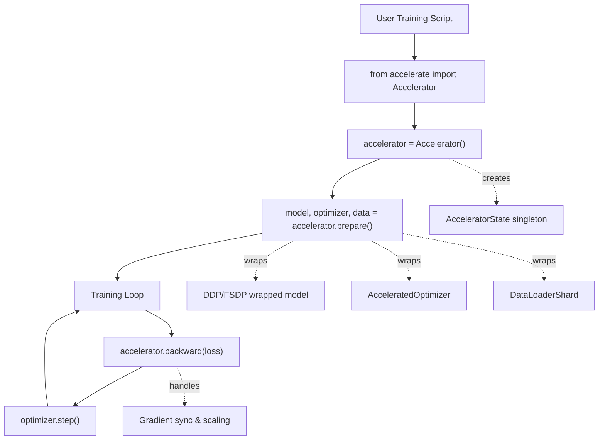

**Sources:** [README.md:49-82](), [src/accelerate/accelerator.py:1-100]()

### Automatic Device Placement

With `device_placement=True` (default), Accelerate automatically moves tensors to the correct device, eliminating manual `.to(device)` calls [README.md:88-123]().

---

## System Architecture

### High-Level Component Organization

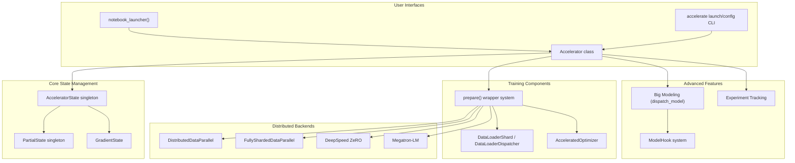

**Sources:** [src/accelerate/__init__.py:16-47](), [src/accelerate/state.py:1-50]()

### Core Classes and Their Roles

| Class | Location | Purpose |
|-------|----------|---------|
| `Accelerator` | [src/accelerate/__init__.py:16]() | Main orchestration class; user-facing API for all features. |
| `PartialState` | [src/accelerate/__init__.py:30]() | Singleton managing distributed state (rank, world size, backend). |
| `DeepSpeedPlugin` | [src/accelerate/__init__.py:35]() | Configuration for DeepSpeed ZeRO integration. |
| `FullyShardedDataParallelPlugin` | [src/accelerate/__init__.py:38]() | Configuration for PyTorch FSDP integration. |

**Sources:** [src/accelerate/__init__.py:1-47]()

---

## Supported Hardware and Backends

### Hardware Platform Support

| Platform | DistributedType | Backend |
|----------|-----------------|---------|
| Single CPU/GPU | `NO` | N/A |
| Multi-CPU | `MULTI_CPU` | gloo/mpi [README.md:162-178]() |
| Multi-GPU | `MULTI_GPU` | nccl [README.md:74-83]() |
| TPU | `XLA` | xla [README.md:100-108]() |

**Sources:** [README.md:29-35](), [examples/README.md:29-35]()

### Mixed Precision Support

| Precision | Configuration | Hardware Requirements |
|-----------|--------------|----------------------|
| FP16 | `mixed_precision='fp16'` | CUDA GPUs [README.md:54-61]() |
| BF16 | `mixed_precision='bf16'` | Ampere+ GPUs, TPUs [docs/source/concept_guides/training_tpu.md:131-142]() |
| FP8 | `mixed_precision='fp8'` | Hopper GPUs (via `torchao`) [setup.py:40]() |

**Sources:** [README.md:54-61](), [setup.py:40]()

---

## Installation and Dependencies

### Core Dependencies

Defined in [setup.py:79-88]():
- **Python**: ≥3.10.0
- **PyTorch**: ≥2.0.0
- **numpy**: ≥1.17
- **safetensors**: ≥0.4.3
- **huggingface_hub**: ≥0.21.0

### Optional Dependencies

Additional features via `pip install accelerate[feature]` [setup.py:18-51]():
- `deepspeed`: DeepSpeed integration.
- `test_trackers`: WandB, TensorBoard, CometML, etc.
- `test_fp8`: `torchao` for FP8 support.

**Sources:** [setup.py:18-88]()

---

## Key Component Subsystems

### Launch System
The `accelerate launch` command provides a unified interface to start distributed training without manually calling `torch.distributed.run` [README.md:129-140](). For details, see [Installation and Quick Start](#1.1).

### Big Model Support
The `big_modeling` module enables training and inference with models exceeding single-device memory using `init_empty_weights`, `dispatch_model`, and offloading [src/accelerate/__init__.py:17-25](). For details, see [Big Model Support](#5).

### Checkpointing
The system saves complete training state including models, optimizers, and RNG states [examples/README.md:37](). For details, see [Checkpointing and State Management](#7).

---

## Architecture: State Management Pattern

Accelerate uses a singleton pattern for state management to ensure consistent distributed configuration. All components query the `PartialState` singleton to determine their behavior based on the distributed configuration [src/accelerate/__init__.py:30]().

For details, see [Core Concepts and Architecture](#1.2).

**Sources:** [src/accelerate/__init__.py:30]()

---

## Version and Compatibility

Current version: **1.15.0.dev0** [src/accelerate/__init__.py:14]().

**Sources:** [src/accelerate/__init__.py:14](), [setup.py:58]()

---

# Page: Installation and Quick Start

# Installation and Quick Start

<details>
<summary>Relevant source files</summary>

The following files were used as context for generating this wiki page:

- [docs/source/basic_tutorials/install.md](docs/source/basic_tutorials/install.md)
- [docs/source/basic_tutorials/launch.md](docs/source/basic_tutorials/launch.md)
- [docs/source/basic_tutorials/migration.md](docs/source/basic_tutorials/migration.md)
- [docs/source/basic_tutorials/notebook.md](docs/source/basic_tutorials/notebook.md)
- [docs/source/quicktour.md](docs/source/quicktour.md)
- [docs/source/usage_guides/big_modeling.md](docs/source/usage_guides/big_modeling.md)
- [docs/source/usage_guides/quantization.md](docs/source/usage_guides/quantization.md)
- [examples/cv_example.py](examples/cv_example.py)
- [examples/nlp_example.py](examples/nlp_example.py)
- [setup.py](setup.py)
- [src/accelerate/__init__.py](src/accelerate/__init__.py)

</details>


This page guides you through installing Accelerate and running your first distributed training script. It covers the basic installation process, dependencies, minimal code changes needed to enable distributed training, and the launch workflow using the CLI or programmatic approach.

---

## System Requirements

Accelerate requires a specific environment to function properly. The library is tested on **Python 3.10+** and relies on the following core dependencies:

| Requirement | Version | Purpose |
|------------|---------|---------|
| Python | >= 3.10.0 | Base language requirement [setup.py:78]() |
| PyTorch | >= 2.0.0 | Core tensor library [setup.py:84]() |
| NumPy | >= 1.17 | Numerical operations [setup.py:80]() |
| Packaging | >= 20.0 | Version management [setup.py:81]() |
| PyYAML | Required | Configuration file parsing [setup.py:83]() |
| psutil | Required | System monitoring [setup.py:82]() |
| huggingface_hub | >= 0.21.0 | Model/checkpoint access [setup.py:85]() |
| safetensors | >= 0.4.3 | Efficient weight loading [setup.py:86]() |

**Sources:** [setup.py:78-87](), [docs/source/basic_tutorials/install.md:18]()

---

## Installation

### Basic Installation

To install Accelerate from PyPI:

```bash
pip install accelerate
```

For Conda environments:

```bash
conda install -c conda-forge accelerate
```

To install the latest development version from source:

```bash
pip install git+https://github.com/huggingface/accelerate
```

**Sources:** [docs/source/basic_tutorials/install.md:24-45]()

### Optional Dependencies

Accelerate provides several `extras` for extended functionality. These can be installed using the `pip install accelerate[extra_name]` syntax.

| Extra | Purpose | Key Dependencies |
|-------|---------|------------------|
| `deepspeed` | DeepSpeed distributed backend | `deepspeed` [setup.py:37]() |
| `rich` | Enhanced CLI output and logging | `rich` [setup.py:38]() |
| `testing` | Development and CI tools | `pytest`, `transformers`, `tqdm` [setup.py:22-36]() |
| `sagemaker` | AWS SageMaker integration | `sagemaker` [setup.py:52-54]() |
| `test_trackers`| Experiment tracking tools | `wandb`, `tensorboard`, `dvclive` [setup.py:41-49]() |

**Sources:** [setup.py:18-54]()

### CLI Command Registration

The installation process registers several entry points in the console.

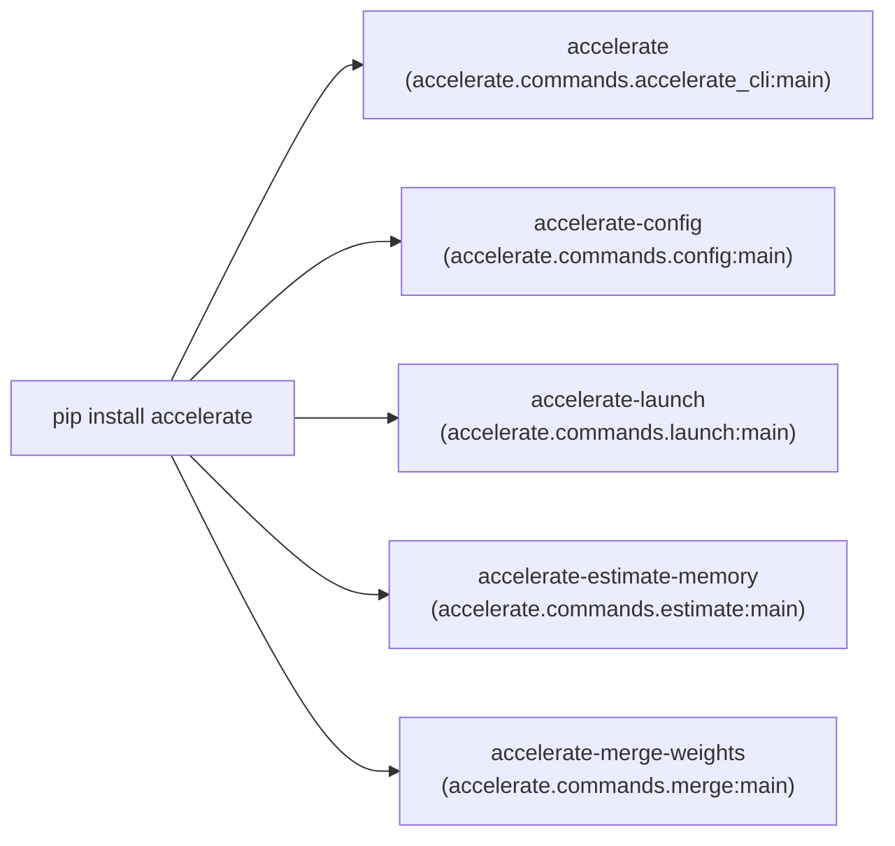

**Sources:** [setup.py:69-77]()

---

## Quick Start: Minimal Code Changes

Accelerate is a thin wrapper around PyTorch. It allows you to write standard PyTorch code and scale it to multiple GPUs or TPUs by adding a few lines.

### Migration Flow

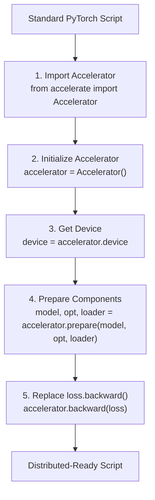

**Sources:** [docs/source/quicktour.md:64-83](), [docs/source/basic_tutorials/migration.md:38-84]()

### Implementation Example

The following code snippet (based on `nlp_example.py`) demonstrates the integration:

```python
from accelerate import Accelerator
from torch.optim import AdamW
from torch.utils.data import DataLoader

def training_function(model, dataset):
    # Initialize the main orchestration class
    accelerator = Accelerator() # [src/accelerate/accelerator.py:84]()
    
    optimizer = AdamW(model.parameters(), lr=1e-5)
    train_dataloader = DataLoader(dataset, batch_size=32)

    # Prepare wraps the objects for the distributed backend
    model, optimizer, train_dataloader = accelerator.prepare(
        model, optimizer, train_dataloader
    ) # [src/accelerate/accelerator.py:1260]()

    for batch in train_dataloader:
        # No need for manual batch.to(device) if device_placement=True (default)
        outputs = model(**batch)
        loss = outputs.loss
        
        # Scales loss and handles distributed backward pass
        accelerator.backward(loss) # [src/accelerate/accelerator.py:1960]()
        
        optimizer.step()
        optimizer.zero_grad()
```

**Sources:** [examples/nlp_example.py:113-171](), [docs/source/quicktour.md:64-118]()

---

## Configuration and Launch Workflow

Accelerate provides a unified launcher that handles the specifics of `torchrun`, `mpirun` (DeepSpeed), or XLA spawning.

### CLI Launch Flow

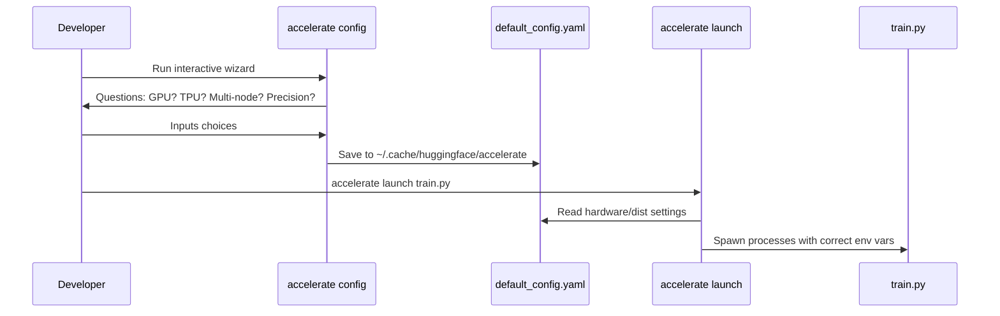

**Sources:** [docs/source/quicktour.md:26-54](), [docs/source/basic_tutorials/launch.md:67-94]()

### Step 1: Configuration

Run the configuration wizard to detect your hardware:
```bash
accelerate config
```
This generates a YAML file containing settings for `distributed_type` (MULTI_GPU, TPU, etc.), `mixed_precision`, and `num_processes`. [docs/source/basic_tutorials/install.md:57-78]()

### Step 2: Launching Training

Once configured, launch your script without hardware-specific flags:
```bash
accelerate launch path_to_script.py --args_for_the_script
```

Alternatively, override configuration on the fly:
```bash
# Launch on 2 GPUs with FP16 precision
accelerate launch --multi_gpu --num_processes 2 --mixed_precision fp16 train.py
```

**Sources:** [docs/source/quicktour.md:48-52](), [docs/source/basic_tutorials/launch.md:124]()

---

## Specialized Features

### Big Model Inference
Accelerate allows loading models that exceed a single device's VRAM using the `init_empty_weights` context manager and `load_checkpoint_and_dispatch` function. This uses a "Parameterless" initialization to save RAM.

```python
from accelerate import init_empty_weights, load_checkpoint_and_dispatch

with init_empty_weights():
    model = MyHugeModel() # No memory used here

model = load_checkpoint_and_dispatch(
    model, checkpoint="path/to/weights", device_map="auto"
)
```
**Sources:** [docs/source/usage_guides/big_modeling.md:34-57](), [src/accelerate/__init__.py:17-25]()

### Notebook Launching
For Jupyter/Colab/Kaggle environments, use the `notebook_launcher` to spawn distributed processes (especially useful for TPUs).

```python
from accelerate import notebook_launcher

def train():
    # ... training code ...

notebook_launcher(train, num_processes=8)
```
**Sources:** [docs/source/basic_tutorials/notebook.md:183-195](), [src/accelerate/__init__.py:28]()

### Quantization Support
Accelerate integrates with `bitsandbytes` to load models in 8-bit or 4-bit precision.

```python
from accelerate.utils import BnbQuantizationConfig, load_and_quantize_model

bnb_config = BnbQuantizationConfig(load_in_4bit=True, bnb_4bit_compute_dtype=torch.bfloat16)
model = load_and_quantize_model(empty_model, weights_location=weights, bnb_quantization_config=bnb_config)
```
**Sources:** [docs/source/usage_guides/quantization.md:71-89]()

---

## Verification

To check your current environment and Accelerate configuration:

```bash
accelerate env
```
To run a diagnostic test on your distributed setup:
```bash
accelerate test
```
**Sources:** [docs/source/basic_tutorials/install.md:74-78](), [setup.py:118]()

---

# Page: Core Concepts and Architecture

# Core Concepts and Architecture

<details>
<summary>Relevant source files</summary>

The following files were used as context for generating this wiki page:

- [docs/source/concept_guides/internal_mechanism.md](docs/source/concept_guides/internal_mechanism.md)
- [src/accelerate/accelerator.py](src/accelerate/accelerator.py)
- [src/accelerate/state.py](src/accelerate/state.py)
- [src/accelerate/utils/__init__.py](src/accelerate/utils/__init__.py)
- [src/accelerate/utils/dataclasses.py](src/accelerate/utils/dataclasses.py)
- [src/accelerate/utils/imports.py](src/accelerate/utils/imports.py)

</details>


This page explains the fundamental concepts and architecture of the Accelerate library. It covers the core abstractions (`AcceleratorState`, `PartialState`, `GradientState`), the distributed training system (`DistributedType`), and the plugin architecture that enables flexible integration with various training frameworks.

## Architectural Overview

Accelerate uses a layered architecture that separates concerns between state management, execution environment configuration, and framework integration. The core design principle is the singleton pattern for state management, ensuring all parts of the training code see consistent distributed environment information.

**High-Level System Layers**

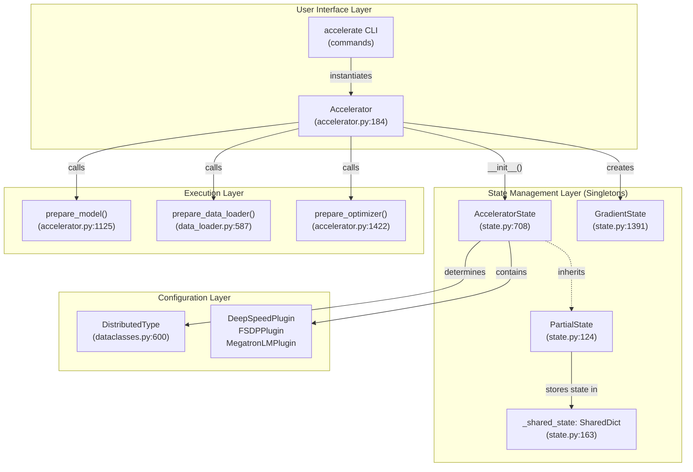

Sources: [src/accelerate/accelerator.py:184-637](), [src/accelerate/state.py:124-1371](), [src/accelerate/utils/dataclasses.py:600-633]()

The architecture provides clear separation of concerns:
- **User Interface Layer**: Entry points via `Accelerator.__init__()` and CLI commands.
- **State Management Layer**: Singleton objects using `_shared_state` dict to track distributed environment state.
- **Configuration Layer**: `DistributedType` enum and plugin objects that define training behavior.
- **Execution Layer**: `prepare_*()` methods that wrap PyTorch objects for distributed execution.

## State Management System

Accelerate uses singleton classes to maintain shared state about the training environment. The singleton pattern is implemented through a class-level `_shared_state` dictionary that all instances share, ensuring consistent behavior across multiple `Accelerator` instations.

**State Management Class Hierarchy and Singleton Pattern**

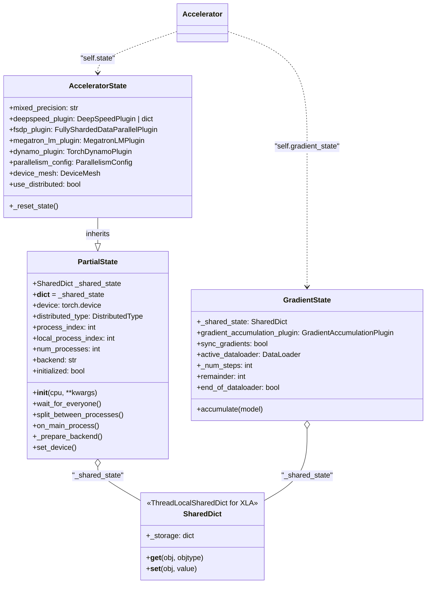

Sources: [src/accelerate/state.py:92-163](), [src/accelerate/state.py:124-706](), [src/accelerate/state.py:708-1371](), [src/accelerate/state.py:1371]()

### The Singleton Pattern Implementation

The singleton pattern is implemented through the `_shared_state` class variable and Python's descriptor protocol. For TPU/XLA environments using PJRT, a `ThreadLocalSharedDict` is used to support multithreading [src/accelerate/state.py:92-120]().

```python
# Simplified implementation from state.py:163
class PartialState:
    _shared_state = SharedDict()  # Shared across all instances
    
    def __init__(self, cpu: bool = False, **kwargs):
        self.__dict__ = self._shared_state  # All instances share the same __dict__
        if not self.initialized:
            # Only initialize once
            self._cpu = cpu
            self.backend = None
            self.device = None
            # ... initialization code ...
```

**Key aspects of the singleton implementation:**

1. **`SharedDict`**: A descriptor that holds the shared dictionary. It defaults to `dict` but becomes `ThreadLocalSharedDict` if `is_torch_xla_available()` is true [src/accelerate/state.py:119-122]().
2. **`__dict__ = _shared_state`**: Every instance shares the same `__dict__`, so all attribute assignments affect all instances [src/accelerate/state.py:178]().
3. **`initialized` property**: Checks if `_shared_state != {}` to prevent re-initialization [src/accelerate/state.py:337-339]().
4. **`_reset_state()` method**: Clears the shared state, used primarily in testing [src/accelerate/state.py:332-334]().

**Initialization Flow**

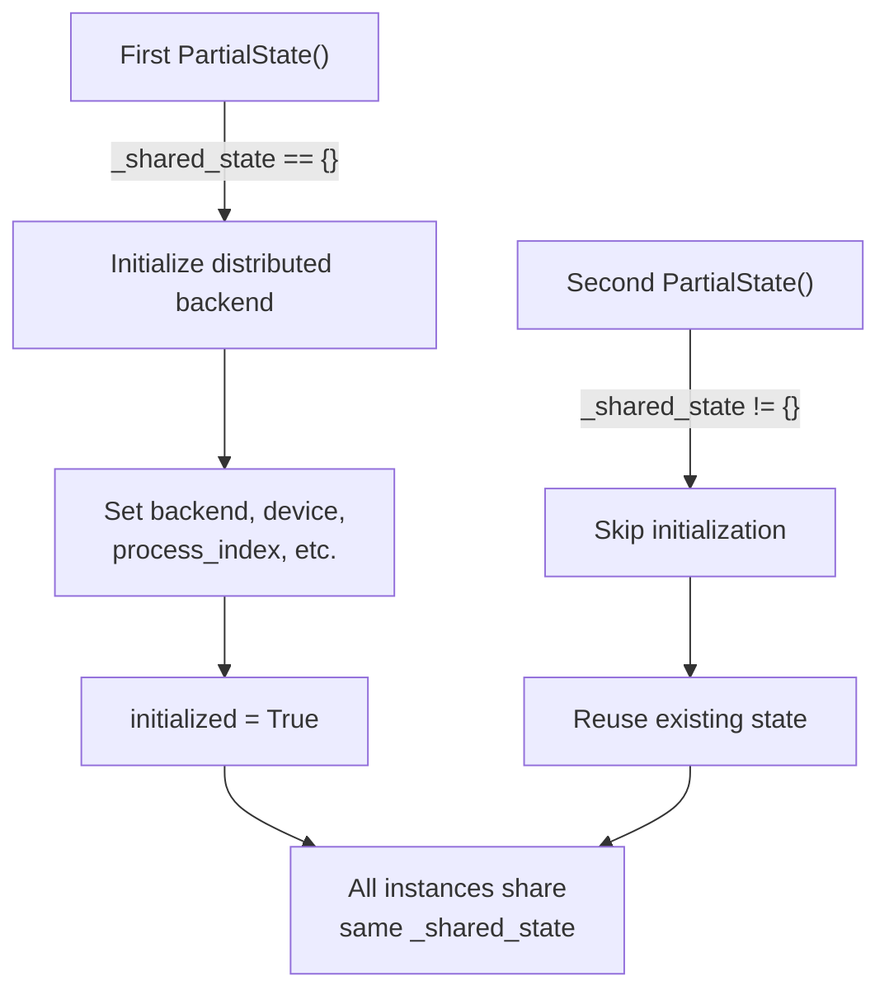

Sources: [src/accelerate/state.py:178-320]()

### PartialState

`PartialState` is a lightweight singleton that can be used independently of `Accelerator`. It handles the distributed environment setup and provides process control utilities.

**Attributes and Methods** [src/accelerate/state.py:124-706]():

| Category | Members | Description |
|----------|---------|-------------|
| **Process Info** | `process_index`, `local_process_index`, `num_processes` | Process identification in distributed setup. |
| **Device** | `device`, `default_device` | Target device for tensors (`cuda`, `xpu`, `mlu`, `npu`, `cpu`, etc.). |
| **Backend** | `backend`, `distributed_type` | PyTorch distributed backend (`nccl`, `gloo`, `xla`) and type. |
| **State** | `initialized`, `_shared_state` | Singleton state management. |
| **Sync** | `wait_for_everyone()` | Barrier synchronization across processes [src/accelerate/state.py:369-406](). |
| **Context Managers** | `main_process_first()`, `local_main_process_first()`, `split_between_processes()` | Control execution order and data splitting [src/accelerate/state.py:507-548](). |
| **Decorators** | `on_main_process()`, `on_local_main_process()`, `on_process()` | Execute functions on specific processes [src/accelerate/state.py:549-670](). |

**Backend Selection Logic** [src/accelerate/state.py:746-812]():

The `_prepare_backend()` method determines the backend based on:
1. **XLA detection**: If `torch_xla` available → `backend="xla"`.
2. **Hardware detection**: Based on `LOCAL_RANK` env var and available accelerators.
3. **CPU fallback**: Check for MPI environment variables for multi-CPU training.

### AcceleratorState

`AcceleratorState` inherits from `PartialState` and adds training-specific configuration. It is initialized by `Accelerator.__init__()` with the `_from_accelerator=True` flag.

**Additional Attributes** [src/accelerate/state.py:708-1371]():

| Attribute | Type | Description |
|-----------|------|-------------|
| `mixed_precision` | `str` | Precision type: `"no"`, `"fp16"`, `"bf16"`, `"fp8"`. |
| `deepspeed_plugin` | `DeepSpeedPlugin \| dict` | DeepSpeed configuration(s). |
| `fsdp_plugin` | `FullyShardedDataParallelPlugin` | FSDP configuration. |
| `megatron_lm_plugin` | `MegatronLMPlugin` | Megatron-LM configuration. |
| `dynamo_plugin` | `TorchDynamoPlugin` | TorchDynamo configuration. |
| `parallelism_config` | `ParallelismConfig` | N-dimensional parallelism config (TP/DP/CP). |
| `device_mesh` | `DeviceMesh` | PyTorch device mesh for FSDP2. |

**Distributed Type Refinement** [src/accelerate/state.py:911-1029]():

After `PartialState` initializes the basic distributed type, `AcceleratorState` may refine it:
- If `deepspeed_plugin` is set → `DistributedType.DEEPSPEED`.
- If `fsdp_plugin` is set → `DistributedType.FSDP`.
- If `megatron_lm_plugin` is set → `DistributedType.MEGATRON_LM`.

### GradientState

`GradientState` is a separate singleton that manages gradient accumulation and synchronization. It uses its own `_shared_state` to track accumulation across the training loop.

**Core Functionality** [src/accelerate/state.py:1371]():

| Property/Method | Description |
|-----------------|-------------|
| `sync_gradients` | Boolean indicating if gradients should sync this step [src/accelerate/state.py:1371](). |
| `accumulate(model)` | Context manager that temporarily disables gradient sync [src/accelerate/state.py:1371](). |
| `end_of_dataloader` | Boolean indicating if at the end of the dataloader [src/accelerate/state.py:1371](). |
| `_num_steps` | Total accumulation steps configured. |
| `remainder` | Steps remaining before synchronization. |

**How Gradient Accumulation Works**:

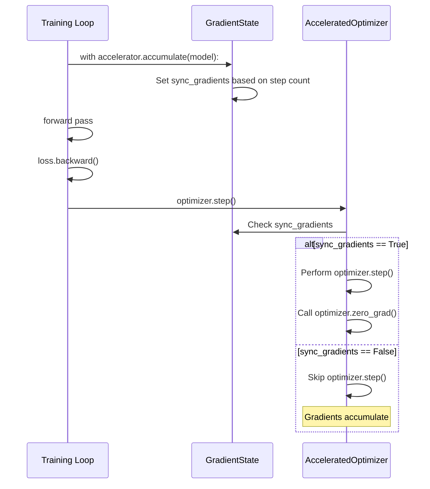

Sources: [src/accelerate/state.py:1371](), [src/accelerate/optimizer.py:158-213]()

## DistributedType Enum

The `DistributedType` enum defines the training environment and determines how models, optimizers, and data loaders are prepared.

**DistributedType Values and Selection**

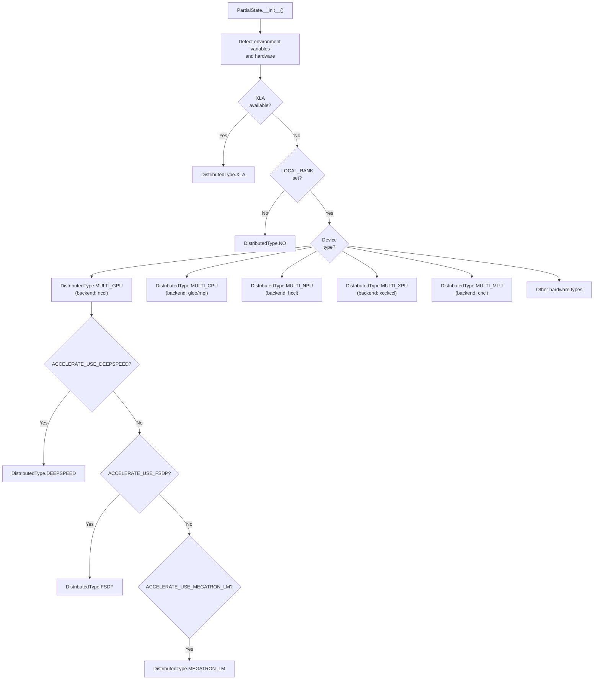

Sources: [src/accelerate/utils/dataclasses.py:570-603](), [src/accelerate/state.py:178-318]()

### DistributedType Values

The enum defines these values [src/accelerate/utils/dataclasses.py:570-603]():

| Value | Description | Backend |
|-------|-------------|---------|
| `NO` | Single process, no distributed training | N/A |
| `MULTI_GPU` | Standard DDP across GPUs | `nccl` |
| `MULTI_CPU` | DDP across CPU nodes | `gloo`, `mpi` |
| `MULTI_NPU` | DDP on Ascend NPUs | `hccl` |
| `MULTI_XPU` | DDP on Intel XPUs | `xccl`, `ccl` |
| `MULTI_MLU` | DDP on Cambricon MLUs | `cncl` |
| `MULTI_MUSA` | DDP on Moore Threads GPUs | `mccl` |
| `MULTI_SDAA` | DDP on SiEngine SDAAs | `tccl` |
| `MULTI_HPU` | DDP on Habana Gaudi HPUs | `hccl` |
| `DEEPSPEED` | DeepSpeed with ZeRO optimization | `nccl` |
| `FSDP` | PyTorch Fully Sharded Data Parallel | `nccl` |
| `XLA` | TPU training via PyTorch/XLA | `xla` |
| `MEGATRON_LM` | Megatron-LM for tensor/pipeline parallelism | `nccl` |

## The Accelerator Class

`Accelerator` is the main user-facing class that orchestrates distributed training. It initializes the state singletons and provides the `prepare()` method to wrap PyTorch objects.

**Accelerator Initialization Flow**

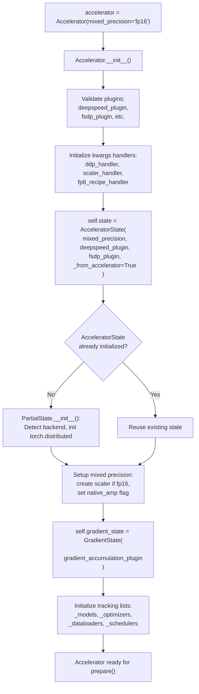

Sources: [src/accelerate/accelerator.py:279-637]()

**Key Responsibilities**:

1. **State Initialization**: Creates `AcceleratorState` and `GradientState` singletons [src/accelerate/accelerator.py:462-553]().
2. **Plugin Configuration**: Validates and stores plugin configurations (DeepSpeed, FSDP, etc.) [src/accelerate/accelerator.py:336-413]().
3. **Mixed Precision Setup**: Configures `GradScaler` and autocast contexts [src/accelerate/accelerator.py:562-613]().
4. **Object Tracking**: Maintains lists of prepared models, optimizers, dataloaders [src/accelerate/accelerator.py:617-622]().

## Mixed Precision Configuration

Accelerate supports multiple precision types through the `mixed_precision` parameter passed to `Accelerator.__init__()`.

**Mixed Precision Types**

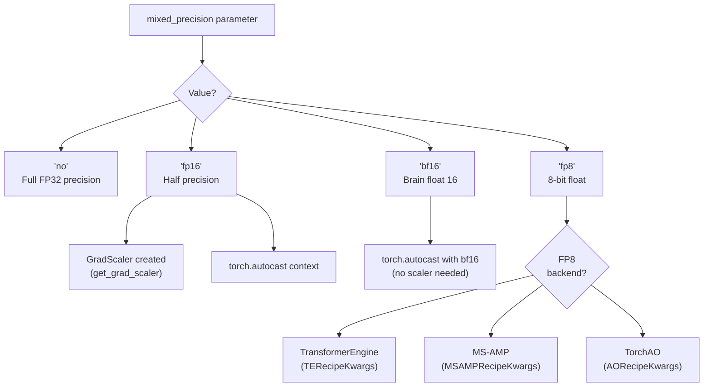

Sources: [src/accelerate/utils/dataclasses.py:738-752](), [src/accelerate/accelerator.py:477-613]()

### Precision Types

| Type | Description | GradScaler | Hardware Requirements |
|------|-------------|------------|----------------------|
| `no` | Full FP32 precision | No | Any |
| `fp16` | Half precision (16-bit) | Yes (except XLA) | GPUs with FP16 support |
| `bf16` | Brain float 16 | No | Newer GPUs, TPUs |
| `fp8` | 8-bit float | Backend-dependent | H100+ or specific accelerators |

### Implementation Details

- **FP16**: Uses `torch.cuda.amp.GradScaler` (or `torch.amp.GradScaler` for PyTorch 2.4+) to scale gradients and prevent underflow.
- **BF16**: Uses `torch.autocast` without gradient scaling (BF16 has better numerical stability).
- **FP8**: Requires additional recipe configuration through `TERecipeKwargs`, `MSAMPRecipeKwargs`, or `AORecipeKwargs` [src/accelerate/utils/dataclasses.py:738-752]().

The `native_amp` flag is set to `True` when using FP16 or BF16, which enables `torch.autocast` in the training loop [src/accelerate/accelerator.py:562-613]().

## Plugin Architecture

Accelerate uses plugins to integrate with specialized training frameworks. Plugins are configuration objects that customize how models, optimizers, and data are prepared.

**Plugin System Overview**

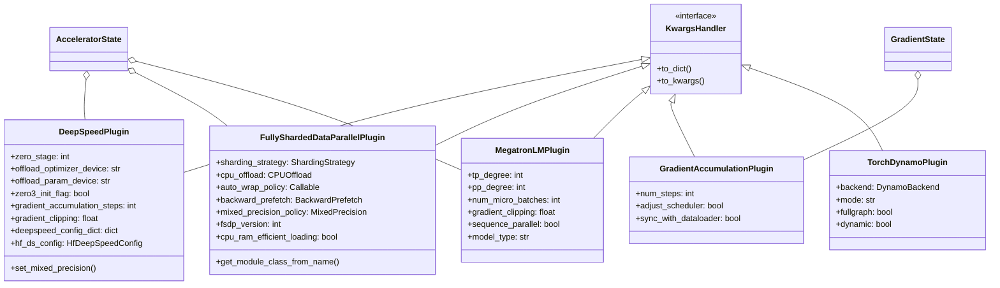

Sources: [src/accelerate/utils/dataclasses.py:70-89](), [src/accelerate/utils/dataclasses.py:1205-1654](), [src/accelerate/utils/dataclasses.py:1656-2302]()

### Core Plugins

- **DeepSpeedPlugin** ([src/accelerate/utils/dataclasses.py:1205-1654]()): Configures ZeRO stages, offloading, and DeepSpeed-specific settings.
- **FullyShardedDataParallelPlugin** ([src/accelerate/utils/dataclasses.py:1656-2302]()): Supports FSDP v1 and v2, sharding strategies, and RAM-efficient loading.
- **MegatronLMPlugin** ([src/accelerate/utils/dataclasses.py:2305-2636]()): Configures tensor/pipeline parallelism degrees and micro-batching.
- **GradientAccumulationPlugin** ([src/accelerate/utils/dataclasses.py:1015-1111]()): Controls accumulation steps and scheduler synchronization.
- **TorchDynamoPlugin** ([src/accelerate/utils/dataclasses.py:2639-2694]()): Configures `torch.compile` backends and modes.

## Configuration System

Accelerate supports configuration through three mechanisms with a clear precedence order.

**Configuration Precedence**

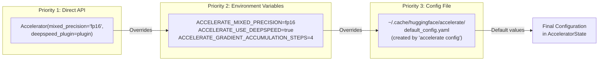

Sources: [src/accelerate/accelerator.py:278-554]()

### Configuration Dataclasses

- **DataLoaderConfiguration** ([src/accelerate/utils/dataclasses.py:787-919]()): Handles sharding, dispatching, and stateful dataloader settings.
- **ProjectConfiguration** ([src/accelerate/utils/dataclasses.py:922-1012]()): Manages logging directories and checkpoint naming/limits.

### Environment Variable Detection

Common environment variables checked by Accelerate:

| Variable | Effect | Parsed In |
|----------|--------|-----------|
| `ACCELERATE_MIXED_PRECISION` | Sets mixed precision mode | [src/accelerate/accelerator.py:310-315]() |
| `ACCELERATE_USE_DEEPSPEED` | Enables DeepSpeed | [src/accelerate/accelerator.py:344-347]() |
| `ACCELERATE_USE_FSDP` | Enables FSDP | [src/accelerate/accelerator.py:380-390]() |
| `ACCELERATE_USE_MEGATRON_LM` | Enables Megatron-LM | [src/accelerate/accelerator.py:401-408]() |
| `ACCELERATE_GRADIENT_ACCUMULATION_STEPS` | Sets accumulation steps | [src/accelerate/accelerator.py:545-547]() |
| `LOCAL_RANK` | Indicates distributed training | [src/accelerate/state.py:203-237]() |
| `RANK`, `WORLD_SIZE` | Process rank and total processes | [src/accelerate/state.py:241-257]() |

## DataLoader Preparation Overview

`prepare_data_loader()` adapts PyTorch DataLoaders for distributed training. The key decision is whether to use sharding (each process independently iterates its shard) or dispatching (main process distributes data).

**DataLoader Wrapper Selection**

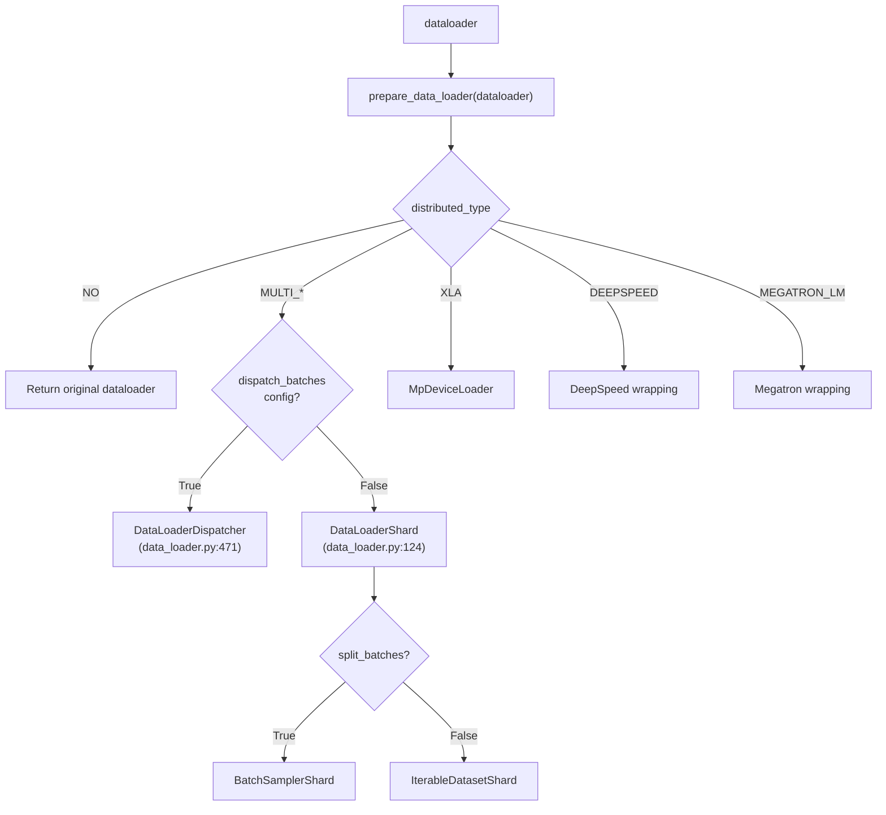

**Core Wrappers**:

- **`DataLoaderShard`** [src/accelerate/data_loader.py:124-415](): Wraps sampler/dataset to shard data across processes.
- **`DataLoaderDispatcher`** [src/accelerate/data_loader.py:471-585](): Main process fetches and broadcasts batches.
- **`skip_first_batches()`** [src/accelerate/data_loader.py:42-122](): Utility for resuming from checkpoints by skipping batches.

Sources: [src/accelerate/data_loader.py:587-747](), [src/accelerate/utils/dataclasses.py:817-919]()

## Integration with PyTorch and Other Frameworks

Accelerate acts as an abstraction layer over PyTorch's distributed training APIs and integrates with specialized frameworks.

**Integration Architecture**

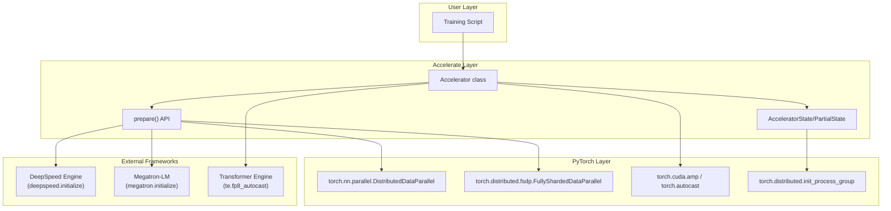

Sources: [src/accelerate/accelerator.py:183-637]()

### PyTorch Integration Points

| Component | PyTorch API | Accelerate Wrapper |
|-----------|-------------|-------------------|
| Model | `torch.nn.Module` | `DistributedDataParallel` or plugin wrapper |
| Optimizer | `torch.optim.Optimizer` | `AcceleratedOptimizer` [src/accelerate/optimizer.py:44-213]() |
| Scheduler | `torch.optim.lr_scheduler` | `AcceleratedScheduler` [src/accelerate/scheduler.py:31-98]() |
| DataLoader | `torch.utils.data.DataLoader` | `DataLoaderShard` / `DataLoaderDispatcher` |
| Mixed Precision | `torch.autocast` | `get_mixed_precision_context_manager()` |
| Gradient Scaling | `torch.amp.GradScaler` | `get_grad_scaler()` |

Sources: [src/accelerate/accelerator.py:1125-1422](), [src/accelerate/utils/__init__.py:148-210]()

---

# Page: The Accelerator Class

# The Accelerator Class

<details>
<summary>Relevant source files</summary>

The following files were used as context for generating this wiki page:

- [docs/source/package_reference/accelerator.md](docs/source/package_reference/accelerator.md)
- [src/accelerate/accelerator.py](src/accelerate/accelerator.py)
- [src/accelerate/state.py](src/accelerate/state.py)
- [src/accelerate/utils/dataclasses.py](src/accelerate/utils/dataclasses.py)

</details>


## Purpose and Scope

This page documents the `Accelerator` class, the primary API entry point for users of the Accelerate library. The `Accelerator` serves as the orchestration layer that coordinates distributed training, mixed precision, gradient accumulation, and device management. This page provides an overview of the class architecture and its role in the system.

For detailed information about specific aspects:
- Initialization parameters and configuration options: see [Initialization and Configuration](#2.1)
- The `prepare()` method and component wrapping: see [Preparing Training Components](#2.2)
- Training loop integration (`backward()`, gradient accumulation): see [Training Loop Integration](#2.3)
- State properties and process control utilities: see [State Properties and Process Control](#2.4)

For information about data loading specifically, see [Data Loading and Processing](#4). For backend plugins (FSDP, DeepSpeed, Megatron-LM), see [Distributed Training Backends](#3).

## Class Overview

The `Accelerator` class is defined in [src/accelerate/accelerator.py:184-277]() and serves as a high-level wrapper that simplifies distributed PyTorch training. It abstracts away the complexity of different distributed backends, mixed precision configurations, and hardware setups, allowing users to write training code that works across single GPU, multi-GPU, multi-node, TPU, and other accelerated environments with minimal code changes.

**Core Design Principles:**
- **Single API**: One class interface for all distributed configurations.
- **Minimal Code Changes**: Typically requires only 4 to 5 lines of code changes to existing PyTorch scripts.
- **Plugin Architecture**: Extensible backend support through plugins (DeepSpeed, FSDP, Megatron-LM).
- **State Management**: Centralized state handling via singleton pattern in `AcceleratorState` and `PartialState`.

## Architecture and Relationships

### Accelerator in the System Hierarchy

The `Accelerator` acts as a facade, aggregating several configuration plugins, state singletons, and internal trackers for prepared objects.

```mermaid
graph TB
    User["User Training Script"]
    Accelerator["Accelerator<br/>(Main API)"]
    
    subgraph "State Singletons"
        AcceleratorState["AcceleratorState"]
        PartialState["PartialState"]
        GradientState["GradientState"]
    end
    
    subgraph "Configuration"
        ProjectConfig["ProjectConfiguration"]
        DataLoaderConfig["DataLoaderConfiguration"]
        GradAccumPlugin["GradientAccumulationPlugin"]
    end
    
    subgraph "Plugins"
        DeepSpeedPlugin["DeepSpeedPlugin"]
        FSDPPlugin["FullyShardedDataParallelPlugin"]
        MegatronPlugin["MegatronLMPlugin"]
        DynamoPlugin["TorchDynamoPlugin"]
    end
    
    subgraph "Handlers"
        DDPHandler["DistributedDataParallelKwargs<br/>(ddp_handler)"]
        ScalerHandler["GradScalerKwargs<br/>(scaler_handler)"]
        FP8Handler["FP8RecipeKwargs<br/>(fp8_recipe_handler)"]
        AutocastHandler["AutocastKwargs<br/>(autocast_handler)"]
    end
    
    subgraph "Internal Components"
        Models["_models: list"]
        Optimizers["_optimizers: list"]
        Schedulers["_schedulers: list"]
        DataLoaders["_dataloaders: list"]
        Scaler["scaler: GradScaler"]
    end
    
    User --> Accelerator
    
    Accelerator --> AcceleratorState
    Accelerator --> GradientState
    AcceleratorState --> PartialState
    
    Accelerator --> ProjectConfig
    Accelerator --> DataLoaderConfig
    Accelerator --> GradAccumPlugin
    
    Accelerator --> DeepSpeedPlugin
    Accelerator --> FSDPPlugin
    Accelerator --> MegatronPlugin
    Accelerator --> DynamoPlugin
    
    Accelerator --> DDPHandler
    Accelerator --> ScalerHandler
    Accelerator --> FP8Handler
    Accelerator --> AutocastHandler
    
    Accelerator --> Models
    Accelerator --> Optimizers
    Accelerator --> Schedulers
    Accelerator --> DataLoaders
    Accelerator --> Scaler
```

**Sources:** [src/accelerate/accelerator.py:184-636](), [src/accelerate/state.py:123-160](), [src/accelerate/state.py:863-1080]()

### Initialization Flow

When initialized, the `Accelerator` establishes the distributed backend via `AcceleratorState`.

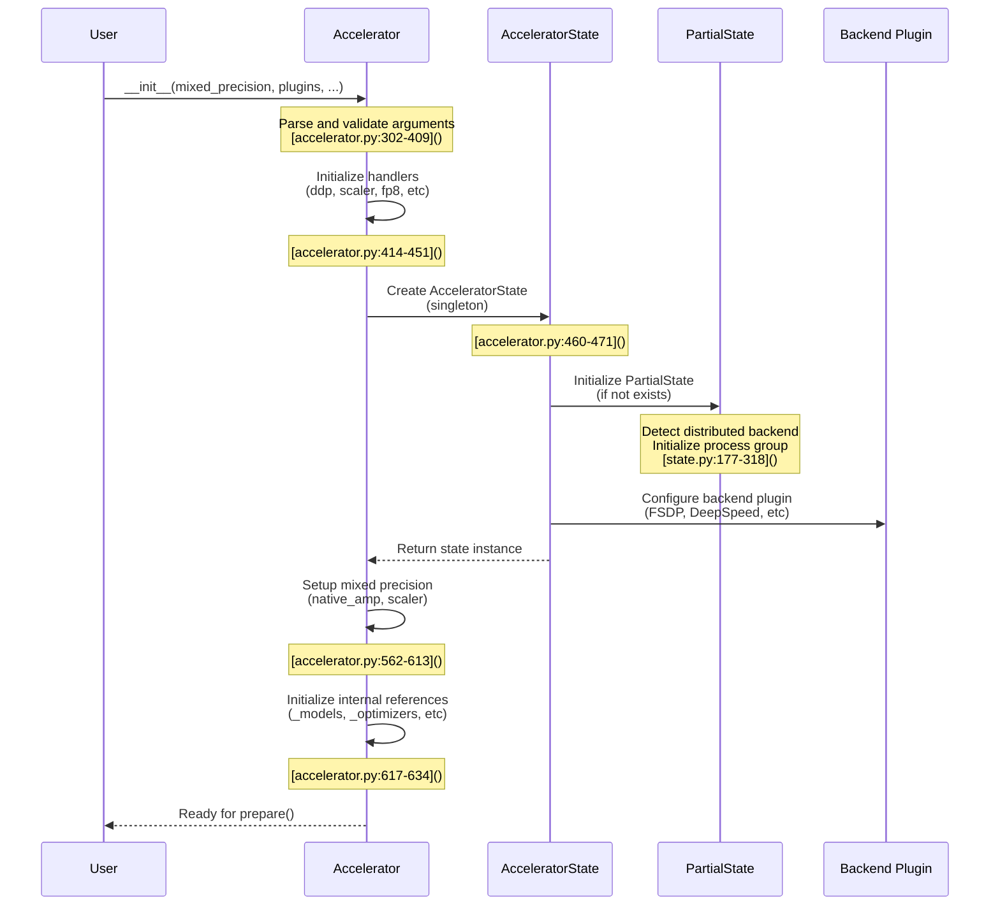

**Sources:** [src/accelerate/accelerator.py:278-636](), [src/accelerate/state.py:123-160](), [src/accelerate/state.py:863-1080]()

## Core Responsibilities

The `Accelerator` class manages five primary responsibilities:

### 1. Distributed Environment Setup

The `Accelerator` initializes the distributed training environment through `AcceleratorState`. This includes:

- **Backend Selection**: Automatically detects or manually configures backends (NCCL, Gloo, XLA, etc.).
- **Process Group Initialization**: Sets up communication via `torch.distributed`.
- **Device Assignment**: Assigns the process to the correct device (e.g., `cuda:0`, `xla:0`).

The logic for basic process management is in `PartialState` [src/accelerate/state.py:123-160](), which is inherited/extended by `AcceleratorState` [src/accelerate/state.py:863-1080]().

**Key Properties:**
- `distributed_type`: Returns the `DistributedType` (e.g., `MULTI_GPU`, `DEEPSPEED`) [src/accelerate/accelerator.py:669-671]().
- `num_processes`: Total number of processes in the job [src/accelerate/accelerator.py:673-675]().
- `process_index`: The global rank of the process [src/accelerate/accelerator.py:677-679]().

### 2. Component Preparation

The `prepare()` method [src/accelerate/accelerator.py:1361-1577]() wraps models, optimizers, and dataloaders.

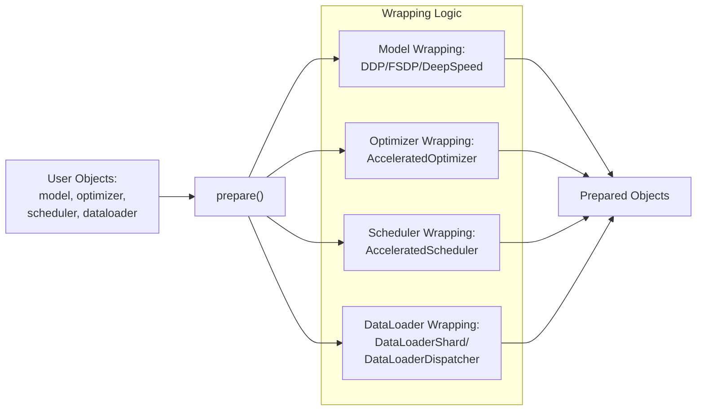

**Sources:** [src/accelerate/accelerator.py:1361-1577]()

### 3. Mixed Precision Management

Supports FP16, BF16, and FP8 precision:

| Precision Type | GradScaler Required | Configuration Handler |
|---------------|---------------------|-----------------------|
| FP16 | Yes (for non-DeepSpeed) | `GradScalerKwargs` [src/accelerate/utils/dataclasses.py:596-620]() |
| BF16 | No | N/A |
| FP8 | Varies | `FP8RecipeKwargs` [src/accelerate/utils/dataclasses.py:1225-1262]() |

The `Accelerator` sets up the `scaler` in [src/accelerate/accelerator.py:562-613]().

### 4. Gradient Accumulation Control

Tracks synchronization states across uneven batches and accumulation steps through `GradientState`.

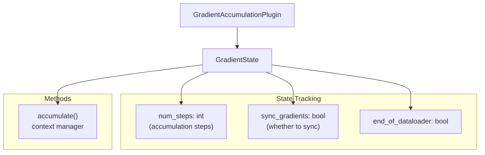

The `accumulate()` context manager [src/accelerate/accelerator.py:2050-2112]() uses the `GradientState` [src/accelerate/state.py:1083-1209]() to determine if the backward pass should trigger gradient synchronization.

### 5. Training Utilities

- **Synchronization**: `wait_for_everyone()` [src/accelerate/accelerator.py:2260-2262]().
- **Collectives**: `gather()` [src/accelerate/accelerator.py:2180-2212](), `reduce()` [src/accelerate/accelerator.py:2214-2228]().
- **Checkpointing**: `save_state()` and `load_state()` [src/accelerate/accelerator.py:2485-2565]().

## Internal Architecture

### State Management Objects

The `Accelerator` maintains several singleton state objects:

| State Object | Singleton Class | Purpose |
|-------------|-----------------|---------|
| Distributed State | `AcceleratorState` | Manages process groups and plugin state [src/accelerate/state.py:863](). |
| Basic State | `PartialState` | Lowest-level process and device info [src/accelerate/state.py:123](). |
| Gradient State | `GradientState` | Tracks accumulation synchronization [src/accelerate/state.py:1083](). |

### Internal Collections

The `Accelerator` tracks all objects passed to `prepare()` in its internal lists:
- `self._models` [src/accelerate/accelerator.py:618]()
- `self._optimizers` [src/accelerate/accelerator.py:617]()
- `self._schedulers` [src/accelerate/accelerator.py:619]()
- `self._dataloaders` [src/accelerate/accelerator.py:620]()

### Handler System

The `Accelerator` accepts `kwargs_handlers` [src/accelerate/accelerator.py:414-451]() which are instances of `KwargsHandler` subclasses like `DistributedDataParallelKwargs` or `AutocastKwargs` [src/accelerate/utils/dataclasses.py:70-89](). These are used to pass fine-grained arguments to underlying PyTorch components.

## Typical Usage Pattern

### Integration Workflow

```mermaid
sequenceDiagram
    participant Script as Training Script
    participant Acc as Accelerator
    
    Note over Script: 1. Initialize
    Script->>Acc: accelerator = Accelerator()
    
    Note over Script: 2. Prepare
    Script->>Acc: model, optim, dl = accelerator.prepare(model, optim, dl)
    
    Note over Script: 3. Train Loop
    loop Every Epoch
        loop Every Batch
            Script->>Acc: with accelerator.accumulate(model):
            Note over Script: Forward Pass
            Script->>Acc: accelerator.backward(loss)
            Note over Script: optimizer.step()
        end
    end
```

**Sources:** [src/accelerate/accelerator.py:184-277]()

## Key Properties Reference

| Property | Description |
|----------|-------------|
| `device` | The device to put tensors on [src/accelerate/accelerator.py:686-687](). |
| `is_main_process` | Whether the current process is the global rank 0 [src/accelerate/accelerator.py:731-734](). |
| `is_local_main_process` | Whether the process is rank 0 on its local node [src/accelerate/accelerator.py:736-739](). |
| `optimizer_step_was_skipped` | Useful for gradient clipping when using a scaler [src/accelerate/accelerator.py:771-778](). |

**Sources:** [src/accelerate/accelerator.py:638-791]()

---

This page provides an overview of the `Accelerator` class. For detailed implementation details, follow the links to the child pages.

---

# Page: Initialization and Configuration

# Initialization and Configuration

<details>
<summary>Relevant source files</summary>

The following files were used as context for generating this wiki page:

- [src/accelerate/accelerator.py](src/accelerate/accelerator.py)
- [src/accelerate/parallelism_config.py](src/accelerate/parallelism_config.py)
- [src/accelerate/state.py](src/accelerate/state.py)
- [src/accelerate/utils/__init__.py](src/accelerate/utils/__init__.py)
- [src/accelerate/utils/dataclasses.py](src/accelerate/utils/dataclasses.py)
- [src/accelerate/utils/imports.py](src/accelerate/utils/imports.py)
- [tests/test_dataclasses.py](tests/test_dataclasses.py)

</details>


This page details the initialization and configuration of the `Accelerator` class, the primary entry point for the Accelerate library. The `Accelerator` orchestrates distributed training, mixed precision, and hardware-specific optimizations by managing internal state and providing a unified API across diverse backends.

## Core Initialization Flow

When an `Accelerator` is instantiated, it initializes a singleton `AcceleratorState` (or `PartialState`) which detects the hardware environment and distributed setup. It also sets up precision handlers and experiment trackers.

```mermaid
flowchart TD
    subgraph "Natural Language Space"
        Init["Initialize Accelerator"]
        Env["Detect Hardware/Distributed Environment"]
        Precision["Setup Mixed Precision"]
        Plugins["Apply Framework Plugins"]
    end

    subgraph "Code Entity Space"
        ACC["Accelerator.__init__"]
        AS["AcceleratorState"]
        PS["PartialState"]
        GS["GradientState"]
        DLC["DataLoaderConfiguration"]
        KWH["KwargsHandler"]
    end

    Init --> ACC
    ACC --> AS
    AS -- "Inherits from" --> PS
    ACC --> GS
    Env --> PS
    Precision --> ACC
    Plugins --> ACC
    
    ACC -- "uses" --> DLC
    ACC -- "uses" --> KWH
```

Sources: [src/accelerate/accelerator.py:270-313](), [src/accelerate/state.py:177-210](), [src/accelerate/state.py:656-680]()

## Constructor Parameters

The `Accelerator` constructor accepts parameters that define the behavior of the training environment.

| Parameter | Type | Default | Description |
|-----------|------|---------|-------------|
| `device_placement` | `bool` | `True` | Automatically moves models, optimizers, and data to the correct `torch.device`. [src/accelerate/accelerator.py:189-191]() |
| `mixed_precision` | `str` | `None` | Options: `'no'`, `'fp16'`, `'bf16'`, `'fp8'`. Can be overridden by `ACCELERATE_MIXED_PRECISION` env var. [src/accelerate/accelerator.py:192-196]() |
| `gradient_accumulation_steps` | `int` | `1` | Number of steps to accumulate gradients before an optimizer step. [src/accelerate/accelerator.py:197-201]() |
| `cpu` | `bool` | `False` | Forces execution on CPU, ignoring available GPUs. [src/accelerate/accelerator.py:202-203]() |
| `dataloader_config` | `DataLoaderConfiguration` | `None` | Controls batch splitting and dispatching behavior. [src/accelerate/accelerator.py:204-205]() |
| `deepspeed_plugin` | `DeepSpeedPlugin` | `None` | Configuration for DeepSpeed ZeRO, offloading, etc. [src/accelerate/accelerator.py:206-209]() |
| `fsdp_plugin` | `FullyShardedDataParallelPlugin` | `None` | Configuration for FSDP sharding strategies and auto-wrap policies. [src/accelerate/accelerator.py:210-211]() |
| `megatron_lm_plugin` | `MegatronLMPlugin` | `None` | Configuration for Megatron-LM tensor/pipeline parallelism. [src/accelerate/accelerator.py:212-213]() |
| `parallelism_config` | `ParallelismConfig` | `None` | High-level config for 4D parallelism (DP, TP, CP, SP). [src/accelerate/accelerator.py:214-215]() |

Sources: [src/accelerate/accelerator.py:185-268]()

## State Management and Singletons

Accelerate uses a singleton pattern to ensure that distributed state is consistent across the application. 

### AcceleratorState vs. PartialState
- **`PartialState`**: Manages basic process information (index, number of processes, device). It can be used without a full `Accelerator` instance for simple distributed utilities. [src/accelerate/state.py:123-160]()
- **`AcceleratorState`**: Extends `PartialState` to include mixed precision settings and specialized plugin states (FSDP, DeepSpeed). [src/accelerate/state.py:656-670]()

```mermaid
flowchart LR
    subgraph "State Classes"
        PS["PartialState (Singleton)"]
        AS["AcceleratorState (Singleton)"]
        GS["GradientState (Singleton)"]
    end

    subgraph "Attributes"
        PS_ATTR["device<br/>process_index<br/>local_process_index<br/>num_processes"]
        AS_ATTR["mixed_precision<br/>distributed_type<br/>deepspeed_plugin<br/>fsdp_plugin"]
        GS_ATTR["gradient_accumulation_steps<br/>sync_gradients"]
    end

    PS --- PS_ATTR
    AS --- AS_ATTR
    GS --- GS_ATTR
    AS -- "inherits" --> PS
```

Sources: [src/accelerate/state.py:162-175](), [src/accelerate/state.py:682-700](), [src/accelerate/state.py:1017-1030]()

## Specialized Configuration Plugins

### DeepSpeed, FSDP, and Megatron-LM
These plugins allow programmatic configuration of complex distributed backends. If a plugin is not provided, Accelerate attempts to load settings from the environment (e.g., generated by `accelerate config`).

- **DeepSpeedPlugin**: Handles ZeRO stages, optimizer offloading, and configuration files. [src/accelerate/utils/dataclasses.py:1094-1140]()
- **FullyShardedDataParallelPlugin**: Configures `sharding_strategy`, `backward_prefetch`, and `auto_wrap_policy`. [src/accelerate/utils/dataclasses.py:1260-1320]()
- **MegatronLMPlugin**: Manages `tp_degree`, `pp_degree`, and sequence parallelism. [src/accelerate/utils/dataclasses.py:1450-1490]()

### ParallelismConfig (4D Parallelism)
Introduced to unify different parallelism dimensions, `ParallelismConfig` manages `dp_replicate_size`, `dp_shard_size`, `tp_size`, `cp_size`, and `sp_size`. It builds a `DeviceMesh` to coordinate these dimensions.

```python
from accelerate import Accelerator
from accelerate.parallelism_config import ParallelismConfig

p_config = ParallelismConfig(dp_shard_size=2, tp_size=2)
accelerator = Accelerator(parallelism_config=p_config)
```

Sources: [src/accelerate/parallelism_config.py:34-82](), [src/accelerate/parallelism_config.py:167-170]()

## KwargsHandlers for Granular Control

For low-level PyTorch adjustments, `KwargsHandler` subclasses allow passing specific arguments to underlying PyTorch functions:

- **`DistributedDataParallelKwargs`**: Passed to `torch.nn.parallel.DistributedDataParallel`. Includes `find_unused_parameters` and `comm_hook`. [src/accelerate/utils/dataclasses.py:157-198]()
- **`AutocastKwargs`**: Controls `torch.autocast` behavior, such as `enabled` and `cache_enabled`. [src/accelerate/utils/dataclasses.py:115-134]()
- **`GradScalerKwargs`**: Customizes the `torch.cuda.amp.GradScaler`. [src/accelerate/utils/dataclasses.py:286-309]()
- **`InitProcessGroupKwargs`**: Arguments for `torch.distributed.init_process_group`, like `timeout` and `backend`. [src/accelerate/utils/dataclasses.py:382-411]()

Sources: [src/accelerate/utils/dataclasses.py:70-89]()

## Environment-Based Auto-Configuration

The `Accelerator` checks specific environment variables during `__init__` to determine the setup, primarily when launched via the CLI.

| Environment Variable | Accelerator Property |
|----------------------|----------------------|
| `ACCELERATE_MIXED_PRECISION` | `self.state.mixed_precision` |
| `ACCELERATE_GRADIENT_ACCUMULATION_STEPS` | `self.gradient_state.gradient_accumulation_steps` |
| `ACCELERATE_TORCH_DEVICE` | `self.state.device` |
| `ACCELERATE_DEBUG_MODE` | `self.state.debug` |

Sources: [src/accelerate/state.py:182-184](), [src/accelerate/state.py:720-725](), [src/accelerate/accelerator.py:358-367]()

---

# Page: Preparing Training Components

# Preparing Training Components

<details>
<summary>Relevant source files</summary>

The following files were used as context for generating this wiki page:

- [src/accelerate/accelerator.py](src/accelerate/accelerator.py)
- [src/accelerate/state.py](src/accelerate/state.py)
- [src/accelerate/test_utils/scripts/external_deps/test_performance.py](src/accelerate/test_utils/scripts/external_deps/test_performance.py)
- [src/accelerate/utils/dataclasses.py](src/accelerate/utils/dataclasses.py)
- [src/accelerate/utils/fsdp_utils.py](src/accelerate/utils/fsdp_utils.py)
- [tests/deepspeed/test_deepspeed.py](tests/deepspeed/test_deepspeed.py)
- [tests/fsdp/test_fsdp.py](tests/fsdp/test_fsdp.py)

</details>


This page documents the `prepare()` method and its associated preparation functions that transform standard PyTorch training components (models, optimizers, dataloaders, schedulers) into distributed-aware, mixed-precision-ready objects. For information about using these prepared components in the training loop, see [Training Loop Integration](#2.3). For details on initializing the Accelerator that controls preparation behavior, see [Initialization and Configuration](#2.1).

---

## Overview

The `prepare()` method is the central mechanism that enables Accelerate's "write once, run anywhere" capability. It wraps PyTorch training components to handle:

- **Distributed training**: Wraps models with DDP, FSDP, DeepSpeed, or Megatron-LM based on configuration.
- **Mixed precision**: Applies autocast contexts and gradient scaling.
- **Device placement**: Moves components to appropriate devices automatically.
- **Data distribution**: Shards data across processes or dispatches from main process.
- **State tracking**: Registers components for checkpointing and lifecycle management.

The method accepts any number of PyTorch objects and returns them in the same order after wrapping.

**Sources**: [src/accelerate/accelerator.py:1161-1368]()

---

## The prepare() Method

### Method Signature

```python
def prepare(self, *args, device_placement=None)
```

The `prepare()` method accepts any combination of models, optimizers, dataloaders, and schedulers. The `device_placement` parameter (optional) overrides the Accelerator's default device placement behavior for this specific call [src/accelerate/accelerator.py:1214-1216]().

### Behavior and Return Values

The method:
1. Identifies the type of each argument (model, optimizer, dataloader, scheduler, or custom object) [src/accelerate/accelerator.py:1280-1345]().
2. Calls the appropriate preparation function for each type.
3. Returns prepared objects in the same order they were passed in [src/accelerate/accelerator.py:1368]().
4. Registers prepared objects internally for state management [src/accelerate/accelerator.py:1347-1366]().

### Type Detection Logic

The method uses `isinstance()` checks in the following order [src/accelerate/accelerator.py:1280-1345]():

| Check Order | Type | Preparation Function |
|-------------|------|---------------------|
| 1 | `torch.optim.Optimizer` | `prepare_optimizer()` |
| 2 | `torch.nn.Module` | `prepare_model()` |
| 3 | `torch.utils.data.DataLoader` | `prepare_data_loader()` |
| 4 | `LRScheduler` | `prepare_scheduler()` |

If an object doesn't match any known type, it's registered as a "custom object" and returned unchanged [src/accelerate/accelerator.py:1340-1345]().

**Sources**: [src/accelerate/accelerator.py:1161-1368]()

---

## Model Preparation

### Overview

The `prepare_model()` method wraps PyTorch models based on the active distributed type. The wrapping strategy depends on whether you're using DDP, FSDP, DeepSpeed, Megatron-LM, or single-device training [src/accelerate/accelerator.py:1370-1632]().

### Preparation Flow Diagram

```mermaid
graph TB
    Input["prepare_model(model, device_placement)"]
    CheckDP{{"Check<br/>device_placement"}}
    MoveDevice["Move model to self.device"]
    CheckDistType{{"Check<br/>distributed_type"}}
    
    NoDist["DistributedType.NO:<br/>Return unwrapped model"]
    MultiGPU["DistributedType.MULTI_GPU/etc:<br/>Wrap with DistributedDataParallel"]
    FSDP["DistributedType.FSDP:<br/>Wrap with FullyShardedDataParallel"]
    FSDP2["FSDP v2:<br/>Apply fsdp2_prepare_model()"]
    DeepSpeed["DistributedType.DEEPSPEED:<br/>Use DeepSpeedEngine"]
    Megatron["DistributedType.MEGATRON_LM:<br/>Use megatron_lm_prepare"]
    
    ApplyFP8["Apply FP8 autowrap<br/>if fp8_enabled"]
    ApplyAutocast["Apply autocast hook<br/>if needed"]
    Register["Register model in<br/>self._models list"]
    Return["Return wrapped model"]
    
    Input --> CheckDP
    CheckDP -->|"device_placement=True"| MoveDevice
    CheckDP -->|"device_placement=False"| CheckDistType
    MoveDevice --> CheckDistType
    
    CheckDistType -->|"NO"| NoDist
    CheckDistType -->|"MULTI_GPU/MULTI_XPU/etc"| MultiGPU
    CheckDistType -->|"FSDP v1"| FSDP
    CheckDistType -->|"FSDP v2"| FSDP2
    CheckDistType -->|"DEEPSPEED"| DeepSpeed
    CheckDistType -->|"MEGATRON_LM"| Megatron
    
    NoDist --> ApplyFP8
    MultiGPU --> ApplyFP8
    FSDP --> ApplyFP8
    FSDP2 --> ApplyFP8
    DeepSpeed --> ApplyFP8
    Megatron --> ApplyFP8
    
    ApplyFP8 --> ApplyAutocast
    ApplyAutocast --> Register
    Register --> Return
```
**Sources**: [src/accelerate/accelerator.py:1370-1632]()

### Distributed Type Handlers

#### DistributedDataParallel (DDP)

For `DistributedType.MULTI_GPU`, `MULTI_XPU`, `MULTI_NPU`, `MULTI_MLU`, `MULTI_MUSA`, `MULTI_SDAA`, and `MULTI_HPU`:

1. **Wrapper class**: Uses `torch.nn.parallel.DistributedDataParallel` [src/accelerate/accelerator.py:1516-1522]().
2. **Configuration**: Applies settings from `DistributedDataParallelKwargs` handler if present [src/accelerate/accelerator.py:1516]().
3. **Communication hooks**: Registers DDP communication hooks for gradient compression (FP16, BF16, PowerSGD) if specified [src/accelerate/utils/dataclasses.py:202-230]().
4. **Device placement**: Model moved to `self.device` before wrapping [src/accelerate/accelerator.py:1450-1455]().

**Sources**: [src/accelerate/accelerator.py:1466-1534](), [src/accelerate/utils/dataclasses.py:157-230]()

#### Fully Sharded Data Parallel (FSDP)

For `DistributedType.FSDP`:

**FSDP v1** (PyTorch < 2.4/2.6 depending on features):
1. **Wrapper class**: Uses `torch.distributed.fsdp.FullyShardedDataParallel` [src/accelerate/accelerator.py:1568-1577]().
2. **Configuration**: Uses settings from `FullyShardedDataParallelPlugin` [src/accelerate/utils/dataclasses.py:844-1065]().
3. **Auto-wrap policy**: Applies wrapping policy to shard model layers [src/accelerate/utils/dataclasses.py:978-1002]().

**FSDP v2** (PyTorch >= 2.6):
1. **Preparation function**: Uses `fsdp2_prepare_model()` utility [src/accelerate/accelerator.py:1546-1555]().
2. **Activation checkpointing**: Applies via `fsdp2_apply_ac()` if configured [src/accelerate/accelerator.py:1557-1558]().

**Sources**: [src/accelerate/accelerator.py:1536-1583](), [src/accelerate/utils/fsdp_utils.py:1-103]()

#### DeepSpeed

For `DistributedType.DEEPSPEED`:

1. **Engine wrapper**: Wraps model, optimizer, and scheduler together in `DeepSpeedEngine` [src/accelerate/accelerator.py:1590-1600]().
2. **Zero redundancy**: Uses `DeepSpeedPlugin` configuration for ZeRO stages (1, 2, or 3) [src/accelerate/utils/dataclasses.py:640-842]().
3. **Note**: DeepSpeed wraps model and optimizer together, so the optimizer must be prepared alongside the model [src/accelerate/accelerator.py:1260-1271]().

**Sources**: [src/accelerate/accelerator.py:1590-1600](), [src/accelerate/utils/deepspeed.py:1-100]()

---

## Optimizer Preparation

### Overview

The `prepare_optimizer()` method wraps PyTorch optimizers in `AcceleratedOptimizer`, which handles device placement, gradient scaling, and distributed optimization strategies [src/accelerate/accelerator.py:1634-1726]().

### Preparation Flow

```mermaid
graph TB
    Input["prepare_optimizer(optimizer, device_placement)"]
    CheckSpecial{{"Is DeepSpeed or<br/>Megatron-LM?"}}
    
    DSWrap["DeepSpeed:<br/>Use DeepSpeedOptimizerWrapper"]
    MGWrap["Megatron-LM:<br/>Use MegatronLMOptimizerWrapper"]
    
    CheckLomo{{"Is LOMO optimizer?"}}
    LomoHandle["Set has_lomo_optimizer flag<br/>Skip wrapping"]
    
    CheckDevicePlacement{{"Check<br/>device_placement"}}
    MoveParams["Move optimizer state<br/>to self.device"]
    
    WrapAccelerated["Wrap with AcceleratedOptimizer"]
    Register["Register in self._optimizers"]
    Return["Return wrapped optimizer"]
    
    Input --> CheckSpecial
    CheckSpecial -->|"DEEPSPEED"| DSWrap
    CheckSpecial -->|"MEGATRON_LM"| MGWrap
    CheckSpecial -->|"Other"| CheckLomo
    
    DSWrap --> Register
    MGWrap --> Register
    
    CheckLomo -->|"is_lomo=True"| LomoHandle
    CheckLomo -->|"is_lomo=False"| CheckDevicePlacement
    
    LomoHandle --> Register
    
    CheckDevicePlacement -->|"device_placement=True"| MoveParams
    CheckDevicePlacement -->|"device_placement=False"| WrapAccelerated
    
    MoveParams --> WrapAccelerated
    WrapAccelerated --> Register
    Register --> Return
```
**Sources**: [src/accelerate/accelerator.py:1634-1726]()

### AcceleratedOptimizer Wrapper

The `AcceleratedOptimizer` class wraps the original optimizer and provides:

| Feature | Description |
|---------|-------------|
| **Device placement** | Moves optimizer state tensors to correct device [src/accelerate/optimizer.py:53-62](). |
| **Gradient scaling** | Integrates with `GradScaler` for mixed precision [src/accelerate/optimizer.py:160-170](). |
| **Conditional stepping** | Skips `step()` during gradient accumulation [src/accelerate/optimizer.py:142-146](). |
| **XLA synchronization** | Calls `xm.optimizer_step()` for TPU compatibility [src/accelerate/optimizer.py:172-174](). |

**Sources**: [src/accelerate/optimizer.py:38-213]()

---

## DataLoader Preparation

### Overview

The `prepare_data_loader()` method wraps PyTorch dataloaders to handle distributed data sampling, batching, and device placement [src/accelerate/accelerator.py:1728-1911]().

### Preparation Decision Tree

```mermaid
graph TB
    Input["prepare_data_loader(dataloader, device_placement)"]
    
    CheckConfig{{"dispatch_batches or<br/>IterableDataset?"}}
    
    Dispatcher["Use DataLoaderDispatcher:<br/>- Iterate on main process<br/>- Broadcast batches"]
    
    Shard["Use DataLoaderShard:<br/>- Each process loads subset<br/>- Shard via sampler or batch"]
    
    CheckGradient["Register with GradientState"]
    CheckDevicePlacement{{"device_placement?"}}
    SendDevice["Wrap with send_to_device"]
    Register["Register in self._dataloaders"]
    Return["Return wrapped dataloader"]
    
    Input --> CheckConfig
    CheckConfig -->|"dispatch_batches=True or<br/>IterableDataset"| Dispatcher
    CheckConfig -->|"dispatch_batches=False and<br/>Map-style Dataset"| Shard
    
    Dispatcher --> CheckGradient
    Shard --> CheckGradient
    
    CheckGradient --> CheckDevicePlacement
    CheckDevicePlacement -->|"True"| SendDevice
    CheckDevicePlacement -->|"False"| Register
    
    SendDevice --> Register
    Register --> Return
```
**Sources**: [src/accelerate/accelerator.py:1728-1911](), [src/accelerate/data_loader.py:352-794]()

### Sharding and Dispatching

- **DataLoaderShard**: Distributes data by modifying the sampler so each process gets a unique subset [src/accelerate/data_loader.py:352-598]().
- **DataLoaderDispatcher**: Iterates the dataloader on the main process and broadcasts batches to all processes [src/accelerate/data_loader.py:600-794]().

**Sources**: [src/accelerate/data_loader.py:352-794]()

---

## Scheduler Preparation

### Overview

The `prepare_scheduler()` method wraps learning rate schedulers in `AcceleratedScheduler` to coordinate with gradient accumulation [src/accelerate/accelerator.py:1913-2009]().

### AcceleratedScheduler Wrapper

The `AcceleratedScheduler` adjusts scheduler behavior based on gradient accumulation:
- **Step adjustment**: Scheduler only steps every `gradient_accumulation_steps` optimizer steps if `step_scheduler_with_optimizer=True` [src/accelerate/scheduler.py:77-96]().
- **Optimizer linkage**: The scheduler must be prepared **after** its associated optimizer [src/accelerate/accelerator.py:1940-1948]().

**Sources**: [src/accelerate/scheduler.py:44-98](), [src/accelerate/accelerator.py:1913-2009]()

---

## Mixed Precision Configuration

Mixed precision settings are applied during component preparation based on the `mixed_precision` parameter:

- **FP16/BF16**: Returns appropriate `torch.autocast()` context via `get_mixed_precision_context_manager()` [src/accelerate/utils/modeling.py:254-323]().
- **FP8**: Requires special handling via `apply_fp8_autowrap()` or backend-specific conversion [src/accelerate/accelerator.py:1610-1618]().

**Sources**: [src/accelerate/accelerator.py:1610-1618](), [src/accelerate/utils/modeling.py:254-323]()

---

## Internal Object Tracking

The Accelerator maintains internal lists of prepared objects for lifecycle management:
- `self._models` [src/accelerate/accelerator.py:618]()
- `self._optimizers` [src/accelerate/accelerator.py:619]()
- `self._schedulers` [src/accelerate/accelerator.py:620]()
- `self._dataloaders` [src/accelerate/accelerator.py:621]()

These lists are used by `save_state()`, `load_state()`, and `free_memory()` [src/accelerate/accelerator.py:2798-2807]().

**Sources**: [src/accelerate/accelerator.py:618-622](), [src/accelerate/accelerator.py:2798-2807]()

---

# Page: Training Loop Integration

# Training Loop Integration

<details>
<summary>Relevant source files</summary>

The following files were used as context for generating this wiki page:

- [docs/source/usage_guides/gradient_accumulation.md](docs/source/usage_guides/gradient_accumulation.md)
- [examples/by_feature/gradient_accumulation_for_autoregressive_models.py](examples/by_feature/gradient_accumulation_for_autoregressive_models.py)
- [src/accelerate/accelerator.py](src/accelerate/accelerator.py)
- [src/accelerate/commands/test.py](src/accelerate/commands/test.py)
- [src/accelerate/optimizer.py](src/accelerate/optimizer.py)
- [src/accelerate/state.py](src/accelerate/state.py)
- [src/accelerate/test_utils/scripts/external_deps/test_checkpointing.py](src/accelerate/test_utils/scripts/external_deps/test_checkpointing.py)
- [src/accelerate/test_utils/scripts/external_deps/test_ds_alst_ulysses_sp.py](src/accelerate/test_utils/scripts/external_deps/test_ds_alst_ulysses_sp.py)
- [src/accelerate/test_utils/scripts/external_deps/test_metrics.py](src/accelerate/test_utils/scripts/external_deps/test_metrics.py)
- [src/accelerate/test_utils/training.py](src/accelerate/test_utils/training.py)
- [src/accelerate/utils/dataclasses.py](src/accelerate/utils/dataclasses.py)
- [tests/test_grad_sync.py](tests/test_grad_sync.py)
- [tests/test_kwargs_handlers.py](tests/test_kwargs_handlers.py)
- [tests/test_load_checkpoint_and_dispatch_with_broadcast.py](tests/test_load_checkpoint_and_dispatch_with_broadcast.py)
- [tests/test_metrics.py](tests/test_metrics.py)
- [tests/test_optimizer.py](tests/test_optimizer.py)
- [tests/test_tpu.py](tests/test_tpu.py)

</details>


## Purpose and Scope

This page covers how the `Accelerator` class integrates with PyTorch training loops, focusing on the backward pass, gradient accumulation, and process synchronization. These core mechanisms allow Accelerate to transparently handle distributed training, mixed precision, and TPU execution with minimal user code changes.

For information about preparing training components (models, optimizers, dataloaders) before the training loop, see [2.2 Preparing Training Components](). For details on the optimizer wrapper implementation, see [10. Optimizer Integration]().

## Overview of Training Loop Integration

The `Accelerator` class provides key integration points for training loops to manage distributed state and hardware-specific optimizations:

1.  **`backward(loss)`**: Replaces `loss.backward()` to handle mixed precision scaling and XLA-specific gradient logic.
2.  **`accumulate(model)`**: A context manager that orchestrates gradient accumulation across multiple steps.
3.  **`sync_gradients`**: A property that indicates when gradients should be synchronized across processes.
4.  **`wait_for_everyone()`**: Synchronizes all processes at specific barriers.

```mermaid
graph TB
    subgraph "User Training Loop"
        A["for batch in dataloader:"]
        B["with accelerator.accumulate(model):"]
        C["outputs = model(batch)"]
        D["loss = criterion(outputs)"]
        E["accelerator.backward(loss)"]
        F["optimizer.step()"]
        G["optimizer.zero_grad()"]
    end
    
    subgraph "Accelerator Orchestration"
        H["GradientState"]
        I["sync_gradients flag"]
        J["Mixed Precision Context"]
        K["Gradient Scaler"]
    end
    
    subgraph "Backend Integration"
        L["AcceleratedOptimizer"]
        M["DDP/FSDP/DeepSpeed"]
        N["XLA (xm.optimizer_step)"]
    end
    
    B --> H
    H --> I
    E --> J
    J --> K
    E --> L
    F --> L
    L --> M
    L --> N
    I --> L
    
    style E stroke-dasharray: 5 5
    style B stroke-dasharray: 5 5
```

**Sources:** [src/accelerate/accelerator.py:184-184](), [src/accelerate/accelerator.py:2167-2301]()

## The Backward Pass

### The `backward()` Method

The `backward()` method is the primary interface for computing gradients. It replaces the standard `loss.backward()` call to ensure that gradient scaling (for FP16) and TPU-specific requirements are met.

```python
# Standard PyTorch
loss.backward()

# With Accelerator
accelerator.backward(loss)
```

**Key Responsibilities:**
- **Gradient Scaling**: Automatically applies `scaler.scale(loss).backward()` when FP16 mixed precision is enabled [src/accelerate/accelerator.py:2281-2283]().
- **TPU/XLA Support**: Uses `xm.optimizer_step(optimizer)` logic to handle gradients on XLA devices [src/accelerate/accelerator.py:2256-2279]().
- **DeepSpeed/FSDP**: Integrates with backend-specific backward passes where the engine manages the reduction [src/accelerate/accelerator.py:2285-2301]().

### Implementation and Data Flow

The `backward()` implementation branches based on the detected `DistributedType` and `PrecisionType`.

```mermaid
graph TD
    Start["accelerator.backward(loss)"] --> CheckXLA{"is_torch_xla_available?"}
    
    CheckXLA -- "Yes" --> XLAPath["xm.optimizer_step(optimizer, barrier=True)"]
    CheckXLA -- "No" --> CheckScaler{"self.scaler is not None?"}
    
    CheckScaler -- "Yes" --> ScaledBackward["self.scaler.scale(loss).backward()"]
    CheckScaler -- "No" --> StandardBackward["loss.backward()"]
    
    XLAPath --> End["Gradients Computed"]
    ScaledBackward --> End
    StandardBackward --> End
```

**Sources:** [src/accelerate/accelerator.py:2245-2301](), [src/accelerate/state.py:29-29]()

## Gradient Accumulation

Gradient accumulation allows training with larger effective batch sizes by accumulating gradients over $N$ steps before performing a weight update and process synchronization.

### The `accumulate()` Context Manager

The `accumulate()` context manager automates the logic for when to sync gradients. It tracks the current step and the configured `gradient_accumulation_steps`.

```python
for batch in dataloader:
    with accelerator.accumulate(model):
        outputs = model(batch)
        loss = loss_func(outputs, targets)
        accelerator.backward(loss)
        optimizer.step()
        optimizer.zero_grad()
```

**Functionality:**
1.  **Synchronization Control**: Sets `self.gradient_state.sync_gradients` to `True` only when a weight update is due [src/accelerate/accelerator.py:2189-2193]().
2.  **`no_sync` Application**: Automatically wraps the model in a `model.no_sync()` context (for DDP/FSDP) during accumulation steps to prevent premature all-reduce operations [src/accelerate/accelerator.py:2195-2220]().
3.  **Dataloader Awareness**: If `sync_with_dataloader` is enabled, it ensures gradients are synced at the end of a dataloader even if the accumulation count isn't reached [src/accelerate/accelerator.py:2179-2187]().

### GradientState and Synchronization Flag

The `GradientState` singleton (defined in [src/accelerate/state.py:1371]()) tracks the global state of accumulation.

| Property | Role |
| :--- | :--- |
| `sync_gradients` | Boolean flag indicating if the current step should synchronize [src/accelerate/state.py:1371](). |
| `num_steps` | Total number of accumulation steps configured [src/accelerate/state.py:1371](). |
| `end_of_dataloader` | Flag indicating the dataloader has finished its iteration [src/accelerate/state.py:1371](). |

**Sources:** [src/accelerate/state.py:1371](), [src/accelerate/accelerator.py:1023-1028]()

## Gradient Clipping

Accelerate provides wrappers for gradient clipping that correctly handle unscaling for mixed precision and sharded parameters in FSDP/DeepSpeed.

### `clip_grad_norm_`

This method replaces `torch.nn.utils.clip_grad_norm_`. It is backend-aware:
- **FSDP**: Calls `model.clip_grad_norm_` on the sharded model [src/accelerate/accelerator.py:2315-2323]().
- **DeepSpeed**: Uses `engine.clip_fp32_gradients` [src/accelerate/accelerator.py:2325-2332]().
- **Standard/DDP**: Unscales gradients (if using a `GradScaler`) before clipping [src/accelerate/accelerator.py:2340-2363]().

### `clip_grad_value_`

Similarly, `clip_grad_value_` wraps the standard PyTorch value clipping while ensuring gradients are unscaled first if necessary [src/accelerate/accelerator.py:2365-2393]().

**Sources:** [src/accelerate/accelerator.py:2303-2393]()

## Process Synchronization

### `wait_for_everyone()`

The `wait_for_everyone()` method ensures that all distributed processes reach the same point in the code before any process proceeds. This is critical for operations like saving checkpoints or logging metrics.

- **Implementation**: Calls `torch.distributed.barrier()` for GPU/CPU distributed training and `xm.rendezvous()` for TPU [src/accelerate/utils/operations.py:382-397]().
- **Usage**:
  ```python
  # Ensure all processes finished computation before saving
  accelerator.wait_for_everyone()
  if accelerator.is_main_process:
      accelerator.save_state("checkpoint")
  ```

**Sources:** [src/accelerate/utils/operations.py:382-397](), [src/accelerate/accelerator.py:122-122]()

## Summary of Integration Logic

The following diagram maps the high-level training loop concepts to the specific internal entities within `accelerate/accelerator.py` and `accelerate/state.py`.

```mermaid
graph LR
    subgraph "Natural Language Concept"
        Accum["Accumulate Gradients"]
        Back["Backward Pass"]
        Clip["Clip Gradients"]
        Wait["Wait for Processes"]
    end

    subgraph "Code Entity Space"
        direction TB
        AC["Accelerator.accumulate()"]
        GS["GradientState.sync_gradients"]
        BW["Accelerator.backward()"]
        CGN["Accelerator.clip_grad_norm_()"]
        WFE["wait_for_everyone()"]
        AO["AcceleratedOptimizer.step()"]
    end

    Accum --> AC
    AC --> GS
    Back --> BW
    Clip --> CGN
    Wait --> WFE
    GS --> AO
```

**Sources:** [src/accelerate/accelerator.py:2167-2393](), [src/accelerate/optimizer.py:145-182](), [src/accelerate/state.py:1371]()

---

# Page: State Properties and Process Control

# State Properties and Process Control

<details>
<summary>Relevant source files</summary>

The following files were used as context for generating this wiki page:

- [src/accelerate/accelerator.py](src/accelerate/accelerator.py)
- [src/accelerate/commands/config/update.py](src/accelerate/commands/config/update.py)
- [src/accelerate/commands/to_fsdp2.py](src/accelerate/commands/to_fsdp2.py)
- [src/accelerate/state.py](src/accelerate/state.py)
- [src/accelerate/test_utils/scripts/test_ops.py](src/accelerate/test_utils/scripts/test_ops.py)
- [src/accelerate/utils/dataclasses.py](src/accelerate/utils/dataclasses.py)
- [src/accelerate/utils/operations.py](src/accelerate/utils/operations.py)
- [src/accelerate/utils/other.py](src/accelerate/utils/other.py)
- [tests/test_utils.py](tests/test_utils.py)

</details>


This page documents the properties and methods of the `Accelerator` class that provide information about the distributed training environment and control code execution across processes. These properties allow you to query which process is currently executing, what hardware is being used, and provide decorators and context managers to selectively run code on specific processes or coordinate work across processes.

For information about initializing the Accelerator with these properties, see [Initialization and Configuration](#2.1). For properties related to mixed precision and gradient accumulation, see [Training Loop Integration](#2.3).

## State Property Architecture

The `Accelerator` class exposes state properties through a delegation pattern. Properties are stored in the `AcceleratorState` singleton (which inherits from `PartialState`), and `Accelerator` provides convenient access to these properties through property decorators.

```mermaid
graph TB
    subgraph "User Code"
        UserScript["Training Script"]
    end
    
    subgraph "Accelerator Class"
        Acc["Accelerator"]
        AccProps["Properties:<br/>- device<br/>- distributed_type<br/>- num_processes<br/>- process_index<br/>- is_main_process<br/>- is_local_main_process"]
        AccDecorators["Decorators:<br/>- on_main_process()<br/>- on_local_main_process()<br/>- on_last_process()"]
        AccContexts["Context Managers:<br/>- split_between_processes()<br/>- main_process_first()"]
    end
    
    subgraph "State Layer"
        AccState["AcceleratorState"]
        PartialState["PartialState"]
        SharedDict["_shared_state<br/>(SharedDict)"]
    end
    
    subgraph "Process Environment"
        EnvVars["Environment Variables:<br/>- RANK<br/>- WORLD_SIZE<br/>- LOCAL_RANK<br/>- LOCAL_WORLD_SIZE"]
        TorchDist["torch.distributed"]
    end
    
    UserScript --> Acc
    Acc --> AccProps
    Acc --> AccDecorators
    Acc --> AccContexts
    
    AccProps -.delegates to.-> AccState
    AccDecorators -.delegates to.-> AccState
    AccContexts -.delegates to.-> AccState
    
    AccState -.inherits from.-> PartialState
    AccState --> SharedDict
    PartialState --> SharedDict
    
    PartialState -.reads.-> EnvVars
    PartialState -.calls.-> TorchDist
```

Sources: [src/accelerate/accelerator.py:184-636](), [src/accelerate/state.py:123-162](), [src/accelerate/state.py:863-1111]()

## Process Identification Properties

These properties identify which process is currently executing and its role in the distributed setup.

### Core Process Properties

| Property | Type | Description | Example Values |
|----------|------|-------------|----------------|
| `num_processes` | `int` | Total number of processes across all nodes | 1 (single GPU), 8 (8 GPUs), 16 (2 nodes × 8 GPUs) |
| `process_index` | `int` | Global rank of the current process (0 to num_processes-1) | 0, 1, 2, ..., 15 |
| `local_process_index` | `int` | Local rank on the current node (0 to local_world_size-1) | 0, 1, 2, ..., 7 |

These properties are read-only and are determined during `PartialState` initialization based on the distributed backend:

- For `torch.distributed`: Retrieved via `torch.distributed.get_rank()` and `torch.distributed.get_world_size()` [src/accelerate/state.py:292-307]()
- For XLA/TPU: Retrieved via `xm.get_ordinal()` and `xr.world_size()` [src/accelerate/state.py:311-314]()
- For single process: Set to 0 and 1 respectively [src/accelerate/state.py:316-321]()

Sources: [src/accelerate/accelerator.py:673-683](), [src/accelerate/state.py:142-146]()

### Process Role Flags

```mermaid
graph LR
    subgraph "Multi-Node Setup (2 nodes, 4 GPUs each)"
        subgraph "Node 0"
            P0["Process 0<br/>process_index=0<br/>local_process_index=0<br/>is_main_process=True<br/>is_local_main_process=True<br/>is_last_process=False"]
            P1["Process 1<br/>process_index=1<br/>local_process_index=1<br/>is_main_process=False<br/>is_local_main_process=False<br/>is_last_process=False"]
            P2["Process 2<br/>process_index=2<br/>local_process_index=2<br/>is_main_process=False<br/>is_local_main_process=False<br/>is_last_process=False"]
            P3["Process 3<br/>process_index=3<br/>local_process_index=3<br/>is_main_process=False<br/>is_local_main_process=False<br/>is_last_process=False"]
        end
        
        subgraph "Node 1"
            P4["Process 4<br/>process_index=4<br/>local_process_index=0<br/>is_main_process=False<br/>is_local_main_process=True<br/>is_last_process=False"]
            P5["Process 5<br/>process_index=5<br/>local_process_index=1<br/>is_main_process=False<br/>is_local_main_process=False<br/>is_last_process=False"]
            P6["Process 6<br/>process_index=6<br/>local_process_index=2<br/>is_main_process=False<br/>is_local_main_process=False<br/>is_last_process=False"]
            P7["Process 7<br/>process_index=7<br/>local_process_index=3<br/>is_main_process=False<br/>is_local_main_process=False<br/>is_last_process=True"]
        end
    end
```

| Property | Type | Condition | Common Use Case |
|----------|------|-----------|-----------------|
| `is_main_process` | `bool` | `process_index == 0` | Save checkpoints, log to trackers, print once |
| `is_local_main_process` | `bool` | `local_process_index == 0` | Per-node operations (e.g., load dataset once per machine) |
| `is_last_process` | `bool` | `process_index == num_processes - 1` | Special cleanup operations |

**Note**: For Megatron-LM, `is_main_process` and `is_local_main_process` use `is_last_process` instead due to Megatron's process layout conventions [src/accelerate/accelerator.py:734-738]().

Sources: [src/accelerate/accelerator.py:731-743](), [src/accelerate/state.py:356-375]()

## Device and Environment Properties

### Device Property

The `device` property returns the `torch.device` object for the current process:

```python
accelerator.device  # torch.device('cuda:0'), torch.device('cuda:1'), etc.
```

The device is automatically set based on hardware availability and environment variables like `ACCELERATE_TORCH_DEVICE` [src/accelerate/state.py:182-183](). It handles GPU/MLU/NPU/XPU/HPU/MUSA/SDAA via `local_process_index` and TPU via `xm.xla_device()` [src/accelerate/state.py:814-838]().

Sources: [src/accelerate/accelerator.py:685-687](), [src/accelerate/state.py:139]()

### Distributed Type Property

The `distributed_type` property returns a `DistributedType` enum value indicating the current distributed setup [src/accelerate/utils/dataclasses.py:600-633]():

| DistributedType Value | Description |
|----------------------|-------------|
| `NO` | Single process, no distribution |
| `MULTI_CPU` | Multiple CPU processes |
| `MULTI_GPU` | Multiple NVIDIA GPUs with DDP/FSDP |
| `MULTI_NPU` | Multiple Ascend NPUs |
| `MULTI_MLU` | Multiple Cambricon MLUs |
| `MULTI_XPU` | Multiple Intel XPUs |
| `MULTI_HPU` | Multiple Habana HPUs |
| `MULTI_MUSA` | Multiple Moore Threads MUSAs |
| `MULTI_SDAA` | Multiple SDAAs |
| `DEEPSPEED` | DeepSpeed distributed training |
| `FSDP` | Fully Sharded Data Parallel |
| `MEGATRON_LM` | Megatron-LM tensor/pipeline parallelism |
| `XLA` | TPU with XLA |

Sources: [src/accelerate/accelerator.py:669-671](), [src/accelerate/state.py:753-812]()

### Additional State Properties

| Property | Type | Description |
|----------|------|-------------|
| `use_distributed` | `bool` | True if using any distributed setup (not single process) |
| `multi_device` | `bool` | True if using multi-GPU/MLU/NPU/XPU/HPU/MUSA/SDAA (excludes XLA and DeepSpeed) |
| `backend` | `str` | Communication backend ('nccl', 'gloo', 'xla', 'hccl', 'cncl', etc.) |

Sources: [src/accelerate/accelerator.py:650-667]()

## Parallelism Configuration Properties

When using advanced parallelism features, the `Accelerator` provides rank information within specific groups:

| Property | Type | Description |
|----------|------|-------------|
| `tensor_parallel_rank` | `int` | Rank within tensor parallel group |
| `data_parallel_rank` | `int` | Rank within replicate-based DP group |
| `data_parallel_shard_rank` | `int` | Rank within shard-based DP group |

These properties interact with the `ParallelismConfig` and `torch.distributed.DeviceMesh` [src/accelerate/accelerator.py:758-829]().

## Process Control Decorators

Decorators allow you to run functions only on specific processes. All decorators are methods of the `Accelerator` class.

### on_main_process

Decorator that only executes the function on the main process (global rank 0):

```python
@accelerator.on_main_process
def save_checkpoint(path):
    torch.save(model.state_dict(), path)

save_checkpoint("model.pt")  # Only runs on process 0
```

**Implementation**: Returns `do_nothing` (a no-op lambda) on non-main processes [src/accelerate/state.py:87-88]().

Sources: [src/accelerate/accelerator.py:970-995](), [src/accelerate/state.py:556-584]()

### on_local_main_process

Decorator that executes the function on the local main process of each node (local rank 0):

```python
@accelerator.on_local_main_process
def load_dataset():
    # Runs once per node (e.g., to use local SSD)
    return datasets.load_from_disk("/local/ssd/data")

dataset = load_dataset()  # Runs on process 0 of each node
```

Sources: [src/accelerate/accelerator.py:997-1023](), [src/accelerate/state.py:586-615]()

### on_last_process

Decorator that executes the function only on the last process:

```python
@accelerator.on_last_process
def cleanup():
    # Only runs on the last process
    shutil.rmtree("/tmp/workspace")

cleanup()
```

Sources: [src/accelerate/accelerator.py:1025-1052](), [src/accelerate/state.py:617-643]()

## Context Managers for Process Coordination

### split_between_processes

Context manager that splits input data across processes for distributed inference or data processing:

```python
prompts = ["prompt1", "prompt2", "prompt3", "prompt4", "prompt5"]

with accelerator.split_between_processes(prompts) as split_prompts:
    # Process 0 gets ["prompt1", "prompt2", "prompt3"]
    # Process 1 gets ["prompt4", "prompt5"]
    results = model.generate(split_prompts)
```

**Key Features**:
1. **Automatic splitting**: Divides input list/tuple/dict/tensor by `num_processes` [src/accelerate/state.py:440-452]().
2. **Padding support**: `apply_padding=True` repeats the last element to equalize lengths [src/accelerate/state.py:453-458]().

Sources: [src/accelerate/accelerator.py:831-918](), [src/accelerate/state.py:424-512]()

### main_process_first

Context manager that ensures the main process executes code first, while other processes wait:

```python
with accelerator.main_process_first():
    # Main process (rank 0) downloads/processes dataset first
    dataset = datasets.load_dataset("squad")
```

**Execution Flow**: Non-main processes call `wait_for_everyone()` at entry, while the main process enters immediately and calls the barrier at exit [src/accelerate/state.py:514-533]().

Sources: [src/accelerate/accelerator.py:920-943](), [src/accelerate/state.py:514-533]()

### wait_for_everyone

Fundamental synchronization primitive:

```python
accelerator.wait_for_everyone()
```

**Implementation**:
- GPU/CPU/HPU/NPU: `torch.distributed.barrier()` [src/accelerate/state.py:388-390]().
- XLA/TPU: `xm.rendezvous()` [src/accelerate/state.py:403-404]().

Sources: [src/accelerate/accelerator.py:1868-1896](), [src/accelerate/state.py:376-412]()

## Integration with AcceleratorState

All properties and methods delegate to the underlying `AcceleratorState`/`PartialState` singleton:

```mermaid
graph LR
    subgraph "Accelerator Properties"
        AD["accelerator.device"]
        ADT["accelerator.distributed_type"]
        ANP["accelerator.num_processes"]
        API["accelerator.process_index"]
        AIMP["accelerator.is_main_process"]
    end
    
    subgraph "AcceleratorState (Singleton)"
        AS["state = AcceleratorState()"]
        ASD["state.device"]
        ASDT["state.distributed_type"]
        ASNP["state.num_processes"]
        ASPI["state.process_index"]
        ASIMP["state.is_main_process"]
    end
    
    AD -->|delegates to| ASD
    ADT -->|delegates to| ASDT
    ANP -->|delegates to| ASNP
    API -->|delegates to| ASPI
    AIMP -->|delegates to| ASIMP
```

This allows you to access the same state from `PartialState()` or `AcceleratorState()` directly if needed [src/accelerate/state.py:123-162]().

Sources: [src/accelerate/accelerator.py:638-687](), [src/accelerate/state.py:863-912]()

---

# Page: Distributed Training Backends

# Distributed Training Backends

<details>
<summary>Relevant source files</summary>

The following files were used as context for generating this wiki page:

- [docs/source/concept_guides/fsdp1_vs_fsdp2.md](docs/source/concept_guides/fsdp1_vs_fsdp2.md)
- [docs/source/concept_guides/low_precision_training.md](docs/source/concept_guides/low_precision_training.md)
- [docs/source/usage_guides/deepspeed.md](docs/source/usage_guides/deepspeed.md)
- [docs/source/usage_guides/fsdp.md](docs/source/usage_guides/fsdp.md)
- [docs/source/usage_guides/local_sgd.md](docs/source/usage_guides/local_sgd.md)
- [docs/source/usage_guides/low_precision_training.md](docs/source/usage_guides/low_precision_training.md)
- [src/accelerate/accelerator.py](src/accelerate/accelerator.py)
- [src/accelerate/state.py](src/accelerate/state.py)
- [src/accelerate/utils/dataclasses.py](src/accelerate/utils/dataclasses.py)

</details>


This page provides an overview of how Accelerate supports different distributed training frameworks through a plugin architecture. Accelerate abstracts away the complexity of different distributed training backends (DeepSpeed, FSDP, Megatron-LM, etc.) through a unified interface, allowing users to switch between backends with minimal code changes.

## Plugin Architecture Overview

Accelerate uses a plugin-based architecture to support various distributed training backends. The `Accelerator` class accepts backend-specific plugins during initialization [src/accelerate/accelerator.py:184-232](), and the `AcceleratorState` singleton manages the distributed environment state based on the selected backend [src/accelerate/state.py:123-175]().

**Plugin Architecture Diagram**

```mermaid
flowchart TB
    User["User Code"] --> Accelerator["Accelerator Class"]
    Accelerator["Accelerator"] --> AccelState["AcceleratorState<br/>(Singleton)"]
    
    AccelState --> DistType["DistributedType"]
    
    DistType -->|"NO"| NoBackend["Single Device<br/>No Distribution"]
    DistType -->|"MULTI_GPU"| DDP["PyTorch DDP<br/>DistributedDataParallel"]
    DistType -->|"DEEPSPEED"| DS["DeepSpeed Backend"]
    DistType -->|"FSDP"| FSDP["FSDP Backend"]
    DistType -->|"MEGATRON_LM"| Megatron["Megatron-LM Backend"]
    DistType -->|"XLA"| XLA["TPU/XLA Backend"]
    
    DS --> DSPlugin["DeepSpeedPlugin"]
    FSDP --> FSDPPlugin["FullyShardedDataParallelPlugin"]
    Megatron --> MegatronPlugin["MegatronLMPlugin"]
    
    DSPlugin --> DSConfig["ZeRO Stages<br/>Offloading<br/>Mixed Precision"]
    FSDPPlugin --> FSDPConfig["Sharding Strategy<br/>Auto Wrap Policy<br/>State Dict Type"]
    MegatronPlugin --> MegatronConfig["Tensor Parallelism<br/>Pipeline Parallelism<br/>Data Parallelism"]
```

Sources: [src/accelerate/accelerator.py:184-232](), [src/accelerate/state.py:123-175](), [src/accelerate/utils/dataclasses.py:588-622]()

## Backend Detection and Selection

Accelerate automatically detects and selects the appropriate backend based on environment variables, configuration files, and plugin parameters. The detection logic is primarily handled within `PartialState` and `AcceleratorState` during initialization [src/accelerate/state.py:177-318]().

**Backend Selection Logic**

```mermaid
flowchart TD
    Init["Accelerator.__init__"] --> CheckEnv["Check Environment Variables"]
    
    CheckEnv --> DeepSpeedCheck{"ACCELERATE_USE_DEEPSPEED<br/>== 'true'?"}
    DeepSpeedCheck -->|Yes| DeepSpeedInit["DistributedType.DEEPSPEED"]
    DeepSpeedCheck -->|No| FSDPCheck
    
    FSDPCheck{"ACCELERATE_USE_FSDP<br/>== 'true'?"}
    FSDPCheck -->|Yes| FSDPInit["DistributedType.FSDP"]
    FSDPCheck -->|No| MegatronCheck
    
    MegatronCheck{"ACCELERATE_USE_MEGATRON_LM<br/>== 'true'?"}
    MegatronCheck -->|Yes| MegatronInit["DistributedType.MEGATRON_LM"]
    MegatronCheck -->|No| BackendDetect
    
    BackendDetect["PartialState._prepare_backend"] --> LocalRank{"LOCAL_RANK != -1?"}
    LocalRank -->|Yes| GPUCheck{"GPU Available?"}
    LocalRank -->|No| SingleDevice["DistributedType.NO"]
    
    GPUCheck -->|Yes| MultiGPU["DistributedType.MULTI_GPU"]
    GPUCheck -->|No| XLACheck{"XLA Available?"}
    
    XLACheck -->|Yes| XLAInit["DistributedType.XLA"]
    XLACheck -->|No| SingleDevice
    
    DeepSpeedInit --> InitBackend["torch.distributed.init_process_group"]
    FSDPInit --> InitBackend
    MegatronInit --> InitBackend
    MultiGPU --> InitBackend
```

Sources: [src/accelerate/state.py:177-318](), [src/accelerate/accelerator.py:335-471]()

The `DistributedType` enum defines all supported backend types:

| DistributedType Value | Description |
|----------------------|-------------|
| `NO` | Single device, no distribution |
| `MULTI_GPU` | PyTorch DistributedDataParallel (DDP) |
| `MULTI_CPU` | CPU-based distributed training |
| `MULTI_NPU` | NPU-based distributed training |
| `MULTI_XPU` | XPU-based distributed training |
| `MULTI_MLU` | MLU-based distributed training |
| `DEEPSPEED` | DeepSpeed ZeRO optimization |
| `FSDP` | PyTorch Fully Sharded Data Parallel |
| `MEGATRON_LM` | Megatron-LM model/tensor parallelism |
| `XLA` | TPU training via PyTorch XLA |

Sources: [src/accelerate/utils/dataclasses.py:588-622]()

## DeepSpeed Integration

DeepSpeed implements the ZeRO (Zero Redundancy Optimizer) family of optimizations, allowing for training models with billions of parameters by partitioning optimizer states, gradients, and parameters across GPUs [docs/source/usage_guides/deepspeed.md:16-30]().

Accelerate integrates DeepSpeed through the `DeepSpeedPlugin` [src/accelerate/utils/dataclasses.py:1145-1620](). This plugin allows users to specify ZeRO stages (1, 2, or 3), offloading strategies to CPU or NVMe, and mixed precision settings [docs/source/usage_guides/deepspeed.md:46-67]().

For details, see [DeepSpeed Integration](#3.2).

Sources: [src/accelerate/utils/dataclasses.py:1145-1620](), [docs/source/usage_guides/deepspeed.md:16-67]()

## FSDP Integration

PyTorch Fully Sharded Data Parallel (FSDP) shards a model's parameters, gradients, and optimizer states across data parallel processes [docs/source/usage_guides/fsdp.md:16-23](). Accelerate supports both FSDP v1 and the newer FSDP v2 (available in PyTorch 2.6+) [docs/source/concept_guides/fsdp1_vs_fsdp2.md:16-18]().

The `FullyShardedDataParallelPlugin` manages FSDP configurations such as sharding strategies (e.g., `FULL_SHARD`, `SHARD_GRAD_OP`), auto-wrap policies for transformer layers, and state dict types for efficient checkpointing [src/accelerate/utils/dataclasses.py:743-1143]().

For details, see [FSDP Integration](#3.1).

Sources: [src/accelerate/utils/dataclasses.py:743-1143](), [docs/source/concept_guides/fsdp1_vs_fsdp2.md:16-83]()

## Megatron-LM Integration

Megatron-LM support in Accelerate enables advanced parallelism techniques including Tensor Parallelism (TP), Pipeline Parallelism (PP), and Sequence Parallelism [src/accelerate/utils/dataclasses.py:1715-2133]().

The `MegatronLMPlugin` allows configuring the degrees of these different parallelism dimensions. Unlike standard DDP, Megatron-LM requires specialized data loaders and model wrappers, which Accelerate handles via `megatron_lm_prepare_model_optimizer_scheduler` and `megatron_lm_prepare_data_loader` [src/accelerate/accelerator.py:145-155]().

For details, see [Megatron-LM Integration](#3.3).

Sources: [src/accelerate/utils/dataclasses.py:1715-2133](), [src/accelerate/accelerator.py:145-155]()

## Environment Configuration and Backend Selection

Accelerate uses a sophisticated detection mechanism to identify hardware and initialize the appropriate distributed backend. The `PartialState` class parses environment variables like `LOCAL_RANK`, `WORLD_SIZE`, and `ACCELERATE_USE_FSDP` to determine the `DistributedType` [src/accelerate/state.py:177-318]().

It supports a wide range of backends beyond standard NCCL, including GLOO for CPU, HCCL for Huawei NPUs, and CNCL for Cambricon MLUs [src/accelerate/state.py:28-54]().

For details, see [Environment Configuration and Backend Selection](#3.4).

Sources: [src/accelerate/state.py:28-54](), [src/accelerate/state.py:177-318]()

## Low Precision and Local SGD

In addition to full-scale distributed backends, Accelerate provides utilities for:
- **Low Precision Training**: Support for FP8 via `TransformersEngine`, `torchao`, or `MS-AMP` [docs/source/usage_guides/low_precision_training.md:16-33]().
- **Local SGD**: A technique to reduce communication overhead by synchronizing model weights every few steps rather than every gradient update [docs/source/usage_guides/local_sgd.md:16-21]().

Sources: [docs/source/usage_guides/low_precision_training.md:16-33](), [docs/source/usage_guides/local_sgd.md:16-21]()

---

# Page: FSDP Integration

# FSDP Integration

<details>
<summary>Relevant source files</summary>

The following files were used as context for generating this wiki page:

- [docs/source/concept_guides/fsdp1_vs_fsdp2.md](docs/source/concept_guides/fsdp1_vs_fsdp2.md)
- [docs/source/concept_guides/low_precision_training.md](docs/source/concept_guides/low_precision_training.md)
- [docs/source/usage_guides/deepspeed.md](docs/source/usage_guides/deepspeed.md)
- [docs/source/usage_guides/fsdp.md](docs/source/usage_guides/fsdp.md)
- [docs/source/usage_guides/local_sgd.md](docs/source/usage_guides/local_sgd.md)
- [docs/source/usage_guides/low_precision_training.md](docs/source/usage_guides/low_precision_training.md)
- [src/accelerate/parallelism_config.py](src/accelerate/parallelism_config.py)
- [src/accelerate/test_utils/scripts/external_deps/test_performance.py](src/accelerate/test_utils/scripts/external_deps/test_performance.py)
- [src/accelerate/utils/fsdp_utils.py](src/accelerate/utils/fsdp_utils.py)
- [tests/deepspeed/test_deepspeed.py](tests/deepspeed/test_deepspeed.py)
- [tests/fsdp/test_fsdp.py](tests/fsdp/test_fsdp.py)
- [tests/test_dataclasses.py](tests/test_dataclasses.py)

</details>


## Purpose and Scope

This document describes how Accelerate integrates with PyTorch's Fully Sharded Data Parallel (FSDP) for memory-efficient distributed training of large models. FSDP shards model parameters, gradients, and optimizer states across multiple GPUs, enabling training of models that would not fit on a single device.

For general distributed training backends, see [3: Distributed Training Backends](). For large model loading and device mapping, see [5: Big Model Support](). For checkpointing mechanics, see [7: Checkpointing and State Management]().

## Overview

FSDP enables training of models larger than GPU memory by:
- **Sharding model parameters** across devices (reduces memory per GPU).
- **Sharding optimizer states** across devices (major memory savings).
- **Sharding gradients** across devices during the backward pass.
- **Gathering parameters** on-demand during forward/backward passes.

Accelerate supports both FSDP v1 (PyTorch ≥ 1.12) and FSDP v2 (PyTorch ≥ 2.6), configured via the `FullyShardedDataParallelPlugin` [src/accelerate/utils/dataclasses.py:1392-1796]().

Sources: [src/accelerate/utils/dataclasses.py:1392-1796](), [src/accelerate/accelerator.py:380-400]()

## FSDP Version Support

### FSDP v1 vs FSDP v2

```mermaid
graph TB
    subgraph "FSDP Version Selection"
        Init["Initialize Accelerator<br/>with fsdp_plugin"]
        CheckVersion{"PyTorch Version"}
        V1["FSDP v1<br/>(PyTorch >= 1.12)"]
        V2["FSDP v2<br/>(PyTorch >= 2.6)"]
    end
    
    subgraph "FSDP v1 Features"
        V1Sharding["ShardingStrategy enum:<br/>FULL_SHARD, SHARD_GRAD_OP,<br/>NO_SHARD, HYBRID_SHARD"]
        V1Context["Uses FSDP.state_dict_type()<br/>context manager"]
        V1Backward["BackwardPrefetch support"]
        V1Scaler["ShardedGradScaler<br/>for FP16"]
    end
    
    subgraph "FSDP v2 Features"
        V2Sharding["reshard_after_forward:<br/>True/False"]
        V2Context["Uses StateDictOptions<br/>from checkpoint API"]
        V2NoBackward["No BackwardPrefetch<br/>(deprecated)"]
        V2Scaler["Standard GradScaler<br/>for FP16"]
    end
    
    Init --> CheckVersion
    CheckVersion -->|"< 2.6"| V1
    CheckVersion -->|">= 2.6"| V2
    
    V1 --> V1Sharding
    V1 --> V1Context
    V1 --> V1Backward
    V1 --> V1Scaler
    
    V2 --> V2Sharding
    V2 --> V2Context
    V2 --> V2NoBackward
    V2 --> V2Scaler
```

**FSDP v2** is a composable API available in PyTorch 2.6+. Key differences:

| Feature | FSDP v1 | FSDP v2 |
|---------|---------|---------|
| **Sharding Configuration** | `ShardingStrategy` enum | `reshard_after_forward` boolean |
| **State Dict API** | `FSDP.state_dict_type()` context | `torch.distributed.checkpoint` API |
| **Backward Prefetch** | Supported | Deprecated (warns and sets to None) |
| **Mixed Precision** | `MixedPrecision` with `buffer_dtype` | `MixedPrecisionPolicy` with `output_dtype` |
| **Grad Scaler** | `ShardedGradScaler` | Standard `GradScaler` |

The version is automatically detected based on the PyTorch version or can be set via `fsdp_plugin.fsdp_version` or the environment variable `FSDP_VERSION` [src/accelerate/utils/dataclasses.py:1416-1430]().

Sources: [src/accelerate/utils/dataclasses.py:1392-1450](), [tests/fsdp/test_fsdp.py:80-127](), [src/accelerate/accelerator.py:397-400]()

## FullyShardedDataParallelPlugin Configuration

### Plugin Initialization

The `FullyShardedDataParallelPlugin` [src/accelerate/utils/dataclasses.py:1392-1796]() is the central configuration object for FSDP:

```mermaid
graph LR
    subgraph "Configuration Sources"
        EnvVars["Environment Variables<br/>ACCELERATE_USE_FSDP<br/>FSDP_*"]
        ConfigFile["YAML Config File"]
        PythonAPI["Python API<br/>FullyShardedDataParallelPlugin()"]
    end
    
    subgraph "Plugin Parameters"
        Sharding["Sharding Strategy"]
        Wrap["Auto-wrap Policy"]
        MP["Mixed Precision Policy"]
        StateDict["State Dict Type & Config"]
        Offload["CPU Offload Settings"]
        Activation["Activation Checkpointing"]
    end
    
    subgraph "Applied to Accelerator"
        AccInit["Accelerator.__init__(<br/>fsdp_plugin=plugin)"]
        State["AcceleratorState with<br/>fsdp_plugin reference"]
        Prepare["accelerator.prepare(<br/>model, ...)"]
    end
    
    EnvVars --> Sharding
    EnvVars --> Wrap
    ConfigFile --> StateDict
    PythonAPI --> MP
    PythonAPI --> Offload
    
    Sharding --> AccInit
    Wrap --> AccInit
    MP --> AccInit
    StateDict --> AccInit
    Offload --> AccInit
    Activation --> AccInit
    
    AccInit --> State
    State --> Prepare
```

**Key Parameters**:

| Parameter | FSDP v1 | FSDP v2 | Default | Description |
|-----------|---------|---------|---------|-------------|
| `sharding_strategy` | ✓ | - | `FULL_SHARD` | Enum from `torch.distributed.fsdp` |
| `reshard_after_forward` | - | ✓ | `True` | Whether to reshard after forward pass |
| `backward_prefetch` | ✓ | - | `None` | BackwardPrefetch enum or "NO_PREFETCH" |
| `state_dict_type` | ✓ | ✓ | `SHARDED_STATE_DICT` | How to save model state |
| `cpu_offload` | ✓ | ✓ | `False` | Offload parameters to CPU |
| `auto_wrap_policy` | ✓ | ✓ | `None` | How to wrap model layers |
| `mixed_precision_policy` | ✓ | ✓ | `None` | Mixed precision configuration |
| `use_orig_params` | ✓ | - | `True` | Use original parameter variables |
| `cpu_ram_efficient_loading` | ✓ | ✓ | `False` | Load model on CPU before FSDP wrapping |

Sources: [src/accelerate/utils/dataclasses.py:1392-1550](), [src/accelerate/accelerator.py:386-396]()

## Sharding Strategies

### FSDP v1 Sharding Strategies

```mermaid
graph TB
    subgraph "FSDP v1 ShardingStrategy"
        FULL["FULL_SHARD<br/>Shard params, grads, optimizer<br/>Minimum memory, max communication"]
        SHARD_GRAD["SHARD_GRAD_OP<br/>Shard grads and optimizer only<br/>Balanced memory/communication"]
        NO_SHARD["NO_SHARD<br/>No sharding (DDP-like)<br/>Maximum memory, min communication"]
        HYBRID["HYBRID_SHARD<br/>Shard within nodes, replicate across<br/>Good for multi-node"]
        HYBRID_ZERO2["_HYBRID_SHARD_ZERO2<br/>Like HYBRID but different optimizer"]
    end
    
    FULL -->|"Default"| Choice["Choose based on:<br/>- Model size<br/>- Number of GPUs<br/>- Network bandwidth"]
    SHARD_GRAD --> Choice
    NO_SHARD --> Choice
    HYBRID --> Choice
    HYBRID_ZERO2 --> Choice
```

**Strategy Comparison**:

| Strategy | Parameters Sharded | Gradients Sharded | Optimizer Sharded | Memory Savings | Communication Cost |
|----------|-------------------|-------------------|-------------------|----------------|-------------------|
| `FULL_SHARD` | ✓ | ✓ | ✓ | Maximum | Maximum |
| `SHARD_GRAD_OP` | ✗ | ✓ | ✓ | Moderate | Moderate |
| `NO_SHARD` | ✗ | ✗ | ✗ | None (DDP) | Minimum |
| `HYBRID_SHARD` | ✓ (within node) | ✓ (within node) | ✓ (within node) | High | Reduced cross-node |

### FSDP v2 Sharding Configuration

For FSDP v2, sharding is controlled by the simpler `reshard_after_forward` boolean [src/accelerate/utils/dataclasses.py:1435-1440]():
- `True` (default): Equivalent to `FULL_SHARD` - parameters are freed after forward pass.
- `False`: Equivalent to `SHARD_GRAD_OP` - parameters remain in memory.

Sources: [src/accelerate/utils/dataclasses.py:1451-1513](), [tests/fsdp/test_fsdp.py:90-138](), [src/accelerate/utils/constants.py:108]()

## Auto-wrap Policies

Auto-wrap policies determine which modules are wrapped with FSDP. This affects memory distribution and communication patterns.

```mermaid
graph TB
    subgraph "Auto-wrap Policy Types"
        NO_WRAP["NO_WRAP<br/>Wrap entire model as one unit"]
        TRANSFORMER["TRANSFORMER_BASED_WRAP<br/>Wrap by transformer layer type"]
        SIZE["SIZE_BASED_WRAP<br/>Wrap by parameter count threshold"]
        CUSTOM["Custom Callable<br/>User-defined wrapping logic"]
    end
    
    subgraph "Policy Application"
        Model["torch.nn.Module"]
        Inspect["Inspect model architecture"]
        Apply["Apply wrapping via<br/>fsdp_plugin.set_auto_wrap_policy()"]
        Wrapped["FSDP-wrapped model<br/>with sharded submodules"]
    end
    
    NO_WRAP --> Apply
    TRANSFORMER --> Apply
    SIZE --> Apply
    CUSTOM --> Apply
    
    Model --> Inspect
    Inspect --> Apply
    Apply --> Wrapped
```

### Policy Configuration

**TRANSFORMER_BASED_WRAP**:
- Wraps specific transformer layer classes (e.g., `BertLayer`, `LlamaDecoderLayer`).
- Configure via `transformer_cls_names_to_wrap` parameter [src/accelerate/utils/dataclasses.py:1443-1444]().
- Uses `transformer_auto_wrap_policy` from PyTorch [src/accelerate/utils/dataclasses.py:1718-1725]().

**SIZE_BASED_WRAP**:
- Wraps modules exceeding `min_num_params` threshold.
- Configure via `min_num_params` parameter (default: 1e8) [src/accelerate/utils/dataclasses.py:1442]().
- Uses `size_based_auto_wrap_policy` from PyTorch [src/accelerate/utils/dataclasses.py:1706-1711]().

**NO_WRAP**:
- Wraps the entire model as a single FSDP unit.
- Simplest configuration but least memory efficient.

The policy is set by calling `fsdp_plugin.set_auto_wrap_policy(model)` [src/accelerate/utils/dataclasses.py:1697-1774]() before model wrapping.

Sources: [src/accelerate/utils/dataclasses.py:1697-1774](), [tests/fsdp/test_fsdp.py:214-290]()

## State Dictionary Management

FSDP provides three state dict types for checkpointing:

```mermaid
graph TB
    subgraph "State Dict Types"
        FULL_SD["FULL_STATE_DICT<br/>Gathered on rank 0<br/>Compatible with non-FSDP"]
        LOCAL_SD["LOCAL_STATE_DICT<br/>Per-process sharded state<br/>FSDP v1 only"]
        SHARDED_SD["SHARDED_STATE_DICT<br/>Distributed checkpoint format<br/>Fast save/load"]
    end
    
    subgraph "Save Operations"
        SaveModel["save_fsdp_model()"]
        SaveOpt["save_fsdp_optimizer()"]
        
        SaveModel --> ContextV1["FSDP v1:<br/>FSDP.state_dict_type() context"]
        SaveModel --> ContextV2["FSDP v2:<br/>StateDictOptions"]
        
        ContextV1 --> GetStateV1["model.state_dict()"]
        ContextV2 --> GetStateV2["get_model_state_dict(model)"]
        
        GetStateV1 --> WriteFile["Write to disk:<br/>torch.save() or dist_cp.save()"]
        GetStateV2 --> WriteFile
    end
    
    subgraph "Load Operations"
        LoadModel["load_fsdp_model()"]
        LoadOpt["load_fsdp_optimizer()"]
        
        LoadModel --> ReadFile["Read from disk:<br/>torch.load() or dist_cp.load()"]
        ReadFile --> SetStateV1["FSDP v1:<br/>model.load_state_dict()"]
        ReadFile --> SetStateV2["FSDP v2:<br/>set_model_state_dict(model)"]
    end
    
    FULL_SD --> SaveModel
    LOCAL_SD --> SaveModel
    SHARDED_SD --> SaveModel
    
    FULL_SD --> LoadModel
    LOCAL_SD --> LoadModel
    SHARDED_SD --> LoadModel
```

### State Dict Type Details

| Type | Save Location | Load Requirement | FSDP v1 | FSDP v2 |
|------|---------------|------------------|---------|---------|
| `FULL_STATE_DICT` | Single file on rank 0 | Any process can load | ✓ | ✓ |
| `LOCAL_STATE_DICT` | One file per process | Must load with same world size | ✓ | ✗ |
| `SHARDED_STATE_DICT` | Directory with metadata + shards | Can load with different world size | ✓ | ✓ |

### Save/Load Functions

**Model Checkpointing**:
- `save_fsdp_model()` [src/accelerate/utils/fsdp_utils.py:103-159](): Saves model state dict.
  - `FULL_STATE_DICT`: Saves to `pytorch_model_fsdp_{index}.bin`.
  - `LOCAL_STATE_DICT`: Saves to `pytorch_model_fsdp_{index}_rank{rank}.bin`.
  - `SHARDED_STATE_DICT`: Saves to `pytorch_model_fsdp_{index}/` directory. Supports `use_dcp=False` for per-rank `torch.save` [src/accelerate/utils/fsdp_utils.py:111-119]().

- `load_fsdp_model()` [src/accelerate/utils/fsdp_utils.py:161-231](): Loads model state dict.
  - Handles broadcast from rank 0 for FSDP v2 with `FULL_STATE_DICT`.
  - Uses `torch.distributed.checkpoint` for sharded formats.

**Optimizer Checkpointing**:
- `save_fsdp_optimizer()` [src/accelerate/utils/fsdp_utils.py:233-279](): Saves optimizer state.
- `load_fsdp_optimizer()` [src/accelerate/utils/fsdp_utils.py:281-330](): Loads optimizer state.
  - FSDP v1: Uses `FSDP.optim_state_dict()` and `FSDP.optim_state_dict_to_load()`.
  - FSDP v2: Uses `get_optimizer_state_dict()` and `set_optimizer_state_dict()`.

### Configuration Options

The `state_dict_config` and `optim_state_dict_config` control state dict behavior [src/accelerate/utils/dataclasses.py:1447-1448]().

**For `FULL_STATE_DICT`**:
- `offload_to_cpu`: Whether to offload to CPU during gathering (default: `True` for multi-process) [src/accelerate/utils/fsdp_utils.py:129]().
- `rank0_only`: Whether only rank 0 saves/loads (default: `True` for multi-process) [src/accelerate/utils/fsdp_utils.py:130]().

Sources: [src/accelerate/utils/fsdp_utils.py:86-101](), [src/accelerate/utils/fsdp_utils.py:103-330](), [src/accelerate/utils/dataclasses.py:1604-1647]()

## Mixed Precision with FSDP

FSDP supports mixed precision training with automatic casting and gradient scaling:

```mermaid
graph TB
    subgraph "Mixed Precision Configuration"
        Input["mixed_precision parameter<br/>'no', 'fp16', 'bf16', 'fp8'"]
        
        Input --> Policy["Create MixedPrecisionPolicy"]
        
        Policy --> V1Policy["FSDP v1:<br/>MixedPrecision(<br/>  param_dtype,<br/>  reduce_dtype,<br/>  buffer_dtype)"]
        
        Policy --> V2Policy["FSDP v2:<br/>MixedPrecisionPolicy(<br/>  param_dtype,<br/>  reduce_dtype,<br/>  output_dtype)"]
    end
    
    subgraph "Gradient Scaling"
        FP16Check{"mixed_precision<br/>== 'fp16'?"}
        
        FP16Check -->|Yes, v1| V1Scaler["ShardedGradScaler<br/>for FSDP v1"]
        FP16Check -->|Yes, v2| V2Scaler["GradScaler<br/>for FSDP v2"]
        FP16Check -->|No| NoScaler["No scaler needed"]
    end
    
    subgraph "Training Loop"
        Forward["Forward pass<br/>with autocast"]
        Loss["Compute loss"]
        Scale["Scale loss<br/>if scaler exists"]
        Backward["Backward pass<br/>with scaled gradients"]
        Unscale["Unscale gradients"]
        Step["Optimizer step"]
        UpdateScale["Update scaler"]
    end
    
    V1Policy --> Forward
    V2Policy --> Forward
    V1Scaler --> Scale
    V2Scaler --> Scale
    
    Forward --> Loss
    Loss --> Scale
    Scale --> Backward
    Backward --> Unscale
    Unscale --> Step
    Step --> UpdateScale
```

### Mixed Precision Policies

**Setting Mixed Precision**:
1. Via `Accelerator(mixed_precision="fp16")` - automatically creates policy.
2. Via `FullyShardedDataParallelPlugin(mixed_precision_policy=...)` - explicit configuration.
3. Via `fsdp_plugin.set_mixed_precision(dtype)` [src/accelerate/utils/dataclasses.py:1648-1695]() - programmatic update.

**Policy Parameters**:
- `param_dtype`: Data type for model parameters during computation.
- `reduce_dtype`: Data type for gradient all-reduce operations.
- `buffer_dtype` (v1) / `output_dtype` (v2): Data type for buffers/outputs.

**Common Configurations**:
- **FP16**: `param_dtype=float16`, `reduce_dtype=float16`, requires gradient scaling.
- **BF16**: `param_dtype=bfloat16`, `reduce_dtype=bfloat16`, no gradient scaling needed.
- **FP32**: No mixed precision policy.

### Gradient Scaling

For FP16 training, FSDP requires a specialized gradient scaler:
- **FSDP v1**: `ShardedGradScaler` [src/accelerate/utils/modeling.py:191-199]() from `torch.distributed.fsdp.sharded_grad_scaler`.
- **FSDP v2**: Standard `GradScaler` via `get_fsdp2_grad_scaler()` [src/accelerate/utils/fsdp_utils.py:707-719]().

The scaler is automatically created and used during `accelerator.backward()` [src/accelerate/accelerator.py:564-596]().

Sources: [src/accelerate/utils/dataclasses.py:1648-1695](), [tests/fsdp/test_fsdp.py:291-330](), [src/accelerate/accelerator.py:564-596](), [src/accelerate/utils/fsdp_utils.py:707-719]()

## FSDP v2 Specific Features

### Model Preparation for FSDP v2

FSDP v2 uses a composable API with additional preparation steps:

```mermaid
graph TB
    subgraph "FSDP v2 Preparation Flow"
        Model["Original Model"]
        
        Model --> CheckDevice{"Model on<br/>meta device?"}
        CheckDevice -->|Yes| MaterializeV2["Materialize parameters<br/>to target device"]
        CheckDevice -->|No| CheckMeta{"cpu_ram_efficient_loading?"}
        
        CheckMeta -->|Yes| ToMeta["Move to meta device"]
        CheckMeta -->|No| Canonicalize["fsdp2_canonicalize_names()"]
        
        MaterializeV2 --> Canonicalize
        ToMeta --> MaterializeV2
        
        Canonicalize --> FQNMap["Build FQN mapping<br/>for tied parameters"]
        FQNMap --> Prepare["fsdp2_prepare_model()"]
        
        Prepare --> FullyShardV2["Apply fully_shard()<br/>to wrapped modules"]
        FullyShardV2 --> CheckAC{"activation_checkpointing<br/>enabled?"}
        
        CheckAC -->|Yes| ApplyAC["fsdp2_apply_ac()<br/>checkpoint forward hooks"]
        CheckAC -->|No| Final["FSDP v2 Model"]
        ApplyAC --> Final
    end
    
    subgraph "fully_shard() Arguments"
        MeshArg["mesh: DeviceMesh"]
        ReshardArg["reshard_after_forward"]
        MPArg["mp_policy: MixedPrecisionPolicy"]
    end
    
    FullyShardV2 --> MeshArg
    FullyShardV2 --> ReshardArg
    FullyShardV2 --> MPArg
```

### Key FSDP v2 Functions

**`fsdp2_canonicalize_names()`** [src/accelerate/utils/fsdp_utils.py:497-560]():
- Establishes canonical FQN (Fully Qualified Name) mappings.
- Required for proper state dict handling with tied parameters.
- Returns `fqn_map` used during state dict operations.

**`fsdp2_prepare_model()`** [src/accelerate/utils/fsdp_utils.py:403-495]():
- Applies `fully_shard()` to model (sub)modules based on auto-wrap policy.
- Configures `reshard_after_forward` and `mp_policy`.
- Handles PEFT models and composability with other parallelism.

**`fsdp2_apply_ac()`** [src/accelerate/utils/fsdp_utils.py:562-588]():
- Applies activation checkpointing via `checkpoint_wrapper`.
- Configures which modules to checkpoint based on policy.
- Reduces memory at the cost of recomputation.

**`fsdp2_switch_optimizer_parameters()`** [src/accelerate/utils/fsdp_utils.py:590-640]():
- Updates optimizer parameter groups after FSDP wrapping.
- Ensures the optimizer tracks the correct parameter references.
- Required because FSDP v2 changes parameter structure.

### Optimizer Integration for FSDP v2

After FSDP v2 model preparation, optimizer parameters must be updated using `fsdp2_switch_optimizer_parameters()` [src/accelerate/utils/fsdp_utils.py:590-640]().

Sources: [src/accelerate/utils/fsdp_utils.py:403-640](), [src/accelerate/accelerator.py:1283-1315]()

## Integration with Accelerator

### Model Preparation Flow

```mermaid
graph TB
    subgraph "Preparation Entry Point"
        PrepareCall["accelerator.prepare(<br/>model, optimizer, dataloader)"]
    end
    
    subgraph "FSDP Initialization Check"
        CheckFSDP{"distributed_type<br/>== FSDP?"}
        CheckFSDP -->|No| NormalPrep["Standard DDP/Multi-GPU<br/>preparation"]
        CheckFSDP -->|Yes| CheckVersion{"FSDP Version?"}
    end
    
    subgraph "FSDP v1 Path"
        V1WrapPolicy["Set auto_wrap_policy<br/>via fsdp_plugin.set_auto_wrap_policy()"]
        V1Context["Create FSDP context:<br/>cpu_ram_efficient_loading,<br/>sync_module_states"]
        V1Wrap["Wrap model with FSDP()<br/>from torch.distributed.fsdp"]
        V1SetMP["Set mixed_precision_policy<br/>if specified"]
    end
    
    subgraph "FSDP v2 Path"
        V2MaterializeCheck{"Model on<br/>meta device or<br/>cpu_ram_efficient?"}
        V2Materialize["Materialize to device"]
        V2Canonicalize["fsdp2_canonicalize_names()"]
        V2Prepare["fsdp2_prepare_model()"]
        V2AC["Apply activation checkpointing<br/>if enabled"]
    end
    
    subgraph "Post-FSDP Setup"
        PrepareOpt["Prepare optimizer<br/>(update param groups for v2)"]
        PrepareData["Prepare dataloaders<br/>(standard sharding)"]
        PrepareScheduler["Prepare scheduler"]
        ReturnObjs["Return prepared objects"]
    end
    
    PrepareCall --> CheckFSDP
    CheckVersion -->|v1| V1WrapPolicy
    CheckVersion -->|v2| V2MaterializeCheck
    
    V1WrapPolicy --> V1Context
    V1Context --> V1Wrap
    V1Wrap --> V1SetMP
    V1SetMP --> PrepareOpt
    
    V2MaterializeCheck -->|Yes| V2Materialize
    V2MaterializeCheck -->|No| V2Canonicalize
    V2Materialize --> V2Canonicalize
    V2Canonicalize --> V2Prepare
    V2Prepare --> V2AC
    V2AC --> PrepareOpt
    
    NormalPrep --> PrepareOpt
    PrepareOpt --> PrepareData
    PrepareData --> PrepareScheduler
    PrepareScheduler --> ReturnObjs
```

### Code Flow in Accelerator

**Initialization** [src/accelerate/accelerator.py:380-400]():
- Detects `ACCELERATE_USE_FSDP` or presence of `fsdp_plugin`.
- Automatically initializes a default plugin if needed.

**FSDP v1 Wrapping** [src/accelerate/accelerator.py:1318-1351]():
- Applies auto-wrap policy.
- Creates CPU offload context if `cpu_ram_efficient_loading=True`.
- Wraps model with `FSDP()` constructor.
- Sets mixed precision policy.

**FSDP v2 Preparation** [src/accelerate/accelerator.py:1352-1400]():
- Handles meta device materialization.
- Calls `fsdp2_prepare_model()`.
- Applies activation checkpointing via `fsdp2_apply_ac()`.
- Updates optimizer via `fsdp2_switch_optimizer_parameters()`.

### Environment Variables

FSDP can be configured via environment variables, which are read during initialization:

| Variable | Purpose | Values |
|----------|---------|--------|
| `ACCELERATE_USE_FSDP` | Enable FSDP mode | `"true"` / `"false"` |
| `FSDP_VERSION` | Select FSDP version | `"1"` / `"2"` |
| `FSDP_SHARDING_STRATEGY` | v1 sharding strategy | `1-5` (enum values) |
| `FSDP_RESHARD_AFTER_FORWARD` | v2 resharding | `"true"` / `"false"` |
| `FSDP_BACKWARD_PREFETCH` | v1 backward prefetch | `"BACKWARD_PRE"` / `"BACKWARD_POST"` / `"NO_PREFETCH"` |
| `FSDP_STATE_DICT_TYPE` | State dict type | `"FULL_STATE_DICT"` / `"LOCAL_STATE_DICT"` / `"SHARDED_STATE_DICT"` |
| `FSDP_AUTO_WRAP_POLICY` | Auto-wrap policy type | `"NO_WRAP"` / `"TRANSFORMER_BASED_WRAP"` / `"SIZE_BASED_WRAP"` |
| `FSDP_TRANSFORMER_CLS_TO_WRAP` | Layer classes to wrap | Comma-separated class names |
| `FSDP_MIN_NUM_PARAMS` | Size threshold for wrapping | Integer (default: 1e8) |
| `FSDP_CPU_RAM_EFFICIENT_LOADING` | Load on CPU then move | `"true"` / `"false"` |

Sources: [src/accelerate/accelerator.py:1283-1400](), [src/accelerate/utils/dataclasses.py:1392-1550](), [src/accelerate/utils/fsdp_utils.py:39-54]()

## RAM-Efficient Loading

### CPU RAM-Efficient Loading

For very large models, FSDP supports loading weights on CPU before distributing to GPUs:

```mermaid
graph TB
    subgraph "Standard Loading (High Memory)"
        S1["Load full model on GPU 0<br/>(requires full model memory)"]
        S2["Broadcast to all GPUs"]
        S3["Wrap with FSDP<br/>(shard parameters)"]
    end
    
    subgraph "RAM-Efficient Loading (Low Memory)"
        E1["Load model on meta device<br/>(no memory allocation)"]
        E2["Wrap with FSDP on meta device<br/>(establishes sharding plan)"]
        E3["Load checkpoint shards<br/>directly to assigned GPUs"]
        E4["Each GPU loads only its shards<br/>(peak memory = shard size)"]
    end
    
    subgraph "Configuration"
        EnableEnv["Environment:<br/>FSDP_CPU_RAM_EFFICIENT_LOADING=true"]
        EnablePlugin["Plugin:<br/>cpu_ram_efficient_loading=True"]
        EnableFunc["Function:<br/>enable_fsdp_ram_efficient_loading()"]
    end
    
    S1 --> S2
    S2 --> S3
    
    E1 --> E2
    E2 --> E3
    E3 --> E4
    
    EnableEnv --> E1
    EnablePlugin --> E1
    EnableFunc --> E1
```

**Enabling RAM-Efficient Loading**:

1. **Via plugin**: `FullyShardedDataParallelPlugin(cpu_ram_efficient_loading=True)`
2. **Via environment**: Set `FSDP_CPU_RAM_EFFICIENT_LOADING=true`
3. **Via function**: Call `enable_fsdp_ram_efficient_loading()` [src/accelerate/utils/fsdp_utils.py:39-47]().

**How It Works**:
- The model is initialized on the `meta` device (no memory).
- FSDP wrapping happens on the `meta` device (establishes sharding).
- Checkpoint is loaded shard-by-shard to assigned GPUs.
- Peak memory usage = size of one shard (not full model).

Sources: [src/accelerate/utils/fsdp_utils.py:39-54](), [src/accelerate/utils/dataclasses.py:1551-1577](), [src/accelerate/accelerator.py:1318-1351]()

## Troubleshooting and Common Issues

### Key Considerations

**Version Compatibility**:
- FSDP v1 requires PyTorch ≥ 1.12.
- FSDP v2 requires PyTorch ≥ 2.6.
- Some features (like sharded state dict) require PyTorch ≥ 2.0.

**Memory Management**:
- `FULL_SHARD` provides maximum memory savings but highest communication.
- Use `cpu_ram_efficient_loading` for models larger than GPU memory.
- Mixed precision (FP16/BF16) can reduce memory by 2x.
- Activation checkpointing trades memory for computation.

**State Dict Issues**:
- `FULL_STATE_DICT` requires gathering all parameters (memory spike).
- `LOCAL_STATE_DICT` requires loading with the same world size (v1 only).
- `SHARDED_STATE_DICT` is the most flexible and efficient.
- Use `offload_to_cpu=True` for `FULL_STATE_DICT` to reduce GPU memory [src/accelerate/utils/fsdp_utils.py:129]().

**Auto-wrap Policy**:
- Incorrect wrapping can cause OOM or poor performance.
- Transformer-based wrapping is typically best for transformer models.
- Size-based wrapping is useful for heterogeneous architectures.

Sources: [src/accelerate/accelerator.py:380-400](), [src/accelerate/utils/fsdp_utils.py:103-330](), [tests/fsdp/test_fsdp.py:68-516]()

---

# Page: DeepSpeed Integration

# DeepSpeed Integration

<details>
<summary>Relevant source files</summary>

The following files were used as context for generating this wiki page:

- [docs/source/package_reference/deepspeed.md](docs/source/package_reference/deepspeed.md)
- [docs/source/usage_guides/deepspeed_multiple_model.md](docs/source/usage_guides/deepspeed_multiple_model.md)
- [examples/by_feature/ddp_comm_hook.py](examples/by_feature/ddp_comm_hook.py)
- [examples/by_feature/profiler.py](examples/by_feature/profiler.py)
- [src/accelerate/test_utils/scripts/external_deps/test_performance.py](src/accelerate/test_utils/scripts/external_deps/test_performance.py)
- [src/accelerate/utils/deepspeed.py](src/accelerate/utils/deepspeed.py)
- [src/accelerate/utils/fsdp_utils.py](src/accelerate/utils/fsdp_utils.py)
- [tests/deepspeed/ds_config_zero2_model_only.json](tests/deepspeed/ds_config_zero2_model_only.json)
- [tests/deepspeed/test_deepspeed.py](tests/deepspeed/test_deepspeed.py)
- [tests/deepspeed/test_deepspeed_gradient_accumulation.py](tests/deepspeed/test_deepspeed_gradient_accumulation.py)
- [tests/fsdp/test_fsdp.py](tests/fsdp/test_fsdp.py)

</details>


This page documents the DeepSpeed integration in Accelerate, including the `DeepSpeedPlugin` class, wrapper classes, configuration management, and ZeRO optimization stages. DeepSpeed provides memory-efficient training through ZeRO (Zero Redundancy Optimizer) sharding strategies and offloading capabilities.

## Overview

Accelerate integrates DeepSpeed through the `DeepSpeedPlugin` class defined in [src/accelerate/utils/dataclasses.py:580-800]() and wrapper classes in [src/accelerate/utils/deepspeed.py:50-320](). The integration supports two configuration approaches:

1.  **Plugin-based Configuration**: Initialize `DeepSpeedPlugin` with parameters and pass it to `Accelerator.__init__`. The plugin generates a DeepSpeed configuration dictionary internally.
2.  **Config File-based Configuration**: Provide a JSON configuration file path to `DeepSpeedPlugin.hf_ds_config`. This gives complete control over all DeepSpeed settings.

Both approaches result in the model being wrapped in a `DeepSpeedEngine` during `Accelerator.prepare()`, with optimizer and scheduler wrapped in `DeepSpeedOptimizerWrapper` and `DeepSpeedSchedulerWrapper` respectively.

### Integration Flow Diagram

```mermaid
graph TD
    User["User Code"] --> |"instantiates"| Accel["Accelerator"]
    User --> |"optionally creates"| DSPlugin["DeepSpeedPlugin"]
    DSPlugin --> |"passed to"| Accel
    
    Accel --> |"calls"| Prepare["Accelerator.prepare()"]
    Prepare --> |"wraps model in"| DSEngine["DeepSpeedEngine"]
    Prepare --> |"wraps optimizer in"| DSOptim["DeepSpeedOptimizerWrapper"]
    Prepare --> |"wraps scheduler in"| DSSched["DeepSpeedSchedulerWrapper"]
    
    DSPlugin --> |"contains"| DSConfig["deepspeed_config dict"]
    DSConfig --> |"used by"| DSEngine
    
    DSEngine --> |"contains"| DSEngineWrapper["DeepSpeedEngineWrapper"]
```

Sources: [src/accelerate/utils/dataclasses.py:580-800](), [src/accelerate/utils/deepspeed.py:50-320](), [tests/deepspeed/test_deepspeed.py:109-278]()

## DeepSpeedPlugin Class

The `DeepSpeedPlugin` class in [src/accelerate/utils/dataclasses.py:580-800]() configures DeepSpeed integration. Key initialization parameters:

| Parameter | Type | Description |
| :--- | :--- | :--- |
| `hf_ds_config` | `str` or `dict` | Path to DeepSpeed config JSON file or config dictionary |
| `zero_stage` | `int` | ZeRO optimization stage (0, 1, 2, or 3) |
| `gradient_accumulation_steps` | `int` | Number of gradient accumulation steps |
| `gradient_clipping` | `float` | Gradient clipping threshold |
| `offload_optimizer_device` | `str` | Device for optimizer offload ("cpu", "nvme", or "none") |
| `offload_param_device` | `str` | Device for parameter offload ("cpu", "nvme", or "none") |
| `zero3_init_flag` | `bool` | Enable ZeRO-3 initialization wrapper |
| `zero3_save_16bit_model` | `bool` | Save model weights in fp16 with ZeRO-3 |

When `hf_ds_config` is provided, the plugin loads the configuration from file. Otherwise, it constructs a configuration dictionary from the individual parameters. The plugin's `deepspeed_config` attribute contains the final configuration dictionary passed to DeepSpeed.

The plugin performs validation in `__post_init__()` to ensure:
*   `zero3_init_flag` is only set when `zero_stage == 3` [src/accelerate/utils/dataclasses.py:657-658]()
*   Required configuration sections are present
*   Environment variables are properly set for DeepSpeed

### ZeRO Stages and Sharding

```mermaid
graph LR
    subgraph "ZeRO Stage 0"
        S0["No Sharding"]
    end
    
    subgraph "ZeRO Stage 1"
        S1["Optimizer States"]
    end
    
    subgraph "ZeRO Stage 2"
        S2Opt["Optimizer States"]
        S2Grad["Gradients"]
    end
    
    subgraph "ZeRO Stage 3"
        S3Opt["Optimizer States"]
        S3Grad["Gradients"]
        S3Param["Model Parameters"]
    end
    
    GPU1["GPU Memory"] --> S0
    GPU1 --> S1
    GPU1 --> S2Opt
    GPU1 --> S2Grad
    GPU1 --> S3Opt
    GPU1 --> S3Grad
    GPU1 --> S3Param
```

Sources: [src/accelerate/utils/dataclasses.py:580-680](), [tests/deepspeed/test_deepspeed.py:146-278]()

## DeepSpeed Configuration Processing

The `DeepSpeedPlugin.deepspeed_config_process()` method in [src/accelerate/utils/dataclasses.py:700-750]() fills in configuration values based on provided kwargs. This method:

1.  Updates the `deepspeed_config` dictionary with provided values.
2.  Resolves "auto" fields using provided kwargs.
3.  Validates that config values match provided kwargs.
4.  Raises `ValueError` for mismatches [src/accelerate/utils/dataclasses.py:748-750]().

Fields that support "auto" value:
*   `train_batch_size`
*   `train_micro_batch_size_per_gpu`
*   `gradient_accumulation_steps`
*   `gradient_clipping`
*   `optimizer.params.lr`
*   `optimizer.params.weight_decay`

The auto-fill logic for communication buffer sizes uses model configuration in [tests/deepspeed/test_deepspeed.py:610-646]():
*   `reduce_bucket_size`: `hidden_size * hidden_size`
*   `stage3_prefetch_bucket_size`: `0.9 * hidden_size * hidden_size`
*   `stage3_param_persistence_threshold`: `10 * hidden_size`

Sources: [src/accelerate/utils/dataclasses.py:700-750](), [tests/deepspeed/test_deepspeed.py:202-244](), [tests/deepspeed/test_deepspeed.py:610-646]()

## Wrapper Classes

DeepSpeed integration uses three wrapper classes defined in [src/accelerate/utils/deepspeed.py]():

### DeepSpeedEngineWrapper
Wraps the `DeepSpeedEngine` returned by `deepspeed.initialize()`. Located at [src/accelerate/utils/deepspeed.py:50-150](), it provides:
*   `backward(loss)`: Calls `engine.backward(loss)` and optionally `engine.step()` for gradient accumulation.
*   `step()`: Delegates to the wrapped engine.

### DeepSpeedOptimizerWrapper
Wraps the optimizer in the DeepSpeed engine [src/accelerate/utils/deepspeed.py:150-250](). It provides:
*   `step()`: Delegates to `deepspeed_engine.step()`.
*   `zero_grad()`: Delegates to `deepspeed_engine.optimizer.zero_grad()`.

### DeepSpeedSchedulerWrapper
Wraps the learning rate scheduler [src/accelerate/utils/deepspeed.py:250-320](). It delegates `step()` calls to the underlying DeepSpeed scheduler.

### Wrapper Class Relationships

```mermaid
graph TD
    Model["torch.nn.Module"] --> |"wrapped by"| DSEngine["DeepSpeedEngine"]
    Optimizer["torch.optim.Optimizer"] --> |"managed by"| DSEngine
    Scheduler["LRScheduler"] --> |"managed by"| DSEngine
    
    DSEngine --> |"wrapped in"| EngineWrapper["DeepSpeedEngineWrapper"]
    DSEngine --> |"wrapped in"| OptimWrapper["DeepSpeedOptimizerWrapper"]
    DSEngine --> |"wrapped in"| SchedWrapper["DeepSpeedSchedulerWrapper"]
```

Sources: [src/accelerate/utils/deepspeed.py:50-320](), [tests/deepspeed/test_deepspeed.py:281-456]()

## Optimizer and Scheduler Integration

DeepSpeed can manage optimizers and schedulers through its configuration file.

### DummyOptim and DummyScheduler
`DummyOptim` and `DummyScheduler` are placeholder classes in [src/accelerate/utils/deepspeed.py:320-385]() that signal to `Accelerator.prepare()` that DeepSpeed should instantiate these objects using the configuration file.

Example usage from [tests/deepspeed/test_deepspeed.py:367-423]():
```python
dummy_optimizer = DummyOptim(params=model.parameters())
dummy_lr_scheduler = DummyScheduler(dummy_optimizer)

model, optimizer, train_dataloader, eval_dataloader, lr_scheduler = accelerator.prepare(
    model, dummy_optimizer, train_dataloader, eval_dataloader, dummy_lr_scheduler
)
```

### Custom Optimizer with DeepSpeed Scheduler
When using a custom optimizer with a DeepSpeed scheduler, pass `lr_scheduler_callable` to `DummyScheduler` [src/accelerate/utils/deepspeed.py:385]().

Sources: [src/accelerate/utils/deepspeed.py:320-385](), [tests/deepspeed/test_deepspeed.py:281-515]()

## Multi-Model and Multi-Node Support

### Multiple Models
Accelerate supports multiple DeepSpeed models by passing a dictionary of `DeepSpeedPlugin` objects to the `Accelerator` [docs/source/usage_guides/deepspeed_multiple_model.md:43-50]().
*   Use `accelerator.state.select_deepspeed_plugin(name)` to switch the active plugin [docs/source/usage_guides/deepspeed_multiple_model.md:154]().
*   Each model must be prepared while its corresponding plugin is active.

### Multi-Node Launching
DeepSpeed multi-node training is facilitated via the `accelerate launch` CLI. It supports passing a `--config_file` that specifies the DeepSpeed settings or using environment variables like `MASTER_ADDR` and `MASTER_PORT` [tests/deepspeed/test_deepspeed.py:133-140]().

Sources: [docs/source/usage_guides/deepspeed_multiple_model.md:1-200](), [tests/deepspeed/test_deepspeed.py:133-140]()

## Checkpointing and State Management

### Saving and Loading State
`Accelerator.save_state()` and `Accelerator.load_state()` handle DeepSpeed checkpoints.
*   For ZeRO-3, model state is saved using `model.save_checkpoint()` [src/accelerate/accelerator.py:2700-2900]().
*   Weights can be gathered in 16-bit if `stage3_gather_16bit_weights_on_model_save` is enabled [tests/deepspeed/test_deepspeed.py:600-608]().

### Saving FSDP vs DeepSpeed
While DeepSpeed uses its own engine-based checkpointing, Accelerate provides `save_fsdp_model` for FSDP in [src/accelerate/utils/fsdp_utils.py:103-120](). For DeepSpeed, the engine's internal `save_checkpoint` is the primary mechanism.

Sources: [src/accelerate/accelerator.py:2500-2900](), [tests/deepspeed/test_deepspeed.py:558-608](), [src/accelerate/utils/fsdp_utils.py:103-120]()

---

# Page: Megatron-LM Integration

# Megatron-LM Integration

<details>
<summary>Relevant source files</summary>

The following files were used as context for generating this wiki page:

- [benchmarks/fsdp2/utils.py](benchmarks/fsdp2/utils.py)
- [benchmarks/fsdp2/visualize.py](benchmarks/fsdp2/visualize.py)
- [docs/source/concept_guides/context_parallelism.md](docs/source/concept_guides/context_parallelism.md)
- [docs/source/concept_guides/sequence_parallelism.md](docs/source/concept_guides/sequence_parallelism.md)
- [docs/source/package_reference/cli.md](docs/source/package_reference/cli.md)
- [docs/source/usage_guides/compilation.md](docs/source/usage_guides/compilation.md)
- [docs/source/usage_guides/megatron_lm.md](docs/source/usage_guides/megatron_lm.md)
- [examples/by_feature/deepspeed_with_config_support.py](examples/by_feature/deepspeed_with_config_support.py)
- [examples/by_feature/megatron_lm_gpt_pretraining.py](examples/by_feature/megatron_lm_gpt_pretraining.py)
- [src/accelerate/utils/megatron_lm.py](src/accelerate/utils/megatron_lm.py)

</details>


## Purpose and Scope

This page documents Accelerate's integration with Megatron-LM, NVIDIA's framework for training large transformer models using model parallelism techniques. Megatron-LM support enables training models that exceed single-GPU memory capacity through **Tensor Parallelism (TP)**, **Pipeline Parallelism (PP)**, and **Sequence Parallelism (SP)**. Accelerate provides a high-level wrapper around Megatron-LM's core utilities to simplify the setup of complex parallelism 3D strategies.

For other distributed training backends, see [FSDP Integration](#3.1) and [DeepSpeed Integration](#3.2).

---

## Overview

Megatron-LM integration allows users to leverage multiple forms of model parallelism:

- **Tensor Parallelism (TP)**: Splits individual layers across multiple GPUs, enabling layers larger than single-GPU memory [docs/source/usage_guides/megatron_lm.md:29-35]().
- **Pipeline Parallelism (PP)**: Distributes transformer layers across GPUs in a pipelined fashion with micro-batching to reduce bubbles [docs/source/usage_guides/megatron_lm.md:38-44]().
- **Sequence Parallelism (SP)**: Shards sequence dimension across GPUs when TP is enabled, reducing memory for activations at no added communication cost [docs/source/usage_guides/megatron_lm.md:46-53]().
- **Expert Parallelism (EP)**: Distributes different experts across GPUs for Mixture-of-Experts (MoE) layers [docs/source/usage_guides/megatron_lm.md:63-63]().

These strategies are configured via the `MegatronLMPlugin` and launched through `accelerate launch --use_megatron_lm`.

**Sources:** [src/accelerate/commands/launch.py:272-276](), [src/accelerate/commands/config/cluster.py:547-606](), [docs/source/usage_guides/megatron_lm.md:24-80]()

---

## Architecture Integration

The integration bridges Accelerate's `Accelerator` class with Megatron-LM's internal global variables and model builders.

```mermaid
graph TB
    subgraph "Accelerate Setup"
        ACC[Accelerator]
        Plugin[MegatronLMPlugin]
    end
    
    subgraph "Megatron-LM Core"
        InitDist["_initialize_distributed()"]
        SetGlobal["set_global_variables()"]
        MPU["megatron.core.mpu"]
    end
    
    subgraph "Model Preparation"
        PrepModel["prepare_model_optimizer_scheduler()"]
        SetupModel["setup_model_and_optimizer()"]
        Provider["model_provider_func()"]
    end

    ACC --> Plugin
    Plugin --> InitDist
    InitDist --> SetGlobal
    PrepModel --> SetupModel
    SetupModel --> Provider
    Provider --> MPU
```

**Megatron-LM Code Entity Mapping**

Accelerate uses `src/accelerate/utils/megatron_lm.py` to interface with `megatron.core` and `megatron.training`. Key functions like `setup_model_and_optimizer` [src/accelerate/utils/megatron_lm.py:153-156]() are used to instantiate models using Megatron's internal logic.

**Sources:** [src/accelerate/utils/megatron_lm.py:31-81](), [src/accelerate/utils/megatron_lm.py:134-158]()

---

## Configuration Methods

### Command-Line Launch

Megatron-LM training is launched via the `--use_megatron_lm` flag with accompanying parameters:

```bash
accelerate launch \
  --use_megatron_lm \
  --megatron_lm_tp_degree 2 \
  --megatron_lm_pp_degree 2 \
  --megatron_lm_num_micro_batches 4 \
  --megatron_lm_sequence_parallelism true \
  --megatron_lm_recompute_activations true \
  --megatron_lm_use_distributed_optimizer true \
  train.py
```

**Sources:** [src/accelerate/commands/launch.py:608-779]()

### MegatronLMPlugin Configuration

The `MegatronLMPlugin` allows for programmatic control over the Megatron environment. It can handle custom model providers and preparation functions.

| Attribute | Description |
|-----------|-------------|
| `custom_model_provider_function` | User-defined function to build the Megatron model [src/accelerate/utils/megatron_lm.py:151-152](). |
| `custom_prepare_model_function` | User-defined function to wrap model preparation logic [src/accelerate/utils/megatron_lm.py:137-143](). |
| `other_megatron_args` | Dictionary for passing arbitrary Megatron-LM CLI arguments. |

**Sources:** [src/accelerate/utils/megatron_lm.py:137-156]()

---

## Parallelism Strategies

### Tensor Parallelism (TP)
Reduces memory footprint by splitting tensors into chunks across GPUs. In a transformer layer, this results in 2 `all-reduces` in both forward and backward paths [docs/source/usage_guides/megatron_lm.md:29-35]().

### Pipeline Parallelism (PP)
Distributes layers across stages. For a 24-layer model with 4 GPUs for PP, each GPU receives 6 layers [docs/source/usage_guides/megatron_lm.md:38-44](). Accelerate supports setting the number of layers in the last stage via `megatron_lm_decoder_last_pipeline_num_layers` [src/accelerate/commands/launch.py:668-672]().

### Sequence Parallelism (SP)
Shards outputs along the sequence dimension (e.g., 1024 tokens split across 4 GPUs = 256 tokens per GPU). It replaces `all-reduce` with `reduce-scatter` and `all-gather` [docs/source/usage_guides/megatron_lm.md:46-53]().

---

## Data Flow and Model Building

Megatron-LM requires a specific model building pattern where a "provider" function is passed to the initializer.

```mermaid
sequenceDiagram
    participant A as Accelerator.prepare()
    participant M as megatron_lm.py
    participant C as megatron.core
    
    A->>M: prepare_model_optimizer_scheduler()
    M->>C: setup_model_and_optimizer(model_provider_func)
    C->>M: model_provider_func(pre_process, post_process)
    M->>M: core_transformer_config_from_args(args)
    M->>M: Instantiates Bert/GPT/T5 (Legacy or Core)
    M-->>C: Returns Model Instance
    C-->>A: Returns (model, optimizer, scheduler)
```

**Model Initialization Flow**

Accelerate provides a default `model_provider_func` [src/accelerate/utils/megatron_lm.py:85-131]() that supports BERT, GPT, and T5 architectures. It uses `core_transformer_config_from_args` [src/accelerate/utils/megatron_lm.py:95]() to translate CLI arguments into Megatron's internal configuration objects.

**Sources:** [src/accelerate/utils/megatron_lm.py:85-131](), [src/accelerate/utils/megatron_lm.py:134-158]()

---

## Memory Optimization Features

### Distributed Optimizer
Reduces memory by sharding optimizer states and gradients across Data Parallel (DP) ranks. For Adam in mixed-precision, this reduces the 12 bytes per parameter to 3 bytes if sharded across 4 GPUs [docs/source/usage_guides/megatron_lm.md:55-61]().

### Activation Recomputation
Accelerate supports `full` and `selective` recomputation [src/accelerate/commands/launch.py:702-710](). For GPT-3, full recomputation can lead to a 70% reduction in activation memory with only ~2.7% FLOPs overhead [docs/source/usage_guides/megatron_lm.md:64-68]().

---

## Data Loading and Datasets

Megatron-LM uses a specialized data handling system that Accelerate integrates via `MegatronLMDummyDataLoader` [src/accelerate/utils/megatron_lm.py:162-176]().

- **Indexed Datasets**: Supports efficient binary formats like `mmap`, `cached`, and `lazy` [docs/source/usage_guides/megatron_lm.md:73-74]().
- **Iterators**: Accelerate uses `build_train_valid_test_data_iterators` [src/accelerate/utils/megatron_lm.py:70]() to manage data across model parallel ranks.

**Sources:** [src/accelerate/utils/megatron_lm.py:69-71](), [src/accelerate/utils/megatron_lm.py:162-176]()

---

## Usage Example: GPT Pre-training

The following example demonstrates how `Accelerator` is used with Megatron-specific dummy objects for scheduling:

```python
from accelerate import Accelerator
from accelerate.utils import MegatronLMDummyScheduler

# Accelerator detects Megatron settings from environment/plugin
accelerator = Accelerator()

# Megatron-LM handles model/optimizer creation internally during prepare
model, optimizer, lr_scheduler = accelerator.prepare(model, optimizer, lr_scheduler)

# Training loop uses Megatron's internal train_step logic via accelerator
for batch in train_dataloader:
    # Megatron handles its own backward and stepping logic
    loss = train_step(model_provider_func, optimizer, ...)
```

**Sources:** [examples/by_feature/megatron_lm_gpt_pretraining.py:53-55](), [src/accelerate/utils/megatron_lm.py:74]()

---

# Page: Environment Configuration and Backend Selection

# Environment Configuration and Backend Selection

<details>
<summary>Relevant source files</summary>

The following files were used as context for generating this wiki page:

- [src/accelerate/launchers.py](src/accelerate/launchers.py)
- [src/accelerate/test_utils/scripts/test_notebook.py](src/accelerate/test_utils/scripts/test_notebook.py)
- [src/accelerate/utils/__init__.py](src/accelerate/utils/__init__.py)
- [src/accelerate/utils/environment.py](src/accelerate/utils/environment.py)
- [src/accelerate/utils/imports.py](src/accelerate/utils/imports.py)
- [src/accelerate/utils/torch_xla.py](src/accelerate/utils/torch_xla.py)
- [src/accelerate/utils/versions.py](src/accelerate/utils/versions.py)

</details>


This document explains how Accelerate detects hardware, reads configuration, and selects the appropriate distributed training backend. It covers the environment variable system, hardware detection mechanisms, and the initialization flow from user configuration to backend selection.

For information about specific backend configurations (FSDP, DeepSpeed, Megatron-LM), see sections [3.1](), [3.2](), and [3.3](). For configuration file generation via the CLI, see [6.2]().

---

## Overview of the Selection Process

Accelerate's backend selection follows a three-stage process:

1. **Configuration Stage**: User specifies preferences via `accelerate config` or command-line arguments.
2. **Environment Preparation**: The `accelerate launch` command sets environment variables based on configuration.
3. **Runtime Detection**: `PartialState` and `AcceleratorState` detect hardware and select the appropriate backend.

The system prioritizes explicit configuration (environment variables and config files) over automatic detection, allowing users to override default behavior when needed.

Sources: [src/accelerate/state.py:122-328](), [src/accelerate/accelerator.py:278-636]()

---

## Hardware Detection System

### Detection Priority and Available Hardware Types

Accelerate supports multiple hardware types, each with its own detection mechanism. The `get_current_device_type` function determines the hardware without initializing the device driver, which is critical for fork-based multiprocessing [src/accelerate/utils/environment.py:101-149]().

```mermaid
graph TB
    subgraph "Detection Logic (get_current_device_type)"
        A["is_mlu_available()"]
        B["is_sdaa_available()"]
        C["is_musa_available()"]
        D["is_npu_available()"]
        E["is_hpu_available()"]
        F["is_xpu_available()"]
        G["is_neuron_available()"]
        H["is_cuda_available()"]
    end
    
    subgraph "Code Entities"
        MLU["DistributedType.MULTI_MLU"]
        SDAA["DistributedType.MULTI_SDAA"]
        MUSA["DistributedType.MULTI_MUSA"]
        NPU["DistributedType.MULTI_NPU"]
        HPU["DistributedType.MULTI_HPU"]
        XPU["DistributedType.MULTI_XPU"]
        NEURON["DistributedType.MULTI_NEURON"]
        GPU["DistributedType.MULTI_GPU"]
    end
    
    A -- True --> MLU
    B -- True --> SDAA
    C -- True --> MUSA
    D -- True --> NPU
    E -- True --> HPU
    F -- True --> XPU
    G -- True --> NEURON
    H -- True --> GPU
    
    subgraph "Backend Selectors"
        MLU --> CNCL["backend='cncl'"]
        SDAA --> TCCL["backend='tccl'"]
        MUSA --> MCCL["backend='mccl'"]
        NPU --> HCCL1["backend='hccl'"]
        HPU --> HCCL2["backend='hccl'"]
        XPU --> XCCL["backend='xccl'"]
        GPU --> NCCL["backend='nccl'"]
    end
```

### Hardware Detection Implementation

The detection functions in `src/accelerate/utils/imports.py` check for required library imports and device availability via PyTorch APIs.

**Key Detection Functions:**

| Function | Purpose | Location |
|----------|---------|----------|
| `is_torch_xla_available()` | Detects TPU availability via torch_xla | [src/accelerate/utils/imports.py:131-145]() |
| `is_cuda_available()` | Detects CUDA GPUs using NVML-based check to avoid initialization | [src/accelerate/utils/imports.py:119-127]() |
| `is_npu_available()` | Detects Ascend NPU devices | [src/accelerate/utils/imports.py:383-399]() |
| `is_xpu_available()` | Detects Intel XPU devices | [src/accelerate/utils/imports.py:451-467]() |
| `is_rocm_available()` | Detects AMD ROCm via `torch.version.hip` | [src/accelerate/utils/imports.py:84-85]() |

Sources: [src/accelerate/utils/imports.py:119-467](), [src/accelerate/utils/environment.py:101-149]()

---

## Environment Variables System

### Core Environment Variables

Accelerate uses environment variables to pass configuration from the launcher to the training script.

**Primary Configuration Variables:**

| Variable | Purpose | Set By | Read By |
|----------|---------|--------|---------|
| `ACCELERATE_USE_DEEPSPEED` | Enable DeepSpeed backend | `accelerate launch` | [src/accelerate/accelerator.py:346]() |
| `ACCELERATE_USE_FSDP` | Enable FSDP backend | `accelerate launch` | [src/accelerate/accelerator.py:380]() |
| `ACCELERATE_MIXED_PRECISION` | Mixed precision mode (no/fp16/bf16/fp8) | Launcher | [src/accelerate/state.py:710]() |
| `ACCELERATE_USE_CPU` | Force CPU execution | [src/accelerate/utils/launch.py:131]() | [src/accelerate/state.py:179]() |
| `ACCELERATE_TORCH_DEVICE` | Override device selection | User | [src/accelerate/state.py:181-182]() |

**Hardware Visibility Variables:**

Accelerate manages device visibility through standard variables like `CUDA_VISIBLE_DEVICES` [src/accelerate/utils/launch.py:148]() and vendor-specific ones like `ZE_AFFINITY_MASK` (Intel XPU) [src/accelerate/utils/launch.py:136]() or `MLU_VISIBLE_DEVICES` (Cambricon MLU) [src/accelerate/utils/launch.py:138]().

Sources: [src/accelerate/utils/launch.py:98-194](), [src/accelerate/state.py:176-243]()

---

## Backend Selection Logic

### The _prepare_backend Method

The `_prepare_backend` method in `PartialState` determines the communication backend. It respects the hardware priority defined in `get_current_device_type`.

**Backend to Communication Library Mapping:**

| Backend | Library | Hardware | DistributedType |
|---------|---------|----------|-----------------|
| `nccl` | NVIDIA NCCL | CUDA GPUs | `MULTI_GPU` |
| `gloo` | Facebook Gloo | CPU | `MULTI_CPU` |
| `xla` | XLA Runtime | TPU | `XLA` |
| `hccl` | Huawei HCCL | NPU/HPU | `MULTI_NPU`/`MULTI_HPU` |
| `cncl` | Cambricon CNCL | MLU | `MULTI_MLU` |
| `tccl` | Teco TCCL | SDAA | `MULTI_SDAA` |
| `mccl` | Moore Threads MCCL | MUSA | `MULTI_MUSA` |
| `xccl` | Intel XCCL | XPU | `MULTI_XPU` |

Sources: [src/accelerate/state.py:545-630](), [src/accelerate/utils/environment.py:133-148]()

---

## Configuration to Initialization Flow

### End-to-End Process

```mermaid
sequenceDiagram
    participant CLI as accelerate CLI
    participant LaunchCmd as accelerate launch
    participant Env as Environment Variables
    participant PartialState as PartialState
    participant Accel as Accelerator
    
    CLI->>LaunchCmd: accelerate launch script.py
    LaunchCmd->>Env: Set ACCELERATE_*, RANK, WORLD_SIZE
    Env->>PartialState: Read environment variables
    PartialState->>PartialState: Call _prepare_backend()
    PartialState->>PartialState: Detect hardware (is_cuda_available, etc.)
    PartialState->>PartialState: Initialize torch.distributed.init_process_group()
    PartialState->>Accel: Return initialized state
    Accel->>Accel: Apply plugins (DeepSpeedPlugin, FSDPPlugin)
```

### Notebook Launcher Integration

The `notebook_launcher` provides a specialized entry point for Jupyter/Colab environments. It handles environment patching and process spawning using `torch.multiprocessing` or `torch_xla.distributed.xla_multiprocessing` for TPUs [src/accelerate/launchers.py:43-153](). It includes a regression guard to ensure the CUDA driver is not loaded in the parent process before forking, which would lead to "bad-fork" states [src/accelerate/test_utils/scripts/test_notebook.py:53-65]().

Sources: [src/accelerate/launchers.py:43-176](), [src/accelerate/test_utils/scripts/test_notebook.py:76-80]()

---

## Plugin Initialization System

### Plugin Discovery

Plugins are initialized in `Accelerator.__init__` based on environment variables or explicit arguments.

1. **DeepSpeed**: If `ACCELERATE_USE_DEEPSPEED=true` or `deepspeed_plugin` is passed, it sets `DistributedType.DEEPSPEED` [src/accelerate/accelerator.py:335-378]().
2. **FSDP**: If `ACCELERATE_USE_FSDP=true` or `fsdp_plugin` is passed, it sets `DistributedType.FSDP` [src/accelerate/accelerator.py:380-395]().
3. **Megatron-LM**: If `ACCELERATE_USE_MEGATRON_LM=true` or `megatron_lm_plugin` is passed, it sets `DistributedType.MEGATRON_LM` [src/accelerate/accelerator.py:401-412]().

### KwargsHandlers

`KwargsHandler` objects allow granular control over backend-specific initialization:

| Handler Class | Purpose |
|--------------|---------|
| `InitProcessGroupKwargs` | Parameters for `init_process_group()` [src/accelerate/utils/dataclasses.py:483-500]() |
| `DistributedDataParallelKwargs` | Parameters for DDP wrapping [src/accelerate/utils/dataclasses.py:383-424]() |
| `GradScalerKwargs` | Parameters for `torch.cuda.amp.GradScaler` [src/accelerate/utils/dataclasses.py:355-374]() |

Sources: [src/accelerate/accelerator.py:414-451](), [src/accelerate/utils/dataclasses.py:68-598]()

---

## Backend-Specific Initialization Details

### torch.distributed.init_process_group

Accelerate manages the initialization of the process group. For FSDP with parameter offloading, it automatically configures a hybrid backend:
```python
# In PartialState._prepare_backend
if self.backend == "nccl" and os.environ.get("ACCELERATE_USE_FSDP", "false").lower() == "true":
    if os.environ.get("FSDP_OFFLOAD_PARAMS", "false").lower() == "true":
        self.backend = "cuda:nccl,cpu:gloo"
```
Sources: [src/accelerate/state.py:200-243](), [src/accelerate/state.py:283-284]()

### Device Assignment

Device assignment is performed in `PartialState.set_device()`, mapping the `local_process_index` to the specific hardware ordinal (e.g., `torch.device("npu", self.local_process_index)`) [src/accelerate/state.py:638-694]().

Sources: [src/accelerate/state.py:638-694]()

---

# Page: Data Loading and Processing

# Data Loading and Processing

<details>
<summary>Relevant source files</summary>

The following files were used as context for generating this wiki page:

- [src/accelerate/data_loader.py](src/accelerate/data_loader.py)
- [src/accelerate/test_utils/scripts/external_deps/test_peak_memory_usage.py](src/accelerate/test_utils/scripts/external_deps/test_peak_memory_usage.py)
- [src/accelerate/test_utils/scripts/test_distributed_data_loop.py](src/accelerate/test_utils/scripts/test_distributed_data_loop.py)
- [src/accelerate/test_utils/scripts/test_script.py](src/accelerate/test_utils/scripts/test_script.py)
- [src/accelerate/test_utils/scripts/test_sync.py](src/accelerate/test_utils/scripts/test_sync.py)
- [tests/test_data_loader.py](tests/test_data_loader.py)

</details>


## Purpose and Scope

This document describes Accelerate's data loading system, which handles distributed sampling, batch sharding, device placement, and state persistence for training resumption. The system wraps PyTorch `DataLoader` objects to automatically distribute data across multiple processes while ensuring reproducibility and correct synchronization.

For information about preparing models and optimizers, see [Preparing Training Components](#2.2). For checkpoint management of dataloaders, see [Checkpointing and State Management](#7).

## Core Architecture

Accelerate provides two primary strategies for distributed data loading:

1. **Sharding**: Each process independently reads different data samples using wrapped samplers (`DataLoaderShard`). [src/accelerate/data_loader.py:110-152]()
2. **Dispatching**: The main process reads all data and broadcasts portions to other processes (`DataLoaderDispatcher`). [src/accelerate/data_loader.py:704-740]()

**Class Hierarchy**

```mermaid
graph TB
    subgraph "Base Classes"
        DL["torch.utils.data.DataLoader"]
        Mixin["DataLoaderStateMixin"]
        Adapter["DataLoaderAdapter"]
    end
    
    subgraph "Sharding Components"
        BSS["BatchSamplerShard"]
        IDS["IterableDatasetShard"]
        SRS["SeedableRandomSampler"]
    end
    
    subgraph "DataLoader Implementations"
        DLS["DataLoaderShard"]
        DLD["DataLoaderDispatcher"]
        SDL["SkipDataLoader"]
        MW["MpDeviceLoaderWrapper"]
    end
    
    subgraph "Public API"
        PDL["prepare_data_loader()"]
        SFB["skip_first_batches()"]
    end
    
    DL --> Adapter
    Mixin --> DLS
    Mixin --> DLD
    Adapter --> DLS
    Adapter --> DLD
    Adapter --> SDL
    
    BSS -.used by.-> DLS
    IDS -.used by.-> DLS
    SRS -.used by.-> DLS
    
    DLS -.wrapped by.-> MW
    
    PDL --> DLS
    PDL --> DLD
    SFB --> SDL
```

Sources: [src/accelerate/data_loader.py:1-1408]()

The system is built on three foundational components:

| Component | Purpose | Key Methods |
|-----------|---------|-------------|
| `DataLoaderAdapter` | Wraps base PyTorch DataLoader with compatibility layer | `state_dict()`, `load_state_dict()` |
| `DataLoaderStateMixin` | Tracks dataloader state during iteration | `begin()`, `end()`, `_update_state_dict()` |
| Sampler/Dataset Shards | Distribute data samples across processes | `__iter__()`, `set_epoch()` |

Sources: [src/accelerate/data_loader.py:408-443](), [src/accelerate/data_loader.py:365-406](), [src/accelerate/data_loader.py:110-362]()

## Preparation and Configuration

The `prepare_data_loader()` function is the primary entry point for wrapping PyTorch DataLoaders. It automatically detects the distributed environment and applies appropriate sharding or dispatching strategies. [src/accelerate/data_loader.py:996-1025]()

**Function Signature and Key Parameters**

```mermaid
graph LR
    subgraph "Input"
        DL["Original DataLoader"]
        Config["Configuration Parameters"]
    end
    
    subgraph "prepare_data_loader()"
        Detect["Detect distributed setup"]
        Choose["Choose strategy"]
        Wrap["Wrap sampler/dataset"]
        Create["Create wrapped DataLoader"]
    end
    
    subgraph "Output"
        Out["DataLoaderShard or DataLoaderDispatcher"]
    end
    
    DL --> Detect
    Config --> Choose
    Detect --> Choose
    Choose --> Wrap
    Wrap --> Create
    Create --> Out
```

Sources: [src/accelerate/data_loader.py:996-1309]()

**Configuration Parameters**

| Parameter | Type | Default | Purpose |
|-----------|------|---------|---------|
| `split_batches` | bool | False | Whether to split batches across processes or yield different batches |
| `dispatch_batches` | bool | None | Use dispatching strategy (main process iterates and broadcasts) |
| `even_batches` | bool | True | Loop back to beginning to ensure equal batch counts across processes |
| `put_on_device` | bool | False | Automatically move batches to device |
| `use_seedable_sampler` | bool | False | Use `SeedableRandomSampler` for reproducibility |
| `data_seed` | int | None | Seed for `SeedableRandomSampler` |
| `use_stateful_dataloader` | bool | False | Use `torchdata.StatefulDataLoader` backend |

Sources: [src/accelerate/data_loader.py:996-1091]()

**Automatic Strategy Selection**

The function automatically chooses between sharding and dispatching:

- **Dispatching** is used when `dispatch_batches=True` or when the dataset is an `IterableDataset` and `put_on_device=True`. [src/accelerate/data_loader.py:1093-1097]()
- **Sharding** is used otherwise.

**Device Mesh Support**

When using multi-dimensional parallelism (e.g., tensor parallel + data parallel), `prepare_data_loader()` adjusts process indices based on the device mesh dimensions to ensure ranks in the same TP group receive identical data. [src/accelerate/data_loader.py:1109-1145]()

## Sharding Strategies

For details, see [Sharding Strategies](#4.2).

### DataLoaderShard

`DataLoaderShard` handles distributed sampling with automatic device placement and RNG synchronization. Each process receives different data samples. [src/accelerate/data_loader.py:500-520]()

**Architecture**

```mermaid
graph TB
    subgraph "DataLoaderShard Workflow"
        Init["__init__()"]
        Iter["__iter__()"]
        Sync["synchronize_rng_states()"]
        Begin["begin() - Register with GradientState"]
        Fetch["Fetch batch from base_dataloader"]
        Device["send_to_device()"]
        Update["_update_state_dict()"]
        Yield["Yield batch"]
        End["end() - Unregister from GradientState"]
    end
    
    Init --> Iter
    Iter --> Sync
    Sync --> Begin
    Begin --> Fetch
    Fetch --> Device
    Device --> Update
    Update --> Yield
    Yield --> Fetch
    Fetch -.StopIteration.-> End
```

Sources: [src/accelerate/data_loader.py:558-592]()

### BatchSamplerShard

`BatchSamplerShard` wraps a PyTorch `BatchSampler` to generate batches for a single process. It ensures all processes yield the same number of batches if `even_batches=True`. [src/accelerate/data_loader.py:110-152]()

### IterableDatasetShard

Wraps PyTorch `IterableDataset` objects. It collects samples into `real_batch_size` chunks before distributing slices to processes. [src/accelerate/data_loader.py:266-362]()

### SeedableRandomSampler

Extends PyTorch's `RandomSampler` to support deterministic shuffling across epochs via `set_epoch()`. [src/accelerate/data_loader.py:73-108]()

## Dispatching Strategy

For details, see [Dispatching Strategies](#4.3).

### DataLoaderDispatcher

`DataLoaderDispatcher` implements a centralized data loading strategy where the main process (rank 0) iterates through the dataloader and broadcasts batches to all other processes. [src/accelerate/data_loader.py:704-740]()

**Key Methods**

| Method | Purpose |
|--------|---------|
| `_fetch_batches()` | Main process fetches and concatenates batches; broadcasts metadata. [src/accelerate/data_loader.py:786-850]() |
| `__iter__()` | Coordinates iteration: main process reads, all processes receive and slice. [src/accelerate/data_loader.py:852-926]() |

## Stateful DataLoaders and Resumption

For details, see [Stateful DataLoaders and Resumption](#4.4).

### DataLoaderStateMixin

Tracks iteration state and integrates with `GradientState` to determine when to sync gradients at the end of a dataloader. [src/accelerate/data_loader.py:365-406]()

### Resumption Utilities

- `state_dict()`/`load_state_dict()`: Persists iteration progress. [src/accelerate/data_loader.py:445-498]()
- `skip_first_batches()`: Utility to skip N batches when resuming. [src/accelerate/data_loader.py:1375-1408]()
- `torchdata` support: Integration with `StatefulDataLoader` for complex pipelines. [src/accelerate/data_loader.py:414-433]()

## Special Cases and Utilities

For details, see [Special Cases and Utilities](#4.5).

- **XLA Support**: `MpDeviceLoaderWrapper` handles TPU-specific parallel loading and RNG synchronization for XLA threads. [src/accelerate/data_loader.py:651-702]()
- **Device Mesh**: Support for complex parallelism configs (DP + TP + FSDP). [src/accelerate/data_loader.py:1109-1145]()
- **GradientState**: Automated synchronization tracking via `end_of_dataloader` and `remainder` attributes. [src/accelerate/data_loader.py:622-636]()

---

**Sources Summary**:
- [src/accelerate/data_loader.py:1-1408]()
- [src/accelerate/test_utils/scripts/test_script.py:187-210]()
- [tests/test_data_loader.py:100-178]()

---

# Page: DataLoader Configuration and Preparation

# DataLoader Configuration and Preparation

<details>
<summary>Relevant source files</summary>

The following files were used as context for generating this wiki page:

- [src/accelerate/data_loader.py](src/accelerate/data_loader.py)
- [src/accelerate/test_utils/scripts/external_deps/test_peak_memory_usage.py](src/accelerate/test_utils/scripts/external_deps/test_peak_memory_usage.py)
- [src/accelerate/test_utils/scripts/test_distributed_data_loop.py](src/accelerate/test_utils/scripts/test_distributed_data_loop.py)
- [src/accelerate/test_utils/scripts/test_script.py](src/accelerate/test_utils/scripts/test_script.py)
- [src/accelerate/test_utils/scripts/test_sync.py](src/accelerate/test_utils/scripts/test_sync.py)
- [tests/test_data_loader.py](tests/test_data_loader.py)

</details>


## Purpose and Scope

This document covers the `prepare_data_loader()` function, which is the core API for preparing PyTorch `DataLoader` instances for distributed training in Accelerate. It details the configuration parameters that control data distribution, device placement, reproducibility, and state persistence.

For implementation details of how data is sharded across processes, see [Sharding Strategies](#4.2). For the dispatcher pattern that preprocesses on one process and broadcasts to others, see [Dispatching Strategies](#4.3). For resuming dataloaders mid-epoch, see [Stateful DataLoaders and Resumption](#4.4).

## Function Overview

The `prepare_data_loader()` function transforms a standard PyTorch `DataLoader` into one of several specialized wrapper classes depending on configuration:

```mermaid
graph TB
    Input["PyTorch DataLoader<br/>(user's original dataloader)"]
    PrepareFunc["prepare_data_loader()<br/>src/accelerate/data_loader.py:996"]
    
    subgraph "Configuration Parameters"
        SplitBatches["split_batches: bool"]
        DispatchBatches["dispatch_batches: bool"]
        PutOnDevice["put_on_device: bool"]
        EvenBatches["even_batches: bool"]
        UseSeedable["use_seedable_sampler: bool"]
        UseStateful["use_stateful_dataloader: bool"]
        DeviceMesh["torch_device_mesh: DeviceMesh"]
        NonBlocking["non_blocking: bool"]
    end
    
    subgraph "Output Wrappers"
        DataLoaderShard["DataLoaderShard<br/>Standard sharding<br/>src/accelerate/data_loader.py:500"]
        DataLoaderDispatcher["DataLoaderDispatcher<br/>Central preprocessing<br/>src/accelerate/data_loader.py:704"]
        MpDeviceLoader["MpDeviceLoaderWrapper<br/>XLA/TPU support<br/>src/accelerate/data_loader.py:654"]
    end
    
    Input --> PrepareFunc
    SplitBatches --> PrepareFunc
    DispatchBatches --> PrepareFunc
    PutOnDevice --> PrepareFunc
    EvenBatches --> PrepareFunc
    UseSeedable --> PrepareFunc
    UseStateful --> PrepareFunc
    DeviceMesh --> PrepareFunc
    NonBlocking --> PrepareFunc
    
    PrepareFunc -->|"dispatch_batches=True"| DataLoaderDispatcher
    PrepareFunc -->|"dispatch_batches=False<br/>distributed_type=XLA"| MpDeviceLoader
    PrepareFunc -->|"dispatch_batches=False<br/>default"| DataLoaderShard
```

**Sources:** [src/accelerate/data_loader.py:996-1309](), [src/accelerate/data_loader.py:500-649](), [src/accelerate/data_loader.py:704-976](), [src/accelerate/data_loader.py:654-701]()

## Key Configuration Parameters

### split_batches

Controls whether batches are split across processes or each process receives full batches.

| `split_batches` | Behavior | Observed Batch Size |
|-----------------|----------|---------------------|
| `False` (default) | Each process receives different full batches, advancing by `num_processes` batches | `original_batch_size × num_processes` |
| `True` | Each batch is split and distributed across processes | `original_batch_size` (same as single process) |

**Example with 2 processes and `batch_size=4`:**

```mermaid
graph LR
    subgraph "split_batches=False"
        Dataset1["Dataset: [0,1,2,3,4,5,6,7,8,9,10,11]"]
        Process0_NoSplit["Process 0: [0,1,2,3]"]
        Process1_NoSplit["Process 1: [4,5,6,7]"]
        Dataset1 --> Process0_NoSplit
        Dataset1 --> Process1_NoSplit
    end
    
    subgraph "split_batches=True"
        Dataset2["Dataset: [0,1,2,3,4,5,6,7,8,9,10,11]"]
        Batch["Batch: [0,1,2,3]"]
        Process0_Split["Process 0: [0,1]"]
        Process1_Split["Process 1: [2,3]"]
        Dataset2 --> Batch
        Batch --> Process0_Split
        Batch --> Process1_Split
    end
```

**Validation:** When `split_batches=True`, the batch size must be a multiple of `num_processes` ([src/accelerate/data_loader.py:1148-1167]()).

**Sources:** [src/accelerate/data_loader.py:1028-1038](), [src/accelerate/data_loader.py:1148-1167]()

### dispatch_batches

Determines whether the main process iterates through the dataloader and broadcasts batches to other processes.

| `dispatch_batches` | Iteration Pattern | Use Case |
|-------------------|-------------------|----------|
| `False` (default) | Each process iterates independently | Standard datasets with low preprocessing cost |
| `True` | Process 0 iterates and broadcasts | Expensive preprocessing, `IterableDataset` |
| `None` | Auto-detected (`True` for `IterableDataset` if `put_on_device=True`) | Automatic optimization |

**Requirements:** `dispatch_batches=True` requires `put_on_device=True` ([src/accelerate/data_loader.py:1099-1100]()).

**Sources:** [src/accelerate/data_loader.py:1052-1055](), [src/accelerate/data_loader.py:1093-1097](), [src/accelerate/data_loader.py:1099-1100]()

### even_batches

Controls handling of incomplete final batches when the dataset size is not evenly divisible.

| `even_batches` | Behavior | Effect on Length |
|----------------|----------|------------------|
| `True` (default) | Cycles to beginning to complete final batch | All processes get same number of batches |
| `False` | Allows incomplete batches | Processes may get different numbers of batches |

**Constraint:** Cannot use `even_batches=True` with batch samplers that have no `batch_size` attribute ([src/accelerate/data_loader.py:165-169]()).

**Sources:** [src/accelerate/data_loader.py:1056-1059](), [src/accelerate/data_loader.py:134-142](), [src/accelerate/data_loader.py:165-169]()

### use_seedable_sampler

Enables reproducible shuffling across distributed processes by replacing `RandomSampler` with `SeedableRandomSampler`.

```mermaid
graph TB
    subgraph "RandomSampler"
        RS_Init["__init__<br/>Creates generator<br/>with random seed"]
        RS_Iter["__iter__<br/>Different seed<br/>each iteration"]
        RS_Init --> RS_Iter
    end
    
    subgraph "SeedableRandomSampler"
        SS_Init["__init__<br/>Stores initial_seed<br/>Tracks epoch"]
        SS_Iter["__iter__<br/>seed = initial_seed + epoch<br/>Reproducible shuffling"]
        SS_SetEpoch["set_epoch(epoch)<br/>Controls iteration number"]
        SS_Init --> SS_Iter
        SS_SetEpoch --> SS_Iter
    end
```

**Key Features:**
- Maintains consistent shuffling across processes when `set_seed()` is called ([src/accelerate/data_loader.py:77-79]()).
- Supports `set_epoch()` to change shuffle order between epochs ([src/accelerate/data_loader.py:105-107]()).
- Automatically increments `epoch` after each full iteration ([src/accelerate/data_loader.py:102-103]()).

**Sources:** [src/accelerate/data_loader.py:73-107](), [src/accelerate/data_loader.py:1064-1068](), [src/accelerate/data_loader.py:1176-1191]()

### use_stateful_dataloader

Enables state persistence for mid-epoch resumption using `torchdata.StatefulDataLoader`.

| `use_stateful_dataloader` | Base Class | State Persistence |
|---------------------------|-----------|-------------------|
| `False` (default) | `torch.utils.data.DataLoader` | Not supported |
| `True` | `torchdata.stateful_dataloader.StatefulDataLoader` | Full state via `state_dict()`/`load_state_dict()` |

**Requirements:** `torchdata` version 0.8.0 or higher ([src/accelerate/data_loader.py:41-44]()).

**Sources:** [src/accelerate/data_loader.py:1075-1078](), [src/accelerate/data_loader.py:414-433]()

### put_on_device and non_blocking

Control device placement of batches.

| Parameter | Effect |
|-----------|--------|
| `put_on_device=True` | Batches automatically moved to target device |
| `put_on_device=False` | Manual device placement required |
| `non_blocking=True` | Enables asynchronous H2D transfers (requires `pin_memory=True`) |

**TPU Exception:** Device placement is handled by `MpDeviceLoaderWrapper` on XLA devices regardless of `put_on_device` value ([src/accelerate/data_loader.py:1307-1308]()).

**Sources:** [src/accelerate/data_loader.py:1039-1041](), [src/accelerate/data_loader.py:1072-1074](), [src/accelerate/data_loader.py:576-577]()

## DataLoader Wrapper Architecture

The `prepare_data_loader()` function returns specialized wrappers that inherit from `DataLoaderAdapter`:

```mermaid
graph TB
    subgraph "Base Infrastructure"
        DataLoaderAdapter["DataLoaderAdapter<br/>src/accelerate/data_loader.py:408<br/>Dynamic class inheritance"]
        DataLoaderStateMixin["DataLoaderStateMixin<br/>src/accelerate/data_loader.py:365<br/>Tracks end_of_dataloader"]
        BaseDataLoader["base_dataloader<br/>PyTorch DataLoader or<br/>StatefulDataLoader"]
    end
    
    subgraph "Concrete Implementations"
        DataLoaderShard["DataLoaderShard<br/>src/accelerate/data_loader.py:500<br/>• RNG synchronization<br/>• Device placement<br/>• Sharding logic"]
        DataLoaderDispatcher["DataLoaderDispatcher<br/>src/accelerate/data_loader.py:704<br/>• Central iteration<br/>• Batch broadcasting<br/>• Device mesh support"]
        MpDeviceLoader["MpDeviceLoaderWrapper<br/>src/accelerate/data_loader.py:654<br/>• XLA preloading<br/>• TPU optimization"]
    end
    
    DataLoaderAdapter --> DataLoaderShard
    DataLoaderAdapter --> DataLoaderDispatcher
    DataLoaderStateMixin --> DataLoaderShard
    DataLoaderStateMixin --> DataLoaderDispatcher
    
    DataLoaderAdapter --> BaseDataLoader
```

**Key Design Pattern:** `DataLoaderAdapter` dynamically overrides its `__class__` property to maintain `isinstance(dataloader, DataLoader)` compatibility ([src/accelerate/data_loader.py:452-458]()).

**Sources:** [src/accelerate/data_loader.py:408-498](), [src/accelerate/data_loader.py:365-406](), [src/accelerate/data_loader.py:500-649](), [src/accelerate/data_loader.py:704-976]()

## Preparation Logic Flow

```mermaid
graph TB
    Start["prepare_data_loader()"]
    
    CheckDispatch{"dispatch_batches?"}
    CheckXLA{"DistributedType.XLA?"}
    CheckMultiProc{"num_processes > 1?"}
    
    PrepareIterableDataset["Wrap with<br/>IterableDatasetShard<br/>src/accelerate/data_loader.py:1216"]
    PrepareBatchSampler["Wrap with<br/>BatchSamplerShard<br/>src/accelerate/data_loader.py:1234"]
    
    CreateDispatcher["DataLoaderDispatcher<br/>src/accelerate/data_loader.py:1268"]
    CreateShard["DataLoaderShard<br/>src/accelerate/data_loader.py:1280"]
    CreateXLA["MpDeviceLoaderWrapper<br/>src/accelerate/data_loader.py:1307"]
    
    CheckSeedable{"use_seedable_sampler?"}
    CreateSeedableSampler["SeedableRandomSampler<br/>src/accelerate/data_loader.py:1181"]
    SetSampler["dataloader.set_sampler()<br/>src/accelerate/data_loader.py:1305"]
    
    Start --> CheckDispatch
    CheckDispatch -->|True| CreateDispatcher
    CheckDispatch -->|False| CheckXLA
    CheckXLA -->|True| CreateXLA
    CheckXLA -->|False| CheckMultiProc
    CheckMultiProc -->|True| PrepareDataset
    CheckMultiProc -->|False| CreateShard
    
    PrepareDataset{"Dataset type?"}
    PrepareDataset -->|IterableDataset| PrepareIterableDataset
    PrepareDataset -->|Regular Dataset| PrepareBatchSampler
    
    PrepareIterableDataset --> CheckSeedable
    PrepareBatchSampler --> CheckSeedable
    
    CheckSeedable -->|True| CreateSeedableSampler
    CheckSeedable -->|False| CreateShard
    CreateSeedableSampler --> SetSampler
    SetSampler --> CreateShard
    
    CreateDispatcher --> End["Return wrapped<br/>dataloader"]
    CreateShard --> End
    CreateXLA --> End
```

**Sources:** [src/accelerate/data_loader.py:996-1309]()

## Device Placement Mechanism

Device placement occurs at different stages depending on the wrapper type:

### DataLoaderShard Device Placement

```mermaid
sequenceDiagram
    participant Iterator as "__iter__()"
    participant Sync as "synchronize_rng_states()"
    participant BaseIter as "base_dataloader.__iter__()"
    participant Device as "send_to_device()"
    participant User as "User Code"
    
    User->>Iterator: for batch in dataloader
    Iterator->>Sync: Sync RNG if rng_types specified
    Iterator->>BaseIter: Get next batch
    BaseIter-->>Iterator: current_batch (CPU)
    Iterator->>Device: send_to_device(current_batch, device)
    Device-->>Iterator: current_batch (GPU)
    Iterator-->>User: Yield batch
```

The `device` parameter is set during wrapper creation:
- If `put_on_device=True` and not XLA: `device=device_parameter` ([src/accelerate/data_loader.py:1282-1290]()).
- Otherwise: `device=None` (no automatic placement).

**Sources:** [src/accelerate/data_loader.py:558-592](), [src/accelerate/data_loader.py:1282-1303]()

### DataLoaderDispatcher Device Placement

For `dispatch_batches=True`, the main process retrieves batches, broadcasts the structure, then all processes receive and place on device via `send_to_device()` within the iteration loop ([src/accelerate/data_loader.py:874-876]()).

**Sources:** [src/accelerate/data_loader.py:852-926](), [src/accelerate/data_loader.py:874-876]()

## Integration with GradientState

Both `DataLoaderShard` and `DataLoaderDispatcher` integrate with `GradientState` to coordinate gradient synchronization:

```mermaid
graph LR
    subgraph "DataLoader Lifecycle"
        Begin["begin()<br/>Called at __iter__ start"]
        End["end()<br/>Called at __iter__ finish"]
    end
    
    subgraph "GradientState"
        AddDataloader["_add_dataloader()<br/>Register active dataloader"]
        RemoveDataloader["_remove_dataloader()<br/>Unregister dataloader"]
        SyncGradients["sync_gradients<br/>Controls gradient sync"]
    end
    
    Begin --> AddDataloader
    AddDataloader --> SyncGradients
    End --> RemoveDataloader
```

This coordination enables features like gradient accumulation and conditional gradient synchronization during distributed training ([src/accelerate/data_loader.py:394-405]()).

**Sources:** [src/accelerate/data_loader.py:394-405](), [src/accelerate/data_loader.py:561-562](), [src/accelerate/data_loader.py:853-854]()

## Device Mesh Support for Multi-Dimensional Parallelism

When `torch_device_mesh` is provided, `prepare_data_loader()` adjusts process indices to ensure correct data distribution across parallel dimensions:

```mermaid
graph TB
    subgraph "Device Mesh Configuration"
        DeviceMesh["torch.distributed.DeviceMesh<br/>mesh_dim_names: ['dp', 'fsdp', 'tp']"]
    end
    
    subgraph "Process Index Calculation"
        CheckDeepSpeed{"DeepSpeed?"}
        DeepSpeedCalc["process_index = process_index // tp_size<br/>num_processes = num_processes // tp_size<br/>src/accelerate/data_loader.py:1119"]
        RegularCalc["process_index = process_index // (tp_size * cp_size)<br/>num_processes = fsdp_size * dp_size<br/>src/accelerate/data_loader.py:1144"]
    end
    
    subgraph "Effect"
        SameBatch["Processes with same<br/>data parallel rank<br/>receive identical batches"]
    end
    
    DeviceMesh --> CheckDeepSpeed
    CheckDeepSpeed -->|True| DeepSpeedCalc
    CheckDeepSpeed -->|False| RegularCalc
    DeepSpeedCalc --> SameBatch
    RegularCalc --> SameBatch
```

**Rationale:** In tensor parallel (TP) or context parallel (CP) setups, processes with the same TP/CP rank but different DP/FSDP ranks need different batches, while processes with the same DP/FSDP rank but different TP/CP ranks need identical batches ([src/accelerate/data_loader.py:1109-1145]()).

**Sources:** [src/accelerate/data_loader.py:1109-1145](), [src/accelerate/data_loader.py:764-784]()

## RNG Synchronization

The `rng_types` parameter controls which random number generators are synchronized at the start of each iteration:

| RNG Type | Description | Backend |
|----------|-------------|---------|
| `"torch"` | Base PyTorch RNG | CPU |
| `"cuda"` | CUDA RNG | GPU |
| `"xla"` | XLA RNG | TPU |
| `"generator"` | Custom `torch.Generator` | Sampler/Dataset |

**Synchronization Process:**
1. At the start of each `__iter__()`, `synchronize_rng_states()` is called ([src/accelerate/data_loader.py:559-560]()).
2. RNG states are gathered from all processes and broadcast from the main process ([src/accelerate/utils/operations.py:40]()).
3. Ensures identical random operations across processes.

**Sources:** [src/accelerate/data_loader.py:1042-1050](), [src/accelerate/data_loader.py:559-560]()

## Parameter Interaction Summary

| Parameter Combination | Result | Use Case |
|-----------------------|--------|----------|
| `split_batches=False`, `dispatch_batches=False` | Independent iteration, full batches | Standard DDP training |
| `split_batches=True`, `dispatch_batches=False` | Independent iteration, split batches | Smaller GPU memory |
| `split_batches=False`, `dispatch_batches=True` | Central iteration, full batches broadcast | Expensive preprocessing |
| `split_batches=True`, `dispatch_batches=True` | Central iteration, split batches broadcast | Expensive preprocessing + memory constraints |
| `use_seedable_sampler=True` | Reproducible shuffling | Research reproducibility |
| `use_stateful_dataloader=True` | Checkpoint-resumable | Fault-tolerant training |
| `even_batches=False` | Variable batch counts | Custom samplers with varying sizes |

**Sources:** [src/accelerate/data_loader.py:996-1309](), [tests/test_data_loader.py:98-417]()

---

# Page: Sharding Strategies

# Sharding Strategies

<details>
<summary>Relevant source files</summary>

The following files were used as context for generating this wiki page:

- [src/accelerate/data_loader.py](src/accelerate/data_loader.py)
- [src/accelerate/test_utils/scripts/external_deps/test_peak_memory_usage.py](src/accelerate/test_utils/scripts/external_deps/test_peak_memory_usage.py)
- [src/accelerate/test_utils/scripts/test_distributed_data_loop.py](src/accelerate/test_utils/scripts/test_distributed_data_loop.py)
- [src/accelerate/test_utils/scripts/test_script.py](src/accelerate/test_utils/scripts/test_script.py)
- [src/accelerate/test_utils/scripts/test_sync.py](src/accelerate/test_utils/scripts/test_sync.py)
- [tests/test_data_loader.py](tests/test_data_loader.py)

</details>


## Purpose and Scope

This document explains the **sharding strategies** used by Accelerate to distribute data across multiple processes during distributed training. Sharding is the mechanism by which each process receives a distinct subset of the training data, ensuring efficient parallel processing without data duplication. This page covers the `DataLoaderShard`, `BatchSamplerShard`, and `IterableDatasetShard` classes, as well as the `split_batches` and `even_batches` configuration options.

For information about the alternative **dispatching strategy** (where one process fetches data and distributes it to others), see [Dispatching Strategies](#4.3). For general DataLoader configuration, see [DataLoader Configuration and Preparation](#4.1). For stateful dataloader resumption, see [Stateful DataLoaders and Resumption](#4.4).

## Overview: Sharding vs Dispatching

Accelerate provides two fundamental strategies for distributing data across processes:

| Strategy | Class | Behavior | Use Case |
|----------|-------|----------|----------|
| **Sharding** | `DataLoaderShard` | Each process independently iterates through its own shard of the dataset | Standard multi-GPU training with map-style datasets |
| **Dispatching** | `DataLoaderDispatcher` | Process 0 fetches batches and broadcasts them to all processes | Iterable datasets, complex preprocessing, or tensor parallelism |

The sharding strategy is the default for map-style datasets and is automatically selected by `prepare_data_loader` unless `dispatch_batches=True` is specified.

Sources: [src/accelerate/data_loader.py:1056-1070](), [src/accelerate/data_loader.py:1216-1303]()

## Core Sharding Classes

### Class Hierarchy and Relationships

```mermaid
graph TB
    subgraph "PyTorch Base Classes"
        BatchSampler["torch.utils.data.BatchSampler"]
        IterableDataset["torch.utils.data.IterableDataset"]
        DataLoader["torch.utils.data.DataLoader"]
    end
    
    subgraph "Accelerate Sharding Classes"
        BatchSamplerShard["BatchSamplerShard<br/>(lines 110-264)"]
        IterableDatasetShard["IterableDatasetShard<br/>(lines 266-363)"]
        DataLoaderShard["DataLoaderShard<br/>(lines 500-649)"]
    end
    
    subgraph "Key Parameters"
        SplitBatches["split_batches: bool<br/>Split single batch across processes?"]
        EvenBatches["even_batches: bool<br/>Pad to ensure equal batches?"]
        NumProcesses["num_processes: int<br/>Total number of processes"]
        ProcessIndex["process_index: int<br/>Current process rank"]
    end
    
    BatchSampler --> BatchSamplerShard
    IterableDataset --> IterableDatasetShard
    DataLoader --> DataLoaderShard
    
    BatchSamplerShard --> DataLoaderShard
    IterableDatasetShard --> DataLoaderShard
    
    SplitBatches --> BatchSamplerShard
    SplitBatches --> IterableDatasetShard
    EvenBatches --> BatchSamplerShard
    NumProcesses --> BatchSamplerShard
    NumProcesses --> IterableDatasetShard
    ProcessIndex --> BatchSamplerShard
    ProcessIndex --> IterableDatasetShard
```

Sources: [src/accelerate/data_loader.py:110-169](), [src/accelerate/data_loader.py:266-312](), [src/accelerate/data_loader.py:500-547]()

## BatchSamplerShard: Sharding Map-Style Datasets

The `BatchSamplerShard` class wraps a PyTorch `BatchSampler` to generate batches for a single process. It ensures that all processes receive the same number of batches (a round multiple of `num_processes`) by either dropping incomplete batches or looping back to the beginning of the dataset.

### Core Behavior

```mermaid
graph LR
    subgraph "Original BatchSampler"
        Original["Batches: [0,1,2,3], [4,5,6,7], [8,9,10,11], [12,13,14,15], [16,17,18,19], [20,21,22,23]"]
    end
    
    subgraph "split_batches=False (default)"
        P0_NoSplit["Process 0:<br/>[0,1,2,3]<br/>[8,9,10,11]<br/>[16,17,18,19]"]
        P1_NoSplit["Process 1:<br/>[4,5,6,7]<br/>[12,13,14,15]<br/>[20,21,22,23]"]
    end
    
    subgraph "split_batches=True"
        P0_Split["Process 0:<br/>[0,1]<br/>[4,5]<br/>[8,9]<br/>[12,13]<br/>[16,17]<br/>[20,21]"]
        P1_Split["Process 1:<br/>[2,3]<br/>[6,7]<br/>[10,11]<br/>[14,15]<br/>[18,19]<br/>[22,23]"]
    end
    
    Original --> P0_NoSplit
    Original --> P1_NoSplit
    Original --> P0_Split
    Original --> P1_Split
```

### Key Methods and Logic

**Initialization**: [src/accelerate/data_loader.py:145-169]()
```python
BatchSamplerShard(
    batch_sampler: BatchSampler,
    num_processes: int = 1,
    process_index: int = 0,
    split_batches: bool = False,
    even_batches: bool = True
)
```

**Iteration Logic**:
- **`split_batches=False`**: [src/accelerate/data_loader.py:218-263]()
  - Each process takes every `num_processes`-th batch
  - Process 0 gets batches 0, 2, 4, ...; Process 1 gets batches 1, 3, 5, ...
  - When `even_batches=True`, incomplete final batches are padded with samples from the beginning.

- **`split_batches=True`**: [src/accelerate/data_loader.py:196-216]()
  - Each batch is divided into `num_processes` slices.
  - Each process takes its slice: `batch[batch_length * process_index : batch_length * (process_index + 1)]`.
  - Requires batch size to be divisible by `num_processes` [src/accelerate/data_loader.py:160-164]().

### Handling Uneven Dataset Sizes

The `even_batches` parameter controls behavior when the dataset size is not a round multiple of `batch_size * num_processes`:

| Configuration | Behavior | Example (24 samples, bs=3, 2 processes) |
|---------------|----------|----------------------------------------|
| `even_batches=True` | Pad incomplete batches by cycling dataset | Both processes get 4 batches, last batch may contain duplicates |
| `even_batches=False` | Yield incomplete batches as-is | Process 0 may get 4 batches, Process 1 gets 3 batches |

Sources: [src/accelerate/data_loader.py:110-264](), [tests/test_data_loader.py:99-297]()

## IterableDatasetShard: Sharding Iterable Datasets

The `IterableDatasetShard` class wraps a PyTorch `IterableDataset` to shard streaming data across processes. Unlike `BatchSamplerShard`, it operates on individual elements rather than pre-formed batches.

### Iteration Strategy

```mermaid
graph TB
    subgraph "Iterable Dataset Stream"
        Stream["[0, 1, 2, 3, 4, 5, 6, 7, 8, 9, 10, 11]"]
    end
    
    subgraph "split_batches=False, batch_size=4, num_processes=2"
        CollectBatch1["Collect 8 samples (real_batch_size):<br/>[0, 1, 2, 3, 4, 5, 6, 7]"]
        P0_Yield1["Process 0 yields:<br/>[0, 1, 2, 3]"]
        P1_Yield1["Process 1 yields:<br/>[4, 5, 6, 7]"]
    end
    
    subgraph "split_batches=True, batch_size=4, num_processes=2"
        CollectBatch2["Collect 4 samples (real_batch_size):<br/>[0, 1, 2, 3]"]
        P0_Yield2["Process 0 yields:<br/>[0, 1]"]
        P1_Yield2["Process 1 yields:<br/>[2, 3]"]
    end
    
    Stream --> CollectBatch1
    CollectBatch1 --> P0_Yield1
    CollectBatch1 --> P1_Yield1
    
    Stream --> CollectBatch2
    CollectBatch2 --> P0_Yield2
    CollectBatch2 --> P1_Yield2
```

### Key Variables

The class uses these computed values during iteration [src/accelerate/data_loader.py:332-362]():

- `real_batch_size = batch_size * num_processes` (when `split_batches=False`)
- `real_batch_size = batch_size` (when `split_batches=True`)
- `process_batch_size = batch_size // num_processes` (when `split_batches=True`)
- `process_batch_size = batch_size` (when `split_batches=False`)
- `process_slice = range(process_index * process_batch_size, (process_index + 1) * process_batch_size)`

### Drop Last and Padding Behavior

When `drop_last=False` and the stream ends with an incomplete batch [src/accelerate/data_loader.py:356-362]():
1. Samples from the first batch are reused to complete the final batch.
2. All processes receive the same number of samples.
3. Each process takes its designated slice from the padded batch.

Sources: [src/accelerate/data_loader.py:266-363](), [tests/test_data_loader.py:361-416]()

## DataLoaderShard: The Main Wrapper

`DataLoaderShard` is the primary class returned by `prepare_data_loader` when using the sharding strategy. It inherits from `DataLoaderAdapter` and `DataLoaderStateMixin`, providing both dataloader functionality and state tracking.

### Initialization and Components

```mermaid
graph TB
    PrepareDataLoader["prepare_data_loader()<br/>(lines 996-1309)"]
    
    subgraph "Dataset Type Detection"
        IsIterable{"Is dataset<br/>IterableDataset?"}
        IsDatasets{"Is dataset<br/>datasets.IterableDataset?"}
    end
    
    subgraph "Sharding Strategy Selection"
        CreateIterableShard["Create IterableDatasetShard<br/>(lines 1216-1223)"]
        CreateBatchShard["Create BatchSamplerShard<br/>(lines 1234-1240)"]
        UseNativeShard["Use dataset.shard()<br/>(datasets library)"]
    end
    
    subgraph "DataLoaderShard Construction"
        BuildDataLoader["DataLoaderShard()<br/>(lines 1280-1303)"]
        SetDevice["device: torch.device"]
        SetRNGTypes["rng_types: list"]
        SetSynchronizer["synchronized_generator"]
    end
    
    PrepareDataLoader --> IsIterable
    IsIterable -->|Yes| IsDatasets
    IsIterable -->|No| CreateBatchShard
    IsDatasets -->|Yes, splittable| UseNativeShard
    IsDatasets -->|No| CreateIterableShard
    
    CreateIterableShard --> BuildDataLoader
    CreateBatchShard --> BuildDataLoader
    UseNativeShard --> BuildDataLoader
    
    BuildDataLoader --> SetDevice
    BuildDataLoader --> SetRNGTypes
    BuildDataLoader --> SetSynchronizer
```

### Key Attributes

| Attribute | Type | Purpose |
|-----------|------|---------|
| `device` | `torch.device` | Target device for batch placement |
| `rng_types` | `list[str/RNGType]` | RNG types to synchronize before each iteration |
| `synchronized_generator` | `torch.Generator` | Shared generator for reproducibility |
| `skip_batches` | `int` | Number of batches to skip at start (for resumption) |
| `total_batch_size` | `int` (property) | Total batch size across all processes |
| `total_dataset_length` | `int` (property) | Total dataset length across all processes |

Sources: [src/accelerate/data_loader.py:500-547](), [src/accelerate/data_loader.py:623-649]()

### Iteration Flow

The `__iter__` method orchestrates the complete iteration cycle [src/accelerate/data_loader.py:558-592]():

```mermaid
graph TB
    Start["__iter__() called"]
    SyncRNG["synchronize_rng_states()<br/>Sync random states across processes"]
    Begin["self.begin()<br/>Register with GradientState"]
    SetEpoch["self.set_epoch(iteration)"]
    
    GetBatch["Get current_batch from base_dataloader"]
    CheckStop{"StopIteration?"}
    
    MoveDevice["send_to_device(current_batch, device)"]
    UpdateState["_update_state_dict()<br/>Snapshot dataloader state"]
    PrefetchNext["Fetch next_batch"]
    
    CheckSkip{"batch_index >= skip_batches?"}
    YieldBatch["yield current_batch"]
    
    NextBatch["current_batch = next_batch"]
    Continue["Continue loop"]
    
    End["self.end()<br/>Cleanup GradientState"]
    
    Start --> SyncRNG
    SyncRNG --> Begin
    Begin --> SetEpoch
    SetEpoch --> GetBatch
    GetBatch --> CheckStop
    CheckStop -->|Yes| End
    CheckStop -->|No| MoveDevice
    MoveDevice --> UpdateState
    UpdateState --> PrefetchNext
    PrefetchNext --> CheckSkip
    CheckSkip -->|Yes| YieldBatch
    CheckSkip -->|No| NextBatch
    YieldBatch --> NextBatch
    NextBatch --> Continue
    Continue --> GetBatch
```

**Key Implementation Details**:

1. **One-Batch-Ahead Pattern**: [src/accelerate/data_loader.py:565-589]()
   - The iterator fetches one batch ahead to detect `StopIteration` early.
   - This allows setting `end_of_dataloader=True` before yielding the final batch.
   - Critical for gradient accumulation logic (see [Gradient Accumulation](#10.2)).

2. **RNG Synchronization**: [src/accelerate/data_loader.py:559-560]()
   - Before iteration starts, `synchronize_rng_states()` ensures all processes have identical random states.
   - Guarantees reproducible shuffling across processes.

3. **State Tracking**: [src/accelerate/data_loader.py:578-586]()
   - `_update_state_dict()` snapshots the dataloader state after each batch.
   - Enables checkpoint-based resumption (see [Stateful DataLoaders and Resumption](#4.4)).

Sources: [src/accelerate/data_loader.py:558-592]()

## The split_batches Parameter

The `split_batches` parameter fundamentally changes how data is distributed across processes.

### Behavior Comparison

```mermaid
graph TB
    subgraph "split_batches=False (Default)"
        Config1["DataLoader batch_size=32"]
        Shard1["Each process gets FULL batches"]
        Observed1["Observed batch size per process: 32"]
        Total1["Total samples per step: 32 × num_processes"]
        Memory1["Memory: Each GPU holds 32 samples"]
    end
    
    subgraph "split_batches=True"
        Config2["DataLoader batch_size=32"]
        Shard2["Each batch SPLIT across processes"]
        Observed2["Observed batch size per process: 32 ÷ num_processes"]
        Total2["Total samples per step: 32"]
        Memory2["Memory: Each GPU holds 32÷num_processes samples"]
    end
    
    Config1 --> Shard1 --> Observed1 --> Total1 --> Memory1
    Config2 --> Shard2 --> Observed2 --> Total2 --> Memory2
```

### Practical Example

For a dataset with 128 samples, batch_size=32, 2 GPUs:

| Configuration | Process 0 Batches | Process 1 Batches | Gradient Accumulation Impact |
|---------------|-------------------|-------------------|------------------------------|
| `split_batches=False` | [0-31], [64-95] | [32-63], [96-127] | Each process sees 64 samples per epoch |
| `split_batches=True` | [0-15], [32-47], [64-79], [96-111] | [16-31], [48-63], [80-95], [112-127] | Each process sees 64 samples per epoch (but smaller per-step batches) |

**When to use `split_batches=True`**:
- Limited GPU memory (need smaller per-GPU batch sizes).
- Want to maintain the same effective batch size regardless of number of GPUs.
- Dataset preprocessing is expensive (avoid redundant work).

**When to use `split_batches=False`**:
- Want to maximize per-GPU batch size for better GPU utilization.
- Dataset is already pre-processed and cached.
- Standard multi-GPU data parallelism pattern.

Sources: [src/accelerate/data_loader.py:124-133](), [src/accelerate/data_loader.py:1148-1167](), [tests/test_data_loader.py:178-228]()

## The even_batches Parameter

The `even_batches` parameter controls how Accelerate handles datasets whose size is not a perfect multiple of `batch_size * num_processes`.

### Configuration Impact

```mermaid
graph TB
    subgraph "Dataset: 22 samples, batch_size=3, num_processes=2"
        Input["22 samples total"]
    end
    
    subgraph "even_batches=True (Default)"
        P0_Even["Process 0: 4 batches<br/>[0,1,2] [6,7,8]<br/>[12,13,14] [18,19,20]"]
        P1_Even["Process 1: 4 batches<br/>[3,4,5] [9,10,11]<br/>[15,16,17] [21,0,1]"]
        Note_Even["Last batch padded with samples from beginning"]
    end
    
    subgraph "even_batches=False"
        P0_NoEven["Process 0: 4 batches<br/>[0,1,2] [6,7,8]<br/>[12,13,14] [18,19,20]"]
        P1_NoEven["Process 1: 4 batches<br/>[3,4,5] [9,10,11]<br/>[15,16,17] [21]"]
        Note_NoEven["Last batch incomplete - only 1 sample"]
    end
    
    Input --> P0_Even
    Input --> P1_Even
    P1_Even --> Note_Even
    
    Input --> P0_NoEven
    Input --> P1_NoEven
    P1_NoEven --> Note_NoEven
```

### Use Cases

| Scenario | Recommended Setting | Rationale |
|----------|-------------------|-----------|
| Standard training | `even_batches=True` | Ensures all processes take the same number of steps; prevents hangs. |
| Variable batch sizes | `even_batches=False` | Required when using custom `BatchSampler` with varying batch sizes. |
| Evaluation/Inference | `even_batches=False` | Avoid seeing duplicate samples in metrics. |
| Small datasets | `even_batches=True` | Prevents processes from having zero batches. |

**Important**: Setting `even_batches=False` with `BatchSampler` that lacks a `batch_size` attribute will raise an error [src/accelerate/data_loader.py:160-164]().

Sources: [src/accelerate/data_loader.py:134-142](), [src/accelerate/test_utils/scripts/test_distributed_data_loop.py:120-160](), [tests/test_data_loader.py:230-349]()

## Integration with prepare_data_loader

The `prepare_data_loader` function orchestrates the entire sharding setup process. Here's the decision tree it follows:

```mermaid
graph TB
    Start["prepare_data_loader(dataloader, ...)"]
    
    CheckDispatch{"dispatch_batches<br/>specified?"}
    DefaultDispatch["Default: False for map-style<br/>True for IterableDataset"]
    
    IsDispatch{"dispatch_batches<br/>== True?"}
    
    CheckMulti{"num_processes > 1?"}
    
    CheckDatasetType{"Dataset type?"}
    
    HFIterableDataset["HuggingFace datasets.IterableDataset<br/>Use dataset.shard()"]
    TorchIterableDataset["torch IterableDataset<br/>Wrap in IterableDatasetShard"]
    MapStyleDataset["Map-style Dataset<br/>Wrap BatchSampler in BatchSamplerShard"]
    
    CreateDispatcher["Return DataLoaderDispatcher"]
    CreateShard["Return DataLoaderShard"]
    ReturnOriginal["Return original DataLoader"]
    
    Start --> CheckDispatch
    CheckDispatch -->|No| DefaultDispatch
    CheckDispatch -->|Yes| IsDispatch
    DefaultDispatch --> IsDispatch
    
    IsDispatch -->|Yes| CreateDispatcher
    IsDispatch -->|No| CheckMulti
    
    CheckMulti -->|No| ReturnOriginal
    CheckMulti -->|Yes| CheckDatasetType
    
    CheckDatasetType --> HFIterableDataset
    CheckDatasetType --> TorchIterableDataset
    CheckDatasetType --> MapStyleDataset
    
    HFIterableDataset --> CreateShard
    TorchIterableDataset --> CreateShard
    MapStyleDataset --> CreateShard
```

### Automatic Optimization for HuggingFace Datasets

When using HuggingFace `datasets` library with iterable datasets that have multiple shards [src/accelerate/data_loader.py:1204-1212]():
- If the dataset has more shards than `num_processes` and `split_batches=False`.
- Accelerate calls `dataset.shard(num_shards=num_processes, index=process_index)`.
- This leverages the native sharding mechanism, avoiding the need for `IterableDatasetShard`.
- More efficient as it prevents redundant data streaming.

Sources: [src/accelerate/data_loader.py:996-1309]()

## Special Considerations

### SeedableRandomSampler Integration

When `use_seedable_sampler=True` is specified [src/accelerate/data_loader.py:1176-1191]():
- The default `RandomSampler` is replaced with `SeedableRandomSampler`.
- This sampler uses a deterministic seed that can be updated via `set_epoch()` [src/accelerate/data_loader.py:105-108]().
- Ensures reproducible shuffling across multiple training runs.
- Critical for exact reproducibility in distributed training (see [RNG Synchronization](#13.2)).

### XLA/TPU Special Handling

For TPU training [src/accelerate/data_loader.py:1193-1201]():
- A synchronized generator is automatically created and shared across processes.
- `MpDeviceLoaderWrapper` wraps the `DataLoaderShard` for XLA-specific device placement.
- RNG synchronization is handled differently due to XLA's execution model.

Sources: [src/accelerate/data_loader.py:73-108](), [src/accelerate/data_loader.py:651-702]()

## Performance Implications

### Memory Footprint

| Configuration | Per-GPU Memory | Total Memory | Use Case |
|---------------|----------------|--------------|----------|
| `split_batches=False`, bs=32, 4 GPUs | 32 samples | 128 samples | Maximum GPU utilization |
| `split_batches=True`, bs=32, 4 GPUs | 8 samples | 32 samples | Limited GPU memory |

### Iteration Speed

- **`split_batches=False`**: Each process independently iterates its sampler - faster for map-style datasets.
- **`split_batches=True`**: Each batch must be constructed then split - adds overhead.
- **`IterableDataset`**: Both modes require buffering `real_batch_size` samples before yielding.

### Gradient Accumulation Interaction

The choice of sharding strategy affects gradient accumulation behavior:
- Total samples per accumulation cycle = `batch_size × gradient_accumulation_steps × num_processes` (when `split_batches=False`) [src/accelerate/data_loader.py:623-629]().
- Total samples per accumulation cycle = `batch_size × gradient_accumulation_steps` (when `split_batches=True`).

Sources: [src/accelerate/data_loader.py:623-629](), [src/accelerate/test_utils/scripts/test_sync.py:114-152]()

---

# Page: Dispatching Strategies

# Dispatching Strategies

<details>
<summary>Relevant source files</summary>

The following files were used as context for generating this wiki page:

- [src/accelerate/commands/config/update.py](src/accelerate/commands/config/update.py)
- [src/accelerate/commands/to_fsdp2.py](src/accelerate/commands/to_fsdp2.py)
- [src/accelerate/data_loader.py](src/accelerate/data_loader.py)
- [src/accelerate/test_utils/scripts/external_deps/test_peak_memory_usage.py](src/accelerate/test_utils/scripts/external_deps/test_peak_memory_usage.py)
- [src/accelerate/test_utils/scripts/test_distributed_data_loop.py](src/accelerate/test_utils/scripts/test_distributed_data_loop.py)
- [src/accelerate/test_utils/scripts/test_ops.py](src/accelerate/test_utils/scripts/test_ops.py)
- [src/accelerate/test_utils/scripts/test_script.py](src/accelerate/test_utils/scripts/test_script.py)
- [src/accelerate/test_utils/scripts/test_sync.py](src/accelerate/test_utils/scripts/test_sync.py)
- [src/accelerate/utils/operations.py](src/accelerate/utils/operations.py)
- [src/accelerate/utils/other.py](src/accelerate/utils/other.py)
- [tests/test_data_loader.py](tests/test_data_loader.py)
- [tests/test_utils.py](tests/test_utils.py)

</details>


## Purpose and Scope

This page documents the `DataLoaderDispatcher` class and the dispatching strategy for distributed data loading, where process 0 fetches batches and broadcasts them to all other processes. This contrasts with sharding ([Sharding Strategies](#4.2)), where each process independently iterates through its dataset partition.

Dispatching is used for iterable datasets (automatic default), expensive preprocessing operations, and tensor parallelism scenarios requiring identical batches across ranks. See [DataLoader Configuration and Preparation](#4.1) for prepare flow details and [Stateful DataLoaders and Resumption](#4.4) for checkpoint resumption.

---

## Overview: Dispatch vs Shard

When `prepare_data_loader()` is called, Accelerate selects between two data distribution strategies:

| Strategy | Class | Iteration Pattern | Use Case |
|----------|-------|-------------------|----------|
| **Sharding** | `DataLoaderShard` | Each process iterates independently through its assigned shard | Map-style datasets, efficient I/O, data parallelism |
| **Dispatching** | `DataLoaderDispatcher` | Process 0 fetches batches and broadcasts to all processes | Iterable datasets, centralized preprocessing, tensor parallelism |

The `dispatch_batches` parameter in `prepare_data_loader()` or `DataLoaderConfiguration` controls this choice. Dispatching is automatically enabled for `IterableDataset` instances [src/accelerate/data_loader.py:1093-1097]().

Sources: [src/accelerate/data_loader.py:704-976](), [src/accelerate/data_loader.py:996-1309]()

---

## DataLoaderDispatcher Architecture

### High-Level Component Structure

```mermaid
graph TB
    subgraph Process0["Process 0 (Main)"]
        BaseDataLoader["self.base_dataloader<br/>(PyTorch DataLoader)"]
        FetchBatches["self._fetch_batches(iterator)<br/>Line 786"]
        GetStructure["get_data_structure(batch)<br/>from utils"]
        BroadcastStructure["broadcast_object_list(batch_info)<br/>Line 839"]
    end
    
    subgraph AllProcesses["All Processes"]
        BroadcastData["broadcast(batch, from_process=0)<br/>Line 876"]
        SliceFn["self.slice_fn(batch, data_slice, ...)<br/>Line 911"]
        LocalBatch["Yield local batch slice"]
    end
    
    subgraph OtherProcesses["Other Processes (1...N-1)"]
        InitTensors["initialize_tensors(batch_info[0])<br/>Line 873"]
        ReceiveStructure["broadcast_object_list(batch_info)<br/>Line 839"]
    end
    
    BaseDataLoader --> FetchBatches
    FetchBatches --> GetStructure
    GetStructure --> BroadcastStructure
    BroadcastStructure --> ReceiveStructure
    ReceiveStructure --> InitTensors
    FetchBatches --> BroadcastData
    InitTensors --> BroadcastData
    BroadcastData --> SliceFn
    SliceFn --> LocalBatch
```

**Diagram: DataLoaderDispatcher Communication Pattern**

The `DataLoaderDispatcher` centralizes data fetching on process 0 via `_fetch_batches()`, then uses collective operations (`broadcast_object_list`, `broadcast`) to distribute batches. All processes receive identical data before slicing via `slice_fn`, ensuring consistency for tensor parallelism [src/accelerate/data_loader.py:852-926]().

Sources: [src/accelerate/data_loader.py:704-730](), [src/accelerate/data_loader.py:786-850](), [src/accelerate/data_loader.py:852-926]()

---

## Configuration and Initialization

### Enabling Dispatch Mode

Dispatching is controlled by the `dispatch_batches` parameter, which can be set in several ways:

**Method 1: Via `prepare_data_loader()`**
```python
from accelerate.data_loader import prepare_data_loader

dataloader = DataLoader(dataset, batch_size=32)
prepared_dl = prepare_data_loader(
    dataloader,
    dispatch_batches=True,  # Enable dispatching
    split_batches=False,    # Controls batch splitting behavior
    slice_fn_for_dispatch=None,  # Custom slicing function
    put_on_device=True,     # Required for dispatching
)
```

**Method 2: Via `DataLoaderConfiguration`**
```python
from accelerate import Accelerator
from accelerate.utils import DataLoaderConfiguration

config = DataLoaderConfiguration(dispatch_batches=True)
accelerator = Accelerator(dataloader_config=config)
dataloader = accelerator.prepare(dataloader)
```

**Method 3: Automatic (Default for IterableDataset)**
```python
# Automatically uses dispatch_batches=True
iterable_dataset = MyIterableDataset()
dataloader = DataLoader(iterable_dataset, batch_size=32)
accelerator = Accelerator()
prepared_dl = accelerator.prepare(dataloader)  # Uses DataLoaderDispatcher
```

Sources: [src/accelerate/data_loader.py:996-1012](), [src/accelerate/data_loader.py:1093-1097]()

### Configuration Parameters

| Parameter | Type | Default | Purpose |
|-----------|------|---------|---------|
| `dispatch_batches` | `bool` | Auto (True for IterableDataset) | Whether to use `DataLoaderDispatcher` |
| `split_batches` | `bool` | `False` | If True, fetch 1 batch and split; if False, fetch N batches and concatenate |
| `slice_fn_for_dispatch` | `Callable` | `slice_tensors` | Function to slice batches across processes (stored in `self.slice_fn`) |
| `put_on_device` | `bool` | `False` | Must be True when using `dispatch_batches` |

**Key Constraint**: `dispatch_batches=True` requires `put_on_device=True` because process 0 must move data to device before broadcasting (validated at lines 1099-1100) [src/accelerate/data_loader.py:1099-1100]().

Sources: [src/accelerate/data_loader.py:1099-1100](), [src/accelerate/data_loader.py:731-762]()

---

## Dispatching Iteration Flow

### Detailed Iteration Sequence

```mermaid
sequenceDiagram
    participant P0 as Process 0
    participant Iterator as base_dataloader.__iter__()
    participant Others as Processes 1...N-1
    participant Collective as Collective Ops
    
    Note over P0,Others: Iteration Start
    P0->>P0: begin() - Initialize state
    
    loop For each batch
        Note over P0,Others: Fetch Phase
        alt Process 0 Only
            P0->>Iterator: next(iterator)
            P0->>P0: get_data_structure(batch)
            P0->>P0: batch_info = [structure, stop_flag]
        else Other Processes
            Others->>Others: batch_info = [None, prev_stop]
        end
        
        P0->>Collective: broadcast_object_list(batch_info)
        Collective->>Others: Receive batch_info
        
        alt Not StopIteration
            Note over P0,Others: Broadcast Phase
            alt Other Processes
                Others->>Others: initialize_tensors(structure)
            end
            
            P0->>Collective: broadcast(batch, from_process=0)
            Collective->>Others: Receive batch
            
            Note over P0,Others: Slice Phase
            P0->>P0: slice_fn(batch, process_index=0)
            Others->>Others: slice_fn(batch, process_index=i)
            
            Note over P0,Others: Yield Phase
            P0->>P0: yield local_batch
            Others->>Others: yield local_batch
        else StopIteration
            Note over P0,Others: Handle Remainder
            P0->>P0: Clean up
        end
    end
```

**Diagram: DataLoaderDispatcher Iteration Sequence**

Sources: [src/accelerate/data_loader.py:852-926](), [src/accelerate/data_loader.py:786-850]()

### The `_fetch_batches()` Method

The `_fetch_batches()` method [src/accelerate/data_loader.py:786-850]() implements the core logic for fetching batches on process 0:

```mermaid
graph TD
    Start["_fetch_batches(iterator)"]
    
    CheckProcess{"Is process_index == 0?"}
    
    CheckSplit{"split_batches?"}
    FetchOne["Fetch single batch:<br/>batch = next(iterator)"]
    FetchMultiple["Fetch num_processes batches:<br/>batches = [next(iterator) for _ in range(num_processes)]"]
    
    Concatenate["concatenate(batches, dim=0)"]
    GetStructure["batch_info = [get_data_structure(batch), False]"]
    
    HandleStop["batch_info = [None, True]"]
    
    BroadcastInfo["broadcast_object_list(batch_info)"]
    
    ReturnBatch["return (batch, batch_info)"]
    
    Start --> CheckProcess
    CheckProcess -->|Yes| CheckSplit
    CheckProcess -->|No| BroadcastInfo
    
    CheckSplit -->|True| FetchOne
    CheckSplit -->|False| FetchMultiple
    
    FetchOne --> GetStructure
    FetchMultiple --> Concatenate
    Concatenate --> GetStructure
    
    GetStructure --> BroadcastInfo
    
    FetchOne -.->|StopIteration| HandleStop
    FetchMultiple -.->|StopIteration| HandleStop
    HandleStop --> BroadcastInfo
    
    BroadcastInfo --> ReturnBatch
```

**Diagram: _fetch_batches() Logic Flow**

**Key Behaviors**:

1. **`split_batches=True`** [src/accelerate/data_loader.py:799](): Process 0 fetches ONE batch via `next(iterator)` [src/accelerate/data_loader.py:807](), which is split across all processes.
2. **`split_batches=False`** [src/accelerate/data_loader.py:799](): Process 0 fetches `num_processes` batches [src/accelerate/data_loader.py:818](), concatenates via `concatenate(batches, dim=0)` [src/accelerate/data_loader.py:822](), then splits.
3. **Tensor Parallelism Mode** [src/accelerate/data_loader.py:812](): When `self.submesh_tp` exists, fetch ONE batch and replicate it `num_processes` times [src/accelerate/data_loader.py:816]() instead of fetching multiple distinct batches.

Sources: [src/accelerate/data_loader.py:786-850](), [src/accelerate/data_loader.py:799-829]()

---

## Tensor Parallelism and Device Mesh Support

The `DataLoaderDispatcher` extracts submeshes from `torch_device_mesh` to support multi-dimensional parallelism [src/accelerate/data_loader.py:764-784]().

**Tensor Parallelism Behavior**:
When `self.submesh_tp` is set, `_fetch_batches()` ensures all TP ranks receive identical batches by replicating a single fetched batch across all ranks in the group [src/accelerate/data_loader.py:812-816]().

**Current Limitations**:
Combining TP with DP or FSDP in dispatch mode is not yet supported and will raise a `ValueError` [src/accelerate/data_loader.py:783-784]().

Sources: [src/accelerate/data_loader.py:764-784](), [src/accelerate/data_loader.py:812-829](), [src/accelerate/data_loader.py:783-784]()

---

## Custom Slice Functions

By default, dispatching uses `slice_tensors` from `accelerate.utils` to split batches. You can provide a custom `slice_fn_for_dispatch` for non-standard data structures [src/accelerate/data_loader.py:761]().

The slice function is applied at line 911 in the `__iter__` method:
```python
batch = self.slice_fn(
    batch,
    data_slice,
    process_index=self.state.process_index,
    num_processes=self.state.num_processes,
)
```

Sources: [src/accelerate/data_loader.py:761](), [src/accelerate/data_loader.py:910-916]()

---

## Performance Considerations

**Advantages**:
- ✅ Centralized preprocessing on process 0.
- ✅ Critical for Tensor Parallelism consistency.
- ✅ Required for `IterableDataset`.

**Disadvantages**:
- ❌ Communication overhead from `broadcast` [src/accelerate/data_loader.py:876]().
- ❌ Potential bottleneck on process 0 if preprocessing is extremely heavy.

Sources: [src/accelerate/data_loader.py:704-730](), [src/accelerate/data_loader.py:876]()

---

# Page: Stateful DataLoaders and Resumption

# Stateful DataLoaders and Resumption

<details>
<summary>Relevant source files</summary>

The following files were used as context for generating this wiki page:

- [src/accelerate/checkpointing.py](src/accelerate/checkpointing.py)
- [src/accelerate/commands/env.py](src/accelerate/commands/env.py)
- [src/accelerate/data_loader.py](src/accelerate/data_loader.py)
- [src/accelerate/test_utils/scripts/external_deps/test_peak_memory_usage.py](src/accelerate/test_utils/scripts/external_deps/test_peak_memory_usage.py)
- [src/accelerate/test_utils/scripts/test_distributed_data_loop.py](src/accelerate/test_utils/scripts/test_distributed_data_loop.py)
- [src/accelerate/test_utils/scripts/test_script.py](src/accelerate/test_utils/scripts/test_script.py)
- [src/accelerate/test_utils/scripts/test_sync.py](src/accelerate/test_utils/scripts/test_sync.py)
- [src/accelerate/utils/memory.py](src/accelerate/utils/memory.py)
- [src/accelerate/utils/random.py](src/accelerate/utils/random.py)
- [tests/test_data_loader.py](tests/test_data_loader.py)
- [tests/test_state_checkpointing.py](tests/test_state_checkpointing.py)

</details>


This page documents Accelerate's system for preserving and restoring dataloader state to enable training resumption at arbitrary points, including mid-epoch. This includes state dictionary serialization, seedable random sampling for reproducibility, and batch-skipping utilities.

For information about dataloader preparation and configuration parameters, see [DataLoader Configuration and Preparation](). For details on data distribution across processes, see [Sharding Strategies]() and [Dispatching Strategies](). For checkpoint management of models and optimizers, see [Saving and Loading State]().

---

## Overview of State Management

Accelerate's dataloader wrappers track iteration state to enable precise resumption. This state includes:

- **Batch position**: Which batch within the current epoch.
- **Sample yielding counters**: Internal tracking of samples processed.
- **Sampler state**: RNG state for shuffling operations.
- **End-of-dataloader status**: Whether the last batch has been reached.
- **Remainder tracking**: Number of samples in incomplete final batches.

State persistence enables:
- Resuming training from any checkpoint without data duplication.
- Reproducible shuffling across training runs.
- Skipping already-processed batches efficiently.

Sources: [src/accelerate/data_loader.py:365-406]()

---

## DataLoaderStateMixin

The `DataLoaderStateMixin` [365-406]() provides state tracking capabilities to dataloader classes. Both `DataLoaderShard` [500-649]() and `DataLoaderDispatcher` [704-976]() inherit from this mixin.

```mermaid
classDiagram
    class DataLoaderStateMixin {
        +bool end_of_dataloader
        +int remainder
        +reset()
        +begin()
        +end()
    }
    
    class DataLoaderShard {
        +GradientState gradient_state
        +int iteration
        +__iter__()
        +set_epoch(epoch)
    }
    
    class DataLoaderDispatcher {
        +GradientState gradient_state
        +int iteration
        +__iter__()
        +set_epoch(epoch)
    }
    
    DataLoaderStateMixin <|-- DataLoaderShard
    DataLoaderStateMixin <|-- DataLoaderDispatcher
    
    DataLoaderShard --> GradientState : registers with
    DataLoaderDispatcher --> GradientState : registers with
```

**Diagram: DataLoaderStateMixin Architecture**

### Key Attributes

| Attribute | Type | Description |
|-----------|------|-------------|
| `end_of_dataloader` | `bool` | Set to `True` when yielding the final batch [370](). |
| `remainder` | `int` | Number of items in the last batch relative to full batch size [371](). |
| `gradient_state` | `GradientState` | Shared gradient accumulation state singleton [372](). |

### Lifecycle Methods

**`begin()`** [394-401](): Called at the start of iteration.
- Resets `end_of_dataloader` and `remainder` flags.
- Computes remainder for incomplete final batches using `total_dataset_length` [399]().
- Registers the dataloader with `GradientState` for gradient accumulation coordination via `_add_dataloader` [401]().

**`end()`** [403-405](): Called when iteration completes.
- Unregisters the dataloader from `GradientState` via `_remove_dataloader` [405]().

**`reset()`** [390-392](): Resets state flags to initial values.

Sources: [src/accelerate/data_loader.py:365-406](), [src/accelerate/data_loader.py:500-649](), [src/accelerate/data_loader.py:704-976]()

---

## StatefulDataLoader Integration

When `use_stateful_dataloader=True`, Accelerate leverages `torchdata.StatefulDataLoader` if available [37-41](). This provides native state persistence through the `torchdata` library.

```mermaid
graph TB
    User["User Code"]
    PrepareDataLoader["prepare_data_loader()<br/>use_stateful_dataloader=True"]
    DataLoaderAdapter["DataLoaderAdapter"]
    StatefulDL["torchdata.StatefulDataLoader"]
    RegularDL["torch.utils.data.DataLoader"]
    
    User --> PrepareDataLoader
    PrepareDataLoader --> DataLoaderAdapter
    DataLoaderAdapter -->|if use_stateful_dataloader| StatefulDL
    DataLoaderAdapter -->|else| RegularDL
    
    StatefulDL --> StateDictMethods["state_dict()<br/>load_state_dict()"]
    DataLoaderAdapter --> StateDictMethods
```

**Diagram: StatefulDataLoader Selection Path**

### DataLoaderAdapter State Methods

The `DataLoaderAdapter` class [408-498]() provides a unified interface for state management:

**`state_dict()`** [445-446](): Returns the current state dictionary. It delegates to the underlying `base_dataloader.state_dict()` [446]().

**`load_state_dict(state_dict)`** [448-449](): Restores state from a dictionary by calling `base_dataloader.load_state_dict(state_dict)` [449]().

**`_update_state_dict()`** [486-497](): Internal method called during iteration.
- Snapshots the current state after yielding each batch.
- Adjusts for prefetching with `adjust_state_dict_for_prefetch()` [492]().
- Sets `_iterator_finished` flag to `True` if the end is reached [496]().

### Prefetch Adjustment

In distributed training, the internal state of a dataloader is typically one batch ahead due to prefetching. The `adjust_state_dict_for_prefetch()` method [463-484]() corrects this by subtracting the process factor:

```python
# Adjusts counters by (num_processes - 1) during DDP
factor = PartialState().num_processes - 1
dl_state_dict["_sampler_iter_yielded"] -= factor
dl_state_dict["_num_yielded"] -= factor
```

Sources: [src/accelerate/data_loader.py:408-498](), [src/accelerate/data_loader.py:463-484]()

---

## SeedableRandomSampler

`SeedableRandomSampler` [73-108]() extends PyTorch's `RandomSampler` to enable reproducible shuffling across training runs. It maintains an internal epoch counter to modify the random seed at each iteration.

```mermaid
classDiagram
    class RandomSampler {
        <<PyTorch>>
        +__iter__()
    }
    
    class SeedableRandomSampler {
        +int initial_seed
        +int epoch
        +Generator generator
        +__iter__()
        +set_epoch(epoch)
    }
    
    RandomSampler <|-- SeedableRandomSampler
    
    class DataLoaderShard {
        +set_epoch(epoch)
    }
    
    SeedableRandomSampler --> DataLoaderShard : used by
```

**Diagram: SeedableRandomSampler Class Hierarchy**

### Implementation Details

**Initialization** [84-89]():
- Accepts optional `data_seed`.
- Falls back to `torch.random.initial_seed()` if not provided [88]().
- Initializes `epoch` counter to 0 [89]().

**Iteration** [91-103]():
- Creates a `torch.Generator` if not present [93]().
- Computes effective seed: `seed = self.epoch + self.initial_seed` [99]().
- Manually seeds the generator before yielding indices [101]().
- Auto-increments epoch after yielding all samples [103]().

**Epoch Control** [105-107]():
- `set_epoch(epoch)` allows external management of the iteration counter, critical for multi-epoch resumption.

### Usage with prepare_data_loader

Enable seedable sampling via the `use_seedable_sampler` parameter in `prepare_data_loader` [1176-1191](). The function automatically replaces `RandomSampler` instances with `SeedableRandomSampler` [1185]().

Sources: [src/accelerate/data_loader.py:73-108](), [src/accelerate/data_loader.py:1176-1191](), [src/accelerate/test_utils/scripts/test_script.py:57-70]()

---

## Batch Skipping for Training Resumption

Accelerate provides utilities for skipping already-processed batches when resuming training mid-epoch.

### SkipBatchSampler

A `BatchSampler` wrapper [1312-1333]() that skips the first `n` batches.

```python
class SkipBatchSampler(BatchSampler):
    def __init__(self, batch_sampler, skip_batches=0):
        self.batch_sampler = batch_sampler
        self.skip_batches = skip_batches
    
    def __iter__(self):
        for index, samples in enumerate(self.batch_sampler):
            if index >= self.skip_batches:
                yield samples
```

Sources: [src/accelerate/data_loader.py:1312-1333]()

### SkipDataLoader

A `DataLoader` subclass [1335-1373]() that skips batches during iteration, specifically useful for `IterableDataset` [1365]().

Sources: [src/accelerate/data_loader.py:1335-1373]()

### skip_first_batches Utility

The recommended approach for skipping batches [1375-1411](). It creates an efficient wrapper without modifying the original dataloader.

**Implementation Logic** [1389-1411]():
- For XLA (TPU): Extracts and wraps the underlying dataloader [1390]().
- For map-style datasets: Uses `SkipBatchSampler` to wrap the existing sampler [1398]().
- For iterable datasets: Uses `SkipDataLoader` [1408]().

Sources: [src/accelerate/data_loader.py:1375-1411]()

---

## State Persistence Workflow

### Complete Save/Load Cycle

```mermaid
graph TB
    subgraph "Training Loop"
        Train["Train for N batches"]
        SaveCheckpoint["Save checkpoint<br/>model, optimizer, scheduler"]
        GetDataloaderState["dataloader.state_dict()"]
        SaveDataloaderState["Save dataloader state<br/>to checkpoint file"]
    end
    
    subgraph "Resumption"
        LoadCheckpoint["Load checkpoint<br/>model, optimizer, scheduler"]
        CreateNewDataloader["Create fresh dataloader<br/>from dataset"]
        LoadDataloaderState["dataloader.load_state_dict(state)"]
        Resume["Resume training<br/>from exact batch position"]
    end
    
    Train --> SaveCheckpoint
    Train --> GetDataloaderState
    GetDataloaderState --> SaveDataloaderState
    SaveDataloaderState --> LoadCheckpoint
    LoadCheckpoint --> CreateNewDataloader
    CreateNewDataloader --> LoadDataloaderState
    LoadDataloaderState --> Resume
    Resume -.->|Continue| Train
```

**Diagram: Complete State Persistence Workflow**

### Checkpointing Support

The `save_accelerator_state` function [63-180] in `checkpointing.py` handles dataloader persistence:
- It iterates through `dataloaders` [131]().
- If `use_stateful_dataloader` is True, it saves the `state_dict()` to `dl_state_dict.bin` [141-145]().
- If using `SeedableRandomSampler`, it saves the sampler state to `sampler.bin` [138-140]().

Sources: [src/accelerate/checkpointing.py:63-180](), [src/accelerate/checkpointing.py:131-146]()

### set_epoch Propagation

`DataLoaderShard.set_epoch(epoch)` [603-621]() propagates epoch information through the sampling hierarchy:

```mermaid
graph TD
    SetEpoch["dataloader.set_epoch(epoch)"]
    CheckBatchSampler["Check batch_sampler.set_epoch"]
    CheckSampler["Check batch_sampler.sampler.set_epoch"]
    CheckNestedSampler["Check nested batch_sampler<br/>structures"]
    CheckDataset["Check dataset.set_epoch"]
    
    SetEpoch --> CheckBatchSampler
    CheckBatchSampler --> CheckSampler
    CheckSampler --> CheckNestedSampler
    CheckNestedSampler --> CheckDataset
```

**Diagram: set_epoch Propagation Path**

This ensures that:
- `SeedableRandomSampler` uses the correct epoch for seeding [610]().
- Custom samplers or datasets with `set_epoch` methods are correctly updated [618]().

Sources: [src/accelerate/data_loader.py:603-621]()

---

## End-of-Dataloader Detection

Both `DataLoaderShard` and `DataLoaderDispatcher` provide accurate end-of-dataloader detection through the `end_of_dataloader` flag.

### DataLoaderShard Detection

The flag is set in the `__iter__` method [558-592]() by iterating one batch ahead to detect exhaustion:

```python
try:
    next_batch = next(dataloader_iter)
    # ... yield current ...
except StopIteration:
    self.end_of_dataloader = True
    self._update_state_dict()
    # ... yield final ...
```

### Usage Example

```python
for batch in dataloader:
    # Training step
    if dataloader.end_of_dataloader:
        # Perform end-of-epoch logic
        pass
```

Sources: [src/accelerate/data_loader.py:558-592](), [src/accelerate/data_loader.py:370]()

---

## Summary Table

| Component | Purpose | Key Methods/Attributes |
|-----------|---------|----------------------|
| `DataLoaderStateMixin` | State tracking mixin | `end_of_dataloader`, `remainder`, `begin()`, `end()` |
| `DataLoaderAdapter` | State persistence wrapper | `state_dict()`, `load_state_dict()`, `_update_state_dict()` |
| `SeedableRandomSampler` | Reproducible shuffling | `initial_seed`, `epoch`, `set_epoch()` |
| `SkipBatchSampler` | Skip first N batches | `skip_batches`, `__iter__()` |
| `SkipDataLoader` | DataLoader with skipping | `skip_batches`, `__iter__()` |
| `skip_first_batches()` | Utility for batch skipping | Returns wrapped dataloader |

Sources: [src/accelerate/data_loader.py:1-1411]()

---

# Page: Special Cases and Utilities

# Special Cases and Utilities

<details>
<summary>Relevant source files</summary>

The following files were used as context for generating this wiki page:

- [src/accelerate/data_loader.py](src/accelerate/data_loader.py)
- [src/accelerate/parallelism_config.py](src/accelerate/parallelism_config.py)
- [src/accelerate/test_utils/scripts/external_deps/test_peak_memory_usage.py](src/accelerate/test_utils/scripts/external_deps/test_peak_memory_usage.py)
- [src/accelerate/test_utils/scripts/test_distributed_data_loop.py](src/accelerate/test_utils/scripts/test_distributed_data_loop.py)
- [src/accelerate/test_utils/scripts/test_script.py](src/accelerate/test_utils/scripts/test_script.py)
- [src/accelerate/test_utils/scripts/test_sync.py](src/accelerate/test_utils/scripts/test_sync.py)
- [tests/test_data_loader.py](tests/test_data_loader.py)
- [tests/test_dataclasses.py](tests/test_dataclasses.py)

</details>


## Purpose and Scope

This page documents special utilities and edge case handlers for distributed data loading and parallelism configuration in Accelerate. These utilities address common challenges such as reproducible shuffling across processes, resuming training from checkpoints, tracking dataloader state, and configuring complex device meshes for advanced parallelism strategies (TP, CP, SP).

For core dataloader preparation and sharding strategies, see [DataLoader Configuration and Preparation](#4.1) and [Sharding Strategies](#4.2). For stateful checkpoint resumption with `StatefulDataLoader`, see [Stateful DataLoaders and Resumption](#4.4).

---

## SeedableRandomSampler

The `SeedableRandomSampler` provides reproducible shuffling across multiple processes and training epochs. Unlike PyTorch's standard `RandomSampler`, it maintains an internal epoch counter that modifies the random seed, ensuring that all processes generate identical shuffled indices when given the same initial seed.

### Key Features

| Feature | Description |
|---------|-------------|
| **Epoch-based seeding** | Combines `data_seed` with current epoch number for reproducibility |
| **Cross-process consistency** | All processes use the same random state when initialized with same seed |
| **Generator tracking** | Maintains a `torch.Generator` instance with predictable state |

### Architecture

```mermaid
graph TB
    subgraph "SeedableRandomSampler Structure"
        Init["SeedableRandomSampler.__init__()"]
        InitSeed["initial_seed = data_seed or<br/>torch.random.initial_seed()"]
        Epoch["epoch = 0"]
        
        Iter["__iter__()"]
        CalcSeed["seed = epoch + initial_seed"]
        GenSeed["generator.manual_seed(seed)"]
        Sample["yield from RandomSampler.__iter__()"]
        IncEpoch["self.set_epoch(epoch + 1)"]
        
        SetEpoch["set_epoch(epoch: int)"]
        UpdateEpoch["self.epoch = epoch"]
    end
    
    subgraph "Integration with DataLoader"
        DL["DataLoader with shuffle=True"]
        Prepare["prepare_data_loader()"]
        Replace["Replace RandomSampler with<br/>SeedableRandomSampler"]
        SetSampler["dataloader.set_sampler(sampler)"]
    end
    
    Init --> InitSeed
    Init --> Epoch
    
    Iter --> CalcSeed
    CalcSeed --> GenSeed
    GenSeed --> Sample
    Sample --> IncEpoch
    
    SetEpoch --> UpdateEpoch
    
    DL --> Prepare
    Prepare --> Replace
    Replace --> SetSampler
```

**Sources:** [src/accelerate/data_loader.py:73-108]()

### Usage Pattern

The sampler is automatically used when `use_seedable_sampler=True` is set in `DataLoaderConfiguration`:

```python
from accelerate import Accelerator, DataLoaderConfiguration

config = DataLoaderConfiguration(use_seedable_sampler=True, data_seed=42)
accelerator = Accelerator(dataloader_config=config)
```

The `prepare_data_loader()` function detects `RandomSampler` instances and replaces them with `SeedableRandomSampler` when requested:

**Sources:** [src/accelerate/data_loader.py:1175-1191]()

---

## Parallelism Config and Device Mesh

Accelerate introduces `ParallelismConfig` to manage multi-dimensional parallelism (Data, Tensor, Context, and Sequence Parallelism). This configuration is used to build a `torch.distributed.device_mesh.DeviceMesh`, which defines how the cluster is partitioned for different communication groups.

### Parallelism Dimensions

| Dimension | Config Attribute | Mesh Name | Description |
|-----------|------------------|-----------|-------------|
| **Data Parallel (Replication)** | `dp_replicate_size` | `dp_replicate` | Standard DDP/HSDP replication. |
| **Data Parallel (Sharding)** | `dp_shard_size` | `dp_shard` | FSDP-style sharding. |
| **Tensor Parallel** | `tp_size` | `tp` | Model parameter sharding across devices. |
| **Context Parallel** | `cp_size` | `cp` | Sharding sequence length for long-context training. |
| **Sequence Parallel** | `sp_size` | `sp` | DeepSpeed-style sequence parallelism. |

### Device Mesh Mapping

The `ParallelismConfig` maps these dimensions into a hierarchical device mesh.

```mermaid
graph TD
    subgraph "ParallelismConfig Mapping"
        Config["ParallelismConfig(dp_replicate=2, dp_shard=2, tp=2)"]
        MeshBuilder["_get_mesh()"]
        Mesh["DeviceMesh(shape=(2, 2, 2), names=('dp_replicate', 'dp_shard', 'tp'))"]
        
        FlattenDP["flatten('dp_replicate', 'dp_shard') -> 'dp'"]
        FlattenFSDP["flatten('dp_shard', 'cp') -> 'dp_shard_cp'"]
        
        Config --> MeshBuilder
        MeshBuilder --> Mesh
        Mesh --> FlattenDP
        Mesh --> FlattenFSDP
    end
```

**Sources:** [src/accelerate/parallelism_config.py:34-83](), [src/accelerate/parallelism_config.py:114-165]()

### Implementation Details

The `build_device_mesh` method initializes the mesh and applies necessary flattening for different distributed paradigms (e.g., flattening `dp_replicate` and `dp_shard` into a single `dp` dimension for loss averaging).

**Sources:** [src/accelerate/parallelism_config.py:203-247](), [tests/test_dataclasses.py:146-180]()

---

## XLA-specific MpDeviceLoaderWrapper

For TPU (XLA) environments, Accelerate uses the `MpDeviceLoaderWrapper` to handle asynchronous data loading onto the TPU device. This wrapper ensures that the `end_of_dataloader` and `remainder` state from Accelerate's shards are correctly propagated to the XLA runtime.

**Sources:** [src/accelerate/data_loader.py:1108-1130](), [src/accelerate/data_loader.py:1210-1215]()

---

## Skipping Batches

When resuming training from a checkpoint mid-epoch, you need to skip batches that were already processed. Accelerate provides multiple utilities for this purpose, with different trade-offs.

### skip_first_batches()

The simplest utility for skipping batches. It wraps a dataloader with `SkipDataLoader` internally.

```mermaid
graph LR
    subgraph "skip_first_batches Function"
        Input["Original DataLoader"]
        Check{Is XLA?}
        Unwrap["dataloader = dataloader.dataloader"]
        GetDS["dataset = dataloader.dataset"]
        GetBS["batch_sampler = dataloader.batch_sampler"]
        
        CreateSkip["Create SkipBatchSampler<br/>or SkipDataLoader"]
        ReconstructDL["Reconstruct DataLoader<br/>with skipped sampler"]
        
        WrapXLA["Wrap with MpDeviceLoaderWrapper"]
        Return["Return wrapped dataloader"]
    end
    
    Input --> Check
    Check -->|Yes| Unwrap
    Check -->|No| GetDS
    Unwrap --> GetDS
    
    GetDS --> GetBS
    GetBS --> CreateSkip
    CreateSkip --> ReconstructDL
    ReconstructDL --> Check
    Check -->|Yes| WrapXLA
    Check -->|No| Return
    WrapXLA --> Return
```

**Sources:** [src/accelerate/data_loader.py:1375-1404]()

---

## DataLoader State Tracking

The `DataLoaderStateMixin` provides state tracking capabilities for dataloaders, essential for gradient accumulation and detecting the end of iterations.

### DataLoaderStateMixin Attributes

| Attribute | Type | Description |
|-----------|------|-------------|
| `end_of_dataloader` | `bool` | `True` when on the last batch, `False` otherwise |
| `remainder` | `int` | Number of samples in last incomplete batch (relative to total batch size) |
| `gradient_state` | `GradientState` | Shared gradient accumulation state instance |

### Integration with GradientState

The mixin interacts with `GradientState` to ensure gradient synchronization happens correctly even if the dataloader ends before a full accumulation cycle is complete.

```mermaid
sequenceDiagram
    participant DL as DataLoaderShard
    participant Mixin as DataLoaderStateMixin
    participant GS as GradientState
    
    DL->>Mixin: begin()
    Mixin->>GS: _add_dataloader(self)
    
    loop Training
        DL->>DL: next(iterator)
        alt Last Batch
            DL->>Mixin: end_of_dataloader = True
        end
    end
    
    DL->>Mixin: end()
    Mixin->>GS: _remove_dataloader(self)
```

**Sources:** [src/accelerate/data_loader.py:365-406](), [src/accelerate/data_loader.py:390-406]()

---

## DataLoader Adaptation Pattern

The `DataLoaderAdapter` class provides the base pattern for wrapping PyTorch `DataLoader` instances with additional functionality while maintaining compatibility.

### Key Design Patterns

#### 1. Attribute Delegation
The adapter delegates all attribute access to the wrapped `base_dataloader`, making it transparent to user code.
**Sources:** [src/accelerate/data_loader.py:438-443]()

#### 2. Class Masquerading
The `__class__` property override ensures `isinstance()` checks work correctly:
```python
@property
def __class__(self):
    return self.base_dataloader.__class__
```
**Sources:** [src/accelerate/data_loader.py:452-459]()

#### 3. State Dict Support
For `StatefulDataLoader` integration, the adapter provides methods to capture and restore iteration state.
**Sources:** [src/accelerate/data_loader.py:445-498]()

---

## Summary

The special utilities in Accelerate's data loading and parallelism system provide:

1. **Multi-dimensional Parallelism**: `ParallelismConfig` and `DeviceMesh` support for advanced distributed strategies.
2. **Reproducibility**: `SeedableRandomSampler` ensures consistent shuffling across processes and epochs.
3. **Checkpoint Resumption**: `skip_first_batches` and stateful dataloader support for mid-epoch resumption.
4. **State Tracking**: `DataLoaderStateMixin` and `GradientState` integration for correct gradient synchronization.
5. **Hardware Portability**: XLA-specific wrappers for seamless TPU support.

These utilities work together to make distributed training transparent, efficient, and resumable across diverse hardware and parallelism configurations.

---

# Page: Big Model Support

# Big Model Support

<details>
<summary>Relevant source files</summary>

The following files were used as context for generating this wiki page:

- [docs/source/basic_tutorials/install.md](docs/source/basic_tutorials/install.md)
- [docs/source/basic_tutorials/launch.md](docs/source/basic_tutorials/launch.md)
- [docs/source/basic_tutorials/migration.md](docs/source/basic_tutorials/migration.md)
- [docs/source/basic_tutorials/notebook.md](docs/source/basic_tutorials/notebook.md)
- [docs/source/quicktour.md](docs/source/quicktour.md)
- [docs/source/usage_guides/big_modeling.md](docs/source/usage_guides/big_modeling.md)
- [docs/source/usage_guides/quantization.md](docs/source/usage_guides/quantization.md)
- [src/accelerate/big_modeling.py](src/accelerate/big_modeling.py)
- [src/accelerate/hooks.py](src/accelerate/hooks.py)
- [src/accelerate/utils/modeling.py](src/accelerate/utils/modeling.py)
- [tests/test_big_modeling.py](tests/test_big_modeling.py)
- [tests/test_hooks.py](tests/test_hooks.py)
- [tests/test_modeling_utils.py](tests/test_modeling_utils.py)

</details>


The Big Model Support system enables training and inference with models that exceed single-device memory capacity. This is achieved through memory-efficient initialization, dynamic weight loading/offloading, and intelligent device mapping. The system provides both high-level utilities for automatic device placement and low-level hooks for fine-grained control.

For distributed training configurations (FSDP, DeepSpeed), see [Distributed Training Backends](#3). For standard model preparation in distributed environments, see [The Accelerator Class](#2).

## Overview and Architecture

The big modeling system consists of three primary components working together:

**System Component Map**
```mermaid
graph TB
    subgraph "Initialization"
        InitEmpty["init_empty_weights()<br/>Meta device initialization"]
        InitDevice["init_on_device()<br/>Direct device placement"]
    end
    
    subgraph "Device Mapping"
        InferMap["infer_auto_device_map()<br/>Automatic device assignment"]
        DispatchModel["dispatch_model()<br/>Apply device map"]
        LoadDispatch["load_checkpoint_and_dispatch()<br/>Load + dispatch"]
    end
    
    subgraph "Offloading"
        CPUOffload["cpu_offload()<br/>CPU offload with hooks"]
        DiskOffload["disk_offload()<br/>Disk-based offload"]
        CPUOffloadHook["cpu_offload_with_hook()<br/>Pipeline offload"]
    end
    
    subgraph "Hook System"
        ModelHook["ModelHook<br/>Base hook interface"]
        AlignHook["AlignDevicesHook<br/>Device alignment + offload"]
        AttachHook["attach_align_device_hook()<br/>Recursive attachment"]
    end
    
    subgraph "Memory Utilities"
        ComputeSize["compute_module_sizes()<br/>Memory calculation"]
        FindTied["find_tied_parameters()<br/>Detect shared weights"]
        SetTensor["set_module_tensor_to_device()<br/>Granular control"]
    end
    
    InitEmpty --> LoadDispatch
    InferMap --> DispatchModel
    LoadDispatch --> DispatchModel
    DispatchModel --> AlignHook
    CPUOffload --> AttachHook
    DiskOffload --> AttachHook
    AttachHook --> AlignHook
    AlignHook -.uses.-> SetTensor
    InferMap -.uses.-> ComputeSize
    InferMap -.uses.-> FindTied
    DispatchModel -.uses.-> FindTied
```
Sources: [src/accelerate/big_modeling.py:61-641](), [src/accelerate/utils/modeling.py:1143-1458](), [src/accelerate/hooks.py:58-202]()

## Memory-Efficient Initialization

### Meta Device Initialization

The `init_empty_weights()` context manager creates models on the meta device, allowing instantiation of models with billions of parameters without allocating memory. It effectively patches `torch.nn.Module.register_parameter` and `torch.nn.Module.register_buffer` to redirect allocations. [src/accelerate/big_modeling.py:61-94]()

**Entity Flow: Initializing on Meta Device**
```mermaid
graph LR
    User["User Code"] --> Context["init_empty_weights()"]
    Context --> Patch["init_on_device(meta)"]
    Patch --> Reg["register_empty_parameter()"]
    Reg --> Create["nn.Module._parameters"]
    Create --> MetaParams["torch.device('meta')"]
    
    Context -.optional. --> PatchBuf["register_empty_buffer()"]
    PatchBuf --> MetaBuf["torch.device('meta')"]
```

**Basic Usage:**
```python
from accelerate import init_empty_weights
with init_empty_weights():
    model = nn.Sequential(*[nn.Linear(10000, 10000) for _ in range(1000)])
```

Sources: [src/accelerate/big_modeling.py:61-94](), [src/accelerate/big_modeling.py:97-172](), [tests/test_big_modeling.py:163-195]()

### Device-Specific Initialization

The `init_on_device()` context manager initializes models directly on a target device, avoiding CPU intermediates. This is used internally by `init_empty_weights` with `device="meta"`. [src/accelerate/big_modeling.py:97-171]()

| Parameter | Type | Description |
|-----------|------|-------------|
| `device` | `torch.device` | Target device for initialization |
| `include_buffers` | `bool` | Whether to place buffers on device (default: False) |

For details, see [Initialization and Loading](#5.1).

Sources: [src/accelerate/big_modeling.py:97-171](), [tests/test_big_modeling.py:196-203]()

## Device Mapping and Model Dispatching

### Automatic Device Map Inference

The `infer_auto_device_map()` function computes optimal device placement by analyzing model sizes and available hardware memory. It utilizes `compute_module_sizes` to estimate requirements. [src/accelerate/utils/modeling.py:1143-1458]()

**Device Map Rules:**
1. Tied parameters (found via `find_tied_parameters`) remain on the same device. [src/accelerate/utils/modeling.py:1260-1264]()
2. Modules in `no_split_module_classes` are never split across devices. [src/accelerate/utils/modeling.py:1330-1335]()
3. Memory limits provided in `max_memory` are strictly respected. [src/accelerate/utils/modeling.py:1248-1258]()

Sources: [src/accelerate/utils/modeling.py:1143-1458](), [tests/test_modeling_utils.py:554-673]()

### Dispatching Models

The `dispatch_model()` function applies a device map to a model. If the model is spread across multiple devices, it attaches `AlignDevicesHook` to the relevant submodules. [src/accelerate/big_modeling.py:310-511]()

Special device types in `device_map`:
- `"cpu"`: Offloads to RAM.
- `"disk"`: Offloads to a specified directory using `OffloadedWeightsLoader`. [src/accelerate/big_modeling.py:408-412]()

For details, see [Device Mapping and Inference](#5.2).

Sources: [src/accelerate/big_modeling.py:310-511](), [tests/test_big_modeling.py:317-353]()

### Load and Dispatch Workflow

`load_checkpoint_and_dispatch()` is the recommended high-level entry point. It handles sharded checkpoints, memory mapping, and model dispatching in one call. [src/accelerate/big_modeling.py:513-651]()

Sources: [src/accelerate/big_modeling.py:513-651](), [tests/test_big_modeling.py:820-886]()

## Memory Offloading Strategies

### CPU Offloading

The `cpu_offload()` function activates full CPU offload for a model. Only one copy of the state dict is kept in RAM. During forward, parameters are moved to the `execution_device` as needed. [src/accelerate/big_modeling.py:174-217]()

### Disk Offloading

The `disk_offload()` function stores parameters as memory-mapped arrays on disk to minimize RAM usage. It relies on `offload_state_dict` to write weights and `OffloadedWeightsLoader` to retrieve them. [src/accelerate/big_modeling.py:264-308]()

For details, see [Memory Offloading Strategies](#5.3).

Sources: [src/accelerate/big_modeling.py:174-308](), [src/accelerate/utils/offload.py:47-47]()

## Hook System Architecture

The `ModelHook` system intercepts the `forward` pass to manage weight movement.

| Class | Role |
|-------|------|
| `ModelHook` | Base interface for `pre_forward` and `post_forward`. [src/accelerate/hooks.py:58-114]() |
| `AlignDevicesHook` | Moves weights to `execution_device` before forward, offloads if requested. [src/accelerate/hooks.py:227-414]() |
| `SequentialHook` | Chains multiple hooks together. [src/accelerate/hooks.py:116-145]() |

**Hook Execution Lifecycle**
```mermaid
sequenceDiagram
    participant M as Module.forward
    participant H as AlignDevicesHook
    participant S as Offload Storage (RAM/Disk)
    
    H->>S: pre_forward(): Load param to Device
    H->>M: Execute Original Forward
    M-->>H: Output
    H->>S: post_forward(): Move param to Offload
    H-->>M: Return Processed Output
```

For details, see [Hook System Architecture](#5.4).

Sources: [src/accelerate/hooks.py:58-414](), [tests/test_hooks.py:55-175]()

## Tied Parameters and Memory Optimization

Accelerate provides utilities to detect and handle shared weights (e.g., embedding and LM head).

- `find_tied_parameters(model)`: Identifies parameters sharing the same storage pointer. [src/accelerate/utils/modeling.py:554-607]()
- `retie_parameters(model, tied_params)`: Re-links parameters after they have been moved to new devices or initialized. [src/accelerate/utils/modeling.py:609-638]()
- `set_module_tensor_to_device()`: Low-level utility to move specific tensors while respecting tied parameter maps. [src/accelerate/utils/modeling.py:217-425]()

For details, see [Tied Parameters and Memory Optimization](#5.5).

Sources: [src/accelerate/utils/modeling.py:217-638](), [tests/test_modeling_utils.py:256-284]()

---

# Page: Initialization and Loading

# Initialization and Loading

<details>
<summary>Relevant source files</summary>

The following files were used as context for generating this wiki page:

- [docs/source/usage_guides/gradient_accumulation.md](docs/source/usage_guides/gradient_accumulation.md)
- [examples/by_feature/gradient_accumulation_for_autoregressive_models.py](examples/by_feature/gradient_accumulation_for_autoregressive_models.py)
- [src/accelerate/big_modeling.py](src/accelerate/big_modeling.py)
- [src/accelerate/hooks.py](src/accelerate/hooks.py)
- [src/accelerate/test_utils/scripts/external_deps/test_ds_alst_ulysses_sp.py](src/accelerate/test_utils/scripts/external_deps/test_ds_alst_ulysses_sp.py)
- [src/accelerate/test_utils/training.py](src/accelerate/test_utils/training.py)
- [src/accelerate/utils/modeling.py](src/accelerate/utils/modeling.py)
- [tests/test_big_modeling.py](tests/test_big_modeling.py)
- [tests/test_hooks.py](tests/test_hooks.py)
- [tests/test_load_checkpoint_and_dispatch_with_broadcast.py](tests/test_load_checkpoint_and_dispatch_with_broadcast.py)
- [tests/test_modeling_utils.py](tests/test_modeling_utils.py)

</details>


This document covers memory-efficient model initialization and checkpoint loading strategies for models that exceed single-device memory capacity. These utilities allow you to create and load large models without running out of memory by using meta devices, deferred initialization, and automatic device mapping.

**Scope**: This page focuses on the initialization context managers (`init_empty_weights`, `init_on_device`) and checkpoint loading functions (`load_checkpoint_and_dispatch`, `load_checkpoint_in_model`). For information about dispatching already-loaded models across devices, see [Device Mapping and Inference](#5.2). For hook-based offloading strategies, see [Hook System Architecture](#5.4).

---

## Memory-Efficient Model Initialization

### The Meta Device Problem

Creating large models directly in memory requires allocating space for all parameters immediately, which can exhaust available RAM before training begins. Accelerate provides context managers that solve this by deferring memory allocation.

Title: Memory Allocation Strategy Comparison
```mermaid
graph TB
    Traditional["Traditional Initialization<br/>model = nn.Linear(10000, 10000)<br/>❌ Allocates ~400MB immediately"]
    Meta["Meta Device Initialization<br/>with init_empty_weights():<br/>  model = nn.Linear(10000, 10000)<br/>✓ Allocates ~0MB"]
    
    Traditional -->|"Immediate allocation"| CPU["CPU Memory<br/>400MB used"]
    Meta -->|"Deferred allocation"| MetaDev["Meta Device<br/>0MB used"]
    
    MetaDev -->|"Later: load weights"| Devices["Target Devices<br/>GPU/CPU/Disk"]
```

Sources: [src/accelerate/big_modeling.py:61-94]()

### init_empty_weights

The `init_empty_weights` context manager initializes all model parameters on the `meta` device, which is a virtual device that tracks tensor shapes and dtypes without allocating actual memory.

**Function signature**: [src/accelerate/big_modeling.py:61-94]()

| Parameter | Type | Default | Description |
|-----------|------|---------|-------------|
| `include_buffers` | `bool` | `None` | Whether to also place buffers on meta device (can be set via `ACCELERATE_INIT_INCLUDE_BUFFERS` env var) |

**Usage pattern**:

```python
with init_empty_weights():
    # This creates a model with billions of parameters instantly
    model = nn.Sequential(*[nn.Linear(10000, 10000) for _ in range(1000)])
    # model parameters are on torch.device("meta")
```

**Implementation details**: The context manager calls `init_on_device` with `torch.device("meta")` [src/accelerate/big_modeling.py:93](). It patches `nn.Module.register_parameter` to automatically move parameters to the target device during construction [src/accelerate/big_modeling.py:165](). When `include_buffers=True`, it also patches `nn.Module.register_buffer` [src/accelerate/big_modeling.py:167]() and tensor constructors like `empty`, `zeros`, `ones`, and `full` to ensure they are created on the meta device [src/accelerate/big_modeling.py:150-153]().

**Important**: Models initialized with `init_empty_weights` cannot be moved with `.to()` or used directly. You must load weights into them using `load_checkpoint_and_dispatch` or similar functions [src/accelerate/big_modeling.py:82-89]().

Sources: [src/accelerate/big_modeling.py:61-94](), [tests/test_big_modeling.py:163-195]()

### init_on_device

The `init_on_device` context manager initializes model parameters directly on a specified device, avoiding the CPU intermediary.

**Function signature**: [src/accelerate/big_modeling.py:97-177]()

| Parameter | Type | Default | Description |
|-----------|------|---------|-------------|
| `device` | `torch.device` | Required | Device to initialize parameters on (e.g., `torch.device("cuda:0")`) |
| `include_buffers` | `bool` | `None` | Whether to also initialize buffers on the device |

**Usage pattern**:

```python
device = torch.device("cuda:0")
with init_on_device(device):
    model = nn.Linear(10, 10)
    # model.weight.device == device (no CPU copy made)
```

**Implementation**: If `include_buffers` is `True`, the context manager simply uses the device as a context (via `with device:`) [src/accelerate/big_modeling.py:122-125](). Otherwise, it manually patches `register_parameter` and (optionally) tensor constructors to force the specified `device` during `nn.Module` initialization [src/accelerate/big_modeling.py:131-169]().

Sources: [src/accelerate/big_modeling.py:97-177](), [tests/test_big_modeling.py:196-203]()

---

## Loading Checkpoints with Device Mapping

### Workflow Overview

Title: Big Model Loading and Dispatching Flow
```mermaid
graph LR
    subgraph "Checkpoint Sources"
        SingleFile["Single File<br/>model.bin"]
        ShardedIndex["Sharded Checkpoint<br/>index.json"]
        ShardedFolder["Sharded Folder<br/>checkpoint_parts/*.bin"]
    end
    
    subgraph "Loading Functions"
        LCD["load_checkpoint_and_dispatch"]
        LCIM["load_checkpoint_in_model"]
    end
    
    subgraph "Device Mapping"
        Auto["device_map='auto'<br/>infer_auto_device_map"]
        Manual["device_map={'layer1': 0,<br/>'layer2': 'cpu',<br/>'layer3': 'disk'}"]
    end
    
    subgraph "Dispatching"
        DM["dispatch_model"]
        Hooks["AlignDevicesHook"]
    end
    
    SingleFile --> LCIM
    ShardedIndex --> LCIM
    ShardedFolder --> LCIM
    
    LCIM --> LCD
    Auto --> LCD
    Manual --> LCD
    
    LCD --> DM
    DM --> Hooks
```

Sources: [src/accelerate/big_modeling.py:513-651](), [src/accelerate/utils/modeling.py:1345-1730]()

### load_checkpoint_and_dispatch

This is the high-level function that combines checkpoint loading with automatic device mapping and hook attachment. It handles sharded checkpoints and automatic distribution across GPUs, CPU, and disk.

**Function signature**: [src/accelerate/big_modeling.py:513-651]()

**Key parameters**:

| Parameter | Type | Description |
|-----------|------|-------------|
| `model` | `nn.Module` | Model to load weights into (typically initialized with `init_empty_weights`) |
| `checkpoint` | `str` or `os.PathLike` | Path to checkpoint file, index file, or folder |
| `device_map` | `str` or `dict` | `"auto"`, `"balanced"`, `"balanced_low_0"`, `"sequential"`, or explicit device map |
| `max_memory` | `dict` | Memory constraints per device (e.g., `{0: "10GB", "cpu": "30GB"}`) |
| `no_split_module_classes` | `list[str]` | Module class names that should never be split across devices |
| `offload_folder` | `str` or `os.PathLike` | Directory for disk offloading when `device_map` contains `"disk"` |
| `dtype` | `torch.dtype` or `str` | Convert weights to this dtype during loading |
| `broadcast_from_rank0` | `bool` | In distributed training, whether to load only on rank 0 and broadcast to others |

**Automatic device map strings**:

Title: Automatic Device Map Resolution
```mermaid
graph TB
    Auto["device_map='auto'"]
    Balanced["device_map='balanced'"]
    BalancedLow["device_map='balanced_low_0'"]
    Sequential["device_map='sequential'"]
    
    Auto --> GBM["get_balanced_memory<br/>Distributes memory evenly"]
    Balanced --> GBM
    BalancedLow --> GBM2["get_balanced_memory<br/>low_zero=True<br/>Minimizes GPU 0 usage"]
    Sequential --> Skip["Skip get_balanced_memory<br/>Fill devices sequentially"]
    
    GBM --> IADM["infer_auto_device_map<br/>Assigns modules to devices"]
    GBM2 --> IADM
    Skip --> IADM
    
    IADM --> Map["Device Map Dict<br/>{'module.name': device}"]
```

Sources: [src/accelerate/big_modeling.py:607-626]()

**Usage example**:

```python
from accelerate import init_empty_weights, load_checkpoint_and_dispatch

# Step 1: Initialize model on meta device
with init_empty_weights():
    model = MyLargeModel()

# Step 2: Load checkpoint and dispatch
model = load_checkpoint_and_dispatch(
    model, 
    checkpoint="path/to/checkpoint",
    device_map="auto",
    no_split_module_classes=["Block"],
    dtype=torch.float16
)
```

Sources: [src/accelerate/big_modeling.py:513-651](), [tests/test_big_modeling.py:702-855]()

### load_checkpoint_in_model

This lower-level function handles the actual loading of weights from checkpoint files into the model, with support for sharded checkpoints, device mapping, and dtype conversion.

**Function signature**: [src/accelerate/utils/modeling.py:1345-1730]()

**Key features**:

1. **Checkpoint format detection**: Automatically detects whether the checkpoint is a single file (PyTorch or SafeTensors) or a sharded checkpoint with an index [src/accelerate/utils/modeling.py:1441-1503]().
2. **Sharded checkpoint handling**: Reads the index file to identify which shard contains which parameter [src/accelerate/utils/modeling.py:1508-1564]().
3. **Device placement**: Places tensors on devices according to the `device_map` as they are loaded, avoiding unnecessary CPU RAM usage [src/accelerate/utils/modeling.py:1647-1721]().
4. **Tied weight optimization**: Uses a `tied_params_map` to ensure that parameters sharing the same storage are not duplicated in memory [src/accelerate/utils/modeling.py:1624-1639]().

Title: Tied Parameter Memory Optimization
```mermaid
graph TB
    subgraph "Checkpoint File"
        W1["weight1<br/>(tied)"]
        W2["weight2<br/>(tied)"]
        W3["weight3<br/>(independent)"]
    end
    
    subgraph "Model Parameters"
        P1["module1.weight"]
        P2["module2.weight"]
        P3["module3.weight"]
    end
    
    subgraph "Memory Management"
        TPM["tied_params_map<br/>{data_ptr: {device: tensor}}"]
    end
    
    W1 -->|"First load"| P1
    P1 -->|"Register pointer"| TPM
    W2 -->|"Check tied_params_map"| TPM
    TPM -->|"Reuse existing tensor"| P2
    W3 -->|"Independent load"| P3
    
    Note["Avoids duplicating<br/>tied weight memory"]
```

Sources: [src/accelerate/utils/modeling.py:1624-1639](), [src/accelerate/utils/modeling.py:1345-1730]()

---

## Low-Level Tensor Management

### set_module_tensor_to_device

This function provides granular control over placing individual parameters and buffers on specific devices. It is used internally by loading and dispatching functions but can also be called directly to move weights from a `value` tensor (often loaded from a checkpoint) to a model module.

**Function signature**: [src/accelerate/utils/modeling.py:217-425]()

**Key parameters**:

| Parameter | Type | Description |
|-----------|------|-------------|
| `module` | `nn.Module` | Module containing the tensor |
| `tensor_name` | `str` | Full name of the parameter or buffer (supports dot notation) |
| `device` | `int`, `str`, or `torch.device` | Target device |
| `value` | `torch.Tensor` | New tensor value (required when moving from meta device) |
| `dtype` | `torch.dtype` | Optional dtype conversion |
| `tied_params_map` | `dict` | Maps data pointers to already-allocated tied weights |

**Special handling**:
- **Meta device**: If the parameter currently on the module is on the `meta` device, `value` must be provided to instantiate the real data [src/accelerate/utils/modeling.py:288-289]().
- **Quantization**: Supports `bitsandbytes` quantized parameters (`Int8Params`, `FP4Params`, `Params4bit`), ensuring they are moved correctly to GPU while preserving quantization metadata [src/accelerate/utils/modeling.py:353-404]().
- **Tied weights**: If `tied_params_map` contains the storage pointer for the tensor, the function reuses the existing device tensor instead of creating a new one [src/accelerate/utils/modeling.py:270-286]().

Title: set_module_tensor_to_device Decision Logic
```mermaid
graph TB
    Input["set_module_tensor_to_device"]
    
    Input --> Meta{"Source<br/>device<br/>is meta?"}
    
    Meta -->|"Yes + no value"| Error["❌ Raise ValueError<br/>'need a value to put on device'"]
    Meta -->|"Yes + value provided"| Create["Create new tensor<br/>with value on device"]
    Meta -->|"No"| Move["Move existing<br/>tensor to device"]
    
    Create --> Quantized{"Param class<br/>is quantized?"}
    Move --> Quantized
    
    Quantized -->|"Int8Params,<br/>FP4Params,<br/>Params4bit"| QuantSetup["Special quantization<br/>setup (bnb)"]
    Quantized -->|"Standard<br/>Parameter"| Standard["Standard .to(device)"]
    
    QuantSetup --> Tied
    Standard --> Tied
    
    Tied{"Tied<br/>weight?"}
    
    Tied -->|"Yes"| ReusePtr["Reuse pointer from<br/>tied_params_map"]
    Tied -->|"No"| NewPtr["Allocate new tensor"]
    
    ReusePtr --> Update["Update<br/>tied_params_map"]
    NewPtr --> Update
```

Sources: [src/accelerate/utils/modeling.py:217-425](), [tests/test_modeling_utils.py:157-205]()

---

## Checkpoint Format Support

Accelerate supports several checkpoint formats, prioritizing `safetensors` for security and performance.

| Format | Extension | Index File | Notes |
|--------|-----------|------------|-------|
| PyTorch | `.bin`, `.pt` | `pytorch_model.bin.index.json` | Standard PyTorch serialization |
| SafeTensors | `.safetensors` | `model.safetensors.index.json` | Fast, safe serialization format |

Sources: [src/accelerate/utils/modeling.py:1441-1503](), [src/accelerate/utils/constants.py:33]()

---

## Integration Example

Title: Sequence for Loading and Dispatching
```mermaid
sequenceDiagram
    participant User
    participant InitContext as init_empty_weights
    participant Model as Model Instance
    participant Loader as load_checkpoint_and_dispatch
    participant DeviceMap as infer_auto_device_map
    participant CheckpointLoader as load_checkpoint_in_model
    participant Dispatcher as dispatch_model
    
    User->>InitContext: Enter context
    InitContext->>Model: Create model (all params on meta)
    Model-->>User: Empty model (0 MB)
    
    User->>Loader: Call with model, checkpoint, device_map="auto"
    
    Loader->>DeviceMap: Compute device map
    DeviceMap-->>Loader: {"layer1": 0, "layer2": 1, "layer3": "cpu"}
    
    Loader->>CheckpointLoader: Load weights with device_map
    
    loop For each parameter
        CheckpointLoader->>CheckpointLoader: Read from checkpoint shard
        CheckpointLoader->>Model: set_module_tensor_to_device
        Note over Model: Tensor placed directly<br/>on target device
    end
    
    CheckpointLoader-->>Loader: Weights loaded
    
    Loader->>Dispatcher: Attach hooks for offloading
    Dispatcher->>Model: Add AlignDevicesHook to modules
    
    Loader-->>User: Model ready for inference
```

Sources: [src/accelerate/big_modeling.py:513-651](), [tests/test_big_modeling.py:702-855]()

---

# Page: Device Mapping and Inference

# Device Mapping and Inference

<details>
<summary>Relevant source files</summary>

The following files were used as context for generating this wiki page:

- [docs/source/concept_guides/gradient_synchronization.md](docs/source/concept_guides/gradient_synchronization.md)
- [docs/source/package_reference/inference.md](docs/source/package_reference/inference.md)
- [docs/source/usage_guides/distributed_inference.md](docs/source/usage_guides/distributed_inference.md)
- [docs/source/usage_guides/explore.md](docs/source/usage_guides/explore.md)
- [src/accelerate/big_modeling.py](src/accelerate/big_modeling.py)
- [src/accelerate/hooks.py](src/accelerate/hooks.py)
- [src/accelerate/inference.py](src/accelerate/inference.py)
- [src/accelerate/utils/modeling.py](src/accelerate/utils/modeling.py)
- [tests/test_big_modeling.py](tests/test_big_modeling.py)
- [tests/test_hooks.py](tests/test_hooks.py)
- [tests/test_modeling_utils.py](tests/test_modeling_utils.py)

</details>


## Purpose and Scope

This page documents how Accelerate distributes large models across multiple devices (GPUs, CPU, disk) for inference when a model exceeds single-device memory. It covers device map creation, automatic inference, validation, and the dispatching mechanism that places model components on specified devices.

For information about initializing models and loading checkpoints with device mapping, see [Initialization and Loading](#5.1). For details on offloading strategies and the hook system, see [Memory Offloading Strategies](#5.3) and [Hook System Architecture](#5.4).

---

## Device Map Specification Formats

A device map defines where each model component should reside during inference. Accelerate supports multiple specification formats:

### String Shortcuts

Four predefined strategies are available:

| Strategy | Behavior | Use Case |
|----------|----------|----------|
| `"auto"` | Automatically balances model across available devices | General-purpose, recommended default |
| `"balanced"` | Similar to auto but ensures even distribution | When you want explicit balancing |
| `"balanced_low_0"` | Balances while minimizing device 0 usage | When device 0 has other workloads |
| `"sequential"` | Places layers sequentially without memory checks | When you know the model fits |

**Sources:** [src/accelerate/big_modeling.py:607-626]()

### Dictionary Format

A dictionary mapping module names to devices provides fine-grained control:

```python
device_map = {
    "encoder": 0,                    # GPU 0
    "decoder.layer.0": 1,            # GPU 1
    "decoder.layer.1": "cpu",        # CPU
    "decoder.layer.2": "disk",       # Disk offload
    "": 0                            # Root module fallback
}
```

**Key characteristics:**
- Module names correspond to `state_dict` keys (without weight/bias suffix) [src/accelerate/utils/modeling.py:1255-1262]()
- Hierarchical: specifying `"encoder"` places all encoder submodules there [src/accelerate/utils/modeling.py:1265-1270]()
- Device types: integer (GPU index), `"cpu"`, `"disk"`, or `torch.device` objects [src/accelerate/utils/modeling.py:99-106]()
- Special key `""` sets the main execution device for inputs/outputs [src/accelerate/big_modeling.py:329-330]()

**Sources:** [src/accelerate/big_modeling.py:329-330](), [tests/test_big_modeling.py:343-353](), [src/accelerate/utils/modeling.py:1255-1270]()

---

## Automatic Device Map Inference

### The `infer_auto_device_map` Function

`infer_auto_device_map` automatically determines optimal device placement by analyzing model architecture and available memory.

```mermaid
graph TB
    Input["Model + max_memory<br/>+ no_split_module_classes"]
    ComputeSizes["compute_module_sizes()<br/>Calculate each module's memory"]
    GetMaxLayer["get_max_layer_size()<br/>Find largest atomic layer"]
    CheckTied["find_tied_parameters()<br/>Identify shared weights"]
    AllocateDevices["Allocate modules to devices<br/>greedy algorithm"]
    CleanMap["clean_device_map()<br/>Simplify hierarchy"]
    Output["device_map: Dict[str, device]"]
    
    Input --> ComputeSizes
    ComputeSizes --> GetMaxLayer
    GetMaxLayer --> CheckTied
    CheckTied --> AllocateDevices
    AllocateDevices --> CleanMap
    CleanMap --> Output
    
    style Input fill:#f9f9f9
    style Output fill:#f9f9f9
```

**Algorithm overview:**

1. **Size Computation**: Calculates memory requirements for each module using `dtype_byte_size` [src/accelerate/utils/modeling.py:153-189]() and `compute_module_sizes` [src/accelerate/utils/modeling.py:651-690]().
2. **Tied Parameters**: Groups parameters sharing the same underlying tensor via `find_tied_parameters` [src/accelerate/utils/modeling.py:554-606]().
3. **Device Allocation**: Greedily assigns modules to devices with sufficient memory, respecting `no_split_module_classes` [src/accelerate/utils/modeling.py:918-935]().
4. **Map Cleaning**: Consolidates sibling modules on the same device into parent entries using `clean_device_map` [src/accelerate/utils/modeling.py:855-874]().

**Sources:** [src/accelerate/utils/modeling.py:877-1152](), [tests/test_modeling_utils.py:554-673](), [src/accelerate/utils/modeling.py:153-189](), [src/accelerate/utils/modeling.py:651-690]()

### Memory Calculation

#### `get_max_memory`

Determines available memory on each device by querying specific hardware backends.

```mermaid
graph LR
    Start["get_max_memory(max_memory)"]
    CheckInput{"max_memory<br/>provided?"}
    AutoDetect["Auto-detect:<br/>Query device memory APIs"]
    ConvertSizes["Convert string sizes<br/>e.g., '5GB' → bytes"]
    SortDevices["Sort devices:<br/>GPUs → CPU → disk"]
    Validate["Validate device availability"]
    Return["Return: Dict[device, bytes]"]
    
    Start --> CheckInput
    CheckInput -->|No| AutoDetect
    CheckInput -->|Yes| ConvertSizes
    AutoDetect --> SortDevices
    ConvertSizes --> SortDevices
    SortDevices --> Validate
    Validate --> Return
```

**Supported platforms:**
- CUDA: `torch.cuda.mem_get_info()` [src/accelerate/utils/modeling.py:771-772]()
- NPU: `torch.npu.mem_get_info()` [src/accelerate/utils/modeling.py:785-786]()
- XPU: `torch.xpu.mem_get_info()` [src/accelerate/utils/modeling.py:778-779]()
- MLU: `torch.mlu.mem_get_info()` [src/accelerate/utils/modeling.py:792-793]()
- CPU: `psutil.virtual_memory().available` [src/accelerate/utils/modeling.py:827-828]()
- MPS: Shares RAM with CPU [src/accelerate/utils/modeling.py:809-810]()

**Sources:** [src/accelerate/utils/modeling.py:744-852]()

#### `get_balanced_memory`

Distributes memory budgets to ensure models fit by reserving space for the largest layer on each device to handle potential execution overhead [src/accelerate/utils/modeling.py:1154-1241]().

**Sources:** [src/accelerate/utils/modeling.py:1154-1241]()

---

## Dispatching Models with `dispatch_model`

### Core Functionality

`dispatch_model` takes a model and device map, then attaches hooks to move weights between devices dynamically during inference [src/accelerate/big_modeling.py:310-510]().

```mermaid
graph TB
    Input["dispatch_model(model, device_map)"]
    ValidateMap["check_device_map()<br/>Validate completeness"]
    CheckDevices{"Multiple devices<br/>or force_hooks?"}
    ExtractState["Extract state dicts for<br/>CPU/disk modules"]
    OffloadDisk["offload_state_dict()<br/>Save to disk if needed"]
    FindTied["find_tied_parameters()<br/>Build tied_params_map"]
    AttachHooks["attach_align_device_hook_on_blocks()<br/>Add AlignDevicesHook to modules"]
    RetieParams["retie_parameters()<br/>Restore tied weight links"]
    AddWarnings["Add warnings to<br/>model.to() method"]
    SingleDevice["model.to(device)<br/>Simple move"]
    Output["model with hf_device_map"]
    
    Input --> ValidateMap
    ValidateMap --> CheckDevices
    CheckDevices -->|Yes| ExtractState
    CheckDevices -->|No| SingleDevice
    ExtractState --> OffloadDisk
    OffloadDisk --> FindTied
    FindTied --> AttachHooks
    AttachHooks --> RetieParams
    RetieParams --> AddWarnings
    AddWarnings --> Output
    SingleDevice --> Output
    
    style Input fill:#f9f9f9
    style Output fill:#f9f9f9
```

**Sources:** [src/accelerate/big_modeling.py:310-510]()

### Hook Attachment Process

Hooks are attached per module based on their device assignment via `attach_align_device_hook_on_blocks` [src/accelerate/hooks.py:559-690]().

The `AlignDevicesHook` [src/accelerate/hooks.py:227-413]() attached to each module:
- **pre_forward**: Moves required weights to the `execution_device` [src/accelerate/hooks.py:330-362]().
- **post_forward**: If offloading is enabled, moves weights back to the `offload_device` (CPU or meta) [src/accelerate/hooks.py:364-394]().
- **Tied weights handling**: Uses `tied_params_map` to ensure shared tensors are not duplicated or incorrectly offloaded [src/accelerate/hooks.py:343-346]().

**Sources:** [src/accelerate/big_modeling.py:396-436](), [src/accelerate/hooks.py:227-413](), [src/accelerate/hooks.py:559-690]()

---

## Device Map Validation and Cleaning

### `check_device_map`

Validates that a device map covers all model parameters and buffers. It iterates through `named_module_tensors` to ensure every component has a destination [src/accelerate/utils/modeling.py:1243-1303]().

**Sources:** [src/accelerate/utils/modeling.py:1243-1303](), [tests/test_modeling_utils.py:345-371]()

### `clean_device_map`

Simplifies device maps by consolidating modules on the same device to reduce the number of entries and potential hook overhead [src/accelerate/utils/modeling.py:855-874]().

**Sources:** [src/accelerate/utils/modeling.py:855-874](), [tests/test_modeling_utils.py:541-552]()

---

## Pipeline Parallel Inference (Experimental)

Accelerate provides `prepare_pippy` to wrap models for pipeline parallel inference using `torch.distributed.pipelining` [src/accelerate/inference.py:126-158]().

### Workflow for PiPPy

1. **Device Map Generation**: `generate_device_map` calculates splits for PiPPy, ensuring each stage fits on its assigned GPU [src/accelerate/inference.py:31-57]().
2. **Pipeline Building**: `build_pipeline` annotates split points and creates a `PipelineStage` [src/accelerate/inference.py:75-98]().
3. **Forward Execution**: `pippy_forward` coordinates the chunked execution across processes [src/accelerate/inference.py:101-123]().

```mermaid
graph TD
    Model["Model"]
    GenMap["generate_device_map()<br/>Calculate split points"]
    BuildPipe["build_pipeline()<br/>Create ScheduleGPipe"]
    Stage["PipelineStage per process"]
    Forward["pippy_forward()<br/>Chunked Execution"]
    
    Model --> GenMap
    GenMap --> BuildPipe
    BuildPipe --> Stage
    Stage --> Forward
```

**Sources:** [src/accelerate/inference.py:31-173](), [docs/source/usage_guides/distributed_inference.md:147-154]()

---

## Complete Workflow Example

### Multi-GPU Inference with Automatic Mapping

```python
from accelerate import init_empty_weights, load_checkpoint_and_dispatch
from transformers import AutoConfig, AutoModelForCausalLM

# Step 1: Initialize empty model
config = AutoConfig.from_pretrained("bigscience/bloom-7b1")
with init_empty_weights():
    model = AutoModelForCausalLM.from_config(config)

# Step 2: Load and dispatch with automatic device mapping
model = load_checkpoint_and_dispatch(
    model,
    checkpoint="bigscience/bloom-7b1",
    device_map="auto",  # Automatically infer device placement
    no_split_module_classes=["BloomBlock"],  # Don't split transformer blocks
    offload_folder="offload",  # For disk offloading if needed
)
```

**Internal Execution Flow:**

```mermaid
sequenceDiagram
    participant User
    participant LCAD as load_checkpoint_and_dispatch
    participant IAD as infer_auto_device_map
    participant LCM as load_checkpoint_in_model
    participant DM as dispatch_model
    
    User->>LCAD: model, checkpoint, device_map="auto"
    LCAD->>IAD: Compute optimal device_map
    IAD->>IAD: get_balanced_memory()
    IAD->>IAD: compute_module_sizes()
    IAD->>IAD: find_tied_parameters()
    IAD-->>LCAD: device_map dict
    LCAD->>LCM: Load weights to devices
    LCM->>LCM: Load shards incrementally
    LCM->>LCM: Place on target devices
    LCAD->>DM: Attach hooks for offloading
    DM->>DM: attach_align_device_hook_on_blocks()
    DM->>DM: retie_parameters()
    DM-->>LCAD: model with hooks
    LCAD-->>User: Dispatched model ready
```

**Sources:** [src/accelerate/big_modeling.py:513-651](), [tests/test_accelerator.py:315-332](), [src/accelerate/big_modeling.py:32-53]()

---

## Key Implementation Classes and Functions

### Function Reference

| Function | Purpose | Location |
|----------|---------|----------|
| `infer_auto_device_map` | Automatically compute device placement | [src/accelerate/utils/modeling.py:877-1152]() |
| `dispatch_model` | Apply device map to model with hooks | [src/accelerate/big_modeling.py:310-510]() |
| `load_checkpoint_and_dispatch` | Combined load + dispatch | [src/accelerate/big_modeling.py:513-651]() |
| `get_max_memory` | Query available device memory | [src/accelerate/utils/modeling.py:744-852]() |
| `get_balanced_memory` | Compute balanced memory budgets | [src/accelerate/utils/modeling.py:1154-1241]() |
| `compute_module_sizes` | Calculate memory per module | [src/accelerate/utils/modeling.py:651-690]() |
| `check_device_map` | Validate device map completeness | [src/accelerate/utils/modeling.py:1243-1303]() |
| `clean_device_map` | Simplify device map hierarchy | [src/accelerate/utils/modeling.py:855-874]() |
| `find_tied_parameters` | Identify shared weights | [src/accelerate/utils/modeling.py:554-606]() |
| `prepare_pippy` | Wrap model for pipeline parallel inference | [src/accelerate/inference.py:126-158]() |

### Hook Classes

| Class | Purpose | Key Methods |
|-------|---------|-------------|
| `AlignDevicesHook` | Moves weights to execution device | `pre_forward`, `post_forward` [src/accelerate/hooks.py:227-413]() |
| `OffloadedWeightsLoader` | Lazy-loads offloaded weights | `__getitem__` [src/accelerate/utils/offload.py:29-123]() |

**Sources:** [src/accelerate/hooks.py:227-413](), [src/accelerate/utils/offload.py:29-123](), [src/accelerate/inference.py:126-158]()

---

# Page: Memory Offloading Strategies

# Memory Offloading Strategies

<details>
<summary>Relevant source files</summary>

The following files were used as context for generating this wiki page:

- [src/accelerate/big_modeling.py](src/accelerate/big_modeling.py)
- [src/accelerate/hooks.py](src/accelerate/hooks.py)
- [src/accelerate/utils/modeling.py](src/accelerate/utils/modeling.py)
- [src/accelerate/utils/offload.py](src/accelerate/utils/offload.py)
- [tests/test_big_modeling.py](tests/test_big_modeling.py)
- [tests/test_hooks.py](tests/test_hooks.py)
- [tests/test_modeling_utils.py](tests/test_modeling_utils.py)
- [tests/test_offload.py](tests/test_offload.py)

</details>


This document describes the memory offloading mechanisms in Accelerate that enable loading and running models larger than available GPU memory. These strategies allow model parameters to be stored on CPU RAM or disk and dynamically loaded to GPU during computation.

For information about initializing large models efficiently, see [Initialization and Loading](#5.1). For device mapping and distributed inference setup, see [Device Mapping and Inference](#5.2). For the underlying hook architecture that powers offloading, see [Hook System Architecture](#5.4).

## Overview

Memory offloading strategies in Accelerate allow you to run models that exceed your GPU memory capacity by storing weights on CPU or disk and loading them just-in-time during forward passes. The library provides three primary offloading approaches:

| Strategy | Storage Location | Use Case | Key Function |
|----------|-----------------|----------|--------------|
| CPU Offload | CPU RAM | Model fits in RAM but not GPU | `cpu_offload()` |
| CPU Offload with Hook | CPU RAM | Pipeline models with sequential execution | `cpu_offload_with_hook()` |
| Disk Offload | Disk (memory-mapped) | Model exceeds both GPU and RAM | `disk_offload()` |

**Sources:** [src/accelerate/big_modeling.py:179-307]()

## Offloading Architecture

The offloading system bridges high-level user API calls to low-level hook attachments and weight management utilities.

```mermaid
graph TB
    subgraph "Model Storage Options"
        GPU["GPU Memory<br/>(Execution Device)"]
        CPU["CPU Memory<br/>(RAM)"]
        Disk["Disk Storage<br/>(Memory-Mapped Files)"]
    end
    
    subgraph "Core Functions (Code Entity Space)"
        cpu_offload["cpu_offload() [big_modeling.py]"]
        cpu_offload_with_hook["cpu_offload_with_hook() [big_modeling.py]"]
        disk_offload["disk_offload() [big_modeling.py]"]
        dispatch_model["dispatch_model() [big_modeling.py]"]
    end
    
    subgraph "Hook System (Code Entity Space)"
        AlignDevicesHook["AlignDevicesHook [hooks.py]"]
        CpuOffload["CpuOffload [hooks.py]"]
        attach_align_device_hook["attach_align_device_hook() [hooks.py]"]
    end
    
    subgraph "Model Lifecycle Hooks"
        PreForward["pre_forward() [hooks.py]"]
        Forward["Module.forward()"]
        PostForward["post_forward() [hooks.py]"]
    end
    
    cpu_offload --> AlignDevicesHook
    cpu_offload_with_hook --> CpuOffload
    disk_offload --> AlignDevicesHook
    dispatch_model --> attach_align_device_hook
    
    AlignDevicesHook --> PreForward
    CpuOffload --> PreForward
    
    PreForward --> Forward
    Forward --> PostForward
    
    CPU -.load.-> GPU
    GPU -.offload.-> CPU
    Disk -.load.-> GPU
    GPU -.offload.-> Disk
    
    CPU -.store/load.-> Disk
```

**Sources:** [src/accelerate/big_modeling.py:179-510](), [src/accelerate/hooks.py:225-410]()

## CPU Offloading

### Basic CPU Offload

The `cpu_offload()` function provides full CPU offloading where all model parameters are kept in CPU RAM and loaded to GPU only during forward passes. After each forward pass, parameters are immediately offloaded back to CPU.

```python
def cpu_offload(
    model: nn.Module,
    execution_device: Optional[torch.device] = None,
    offload_buffers: bool = False,
    state_dict: Optional[dict[str, torch.Tensor]] = None,
    preload_module_classes: Optional[list[str]] = None,
)
```

**Key Parameters:**
- `execution_device`: GPU device for computation. Defaults to the device of the first parameter [src/accelerate/big_modeling.py:195-197]().
- `offload_buffers`: Whether to offload buffers (e.g., batch norm running statistics) in addition to parameters [src/accelerate/big_modeling.py:202]().
- `state_dict`: Pre-existing state dict to use instead of extracting from the model [src/accelerate/big_modeling.py:205-207]().
- `preload_module_classes`: Module classes that should load all submodule weights at forward start [src/accelerate/big_modeling.py:211]().

**Mechanism:**
1. Model state dict is extracted or provided [src/accelerate/big_modeling.py:205]().
2. Model parameters are replaced with meta tensors (no storage) [src/accelerate/big_modeling.py:213]().
3. `AlignDevicesHook` is attached to the model with `offload=True` [src/accelerate/big_modeling.py:211-216]().
4. During forward: weights loaded from CPU to execution device via `pre_forward` [src/accelerate/hooks.py:306-350]().
5. After forward: weights offloaded back to meta device via `post_forward` [src/accelerate/hooks.py:382-410]().

**Sources:** [src/accelerate/big_modeling.py:179-217](), [src/accelerate/hooks.py:225-410]()

### CPU Offload with Hook

The `cpu_offload_with_hook()` function provides a sequential offloading pattern where the model stays on GPU after the forward pass and is only offloaded when the next model's hook triggers.

```python
def cpu_offload_with_hook(
    model: torch.nn.Module,
    execution_device: Optional[Union[int, str, torch.device]] = None,
    prev_module_hook: Optional[UserCpuOffloadHook] = None,
)
```

**Key Difference from Basic CPU Offload:**
- Model remains on GPU after the forward pass until explicitly offloaded or a chained hook triggers [src/accelerate/hooks.py:709-725]().
- Manual offload is available via the `hook.offload()` method [src/accelerate/hooks.py:730]().
- Supports chaining via `prev_module_hook` for pipeline execution [src/accelerate/big_modeling.py:255]().

**Sources:** [src/accelerate/big_modeling.py:219-261](), [src/accelerate/hooks.py:689-733]()

## Disk Offloading

The `disk_offload()` function enables offloading to disk when the model exceeds both GPU and CPU memory. Weights are stored as memory-mapped files via `numpy.memmap` [src/accelerate/utils/offload.py:40]().

```python
def disk_offload(
    model: nn.Module,
    offload_dir: Union[str, os.PathLike],
    execution_device: Optional[torch.device] = None,
    offload_buffers: bool = False,
    preload_module_classes: Optional[list[str]] = None,
)
```

**Mechanism:**
1. If the `offload_dir` is empty, the model state dict is saved to disk using `offload_state_dict()` [src/accelerate/big_modeling.py:293-294]().
2. An `OffloadedWeightsLoader` is initialized to manage lazy loading from the `offload_dir` [src/accelerate/big_modeling.py:297-302]().
3. `AlignDevicesHook` is attached to the model using this loader as the `weights_map` [src/accelerate/big_modeling.py:304-307]().

**File Structure:**
- `offload_dir/index.json`: Maps parameter names to file metadata (shape, dtype) [src/accelerate/utils/offload.py:73-83]().
- `offload_dir/*.dat`: Individual weight files stored as raw binary data [src/accelerate/utils/offload.py:33]().

**Sources:** [src/accelerate/big_modeling.py:263-307](), [src/accelerate/utils/offload.py:25-103]()

## Hook-Based Offloading Mechanism

The offloading strategies rely on the `AlignDevicesHook` class, which intercepts forward passes to dynamically move weights.

```mermaid
sequenceDiagram
    participant User
    participant Module
    participant Hook as AlignDevicesHook [hooks.py]
    participant WeightsMap as OffloadedWeightsLoader [offload.py]
    participant GPU
    participant Storage as CPU/Disk
    
    User->>Module: module(input)
    Module->>Hook: pre_forward(module, input)
    
    Note over Hook: Check if offload=True
    
    loop For each parameter in module
        Hook->>WeightsMap: __getitem__(key)
        WeightsMap->>Storage: Load (memmap or dict)
        Storage-->>WeightsMap: Parameter tensor
        Hook->>GPU: set_module_tensor_to_device()
        Note over GPU: Parameter on execution device
    end
    
    Hook->>GPU: send_to_device(args, kwargs)
    Hook-->>Module: Return (args, kwargs)
    
    Module->>Module: _old_forward(*args, **kwargs)
    Module->>Hook: post_forward(module, output)
    
    Note over Hook: Check if offload=True
    
    loop For each parameter in module
        Hook->>GPU: set_module_tensor_to_device(device="meta")
        Note over GPU: Parameter offloaded
    end
    
    Hook-->>User: Return output
```

**Key Methods in `AlignDevicesHook`:**

- **`init_hook(module)`**: Sets up the hook, tracks original devices, and replaces parameters with meta tensors if `offload=True` [src/accelerate/hooks.py:239-299]().
- **`pre_forward(module, *args, **kwargs)`**: Loads parameters from the `weights_map` to the execution device and moves inputs to the device [src/accelerate/hooks.py:306-350]().
- **`post_forward(module, output)`**: Offloads parameters back to the meta device and returns the processed output [src/accelerate/hooks.py:382-410]().

**Sources:** [src/accelerate/hooks.py:225-410](), [src/accelerate/utils/offload.py:127-192](), [src/accelerate/utils/modeling.py:217-425]()

## Parameter Placement and Tied Weights

When offloading models with tied weights, Accelerate uses a `tied_params_map` to ensure that parameters sharing the same storage are not duplicated in memory when moved to the execution device [src/accelerate/hooks.py:270-272]().

1. **Detection**: `find_tied_parameters()` identifies parameter groups sharing storage via `data_ptr()` [src/accelerate/utils/modeling.py:554-607]().
2. **Mapping**: The hook maintains a `tied_params_map` (a dictionary of dictionaries) where weights are cached per device: `tied_params_map[data_ptr][device]` [src/accelerate/hooks.py:270]().
3. **Reuse**: During `pre_forward`, if a tied weight is already present on the execution device, the hook reuses that tensor instead of loading a new copy [src/accelerate/hooks.py:346-350]().

**Sources:** [src/accelerate/big_modeling.py:413-434](), [src/accelerate/hooks.py:270-272](), [src/accelerate/hooks.py:346-398](), [src/accelerate/utils/modeling.py:554-607]()

## Buffer Offloading

The `offload_buffers` flag determines whether `nn.Module` buffers (like `running_mean` in BatchNorm) are offloaded alongside parameters.

- **`offload_buffers=False`**: Buffers are moved to the execution device once and stay there [src/accelerate/hooks.py:315-324]().
- **`offload_buffers=True`**: Buffers are offloaded to the meta device after every forward pass, just like parameters [src/accelerate/hooks.py:393-398]().

Accelerate identifies non-persistent buffers using `get_non_persistent_buffers()` to ensure they are handled correctly during the offloading lifecycle [src/accelerate/utils/modeling.py:1162-1181]().

**Sources:** [src/accelerate/big_modeling.py:179](), [src/accelerate/hooks.py:239-241](), [src/accelerate/hooks.py:315-324](), [src/accelerate/utils/modeling.py:1162-1181]()

## Preload Module Classes

The `preload_module_classes` parameter addresses modules that access submodule weights directly in their `forward` method rather than calling the submodule itself.

**Mechanism:**
- When a module class is in `preload_module_classes`, `attach_align_device_hook` is called with `place_submodules=True` [src/accelerate/hooks.py:510]().
- The `AlignDevicesHook` for that module will recursively load all weights of its submodules during its own `pre_forward` phase [src/accelerate/hooks.py:326-335]().

**Sources:** [src/accelerate/big_modeling.py:182-203](), [src/accelerate/hooks.py:502-525]()

## Integration with load_checkpoint_and_dispatch

The `load_checkpoint_and_dispatch()` function is the high-level entry point that automates offloading setup.

```python
def load_checkpoint_and_dispatch(
    model: nn.Module,
    checkpoint: Union[str, os.PathLike],
    device_map: Optional[Union[str, dict[str, Union[int, str, torch.device]]]] = None,
    # ...
)
```

1. **Memory Calculation**: Uses `get_balanced_memory()` to find available space on GPUs and CPU [src/accelerate/big_modeling.py:575-585]().
2. **Mapping**: Uses `infer_auto_device_map()` to assign modules to `cuda`, `cpu`, or `disk` [src/accelerate/big_modeling.py:601-615]().
3. **Dispatch**: Calls `dispatch_model()`, which attaches the necessary `AlignDevicesHook` instances to modules assigned to CPU or disk [src/accelerate/big_modeling.py:641-651]().

**Sources:** [src/accelerate/big_modeling.py:512-651](), [src/accelerate/utils/modeling.py:661-897]()

---

# Page: Hook System Architecture

# Hook System Architecture

<details>
<summary>Relevant source files</summary>

The following files were used as context for generating this wiki page:

- [src/accelerate/big_modeling.py](src/accelerate/big_modeling.py)
- [src/accelerate/hooks.py](src/accelerate/hooks.py)
- [src/accelerate/utils/modeling.py](src/accelerate/utils/modeling.py)
- [tests/test_big_modeling.py](tests/test_big_modeling.py)
- [tests/test_hooks.py](tests/test_hooks.py)
- [tests/test_modeling_utils.py](tests/test_modeling_utils.py)

</details>


## Purpose and Scope

The hook system provides the core mechanism for dynamically managing model weights and activations across devices during the forward pass. This architecture enables key features of Accelerate's big model support: CPU offloading, disk offloading, and model parallelism. The hooks intercept module forward calls to move parameters between devices on-demand and manage memory efficiently.

For information about initializing models and loading checkpoints, see [5.1 Initialization and Loading](). For device mapping strategies, see [5.2 Device Mapping and Inference](). For memory offloading configuration, see [5.3 Memory Offloading Strategies]().

## Core Hook Abstraction

The hook system is built around the `ModelHook` base class, which defines a lifecycle interface for intercepting and modifying module behavior.

### ModelHook Interface

`ModelHook` defines four lifecycle methods that hooks can override:

```mermaid
graph TB
    Module["Module Registration"]
    Init["init_hook(module)"]
    PreFwd["pre_forward(module, *args, **kwargs)"]
    Forward["module._old_forward(*args, **kwargs)"]
    PostFwd["post_forward(module, output)"]
    Detach["detach_hook(module)"]
    
    Module --> Init
    Init --> PreFwd
    PreFwd --> Forward
    Forward --> PostFwd
    PostFwd --> Detach
    
    Init -.-> |"Initialize state<br/>Move tensors to device"| Init
    PreFwd -.-> |"Load weights<br/>Move inputs to device"| PreFwd
    PostFwd -.-> |"Offload weights<br/>Move output to device"| PostFwd
    Detach -.-> |"Restore original state"| Detach
```

**Diagram: ModelHook Lifecycle**

The `ModelHook` class provides:
- `init_hook(module)` - Called when hook is attached, can initialize state or move tensors [src/accelerate/hooks.py:70-77]()
- `pre_forward(module, *args, **kwargs)` - Called before forward pass, can modify inputs [src/accelerate/hooks.py:79-91]()
- `post_forward(module, output)` - Called after forward pass, can modify outputs [src/accelerate/hooks.py:93-104]()
- `detach_hook(module)` - Called when hook is removed, can restore original state [src/accelerate/hooks.py:106-113]()
- `no_grad` class attribute - If `True`, forward pass executes under `torch.no_grad()` [src/accelerate/hooks.py:68]()

Sources: [src/accelerate/hooks.py:58-113]()

### Hook Class Hierarchy

```mermaid
classDiagram
    class ModelHook {
        +bool no_grad
        +init_hook(module)
        +pre_forward(module, *args, **kwargs)
        +post_forward(module, output)
        +detach_hook(module)
    }
    
    class SequentialHook {
        +List~ModelHook~ hooks
        +init_hook(module)
        +pre_forward(module, *args, **kwargs)
        +post_forward(module, output)
        +detach_hook(module)
    }
    
    class AlignDevicesHook {
        +torch.device execution_device
        +bool offload
        +bool io_same_device
        +Mapping weights_map
        +bool offload_buffers
        +bool place_submodules
        +Dict tied_params_map
        +init_hook(module)
        +pre_forward(module, *args, **kwargs)
        +post_forward(module, output)
        +detach_hook(module)
    }
    
    class CpuOffload {
        +torch.device execution_device
        +UserCpuOffloadHook prev_module_hook
        +init_hook(module)
        +pre_forward(module, *args, **kwargs)
    }
    
    ModelHook <|-- SequentialHook
    ModelHook <|-- AlignDevicesHook
    ModelHook <|-- CpuOffload
```

**Diagram: Hook Class Hierarchy**

- `SequentialHook` - Chains multiple hooks, executing them sequentially [src/accelerate/hooks.py:116-144]()
- `AlignDevicesHook` - Main hook for device alignment and offloading [src/accelerate/hooks.py:242-428]()
- `CpuOffload` - Simplified hook for CPU offloading in pipelines [src/accelerate/hooks.py:708-753]()

Sources: [src/accelerate/hooks.py:58-753]()

## Hook Attachment Mechanism

Hooks are attached to modules by replacing the module's `forward` method with a wrapper that calls hook lifecycle methods.

### add_hook_to_module Function

```mermaid
graph TB
    Module["nn.Module"]
    OldFwd["module._old_forward<br/>(original forward)"]
    NewFwd["new_forward wrapper"]
    Hook["module._hf_hook"]
    
    Module --> |"save original"| OldFwd
    Module --> |"replace with"| NewFwd
    Module --> |"store hook"| Hook
    
    NewFwd --> PreFwd["hook.pre_forward(module, *args, **kwargs)"]
    PreFwd --> CallOld["module._old_forward(*args, **kwargs)"]
    CallOld --> PostFwd["hook.post_forward(module, output)"]
    
    NoGrad{"hook.no_grad?"}
    PreFwd --> NoGrad
    NoGrad --> |"True"| WithNoGrad["with torch.no_grad():<br/>    call _old_forward"]
    NoGrad --> |"False"| WithoutNoGrad["call _old_forward"]
```

**Diagram: Hook Attachment Process**

The `add_hook_to_module` function [src/accelerate/hooks.py:147-202]():
1. Saves the original `forward` method as `module._old_forward` [src/accelerate/hooks.py:181]()
2. Creates a new wrapper function `new_forward` that calls hook lifecycle methods [src/accelerate/hooks.py:186-193]()
3. Replaces `module.forward` with the wrapper using `functools.partial` [src/accelerate/hooks.py:200]()
4. Stores the hook in `module._hf_hook` [src/accelerate/hooks.py:184]()
5. Calls `hook.init_hook(module)` to initialize state [src/accelerate/hooks.py:183]()
6. Supports `append=True` to chain hooks using `SequentialHook` [src/accelerate/hooks.py:171-174]()

The wrapper function [src/accelerate/hooks.py:186-193]():
- Calls `pre_forward` to process inputs
- Executes original forward (optionally under `no_grad`)
- Calls `post_forward` to process outputs
- Uses `_compiler_disable` decorator on hook methods to prevent compilation issues [src/accelerate/hooks.py:129, 135]()

Sources: [src/accelerate/hooks.py:147-202]()

### remove_hook_from_module Function

The `remove_hook_from_module` function [src/accelerate/hooks.py:205-239]():
- Calls `hook.detach_hook(module)` to clean up state [src/accelerate/hooks.py:213]()
- Restores `module.forward` from `module._old_forward` [src/accelerate/hooks.py:214]()
- Removes hook attributes (`_hf_hook`, `_old_forward`) [src/accelerate/hooks.py:215-216]()
- Removes accelerator-added attributes like custom `to()` and `cuda()` methods [src/accelerate/hooks.py:232-233]()
- Supports `recurse=True` to remove hooks from all submodules [src/accelerate/hooks.py:237-239]()

Sources: [src/accelerate/hooks.py:205-239]()

## AlignDevicesHook

`AlignDevicesHook` is the primary hook implementation that handles device alignment, offloading, and tied parameter management.

### Configuration Parameters

| Parameter | Type | Purpose |
|-----------|------|---------|
| `execution_device` | `torch.device` | Device where forward pass executes |
| `offload` | `bool` | Whether to offload weights after forward |
| `io_same_device` | `bool` | Whether output should be on same device as input |
| `weights_map` | `Mapping` | Map from parameter names to tensor values (for offloading) |
| `offload_buffers` | `bool` | Whether to offload buffers along with parameters |
| `place_submodules` | `bool` | Whether to recursively place submodules on device |
| `skip_keys` | `List[str]` | Keys to skip when moving inputs/outputs |
| `tied_params_map` | `Dict` | Map tracking already-dispatched tied weights |

Sources: [src/accelerate/hooks.py:242-289]()

### Hook Initialization

```mermaid
graph TB
    InitHook["init_hook(module)"]
    CheckOffload{"offload?"}
    
    InitHook --> CheckOffload
    
    CheckOffload --> |"False"| PlaceDevice["Set all tensors to<br/>execution_device using<br/>set_module_tensor_to_device"]
    
    CheckOffload --> |"True"| SaveOriginal["Save original_devices<br/>for each tensor"]
    SaveOriginal --> CreateWeightsMap["Create weights_map<br/>if not provided"]
    CreateWeightsMap --> SetToMeta["Set all tensors<br/>to meta device"]
    SetToMeta --> TrackTied["Track tied_params_names<br/>from tied_params_map"]
    TrackTied --> PlaceBuffers["Optionally place<br/>non-persistent buffers"]
```

**Diagram: AlignDevicesHook Initialization Flow**

During `init_hook` [src/accelerate/hooks.py:298-343]():

**Non-offload mode**: All module tensors are moved to `execution_device` immediately using `set_module_tensor_to_device` [src/accelerate/hooks.py:303-305]()

**Offload mode**:
1. Saves original device for each tensor [src/accelerate/hooks.py:307-309]()
2. Creates `weights_map` by copying tensors to CPU if not provided [src/accelerate/hooks.py:310-316]()
3. Sets all parameters/buffers to `meta` device [src/accelerate/hooks.py:317-330]()
4. Tracks tied parameter names for disk offload case [src/accelerate/hooks.py:323-328]()
5. Optionally places buffers on execution device or only non-persistent buffers [src/accelerate/hooks.py:332-341]()

Sources: [src/accelerate/hooks.py:298-343]()

### Pre-Forward Hook

```mermaid
sequenceDiagram
    participant Forward as Forward Pass
    participant PreFwd as pre_forward
    participant SetTensor as set_module_tensor_to_device
    participant TiedMap as tied_params_map
    
    Forward->>PreFwd: Call with args, kwargs
    
    alt io_same_device
        PreFwd->>PreFwd: Record input_device
    end
    
    alt offload
        PreFwd->>PreFwd: Initialize tied_pointers_to_remove
        loop For each tensor
            PreFwd->>PreFwd: Get value from weights_map
            
            alt Tied weight not yet loaded
                PreFwd->>TiedMap: Add new entry
                PreFwd->>PreFwd: Track in tied_pointers_to_remove
            end
            
            PreFwd->>SetTensor: Load tensor to execution_device
        end
    end
    
    PreFwd->>PreFwd: send_to_device(args, execution_device)
    PreFwd->>PreFwd: send_to_device(kwargs, execution_device)
    PreFwd->>Forward: Return modified args, kwargs
```

**Diagram: AlignDevicesHook Pre-Forward Sequence**

The `pre_forward` method [src/accelerate/hooks.py:345-389]():

1. **Input device tracking**: If `io_same_device=True`, records the device of inputs [src/accelerate/hooks.py:347-348]()

2. **Weight loading** (offload mode): 
   - Iterates through all module tensors [src/accelerate/hooks.py:352-357]()
   - Retrieves tensor value from `weights_map` [src/accelerate/hooks.py:359]()
   - Handles int8 quantized weights with fp16 statistics [src/accelerate/hooks.py:360-362]()
   - For tied weights, checks if already loaded on device to avoid duplication [src/accelerate/hooks.py:367-376]()
   - Tracks tied weight pointers for later cleanup [src/accelerate/hooks.py:376]()
   - Loads tensor to `execution_device` using `set_module_tensor_to_device` [src/accelerate/hooks.py:378-385]()

3. **Input transfer**: Moves `args` and `kwargs` to `execution_device` [src/accelerate/hooks.py:387-389]()

Sources: [src/accelerate/hooks.py:345-389]()

### Post-Forward Hook

```mermaid
graph TB
    PostFwd["post_forward(module, output)"]
    CheckOffload{"offload?"}
    
    PostFwd --> CheckOffload
    
    CheckOffload --> |"True"| OffloadWeights["Set all tensors<br/>back to meta device"]
    OffloadWeights --> CleanInt8["Clean int8 state<br/>(SCB, CxB)"]
    CleanInt8 --> CleanTied["Remove tied weight<br/>references from<br/>tied_params_map"]
    
    CheckOffload --> |"False"| CheckIO{"io_same_device?"}
    CleanTied --> CheckIO
    
    CheckIO --> |"True"| MoveOutput["send_to_device(output,<br/>input_device)"]
    CheckIO --> |"False"| ReturnOutput["return output"]
    MoveOutput --> ReturnOutput
```

**Diagram: AlignDevicesHook Post-Forward Flow**

The `post_forward` method [src/accelerate/hooks.py:391-421]():

1. **Weight offloading** (offload mode):
   - Sets all tensors back to `meta` device [src/accelerate/hooks.py:394-400]()
   - Cleans up int8 quantization state for `Linear8bitLt` [src/accelerate/hooks.py:401-403]()
   - Removes tied weight references from `tied_params_map` to enable garbage collection [src/accelerate/hooks.py:407-417]()

2. **Output transfer**: If `io_same_device=True`, moves output to original input device [src/accelerate/hooks.py:418-419]()

Sources: [src/accelerate/hooks.py:391-421]()

### Detach Hook

The `detach_hook` method [src/accelerate/hooks.py:423-428]():
- Restores tensors to their original devices from `weights_map` when offloading was enabled
- Used when `remove_hook_from_module` is called to return model to normal state

Sources: [src/accelerate/hooks.py:423-428]()

## Hook Attachment Functions

Several utility functions provide different strategies for attaching hooks to modules.

### Function Relationships

```mermaid
graph TB
    AttachAlignBlocks["attach_align_device_hook_on_blocks<br/>(main entry point)"]
    AttachAlign["attach_align_device_hook<br/>(recursive attachment)"]
    AttachExec["attach_execution_device_hook<br/>(execution device only)"]
    AddHook["add_hook_to_module<br/>(low-level attachment)"]
    
    AttachAlignBlocks --> |"creates AlignDevicesHook<br/>with io_same_device"| AddHook
    AttachAlignBlocks --> |"calls for offload case"| AttachAlign
    AttachAlignBlocks --> |"calls for non-offload case"| AttachExec
    
    AttachAlign --> |"recursively for<br/>each child module"| AttachAlign
    AttachAlign --> |"creates AlignDevicesHook<br/>for direct tensors"| AddHook
    
    AttachExec --> |"recursively for<br/>each child module"| AttachExec
    AttachExec --> |"creates AlignDevicesHook"| AddHook
```

**Diagram: Hook Attachment Function Hierarchy**

Sources: [src/accelerate/hooks.py:431-705]()

### attach_align_device_hook

This function recursively attaches `AlignDevicesHook` to modules that have direct parameters/buffers [src/accelerate/hooks.py:479-559]():

**Attachment logic**:
- Checks if module has direct tensors via `named_module_tensors(module)` [src/accelerate/hooks.py:520]()
- Determines if full offload needed based on `preload_module_classes` [src/accelerate/hooks.py:521-523]()
- Creates `PrefixedDataset` wrapper around `weights_map` for submodule access [src/accelerate/hooks.py:526-530]()
- Attaches hook with `append=True` to chain with existing hooks [src/accelerate/hooks.py:540]()
- Recurses to child modules unless full offload is active [src/accelerate/hooks.py:542-559]()

**Parameters**:
- `preload_module_classes` - List of class names that should load all submodule weights at once [src/accelerate/hooks.py:509-513]()
- `tied_params_map` - Shared dictionary for tracking tied weights across devices [src/accelerate/hooks.py:514-517]()

Sources: [src/accelerate/hooks.py:479-559]()

### attach_align_device_hook_on_blocks

This is the main entry point used by `dispatch_model` [src/accelerate/hooks.py:574-705]():

**Single device/offload mode** [src/accelerate/hooks.py:616-637]():
- If not offloading: Creates one `AlignDevicesHook` with `io_same_device=True` and `place_submodules=True` [src/accelerate/hooks.py:617-626]()
- If offloading: Calls `attach_align_device_hook` recursively [src/accelerate/hooks.py:628-637]()

**Multi-device mode** [src/accelerate/hooks.py:639-705]():
- Handles dictionary-based `execution_device` and `offload` parameters
- For each module in device map:
  - Non-offload: Attaches hook with `place_submodules=True`, then calls `attach_execution_device_hook` [src/accelerate/hooks.py:656-668]()
  - Offload: Calls `attach_align_device_hook`, then attaches IO hook and calls `attach_execution_device_hook` [src/accelerate/hooks.py:670-692]()
- Recurses to child modules with appropriate device mapping [src/accelerate/hooks.py:694-705]()

Sources: [src/accelerate/hooks.py:574-705]()

### attach_execution_device_hook

This function attaches hooks purely for moving inputs to execution device, without offloading [src/accelerate/hooks.py:431-476]():

- Only attaches if module has state dict and no existing hook [src/accelerate/hooks.py:459-463]()
- Stops recursion at `preload_module_classes` [src/accelerate/hooks.py:465-467]()
- Recurses to all children [src/accelerate/hooks.py:469-476]()

Sources: [src/accelerate/hooks.py:431-476]()

## Offloading Integration

The hook system integrates with higher-level offloading functions in `big_modeling.py`.

### Offloading Functions

```mermaid
graph TB
    CPUOffload["cpu_offload(model)"]
    CPUOffloadHook["cpu_offload_with_hook(model)"]
    DiskOffload["disk_offload(model)"]
    DispatchModel["dispatch_model(model)"]
    
    CPUOffload --> AddAlignHook["add_hook_to_module<br/>(AlignDevicesHook with io_same_device)"]
    CPUOffload --> AttachAlign["attach_align_device_hook<br/>(offload=True)"]
    
    CPUOffloadHook --> AddCpuHook["add_hook_to_module<br/>(CpuOffload hook)"]
    
    DiskOffload --> OffloadStateDict["offload_state_dict<br/>(save to disk)"]
    DiskOffload --> CreateWeightsLoader["OffloadedWeightsLoader<br/>(lazy loading)"]
    DiskOffload --> AddAlignHook
    DiskOffload --> AttachAlign
    
    DispatchModel --> CheckDeviceMap{"Multiple devices<br/>or offload?"}
    CheckDeviceMap --> |"Yes"| ExtractSubmodules["extract_submodules_state_dict<br/>(for CPU modules)"]
    CheckDeviceMap --> |"Yes"| OffloadStateDict
    CheckDeviceMap --> |"Yes"| AttachAlignBlocks["attach_align_device_hook_on_blocks"]
    CheckDeviceMap --> |"No"| SimpleTo["model.to(device)"]
```

**Diagram: Offloading Function Integration**

Sources: [src/accelerate/big_modeling.py:179-510]()

### cpu_offload

The `cpu_offload` function [src/accelerate/big_modeling.py:179-217]():

1. Determines execution device (defaults to first parameter device) [src/accelerate/big_modeling.py:202-203]()
2. Creates state dict on CPU if not provided [src/accelerate/big_modeling.py:204-205]()
3. Adds initial hook with `io_same_device=True` for output device handling [src/accelerate/big_modeling.py:207]()
4. Calls `attach_align_device_hook` with `offload=True` to set up weight loading/offloading [src/accelerate/big_modeling.py:208-215]()

Sources: [src/accelerate/big_modeling.py:179-217]()

### disk_offload

The `disk_offload` function [src/accelerate/big_modeling.py:264-307]():

1. Saves model state dict to disk using `offload_state_dict` if not already done [src/accelerate/big_modeling.py:291-292]()
2. Creates `OffloadedWeightsLoader` for lazy loading from disk [src/accelerate/big_modeling.py:295]()
3. Same hook attachment as `cpu_offload` but with disk-backed `weights_map` [src/accelerate/big_modeling.py:297-305]()

Sources: [src/accelerate/big_modeling.py:264-307]()

### dispatch_model

The `dispatch_model` function uses hooks for mixed device placement [src/accelerate/big_modeling.py:310-510]():

**Device map validation**: Calls `check_device_map` to ensure all modules are mapped [src/accelerate/big_modeling.py:356]()

**Multi-device setup** [src/accelerate/big_modeling.py:370-449]():
1. Extracts CPU module state dict [src/accelerate/big_modeling.py:378-380]()
2. Extracts and offloads disk module state dict [src/accelerate/big_modeling.py:382-394]()
3. Creates execution device map (CPU/disk modules execute on main device) [src/accelerate/big_modeling.py:396-399]()
4. Creates offload boolean map [src/accelerate/big_modeling.py:400-401]()
5. Creates `OffloadedWeightsLoader` combining CPU state dict and disk folder [src/accelerate/big_modeling.py:403-409]()
6. Finds tied parameters and creates `tied_params_map` [src/accelerate/big_modeling.py:414-422]()
7. Calls `attach_align_device_hook_on_blocks` with device/offload maps [src/accelerate/big_modeling.py:427-436]()
8. Reties parameters after hook attachment [src/accelerate/big_modeling.py:448]()

**Single device**: Just calls `model.to(device)` [src/accelerate/big_modeling.py:491-503]()

Sources: [src/accelerate/big_modeling.py:310-510]()

## Tied Parameters Handling

The hook system includes special logic to avoid duplicating tied (shared) weights across devices.

### Tied Parameters Map Structure

```mermaid
graph TB
    TiedMap["tied_params_map: Dict"]
    DataPtr["data_ptr(): int<br/>(unique pointer to storage)"]
    DeviceDict["Dict[torch.device, torch.Tensor]"]
    Device0["device 0: tensor_ref"]
    Device1["device 1: tensor_ref"]
    DeviceCPU["'cpu': tensor_ref"]
    
    TiedMap --> |"key"| DataPtr
    DataPtr --> |"value"| DeviceDict
    DeviceDict --> Device0
    DeviceDict --> Device1
    DeviceDict --> DeviceCPU
```

**Diagram: Tied Parameters Map Structure**

The `tied_params_map` is structured as:
- Outer key: `int` - Data pointer from `tensor.data_ptr()` [src/accelerate/big_modeling.py:421]()
- Inner key: `torch.device` - Execution device
- Value: `torch.Tensor` - Already loaded tensor reference on that device

This allows reusing the first loaded copy of a tied weight on each device instead of duplicating memory.

Sources: [src/accelerate/big_modeling.py:414-422](), [src/accelerate/hooks.py:271]()

### Usage in set_module_tensor_to_device

The `set_module_tensor_to_device` function checks `tied_params_map` before loading [src/accelerate/utils/modeling.py:322-331]() in `src/accelerate/utils/modeling.py`:

```python
# If a tied weight is already on the target device, reuse it
if (
    value is not None
    and tied_params_map is not None
    and value.data_ptr() in tied_params_map
    and device in tied_params_map[value.data_ptr()]
):
    module._parameters[tensor_name] = tied_params_map[value.data_ptr()][device]
    return
```

After loading a new tensor, it updates the map [src/accelerate/utils/modeling.py:412-424]():

```python
if (
    tied_params_map is not None
    and old_value.data_ptr() in tied_params_map
    and device not in tied_params_map[old_value.data_ptr()]
):
    tied_params_map[old_value.data_ptr()][device] = new_value
```

Sources: [src/accelerate/utils/modeling.py:269-425]()

### Usage in AlignDevicesHook

**Initialization**: Sets `tied_params_map` to `None` for meta device [src/accelerate/hooks.py:299-301]()

**Pre-forward**: 
- For disk offload, tracks tied parameter names [src/accelerate/hooks.py:323-328]()
- When loading weights, adds new entries to map for tied weights [src/accelerate/hooks.py:367-368]()
- Tracks pointers to remove after forward [src/accelerate/hooks.py:370-376]()
- Passes `tied_params_map` to `set_module_tensor_to_device` [src/accelerate/hooks.py:378-385]()

**Post-forward**: Removes tied weight references for garbage collection [src/accelerate/hooks.py:407-417]():

```python
for value_pointer, device in self.tied_pointers_to_remove:
    if device in self.tied_params_map[value_pointer]:
        del self.tied_params_map[value_pointer][device]
```

Sources: [src/accelerate/hooks.py:299-417]()

## CpuOffload Hook

`CpuOffload` is a simpler hook for sequential pipeline offloading, used by `cpu_offload_with_hook`.

### Pipeline Offloading Pattern

```mermaid
sequenceDiagram
    participant User
    participant Model1
    participant Hook1 as CpuOffload(model1)
    participant Model2
    participant Hook2 as CpuOffload(model2, prev=Hook1)
    participant Model3
    participant Hook3 as CpuOffload(model3, prev=Hook2)
    
    User->>Model1: forward(input)
    Hook1->>Model1: Move to device
    Model1->>Hook1: Output
    
    User->>Model2: forward(output1)
    Hook2->>Hook1: offload()
    Hook1->>Model1: Move to CPU
    Hook2->>Model2: Move to device
    Model2->>Hook2: Output
    
    User->>Model3: forward(output2)
    Hook3->>Hook2: offload()
    Hook2->>Model2: Move to CPU
    Hook3->>Model3: Move to device
    Model3->>Hook3: Output
    
    User->>Hook3: offload()
    Hook3->>Model3: Move to CPU
```

**Diagram: Pipeline Offloading with CpuOffload**

Sources: [src/accelerate/big_modeling.py:220-261](), [src/accelerate/hooks.py:708-786]()

### CpuOffload Implementation

The `CpuOffload` hook [src/accelerate/hooks.py:708-753]():

**Initialization**: 
- Stores `prev_module_hook` reference [src/accelerate/hooks.py:728]()
- Defaults `execution_device` to `PartialState().default_device` [src/accelerate/hooks.py:730]()

**init_hook**: Moves module to CPU [src/accelerate/hooks.py:732-733]()

**pre_forward** [src/accelerate/hooks.py:735-752]():
1. If previous hook exists and previous module not on CPU, calls `prev_module_hook.offload()` [src/accelerate/hooks.py:737-743]()
2. Clears device cache [src/accelerate/hooks.py:744]()
3. Skips device transfer if already on execution device [src/accelerate/hooks.py:746-749]()
4. Moves current module to execution device [src/accelerate/hooks.py:751]()
5. Moves inputs to execution device [src/accelerate/hooks.py:752]()

**UserCpuOffloadHook wrapper** [src/accelerate/hooks.py:755-786]():
- Wraps model and hook for user-facing API
- Provides `offload()` method to manually move model to CPU [src/accelerate/hooks.py:780-784]()

Sources: [src/accelerate/hooks.py:708-786]()

## Special Cases

### preload_module_classes

This parameter handles modules that have registered submodules not called directly in forward [src/accelerate/hooks.py:449-453](), [src/accelerate/hooks.py:509-513]():

**Problem**: If a module's forward uses `self.linear.weight` instead of calling `self.linear()`, the submodule hook won't be triggered, causing the weight to be on meta device.

**Solution**: When a module class is in `preload_module_classes`:
- Hook is attached with `place_submodules=True` [src/accelerate/hooks.py:522]()
- All submodule weights are loaded in `pre_forward` [src/accelerate/hooks.py:352-357]()
- Recursion stops at these modules [src/accelerate/hooks.py:465-467](), [src/accelerate/hooks.py:542-544]()

Sources: [src/accelerate/hooks.py:449-544]()

### skip_keys

The `skip_keys` parameter prevents moving certain dictionary keys between devices [src/accelerate/hooks.py:270](), [src/accelerate/hooks.py:387-389]():

```python
return (
    send_to_device(args, self.execution_device),
    send_to_device(kwargs, self.execution_device, skip_keys=self.skip_keys),
)
```

This is useful when certain inputs should remain on their original device (e.g., attention masks or position IDs).

Sources: [src/accelerate/hooks.py:270](), [src/accelerate/hooks.py:387-389]()

### GraphModule Handling

Special handling for FX GraphModules to avoid freezing the graph [src/accelerate/hooks.py:197-202](), [src/accelerate/hooks.py:225-230]():

```python
if "GraphModuleImpl" in str(type(module)):
    module.__class__.forward = functools.update_wrapper(functools.partial(new_forward, module), old_forward)
else:
    module.forward = functools.update_wrapper(functools.partial(new_forward, module), old_forward)
```

This ensures the graph remains modifiable after hook attachment.

Sources: [src/accelerate/hooks.py:197-230]()

### Quantization Handling

Special cleanup for quantized models [src/accelerate/hooks.py:401-403]():

```python
if type(module).__name__ == "Linear8bitLt":
    module.state.SCB = None
    module.state.CxB = None
```

This releases quantization state after offloading to free memory.

Sources: [src/accelerate/hooks.py:401-403]()

## Summary

The hook system provides a flexible, composable architecture for intercepting module forward passes to manage weights and activations dynamically. Key design principles:

- **Lifecycle interface**: Hooks define `init_hook`, `pre_forward`, `post_forward`, `detach_hook` methods.
- **Transparent wrapper**: `add_hook_to_module` replaces `forward` with a wrapper that preserves signature and behavior.
- **Memory efficiency**: `AlignDevicesHook` moves weights on-demand and tracks tied parameters to avoid duplication.
- **Recursive attachment**: Helper functions attach hooks throughout model hierarchy based on device maps.
- **Offloading strategies**: Supports CPU offload (in-memory), disk offload (memory-mapped), and pipeline offload (sequential).

The system enables training and inference of models larger than device memory by dynamically loading only the active layers while offloading inactive ones.

Sources: [src/accelerate/hooks.py](), [src/accelerate/big_modeling.py:179-510](), [src/accelerate/utils/modeling.py:269-425]()

---

# Page: Tied Parameters and Memory Optimization

# Tied Parameters and Memory Optimization

<details>
<summary>Relevant source files</summary>

The following files were used as context for generating this wiki page:

- [src/accelerate/big_modeling.py](src/accelerate/big_modeling.py)
- [src/accelerate/hooks.py](src/accelerate/hooks.py)
- [src/accelerate/memory_utils.py](src/accelerate/memory_utils.py)
- [src/accelerate/utils/modeling.py](src/accelerate/utils/modeling.py)
- [tests/test_big_modeling.py](tests/test_big_modeling.py)
- [tests/test_hooks.py](tests/test_hooks.py)
- [tests/test_memory_utils.py](tests/test_memory_utils.py)
- [tests/test_modeling_utils.py](tests/test_modeling_utils.py)

</details>


This page explains how Accelerate handles **tied parameters** (weights shared across multiple layers) to optimize memory usage when dispatching large models across devices. This is a critical component of the big model support system that prevents unnecessary memory duplication.

For information about model dispatching and device placement, see [Device Mapping and Inference](#5.2). For the hook system that uses these optimizations, see [Hook System Architecture](#5.4).

## Purpose and Overview

**Tied parameters** occur when multiple layers in a model share the same underlying weight tensor. Common examples include:
- Shared embeddings between encoder and decoder (e.g., input and output embeddings)
- Parameter sharing in recursive architectures
- Weight tying for regularization or model compression

When dispatching a model with tied parameters across multiple devices or between GPU and CPU/disk, naively loading each parameter reference would duplicate memory. Accelerate's tied parameter system tracks these relationships and reuses already-loaded tensors, significantly reducing memory consumption.

## Identifying Tied Parameters

Accelerate provides utilities to detect which parameters in a model are tied together.

### Finding Tied Parameters

The `find_tied_parameters()` function identifies all groups of parameters that share the same underlying storage by comparing their memory addresses.

```mermaid
graph TB
    Model["torch.nn.Module<br/>(Model)"]
    FindTied["find_tied_parameters()"]
    AllParams["model.named_parameters()<br/>(remove_duplicate=False)"]
    UniqueParams["model.named_parameters()<br/>(remove_duplicate=True)"]
    Compare["Compare Sets"]
    TiedGroups["List[List[str]]<br/>Tied Parameter Groups"]
    
    Model --> FindTied
    FindTied --> AllParams
    FindTied --> UniqueParams
    AllParams --> Compare
    UniqueParams --> Compare
    Compare --> TiedGroups
    
    style FindTied fill:#f9f9f9
    style TiedGroups fill:#f9f9f9
```

**Diagram: Tied Parameter Detection Process**

The function works by:
1. Getting all parameter names (including duplicates from tied weights) [src/accelerate/utils/modeling.py:591-592]()
2. Getting unique parameter names (tied parameters appear only once) [src/accelerate/utils/modeling.py:593-594]()
3. Computing the difference to identify tied parameter names [src/accelerate/utils/modeling.py:596-597]()
4. Grouping tied names by their actual parameter object [src/accelerate/utils/modeling.py:599-606]()

Sources: [src/accelerate/utils/modeling.py:554-607]()

### Example Usage

```python
from accelerate.utils import find_tied_parameters

model = MyModel()
tied_params = find_tied_parameters(model)
# Returns: [['encoder.embed.weight', 'decoder.embed.weight']]
```

Sources: [src/accelerate/utils/modeling.py:571-581](), [tests/test_modeling_utils.py:255-283]()

## The Tied Parameters Map System

The core of memory optimization for tied parameters is the `tied_params_map` data structure.

### Data Structure

```
tied_params_map: Dict[int, Dict[torch.device, torch.Tensor]]
```

- **Outer key** (`int`): The `data_ptr()` of the original parameter tensor.
- **Inner dict**: Maps each device to the tensor instance on that device.
- **Purpose**: Reuse already-loaded tensors instead of loading duplicates.

### How It Works

```mermaid
graph TB
    subgraph "Model Preparation"
        FindTied["find_tied_parameters()"]
        CreateMap["Initialize tied_params_map<br/>{data_ptr: {}}"]
        GetPtr["Get data_ptr() for<br/>each tied param"]
    end
    
    subgraph "Loading Phase"
        LoadParam["set_module_tensor_to_device()"]
        CheckMap{"Is data_ptr<br/>in map for<br/>target device?"}
        ReuseExisting["Reuse existing tensor<br/>from map"]
        LoadNew["Load new tensor<br/>to device"]
        UpdateMap["tied_params_map[ptr][device]<br/>= new_tensor"]
    end
    
    subgraph "Offloading Phase"
        Offload["post_forward hook"]
        RemoveRef["Remove device entry<br/>from tied_params_map"]
        GC["Allow garbage collection"]
    end
    
    FindTied --> CreateMap
    CreateMap --> GetPtr
    GetPtr --> LoadParam
    LoadParam --> CheckMap
    CheckMap -->|Yes| ReuseExisting
    CheckMap -->|No| LoadNew
    LoadNew --> UpdateMap
    UpdateMap --> Offload
    Offload --> RemoveRef
    RemoveRef --> GC
    
    style CheckMap fill:#f9f9f9
    style UpdateMap fill:#f9f9f9
```

**Diagram: Tied Parameters Map Lifecycle**

Sources: [src/accelerate/big_modeling.py:413-425](), [src/accelerate/utils/modeling.py:224-225](), [src/accelerate/hooks.py:254](), [src/accelerate/hooks.py:373-403]()

## Integration with Model Dispatching

When dispatching a model with `dispatch_model()`, the tied parameters system is automatically initialized and used.

### Dispatch Model Flow

| Step | Function | Tied Parameters Handling |
|------|----------|-------------------------|
| 1. Find Ties | `find_tied_parameters(model)` | Identify all tied parameter groups [src/accelerate/big_modeling.py:413]() |
| 2. Initialize Map | Create `tied_params_map` | Create empty dict for each tied param `data_ptr()` [src/accelerate/big_modeling.py:417-425]() |
| 3. Attach Hooks | `attach_align_device_hook_on_blocks()` | Pass `tied_params_map` to each hook [src/accelerate/big_modeling.py:431]() |
| 4. Load Weights | `set_module_tensor_to_device()` | Check map before loading, reuse if available [src/accelerate/utils/modeling.py:338-349]() |
| 5. Retie | `retie_parameters()` | Re-establish Python references after hooking [src/accelerate/big_modeling.py:447]() |

Sources: [src/accelerate/big_modeling.py:413-447](), [src/accelerate/utils/modeling.py:338-349]()

### Code Flow in dispatch_model

```mermaid
sequenceDiagram
    participant DM as dispatch_model()
    participant FTP as find_tied_parameters()
    participant Hook as AlignDevicesHook
    participant SMTTD as set_module_tensor_to_device()
    participant RP as retie_parameters()
    
    DM->>FTP: Find tied parameter groups
    FTP-->>DM: List[List[str]]
    
    DM->>DM: Create tied_params_map<br/>{data_ptr: {}}
    
    loop For each module
        DM->>Hook: attach_align_device_hook_on_blocks()<br/>with tied_params_map
        Hook->>SMTTD: Load parameters
        
        alt Tied param already on device
            SMTTD->>SMTTD: Reuse from tied_params_map
        else First time on this device
            SMTTD->>SMTTD: Load to device
            SMTTD->>SMTTD: Store in tied_params_map[ptr][device]
        end
    end
    
    DM->>RP: Retie parameters after hooks
    RP->>RP: Restore Python references
```

**Diagram: Tied Parameters in dispatch_model Sequence**

Sources: [src/accelerate/big_modeling.py:309-509](), [src/accelerate/utils/modeling.py:338-349]()

## AlignDevicesHook Integration

The `AlignDevicesHook` uses `tied_params_map` to avoid memory duplication during offloading.

### Hook Initialization

When a hook is created for offloading, it receives the `tied_params_map` reference [src/accelerate/hooks.py:254]().

```python
hook = AlignDevicesHook(
    execution_device=device,
    offload=True,
    tied_params_map=tied_params_map  # Shared across all hooks
)
```

Sources: [src/accelerate/hooks.py:245-272]()

### Pre-Forward: Loading Tied Parameters

```mermaid
graph TB
    PreForward["AlignDevicesHook.pre_forward()"]
    
    subgraph "For Each Parameter"
        GetValue["value = weights_map[name]"]
        CheckTied{"Is value.data_ptr()<br/>in tied_params_map?"}
        CheckDevice{"Is target device<br/>already in map?"}
        ReuseParam["module._parameters[name] =<br/>tied_params_map[ptr][device]"]
        LoadParam["set_module_tensor_to_device()<br/>with tied_params_map"]
        TrackPtr["Add ptr to<br/>tied_pointers_to_remove"]
    end
    
    PreForward --> GetValue
    GetValue --> CheckTied
    CheckTied -->|Yes| CheckDevice
    CheckTied -->|No| LoadParam
    CheckDevice -->|Yes| ReuseParam
    CheckDevice -->|No| LoadParam
    LoadParam --> TrackPtr
    
    style CheckTied fill:#f9f9f9
    style CheckDevice fill:#f9f9f9
```

**Diagram: Pre-Forward Hook Tied Parameter Logic**

The hook checks if a tied parameter is already loaded on the target device. If so, it reuses the existing tensor pointer instead of loading it again [src/accelerate/hooks.py:338-349]().

Sources: [src/accelerate/hooks.py:328-371]()

### Post-Forward: Cleanup

After the forward pass, the hook removes device entries from `tied_params_map` to allow garbage collection [src/accelerate/hooks.py:399-403]():

```python
for value_pointer, device in self.tied_pointers_to_remove:
    if device in self.tied_params_map[value_pointer]:
        del self.tied_params_map[value_pointer][device]
```

This cleanup is critical for memory efficiency - it ensures that tensors loaded during forward are freed after use.

Sources: [src/accelerate/hooks.py:373-403]()

### Tied Parameters with Disk Offloading

For disk offloading, tracking is more complex because `safetensors` file loading may not return consistent pointers. The hook maintains `tied_params_names` (a set of parameter name strings) in addition to pointer-based tracking [src/accelerate/hooks.py:302-312]().

Sources: [src/accelerate/hooks.py:302-312](), [src/accelerate/hooks.py:349-351]()

## Re-tying Parameters After Hook Attachment

Adding hooks can break tied parameter relationships because hooks may replace parameter references. The `retie_parameters()` function restores these relationships [src/accelerate/utils/modeling.py:609-638]().

### When to Retie

```mermaid
graph LR
    DispatchModel["dispatch_model()"]
    AttachHooks["attach_align_device_hook_on_blocks()"]
    TiesBreak["Parameter references<br/>may change"]
    Retie["retie_parameters()"]
    TiesRestored["Python references<br/>restored"]
    
    DispatchModel --> AttachHooks
    AttachHooks --> TiesBreak
    TiesBreak --> Retie
    Retie --> TiesRestored
    
    style TiesBreak fill:#f9f9f9
    style Retie fill:#f9f9f9
```

**Diagram: Re-tying Flow in Model Dispatch**

Sources: [src/accelerate/big_modeling.py:446-447]()

### Retie Implementation

The `retie_parameters()` function:
1. Takes the tied parameter groups from `find_tied_parameters()`.
2. Finds the first non-meta parameter in each group (the "anchor") [src/accelerate/utils/modeling.py:623-628]().
3. Sets all other parameters in the group to reference the anchor [src/accelerate/utils/modeling.py:631-638]().

Sources: [src/accelerate/utils/modeling.py:609-638]()

## Granular Control with set_module_tensor_to_device

The `set_module_tensor_to_device` utility is the low-level engine for moving parameters while maintaining ties.

Key features include:
- **Device Placement**: Moves tensors to the specified device, handling "meta" devices by requiring a `value` [src/accelerate/utils/modeling.py:274-278]().
- **Tied Awareness**: If `tied_params_map` is provided, it checks for existing storage on the target device before creating a new tensor [src/accelerate/utils/modeling.py:338-349]().
- **Buffer Handling**: Corrects the device of non-persistent buffers which are often initialized on CPU [src/accelerate/utils/modeling.py:365-373]().

Sources: [src/accelerate/utils/modeling.py:217-425]()

## Summary

The tied parameters system in Accelerate provides automatic memory optimization by:

1. **Detection**: Identifying parameters that share storage using `find_tied_parameters()`.
2. **Tracking**: Maintaining a `tied_params_map` that tracks loaded tensors by device.
3. **Reuse**: Checking the map before loading to avoid duplication.
4. **Cleanup**: Removing map entries after use to allow garbage collection.
5. **Restoration**: Re-tying parameters after operations that might break ties.

This system is transparent to users but provides significant memory savings for models with weight sharing, enabling larger models to fit in available memory.

Sources: [src/accelerate/big_modeling.py:309-509](), [src/accelerate/utils/modeling.py:217-638](), [src/accelerate/hooks.py:225-410](), [tests/test_big_modeling.py:162-646]()

---

# Page: Command Line Interface

# Command Line Interface

<details>
<summary>Relevant source files</summary>

The following files were used as context for generating this wiki page:

- [src/accelerate/commands/__init__.py](src/accelerate/commands/__init__.py)
- [src/accelerate/commands/accelerate_cli.py](src/accelerate/commands/accelerate_cli.py)
- [src/accelerate/commands/config/__init__.py](src/accelerate/commands/config/__init__.py)
- [src/accelerate/commands/config/cluster.py](src/accelerate/commands/config/cluster.py)
- [src/accelerate/commands/config/config.py](src/accelerate/commands/config/config.py)
- [src/accelerate/commands/config/config_args.py](src/accelerate/commands/config/config_args.py)
- [src/accelerate/commands/config/sagemaker.py](src/accelerate/commands/config/sagemaker.py)
- [src/accelerate/commands/launch.py](src/accelerate/commands/launch.py)
- [src/accelerate/utils/constants.py](src/accelerate/utils/constants.py)
- [src/accelerate/utils/launch.py](src/accelerate/utils/launch.py)

</details>


The Accelerate library provides a powerful command line interface (CLI) that enables easy configuration and launching of distributed training across various hardware setups without requiring manual `torch.distributed.run` commands. This document serves as a complete reference for the CLI tools available in Accelerate.

## Overview of the CLI

Accelerate's command line interface, defined in `accelerate.commands.accelerate_cli`, offers several commands to help with distributed training and environment management.

### CLI Command Map
The following diagram maps CLI commands to their respective entry points and parsers in the codebase.

```mermaid
flowchart TD
    CLI["accelerate CLI (accelerate_cli.py)"] --> CONFIG["accelerate config"]
    CLI --> LAUNCH["accelerate launch"]
    CLI --> ESTIMATE["accelerate estimate-memory"]
    CLI --> TEST["accelerate test"]
    CLI --> MERGE["accelerate merge-weights"]
    CLI --> ENV["accelerate env"]

    subgraph "Code Entities"
    CONFIG -.-> CP["config_command_parser()"]
    LAUNCH -.-> LP["launch_command_parser()"]
    ESTIMATE -.-> EP["estimate_command_parser()"]
    TEST -.-> TP["test_command_parser()"]
    MERGE -.-> MP["merge_command_parser()"]
    ENV -.-> EVP["env_command_parser()"]
    end

    style CONFIG stroke-width:2px
    style LAUNCH stroke-width:2px
```
Sources: [src/accelerate/commands/accelerate_cli.py:28-40](), [src/accelerate/commands/launch.py:141-154](), [src/accelerate/commands/config/config.py:44-63]()

## Sub-Pages and Detailed Documentation

This page serves as a high-level entry point. For deep technical details on specific CLI features, please refer to the following child pages:

### [accelerate launch](#6.1)
The primary command for launching scripts. It routes to various launchers based on the environment (e.g., `prepare_simple_launcher_cmd_env`, `prepare_multi_gpu_env`). It supports a wide range of arguments including `--multi_gpu`, `--num_processes`, `--mixed_precision`, and backend-specific flags for DeepSpeed and FSDP.
For details, see [accelerate launch](#6.1).
Sources: [src/accelerate/commands/launch.py:158-300](), [src/accelerate/utils/launch.py:100-182]()

### [accelerate config](#6.2)
Explains the interactive configuration wizard that generates YAML/JSON files. It covers functions like `get_cluster_input` for local/multi-node setups and `get_sagemaker_input` for AWS environments. It also details the `write_basic_config` utility for auto-detecting hardware.
For details, see [accelerate config](#6.2).
Sources: [src/accelerate/commands/config/cluster.py:59-76](), [src/accelerate/commands/config/sagemaker.py:97-173]()

### [Other CLI Commands](#6.3)
Covers utility commands including:
*   `accelerate estimate-memory`: For calculating model sizes and training memory requirements.
*   `accelerate merge-weights`: Specifically for merging sharded FSDP weights into a single checkpoint.
*   `accelerate test`: For verifying the installation and configuration.
For details, see [Other CLI Commands](#6.3).
Sources: [src/accelerate/commands/accelerate_cli.py:34-40]()

### [Environment Preparation and Launcher Types](#6.4)
Details the underlying logic that `accelerate launch` uses to set up process groups and environment variables. This includes hardware-specific preparation like `prepare_tpu`, `prepare_deepspeed_cmd_env`, and how simple vs. multi-gpu launchers differ in their `MASTER_ADDR` and `MASTER_PORT` handling.
For details, see [Environment Preparation and Launcher Types](#6.4).
Sources: [src/accelerate/utils/launch.py:100-163](), [src/accelerate/commands/launch.py:31-58]()

## Configuration Management

Accelerate uses a structured configuration system to persist hardware and distributed training settings. The `BaseConfig` class and its subclasses (`ClusterConfig`, `SageMakerConfig`) handle the serialization to YAML or JSON.

### Config Data Flow

```mermaid
graph LR
    USER["User Input"] -- "accelerate config" --> WIZARD["Interactive Wizard"]
    WIZARD -- "to_yaml_file()" --> YAML["default_config.yaml"]
    YAML -- "load_config_from_file()" --> LAUNCHER["accelerate launch"]
    LAUNCHER -- "env_variables" --> SCRIPT["Training Script"]

    subgraph "Entities (config_args.py)"
    WIZARD
    YAML
    end
```
Sources: [src/accelerate/commands/config/config_args.py:43-72](), [src/accelerate/commands/config/config_args.py:149-160](), [src/accelerate/commands/config/config.py:66-79]()

### Default Storage Locations
Configurations are typically stored in the Hugging Face cache directory, determined by `HF_HOME` or `XDG_CACHE_HOME`.
*   **Default Path**: `~/.cache/huggingface/accelerate/default_config.yaml`
*   **Format**: Primarily YAML, but JSON is supported for backward compatibility.

Sources: [src/accelerate/commands/config/config_args.py:29-40]()

## Launching Mechanics

When `accelerate launch` is executed, it performs the following high-level steps:
1.  **Parse Arguments**: Uses `CustomArgumentParser` to handle both hyphens and underscores.
2.  **Load Config**: Merges CLI arguments with values from the `--config_file`.
3.  **Environment Setup**: Calls preparation functions (e.g., `setup_fp8_env`) to set required `ACCELERATE_*` environment variables.
4.  **Subprocess Execution**: Launches the training script using `subprocess.run` or backend-specific launchers like `mpirun`.

Sources: [src/accelerate/commands/launch.py:141-154](), [src/accelerate/utils/launch.py:82-97](), [src/accelerate/utils/launch.py:100-130]()

---

# Page: accelerate launch

# accelerate launch

<details>
<summary>Relevant source files</summary>

The following files were used as context for generating this wiki page:

- [docs/source/usage_guides/model_size_estimator.md](docs/source/usage_guides/model_size_estimator.md)
- [src/accelerate/commands/config/cluster.py](src/accelerate/commands/config/cluster.py)
- [src/accelerate/commands/config/config_args.py](src/accelerate/commands/config/config_args.py)
- [src/accelerate/commands/config/sagemaker.py](src/accelerate/commands/config/sagemaker.py)
- [src/accelerate/commands/estimate.py](src/accelerate/commands/estimate.py)
- [src/accelerate/commands/launch.py](src/accelerate/commands/launch.py)
- [src/accelerate/utils/constants.py](src/accelerate/utils/constants.py)
- [src/accelerate/utils/launch.py](src/accelerate/utils/launch.py)
- [tests/test_cli.py](tests/test_cli.py)

</details>


The `accelerate launch` command is the primary entry point for running machine learning training scripts across different hardware configurations using Hugging Face's Accelerate library. It provides a unified interface for executing the same code on diverse computing environments, including single GPUs, multiple GPUs, TPUs, and various distributed training setups.

For information about configuring Accelerate before launching, see [accelerate config](#6.2).

## Overview

`accelerate launch` abstracts away the complexity of setting up distributed training environments, allowing you to focus on your model code rather than platform-specific setup. The command handles:

- Environment variable configuration for distributed training.
- Process spawning and coordination.
- Integration with various distributed training frameworks (DeepSpeed, FSDP, Megatron-LM).
- Mixed precision training setup (FP16, BF16, FP8).
- Hardware-specific optimizations.

### Logic Flow and Architecture

The command routes to different backend launchers based on detected hardware or provided arguments.

```mermaid
flowchart TD
    subgraph "User Inputs"
        A["User Training Script"]
        B["CLI Arguments"]
        C["YAML Config File"]
    end
    
    subgraph "accelerate launch [src/accelerate/commands/launch.py]"
        D["launch_command_parser"]
        E["load_config_from_file"] 
        F["_validate_launch_command"]
        G["Launcher Selection Logic"]
    end
    
    subgraph "Execution Routes"
        H["simple_launcher"]
        I["multi_gpu_launcher"]
        J["deepspeed_launcher"]
        K["tpu_launcher"]
        L["sagemaker_launcher"]
    end
    
    A --> D
    B --> D
    C --> E
    D --> F
    E --> F
    F --> G
    G --> H
    G --> I
    G --> J
    G --> K
    G --> L
```

**Sources:** [src/accelerate/commands/launch.py:141-154](), [src/accelerate/commands/launch.py:987-1066](), [src/accelerate/commands/config/config_args.py:43-73]()

## Basic Usage

The simplest form of the command is:

```bash
accelerate launch training_script.py
```

This will run the script according to the default configuration found at `~/.cache/huggingface/accelerate/default_config.yaml` [src/accelerate/commands/config/config_args.py:29-40]().

To specify a specific configuration file:

```bash
accelerate launch --config_file my_config.yaml training_script.py
```

Any arguments after your training script are captured as `training_script_args` and passed directly to the script [src/accelerate/commands/launch.py:765-766]().

## Command-Line Arguments

The `accelerate launch` command supports numerous arguments organized into categories. These arguments can override values from the configuration file via `_validate_launch_command` [src/accelerate/commands/launch.py:772-881]().

### Core and Hardware Arguments

| Argument | Description | File Source |
|----------|-------------|-------------|
| `--config_file` | Path to configuration YAML file. | [src/accelerate/commands/launch.py:159-162]() |
| `--cpu` | Force training on CPU only. | [src/accelerate/commands/launch.py:173-175]() |
| `--multi_gpu` | Enable multi-GPU distributed training. | [src/accelerate/commands/launch.py:177-181]() |
| `--tpu` | Enable TPU training. | [src/accelerate/commands/launch.py:182-184]() |
| `--mixed_precision` | Choice of `no`, `fp16`, `bf16`, `fp8`. | [src/accelerate/commands/launch.py:190-199]() |
| `--num_processes` | Total number of processes to launch. | [src/accelerate/commands/launch.py:200-202]() |
| `--module` | Run training script as a Python module. | [src/accelerate/commands/launch.py:353-355]() |

### DeepSpeed Arguments
When `--use_deepspeed` is active, these arguments configure the `DeepSpeedPlugin` behavior [src/accelerate/commands/launch.py:409-509]().

*   `--deepspeed_config_file`: Path to the DeepSpeed JSON config.
*   `--zero_stage`: ZeRO optimization stage (0, 1, 2, 3).
*   `--offload_optimizer_device`: Device for optimizer offloading (`cpu`, `nvme`).
*   `--deepspeed_multinode_launcher`: Selection from `DEEPSPEED_MULTINODE_LAUNCHERS` (e.g., `pdsh`, `slurm`) [src/accelerate/utils/constants.py:49]().

### FSDP Arguments
When `--use_fsdp` is active, these control the `FullyShardedDataParallelPlugin` [src/accelerate/commands/launch.py:512-604]().

*   `--fsdp_version`: Choice of `1` or `2`.
*   `--fsdp_sharding_strategy`: Sharding method (e.g., `FULL_SHARD`, `HYBRID_SHARD`) [src/accelerate/utils/constants.py:38]().
*   `--fsdp_auto_wrap_policy`: Policy for wrapping layers [src/accelerate/utils/constants.py:39]().

### FP8 Arguments
FP8 support requires specific backends and environment setup [src/accelerate/commands/launch.py:782-853]().

*   `--fp8_backend`: Selection from `te` (Transformer Engine), `ao` (torchao), or `msamp`.
*   Implementation: `setup_fp8_env` maps these CLI args to environment variables prefixed with `ACCELERATE_FP8_` [src/accelerate/utils/launch.py:82-97]().

## Launcher Implementation Details

### Launcher Selection Logic

The CLI entry point `launch_command` performs hardware detection and configuration loading to decide which sub-launcher to invoke.

```mermaid
flowchart TD
    Start["launch_command(args)"] --> Load["load_config_from_file(args.config_file)"]
    Load --> Env{"ComputeEnvironment?"}
    
    Env -- SageMaker --> SL["sagemaker_launcher(args)"]
    Env -- Local --> Dist{"DistributedType?"}
    
    Dist -- NO --> SimL["simple_launcher(args)"]
    Dist -- MULTI_GPU / FSDP / MEGATRON --> MGPU["multi_gpu_launcher(args)"]
    Dist -- DEEPSPEED --> DSL["deepspeed_launcher(args)"]
    Dist -- XLA (TPU) --> TPU{"TPU Pod?"}
    
    TPU -- Yes --> TPUP["tpu_pod_launcher(args)"]
    TPU -- No --> TPUL["tpu_launcher(args)"]
```
**Sources:** [src/accelerate/commands/launch.py:987-1066]()

### Simple Launcher
The `simple_launcher` is used for single-process execution (CPU or single GPU). It uses `prepare_simple_launcher_cmd_env` to build the command list and set environment variables like `ACCELERATE_USE_CPU` and `CUDA_VISIBLE_DEVICES` [src/accelerate/utils/launch.py:100-194]().

### Multi-GPU Launcher
The `multi_gpu_launcher` relies on `torch.distributed.run` (or `torch.distributed.launch` for older versions). It calls `prepare_multi_gpu_env` to set up variables for FSDP, Megatron-LM, and general distributed orchestration [src/accelerate/utils/launch.py:197-393]().

Key logic in `prepare_multi_gpu_env`:
1.  **Port Selection**: Uses `get_free_port()` if `main_process_port` is 0 [src/accelerate/utils/launch.py:214-215]().
2.  **Environment Mapping**: Maps `DistributedType` specific configs (FSDP, Megatron) to environment variables [src/accelerate/utils/launch.py:298-384]().
3.  **Argument Filtering**: Uses `_filter_args` to extract only valid `TORCH_LAUNCH_PARAMS` for the underlying PyTorch launcher [src/accelerate/utils/launch.py:47-55](), [src/accelerate/utils/constants.py:63-87]().

### DeepSpeed Launcher
The `deepspeed_launcher` handles multi-node coordination. If using a specific multinode launcher like `pdsh` or `slurm`, it constructs a `deepspeed` command directly [src/accelerate/utils/launch.py:444-500](). Otherwise, it falls back to `torch.distributed.run` while setting `ACCELERATE_USE_DEEPSPEED="true"` [src/accelerate/utils/launch.py:534-596]().

### TPU Launcher
The `tpu_launcher` uses `torch_xla.distributed.xla_multiprocessing.spawn` (aliased as `xmp.spawn`) to launch the `main_training_function` across TPU cores [src/accelerate/commands/launch.py:872-905]().

## Environment Variable Mapping

The `Accelerator` class in training scripts relies on environment variables set by the launcher.

| Code Entity | Environment Variable | Purpose |
|-------------|----------------------|---------|
| `PrecisionType` | `ACCELERATE_MIXED_PRECISION` | Communicates FP16/BF16/FP8 intent [src/accelerate/utils/launch.py:175]() |
| `DistributedType.FSDP` | `ACCELERATE_USE_FSDP` | Triggers FSDP plugin initialization [src/accelerate/utils/launch.py:299]() |
| `DistributedType.DEEPSPEED` | `ACCELERATE_USE_DEEPSPEED` | Triggers DeepSpeed plugin initialization [src/accelerate/utils/launch.py:535]() |
| `DistributedType.MULTI_GPU` | `MASTER_ADDR` / `MASTER_PORT` | Standard PyTorch DDP coordination [src/accelerate/utils/launch.py:162-163]() |
| `DistributedType.MULTI_XPU` | `ZE_AFFINITY_MASK` | Intel XPU device visibility [src/accelerate/utils/launch.py:138]() |

**Sources:** [src/accelerate/utils/launch.py:82-181](), [src/accelerate/utils/launch.py:253-393](), [src/accelerate/utils/launch.py:534-585]()

## Integration with Job Schedulers (SLURM)

For SLURM environments, `accelerate launch` can be used within a sbatch script. The launcher detects the `node_rank` and `master_addr` if provided, or allows the DeepSpeed/MPI backends to handle it.

Example SLURM logic for multi-node:
```bash
# Obtain head node IP
head_node_ip=$(scontrol show hostnames $SLURM_JOB_NODELIST | head -n 1)

accelerate launch \
    --num_processes $((SLURM_NNODES * 4)) \
    --num_machines $SLURM_NNODES \
    --main_process_ip $head_node_ip \
    --main_process_port 29500 \
    train.py
```
**Sources:** [src/accelerate/commands/launch.py:297-313](), [src/accelerate/utils/launch.py:153-163]()

---

# Page: accelerate config

# accelerate config

<details>
<summary>Relevant source files</summary>

The following files were used as context for generating this wiki page:

- [src/accelerate/commands/config/cluster.py](src/accelerate/commands/config/cluster.py)
- [src/accelerate/commands/config/config_args.py](src/accelerate/commands/config/config_args.py)
- [src/accelerate/commands/config/config_utils.py](src/accelerate/commands/config/config_utils.py)
- [src/accelerate/commands/config/default.py](src/accelerate/commands/config/default.py)
- [src/accelerate/commands/config/sagemaker.py](src/accelerate/commands/config/sagemaker.py)
- [src/accelerate/commands/launch.py](src/accelerate/commands/launch.py)
- [src/accelerate/utils/constants.py](src/accelerate/utils/constants.py)
- [src/accelerate/utils/launch.py](src/accelerate/utils/launch.py)

</details>


## Overview

The `accelerate config` command creates a configuration file that defines the training environment settings for distributed training. This file is subsequently used by [accelerate launch](#6.1) to properly initialize the training environment without requiring command-line arguments on every launch.

The configuration system separates environment setup from script execution: users configure once and launch many times. The command runs an interactive questionnaire that prompts for hardware type, distributed training settings, mixed precision options, and framework-specific configurations (DeepSpeed, FSDP, Megatron-LM).

The generated configuration file is stored by default at `~/.cache/huggingface/accelerate/default_config.yaml` and contains all settings needed to launch distributed training jobs.

Sources: [src/accelerate/commands/config/config_args.py:29-40]()

## Configuration Workflow

```mermaid
graph TB
    UserCmd["User runs:<br/>accelerate config"]
    ChooseEnv["Choose compute environment:<br/>- LOCAL_MACHINE<br/>- AMAZON_SAGEMAKER"]
    LocalFlow["get_cluster_input()"]
    SageMakerFlow["get_sagemaker_input()"]
    GenerateConfig["Generate configuration object:<br/>ClusterConfig or SageMakerConfig"]
    SaveFile["Save to YAML file:<br/>~/.cache/huggingface/accelerate/<br/>default_config.yaml"]
    UseLater["Later: accelerate launch<br/>reads this config"]
    
    UserCmd --> ChooseEnv
    ChooseEnv -->|LOCAL_MACHINE| LocalFlow
    ChooseEnv -->|AMAZON_SAGEMAKER| SageMakerFlow
    LocalFlow --> GenerateConfig
    SageMakerFlow --> GenerateConfig
    GenerateConfig --> SaveFile
    SaveFile --> UseLater
```

**Figure 1: Configuration Command Workflow**

The command follows a two-phase flow: first determining the compute environment, then collecting environment-specific settings through an interactive questionnaire. The result is a structured configuration object serialized to YAML or JSON.

Sources: [src/accelerate/commands/config/cluster.py:58-74](), [src/accelerate/commands/config/sagemaker.py:97-120](), [src/accelerate/commands/config/config_args.py:43-72]()

## Configuration Types

The system supports two primary configuration classes, both inheriting from `BaseConfig`:

### ClusterConfig

Used for local machine and cluster training scenarios. This is the most common configuration type for standard distributed training setups.

| Field | Type | Description |
|-------|------|-------------|
| `compute_environment` | `ComputeEnvironment` | Always `LOCAL_MACHINE` |
| `distributed_type` | `DistributedType` | NO, MULTI_GPU, MULTI_CPU, MULTI_XPU, MULTI_HPU, MULTI_NPU, MULTI_MLU, MULTI_SDAA, MULTI_MUSA, DEEPSPEED, FSDP, MEGATRON_LM, XLA |
| `num_processes` | `int` | Total number of processes for distributed training |
| `num_machines` | `int` | Number of nodes in multi-node setup |
| `machine_rank` | `int` | Rank of current machine (0 for main process) |
| `main_process_ip` | `str` | IP address of rank 0 machine |
| `main_process_port` | `int` | Port for distributed communication |
| `mixed_precision` | `str` | "no", "fp16", "bf16", or "fp8" |
| `gpu_ids` | `str` | Comma-separated GPU IDs or "all" |
| `deepspeed_config` | `dict` | DeepSpeed-specific settings |
| `fsdp_config` | `dict` | FSDP-specific settings |
| `megatron_lm_config` | `dict` | Megatron-LM-specific settings |
| `parallelism_config` | `dict` | N-dimensional parallelism settings |
| `dynamo_config` | `dict` | Torch Dynamo compilation settings |

Sources: [src/accelerate/commands/config/config_args.py:75-101](), [src/accelerate/commands/config/config_args.py:178-233]()

### SageMakerConfig

Used for Amazon SageMaker training jobs with different field requirements.

| Field | Type | Description |
|-------|------|-------------|
| `compute_environment` | `ComputeEnvironment` | Always `AMAZON_SAGEMAKER` |
| `distributed_type` | `SageMakerDistributedType` | NO, DATA_PARALLEL, MODEL_PARALLEL |
| `ec2_instance_type` | `str` | AWS instance type (e.g., "ml.p3.16xlarge") |
| `iam_role_name` | `str` | IAM role for SageMaker execution |
| `image_uri` | `str` | Custom Docker image URI (optional) |
| `region` | `str` | AWS region |
| `num_machines` | `int` | Number of training instances |
| `mixed_precision` | `str` | "no", "fp16", "bf16", or "fp8" |

Sources: [src/accelerate/commands/config/config_args.py:235-252]()

## Interactive Configuration Flow for Local/Cluster Training

The `get_cluster_input()` function in [src/accelerate/commands/config/cluster.py:59]() orchestrates the interactive questionnaire for local and cluster configurations.

```mermaid
graph TB
    Start["get_cluster_input()"]
    
    DistType["Ask: Which type of machine?<br/>_ask_options()"]
    DistOptions["Options:<br/>- No distributed training<br/>- multi-CPU/GPU/XPU/HPU/NPU/MLU/SDAA/MUSA<br/>- TPU"]
    
    MultiNode["If MULTI_*:<br/>Ask num_machines"]
    NodeDetails["If num_machines > 1:<br/>- machine_rank<br/>- main_process_ip<br/>- main_process_port<br/>- same_network<br/>- rdzv_backend"]
    
    CPUCheck["If NO distributed:<br/>Ask use_cpu"]
    
    DynamoQ["Ask: Use torch dynamo?"]
    DynamoDetails["If yes:<br/>- dynamo_backend<br/>- mode, use_fullgraph<br/>- use_dynamic<br/>- use_regional_compilation"]
    
    DeepSpeedQ["If MULTI_GPU/XPU/HPU/NPU/MLU/SDAA/MUSA:<br/>Ask: Use DeepSpeed?"]
    DeepSpeedConfig["If yes:<br/>- Config file or interactive<br/>- zero_stage, offload settings<br/>- gradient_accumulation_steps<br/>- gradient_clipping<br/>- zero3 settings<br/>- MoE settings<br/>- multinode launcher"]
    
    FSDPQ["If MULTI_GPU/XPU/HPU/NPU/MLU/SDAA/MUSA:<br/>Ask: Use FSDP?"]
    FSDPConfig["If yes:<br/>- fsdp_version (1 or 2)<br/>- reshard_after_forward<br/>- offload_params<br/>- auto_wrap_policy<br/>- transformer_layer_cls_to_wrap<br/>- state_dict_type<br/>- activation_checkpointing"]
    
    ParallelismQ["If FSDP v2:<br/>Ask: Use parallelism config?"]
    ParallelismConfig["If yes:<br/>- dp_replicate_size<br/>- dp_shard_size<br/>- tp_size<br/>- cp_size<br/>- cp_comm_strategy"]
    
    MegatronQ["If MULTI_GPU:<br/>Ask: Use Megatron-LM?"]
    MegatronConfig["If yes:<br/>- tp_degree<br/>- pp_degree<br/>- sequence_parallelism<br/>- recompute_activations<br/>- use_distributed_optimizer<br/>- gradient_clipping"]
    
    NumProc["Ask: How many processes/GPUs?"]
    
    GPUIDs["If GPU-based:<br/>Ask: Which GPU IDs?"]
    
    MixedPrec["Ask: Mixed precision?<br/>Options: no, fp16, bf16, fp8"]
    
    Return["Return ClusterConfig"]
    
    Start --> DistType
    DistType --> DistOptions
    DistOptions --> MultiNode
    MultiNode --> NodeDetails
    DistOptions --> CPUCheck
    DistOptions --> DynamoQ
    DynamoQ --> DynamoDetails
    DynamoDetails --> DeepSpeedQ
    DeepSpeedQ --> DeepSpeedConfig
    DeepSpeedConfig --> FSDPQ
    FSDPQ --> FSDPConfig
    FSDPConfig --> ParallelismQ
    ParallelismQ --> ParallelismConfig
    ParallelismConfig --> MegatronQ
    MegatronQ --> MegatronConfig
    MegatronConfig --> NumProc
    NumProc --> GPUIDs
    GPUIDs --> MixedPrec
    MixedPrec --> Return
```

**Figure 2: Interactive Configuration Flow for ClusterConfig**

The questionnaire uses helper functions from `config_utils.py` to prompt users and convert responses:

| Function | Purpose | Source |
|----------|---------|--------|
| `_ask_field()` | Prompt for text input with optional conversion and default | [src/accelerate/commands/config/config_utils.py:47-58]() |
| `_ask_options()` | Display menu of options using `BulletMenu` | [src/accelerate/commands/config/config_utils.py:60-63]() |
| `_convert_yes_no_to_bool()` | Convert "yes"/"no" to boolean | [src/accelerate/commands/config/config_utils.py:110-111]() |
| `_convert_distributed_mode()` | Convert selection index to `DistributedType` enum | [src/accelerate/commands/config/config_utils.py:71-88]() |
| `_convert_dynamo_backend()` | Convert selection to `DynamoBackend` enum | [src/accelerate/commands/config/config_utils.py:90-92]() |

Sources: [src/accelerate/commands/config/cluster.py:59-606](), [src/accelerate/commands/config/config_utils.py:47-111]()

## Configuration File Format

Configuration files are saved in YAML format (JSON also supported for backward compatibility). The structure matches the dataclass fields.

### Example ClusterConfig YAML

```yaml
compute_environment: LOCAL_MACHINE
distributed_type: MULTI_GPU
num_processes: 4
num_machines: 1
machine_rank: 0
main_process_ip: null
main_process_port: null
gpu_ids: all
mixed_precision: fp16
use_cpu: false
debug: false
enable_cpu_affinity: false
downcast_bf16: false

deepspeed_config:
  zero_stage: 2
  offload_optimizer_device: none
  offload_param_device: none
  gradient_accumulation_steps: 1
  gradient_clipping: 1.0
  zero3_init_flag: false
  zero3_save_16bit_model: false

fsdp_config: {}
megatron_lm_config: {}
parallelism_config: {}

dynamo_config:
  dynamo_backend: INDUCTOR
  dynamo_mode: default
  dynamo_use_fullgraph: false
  dynamo_use_dynamic: false
  dynamo_use_regional_compilation: false
```

### Configuration File Location

The default configuration file location is determined by:

```
HF_HOME (env var) or ~/.cache/huggingface
    └── accelerate/
        └── default_config.yaml
```

The path resolution logic:

```python
hf_cache_home = os.path.expanduser(
    os.environ.get("HF_HOME", os.path.join(os.environ.get("XDG_CACHE_HOME", "~/.cache"), "huggingface"))
)
cache_dir = os.path.join(hf_cache_home, "accelerate")
default_json_config_file = os.path.join(cache_dir, "default_config.yaml")
default_yaml_config_file = os.path.join(cache_dir, "default_config.yaml")
```

Sources: [src/accelerate/commands/config/config_args.py:29-40]()

## Loading and Saving Configuration

### Saving Configuration

Configuration objects provide serialization methods:

```python
# Save as YAML (preferred)
config.to_yaml_file(yaml_file)

# Save as JSON (legacy)
config.to_json_file(json_file)
```

The `to_dict()` method converts the dataclass to a dictionary, handling enum serialization:

Sources: [src/accelerate/commands/config/config_args.py:83-100](), [src/accelerate/commands/config/config_args.py:143-146](), [src/accelerate/commands/config/config_args.py:162-164]()

### Loading Configuration

The `load_config_from_file()` function automatically detects file format and config type:

```mermaid
graph TB
    LoadFunc["load_config_from_file(config_file)"]
    CheckFile["Check if file exists"]
    DefaultFile["If None, use default_config_file"]
    OpenFile["Open file"]
    CheckExt["Check extension:<br/>.json or .yaml"]
    LoadContent["Load JSON/YAML content"]
    CheckEnv["Check compute_environment"]
    SelectClass["Select config class:<br/>ClusterConfig or SageMakerConfig"]
    ParseConfig["Call from_json_file() or<br/>from_yaml_file()"]
    ReturnConfig["Return config object"]
    
    LoadFunc --> CheckFile
    CheckFile --> DefaultFile
    DefaultFile --> OpenFile
    OpenFile --> CheckExt
    CheckExt --> LoadContent
    LoadContent --> CheckEnv
    CheckEnv --> SelectClass
    SelectClass --> ParseConfig
    ParseConfig --> ReturnConfig
```

**Figure 3: Configuration Loading Process**

Key functions:

| Function | Purpose | Source |
|----------|---------|--------|
| `load_config_from_file()` | Main entry point for loading config | [src/accelerate/commands/config/config_args.py:43-72]() |
| `ClusterConfig.from_yaml_file()` | Load ClusterConfig from YAML | [src/accelerate/commands/config/config_args.py:149-160]() |
| `ClusterConfig.from_json_file()` | Load ClusterConfig from JSON | [src/accelerate/commands/config/config_args.py:129-141]() |
| `BaseConfig.process_config()` | Validate and set defaults | [src/accelerate/commands/config/config_args.py:103-126]() |

Sources: [src/accelerate/commands/config/config_args.py:43-72](), [src/accelerate/commands/config/config_args.py:103-160]()

## DeepSpeed Configuration Options

When DeepSpeed is selected, the interactive flow collects specific settings stored in the `deepspeed_config` dictionary:

| Setting | Description | Interactive Prompt |
|---------|-------------|-------------------|
| `deepspeed_config_file` | Path to existing DeepSpeed JSON config | "Do you want to specify a json file to a DeepSpeed config?" |
| `zero_stage` | ZeRO optimization stage (0, 1, 2, 3) | "What should be your DeepSpeed's ZeRO optimization stage?" |
| `offload_optimizer_device` | Where to offload optimizer states (none/cpu/nvme) | "Where to offload optimizer states?" |
| `offload_param_device` | Where to offload parameters (none/cpu/nvme) | "Where to offload parameters?" |
| `gradient_accumulation_steps` | Number of gradient accumulation steps | "How many gradient accumulation steps you're passing in your script?" |
| `gradient_clipping` | Gradient clipping value | "What is the gradient clipping value?" |
| `zero3_init_flag` | Enable `deepspeed.zero.Init` for ZeRO Stage-3 | "Do you want to enable `deepspeed.zero.Init`?" |
| `zero3_save_16bit_model` | Save 16-bit weights with ZeRO Stage-3 | "Do you want to save 16-bit model weights when using ZeRO Stage-3?" |
| `deepspeed_multinode_launcher` | Multi-node launcher type | "Which Type of launcher do you want to use?" (pdsh, standard, openmpi, etc.) |

Sources: [src/accelerate/commands/config/cluster.py:224-368](), [src/accelerate/utils/constants.py:49]()

## FSDP Configuration Options

When FSDP is selected, the configuration flow differs based on FSDP version (1 or 2):

```mermaid
graph TB
    FSDPStart["FSDP Configuration"]
    Version["Select FSDP version: 1 or 2"]
    
    V1Reshard["FSDP v1: Select sharding_strategy<br/>FULL_SHARD, SHARD_GRAD_OP,<br/>NO_SHARD, HYBRID_SHARD"]
    V2Reshard["FSDP v2: reshard_after_forward<br/>boolean (true/false)"]
    
    Offload["offload_params:<br/>Offload to CPU?"]
    
    AutoWrap["auto_wrap_policy:<br/>- TRANSFORMER_BASED_WRAP<br/>- SIZE_BASED_WRAP<br/>- NO_WRAP"]
    
    TransformerWrap["If TRANSFORMER_BASED:<br/>transformer_layer_cls_to_wrap<br/>(e.g., BertLayer, GPTJBlock)"]
    
    SizeWrap["If SIZE_BASED:<br/>fsdp_min_num_params<br/>(default: 1e8)"]
    
    V1BackwardPrefetch["FSDP v1 only:<br/>backward_prefetch policy"]
    
    StateDict["state_dict_type:<br/>- FSDP v1: FULL/LOCAL/SHARDED<br/>- FSDP v2: SHARDED/FULL"]
    
    V1Forward["FSDP v1 only:<br/>forward_prefetch"]
    
    V1OrigParams["FSDP v1 only:<br/>use_orig_params"]
    
    CPULoading["cpu_ram_efficient_loading:<br/>Load model on first process only"]
    
    V1Sync["FSDP v1 only:<br/>sync_module_states"]
    
    Checkpoint["activation_checkpointing:<br/>Enable gradient checkpointing"]
    
    Version --> V1Reshard
    Version --> V2Reshard
    V1Reshard --> Offload
    V2Reshard --> Offload
    Offload --> AutoWrap
    AutoWrap --> TransformerWrap
    AutoWrap --> SizeWrap
    TransformerWrap --> V1BackwardPrefetch
    SizeWrap --> V1BackwardPrefetch
    V1BackwardPrefetch --> StateDict
    StateDict --> V1Forward
    V1Forward --> V1OrigParams
    V1OrigParams --> CPULoading
    V2Reshard --> CPULoading
    CPULoading --> V1Sync
    V1Sync --> Checkpoint
```

**Figure 4: FSDP Configuration Decision Tree**

Key FSDP settings:

| Setting | FSDP v1 | FSDP v2 | Description |
|---------|---------|---------|-------------|
| `fsdp_version` | ✓ | ✓ | Version selection (1 or 2) |
| `fsdp_reshard_after_forward` | Enum | Boolean | v1: sharding strategy; v2: boolean reshard flag |
| `fsdp_offload_params` | ✓ | ✓ | Offload params/gradients to CPU |
| `fsdp_auto_wrap_policy` | ✓ | ✓ | How to wrap layers |
| `fsdp_transformer_layer_cls_to_wrap` | ✓ | ✓ | Layer classes to wrap |
| `fsdp_min_num_params` | ✓ | ✓ | Minimum params for SIZE_BASED wrapping |
| `fsdp_backward_prefetch` | ✓ | ✗ | Prefetch policy for backward pass |
| `fsdp_state_dict_type` | ✓ | ✓ | State dict format for checkpointing |
| `fsdp_forward_prefetch` | ✓ | ✗ | Enable forward prefetch |
| `fsdp_use_orig_params` | ✓ | ✗ | Use original parameter references |
| `fsdp_cpu_ram_efficient_loading` | ✓ | ✓ | RAM-efficient model loading |
| `fsdp_sync_module_states` | ✓ | ✗ | Broadcast params from rank 0 |
| `fsdp_activation_checkpointing` | ✓ | ✓ | Enable activation checkpointing |

Sources: [src/accelerate/commands/config/cluster.py:369-499](), [src/accelerate/utils/constants.py:38-46]()

## Parallelism Configuration (N-dimensional Parallelism)

When FSDP v2 is selected, users can optionally configure N-dimensional parallelism:

```mermaid
graph LR
    DP_Rep["dp_replicate_size<br/>(Data Parallel replicate)"]
    DP_Shard["dp_shard_size<br/>(FSDP shard)"]
    TP["tp_size<br/>(Tensor Parallel)"]
    CP["cp_size<br/>(Context Parallel)"]
    SP["sp_size<br/>(Sequence Parallel)"]
    
    Total["Total processes =<br/>dp_replicate × dp_shard × tp × cp × sp"]
    
    DP_Rep --> Total
    DP_Shard --> Total
    TP --> Total
    CP --> Total
    SP --> Total
```

**Figure 5: N-dimensional Parallelism Configuration**

Configuration options include `dp_replicate_size`, `dp_shard_size`, `tp_size`, `cp_size`, and `sp_size`. These allow sharding across multiple dimensions of a device mesh.

Sources: [src/accelerate/commands/config/cluster.py:500-546]()

## Megatron-LM Configuration Options

When Megatron-LM is selected (only available for `MULTI_GPU`), the following settings are collected:

| Setting | Description | Interactive Prompt |
|---------|-------------|-------------------|
| `megatron_lm_tp_degree` | Tensor Parallelism degree | "What is the Tensor Parallelism degree/size?" |
| `megatron_lm_sequence_parallelism` | Enable sequence parallelism | "Do you want to enable Sequence Parallelism?" |
| `megatron_lm_pp_degree` | Pipeline Parallelism degree | "What is the Pipeline Parallelism degree/size?" |
| `megatron_lm_num_micro_batches` | Number of micro-batches | "What is the number of micro-batches?" |
| `megatron_lm_recompute_activations` | Enable selective activation recomputation | "Do you want to enable selective activation recomputation?" |
| `megatron_lm_use_distributed_optimizer` | Shard optimizer state across DP ranks | "Do you want to use distributed optimizer?" |
| `megatron_lm_gradient_clipping` | Gradient clipping based on global L2 norm | "What is the gradient clipping value based on global L2 Norm?" |

Sources: [src/accelerate/commands/config/cluster.py:547-606]()

## Dynamo Configuration Options

Torch Dynamo compilation settings can be configured for any training type:

| Setting | Description | Options |
|---------|-------------|---------|
| `dynamo_backend` | Compilation backend | EAGER, INDUCTOR, CUDAGRAPHS, etc. |
| `dynamo_mode` | Compilation mode | default, reduce-overhead, max-autotune |
| `dynamo_use_fullgraph` | Force full graph mode (no subgraphs) | true/false |
| `dynamo_use_dynamic` | Enable dynamic shape tracing | true/false |
| `dynamo_use_regional_compilation` | Enable regional compilation | true/false |

Sources: [src/accelerate/commands/config/cluster.py:161-208](), [src/accelerate/commands/config/config_utils.py:30-44](), [src/accelerate/utils/constants.py:50]()

## Quick Default Configuration

The `accelerate config default` command creates a minimal configuration file without the interactive questionnaire:

```bash
accelerate config default --mixed_precision fp16
```

This command:
1. Detects available hardware (GPUs, CPUs, XPUs, NPUs, etc.)
2. Sets appropriate `distributed_type` based on device count
3. Creates a basic configuration with minimal settings
4. Saves to the default location

The `write_basic_config()` function handles this detection and file generation.

Sources: [src/accelerate/commands/config/default.py:37-139]()

## Configuration for Different Hardware

The interactive flow adapts based on selected hardware type:

| Hardware Type | Distributed Type | Key Configuration Differences |
|---------------|------------------|------------------------------|
| No distributed training | `NO` | Single process, optional CPU-only mode |
| multi-CPU | `MULTI_CPU` | Optional MPI launch with hostfile |
| multi-GPU | `MULTI_GPU` | GPU ID selection, supports DeepSpeed/FSDP/Megatron-LM |
| multi-XPU (Intel) | `MULTI_XPU` | Uses `ZE_AFFINITY_MASK` for device selection |
| multi-HPU (Habana) | `MULTI_HPU` | Uses `HABANA_VISIBLE_MODULES` for device selection |
| multi-NPU (Ascend) | `MULTI_NPU` | Uses `ASCEND_RT_VISIBLE_DEVICES` for device selection |
| multi-MLU (Cambricon) | `MULTI_MLU` | Uses `MLU_VISIBLE_DEVICES` for device selection |
| multi-SDAA | `MULTI_SDAA` | Uses `SDAA_VISIBLE_DEVICES` for device selection |
| multi-MUSA | `MULTI_MUSA` | Uses `MUSA_VISIBLE_DEVICES` for device selection |
| TPU | `XLA` | TPU-specific settings |

Sources: [src/accelerate/commands/config/cluster.py:59-156](), [src/accelerate/utils/launch.py:136-152]()

## SageMaker Configuration Flow

The SageMaker configuration flow focuses on AWS-specific settings:

```mermaid
graph TB
    SGStart["get_sagemaker_input()"]
    Auth["Authorization method:<br/>- AWS Profile<br/>- Access Key + Secret"]
    Region["AWS Region"]
    IAMRole["IAM Role:<br/>- Provide existing<br/>- Create new"]
    Docker["Custom Docker image?"]
    Inputs["SageMaker input channels?<br/>(TSV file with data locations)"]
    Metrics["SageMaker metrics?<br/>(TSV file with metric definitions)"]
    DistType["Distributed type:<br/>- No distributed<br/>- Data Parallel"]
    Dynamo["Dynamo configuration"]
    Instance["EC2 instance type:<br/>ml.p3.16xlarge, ml.p4dn.24xlarge, etc."]
    NumMachines["Number of machines"]
    MixedPrec["Mixed precision"]
    Return["Return SageMakerConfig"]
    
    SGStart --> Auth
    Auth --> Region
    Region --> IAMRole
    IAMRole --> Docker
    Docker --> Inputs
    Inputs --> Metrics
    Metrics --> DistType
    DistType --> Dynamo
    Dynamo --> Instance
    Instance --> NumMachines
    NumMachines --> MixedPrec
    MixedPrec --> Return
```

**Figure 6: SageMaker Configuration Flow**

Notable SageMaker-specific prompts include AWS authentication, IAM role management (using `boto3`), EC2 instance type selection (checked against `SAGEMAKER_PARALLEL_EC2_INSTANCES`), and input/metric TSV file paths.

Sources: [src/accelerate/commands/config/sagemaker.py:97-274](), [src/accelerate/utils/constants.py:37]()

## Configuration Validation

The `BaseConfig.process_config()` method validates and sets default values:

1. **Required fields check**: Ensures `distributed_type` is specified.
2. **Default values**: Sets defaults for missing fields (e.g., `num_processes=1` for NO distributed).
3. **Legacy conversion**: Converts old `fp16` field to `mixed_precision`.
4. **Dynamo config migration**: Converts old `dynamo_backend` to nested `dynamo_config`.
5. **Extra keys detection**: Raises error if unknown configuration keys are present.

Sources: [src/accelerate/commands/config/config_args.py:103-126]()

## Summary

The `accelerate config` command provides a comprehensive interactive questionnaire that generates structured configuration files for distributed training. The system supports multiple compute environments, distributed types covering various hardware, and framework-specific configurations (DeepSpeed, FSDP v1/v2, Megatron-LM), while also providing a `default` command for automated detection.

Sources: [src/accelerate/commands/config/cluster.py:59-606](), [src/accelerate/commands/config/default.py:37-139](), [src/accelerate/commands/config/config_args.py:75-252]()

---

# Page: Other CLI Commands

# Other CLI Commands

<details>
<summary>Relevant source files</summary>

The following files were used as context for generating this wiki page:

- [docs/source/usage_guides/model_size_estimator.md](docs/source/usage_guides/model_size_estimator.md)
- [src/accelerate/commands/__init__.py](src/accelerate/commands/__init__.py)
- [src/accelerate/commands/accelerate_cli.py](src/accelerate/commands/accelerate_cli.py)
- [src/accelerate/commands/config/__init__.py](src/accelerate/commands/config/__init__.py)
- [src/accelerate/commands/config/config.py](src/accelerate/commands/config/config.py)
- [src/accelerate/commands/estimate.py](src/accelerate/commands/estimate.py)
- [src/accelerate/commands/merge.py](src/accelerate/commands/merge.py)
- [tests/test_cli.py](tests/test_cli.py)

</details>


This page documents the additional command-line interface (CLI) tools provided by the Accelerate library beyond the core `accelerate launch` and `accelerate config` commands. These supplementary commands assist with memory estimation, FSDP weight merging, environment testing, TPU configuration, and FSDP version migration.

## Command Registration and Entry Point

The `accelerate` CLI is managed via `CustomArgumentParser` in `src/accelerate/commands/accelerate_cli.py`. Subcommands are registered to the main parser, routing to specific command functions.

```mermaid
flowchart TD
    MAIN["accelerate CLI (main)"] -- "calls" --> REG["accelerate_cli.py: main()"]
    REG -- "registers" --> EST["estimate-memory"]
    REG -- "registers" --> MRG["merge-weights"]
    REG -- "registers" --> ENV["env"]
    REG -- "registers" --> TPU["tpu-config"]
    REG -- "registers" --> FSDP["to-fsdp2"]
    REG -- "registers" --> TST["test"]

    EST -- "func" --> EST_CMD["estimate.py: estimate_command"]
    MRG -- "func" --> MRG_CMD["merge.py: merge_command"]
    FSDP -- "func" --> FSDP_CMD["to_fsdp2.py: to_fsdp2_command"]
```
Sources: [src/accelerate/commands/accelerate_cli.py:28-54](), [src/accelerate/commands/merge.py:58-58](), [src/accelerate/commands/estimate.py:306-306]()

## accelerate estimate-memory

The `estimate-memory` command calculates the memory footprint for loading and training models from the Hugging Face Hub. It utilizes the `meta` device to avoid downloading full weights.

### Usage and Logic
The command downloads only the `config.json` (for `transformers`) or metadata (for `timm`), initializes the model using `init_empty_weights`, and calculates sizes based on parameter counts and dtypes [src/accelerate/commands/estimate.py:66-143]().

| Argument | Description |
|----------|-------------|
| `model_name` | The model identifier on the Hub [src/accelerate/commands/estimate.py:311-311](). |
| `--library_name` | Manually specify `transformers` or `timm` [src/accelerate/commands/estimate.py:315-315](). |
| `--dtypes` | Space-separated list of dtypes (e.g., `float32 float16 int8 int4`) [src/accelerate/commands/estimate.py:316-316](). |
| `--trust_remote_code` | Required for models with custom modeling files [src/accelerate/commands/estimate.py:317-317](). |

### Memory Estimation Workflow

```mermaid
sequenceDiagram
    participant CLI as accelerate estimate-memory
    participant HUB as Hugging Face Hub
    participant META as Meta Device
    
    CLI->>HUB: verify_on_hub(model_name)
    HUB-->>CLI: model_info
    CLI->>CLI: create_empty_model()
    Note over CLI, META: Uses init_empty_weights()
    CLI->>META: Initialize model from config
    CLI->>CLI: calculate_maximum_sizes(model)
    Note right of CLI: Calculates Largest Layer & Total Size
    CLI->>CLI: create_ascii_table()
    CLI->>User: Display Memory Table
```
Sources: [src/accelerate/commands/estimate.py:40-48](), [src/accelerate/commands/estimate.py:118-130](), [src/accelerate/commands/estimate.py:217-258]()

## accelerate merge-weights

This utility merges sharded weights from FSDP checkpoints into a single consolidated file. It is specifically used when `SHARDED_STATE_DICT` was employed during training [src/accelerate/commands/merge.py:20-23]().

### Implementation
The command invokes `merge_fsdp_weights`, which is a CPU-bound process requiring enough system RAM to hold the full model state dict [src/accelerate/commands/merge.py:26-29]().

| Argument | Description |
|----------|-------------|
| `checkpoint_directory` | Directory containing FSDP sharded shards [src/accelerate/commands/merge.py:38-38](). |
| `output_path` | Target path for the merged checkpoint [src/accelerate/commands/merge.py:39-43](). |
| `--unsafe_serialization` | If set, saves as `.bin` instead of `.safetensors` [src/accelerate/commands/merge.py:44-49](). |
| `--remove_checkpoint_dir` | Deletes the sharded source after successful merge [src/accelerate/commands/merge.py:50-55](). |

Sources: [src/accelerate/commands/merge.py:32-59]()

## accelerate test

The `test` command verifies the current Accelerate environment configuration by running a standard internal test script [src/accelerate/commands/test.py:45-50]().

- **Purpose**: Confirms that `accelerate launch` will work with the current hardware and software stack.
- **Execution**: It determines the path to `test_script.py` within the package and executes it using the launch logic [tests/test_cli.py:105-108]().

Sources: [src/accelerate/commands/test.py:30-52]()

## accelerate to-fsdp2

This command automates the migration of configuration files from FSDP v1 (legacy) to FSDP v2 (modern PyTorch FSDP) [src/accelerate/commands/to_fsdp2.py:73-100]().

### Conversion Logic
1. Loads the YAML configuration using `load_config_from_file` [src/accelerate/commands/to_fsdp2.py:34-34]().
2. Maps legacy keys (e.g., `fsdp_offload_params`) to the new FSDP v2 structure [src/accelerate/commands/to_fsdp2.py:39-65]().
3. Validates that the configuration isn't already v2 to prevent double-conversion [src/accelerate/commands/to_fsdp2.py:80-83]().

Sources: [src/accelerate/commands/to_fsdp2.py:33-66](), [tests/test_cli.py:26-30]()

## accelerate tpu-config

A utility for managing TPU VM instances on Google Cloud. It wraps `gcloud` commands to facilitate setup and remote execution [src/accelerate/commands/tpu.py:100-140]().

### Key Features
- **Remote Execution**: Runs commands on TPU VMs via SSH [src/accelerate/commands/tpu.py:157]().
- **Automated Setup**: Can automatically install `accelerate` on the target TPU VM using the `--install_accelerate` flag [src/accelerate/commands/tpu.py:157]().
- **Configuration Management**: Supports reading TPU details from a local `config_file` [src/accelerate/commands/tpu.py:155-155]().

Sources: [src/accelerate/commands/tpu.py:143-157](), [tests/test_cli.py:31-31]()

---

# Page: Environment Preparation and Launcher Types

# Environment Preparation and Launcher Types

<details>
<summary>Relevant source files</summary>

The following files were used as context for generating this wiki page:

- [src/accelerate/commands/config/cluster.py](src/accelerate/commands/config/cluster.py)
- [src/accelerate/commands/config/config_args.py](src/accelerate/commands/config/config_args.py)
- [src/accelerate/commands/config/sagemaker.py](src/accelerate/commands/config/sagemaker.py)
- [src/accelerate/commands/launch.py](src/accelerate/commands/launch.py)
- [src/accelerate/launchers.py](src/accelerate/launchers.py)
- [src/accelerate/test_utils/scripts/test_notebook.py](src/accelerate/test_utils/scripts/test_notebook.py)
- [src/accelerate/utils/constants.py](src/accelerate/utils/constants.py)
- [src/accelerate/utils/environment.py](src/accelerate/utils/environment.py)
- [src/accelerate/utils/launch.py](src/accelerate/utils/launch.py)

</details>


This page documents how the `accelerate launch` command prepares the environment and selects the appropriate launcher type for distributed training. This covers the internal mechanics of setting environment variables and dispatching to different distributed launchers (simple, multi-GPU, DeepSpeed, TPU, MPI).

For information about using the `accelerate launch` command itself, see [accelerate launch](#6.1). For configuration file creation, see [accelerate config](#6.2).

## Overview

When `accelerate launch` executes a training script, it performs three critical steps:

1. **Configuration Loading**: Reads settings from config file or CLI arguments.
2. **Environment Preparation**: Sets environment variables that the `Accelerator` will read during initialization.
3. **Launcher Selection**: Dispatches to the appropriate distributed launcher based on `distributed_type`.

The environment preparation step is crucial because the `Accelerator` class reads environment variables during initialization to determine hardware configuration, distributed backend, and training parameters. This architecture allows the same training script to work across different hardware and distributed configurations without code changes.

**Sources**: [src/accelerate/commands/launch.py:1-70](), [src/accelerate/utils/launch.py:1-45]()

## Launcher Selection Logic

The following diagram maps the high-level launcher selection process to the specific internal functions responsible for environment setup.

**Natural Language to Code Entity Mapping: Launcher Selection**

```mermaid
graph TB
    Start["launch_command()"]
    ReadConfig["load_config_from_file()"]
    CheckDistType{"Check<br/>DistributedType"}
    
    SimpleLauncher["simple_launcher:<br/>prepare_simple_launcher_cmd_env()"]
    MultiGPULauncher["multi_gpu_launcher:<br/>prepare_multi_gpu_env()"]
    DeepSpeedLauncher["deepspeed_launcher:<br/>prepare_deepspeed_cmd_env()"]
    TPULauncher["tpu_launcher:<br/>prepare_tpu()"]
    MPILauncher["mpi_launcher:<br/>prepare_simple_launcher_cmd_env()"]
    
    ExecuteScript["subprocess.run() or xmp.spawn()"]
    
    Start --> ReadConfig
    ReadConfig --> CheckDistType
    
    CheckDistType -->|"NO"| SimpleLauncher
    CheckDistType -->|"MULTI_CPU<br/>with mpirun"| MPILauncher
    CheckDistType -->|"MULTI_GPU<br/>MULTI_NPU<br/>MULTI_XPU<br/>MULTI_HPU<br/>MULTI_MLU<br/>MULTI_SDAA<br/>MULTI_MUSA"| MultiGPULauncher
    CheckDistType -->|"FSDP"| MultiGPULauncher
    CheckDistType -->|"MEGATRON_LM"| MultiGPULauncher
    CheckDistType -->|"DEEPSPEED"| DeepSpeedLauncher
    CheckDistType -->|"XLA/TPU"| TPULauncher
    
    SimpleLauncher --> ExecuteScript
    MultiGPULauncher --> ExecuteScript
    DeepSpeedLauncher --> ExecuteScript
    TPULauncher --> ExecuteScript
    MPILauncher --> ExecuteScript
```

**Sources**: [src/accelerate/commands/launch.py:141-185](), [src/accelerate/utils/launch.py:47-55](), [src/accelerate/utils/dataclasses.py:25-45]()

## Launcher Types

### Simple Launcher

The simple launcher handles single-process execution and optionally multi-CPU training with MPI.

**Function**: `prepare_simple_launcher_cmd_env()` at [src/accelerate/utils/launch.py:100-194]()

**Command Construction**:
- If `mpirun_hostfile` is provided: Constructs MPI command with `mpirun`/`mpiexec` using `_get_mpirun_args()` [src/accelerate/utils/launch.py:58-80]().
- Otherwise: Executes Python directly via `sys.executable` [src/accelerate/utils/launch.py:126]().

**Key Environment Variables Set**:

| Variable | Description | Source |
|----------|-------------|--------|
| `ACCELERATE_USE_CPU` | Whether to force CPU usage | [src/accelerate/utils/launch.py:133]() |
| `ACCELERATE_MIXED_PRECISION` | Mixed precision setting (no/fp16/bf16/fp8) | [src/accelerate/utils/launch.py:175]() |
| `ACCELERATE_DEBUG_MODE` | Enable debug mode | [src/accelerate/utils/launch.py:135]() |
| `MASTER_ADDR`, `MASTER_PORT` | For multi-machine setups | [src/accelerate/utils/launch.py:162-163]() |
| `CUDA_VISIBLE_DEVICES` | GPU visibility control (and hardware-specific variants) | [src/accelerate/utils/launch.py:136-152]() |

### Multi-GPU Launcher

The multi-GPU launcher prepares arguments for PyTorch's distributed run API.

**Function**: `prepare_multi_gpu_env()` at [src/accelerate/utils/launch.py:197-393]()

**Natural Language to Code Entity Mapping: Environment Variables**

```mermaid
graph LR
    subgraph "Hardware Detection"
        is_xpu_available
        is_npu_available
        is_hpu_available
    end

    subgraph "Env Vars (Code Entity Space)"
        CUDA["CUDA_VISIBLE_DEVICES"]
        XPU["ZE_AFFINITY_MASK"]
        NPU["ASCEND_RT_VISIBLE_DEVICES"]
        HPU["HABANA_VISIBLE_MODULES"]
    end

    is_xpu_available --> XPU
    is_npu_available --> NPU
    is_hpu_available --> HPU
```

**Port Management**:
- If `main_process_port == 0`: Automatically finds free port via `get_free_port()` [src/accelerate/utils/other.py:41]().
- Default port: 29500 [src/accelerate/utils/launch.py:163]().

**Sources**: [src/accelerate/utils/launch.py:197-393](), [src/accelerate/utils/other.py:41]()

### DeepSpeed Launcher

The DeepSpeed launcher supports various multi-node backends.

**Function**: `prepare_deepspeed_cmd_env()` at [src/accelerate/utils/launch.py:423-608]()

**Multi-Node Launcher Options** (from `DEEPSPEED_MULTINODE_LAUNCHERS` at [src/accelerate/utils/constants.py:49]()):
- `pdsh`: Parallel distributed shell (default).
- `standard`: Uses `torch.distributed.run`.
- `slurm`: SLURM launcher.
- `nossh`: No-SSH launcher.

**Sources**: [src/accelerate/utils/launch.py:423-608](), [src/accelerate/utils/constants.py:49]()

### TPU Launcher

The TPU launcher uses `torch_xla`'s spawning mechanism for TPU training.

**Function**: `prepare_tpu()` at [src/accelerate/utils/launch.py:610-735]()

**Environment Variables Set**:

| Variable | Description | Source |
|----------|-------------|--------|
| `ACCELERATE_USE_TPU` | Enable TPU usage | [src/accelerate/utils/launch.py:617]() |
| `ACCELERATE_TPU_NAME` | Name of the TPU | [src/accelerate/utils/launch.py:623]() |
| `ACCELERATE_TPU_ZONE` | Zone of the TPU | [src/accelerate/utils/launch.py:624]() |

**Sources**: [src/accelerate/utils/launch.py:610-735]()

### MPI Launcher

The MPI launcher is used for multi-CPU training and supports multiple MPI implementations.

**MPI Implementation Detection** at [src/accelerate/utils/launch.py:58-80]():

The `_get_mpirun_args()` function detects the installed MPI implementation:

| Implementation | Detection | Arguments |
|----------------|-----------|-----------|
| Open MPI | Check `--version` for "Open MPI" | `--hostfile`, `-n`, `--npernode`, `--bind-to` |
| Intel MPI | Default if not Open MPI | `-f`, `-n`, `-ppn` |

**Sources**: [src/accelerate/utils/launch.py:58-80](), [src/accelerate/utils/launch.py:111-124]()

## Environment Variable Categories

### FP8 Variables

Set when `mixed_precision="fp8"` by `setup_fp8_env()` at [src/accelerate/utils/launch.py:82-97]().

| Variable | Description |
|----------|-------------|
| `ACCELERATE_FP8_BACKEND` | FP8 backend (ao/te/msamp) |
| `ACCELERATE_FP8_OVERRIDE_FPROP` | Override fprop precision |
| `ACCELERATE_FP8_OVERRIDE_DGRAD` | Override dgrad precision |
| `ACCELERATE_FP8_OVERRIDE_WGRAD` | Override wgrad precision |

**Sources**: [src/accelerate/utils/launch.py:82-97]()

### FSDP Variables

Set when `use_fsdp=True` by `prepare_multi_gpu_env()`:

| Variable | Description |
|----------|-------------|
| `ACCELERATE_USE_FSDP` | Enable FSDP mode |
| `FSDP_SHARDING_STRATEGY` | Sharding strategy (e.g., FULL_SHARD) |
| `FSDP_OFFLOAD_PARAMS` | Parameter offloading to CPU |
| `FSDP_AUTO_WRAP_POLICY` | Auto-wrap policy |

**Sources**: [src/accelerate/utils/launch.py:298-327](), [src/accelerate/utils/constants.py:38-42]()

## Summary Table: Launcher Characteristics

| Launcher Type | Primary Use Case | Command Builder | Execution Method |
|---------------|------------------|-----------------|------------------|
| Simple | Single process, CPU | `prepare_simple_launcher_cmd_env()` | Direct Python |
| Multi-GPU | Multi-GPU, FSDP, Megatron | `prepare_multi_gpu_env()` | `torch.distributed.run` |
| DeepSpeed | DeepSpeed training | `prepare_deepspeed_cmd_env()` | `deepspeed` CLI or `torch.distributed.run` |
| TPU | TPU/XLA training | `prepare_tpu()` | `xmp.spawn()` or gcloud SSH |
| MPI | Multi-CPU | `prepare_simple_launcher_cmd_env()` | `mpirun`/`mpiexec` |

**Sources**: [src/accelerate/utils/launch.py:1-735](), [src/accelerate/commands/launch.py:141-996]()

---

# Page: Checkpointing and State Management

# Checkpointing and State Management

<details>
<summary>Relevant source files</summary>

The following files were used as context for generating this wiki page:

- [src/accelerate/checkpointing.py](src/accelerate/checkpointing.py)
- [src/accelerate/commands/env.py](src/accelerate/commands/env.py)
- [src/accelerate/utils/memory.py](src/accelerate/utils/memory.py)
- [src/accelerate/utils/random.py](src/accelerate/utils/random.py)
- [tests/test_state_checkpointing.py](tests/test_state_checkpointing.py)

</details>


This document describes the checkpointing and state management system in Accelerate, which enables saving and loading complete training state for resumption and model persistence. For information about preparing models and optimizers for training, see [The Accelerator Class](#2). For details on DataLoader state persistence specifically, see [Stateful DataLoaders and Resumption](#4.4).

## Overview

Accelerate's checkpointing system provides a unified interface for saving and loading all components of a training run, including models, optimizers, schedulers, random number generator (RNG) states, gradient scalers, and dataloader positions. This allows training to be paused and resumed exactly where it left off, which is critical for long-running jobs, fault tolerance on preemptible instances, and iterative experimentation.

The system handles complexities such as:
- Different distributed training backends (DDP, FSDP, DeepSpeed, Megatron-LM).
- Sharded checkpoints for large models [src/accelerate/checkpointing.py:109-115]().
- Multiple checkpoint formats (PyTorch `.bin` and SafeTensors `.safetensors`) [src/accelerate/checkpointing.py:73]().
- Per-process RNG state synchronization [src/accelerate/checkpointing.py:154-177]().

For details on the core saving and loading functions, see [Saving and Loading State](#7.1).

**Sources:** [src/accelerate/checkpointing.py:63-106](), [src/accelerate/checkpointing.py:180-222]()

## State Components and File Structure

When `Accelerator.save_state()` is called, it creates a checkpoint directory containing separate files for each training component. The state is persisted using `save_accelerator_state` [src/accelerate/checkpointing.py:63]().

| Component | File Pattern | Content |
|-----------|--------------|---------|
| Model(s) | `pytorch_model*.bin` or `model*.safetensors` | Model weights and buffers [src/accelerate/checkpointing.py:110-113]() |
| Optimizer(s) | `optimizer*.bin` | Optimizer state (momentum, variance, etc.) [src/accelerate/checkpointing.py:117-122]() |
| Scheduler(s) | `scheduler*.bin` | Learning rate scheduler state [src/accelerate/checkpointing.py:124-129]() |
| RNG States | `random_states_*.pkl` | PyTorch, CUDA, XLA, NumPy, and Python random states per process [src/accelerate/checkpointing.py:156-177]() |
| Gradient Scaler | `scaler.pt` | `GradScaler` state for mixed precision [src/accelerate/checkpointing.py:149-153]() |
| DataLoader | `sampler*.bin` or `dl_state_dict*.bin` | Iteration position and sampler state [src/accelerate/checkpointing.py:131-146]() |

**Sources:** [src/accelerate/checkpointing.py:63-177](), [src/accelerate/utils/constants.py:18-32]()

## Save and Load Operations

The primary interface for state management is through the `Accelerator` class, which orchestrates the saving and loading of all prepared objects.

### Saving and Loading State

The system provides `save_accelerator_state` and `load_accelerator_state` to handle the bulk of the work. These functions support `safe_serialization` (using `safetensors`) for models while using `pickle` for optimizers and other metadata [src/accelerate/checkpointing.py:78-83]().

```mermaid
graph TB
    subgraph "save_accelerator_state"
        SaveEntry["save_accelerator_state(output_dir, ...)"]
        SaveModel["Save Models<br/>(safetensors if enabled)"]
        SaveOpt["Save Optimizers"]
        SaveSched["Save Schedulers"]
        SaveDL["Save DataLoader Samplers"]
        SaveRNG["Save RNG States<br/>(random_states_idx.pkl)"]
    end
    
    subgraph "load_accelerator_state"
        LoadEntry["load_accelerator_state(input_dir, ...)"]
        LoadModel["Load Models<br/>(load_model / torch.load)"]
        LoadOpt["Load Optimizers"]
        LoadSched["Load Schedulers"]
        LoadDL["Load DataLoader Samplers"]
        LoadRNG["Load RNG States<br/>(set_rng_state)"]
    end
    
    SaveEntry --> SaveModel
    SaveModel --> SaveOpt
    SaveOpt --> SaveSched
    SaveSched --> SaveDL
    SaveDL --> SaveRNG
    
    LoadEntry --> LoadModel
    LoadModel --> LoadOpt
    LoadOpt --> LoadSched
    LoadSched --> LoadDL
    LoadDL --> LoadRNG
```

For details on these functions and their parameters, see [Saving and Loading State](#7.1).

**Sources:** [src/accelerate/checkpointing.py:63-106](), [src/accelerate/checkpointing.py:180-222]()

## Custom Checkpoint Hooks

Accelerate allows users to register custom objects for checkpointing that aren't part of the standard `prepare()` flow. This is achieved through `save_custom_state` and `load_custom_state` [src/accelerate/checkpointing.py:255]().

### Custom State Management

```mermaid
graph LR
    subgraph "Code Entity Space"
        UserObj["User Object<br/>(state_dict-able)"]
        RegHook["register_for_checkpointing(obj)"]
        SaveHook["save_custom_state(obj, path)"]
        LoadHook["load_custom_state(obj, path)"]
    end

    subgraph "Storage"
        CustomFile["custom_checkpoint_0.bin"]
    end

    UserObj --> RegHook
    RegHook --> SaveHook
    SaveHook --> CustomFile
    CustomFile --> LoadHook
    LoadHook --> UserObj
```

For a guide on persisting user-defined objects, see [Custom Checkpoint Hooks](#7.2).

**Sources:** [src/accelerate/checkpointing.py:255-279](), [src/accelerate/checkpointing.py:282-303]()

## Project Configuration and Directory Management

Checkpointing behavior is heavily influenced by the `ProjectConfiguration` passed to the `Accelerator`. This includes managing the total number of checkpoints kept on disk and automatic directory naming [src/accelerate/utils/dataclasses.py:1030-1044]().

| Feature | Code Entity | Description |
|---------|-------------|-------------|
| **Checkpoint Rotation** | `total_limit` | Deletes older checkpoints when the limit is reached [src/accelerate/utils/dataclasses.py:1040]() |
| **Auto Naming** | `automatic_checkpoint_naming` | Automatically names folders `checkpoint_<N>` [src/accelerate/utils/dataclasses.py:1042]() |
| **Directory Root** | `project_dir` | The base directory where checkpoints are stored [src/accelerate/utils/dataclasses.py:1032]() |

For details on configuring these management features, see [Project Configuration and Checkpoint Management](#7.3).

**Sources:** [src/accelerate/utils/dataclasses.py:1030-1044](), [tests/test_state_checkpointing.py:114-125]()

## RNG State Synchronization

A critical part of fault tolerance is ensuring that random number generators (RNG) are consistent across the cluster after a resume. Accelerate captures states for:
- Python `random` [src/accelerate/checkpointing.py:158]()
- `numpy.random` [src/accelerate/checkpointing.py:159]()
- `torch` (CPU and device-specific like CUDA, XPU, XLA) [src/accelerate/checkpointing.py:160-177]()

The `synchronize_rng_states` utility can also be used to broadcast a seed from the main process to all others [src/accelerate/utils/random.py:163-165]().

**Sources:** [src/accelerate/checkpointing.py:154-177](), [src/accelerate/utils/random.py:81-161]()

---

# Page: Saving and Loading State

# Saving and Loading State

<details>
<summary>Relevant source files</summary>

The following files were used as context for generating this wiki page:

- [src/accelerate/checkpointing.py](src/accelerate/checkpointing.py)
- [src/accelerate/commands/config/update.py](src/accelerate/commands/config/update.py)
- [src/accelerate/commands/env.py](src/accelerate/commands/env.py)
- [src/accelerate/commands/to_fsdp2.py](src/accelerate/commands/to_fsdp2.py)
- [src/accelerate/test_utils/scripts/test_ops.py](src/accelerate/test_utils/scripts/test_ops.py)
- [src/accelerate/utils/memory.py](src/accelerate/utils/memory.py)
- [src/accelerate/utils/operations.py](src/accelerate/utils/operations.py)
- [src/accelerate/utils/other.py](src/accelerate/utils/other.py)
- [src/accelerate/utils/random.py](src/accelerate/utils/random.py)
- [tests/test_state_checkpointing.py](tests/test_state_checkpointing.py)
- [tests/test_utils.py](tests/test_utils.py)

</details>


## Purpose and Scope

This page documents the core checkpointing system in Accelerate, which saves and loads complete training state for fault tolerance and training resumption. The functions `save_accelerator_state` and `load_accelerator_state` provide the low-level primitives that persist models, optimizers, schedulers, dataloaders, RNG states, and gradient scalers to disk.

For information about custom checkpoint hooks for user-defined objects, see [Custom Checkpoint Hooks](#7.2). For checkpoint directory management and rotation policies, see [Project Configuration and Checkpoint Management](#7.3). This page focuses exclusively on the standard state saving and loading mechanisms.

---

## Overview

The checkpointing system enables training interruption and resumption by persisting all stateful components of a training run. This includes not only trainable parameters but also optimizer momentum buffers, learning rate scheduler counters, dataloader iteration positions, and random number generator states. When loaded, these states restore the exact training configuration, allowing training to continue as if it had never been interrupted.

The system operates through two primary functions defined in [src/accelerate/checkpointing.py](). These functions handle serialization format selection (safetensors vs pickle), distributed coordination, device placement, and per-process state isolation.

Sources: [src/accelerate/checkpointing.py:1-332]()

---

## State Components

The checkpointing system persists seven categories of state:

| Component | Saved State | File Pattern | Serialization |
|-----------|-------------|--------------|---------------|
| **Models** | `state_dict()` containing parameters and buffers | `pytorch_model.bin` or `model.safetensors` | Safetensors (default) or pickle |
| **Optimizers** | `state_dict()` with parameter-specific state (momentum, etc.) | `optimizer.bin` | Pickle only |
| **Schedulers** | `state_dict()` containing step counters and configuration | `scheduler.bin` | Pickle only |
| **Dataloaders** | Sampler state and iteration position | `sampler.bin` or `dl_state_dict.bin` | Pickle only |
| **Gradient Scaler** | Loss scale value and growth tracking | `scaler.pt` | Pickle only |
| **RNG States** | Python, NumPy, PyTorch, CUDA, XLA random states | `random_states_{process_index}.pkl` | Pickle only |
| **Step Counter** | Current training step from internal tracker | Embedded in RNG state file | Pickle only |

Multiple models, optimizers, schedulers, and dataloaders are supported through numeric suffixes (e.g., `optimizer_1.bin`, `optimizer_2.bin`). RNG state files are process-specific to maintain independent random streams across distributed ranks.

Sources: [src/accelerate/checkpointing.py:63-177](), [src/accelerate/utils/constants.py:46-54]() (Inferred from usage in checkpointing.py)

---

## Saving State: `save_accelerator_state`

### Function Signature

```python
def save_accelerator_state(
    output_dir: str,
    model_states: list[dict],
    optimizers: list,
    schedulers: list,
    dataloaders: list,
    process_index: int,
    step: int,
    scaler: Optional[GradScaler] = None,
    save_on_each_node: bool = False,
    safe_serialization: bool = True,
):
```

Sources: [src/accelerate/checkpointing.py:63-74]()

### Parameters

**`output_dir`**: Directory path where checkpoint files will be written. Created if it doesn't exist. [src/accelerate/checkpointing.py:107]()

**`model_states`**: List of model `state_dict()` dictionaries. Each dictionary contains parameters and buffers. For multiple models, provide multiple dictionaries in the list. [src/accelerate/checkpointing.py:109]()

**`optimizers`**: List of optimizer instances (e.g., `torch.optim.Adam`). The function calls `state_dict()` on each to extract momentum buffers, learning rates, and other optimizer-specific state. [src/accelerate/checkpointing.py:117-118]()

**`schedulers`**: List of learning rate scheduler instances. Step counters and configuration are extracted via `state_dict()`. [src/accelerate/checkpointing.py:124-125]()

**`dataloaders`**: List of dataloader instances. For dataloaders with `SeedableRandomSampler` or stateful dataloader support, iteration state is persisted to enable mid-epoch resumption. [src/accelerate/checkpointing.py:131-145]()

**`process_index`**: Current process rank in distributed training. Used to generate process-specific RNG state files. [src/accelerate/checkpointing.py:156]()

**`step`**: Current step count from the training loop. Stored in the RNG state file for tracking progress. [src/accelerate/checkpointing.py:157]()

**`scaler`** (optional): `torch.amp.GradScaler` instance for mixed precision training. If provided, gradient scale factors are saved. [src/accelerate/checkpointing.py:149-153]()

**`save_on_each_node`** (optional, default `False`): Whether to save checkpoints on every node in multi-node distributed training. When `False`, only the main process on the main node saves. [src/accelerate/checkpointing.py:102-103]()

**`safe_serialization`** (optional, default `True`): Whether to use `safetensors` format for models. When `True`, model weights are saved as `.safetensors` files. [src/accelerate/checkpointing.py:104-105]()

Sources: [src/accelerate/checkpointing.py:63-177]()

### Behavior Details

#### Model Serialization

Models are saved with filenames determined by `safe_serialization` and model index:
- Single model with safetensors: `model.safetensors`
- Single model without safetensors: `pytorch_model.bin`
- Multiple models: `model_1.safetensors` or `pytorch_model_1.bin`, etc.

The `save` utility handles distributed coordination and format conversion.

Sources: [src/accelerate/checkpointing.py:109-116]()

#### Optimizer and Scheduler Serialization

Optimizers and schedulers are always saved using pickle format with `.bin` extension:
- `optimizer.bin`, `optimizer_1.bin`, `optimizer_2.bin`, ...
- `scheduler.bin`, `scheduler_1.bin`, `scheduler_2.bin`, ...

Sources: [src/accelerate/checkpointing.py:117-129]()

#### Dataloader State Persistence

Two mechanisms exist for dataloader state:

1. **Sampler State**: For `IterableDatasetShard` with `SeedableRandomSampler`, the sampler object itself is pickled to `sampler.bin`. [src/accelerate/checkpointing.py:137-140]()

2. **Stateful DataLoader**: For dataloaders with `use_stateful_dataloader=True`, the entire `state_dict()` is saved to `dl_state_dict.bin`. [src/accelerate/checkpointing.py:141-145]()

Sources: [src/accelerate/checkpointing.py:131-147]()

#### RNG State Preservation

All random number generator states are saved to ensure reproducibility:

```python
states = {
    "step": step,
    "random_state": random.getstate(),
    "numpy_random_seed": np.random.get_state(),
    "torch_manual_seed": torch.get_rng_state(),
}
```

Platform-specific states (CUDA, XPU, MLU, SDAA, MUSA, HPU, Neuron, XLA) are included when available. The file is named `random_states_{process_index}.pkl`.

Sources: [src/accelerate/checkpointing.py:154-177]()

---

## Loading State: `load_accelerator_state`

### Function Signature

```python
def load_accelerator_state(
    input_dir,
    models,
    optimizers,
    schedulers,
    dataloaders,
    process_index,
    scaler=None,
    map_location=None,
    load_kwargs=None,
    **load_model_func_kwargs,
):
```

Sources: [src/accelerate/checkpointing.py:180-191]()

### Parameters

**`input_dir`**: Directory path containing checkpoint files to load. [src/accelerate/checkpointing.py:195]()

**`models`**: List of model instances. States are loaded into these models via `load_state_dict()`. [src/accelerate/checkpointing.py:197]()

**`optimizers`**: List of optimizer instances. States are loaded to restore momentum buffers and configuration. [src/accelerate/checkpointing.py:199]()

**`schedulers`**: List of scheduler instances. States are loaded to restore step counters. [src/accelerate/checkpointing.py:201]()

**`dataloaders`**: List of dataloader instances. Sampler states are restored if present. [src/accelerate/checkpointing.py:203]()

**`process_index`**: Current process rank, used to load the correct RNG state file. [src/accelerate/checkpointing.py:205]()

**`map_location`** (optional): Controls where optimizer states are loaded:
- `None` or `"cpu"`: Load optimizer states to CPU.
- `"on_device"`: Load optimizer states to the current accelerator device. [src/accelerate/checkpointing.py:224-227]()

Sources: [src/accelerate/checkpointing.py:195-214]()

### Return Value

Returns a dictionary of attributes to override in the `Accelerator` instance. Currently contains:
- `"step"`: The training step counter from the checkpoint. [src/accelerate/checkpointing.py:290-291]()

Sources: [src/accelerate/checkpointing.py:218-219]()

### Behavior Details

#### Model Loading

The function attempts to load safetensors format first, falling back to pickle format:

1. Check for `model.safetensors` or `model_{i}.safetensors`. [src/accelerate/checkpointing.py:234]()
2. If found, use `safetensors.torch.load_model()` with specified device. [src/accelerate/checkpointing.py:237]()
3. If not found, load `pytorch_model.bin` or `pytorch_model_{i}.bin` with `torch.load()`. [src/accelerate/checkpointing.py:240-244]()

Sources: [src/accelerate/checkpointing.py:233-244]()

#### Optimizer State Loading

Optimizer states are loaded according to `map_location`. Loading to CPU (default) reduces peak memory usage during checkpoint restoration. Loading to device (`"on_device"`) is faster but requires sufficient device memory for both the model and optimizer states simultaneously. [src/accelerate/checkpointing.py:220-227](), [src/accelerate/checkpointing.py:246-252]()

#### RNG State Restoration

Random states are restored to their exact checkpoint values:

```python
random.setstate(states["random_state"])
np.random.set_state(states["numpy_random_seed"])
torch.set_rng_state(states["torch_manual_seed"])
```

Platform-specific states (CUDA, XPU, MLU, etc.) are restored using the corresponding `set_rng_state_all()` functions. If RNG state loading fails, a warning is logged but loading continues. [src/accelerate/checkpointing.py:287-310]()

Sources: [src/accelerate/checkpointing.py:287-310]()

---

## File Organization and Naming Conventions

### Constants Definition

File naming is controlled by constants:

- `WEIGHTS_NAME = "pytorch_model.bin"`
- `SAFE_WEIGHTS_NAME = "model.safetensors"`
- `OPTIMIZER_NAME = "optimizer"`
- `SCHEDULER_NAME = "scheduler"`
- `SCALER_NAME = "scaler.pt"`
- `SAMPLER_NAME = "sampler"`
- `RNG_STATE_NAME = "random_states"`

Sources: [src/accelerate/checkpointing.py:23-45]() (Imports from utils)

### Checkpoint Directory Structure

A typical checkpoint directory contains:

```
checkpoint_dir/
├── model.safetensors          # Primary model (safetensors format)
├── optimizer.bin              # Primary optimizer state
├── scheduler.bin              # Primary scheduler state
├── sampler.bin                # Primary dataloader sampler (if applicable)
├── scaler.pt                  # Gradient scaler (if using mixed precision)
├── random_states_0.pkl        # RNG states for process 0
└── random_states_1.pkl        # RNG states for process 1
```

Sources: [src/accelerate/checkpointing.py:107-176]()

---

## State Checkpoint Architecture

```mermaid
graph TB
    subgraph "Training_Components"
        Model["Model(s)<br/>nn.Module instances"]
        Opt["Optimizer(s)<br/>torch.optim instances"]
        Sched["Scheduler(s)<br/>lr_scheduler instances"]
        DL["DataLoader(s)<br/>DataLoader instances"]
        Scaler["GradScaler<br/>(optional)"]
    end
    
    subgraph "State_Extraction"
        ModelState["model.state_dict()"]
        OptState["optimizer.state_dict()"]
        SchedState["scheduler.state_dict()"]
        DLState["sampler state or<br/>dataloader.state_dict()"]
        ScalerState["scaler.state_dict()"]
    end
    
    subgraph "RNG_State_Collection"
        PythonRNG["random.getstate()"]
        NumpyRNG["np.random.get_state()"]
        TorchRNG["torch.get_rng_state()"]
        DeviceRNG["CUDA/XPU/MLU/HPU<br/>get_rng_state_all()"]
        XLANG["XLA xm.get_rng_state()"]
        StepCounter["step counter"]
    end
    
    subgraph "Serialization_Layer"
        SafeSave["save() with<br/>safe_serialization=True"]
        PickleSave["save() with<br/>safe_serialization=False"]
        TorchSave["torch.save()"]
    end
    
    subgraph "Checkpoint_Files"
        ModelFile["model.safetensors or<br/>pytorch_model.bin"]
        OptFile["optimizer.bin"]
        SchedFile["scheduler.bin"]
        DLFile["sampler.bin or<br/>dl_state_dict.bin"]
        ScalerFile["scaler.pt"]
        RNGFile["random_states_{rank}.pkl"]
    end
    
    Model --> ModelState
    Opt --> OptState
    Sched --> SchedState
    DL --> DLState
    Scaler --> ScalerState
    
    PythonRNG --> RNGFile
    NumpyRNG --> RNGFile
    TorchRNG --> RNGFile
    DeviceRNG --> RNGFile
    XLANG --> RNGFile
    StepCounter --> RNGFile
    
    ModelState --> SafeSave
    ModelState --> PickleSave
    OptState --> PickleSave
    SchedState --> PickleSave
    DLState --> PickleSave
    ScalerState --> TorchSave
    
    SafeSave --> ModelFile
    PickleSave --> ModelFile
    PickleSave --> OptFile
    PickleSave --> SchedFile
    PickleSave --> DLFile
    TorchSave --> ScalerFile
```

**Diagram: State Checkpoint Architecture** - Shows the flow from training components through state extraction and serialization to checkpoint files. Models support both safetensors and pickle formats, while other components use pickle exclusively.

Sources: [src/accelerate/checkpointing.py:63-177]()

---

## Save and Load Process Flow

```mermaid
sequenceDiagram
    participant Caller as "Calling Code"
    participant SaveFunc as "save_accelerator_state"
    participant SaveUtil as "save() utility"
    participant LoadFunc as "load_accelerator_state"
    participant LoadUtil as "load() utility"
    participant Disk as "Filesystem"
    
    Note over Caller,Disk: Saving Phase
    
    Caller->>SaveFunc: output_dir, models, optimizers, etc.
    
    loop For each model
        SaveFunc->>SaveUtil: save(model_state, file_path, safe_serialization)
        SaveUtil->>Disk: Write model.safetensors or .bin
    end
    
    loop For each optimizer
        SaveFunc->>SaveUtil: save(opt_state, optimizer.bin, safe_serialization=False)
        SaveUtil->>Disk: Write optimizer.bin
    end
    
    SaveFunc->>Disk: Write random_states_{rank}.pkl
    
    Note over Caller,Disk: Loading Phase
    
    Caller->>LoadFunc: input_dir, models, optimizers, map_location
    
    loop For each model
        alt model.safetensors exists
            LoadFunc->>Disk: Load model.safetensors
        else pytorch_model.bin exists
            LoadFunc->>Disk: Load pytorch_model.bin
        end
    end
    
    loop For each optimizer
        LoadFunc->>LoadUtil: load(optimizer.bin, map_location)
        LoadFunc->>LoadFunc: optimizer.load_state_dict(state)
    end
    
    LoadFunc->>Disk: Load random_states_{rank}.pkl
    LoadFunc-->>Caller: Return {"step": checkpoint_step}
```

**Diagram: Save and Load Process Flow** - Illustrates the sequential operations during checkpoint save and load, including iteration over multiple components and fallback logic for model format detection.

Sources: [src/accelerate/checkpointing.py:63-311]()

---

## Integration with Accelerator Class

The `save_accelerator_state` and `load_accelerator_state` functions are low-level primitives called by the `Accelerator` class methods `save_state()` and `load_state()`. These high-level methods handle:

1. **Automatic Path Resolution**: Based on `ProjectConfiguration` settings. [tests/test_state_checkpointing.py:114-121]()
2. **Component Collection**: The `Accelerator` tracks all prepared models, optimizers, schedulers, and dataloaders. [tests/test_state_checkpointing.py:135-140]()
3. **Process Coordination**: Handles distributed synchronization through `wait_for_everyone()`.
4. **Step Tracking**: The `Accelerator` maintains an internal `step` counter that is saved and restored. [src/accelerate/checkpointing.py:157](), [src/accelerate/checkpointing.py:290-291]()

Example high-level usage:

```python
accelerator = Accelerator()
model, optimizer, scheduler = accelerator.prepare(model, optimizer, scheduler)

# During training
accelerator.save_state("checkpoint_dir")

# For resumption
accelerator.load_state("checkpoint_dir")
```

Sources: [src/accelerate/checkpointing.py:63-311](), [tests/test_state_checkpointing.py:127-179]()

---

## RNG State Management for Reproducibility

The checkpoint system captures random states from all relevant sources to ensure deterministic resumption:

1. **Python `random` module**: `random.getstate()`. [src/accelerate/checkpointing.py:158]()
2. **NumPy**: `np.random.get_state()`. [src/accelerate/checkpointing.py:159]()
3. **PyTorch CPU**: `torch.get_rng_state()`. [src/accelerate/checkpointing.py:160]()
4. **Device-specific**: `torch.cuda.get_rng_state_all()`, `torch.xpu.get_rng_state_all()`, etc. [src/accelerate/checkpointing.py:161-174]()
5. **XLA**: `xm.get_rng_state()` for TPU random state. [src/accelerate/checkpointing.py:176]()

Each distributed process saves its RNG states independently to `random_states_{process_index}.pkl`. [src/accelerate/checkpointing.py:156]()

Sources: [src/accelerate/checkpointing.py:154-177]()

---

## Testing and Validation

The test suite in [tests/test_state_checkpointing.py]() validates:

- **State Consistency**: Models, optimizers, and schedulers restore to identical states. [tests/test_state_checkpointing.py:159-163]()
- **Training Resumption**: Training produces identical results whether continuous or interrupted. [tests/test_state_checkpointing.py:173-179]()
- **Safe Serialization**: Both `safetensors` and `pickle` formats work correctly via parameterized tests. [tests/test_state_checkpointing.py:97-106]()
- **Map Location Handling**: Optimizer states load correctly to CPU or device as specified. [tests/test_state_checkpointing.py:382-440]()

Sources: [tests/test_state_checkpointing.py:1-444]()

---

## Error Handling and Edge Cases

### RNG State Loading Failures
RNG state restoration is wrapped in a try-except block. If RNG state loading fails, a warning is logged but the load operation continues. [src/accelerate/checkpointing.py:288-309]()

### Map Location Type Checking
Invalid `map_location` values are detected early, raising a `TypeError`. [src/accelerate/checkpointing.py:220-223]()

### XLA Tuple to List Conversion
On TPU with XLA, tuple values (like optimizer `betas`) are converted to lists when saving. Validation logic must convert these back to tuples for comparison. [tests/test_state_checkpointing.py:103-106]()

Sources: [src/accelerate/checkpointing.py:220-309](), [tests/test_state_checkpointing.py:103-106]()

---

# Page: Custom Checkpoint Hooks

# Custom Checkpoint Hooks

<details>
<summary>Relevant source files</summary>

The following files were used as context for generating this wiki page:

- [src/accelerate/checkpointing.py](src/accelerate/checkpointing.py)
- [src/accelerate/commands/env.py](src/accelerate/commands/env.py)
- [src/accelerate/utils/memory.py](src/accelerate/utils/memory.py)
- [src/accelerate/utils/random.py](src/accelerate/utils/random.py)
- [tests/test_state_checkpointing.py](tests/test_state_checkpointing.py)

</details>


## Purpose and Scope

This document covers the custom checkpoint hook functions that enable saving and loading user-defined objects alongside standard training state in Accelerate checkpoints. These utilities allow persistence of any stateful object that implements the `state_dict()` and `load_state_dict()` interface.

For general checkpoint management including models, optimizers, and schedulers, see [7.1 Saving and Loading State](). For checkpoint directory configuration and rotation policies, see [7.3 Project Configuration and Checkpoint Management]().

---

## Overview

Accelerate provides two utility functions—`save_custom_state()` and `load_custom_state()`—that extend the standard checkpointing system to handle arbitrary user-defined objects. These functions integrate with the checkpoint directory structure created by `save_accelerator_state()` [src/accelerate/checkpointing.py:63-74]() but operate independently, allowing fine-grained control over what additional state gets persisted.

The custom checkpoint system stores objects in standardized pickle files within the checkpoint directory, using sequential indexing to support multiple custom objects per checkpoint.

### Checkpoint Directory Layout with Custom State Files
```mermaid
graph TB
    subgraph "Checkpoint_Directory_Structure"
        dir["checkpoint_0/"]
        
        subgraph "Standard_State_Files"
            model["pytorch_model.bin<br/>or model.safetensors"]
            opt["optimizer.bin"]
            sched["scheduler.bin"]
            rng["random_states_0.pkl"]
        end
        
        subgraph "Custom_State_Files"
            custom0["custom_checkpoint_0.pkl"]
            custom1["custom_checkpoint_1.pkl"]
            customN["custom_checkpoint_N.pkl"]
        end
    end
    
    dir --> model
    dir --> opt
    dir --> sched
    dir --> rng
    dir --> custom0
    dir --> custom1
    dir --> customN
```
Sources: [src/accelerate/checkpointing.py:314-332]()

---

## Function Specifications

### save_custom_state

Persists the state dictionary of a user-defined object to a checkpoint directory.

**Function Signature:**
[src/accelerate/checkpointing.py:314-321]()
```python
def save_custom_state(obj, path, index: int = 0, save_on_each_node: bool = False):
    ...
```

**Parameters:**

| Parameter | Type | Default | Description |
|-----------|------|---------|-------------|
| `obj` | Any | Required | Object with a `state_dict()` method that returns a serializable dictionary |
| `path` | str or Path | Required | Directory path where the checkpoint file will be saved |
| `index` | int | 0 | Sequential index for multiple custom objects; determines filename |
| `save_on_each_node` | bool | False | Whether to save on every node in multi-node setups or only the main node |

**Behavior:**

1. Calls `obj.state_dict()` to obtain the object's state [src/accelerate/checkpointing.py:320]().
2. Constructs filename as `custom_checkpoint_{index}.pkl` [src/accelerate/checkpointing.py:319]().
3. Saves state using the `save()` utility [src/accelerate/checkpointing.py:44]() with pickle serialization [src/accelerate/checkpointing.py:320]().
4. Logs the save operation with object name from `get_pretty_name(obj)` [src/accelerate/checkpointing.py:320]().

**File Location:**
The function saves to: `{path}/custom_checkpoint_{index}.pkl`

Sources: [src/accelerate/checkpointing.py:314-321]()

### load_custom_state

Restores the state dictionary of a user-defined object from a checkpoint directory.

**Function Signature:**
[src/accelerate/checkpointing.py:324-331]()
```python
def load_custom_state(obj, path, index: int = 0):
    ...
```

**Parameters:**

| Parameter | Type | Default | Description |
|-----------|------|---------|-------------|
| `obj` | Any | Required | Object with a `load_state_dict()` method |
| `path` | str or Path | Required | Directory path containing the checkpoint file |
| `index` | int | 0 | Sequential index matching the saved custom object |

**Behavior:**

1. Constructs filename as `custom_checkpoint_{index}.pkl` [src/accelerate/checkpointing.py:329]().
2. Loads state using the `load()` utility [src/accelerate/checkpointing.py:43]() with `weights_only=False` and `map_location="cpu"` [src/accelerate/checkpointing.py:331]().
3. Calls `obj.load_state_dict(state)` to restore the object's state [src/accelerate/checkpointing.py:331]().
4. Logs the load operation with object name from `get_pretty_name(obj)` [src/accelerate/checkpointing.py:330]().

**File Location:**
The function loads from: `{path}/custom_checkpoint_{index}.pkl`

**Note:** The function always loads with `weights_only=False` [src/accelerate/checkpointing.py:331]() to support arbitrary Python objects, which has security implications when loading untrusted checkpoints.

Sources: [src/accelerate/checkpointing.py:324-331]()

---

## Usage Patterns

### Custom State Save/Load Sequence
```mermaid
sequenceDiagram
    participant User as "User Code"
    participant Custom as "Custom Object<br/>(has state_dict)"
    participant SaveFunc as "save_custom_state()"
    participant LoadFunc as "load_custom_state()"
    participant Disk as "Filesystem"
    
    Note over User,Disk: Saving Phase
    User->>SaveFunc: save_custom_state(obj, "checkpoint_0", index=0)
    SaveFunc->>Custom: obj.state_dict()
    Custom-->>SaveFunc: {"key": value, ...}
    SaveFunc->>Disk: Write to custom_checkpoint_0.pkl
    
    Note over User,Disk: Loading Phase
    User->>LoadFunc: load_custom_state(obj, "checkpoint_0", index=0)
    LoadFunc->>Disk: Read from custom_checkpoint_0.pkl
    Disk-->>LoadFunc: {"key": value, ...}
    LoadFunc->>Custom: obj.load_state_dict(state)
    Custom-->>LoadFunc: State restored
```

The typical workflow involves:
1. **During Training:** Call `save_custom_state()` after `accelerator.save_state()` to persist custom objects.
2. **During Resumption:** Call `load_custom_state()` after `accelerator.load_state()` to restore custom objects.

Sources: [src/accelerate/checkpointing.py:314-331]()

### Multiple Custom Objects

When persisting multiple custom objects, use sequential indices to prevent filename collisions:

```python
# Example logic
save_custom_state(custom_tracker, checkpoint_dir, index=0)
save_custom_state(custom_metric, checkpoint_dir, index=1)
```

This creates files:
- `custom_checkpoint_0.pkl`
- `custom_checkpoint_1.pkl`

Sources: [src/accelerate/checkpointing.py:314-331]()

---

## Multi-Node Considerations

### save_on_each_node Parameter

The `save_on_each_node` parameter [src/accelerate/checkpointing.py:318]() controls distributed saving behavior:

| Value | Behavior | Use Case |
|-------|----------|----------|
| `False` (default) | Only main process (rank 0) saves | Standard: one copy per checkpoint |
| `True` | Every process saves independently | Distributed: process-local state |

### Multi-Node Save Behavior
```mermaid
graph TB
    subgraph "save_on_each_node=False"
        A["Process 0<br/>(Main)"]
        B["Process 1"]
        C["Process 2"]
        D["Single File:<br/>custom_checkpoint_0.pkl"]
        
        A -->|"Saves"| D
        B -.->|"Skips"| D
        C -.->|"Skips"| D
    end
    
    subgraph "save_on_each_node=True"
        E["Process 0"]
        F["Process 1"]
        G["Process 2"]
        H["custom_checkpoint_0.pkl<br/>(on node 0)"]
        I["custom_checkpoint_0.pkl<br/>(on node 1)"]
        J["custom_checkpoint_0.pkl<br/>(on node 2)"]
        
        E --> H
        F --> I
        G --> J
    end
```

When `save_on_each_node=True`, the `save()` utility function delegates to the backend-specific implementation that handles distributed saving [src/accelerate/checkpointing.py:320]().

Sources: [src/accelerate/checkpointing.py:314-321]()

---

## Implementation Details

### Serialization Pipeline
```mermaid
graph LR
    A["save_custom_state()"]
    B["save() utility"]
    C["torch.save()<br/>(pickle)"]
    
    D["load_custom_state()"]
    E["load() utility"]
    F["torch.load()<br/>(pickle)"]
    
    A --> B
    B --> C
    D --> E
    E --> F
```

The functions use the `save` and `load` utilities defined in `accelerate.utils` [src/accelerate/checkpointing.py:43-44](). `load_custom_state` explicitly forces `map_location="cpu"` and `weights_only=False` [src/accelerate/checkpointing.py:331]().

### Logging and Debugging

Both functions emit log messages using the `get_logger(__name__)` logger [src/accelerate/checkpointing.py:60]():

- **Save Operation:** `INFO: Saving the state of <ObjectName> to {path}/custom_checkpoint_{index}.pkl` [src/accelerate/checkpointing.py:320]().
- **Load Operation:** `INFO: Loading the state of <ObjectName> from {path}/custom_checkpoint_{index}.pkl` [src/accelerate/checkpointing.py:330]().

The object name is obtained via `get_pretty_name(obj)` [src/accelerate/checkpointing.py:33]().

Sources: [src/accelerate/checkpointing.py:314-332]()

---

## Best Practices and Limitations

### Security Considerations

The `load_custom_state()` function explicitly sets `weights_only=False` when calling `torch.load()` [src/accelerate/checkpointing.py:331](). This allows loading arbitrary Python objects but introduces security risks as pickle can execute code during deserialization. Only load checkpoints from trusted sources.

### Integration with Standard Checkpointing

Custom state files are co-located with standard state files such as `pytorch_model.bin` [src/accelerate/checkpointing.py:110-113](), `optimizer.bin` [src/accelerate/checkpointing.py:119-121](), and `random_states_{process_index}.pkl` [src/accelerate/checkpointing.py:156-174]().

While `save_accelerator_state` handles the core training components, `save_custom_state` must be called explicitly for any additional objects not passed to the `Accelerator` during initialization or `prepare()`.

Sources: [src/accelerate/checkpointing.py:63-177](), [src/accelerate/checkpointing.py:314-332]()

---

# Page: Project Configuration and Checkpoint Management

# Project Configuration and Checkpoint Management

<details>
<summary>Relevant source files</summary>

The following files were used as context for generating this wiki page:

- [src/accelerate/checkpointing.py](src/accelerate/checkpointing.py)
- [src/accelerate/commands/env.py](src/accelerate/commands/env.py)
- [src/accelerate/utils/__init__.py](src/accelerate/utils/__init__.py)
- [src/accelerate/utils/imports.py](src/accelerate/utils/imports.py)
- [src/accelerate/utils/memory.py](src/accelerate/utils/memory.py)
- [src/accelerate/utils/random.py](src/accelerate/utils/random.py)
- [tests/test_state_checkpointing.py](tests/test_state_checkpointing.py)

</details>


This document covers the `ProjectConfiguration` class and related utilities for managing checkpoint directories, automatic checkpoint naming, and checkpoint rotation in Accelerate. These features enable organized checkpoint storage and automatic cleanup of old checkpoints during long training runs.

For information about the low-level save/load functions that persist training state to disk, see [Saving and Loading State](#7.1). For custom state persistence beyond standard training components, see [Custom Checkpoint Hooks](#7.2).

## Overview

The `ProjectConfiguration` class provides structured management of checkpoint directories during training. It handles:
- Automatic generation of checkpoint directory names.
- Tracking checkpoint iterations.
- Rotation (deletion) of old checkpoints based on a maximum limit.
- Consistent organization of checkpoint files within a project directory.

This system integrates with the `Accelerator.save_state()` and `Accelerator.load_state()` methods to provide a higher-level abstraction over checkpoint management.

Sources: [tests/test_state_checkpointing.py:114-125](), [tests/test_state_checkpointing.py:186-194]()

## The ProjectConfiguration Class

`ProjectConfiguration` is a dataclass defined in `src/accelerate/utils/dataclasses.py` [src/accelerate/utils/dataclasses.py:1-70]() (imported via `src/accelerate/utils/__init__.py` [src/accelerate/utils/__init__.py:60-60]()) that stores configuration for checkpoint management. It is passed to the `Accelerator` constructor to configure checkpoint behavior.

### Key Parameters

| Parameter | Type | Default | Description |
|-----------|------|---------|-------------|
| `project_dir` | `str` or `Path` | `None` | Base directory where checkpoints will be saved. If using automatic naming, checkpoints are saved to `{project_dir}/checkpoints/` |
| `automatic_checkpoint_naming` | `bool` | `False` | When `True`, automatically generates checkpoint names like `checkpoint_0`, `checkpoint_1`, etc. |
| `total_limit` | `int` | `None` | Maximum number of checkpoints to keep. When exceeded, oldest checkpoints are deleted |
| `iteration` | `int` | `0` | Current iteration number for checkpoint naming. Can be set to resume from a specific checkpoint |
| `save_on_each_node` | `bool` | `False` | Whether to save checkpoints on each node in multi-node training |

Sources: [src/accelerate/utils/dataclasses.py:60-60](), [tests/test_state_checkpointing.py:114-114](), [tests/test_state_checkpointing.py:186-186]()

## Automatic Checkpoint Naming

When `automatic_checkpoint_naming=True`, the `Accelerator` manages checkpoint directory names automatically. Each call to `save_state()` without an explicit path argument creates a new checkpoint with an incrementing counter.

### Naming Convention

The standard directory structure when using automatic naming:

```
{project_dir}/
└── checkpoints/
    ├── checkpoint_0/
    │   ├── pytorch_model.bin (or model.safetensors)
    │   ├── optimizer.bin
    │   ├── scheduler.bin
    │   └── random_states_0.pkl
    ├── checkpoint_1/
    │   └── ...
```

Sources: [src/accelerate/checkpointing.py:107-177](), [tests/test_state_checkpointing.py:125-125]()

### Iteration Tracking

The `iteration` parameter tracks the current checkpoint number. It increments automatically on each `save_state()` call. To resume from a specific checkpoint iteration, the `iteration` parameter can be manually set in `ProjectConfiguration` [tests/test_state_checkpointing.py:171-172]().

Sources: [tests/test_state_checkpointing.py:186-230](), [tests/test_state_checkpointing.py:271-271]()

## Checkpoint Rotation with total_limit

The `total_limit` parameter implements checkpoint rotation by automatically deleting old checkpoints when the limit is exceeded.

### Rotation Logic Diagram

```mermaid
sequenceDiagram
    participant User as "Training Loop"
    participant Acc as "Accelerator"
    participant PC as "ProjectConfiguration<br/>(total_limit=2)"
    participant FS as "File System"

    User->>Acc: save_state()
    Acc->>PC: iteration=0
    Acc->>FS: Create checkpoint_0/
    Note over FS: checkpoint_0/

    User->>Acc: save_state()
    Acc->>PC: iteration=1
    Acc->>FS: Create checkpoint_1/
    Note over FS: checkpoint_0/<br/>checkpoint_1/

    User->>Acc: save_state()
    Acc->>PC: iteration=2, limit=2
    Acc->>FS: Delete checkpoint_0/
    Acc->>FS: Create checkpoint_2/
    Note over FS: checkpoint_1/<br/>checkpoint_2/
```

Sources: [tests/test_state_checkpointing.py:108-125](), [tests/test_state_checkpointing.py:364-377]()

## Directory Structure Details

The low-level persistence is handled by `save_accelerator_state` [src/accelerate/checkpointing.py:63-106]().

### File Contents within Checkpoints

| Component | Filename Pattern | Implementation Detail |
|-----------|------------------|-----------------------|
| Models | `pytorch_model.bin` or `model.safetensors` | Controlled by `safe_serialization` [src/accelerate/checkpointing.py:110-114]() |
| Optimizers | `optimizer.bin` | Uses `OPTIMIZER_NAME` constant [src/accelerate/checkpointing.py:117-122]() |
| Schedulers | `scheduler.bin` | Uses `SCHEDULER_NAME` constant [src/accelerate/checkpointing.py:124-129]() |
| RNG States | `random_states_{process_index}.pkl` | Uses `RNG_STATE_NAME` constant [src/accelerate/checkpointing.py:155-177]() |
| GradScaler | `scaler.bin` | Uses `SCALER_NAME` constant [src/accelerate/checkpointing.py:149-153]() |

Sources: [src/accelerate/checkpointing.py:106-177](), [src/accelerate/utils/constants.py:16-35]()

## Complete Workflow Diagram

This diagram associates natural language concepts with specific code entities and data flow.

```mermaid
graph TB
    subgraph "User API"
        PC["ProjectConfiguration<br/>(total_limit, automatic_checkpoint_naming)"]
        Acc["Accelerator<br/>save_state() / load_state()"]
    end
    
    subgraph "Internal Management"
        Iter["AcceleratorState.iteration"]
        Lim["total_limit logic"]
    end
    
    subgraph "Checkpointing Logic (src/accelerate/checkpointing.py)"
        SAS["save_accelerator_state()"]
        LAS["load_accelerator_state()"]
    end
    
    subgraph "File System Persistence"
        W_NAME["WEIGHTS_NAME / SAFE_WEIGHTS_NAME"]
        O_NAME["OPTIMIZER_NAME"]
        R_NAME["RNG_STATE_NAME"]
    end
    
    PC --> Acc
    Acc --> Iter
    Acc --> Lim
    Acc --> SAS
    Acc --> LAS
    
    SAS --> W_NAME
    SAS --> O_NAME
    SAS --> R_NAME
    
    Lim -- "Deletes oldest" --> W_NAME
```

Sources: [src/accelerate/checkpointing.py:63-177](), [src/accelerate/utils/constants.py:16-35](), [tests/test_state_checkpointing.py:108-125]()

## Multi-Node Considerations

In distributed environments, the `save_on_each_node` flag in `ProjectConfiguration` determines if only the main process (rank 0) saves the model weights and optimizer states, or if every node performs the save operation.

- If `save_on_each_node=False` (default), Accelerate uses `save()` which internally coordinates to ensure only the main process writes to disk [src/accelerate/checkpointing.py:114]().
- RNG states are always saved per-process as `random_states_{process_index}.pkl` to ensure exact resumption of stochastic operations [src/accelerate/checkpointing.py:155-156]().

Sources: [src/accelerate/checkpointing.py:72-72](), [src/accelerate/checkpointing.py:114-114](), [src/accelerate/checkpointing.py:155-156]()

## Practical Resumption Example

The following sequence illustrates how `ProjectConfiguration` facilitates resuming training:

```mermaid
graph LR
    subgraph "Run 1"
        S1["save_state()"] --> C0["checkpoint_0"]
        S2["save_state()"] --> C1["checkpoint_1"]
    end
    
    subgraph "Run 2"
        Init["PC(iteration=1)"] --> L1["load_state()"]
        L1 -- "Loads" --> C1
        S3["save_state()"] --> C2["checkpoint_2"]
    end
```

Sources: [tests/test_state_checkpointing.py:156-172](), [tests/test_state_checkpointing.py:271-285]()

---

# Page: Mixed Precision Training

# Mixed Precision Training

<details>
<summary>Relevant source files</summary>

The following files were used as context for generating this wiki page:

- [docs/source/concept_guides/fsdp1_vs_fsdp2.md](docs/source/concept_guides/fsdp1_vs_fsdp2.md)
- [docs/source/concept_guides/low_precision_training.md](docs/source/concept_guides/low_precision_training.md)
- [docs/source/usage_guides/deepspeed.md](docs/source/usage_guides/deepspeed.md)
- [docs/source/usage_guides/fsdp.md](docs/source/usage_guides/fsdp.md)
- [docs/source/usage_guides/local_sgd.md](docs/source/usage_guides/local_sgd.md)
- [docs/source/usage_guides/low_precision_training.md](docs/source/usage_guides/low_precision_training.md)
- [src/accelerate/utils/transformer_engine.py](src/accelerate/utils/transformer_engine.py)
- [tests/test_fp8.py](tests/test_fp8.py)
- [tests/test_imports.py](tests/test_imports.py)

</details>


## Purpose and Scope

This document describes Accelerate's mixed precision training system, which enables training with reduced precision (FP16, BF16, or FP8) to accelerate computation and reduce memory usage. The system provides a unified interface for configuring precision across different hardware accelerators and distributed training backends.

For details on specific precision implementations, see the child pages:
- [FP16 and BF16 Training](#8.1) — Detailed setup for standard 16-bit mixed precision.
- [FP8 Training](#8.2) — Advanced 8-bit training using specialized backends.
- [DDP Communication Hooks](#8.3) — Precision-based gradient compression for distributed communication.

## Overview

Mixed precision training reduces the numerical precision of model computations from FP32 to lower precision formats. Accelerate supports three reduced precision modes:

- **FP16 (16-bit floating point)**: Requires gradient scaling to prevent underflow.
- **BF16 (bfloat16)**: Wider dynamic range than FP16, no gradient scaling needed.
- **FP8 (8-bit floating point)**: Requires specialized hardware and backend libraries.

The system abstracts hardware-specific implementations and integrates with PyTorch's automatic mixed precision (AMP) APIs, gradient scalers, and third-party FP8 libraries like `TransformersEngine`, `MS-AMP`, and `torchao`.

**Sources**: [src/accelerate/accelerator.py:192-196](), [src/accelerate/utils/dataclasses.py:112-132](), [docs/source/usage_guides/low_precision_training.md:16-30]()

## Precision Types and Hardware Support

### Precision Type Enumeration

```mermaid
graph TB
    subgraph "PrecisionType Enum"
        NO["NO<br/>'no'"]
        FP16["FP16<br/>'fp16'"]
        BF16["BF16<br/>'bf16'"]
        FP8["FP8<br/>'fp8'"]
    end
    
    subgraph "Hardware Requirements"
        FP16_HW["FP16 Supported<br/>CUDA, XPU, NPU, XLA,<br/>MLU, MUSA, HPU, SDAA, MPS"]
        BF16_HW["BF16 Supported<br/>CUDA Ampere+, CPU,<br/>XPU, HPU, TPU"]
        FP8_HW["FP8 Supported<br/>CUDA Hopper+/Ada,<br/>requires backend library"]
    end
    
    subgraph "Backend Libraries"
        TE["TransformerEngine<br/>NVIDIA"]
        MSAMP["MS-AMP<br/>Microsoft (Legacy)"]
        AO["torchao<br/>PyTorch"]
    end
    
    FP16 --> FP16_HW
    BF16 --> BF16_HW
    FP8 --> FP8_HW
    FP8 --> TE
    FP8 --> MSAMP
    FP8 --> AO
```

### Hardware Compatibility Matrix

| Precision | CUDA | TPU | CPU | XPU | NPU | MLU | HPU | MUSA | SDAA | MPS |
|-----------|------|-----|-----|-----|-----|-----|-----|------|------|-----|
| FP16      | ✓    | ✓   | ✗   | ✓   | ✓   | ✓   | ✓   | ✓    | ✓    | ✓*  |
| BF16      | ✓**  | ✓   | ✓   | ✓   | ✗   | ✓   | ✓   | ✗    | ✗    | ✓*** |
| FP8       | ✓****| ✗   | ✗   | ✗   | ✗   | ✗   | ✗   | ✗    | ✗    | ✗    |

\* Requires PyTorch >= 2.5.0  
\*\* Requires Ampere or newer GPU, PyTorch >= 1.10  
\*\*\* Requires macOS 14.0+, PyTorch >= 2.6.0  
\*\*\*\* Requires Hopper/Ada GPU (e.g., H100, 4090), specialized backend library

**Sources**: [src/accelerate/accelerator.py:564-596](), [src/accelerate/utils/imports.py:156-182](), [docs/source/usage_guides/low_precision_training.md:24-27]()

## Configuration System

### Configuration Classes Hierarchy

```mermaid
graph TB
    KwargsHandler["KwargsHandler<br/>Base mixin class<br/>to_kwargs() method"]
    
    subgraph "Autocast Configuration"
        AutocastKwargs["AutocastKwargs<br/>enabled, cache_enabled"]
    end
    
    subgraph "FP16 Configuration"
        GradScalerKwargs["GradScalerKwargs<br/>init_scale, growth_factor,<br/>backoff_factor, growth_interval"]
    end
    
    subgraph "FP8 Configuration"
        AORecipeKwargs["AORecipeKwargs<br/>config, module_filter_func,<br/>pad_inner_dim"]
        TERecipeKwargs["TERecipeKwargs<br/>margin, interval, fp8_format,<br/>amax_history_len"]
        MSAMPRecipeKwargs["MSAMPRecipeKwargs<br/>opt_level"]
    end
    
    subgraph "DDP Communication"
        DDPCommKwargs["DistributedDataParallelKwargs<br/>comm_hook, comm_wrapper"]
    end
    
    KwargsHandler --> AutocastKwargs
    KwargsHandler --> GradScalerKwargs
    KwargsHandler --> AORecipeKwargs
    KwargsHandler --> TERecipeKwargs
    KwargsHandler --> MSAMPRecipeKwargs
    KwargsHandler --> DDPCommKwargs
```

### Accelerator Initialization

The `Accelerator` class accepts mixed precision configuration through the `mixed_precision` parameter and `kwarg_handlers`:

```python
from accelerate import Accelerator
from accelerate.utils import GradScalerKwargs, AutocastKwargs, TERecipeKwargs

# From user code
accelerator = Accelerator(
    mixed_precision='fp16',  # or 'bf16', 'fp8', 'no'
    kwargs_handlers=[
        GradScalerKwargs(init_scale=2**10),
        AutocastKwargs(cache_enabled=True)
    ]
)
```

For detailed configuration of 16-bit modes, see [FP16 and BF16 Training](#8.1).

**Sources**: [src/accelerate/accelerator.py:279-636](), [src/accelerate/utils/dataclasses.py:112-476](), [docs/source/usage_guides/low_precision_training.md:38-52]()

## FP16 and BF16 Training

FP16 and BF16 are the most common low-precision formats. FP16 requires a `GradScaler` to manage numerical stability, while BF16 relies on its native dynamic range.

- **FP16**: Uses `torch.amp.GradScaler` to scale losses and prevent gradient underflow. Configurable via `GradScalerKwargs`.
- **BF16**: Enabled via `mixed_precision="bf16"`. Supported on NVIDIA Ampere+, CPUs, and TPUs.

For implementation details, hardware compatibility, and autocast usage, see [FP16 and BF16 Training](#8.1).

**Sources**: [src/accelerate/accelerator.py:562-596](), [docs/source/usage_guides/fsdp.md:59]()

## FP8 Training

FP8 training is a high-performance method available on NVIDIA Hopper and Ada architectures. Accelerate supports multiple backends:

- **TransformerEngine (TE)**: The NVIDIA-optimized backend for `Linear` and `LayerNorm` layers.
- **torchao**: A PyTorch-native, hackable FP8 backend using `DTensor`.
- **MS-AMP (Legacy)**: A deprecated backend providing O1/O2 optimization levels.

Accelerate automatically handles layer conversion (e.g., replacing `nn.Linear` with `te.Linear`) when `prepare()` is called.

For backend selection, recipe configuration, and hardware requirements, see [FP8 Training](#8.2).

**Sources**: [docs/source/usage_guides/low_precision_training.md:31-66](), [src/accelerate/utils/transformer_engine.py:26-92](), [docs/source/concept_guides/fsdp1_vs_fsdp2.md:57]()

## DDP Communication Hooks

When training in distributed environments using `DistributedDataParallel`, communication overhead can be a bottleneck. Accelerate allows users to specify communication hooks that compress gradients before synchronization:

- **FP16_COMPRESS**: Casts gradients to FP16 for all-reduce.
- **BF16_COMPRESS**: Casts gradients to BF16 for all-reduce.
- **POWER_SGD**: Uses low-rank compression for gradients.

For a full list of supported hooks and how to register them via `DistributedDataParallelKwargs`, see [DDP Communication Hooks](#8.3).

**Sources**: [src/accelerate/utils/dataclasses.py:134-238](), [docs/source/usage_guides/local_sgd.md:18]()

## Implementation Flow

### Mixed Precision Context Manager Flow

```mermaid
sequenceDiagram
    participant Code as "User Training Loop"
    participant Acc as "Accelerator"
    participant Ctx as "autocast() context"
    participant Model as "Model"
    participant Scaler as "GradScaler"
    
    Code->>Acc: with accelerator.autocast():
    Acc->>Ctx: Enter autocast context
    activate Ctx
    
    alt FP16/BF16 enabled
        Ctx->>Ctx: torch.autocast(device_type, dtype)
    else FP8 enabled (delayed)
        Ctx->>Ctx: Skip autocast (handled in model forward)
    end
    
    Code->>Model: outputs = model(inputs)
    Model-->>Code: Low-precision outputs
    
    Ctx->>Ctx: Exit autocast context
    deactivate Ctx
    
    Code->>Acc: accelerator.backward(loss)
    
    alt Has scaler (FP16)
        Acc->>Scaler: scaler.scale(loss).backward()
    else No scaler (BF16/FP8-TE)
        Acc->>Acc: loss.backward()
    end
```

**Sources**: [src/accelerate/accelerator.py:1086-1135](), [src/accelerate/accelerator.py:1933-1993](), [src/accelerate/utils/transformer_engine.py:118-139]()

---

# Page: FP16 and BF16 Training

# FP16 and BF16 Training

<details>
<summary>Relevant source files</summary>

The following files were used as context for generating this wiki page:

- [docs/source/concept_guides/fsdp1_vs_fsdp2.md](docs/source/concept_guides/fsdp1_vs_fsdp2.md)
- [docs/source/concept_guides/low_precision_training.md](docs/source/concept_guides/low_precision_training.md)
- [docs/source/usage_guides/deepspeed.md](docs/source/usage_guides/deepspeed.md)
- [docs/source/usage_guides/fsdp.md](docs/source/usage_guides/fsdp.md)
- [docs/source/usage_guides/local_sgd.md](docs/source/usage_guides/local_sgd.md)
- [docs/source/usage_guides/low_precision_training.md](docs/source/usage_guides/low_precision_training.md)
- [src/accelerate/accelerator.py](src/accelerate/accelerator.py)
- [src/accelerate/state.py](src/accelerate/state.py)
- [src/accelerate/utils/dataclasses.py](src/accelerate/utils/dataclasses.py)

</details>


## Purpose and Scope

This document explains how Accelerate handles FP16 (half precision) and BF16 (brain floating point) mixed precision training. Mixed precision training uses lower-precision floating-point formats for certain operations to reduce memory usage and increase training speed while maintaining model accuracy.

For FP8 mixed precision training, see [FP8 Training](#8.2). For gradient compression during distributed training, see [DDP Communication Hooks](#8.3).

## Overview

Mixed precision training combines different numerical precisions during training:
- **FP16 (Half Precision)**: 16-bit floating point with 5 exponent bits and 10 mantissa bits. Requires gradient scaling to prevent underflow. [src/accelerate/accelerator.py:562-583]()
- **BF16 (Brain Float 16)**: 16-bit floating point with 8 exponent bits and 7 mantissa bits. Same dynamic range as FP32, no gradient scaling needed. [src/accelerate/accelerator.py:585-596]()

**Key Differences:**

| Feature | FP16 | BF16 |
|---------|------|------|
| Gradient Scaling Required | Yes | No |
| Dynamic Range | Limited | Same as FP32 |
| Hardware Support | Broader | Requires specific hardware |
| Numerical Stability | More prone to overflow/underflow | More stable |

Sources: [src/accelerate/accelerator.py:562-596](), [src/accelerate/state.py:143-145](), [src/accelerate/state.py:919-942]()

## Enabling Mixed Precision

### Basic Configuration

Enable mixed precision by passing the `mixed_precision` parameter to the `Accelerator` constructor:

```python
from accelerate import Accelerator

# Enable FP16
accelerator = Accelerator(mixed_precision="fp16")

# Enable BF16
accelerator = Accelerator(mixed_precision="bf16")

# No mixed precision (default)
accelerator = Accelerator(mixed_precision="no")
```

The `mixed_precision` parameter can also be set via the `ACCELERATE_MIXED_PRECISION` environment variable or through the `accelerate config` command. [src/accelerate/accelerator.py:192-196](), [src/accelerate/state.py:919-923]()

Sources: [src/accelerate/accelerator.py:192-196](), [src/accelerate/state.py:919-923]()

### Mixed Precision Initialization Flow

```mermaid
graph TB
    Init["Accelerator.__init__<br/>(mixed_precision='fp16/bf16')"]
    State["AcceleratorState.__init__"]
    CheckEnv["Check ACCELERATE_MIXED_PRECISION<br/>environment variable"]
    ValidateHW["Validate hardware compatibility<br/>check_cuda_fp8_capability()"]
    SetPrecision["Set self._mixed_precision"]
    CheckFP16["Is mixed_precision == 'fp16'?"]
    CheckBF16["Is mixed_precision == 'bf16'?"]
    SetupFP16["Setup FP16:<br/>- Set self.native_amp = True<br/>- Create GradScaler<br/>- Validate device support"]
    SetupBF16["Setup BF16:<br/>- Set self.native_amp = True<br/>- Check is_bf16_available()"]
    NoSetup["No mixed precision setup"]
    
    Init --> State
    State --> CheckEnv
    CheckEnv --> ValidateHW
    ValidateHW --> SetPrecision
    SetPrecision --> CheckFP16
    CheckFP16 -->|Yes| SetupFP16
    CheckFP16 -->|No| CheckBF16
    CheckBF16 -->|Yes| SetupBF16
    CheckBF16 -->|No| NoSetup
```

Sources: [src/accelerate/accelerator.py:462-472](), [src/accelerate/accelerator.py:562-596]()

## FP16 Training

### Gradient Scaling

FP16 training requires gradient scaling to prevent numerical underflow. Accelerate automatically manages this using `torch.cuda.amp.GradScaler` or platform-specific scalers. [src/accelerate/accelerator.py:562-583]()

```mermaid
graph TB
    Forward["Forward pass<br/>(FP16 for certain ops)"]
    Loss["Compute loss<br/>(FP32)"]
    Backward["accelerator.backward(loss)"]
    ScaleLoss["GradScaler scales loss"]
    BackwardScaled["Backward with scaled loss"]
    UnscaleGrads["GradScaler unscales gradients"]
    CheckInf["Check for inf/nan in gradients"]
    UpdateScaler["Update GradScaler scale factor"]
    OptStep["optimizer.step()"]
    SkipStep["Skip optimizer step"]
    
    Forward --> Loss
    Loss --> Backward
    Backward --> ScaleLoss
    ScaleLoss --> BackwardScaled
    BackwardScaled --> UnscaleGrads
    UnscaleGrads --> CheckInf
    CheckInf -->|No inf/nan| OptStep
    CheckInf -->|Has inf/nan| SkipStep
    OptStep --> UpdateScaler
    SkipStep --> UpdateScaler
```

Sources: [src/accelerate/accelerator.py:562-583](), [src/accelerate/accelerator.py:2196-2244]()

### GradScaler Configuration

Customize gradient scaler behavior using `GradScalerKwargs`: [src/accelerate/utils/dataclasses.py:240-270]()

```python
from accelerate import Accelerator
from accelerate.utils import GradScalerKwargs

kwargs = GradScalerKwargs(
    init_scale=65536.0,      # Initial scale factor
    growth_factor=2.0,        # Scale increase factor
    backoff_factor=0.5,       # Scale decrease factor
    growth_interval=2000,     # Steps before increasing scale
    enabled=True              # Enable/disable scaler
)

accelerator = Accelerator(
    mixed_precision="fp16",
    kwargs_handlers=[kwargs]
)
```

The scaler is accessed via `accelerator.scaler` and is automatically applied during `backward()`. [src/accelerate/accelerator.py:577-583]()

Sources: [src/accelerate/utils/dataclasses.py:240-270](), [src/accelerate/accelerator.py:577-583]()

### Supported Devices for FP16

FP16 mixed precision is supported on:
- NVIDIA GPUs (CUDA)
- Intel GPUs (XPU)
- NPUs (Ascend)
- MLUs (Cambricon)
- MUSAs (Moore Threads)
- HPUs (Habana Gaudi)
- SDAA
- MPS (Apple Silicon, PyTorch >= 2.5.0) [src/accelerate/accelerator.py:564-576]()

Sources: [src/accelerate/accelerator.py:564-576]()

### FSDP2 and FP16

For FSDP2 (Fully Sharded Data Parallel v2), Accelerate uses a specialized gradient scaler via `get_fsdp2_grad_scaler`: [src/accelerate/accelerator.py:580-583]()

```python
if self.is_fsdp2:
    self.scaler = get_fsdp2_grad_scaler(device=self.device.type, **kwargs)
else:
    self.scaler = get_grad_scaler(self.distributed_type, **kwargs)
```

Sources: [src/accelerate/accelerator.py:580-583](), [src/accelerate/utils/imports.py:106-110]()

## BF16 Training

### Advantages of BF16

BF16 does not require gradient scaling because it maintains the same dynamic range as FP32. Accelerate skips scaler initialization for BF16 unless using specific backends like DeepSpeed or Megatron-LM that manage it internally. [src/accelerate/accelerator.py:585-596]()

Sources: [src/accelerate/accelerator.py:585-596]()

### Hardware Compatibility for BF16

BF16 availability varies by platform: [src/accelerate/utils/imports.py:156-168]()

| Platform | Support Check | Requirements |
|----------|--------------|--------------|
| CUDA | `torch.cuda.is_bf16_supported()` | PyTorch >= 1.10 |
| CPU | Always available | PyTorch >= 1.10 |
| XPU | `torch.xpu.is_bf16_supported()` | Intel GPUs |
| HPU | Always available | Habana Gaudi |
| MLU | `torch.mlu.is_bf16_supported()` | Cambricon MLU |
| TPU | Always available | TPU v2/v3/v4 |
| MPS | `torch.backends.mps.is_macos_or_newer(14, 0)` | macOS >= 14.0, PyTorch >= 2.6.0 |

Sources: [src/accelerate/utils/imports.py:156-168](), [src/accelerate/accelerator.py:589-596]()

### TPU-Specific BF16 Handling

On TPU (XLA), BF16 can be configured in two modes: standard native usage or downcast mode. [src/accelerate/state.py:957-966]()

```python
if self.distributed_type == DistributedType.XLA and is_torch_xla_available(check_is_tpu=True):
    if mixed_precision == "bf16":
        if os.environ.get("ACCELERATE_DOWNCAST_BF16"):
            # Downcast mode: convert FP32 to BF16 after computation
            os.environ["XLA_USE_BF16"] = str(0)
            os.environ["XLA_DOWNCAST_BF16"] = str(1)
            self.downcast_bfloat = True
        else:
            # Native mode: compute directly in BF16
            os.environ["XLA_USE_BF16"] = str(1)
            os.environ["XLA_DOWNCAST_BF16"] = str(0)
            self.downcast_bfloat = False
```

Sources: [src/accelerate/state.py:957-966]()

## Autocast Context Manager

### AutocastKwargs Configuration

Customize how `torch.autocast` behaves during mixed precision training using `AutocastKwargs`. [src/accelerate/utils/dataclasses.py:112-132]()

```python
from accelerate import Accelerator
from accelerate.utils import AutocastKwargs

kwargs = AutocastKwargs(
    enabled=True,          # Enable/disable autocast
    cache_enabled=None     # Control autocast caching (PyTorch default if None)
)

accelerator = Accelerator(
    mixed_precision="fp16",
    kwargs_handlers=[kwargs]
)
```

Sources: [src/accelerate/utils/dataclasses.py:112-132]()

### Mixed Precision Context Manager Flow

```mermaid
graph TB
    Prepare["accelerator.prepare(model, ...)"]
    WrapModel["Wrap model with DDP/FSDP"]
    GetContext["get_mixed_precision_context_manager()"]
    CheckPrecision{"mixed_precision type?"}
    FP16Context["torch.autocast(dtype=torch.float16)"]
    BF16Context["torch.autocast(dtype=torch.bfloat16)"]
    NoContext["No autocast context"]
    ApplyContext["Apply context to model"]
    
    Prepare --> WrapModel
    WrapModel --> GetContext
    GetContext --> CheckPrecision
    CheckPrecision -->|"fp16"| FP16Context
    CheckPrecision -->|"bf16"| BF16Context
    CheckPrecision -->|"no/fp8"| NoContext
    FP16Context --> ApplyContext
    BF16Context --> ApplyContext
    NoContext --> ApplyContext
```

The context manager is obtained via the `get_mixed_precision_context_manager()` function, which returns the appropriate autocast context based on the mixed precision mode and device. [src/accelerate/accelerator.py:1398-1415]()

Sources: [src/accelerate/accelerator.py:1398-1415]()

## DDP Communication Hooks

When using DistributedDataParallel (DDP), you can use `DistributedDataParallelKwargs` to compress gradients during all-reduce operations. [src/accelerate/utils/dataclasses.py:157-181]()

```python
from accelerate import Accelerator
from accelerate.utils import DistributedDataParallelKwargs

ddp_kwargs = DistributedDataParallelKwargs(
    comm_hook="fp16"  # or "bf16"
)

accelerator = Accelerator(
    mixed_precision="fp16",
    kwargs_handlers=[ddp_kwargs]
)
```

### Available Communication Hooks

| Hook Type | Description |
|-----------|-------------|
| `NO` | No communication hook (default) |
| `FP16` | DDP communication hook to compress gradients in FP16 |
| `BF16` | DDP communication hook to compress gradients in BF16 |
| `POWER_SGD` | DDP communication hook to use PowerSGD |
| `BATCHED_POWER_SGD` | DDP communication hook to use batched PowerSGD |

Sources: [src/accelerate/utils/dataclasses.py:134-154](), [src/accelerate/utils/dataclasses.py:202-237]()

## Device and Backend Compatibility Matrix

```mermaid
graph LR
    subgraph "FP16 Support"
        FP16_CUDA["CUDA<br/>(NVIDIA GPUs)"]
        FP16_XPU["XPU<br/>(Intel GPUs)"]
        FP16_NPU["NPU<br/>(Ascend)"]
        FP16_MLU["MLU<br/>(Cambricon)"]
        FP16_MUSA["MUSA<br/>(Moore Threads)"]
        FP16_HPU["HPU<br/>(Habana Gaudi)"]
        FP16_MPS["MPS<br/>(Apple Silicon)"]
    end
    
    subgraph "BF16 Support"
        BF16_CUDA["CUDA<br/>(Modern NVIDIA GPUs)"]
        BF16_CPU["CPU<br/>(All CPUs)"]
        BF16_XPU["XPU<br/>(Intel GPUs)"]
        BF16_HPU["HPU<br/>(Habana Gaudi)"]
        BF16_TPU["TPU<br/>(Google TPUs)"]
        BF16_MPS["MPS<br/>(macOS >= 14)"]
    end
    
    subgraph "Gradient Scaling"
        GS_FP16["FP16 → GradScaler Required"]
        GS_BF16["BF16 → No Scaling Needed"]
    end
    
    FP16_CUDA --> GS_FP16
    FP16_XPU --> GS_FP16
    FP16_NPU --> GS_FP16
    FP16_MLU --> GS_FP16
    FP16_MUSA --> GS_FP16
    FP16_HPU --> GS_FP16
    FP16_MPS --> GS_FP16
    
    BF16_CUDA --> GS_BF16
    BF16_CPU --> GS_BF16
    BF16_XPU --> GS_BF16
    BF16_HPU --> GS_BF16
    BF16_TPU --> GS_BF16
    BF16_MPS --> GS_BF16
```

Sources: [src/accelerate/accelerator.py:564-596](), [src/accelerate/utils/imports.py:156-168]()

## Integration with Distributed Training

### DeepSpeed and Megatron-LM

When using DeepSpeed or Megatron-LM, mixed precision configuration is partially delegated to the underlying engine. [src/accelerate/state.py:952-955]()

```python
# For DeepSpeed, mixed_precision is ignored in favor of deepspeed_config
if self.distributed_type == DistributedType.DEEPSPEED and mixed_precision != "fp8":
    self._mixed_precision = "no"  # DeepSpeed handles it
else:
    self._mixed_precision = mixed_precision
```

Sources: [src/accelerate/state.py:952-955]()

### FSDP Mixed Precision

For FSDP (Fully Sharded Data Parallel), mixed precision is often configured through the `FullyShardedDataParallelPlugin`. Accelerate detects this and adjusts initialization. [src/accelerate/accelerator.py:585-596]()

Sources: [src/accelerate/accelerator.py:585-596](), [docs/source/usage_guides/fsdp.md:59-61]()

## Training Loop Integration

### Backward Pass with Mixed Precision

The `accelerator.backward()` method handles gradient scaling automatically for FP16 training. [src/accelerate/accelerator.py:2196-2244]()

```python
# Training loop
for batch in dataloader:
    outputs = model(batch)
    loss = compute_loss(outputs)
    
    # Automatically handles gradient scaling for FP16
    accelerator.backward(loss)
    
    optimizer.step()
    optimizer.zero_grad()
```

Sources: [src/accelerate/accelerator.py:2196-2244]()

### Mixed Precision State Properties

The `Accelerator` provides properties to inspect current precision status:

```python
# Get mixed precision type
precision = accelerator.mixed_precision  # "no", "fp16", "bf16", or "fp8"

# Check if native AMP is enabled
uses_amp = accelerator.native_amp  # True for fp16/bf16, False for no/fp8

# Access the gradient scaler (FP16 only)
if accelerator.scaler is not None:
    scale = accelerator.scaler.get_scale()
```

Sources: [src/accelerate/accelerator.py:746-747](), [src/accelerate/accelerator.py:562-596]()

## Best Practices

1. **Choose FP16 for maximum memory savings** when your hardware and model support it. Ensure gradient scaling is enabled.
2. **Choose BF16 for numerical stability** when available (e.g., Ampere+ GPUs, TPUs). It eliminates gradient scaling overhead.
3. **Monitor gradient scaling** with FP16. If the scale frequently decreases to zero, check your model for instability or consider BF16.
4. **Use communication hooks** with DDP to reduce bandwidth during gradient synchronization by compressing tensors. [src/accelerate/utils/dataclasses.py:134-154]()
5. **Test both precisions** on your specific model and hardware to determine the best speed/accuracy tradeoff.

Sources: [src/accelerate/accelerator.py:562-596](), [src/accelerate/utils/dataclasses.py:240-270](), [docs/source/usage_guides/low_precision_training.md:20-29]()

---

# Page: FP8 Training

# FP8 Training

<details>
<summary>Relevant source files</summary>

The following files were used as context for generating this wiki page:

- [benchmarks/fp8/ms_amp/ddp.py](benchmarks/fp8/ms_amp/ddp.py)
- [benchmarks/fp8/ms_amp/distrib_deepspeed.py](benchmarks/fp8/ms_amp/distrib_deepspeed.py)
- [benchmarks/fp8/ms_amp/non_distributed.py](benchmarks/fp8/ms_amp/non_distributed.py)
- [benchmarks/fp8/torchao/ddp.py](benchmarks/fp8/torchao/ddp.py)
- [benchmarks/fp8/torchao/fsdp.py](benchmarks/fp8/torchao/fsdp.py)
- [benchmarks/fp8/torchao/non_distributed.py](benchmarks/fp8/torchao/non_distributed.py)
- [benchmarks/fp8/transformer_engine/ddp.py](benchmarks/fp8/transformer_engine/ddp.py)
- [benchmarks/fp8/transformer_engine/fsdp.py](benchmarks/fp8/transformer_engine/fsdp.py)
- [benchmarks/fp8/transformer_engine/non_distributed.py](benchmarks/fp8/transformer_engine/non_distributed.py)
- [src/accelerate/utils/ao.py](src/accelerate/utils/ao.py)
- [src/accelerate/utils/transformer_engine.py](src/accelerate/utils/transformer_engine.py)
- [tests/test_fp8.py](tests/test_fp8.py)
- [tests/test_imports.py](tests/test_imports.py)

</details>


## Overview

FP8 (8-bit floating point) training provides memory-efficient mixed precision training using reduced precision arithmetic while maintaining model quality. Accelerate supports FP8 training through three backend implementations: **TorchAO**, **TransformerEngine**, and **MS-AMP**. This page documents the implementation details, backend selection logic, and configuration requirements for hardware with Hopper or Ada Lovelace architectures.

For general mixed precision training with FP16/BF16, see [FP16 and BF16 Training](#8.1). For distributed training strategies that work with FP8, see [FSDP Integration](#3.1) and [DeepSpeed Integration](#3.2).

## Backend Architecture

Accelerate provides a unified interface for three FP8 backends, each with different optimization strategies and hardware requirements.

### Backend Types and Selection

```mermaid
graph TB
    User["User: mixed_precision='fp8'"]
    AutoDetect["Automatic Backend Detection<br/>[accelerator.py:478-503]()"]
    ManualBackend["Manual Backend Selection<br/>via FP8RecipeKwargs"]
    
    User --> AutoDetect
    User --> ManualBackend
    
    AutoDetect --> CheckAO{"is_torchao_available()"}
    CheckAO -->|True| UseAO["Use AO Backend<br/>AORecipeKwargs"]
    CheckAO -->|False| CheckTE{"is_transformer_engine_available()"}
    CheckTE -->|True| UseTE["Use TE Backend<br/>TERecipeKwargs"]
    CheckTE -->|False| CheckMSAMP{"is_msamp_available()"}
    CheckMSAMP -->|True| UseMSAMP["Use MSAMP Backend<br/>MSAMPRecipeKwargs"]
    CheckMSAMP -->|False| Error["ImportError:<br/>No FP8 backend available"]
    
    ManualBackend --> Backend{"fp8_backend"}
    Backend -->|"AO"| UseAO
    Backend -->|"TE"| UseTE
    Backend -->|"MSAMP"| UseMSAMP
    
    UseAO --> SetHandler1["self.ao_recipe_handler"]
    UseTE --> SetHandler2["self.te_recipe_handler"]
    UseMSAMP --> SetHandler3["self.msamp_recipe_handler"]
```

**Sources:** [src/accelerate/accelerator.py:478-503](), [src/accelerate/utils/imports.py:84-86](), [src/accelerate/utils/imports.py:92-104](), [src/accelerate/utils/imports.py:140-145](), [src/accelerate/utils/imports.py:179-181]()

### Backend Comparison

| Backend | Package | GPU Requirements | Key Features |
|---------|---------|------------------|--------------|
| **TorchAO** | `torchao>=0.6.1` | Hopper/Ada (compute capability ≥8.9) | Native PyTorch integration, FSDP2 support, `pad_inner_dim` for `torch._scaled_mm` |
| **TransformerEngine** | `transformer-engine` | Hopper/Ada GPUs | NVIDIA-optimized, delayed autocast for DDP, extensive tuning parameters |
| **MS-AMP** | `ms-amp` | Hopper/Ada GPUs | Microsoft implementation, optimization levels (O1, O2), GradScaler required |

**Sources:** [src/accelerate/utils/ao.py:15-24](), [src/accelerate/utils/transformer_engine.py:26-93](), [benchmarks/fp8/ms_amp/non_distributed.py:69-72]()

## Configuration Classes

### TorchAO Configuration (AORecipeKwargs)

The `AORecipeKwargs` class configures TorchAO FP8 training. A critical stability feature in the TorchAO implementation is skipping the first and last linear layers of the model, as these often lead to convergence issues if quantized to FP8 `[src/accelerate/utils/ao.py:72-90]()`.

- **`config`**: `Float8LinearConfig` instance. If `None`, automatically created with `pad_inner_dim=True` (required for `torch._scaled_mm`) and `enable_fsdp_float8_all_gather=True`.
- **`module_filter_func`**: Optional filter function. Defaults to `filter_first_and_last_linear_layers` `[src/accelerate/utils/ao.py:72-82]()`.
- **Conversion**: Linear layers must have `in_features` and `out_features` divisible by 16 for conversion to `Float8Linear` `[src/accelerate/utils/ao.py:49-69]()`.

**Sources:** [src/accelerate/utils/ao.py:32-46](), [src/accelerate/utils/ao.py:103-143](), [tests/test_fp8.py:70-86]()

### TransformerEngine Configuration (TERecipeKwargs)

Key parameters for TransformerEngine FP8 include:
- **`use_autocast_during_eval`**: (default: `False`). Generally better metrics when disabled `[src/accelerate/utils/transformer_engine.py:132-134]()`.
- **`fp8_format`**: (default: "HYBRID"). Formats include `HYBRID`, `E4M3`, or `E5M2` `[src/accelerate/utils/transformer_engine.py:162-163]()`.
- **`use_mxfp8_block_scaling`**: Enables Microscaling (MX) formats, though not available on HPU `[src/accelerate/utils/transformer_engine.py:152-160]()`.
- **Conversion**: The `convert_model` function recursively replaces `nn.Linear` and `nn.LayerNorm` with `te.Linear` and `te.LayerNorm` `[src/accelerate/utils/transformer_engine.py:26-93]()`.

**Sources:** [src/accelerate/utils/transformer_engine.py:118-140](), [src/accelerate/utils/transformer_engine.py:142-176](), [tests/test_fp8.py:46-62]()

### MS-AMP Configuration (FP8RecipeKwargs)

The MS-AMP backend is configured via `FP8RecipeKwargs` with `backend="msamp"`.
- **`opt_level`**: Supports "O1" or "O2" `[benchmarks/fp8/ms_amp/non_distributed.py:70]()`.
- **Initialization**: Internally calls `msamp.initialize(model, optimizer)` `[benchmarks/fp8/ms_amp/non_distributed.py:39]()`.
- **Distributed**: MS-AMP is compatible with DeepSpeed and DDP but not FSDP `[benchmarks/fp8/ms_amp/ddp.py:75-84]()`.

**Sources:** [benchmarks/fp8/ms_amp/non_distributed.py:69-72](), [benchmarks/fp8/ms_amp/ddp.py:75-78]()

## Accelerator Integration

### Initialization and Preparation Flow

```mermaid
sequenceDiagram
    participant User
    participant Accelerator
    participant TE_Util as transformer_engine.py
    participant AO_Util as ao.py
    
    User->>Accelerator: prepare(model)
    
    alt Backend is TransformerEngine
        Accelerator->>TE_Util: convert_model(model)
        TE_Util->>TE_Util: Replace nn.Linear with te.Linear
        Accelerator->>TE_Util: apply_fp8_autowrap(model)
        TE_Util->>Accelerator: Wrap forward with contextual_fp8_autocast
    else Backend is TorchAO
        Accelerator->>AO_Util: convert_model_to_fp8_ao(model)
        AO_Util->>AO_Util: find_first_last_linear_layers
        AO_Util->>AO_Util: Replace intermediate nn.Linear with Float8Linear
    end
    
    Accelerator->>User: Return Prepared Model
```

**Sources:** [src/accelerate/utils/transformer_engine.py:26-59](), [src/accelerate/utils/transformer_engine.py:142-150](), [src/accelerate/utils/ao.py:103-143]()

### Data Flow and Autocast

For TransformerEngine, Accelerate uses a `contextual_fp8_autocast` wrapper to ensure FP8 is applied correctly during the forward pass. This wrapper is context-aware and respects the `training` vs `eval` mode of the model `[src/accelerate/utils/transformer_engine.py:118-140]()`.

```mermaid
graph TD
    Forward["Model Forward Call"]
    CheckMode{"self.training?"}
    CheckEval["use_during_eval?"]
    Autocast["te.fp8_autocast(enabled=True)"]
    NoAutocast["te.fp8_autocast(enabled=False)"]
    Execute["Execute Original Forward"]

    Forward --> CheckMode
    CheckMode -- "Yes" --> Autocast
    CheckMode -- "No" --> CheckEval
    CheckEval -- "Yes" --> Autocast
    CheckEval -- "No" --> NoAutocast
    Autocast --> Execute
    NoAutocast --> Execute
```

**Sources:** [src/accelerate/utils/transformer_engine.py:131-134](), [benchmarks/fp8/transformer_engine/non_distributed.py:61-64]()

## Distributed Training Details

### FSDP and DDP Compatibility

1.  **TransformerEngine**: Compatible with FSDP and DDP. In FSDP setups, it typically uses `MixedPrecision(param_dtype=torch.bfloat16)` alongside the FP8 autocast `[benchmarks/fp8/transformer_engine/fsdp.py:66-71]()`.
2.  **TorchAO**: Highly optimized for FSDP2. It uses `convert_to_float8_training` with a module filter to avoid sharding issues on the first/last layers `[benchmarks/fp8/torchao/fsdp.py:84-92]()`.
3.  **MS-AMP**: Supports DDP and DeepSpeed. During DDP initialization, it requires `msamp.initialize` before wrapping the model in `DistributedDataParallel` `[benchmarks/fp8/ms_amp/ddp.py:43-49]()`.

**Sources:** [benchmarks/fp8/transformer_engine/fsdp.py:108-113](), [benchmarks/fp8/torchao/fsdp.py:126-132](), [benchmarks/fp8/ms_amp/ddp.py:75-84]()

### Testing and Validation

Accelerate includes extensive benchmarks to ensure that the integrated FP8 logic matches the performance and accuracy of the "raw" backend implementations:
- **MS-AMP Verification**: Compares `msamp.initialize` baseline against `Accelerator(mixed_precision="fp8")` `[benchmarks/fp8/ms_amp/non_distributed.py:103-118]()`.
- **TorchAO Verification**: Validates that `convert_to_float8_training` matches the Accelerator's automated conversion `[benchmarks/fp8/torchao/non_distributed.py:132-147]()`.
- **TransformerEngine Verification**: Checks accuracy and F1 scores against the `te.fp8_autocast` baseline `[benchmarks/fp8/transformer_engine/non_distributed.py:117-132]()`.

**Sources:** [tests/test_fp8.py:46-86](), [benchmarks/fp8/ms_amp/non_distributed.py:103-118](), [benchmarks/fp8/torchao/non_distributed.py:132-147]()

---

# Page: DDP Communication Hooks

# DDP Communication Hooks

<details>
<summary>Relevant source files</summary>

The following files were used as context for generating this wiki page:

- [docs/source/usage_guides/ddp_comm_hook.md](docs/source/usage_guides/ddp_comm_hook.md)
- [examples/by_feature/ddp_comm_hook.py](examples/by_feature/ddp_comm_hook.py)
- [examples/by_feature/profiler.py](examples/by_feature/profiler.py)
- [src/accelerate/test_utils/scripts/test_ddp_comm_hook.py](src/accelerate/test_utils/scripts/test_ddp_comm_hook.py)
- [src/accelerate/utils/deepspeed.py](src/accelerate/utils/deepspeed.py)
- [tests/deepspeed/test_deepspeed_gradient_accumulation.py](tests/deepspeed/test_deepspeed_gradient_accumulation.py)

</details>


## Purpose and Scope

Distributed Data Parallel (DDP) communication hooks provide a generic interface to control how gradients are communicated across workers by overriding the vanilla all-reduce operation in `DistributedDataParallel` [docs/source/usage_guides/ddp_comm_hook.md:19](). These hooks intercept the gradient all-reduce operation in DDP and apply transformations—such as half-precision casting or low-rank approximation—before communication, significantly reducing bandwidth requirements and improving training throughput [docs/source/usage_guides/ddp_comm_hook.md:22-26]().

This page covers the configuration and usage of communication hooks in Accelerate's DDP implementation.

## Communication Hook Types

Accelerate supports several types of DDP communication hooks through the `DDPCommunicationHookType` enum [src/accelerate/utils/dataclasses.py:134-151]():

| Hook Type | Description | Implementation Source |
|-----------|-------------|-----------------------|
| `NO` | No communication hook applied | N/A |
| `FP16` | Compresses gradients to `torch.float16` | `default_hooks.fp16_compress_hook` |
| `BF16` | Compresses gradients to `torch.bfloat16` | `default_hooks.bf16_compress_hook` |
| `POWER_SGD` | PowerSGD low-rank gradient compression | `powerSGD_hook.powerSGD_hook` |
| `BATCHED_POWER_SGD` | Batched PowerSGD for improved efficiency | `powerSGD_hook.batched_powerSGD_hook` |

Sources: [src/accelerate/utils/dataclasses.py:134-151](), [src/accelerate/utils/dataclasses.py:206-216](), [docs/source/usage_guides/ddp_comm_hook.md:22-24]()

## Configuration via DistributedDataParallelKwargs

Communication hooks are configured through the `DistributedDataParallelKwargs` class, which is passed to the `Accelerator` via the `kwargs_handlers` parameter [src/accelerate/accelerator.py:279-302]().

```python
from accelerate import Accelerator, DDPCommunicationHookType, DistributedDataParallelKwargs

# Example: PowerSGD with custom rank
ddp_kwargs = DistributedDataParallelKwargs(
    comm_hook=DDPCommunicationHookType.POWER_SGD,
    comm_state_option={"matrix_approximation_rank": 2}
)
accelerator = Accelerator(kwargs_handlers=[ddp_kwargs])
```

The `DistributedDataParallelKwargs` class provides fields for granular control [src/accelerate/utils/dataclasses.py:189-196]():

- **`comm_hook`**: The primary compression hook.
- **`comm_wrapper`**: An optional wrapper (e.g., applying `FP16` compression on top of `POWER_SGD`).
- **`comm_state_option`**: A dictionary of options for the hook's state object (e.g., `matrix_approximation_rank`).

Sources: [src/accelerate/utils/dataclasses.py:189-196](), [src/accelerate/test_utils/scripts/test_ddp_comm_hook.py:40-45](), [examples/by_feature/ddp_comm_hook.py:124-128]()

## Hook Registration Architecture

The registration of hooks occurs during the `accelerator.prepare()` call. When a model is wrapped in DDP, Accelerate automatically applies the requested hooks [src/accelerate/accelerator.py:1282-1286]().

```mermaid
graph TB
    subgraph "User Configuration Space"
        User["User Code"]
        DDPKwargs["DistributedDataParallelKwargs<br/>comm_hook=FP16<br/>comm_wrapper=NO"]
    end
    
    subgraph "Accelerator Initialization"
        Accelerator["Accelerator.__init__"]
        HandlersLoop["Parse kwargs_handlers"]
        DDPHandler["self.ddp_handler<br/>(DistributedDataParallelKwargs)"]
    end
    
    subgraph "Model Preparation [prepare()]"
        PrepareModel["accelerator.prepare(model)"]
        WrapDDP["torch.nn.parallel.DistributedDataParallel"]
        RegisterHook["ddp_handler.register_comm_hook(model)"]
    end
    
    subgraph "Internal Logic [register_comm_hook]"
        HookMap["hook_map = {<br/>FP16: fp16_compress_hook<br/>POWER_SGD: powerSGD_hook<br/>}"]
        SelectHook["hook = hook_map.get(comm_hook)"]
        CreateState["PowerSGDState(None, **comm_state_option)"]
        CallRegister["model.register_comm_hook(state, hook)"]
    end
    
    User --> DDPKwargs
    DDPKwargs --> Accelerator
    Accelerator --> HandlersLoop
    HandlersLoop --> DDPHandler
    
    PrepareModel --> WrapDDP
    WrapDDP --> RegisterHook
    RegisterHook --> HookMap
    RegisterHook --> SelectHook
    SelectHook --> CreateState
    CreateState --> CallRegister
```
**Figure 1: Association of Configuration to DDP Hook Registration**

Sources: [src/accelerate/accelerator.py:1282-1286](), [src/accelerate/utils/dataclasses.py:200-237]()

## Hook and Wrapper Implementation

The `register_comm_hook` method in `DistributedDataParallelKwargs` maps the enum types to specific PyTorch functions from `torch.distributed.algorithms.ddp_comm_hooks` [src/accelerate/utils/dataclasses.py:200-222]().

### Hook Mapping Logic
The implementation distinguishes between primary hooks and wrappers. If a `comm_wrapper` is provided, it wraps the base `comm_hook` [src/accelerate/utils/dataclasses.py:218-222]().

```mermaid
graph LR
    subgraph "Code Entities"
        HookType["DDPCommunicationHookType"]
        DDPKwargsClass["DistributedDataParallelKwargs"]
        RegisterFn["register_comm_hook(model)"]
    end

    subgraph "PyTorch Backend Functions"
        FP16H["default_hooks.fp16_compress_hook"]
        BF16H["default_hooks.bf16_compress_hook"]
        PSGDH["powerSGD_hook.powerSGD_hook"]
        FP16W["default_hooks.fp16_compress_wrapper"]
    end

    HookType --> DDPKwargsClass
    DDPKwargsClass --> RegisterFn
    RegisterFn --> FP16H
    RegisterFn --> BF16H
    RegisterFn --> PSGDH
    RegisterFn -.->|"Wraps Hook"| FP16W
```
**Figure 2: Mapping DDPCommunicationHookType to PyTorch Backend Hooks**

Sources: [src/accelerate/utils/dataclasses.py:206-222](), [src/accelerate/test_utils/scripts/test_ddp_comm_hook.py:61-72]()

## PowerSGD State Configuration

PowerSGD requires a `PowerSGDState` object to maintain error feedback and matrix approximations [docs/source/usage_guides/ddp_comm_hook.md:180-184](). Accelerate handles this initialization automatically if `POWER_SGD` or `BATCHED_POWER_SGD` is selected [src/accelerate/utils/dataclasses.py:224-237]().

| Option | Type | Description |
|--------|------|-------------|
| `matrix_approximation_rank` | `int` | Rank of the low-rank approximation (default: 4) |
| `start_powerSGD_iter` | `int` | Iteration to start compression (default: 1000) |
| `use_error_feedback` | `bool` | Compensate for biased compressed communication |
| `warm_start` | `bool` | Reuse previous approximations for efficiency |

Sources: [src/accelerate/utils/dataclasses.py:224-237](), [docs/source/usage_guides/ddp_comm_hook.md:182](), [src/accelerate/test_utils/scripts/test_ddp_comm_hook.py:68]()

## Usage Examples

### Example 1: FP16 Compression
Reduces bandwidth by 50% by casting gradients to half-precision [docs/source/usage_guides/ddp_comm_hook.md:22]().

```python
from accelerate import Accelerator, DDPCommunicationHookType, DistributedDataParallelKwargs

ddp_kwargs = DistributedDataParallelKwargs(comm_hook=DDPCommunicationHookType.FP16)
accelerator = Accelerator(kwargs_handlers=[ddp_kwargs])

model, optimizer, train_dataloader = accelerator.prepare(model, optimizer, train_dataloader)
```
Sources: [docs/source/usage_guides/ddp_comm_hook.md:79-80](), [examples/by_feature/ddp_comm_hook.py:126-128]()

### Example 2: PowerSGD with BF16 Wrapper
Combines low-rank approximation with `bfloat16` precision for extreme bandwidth reduction [src/accelerate/test_utils/scripts/test_ddp_comm_hook.py:67]().

```python
ddp_kwargs = DistributedDataParallelKwargs(
    comm_hook=DDPCommunicationHookType.POWER_SGD,
    comm_wrapper=DDPCommunicationHookType.BF16,
    comm_state_option={"matrix_approximation_rank": 2}
)
accelerator = Accelerator(kwargs_handlers=[ddp_kwargs])
```
Sources: [src/accelerate/test_utils/scripts/test_ddp_comm_hook.py:67-68](), [examples/by_feature/ddp_comm_hook.py:124-126]()

## Limitations and Compatibility

- **Backend Support**: `BF16` compression requires NCCL version > 2.9.6 [docs/source/usage_guides/ddp_comm_hook.md:104]().
- **Hardware Compatibility**: On Intel HPU, `FP16` and `BF16` communication hooks are currently unsupported [src/accelerate/test_utils/scripts/test_ddp_comm_hook.py:73-77]().
- **Framework Integration**: Communication hooks are specific to DDP and are not used when `DistributedType.DEEPSPEED` or `DistributedType.FSDP` is active, as those backends manage their own communication protocols [src/accelerate/utils/dataclasses.py:197-198]().

Sources: [docs/source/usage_guides/ddp_comm_hook.md:104](), [src/accelerate/test_utils/scripts/test_ddp_comm_hook.py:73-77](), [src/accelerate/utils/dataclasses.py:197-198]()

---

# Page: Distributed Operations and Utilities

# Distributed Operations and Utilities

<details>
<summary>Relevant source files</summary>

The following files were used as context for generating this wiki page:

- [src/accelerate/commands/config/update.py](src/accelerate/commands/config/update.py)
- [src/accelerate/commands/to_fsdp2.py](src/accelerate/commands/to_fsdp2.py)
- [src/accelerate/test_utils/scripts/test_ops.py](src/accelerate/test_utils/scripts/test_ops.py)
- [src/accelerate/utils/operations.py](src/accelerate/utils/operations.py)
- [src/accelerate/utils/other.py](src/accelerate/utils/other.py)
- [tests/test_utils.py](tests/test_utils.py)

</details>


This document provides a reference for collective operations, tensor manipulation utilities, and model handling functions used in distributed training. These low-level utilities power the `Accelerator` class and enable communication across processes, device management, and state synchronization.

**Scope**: This page covers operations in [src/accelerate/utils/operations.py]() and model extraction utilities from [src/accelerate/utils/other.py](). For information about the high-level `Accelerator` API, see [The Accelerator Class](#2). For distributed training backends (FSDP, DeepSpeed, etc.), see [Distributed Training Backends](#3).

---

## Overview

The distributed operations system provides three categories of functionality:

| Category | Functions | Purpose |
|----------|-----------|---------|
| **Collective Operations** | `gather`, `broadcast`, `reduce`, `pad_across_processes` | Synchronize tensors across processes |
| **Tensor Operations** | `send_to_device`, `recursively_apply`, `find_device` | Manipulate nested tensor structures |
| **Model Utilities** | `extract_model_from_parallel`, `save`, `load` | Unwrap models and manage checkpoints |

All operations automatically detect the distributed backend (CPU, GPU, TPU/XLA) and route to the appropriate implementation.

**Sources**: [src/accelerate/utils/operations.py:1-872]()

---

## Architecture: Operation Dispatch System

The following diagram shows how operations are dispatched based on the detected distributed type:

```mermaid
graph TB
    subgraph "User Code"
        UserCall["gather(tensor)<br/>broadcast(tensor)<br/>reduce(tensor)"]
    end
    
    subgraph "Operation Dispatch"
        VerifyOp["@verify_operation<br/>decorator"]
        CheckType{"PartialState()<br/>.distributed_type"}
        
        UserCall --> VerifyOp
        VerifyOp --> CheckType
    end
    
    subgraph "Backend Implementations"
        CheckType -->|"DistributedType.XLA"| TPUImpl["_tpu_gather()<br/>_tpu_broadcast()<br/>xm.all_gather()"]
        CheckType -->|"MULTI_GPU/NPU/XPU"| GPUImpl["_gpu_gather()<br/>_gpu_broadcast()<br/>torch.distributed.all_gather()"]
        CheckType -->|"DistributedType.NO"| NoOp["Return tensor as-is<br/>(single device)"]
    end
    
    subgraph "Verification (Debug Mode)"
        VerifyOp -.->|"debug=True"| ShapeCheck["gather_object(shapes)<br/>Verify all processes<br/>have same shape"]
        ShapeCheck -.->|"Mismatch"| Exception["raise<br/>DistributedOperationException"]
    end
    
    TPUImpl --> Result["Result tensor"]
    GPUImpl --> Result
    NoOp --> Result
```

**Key Design**: Operations use the `@verify_operation` decorator [src/accelerate/utils/operations.py:364-397]() to optionally validate tensor shapes across processes when `PartialState().debug` is enabled, catching common distributed training errors early.

**Sources**: [src/accelerate/utils/operations.py:364-397](), [src/accelerate/utils/operations.py:418-436](), [src/accelerate/utils/operations.py:538-558]()

---

## Collective Operations

### gather

Collects tensors from all processes and concatenates them into a single tensor on each process.

```python
from accelerate.utils import gather

# Each process has a local tensor
local_predictions = model(batch)  # Shape: [local_batch_size, num_classes]

# Gather predictions from all processes
all_predictions = gather(local_predictions)  # Shape: [total_batch_size, num_classes]
```

**Implementation Details**:
- **GPU/NPU/XPU**: Uses `torch.distributed.all_gather_into_tensor` for efficient gathering [src/accelerate/utils/operations.py:318-352]()
- **TPU/XLA**: Uses `xm.all_gather` with contiguity checks [src/accelerate/utils/operations.py:301-313]()
- **Non-contiguous tensors**: Automatically converted to contiguous before gathering [src/accelerate/utils/operations.py:307-309]()
- **Scalar tensors**: Automatically cloned and unsqueezed to shape `[1]` [src/accelerate/utils/operations.py:303-304]()

**Nested Structure Support**: `gather` recursively applies to nested lists, tuples, and dictionaries:

```python
data = {
    "predictions": tensor1,  # [2, 10]
    "labels": [tensor2, tensor3],  # [2, 5] each
}
gathered = gather(data)
# {"predictions": [8, 10], "labels": [[8, 5], [8, 5]]} for 4 processes
```

For details, see [Collective Operations](#9.1).

**Sources**: [src/accelerate/utils/operations.py:418-436](), [src/accelerate/utils/operations.py:301-352]()

### gather_object

Gathers arbitrary Python objects (not just tensors) from all processes using pickle serialization.

```python
from accelerate.utils import gather_object

# Gather lists of strings, dicts, or custom objects
local_metrics = [{"loss": 0.5, "step": i}]
all_metrics = gather_object(local_metrics)
# Returns flattened list from all processes
```

**Limitations**:
- **Not supported on TPU/XLA**: Raises `NotImplementedError` [src/accelerate/utils/operations.py:456-457]()
- **Pickle requirement**: Objects must be picklable
- **Output format**: Returns a flattened list of all objects from all processes [src/accelerate/utils/operations.py:441-442]()

**Sources**: [src/accelerate/utils/operations.py:445-462]()

### broadcast

Sends a tensor from one process (default: process 0) to all other processes.

```python
from accelerate.utils import broadcast

# Only process 0 has the loaded data
if accelerator.is_main_process:
    config = load_config("config.yaml")
else:
    config = None

# Broadcast config to all processes
config = broadcast(config, from_process=0)
```

**Implementation**:
- **GPU**: Uses `torch.distributed.broadcast` [src/accelerate/utils/operations.py:464-469]()
- **TPU**: Uses `xm.mesh_reduce` with lambda selecting source process [src/accelerate/utils/operations.py:472-477]()

**Sources**: [src/accelerate/utils/operations.py:538-558](), [src/accelerate/utils/operations.py:464-477]()

### broadcast_object_list

Broadcasts a list of objects from one process to all others. **Modifies the list in-place**.

```python
from accelerate.utils import broadcast_object_list

# Process 0 has the data
object_list = [model_config, dataset_info] if accelerator.is_main_process else [None, None]

# Broadcast in-place
broadcast_object_list(object_list, from_process=0)
# Now all processes have the same [model_config, dataset_info]
```

**Sources**: [src/accelerate/utils/operations.py:560-579]()

### reduce

Aggregates tensors across processes using a reduction operation.

```python
from accelerate.utils import reduce

# Average loss across all processes
local_loss = compute_loss(batch)
avg_loss = reduce(local_loss, reduction="mean")

# Sum gradients across all processes
gradient_sum = reduce(gradients, reduction="sum")
```

**Reduction Types**:
- `"mean"`: Divide sum by `num_processes` [src/accelerate/utils/operations.py:760-761]()
- `"sum"`: Sum all values [src/accelerate/utils/operations.py:756-759]()
- `"none"`: Perform all-reduce without additional processing

**TPU-Specific**: Includes `mark_step()` calls before and after reduction to synchronize HLO graphs across processes [src/accelerate/utils/operations.py:754-757]()

**Sources**: [src/accelerate/utils/operations.py:727-767]()

### pad_across_processes

Pads tensors to the same size across all processes, enabling gathering of variable-length data.

```python
from accelerate.utils import pad_across_processes

# Process 0 has 5 samples, Process 1 has 3 samples
local_outputs = model(batch)  # Shape: [5, 128] or [3, 128]

# Pad to match the largest size
padded_outputs = pad_across_processes(local_outputs, dim=0, pad_index=0)
# All processes now have shape [5, 128]

# Now safe to gather
all_outputs = gather(padded_outputs)
```

**Parameters**:
- `dim`: Dimension to pad along
- `pad_index`: Value to use for padding (default: 0)
- `pad_first`: Whether to pad at the beginning (True) or end (False) of the dimension

**Special Cases**:
- **Nested tensors**: Emits `CannotPadNestedTensorWarning` and returns unprocessed [src/accelerate/utils/operations.py:649-654]()
- **Out-of-bounds dim**: Returns tensor unchanged [src/accelerate/utils/operations.py:655-656]()

**Sources**: [src/accelerate/utils/operations.py:631-684]()

---

## Tensor and Data Operations

### recursively_apply

Core utility that applies a function to all tensors in a nested structure (lists, tuples, dicts).

```python
from accelerate.utils import recursively_apply

def normalize(tensor):
    return (tensor - tensor.mean()) / tensor.std()

data = {
    "inputs": [tensor1, tensor2],
    "labels": tensor3,
    "metadata": "string"  # Non-tensor, ignored
}

normalized_data = recursively_apply(normalize, data)
```

**Function Signature**:
```python
recursively_apply(
    func,                    # Function to apply to each tensor
    data,                    # Nested data structure
    *args,                   # Positional args passed to func
    test_type=is_torch_tensor,  # Predicate to identify target objects
    error_on_other_type=False,  # Whether to raise error on non-matching types
    **kwargs                 # Keyword args passed to func
)
```

**Preservation of Structure**: Maintains the exact type of collections (list, tuple, namedtuple, dict, OrderedDict) using `honor_type` [src/accelerate/utils/operations.py:74-83](). For details, see [Tensor and Data Operations](#9.2).

**Sources**: [src/accelerate/utils/operations.py:85-134]()

### send_to_device

Moves tensors or nested structures of tensors to a target device.

```python
from accelerate.utils import send_to_device

batch = {"input_ids": tensor1, "attention_mask": tensor2}
batch = send_to_device(batch, device=accelerator.device)
```

**Features**:
- **Nested structures**: Recursively processes lists, tuples, dicts
- **Skip keys**: Optionally skip certain dictionary keys [src/accelerate/utils/operations.py:174-182]()
- **Non-blocking transfer**: Supports `non_blocking=True` for async GPU transfers
- **NPU special handling**: Converts device string/int to proper NPU format [src/accelerate/utils/operations.py:151-168]()

**Sources**: [src/accelerate/utils/operations.py:136-186]()

### find_device

Recursively searches a nested structure to find which device the tensors are on.

```python
from accelerate.utils import find_device

data = {"a": tensor_on_cuda, "b": [tensor_on_cuda, "metadata"]}
device = find_device(data)  # Returns torch.device("cuda:0")
```

Returns `None` if no tensors are found in the structure.

**Sources**: [src/accelerate/utils/operations.py:831-850]()

### Data Structure Analysis

These utilities extract metadata from nested tensor structures:

| Function | Purpose | Return Type |
|----------|---------|-------------|
| `get_data_structure(data)` | Extract shape and dtype info | Nested `TensorInformation` objects |
| `get_shape(data)` | Extract tensor shapes | Nested lists of shapes |
| `initialize_tensors(data_structure)` | Create empty tensors from metadata | Nested tensors |
| `find_batch_size(data)` | Find batch dimension size | `int` |

**Sources**: [src/accelerate/utils/operations.py:188-276]()

---

## Model and State Utilities

### extract_model_from_parallel

Unwraps a model from distributed wrappers (DDP, FSDP, DeepSpeed) to access the original model.

```python
from accelerate.utils import extract_model_from_parallel

# After prepare()
prepared_model = accelerator.prepare(model)

# Extract original model
original_model = extract_model_from_parallel(prepared_model)
```

**Wrapper Removal Order**:
1. `torch.compile()` wrapper (if `keep_torch_compile=True`)
2. `DistributedDataParallel`
3. `DataParallel`
4. `DeepSpeedEngine`
5. `FullyShardedDataParallel` (FSDP)
6. Nested `module.module` wrappers (if `recursive=True`)

For details, see [Model and State Utilities](#9.3).

**Sources**: [src/accelerate/utils/other.py:218-301]()

### Distributed Wrapper Detection

```mermaid
graph LR
    Model["model"]
    
    Model -->|"isinstance check"| Compiled{"torch._dynamo<br/>.OptimizedModule?"}
    Compiled -->|"Yes"| ExtractCompiled["model._orig_mod"]
    Compiled -->|"No"| CheckDist
    
    ExtractCompiled --> CheckDist{"DDP/FSDP/<br/>DeepSpeed?"}
    
    CheckDist -->|"Yes"| ExtractDist["model.module"]
    CheckDist -->|"No"| CheckFP32{"Mixed precision<br/>wrapper?"}
    
    ExtractDist --> CheckDist
    
    CheckFP32 -->|"keep_fp32_wrapper=False"| RemoveHook["Remove forward hooks<br/>restore original_forward"]
    CheckFP32 -->|"keep_fp32_wrapper=True"| Done["Return model"]
    RemoveHook --> Done
```

**Sources**: [src/accelerate/utils/other.py:238-298]()

### save and load

Accelerate-compatible versions of `torch.save` and `torch.load` that handle distributed saving and safe tensor loading.

**save Function**:
```python
from accelerate.utils import save

# Only saves on main process (or local main process if save_on_each_node=True)
save(model.state_dict(), "checkpoint.pt", safe_serialization=True)
```

**Features**:
- **Process filtering**: Only main process saves by default [src/accelerate/utils/other.py:379-382]()
- **SafeTensors support**: Can save using safetensors format [src/accelerate/utils/other.py:372-375]()
- **XLA compatibility**: Automatically moves tensors to CPU before saving [src/accelerate/utils/other.py:369-370]()

**Sources**: [src/accelerate/utils/other.py:351-431]()

---

## Verification and Debugging

### verify_operation Decorator

Validates that tensors have the same shape across all processes when debug mode is enabled.

**Activation**:
```python
from accelerate import PartialState

# Enable debug mode
state = PartialState()
state.debug = True

# Now all collective operations will validate shapes
gathered = gather(tensor)  # Will raise exception if shapes mismatch
```

For details, see [Verification and Debugging](#9.4).

**Sources**: [src/accelerate/utils/operations.py:364-397]()

### DistributedOperationException

Custom exception raised when distributed operations fail validation.

```python
from accelerate.utils.operations import DistributedOperationException

try:
    result = gather(tensor)
except DistributedOperationException as e:
    print(f"Operation failed: {e}")
```

**Sources**: [src/accelerate/utils/operations.py:355-362]()

### chained_operation Decorator

Wraps functions that call multiple operations to provide clearer error messages.

**Sources**: [src/accelerate/utils/operations.py:399-416]()

---

## Special Utilities

### GatheredParameters Context Manager

Provides safe access to DeepSpeed ZeRO-3 parameters that are normally partitioned across devices.

**Sources**: [src/accelerate/utils/operations.py:852-872]()

### copy_tensor_to_devices

Broadcasts a tensor that only exists on one process to all processes, without requiring other processes to know its shape in advance.

**Sources**: [src/accelerate/utils/operations.py:521-536]()

### convert_to_fp32

Converts FP16/BF16 tensors to FP32 for accumulation or logging.

**Sources**: [src/accelerate/utils/operations.py:769-791]()

---

# Page: Collective Operations

# Collective Operations

<details>
<summary>Relevant source files</summary>

The following files were used as context for generating this wiki page:

- [src/accelerate/commands/config/update.py](src/accelerate/commands/config/update.py)
- [src/accelerate/commands/to_fsdp2.py](src/accelerate/commands/to_fsdp2.py)
- [src/accelerate/test_utils/scripts/test_ops.py](src/accelerate/test_utils/scripts/test_ops.py)
- [src/accelerate/utils/operations.py](src/accelerate/utils/operations.py)
- [src/accelerate/utils/other.py](src/accelerate/utils/other.py)
- [tests/test_utils.py](tests/test_utils.py)

</details>


## Purpose and Scope

This page documents the collective operations provided by Accelerate for communication and synchronization across distributed processes. Collective operations are fundamental primitives that enable data exchange between processes in multi-GPU, multi-node, and TPU training environments.

These operations handle tensor communication (gather, broadcast, reduce) and work transparently across different distributed backends including PyTorch Distributed, XLA (TPU), and single-process configurations. For information about other distributed utilities like device management and process synchronization, see page 9.2. For model and state utilities, see page 9.3.

Sources: [src/accelerate/utils/operations.py:14-16]()

## Overview

Collective operations in Accelerate provide a unified API for distributed communication that automatically adapts to the active backend. All operations support nested data structures (lists, tuples, dictionaries) and recursively apply transformations to tensors within these structures.

The operations are designed to:
- Work seamlessly across PyTorch Distributed, XLA, and single-process environments.
- Handle non-contiguous tensors automatically.
- Support arbitrary nesting of data structures.
- Provide verification and debugging capabilities via the `verify_operation` decorator.

### Distributed Backend Architecture

```mermaid
graph TB
    subgraph "User Code"
        UserCall["User calls gather(tensor)"]
    end
    
    subgraph "API Layer - operations.py"
        Gather["gather()"]
        Broadcast["broadcast()"]
        Reduce["reduce()"]
        GatherObj["gather_object()"]
    end
    
    subgraph "Verification Layer"
        VerifyOp["@verify_operation decorator"]
        CheckShape["Check tensor shapes match"]
        CheckDevice["Check tensors on correct device"]
    end
    
    subgraph "Backend Selection"
        CheckType{"PartialState()<br/>distributed_type"}
    end
    
    subgraph "PyTorch Distributed Backend"
        GPUGather["_gpu_gather()"]
        AllGatherInto["torch.distributed<br/>.all_gather_into_tensor()"]
        AllGather["torch.distributed<br/>.all_gather()"]
    end
    
    subgraph "XLA Backend"
        TPUGather["_tpu_gather()"]
        XMAllGather["xm.all_gather()"]
        MarkStep["xm.mark_step()"]
    end
    
    subgraph "No Distribution"
        NoOp["Return tensor unchanged"]
    end
    
    UserCall --> Gather
    Gather --> VerifyOp
    VerifyOp --> CheckShape
    VerifyOp --> CheckDevice
    VerifyOp --> CheckType
    
    CheckType -->|"DistributedType.XLA"| TPUGather
    CheckType -->|"TORCH_DISTRIBUTED_<br/>OPERATION_TYPES"| GPUGather
    CheckType -->|"DistributedType.NO"| NoOp
    
    GPUGather --> AllGatherInto
    GPUGather --> AllGather
    
    TPUGather --> XMAllGather
    TPUGather --> MarkStep
```

Sources: [src/accelerate/utils/operations.py:418-436](), [src/accelerate/utils/operations.py:301-313](), [src/accelerate/utils/operations.py:316-352](), [src/accelerate/utils/operations.py:27-28]()

## Core Collective Operations

### gather

The `gather` function collects tensors from all processes and concatenates them. Each process receives the complete gathered result.

**Function Signature:**
- Location: [src/accelerate/utils/operations.py:418-436]()
- Decorator: `@verify_operation`
- Returns: Gathered tensor with first dimension equal to `num_processes * original_first_dim`.

**Behavior:**
- For 0-dimensional tensors, automatically expands to 1D before gathering [src/accelerate/utils/operations.py:321-322]().
- Automatically makes tensors contiguous if needed [src/accelerate/utils/operations.py:320]().
- Recursively applies to nested data structures using `recursively_apply`.

**Backend Implementations:**

| Backend | Function | Implementation Details |
|---------|----------|----------------------|
| XLA/TPU | `_tpu_gather` [src/accelerate/utils/operations.py:301-313]() | Uses `xm.all_gather()`, includes `xm.mark_step()` for synchronization. |
| PyTorch Distributed | `_gpu_gather` [src/accelerate/utils/operations.py:316-352]() | Uses `torch.distributed.all_gather_into_tensor()` for efficiency, falls back to `torch.distributed.all_gather()` for gloo backend. |
| Single Process | N/A | Returns tensor unchanged. |

```mermaid
graph LR
    subgraph "Process 0"
        P0["tensor: [1, 2]"]
    end
    
    subgraph "Process 1"
        P1["tensor: [3, 4]"]
    end
    
    subgraph "After gather()"
        R0["Process 0: [1, 2, 3, 4]"]
        R1["Process 1: [1, 2, 3, 4]"]
    end
    
    P0 --> R0
    P1 --> R0
    P0 --> R1
    P1 --> R1
```

**Example from tests:**
The test in [src/accelerate/test_utils/scripts/test_ops.py:37-40]() demonstrates expected behavior:
```python
# Creates tensor [1, 2] on process 0 and [3, 4] on process 1
tensor = create_tensor(state)
gathered_tensor = gather(tensor)
# Result: [1, 2, 3, 4] on both processes
```

Sources: [src/accelerate/utils/operations.py:418-436](), [src/accelerate/utils/operations.py:301-313](), [src/accelerate/utils/operations.py:316-352](), [src/accelerate/test_utils/scripts/test_ops.py:37-40]()

### broadcast

The `broadcast` function sends a tensor from one process (by default process 0) to all other processes. All processes receive an identical copy.

**Function Signature:**
- Location: [src/accelerate/utils/operations.py:538-558]()
- Decorator: `@verify_operation`
- Parameter: `from_process` (int, default=0) - source process rank.

**Backend Implementations:**

```mermaid
graph TB
    subgraph "Before broadcast"
        P0Before["Process 0:<br/>tensor: [1, 2, 3]"]
        P1Before["Process 1:<br/>tensor: [4, 5, 6]"]
        P2Before["Process 2:<br/>tensor: [7, 8, 9]"]
    end
    
    subgraph "broadcast from_process=0"
        Operation["broadcast(tensor,<br/>from_process=0)"]
    end
    
    subgraph "After broadcast"
        P0After["Process 0:<br/>tensor: [1, 2, 3]"]
        P1After["Process 1:<br/>tensor: [1, 2, 3]"]
        P2After["Process 2:<br/>tensor: [1, 2, 3]"]
    end
    
    P0Before --> Operation
    P1Before --> Operation
    P2Before --> Operation
    
    Operation --> P0After
    Operation --> P1After
    Operation --> P2After
```

**Backend Implementations:**

| Backend | Implementation | Details |
|---------|---------------|---------|
| XLA/TPU | `_tpu_broadcast` [src/accelerate/utils/operations.py:472-477]() | Uses `xm.mesh_reduce()` with lambda `lambda x: x[src]` to select source process. |
| PyTorch Distributed | `_gpu_broadcast` [src/accelerate/utils/operations.py:464-469]() | Uses `torch.distributed.broadcast()` directly. |
| Single Process | N/A | Returns tensor unchanged. |

Sources: [src/accelerate/utils/operations.py:538-558](), [src/accelerate/utils/operations.py:464-469](), [src/accelerate/utils/operations.py:472-477]()

### reduce

The `reduce` function aggregates tensors across all processes using a specified reduction operation (sum or mean).

**Function Signature:**
- Location: [src/accelerate/utils/operations.py:723-762]()
- Decorator: `@verify_operation`
- Parameters:
  - `reduction` (str): "sum", "mean", or "none".
  - `scale` (float): Scaling factor (XLA only).

**Reduction Operations:**

| Reduction Type | Behavior | Example (2 processes) |
|----------------|----------|----------------------|
| "sum" | Adds all tensors | P0:[2,3] + P1:[4,5] = [6,8] |
| "mean" | Averages all tensors | P0:[2,3] + P1:[4,5] = [3,4] |
| "none" | Sum without normalization | Same as "sum" |

**Backend Implementations:**

| Backend | Implementation | Details |
|---------|---------------|---------|
| XLA/TPU [src/accelerate/utils/operations.py:746-753]() | `xm.all_reduce(xm.REDUCE_SUM, [tensor], scale)` | Includes `xm.mark_step()` before and after for HLO synchronization. |
| PyTorch Distributed [src/accelerate/utils/operations.py:754-755]() | `torch.distributed.all_reduce(tensor, ReduceOp.SUM)` | Standard PyTorch collective. |
| Mean Normalization [src/accelerate/utils/operations.py:756-757]() | Division by `state.num_processes` | Applied after sum reduction when `reduction="mean"`. |

```mermaid
graph LR
    subgraph "Input Tensors"
        P0In["Process 0: [2.0, 3.0]"]
        P1In["Process 1: [4.0, 6.0]"]
    end
    
    subgraph "reduce reduction='sum'"
        Sum["All-Reduce SUM"]
    end
    
    subgraph "reduce reduction='mean'"
        Mean["All-Reduce SUM<br/>then divide by 2"]
    end
    
    subgraph "Output - Sum"
        OutSum["Both: [6.0, 9.0]"]
    end
    
    subgraph "Output - Mean"
        OutMean["Both: [3.0, 4.5]"]
    end
    
    P0In --> Sum
    P1In --> Sum
    Sum --> OutSum
    
    P0In --> Mean
    P1In --> Mean
    Mean --> OutMean
```

Sources: [src/accelerate/utils/operations.py:723-762](), [src/accelerate/test_utils/scripts/test_ops.py:85-103]()

### gather_object

The `gather_object` function collects arbitrary Python objects (not just tensors) from all processes. Objects must be picklable.

**Function Signature:**
- Location: [src/accelerate/utils/operations.py:445-461]()
- Input: Nested list/tuple/dictionary of picklable objects.
- Output: Flattened list containing objects from all processes.
- **Note:** Not supported on XLA/TPU - raises `NotImplementedError`.

**Implementation:**
Uses `torch.distributed.all_gather_object()` which requires objects to be serializable via pickle [src/accelerate/utils/operations.py:438-442](). The underlying PyTorch function returns a list of lists (one per process), which `gather_object` automatically flattens into a single list.

**XLA Limitation:**
Raises `NotImplementedError` with message "gather objects in TPU is not supported" [src/accelerate/utils/operations.py:456-457]().

**Example from tests:**
```python
# Each process has: obj = [process_index]
# Process 0: [0], Process 1: [1], Process 2: [2]
obj = [state.process_index]
gathered_obj = gather_object(obj)
# Result: [0, 1, 2] on all processes
```

Sources: [src/accelerate/utils/operations.py:445-461](), [src/accelerate/utils/operations.py:438-442](), [src/accelerate/test_utils/scripts/test_ops.py:43-50]()

### broadcast_object_list

The `broadcast_object_list` function sends a list of picklable objects from one process to all others. Unlike `gather_object`, it modifies the input list in-place.

**Function Signature:**
- Location: [src/accelerate/utils/operations.py:560-578]()
- Parameter: `from_process` (int, default=0).
- **Important:** Modifies `object_list` in-place.

**Backend Behavior:**
- XLA: Uses `xm.mesh_reduce()` for each object in the list [src/accelerate/utils/operations.py:573-575]().
- PyTorch Distributed: Uses `torch.distributed.broadcast_object_list()` [src/accelerate/utils/operations.py:576-577]().

Sources: [src/accelerate/utils/operations.py:560-578]()

## Advanced Operations

### pad_across_processes

The `pad_across_processes` function pads tensors to the maximum size across all processes, enabling safe gathering of tensors with different shapes.

**Function Signature:**
- Location: [src/accelerate/utils/operations.py:627-680]()
- Decorator: `@chained_operation` (chains verification errors).
- Parameters:
  - `dim` (int, default=0): Dimension to pad.
  - `pad_index` (int, default=0): Value to use for padding.
  - `pad_first` (bool, default=False): Whether to pad at the beginning.

**Algorithm:**

```mermaid
graph TB
    Input["Input tensors<br/>different shapes"]
    
    GatherSizes["gather() tensor.shape<br/>from all processes"]
    
    FindMax["Find max size<br/>along pad dimension"]
    
    CheckSize{"Current tensor<br/>already max size?"}
    
    ReturnUnchanged["Return unchanged"]
    
    CreateNew["Create new tensor<br/>with max size<br/>filled with pad_index"]
    
    CopyData{"pad_first?"}
    
    CopyEnd["Copy original to<br/>end of new tensor"]
    
    CopyStart["Copy original to<br/>start of new tensor"]
    
    Input --> GatherSizes
    GatherSizes --> FindMax
    FindMax --> CheckSize
    CheckSize -->|"Yes"| ReturnUnchanged
    CheckSize -->|"No"| CreateNew
    CreateNew --> CopyData
    CopyData -->|"True"| CopyEnd
    CopyData -->|"False"| CopyStart
```

**Special Cases:**
- Nested tensors: Issues a `CannotPadNestedTensorWarning` and returns unchanged [src/accelerate/utils/operations.py:645-650]().
- Out-of-bounds dimension: Returns tensor unchanged [src/accelerate/utils/operations.py:651-652]().

**Example from tests:**
```python
# Process 0: tensor of size [num_processes + 1]
# Process 1: tensor of size [num_processes]
# After pad_across_processes:
# Both have size [num_processes + 1]
# Process 1's tensor is padded with zeros at the end
```

Sources: [src/accelerate/utils/operations.py:627-680](), [src/accelerate/utils/operations.py:645-650](), [src/accelerate/test_utils/scripts/test_ops.py:72-82]()

### copy_tensor_to_devices

The `copy_tensor_to_devices` function broadcasts a tensor that exists only on one process to all other processes, without requiring other processes to know the tensor's shape in advance.

**Function Signature:**
- Location: [src/accelerate/utils/operations.py:521-535]()
- Input: `tensor` (can be `None` on non-source processes).
- Output: The tensor on all devices.

**Implementation Strategy:**

```mermaid
graph TB
    Step1["gather_tensor_shape()<br/>Encode shape + dtype<br/>in fixed-size tensor"]
    
    Step2["reduce() with sum<br/>Broadcast shape info<br/>to all processes"]
    
    Step3["Decode shape and dtype<br/>from received tensor"]
    
    Step4["Create zero tensor<br/>with correct shape/dtype<br/>on processes without data"]
    
    Step5["reduce() with sum<br/>Broadcast actual data<br/>to all processes"]
    
    Step1 --> Step2
    Step2 --> Step3
    Step3 --> Step4
    Step4 --> Step5
```

**Key Implementation Details:**
- Allocates a fixed-size buffer (2^20 ints) for shape encoding [src/accelerate/utils/operations.py:501-503]().
- Encodes dtype as integer using `TENSOR_TYPE_TO_INT` mapping [src/accelerate/utils/operations.py:480-493]().
- Uses two reduce operations: first for shape/dtype, then for actual data.

Sources: [src/accelerate/utils/operations.py:521-535](), [src/accelerate/utils/operations.py:496-518](), [src/accelerate/test_utils/scripts/test_ops.py:150-159]()

## Verification and Debugging

### Operation Verification System

Accelerate provides a verification decorator that validates tensor shapes and device placement across processes before executing collective operations.

```mermaid
graph TB
    FuncCall["User calls<br/>collective operation"]
    
    CheckDebug{"PartialState()<br/>.debug == True?"}
    
    CheckDist{"Distributed?"}
    
    Execute["Execute operation<br/>normally"]
    
    GetShapes["get_shape()<br/>Extract tensor shapes"]
    
    GatherShapes["gather_object()<br/>Collect shapes from<br/>all processes"]
    
    CompareShapes{"All shapes<br/>identical?"}
    
    CheckDevice{"Tensor on<br/>correct device?"}
    
    RaiseException["Raise<br/>DistributedOperationException<br/>with detailed error"]
    
    FuncCall --> CheckDebug
    CheckDebug -->|"False"| Execute
    CheckDebug -->|"True"| CheckDist
    CheckDist -->|"No"| Execute
    CheckDist -->|"Yes"| CheckDevice
    CheckDevice -->|"No"| RaiseException
    CheckDevice -->|"Yes"| GetShapes
    GetShapes --> GatherShapes
    GatherShapes --> CompareShapes
    CompareShapes -->|"No"| RaiseException
    CompareShapes -->|"Yes"| Execute
```

**The `verify_operation` Decorator:**
- Location: [src/accelerate/utils/operations.py:364-396]()
- Activated only when `PartialState().debug == True`.
- Checks tensor device matches `PartialState().device`.
- Gathers tensor shapes from all processes and compares them.
- Provides detailed error messages with per-process shape information.

**Example Error Output:**
```
DistributedOperationException: Cannot apply desired operation due to shape mismatches.
All shapes across devices must be valid.

Operation: `accelerate.utils.operations.gather`
Input shapes:
  - Process 0: [[5]]
  - Process 1: [[[6]]]
```

**The `chained_operation` Decorator:**
- Location: [src/accelerate/utils/operations.py:399-415]()
- Wraps operations that call other verified operations.
- Re-raises `DistributedOperationException` with additional context.
- Used by `pad_across_processes` which calls `gather` internally.

Sources: [src/accelerate/utils/operations.py:364-396](), [src/accelerate/utils/operations.py:399-415](), [src/accelerate/test_utils/scripts/test_ops.py:115-148]()

### DistributedOperationException

Custom exception class for reporting collective operation errors.

**Definition:**
- Location: [src/accelerate/utils/operations.py:355-361]()
- Inherits from `Exception`.
- Raised when operations cannot be performed due to tensor shape mismatches or device placement errors.

Sources: [src/accelerate/utils/operations.py:355-361]()

## Supporting Utilities

### recursively_apply

Core utility function that applies a transformation function to tensors nested within complex data structures.

**Function Signature:**
- Location: [src/accelerate/utils/operations.py:85-133]()
- Parameters:
  - `func`: Callable to apply to each tensor.
  - `data`: Nested list/tuple/dict of tensors.
  - `test_type`: Function to test if element should be processed.
  - `error_on_other_type`: Whether to raise error on non-tensor types.

**Supported Structures:**

| Structure Type | Preservation | Notes |
|---------------|--------------|-------|
| `list` | Yes | Returns list with transformed elements. |
| `tuple` | Yes | Returns tuple with transformed elements. |
| `namedtuple` | Yes | Preserves namedtuple type [src/accelerate/utils/operations.py:79-82](). |
| `dict` | Yes | Returns same dict type with transformed values. |
| `Mapping` | Yes | Works with any mapping subclass. |

Sources: [src/accelerate/utils/operations.py:85-133](), [src/accelerate/utils/operations.py:66-82]()

### send_to_device

Moves tensors to a specified device, handling nested structures recursively.

**Function Signature:**
- Location: [src/accelerate/utils/operations.py:136-185]()
- Parameters:
  - `tensor`: Data to move (supports nested structures).
  - `device`: Target device.
  - `non_blocking`: Whether to use non-blocking transfer.
  - `skip_keys`: Keys to skip in dictionaries.

**Special Device Handling:**
- **NPU device string**: Converts `"npu"` to `"npu:0"` to establish context [src/accelerate/utils/operations.py:157-158]().
- **NPU integer device IDs**: Converts integer device to `f"npu:{device}"` format [src/accelerate/utils/operations.py:166-168]().
- **Non-blocking parameter**: Falls back to blocking transfer if `.to()` doesn't accept `non_blocking` kwarg [src/accelerate/utils/operations.py:161-162]().

Sources: [src/accelerate/utils/operations.py:136-185](), [tests/test_utils.py:78-115]()

### Data Structure Utilities

Several helper functions for analyzing and transforming tensor data structures:

| Function | Purpose | Location |
|----------|---------|----------|
| `get_data_structure()` | Extracts shape and dtype info | [src/accelerate/utils/operations.py:188-203]() |
| `get_shape()` | Extracts tensor shapes as lists | [src/accelerate/utils/operations.py:206-221]() |
| `initialize_tensors()` | Creates empty tensors from TensorInformation | [src/accelerate/utils/operations.py:224-235]() |
| `find_batch_size()` | Finds batch size in nested structures | [src/accelerate/utils/operations.py:238-258]() |
| `listify()` | Converts tensors to Python lists | [src/accelerate/utils/operations.py:278-298]() |

Sources: [src/accelerate/utils/operations.py:188-298]()

## Integration with Accelerator

Collective operations are used throughout the Accelerator class for distributed training coordination:

```mermaid
graph TB
    subgraph "Accelerator Methods"
        PrepareData["prepare_data_loader()<br/>Distributes data"]
        GatherForMetrics["gather_for_metrics()<br/>Collects predictions"]
        ReduceLoss["reduce()<br/>Averages losses"]
    end
    
    subgraph "Collective Operations"
        Gather["gather()"]
        Reduce["reduce()"]
        Broadcast["broadcast()"]
        PadAcross["pad_across_processes()"]
    end
    
    subgraph "Backend Coordination"
        PartialState["PartialState<br/>Process info"]
    end
    
    PrepareData --> Broadcast
    GatherForMetrics --> PadAcross
    GatherForMetrics --> Gather
    ReduceLoss --> Reduce
    
    Gather --> PartialState
    Reduce --> PartialState
    Broadcast --> PartialState
    PadAcross --> Gather
```

Sources: [src/accelerate/utils/operations.py:27-28]()

## Backend Constants

The module defines constants that determine which operations support PyTorch Distributed:

**TORCH_DISTRIBUTED_OPERATION_TYPES:**
- Location: [src/accelerate/utils/constants.py]() (referenced at [src/accelerate/utils/operations.py:28]())
- Contains `DistributedType` values that use the `torch.distributed` backend.
- Used to select between `_gpu_*` and `_tpu_*` implementations.

**Backend Selection Logic:**
```python
if PartialState().distributed_type == DistributedType.XLA:
    return _tpu_gather(tensor)
elif PartialState().distributed_type in TORCH_DISTRIBUTED_OPERATION_TYPES:
    return _gpu_gather(tensor)
else:
    return tensor  # No distribution
```

Sources: [src/accelerate/utils/operations.py:28-29](), [src/accelerate/utils/operations.py:430-435]()

---

# Page: Tensor and Data Operations

# Tensor and Data Operations

<details>
<summary>Relevant source files</summary>

The following files were used as context for generating this wiki page:

- [src/accelerate/commands/config/update.py](src/accelerate/commands/config/update.py)
- [src/accelerate/commands/to_fsdp2.py](src/accelerate/commands/to_fsdp2.py)
- [src/accelerate/test_utils/scripts/test_ops.py](src/accelerate/test_utils/scripts/test_ops.py)
- [src/accelerate/utils/__init__.py](src/accelerate/utils/__init__.py)
- [src/accelerate/utils/imports.py](src/accelerate/utils/imports.py)
- [src/accelerate/utils/operations.py](src/accelerate/utils/operations.py)
- [src/accelerate/utils/other.py](src/accelerate/utils/other.py)
- [tests/test_utils.py](tests/test_utils.py)

</details>


This page documents utilities for manipulating tensors and nested data structures in Accelerate. These operations handle common tasks such as moving tensors between devices, recursively processing nested collections, extracting structural information, and converting data types. Unlike the collective operations in [Section 9.1](), these operations focus on single-process tensor manipulation and data structure processing that supports distributed workflows.

For distributed collective operations like `gather`, `broadcast`, and `reduce`, see [Section 9.1](). For model-specific utilities, see [Section 9.3]().

## Overview of Capabilities

Accelerate provides a comprehensive set of operations for handling tensors embedded in complex data structures. PyTorch training often involves passing dictionaries, lists, or tuples of tensors (e.g., model inputs), and these utilities ensure such structures can be seamlessly manipulated across devices and processes.

**Key capabilities:**
- Recursive processing of nested lists, tuples, dictionaries, and namedtuples
- Device transfer with automatic structure preservation
- Data structure introspection and metadata extraction
- Tensor slicing, concatenation, and padding
- Mixed precision conversion utilities

## Recursive Data Structure Processing

### The `recursively_apply` Function

The foundation of Accelerate's data processing utilities is `recursively_apply`, which applies a function to all tensors within a nested data structure while preserving the structure's type and shape.

[src/accelerate/utils/operations.py:85-134]()

```mermaid
graph TB
    Input["Input Data Structure<br/>(dict, list, tuple, namedtuple)"]
    
    RecursiveApply["recursively_apply(func, data, ...)"]
    
    TypeCheck{"Is data a<br/>tuple/list?"}
    MappingCheck{"Is data a<br/>Mapping?"}
    TestCheck{"test_type(data)<br/>returns True?"}
    ErrorCheck{"error_on_other_type<br/>is True?"}
    
    ProcessList["Process each element<br/>recursively"]
    ProcessMapping["Process each value<br/>recursively"]
    ApplyFunc["func(data, *args, **kwargs)"]
    ReturnData["Return data unchanged"]
    RaiseError["Raise TypeError"]
    
    HonorType["honor_type()<br/>Preserve original type"]
    
    Output["Output with same<br/>structure as input"]
    
    Input --> RecursiveApply
    RecursiveApply --> TypeCheck
    
    TypeCheck -->|Yes| ProcessList
    TypeCheck -->|No| MappingCheck
    
    MappingCheck -->|Yes| ProcessMapping
    MappingCheck -->|No| TestCheck
    
    TestCheck -->|Yes| ApplyFunc
    TestCheck -->|No| ErrorCheck
    
    ErrorCheck -->|Yes| RaiseError
    ErrorCheck -->|No| ReturnData
    
    ProcessList --> HonorType
    HonorType --> Output
    ProcessMapping --> Output
    ApplyFunc --> Output
    ReturnData --> Output
```
**Figure 1: Recursive data structure processing flow**

Sources: [src/accelerate/utils/operations.py:85-134]()

### Type Preservation with `honor_type`

The `honor_type` function ensures that after recursive processing, the output maintains the same type as the input (list, tuple, or namedtuple).

[src/accelerate/utils/operations.py:74-83]()

| Input Type | Detection Method | Output Construction |
|------------|------------------|---------------------|
| `list` | `isinstance(obj, list)` | `list(generator)` |
| `tuple` | `isinstance(obj, tuple)` and no `_fields` | `tuple(generator)` |
| `namedtuple` | Has `_asdict` and `_fields` attributes | `type(obj)(*list(generator))` |

**Table 1: Type preservation strategies**

Sources: [src/accelerate/utils/operations.py:66-83]()

### Supported Data Structures

```mermaid
graph LR
    subgraph "Supported Types"
        List["list"]
        Tuple["tuple"]
        Dict["dict / Mapping"]
        NamedTuple["namedtuple"]
        UserDict["UserDict"]
    end
    
    subgraph "Processing Pattern"
        Recursive["Recursive descent<br/>through structure"]
        Apply["Apply function<br/>at tensor leaves"]
        Reconstruct["Reconstruct with<br/>same type"]
    end
    
    List --> Recursive
    Tuple --> Recursive
    Dict --> Recursive
    NamedTuple --> Recursive
    UserDict --> Recursive
    
    Recursive --> Apply
    Apply --> Reconstruct
```
**Figure 2: Supported data structure types and processing pattern**

Sources: [src/accelerate/utils/operations.py:66-134](), [tests/test_utils.py:77-115]()

## Device Operations

### Moving Data to Devices with `send_to_device`

The `send_to_device` function recursively moves all tensors in a nested structure to a specified device, handling special cases for different hardware backends.

[src/accelerate/utils/operations.py:136-186]()

**Function signature:**
```python
send_to_device(tensor, device, non_blocking=False, skip_keys=None)
```

**Special handling:**

| Backend | Issue | Solution |
|---------|-------|----------|
| NPU | `.to("npu")` context error on first call | Convert device string to `"npu:0"` |
| NPU | `.to(int)` not supported | Convert integer device IDs to `"npu:{device}"` format |
| General | Objects without `.to()` | Silently skip, only process tensors and objects with `.to()` method |

**Table 2: Device-specific handling in `send_to_device`**

Sources: [src/accelerate/utils/operations.py:136-186]()

**Key behaviors:**
- Supports `non_blocking=True` for asynchronous transfers when supported by the backend [src/accelerate/utils/operations.py:160-162]()
- Allows `skip_keys` parameter to skip specific dictionary keys during device transfer [src/accelerate/utils/operations.py:179-182]()
- Recursively processes nested lists, tuples, and dictionaries [src/accelerate/utils/operations.py:175-179]()
- Handles objects with custom `.to()` methods (e.g., custom tensor-like classes) [src/accelerate/utils/operations.py:155-156]()

```mermaid
graph TB
    Input["send_to_device(data, device)"]
    
    CheckTensor{"Has .to()<br/>method?"}
    CheckNPU{"Device == 'npu'?"}
    TryTransfer["Try: tensor.to(device,<br/>non_blocking)"]
    CheckIntDevice{"Is NPU and<br/>device is int?"}
    ConvertDevice["Convert to 'npu:{device}'"]
    RetryTransfer["Retry transfer"]
    
    CheckIterable{"Is tuple/list?"}
    CheckMapping{"Is Mapping?"}
    ProcessIterable["Recursively process<br/>each element"]
    ProcessMapping["Recursively process<br/>each value (skip skip_keys)"]
    Return["Return unchanged"]
    
    Success["Return transferred<br/>tensor/structure"]
    
    Input --> CheckTensor
    CheckTensor -->|Yes| CheckNPU
    CheckTensor -->|No| CheckIterable
    
    CheckNPU -->|Yes| ConvertDevice
    CheckNPU -->|No| TryTransfer
    ConvertDevice --> TryTransfer
    
    TryTransfer -->|Success| Success
    TryTransfer -->|AssertionError| CheckIntDevice
    TryTransfer -->|TypeError| TryWithoutNonBlocking["Try without<br/>non_blocking"]
    
    CheckIntDevice -->|Yes| ConvertDevice
    TryWithoutNonBlocking --> Success
    
    CheckIterable -->|Yes| ProcessIterable
    CheckIterable -->|No| CheckMapping
    CheckMapping -->|Yes| ProcessMapping
    CheckMapping -->|No| Return
    
    ProcessIterable --> Success
    ProcessMapping --> Success
    Return --> Success
```
**Figure 3: `send_to_device` processing flow with error handling**

Sources: [src/accelerate/utils/operations.py:136-186](), [tests/test_utils.py:77-115]()

### Finding Device Location with `find_device`

The `find_device` function locates the device on which tensors in a nested structure reside, assuming all tensors are on the same device.

[src/accelerate/utils/operations.py:831-850]()

**Algorithm:**
1. Recursively traverse mappings and sequences [src/accelerate/utils/operations.py:835-843]()
2. Return the device of the first tensor encountered [src/accelerate/utils/operations.py:844-845]()
3. Return `None` if no tensors are found [src/accelerate/utils/operations.py:850]()

Sources: [src/accelerate/utils/operations.py:831-850](), [tests/test_utils.py:263-266]()

## Data Structure Introspection

### Extracting Structure Information

Accelerate provides utilities to extract metadata about tensor structures without materializing actual data.

#### `TensorInformation` Dataclass

[src/accelerate/utils/dataclasses.py:63]() (referenced in operations.py)

The `TensorInformation` dataclass stores minimal metadata about tensors:
- `shape`: Tensor dimensions
- `dtype`: Data type

#### `get_data_structure` Function

[src/accelerate/utils/operations.py:188-204]()

Converts a nested structure of tensors into the same structure but with `TensorInformation` objects replacing tensors. Useful for communicating tensor metadata across processes without sending actual tensor data.

#### `initialize_tensors` Function

[src/accelerate/utils/operations.py:224-236]()

Recreates empty tensors from a structure of `TensorInformation` objects. Used to allocate memory with the correct shape and dtype before receiving actual data.

#### `get_shape` Function

[src/accelerate/utils/operations.py:206-222]()

Extracts only the shapes of tensors in a nested structure, returning lists of dimensions instead of `TensorInformation` objects.

Sources: [src/accelerate/utils/operations.py:188-236]()

### Finding Batch Size

#### `find_batch_size` Function

[src/accelerate/utils/operations.py:238-259]()

Recursively finds the batch size (first dimension) in nested data structures. Commonly used to determine the effective batch size when processing model inputs.

#### `ignorant_find_batch_size` Function

[src/accelerate/utils/operations.py:261-276]()

Wrapper around `find_batch_size` that suppresses errors and returns `None` if batch size cannot be determined. Useful for optional batch size detection.

Sources: [src/accelerate/utils/operations.py:238-276]()

## Tensor Transformation Operations

### Slicing Tensors

#### `slice_tensors` Function

[src/accelerate/utils/operations.py:581-599]()

Recursively applies a slice operation to all tensors in a nested structure. Useful for splitting batches across processes.

Sources: [src/accelerate/utils/operations.py:581-599]()

### Concatenating Tensors

#### `concatenate` Function

[src/accelerate/utils/operations.py:601-625]()

Recursively concatenates lists of tensors in nested structures along a specified dimension.

Sources: [src/accelerate/utils/operations.py:601-625]()

### Converting to Python Lists

#### `listify` Function

[src/accelerate/utils/operations.py:278-299]()

Converts tensors to nested Python lists, detaching from computational graph and moving to CPU.

**Special handling:**
- BF16 tensors: Converted to FP32 before conversion (NumPy compatibility) [src/accelerate/utils/operations.py:284-285]()
- Automatically detaches tensors from gradient computation [src/accelerate/utils/operations.py:288]()
- Moves tensors to CPU before conversion [src/accelerate/utils/operations.py:288]()

Sources: [src/accelerate/utils/operations.py:278-299](), [tests/test_utils.py:124-133]()

## Padding Operations

### Padding Across Processes

#### `pad_across_processes` Function

[src/accelerate/utils/operations.py:631-685]()

Ensures tensors have uniform dimensions across all processes by padding to the maximum size found in any process. Critical for gather operations where tensors must have compatible shapes.

**Function signature:**
```python
pad_across_processes(tensor, dim=0, pad_index=0, pad_first=False)
```

**Parameters:**

| Parameter | Type | Description |
|-----------|------|-------------|
| `tensor` | nested structure | Data to pad |
| `dim` | `int` | Dimension along which to pad (default: 0) |
| `pad_index` | `int` | Value to use for padding (default: 0) |
| `pad_first` | `bool` | Whether to pad at start or end (default: False = end) |

**Table 3: `pad_across_processes` parameters**

**Algorithm:**
1. Gather sizes of the specified dimension from all processes using `gather()` [src/accelerate/utils/operations.py:660]()
2. Find maximum size across all processes [src/accelerate/utils/operations.py:661]()
3. Create new tensor with maximum size, filled with `pad_index` [src/accelerate/utils/operations.py:672]()
4. Copy original tensor into appropriate slice of new tensor [src/accelerate/utils/operations.py:674-678]()

```mermaid
graph TB
    Input["pad_across_processes(tensor, dim=0)"]
    
    CheckNested{"Is nested<br/>tensor?"}
    WarnNested["Warn: Cannot pad<br/>nested tensors"]
    
    CheckDim{"dim in valid<br/>range?"}
    ReturnUnchanged["Return unchanged"]
    
    NormalizeDim["Normalize negative<br/>dimension"]
    GatherSizes["gather() sizes from<br/>all processes"]
    FindMax["Find maximum size<br/>across processes"]
    
    CheckMatch{"Current size ==<br/>max size?"}
    ReturnTensor["Return original tensor"]
    
    CreateNew["Create new tensor<br/>with max size"]
    FillPad["Fill with pad_index"]
    CopyOriginal["Copy original tensor<br/>to appropriate slice"]
    
    Return["Return padded tensor"]
    
    Input --> CheckNested
    CheckNested -->|Yes| WarnNested
    CheckNested -->|No| CheckDim
    WarnNested --> ReturnUnchanged
    
    CheckDim -->|No| ReturnUnchanged
    CheckDim -->|Yes| NormalizeDim
    
    NormalizeDim --> GatherSizes
    GatherSizes --> FindMax
    FindMax --> CheckMatch
    
    CheckMatch -->|Yes| ReturnTensor
    CheckMatch -->|No| CreateNew
    
    CreateNew --> FillPad
    FillPad --> CopyOriginal
    CopyOriginal --> Return
    ReturnTensor --> Return
    ReturnUnchanged --> Return
```
**Figure 4: `pad_across_processes` execution flow**

Sources: [src/accelerate/utils/operations.py:631-685](), [src/accelerate/test_utils/scripts/test_ops.py:72-83](), [tests/test_utils.py:312-328]()

### Padding for Distributed Processing

#### `pad_input_tensors` Function

[src/accelerate/utils/operations.py:687-725]()

Pads tensors to ensure even distribution across processes when batch size is not evenly divisible by the number of processes.

Sources: [src/accelerate/utils/operations.py:687-725](), [tests/test_utils.py:329-393]()

## Precision Conversion

### Converting to FP32

#### `convert_to_fp32` Function

[src/accelerate/utils/operations.py:769-791]()

Recursively converts FP16 and BF16 tensors to FP32 precision. Used when full precision is needed for certain operations (e.g., loss computation).

#### `ConvertOutputsToFp32` Decorator Class

[src/accelerate/utils/operations.py:793-817]()

Decorator class that wraps a function (typically `model.forward`) to automatically convert outputs to FP32.

**Pickling protection:** Raises `PicklingError` to prevent serialization issues with wrapped models. Users must unwrap with `Accelerator.unwrap_model()` before pickling [src/accelerate/utils/operations.py:814-817]().

#### `convert_outputs_to_fp32` Function

[src/accelerate/utils/operations.py:819-829]()

Functional wrapper that creates a `ConvertOutputsToFp32` decorator and preserves the wrapper chain for proper unwrapping via `extract_model_from_parallel`.

```mermaid
graph LR
    ModelForward["model.forward"]
    Wrapped["convert_outputs_to_fp32(model.forward)"]
    ConvertClass["ConvertOutputsToFp32 instance"]
    ForwardFunc["Forward wrapper function"]
    
    ModelForward -->|"wrap"| Wrapped
    Wrapped -->|"creates"| ConvertClass
    ConvertClass -->|"wrapped in"| ForwardFunc
    ForwardFunc -."|__wrapped__ attribute"| ConvertClass
    
    ConvertClass -->|"Automatically converts<br/>FP16/BF16 outputs to FP32"| Output["FP32 Outputs"]
```
**Figure 5: FP32 conversion wrapper architecture**

Sources: [src/accelerate/utils/operations.py:769-829](), [tests/test_utils.py:180-206](), [tests/test_utils.py:398-401]()

## Helper Utilities

### Type Checking Functions

[src/accelerate/utils/operations.py:45-72]()

| Function | Purpose | Returns |
|----------|---------|---------|
| `is_torch_tensor(tensor)` | Check if object is `torch.Tensor` | `bool` |
| `is_torch_xpu_tensor(tensor)` | Check if object is XPU tensor (Intel GPU) | `bool` |
| `is_tensor_information(tensor_info)` | Check if object is `TensorInformation` | `bool` |
| `is_namedtuple(data)` | Check if object is a namedtuple | `bool` |

**Table 4: Type checking utilities**

Sources: [src/accelerate/utils/operations.py:45-72](), [tests/test_utils.py:402-423]()

## Integration with Distributed Operations

While this page focuses on single-process operations, many of these utilities support distributed workflows:

1. **`pad_across_processes`** uses `gather()` to coordinate padding across processes [src/accelerate/utils/operations.py:660]().
2. **`send_to_device`** prepares data for device-specific collective operations.
3. **`get_data_structure`** and `initialize_tensors` support efficient metadata exchange without transferring full tensors.

```mermaid
graph TB
    subgraph "Section 9.2: Tensor Operations"
        SendDevice["send_to_device"]
        PadAcross["pad_across_processes"]
        RecursiveApply["recursively_apply"]
        ConvertFP32["convert_to_fp32"]
    end
    
    subgraph "Section 9.1: Collective Operations"
        Gather["gather()"]
        Broadcast["broadcast()"]
        Reduce["reduce()"]
    end
    
    subgraph "Section 9.4: Verification"
        VerifyOp["@verify_operation"]
        ChainedOp["@chained_operation"]
    end
    
    PadAcross -->|"uses"| Gather
    RecursiveApply -."|supports"| SendDevice
    RecursiveApply -."|supports"| PadAcross
    RecursiveApply -."|supports"| ConvertFP32
    
    VerifyOp -->|"validates"| PadAcross
    ChainedOp -->|"wraps"| PadAcross
```
**Figure 6: Integration between tensor operations and distributed utilities**

Sources: [src/accelerate/utils/operations.py:1-868]()

---

# Page: Model and State Utilities

# Model and State Utilities

<details>
<summary>Relevant source files</summary>

The following files were used as context for generating this wiki page:

- [src/accelerate/checkpointing.py](src/accelerate/checkpointing.py)
- [src/accelerate/commands/config/update.py](src/accelerate/commands/config/update.py)
- [src/accelerate/commands/env.py](src/accelerate/commands/env.py)
- [src/accelerate/commands/to_fsdp2.py](src/accelerate/commands/to_fsdp2.py)
- [src/accelerate/test_utils/scripts/test_ops.py](src/accelerate/test_utils/scripts/test_ops.py)
- [src/accelerate/utils/memory.py](src/accelerate/utils/memory.py)
- [src/accelerate/utils/operations.py](src/accelerate/utils/operations.py)
- [src/accelerate/utils/other.py](src/accelerate/utils/other.py)
- [src/accelerate/utils/random.py](src/accelerate/utils/random.py)
- [tests/test_state_checkpointing.py](tests/test_state_checkpointing.py)
- [tests/test_utils.py](tests/test_utils.py)

</details>


This page documents utilities for model manipulation, state management, and environment inspection that support distributed training operations. These utilities handle tasks such as extracting models from distributed wrappers, synchronizing processes, saving/loading state with proper safeguards, and synchronizing RNG states for reproducibility.

For operations on tensors and data structures, see [Tensor and Data Operations](#9.2). For collective communication primitives, see [Collective Operations](#9.1).

## Overview

The model and state utilities provide three main categories of functionality:

1. **Model Extraction**: Unwrapping models from distributed training wrappers (DDP, FSDP, DeepSpeed).
2. **State Management**: Saving and loading model state and training progress (optimizers, schedulers, RNG) with distributed process coordination.
3. **Reproducibility**: Synchronizing Random Number Generator (RNG) states across distributed processes.

These utilities are primarily located in [src/accelerate/utils/other.py](), [src/accelerate/utils/operations.py](), [src/accelerate/checkpointing.py](), and [src/accelerate/utils/random.py]().

Sources: [src/accelerate/utils/other.py:1-561](), [src/accelerate/utils/operations.py:1-867](), [src/accelerate/checkpointing.py:1-290](), [src/accelerate/utils/random.py:1-165]()

## Model Extraction Utilities

### extract_model_from_parallel

The `extract_model_from_parallel` function removes distributed training wrappers from a model to access the underlying base model. This is essential for operations like checkpointing, model inspection, or converting models for deployment.

```python
extract_model_from_parallel(
    model,
    keep_fp32_wrapper: bool = True,
    keep_torch_compile: bool = True,
    recursive: bool = False
)
```

**Supported Wrappers**: The function handles the following distributed wrappers:
- `torch.nn.parallel.DistributedDataParallel`
- `torch.nn.DataParallel`
- `deepspeed.DeepSpeedEngine` (if DeepSpeed is available)
- `torch.distributed.fsdp.FullyShardedDataParallel` (FSDP v1)
- Compiled modules (`torch.compile` wrappers)

**Parameters**:
- `keep_fp32_wrapper`: When `False`, removes mixed precision conversion hooks from the model's forward method.
- `keep_torch_compile`: When `False`, unwraps compiled models to their original form.
- `recursive`: When `True`, recursively unwraps nested modules (needed for FSDPv2 on XLA).

Sources: [src/accelerate/utils/other.py:218-300]()

#### Unwrapping Process

The extraction follows a specific order to handle nested wrappers correctly:

```mermaid
graph TB
    Input["Input: Wrapped Model"]
    CheckCompiled{"Is model<br/>compiled?"}
    StoreCompiled["Store compiled<br/>wrapper reference"]
    ExtractFromCompiled["Extract _orig_mod"]
    
    UnwrapLoop["While isinstance(model,<br/>(DDP, DataParallel,<br/>DeepSpeed, FSDP))"]
    ExtractModule["model = model.module"]
    
    RecursiveCheck{"recursive=True?"}
    RecursiveUnwrap["Recursively unwrap<br/>all child modules"]
    
    FP32Check{"keep_fp32_wrapper<br/>=False?"}
    RemoveFP32["Remove convert_outputs_to_fp32<br/>wrapper from forward"]
    RemoveTE["Remove Transformer Engine<br/>conversion if present"]
    
    CompileCheck{"keep_torch_compile<br/>=False?"}
    RestoreCompiled["Restore compiled<br/>wrapper"]
    
    Output["Output: Unwrapped Model"]
    
    Input --> CheckCompiled
    CheckCompiled -->|Yes| StoreCompiled
    CheckCompiled -->|No| UnwrapLoop
    StoreCompiled --> ExtractFromCompiled
    ExtractFromCompiled --> UnwrapLoop
    
    UnwrapLoop --> ExtractModule
    ExtractModule --> UnwrapLoop
    UnwrapLoop -->|No more wrappers| RecursiveCheck
    
    RecursiveCheck -->|Yes| RecursiveUnwrap
    RecursiveCheck -->|No| FP32Check
    RecursiveUnwrap --> FP32Check
    
    FP32Check -->|Yes| RemoveFP32
    FP32Check -->|No| CompileCheck
    RemoveFP32 --> RemoveTE
    RemoveTE --> CompileCheck
    
    CompileCheck -->|No| RestoreCompiled
    CompileCheck -->|Yes| Output
    RestoreCompiled --> Output
```

Sources: [src/accelerate/utils/other.py:240-298]()

#### Handling Compiled Models

Accelerate tracks compiled models through special attributes:

| Detection Method | Code Location | Purpose |
|-----------------|---------------|---------|
| `is_compiled_module()` | [src/accelerate/utils/other.py:54-61]() | Checks if module is a top-level `OptimizedModule` |
| `has_compiled_regions()` | [src/accelerate/utils/other.py:64-76]() | Checks if module has compiled submodules |
| `_orig_mod` attribute | [src/accelerate/utils/other.py:171-173]() | Stores reference to original uncompiled module |

Sources: [src/accelerate/utils/other.py:54-76](), [src/accelerate/utils/other.py:240-298]()

## Synchronization Utilities

### wait_for_everyone

The `wait_for_everyone` function creates a blocking synchronization point across all processes in distributed training:

```python
from accelerate.utils import wait_for_everyone

# All processes will wait here until everyone arrives
wait_for_everyone()
```

This is a convenience wrapper around `PartialState().wait_for_everyone()` that ensures all processes reach the same point in execution before continuing.

Sources: [src/accelerate/utils/other.py:303-313]()

### synchronize_rng_states

For reproducible distributed training, random number generator (RNG) states must be synchronized across processes. The `synchronize_rng_states` function broadcasts the state from the main process (rank 0) to all other processes.

```python
from accelerate.utils import synchronize_rng_states, RNGType

# Synchronize torch and cuda seeds
synchronize_rng_states([RNGType.TORCH, RNGType.CUDA])
```

**Implementation Details**:
- **XLA**: Uses `xm.collective_broadcast` and `xm.mark_step()` [src/accelerate/utils/random.py:117-121]().
- **Multi-GPU/NPU/XPU**: Uses `torch.distributed.broadcast` [src/accelerate/utils/random.py:122-134]().
- **Supported Backends**: CUDA, XLA, NPU, MLU, SDAA, MUSA, XPU, HPU, and Neuron [src/accelerate/utils/random.py:83-113]().

Sources: [src/accelerate/utils/random.py:81-165]()

## State Saving and Loading

### Distributed-Aware save/load

Accelerate provides distributed-aware wrappers for `torch.save` and `torch.load`.

| Function | Source | Description |
|----------|--------|-------------|
| `save` | [src/accelerate/utils/other.py:351-383]() | Saves only on rank 0 (or local main process if `save_on_each_node=True`). Handles `safetensors` and XLA CPU transfers. |
| `load` | [src/accelerate/utils/other.py:401-430]() | Safe replacement for `torch.load` using `weights_only=True` on PyTorch 2.4+ to prevent code execution vulnerabilities. |

### save_accelerator_state

This function persists the entire training state, including models, optimizers, schedulers, dataloaders, and RNG states.

```python
save_accelerator_state(
    output_dir, model_states, optimizers, schedulers, dataloaders, 
    process_index, step, scaler=None, safe_serialization=True
)
```

**Data Flow**:
1. **Models**: Saved as `model.safetensors` (or `.bin`) [src/accelerate/checkpointing.py:109-115]().
2. **Optimizers/Schedulers**: Saved using native pickle [src/accelerate/checkpointing.py:117-129]().
3. **Dataloaders**: Saves sampler states for `SeedableRandomSampler` [src/accelerate/checkpointing.py:131-146]().
4. **RNG States**: Saves `random`, `numpy`, and `torch` states into a file named `random_states_{process_index}.pkl` [src/accelerate/checkpointing.py:155-177]().

Sources: [src/accelerate/checkpointing.py:63-181]()

```mermaid
graph TD
    SaveCall["save_accelerator_state"]
    OutputFolder["Output Directory"]
    
    subgraph "Global Save (Rank 0)"
        Model["model.safetensors"]
        Opt["optimizer.bin"]
        Sched["scheduler.bin"]
    end
    
    subgraph "Per-Process Save"
        RNG["random_states_RANK.pkl"]
    end
    
    SaveCall --> OutputFolder
    OutputFolder --> Model
    OutputFolder --> Opt
    OutputFolder --> Sched
    OutputFolder --> RNG
```

Sources: [src/accelerate/checkpointing.py:63-181]()

## Model Inspection Utilities

### Compilation Status

Three functions check if a model or its components are compiled with `torch.compile`:

| Function | Purpose | Returns |
|----------|---------|---------|
| `is_compiled_module(module)` | Check if module is directly compiled [src/accelerate/utils/other.py:54-61]() | `bool` |
| `has_compiled_regions(module)` | Check if any submodules are compiled [src/accelerate/utils/other.py:64-76]() | `bool` |
| `is_repeated_blocks(module)` | Check if module is a `ModuleList` with same-class children [src/accelerate/utils/other.py:79-89]() | `bool` |

### Regional Compilation

Regional compilation applies `torch.compile` to specific repeated blocks to optimize compilation time and hit the compiler cache.

- `compile_regions`: Targets repeated blocks (e.g., Transformer layers) for sequential compilation [src/accelerate/utils/other.py:106-175]().
- `compile_regions_deepspeed`: Special version for DeepSpeed models using `module.compile()` to avoid hook interference [src/accelerate/utils/other.py:178-195]().

Sources: [src/accelerate/utils/other.py:102-195]()

### Memory Utilities

| Function | Source | Description |
|----------|--------|-------------|
| `clear_device_cache` | [src/accelerate/utils/memory.py:40-68]() | Clears cache for CUDA, XPU, MLU, NPU, MPS, etc. |
| `release_memory` | [src/accelerate/utils/memory.py:70-97]() | Sets objects to `None` and calls garbage collection/cache clearing. |
| `find_executable_batch_size` | [src/accelerate/utils/memory.py:119-188]() | Decorator that catches OOM errors and retries with a smaller batch size (default reduction factor 0.9). |

Sources: [src/accelerate/utils/memory.py:40-188]()

---

# Page: Verification and Debugging

# Verification and Debugging

<details>
<summary>Relevant source files</summary>

The following files were used as context for generating this wiki page:

- [README.md](README.md)
- [docs/source/basic_tutorials/troubleshooting.md](docs/source/basic_tutorials/troubleshooting.md)
- [docs/source/concept_guides/fsdp_and_deepspeed.md](docs/source/concept_guides/fsdp_and_deepspeed.md)
- [examples/README.md](examples/README.md)
- [src/accelerate/commands/config/update.py](src/accelerate/commands/config/update.py)
- [src/accelerate/commands/to_fsdp2.py](src/accelerate/commands/to_fsdp2.py)
- [src/accelerate/test_utils/scripts/test_ops.py](src/accelerate/test_utils/scripts/test_ops.py)
- [src/accelerate/utils/operations.py](src/accelerate/utils/operations.py)
- [src/accelerate/utils/other.py](src/accelerate/utils/other.py)
- [tests/test_utils.py](tests/test_utils.py)

</details>


## Purpose and Scope

This document details the verification and debugging utilities provided by Accelerate for distributed operations. These tools help identify and diagnose issues when tensors across multiple processes have incompatible shapes or configurations that would cause distributed operations to fail or produce incorrect results.

Key components covered include:
- The `verify_operation` and `chained_operation` decorators.
- The `DistributedOperationException` for detailed error reporting.
- Accelerate's debug mode for operational validation.

## Overview

Accelerate provides a verification system that validates tensor compatibility across processes before executing distributed operations. This system is controlled by the `PartialState().debug` flag and helps catch shape mismatches early with clear error messages rather than allowing cryptic failures deep in distributed communication primitives.

**Sources:** [src/accelerate/utils/operations.py:364-416](), [docs/source/basic_tutorials/troubleshooting.md:54-60]()

## Debug Mode

### Enabling Debug Mode

Debug mode is controlled through the `PartialState` singleton or via environment variables and CLI flags.

```python
from accelerate import PartialState

state = PartialState()
state.debug = True  # Enable verification
```

Alternatively, it can be enabled via the CLI:
```bash
accelerate launch --debug {my_script.py}
```
Or as an environment variable:
```bash
ACCELERATE_DEBUG_MODE="1" torchrun {my_script.py}
```

When `debug=True`, Accelerate performs additional validation checks before distributed operations. When `debug=False` (the default), these checks are skipped for performance.

**Key Characteristics:**
- Only active when `PartialState().distributed_type != DistributedType.NO` [src/accelerate/utils/operations.py:371-372]().
- Adds overhead by gathering tensor shapes from all processes via `gather_object` [src/accelerate/utils/operations.py:384-386]().
- Provides detailed error messages about shape mismatches across processes.
- Can be toggled at runtime [src/accelerate/test_utils/scripts/test_ops.py:105-137]().

**Sources:** [src/accelerate/utils/operations.py:371-372](), [docs/source/basic_tutorials/troubleshooting.md:62-89](), [src/accelerate/test_utils/scripts/test_ops.py:105-137]()

## Verification System Architecture

### The verify_operation Decorator

The `verify_operation` decorator wraps distributed operations to validate tensor shapes across all processes before execution.

**Natural Language to Code Entity Space: Verification Flow**

```mermaid
flowchart TD
    Call["User calls distributed operation<br/>(gather, broadcast, reduce)"]
    CheckDebug{"PartialState().debug == True<br/>AND<br/>distributed_type != NO?"}
    ExtractTensor["Extract tensor argument"]
    CheckDevice{"find_device(tensor) match state.device?"}
    GetShapes["get_shape(tensor)"]
    GatherShapes["gather_object([shapes])"]
    CheckMatch{"All shapes match?"}
    ExecuteOp["Execute original function"]
    DeviceError["Raise DistributedOperationException<br/>Wrong device"]
    ShapeError["Raise DistributedOperationException<br/>Shape mismatch details"]
    
    Call --> CheckDebug
    CheckDebug -->|No| ExecuteOp
    CheckDebug -->|Yes| ExtractTensor
    ExtractTensor --> CheckDevice
    CheckDevice -->|Wrong device| DeviceError
    CheckDevice -->|Correct| GetShapes
    GetShapes --> GatherShapes
    GatherShapes --> CheckMatch
    CheckMatch -->|No| ShapeError
    CheckMatch -->|Yes| ExecuteOp
```

**Verification Process:**

1. **Debug Check**: Only runs if `PartialState().debug=True` and is in a distributed environment [src/accelerate/utils/operations.py:371-372]().
2. **Tensor Extraction**: Gets the tensor from function arguments (first arg or `tensor` kwarg) [src/accelerate/utils/operations.py:374-377]().
3. **Device Validation**: Ensures tensor is on the expected device type using `find_device` [src/accelerate/utils/operations.py:378-382]().
4. **Shape Collection**: Uses `get_shape()` to extract shape information [src/accelerate/utils/operations.py:383]().
5. **Cross-Process Comparison**: Gathers shapes from all processes via `gather_object()` [src/accelerate/utils/operations.py:384-386]().
6. **Match Verification**: Checks if all processes have the same shape [src/accelerate/utils/operations.py:387-391]().
7. **Error Reporting**: Provides detailed per-process shape information on mismatch via `DistributedOperationException` [src/accelerate/utils/operations.py:392-393]().

**Sources:** [src/accelerate/utils/operations.py:364-396]()

### Operations Protected by Verification

The following distributed operations are decorated with `@verify_operation`:

| Operation | Function | Purpose | Line Reference |
|-----------|----------|---------|----------------|
| `gather` | Collect tensors from all processes | All-gather operation | [operations.py:418]() |
| `broadcast` | Send tensor from one process to all | Broadcast operation | [operations.py:538]() |
| `reduce` | Combine tensors across processes | All-reduce operation | [operations.py:723]() |

The `pad_across_processes` operation uses `@chained_operation` instead to provide better error context.

**Sources:** [src/accelerate/utils/operations.py:418-762]()

## Exception Types

### DistributedOperationException

This custom exception is raised when verification detects incompatible tensor configurations.

```python
class DistributedOperationException(Exception):
    """
    An exception class for distributed operations. Raised if the operation 
    cannot be performed due to the shape of the tensors.
    """
    pass
```

**Error Messages Include:**
- Operation name (module and function).
- Shape of tensor on each process.
- Whether tensor is on the wrong device.

**Example Error Message:**

```
DistributedOperationException: Cannot apply desired operation due to shape 
mismatches. All shapes across devices must be valid.

Operation: `accelerate.utils.operations.broadcast`
Input shapes:
  - Process 0: [1, 5]
  - Process 1: [1, 2, 5]
```

**Sources:** [src/accelerate/utils/operations.py:355-361](), [docs/source/basic_tutorials/troubleshooting.md:100-108]()

### The chained_operation Decorator

The `chained_operation` decorator wraps functions that call other verified operations to provide better error chaining.

**Code Entity Space: Exception Chaining**

```mermaid
flowchart TD
    Call["Call pad_across_processes"]
    TryBlock["Execute function body"]
    Success["Return result"]
    CatchDOE{"Catch DistributedOperationException?"}
    ReraiseDOE["Raise DistributedOperationException<br/>with context about current operation"]
    
    Call --> TryBlock
    TryBlock -->|Success| Success
    TryBlock -->|Exception| CatchDOE
    CatchDOE -->|Yes| ReraiseDOE
    CatchDOE -->|No| RethrowOther["Re-raise original exception"]
```

This is useful for operations like `pad_across_processes` which internally call `gather()`. If `gather()` fails verification, `chained_operation` adds context about the higher-level operation.

**Sources:** [src/accelerate/utils/operations.py:399-415](), [src/accelerate/utils/operations.py:627]()

## Practical Usage Examples

### Example 1: Detecting Shape Mismatches

From the test suite, verifying that incompatible shapes trigger the exception:

```python
from accelerate import PartialState
from accelerate.utils.operations import pad_across_processes, DistributedOperationException

state = PartialState()
state.debug = True

# Process 0 has shape [1, 5]
if state.process_index == 0:
    data = {"tensor": torch.tensor([[0.0, 1, 2, 3, 4]]).to(state.device)}
# Process 1 has shape [1, 1, 6]  <- Incompatible!
else:
    data = {"tensor": torch.tensor([[[0.0, 1, 2, 3, 4, 5]]]).to(state.device)}

with assert_exception(DistributedOperationException):
    pad_across_processes(data, dim=0)
```

**Sources:** [src/accelerate/test_utils/scripts/test_ops.py:115-128]()

### Example 2: Device Mismatch Detection

```python
from accelerate import PartialState
from accelerate.utils.operations import gather, DistributedOperationException

state = PartialState()
state.debug = True

# Tensor on wrong device
tensor = torch.randn(4, 4).to("cpu")  # Should be on state.device

try:
    gathered = gather(tensor)
except DistributedOperationException as e:
    # Error: "One or more tensors were not on the cuda device 
    # while Accelerator is configured for cuda"
    print(e)
```

**Sources:** [src/accelerate/utils/operations.py:378-382]()

## Helper Utilities

### find_device Function

The `find_device()` utility recursively finds the device of tensors in nested data structures.

```python
from accelerate.utils.operations import find_device

device = find_device([1, "a", torch.tensor([1, 2, 3])])
# Returns: torch.device("cpu")
```

This is used internally by `verify_operation` to check device compatibility against `PartialState().device`.

**Sources:** [src/accelerate/utils/operations.py:827-845](), [tests/test_utils.py:50]()

### get_shape Function

Extracts shapes from nested data structures containing tensors.

```python
from accelerate.utils.operations import get_shape

shapes = get_shape(torch.randn(3, 4))
# Returns: [3, 4]
```

**Sources:** [src/accelerate/utils/operations.py:206-221](), [src/accelerate/utils/operations.py:383]()

## Best Practices

### When to Enable Debug Mode

**Enable debug mode during:**
- Initial development and testing.
- Troubleshooting distributed synchronization issues (hanging code).
- Validating new data processing pipelines.

**Disable debug mode for:**
- Production training runs (due to the communication overhead of `gather_object`).
- Performance benchmarking.

**Sources:** [docs/source/basic_tutorials/troubleshooting.md:60-61](), [src/accelerate/utils/operations.py:384-386]()

### Relationship to Other Components

The verification system integrates with:

- **PartialState**: Provides the `debug` flag and distributed type information [src/accelerate/utils/operations.py:27]().
- **Collective Operations**: All collective operations (gather, broadcast, reduce) use verification [src/accelerate/utils/operations.py:418-762]().
- **Troubleshooting**: Serves as the primary tool for diagnosing `torch.distributed` timeouts caused by shape mismatches [docs/source/basic_tutorials/troubleshooting.md:54-60]().

**Sources:** [src/accelerate/utils/operations.py:27](), [docs/source/basic_tutorials/troubleshooting.md:54-60]()

---

# Page: Optimizer Integration

# Optimizer Integration

<details>
<summary>Relevant source files</summary>

The following files were used as context for generating this wiki page:

- [src/accelerate/commands/test.py](src/accelerate/commands/test.py)
- [src/accelerate/optimizer.py](src/accelerate/optimizer.py)
- [src/accelerate/test_utils/scripts/external_deps/test_checkpointing.py](src/accelerate/test_utils/scripts/external_deps/test_checkpointing.py)
- [src/accelerate/test_utils/scripts/external_deps/test_metrics.py](src/accelerate/test_utils/scripts/external_deps/test_metrics.py)
- [tests/test_grad_sync.py](tests/test_grad_sync.py)
- [tests/test_kwargs_handlers.py](tests/test_kwargs_handlers.py)
- [tests/test_metrics.py](tests/test_metrics.py)
- [tests/test_optimizer.py](tests/test_optimizer.py)
- [tests/test_tpu.py](tests/test_tpu.py)

</details>


## Purpose and Scope

This document explains how Accelerate wraps and manages PyTorch optimizers to enable distributed training, gradient accumulation, and mixed precision training. The optimizer integration layer ensures that optimizer operations (`step()`, `zero_grad()`) are synchronized correctly across distributed processes and work seamlessly with gradient accumulation strategies.

For details about the core `Accelerator` class and its `prepare()` method, see [The Accelerator Class](#2). For information about gradient accumulation workflow and `GradientState`, see [Gradient Accumulation](#10.2). For the detailed API of the optimizer wrapper, see [AcceleratedOptimizer](#10.1).

Sources: [src/accelerate/optimizer.py:1-21]()

## Overview

When users call `accelerator.prepare(optimizer)`, Accelerate wraps the optimizer in an `AcceleratedOptimizer` instance [src/accelerate/optimizer.py:38](). This wrapper serves several critical functions:

1. **Conditional Execution**: `step()` and `zero_grad()` are only executed when `gradient_state.sync_gradients` is `True`, enabling gradient accumulation [src/accelerate/optimizer.py:113](), [src/accelerate/optimizer.py:162]().
2. **Device Placement**: Optimizer state tensors are automatically moved to the correct device [src/accelerate/optimizer.py:69-76]().
3. **Mixed Precision Integration**: Integrates with `GradScaler` for FP16/BF16 training [src/accelerate/optimizer.py:163-177]().
4. **XLA Gradient Synchronization**: Handles gradient reduction for TPU training [src/accelerate/optimizer.py:149-155]().
5. **State Persistence**: Provides serialization support for checkpointing via standard PyTorch `state_dict` and `load_state_dict` methods [src/accelerate/optimizer.py:104-110]().

The wrapper maintains the same interface as standard PyTorch optimizers by proxying properties like `state`, `param_groups`, and `defaults` [src/accelerate/optimizer.py:77-102]().

Sources: [src/accelerate/optimizer.py:38-110](), [src/accelerate/optimizer.py:113](), [src/accelerate/optimizer.py:149-155](), [src/accelerate/optimizer.py:162-177]()

## Architecture and Data Flow

### Component Relationships

```mermaid
graph TB
    subgraph "User Code"
        UserOpt["torch.optim.Optimizer<br/>(e.g., Adam, SGD)"]
    end
    
    subgraph "Accelerate Wrapper"
        AccelOpt["AcceleratedOptimizer"]
        OptState["optimizer.state"]
        ParamGroups["optimizer.param_groups"]
    end
    
    subgraph "State Management"
        AccelState["AcceleratorState<br/>(singleton)"]
        GradState["GradientState<br/>(singleton)"]
    end
    
    subgraph "Mixed Precision"
        Scaler["torch.cuda.amp.GradScaler<br/>or torch.amp.GradScaler"]
    end
    
    UserOpt -->|"wrapped by"| AccelOpt
    AccelOpt -->|"delegates to"| UserOpt
    AccelOpt -->|"holds reference"| AccelState
    AccelOpt -->|"holds reference"| GradState
    AccelOpt -->|"optional"| Scaler
    AccelOpt -->|"proxies access"| OptState
    AccelOpt -->|"proxies access"| ParamGroups
    
    GradState -->|"controls"| AccelOpt
    Scaler -->|"wraps step()"| AccelOpt
```

Sources: [src/accelerate/optimizer.py:38-61]()

### Initialization Flow

```mermaid
sequenceDiagram
    participant User
    participant Accelerator
    participant AcceleratedOptimizer
    participant AcceleratorState
    participant Device
    
    User->>Accelerator: "prepare(optimizer)"
    Accelerator->>AcceleratedOptimizer: "__init__(optimizer, device_placement, scaler)"
    AcceleratedOptimizer->>AcceleratorState: "get singleton instance"
    AcceleratedOptimizer->>AcceleratedOptimizer: "self.gradient_state = GradientState()"
    
    alt device_placement is True
        AcceleratedOptimizer->>AcceleratedOptimizer: "state_dict = optimizer.state_dict()"
        
        alt DistributedType.XLA
            AcceleratedOptimizer->>Device: "xm.send_cpu_data_to_device(state_dict)"
        else Other Backends
            AcceleratedOptimizer->>Device: "move_to_device(state_dict, device)"
        end
        
        AcceleratedOptimizer->>AcceleratedOptimizer: "optimizer.load_state_dict(state_dict)"
    end
    
    opt scaler is not None
        AcceleratedOptimizer->>AcceleratedOptimizer: "patch optimizer.step method"
    end
    
    AcceleratedOptimizer-->>Accelerator: "return wrapped optimizer"
    Accelerator-->>User: "return prepared optimizer"
```

Sources: [src/accelerate/optimizer.py:55-76](), [src/accelerate/optimizer.py:208-213]()

## Device Placement

The `AcceleratedOptimizer` automatically handles device placement of optimizer state tensors during initialization and when loading checkpoints. This ensures that optimizer momentum buffers and other state are located on the correct device.

### Device Placement Logic

The `move_to_device()` function [src/accelerate/optimizer.py:28-35]() recursively processes optimizer state dictionaries:

- **Lists and tuples**: Recursively process each element.
- **Dictionaries**: Recursively process each value.
- **Tensors**: Move to target device using `.to(device)`.
- **Other types**: Return unchanged.

For XLA/TPU environments, the wrapper uses `xm.send_cpu_data_to_device()` [src/accelerate/optimizer.py:72]() instead of the standard `.to()` method to ensure proper data transfer to TPU devices.

### State Dictionary Proxying

The wrapper exposes optimizer properties as proxies [src/accelerate/optimizer.py:77-99]():

| Property | Description | Proxied To |
|----------|-------------|------------|
| `state` | Optimizer state dict | `self.optimizer.state` |
| `param_groups` | Parameter groups list | `self.optimizer.param_groups` |
| `defaults` | Default hyperparameters | `self.optimizer.defaults` |

This ensures that code accessing these properties works identically whether using a wrapped or unwrapped optimizer.

Sources: [src/accelerate/optimizer.py:28-35](), [src/accelerate/optimizer.py:69-102]()

## Training Loop Integration

### Conditional Step Execution

The core innovation of `AcceleratedOptimizer` is conditional execution based on `gradient_state.sync_gradients`:

```mermaid
graph TB
    Start["Training Loop Iteration"]
    Forward["forward pass"]
    Backward["accelerator.backward(loss)"]
    CheckSync{"gradient_state<br/>.sync_gradients?"}
    SkipZero["Skip zero_grad()"]
    DoZero["optimizer.zero_grad()"]
    CheckStep{"gradient_state<br/>.sync_gradients?"}
    SkipStep["Skip optimizer.step()"]
    DoStep["Execute optimizer.step()"]
    End["Next Iteration"]
    
    Start --> Forward
    Forward --> Backward
    Backward --> CheckSync
    CheckSync -->|"False<br/>(accumulating)"| SkipZero
    CheckSync -->|"True<br/>(sync step)"| DoZero
    SkipZero --> CheckStep
    DoZero --> CheckStep
    CheckStep -->|"False"| SkipStep
    CheckStep -->|"True"| DoStep
    SkipStep --> End
    DoStep --> End
```

The `zero_grad()` method [src/accelerate/optimizer.py:112-122]() checks `self.gradient_state.sync_gradients` before calling the underlying optimizer's `zero_grad()`. When gradient accumulation is in progress, this method becomes a no-op.

The `step()` method [src/accelerate/optimizer.py:145-181]() has additional logic:

1. **XLA Gradient Reduction**: If using XLA and gradients haven't been synced, explicitly reduce gradients across devices [src/accelerate/optimizer.py:149-155]().
2. **LOMO Optimizer Handling**: Skip step for LOMO optimizers which update in-place during backward [src/accelerate/optimizer.py:157-160]().
3. **Gradient Sync Check**: Only execute step when `gradient_state.sync_gradients` is `True` [src/accelerate/optimizer.py:162]().
4. **Mixed Precision**: Integrate with `GradScaler` if present [src/accelerate/optimizer.py:163-177]().

Sources: [src/accelerate/optimizer.py:112-181]()

### XLA Gradient Synchronization

For TPU training, XLA requires explicit gradient synchronization:

```mermaid
sequenceDiagram
    participant User
    participant AcceleratedOptimizer
    participant GradientState
    participant XLA as "torch_xla"
    
    User->>AcceleratedOptimizer: "step()"
    
    alt DistributedType.XLA and not synced
        AcceleratedOptimizer->>XLA: "gradients = xm._fetch_gradients(optimizer)"
        AcceleratedOptimizer->>XLA: "xm.all_reduce('sum', gradients, scale=1.0/world_size)"
        AcceleratedOptimizer->>GradientState: "is_xla_gradients_synced = True"
    end
    
    alt gradient_state.sync_gradients
        AcceleratedOptimizer->>AcceleratedOptimizer: "self.optimizer.step()"
    end
    
    alt DistributedType.XLA
        AcceleratedOptimizer->>GradientState: "is_xla_gradients_synced = False"
    end
```

The XLA gradient reduction [src/accelerate/optimizer.py:153-155]() fetches gradients from the optimizer, performs an all-reduce sum operation, and scales by the world size to compute the average gradient across all TPU cores.

Sources: [src/accelerate/optimizer.py:149-155](), [src/accelerate/optimizer.py:180-181]()

## Mixed Precision Integration

### GradScaler Workflow

When a `GradScaler` is provided during initialization, `AcceleratedOptimizer` patches the optimizer's `step` method to track whether the step was executed or skipped due to gradient overflow [src/accelerate/optimizer.py:63-66]():

```mermaid
sequenceDiagram
    participant AccelOpt as "AcceleratedOptimizer"
    participant Scaler as "GradScaler"
    participant Optimizer as "Underlying Optimizer"
    participant Flag as "_accelerate_step_called"
    
    Note over AccelOpt: step() is called
    
    alt gradient_state.sync_gradients is True
        AccelOpt->>Flag: "set to False"
        AccelOpt->>AccelOpt: "optimizer.step = patched_method"
        AccelOpt->>Scaler: "scaler.step(optimizer, closure)"
        
        alt No Gradient Overflow
            Scaler->>Optimizer: "patched_step()"
            Optimizer->>Flag: "set _accelerate_step_called = True"
            Optimizer->>Optimizer: "execute actual step"
        else Gradient Overflow Detected
            Note over Scaler,Optimizer: "step skipped, flag remains False"
        end
        
        AccelOpt->>Scaler: "scaler.update()"
        
        alt _accelerate_step_called is False
            AccelOpt->>AccelOpt: "_is_overflow = True"
        else _accelerate_step_called is True
            AccelOpt->>AccelOpt: "_is_overflow = False"
        end
        
        AccelOpt->>AccelOpt: "optimizer.step = original_method"
        AccelOpt->>Flag: "reset to False"
    end
```

The patching mechanism [src/accelerate/optimizer.py:208-213]() wraps the optimizer's step method to set a flag indicating the step was executed. The wrapper can then detect gradient overflow by checking if the flag was set [src/accelerate/optimizer.py:169-172]().

Users can query the `step_was_skipped` property [src/accelerate/optimizer.py:187-190]() to determine if the most recent step was skipped due to overflow.

Sources: [src/accelerate/optimizer.py:63-66](), [src/accelerate/optimizer.py:163-177](), [src/accelerate/optimizer.py:187-190](), [src/accelerate/optimizer.py:208-213]()

## Special Optimizer Support

### Schedule-Free Optimizers

The wrapper provides `train()` and `eval()` methods [src/accelerate/optimizer.py:124-143]() to support schedule-free optimizers that require mode switching. The implementation delegates to the underlying optimizer, including support for DeepSpeed's nested optimizer structure [src/accelerate/optimizer.py:130-136]().

### LOMO Optimizers

LOMO (Low-Memory Optimization) optimizers update parameters during the backward pass. The `step()` method [src/accelerate/optimizer.py:157-160]() detects LOMO optimizers and returns early to prevent redundant updates.

Sources: [src/accelerate/optimizer.py:124-160]()

## API Summary

### Core Methods

| Method | Conditional | Purpose |
|--------|-------------|---------|
| `step(closure=None)` | Yes (checks `sync_gradients`) | Execute optimizer step, handle XLA sync [src/accelerate/optimizer.py:145-181]() |
| `zero_grad(set_to_none=None)` | Yes (checks `sync_gradients`) | Zero gradients [src/accelerate/optimizer.py:112-123]() |
| `state_dict()` | No | Return optimizer state dictionary [src/accelerate/optimizer.py:109-110]() |
| `load_state_dict(state_dict)` | No | Load optimizer state, handle XLA device placement [src/accelerate/optimizer.py:104-107]() |

### Properties

| Property | Read/Write | Description |
|----------|------------|-------------|
| `state` | Both | Access to optimizer state dict [src/accelerate/optimizer.py:77-83]() |
| `param_groups` | Both | Access to parameter groups [src/accelerate/optimizer.py:85-91]() |
| `step_was_skipped` | Read-only | Whether last step was skipped due to overflow [src/accelerate/optimizer.py:187-190]() |

Sources: [src/accelerate/optimizer.py:38-213]()

---

# Page: AcceleratedOptimizer

# AcceleratedOptimizer

<details>
<summary>Relevant source files</summary>

The following files were used as context for generating this wiki page:

- [src/accelerate/commands/test.py](src/accelerate/commands/test.py)
- [src/accelerate/optimizer.py](src/accelerate/optimizer.py)
- [src/accelerate/test_utils/scripts/external_deps/test_checkpointing.py](src/accelerate/test_utils/scripts/external_deps/test_checkpointing.py)
- [src/accelerate/test_utils/scripts/external_deps/test_metrics.py](src/accelerate/test_utils/scripts/external_deps/test_metrics.py)
- [tests/test_grad_sync.py](tests/test_grad_sync.py)
- [tests/test_kwargs_handlers.py](tests/test_kwargs_handlers.py)
- [tests/test_metrics.py](tests/test_metrics.py)
- [tests/test_optimizer.py](tests/test_optimizer.py)
- [tests/test_tpu.py](tests/test_tpu.py)

</details>


## Purpose and Scope

The `AcceleratedOptimizer` class is an internal wrapper around PyTorch optimizers that handles distributed training coordination, mixed precision integration, and gradient accumulation. This wrapper is automatically applied when optimizers are passed through `Accelerator.prepare()` and provides conditional execution of `step()` and `zero_grad()` methods based on gradient synchronization state.

**Related Pages:**
- For gradient accumulation details, see [Gradient Accumulation](#10.2)
- For mixed precision training configuration, see [FP16 and BF16 Training](#8.1)
- For saving and loading optimizer state, see [Saving and Loading State](#7.1)
- For the Accelerator prepare system, see [Preparing Training Components](#2.2)

---

## Class Structure and Architecture

The `AcceleratedOptimizer` wraps a standard PyTorch optimizer and coordinates with Accelerate's state management system to enable distributed training features.

### Core Components Diagram

```mermaid
graph TB
    subgraph "AcceleratedOptimizer Wrapper"
        AO["AcceleratedOptimizer"]
        OptAttr["optimizer<br/>(wrapped instance)"]
        Scaler["scaler<br/>(GradScaler)"]
        DevPlace["device_placement<br/>(bool)"]
        Overflow["_is_overflow<br/>(bool)"]
    end
    
    subgraph "State Management"
        AS["AcceleratorState<br/>(singleton)"]
        GS["GradientState<br/>(singleton)"]
    end
    
    subgraph "Wrapped Optimizer"
        TorchOpt["torch.optim.Optimizer<br/>(Adam, SGD, etc.)"]
        State["optimizer.state"]
        ParamGroups["optimizer.param_groups"]
    end
    
    subgraph "Mixed Precision"
        OrigStep["_optimizer_original_step_method"]
        PatchStep["_optimizer_patched_step_method"]
        StepCalled["_accelerate_step_called"]
    end
    
    AO --> OptAttr
    AO --> Scaler
    AO --> DevPlace
    AO --> Overflow
    AO --> AS
    AO --> GS
    OptAttr --> TorchOpt
    TorchOpt --> State
    TorchOpt --> ParamGroups
    AO --> OrigStep
    AO --> PatchStep
    AO --> StepCalled
```

**Sources:** [src/accelerate/optimizer.py:38-76]()

### Initialization Parameters

The `AcceleratedOptimizer` constructor accepts three parameters:

| Parameter | Type | Default | Description |
|-----------|------|---------|-------------|
| `optimizer` | `torch.optim.Optimizer` | Required | The PyTorch optimizer instance to wrap |
| `device_placement` | `bool` | `True` | Whether to automatically move optimizer state to the correct device |
| `scaler` | `GradScaler` | `None` | Optional gradient scaler for mixed precision training |

**Initialization Process:**

```mermaid
flowchart TD
    Init["AcceleratedOptimizer.__init__()"]
    StoreOpt["Store optimizer reference"]
    StoreScaler["Store scaler reference"]
    GetState["Get AcceleratorState singleton"]
    GetGradState["Get GradientState singleton"]
    InitOverflow["Initialize _is_overflow = False"]
    
    CheckScaler{"scaler is not None?"}
    PatchStep["Patch optimizer.step()<br/>with detection logic"]
    
    CheckDevice{"device_placement == True?"}
    GetStateDict["optimizer.state_dict()"]
    CheckXLA{"distributed_type == XLA?"}
    XLAMove["xm.send_cpu_data_to_device()"]
    RegularMove["move_to_device()"]
    LoadState["optimizer.load_state_dict()"]
    
    Init --> StoreOpt
    StoreOpt --> StoreScaler
    StoreScaler --> GetState
    GetState --> GetGradState
    GetGradState --> InitOverflow
    InitOverflow --> CheckScaler
    
    CheckScaler -->|Yes| PatchStep
    PatchStep --> CheckDevice
    CheckScaler -->|No| CheckDevice
    
    CheckDevice -->|Yes| GetStateDict
    GetStateDict --> CheckXLA
    CheckXLA -->|Yes| XLAMove
    CheckXLA -->|No| RegularMove
    XLAMove --> LoadState
    RegularMove --> LoadState
    CheckDevice -->|No| Done["Done"]
    LoadState --> Done
```

**Sources:** [src/accelerate/optimizer.py:55-76]()

---

## Property Forwarding

The `AcceleratedOptimizer` exposes the wrapped optimizer's interface through property forwarding, allowing it to act as a drop-in replacement.

### Forwarded Properties

```mermaid
graph LR
    subgraph "AcceleratedOptimizer Properties"
        StateP["state property"]
        ParamP["param_groups property"]
        DefP["defaults property"]
    end
    
    subgraph "Underlying Optimizer"
        StateU["optimizer.state"]
        ParamU["optimizer.param_groups"]
        DefU["optimizer.defaults"]
    end
    
    StateP --> StateU
    ParamP --> ParamU
    DefP --> DefU
```

| Property | Access | Description |
|----------|--------|-------------|
| `state` | Read/Write | Forward to `optimizer.state` |
| `param_groups` | Read/Write | Forward to `optimizer.param_groups` |
| `defaults` | Read/Write | Forward to `optimizer.defaults` |

**Additional Methods:**
- `add_param_group()`: Forward to `optimizer.add_param_group()` [src/accelerate/optimizer.py:101-102]()
- `state_dict()`: Forward to `optimizer.state_dict()` [src/accelerate/optimizer.py:109-110]()
- `load_state_dict()`: Forward with device placement handling [src/accelerate/optimizer.py:104-107]()

**Sources:** [src/accelerate/optimizer.py:77-110]()

---

## Conditional Execution with Gradient State

The core feature of `AcceleratedOptimizer` is conditional execution of optimizer operations based on gradient synchronization state. This enables gradient accumulation across multiple steps.

### Zero Gradient Conditional Logic

```mermaid
flowchart TD
    Call["zero_grad(set_to_none=None)"]
    CheckSync{"gradient_state.sync_gradients?"}
    CheckArg{"'set_to_none' in<br/>optimizer signature?"}
    SetDefault["set_to_none = True<br/>(if None)"]
    CallWithArg["optimizer.zero_grad(set_to_none)"]
    CallWithout["optimizer.zero_grad()"]
    Skip["Skip - No operation"]
    CheckProvided{"set_to_none provided<br/>but not supported?"}
    RaiseError["Raise ValueError"]
    
    Call --> CheckSync
    CheckSync -->|Yes| CheckArg
    CheckSync -->|No| Skip
    CheckArg -->|Yes| SetDefault
    CheckArg -->|No| CheckProvided
    SetDefault --> CallWithArg
    CheckProvided -->|Yes| RaiseError
    CheckProvided -->|No| CallWithout
```

The `zero_grad()` method only executes when `GradientState.sync_gradients` is `True`. During gradient accumulation steps, this flag is `False`, preventing premature gradient clearing.

**Sources:** [src/accelerate/optimizer.py:112-122]()

### Step Execution Flow

```mermaid
flowchart TD
    Call["step(closure=None)"]
    CheckLomo{"is_lomo_available()?"}
    CheckLomoInst{"optimizer is<br/>Lomo/AdaLomo?"}
    ReturnEarly["Return (no-op)"]
    
    CheckXLA{"distributed_type == XLA<br/>AND not synced?"}
    FetchGrad["xm._fetch_gradients()"]
    AllReduce["xm.all_reduce('sum')<br/>scale by world_size"]
    SetSynced["gradient_state.is_xla_gradients_synced = True"]
    
    CheckGradSync{"gradient_state.sync_gradients?"}
    CheckScaler{"scaler is not None?"}
    PatchMethod["Patch optimizer.step"]
    CallScaler["scaler.step(optimizer, closure)"]
    UpdateScaler["scaler.update()"]
    CheckCalled{"_accelerate_step_called?"}
    SetOverflow["_is_overflow = True"]
    ClearOverflow["_is_overflow = False"]
    RestoreMethod["Restore original step"]
    ResetFlag["_accelerate_step_called = False"]
    CallDirect["optimizer.step(closure)"]
    Skip["Skip - No operation"]
    
    CheckXLAReset{"distributed_type == XLA?"}
    ResetXLASync["gradient_state.is_xla_gradients_synced = False"]
    Done["Done"]
    
    Call --> CheckLomo
    CheckLomo -->|Yes| CheckLomoInst
    CheckLomoInst -->|Yes| ReturnEarly
    CheckLomo -->|No| CheckXLA
    CheckLomoInst -->|No| CheckXLA
    
    CheckXLA -->|Yes| FetchGrad
    FetchGrad --> AllReduce
    AllReduce --> SetSynced
    CheckXLA -->|No| CheckGradSync
    SetSynced --> CheckGradSync
    
    CheckGradSync -->|Yes| CheckScaler
    CheckGradSync -->|No| Skip
    
    CheckScaler -->|Yes| PatchMethod
    PatchMethod --> CallScaler
    CallScaler --> UpdateScaler
    UpdateScaler --> CheckCalled
    CheckCalled -->|No| SetOverflow
    CheckCalled -->|Yes| ClearOverflow
    SetOverflow --> RestoreMethod
    ClearOverflow --> RestoreMethod
    RestoreMethod --> ResetFlag
    
    CheckScaler -->|No| CallDirect
    
    ResetFlag --> CheckXLAReset
    CallDirect --> CheckXLAReset
    Skip --> CheckXLAReset
    CheckXLAReset -->|Yes| ResetXLASync
    ResetXLASync --> Done
    CheckXLAReset -->|No| Done
```

**Key Behaviors:**
1. **LOMO Optimizers:** Step is a no-op for LOMO/AdaLomo optimizers [src/accelerate/optimizer.py:157-160]()
2. **XLA Gradient Sync:** Gradients are synchronized across TPU cores before stepping [src/accelerate/optimizer.py:150-155]()
3. **Conditional Execution:** Step only executes when `gradient_state.sync_gradients` is `True` [src/accelerate/optimizer.py:162-179]()
4. **XLA State Reset:** After stepping on XLA, the sync flag is reset [src/accelerate/optimizer.py:180-181]()

**Sources:** [src/accelerate/optimizer.py:145-181]()

---

## Mixed Precision Integration

When a `GradScaler` is provided, `AcceleratedOptimizer` patches the optimizer's `step()` method to detect whether the step was actually executed (not skipped due to gradient overflow).

### GradScaler Patching Mechanism

```mermaid
graph TB
    subgraph "Initialization with Scaler"
        Init["__init__(optimizer, scaler=...)"]
        CreateFlag["_accelerate_step_called = False"]
        SaveOriginal["_optimizer_original_step_method<br/>= optimizer.step"]
        CreatePatch["_optimizer_patched_step_method<br/>= patch_optimizer_step()"]
    end
    
    subgraph "Patched Step Function"
        PatchFunc["patch_optimizer_step()"]
        SetFlag["Set _accelerate_step_called = True"]
        CallOriginal["Call original step method"]
    end
    
    subgraph "Step Execution"
        TempReplace["optimizer.step = patched_step_method"]
        ScalerStep["scaler.step(optimizer, closure)"]
        CheckFlag{"_accelerate_step_called?"}
        MarkOverflow["_is_overflow = True<br/>(step was skipped)"]
        ClearOverflow["_is_overflow = False<br/>(step executed)"]
        Restore["optimizer.step = original_step_method"]
    end
    
    Init --> CreateFlag
    CreateFlag --> SaveOriginal
    SaveOriginal --> CreatePatch
    CreatePatch --> PatchFunc
    
    PatchFunc --> SetFlag
    SetFlag --> CallOriginal
    
    TempReplace --> ScalerStep
    ScalerStep --> CheckFlag
    CheckFlag -->|No| MarkOverflow
    CheckFlag -->|Yes| ClearOverflow
    MarkOverflow --> Restore
    ClearOverflow --> Restore
```

**Overflow Detection:**

The `step_was_skipped` property exposes whether the last optimizer step was skipped due to gradient overflow:

```python
@property
def step_was_skipped(self):
    """Whether or not the optimizer step was skipped."""
    return self._is_overflow
```

**Sources:** [src/accelerate/optimizer.py:63-66](), [src/accelerate/optimizer.py:163-177](), [src/accelerate/optimizer.py:188-190](), [src/accelerate/optimizer.py:208-213]()

---

## XLA-Specific Handling

For TPU training with XLA, `AcceleratedOptimizer` includes special handling for gradient synchronization and device placement.

### XLA Gradient Synchronization

```mermaid
sequenceDiagram
    participant User as User Code
    participant AO as AcceleratedOptimizer
    participant GS as GradientState
    participant XM as torch_xla.xm
    
    User->>AO: step()
    AO->>GS: Check is_xla_gradients_synced
    
    alt Gradients not synced
        AO->>XM: _fetch_gradients(optimizer)
        XM-->>AO: gradients list
        AO->>XM: all_reduce("sum", gradients, scale=1.0/world_size)
        AO->>GS: is_xla_gradients_synced = True
    end
    
    AO->>AO: optimizer.step(closure)
    AO->>GS: is_xla_gradients_synced = False
```

**XLA Device Placement:**

When `device_placement=True` and `distributed_type=DistributedType.XLA`, optimizer state is moved using XLA-specific methods:

- **During initialization:** `xm.send_cpu_data_to_device(state_dict, device)` [src/accelerate/optimizer.py:71-72]()
- **During load_state_dict:** Same XLA transfer method [src/accelerate/optimizer.py:105-106]()

**Sources:** [src/accelerate/optimizer.py:23-24](), [src/accelerate/optimizer.py:71-75](), [src/accelerate/optimizer.py:104-107](), [src/accelerate/optimizer.py:150-155](), [src/accelerate/optimizer.py:180-181]()

---

## Device Placement

The `device_placement` feature automatically moves optimizer state tensors to the appropriate device during initialization and state loading.

### Device Placement Logic

```mermaid
flowchart TD
    Start["Optimizer state dict"]
    CheckType{"Check data type"}
    
    IsList["Is list or tuple?"]
    RecurseList["Recursively move each element"]
    PreserveType["Preserve type with honor_type()"]
    
    IsDict["Is dict?"]
    RecurseDict["Recursively move each value"]
    CreateDict["Create new dict with same type"]
    
    IsTensor["Is torch.Tensor?"]
    MoveTensor["tensor.to(device)"]
    
    ReturnUnchanged["Return unchanged"]
    
    Start --> CheckType
    CheckType --> IsList
    CheckType --> IsDict
    CheckType --> IsTensor
    CheckType --> ReturnUnchanged
    
    IsList --> RecurseList
    RecurseList --> PreserveType
    
    IsDict --> RecurseDict
    RecurseDict --> CreateDict
    
    IsTensor --> MoveTensor
```

The `move_to_device()` helper function recursively traverses nested data structures (lists, tuples, dicts) and moves all `torch.Tensor` objects to the target device.

**Sources:** [src/accelerate/optimizer.py:28-35](), [src/accelerate/optimizer.py:69-75]()

---

## State Management and Checkpointing

`AcceleratedOptimizer` integrates with Accelerate's checkpointing system to save and restore optimizer state across training sessions.

### Checkpoint Integration Flow

```mermaid
sequenceDiagram
    participant Acc as Accelerator
    participant Ckpt as save_accelerator_state
    participant AO as AcceleratedOptimizer
    participant Disk as Checkpoint File
    
    Note over Acc: Save checkpoint
    Acc->>Ckpt: save_accelerator_state(optimizers=[...])
    loop For each optimizer
        Ckpt->>AO: state_dict()
        AO->>AO: optimizer.state_dict()
        AO-->>Ckpt: state dict
        Ckpt->>Disk: save(state, "optimizer.bin")
    end
    
    Note over Acc: Load checkpoint
    Acc->>Ckpt: load_accelerator_state(optimizers=[...])
    loop For each optimizer
        Ckpt->>Disk: load("optimizer.bin", map_location)
        Disk-->>Ckpt: state dict
        Ckpt->>AO: load_state_dict(state)
        alt XLA and device_placement
            AO->>AO: xm.send_cpu_data_to_device(state_dict)
        end
        AO->>AO: optimizer.load_state_dict(state_dict)
    end
```

**Map Location Options:**

The `map_location` parameter controls where optimizer state is loaded:

| Value | Behavior |
|-------|----------|
| `None` or `"cpu"` | Load optimizer state to CPU |
| `"on_device"` | Load optimizer state to current accelerator device |
| Other | Raises `TypeError` |

**Sources:** [src/accelerate/optimizer.py:104-107]() (Note: The actual `save_accelerator_state` and `load_accelerator_state` functions are in `src/accelerate/checkpointing.py`, but the `AcceleratedOptimizer`'s `load_state_dict` method handles the XLA-specific device placement during loading.)

---

## Special Optimizer Support

`AcceleratedOptimizer` includes special handling for optimizers with non-standard interfaces.

### LOMO Optimizer Support

LOMO (LOw-Memory Optimization) optimizers handle gradient computation and parameter updates differently. The `step()` method is a no-op for these optimizers:

```mermaid
flowchart TD
    CheckAvailable{"is_lomo_available()?"}
    Import["from lomo_optim import AdaLomo, Lomo"]
    CheckInstance{"optimizer is<br/>Lomo or AdaLomo?"}
    Return["return (no-op)"]
    ContinueNormal["Continue normal step logic"]
    
    CheckAvailable -->|Yes| Import
    CheckAvailable -->|No| ContinueNormal
    Import --> CheckInstance
    CheckInstance -->|Yes| Return
    CheckInstance -->|No| ContinueNormal
```

**Sources:** [src/accelerate/optimizer.py:146-160]()

### Schedule-Free Optimizer Support

Schedule-free optimizers (e.g., from the `schedulefree` library) have `train()` and `eval()` modes. `AcceleratedOptimizer` forwards these method calls:

```python
def train(self):
    """Sets the optimizer to "train" mode."""
    if hasattr(self.optimizer, "train") and callable(self.optimizer.train):
        self.optimizer.train()
    elif (
        hasattr(self.optimizer, "optimizer")
        and hasattr(self.optimizer.optimizer, "train")
        and callable(self.optimizer.optimizer.train)
    ):
        # DeepSpeed optimizer further wraps the optimizer
        self.optimizer.optimizer.train()
```

The `eval()` method has similar logic for switching to evaluation mode.

**Sources:** [src/accelerate/optimizer.py:124-143]()

---

## Serialization and Deserialization

`AcceleratedOptimizer` customizes serialization to handle the patched step method correctly.

### Serialization Flow

```mermaid
flowchart TD
    subgraph "Saving (__getstate__)"
        GetState["__getstate__()"]
        FilterKeys["Filter out patched method keys:<br/>- _accelerate_step_called<br/>- _optimizer_original_step_method<br/>- _optimizer_patched_step_method"]
        ReturnState["Return filtered __dict__"]
    end
    
    subgraph "Loading (__setstate__)"
        SetState["__setstate__(state)"]
        UpdateDict["Update __dict__ with state"]
        CheckScaler{"scaler is not None?"}
        RecreateFlag["_accelerate_step_called = False"]
        RecreateSaved["_optimizer_original_step_method<br/>= optimizer.step"]
        RecreatePatch["_optimizer_patched_step_method<br/>= patch_optimizer_step()"]
        Done["Done"]
    end
    
    GetState --> FilterKeys
    FilterKeys --> ReturnState
    
    SetState --> UpdateDict
    UpdateDict --> CheckScaler
    CheckScaler -->|Yes| RecreateFlag
    RecreateFlag --> RecreateSaved
    RecreateSaved --> RecreatePatch
    RecreatePatch --> Done
    CheckScaler -->|No| Done
```

**Filtered Keys During Serialization:**

The following attributes are not serialized because they reference methods that cannot be pickled:
- `_accelerate_step_called`: Temporary flag
- `_optimizer_original_step_method`: Original unpatched method
- `_optimizer_patched_step_method`: Patched method closure

These are recreated during deserialization if a `scaler` exists.

**Sources:** [src/accelerate/optimizer.py:192-206]()

---

## Integration with Accelerator Prepare

The `AcceleratedOptimizer` is automatically created when optimizers pass through `Accelerator.prepare()`.

### Prepare Integration Diagram

```mermaid
sequenceDiagram
    participant User as User Code
    participant Acc as Accelerator
    participant Prep as prepare()
    participant AO as AcceleratedOptimizer
    participant Opt as PyTorch Optimizer
    
    User->>Acc: accelerator = Accelerator(mixed_precision="fp16")
    Note over Acc: GradScaler created if FP16
    
    User->>Acc: optimizer = torch.optim.Adam(...)
    User->>Prep: prepare(model, optimizer, ...)
    
    Prep->>Prep: Detect optimizer type
    Prep->>AO: AcceleratedOptimizer(<br/>optimizer=optimizer,<br/>device_placement=True,<br/>scaler=accelerator.scaler)
    AO->>Opt: Move state to device
    AO-->>Prep: Wrapped optimizer
    Prep-->>User: model, optimizer, ...
    
    Note over User: Training loop
    User->>AO: optimizer.zero_grad()
    Note over AO: Conditional based on GradientState
    User->>AO: optimizer.step()
    Note over AO: XLA sync + conditional execution
```

**Sources:** [src/accelerate/optimizer.py:38-76]()

---

## Usage Example from Codebase

The test suite demonstrates typical usage patterns for checkpointing with `AcceleratedOptimizer`:

```python
# Create model and optimizer
model = torch.nn.Linear(10, 10) # Simplified from DummyModel for clarity
optimizer = torch.optim.SGD(model.parameters(), 0.1) # Simplified from Adam for clarity

# Prepare with Accelerator (creates AcceleratedOptimizer)
accelerator = Accelerator()
model, optimizer = accelerator.prepare(
    model, optimizer
)

# Training loop - conditional execution happens automatically
# (Example from test_optimizer.py, not a full training loop)
loss = model(torch.randn(2, 5, device=accelerator.device)).sum()
accelerator.backward(loss)
for p in model.parameters():
    # Fake the gradients, as if there's no overflow
    p.grad.fill_(0.01)

optimizer.step()  # Only executes when sync_gradients=True
assert optimizer.step_was_skipped is False

# Example of skipped step due to overflow (simulated)
loss = model(torch.randn(2, 5, device=accelerator.device)).sum()
accelerator.backward(loss)
for p in model.parameters():
    p.grad.fill_(0.01)
    # Manually set the gradients to be NaN, as if there's an overflow
    p.grad[0] = torch.tensor(float("nan"))

optimizer.step()
assert optimizer.step_was_skipped is True
```

**Sources:** [tests/test_optimizer.py:40-82]()

---

## Implementation Summary Table

| Feature | Method/Attribute | Condition | Behavior |
|---------|-----------------|-----------|----------|
| Device Placement | `__init__` | `device_placement=True` | Moves optimizer state to accelerator device |
| Gradient Clear | `zero_grad()` | `gradient_state.sync_gradients` | Only clears when `True` |
| Optimizer Step | `step()` | `gradient_state.sync_gradients` | Only steps when `True` |
| XLA Sync | `step()` | `distributed_type=XLA` | All-reduces gradients before step |
| Mixed Precision | `step()` | `scaler is not None` | Uses `scaler.step()` with overflow detection |
| LOMO Skip | `step()` | `optimizer is Lomo/AdaLomo` | Returns immediately (no-op) |
| State Save | `state_dict()` | Always | Forwards to wrapped optimizer |
| State Load | `load_state_dict()` | `distributed_type=XLA` | Uses XLA device transfer |
| Train/Eval Mode | `train()`/`eval()` | Optimizer supports it | Forwards to optimizer or nested optimizer |

**Sources:** [src/accelerate/optimizer.py:38-213]()

---

# Page: Gradient Accumulation

# Gradient Accumulation

<details>
<summary>Relevant source files</summary>

The following files were used as context for generating this wiki page:

- [examples/by_feature/automatic_gradient_accumulation.py](examples/by_feature/automatic_gradient_accumulation.py)
- [src/accelerate/accelerator.py](src/accelerate/accelerator.py)
- [src/accelerate/commands/test.py](src/accelerate/commands/test.py)
- [src/accelerate/optimizer.py](src/accelerate/optimizer.py)
- [src/accelerate/state.py](src/accelerate/state.py)
- [src/accelerate/test_utils/scripts/external_deps/test_checkpointing.py](src/accelerate/test_utils/scripts/external_deps/test_checkpointing.py)
- [src/accelerate/test_utils/scripts/external_deps/test_metrics.py](src/accelerate/test_utils/scripts/external_deps/test_metrics.py)
- [src/accelerate/utils/dataclasses.py](src/accelerate/utils/dataclasses.py)
- [tests/test_grad_sync.py](tests/test_grad_sync.py)
- [tests/test_kwargs_handlers.py](tests/test_kwargs_handlers.py)
- [tests/test_metrics.py](tests/test_metrics.py)
- [tests/test_optimizer.py](tests/test_optimizer.py)
- [tests/test_tpu.py](tests/test_tpu.py)

</details>


## Purpose and Scope

This document describes the gradient accumulation system in Accelerate, which allows training with effective batch sizes larger than what GPU memory permits by accumulating gradients over multiple forward/backward passes before performing an optimizer step. This page covers the `GradientState` singleton, `GradientAccumulationPlugin` configuration, and the `accumulate()` context manager API.

For information about the optimizer wrapper that implements gradient synchronization control, see [AcceleratedOptimizer](#10.1). For information about the `backward()` method used within accumulation loops, see [Training Loop Integration](#2.3).

## Overview

Gradient accumulation divides each logical training step into multiple micro-steps. During micro-steps, gradients accumulate without optimizer updates or gradient synchronization across distributed processes. On the final micro-step of each accumulation cycle, gradients are synchronized and the optimizer performs a single update.

**Key Components:**

| Component | Location | Purpose |
|-----------|----------|---------|
| `GradientState` | [src/accelerate/state.py:19-21]() | Singleton tracking accumulation state and sync status |
| `GradientAccumulationPlugin` | [src/accelerate/utils/dataclasses.py:63-63]() | Configuration for accumulation behavior |
| `Accelerator.accumulate()` | [src/accelerate/accelerator.py:861-927]() | Context manager controlling gradient sync |
| `AcceleratedOptimizer` | [src/accelerate/optimizer.py:38-182]() | Wraps optimizer to conditionally skip steps |

Sources: [src/accelerate/accelerator.py:197-201](), [src/accelerate/state.py:19-21]()

## System Architecture

```mermaid
graph TB
    subgraph "User Training Loop"
        A["with accelerator.accumulate(model):"]
        B["Forward pass"]
        C["accelerator.backward(loss)"]
        D["optimizer.step()"]
        E["optimizer.zero_grad()"]
    end
    
    subgraph "GradientState Singleton"
        F["sync_gradients property"]
        G["_current_step counter"]
        H["num_steps (accumulation)"]
        I["plugin: GradientAccumulationPlugin"]
    end
    
    subgraph "AcceleratedOptimizer Wrapper"
        J["step() - conditional"]
        K["zero_grad() - conditional"]
        L["gradient_state reference"]
    end
    
    subgraph "Synchronization Logic"
        M["Should sync?"]
        N["_current_step % num_steps == 0"]
        O["or end_of_dataloader"]
    end
    
    A --> F
    F --> M
    M --> N
    M --> O
    G --> N
    H --> N
    I --> H
    
    D --> J
    E --> K
    J --> L
    K --> L
    L --> F
    
    style A fill:#f9f9f9
    style F fill:#f9f9f9
    style M fill:#f9f9f9
```

**Figure 1: Gradient Accumulation Control Flow**

The `accumulate()` context manager temporarily modifies the `sync_gradients` flag in `GradientState`, which the `AcceleratedOptimizer` checks before executing optimizer operations [src/accelerate/optimizer.py:113-122]().

Sources: [src/accelerate/accelerator.py:861-927](), [src/accelerate/optimizer.py:38-182](), [src/accelerate/state.py:19-21]()

## GradientState Singleton

The `GradientState` class is a singleton that maintains gradient accumulation state across the entire training process. It is initialized once and shared across all components.

### Initialization

```mermaid
graph LR
    A["Accelerator.__init__()"] --> B["GradientAccumulationPlugin"]
    B --> C["GradientState(plugin)"]
    C --> D["self.gradient_state"]
    
    E["gradient_accumulation_steps=N"] --> B
    F["ACCELERATE_GRADIENT_ACCUMULATION_STEPS"] --> B
```

**Figure 2: GradientState Initialization Flow**

The `GradientState` is created in `Accelerator.__init__()` [src/accelerate/accelerator.py:539-553]() with a `GradientAccumulationPlugin` instance. If the plugin is not provided, it's created with `num_steps` from either the constructor parameter or environment variable [src/accelerate/accelerator.py:197-201]().

Sources: [src/accelerate/accelerator.py:539-553](), [src/accelerate/state.py:19-21]()

### Key Properties and Methods

| Property/Method | Type | Description |
|-----------------|------|-------------|
| `num_steps` | `int` | Number of accumulation steps before sync |
| `sync_gradients` | `bool` | Whether gradients should sync on current step |
| `adjust_scheduler` | `bool` | Whether scheduler should step every `num_steps` |
| `sync_with_dataloader` | `bool` | Whether to sync at dataloader end |

The `sync_gradients` property is the central control flag that `AcceleratedOptimizer` uses to decide whether to execute a step [src/accelerate/optimizer.py:162-162]().

Sources: [src/accelerate/state.py:19-21](), [src/accelerate/optimizer.py:59-59]()

### Step Tracking

```mermaid
sequenceDiagram
    participant User as Training Loop
    participant Ctx as accumulate() Context
    participant GS as GradientState
    participant Opt as AcceleratedOptimizer
    
    User->>Ctx: Enter accumulate()
    Ctx->>GS: Check if sync step
    
    alt Is Sync Step
        GS->>GS: _sync_gradients = True
    else Not Sync Step
        GS->>GS: _sync_gradients = False
    end
    
    User->>User: Forward pass
    User->>User: backward(loss)
    User->>Opt: optimizer.step()
    
    Opt->>GS: Check sync_gradients
    
    alt sync_gradients == True
        Opt->>Opt: Perform optimizer step
    else sync_gradients == False
        Opt->>Opt: Skip optimizer step
    end
    
    User->>Opt: optimizer.zero_grad()
    Opt->>GS: Check sync_gradients
    
    alt sync_gradients == True
        Opt->>Opt: Zero gradients
        Ctx->>GS: _current_step += 1
    else sync_gradients == False
        Opt->>Opt: Skip zero_grad
    end
    
    User->>Ctx: Exit accumulate()
```

**Figure 3: Gradient Accumulation Step Sequence**

Sources: [src/accelerate/accelerator.py:861-927](), [src/accelerate/optimizer.py:145-182]()

## The accumulate() Context Manager

The `accumulate()` context manager is the primary API for gradient accumulation. It temporarily sets the `sync_gradients` flag based on the current accumulation step [src/accelerate/accelerator.py:861-927]().

### Basic Usage

```python
accelerator = Accelerator(gradient_accumulation_steps=4)
model, optimizer = accelerator.prepare(model, optimizer)

for batch in dataloader:
    with accelerator.accumulate(model):
        outputs = model(batch)
        loss = compute_loss(outputs)
        accelerator.backward(loss)
        optimizer.step()
        optimizer.zero_grad()
```

Sources: [src/accelerate/accelerator.py:861-927]()

### Implementation Details

The context manager handles multiple scenarios:

| Scenario | Behavior |
|----------|----------|
| Regular step (not sync) | Sets `sync_gradients=False`, skips optimizer step/zero_grad |
| Sync step (every N steps) | Sets `sync_gradients=True`, performs optimizer step/zero_grad |
| XLA/TPU | Special handling for XLA gradient synchronization [src/accelerate/optimizer.py:150-155]() |

```mermaid
graph TD
    A["Enter accumulate()"] --> B{"Distributed Type?"}
    
    B -->|XLA| C["Handle XLA state"]
    B -->|DeepSpeed| D["Check DeepSpeed gradient clipping"]
    B -->|Other| E["Standard flow"]
    
    C --> F["Set gradient_state context"]
    D --> F
    E --> F
    
    F --> G{"Should sync?"}
    
    G -->|Yes| H["_sync_gradients = True<br/>_do_sync() = True"]
    G -->|No| I["_sync_gradients = False<br/>_do_sync() = False"]
    
    H --> J["User code executes"]
    I --> J
    
    J --> K{"Exit context"}
    
    K --> L["Reset gradient state"]
    L --> M{"Was sync step?"}
    
    M -->|Yes| N["_current_step += 1"]
    M -->|No| O["Keep current step"]
    
    N --> P["End"]
    O --> P
```

**Figure 4: accumulate() Context Manager Logic**

Sources: [src/accelerate/accelerator.py:861-927]()

### Distributed Type Handling

Different distributed backends require special handling:

**XLA/TPU:**
- Tracks `is_xla_gradients_synced` flag.
- Performs explicit gradient reduction via `xm.all_reduce()` in the optimizer step [src/accelerate/optimizer.py:150-155]().
- Sources: [src/accelerate/optimizer.py:150-155](), [src/accelerate/accelerator.py:897-903]()

**DeepSpeed:**
- Checks if gradient clipping is enabled in the DeepSpeed config.
- Bypasses Accelerate's clipping if DeepSpeed handles it.
- Sources: [src/accelerate/accelerator.py:905-913]()

**Standard (DDP, FSDP, etc.):**
- Uses PyTorch's built-in gradient synchronization control (e.g., `no_sync()`).
- Sources: [src/accelerate/accelerator.py:915-927]()

## GradientAccumulationPlugin Configuration

The `GradientAccumulationPlugin` provides fine-grained control over gradient accumulation behavior [src/accelerate/utils/dataclasses.py:63-63]().

### Configuration Options

| Parameter | Type | Default | Description |
|-----------|------|---------|-------------|
| `num_steps` | `int` | 1 | Number of steps to accumulate before sync |
| `adjust_scheduler` | `bool` | `True` | Whether to adjust scheduler to step every `num_steps` |
| `sync_with_dataloader` | `bool` | `True` | Whether to sync at end of dataloader |

Sources: [src/accelerate/utils/dataclasses.py:63-63]()

### Initialization Example

```python
from accelerate import Accelerator
from accelerate.utils import GradientAccumulationPlugin

# Method 1: Pass num_steps to Accelerator
accelerator = Accelerator(gradient_accumulation_steps=4)

# Method 2: Create plugin explicitly
plugin = GradientAccumulationPlugin(
    num_steps=4,
    adjust_scheduler=True,
    sync_with_dataloader=True
)
accelerator = Accelerator(gradient_accumulation_plugin=plugin)
```

Sources: [src/accelerate/accelerator.py:539-553](), [src/accelerate/utils/dataclasses.py:63-63]()

## AcceleratedOptimizer Integration

The `AcceleratedOptimizer` wrapper is where gradient accumulation is actually enforced. It wraps the user's optimizer and conditionally executes `step()` and `zero_grad()` based on the `sync_gradients` flag [src/accelerate/optimizer.py:113-122]().

### Conditional Execution

```mermaid
graph TD
    A["optimizer.step()"] --> B{"gradient_state.sync_gradients?"}
    B -->|True| C["Execute optimizer.step()"]
    B -->|False| D["Skip optimizer.step()"]
    
    E["optimizer.zero_grad()"] --> F{"gradient_state.sync_gradients?"}
    F -->|True| G["Execute optimizer.zero_grad()"]
    F -->|False| H["Skip optimizer.zero_grad()"]
    
    C --> I["Update parameters"]
    D --> J["Gradients accumulate"]
    G --> K["Clear gradients"]
    H --> L["Gradients persist"]
```

**Figure 5: Conditional Optimizer Operations**

Sources: [src/accelerate/optimizer.py:113-122](), [src/accelerate/optimizer.py:145-182]()

### Implementation in AcceleratedOptimizer

The `zero_grad()` method [src/accelerate/optimizer.py:112-123]():

```python
def zero_grad(self, set_to_none=None):
    if self.gradient_state.sync_gradients:
        # Only zero gradients when syncing
        accept_arg = "set_to_none" in inspect.signature(self.optimizer.zero_grad).parameters
        if accept_arg:
            if set_to_none is None:
                set_to_none = True
            self.optimizer.zero_grad(set_to_none=set_to_none)
        else:
            self.optimizer.zero_grad()
```

The `step()` method [src/accelerate/optimizer.py:145-182]():

```python
def step(self, closure=None):
    # ... XLA gradient sync handling ...
    
    if self.gradient_state.sync_gradients:
        if self.scaler is not None:
            # Mixed precision path
            self.scaler.step(self.optimizer, closure)
            self.scaler.update()
        else:
            # Standard path
            self.optimizer.step(closure)
```

Sources: [src/accelerate/optimizer.py:112-123](), [src/accelerate/optimizer.py:145-182]()

## Mixed Precision Considerations

When using gradient accumulation with mixed precision (FP16/BF16), the `GradScaler` is automatically handled by the `AcceleratedOptimizer`. The scaler only updates on sync steps [src/accelerate/optimizer.py:163-178]():

```python
def step(self, closure=None):
    if self.gradient_state.sync_gradients:
        if self.scaler is not None:
            self.optimizer.step = self._optimizer_patched_step_method
            self.scaler.step(self.optimizer, closure)
            self.scaler.update()
            
            if not self._accelerate_step_called:
                # Gradient overflow detected, step was skipped
                self._is_overflow = True
```

Sources: [src/accelerate/optimizer.py:163-178](), [src/accelerate/accelerator.py:562-584]()

---

# Page: Experiment Tracking

# Experiment Tracking

<details>
<summary>Relevant source files</summary>

The following files were used as context for generating this wiki page:

- [docs/source/package_reference/tracking.md](docs/source/package_reference/tracking.md)
- [docs/source/usage_guides/tracking.md](docs/source/usage_guides/tracking.md)
- [examples/by_feature/README.md](examples/by_feature/README.md)
- [src/accelerate/tracking.py](src/accelerate/tracking.py)
- [tests/test_examples.py](tests/test_examples.py)
- [tests/test_tracking.py](tests/test_tracking.py)

</details>


This page documents the experiment tracking system in Accelerate, which provides a unified interface for logging metrics, hyperparameters, and artifacts to various tracking platforms. The tracking system supports TensorBoard, Weights & Biases, CometML, MLflow, Aim, ClearML, DVCLive, SwanLab, and trackio through a common API.

For information about how the Accelerator class manages trackers, see [The Accelerator Class](#2). For details on the `log_with` parameter during initialization, see [Initialization and Configuration](#2.1).

---

## Purpose and Scope

The tracking system enables users to:
- Initialize one or more experiment tracking platforms with a single API call
- Log metrics, hyperparameters, images, and tables during training
- Coordinate logging across distributed processes (main process only by default)
- Create custom tracker integrations by extending the base class

The tracking system is designed to work seamlessly with distributed training, automatically handling multi-process coordination and ensuring that logging operations don't interfere with training performance.

Sources: [src/accelerate/tracking.py:1-43]()

---

## System Architecture

The tracking system follows a plugin-based architecture where each tracking platform is implemented as a subclass of `GeneralTracker`. The `Accelerator` class manages tracker lifecycle and provides the user-facing API.

### Component Diagram

```mermaid
graph TB
    subgraph "User Interface"
        AcceleratorAPI["Accelerator<br/>init_trackers()<br/>log()<br/>end_training()"]
    end
    
    subgraph "Core Tracking System"
        GeneralTracker["GeneralTracker<br/>Base Class<br/>tracking.py:102-178"]
        filter_trackers["filter_trackers()<br/>Validation & Setup<br/>tracking.py:1262-1318"]
        on_main_process["on_main_process<br/>Decorator<br/>tracking.py:78-94"]
    end
    
    subgraph "Tracker Implementations"
        TensorBoard["TensorBoardTracker<br/>tracking.py:179-295<br/>requires_logging_directory=True"]
        WandB["WandBTracker<br/>tracking.py:297-420<br/>main_process_only=False"]
        Trackio["TrackioTracker<br/>tracking.py:422-497"]
        CometML["CometMLTracker<br/>tracking.py:499-591"]
        Aim["AimTracker<br/>tracking.py:593-694"]
        MLflow["MLflowTracker<br/>tracking.py:696-901"]
        ClearML["ClearMLTracker<br/>tracking.py:903-1059"]
        DVCLive["DVCLiveTracker<br/>tracking.py:1061-1147"]
        SwanLab["SwanLabTracker<br/>tracking.py:1149-1247"]
    end
    
    subgraph "Tracker Registry"
        LOGGER_TYPE_TO_CLASS["LOGGER_TYPE_TO_CLASS<br/>Dict mapping<br/>tracking.py:1249-1260"]
        _available_trackers["_available_trackers<br/>Runtime detection<br/>tracking.py:46-73"]
    end
    
    AcceleratorAPI --> filter_trackers
    filter_trackers --> LOGGER_TYPE_TO_CLASS
    filter_trackers --> _available_trackers
    
    GeneralTracker --> TensorBoard
    GeneralTracker --> WandB
    GeneralTracker --> Trackio
    GeneralTracker --> CometML
    GeneralTracker --> Aim
    GeneralTracker --> MLflow
    GeneralTracker --> ClearML
    GeneralTracker --> DVCLive
    GeneralTracker --> SwanLab
    
    on_main_process -.decorates.-> TensorBoard
    on_main_process -.decorates.-> WandB
    on_main_process -.decorates.-> CometML
```

Sources: [src/accelerate/tracking.py:1-1318](), [src/accelerate/tracking.py:46-73](), [src/accelerate/tracking.py:1249-1260]()

---

## GeneralTracker Base Class

All tracker implementations inherit from `GeneralTracker`, which defines the standard interface for experiment tracking platforms. For detailed implementation guides, see [Tracker Integration](#11.1).

### Required Attributes and Properties

| Attribute | Type | Description |
|-----------|------|-------------|
| `name` | `str` | String identifier for the tracker (e.g., "tensorboard", "wandb") |
| `requires_logging_directory` | `bool` | Whether the tracker needs a filesystem directory for logs |
| `tracker` | `property` | Returns the underlying tracker object (e.g., `SummaryWriter`, `wandb.run`) |
| `main_process_only` | `bool` | Whether operations should only run on the main process (default: `True`) |

### Core Methods

```mermaid
graph LR
    subgraph "Tracker Lifecycle"
        Init["__init__()<br/>Store configuration"]
        Start["start()<br/>Lazy initialization"]
        StoreConfig["store_init_configuration()<br/>Log hyperparameters"]
        Log["log()<br/>Log metrics"]
        Finish["finish()<br/>Cleanup"]
    end
    
    Init --> Start
    Start --> StoreConfig
    StoreConfig --> Log
    Log --> Finish
```

**Method Signatures:**

- `__init__(self, _blank=False)` - Constructor that validates required attributes [src/accelerate/tracking.py:121-141]()
- `start(self)` - Lazy initialization called by Accelerator after distributed setup [src/accelerate/tracking.py:143-147]()
- `store_init_configuration(self, values: dict)` - Log hyperparameters at experiment start [src/accelerate/tracking.py:149-159]()
- `log(self, values: dict, step: Optional[int], **kwargs)` - Log metrics during training [src/accelerate/tracking.py:161-171]()
- `finish(self)` - Clean up resources and finalize logging [src/accelerate/tracking.py:173-177]()

Sources: [src/accelerate/tracking.py:102-178]()

---

## Supported Trackers

Accelerate supports nine experiment tracking platforms out of the box. For usage instructions, see [Tracker Integration](#11.1).

### Tracker Comparison Table

| Tracker | Class Name | Requires Logging Dir | Main Process Only | Special Features |
|---------|-----------|---------------------|-------------------|------------------|
| TensorBoard | `TensorBoardTracker` | ✓ | ✓ | Writes to local filesystem, supports scalars/text/images |
| Weights & Biases | `WandBTracker` | ✗ | ✗ | Cloud-based, supports tables, all processes can log |
| trackio | `TrackioTracker` | ✗ | ✗ | Lightweight alternative to WandB |
| CometML | `CometMLTracker` | ✗ | ✓ | Supports offline mode, experiment resumption |
| Aim | `AimTracker` | ✓ | ✓ | Local-first tracking, custom visualizations |
| MLflow | `MLflowTracker` | ✗ | ✓ | Supports artifacts, model logging, figure logging |
| ClearML | `ClearMLTracker` | ✗ | ✓ | Auto-detects existing tasks, supports tables/images |
| DVCLive | `DVCLiveTracker` | ✗ | ✓ | Integrates with DVC, Git-based versioning |
| SwanLab | `SwanLabTracker` | ✗ | ✗ | Local or cloud, supports images |

Sources: [src/accelerate/tracking.py:46-73](), [src/accelerate/tracking.py:179-1247]()

---

## Logging and Multi-Process Coordination

The tracking system ensures that logging operations only occur on the main process (process 0) by default to avoid duplicate logs and race conditions. This is managed via the `on_main_process` decorator and the `main_process_only` attribute.

For a deep dive into synchronization and deferred initialization, see [Logging and Multi-Process Coordination](#11.2).

### Coordination Mechanism

```mermaid
sequenceDiagram
    participant U as User Code
    participant A as Accelerator
    participant T as GeneralTracker
    participant PS as PartialState
    
    U->>A: log(metrics, step)
    A->>T: log(metrics, step)
    Note over T: Decorated with @on_main_process
    T->>PS: check main process?
    alt is main process
        PS-->>T: continue
        T->>T: write to backend
    else is not main process
        PS-->>T: skip
    end
```

Sources: [src/accelerate/tracking.py:78-94](), [src/accelerate/tracking.py:119]()

---

## Custom Trackers

Users can create custom tracker integrations by subclassing `GeneralTracker` and registering them with the system. This allows for integrating proprietary or niche logging systems into the standard `Accelerator.log()` workflow.

For a guide on implementation and registration, see [Custom Trackers](#11.3).

### Registration Flow

```mermaid
graph LR
    Custom["MyCustomTracker<br/>(Subclass of GeneralTracker)"]
    Reg["register_tracker_class()"]
    Dict["LOGGER_TYPE_TO_CLASS"]
    
    Custom --> Reg
    Reg --> Dict
```

Sources: [src/accelerate/tracking.py:102-117](), [src/accelerate/tracking.py:1262-1265]()

---

# Page: Tracker Integration

# Tracker Integration

<details>
<summary>Relevant source files</summary>

The following files were used as context for generating this wiki page:

- [docs/source/package_reference/tracking.md](docs/source/package_reference/tracking.md)
- [docs/source/usage_guides/tracking.md](docs/source/usage_guides/tracking.md)
- [examples/by_feature/README.md](examples/by_feature/README.md)
- [src/accelerate/tracking.py](src/accelerate/tracking.py)
- [tests/test_examples.py](tests/test_examples.py)
- [tests/test_tracking.py](tests/test_tracking.py)

</details>


## Purpose and Scope

Tracker integration provides a unified interface for logging experiments to various tracking services (TensorBoard, WandB, MLflow, etc.) in distributed training environments. This document covers the `GeneralTracker` interface, available tracker implementations, initialization workflow, and how trackers coordinate with multi-process execution.

For information about general logging patterns and multi-process coordination, see [Logging and Multi-Process Coordination](#11.2). For information about using trackers in training scripts via the `Accelerator` API, see [The Accelerator Class](#2).

## Architecture Overview

The tracker integration system is built around a base `GeneralTracker` class that defines a common interface for all tracking services. Each tracker implementation inherits from this base class and adapts a specific tracking library's API to work seamlessly in distributed environments.

### GeneralTracker Base Class

The `GeneralTracker` class at [src/accelerate/tracking.py:102-177]() defines the core interface that all trackers must implement:

**Required Properties:**
- `name` (`str`): Unique identifier for the tracker (e.g., `"tensorboard"`, `"wandb"`) [src/accelerate/tracking.py:111-111]()
- `requires_logging_directory` (`bool`): Whether the tracker needs a directory for storing logs [src/accelerate/tracking.py:111-112]()
- `tracker` (`@property`): Returns the underlying tracking library's object (e.g., TensorBoard's `SummaryWriter`, WandB's `run`) [src/accelerate/tracking.py:112-113]()

**Required Methods:**
- `start()`: Lazy initialization of the tracker, called after `Accelerator` initializes distributed state [src/accelerate/tracking.py:143-147]()
- `store_init_configuration(values: dict)`: Logs initial hyperparameters/configuration [src/accelerate/tracking.py:149-158]()
- `log(values: dict, step: Optional[int], **kwargs)`: Logs metrics during training [src/accelerate/tracking.py:160-170]()
- `finish()`: Cleanup and finalization when training ends [src/accelerate/tracking.py:172-177]()

**Multi-Process Control:**
- `main_process_only` (`bool`, default `True`): Whether tracker operations should only execute on the main process [src/accelerate/tracking.py:119-119]()

Sources: [src/accelerate/tracking.py:102-177]()

### Tracker Architecture Diagram

```mermaid
graph TB
    subgraph "Base Interface"
        GT["GeneralTracker<br/>(base class)"]
    end
    
    subgraph "Tracker Implementations"
        TBT["TensorBoardTracker<br/>name='tensorboard'<br/>requires_logging_directory=True"]
        WBT["WandBTracker<br/>name='wandb'<br/>requires_logging_directory=False"]
        COMET["CometMLTracker<br/>name='comet_ml'<br/>requires_logging_directory=False"]
        AIM["AimTracker<br/>name='aim'<br/>requires_logging_directory=True"]
        MLF["MLflowTracker<br/>name='mlflow'<br/>requires_logging_directory=False"]
        CLEAR["ClearMLTracker<br/>name='clearml'<br/>requires_logging_directory=False"]
        DVC["DVCLiveTracker<br/>name='dvclive'<br/>requires_logging_directory=True"]
        SWAN["SwanLabTracker<br/>name='swanlab'<br/>requires_logging_directory=False"]
        TRACKIO["TrackioTracker<br/>name='trackio'<br/>requires_logging_directory=False"]
    end
    
    subgraph "Required Interface"
        START["start()"]
        STORE["store_init_configuration(values)"]
        LOG["log(values, step, **kwargs)"]
        FINISH["finish()"]
        PROP["@property tracker"]
    end
    
    GT --> TBT
    GT --> WBT
    GT --> COMET
    GT --> AIM
    GT --> MLF
    GT --> CLEAR
    GT --> DVC
    GT --> SWAN
    GT --> TRACKIO
    
    GT -.implements.-> START
    GT -.implements.-> STORE
    GT -.implements.-> LOG
    GT -.implements.-> FINISH
    GT -.implements.-> PROP
```

Sources: [src/accelerate/tracking.py:102-177](), [src/accelerate/tracking.py:179-295](), [src/accelerate/tracking.py:297-429](), [src/accelerate/tracking.py:1134-1195]()

### The on_main_process Decorator

The `on_main_process` decorator at [src/accelerate/tracking.py:78-94]() is critical for multi-process coordination. It checks the tracker's `main_process_only` attribute at execution time to determine whether to run the decorated function using `PartialState().on_main_process`:

```python
@on_main_process
def log(self, values: dict, step: Optional[int] = None, **kwargs):
    # This only executes if main_process_only=True and we're on the main process
    # OR if main_process_only=False (executes on all processes)
```

This design prevents premature initialization of `PartialState` before the `Accelerator` has configured the distributed environment [src/accelerate/tracking.py:83-85]().

Sources: [src/accelerate/tracking.py:78-94](), [tests/test_tracking.py:779-871]()

## Available Trackers

Accelerate provides nine built-in tracker implementations. The system automatically detects which trackers are available based on installed packages [src/accelerate/tracking.py:46-73]().

### Tracker Feature Matrix

| Tracker | Class Name | Requires Directory | Main Process Only | Special Features |
|---------|-----------|-------------------|-------------------|------------------|
| TensorBoard | `TensorBoardTracker` | Yes | Yes | Stores hparams as YAML [src/accelerate/tracking.py:193-244]() |
| WandB | `WandBTracker` | No | False | Table logging, image logging [src/accelerate/tracking.py:310-410]() |
| Trackio | `TrackioTracker` | No | False | Track.io integration [src/accelerate/tracking.py:431-482]() |
| CometML | `CometMLTracker` | No | Yes | Version-aware initialization [src/accelerate/tracking.py:535-566]() |
| Aim | `AimTracker` | Yes | Yes | Image logging with captions [src/accelerate/tracking.py:610-670]() |
| MLflow | `MLflowTracker` | No | Yes | Figure/artifact logging, parameter batching [src/accelerate/tracking.py:705-910]() |
| ClearML | `ClearMLTracker` | No | Yes | Table logging, automatic categorization [src/accelerate/tracking.py:912-1034]() |
| DVCLive | `DVCLiveTracker` | Yes | Yes | DVC integration, Git support [src/accelerate/tracking.py:1036-1132]() |
| SwanLab | `SwanLabTracker` | No | Yes | Hardware monitoring, image logging [src/accelerate/tracking.py:1134-1195]() |

Sources: [src/accelerate/tracking.py:179-1195]()

### Tracker Discovery

The available trackers are detected at import time using utility functions:

```python
_available_trackers = []

if is_tensorboard_available():
    _available_trackers.append(LoggerType.TENSORBOARD)
# ... similar checks for other trackers
```

The `get_available_trackers()` function at [src/accelerate/tracking.py:97-99]() returns the list of currently available trackers in the system.

Sources: [src/accelerate/tracking.py:46-73](), [src/accelerate/tracking.py:97-99]()

### TensorBoardTracker

`TensorBoardTracker` at [src/accelerate/tracking.py:179-295]() integrates with TensorBoard:

**Initialization Parameters:**
- `run_name`: Experiment run name [src/accelerate/tracking.py:184-185]()
- `logging_dir`: Location for TensorBoard logs [src/accelerate/tracking.py:186-187]()
- `**kwargs`: Passed to `SummaryWriter` [src/accelerate/tracking.py:188-189]()

**Special Behaviors:**
- Stores hyperparameters both via `add_hparams` and as a separate `hparams.yml` file [src/accelerate/tracking.py:228-244]()
- Falls back to `tensorboardX` if `torch.utils.tensorboard` is missing [src/accelerate/tracking.py:204-207]()

Sources: [src/accelerate/tracking.py:179-295]()

### WandBTracker

`WandBTracker` at [src/accelerate/tracking.py:297-429]() provides WandB integration:

**Special Behaviors:**
- `main_process_only = False`: WandB handles multi-process coordination internally [src/accelerate/tracking.py:310-310]()
- Supports table logging via `log_table` [src/accelerate/tracking.py:383-410]()
- Offline mode detection via `WANDB_MODE` environment variable [src/accelerate/tracking.py:330-335]()

Sources: [src/accelerate/tracking.py:297-429]()

## Initialization Workflow

The tracker initialization process is deferred to avoid premature initialization of distributed state.

### Initialization Sequence Diagram

```mermaid
sequenceDiagram
    participant User
    participant Accelerator
    participant TrackerList["trackers list"]
    participant Tracker["Individual Tracker"]
    participant PS["PartialState"]
    participant Lib["Tracking Library"]
    
    User->>Accelerator: __init__(log_with="wandb")
    Note over Accelerator: Store log_with parameter
    
    User->>Accelerator: init_trackers(project_name, config)
    Accelerator->>Accelerator: _setup_trackers()
    
    loop For each tracker
        Accelerator->>Tracker: Create instance
        Note over Tracker: __init__ called<br/>(params stored only)
        Accelerator->>TrackerList: Append tracker
    end
    
    Accelerator->>TrackerList: Call start() on each tracker
    
    loop For each tracker
        TrackerList->>Tracker: start()
        Tracker->>PS: Access distributed info
        Tracker->>Lib: Initialize (e.g. wandb.init)
    end
```

Sources: [src/accelerate/tracking.py:143-147](), [docs/source/usage_guides/tracking.md:44-48]()

### Two-Phase Initialization

The tracker initialization follows a two-phase pattern:

1. **Phase 1: Construction** (`__init__`): Store parameters without accessing distributed state [src/accelerate/tracking.py:195-200]().
2. **Phase 2: Start** (`start()`): Called after `Accelerator` has configured the distributed environment. Safe to access `PartialState` [src/accelerate/tracking.py:202-220]().

Sources: [src/accelerate/tracking.py:143-147](), [tests/test_tracking.py:779-871]()

## Logging Workflow

### Log Call Flow

```mermaid
graph TB
    subgraph "User Code"
        USER["accelerator.log({'loss': 0.5}, step=100)"]
    end
    
    subgraph "Accelerator Class"
        ACC_LOG["Accelerator.log()"]
        LOOP["for tracker in self.trackers"]
    end
    
    subgraph "Individual Trackers"
        TB_LOG["TensorBoardTracker.log()"]
        WB_LOG["WandBTracker.log()"]
    end
    
    subgraph "on_main_process Decorator"
        CHECK["Check main_process_only"]
        PS_CHECK["PartialState().on_main_process"]
    end
    
    USER --> ACC_LOG
    ACC_LOG --> LOOP
    LOOP --> TB_LOG
    LOOP --> WB_LOG
    
    TB_LOG --> CHECK
    WB_LOG --> CHECK
    CHECK --> PS_CHECK
```

Sources: [src/accelerate/tracking.py:78-94](), [docs/source/usage_guides/tracking.md:50-54]()

### Value Type Handling

**TensorBoardTracker** [src/accelerate/tracking.py:246-268]():
- `int`/`float` → `add_scalar`
- `str` → `add_text`
- `dict` → `add_scalars`

**MLflowTracker** [src/accelerate/tracking.py:825-847]():
- Only numeric values logged as metrics.
- Strings/others logged as parameters or skipped.

Sources: [src/accelerate/tracking.py:246-268](), [src/accelerate/tracking.py:825-847]()

## Custom Tracker Implementation

To implement a new tracker, inherit from `GeneralTracker` and implement the required properties and methods [src/accelerate/tracking.py:102-117]().

```python
from accelerate.tracking import GeneralTracker, on_main_process

class MyCustomTracker(GeneralTracker):
    name = "my_tracker"
    requires_logging_directory = False

    @on_main_process
    def __init__(self, run_name: str):
        self.run_name = run_name

    @property
    def tracker(self):
        return self.run

    @on_main_process
    def start(self):
        # Initialize library here
        pass

    @on_main_process
    def log(self, values: dict, step: Optional[int] = None):
        # Log values here
        pass
```

Sources: [docs/source/usage_guides/tracking.md:104-156](), [src/accelerate/tracking.py:102-177]()

### Registering Custom Trackers

Custom trackers can be registered by name using `register_tracker_class(tracker_class)` at [src/accelerate/tracking.py:1210-1215](). This allows them to be used via the `log_with` string parameter in the `Accelerator` [docs/source/usage_guides/tracking.md:173-185]().

Sources: [src/accelerate/tracking.py:1210-1215](), [docs/source/usage_guides/tracking.md:173-185]()

---

# Page: Logging and Multi-Process Coordination

# Logging and Multi-Process Coordination

<details>
<summary>Relevant source files</summary>

The following files were used as context for generating this wiki page:

- [docs/source/package_reference/tracking.md](docs/source/package_reference/tracking.md)
- [docs/source/usage_guides/tracking.md](docs/source/usage_guides/tracking.md)
- [examples/by_feature/README.md](examples/by_feature/README.md)
- [src/accelerate/logging.py](src/accelerate/logging.py)
- [src/accelerate/scheduler.py](src/accelerate/scheduler.py)
- [src/accelerate/tracking.py](src/accelerate/tracking.py)
- [tests/test_examples.py](tests/test_examples.py)
- [tests/test_logging.py](tests/test_logging.py)
- [tests/test_scheduler.py](tests/test_scheduler.py)
- [tests/test_tracking.py](tests/test_tracking.py)

</details>


This page documents how Accelerate's experiment tracking system coordinates logging operations across multiple processes in distributed training. When training across multiple GPUs, TPUs, or nodes, Accelerate ensures that logging operations occur efficiently without duplication or race conditions.

For general tracker integration and initialization, see [Tracker Integration](#11.1). For implementing custom trackers, see [Custom Trackers](#11.3).

## Purpose and Scope

In distributed training environments, multiple processes run simultaneously—one per GPU, TPU core, or compute node. Without coordination, each process would write logs independently, resulting in:

- **Duplicate metrics**: The same metric logged N times (once per process).
- **Conflicting writes**: Multiple processes writing to the same file simultaneously (e.g., TensorBoard).
- **Initialization races**: Distributed state initialized before proper configuration (e.g., before `InitProcessGroupKwargs` are applied).

This document explains the mechanisms Accelerate provides to solve these problems through selective execution decorators, process-aware attributes, and deferred initialization patterns.

## Multi-Process Coordination Architecture

```mermaid
graph TB
    subgraph "User Code"
        UserLog["Accelerator.log()"]
        UserInit["Accelerator.init_trackers()"]
    end
    
    subgraph "Accelerator Class"
        AccLog["Accelerator.log()"]
        AccInit["Accelerator.init_trackers()"]
    end
    
    subgraph "GeneralTracker Implementation"
        TrackerStart["GeneralTracker.start()"]
        TrackerLog["GeneralTracker.log()"]
        TrackerStore["GeneralTracker.store_init_configuration()"]
        MainProcAttr["main_process_only attribute"]
    end
    
    subgraph "Process Control Logic"
        OnMainProc["@on_main_process decorator"]
        PartialState["PartialState() singleton"]
        ProcessCheck["PartialState.on_main_process() wrapper"]
    end
    
    subgraph "Execution Decision"
        IsMain{"Is main_process_only=True?"}
        IsMainProc{"Is main process?"}
        Execute["Execute Method"]
        Skip["Skip Method"]
    end
    
    UserLog --> AccLog
    UserInit --> AccInit
    AccInit --> TrackerStart
    AccLog --> TrackerLog
    AccInit --> TrackerStore
    
    TrackerLog --> OnMainProc
    TrackerStore --> OnMainProc
    
    OnMainProc --> MainProcAttr
    OnMainProc --> IsMain
    IsMain -->|Yes| PartialState
    IsMain -->|No| Execute
    PartialState --> ProcessCheck
    ProcessCheck --> IsMainProc
    IsMainProc -->|Yes| Execute
    IsMainProc -->|No| Skip
```

**Multi-Process Coordination Flow**

The system uses a decorator pattern that checks two conditions before executing tracker methods: whether the tracker requires single-process execution (the `main_process_only` attribute) and whether the current process is the main process (via `PartialState`).

Sources: [src/accelerate/tracking.py:78-180](), [src/accelerate/state.py:29-30]()

## The `on_main_process` Decorator

The `on_main_process` decorator is the core mechanism for selective execution. It wraps tracker methods to conditionally execute them based on the tracker's configuration and the current process's identity.

```mermaid
sequenceDiagram
    participant Method as "Tracker Method Call"
    participant Decorator as "@on_main_process"
    participant Self as "self (tracker instance)"
    participant PartialState as "PartialState()"
    participant InnerMethod as "Actual Method"
    
    Method->>Decorator: Call decorated method
    Decorator->>Self: Check main_process_only attribute
    
    alt main_process_only == False
        Decorator->>InnerMethod: Execute directly
        InnerMethod-->>Method: Return result
    else main_process_only == True
        Decorator->>PartialState: Initialize if needed
        PartialState->>PartialState: Determine process_index
        PartialState->>Decorator: Return process info
        Decorator->>Decorator: Check if process_index == 0
        
        alt Is main process (index 0)
            Decorator->>InnerMethod: Execute method
            InnerMethod-->>Method: Return result
        else Is not main process
            Decorator-->>Method: Return None (skip)
        end
    end
```

**Decorator Execution Flow**

The decorator checks at function execution time rather than initialization time. This is critical because it prevents triggering the initialization of `PartialState` before the user has had a chance to configure distributed settings via `Accelerator` or `InitProcessGroupKwargs`.

### Implementation Details

The decorator is defined at [src/accelerate/tracking.py:78-94]():

```python
def on_main_process(function):
    @wraps(function)
    def execute_on_main_process(self, *args, **kwargs):
        if getattr(self, "main_process_only", False):
            return PartialState().on_main_process(function)(self, *args, **kwargs)
        else:
            return function(self, *args, **kwargs)

    return execute_on_main_process
```

Key characteristics:
- **Timing**: Checks `main_process_only` at execution time.
- **Attribute Access**: Uses `getattr(self, "main_process_only", False)` to allow flexibility in custom implementations.
- **Delegation**: If restricted, it wraps the call in `PartialState().on_main_process(function)`, which performs the rank check.

Sources: [src/accelerate/tracking.py:78-94]()

## The `main_process_only` Attribute

Each tracker class defines a `main_process_only` attribute. This toggles whether relevant logging, initialization, and other functions should occur only on the main process or across all processes. By default, `GeneralTracker` sets this to `True`.

### Configuration by Tracker

| Tracker Class | `main_process_only` | Rationale |
|---------------|---------------------|-----------|
| `GeneralTracker` | `True` | Safe default for most trackers [src/accelerate/tracking.py:119]() |
| `TensorBoardTracker` | `True` | Writes to local filesystem; concurrent writes cause corruption [src/accelerate/tracking.py:192]() |
| `WandBTracker` | `False` | WandB SDK handles multi-process synchronization internally [src/accelerate/tracking.py:310]() |
| `TrackioTracker` | `False` | TrackIO handles process coordination [src/accelerate/tracking.py:437]() |
| `SwanLabTracker` | `False` | SwanLab manages its own process synchronization [src/accelerate/tracking.py:1162]() |
| `CometMLTracker` | `True` | CometML typically expects single-process logging [src/accelerate/tracking.py:494]() |
| `AimTracker` | `True` | Aim writes to a local repository [src/accelerate/tracking.py:598]() |
| `MLflowTracker` | `True` | MLflow tracks a single experiment per process [src/accelerate/tracking.py:688]() |
| `ClearMLTracker` | `True` | ClearML manages per-process experiments [src/accelerate/tracking.py:825]() |
| `DVCLiveTracker` | `True` | DVCLive writes to the local filesystem [src/accelerate/tracking.py:943]() |

Sources: [src/accelerate/tracking.py:119-1162]()

## Logging and Configuration Methods

### `store_init_configuration(values: dict)`

This method logs hyperparameters for the run. Implementations use the experiment configuration functionality of the specific tracking API (e.g., `wandb.config`).

- **Decorator**: Always decorated with `@on_main_process` in concrete implementations.
- **Behavior**: If `main_process_only` is `True`, only the main process logs the config. If `False`, all processes log it (allowing the backend to aggregate).

Sources: [src/accelerate/tracking.py:149-158](), [src/accelerate/tracking.py:222-243]()

### `log(values: dict, step: Optional[int] = None, **kwargs)`

Logs metrics to the current run. 

- **Decorator**: Always decorated with `@on_main_process`.
- **Data Types**: Values should typically be `str`, `float`, or `int`. Accelerate handles converting `torch.Tensor` to scalars if necessary within the specific tracker implementation.

Sources: [src/accelerate/tracking.py:160-170](), [src/accelerate/tracking.py:246-269]()

## Deferred Initialization Pattern

Trackers implement a deferred initialization pattern using the `start()` method. This prevents premature initialization of `PartialState`.

```mermaid
sequenceDiagram
    participant User as "User Code"
    participant Tracker as "Tracker Instance"
    participant Acc as "Accelerator"
    participant State as "PartialState singleton"
    
    User->>Tracker: __init__(...)
    Note over Tracker: Stores parameters (logging_dir, run_name)<br/>Does NOT initialize backend
    
    User->>Acc: Accelerator(log_with=tracker)
    Note over Acc: Sets up distributed environment
    
    User->>Acc: init_trackers(project_name, config)
    Acc->>Tracker: start()
    Note over Tracker: Backend (WandB/TB) initialized here
    Tracker->>State: Accesses state for the first time
    Acc->>Tracker: store_init_configuration(config)
```

**Deferred Initialization Timeline**

### Why Deferred Initialization Matters
If a tracker initialized its backend in `__init__`, it might call `PartialState()` before the user has configured the `Accelerator`. This could lead to the distributed backend being initialized with default settings rather than the user's specific requirements (like custom `NCCL` timeouts or `device_placement`).

- **`__init__`**: Should only store configuration parameters [src/accelerate/tracking.py:195-200]().
- **`start()`**: Overridden by subclasses to perform the actual backend initialization (e.g., `wandb.init` or `SummaryWriter`) [src/accelerate/tracking.py:202-215](), [src/accelerate/tracking.py:317-325]().

Sources: [src/accelerate/tracking.py:143-147](), [src/accelerate/tracking.py:202-215](), [src/accelerate/tracking.py:317-325]()

## Multi-Process Logging Adapter

Outside of experiment trackers, Accelerate provides a `MultiProcessAdapter` for standard Python logging. This adapter ensures that logs are coordinated across processes.

### `MultiProcessAdapter.log()`
This method takes an additional `main_process_only` kwarg (defaulting to `True`).

- **`main_process_only=True`**: Only the main process emits the log.
- **`in_order=True`**: Processes log one by one in rank order. This is achieved by iterating through processes and using `state.wait_for_everyone()` to synchronize.

Sources: [src/accelerate/logging.py:23-31](), [src/accelerate/logging.py:49-80]()

```python
# Example from accelerate/logging.py
def log(self, level, msg, *args, **kwargs):
    # ...
    in_order = kwargs.pop("in_order", False)
    if in_order:
        state = PartialState()
        for i in range(state.num_processes):
            if i == state.process_index:
                self.logger.log(level, msg, *args, **kwargs)
            state.wait_for_everyone()
```
Sources: [src/accelerate/logging.py:74-79]()

## Testing Coordination
The `tests/test_tracking.py` file includes specific tests to ensure that trackers do not initialize the distributed state prematurely.

```python
# From tests/test_tracking.py
def test_tensorboard_deferred_init(self):
    with tempfile.TemporaryDirectory() as dirpath:
        PartialState._reset_state()
        tracker = TensorBoardTracker("test_project", dirpath)
        # Check that PartialState was not initialized
        self.assertEqual(PartialState._shared_state, {})
        accelerator = Accelerator(log_with=tracker, project_dir=dirpath)
        # Now it should be initialized
        self.assertNotEqual(PartialState._shared_state, {})
```
Sources: [tests/test_tracking.py:788-795]()

## Summary of Key Coordination Entities

| Entity | Role | Source |
|--------|------|--------|
| `on_main_process` | Decorator that filters execution based on rank and `main_process_only`. | [src/accelerate/tracking.py:78]() |
| `GeneralTracker.start()` | Lazy initialization hook called after distributed setup. | [src/accelerate/tracking.py:143]() |
| `MultiProcessAdapter` | Logger adapter that handles `main_process_only` and `in_order` logging. | [src/accelerate/logging.py:23]() |
| `PartialState` | Singleton providing `process_index` and `is_main_process` flags. | [src/accelerate/state.py:29]() |

Sources: [src/accelerate/tracking.py:78-147](), [src/accelerate/logging.py:23-80](), [src/accelerate/state.py:29-30]()

---

# Page: Custom Trackers

# Custom Trackers

<details>
<summary>Relevant source files</summary>

The following files were used as context for generating this wiki page:

- [docs/source/package_reference/tracking.md](docs/source/package_reference/tracking.md)
- [docs/source/usage_guides/tracking.md](docs/source/usage_guides/tracking.md)
- [examples/by_feature/README.md](examples/by_feature/README.md)
- [src/accelerate/tracking.py](src/accelerate/tracking.py)
- [tests/test_examples.py](tests/test_examples.py)
- [tests/test_tracking.py](tests/test_tracking.py)

</details>


This page documents how to implement custom experiment tracking integrations by extending the `GeneralTracker` base class. For general information about using built-in trackers, see [Tracker Integration](#11.1). For details on multi-process logging coordination, see [Logging and Multi-Process Coordination](#11.2).

## Overview

Accelerate provides a `GeneralTracker` base class that allows users to integrate any experiment tracking platform not natively supported by the library. By implementing this interface, custom trackers can be used seamlessly with the `Accelerator.init_trackers()` and `Accelerator.log()` methods alongside built-in trackers.

**Sources:** [src/accelerate/tracking.py:102-117]()

## GeneralTracker Base Class

The `GeneralTracker` class defines the interface that all experiment trackers must implement. It provides a standardized way to initialize tracking experiments, log metrics, and perform cleanup operations.

Title: GeneralTracker Architecture and Integration
```mermaid
graph TB
    subgraph "GeneralTracker Interface [src/accelerate/tracking.py]"
        GT["GeneralTracker<br/>Base Class"]
        Name["name property<br/>(str)"]
        ReqDir["requires_logging_directory property<br/>(bool)"]
        Tracker["tracker property<br/>(object)"]
        Start["start() method<br/>Deferred initialization"]
        StoreInit["store_init_configuration(values)<br/>Log hyperparameters"]
        Log["log(values, step, **kwargs)<br/>Log metrics"]
        Finish["finish() method<br/>Cleanup"]
    end
    
    subgraph "Built-in Implementations [src/accelerate/tracking.py]"
        TB["TensorBoardTracker"]
        WB["WandBTracker"]
        ML["MLflowTracker"]
        Custom["Custom Trackers"]
    end
    
    subgraph "Integration Points [src/accelerate/accelerator.py]"
        Init["Accelerator.init_trackers()"]
        LogM["Accelerator.log()"]
        End["Accelerator.end_training()"]
    end
    
    GT --> Name
    GT --> ReqDir
    GT --> Tracker
    GT --> Start
    GT --> StoreInit
    GT --> Log
    GT --> Finish
    
    TB -.implements.-> GT
    WB -.implements.-> GT
    ML -.implements.-> GT
    Custom -.implements.-> GT
    
    Init --> Start
    Init --> StoreInit
    LogM --> Log
    End --> Finish
```

**Sources:** [src/accelerate/tracking.py:102-179]()

## Required Attributes and Methods

### Required Properties

All custom trackers must define three properties:

| Property | Type | Description |
|----------|------|-------------|
| `name` | `str` | String identifier for the tracker (e.g., `"tensorboard"`, `"wandb"`) |
| `requires_logging_directory` | `bool` | Whether the tracker needs a directory to store logs |
| `tracker` | `object` | The underlying tracking object (e.g., `tensorboard.SummaryWriter`, `wandb.run`) |

The `__init__` method validates these properties and raises `NotImplementedError` if any are missing:

[src/accelerate/tracking.py:121-141]()

### Required Methods

Custom trackers should implement the following methods:

#### `start()`

Called during `Accelerator.init_trackers()` to perform lazy initialization. This method should initialize the underlying tracking client and avoid initializing `PartialState` before the `Accelerator` has configured the distributed environment.

[src/accelerate/tracking.py:143-147]()

#### `store_init_configuration(values: dict)`

Logs initial hyperparameters and configuration values. Called once at the beginning of training.

[src/accelerate/tracking.py:149-159]()

#### `log(values: dict, step: Optional[int], **kwargs)`

Logs metrics during training. Called by `Accelerator.log()`.

[src/accelerate/tracking.py:160-171]()

#### `finish()`

Performs cleanup operations when training ends. Called by `Accelerator.end_training()`.

[src/accelerate/tracking.py:173-177]()

## Multi-Process Coordination

### The `main_process_only` Attribute

Custom trackers can set the `main_process_only` class attribute to control whether operations should only execute on the main process:

[src/accelerate/tracking.py:119]()

When `main_process_only=True`, methods decorated with `@on_main_process` will only execute on the main process (process with `local_rank=0`). When `False`, all processes execute the methods.

**Examples:**
- `TensorBoardTracker.main_process_only = True` [src/accelerate/tracking.py:193]()
- `WandBTracker.main_process_only = False` [src/accelerate/tracking.py:310]()

### The `on_main_process` Decorator

The `@on_main_process` decorator checks the `main_process_only` attribute at function execution time:

[src/accelerate/tracking.py:78-94]()

Apply this decorator to methods that should respect the `main_process_only` setting, such as `start` or `log`.

**Sources:** [src/accelerate/tracking.py:78-94](), [src/accelerate/tracking.py:201-202](), [src/accelerate/tracking.py:228-229]()

## Registering Custom Trackers

Instead of passing an instance of a tracker, you can register a tracker class so it can be selected by its `name` string. This is useful for CLI-based configuration.

```python
from accelerate.tracking import register_tracker_class

register_tracker_class(MyCustomTracker)
```

**Sources:** [src/accelerate/tracking.py:1251-1259]()

## Complete Implementation Example

Title: Custom Tracker Logic Flow
```mermaid
graph LR
    subgraph "MyCustomTracker Implementation [tests/test_tracking.py]"
        Init["__init__(dir, **kwargs)<br/>Store directory"]
        Start["start()<br/>Open CSV file<br/>Write header"]
        StoreConfig["store_init_configuration(values)<br/>Write config row"]
        Log["log(values, step)<br/>Write metrics row"]
        Finish["finish()<br/>Close file"]
    end
    
    subgraph "Data Storage Entity"
        CSV["log.csv file"]
        Header["Header Row"]
        ConfigRow["Config Row"]
        MetricsRows["Metrics Rows"]
    end
    
    Init --> Start
    Start --> Header
    StoreConfig --> ConfigRow
    Log --> MetricsRows
    Finish --> CSV
    Header --> CSV
    ConfigRow --> CSV
    MetricsRows --> CSV
```

**Implementation (Based on `tests/test_tracking.py`):**

[tests/test_tracking.py:645-687]()

## Using Custom Trackers with Accelerator

Title: Tracker Lifecycle in Accelerator
```mermaid
graph TB
    subgraph "Initialization Flow"
        Create["tracker = MyCustomTracker(dir='/tmp/logs')"]
        AccelInit["accelerator = Accelerator(log_with=tracker)"]
        InitTrackers["accelerator.init_trackers('project_name', config)"]
        FilterCheck["filter_trackers() validates tracker"]
        StartCall["tracker.start() called"]
        StoreConfig["tracker.store_init_configuration(config)"]
    end
    
    subgraph "Training Loop"
        LogMetrics["accelerator.log(values, step=i)"]
        TrackerLog["tracker.log(values, step=i)"]
    end
    
    subgraph "Cleanup"
        EndTraining["accelerator.end_training()"]
        TrackerFinish["tracker.finish()"]
    end
    
    Create --> AccelInit
    AccelInit --> InitTrackers
    InitTrackers --> FilterCheck
    FilterCheck --> StartCall
    StartCall --> StoreConfig
    
    LogMetrics --> TrackerLog
    
    EndTraining --> TrackerFinish
```

### Combining with Built-in Trackers

Custom trackers can be combined with built-in trackers by passing a list to `log_with`. The `filter_trackers` function handles the validation of both string identifiers and custom instances.

[src/accelerate/tracking.py:1262-1317]()

## Deferred Initialization Pattern

The `start()` method implements deferred initialization to prevent premature initialization of `PartialState` (and thus `torch.distributed`) before the `Accelerator` has configured the distributed environment with `InitProcessGroupKwargs`.

### Implementation Guidelines

1. **In `__init__`**: Only store configuration, don't access `PartialState` or initialize clients.
2. **In `start()`**: Initialize the tracking client, create connections, access `PartialState` if needed.

**Sources:** [src/accelerate/tracking.py:143-147](), [tests/test_tracking.py:779-870]()

## Summary Table

| Component | Purpose | Required | Key Methods |
|-----------|---------|----------|-------------|
| `name` | Tracker identifier | Yes | Property |
| `requires_logging_directory` | Directory requirement flag | Yes | Property |
| `tracker` | Underlying client object | Yes | Property |
| `start()` | Deferred initialization | Recommended | Called by `init_trackers()` |
| `store_init_configuration()` | Log hyperparameters | Recommended | Called by `init_trackers()` |
| `log()` | Log metrics | Required | Called by `log()` |
| `finish()` | Cleanup | Optional | Called by `end_training()` |
| `main_process_only` | Multi-process control | Optional | Attribute (default: `True`) |

**Sources:** [src/accelerate/tracking.py:102-180](), [src/accelerate/tracking.py:78-94]()

---

# Page: Notebook Support

# Notebook Support

<details>
<summary>Relevant source files</summary>

The following files were used as context for generating this wiki page:

- [docs/source/basic_tutorials/install.md](docs/source/basic_tutorials/install.md)
- [docs/source/basic_tutorials/launch.md](docs/source/basic_tutorials/launch.md)
- [docs/source/basic_tutorials/migration.md](docs/source/basic_tutorials/migration.md)
- [docs/source/basic_tutorials/notebook.md](docs/source/basic_tutorials/notebook.md)
- [docs/source/quicktour.md](docs/source/quicktour.md)
- [docs/source/usage_guides/big_modeling.md](docs/source/usage_guides/big_modeling.md)
- [docs/source/usage_guides/quantization.md](docs/source/usage_guides/quantization.md)
- [src/accelerate/launchers.py](src/accelerate/launchers.py)
- [src/accelerate/test_utils/scripts/test_notebook.py](src/accelerate/test_utils/scripts/test_notebook.py)
- [src/accelerate/utils/environment.py](src/accelerate/utils/environment.py)

</details>


This page documents Accelerate's support for running distributed training from interactive notebook environments such as Jupyter, Google Colab, and Kaggle notebooks. It primarily covers the `notebook_launcher` function, which enables multi-process distributed training to be initiated from within a single notebook cell.

For information about launching training from the command line, see [accelerate launch](#6.1). For general Accelerator usage patterns, see [The Accelerator Class](#2).

## Overview

The `notebook_launcher` function provides a way to run distributed training code from interactive Python environments where traditional multi-process launchers (like `torch.distributed.run`) cannot be used. This is particularly valuable for:

- Training on Google Colab or Kaggle TPU instances using `torch_xla` [src/accelerate/launchers.py:138-142]().
- Multi-GPU training in notebook environments using `torch.distributed.launcher` [src/accelerate/launchers.py:170-171]().
- Rapid prototyping and debugging in local Jupyter notebooks.

The notebook launcher handles the complexity of spawning multiple processes from within a single Python interpreter session, coordinating their execution, and ensuring that hardware is not initialized prematurely in the parent process [src/accelerate/launchers.py:64-68]().

## Core Functionality

### The notebook_launcher Function

The primary entry point for notebook-based distributed training is the `notebook_launcher` function, defined in `src/accelerate/launchers.py` [src/accelerate/launchers.py:43-59]().

```python
from accelerate import notebook_launcher

notebook_launcher(training_function, args=(), num_processes=None, mixed_precision="fp16")
```

The function wraps a user-defined training function and executes it across multiple processes. It performs environment detection to identify if it is running in Colab, Kaggle, or a standard Jupyter environment [src/accelerate/launchers.py:123-130]().

### Child Pages

For more detailed technical information on the launcher's parameters and internal mechanics, see the following child page:

- [notebook_launcher Function](#12.1) — Documents parameters, TPU-specific `xla_spawn` integration, device re-initialization checks, and `debug_launcher` for CPU testing.

## Architecture and Execution Flow

### Launcher Selection Logic

The `notebook_launcher` determines the appropriate distributed backend based on the environment and requested resources.

| Environment | Detected Hardware | Backend Used | Code Entity |
| :--- | :--- | :--- | :--- |
| Colab/Kaggle | TPU | XLA | `torch_xla.distributed.xla_multiprocessing.spawn` [src/accelerate/launchers.py:142-153]() |
| Any | Multi-GPU | PyTorch Elastic | `torch.distributed.launcher.api.elastic_launch` [src/accelerate/launchers.py:170-188]() |
| Colab | Single GPU/CPU | Direct | `function(*args)` [src/accelerate/launchers.py:160]() |

### From Notebook to Distributed Processes

The following diagram illustrates how `notebook_launcher` bridges the gap between the interactive notebook session and the distributed execution environment.

**Diagram: Notebook Launcher Execution Flow**
```mermaid
graph TD
    subgraph "Natural Language Space"
        UserCell["Notebook Cell Call"]
        CheckEnv["Check Environment"]
        CheckInit["Guard: Device Initialization"]
        SpawnProc["Spawn Processes"]
    end

    subgraph "Code Entity Space"
        launcher["notebook_launcher()"]
        PartialState["PartialState()"]
        PrepareForLaunch["PrepareForLaunch"]
        xmp_spawn["xmp.spawn (XLA)"]
        elastic_launch["elastic_launch (GPU)"]
    end

    UserCell --> launcher
    launcher --> CheckEnv
    CheckEnv --> CheckInit
    
    CheckInit -- "TPU/Multi-GPU" --> PrepareForLaunch
    PrepareForLaunch --> xmp_spawn
    PrepareForLaunch --> elastic_launch
    
    xmp_spawn --> proc["Training Processes"]
    elastic_launch --> proc
    
    proc --> PartialState
```
**Sources:** [src/accelerate/launchers.py:43-188](), [src/accelerate/test_utils/scripts/test_notebook.py:24-31]()

## Constraints and Best Practices

### Device Initialization Guard
A critical constraint of the notebook launcher is that **zero calls to a device** (CUDA, XPU, or TPU) must be made in the notebook session before calling the launcher [src/accelerate/launchers.py:64-68](). If a device is initialized in the parent process, forking children will result in a "bad fork" state [src/accelerate/test_utils/scripts/test_notebook.py:53-57]().

Accelerate provides a safety check: setting `ACCELERATE_DEBUG_MODE="1"` runs a test before launching to ensure no device calls have been made [src/accelerate/launchers.py:69-71]().

### State Management
The `Accelerator` should only be initialized **inside** the training function [src/accelerate/launchers.py:144-149](). If the `AcceleratorState` is detected as already initialized in the notebook session, the launcher will raise a `ValueError` [src/accelerate/launchers.py:174-179]().

**Diagram: State Initialization Guard**
```mermaid
graph LR
    subgraph "Notebook Session"
        Cell1["Cell 1: Define training_loop"]
        Cell2["Cell 2: notebook_launcher(training_loop)"]
    end

    subgraph "Internal Guard Logic"
        CheckShared["len(AcceleratorState._shared_state) > 0"]
        Error["ValueError: Restart Notebook"]
    end

    Cell2 --> CheckShared
    CheckShared -- "True" --> Error
    CheckShared -- "False" --> Start["Start Training"]
```
**Sources:** [src/accelerate/launchers.py:144-149](), [src/accelerate/launchers.py:174-179](), [docs/source/basic_tutorials/notebook.md:39-43]()

## Comparison with CLI Launch

| Feature | `accelerate launch` (CLI) | `notebook_launcher` |
| :--- | :--- | :--- |
| **Configuration** | Uses `default_config.yaml` or CLI flags [docs/source/quicktour.md:28-37]() | Uses function arguments like `num_processes` [src/accelerate/launchers.py:46]() |
| **Process Model** | Subprocess management via shell [docs/source/basic_tutorials/launch.md:79-81]() | Fork/Spawn from current Python process [src/accelerate/launchers.py:153]() |
| **Debugging** | Standard CLI output | Integrated notebook cell output |
| **Device Detection** | Uses `get_current_device_type` [src/accelerate/utils/environment.py:101-112]() | Direct detection of Colab/Kaggle environments [src/accelerate/launchers.py:123-130]() |

**Sources:** [src/accelerate/launchers.py:43-188](), [docs/source/basic_tutorials/launch.md:79-111](), [src/accelerate/utils/environment.py:101-112]()

---

# Page: notebook_launcher Function

# notebook_launcher Function

<details>
<summary>Relevant source files</summary>

The following files were used as context for generating this wiki page:

- [src/accelerate/launchers.py](src/accelerate/launchers.py)
- [src/accelerate/test_utils/scripts/test_notebook.py](src/accelerate/test_utils/scripts/test_notebook.py)
- [src/accelerate/utils/environment.py](src/accelerate/utils/environment.py)

</details>


The `notebook_launcher` function provides a specialized mechanism for launching distributed training from interactive notebook environments (Jupyter, Google Colab, Kaggle). It handles the complexities of multi-process execution in notebook contexts, particularly for TPU environments, and includes safeguards against common initialization errors that break forked subprocesses.

For general command-line launching, see **accelerate launch** ([6.1]()). For low-level distributed configuration, see **Distributed Operations and Utilities** ([9]()).

## Overview and Purpose

The `notebook_launcher` abstracts the complexity of starting distributed training processes from within a notebook cell. Unlike command-line scripts where you can simply use `accelerate launch`, notebooks require special handling because:

1.  **Device Initialization**: Notebooks often initialize CUDA/TPU devices before the launcher runs, which breaks fork-based multiprocessing.
2.  **TPU Environments**: Colab/Kaggle TPU environments require XLA-specific spawning mechanisms via `torch_xla.distributed.xla_multiprocessing`.
3.  **Import Side Effects**: Some libraries (e.g., `bitsandbytes`) initialize devices on import, causing fork failures.

The function detects the environment, validates that no device initialization has occurred, and dispatches to the appropriate launcher (XLA spawn, elastic launch, or direct execution).

Sources: [src/accelerate/launchers.py:43-122]()

## Function Signature and Parameters

```python
def notebook_launcher(
    function,
    args=(),
    num_processes=None,
    mixed_precision="no",
    use_port="29500",
    master_addr="127.0.0.1",
    node_rank=0,
    num_nodes=1,
    rdzv_backend="static",
    rdzv_endpoint="",
    rdzv_conf=None,
    rdzv_id="none",
    max_restarts=0,
    monitor_interval=0.1,
    log_line_prefix_template=None,
)
```

| Parameter | Type | Default | Description |
| :--- | :--- | :--- | :--- |
| `function` | `Callable` | Required | Training function to execute; first argument should be process index if it accepts arguments. |
| `args` | `Tuple` | `()` | Arguments passed to `function` via `*args` unpacking. |
| `num_processes` | `int` | `None` | Number of processes to use; defaults to 8 for TPU, device count otherwise. **Required** for non-TPU multi-device scenarios. |
| `mixed_precision` | `str` | `"no"` | Mixed precision mode: `"no"`, `"fp16"`, or `"bf16"`. |
| `use_port` | `str` | `"29500"` | Port for inter-process communication. |
| `master_addr` | `str` | `"127.0.0.1"` | Master address for distributed coordination. |
| `node_rank` | `int` | `0` | Rank of current node in multi-node setup. |
| `num_nodes` | `int` | `1` | Total number of nodes. |
| `rdzv_backend` | `str` | `"static"` | Rendezvous method: `"static"` or `"c10d"`. |
| `rdzv_endpoint` | `str` | `""` | Rendezvous endpoint for synchronization storage. |
| `rdzv_conf` | `Dict` | `None` | Additional rendezvous configuration. |
| `rdzv_id` | `str` | `"none"` | Unique job run identifier. |
| `max_restarts` | `int` | `0` | Maximum worker restarts for fault tolerance. |
| `monitor_interval` | `float` | `0.1` | Worker monitoring interval in seconds. |
| `log_line_prefix_template` | `str` | `None` | Logging prefix template (PyTorch ≥2.2.0). |

Sources: [src/accelerate/launchers.py:43-107]()

## Environment Detection and Launch Paths

The `notebook_launcher` determines which execution strategy to use based on the detected environment:

```mermaid
graph TD
    Start["notebook_launcher called"] --> DetectEnv["Detect Environment"]
    
    DetectEnv --> CheckColab{"In Colab/Kaggle?"}
    CheckColab -->|Yes| CheckTPU{"TPU Available?"}
    CheckColab -->|No| CheckMulti{"num_processes > 1?"}
    
    CheckTPU -->|Yes| TPUPath["TPU Launch Path"]
    CheckTPU -->|No| CheckGPU{"GPU Available?"}
    
    CheckGPU -->|Yes, Single| SingleGPU["Single GPU Path"]
    CheckGPU -->|No| SingleCPU["Single CPU Path"]
    
    CheckMulti -->|Yes| ValidateState{"AcceleratorState<br/>initialized?"}
    CheckMulti -->|No| CheckDevice{"Device Available?"}
    
    ValidateState -->|Yes| Error1["Raise ValueError:<br/>Restart notebook"]
    ValidateState -->|No| CheckLibs{"Problematic<br/>imports?"}
    
    CheckLibs -->|Yes| Error2["Raise RuntimeError:<br/>bitsandbytes imported"]
    CheckLibs -->|No| MultiDevice["Multi-Device Launch Path"]
    
    CheckDevice -->|MPS| SingleMPS["Single MPS Path"]
    CheckDevice -->|GPU| SingleGPU
    CheckDevice -->|XPU| SingleXPU["Single XPU Path"]
    CheckDevice -->|CPU| SingleCPU
    
    TPUPath --> XLASpawn["torch_xla.distributed.xla_multiprocessing.spawn<br/>with PrepareForLaunch wrapper"]
    
    SingleGPU --> DirectCall["function(*args)"]
    SingleCPU --> DirectCall
    SingleMPS --> DirectCall
    SingleXPU --> DirectCall
    
    MultiDevice --> DebugMode{"ACCELERATE_DEBUG_MODE?"}
    DebugMode -->|Yes| TestLaunch["Run test_launch()<br/>in subprocess"]
    DebugMode -->|No| ElasticLaunch["torch.distributed.launcher.api.elastic_launch"]
    TestLaunch --> CheckTest{"Test Passed?"}
    CheckTest -->|Yes| ElasticLaunch
    CheckTest -->|No| Error3["Raise RuntimeError:<br/>Device initialized"]
    
    ElasticLaunch --> Execute["Execute function<br/>in all processes"]
```

**Detection Logic**:

1.  **Colab/Kaggle Detection**: Checks for environment variables like `KAGGLE_*` or IPython module with `google.colab` [src/accelerate/launchers.py:124-130]().
2.  **TPU Detection**: Checks `TPU_NAME` or `PJRT_DEVICE` environment variables [src/accelerate/launchers.py:138-140]().
3.  **Device Type Detection**: Uses `get_current_device_type()` to identify hardware without initializing devices [src/accelerate/launchers.py:207-210]().

Sources: [src/accelerate/launchers.py:124-210](), [src/accelerate/utils/environment.py:101-149]()

## Pre-Launch Validation

Before launching multi-device training, the function performs critical validation to prevent fork failures:

```mermaid
sequenceDiagram
    participant User as Notebook Cell
    participant NL as notebook_launcher
    participant State as AcceleratorState
    participant Libs as sys.modules
    participant Test as test_launch
    
    User->>NL: Call with num_processes > 1
    
    NL->>State: Check len(_shared_state) > 0
    alt State initialized
        State-->>NL: True
        NL-->>User: ValueError:<br/>"Accelerator initialized<br/>Restart notebook"
    else State not initialized
        State-->>NL: False
        
        NL->>Libs: are_libraries_initialized("bitsandbytes")
        alt Problematic imports found
            Libs-->>NL: ["bitsandbytes"]
            NL-->>User: RuntimeError:<br/>"Libraries initialized device"
        else No problematic imports
            Libs-->>NL: []
            
            alt ACCELERATE_DEBUG_MODE
                NL->>Test: start_processes(test_launch)
                Test->>Test: Initialize PartialState()
                alt Test fails
                    Test-->>NL: ProcessRaisedException
                    NL-->>User: RuntimeError:<br/>"Device already initialized"
                else Test passes
                    Test-->>NL: Success
                end
            end
            
            NL->>NL: Proceed with elastic_launch
        end
    end
```

**Validation Steps**:

1.  **AcceleratorState Check**: Ensures no prior `Accelerator` initialization via `AcceleratorState._shared_state` [src/accelerate/launchers.py:174-177]().
2.  **Library Import Check**: Detects libraries that initialize devices on import (e.g., `bitsandbytes`) using `are_libraries_initialized()` [src/accelerate/launchers.py:179-187]().
3.  **Debug Mode Test**: Optionally runs a test subprocess using `test_launch()` to catch fork errors before training if `ACCELERATE_DEBUG_MODE` is set [src/accelerate/launchers.py:211-225]().

Sources: [src/accelerate/launchers.py:174-225](), [src/accelerate/utils/environment.py:94-98]()

## Multi-Device Launch Flow

When `num_processes > 1` and validation passes, the launcher sets up the distributed environment and uses PyTorch's elastic launcher:

```mermaid
graph TB
    Start["Multi-Device Launch"] --> PatchEnv["patch_environment context"]
    
    PatchEnv --> SetVars["Set Environment Variables:<br/>- nproc=num_processes<br/>- node_rank=node_rank<br/>- world_size=num_nodes*num_processes<br/>- master_addr/master_port<br/>- mixed_precision"]
    
    SetVars --> CheckP2P{"check_cuda_p2p_ib_support?"}
    CheckP2P -->|Fails| DisableP2P["Set nccl_p2p_disable=1<br/>Set nccl_ib_disable=1"]
    CheckP2P -->|Passes| GetDevice["get_current_device_type()"]
    DisableP2P --> GetDevice
    
    GetDevice --> StartMethod{"Device Type?"}
    StartMethod -->|xpu| SetSpawn["start_method = 'spawn'"]
    StartMethod -->|Other| SetFork["start_method = 'fork'"]
    
    SetSpawn --> ConfigRdzv["Configure Rendezvous"]
    SetFork --> ConfigRdzv
    
    ConfigRdzv --> RdzvBackend{"rdzv_backend?"}
    RdzvBackend -->|static| SetStatic["rdzv_conf['rank'] = node_rank<br/>rdzv_endpoint = master_addr:port"]
    RdzvBackend -->|c10d| UseProvided["Use provided rdzv_conf/endpoint"]
    
    SetStatic --> LaunchConfig["LaunchConfig:<br/>- min_nodes/max_nodes=num_nodes<br/>- nproc_per_node=num_processes<br/>- run_id=rdzv_id<br/>- max_restarts=max_restarts<br/>- monitor_interval=monitor_interval<br/>- start_method"]
    UseProvided --> LaunchConfig
    
    LaunchConfig --> CheckTorch{"PyTorch >= 2.2.0?"}
    CheckTorch -->|Yes| AddPrefix["Add log_line_prefix_template"]
    CheckTorch -->|No| Wrapper["PrepareForLaunch wrapper"]
    AddPrefix --> Wrapper
    
    Wrapper --> ElasticLaunch["elastic_launch(config, entrypoint=function)(*args)"]
```

**Environment Setup**:
The `patch_environment` context manager sets up distributed training environment variables like `WORLD_SIZE`, `MASTER_ADDR`, and `MASTER_PORT` [src/accelerate/launchers.py:189-205]().

**CUDA P2P/IB Check**:
If consumer GPUs (e.g., RTX 40 series) are detected, P2P and IB are disabled to avoid communication issues [src/accelerate/launchers.py:198-201]().

**Start Method Selection**:
The launcher selects `spawn` for XPU and ROCm devices to avoid fork issues, defaulting to `fork` for others [src/accelerate/launchers.py:207-210]().

Sources: [src/accelerate/launchers.py:189-250](), [src/accelerate/utils/environment.py:197-222]()

## TPU Launch Path

For Colab/Kaggle environments with TPU access, the launcher uses XLA's multiprocessing:

```mermaid
sequenceDiagram
    participant User as Notebook
    participant NL as notebook_launcher
    participant State as AcceleratorState._shared_state
    participant XMP as torch_xla.distributed.xla_multiprocessing
    participant Prep as PrepareForLaunch
    
    User->>NL: Call in Colab/Kaggle with TPU
    NL->>NL: Detect TPU_NAME or PJRT_DEVICE env var
    
    NL->>State: Check len(_shared_state)
    alt Already initialized
        State-->>NL: > 0
        NL-->>User: ValueError: Restart notebook
    else Clean state
        State-->>NL: 0
        
        NL->>Prep: PrepareForLaunch(function, distributed_type="XLA")
        NL->>XMP: xmp.spawn(launcher, args=args, start_method="fork")
    end
```

**Key Characteristics**:
- **XLA Backend**: Uses `torch_xla.distributed.xla_multiprocessing.spawn` [src/accelerate/launchers.py:153]().
- **Validation**: Requires `AcceleratorState` to be uninitialized in the main process [src/accelerate/launchers.py:144-149]().
- **Wrapper**: Uses `PrepareForLaunch` with `distributed_type="XLA"` [src/accelerate/launchers.py:151]().

Sources: [src/accelerate/launchers.py:138-153]()

## debug_launcher Function

For pure CPU-based debugging of distributed logic, Accelerate provides `debug_launcher`.

**Implementation Details**:
- **Rendezvous**: Creates a temporary file for rendezvous [src/accelerate/launchers.py:285]().
- **Environment**: Sets `ACCELERATE_USE_CPU="yes"` and `ACCELERATE_DEBUG_RDV_FILE` [src/accelerate/launchers.py:293-300]().
- **Execution**: Uses `torch.multiprocessing.start_processes` with `PrepareForLaunch(debug=True)` [src/accelerate/launchers.py:307-309]().

Sources: [src/accelerate/launchers.py:276-309]()

## Common Issues and Solutions

### CUDA Fork Regression (#3925)
A critical fix ensures that `notebook_launcher` does not load the CUDA driver in the parent process before forking, which previously caused "Cannot re-initialize CUDA" errors in children [src/accelerate/test_utils/scripts/test_notebook.py:53-65]().

### Problematic Imports
Libraries like `bitsandbytes` must be imported inside the training function because they initialize devices upon import, which breaks the fork process [src/accelerate/launchers.py:179-187](), [src/accelerate/test_utils/scripts/test_notebook.py:121-127]().

Sources: [src/accelerate/launchers.py:179-187](), [src/accelerate/test_utils/scripts/test_notebook.py:53-127]()

---

# Page: Memory and System Utilities

# Memory and System Utilities

<details>
<summary>Relevant source files</summary>

The following files were used as context for generating this wiki page:

- [src/accelerate/checkpointing.py](src/accelerate/checkpointing.py)
- [src/accelerate/commands/env.py](src/accelerate/commands/env.py)
- [src/accelerate/memory_utils.py](src/accelerate/memory_utils.py)
- [src/accelerate/utils/memory.py](src/accelerate/utils/memory.py)
- [src/accelerate/utils/random.py](src/accelerate/utils/random.py)
- [tests/test_memory_utils.py](tests/test_memory_utils.py)
- [tests/test_state_checkpointing.py](tests/test_state_checkpointing.py)

</details>


This page documents the low-level memory management, random number generator (RNG) synchronization, and system detection utilities provided by Accelerate. These utilities enable robust distributed training by handling out-of-memory errors, ensuring reproducibility across processes, and detecting hardware capabilities without premature device initialization.

For information about big model memory management (device mapping, offloading), see [Big Model Support](#5). For information about data loading and batch processing, see [Data Loading and Processing](#4).

## Overview

Accelerate provides three categories of system utilities:

| Category | Purpose | Key Use Cases |
|----------|---------|---------------|
| **Memory Management** | Handle OOM errors, clear device cache, release tensors | Automatic batch size reduction, memory cleanup between experiments |
| **RNG Synchronization** | Ensure reproducible behavior across distributed processes | Synchronized data augmentation, reproducible training runs |
| **Environment Detection** | Detect hardware and configuration without device initialization | Fork-based multiprocessing, hardware capability queries |

These utilities are primarily used internally by the `Accelerator` class but are also exposed as public APIs for advanced use cases.

For details, see [Memory Management](#13.1), [RNG Synchronization](#13.2), and [Environment Detection and System Configuration](#13.3).

Sources: [src/accelerate/utils/memory.py:15-18](), [src/accelerate/utils/random.py:1-33](), [src/accelerate/checkpointing.py:63-178]()

---

## System Architecture

```mermaid
graph TB
    subgraph "User Entry Points"
        UserCode["User Training Script"]
        NotebookCode["Jupyter Notebook"]
    end
    
    subgraph "Memory Management (utils/memory.py)"
        FindBatch["find_executable_batch_size<br/>decorator"]
        ReleaseMemory["release_memory<br/>function"]
        ClearCache["clear_device_cache<br/>function"]
        ShouldReduce["should_reduce_batch_size<br/>helper"]
    end
    
    subgraph "RNG Synchronization (utils/random.py)"
        SetSeed["set_seed<br/>function"]
        SyncRNG["synchronize_rng_state<br/>function"]
        SyncRNGs["synchronize_rng_states<br/>function"]
    end
    
    subgraph "Checkpointing (checkpointing.py)"
        SaveState["save_accelerator_state<br/>function"]
    end
    
    UserCode --> FindBatch
    UserCode --> SetSeed
    UserCode --> SaveState
    
    FindBatch --> ShouldReduce
    FindBatch --> ClearCache
    ReleaseMemory --> ClearCache
    
    SaveState --> SyncRNG
    
    style FindBatch fill:#f9f9f9
    style SetSeed fill:#f9f9f9
    style SaveState fill:#f9f9f9
```

**System Architecture**: The memory and system utilities operate at multiple levels: (1) Memory utilities handle OOM exceptions and device cache management, (2) RNG utilities ensure reproducibility by synchronizing random states across distributed processes, and (3) Checkpointing utilities persist these states to disk.

Sources: [src/accelerate/utils/memory.py:1-188](), [src/accelerate/utils/random.py:1-165](), [src/accelerate/checkpointing.py:63-178]()

---

## Memory Management (#13.1)

The memory management utilities handle out-of-memory (OOM) errors gracefully and provide functions to clear device caches. The primary utility is `find_executable_batch_size`, a decorator that automatically reduces batch size when OOM errors occur by catching specific `RuntimeError` messages.

```mermaid
graph TD
    Start["find_executable_batch_size"]
    Try["Try: function(batch_size, ...)"]
    CheckOOM{"should_reduce_batch_size?"}
    Reduce["batch_size = int(batch_size * 0.9)"]
    Clear["clear_device_cache(garbage_collection=True)"]
    Success["Return Success"]
    Fail["Raise RuntimeError: reached zero"]

    Start --> Try
    Try -->|Success| Success
    Try -->|Exception| CheckOOM
    CheckOOM -->|Yes| Clear
    Clear --> Reduce
    Reduce -->|batch_size > 0| Try
    Reduce -->|batch_size == 0| Fail
    CheckOOM -->|No| Reraise["Reraise Exception"]
```

**Memory Management Flow**: The `find_executable_batch_size` decorator wraps a training function, starting with a specified batch size. If `should_reduce_batch_size` identifies a memory-related failure, it clears the cache and retries with a reduced batch size until success or reaching zero.

For details, see [Memory Management](#13.1).

Sources: [src/accelerate/utils/memory.py:40-188](), [tests/test_memory_utils.py:53-127]()

---

## RNG Synchronization (#13.2)

RNG synchronization ensures reproducible behavior across distributed training processes. Without synchronization, each process would use different random states for stochastic operations, leading to divergent training behavior. Accelerate provides `set_seed` for initialization and `synchronize_rng_states` for collective synchronization across processes.

```mermaid
graph TB
    subgraph "Code Entities"
        SetSeed["set_seed()"]
        SyncRNG["synchronize_rng_state()"]
        SaveAccState["save_accelerator_state()"]
    end

    subgraph "Hardware RNGs"
        TorchRNG["torch.manual_seed"]
        CUDARNG["torch.cuda.manual_seed_all"]
        XLARNG["xm.set_rng_state"]
        XPURNG["torch.xpu.manual_seed_all"]
    end

    SetSeed --> TorchRNG
    SetSeed --> CUDARNG
    SetSeed --> XLARNG
    SetSeed --> XPURNG

    SyncRNG -->|"Collective Broadcast"| TorchRNG
    
    SaveAccState -->|"Captures"| TorchRNG
    SaveAccState -->|"Captures"| CUDARNG
```

**RNG Logic**: `set_seed` propagates a seed to all available backends (CUDA, XLA, XPU, NPU, etc.). During checkpointing, `save_accelerator_state` captures these states into a dictionary for persistence, including Python's `random`, `numpy`, and backend-specific PyTorch seeds.

For details, see [RNG Synchronization](#13.2).

Sources: [src/accelerate/utils/random.py:39-165](), [src/accelerate/checkpointing.py:154-178]()

---

## Environment Detection and System Configuration (#13.3)

Environment detection utilities provide information about the hardware and software environment without initializing devices. This includes checking for hardware availability (e.g., `is_cuda_available`, `is_xpu_available`) and determining the `DistributedType` (e.g., `MULTI_GPU`, `XLA`, `DEEPSPEED`). These checks are crucial for the `Accelerator` to configure the correct communication backend (NCCL, GLOO, etc.) and mixed precision settings.

For details, see [Environment Detection and System Configuration](#13.3).

Sources: [src/accelerate/commands/env.py:54-132](), [src/accelerate/checkpointing.py:23-45](), [src/accelerate/utils/random.py:21-33]()

---

## Summary of Utilities

| Feature | Code Entity | File Reference |
|---------|-------------|----------------|
| **OOM Handling** | `find_executable_batch_size` | [src/accelerate/utils/memory.py:119-188]() |
| **Cache Cleanup** | `clear_device_cache` | [src/accelerate/utils/memory.py:40-69]() |
| **Manual Seeding** | `set_seed` | [src/accelerate/utils/random.py:39-79]() |
| **RNG Sync** | `synchronize_rng_states` | [src/accelerate/utils/random.py:163-165]() |
| **State Saving** | `save_accelerator_state` | [src/accelerate/checkpointing.py:63-178]() |
| **Env Info** | `env_command` | [src/accelerate/commands/env.py:54-132]() |

Sources: [src/accelerate/utils/memory.py:1-188](), [src/accelerate/utils/random.py:1-165](), [src/accelerate/checkpointing.py:1-178](), [src/accelerate/commands/env.py:1-143]()

---

# Page: Memory Management

# Memory Management

<details>
<summary>Relevant source files</summary>

The following files were used as context for generating this wiki page:

- [docs/source/usage_guides/model_size_estimator.md](docs/source/usage_guides/model_size_estimator.md)
- [src/accelerate/checkpointing.py](src/accelerate/checkpointing.py)
- [src/accelerate/commands/env.py](src/accelerate/commands/env.py)
- [src/accelerate/commands/estimate.py](src/accelerate/commands/estimate.py)
- [src/accelerate/memory_utils.py](src/accelerate/memory_utils.py)
- [src/accelerate/utils/memory.py](src/accelerate/utils/memory.py)
- [src/accelerate/utils/random.py](src/accelerate/utils/random.py)
- [tests/test_cli.py](tests/test_cli.py)
- [tests/test_memory_utils.py](tests/test_memory_utils.py)
- [tests/test_state_checkpointing.py](tests/test_state_checkpointing.py)

</details>


This document covers utilities for managing device memory during training and inference, including automatic batch size finding, memory release functions, and out-of-memory (OOM) error detection. These utilities help prevent training crashes due to memory constraints and enable robust training workflows.

For information about loading models that exceed single-device memory capacity through device mapping and offloading strategies, see [Big Model Support](#5).

---

## Overview

The memory management utilities in `accelerate` provide three primary capabilities:

1. **Automatic batch size adjustment** - `find_executable_batch_size` decorator that automatically reduces batch size when OOM errors occur.
2. **Explicit memory release** - Functions to clear device caches and free memory from Python objects.
3. **OOM detection** - Logic to identify memory-related errors across different hardware backends.
4. **Memory Estimation** - CLI and utility functions to estimate the footprint of models before loading.

These utilities operate at the training loop level and are orthogonal to distributed training strategies. They work with all supported hardware backends including CUDA, XPU, NPU, MLU, SDAA, MUSA, HPU, and MPS.

**Sources:** [src/accelerate/utils/memory.py:15-37](), [src/accelerate/commands/estimate.py:66-143]()

---

## Memory Clearing Functions

### Device Cache Clearing

The `clear_device_cache` function empties the memory allocator cache for the current device backend. This releases cached memory back to the system without deallocating actively used tensors.

```mermaid
graph TB
    subgraph "clear_device_cache Function"
        Input["clear_device_cache(garbage_collection=False)"]
        
        Input --> GCCheck{"garbage_collection<br/>== True?"}
        
        GCCheck -->|Yes| GCCollect["gc.collect()"]
        GCCheck -->|No| DeviceCheck
        
        GCCollect --> DeviceCheck{"Detect Device Backend"}
        
        DeviceCheck -->|"is_xpu_available()"| XPU["torch.xpu.empty_cache()"]
        DeviceCheck -->|"is_mlu_available()"| MLU["torch.mlu.empty_cache()"]
        DeviceCheck -->|"is_sdaa_available()"| SDAA["torch.sdaa.empty_cache()"]
        DeviceCheck -->|"is_musa_available()"| MUSA["torch.musa.empty_cache()"]
        DeviceCheck -->|"is_npu_available()"| NPU["torch.npu.empty_cache()"]
        DeviceCheck -->|"is_mps_available()"| MPS["torch.mps.empty_cache()"]
        DeviceCheck -->|"is_cuda_available()"| CUDA["torch.cuda.empty_cache()"]
        DeviceCheck -->|"is_neuron_available()"| NEURON["torch.neuron.empty_cache()"]
        DeviceCheck -->|"is_hpu_available()"| HPU["No-op<br/>(HPU reserves all memory)"]
    end
    
    style Input fill:#f9f9f9
```

**Implementation Details:**

The function checks hardware availability in a specific order and calls the appropriate backend's `empty_cache()` method. The `garbage_collection` parameter triggers Python's garbage collector before clearing the cache, which is more thorough but significantly slower.

| Backend | Cache Clear Method | Notes |
|---------|-------------------|-------|
| XPU | `torch.xpu.empty_cache()` | Intel Data Center GPU |
| MLU | `torch.mlu.empty_cache()` | Cambricon Machine Learning Unit |
| SDAA | `torch.sdaa.empty_cache()` | Software Defined Accelerator Architecture |
| MUSA | `torch.musa.empty_cache()` | Moore Threads Unified System Architecture |
| NPU | `torch.npu.empty_cache()` | Huawei Neural Processing Unit |
| MPS | `torch.mps.empty_cache()` | Apple Metal Performance Shaders (PyTorch ≥2.0) |
| CUDA | `torch.cuda.empty_cache()` | NVIDIA GPUs |
| Neuron | `torch.neuron.empty_cache()` | AWS Trainium/Inferentia |
| HPU | No operation | Habana reserves all memory at process start |

**Warning:** Setting `garbage_collection=True` adds significant overhead and should be used sparingly, typically only when debugging memory issues or in conjunction with `release_memory`.

**Sources:** [src/accelerate/utils/memory.py:40-69]()

---

### Object Memory Release

The `release_memory` function deallocates Python objects and clears device memory in a single operation.

```python
# Typical usage pattern
model, optimizer = release_memory(model, optimizer)
# model and optimizer are now None, memory is freed
```

**Execution Flow:**

```mermaid
graph LR
    Input["release_memory(*objects)"] --> Convert["Convert to list"]
    Convert --> SetNone["Set all elements to None"]
    SetNone --> ClearCache["clear_device_cache(garbage_collection=True)"]
    ClearCache --> Return["Return list of None values"]
```

The function performs three operations:
1. Sets all input objects to `None` (breaking Python references) [src/accelerate/utils/memory.py:94-95]()
2. Calls `gc.collect()` to run garbage collection via `clear_device_cache` [src/accelerate/utils/memory.py:96]()
3. Calls backend-specific `empty_cache()` to release device memory [src/accelerate/utils/memory.py:96]()

**Important:** The returned `None` values must be reassigned to the original variables to complete the memory release:

```python
# Correct usage
a, b = release_memory(a, b)

# Incorrect - original references still exist
release_memory(a, b)  # Memory not fully released!
```

**Sources:** [src/accelerate/utils/memory.py:70-98]()

---

## Automatic Batch Size Finding

### The `find_executable_batch_size` Decorator

The `find_executable_batch_size` decorator automatically reduces batch size when out-of-memory errors occur, enabling robust training without manual intervention.

```mermaid
graph TB
    subgraph "Decorator Initialization"
        Define["@find_executable_batch_size(starting_batch_size=128)"]
        Define --> WrapFunc["Wrap training function"]
    end
    
    subgraph "Function Execution Loop"
        Call["Function called"] --> ClearMem["clear_device_cache(gc=True)"]
        ClearMem --> CheckBatch{"batch_size == 0?"}
        CheckBatch -->|Yes| RaiseError["Raise RuntimeError:<br/>'No executable batch size found'"]
        CheckBatch -->|No| TryExecute["Try: function(batch_size, *args, **kwargs)"]
        
        TryExecute -->|Success| Return["Return result"]
        TryExecute -->|Exception| CheckOOM{"should_reduce_batch_size(e)?"}
        
        CheckOOM -->|No| Reraise["Re-raise exception"]
        CheckOOM -->|Yes| Reduce["batch_size = int(batch_size * 0.9)"]
        
        Reduce --> ClearMem2["clear_device_cache(gc=True)"]
        ClearMem2 --> CheckBatch
    end
```

**Algorithm Details:**

1. **Initialization:** Decorator receives `starting_batch_size` (default: 128) and optional `reduce_batch_size_fn` [src/accelerate/utils/memory.py:119-123]().
2. **Memory clearing:** Before each attempt, clear device cache with garbage collection [src/accelerate/utils/memory.py:167]().
3. **Execution attempt:** Call wrapped function with current batch size [src/accelerate/utils/memory.py:180]().
4. **Error handling:** If OOM occurs, reduce batch size by 10% (multiply by 0.9) [src/accelerate/utils/memory.py:162]().
5. **Termination:** Stop when batch size reaches 0 or function succeeds [src/accelerate/utils/memory.py:177]().

**Sources:** [src/accelerate/utils/memory.py:119-188]()

---

## Memory Estimation Utilities

Accelerate provides utilities to estimate the memory required to load models from the Hugging Face Hub without downloading the full weights, by utilizing the `meta` device.

### Memory Estimation Logic

```mermaid
graph TD
    CLI["accelerate estimate-memory"] --> CreateEmpty["create_empty_model"]
    CreateEmpty --> HubCheck["verify_on_hub"]
    HubCheck --> InitEmpty["init_empty_weights context"]
    InitEmpty --> LoadConfig["AutoConfig / timm.create_model"]
    LoadConfig --> Calc["calculate_maximum_sizes"]
    Calc --> Table["create_ascii_table"]
```

**Key Entities:**
- `create_empty_model`: Initializes a model on the `meta` device using `init_empty_weights` to avoid RAM usage [src/accelerate/commands/estimate.py:66-143]().
- `calculate_maximum_sizes`: Computes the size of the largest layer and the total model size across different dtypes (float32, float16, int8, int4) [src/accelerate/commands/estimate.py:25]().
- `estimate_command`: The entry point for the CLI tool [src/accelerate/commands/estimate.py:24]().

**Sources:** [src/accelerate/commands/estimate.py:1-143](), [docs/source/usage_guides/model_size_estimator.md:16-137]()

---

## Out-of-Memory Detection

### The `should_reduce_batch_size` Function

This function determines whether an exception indicates a memory-related failure across different hardware backends.

**Detected Error Patterns:**

| Pattern | Description | Hardware |
|---------|-------------|----------|
| `" out of memory."` | Generic OOM error | CUDA, HIP (AMD), XPU |
| `"cuDNN error: CUDNN_STATUS_NOT_SUPPORTED."` | cuDNN operation failure | CUDA |
| `"DefaultCPUAllocator: can't allocate memory"` | CPU memory exhaustion | CPU |
| `"FATAL ERROR :: MODULE:PT_DEVMEM Allocation failed"` | Device memory allocation failure | HPU (Habana) |

**Sources:** [src/accelerate/utils/memory.py:100-117]()

---

## Usage Examples

### Using `find_executable_batch_size`

```python
from accelerate.utils import find_executable_batch_size

@find_executable_batch_size(starting_batch_size=128)
def train(batch_size, model, optimizer):
    # batch_size is injected by the decorator
    ...

# Call without the batch_size argument
train(model, optimizer)
```
**Sources:** [src/accelerate/utils/memory.py:143-153]()

### Using `release_memory`

```python
import torch
from accelerate.utils import release_memory

a = torch.ones(1000, 1000).cuda()
b = torch.ones(1000, 1000).cuda()
# Objects are set to None and cache is cleared
a, b = release_memory(a, b)
```
**Sources:** [src/accelerate/utils/memory.py:83-90]()

### CLI Memory Estimation

```bash
accelerate estimate-memory bert-base-cased --dtypes float32 float16
```
**Sources:** [docs/source/usage_guides/model_size_estimator.md:120-129]()

---

## Testing Memory Utilities

The test suite in `tests/test_memory_utils.py` validates the batch size reduction logic and memory release behavior.

- `test_memory_implicit`: Verifies that the batch size sequence follows the 0.9 reduction rule [tests/test_memory_utils.py:53-88]().
- `test_verbose_guard`: Ensures a `TypeError` is raised if the user manually passes a batch size to a decorated function [tests/test_memory_utils.py:149-158]().
- `test_release_memory`: Confirms that `release_memory` successfully reduces `memory_allocated()` to starting levels [tests/test_memory_utils.py:171-184]().

**Sources:** [tests/test_memory_utils.py:1-184]()

---

# Page: RNG Synchronization

# RNG Synchronization

<details>
<summary>Relevant source files</summary>

The following files were used as context for generating this wiki page:

- [src/accelerate/checkpointing.py](src/accelerate/checkpointing.py)
- [src/accelerate/commands/env.py](src/accelerate/commands/env.py)
- [src/accelerate/data_loader.py](src/accelerate/data_loader.py)
- [src/accelerate/test_utils/scripts/external_deps/test_peak_memory_usage.py](src/accelerate/test_utils/scripts/external_deps/test_peak_memory_usage.py)
- [src/accelerate/test_utils/scripts/test_distributed_data_loop.py](src/accelerate/test_utils/scripts/test_distributed_data_loop.py)
- [src/accelerate/test_utils/scripts/test_script.py](src/accelerate/test_utils/scripts/test_script.py)
- [src/accelerate/test_utils/scripts/test_sync.py](src/accelerate/test_utils/scripts/test_sync.py)
- [src/accelerate/utils/memory.py](src/accelerate/utils/memory.py)
- [src/accelerate/utils/random.py](src/accelerate/utils/random.py)
- [tests/test_data_loader.py](tests/test_data_loader.py)
- [tests/test_state_checkpointing.py](tests/test_state_checkpointing.py)

</details>


## Purpose and Scope

This page documents the random number generator (RNG) synchronization system in Accelerate. This system ensures reproducibility in distributed training by setting consistent random seeds across all processes, synchronizing RNG states during training, and preserving RNG states during checkpointing.

For information about saving and loading complete training state including RNG states, see [Saving and Loading State](#7.1). For distributed communication primitives used in synchronization, see [Collective Operations](#9.1).

## Core Concepts

### Why RNG Synchronization Matters

In distributed training, each process maintains independent random number generator states for:
- Python's `random` module [src/accelerate/checkpointing.py:158]()
- NumPy's random state [src/accelerate/checkpointing.py:159]()
- PyTorch's CPU RNG state [src/accelerate/checkpointing.py:160]()
- PyTorch's CUDA RNG state (per device) [src/accelerate/checkpointing.py:173-174]()
- Device-specific RNG states (XLA, XPU, MLU, HPU, etc.) [src/accelerate/checkpointing.py:161-176]()

Without proper synchronization, each process generates different random values, leading to inconsistent initialization and divergent data processing. RNG synchronization ensures all processes use identical random sequences when needed, while also supporting per-process randomness when desired (e.g., for data augmentation) [src/accelerate/utils/random.py:47-53]().

## Main Functions

### `set_seed(seed, device_specific=False, deterministic=False)`

Sets the seed for all random number generators across all processes. This is the primary method for ensuring reproducibility [src/accelerate/utils/random.py:40-79]().

```mermaid
graph TB
    SetSeed["set_seed(seed)"]
    Python["random.seed(seed)"]
    Numpy["np.random.seed(seed)"]
    TorchCPU["torch.manual_seed(seed)"]
    TorchCUDA["torch.cuda.manual_seed_all(seed)"]
    XLA["xm.set_rng_state(seed)"]
    XPU["torch.xpu.manual_seed_all(seed)"]
    
    SetSeed --> Python
    SetSeed --> Numpy
    SetSeed --> TorchCPU
    SetSeed --> TorchCUDA
    SetSeed --> XLA
    SetSeed --> XPU
```
**Diagram: set_seed() Operation Flow**

**Typical Usage:**
```python
from accelerate.utils import set_seed
set_seed(42)  # All processes now have synchronized RNG states
```
Sources: [src/accelerate/utils/random.py:40-79]()

### `synchronize_rng_states(rng_types, generator=None)`

Synchronizes RNG states across all processes by broadcasting the main process's state to all other processes [src/accelerate/utils/random.py:163-165]().

**When Synchronization Occurs:**
- During `Accelerator` initialization.
- After calling `set_seed()`.
- During state loading via `load_accelerator_state` [src/accelerate/checkpointing.py:284-307]().

Sources: [src/accelerate/utils/random.py:81-161](), [src/accelerate/checkpointing.py:284-307]()

## RNG State Structure

RNG states are captured in a structured dictionary during checkpointing:

| Generator | State Key | Method |
|-----------|-----------|--------|
| Python | `random_state` | `random.getstate()` |
| NumPy | `numpy_random_seed` | `np.random.get_state()` |
| PyTorch CPU | `torch_manual_seed` | `torch.get_rng_state()` |
| PyTorch CUDA | `torch_cuda_manual_seed` | `torch.cuda.get_rng_state_all()` |
| XLA | `xm_seed` | `xm.get_rng_state()` |

Sources: [src/accelerate/checkpointing.py:155-177]()

## Synchronization Process

The synchronization mechanism relies on the `PartialState` (or `AcceleratorState`) to identify the distributed backend and broadcast the RNG state from process 0 [src/accelerate/utils/random.py:116-137]().

```mermaid
graph TB
    subgraph "Main Process (Rank 0)"
        GetStates["get_rng_state() for specified RNGType"]
        Package["RNG State Object"]
    end
    
    subgraph "Broadcast Operation"
        SyncFunc["synchronize_rng_state()"]
        Backend["Backend Selection:<br/>- torch.distributed.broadcast<br/>- xm.collective_broadcast"]
    end
    
    subgraph "Other Processes"
        Receive["Receive RNG State"]
        SetStates["set_rng_state() for specified RNGType"]
    end
    
    GetStates --> Package
    Package --> SyncFunc
    SyncFunc --> Backend
    Backend --> Receive
    Receive --> SetStates
```
**Diagram: RNG State Synchronization Flow**

Sources: [src/accelerate/utils/random.py:81-161]()

## SeedableRandomSampler

Accelerate provides `SeedableRandomSampler` to ensure that random sampling in distributed DataLoaders is fully reproducible across multiple iterations [src/accelerate/data_loader.py:73-82]().

**Implementation Details:**
- It extends PyTorch's `RandomSampler` [src/accelerate/data_loader.py:73]().
- It uses an `initial_seed` (defaults to `torch.random.initial_seed()`) [src/accelerate/data_loader.py:88]().
- In `__iter__`, it sets the generator seed to `initial_seed + epoch`, ensuring a unique but deterministic sequence for every epoch [src/accelerate/data_loader.py:91-103]().

Sources: [src/accelerate/data_loader.py:73-109]()

## Integration with Checkpointing

RNG states are saved into process-specific files during `save_accelerator_state` [src/accelerate/checkpointing.py:154-180]().

**File Naming Convention:**
- Each process saves its RNG state as `random_states_{process_index}.pkl` [src/accelerate/checkpointing.py:156]().
- The file contains the current training `step`, Python random state, NumPy state, and all relevant PyTorch device states [src/accelerate/checkpointing.py:157-177]().

During `load_accelerator_state`, each process loads its specific state file to resume exactly where it left off [src/accelerate/checkpointing.py:284-307]().

Sources: [src/accelerate/checkpointing.py:154-180](), [src/accelerate/checkpointing.py:284-307]()

## Reproducibility Verification

The test suite includes checks to ensure RNG states are identical across processes after synchronization [src/accelerate/test_utils/scripts/test_script.py:169-185]().

```python
# From rng_sync_check in test_script.py
state = AcceleratorState()
synchronize_rng_states(["torch"])
assert are_the_same_tensors(torch.get_rng_state()), "RNG states improperly synchronized on CPU."
if state.distributed_type == DistributedType.MULTI_GPU:
    synchronize_rng_states(["cuda"])
    assert are_the_same_tensors(torch.cuda.get_rng_state()), "RNG states improperly synchronized on GPU."
```

Sources: [src/accelerate/test_utils/scripts/test_script.py:169-185]()

## Common Issues and Solutions

| Problem | Solution |
| :--- | :--- |
| **Divergent Data Shuffling** | Use `SeedableRandomSampler` or `accelerator.prepare(dataloader)` which handles sampler sharding and seeding [src/accelerate/data_loader.py:73-109](). |
| **Non-deterministic OOM Recovery** | `find_executable_batch_size` clears the device cache but preserves RNG state for the next attempt [src/accelerate/utils/memory.py:119-188](). |
| **Inconsistent XLA Seeds** | Accelerate uses `xm.set_rng_state` and `xm.collective_broadcast` to sync TPU seeds [src/accelerate/utils/random.py:74-75, 117-121](). |

Sources: [src/accelerate/data_loader.py:73-109](), [src/accelerate/utils/memory.py:119-188](), [src/accelerate/utils/random.py:74-121]()

---

# Page: Environment Detection and System Configuration

# Environment Detection and System Configuration

<details>
<summary>Relevant source files</summary>

The following files were used as context for generating this wiki page:

- [src/accelerate/launchers.py](src/accelerate/launchers.py)
- [src/accelerate/test_utils/scripts/test_notebook.py](src/accelerate/test_utils/scripts/test_notebook.py)
- [src/accelerate/utils/__init__.py](src/accelerate/utils/__init__.py)
- [src/accelerate/utils/environment.py](src/accelerate/utils/environment.py)
- [src/accelerate/utils/imports.py](src/accelerate/utils/imports.py)

</details>


This page documents utilities for detecting hardware capabilities, configuring the distributed training environment, and managing system-level settings without prematurely initializing devices. These functions are critical for ensuring that Accelerate can correctly identify available hardware and configure distributed backends before training begins.

For memory-related utilities, see [13.1](). For RNG synchronization, see [13.2](). For CLI environment setup, see [6.4]().

## Overview

Accelerate provides several utilities to detect and configure the training environment:

| Category | Purpose | Key Functions |
|----------|---------|---------------|
| Device Detection | Identify available hardware without initialization | `get_current_device_type()` |
| Hardware Imports | Check for package/hardware availability | `is_cuda_available()`, `is_torch_xla_available()` |
| GPU Capabilities | Query GPU information and driver versions | `get_gpu_info()`, `check_cuda_p2p_ib_support()` |
| CPU Configuration | Detect distributed CPU environment | `get_cpu_distributed_information()` |
| NUMA Affinity | Optimize CPU core assignment | `set_numa_affinity()` |
| Environment Management | Control environment variables | `patch_environment()`, `clear_environment()` |

Sources: [src/accelerate/utils/environment.py:1-472](), [src/accelerate/utils/imports.py:1-158]()

## Device Type Detection

### Device Detection Without Initialization

The `get_current_device_type()` function determines the current device type and corresponding distributed type **without initializing any device**. This is critical for fork-based multiprocessing, where device initialization before forking causes errors (e.g., "Cannot re-initialize CUDA in forked subprocess").

Title: Device Detection Flow
```mermaid
graph TB
    subgraph "Detection Priority Order (environment.py)"
        Start["get_current_device_type()"] --> CheckMLU["is_mlu_available()"]
        CheckMLU -->|True| ReturnMLU["Return ('mlu', 'MULTI_MLU')"]
        CheckMLU -->|False| CheckSDAA["is_sdaa_available()"]
        CheckSDAA -->|True| ReturnSDAA["Return ('sdaa', 'MULTI_SDAA')"]
        CheckSDAA -->|False| CheckMUSA["is_musa_available()"]
        CheckMUSA -->|True| ReturnMUSA["Return ('musa', 'MULTI_MUSA')"]
        CheckMUSA -->|False| CheckNPU["is_npu_available()"]
        CheckNPU -->|True| ReturnNPU["Return ('npu', 'MULTI_NPU')"]
        CheckNPU -->|False| CheckHPU["is_hpu_available()"]
        CheckHPU -->|True| ReturnHPU["Return ('hpu', 'MULTI_HPU')"]
        CheckHPU -->|False| CheckXPU["is_xpu_available()"]
        CheckXPU -->|True| ReturnXPU["Return ('xpu', 'MULTI_XPU')"]
        CheckXPU -->|False| CheckNeuron["is_neuron_available()"]
        CheckNeuron -->|True| ReturnNeuron["Return ('neuron', 'MULTI_NEURON')"]
        CheckNeuron -->|False| DefaultCUDA["Return ('cuda', 'MULTI_GPU')"]
    end
```

**Detection Order**

The detection follows a strict priority defined in `get_current_device_type` [src/accelerate/utils/environment.py:101-149]():

1. MLU (Machine Learning Unit)
2. SDAA (Semi-custom Deep-learning Accelerator Architecture)
3. MUSA (Multi-core Unified System Architecture)
4. NPU (Neural Processing Unit)
5. HPU (Habana Processing Unit)
6. XPU (Intel Data Center GPU)
7. Neuron (AWS Neuron)
8. Default to CUDA (for GPU or CPU-only fallback)

**Usage in notebook_launcher**

The function is used in `notebook_launcher` to determine the device type before yielding to logic that spawns processes:

[src/accelerate/launchers.py:206-208]()

```python
device_type, distributed_type = get_current_device_type()
```

Sources: [src/accelerate/utils/environment.py:101-149](), [src/accelerate/launchers.py:206-226]()

## Hardware Availability Checks

Accelerate provides a comprehensive suite of "is available" checks in `src/accelerate/utils/imports.py`. Many of these are cached using `@lru_cache` to avoid repeated expensive lookups or FFI calls.

| Function | Logic / Dependency |
|----------|--------------------|
| `is_cuda_available()` | Checks `torch.cuda.is_available()` inside a `PYTORCH_NVML_BASED_CUDA_CHECK` context to avoid driver initialization [src/accelerate/utils/imports.py:119-127](). |
| `is_torch_xla_available()` | Checks for `torch_xla`. Can specifically check for `TPU` or `GPU/CUDA` runtime types [src/accelerate/utils/imports.py:131-145](). |
| `is_bf16_available()` | Checks hardware support across TPU, CUDA, MLU, XPU, and MPS (macOS 14.0+) [src/accelerate/utils/imports.py:164-177](). |
| `is_fp8_available()` | Checks for `msamp`, `transformer_engine`, or `torchao` [src/accelerate/utils/imports.py:187-189](). |
| `is_deepspeed_available()` | Checks if the `deepspeed` package is installed [src/accelerate/utils/imports.py:156-157](). |

Sources: [src/accelerate/utils/imports.py:30-230]()

## GPU Information and Capabilities

### Querying GPU Information Without CUDA Initialization

Accelerate uses `nvidia-smi` (or NVML via `pynvml` in some contexts) instead of `torch.cuda` to query GPU information, preventing premature driver binding.

Title: GPU Info Code Mapping
```mermaid
graph LR
    subgraph "System Tools"
        SMI["nvidia-smi"]
    end
    subgraph "accelerate.utils.environment"
        GSMI["_nvidia_smi()"] -- "Locates" --> SMI
        INFO["get_gpu_info()"] -- "Calls" --> GSMI
        DRIVER["get_driver_version()"] -- "Calls" --> GSMI
    end
    subgraph "accelerate.launchers"
        NL["notebook_launcher()"] -- "Checks GPU count" --> INFO
    end
```

**Key Functions**

| Function | Purpose | Returns |
|----------|---------|---------|
| `get_gpu_info()` | Get GPU count and names via subprocess call to `nvidia-smi` [src/accelerate/utils/environment.py:166-181](). | `(gpu_names, gpu_count)` |
| `get_driver_version()` | Get NVIDIA driver version for compatibility checks [src/accelerate/utils/environment.py:184-195](). | `str` |
| `check_cuda_fp8_capability()` | Checks if GPU compute capability is >= 8.9 (Ada/Hopper+) [src/accelerate/utils/environment.py:225-244](). | `bool` |

### CUDA P2P and InfiniBand Support Detection

The `check_cuda_p2p_ib_support()` function detects if GPUs have known issues with Peer-to-Peer (P2P) and InfiniBand (IB) communications, specifically targeting consumer hardware like the RTX 40-series.

[src/accelerate/utils/environment.py:197-223]()

If the driver version is below `550.40.07` on these devices, Accelerate recommends or automatically sets `NCCL_P2P_DISABLE=1` and `NCCL_IB_DISABLE=1` to prevent hangs [src/accelerate/launchers.py:198-201]().

Sources: [src/accelerate/utils/environment.py:197-223](), [src/accelerate/launchers.py:198-201]()

## CPU Distributed Configuration

### CPU Distributed Information

The `get_cpu_distributed_information()` function extracts distributed training parameters from environment variables set by various MPI implementations (Intel MPI, OpenMPI, MVAPICH2).

[src/accelerate/utils/environment.py:263-280]()

**CPUInformation Dataclass**

| Field | Description |
|-------|-------------|
| `rank` | Global process rank (`RANK`, `PMI_RANK`, `OMPI_COMM_WORLD_RANK`, etc.) |
| `world_size` | Total processes (`WORLD_SIZE`, `PMI_SIZE`, `OMPI_COMM_WORLD_SIZE`, etc.) |
| `local_rank` | Rank on node (`LOCAL_RANK`, `MPI_LOCALRANKID`, `OMPI_COMM_WORLD_LOCAL_RANK`, etc.) |
| `local_world_size` | Processes on node (`LOCAL_WORLD_SIZE`, `MPI_LOCALNRANKS`, etc.) |

Sources: [src/accelerate/utils/environment.py:247-280]()

## NUMA Affinity Management

### Setting CPU Affinity for GPU Processes

NUMA (Non-Uniform Memory Access) affinity optimization ensures each GPU process runs on CPU cores physically close to the GPU it controls, reducing bus contention.

**Implementation Details**

- **Function**: `set_numa_affinity(local_process_index, verbose=False)` [src/accelerate/utils/environment.py:322-338]().
- **Dependency**: Requires `pynvml`.
- **Logic**: 
    1. Grabs the device handle for the specified `local_process_index`.
    2. Calls `nvmlDeviceGetCpuAffinity`.
    3. Converts the resulting bitmask into a list of core IDs.
    4. Applies the affinity using `os.sched_setaffinity(0, cores)`.

Sources: [src/accelerate/utils/environment.py:283-338]()

## Environment Variable Management

Accelerate uses context managers to manage environment variables safely, ensuring they are restored after use.

### Context Managers

- `patch_environment(**kwargs)`: Temporarily sets environment variables. Keys are automatically uppercased [src/accelerate/utils/environment.py:375-410]().
- `clear_environment()`: Temporarily clears all environment variables, restoring them on exit [src/accelerate/utils/environment.py:340-373]().

### Parsing Utilities

| Function | Description |
|----------|-------------|
| `str_to_bool(value)` | Converts strings like "yes", "1", "true" to `True` / `1` [src/accelerate/utils/environment.py:59-71](). |
| `parse_flag_from_env(key)` | Retrieves a boolean flag from the environment [src/accelerate/utils/environment.py:83-86](). |
| `get_int_from_env(keys, default)` | Searches multiple keys for the first valid positive integer [src/accelerate/utils/environment.py:74-80](). |
| `convert_dict_to_env_variables(dict)`| Validates keys/values against forbidden characters (`;`, `\n`, etc.) for shell safety [src/accelerate/utils/environment.py:34-56](). |

### Purging Environment

The `@purge_accelerate_environment` decorator is used in testing to ensure that any `ACCELERATE_*` environment variables set during a test do not leak into subsequent tests [src/accelerate/utils/environment.py:412-471]().

Sources: [src/accelerate/utils/environment.py:34-471]()

## Integration with Launch Systems

The `notebook_launcher` is the primary consumer of these detection utilities in an interactive context.

Title: Notebook Launcher Lifecycle
```mermaid
graph TB
    subgraph "Initial Checks"
        A["notebook_launcher()"] --> B["are_libraries_initialized('bitsandbytes', ...)"]
        B -- "Check for early CUDA Init" --> C{"Problematic?"}
        C -- "Yes" --> D["Raise RuntimeError"]
    end
    
    subgraph "Environment Detection"
        C -- "No" --> E["get_current_device_type()"]
        E --> F["check_cuda_p2p_ib_support()"]
    end
    
    subgraph "Execution"
        F --> G["patch_environment()"]
        G --> H["xmp.spawn() OR elastic_launch()"]
    end
```

**Problematic Import Detection**

`are_libraries_initialized` [src/accelerate/utils/environment.py:94-98]() checks `sys.modules` to see if libraries like `bitsandbytes` have been imported. If they have, a `RuntimeError` is raised [src/accelerate/launchers.py:179-187]() because these libraries often initialize the CUDA context upon import, which breaks subsequent forking.

Sources: [src/accelerate/launchers.py:43-187](), [src/accelerate/utils/environment.py:94-149]()

---

# Page: Example Scripts and Training Patterns

# Example Scripts and Training Patterns

<details>
<summary>Relevant source files</summary>

The following files were used as context for generating this wiki page:

- [examples/by_feature/checkpointing.py](examples/by_feature/checkpointing.py)
- [examples/by_feature/fsdp_with_peak_mem_tracking.py](examples/by_feature/fsdp_with_peak_mem_tracking.py)
- [examples/by_feature/multi_process_metrics.py](examples/by_feature/multi_process_metrics.py)
- [examples/by_feature/tracking.py](examples/by_feature/tracking.py)
- [examples/complete_cv_example.py](examples/complete_cv_example.py)
- [examples/complete_nlp_example.py](examples/complete_nlp_example.py)
- [examples/cv_example.py](examples/cv_example.py)
- [examples/nlp_example.py](examples/nlp_example.py)

</details>


This document describes the example scripts provided in the `examples/` directory, which demonstrate best practices and training patterns for using Accelerate. These examples serve as complete, working reference implementations for common training scenarios and feature integrations.

For information about the core `Accelerator` class API, see [The Accelerator Class](#2). For details on specific distributed training backends, see [Distributed Training Backends](#3).

---

## Overview of Example Structure

The examples directory is organized into three levels of complexity:

1.  **Basic Examples** (`examples/*.py`) - Minimal working examples demonstrating core functionality.
2.  **Feature Examples** (`examples/by_feature/*.py`) - Focused demonstrations of specific Accelerate capabilities.
3.  **Complete Examples** (`examples/complete_*.py`) - Full-featured examples integrating multiple patterns like checkpointing, tracking, and resumption.

### Architecture Mapping: Natural Language to Code Entity

The following diagram bridges system features to their corresponding implementation files.

Training Scenarios and Implementations
```mermaid
graph TB
    subgraph "Basic Utility Examples"
        NLP["nlp_example.py<br/>BERT on GLUE MRPC"]
        CV["cv_example.py<br/>ResNet50 on Oxford-IIT Pet"]
    end
    
    subgraph "Feature Specific Examples"
        Checkpoint["by_feature/checkpointing.py"]
        Tracking["by_feature/tracking.py"]
        GradAccum["by_feature/gradient_accumulation.py"]
        CrossVal["by_feature/cross_validation.py"]
        Metrics["by_feature/multi_process_metrics.py"]
        Memory["by_feature/memory.py"]
        FSDP["by_feature/fsdp_with_peak_mem_tracking.py"]
    end

    subgraph "Integrated Training Patterns"
        CompNLP["complete_nlp_example.py<br/>+checkpointing +tracking +resumption"]
        CompCV["complete_cv_example.py<br/>+checkpointing +tracking +resumption"]
    end
    
    NLP -.->|Adds features| CompNLP
    CV -.->|Adds features| CompCV
    NLP -.->|Isolates logic| Checkpoint
    NLP -.->|Isolates logic| Tracking
    NLP -.->|Isolates logic| Metrics
```
**Sources:** [examples/nlp_example.py:1-40](), [examples/cv_example.py:30-44](), [examples/complete_nlp_example.py:27-43](), [examples/complete_cv_example.py:30-44]()

---

## Basic Training Examples

These scripts show minimal integration (roughly 5-line changes) required for standard training loops. For details, see [Basic Training Examples](#14.1).

### NLP Example: BERT Fine-tuning
`nlp_example.py` uses `transformers` to fine-tune a BERT model. It demonstrates the use of `accelerator.main_process_first()` for tokenization and `accelerator.prepare()` for wrapping objects.
*   **Key Source:** [examples/nlp_example.py:113-189]()

### Computer Vision Example: ResNet Fine-tuning
`cv_example.py` uses `timm` for a ResNet50 model. It illustrates handling custom `Dataset` classes and image transforms within a distributed context.
*   **Key Source:** [examples/cv_example.py:74-189]()

---

## Feature Integration Examples

These scripts isolate individual features to show their specific implementation details. For details, see [Feature Integration Examples](#14.2).

| Feature | File Path | Key Accelerator API Used |
| :--- | :--- | :--- |
| **Checkpointing** | `by_feature/checkpointing.py` | `save_state()`, `load_state()` |
| **Tracking** | `by_feature/tracking.py` | `init_trackers()`, `log()` |
| **Grad Accumulation** | `by_feature/gradient_accumulation.py` | `accumulate()` context manager |
| **Metrics** | `by_feature/multi_process_metrics.py` | `gather_for_metrics()` |
| **Memory Opt** | `by_feature/memory.py` | `@find_executable_batch_size` |
| **FSDP Profiling** | `by_feature/fsdp_with_peak_mem_tracking.py` | `FullyShardedDataParallelPlugin` |

**Sources:** [examples/by_feature/checkpointing.py:124-210](), [examples/by_feature/tracking.py:123-239](), [examples/by_feature/multi_process_metrics.py:125-220]()

---

## Advanced Training Patterns

Advanced patterns combine multiple features into production-ready scripts. For details, see [Advanced Training Patterns](#14.3).

### Training Loop Lifecycle

The following diagram tracks how an advanced script like `complete_nlp_example.py` manages the full training lifecycle, including state resumption and tracking.

Accelerate Advanced Training Pattern
```mermaid
sequenceDiagram
    participant CLI as "CLI/Launcher"
    participant Accel as "Accelerator"
    participant DL as "DataLoader"
    participant Model as "Model/Optimizer"
    participant Track as "Experiment Tracker"

    CLI->>Accel: init(log_with="all", project_dir)
    Accel->>Track: init_trackers(run_name, config)
    Accel->>DL: prepare(dataloader)
    Accel->>Model: prepare(model, optimizer)
    
    Note over Accel, Model: Resumption Logic
    alt resume_from_checkpoint is set
        Accel->>Model: load_state(path)
        Accel->>DL: skip_first_batches(resume_step)
    end

    loop Epochs
        loop Batches
            DL->>Model: Forward Pass
            Model->>Accel: backward(loss)
            Accel->>Track: log({"train_loss": ...})
        end
        Accel->>Track: log({"eval_metrics": ...})
        Accel->>Model: save_state(output_dir)
    end
    Accel->>Track: end_training()
```
**Sources:** [examples/complete_nlp_example.py:50-269](), [examples/complete_cv_example.py:74-279]()

### Key Integrated Features
*   **Stateful DataLoaders**: Managed via `DataLoaderConfiguration(use_stateful_dataloader=...)` [examples/complete_nlp_example.py:52]().
*   **Dynamic Batch Skipping**: Using `accelerator.skip_first_batches()` if stateful loaders aren't used [examples/complete_nlp_example.py:204-207]().
*   **Peak Memory Tracking**: Custom context manager `TorchTracemalloc` to monitor GPU and CPU RSS memory peaks [examples/by_feature/fsdp_with_peak_mem_tracking.py:68-131]().

---

## Summary Table: Pattern Comparisons

| Pattern | Basic Examples | Complete Examples | Feature Examples |
| :--- | :---: | :---: | :---: |
| Distributed Prep | Yes | Yes | Yes |
| Mixed Precision | Yes | Yes | Yes |
| Checkpointing | No | Yes | Yes |
| Tracking | No | Yes | Yes |
| Resumption Logic | No | Yes | Partial |
| OOM Recovery | No | No | Yes |

**Sources:** [examples/nlp_example.py:149-155](), [examples/complete_nlp_example.py:166-180](), [examples/by_feature/memory.py:142-148]()

---

# Page: Basic Training Examples

# Basic Training Examples

<details>
<summary>Relevant source files</summary>

The following files were used as context for generating this wiki page:

- [examples/cv_example.py](examples/cv_example.py)
- [examples/nlp_example.py](examples/nlp_example.py)

</details>


This document covers the base training examples (`nlp_example.py` and `cv_example.py`) that demonstrate minimal Accelerate integration with standard PyTorch training loops. These scripts showcase the core "5-line integration" pattern that enables distributed training across any hardware configuration without modifying the training logic.

For examples that demonstrate individual features like checkpointing or gradient accumulation, see [Feature Integration Examples](#14.2). For advanced patterns combining multiple features, see [Advanced Training Patterns](#14.3).

## Purpose and Scope

The basic training examples serve as canonical templates showing how to convert a standard PyTorch training script to use Accelerate with minimal code changes. They demonstrate:

- The core `Accelerator` API and `prepare()` wrapper pattern.
- Automatic device placement and distributed state management.
- The minimal integration required to run on CPU, GPU, multi-GPU, TPU, or distributed nodes.
- How the same script runs unchanged across different hardware configurations.

These examples are designed to be starting points for new users and reference implementations for testing.

**Sources:** [examples/nlp_example.py:26-40](), [examples/cv_example.py:30-44]()

## The Minimal Integration Pattern

The fundamental pattern for integrating Accelerate into a PyTorch training script requires only five changes:

```mermaid
graph TB
    subgraph "Standard PyTorch Script"
        A["device = 'cuda' or 'cpu'"]
        B["model.to(device)"]
        C["Training Loop"]
        D["loss.backward()"]
    end
    
    subgraph "Accelerate Integration"
        E["Import Accelerator"]
        F["accelerator = Accelerator()"]
        G["model, optimizer, dataloader = accelerator.prepare(...)"]
        H["accelerator.backward(loss)"]
    end
    
    A -->|"Replace with"| F
    B -->|"Replace with"| G
    D -->|"Replace with"| H
    E -->|"Add import"| F
    
    F -->|"Provides device, state"| G
    G -->|"Returns wrapped objects"| C
    C --> H
```

### Integration Steps

The five required changes as implemented in the examples:

| Step | Original Code | Accelerate Code | File Reference |
|------|--------------|-----------------|----------------|
| 1 | `import torch` | `from accelerate import Accelerator` | [examples/nlp_example.py:23]() |
| 2 | `device = 'cpu'` | `accelerator = Accelerator()` | [examples/nlp_example.py:115]() |
| 3 | `model.to(device)` | `model.to(accelerator.device)` | [examples/nlp_example.py:138]() |
| 4 | N/A | `model, optimizer, ... = accelerator.prepare(...)` | [examples/nlp_example.py:153-155]() |
| 5 | `loss.backward()` | `accelerator.backward(loss)` | [examples/nlp_example.py:166]() |

**Sources:** [examples/nlp_example.py:113-171](), [examples/cv_example.py:74-161]()

## Base Example Scripts

### nlp_example.py

The NLP example demonstrates Accelerate integration for text classification tasks using the GLUE MRPC dataset. It serves as the canonical base script from which all feature examples are derived.

```mermaid
graph TB
    subgraph "nlp_example.py Structure"
        direction TB
        Main["main()"]
        TrainFunc["training_function(config, args)"]
        DataFunc["get_dataloaders(accelerator, batch_size)"]
    end

    subgraph "Code Entity Space"
        AccClass["accelerate.Accelerator"]
        PrepCall["accelerator.prepare()"]
        BackCall["accelerator.backward()"]
        MainProc["accelerator.main_process_first()"]
    end

    Main --> TrainFunc
    TrainFunc --> DataFunc
    DataFunc -.-> MainProc
    TrainFunc -.-> AccClass
    TrainFunc -.-> PrepCall
    TrainFunc -.-> BackCall
```

**Key characteristics:**
- **Data Handling**: Uses `accelerator.main_process_first()` to ensure only one process downloads/preprocesses the dataset [examples/nlp_example.py:68]().
- **TPU Optimization**: Pads sequences to a fixed length (128) if `accelerator.distributed_type == DistributedType.XLA` to avoid frequent recompilations [examples/nlp_example.py:81]().
- **Mixed Precision**: Adjusts padding to multiples of 8 or 16 depending on whether `fp8` or other mixed precision is used [examples/nlp_example.py:83-88]().
- **Gradient Accumulation**: Manually calculates `gradient_accumulation_steps` if the requested batch size exceeds `MAX_GPU_BATCH_SIZE` [examples/nlp_example.py:125-129]().

**Sources:** [examples/nlp_example.py:47-110](), [examples/nlp_example.py:113-171]()

### cv_example.py

The computer vision example demonstrates Accelerate integration for image classification using the Oxford-IIT Pet Dataset.

```mermaid
graph TB
    subgraph "cv_example.py Components"
        DatasetClass["PetsDataset(Dataset)"]
        ExtractLabel["extract_label(fname)"]
        CVTrain["training_function(config, args)"]
    end

    subgraph "Training Flow Entities"
        Acc["accelerator = Accelerator()"]
        Model["timm.create_model('resnet50d')"]
        Prep["accelerator.prepare(model, optimizer, ...)"]
        Gather["accelerator.gather(predictions)"]
    end

    CVTrain --> DatasetClass
    CVTrain --> Acc
    CVTrain --> Model
    CVTrain --> Prep
    CVTrain --> Gather
```

**Key characteristics:**
- **Model Source**: Uses `timm.create_model` to instantiate a ResNet50d [examples/cv_example.py:119]().
- **Device Placement**: Manually moves normalization constants (`mean`, `std`) to `accelerator.device` [examples/cv_example.py:133-134]().
- **Distributed Evaluation**: Uses `accelerator.gather()` to collect predictions and labels from all processes to calculate global accuracy [examples/cv_example.py:177-178]().

**Sources:** [examples/cv_example.py:53-71](), [examples/cv_example.py:74-188]()

## Training Function Structure

Both base examples follow a consistent structure within their `training_function`:

| Phase | Description | Code Reference |
|-------|-------------|----------------|
| **Init** | Instantiate `Accelerator` with `mixed_precision` and `cpu` flags. | [examples/nlp_example.py:115]() |
| **Data** | Create DataLoaders; NLP uses `main_process_first()` for mapping. | [examples/nlp_example.py:68]() |
| **Model** | Instantiate model and move to `accelerator.device`. | [examples/nlp_example.py:133-138]() |
| **Prepare** | Pass model, optimizer, and dataloaders to `accelerator.prepare()`. | [examples/nlp_example.py:153-155]() |
| **Train** | Use `accelerator.backward(loss)` instead of `loss.backward()`. | [examples/nlp_example.py:166]() |
| **Eval** | Use `accelerator.gather()` for distributed metric calculation. | [examples/cv_example.py:177-178]() |

**Sources:** [examples/nlp_example.py:113-188](), [examples/cv_example.py:74-188]()

## Running the Examples

The examples are designed to be launched via the `accelerate` CLI to handle distributed environments automatically.

### Basic Execution
```bash
# Using the CLI launcher
accelerate launch examples/nlp_example.py --mixed_precision fp16
```

### Manual Configuration
If not using `accelerate config`, users can pass flags directly:
```bash
# Multi-GPU (2 GPUs)
accelerate launch --multi_gpu --num_processes 2 examples/cv_example.py
```

**Sources:** [examples/nlp_example.py:26-40](), [examples/cv_example.py:30-44]()

## Implementation Details

### Data Dispatching
In `nlp_example.py`, the `collate_fn` is dynamically adjusted based on the `accelerator.distributed_type` and `accelerator.mixed_precision` state to optimize for the specific backend (e.g., padding to multiples of 8 for Tensor Cores) [examples/nlp_example.py:81-96]().

### Metric Gathering
In `cv_example.py`, evaluation requires gathering tensors from multiple GPUs. The script uses:
```python
predictions, references = accelerator.gather((predictions, batch["label"]))
```
This ensures that the final accuracy calculation accounts for the entire validation set across all distributed processes [examples/cv_example.py:177-178]().

**Sources:** [examples/nlp_example.py:81-96](), [examples/cv_example.py:177-188]()

---

# Page: Feature Integration Examples

# Feature Integration Examples

<details>
<summary>Relevant source files</summary>

The following files were used as context for generating this wiki page:

- [examples/by_feature/checkpointing.py](examples/by_feature/checkpointing.py)
- [examples/by_feature/cross_validation.py](examples/by_feature/cross_validation.py)
- [examples/by_feature/early_stopping.py](examples/by_feature/early_stopping.py)
- [examples/by_feature/fsdp_with_peak_mem_tracking.py](examples/by_feature/fsdp_with_peak_mem_tracking.py)
- [examples/by_feature/gradient_accumulation.py](examples/by_feature/gradient_accumulation.py)
- [examples/by_feature/local_sgd.py](examples/by_feature/local_sgd.py)
- [examples/by_feature/memory.py](examples/by_feature/memory.py)
- [examples/by_feature/multi_process_metrics.py](examples/by_feature/multi_process_metrics.py)
- [examples/by_feature/tracking.py](examples/by_feature/tracking.py)
- [examples/complete_cv_example.py](examples/complete_cv_example.py)
- [examples/complete_nlp_example.py](examples/complete_nlp_example.py)
- [src/accelerate/local_sgd.py](src/accelerate/local_sgd.py)

</details>


## Purpose and Scope

This document covers the example scripts in the `examples/by_feature/` directory that demonstrate individual Accelerate features. Each example builds upon the basic training pattern (see [Basic Training Examples](#14.1)) by adding a specific capability such as checkpointing, experiment tracking, gradient accumulation, local SGD, or memory management. For complete examples that combine multiple features, see [Advanced Training Patterns](#14.3).

All examples in this section follow a consistent pattern: they start with the basic NLP training script structure and add feature-specific code marked with `# New Code #` comments to highlight the differences.

## Common Structure of Feature Examples

Each by_feature example follows this architectural pattern:

```mermaid
graph TB
    subgraph "Base Training Pattern (from nlp_example.py)"
        Init["Accelerator Initialization"]
        GetData["get_dataloaders()"]
        PrepModel["Model Instantiation"]
        PrepOpt["Optimizer/Scheduler Creation"]
        PrepAll["accelerator.prepare()"]
        TrainLoop["Training Loop"]
        EvalLoop["Evaluation Loop"]
    end
    
    subgraph "Feature-Specific Additions"
        FeatureInit["Feature Configuration<br/>(CLI args, plugins, etc.)"]
        FeaturePrep["Feature Preparation<br/>(hooks, state, wrappers)"]
        FeatureLogic["Feature Logic in Loop<br/>(marked with # New Code #)"]
        FeatureCleanup["Feature Cleanup/Output"]
    end
    
    FeatureInit --> Init
    Init --> GetData
    GetData --> PrepModel
    PrepModel --> PrepOpt
    FeaturePrep --> PrepAll
    PrepAll --> TrainLoop
    TrainLoop --> FeatureLogic
    FeatureLogic --> EvalLoop
    EvalLoop --> FeatureCleanup
```

**Sources:** [examples/by_feature/tracking.py:1-48](), [examples/by_feature/checkpointing.py:1-49](), [examples/by_feature/gradient_accumulation.py:1-42]()

## Experiment Tracking

**Example:** [examples/by_feature/tracking.py]()

This example demonstrates integration with experiment tracking tools (WandB, TensorBoard, MLflow, CometML, ClearML, etc.).

### Key Components

| Component | Code Reference | Purpose |
|-----------|---------------|---------|
| Tracker Initialization | `log_with="all"` in `Accelerator.__init__` | Enables all available trackers |
| Tracker Setup | `accelerator.init_trackers()` | Initializes trackers with project name and config |
| Logging Metrics | `accelerator.log()` | Logs metrics during training |
| Cleanup | `accelerator.end_training()` | Finalizes tracker sessions |

### Implementation Pattern

```mermaid
graph TD
    subgraph "Initialization"
        CLI["CLI Argument: --with_tracking"]
        AccelInit["Accelerator(log_with='all',<br/>project_dir=args.project_dir)"]
        InitTrackers["accelerator.init_trackers(run_name, config)"]
    end
    
    subgraph "Training Loop"
        TrainStep["Training Step"]
        TrackLoss["Accumulate total_loss"]
        EvalStep["Evaluation Step"]
        ComputeMetrics["Compute eval metrics"]
        LogMetrics["accelerator.log({<br/>'accuracy': ...,<br/>'f1': ...,<br/>'train_loss': ...<br/>}, step=epoch)"]
    end
    
    subgraph "Cleanup"
        EndTraining["accelerator.end_training()"]
    end
    
    CLI --> AccelInit
    AccelInit --> InitTrackers
    InitTrackers --> TrainStep
    TrainStep --> TrackLoss
    TrackLoss --> EvalStep
    EvalStep --> ComputeMetrics
    ComputeMetrics --> LogMetrics
    LogMetrics --> EndTraining
```

### Feature-Specific Code Changes

**Accelerator Initialization** [examples/by_feature/tracking.py:133-138]():
```python
if args.with_tracking:
    accelerator = Accelerator(
        cpu=args.cpu, mixed_precision=args.mixed_precision, 
        log_with="all", project_dir=args.project_dir
    )
```

**Tracker Initialization** [examples/by_feature/tracking.py:182-186]():
```python
if args.with_tracking:
    run = os.path.split(__file__)[-1].split(".")[0]
    accelerator.init_trackers(run, config)
```

**Metric Logging** [examples/by_feature/tracking.py:228-237]():
```python
if args.with_tracking:
    accelerator.log(
        {
            "accuracy": eval_metric["accuracy"],
            "f1": eval_metric["f1"],
            "train_loss": total_loss.item() / len(train_dataloader),
            "epoch": epoch,
        },
        step=epoch,
    )
```

**Sources:** [examples/by_feature/tracking.py:1-271]()

## Checkpointing and Resumption

**Example:** [examples/by_feature/checkpointing.py]()

This example demonstrates saving and loading complete training state for resumption after interruptions.

### Checkpointing Flow

```mermaid
graph TB
    subgraph "Configuration"
        Args["CLI Arguments:<br/>--checkpointing_steps<br/>--resume_from_checkpoint<br/>--use_stateful_dataloader"]
        ParseSteps["Parse checkpointing_steps:<br/>'epoch' or int(n)"]
    end
    
    subgraph "Training Loop State"
        InitVars["overall_step = 0<br/>starting_epoch = 0"]
        CheckResume["Check args.resume_from_checkpoint"]
        LoadState["accelerator.load_state(checkpoint_dir)"]
        UpdateState["Update starting_epoch<br/>and resume_step"]
    end
    
    subgraph "Training Execution"
        SkipBatches["accelerator.skip_first_batches()<br/>or use stateful dataloader"]
        TrainBatches["Training Steps"]
        CheckSave["Check if checkpoint needed"]
        SaveState["accelerator.save_state(output_dir)"]
    end
    
    Args --> ParseSteps
    ParseSteps --> InitVars
    InitVars --> CheckResume
    CheckResume -->|exists| LoadState
    LoadState --> UpdateState
    UpdateState --> SkipBatches
    SkipBatches --> TrainBatches
    TrainBatches --> CheckSave
    CheckSave -->|condition met| SaveState
```

### Implementation Details

**Loading Checkpoint** [examples/by_feature/checkpointing.py:196-215]():
```python
if args.resume_from_checkpoint:
    accelerator.load_state(args.resume_from_checkpoint)
    path = os.path.basename(args.resume_from_checkpoint)
    training_difference = os.path.splitext(path)[0]
    
    if "epoch" in training_difference:
        starting_epoch = int(training_difference.replace("epoch_", "")) + 1
        resume_step = None
    else:
        resume_step = int(training_difference.replace("step_", ""))
        starting_epoch = resume_step // len(train_dataloader)
        resume_step -= starting_epoch * len(train_dataloader)
```

**Step-based Checkpointing** [examples/by_feature/checkpointing.py:250-255]():
```python
if isinstance(checkpointing_steps, int):
    output_dir = f"step_{overall_step}"
    if overall_step % checkpointing_steps == 0:
        if args.output_dir is not None:
            output_dir = os.path.join(args.output_dir, output_dir)
        accelerator.save_state(output_dir)
```

**Sources:** [examples/by_feature/checkpointing.py:1-326]()

## Gradient Accumulation

**Example:** [examples/by_feature/gradient_accumulation.py]()

This example demonstrates accumulating gradients over multiple mini-batches to simulate larger effective batch sizes.

### Key Implementation

**Accelerator Initialization** [examples/by_feature/gradient_accumulation.py:125-127]():
```python
accelerator = Accelerator(
    cpu=args.cpu, mixed_precision=args.mixed_precision, gradient_accumulation_steps=gradient_accumulation_steps
)
```

**Accumulation Context** [examples/by_feature/gradient_accumulation.py:176-182]():
```python
with accelerator.accumulate(model):
    output = model(**batch)
    loss = output.loss
    accelerator.backward(loss)
    optimizer.step()
    lr_scheduler.step()
    optimizer.zero_grad()
```

**Sources:** [examples/by_feature/gradient_accumulation.py:1-228]()

## Local SGD

**Example:** [examples/by_feature/local_sgd.py]()

Local SGD (also known as Parallel SGD) runs multiple updates independently on each device and averages weights every $K$ synchronization steps.

### Architecture

```mermaid
graph TD
    subgraph "LocalSGD Context Manager"
        Enter["__enter__() calls model.no_sync()"]
        Loop["Independent Updates on Each GPU"]
        StepFunc["local_sgd.step() tracks num_steps"]
        SyncCond["if num_steps % K == 0"]
        Reduce["accelerator.reduce(param, reduction='mean')"]
        Exit["__exit__() averages final weights"]
    end
    
    Enter --> Loop
    Loop --> StepFunc
    StepFunc --> SyncCond
    SyncCond -->|True| Reduce
    Reduce --> Loop
    Loop --> Exit
```

### Key Components

| Component | Code Reference | Purpose |
|-----------|---------------|---------|
| `LocalSGD` Class | [src/accelerate/local_sgd.py:19-39]() | Helper for independent updates and periodic averaging |
| Initialization | [src/accelerate/local_sgd.py:54-87]() | Configures `local_sgd_steps` and verifies backend compatibility |
| Parameter Averaging | [src/accelerate/local_sgd.py:99-107]() | Uses `accelerator.reduce` with `reduction="mean"` |

**Sources:** [src/accelerate/local_sgd.py:1-107](), [examples/by_feature/local_sgd.py:1-220]()

## Memory Management and OOM Recovery

**Example:** [examples/by_feature/memory.py]()

This example demonstrates automatic batch size finding to prevent out-of-memory (OOM) errors.

### Implementation

**Decorator Usage** [examples/by_feature/memory.py:142-143]():
```python
@find_executable_batch_size(starting_batch_size=batch_size)
def inner_training_loop(batch_size):
```

**Memory Cleanup** [examples/by_feature/memory.py:148]():
```python
accelerator.free_memory()
```

This ensures that if a trial fails due to OOM, all references to the model, optimizer, and gradients are cleared before retrying with a smaller batch size.

**Sources:** [examples/by_feature/memory.py:1-234]()

## Cross Validation

**Example:** [examples/by_feature/cross_validation.py]()

This example demonstrates K-fold cross validation in distributed training environments.

### Implementation Details

**Fold Creation** [examples/by_feature/cross_validation.py:145-166]():
```python
kfold = StratifiedKFold(n_splits=int(args.num_folds))
folds = kfold.split(np.zeros(datasets["train"].num_rows), datasets["train"]["label"])
```

**Memory Cleanup Between Folds** [examples/by_feature/cross_validation.py:250]():
```python
model, optimizer = accelerator.free_memory(model, optimizer)
```

**Sources:** [examples/by_feature/cross_validation.py:1-280]()

## FSDP with Memory Tracking

**Example:** [examples/by_feature/fsdp_with_peak_mem_tracking.py]()

This example demonstrates FSDP training with detailed GPU and CPU memory tracking using a custom context manager `TorchTracemalloc` [examples/by_feature/fsdp_with_peak_mem_tracking.py:68-131]().

### Memory Metrics Table

| Metric | Description | Code Reference |
|--------|-------------|----------------|
| `begin` | Memory at context entry | [examples/by_feature/fsdp_with_peak_mem_tracking.py:74]() |
| `peak` | Peak allocated during context | [examples/by_feature/fsdp_with_peak_mem_tracking.py:115]() |
| `cpu_peaked` | Peak CPU delta | [examples/by_feature/fsdp_with_peak_mem_tracking.py:129]() |

**Sources:** [examples/by_feature/fsdp_with_peak_mem_tracking.py:1-458]()

---

# Page: Advanced Training Patterns

# Advanced Training Patterns

<details>
<summary>Relevant source files</summary>

The following files were used as context for generating this wiki page:

- [examples/by_feature/checkpointing.py](examples/by_feature/checkpointing.py)
- [examples/by_feature/fsdp_with_peak_mem_tracking.py](examples/by_feature/fsdp_with_peak_mem_tracking.py)
- [examples/by_feature/multi_process_metrics.py](examples/by_feature/multi_process_metrics.py)
- [examples/by_feature/tracking.py](examples/by_feature/tracking.py)
- [examples/complete_cv_example.py](examples/complete_cv_example.py)
- [examples/complete_nlp_example.py](examples/complete_nlp_example.py)
- [examples/slurm/submit_multicpu.sh](examples/slurm/submit_multicpu.sh)
- [examples/slurm/submit_multigpu.sh](examples/slurm/submit_multigpu.sh)
- [examples/slurm/submit_multinode.sh](examples/slurm/submit_multinode.sh)
- [examples/torch_native_parallelism/README.md](examples/torch_native_parallelism/README.md)
- [examples/torch_native_parallelism/configs/cp.yaml](examples/torch_native_parallelism/configs/cp.yaml)
- [examples/torch_native_parallelism/configs/tp_hsdp.yaml](examples/torch_native_parallelism/configs/tp_hsdp.yaml)
- [examples/torch_native_parallelism/fsdp2_fp8.py](examples/torch_native_parallelism/fsdp2_fp8.py)
- [examples/torch_native_parallelism/nd_parallel.py](examples/torch_native_parallelism/nd_parallel.py)
- [examples/torch_native_parallelism/nd_parallel_trainer.py](examples/torch_native_parallelism/nd_parallel_trainer.py)
- [examples/torch_native_parallelism/utils.py](examples/torch_native_parallelism/utils.py)

</details>


## Purpose and Scope

This page documents advanced training patterns that combine multiple Accelerate features into comprehensive training scripts. It covers the complete example scripts (`complete_nlp_example.py`, `complete_cv_example.py`) that integrate checkpointing, tracking, gradient accumulation, and other features. Additionally, it details advanced patterns such as multi-dimensional (ND) parallelism using `ParallelismConfig`, regional compilation with `torch.compile()`, and SLURM multi-node setups.

---

## Complete Training Examples Architecture

The complete examples represent production-ready training scripts that integrate multiple Accelerate features simultaneously. These scripts serve as canonical references for building full-featured training pipelines.

### Complete Example Structure

```mermaid
graph TB
    BaseScript["nlp_example.py<br/>cv_example.py<br/>(Base Scripts)"]
    FeatureScripts["by_feature/<br/>checkpointing.py<br/>tracking.py<br/>gradient_accumulation.py<br/>etc."]
    CompleteScript["complete_nlp_example.py<br/>complete_cv_example.py<br/>(Complete Scripts)"]
    
    BaseScript -->|"Add one feature"| FeatureScripts
    FeatureScripts -->|"Integrate all features"| CompleteScript
    
    CompleteScript --> Checkpointing["Checkpointing<br/>save_state()<br/>load_state()"]
    CompleteScript --> Tracking["Experiment Tracking<br/>init_trackers()<br/>log()"]
    CompleteScript --> GradAccum["Gradient Accumulation<br/>accumulate()<br/>context manager"]
    CompleteScript --> MixedPrec["Mixed Precision<br/>fp16/bf16/fp8"]
    CompleteScript --> StatefulDL["Stateful DataLoaders<br/>DataLoaderConfiguration"]
```

Sources: [examples/complete_nlp_example.py:51-64](), [examples/complete_cv_example.py:75-88]()

### Feature Integration in Practice

The complete scripts utilize the `Accelerator` object to orchestrate complex lifecycles. For instance, in `complete_nlp_example.py`, the script handles:
- **Stateful DataLoaders**: Configured via `DataLoaderConfiguration(use_stateful_dataloader=args.use_stateful_dataloader)` [examples/complete_nlp_example.py:52-52]().
- **Main Process Coordination**: Data preprocessing is wrapped in `accelerator.main_process_first()` to ensure tokenization happens once per node [examples/complete_nlp_example.py:99-104]().
- **Dynamic Gradient Accumulation**: Calculation based on `MAX_GPU_BATCH_SIZE` and distributed type [examples/complete_nlp_example.py:112-115]().
- **Precision-Aware Padding**: Adjusting `pad_to_multiple_of` based on whether `fp8` or other mixed precision is used [examples/complete_nlp_example.py:119-125]().

Sources: [examples/complete_nlp_example.py:51-168]()

---

## Multi-Dimensional (ND) Parallelism

Accelerate provides a `ParallelismConfig` abstraction to compose multiple native PyTorch parallelism strategies, such as Data Parallelism (DP), Tensor Parallelism (TP), and Context Parallelism (CP).

### Parallelism Dimensions

The `nd_parallel.py` example demonstrates configuring 4 dimensions:
1. **dp_replicate_size**: Standard DDP-style replication [examples/torch_native_parallelism/README.md:11-11]().
2. **dp_shard_size**: FSDP2-based sharding across devices [examples/torch_native_parallelism/README.md:12-12]().
3. **tp_size**: Tensor parallelism utilizing `transformers` sharding [examples/torch_native_parallelism/README.md:13-13]().
4. **cp_size**: Context parallelism for long sequences, also utilizing FSDP2 [examples/torch_native_parallelism/README.md:14-15]().

### Implementation Pattern

```mermaid
graph TD
    subgraph "Parallelism Setup"
        PC["ParallelismConfig<br/>(dp_replicate, dp_shard, tp, cp)"]
        FSDP2["FullyShardedDataParallelPlugin<br/>(fsdp_version=2)"]
    end

    subgraph "Accelerator Initialization"
        ACC["Accelerator(parallelism_config=PC, fsdp_plugin=FSDP2)"]
    end

    subgraph "Model Preparation"
        TM["AutoModelForCausalLM<br/>(tp_plan='auto', device_mesh=ACC.torch_device_mesh)"]
    end

    PC --> ACC
    FSDP2 --> ACC
    ACC --> TM
```

In the training loop, context parallelism requires a specific context manager:
`accelerator.maybe_context_parallel(buffers=..., buffer_seq_dims=...)` [examples/torch_native_parallelism/nd_parallel.py:62-64]().

Sources: [examples/torch_native_parallelism/nd_parallel.py:84-123](), [examples/torch_native_parallelism/README.md:1-29]()

---

## Regional Compilation and Low-Bit Training

Regional compilation is used to optimize performance when using `torchao` for FP8 training. This is particularly effective for large models like Llama 3.1.

### FP8 with FSDP2

The `fsdp2_fp8.py` pattern uses `AORecipeKwargs` to replace standard linear layers with `Float8Linear` [examples/torch_native_parallelism/README.md:46-47](). Because `torchao` relies on compilation for performance, `TorchDynamoPlugin` is used alongside regional compilation to compile repeated transformer blocks [examples/torch_native_parallelism/README.md:47-49]().

### Performance Gains
Training an 8B model with FP8 on H100 GPUs can yield a ~25% increase in throughput (Tokens Per Second) compared to BF16 [examples/torch_native_parallelism/README.md:53-53]().

Sources: [examples/torch_native_parallelism/README.md:44-75]()

---

## SLURM Multi-Node Setups

For large-scale clusters, Accelerate can be launched via SLURM scripts. The key is to correctly identify the head node IP and configure the `rdzv_backend`.

### Multi-Node Launch Pattern

```bash
# Get the head node IP from SLURM environment
head_node_ip=$(scontrol show hostnames $SLURM_JOB_NODELIST | head -n 1)

# Configure the launcher
export LAUNCHER="accelerate launch \
    --num_processes $((SLURM_NNODES * GPUS_PER_NODE)) \
    --num_machines $SLURM_NNODES \
    --rdzv_backend c10d \
    --main_process_ip $head_node_ip \
    --main_process_port 29500"

# Execute via srun
srun $LAUNCHER $SCRIPT $SCRIPT_ARGS
```

Sources: [examples/slurm/submit_multinode.sh:23-42]()

---

## Advanced Monitoring: Peak Memory Tracking

For FSDP and large model training, monitoring peak memory is critical. The `fsdp_with_peak_mem_tracking.py` example implements a `TorchTracemalloc` context manager that tracks both GPU and CPU (RSS) memory peaks [examples/by_feature/fsdp_with_peak_mem_tracking.py:68-132]().

### Memory Tracking Lifecycle

```mermaid
sequenceDiagram
    participant Script as Training Loop
    participant Monitor as TorchTracemalloc
    participant Thread as Peak Monitor Thread
    
    Script->>Monitor: __enter__()
    Monitor->>Monitor: Reset Max Allocated (CUDA/XPU/NPU)
    Monitor->>Thread: Start daemon thread
    loop Every Millisecond
        Thread->>Thread: Update self.cpu_peak (psutil.rss)
    end
    Script->>Script: Run Training Step
    Script->>Monitor: __exit__()
    Monitor->>Thread: Set peak_monitoring = False
    Monitor->>Script: Return peaked usage (MB)
```

Sources: [examples/by_feature/fsdp_with_peak_mem_tracking.py:68-132]()

---

## Summary of Advanced Patterns

| Pattern | Key Components | Primary Use Case |
|:---|:---|:---|
| **Complete Examples** | `Accelerator`, `DataLoaderConfiguration`, `init_trackers` | Production-ready full-pipeline training |
| **ND Parallelism** | `ParallelismConfig`, `DeviceMesh`, `FSDP2` | Scaling models across massive GPU clusters |
| **Regional Compilation** | `torch.compile`, `TorchDynamoPlugin`, `torchao` | FP8 training optimization |
| **SLURM Integration** | `srun`, `rdzv_backend c10d`, `main_process_ip` | Multi-node HPC environments |
| **Peak Tracking** | `psutil`, `torch.cuda.max_memory_allocated` | Debugging OOM and optimizing sharding |

Sources: [examples/complete_nlp_example.py:1-200](), [examples/torch_native_parallelism/README.md:1-75](), [examples/slurm/submit_multinode.sh:1-42](), [examples/by_feature/fsdp_with_peak_mem_tracking.py:68-132]()

---

# Page: Developer Guide

# Developer Guide

<details>
<summary>Relevant source files</summary>

The following files were used as context for generating this wiki page:

- [.devcontainer/devcontainer.json](.devcontainer/devcontainer.json)
- [.github/workflows/test.yml](.github/workflows/test.yml)
- [.pre-commit-config.yaml](.pre-commit-config.yaml)
- [CONTRIBUTING.md](CONTRIBUTING.md)
- [Makefile](Makefile)
- [pyproject.toml](pyproject.toml)

</details>


This document provides information for contributors and developers working on the `accelerate` library codebase itself. It covers the testing infrastructure, continuous integration setup, code quality standards, and release procedures. 

For information about using the `accelerate` library in your projects, see the main documentation starting at [Overview](#1). For specific subsystem details covered in this guide, see [Testing Framework](#15.1), [Running Tests](#15.2), and [Code Quality and Contributing](#15.3).

## Development Environment Setup

The `accelerate` library uses a standard Python package structure with development dependencies defined in `setup.py`. The package requires Python 3.10+ and PyTorch 2.4.0+ as minimum versions for current testing cycles.

### Installation for Development

Install the package with development dependencies:

```bash
# Core development (testing + code quality)
pip install -e ".[dev]"

# Or install specific dependency groups
pip install -e ".[testing]"  # All test dependencies
pip install -e ".[quality]"  # Code quality tools only
```

The package defines several extras for development:

| Extra Group | Purpose | Key Dependencies |
|------------|---------|------------------|
| `quality` | Code quality tools | `ruff == 0.13.1` |
| `test_prod` | Core testing framework | `pytest>=7.2.0`, `pytest-xdist`, `pytest-subtests`, `parameterized`, `pytest-order` |
| `test_dev` | Integration test dependencies | `datasets`, `transformers`, `diffusers`, `evaluate`, `torchdata`, `torchpippy`, `scipy`, `scikit-learn`, `tqdm`, `bitsandbytes`, `timm` |
| `testing` | All test dependencies | `test_prod` + `test_dev` |
| `test_fp8` | FP8 testing | `torchao` |
| `test_trackers` | Experiment tracking tests | `wandb`, `comet-ml`, `tensorboard`, `dvclive`, `matplotlib`, `swanlab[dashboard]`, `trackio` |
| `dev` | Complete development environment | `quality` + `testing` + `rich` |

Sources: [setup.py:18-77]()

## Testing Infrastructure Architecture

The testing infrastructure is organized around a modular system of decorators, base classes, and utilities that enable comprehensive testing across diverse hardware configurations and optional dependencies.

### Test Infrastructure Component Diagram

```mermaid
graph TB
    subgraph "Test Execution Layer"
        pytest["pytest Test Runner"]
        pytest_plugins["pytest Plugins:<br/>pytest-xdist<br/>pytest-order<br/>pytest-subtests"]
    end
    
    subgraph "Test Base Classes (src/accelerate/test_utils/testing.py)"
        TempDirTestCase["TempDirTestCase<br/>line 617"]
        AccelerateTestCase["AccelerateTestCase<br/>line 650"]
        MockingTestCase["MockingTestCase<br/>line 663"]
    end
    
    subgraph "Test Decorators (src/accelerate/test_utils/testing.py)"
        HardwareDecorators["Hardware Decorators:<br/>@require_cuda (line 180)<br/>@require_multi_gpu (line 396)<br/>@require_tpu (line 347)<br/>@require_xpu (line 198)<br/>@require_single_device (line 362)"]
        LibraryDecorators["Library Decorators:<br/>@require_transformers (line 305)<br/>@require_deepspeed (line 422)<br/>@require_wandb (line 457)<br/>@require_tensorboard (line 449)"]
        ExecutionDecorators["Execution Decorators:<br/>@slow (line 157)<br/>@run_first (line 598)"]
    end
    
    subgraph "Subprocess Utilities (src/accelerate/test_utils/testing.py)"
        get_launch_command["get_launch_command<br/>line 111"]
        execute_subprocess_async["execute_subprocess_async<br/>line 764"]
        run_command["run_command<br/>line 811"]
    end
    
    subgraph "Environment Detection (src/accelerate/test_utils/testing.py)"
        get_backend["get_backend()<br/>line 83"]
        torch_device["torch_device<br/>line 108"]
        device_count["device_count<br/>line 108"]
    end
    
    pytest --> pytest_plugins
    pytest_plugins --> HardwareDecorators
    pytest_plugins --> LibraryDecorators
    pytest_plugins --> ExecutionDecorators
    
    HardwareDecorators --> TempDirTestCase
    LibraryDecorators --> TempDirTestCase
    ExecutionDecorators --> TempDirTestCase
    
    HardwareDecorators --> AccelerateTestCase
    LibraryDecorators --> AccelerateTestCase
    
    HardwareDecorators --> MockingTestCase
    LibraryDecorators --> MockingTestCase
    
    TempDirTestCase --> get_backend
    AccelerateTestCase --> get_backend
    
    AccelerateTestCase --> execute_subprocess_async
    AccelerateTestCase --> get_launch_command
    AccelerateTestCase --> run_command
    
    get_backend --> torch_device
    get_backend --> device_count
```

Sources: [src/accelerate/test_utils/testing.py:1-882]()

For detailed documentation on these utilities and how to use them, see [Testing Framework](#15.1).

## Running Tests and CI/CD

Accelerate uses a complex test matrix to ensure compatibility across PyTorch versions and hardware backends. Tests are primarily driven by `pytest` and orchestrated via a `Makefile`.

### Makefile Test Targets

The `Makefile` defines specific targets for sharding the test suite:

| Target | Command | Purpose |
|--------|---------|---------|
| `test_core` | `pytest ./tests/ --ignore=...` | Core library logic, excluding heavy integrations |
| `test_cli` | `pytest ./tests/test_cli.py` | Command line interface validation |
| `test_deepspeed` | `pytest ./tests/deepspeed` | DeepSpeed integration suite |
| `test_fsdp` | `pytest ./tests/fsdp` | FSDP v1/v2 integration suite |
| `test_big_modeling` | `pytest ./tests/test_big_modeling.py ...` | Large model support and hooks |

Sources: [Makefile:18-42]()

### CI Pipeline

The GitHub Actions workflow `.github/workflows/test.yml` executes these targets across a matrix of `latest` and `minimum` PyTorch versions.

```mermaid
graph TD
    subgraph "CI Strategy Matrix (.github/workflows/test.yml)"
        PT_VERS["PyTorch Versions:<br/>latest, minimum (2.4.0)"]
        TEST_KINDS["Test Kinds:<br/>test_core, test_cli, test_deepspeed,<br/>test_fsdp, test_big_modeling, etc."]
    end

    subgraph "Execution Steps"
        checkout["Actions Checkout"]
        install["pip install -e .[testing]"]
        run["make ${{ matrix.test-kind }}"]
        report["python utils/log_reports.py"]
    end

    PT_VERS --> checkout
    TEST_KINDS --> checkout
    checkout --> install
    install --> run
    run --> report
```

Sources: [.github/workflows/test.yml:19-70]()

For more details on running tests locally and understanding the CI matrix, see [Running Tests](#15.2).

## Code Quality and Contributing

Accelerate maintains high code quality through automated linting, strict import organization, and a standardized contribution workflow.

### Code Quality Tools

The project uses `ruff` for both linting and formatting. The configuration is managed in `pyproject.toml`.

```mermaid
graph LR
    subgraph "Quality Enforcement (Makefile)"
        style["make style"]
        quality["make quality"]
    end

    subgraph "Ruff Actions (pyproject.toml)"
        lint["ruff check --fix"]
        format["ruff format"]
        isort["Import Sorting"]
    end

    style --> lint
    style --> format
    quality --> lint
    lint --> isort
```

Sources: [Makefile:8-15](), [pyproject.toml:1-46]()

### Contribution Process

1. **Fork & Clone**: Create a fork and install in editable mode `pip install -e ".[dev]"`.
2. **Feature Branch**: Always work on a descriptive branch, never `main`.
3. **Quality Checks**: Run `make style` and `make quality` before committing.
4. **Testing**: Ensure `make test` or specific sub-targets pass.
5. **PR**: Open a Pull Request; CI will validate the matrix.

For the full contribution guide including release management and specific `ruff` rules, see [Code Quality and Contributing](#15.3).

Sources: [CONTRIBUTING.md:78-171]()

---

# Page: Testing Framework

# Testing Framework

<details>
<summary>Relevant source files</summary>

The following files were used as context for generating this wiki page:

- [src/accelerate/test_utils/__init__.py](src/accelerate/test_utils/__init__.py)
- [src/accelerate/test_utils/testing.py](src/accelerate/test_utils/testing.py)
- [src/accelerate/utils/bnb.py](src/accelerate/utils/bnb.py)
- [tests/test_accelerator.py](tests/test_accelerator.py)
- [tests/test_quantization.py](tests/test_quantization.py)

</details>


The Accelerate testing framework provides infrastructure for writing hardware-agnostic tests, conditionally executing tests based on available resources, managing test state, and validating distributed training scenarios. This framework enables the test suite to run across diverse hardware configurations (CPU, GPU, TPU, XPU, NPU, HPU, MLU, MUSA, SDAA) while automatically skipping tests that require unavailable resources.

For information about running the test suite and test organization, see [Running Tests](#15.2). For code quality standards and contribution guidelines, see [Code Quality and Contributing](#15.3).

## Testing Infrastructure Architecture

```mermaid
graph TB
    subgraph "Test Decorators"
        HardwareDecorators["Hardware Decorators<br/>@require_cuda<br/>@require_tpu<br/>@require_multi_gpu"]
        LibraryDecorators["Library Decorators<br/>@require_transformers<br/>@require_deepspeed<br/>@require_trackers"]
        SpecialDecorators["Special Decorators<br/>@slow<br/>@skip<br/>@run_first"]
    end
    
    subgraph "Base Test Classes"
        TempDirTestCase["TempDirTestCase<br/>Temporary directory management"]
        AccelerateTestCase["AccelerateTestCase<br/>State reset per test"]
        MockingTestCase["MockingTestCase<br/>Dynamic mock setup"]
    end
    
    subgraph "Subprocess Utilities"
        ExecuteSubprocess["execute_subprocess_async()<br/>Async command execution"]
        RunCommand["run_command()<br/>Sync command execution"]
        GetLaunchCommand["get_launch_command()<br/>Build launch args"]
    end
    
    subgraph "Testing Utilities"
        AreTheSame["are_the_same_tensors()<br/>Distributed equality check"]
        AssertException["assert_exception()<br/>Exception verification"]
        PathInPackage["path_in_accelerate_package()<br/>Package path resolution"]
        GetPort["get_torch_dist_unique_port()<br/>pytest-xdist port allocation"]
    end
    
    subgraph "Example Testing"
        ExampleDiff["ExampleDifferenceTests<br/>Script comparison validation"]
        FeatureExamples["FeatureExamplesTests<br/>Execution validation"]
        CompareAgainst["compare_against_test()<br/>AST-based comparison"]
    end
    
    subgraph "Test Files"
        TestCore["tests/test_*.py"]
        TestExamples["tests/test_examples.py"]
        TestTracking["tests/test_tracking.py"]
    end
    
    HardwareDecorators --> TestCore
    LibraryDecorators --> TestCore
    SpecialDecorators --> TestCore
    
    TempDirTestCase --> TestExamples
    TempDirTestCase --> TestTracking
    AccelerateTestCase --> TestCore
    MockingTestCase --> TestTracking
    
    ExecuteSubprocess --> TestExamples
    RunCommand --> TestExamples
    GetLaunchCommand --> TestExamples
    
    AreTheSame --> TestCore
    AssertException --> TestCore
    
    ExampleDiff --> TestExamples
    FeatureExamples --> TestExamples
    CompareAgainst --> ExampleDiff
    
    TestCore -.uses.-> ExecuteSubprocess
    TestCore -.uses.-> AreTheSame
```

**Testing Infrastructure Overview**: The testing framework consists of four main subsystems: conditional execution decorators that skip tests based on hardware/software availability, base test case classes that manage test state and resources, subprocess utilities for launching distributed tests, and specialized example testing infrastructure. All test files inherit from these base components to ensure consistent behavior.

Sources: `[src/accelerate/test_utils/testing.py:1-880]()`

## Hardware Backend Detection

The testing framework automatically detects available hardware backends and configures test execution accordingly:

```mermaid
graph LR
    GetBackend["get_backend()"]
    
    subgraph "Backend Detection Flow"
        CheckXLA["is_torch_xla_available()?"]
        CheckCUDA["is_cuda_available()?"]
        CheckMPS["is_mps_available()?"]
        CheckMLU["is_mlu_available()?"]
        CheckSDAA["is_sdaa_available()?"]
        CheckMUSA["is_musa_available()?"]
        CheckNPU["is_npu_available()?"]
        CheckXPU["is_xpu_available()?"]
        CheckHPU["is_hpu_available()?"]
        DefaultCPU["Return 'cpu'"]
    end
    
    subgraph "Global Variables"
        TorchDevice["torch_device<br/>Device type string"]
        DeviceCount["device_count<br/>Number of devices"]
        MemoryFunc["memory_allocated_func<br/>Memory query function"]
    end
    
    GetBackend --> CheckXLA
    CheckXLA -->|Yes| ReturnXLA["Return 'xla'<br/>device_count<br/>memory_allocated"]
    CheckXLA -->|No| CheckCUDA
    CheckCUDA -->|Yes| ReturnCUDA["Return 'cuda'<br/>cuda.device_count<br/>cuda.memory_allocated"]
    CheckCUDA -->|No| CheckMPS
    CheckMPS -->|Yes| ReturnMPS["Return 'mps'<br/>1 device<br/>mps.current_allocated_memory"]
    CheckMPS -->|No| CheckMLU
    CheckMLU -->|Yes| ReturnMLU["Return 'mlu'"]
    CheckMLU -->|No| CheckSDAA
    CheckSDAA -->|Yes| ReturnSDAA["Return 'sdaa'"]
    CheckSDAA -->|No| CheckMUSA
    CheckMUSA -->|Yes| ReturnMUSA["Return 'musa'"]
    CheckMUSA -->|No| CheckNPU
    CheckNPU -->|Yes| ReturnNPU["Return 'npu'"]
    CheckNPU -->|No| CheckXPU
    CheckXPU -->|Yes| ReturnXPU["Return 'xpu'"]
    CheckXPU -->|No| CheckHPU
    CheckHPU -->|Yes| ReturnHPU["Return 'hpu'"]
    CheckHPU -->|No| DefaultCPU
    
    ReturnXLA --> TorchDevice
    ReturnCUDA --> TorchDevice
    ReturnMPS --> TorchDevice
    ReturnMLU --> TorchDevice
    ReturnSDAA --> TorchDevice
    ReturnMUSA --> TorchDevice
    ReturnNPU --> TorchDevice
    ReturnXPU --> TorchDevice
    ReturnHPU --> TorchDevice
    DefaultCPU --> TorchDevice
    
    TorchDevice --> DeviceCount
    TorchDevice --> MemoryFunc
```

**Backend Detection**: The `get_backend()` function probes for available hardware in priority order (XLA/TPU first, then CUDA, then alternative accelerators, finally CPU) and returns device type, count, and memory allocation function `[src/accelerate/test_utils/testing.py:84-109]()`. These values are stored in global variables `torch_device`, `device_count`, and `memory_allocated_func` that are used throughout the testing framework `[src/accelerate/test_utils/testing.py:111-112]()`.

Sources: `[src/accelerate/test_utils/testing.py:84-112]()`

## Hardware-Conditional Test Decorators

The framework provides decorators to conditionally execute tests based on hardware availability:

| Decorator | Purpose | Implementation Source |
|-----------|---------|-----------------------|
| `@require_cpu` | CPU-only tests | `[src/accelerate/test_utils/testing.py:168-172]()` |
| `@require_non_cpu` | Hardware accelerator tests | `[src/accelerate/test_utils/testing.py:175-180]()` |
| `@require_cuda` | CUDA GPU tests | `[src/accelerate/test_utils/testing.py:183-188]()` |
| `@require_cuda_or_hpu` | CUDA or HPU tests | `[src/accelerate/test_utils/testing.py:191-198]()` |
| `@require_xpu` | Intel XPU tests | `[src/accelerate/test_utils/testing.py:201-205]()` |
| `@require_cuda_or_xpu` | CUDA or XPU tests | `[src/accelerate/test_utils/testing.py:208-215]()` |
| `@require_non_xpu` | Non-XPU tests | `[src/accelerate/test_utils/testing.py:218-222]()` |
| `@require_non_hpu` | Non-HPU tests | `[src/accelerate/test_utils/testing.py:225-229]()` |
| `@require_fp16` | FP16 capability tests | `[src/accelerate/test_utils/testing.py:265-269]()` |
| `@require_fp8` | FP8 capability tests | `[src/accelerate/test_utils/testing.py:272-277]()` |
| `@require_mlu` | Cambricon MLU tests | `[src/accelerate/test_utils/testing.py:232-236]()` |
| `@require_sdaa` | SDAA tests | `[src/accelerate/test_utils/testing.py:239-243]()` |
| `@require_musa` | MUSA tests | `[src/accelerate/test_utils/testing.py:246-250]()` |
| `@require_npu` | Ascend NPU tests | `[src/accelerate/test_utils/testing.py:253-257]()` |
| `@require_mps` | Apple MPS tests | `[src/accelerate/test_utils/testing.py:260-262]()` |
| `@require_tpu` | TPU tests | `[src/accelerate/test_utils/testing.py:280-282]()` |
| `@require_non_torch_xla` | Non-XLA tests | `[src/accelerate/test_utils/testing.py:285-287]()` |
| `@require_multi_device` | Multi-device tests | `[src/accelerate/test_utils/testing.py:382-386]()` |
| `@require_multi_gpu` | Multi-GPU tests | `[src/accelerate/test_utils/testing.py:389-395]()` |

Sources: `[src/accelerate/test_utils/testing.py:168-420]()`

## Library-Conditional Test Decorators

Tests can also be skipped based on library availability:

| Decorator | Purpose | Implementation Source |
|-----------|---------|-----------------------|
| `@require_bnb` | bitsandbytes tests | `[src/accelerate/test_utils/testing.py:322-324]()` |
| `@require_deepspeed` | DeepSpeed tests | `[src/accelerate/test_utils/testing.py:327-329]()` |
| `@require_transformers` | Transformers tests | `[src/accelerate/test_utils/testing.py:302-304]()` |
| `@require_timm` | timm tests | `[src/accelerate/test_utils/testing.py:307-309]()` |
| `@require_torchvision` | torchvision tests | `[src/accelerate/test_utils/testing.py:312-314]()` |
| `@require_triton` | Triton tests | `[src/accelerate/test_utils/testing.py:317-319]()` |
| `@require_pippy` | PiPPy tests | `[src/accelerate/test_utils/testing.py:469-474]()` |
| `@require_transformer_engine` | Transformer Engine tests | `[src/accelerate/test_utils/testing.py:482-484]()` |
| `@require_torchao` | torchao tests | `[src/accelerate/test_utils/testing.py:492-494]()` |
| `@require_trackers` | Tracker tests | `[src/accelerate/test_utils/testing.py:566-586]()` |
| `@require_torchdata_stateful_dataloader` | Stateful dataloader tests | `[src/accelerate/test_utils/testing.py:589-595]()` |

Sources: `[src/accelerate/test_utils/testing.py:295-595]()`

## Special Test Decorators

Additional decorators control test execution behavior:

```python
# Skip slow tests unless RUN_SLOW=1 environment variable is set
@slow
def test_expensive_operation(self):
    ...

# Unconditionally skip test
@skip
def test_broken_feature(self):
    ...

# Run test first when pytest-order plugin is installed
@run_first
def test_multiprocess_training(self):
    ...
```

The `@slow` decorator `[src/accelerate/test_utils/testing.py:160-165]()` checks the `RUN_SLOW` environment variable parsed via `parse_flag_from_env()` `[src/accelerate/test_utils/testing.py:136-152]()`. The `@run_first` decorator `[src/accelerate/test_utils/testing.py:608-614]()` integrates with `pytest-order` to prioritize specific tests.

Sources: `[src/accelerate/test_utils/testing.py:136-165](), [src/accelerate/test_utils/testing.py:608-614]()`

## Base Test Case Classes

The framework provides three base test case classes for common testing patterns:

### TempDirTestCase

**TempDirTestCase** `[src/accelerate/test_utils/testing.py:617-648]()` creates a single `tempfile.TemporaryDirectory` that persists for the entire test class. The `setUp()` method optionally clears directory contents between tests, controlled by the `clear_on_setup` attribute `[src/accelerate/test_utils/testing.py:633-637]()`.

### AccelerateTestCase

**AccelerateTestCase** `[src/accelerate/test_utils/testing.py:650-661]()` resets the `AcceleratorState` singleton after each test via `tearDown()`. This prevents state leakage between tests when multiple tests initialize the `Accelerator` class `[src/accelerate/test_utils/testing.py:657-661]()`.

### MockingTestCase

**MockingTestCase** `[src/accelerate/test_utils/testing.py:663-694]()` enables dynamic mock setup. The `add_mocks()` method `[src/accelerate/test_utils/testing.py:681-694]()` accepts mock objects, starts them, and registers cleanup handlers using `addCleanup(mock.stop)` `[src/accelerate/test_utils/testing.py:692]()`.

Sources: `[src/accelerate/test_utils/testing.py:617-694]()`

## Subprocess Execution Utilities

The framework provides utilities for launching distributed tests in subprocesses:

### Launch Command Builder

The `get_launch_command()` function constructs `accelerate launch` commands with specified parameters `[src/accelerate/test_utils/testing.py:114-130]()`:

```python
# Returns: ['accelerate', 'launch', '--num_processes=2', '--mixed_precision=fp16']
get_launch_command(num_processes=2, mixed_precision='fp16')
```

The `DEFAULT_LAUNCH_COMMAND` constant is pre-built with `num_processes=device_count` and `monitor_interval=0.1` `[src/accelerate/test_utils/testing.py:133]()`.

### Async Execution

The `execute_subprocess_async()` function `[src/accelerate/test_utils/testing.py:739-780]()` launches commands asynchronously and streams stdout/stderr in real-time. It raises `RuntimeError` if the process returns a non-zero exit code `[src/accelerate/test_utils/testing.py:777-780]()`.

### pytest-xdist Port Allocation

The `get_torch_dist_unique_port()` function `[src/accelerate/test_utils/testing.py:796-803]()` allocates unique ports for distributed tests when using pytest-xdist parallel execution by adding the worker ID to the base port 29500 `[src/accelerate/test_utils/testing.py:801-803]()`.

Sources: `[src/accelerate/test_utils/testing.py:114-133](), [src/accelerate/test_utils/testing.py:739-803]()`

## Testing Utilities

### Distributed Tensor Equality

`are_the_same_tensors()` `[src/accelerate/test_utils/testing.py:696-705]()` verifies that a tensor has identical values across all distributed processes. It uses `gather()` `[src/accelerate/test_utils/testing.py:702]()` to collect copies and compares them element-wise.

### Exception Verification

The `assert_exception()` context manager `[src/accelerate/test_utils/testing.py:847-864]()` verifies that code raises the expected exception type and optionally checks the error message `[src/accelerate/test_utils/testing.py:861-864]()`.

### Package Path Resolution

`path_in_accelerate_package()` `[src/accelerate/test_utils/testing.py:832-845]()` constructs absolute paths to files within the installed `accelerate` package.

Sources: `[src/accelerate/test_utils/testing.py:696-864]()`

## Accelerator State Testing

The framework includes specific tests for verifying the singleton state of `PartialState` and `AcceleratorState`.

```mermaid
graph TD
    subgraph "State Reset Logic"
        StateReset["_reset_state()"]
        PartialState["PartialState Singleton"]
        AccState["AcceleratorState Singleton"]
    end

    subgraph "Tester Class"
        Tester["AcceleratorTester"]
        TestPartial["test_partial_state_after_reset"]
        TestAcc["test_accelerator_state_after_reset"]
    end

    Tester --> TestPartial
    Tester --> TestAcc
    TestPartial --> StateReset
    TestAcc --> StateReset
    StateReset --> PartialState
    StateReset --> AccState
```

In `tests/test_accelerator.py`, the `AcceleratorTester` class validates that attributes are inaccessible after a state reset `[tests/test_accelerator.py:134-176]()`. Specifically, `test_partial_state_after_reset` `[tests/test_accelerator.py:135-155]()` and `test_accelerator_state_after_reset` `[tests/test_accelerator.py:156-176]()` ensure that `AttributeError` is raised with a specific hint about `_reset_state()` when trying to access cleared properties.

Sources: `[tests/test_accelerator.py:134-176]()`

## Quantization Testing Infrastructure

Testing quantization requires specific hardware and library combinations, managed via `MixedInt8EmptyModelTest` `[tests/test_quantization.py:47-180]()`.

| Test Component | Role | Code Pointer |
|----------------|------|--------------|
| `setUp` | Loads FP16 model and 8-bit quantized version | `[tests/test_quantization.py:62-91]()` |
| `tearDown` | Clears device cache and deletes model objects | `[tests/test_quantization.py:93-101]()` |
| `test_memory_footprint` | Validates relative memory savings of 8-bit vs FP16 | `[tests/test_quantization.py:103-115]()` |
| `test_linear_are_8bit` | Iterates modules to verify `torch.int8` dtype | `[tests/test_quantization.py:116-132]()` |
| `test_llm_skip` | Verifies that `skip_modules` keeps layers in full precision | `[tests/test_quantization.py:133-160]()` |

Sources: `[tests/test_quantization.py:47-180]()`

---

# Page: Running Tests

# Running Tests

<details>
<summary>Relevant source files</summary>

The following files were used as context for generating this wiki page:

- [.github/workflows/integration_tests.yml](.github/workflows/integration_tests.yml)
- [.github/workflows/self_hosted_integration_tests.yml](.github/workflows/self_hosted_integration_tests.yml)
- [.github/workflows/test.yml](.github/workflows/test.yml)
- [Makefile](Makefile)
- [pyproject.toml](pyproject.toml)

</details>


This page documents how to execute the Accelerate test suite, including core library tests, CLI tests, and specialized backend tests for DeepSpeed and FSDP. It covers the organization of the test matrix, Makefile targets, and the CI/CD pipeline configuration.

## Overview

The Accelerate test suite is categorized into several functional areas to ensure compatibility across different hardware configurations and distributed backends. The project uses `pytest` as the primary test runner, wrapped by a `Makefile` for standardized execution and a GitHub Actions workflow for automated CI.

### Test Matrix Organization

The test suite is organized into distinct "kinds" that are executed in parallel in CI to reduce total runtime.

| Test Kind | Description | Makefile Target |
|:---|:---|:---|
| **Core** | Fundamental library logic, excluding heavy modeling and backends | `test_core` |
| **CLI** | Commands like `accelerate launch`, `config`, and `estimate-memory` | `test_cli` |
| **Big Modeling** | Large model support, `init_empty_weights`, and device mapping | `test_big_modeling` |
| **DeepSpeed** | Integration tests specifically for DeepSpeed ZeRO stages | `test_deepspeed` |
| **FSDP** | Integration tests for PyTorch Fully Sharded Data Parallel | `test_fsdp` |
| **Examples** | Verification of scripts in the `examples/` directory | `test_examples` |

**Sources:** [.github/workflows/test.yml:29-40](), [Makefile:18-71]()

## Makefile Targets

The `Makefile` serves as the entry point for running tests locally and in CI. It manages directory exclusions and environment-specific flags.

### Core and CLI Tests
The `test_core` target runs the majority of tests while explicitly ignoring specialized modeling and backend directories to prevent redundant execution.

```bash
# Run core tests
make test_core
```

The `test_cli` target focuses exclusively on the command-line interface logic.
```bash
# Run CLI tests
make test_cli
```

**Sources:** [Makefile:18-30]()

### Backend Integration Tests
Accelerate includes dedicated targets for distributed backends. These tests often require specific environments (e.g., multiple GPUs) and are isolated in their own directories.

*   **DeepSpeed**: `make test_deepspeed` runs tests in `tests/deepspeed`. [Makefile:35-36]()
*   **FSDP**: `make test_fsdp` runs tests in `tests/fsdp`. [Makefile:38-39]()
*   **Tensor Parallel (TP)**: `make test_tp` runs tests in `tests/tp`. [Makefile:41-42]()

### Example Sharding
To optimize CI, example tests are sharded into three targets:
1.  `test_example_differences`: Checks for discrepancies in example scripts. [Makefile:57-58]()
2.  `test_checkpoint_epoch`: Runs feature examples filtered by the "by_epoch" keyword. [Makefile:60-61]()
3.  `test_checkpoint_step`: Runs feature examples filtered by the "by_step" keyword. [Makefile:63-64]()

## Pytest Usage Patterns

Accelerate uses standard `pytest` patterns with custom flags for CI reporting and hardware isolation.

### Implementation Flow

```mermaid
graph TD
    subgraph "Execution Entry"
        Make["Makefile Target"]
        CLI["Pytest Command"]
    end

    subgraph "Pytest Logic"
        Discovery["Test Discovery<br/>(tests)"]
        Ignore["--ignore Flags<br/>(Exclude backends)"]
        Report["--report-log<br/>(CI Only)"]
        Filter["-k Keyword Filtering<br/>(by_step/by_epoch)"]
    end

    subgraph "Environment"
        EnvVar["IS_GITHUB_CI<br/>PYTORCH_VERSION"]
    end

    Make --> CLI
    CLI --> Discovery
    Discovery --> Ignore
    Ignore --> Filter
    Filter --> Report
    EnvVar -.-> Report
```
**Sources:** [Makefile:18-71](), [.github/workflows/test.yml:61-66]()

### CI Reporting
In GitHub Actions, tests are run with the `--report-log` flag. This generates a log file named after the PyTorch version and test kind (e.g., `latest_core.log`), which is later processed by `utils/log_reports.py` to generate a summary for the PR.

**Sources:** [Makefile:27](), [.github/workflows/test.yml:67-70]()

## CI/CD Infrastructure

The Accelerate repository maintains several workflows to ensure cross-platform and cross-library compatibility.

### Main Test Suite (`test.yml`)
Runs on every pull request. It uses a matrix strategy to test against multiple PyTorch versions:
*   **Latest**: The current stable release.
*   **Minimum**: The lowest supported PyTorch version (e.g., 2.4.0).

**Sources:** [.github/workflows/test.yml:22-28](), [.github/workflows/test.yml:54]()

### Integration Tests
Accelerate is a foundational library for the Hugging Face ecosystem, so integration tests are critical.

1.  **Transformers Integration**: Ensures that `transformers.Trainer` works correctly with the current Accelerate source. [/.github/workflows/integration_tests.yml:24-58]()
2.  **Self-Hosted GPU Tests**: Uses AWS G6 instances (`aws-g6-12xlarge-plus`) and the `huggingface/accelerate:gpu-deepspeed-nightly` Docker image to run hardware-dependent tests (DeepSpeed, Multi-GPU Trainer). [/.github/workflows/self_hosted_integration_tests.yml:24-69]()
3.  **Skorch Integration**: Verifies compatibility with the `skorch` library on GPU. [/.github/workflows/self_hosted_integration_tests.yml:70-107]()

### Code Entity Space Mapping

```mermaid
graph LR
    subgraph "Natural Language"
        Core["Core Logic"]
        Dist["Distributed Backends"]
        Int["Integrations"]
    end

    subgraph "Code Entities (Makefile/Workflows)"
        Core --> M_Core["test_core"]
        Core --> M_Big["test_big_modeling"]
        
        Dist --> M_DS["test_deepspeed"]
        Dist --> M_FSDP["test_fsdp"]
        
        Int --> W_Trans["run-trainer-tests"]
        Int --> W_Skorch["run-skorch-tests"]
    end

    subgraph "Filesystem"
        M_Core --> F_Core["tests/"]
        M_DS --> F_DS["tests/deepspeed"]
        M_FSDP --> F_FSDP["tests/fsdp"]
        W_Trans --> F_Trans["transformers/tests/trainer"]
    end
```
**Sources:** [Makefile:18-42](), [.github/workflows/self_hosted_integration_tests.yml:61-107]()

## Quality Standards

Before running tests, the codebase must pass quality and style checks. Accelerate uses `ruff` for both linting and formatting.

*   **Quality**: `make quality` runs `ruff check` and `ruff format --check`. [Makefile:8-10]()
*   **Style**: `make style` runs `ruff check --fix` and `ruff format`. [Makefile:13-15]()

The `ruff` configuration is defined in `pyproject.toml`, targeting Python 3.10 and enforcing rules like import sorting (`I`), bugbear (`B`), and pyupgrade (`UP`).

**Sources:** [Makefile:5-15](), [pyproject.toml:1-17]()

---

# Page: Code Quality and Contributing

# Code Quality and Contributing

<details>
<summary>Relevant source files</summary>

The following files were used as context for generating this wiki page:

- [.devcontainer/devcontainer.json](.devcontainer/devcontainer.json)
- [.github/workflows/quality.yml](.github/workflows/quality.yml)
- [.github/workflows/stale.yml](.github/workflows/stale.yml)
- [.github/workflows/test_imports.yml](.github/workflows/test_imports.yml)
- [.pre-commit-config.yaml](.pre-commit-config.yaml)
- [CONTRIBUTING.md](CONTRIBUTING.md)

</details>


## Purpose and Scope

This page documents the development practices, code quality standards, testing infrastructure, and contribution workflow for the Accelerate library. It covers tooling for code quality enforcement, the comprehensive testing framework with hardware-specific decorators, the release process, and guidelines for contributors.

---

## Development Environment Setup

### Installing Development Dependencies

The Accelerate library uses several categories of development dependencies defined in `setup.py`.

| Dependency Group | Purpose | Key Packages |
|-----------------|---------|--------------|
| `quality` | Code linting and formatting | `ruff == 0.13.1` [setup.py:19]() |
| `test_prod` | Core testing framework | `pytest`, `pytest-xdist`, `pytest-subtests`, `parameterized`, `pytest-order` [setup.py:22-29]() |
| `test_dev` | Integration testing libraries | `datasets`, `transformers`, `evaluate`, `torchdata`, `torchpippy`, `bitsandbytes`, `timm` [setup.py:31-41]() |
| `test_fp8` | FP8 testing | `torchao` [setup.py:43-44]() |
| `test_trackers` | Experiment tracking integration tests | `wandb`, `tensorboard`, `comet-ml`, `mlflow`, etc. [setup.py:46-51]() |
| `dev` | Complete development environment | Combines `quality` + `testing` + `rich` [setup.py:56]() |

**Installation:**

```bash
# Install all development dependencies
pip install -e ".[dev]"

# Install only quality tools
pip install -e ".[quality]"

# Install only testing dependencies
pip install -e ".[testing]"
```

The package requires Python >= 3.10.0 and PyTorch >= 2.0.0 as minimum versions [setup.py:79-87](). For VS Code users, a dev container configuration is provided to automate this setup [devcontainer.json:28]().

**Sources:** [setup.py:18-89](), [.devcontainer/devcontainer.json:1-29]()

---

## Code Quality Standards

### Ruff Configuration

Accelerate uses **Ruff** (version 0.13.1) as its primary code quality tool [setup.py:19](). Ruff handles both linting and formatting, replacing tools like `isort` and `black`.

#### Configuration Overview

The configuration is defined in `pyproject.toml`.

| Setting | Value | Purpose |
|---------|-------|---------|
| `line-length` | 119 | Maximum line length [pyproject.toml:3]() |
| `target-version` | py310 | Target Python 3.10 syntax [pyproject.toml:4]() |
| `preview` | true | Enable preview features [pyproject.toml:5]() |

#### Enabled Rules

Key rule categories enabled in [pyproject.toml:7-17]():

| Rule Code | Category | Description |
|-----------|----------|-------------|
| `B009`/`B010` | flake8-bugbear | Prevents static `getattr`/`setattr` calls |
| `CPY` | Copyright | Ensures copyright headers are present |
| `E`/`W` | pycodestyle | PEP8 error and warning checks |
| `F` | pyflakes | Logic error checks |
| `I` | isort | Import sorting consistency |
| `TID251` | flake8-tidy-imports | Banned API usage (e.g., `os.getenv` -> `os.environ`) [pyproject.toml:43-46]() |
| `UP` | pyupgrade | Python syntax upgrades |

#### Per-File Ignores

Special handling for specific files [pyproject.toml:28-32]():
- `__init__.py`: `F401` ignored to allow unused imports for re-export.
- `manim_animations/*`: All rules disabled.

```mermaid
graph TB
    subgraph "Local Code Quality Workflow"
        Dev["Developer<br/>Writes Code"]
        RuffFix["make style<br/>(ruff --fix + format)"]
        RuffCheck["make quality<br/>(ruff check --no-fix)"]
        ExtraChecks["make extra_quality_checks<br/>(check_copies.py, etc.)"]
        Pass{"Checks Pass?"}
        Commit["git commit"]
    end
    
    subgraph "CI Enforcement [.github/workflows/quality.yml]"
        CI_Job["Quality Check Job"]
        CI_Make["make quality"]
        FailMsg["GitHub Step Summary<br/>'Quality check failed...'"]
    end

    Dev --> RuffFix
    RuffFix --> RuffCheck
    RuffCheck --> ExtraChecks
    ExtraChecks --> Pass
    Pass -->|Yes| Commit
    Commit --> CI_Job
    CI_Job --> CI_Make
    CI_Make -->|Failure| FailMsg
    Pass -->|No| Dev
```
**Sources:** [pyproject.toml:1-46](), [.github/workflows/quality.yml:1-24]()

---

### Makefile Targets

The `Makefile` provides standardized commands for development tasks.

#### Quality Targets

| Target | Command | Purpose |
|--------|---------|---------|
| `make quality` | `ruff check` + `ruff format --check` | Verify quality without modifying files [Makefile:13-15]() |
| `make style` | `ruff check --fix` + `ruff format` | Automatically fix and format code [Makefile:18-20]() |
| `make extra_quality_checks` | Runs custom python scripts | Validates internal consistency [Makefile:7-10]() |

#### Testing Targets

| Target | Command | Purpose |
|--------|---------|---------|
| `make test_core` | `pytest ./tests/` | Core library logic [Makefile:23-32]() |
| `make test_cli` | `pytest ./tests/test_cli.py` | CLI command suite [Makefile:34-35]() |
| `make test_deepspeed` | `pytest ./tests/deepspeed` | DeepSpeed integration [Makefile:40-41]() |
| `make test_fsdp` | `pytest ./tests/fsdp` | FSDP integration [Makefile:43-44]() |

#### Release Targets

| Target | Command | Purpose |
|--------|---------|---------|
| `make prepare_release` | `python setup.py bdist_wheel sdist` | Build distribution artifacts [Makefile:83-85]() |
| `make upload_release` | `twine upload dist/*` | Upload to PyPI/TestPyPI [Makefile:89]() |

**Sources:** [Makefile:1-89]()

---

## CI/CD Pipeline

### Automated Workflows

Accelerate uses several GitHub Actions workflows to maintain repo health.

#### Quality and Imports
- **Quality Check:** Runs `make quality` on pull requests to enforce styling [.github/workflows/quality.yml:19]().
- **Import Tests:** Validates library import speed and correctness across `latest` and `minimum` PyTorch versions [.github/workflows/test_imports.yml:23-27](). It uses `import-timer` to generate reports [.github/workflows/test_imports.yml:40]().

#### Repository Maintenance
- **Stale Bot:** Automatically manages stale issues and PRs by running `utils/stale.py` daily [.github/workflows/stale.yml:5, 33]().

```mermaid
graph LR
    subgraph "Pull Request Event"
        Trigger["PR Opened/Sync"]
    end

    subgraph "Parallel CI Jobs"
        Quality["quality.yml<br/>(make quality)"]
        Imports["test_imports.py<br/>(PyTorch Latest/Min)"]
        Tests["test.yml<br/>(Pytest Matrix)"]
    end

    subgraph "Reporting"
        Summary["$GITHUB_STEP_SUMMARY<br/>(utils/log_reports.py)"]
    end

    Trigger --> Quality
    Trigger --> Imports
    Trigger --> Tests
    Imports --> Summary
    Tests --> Summary
```
**Sources:** [.github/workflows/quality.yml:1-24](), [.github/workflows/test_imports.yml:1-55](), [.github/workflows/stale.yml:1-33]()

---

## Contribution Workflow

### Issue and Feature Reporting
- **Bugs:** Requires OS, Python, PyTorch versions, a <30s reproduction snippet, and the `default_config.yaml` [CONTRIBUTING.md:54-57]().
- **Features:** Requires motivation, a full paragraph description, and a code snippet demonstrating the future API [CONTRIBUTING.md:61-74]().

### Pull Request Process
1. **Fork and Clone:** Create a local copy and add the `upstream` remote [CONTRIBUTING.md:91-103]().
2. **Synchronize:** Always merge `upstream/main` into local `main` before branching [CONTRIBUTING.md:107-113]().
3. **Branch:** Use descriptive names for branches; **do not** work on `main` [CONTRIBUTING.md:118-121]().
4. **Pre-commit:** Use `ruff` hooks via `pre-commit` to catch styling issues before pushing [.pre-commit-config.yaml:1-13]().
5. **Testing:** Run the specific test file impacted or the full suite via `make test` [CONTRIBUTING.md:141-156]().

**Sources:** [CONTRIBUTING.md:1-171](), [.pre-commit-config.yaml:1-13]()

---

## Release Management

The release process involves formal versioning and multi-stage uploads.

### Versioning
Versions are tracked in `src/accelerate/__init__.py` and `setup.py`. Development cycles use the `.dev0` suffix [setup.py:59]().

### Release Checklist
1. **Prepare:** Remove `.dev0` suffix in `setup.py` and `__init__.py` [setup.py:107-110]().
2. **Tag:** Create a git tag (e.g., `v1.0.0`) and push to origin [setup.py:112-114]().
3. **Build:** Run `make prepare_release` to generate wheels [setup.py:116]().
4. **Verify:** Upload to `testpypi` and verify installation using `make install_test_release` [setup.py:118-121]().
5. **Publish:** Upload to production PyPI using `make target=pypi upload_release` [setup.py:123]().

**Sources:** [setup.py:59,103-123](), [src/accelerate/__init__.py:14]()

---

# Page: Glossary

# Glossary

<details>
<summary>Relevant source files</summary>

The following files were used as context for generating this wiki page:

- [src/accelerate/accelerator.py](src/accelerate/accelerator.py)
- [src/accelerate/big_modeling.py](src/accelerate/big_modeling.py)
- [src/accelerate/commands/config/cluster.py](src/accelerate/commands/config/cluster.py)
- [src/accelerate/commands/config/config_args.py](src/accelerate/commands/config/config_args.py)
- [src/accelerate/commands/config/sagemaker.py](src/accelerate/commands/config/sagemaker.py)
- [src/accelerate/commands/launch.py](src/accelerate/commands/launch.py)
- [src/accelerate/hooks.py](src/accelerate/hooks.py)
- [src/accelerate/state.py](src/accelerate/state.py)
- [src/accelerate/test_utils/scripts/external_deps/test_performance.py](src/accelerate/test_utils/scripts/external_deps/test_performance.py)
- [src/accelerate/utils/__init__.py](src/accelerate/utils/__init__.py)
- [src/accelerate/utils/constants.py](src/accelerate/utils/constants.py)
- [src/accelerate/utils/dataclasses.py](src/accelerate/utils/dataclasses.py)
- [src/accelerate/utils/fsdp_utils.py](src/accelerate/utils/fsdp_utils.py)
- [src/accelerate/utils/imports.py](src/accelerate/utils/imports.py)
- [src/accelerate/utils/launch.py](src/accelerate/utils/launch.py)
- [src/accelerate/utils/modeling.py](src/accelerate/utils/modeling.py)
- [tests/deepspeed/test_deepspeed.py](tests/deepspeed/test_deepspeed.py)
- [tests/fsdp/test_fsdp.py](tests/fsdp/test_fsdp.py)
- [tests/test_big_modeling.py](tests/test_big_modeling.py)
- [tests/test_hooks.py](tests/test_hooks.py)
- [tests/test_modeling_utils.py](tests/test_modeling_utils.py)

</details>


Definitions of codebase-specific terms, jargon, abbreviations, and domain concepts used within the Accelerate library.

## Distributed Training Terminology

### Backends and Frameworks
*   **DDP (Distributed Data Parallel)**: The standard PyTorch strategy for multi-GPU training where the model is replicated across all GPUs, and gradients are averaged during the backward pass [src/accelerate/utils/dataclasses.py:157-181]().
*   **FSDP (Fully Sharded Data Parallel)**: A type of data parallelism that shards model parameters, gradients, and optimizer states across data-parallel workers. Accelerate supports both FSDP v1 (native PyTorch) and FSDP v2 (standardized in newer PyTorch versions) [src/accelerate/utils/fsdp_utils.py:121-123](), [src/accelerate/utils/constants.py:108]().
*   **DeepSpeed**: A deep learning optimization library that enables ZeRO (Zero Redundancy Optimizer) stages to shard states across GPUs [src/accelerate/utils/dataclasses.py:44]().
*   **Megatron-LM**: A framework for large-scale training using model parallelism (tensor and pipeline parallelism) [src/accelerate/accelerator.py:68]().
*   **XLA (Accelerated Linear Algebra)**: The backend used for training on TPUs (Tensor Processing Units) via `torch_xla` [src/accelerate/utils/imports.py:31-42]().

### Hardware Backends
Accelerate abstracts various hardware through a unified interface.
*   **CUDA**: NVIDIA GPU architecture [src/accelerate/utils/imports.py:119-127]().
*   **XPU**: Intel GPU architecture [src/accelerate/utils/imports.py:44]().
*   **NPU**: Huawei Ascend architecture [src/accelerate/utils/imports.py:45]().
*   **MLU**: Cambricon architecture [src/accelerate/utils/imports.py:49]().
*   **MUSA**: Moore Threads architecture [src/accelerate/utils/imports.py:51]().
*   **HPU**: Habana Gaudi architecture [src/accelerate/utils/imports.py:41]().

**Sources:** [src/accelerate/utils/dataclasses.py](), [src/accelerate/utils/imports.py](), [src/accelerate/utils/fsdp_utils.py]()

## Core Accelerate Concepts

### The State Singletons
Accelerate uses a singleton pattern to manage the distributed environment state across a training script.

*   **PartialState**: A lightweight singleton that only tracks the distributed environment (device, rank, world size). It can be initialized without the full `Accelerator` class [src/accelerate/state.py:123-160]().
*   **AcceleratorState**: An extension of `PartialState` that also tracks mixed precision and gradient accumulation settings. It is usually managed by the `Accelerator` class [src/accelerate/state.py:44]().
*   **GradientState**: Tracks the status of gradient synchronization, specifically for gradient accumulation [src/accelerate/state.py:44]().

### Process Identifiers
*   **Main Process**: The process with `process_index == 0`. Often used for logging or saving checkpoints [src/accelerate/state.py:148]().
*   **Local Main Process**: The process with `local_process_index == 0` on a specific node/machine. Useful for tasks that should happen once per machine (e.g., downloading data) [src/accelerate/state.py:149]().
*   **Rank**: The global index of a process (0 to `num_processes - 1`) [src/accelerate/state.py:146]().

### Precision Formats
*   **Mixed Precision**: Using lower-bit formats to speed up training while maintaining a master copy of weights in FP32 [src/accelerate/accelerator.py:192-196]().
*   **BF16 (BFloat16)**: A 16-bit float format with the same dynamic range as FP32, preferred for stability on supported hardware (TPU, Ampere+ GPUs) [src/accelerate/utils/imports.py:164-176]().
*   **FP8**: 8-bit floating point, requiring specific backends like `TransformerEngine`, `MS-AMP`, or `torchao` [src/accelerate/utils/imports.py:187-190]().

**Sources:** [src/accelerate/state.py](), [src/accelerate/accelerator.py](), [src/accelerate/utils/imports.py]()

## Big Model Support & Hooks

### Memory Management
*   **Meta Device**: A virtual device in PyTorch used for "empty" initialization where tensors have shape and dtype but no allocated memory [src/accelerate/big_modeling.py:62-80]().
*   **Device Map**: A dictionary mapping model submodules to specific devices (e.g., `{"layer1": 0, "layer2": 1, "layer3": "cpu"}`) [src/accelerate/big_modeling.py:41]().
*   **Offloading**: Moving weights from the GPU to CPU RAM or Disk when they are not actively being used in a forward/backward pass [src/accelerate/big_modeling.py:179-190]().

### Hook System
Accelerate uses PyTorch hooks to dynamically move parameters between devices during the forward pass.

*   **ModelHook**: The base class for defining execution behavior [src/accelerate/hooks.py]().
*   **AlignDevicesHook**: Ensures that the input tensors and the module parameters are on the same device before execution [src/accelerate/big_modeling.py:26]().
*   **CpuOffload**: A specific hook that manages moving parameters to the GPU just before execution and back to the CPU immediately after [src/accelerate/big_modeling.py:27]().

### System Mapping: Big Modeling Logic
This diagram illustrates how user-facing functions map to internal modeling utilities.

```mermaid
graph TD
    subgraph "User API"
        A["init_empty_weights()"]
        B["load_checkpoint_and_dispatch()"]
        C["cpu_offload()"]
    end

    subgraph "Internal Utilities"
        D["init_on_device(device='meta')"]
        E["infer_auto_device_map()"]
        F["AlignDevicesHook"]
        G["retie_parameters()"]
    end

    A --> D
    B --> E
    B --> F
    C --> F
    B --> G
```
**Sources:** [src/accelerate/big_modeling.py:62-118](), [src/accelerate/big_modeling.py:179-210](), [src/accelerate/utils/modeling.py:165-171]()

## Distributed Training Data Flow

The following diagram maps the high-level distributed concepts to specific code entities within the `Accelerator` and `state.py` modules.

```mermaid
graph LR
    subgraph "Distributed State"
        PS["PartialState"]
        AS["AcceleratorState"]
        GS["GradientState"]
    end

    subgraph "Training Components"
        AM["Accelerator.prepare(model)"]
        AO["Accelerator.prepare(optimizer)"]
        ADL["Accelerator.prepare(dataloader)"]
    end

    subgraph "Execution Control"
        SYNC["wait_for_everyone()"]
        BACK["backward(loss)"]
    end

    PS -- "provides rank/device" --> AS
    AS -- "manages" --> AM
    GS -- "sync_gradients flag" --> AO
    AM -- "wrapped by DDP/FSDP" --> BACK
    SYNC -- "calls" --> DIST["torch.distributed.barrier()"]
```
**Sources:** [src/accelerate/state.py:123-160](), [src/accelerate/accelerator.py:1250-1350](), [src/accelerate/accelerator.py:2020-2050]()

## Implementation Details

### Data Handling
| Term | Description | Code Pointer |
| :--- | :--- | :--- |
| **Split Batches** | Whether the batch from the DataLoader is split across processes (True) or if each process gets the full batch (False). | [src/accelerate/accelerator.py:178]() |
| **Even Batches** | Logic to ensure all processes have the same number of batches by padding the end of the dataset. | [src/accelerate/accelerator.py:180]() |
| **DataLoaderShard** | A wrapper that iterates over a subset of a DataLoader's data based on the process rank. | [src/accelerate/data_loader.py]() |

### Utility Functions
*   **`recursively_apply`**: A utility that applies a function to every tensor found inside a nested structure (dict, list, tuple) [src/accelerate/utils/operations.py:206]().
*   **`send_to_device`**: Moves all tensors within a nested data structure to a specific device [src/accelerate/utils/operations.py:208]().
*   **`gather`**: Collects tensors from all distributed processes and concatenates them on each process [src/accelerate/utils/operations.py:194]().
*   **`pad_across_processes`**: Pads a tensor so that it has the same size across all processes, preventing hangs during collective operations [src/accelerate/utils/operations.py:204]().

**Sources:** [src/accelerate/accelerator.py](), [src/accelerate/utils/operations.py](), [src/accelerate/data_loader.py]()