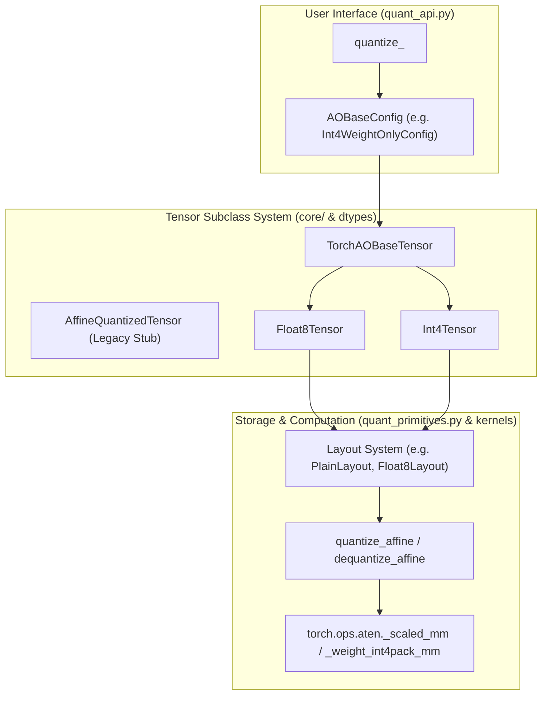
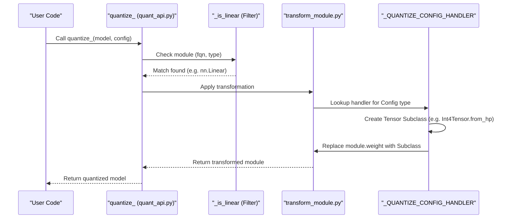
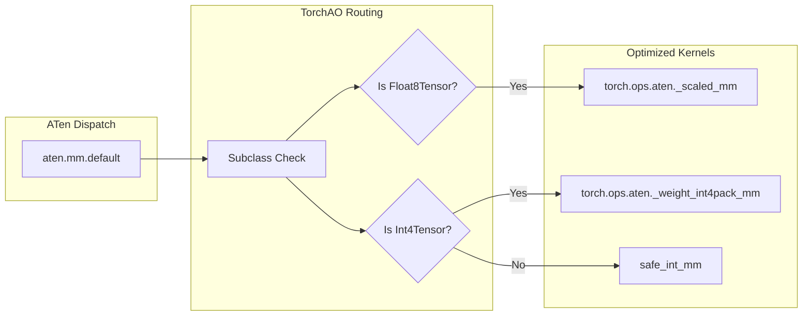

<!-- source: DeepWiki mcp.deepwiki.com · repo pytorch/ao · page 1.2 Core Concepts and Architecture · fetched 2026-10-21 -->

# Core Concepts and Architecture

Relevant source files

The following files were used as context for generating this wiki page:

- [README.md](README.md)
- [test/core/test_config.py](test/core/test_config.py)
- [test/dtypes/test_affine_quantized_float.py](test/dtypes/test_affine_quantized_float.py)
- [test/integration/test_integration.py](test/integration/test_integration.py)
- [test/prototype/test_prototype_float8_tensor.py](test/prototype/test_prototype_float8_tensor.py)
- [test/quantization/quantize_/workflows/float8/test_float8_tensor.py](test/quantization/quantize_/workflows/float8/test_float8_tensor.py)
- [test/quantization/quantize_/workflows/float8/test_float8_tensor_mi300.py](test/quantization/quantize_/workflows/float8/test_float8_tensor_mi300.py)
- [test/quantization/test_quant_api.py](test/quantization/test_quant_api.py)
- [test/quantization/test_quant_primitives.py](test/quantization/test_quant_primitives.py)
- [test/test_utils.py](test/test_utils.py)
- [torchao/core/config.py](torchao/core/config.py)
- [torchao/dtypes/__init__.py](torchao/dtypes/__init__.py)
- [torchao/float8/inference.py](torchao/float8/inference.py)
- [torchao/prototype/dtypes/__init__.py](torchao/prototype/dtypes/__init__.py)
- [torchao/prototype/dtypes/uintx/__init__.py](torchao/prototype/dtypes/uintx/__init__.py)
- [torchao/prototype/hqq/hqq_tinygemm_linear.py](torchao/prototype/hqq/hqq_tinygemm_linear.py)
- [torchao/prototype/quantization/float8_static_quant/__init__.py](torchao/prototype/quantization/float8_static_quant/__init__.py)
- [torchao/prototype/quantization/float8_static_quant/prototype_float8_tensor.py](torchao/prototype/quantization/float8_static_quant/prototype_float8_tensor.py)
- [torchao/prototype/quantization/quant_api.py](torchao/prototype/quantization/quant_api.py)
- [torchao/quantization/README.md](torchao/quantization/README.md)
- [torchao/quantization/__init__.py](torchao/quantization/__init__.py)
- [torchao/quantization/qat/README.md](torchao/quantization/qat/README.md)
- [torchao/quantization/quant_api.py](torchao/quantization/quant_api.py)
- [torchao/quantization/quant_primitives.py](torchao/quantization/quant_primitives.py)
- [torchao/quantization/quantize_/common/kernel_preference.py](torchao/quantization/quantize_/common/kernel_preference.py)
- [torchao/quantization/quantize_/workflows/float8/float8_tensor.py](torchao/quantization/quantize_/workflows/float8/float8_tensor.py)
- [torchao/quantization/utils.py](torchao/quantization/utils.py)
- [torchao/testing/utils.py](torchao/testing/utils.py)
- [torchao/utils.py](torchao/utils.py)

## Purpose and Scope

This document explains the foundational concepts and architecture that power TorchAO's quantization system. It covers the fundamental mechanics of how PyTorch models are transformed, how quantized data is stored, and how operations are dispatched to optimized kernels.

- **Core Concept: Quantization** - Affine quantization primitives and mapping types.
- **The `quantize_` API** - The lifecycle of module transformation.
- **Tensor Subclass System** - `TorchAOBaseTensor` and its role in intercepting operations.
- **Layout and Granularity** - How memory organization and quantization scales are managed.
- **Dispatch Mechanisms** - Routing operations to hardware-optimized kernels like `_scaled_mm` or `_weight_int4pack_mm`.

---

## What is Quantization?

Quantization reduces the precision of tensor values to use less memory and enable faster computation. TorchAO primarily implements **affine quantization**, which maps floating-point values to lower-precision values.

**Key Quantization Concepts:**

| Concept | Description | Code Reference |
|---------|-------------|----------------|
| **MappingType** | Defines if the mapping is `SYMMETRIC` or `ASYMMETRIC`. | [torchao/quantization/quant_primitives.py:55-77]() |
| **ZeroPointDomain** | Specifies if the zero point is in the `INT` or `FLOAT` domain. | [torchao/quantization/quant_primitives.py:79-90]() |
| **Granularity** | How many values share quantization parameters (e.g., `PerTensor`, `PerRow`, `PerGroup`). | [torchao/quantization/granularity.py:6-14]() |
| **Scale & Zero Point** | The parameters derived from `choose_qparams_affine`. | [torchao/quantization/quant_primitives.py:25-51]() |

**Sources:** [torchao/quantization/quant_primitives.py:55-90](), [torchao/quantization/granularity.py:6-14]()

---

## High-Level Architecture Overview

TorchAO's architecture is built on three foundational layers that bridge high-level user configurations to low-level hardware kernels.

**Diagram: Architecture and Code Entity Mapping**

**Sources:** [torchao/quantization/quant_api.py:115-120](), [torchao/utils.py:30-35](), [torchao/core/config.py:34-34]()

---

## Tensor Subclass System

### TorchAOBaseTensor: The Foundation

`TorchAOBaseTensor` is the core base class for all custom tensor types in TorchAO. It provides the dispatch infrastructure that intercepts PyTorch operations using the `__torch_dispatch__` and `__torch_function__` protocols.

**Key Mechanisms:**
1. **`__torch_dispatch__`**: Intercepts ATen operations (e.g., `aten.mm`).
2. **`__torch_function__`**: Intercepts high-level PyTorch functions.
3. **Serialization**: Implements `__tensor_flatten__` and `__tensor_unflatten__` to allow `torch.compile` and `torch.export` to track the internal state (data, scales, etc.) of the quantized tensor.

**Sources:** [torchao/utils.py:29-30](), [torchao/quantization/quantize_/workflows/float8/float8_tensor.py:84-113]()

### Specialized Subclasses

TorchAO implements specific subclasses for different quantization formats:
- **`Int4Tensor`**: Optimized for 4-bit weight-only quantization. [torchao/quantization/quant_api.py:62-62]()
- **`Float8Tensor`**: Supports FP8 inference with dynamic or weight-only scaling. [torchao/quantization/quantize_/workflows/float8/float8_tensor.py:84-113]()
- **`NF4Tensor`**: NormalFloat4 for QLoRA workflows. [torchao/quantization/quantize_/workflows/int4/int4_tensor.py:61-61]()

---

## The `quantize_` Lifecycle

The `quantize_` function follows a specific lifecycle to transform a standard `nn.Module` into a quantized one.

**Diagram: quantize_ Transformation Lifecycle**

**Key Functions:**
- **`_replace_with_custom_fn_if_matches_filter`**: Recursively traverses the module tree. [torchao/quantization/quant_api.py:122-165]()
- **`register_quantize_module_handler`**: Allows developers to register custom logic for specific configurations. [torchao/quantization/transform_module.py:74-75]()

**Sources:** [torchao/quantization/quant_api.py:115-165](), [torchao/quantization/transform_module.py:72-75]()

---

## Layout and Granularity

### Layout System
Layouts control how data is packed and organized in memory. This is critical for hardware accelerators that require specific tiling or swizzling (e.g., NVIDIA Tensor Cores or ARM CPUs).
- **`PlainLayout`**: Standard contiguous storage.
- **`Int4TilePackedTo4dTensor`**: Specifically packed for 4-bit matmuls. [torchao/quantization/quant_api.py:63-63]()

### Granularity System
Granularity defines the scope of a single quantization scale.
- **`PerTensor`**: One scale for the entire tensor. [torchao/quantization/granularity.py:93-93]()
- **`PerRow` / `PerChannel`**: One scale per row/channel. [torchao/quantization/granularity.py:92-92]()
- **`PerGroup`**: Values are divided into groups (e.g., group_size=32), each with its own scale. [torchao/quantization/granularity.py:91-91]()

**Sources:** [torchao/quantization/granularity.py:88-94](), [torchao/quantization/quantize_/workflows/float8/float8_tensor.py:179-181]()

---

## Dispatch and Kernels

TorchAO intercepts standard operations and routes them to optimized custom operators.

**Diagram: Matmul Dispatch Flow**

**Key Kernels:**
- **`_scaled_mm`**: Used for FP8 operations on H100+ hardware. [torchao/float8/inference.py:23-26]()
- **`safe_int_mm`**: A robust integer matrix multiplication wrapper. [torchao/quantization/__init__.py:3-3]()
- **`int_scaled_matmul`**: Handles scaling for integer matmuls. [torchao/quantization/__init__.py:2-2]()

**Sources:** [torchao/quantization/quant_api.py:37-43](), [torchao/quantization/__init__.py:1-4](), [torchao/quantization/quantize_/workflows/float8/float8_tensor.py:27-30]()

---

