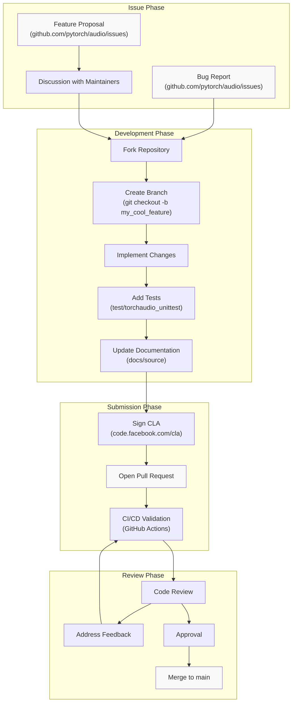
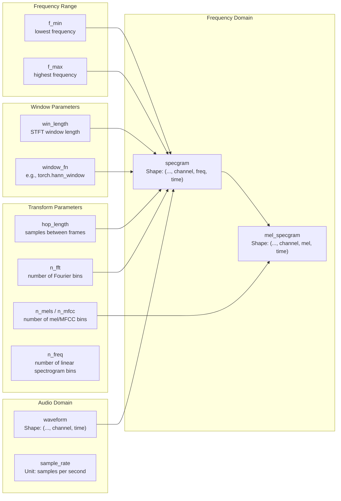
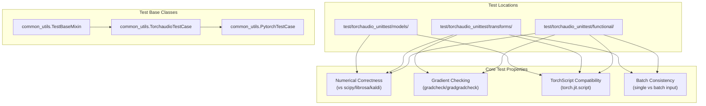
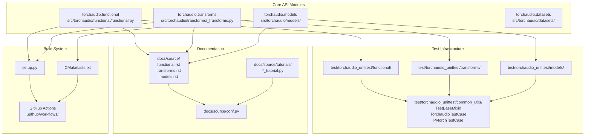

<!-- source: DeepWiki mcp.deepwiki.com · repo pytorch/audio · page 6.1 Contributing Guidelines · fetched 2026-10-21 -->

# Contributing Guidelines

<details>
<summary>Relevant source files</summary>

The following files were used as context for generating this wiki page:

- [CONTRIBUTING.md](CONTRIBUTING.md)
- [README.md](README.md)
- [docs/source/compliance.kaldi.rst](docs/source/compliance.kaldi.rst)
- [docs/source/index.rst](docs/source/index.rst)
- [docs/source/torchaudio.rst](docs/source/torchaudio.rst)
- [test/torchaudio_unittest/README.md](test/torchaudio_unittest/README.md)

</details>


This document describes the process for contributing to TorchAudio, including how to report issues, submit pull requests, meet code quality requirements, and participate in the review process. This covers workflows, conventions, and requirements that contributors must follow.

For information about the testing framework architecture and writing tests, see [Testing Framework](#6.2). For information about building and updating documentation, see [Documentation System](#6.3). For information about the build system and CI/CD workflows, see [CI/CD Pipeline](#5.3).

---

## Overview of Contribution Types

TorchAudio accepts several types of contributions, each with different requirements and processes.

### Bug Reports and Bug Fixes

Bug reports should be filed as GitHub issues. Bug fixes can be submitted directly as pull requests without prior discussion.

### New Features and Extensions

New features, utility functions, or extensions to the core require discussion before implementation. Contributors must open an issue to discuss the feature with maintainers before submitting a pull request. This prevents rejected PRs due to misalignment with project direction.

### Documentation Improvements

Documentation contributions are equally important as code contributions. This includes fixing typos, improving clarity, adding examples, and creating tutorials.

### Maintenance Contributions

Contributors can help by:
- Reporting problems they encounter
- Giving feedback (👍) on issues relevant to them
- Working on issues labeled ["help wanted"](https://github.com/pytorch/audio/issues?q=is%3Aopen+is%3Aissue+label%3A%22help+wanted%22)

**Sources:** [CONTRIBUTING.md:1-34](), [README.md:49-52]()

---

## Contribution Workflow

The following diagram illustrates the complete contribution workflow from issue creation through merge.

**Contribution Process Flow**



**Sources:** [CONTRIBUTING.md:4-34](), [CONTRIBUTING.md:64-76]()

---

## Contributor License Agreement (CLA)

All contributors must submit a Contributor License Agreement before their pull request can be accepted. The CLA only needs to be completed once and applies to all Facebook/Meta open source projects.

**CLA Requirements:**
- Complete CLA at: https://code.facebook.com/cla
- Required for all code contributions
- One-time requirement per contributor
- Automatically checked by GitHub integration

**Sources:** [CONTRIBUTING.md:35-40]()

---

## Security Vulnerability Disclosure

Security bugs must not be filed as public issues. Facebook/Meta has a [bounty program](https://www.facebook.com/whitehat) for safe disclosure of security vulnerabilities. Follow the process outlined on that page instead of creating a GitHub issue.

**Sources:** [CONTRIBUTING.md:16-18]()

---

## Development Process and Requirements

### Setting Up the Development Environment

Contributors must build TorchAudio from source to make code changes. Detailed build instructions are available at https://pytorch.org/audio/main/build.html. See [Build Configuration](#5.1) and [CMake Build System](#5.2) for more details.

**Required Testing Dependencies:**

| Package | Purpose | Installation |
|---------|---------|--------------|
| `pytest` | Test runner | Required |
| `scipy` | Numerical reference | Required |
| `numpy` | Array operations | Required |
| `parameterized` | Test parameterization | Required |
| `typing` | Type annotations | Required |

**Optional Testing Dependencies:**

| Package | Purpose | When Needed |
|---------|---------|-------------|
| `librosa` | Audio analysis reference | Librosa compatibility tests |
| `requests` | HTTP operations | Dataset tests |
| `soundfile` | Audio I/O | Legacy I/O tests |
| `transformers` | HuggingFace models | Model import tests |
| `fairseq` | Fairseq models | Model import tests (commit e6eddd80 or newer) |
| `unidecode` | Text preprocessing | Tacotron2 example tests |
| `inflect` | Text preprocessing | Tacotron2 example tests |

**Sources:** [CONTRIBUTING.md:41-63]()

### Development Checklist

When modifying code or documentation, follow these steps:

1. **Fork and Branch**
   ```bash
   git checkout main
   git checkout -b my_cool_feature
   ```

2. **Implement Changes**
   - For new features or bug fixes: Add tests in [test/torchaudio_unittest/]()
   - For API changes: Update documentation in [docs/source/]()

3. **Submit Pull Request**
   - Ensure all tests pass locally
   - Sign the CLA
   - Follow code style conventions (see below)

**Sources:** [CONTRIBUTING.md:64-76]()

---

## Code Style and Conventions

### Docstring Format

TorchAudio uses **Google style** for docstrings. All docstrings must adhere to the following requirements:

- **Line Length:** Maximum 120 characters per line
- **Format:** Google style (see [Napoleon documentation](http://sphinxcontrib-napoleon.readthedocs.io/en/latest/example_google.html))
- **Warnings:** All docstring warnings must be fixed before PR approval
- **CI Enforcement:** Documentation build uses `SPHINXOPTS=-W` to treat warnings as errors

**Sources:** [CONTRIBUTING.md:84-110]()

### Tensor Naming Conventions

The following diagram maps common tensor concepts to their standardized naming conventions in TorchAudio.

**Tensor Naming and Shape Conventions**



**Dimension Ordering Rules:**

| Dimension Type | Position | Example |
|----------------|----------|---------|
| Batch (optional) | First | `(batch, ...)` |
| Channel | Before time/freq | `(..., channel, time)` |
| Frequency bins | After channel, before time | `(..., channel, freq, time)` |
| Mel bins | After channel, before time | `(..., channel, mel, time)` |
| Time | Last | `(..., time)` |

**Ellipsis Convention:**
- Use `"..."` as placeholder for optional batching and channel dimensions
- Example: `"(..., time)"` allows both `(time,)` and `(batch, channel, time)`

**Size vs Dimension Naming:**
- Size names use `n_` prefix: `n_freq`, `n_mels`, `n_fft`
- Dimension names have no prefix: `channel`, `time`, `freq`

**Sources:** [CONTRIBUTING.md:148-190]()

### Docstring Parameter Type Conventions

The following table specifies how to document parameter and return types:

| Type Category | Format | Example |
|---------------|--------|---------|
| Tensor dimension | Single backticks | `` `(..., time)` `` |
| Optional parameter with default | `(T, optional)` | `hop_length (int, optional)` |
| Optional parameter (None allowed) | `(T or None)` | `window_fn (Callable or None)` |
| Known tuple/list elements | `(element1, element2)` or `[element1, element2]` | `(Tensor, int)` |
| Variable-length tuple/list | `Tuple[T]` or `List[T]` | `List[Tensor]` |

**Example Docstring:**

```python
def resample(waveform: Tensor, sample_rate: int, new_sample_rate: int) -> Tensor:
    """Resample a waveform from one sample rate to another.
    
    Args:
        waveform (Tensor): Audio tensor of dimension `(..., time)`
        sample_rate (int): Original sample rate
        new_sample_rate (int): Target sample rate
        
    Returns:
        Tensor: Resampled waveform of dimension `(..., time)`
    """
```

**Sources:** [CONTRIBUTING.md:154-174]()

---

## Code Quality Requirements

### Testing Requirements

All code changes must include appropriate tests. The testing framework is detailed in [Testing Framework](#6.2), but key requirements include:

**Test Types Required:**



**Testing Guidelines:**

1. **Use Synthetic Data:** Unless testing I/O, use synthetic data from [common_utils]() generators
2. **Base Class Selection:**
   - Use `common_utils.TorchaudioTestCase` for standard tests
   - Use `common_utils.TestBaseMixin` for device/dtype-agnostic tests
   - Set class members: `dtype`, `device`, `backend`
3. **Tensor Comparison:** Use `assertEqual` method for robust tensor comparison across types
4. **New Feature Requirements:**
   - Must be TorchScript-compatible (unless performance degradation)
   - Must be batch-consistent
   - Must include numerical compatibility tests if implementing existing software functionality
   - Must include correctness tests for unique functionality

**Running Tests:**

```bash
# List all tests
pytest test --collect-only

# Run all tests
pytest test

# Run specific test file
pytest test/torchaudio_unittest/functional/

# Run tests matching pattern
pytest test -k "resample"

# Useful options
pytest test -x    # Stop on first failure
pytest test --ff  # Run failures first
pytest test --lf  # Only rerun failures
```

**Sources:** [CONTRIBUTING.md:79-82](), [test/torchaudio_unittest/README.md:1-142]()

---

## Documentation Requirements

### Building Documentation

Documentation must be updated when APIs change. TorchAudio uses Sphinx with sphinx-gallery for tutorials.

**Documentation Build Process:**

```bash
# Install requirements
cd docs
pip install -r requirements.txt

# Build API reference only
make html

# Build with tutorials (time-consuming)
pip install -r requirements-tutorials.txt
BUILD_GALLERY=1 make html

# Build specific tutorial
GALLERY_PATTERN=forced_alignment_tutorial.py make html

# Treat warnings as errors (CI mode)
SPHINXOPTS=-W make html
```

Built documentation will be available in `docs/build/html`.

**Documentation Structure:**

| Directory/File | Purpose |
|----------------|---------|
| [docs/source/*.rst]() | API reference pages |
| [docs/source/tutorials/*_tutorial.py]() | Sphinx-gallery tutorials |
| [docs/source/conf.py]() | Sphinx configuration |
| [docs/source/_static/]() | Static assets (images, CSS) |
| [docs/requirements.txt]() | Base documentation dependencies |
| [docs/requirements-tutorials.txt]() | Tutorial-specific dependencies |

**Sources:** [CONTRIBUTING.md:84-134]()

### Adding Tutorials

Tutorials use Sphinx-Gallery format and must follow specific conventions:

**Tutorial Requirements:**

1. **File Naming:** Use suffix `_tutorial.py` (e.g., `forced_alignment_tutorial.py`)
2. **Audio Display:** One `IPython.display.Audio` object per cell, placed at end
3. **Plots:** One plot per code cell; use `subplots` for multiple plots in one cell
4. **Section Headers:** Avoid `=` for section headers; use `-` or `~` instead
5. **Format:** Follow [Sphinx-Gallery syntax](https://sphinx-gallery.github.io/stable/syntax.html)

**Development Workflow:**

1. Draft in Google Colab
2. Export as IPython notebook
3. Convert to Python file (with potential rendering issues)
4. Verify tutorial renders correctly

**Sources:** [CONTRIBUTING.md:135-147]()

---

## Maintenance Phase Considerations

Since version 2.8, TorchAudio has transitioned to a maintenance phase. This affects contribution priorities:

**Current Priorities:**

- Processing audio data for machine learning
- Maintaining existing functionality
- Bug fixes and performance improvements
- Reducing redundancies with PyTorch ecosystem

**Removed/Deprecated Areas (as of 2.9):**

- Multiple I/O backend options (Sox, SoundFile, FFmpeg backends)
- Decoding/encoding capabilities (consolidated into TorchCodec)
- Features redundant with PyTorch ecosystem

Contributors proposing new features should align with TorchAudio's focused scope on audio processing for ML rather than general signal processing.

**Sources:** [README.md:10-19](), [docs/source/index.rst:10-17]()

---

## Code Entity Reference

The following diagram maps contribution activities to specific code locations and classes:

**Contribution Targets by Code Location**



**Key File Paths:**

| Component | Primary Files | Test Files | Documentation |
|-----------|---------------|------------|---------------|
| Functional API | [src/torchaudio/functional/functional.py]() | [test/torchaudio_unittest/functional/]() | [docs/source/functional.rst]() |
| Transforms | [src/torchaudio/transforms/_transforms.py]() | [test/torchaudio_unittest/transforms/]() | [docs/source/transforms.rst]() |
| Models | [src/torchaudio/models/]() | [test/torchaudio_unittest/models/]() | [docs/source/models.rst]() |
| Datasets | [src/torchaudio/datasets/]() | [test/torchaudio_unittest/datasets/]() | [docs/source/datasets.rst]() |
| Build Config | [setup.py](), [CMakeLists.txt]() | N/A | [docs/source/build.rst]() |

**Sources:** [CONTRIBUTING.md:1-195](), [test/torchaudio_unittest/README.md:34-67]()

---

## License

By contributing to TorchAudio, contributors agree that their contributions will be licensed under the LICENSE file in the root directory of the source tree. This is a requirement for all contributions.

**Sources:** [CONTRIBUTING.md:191-194]()

---

