# Page: Overview

# Overview

<details>
<summary>Relevant source files</summary>

The following files were used as context for generating this wiki page:

- [CONTRIBUTING.md](CONTRIBUTING.md)
- [README.md](README.md)
- [docs/source/compliance.kaldi.rst](docs/source/compliance.kaldi.rst)
- [docs/source/index.rst](docs/source/index.rst)
- [docs/source/torchaudio.rst](docs/source/torchaudio.rst)
- [test/torchaudio_unittest/README.md](test/torchaudio_unittest/README.md)

</details>


This document provides a high-level introduction to TorchAudio, covering its purpose, architecture, design philosophy, and core components. For installation instructions, see [Installation and Getting Started](#1.1). For details about the library's transition to maintenance phase, see [Maintenance Phase and TorchCodec Migration](#1.2).

## Purpose and Scope

TorchAudio is a library for audio and signal processing with PyTorch. It applies PyTorch's capabilities—GPU acceleration, automatic differentiation, and TorchScript compatibility—to the audio domain. The library is primarily focused on machine learning applications rather than general-purpose signal processing.

As of version 2.9, TorchAudio has entered a maintenance phase with a more focused scope: processing audio data for ML. Audio/video I/O capabilities have been consolidated into the TorchCodec library, while TorchAudio retains its core audio processing, feature extraction, model, and dataset capabilities.

**Sources:** [README.md:1-29](), [docs/source/index.rst:1-18]()

## Library Architecture

TorchAudio is organized into distinct modules that operate at different abstraction levels, from low-level signal processing to high-level pre-trained pipelines.

### Module Organization

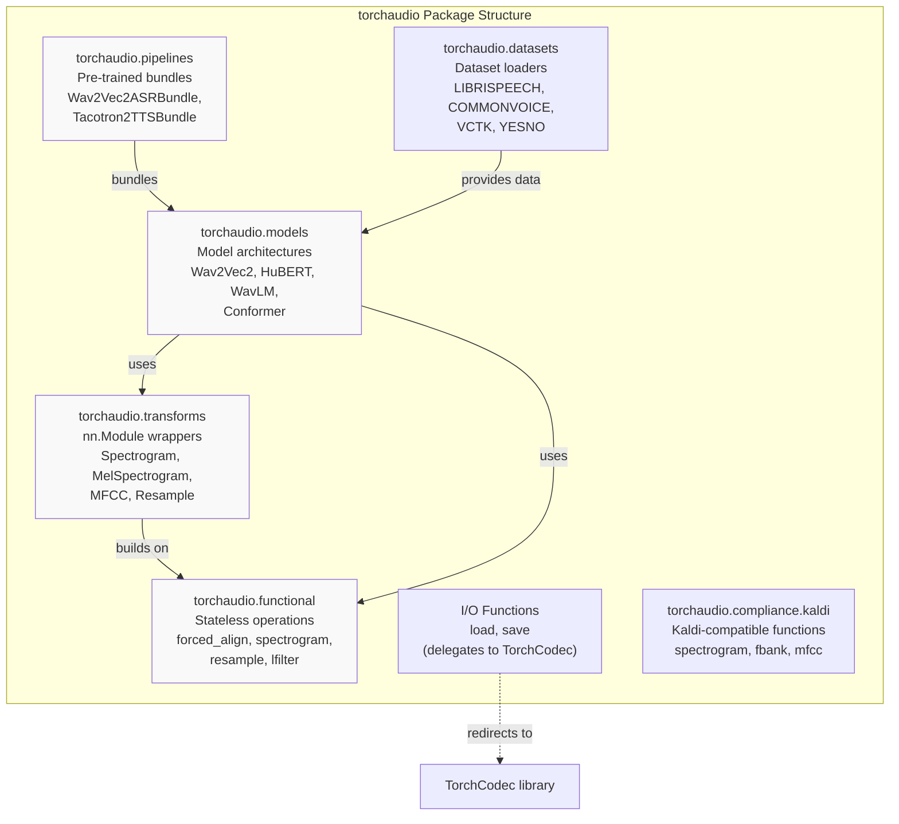

**Core Module Hierarchy:**

| Module | Type | Purpose | Example Components |
|--------|------|---------|-------------------|
| `torchaudio.functional` | Functions | Stateless signal processing operations | `forced_align`, `spectrogram`, `resample`, `lfilter` |
| `torchaudio.transforms` | Classes | Stateful `nn.Module` transforms | `Spectrogram`, `MelSpectrogram`, `MFCC`, `Resample` |
| `torchaudio.models` | Classes | Model architectures and factory functions | `Wav2Vec2`, `HuBERT`, `WavLM`, `Conformer` |
| `torchaudio.pipelines` | Bundles | Pre-trained models with preprocessing | `Wav2Vec2ASRBundle`, `Tacotron2TTSBundle`, `SourceSeparationBundle` |
| `torchaudio.datasets` | Classes | Dataset loaders implementing `torch.utils.data.Dataset` | `LIBRISPEECH`, `COMMONVOICE`, `VCTK` |
| `torchaudio.compliance.kaldi` | Functions | Kaldi-compatible implementations | `spectrogram`, `fbank`, `mfcc` |

**Sources:** [README.md:21-36](), [docs/source/index.rst:59-69](), [docs/source/torchaudio.rst:1-34]()

### Implementation Layers

TorchAudio's implementation spans multiple layers, from Python API to native C++/CUDA code:

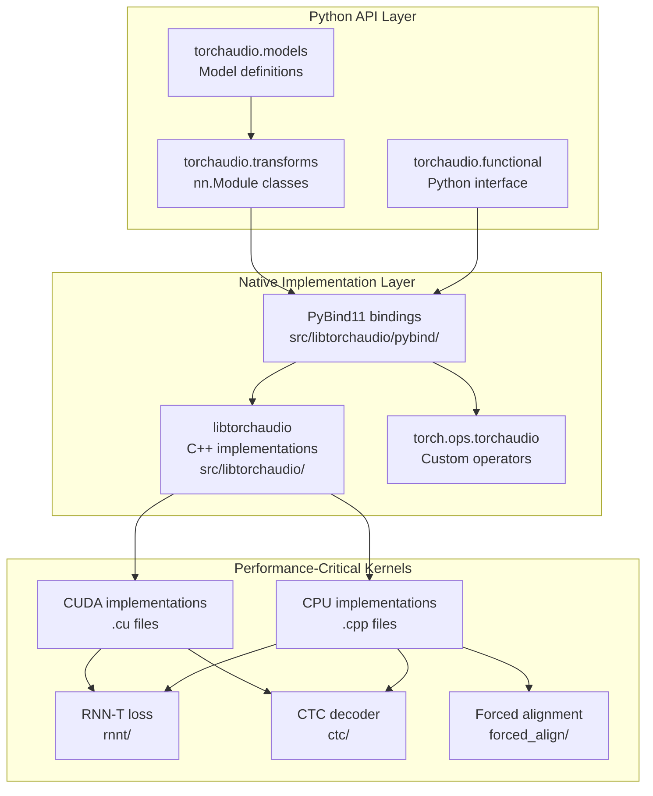

Performance-critical operations such as `forced_align`, `rnnt_loss`, and CTC decoding are implemented in C++ and CUDA for efficiency, while maintaining a simple Python interface through PyBind11 bindings. This architecture allows TorchAudio to leverage native code performance while maintaining PyTorch's ease of use.

**Sources:** [README.md:21-28](), System Architecture Diagram 1 from context

## Design Philosophy

TorchAudio follows core PyTorch principles in its design:

### Differentiability and Autograd Integration

All transforms and functional operations are designed to be differentiable, enabling end-to-end training. Operations integrate with PyTorch's autograd system, allowing gradients to flow through audio processing pipelines.

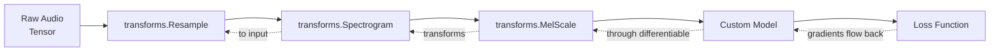

**Sources:** [README.md:22-28](), [test/torchaudio_unittest/README.md:138-142]()

### TorchScript Compatibility

Transforms and models are designed to be compatible with TorchScript for production deployment. This allows audio processing pipelines to be serialized and run independently of Python.

```python
# Example from testing framework
# test/torchaudio_unittest/transforms/torchscript_consistency_impl.py
# Tests verify that transforms can be scripted and produce identical results
```

**Sources:** [test/torchaudio_unittest/README.md:49-52](), [CONTRIBUTING.md:138-139]()

### Tensor-First Design

All operations use PyTorch tensors as input and output, following PyTorch's dimension conventions:
- Batch dimension (optional): first dimension
- Channel dimension: before time dimension
- Time dimension: typically last dimension for waveforms
- Frequency dimension: before time dimension for spectrograms

**Sources:** [CONTRIBUTING.md:154-164]()

## Core Components

### Processing Operations

**Functional API** ([torchaudio.functional](#2.1)): Stateless functions for audio processing operations. These serve as building blocks for transforms and can be used directly for custom processing pipelines.

**Transforms** ([torchaudio.transforms](#2.2)): Stateful `nn.Module` implementations that wrap functional operations. Transforms can be integrated into `nn.Sequential` pipelines and saved with model checkpoints.

The relationship between functional and transforms is systematic: transforms maintain state (e.g., filter coefficients, window functions) while functional operations are pure functions.

**Sources:** [README.md:31-36](), [docs/source/index.rst:59-69]()

### Models and Pipelines

**Models** ([torchaudio.models](#4)): Contains architecture definitions and factory functions for speech and audio models including:
- Self-supervised models: `Wav2Vec2`, `HuBERT`, `WavLM`
- End-to-end ASR models: `Conformer`, RNN-T components
- Decoders: `ctc_decoder`, `cuda_ctc_decoder`

**Pipelines** ([torchaudio.pipelines](#4)): Bundles pre-trained models with their associated preprocessing, enabling end-to-end inference with minimal setup. Examples include `Wav2Vec2ASRBundle`, `Tacotron2TTSBundle`, and `SourceSeparationBundle`.

**Sources:** [README.md:30-36](), [docs/source/index.rst:59-69]()

### Data Loading

**Datasets** ([torchaudio.datasets](#3.2)): Provides loaders for common audio datasets that implement `torch.utils.data.Dataset`. These integrate seamlessly with PyTorch's `DataLoader` for batching and parallel loading.

**I/O Functions** ([torchaudio.load, torchaudio.save](#3.1)): Starting from version 2.9, these functions delegate to TorchCodec for audio and video I/O, maintaining a simple interface while leveraging TorchCodec's robust decoding capabilities.

**Sources:** [README.md:30](), [docs/source/torchaudio.rst:6-34]()

## Typical Data Flow

### From Raw Audio to Model Output

```mermaid
graph LR
    subgraph "Input"
        FILE["Audio File<br/>.wav, .flac, .mp3"]
        DS["torchaudio.datasets<br/>LIBRISPEECH, etc."]
    end
    
    subgraph "Loading"
        LOAD["torchaudio.load<br/>(via TorchCodec)"]
        WAV["Waveform Tensor<br/>shape: (channel, time)"]
    end
    
    subgraph "Preprocessing"
        RESAMPLE["transforms.Resample<br/>Change sample rate"]
        AUG["transforms.SpecAugment<br/>Data augmentation"]
    end
    
    subgraph "Feature Extraction"
        SPEC["transforms.Spectrogram<br/>STFT"]
        MEL["transforms.MelSpectrogram<br/>Mel scale"]
        MFCC["transforms.MFCC<br/>Cepstral features"]
    end
    
    subgraph "Model"
        W2V2["models.Wav2Vec2<br/>Self-supervised"]
        CUSTOM["Custom nn.Module"]
    end
    
    subgraph "Output"
        ASR["Text transcript"]
        CLASS["Classification"]
    end
    
    FILE --> LOAD
    DS --> WAV
    LOAD --> WAV
    WAV --> RESAMPLE
    RESAMPLE --> AUG
    AUG --> SPEC
    SPEC --> MEL
    MEL --> MFCC
    
    WAV --> W2V2
    MFCC --> CUSTOM
    
    W2V2 --> ASR
    CUSTOM --> CLASS
```

This flow demonstrates TorchAudio's modularity: users can enter at any stage (raw audio, preprocessed waveforms, or extracted features) and compose operations to build custom pipelines. Both traditional DSP approaches (waveform → spectrogram → MFCC → model) and modern end-to-end approaches (waveform → Wav2Vec2 → output) are supported.

**Sources:** System Diagram 5 from context, [README.md:30-36]()

## Integration with PyTorch Ecosystem

### Dependencies and Relationships

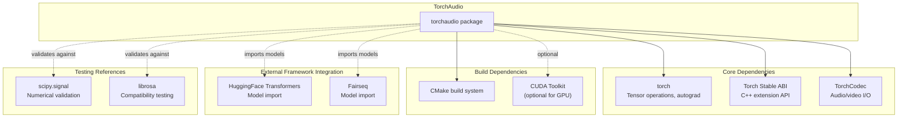

**Required Dependencies:**
- PyTorch: Core tensor library and autograd system
- TorchCodec: Audio and video I/O (as of version 2.9)

**Build-time Dependencies:**
- CMake: Build system orchestration
- C++ compiler (gcc/clang/MSVC)
- CUDA Toolkit (optional, for GPU support)

**Optional Interoperability:**
- HuggingFace Transformers: Import pre-trained models
- Fairseq: Import sequence-to-sequence models

**Sources:** [README.md:38-42](), [CONTRIBUTING.md:41-63](), System Diagram 6 from context

## Testing and Quality Assurance

TorchAudio maintains comprehensive testing across multiple dimensions:

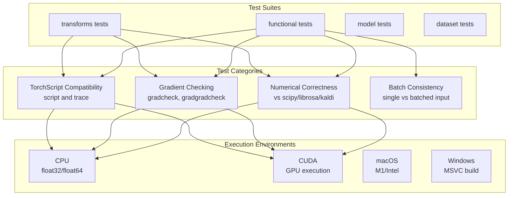

The testing framework validates that operations:
1. Produce numerically correct results (compared to reference implementations)
2. Support gradient computation for training
3. Are compatible with TorchScript for deployment
4. Handle batched inputs consistently with single-sample inputs
5. Work correctly across different platforms and devices

For details on the testing framework and contributing tests, see [Testing Framework](#6.2).

**Sources:** [test/torchaudio_unittest/README.md:1-142](), [CONTRIBUTING.md:79-142]()

## Maintenance Phase

As of version 2.8, TorchAudio has transitioned to a maintenance phase with reduced scope:

**Removed Features (deprecated in 2.8, removed in 2.9):**
- Multiple I/O backends (SoX, SoundFile, FFmpeg)
- Built-in audio encoding/decoding

**Consolidated Features:**
- Audio/video I/O moved to TorchCodec
- `torchaudio.load` and `torchaudio.save` now delegate to TorchCodec

**Retained Features:**
- Core audio processing (functional and transforms)
- Feature extraction
- Models and pipelines
- Dataset loaders
- Kaldi compliance interface

This transition focuses TorchAudio on its strengths: processing audio data for machine learning applications. For complete details, see [Maintenance Phase and TorchCodec Migration](#1.2).

**Sources:** [README.md:10-19](), [docs/source/index.rst:10-17](), [docs/source/torchaudio.rst:6-17]()

---

# Page: Installation and Getting Started

# Installation and Getting Started

<details>
<summary>Relevant source files</summary>

The following files were used as context for generating this wiki page:

- [CONTRIBUTING.md](CONTRIBUTING.md)
- [README.md](README.md)
- [docs/source/compliance.kaldi.rst](docs/source/compliance.kaldi.rst)
- [docs/source/index.rst](docs/source/index.rst)
- [docs/source/torchaudio.rst](docs/source/torchaudio.rst)
- [packaging/torchaudio/meta.yaml](packaging/torchaudio/meta.yaml)
- [setup.py](setup.py)
- [test/torchaudio_unittest/README.md](test/torchaudio_unittest/README.md)

</details>


## Purpose and Scope

This page guides users through installing TorchAudio and performing basic operations. It covers installation via pip and conda, system requirements, dependency management, and initial usage patterns. For building from source, see [Build Configuration](#5.1) and [CMake Build System](#5.2). For details on the TorchCodec migration and maintenance phase, see [Maintenance Phase and TorchCodec Migration](#1.2).

---

## System Requirements

TorchAudio requires PyTorch as a core dependency. The version matching is handled automatically during installation.

**Supported Platforms:**
- Linux (CPU and CUDA)
- macOS (x86_64 and arm64/M1)
- Windows (CPU and CUDA)

**Python Versions:**
TorchAudio supports Python 3.10, 3.11, 3.12, 3.13, and 3.14, as specified in [setup.py:122-126]().

**PyTorch Dependency:**
The PyTorch version requirement is determined dynamically based on the `PYTORCH_VERSION` environment variable during build, or defaults to the latest compatible version. See [setup.py:41-44]() for the version resolution logic.

Sources: [setup.py:122-126](), [setup.py:41-44](), [packaging/torchaudio/meta.yaml:15-29]()

---

## Installation Options

### Installation via pip

The simplest installation method is via PyPI using pip:

```bash
pip install torchaudio
```

This installs the latest stable release with CPU support. For CUDA-enabled versions, ensure PyTorch with CUDA is installed first:

```bash
# Example: Install PyTorch with CUDA 12.1 support first
pip install torch --index-url https://download.pytorch.org/whl/cu121
pip install torchaudio
```

**Nightly Builds:**
To install nightly builds with the latest features:

```bash
pip install --pre torchaudio --index-url https://download.pytorch.org/whl/nightly/cpu
```

Sources: [README.md:38-41](), [setup.py:99-140]()

### Installation via Conda

TorchAudio is available through the PyTorch conda channel:

```bash
# CPU version
conda install torchaudio -c pytorch

# CUDA version (example: CUDA 12.1)
conda install torchaudio pytorch-cuda=12.1 -c pytorch -c nvidia
```

The conda package includes metadata for platform-specific builds and automatic dependency resolution, as defined in [packaging/torchaudio/meta.yaml:1-70]().

Sources: [packaging/torchaudio/meta.yaml:1-70](), [README.md:38-41]()

### Building from Source

For development or custom builds, TorchAudio can be built from source. This requires CMake and a C++ compiler:

```bash
git clone https://github.com/pytorch/audio.git
cd audio
pip install -e .
```

The build process is orchestrated by [setup.py:82-144]() using a custom `CMakeBuild` command defined in `tools/setup_helpers.py`. For detailed build instructions including platform-specific configurations, see [Build Configuration](#5.1) and [CMake Build System](#5.2).

Sources: [setup.py:82-144](), [CONTRIBUTING.md:41-43](), [setup.py:133-136]()

---

## Installation Flow

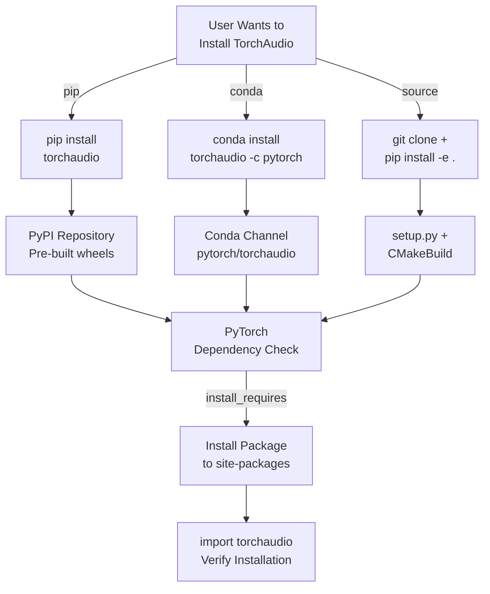

**Installation Flow Diagram**

This diagram shows the three primary installation paths and how they converge. The `install_requires` check is defined in [setup.py:138](), which calls `_get_pytorch_version()` from [setup.py:41-44]().

Sources: [setup.py:138](), [setup.py:41-44](), [setup.py:133-136](), [packaging/torchaudio/meta.yaml:24-29]()

---

## Package Structure After Installation

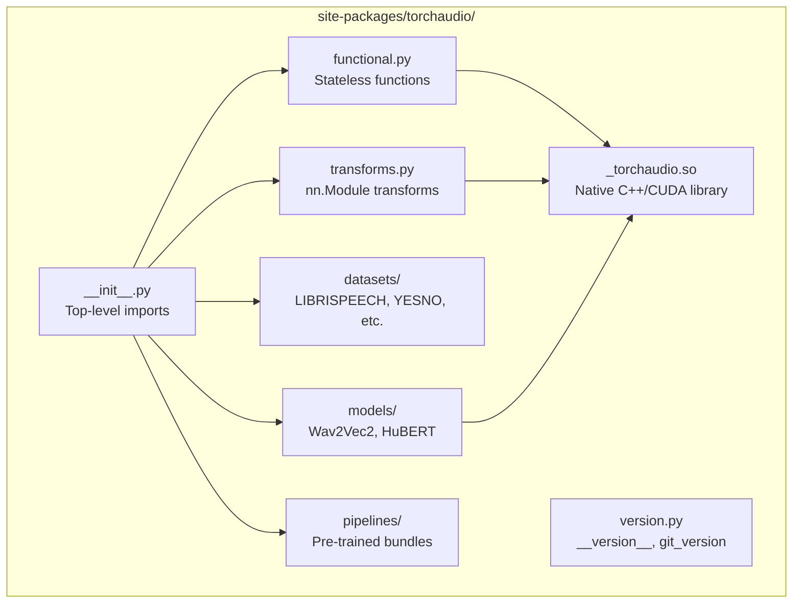

**Installed Package Structure**

After installation, the package is located in the Python `site-packages` directory. The `version.py` file is generated during build by [setup.py:33-38](). The native extension `_torchaudio.so` (or `.pyd` on Windows) contains performance-critical C++ and CUDA implementations, built via the CMake system.

Sources: [setup.py:33-38](), [setup.py:131-132](), [setup.py:133-136]()

---

## Verifying Installation

After installation, verify that TorchAudio is properly installed:

```python
import torchaudio
print(torchaudio.__version__)
```

The version information is stored in the generated `version.py` file, which includes both the package version and git commit hash. See [setup.py:33-38]() for the version file generation logic.

**Checking Available Features:**

```python
import torchaudio
import torch

# Check if CUDA is available
print(f"CUDA available: {torch.cuda.is_available()}")

# Check installed modules
print(f"Functional: {hasattr(torchaudio, 'functional')}")
print(f"Transforms: {hasattr(torchaudio, 'transforms')}")
print(f"Models: {hasattr(torchaudio, 'models')}")
```

Sources: [setup.py:33-38](), [docs/source/torchaudio.rst:1-34]()

---

## Basic Usage Patterns

### Importing TorchAudio Modules

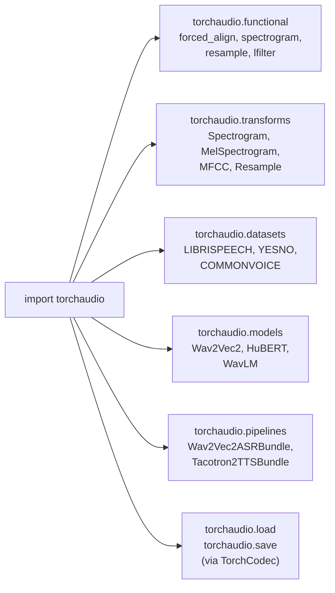

**TorchAudio Module Organization**

This diagram maps the import structure to actual module contents. The `load` and `save` functions are now aliases to TorchCodec functions as of version 2.9. See [Audio I/O and TorchCodec Migration](#3.1) for details.

Sources: [docs/source/index.rst:59-69](), [docs/source/torchaudio.rst:19-34](), [README.md:30-36]()

### Loading Audio Files

**Important:** As of TorchAudio 2.9, audio I/O has been migrated to TorchCodec. The `torchaudio.load` and `torchaudio.save` functions are now aliases to TorchCodec functions. For full details, see [Maintenance Phase and TorchCodec Migration](#1.2) and [Audio I/O and TorchCodec Migration](#3.1).

```python
import torchaudio

# Load audio file (uses TorchCodec internally)
waveform, sample_rate = torchaudio.load("audio.wav")
print(f"Waveform shape: {waveform.shape}")  # (channels, time)
print(f"Sample rate: {sample_rate}")
```

Sources: [docs/source/torchaudio.rst:6-17](), [docs/source/torchaudio.rst:19-34]()

### Applying Transforms

```python
import torchaudio.transforms as T

# Create a mel spectrogram transform
mel_spectrogram = T.MelSpectrogram(
    sample_rate=16000,
    n_fft=1024,
    hop_length=512,
    n_mels=128
)

# Apply to waveform
mel_spec = mel_spectrogram(waveform)
print(f"Mel spectrogram shape: {mel_spec.shape}")  # (channels, n_mels, time)
```

The `torchaudio.transforms` module provides `nn.Module`-based transforms that can be integrated into PyTorch models. See [Transforms](#2.2) for comprehensive documentation.

Sources: [docs/source/transforms.rst](), [README.md:33-34]()

### Using Functional Operations

```python
import torchaudio.functional as F

# Resample audio
resampled = F.resample(waveform, orig_freq=44100, new_freq=16000)

# Compute spectrogram
specgram = F.spectrogram(
    waveform,
    pad=0,
    window=torch.hann_window(400),
    n_fft=512,
    hop_length=256,
    win_length=400,
    power=2.0,
    normalized=False
)
```

The `torchaudio.functional` module provides stateless functions for audio processing. See [Functional API](#2.1) for complete reference.

Sources: [docs/source/functional.rst](), [README.md:31-32]()

### Loading Pre-trained Models

```python
from torchaudio.pipelines import WAV2VEC2_ASR_BASE_960H

# Load pre-trained bundle
bundle = WAV2VEC2_ASR_BASE_960H

# Get the model
model = bundle.get_model()

# Get sample rate expected by the model
print(f"Expected sample rate: {bundle.sample_rate}")
```

The `torchaudio.pipelines` module provides pre-trained model bundles with associated preprocessing. See [ASR Pipelines](#4.2) for details on available bundles.

Sources: [docs/source/pipelines.rst](), [README.md:30-36]()

---

## Dependencies

### Required Dependencies

| Dependency | Purpose | Version Constraint |
|------------|---------|-------------------|
| PyTorch | Core tensor library and autograd | Matched to TorchAudio version |
| Python | Runtime environment | 3.10, 3.11, 3.12, 3.13, 3.14 |

The PyTorch version is specified in [setup.py:138]() via the `_get_pytorch_version()` function. For conda builds, the constraint is specified in [packaging/torchaudio/meta.yaml:20]().

Sources: [setup.py:138](), [setup.py:41-44](), [packaging/torchaudio/meta.yaml:14-22]()

### Optional Dependencies

| Dependency | Purpose | When Needed |
|------------|---------|-------------|
| TorchCodec | Audio/video I/O | Using `torchaudio.load()` or `torchaudio.save()` |
| CUDA Toolkit | GPU acceleration | Using CUDA-based operations |
| scipy | Reference for numerical tests | Development/testing |
| librosa | Compatibility testing | Development/testing |
| soundfile | Alternative audio backend | Legacy I/O (deprecated) |

**Note on TorchCodec:** Starting with version 2.8, TorchAudio deprecated its own I/O backends in favor of TorchCodec. As of version 2.9, `torchaudio.load` and `torchaudio.save` are aliases to TorchCodec functions. See [Maintenance Phase and TorchCodec Migration](#1.2).

Sources: [README.md:10-19](), [docs/source/index.rst:10-17](), [CONTRIBUTING.md:48-62]()

### Development Dependencies

For building from source or contributing, additional dependencies are required:

```bash
# Build dependencies
pip install cmake ninja

# Testing dependencies
pip install pytest scipy numpy parameterized

# Optional testing dependencies
pip install librosa requests soundfile transformers
```

The complete list of testing dependencies is documented in [CONTRIBUTING.md:48-62]().

Sources: [CONTRIBUTING.md:48-62](), [packaging/torchaudio/meta.yaml:14-22]()

---

## Platform-Specific Considerations

### Linux

Linux builds support both CPU and CUDA configurations. CUDA support requires the CUDA Toolkit to be installed and the `CUDA_HOME` environment variable set during build.

**CUDA Version Compatibility:**
The CUDA version must match the PyTorch CUDA version. Use the PyTorch website to find compatible wheel files or build from source with matching CUDA toolkit.

Sources: [packaging/torchaudio/meta.yaml:40-47](), [setup.py:1-144]()

### macOS

macOS builds support both Intel (x86_64) and Apple Silicon (arm64) architectures. Universal wheels are available for seamless installation on both platforms.

**macOS Deployment Target:**
The minimum macOS version is controlled by the `MACOSX_DEPLOYMENT_TARGET` environment variable during build, as referenced in [packaging/torchaudio/meta.yaml:47]().

Sources: [packaging/torchaudio/meta.yaml:47](), [setup.py:113-130]()

### Windows

Windows builds require Visual Studio C++ compiler (MSVC). Both CPU and CUDA variants are available.

**Compiler Requirements:**
The conda build configuration specifies compiler requirements in [packaging/torchaudio/meta.yaml:11-12]().

Sources: [packaging/torchaudio/meta.yaml:11-12](), [setup.py:113-130]()

---

## Troubleshooting Installation

### ImportError: No module named 'torchaudio'

Ensure PyTorch is installed first:
```bash
pip install torch
pip install torchaudio
```

### Version Mismatch Between PyTorch and TorchAudio

TorchAudio versions are designed to match PyTorch versions. Check compatibility:
```python
import torch
import torchaudio
print(f"PyTorch: {torch.__version__}")
print(f"TorchAudio: {torchaudio.__version__}")
```

Install matching versions explicitly if needed:
```bash
pip install torch==2.1.0 torchaudio==2.1.0
```

### Native Extension Loading Errors

If you encounter errors loading `_torchaudio.so` (or `_torchaudio.pyd` on Windows), this indicates a build compatibility issue. Solutions:

1. Reinstall with matching PyTorch ABI
2. Build from source with your current PyTorch installation
3. Check that CUDA versions match between PyTorch and system CUDA toolkit

The native extension is built via the CMake system defined in [setup.py:133-136]().

Sources: [setup.py:133-136](), [setup.py:41-44]()

---

## Next Steps

After installation, explore the following:

- **Audio Processing:** See [Core Audio Processing](#2) for functional operations and transforms
- **Feature Extraction:** See [Feature Extraction](#2.3) for spectrograms, MFCCs, and more
- **Pre-trained Models:** See [Models and Pipelines](#4) for ASR, TTS, and source separation
- **Datasets:** See [Datasets](#3.2) for available dataset loaders
- **Building from Source:** See [Build Configuration](#5.1) for custom builds

For API reference, consult the official documentation at https://pytorch.org/audio/.

Sources: [README.md:44-47](), [docs/source/index.rst:24-70]()

---

# Page: Maintenance Phase and TorchCodec Migration

# Maintenance Phase and TorchCodec Migration

<details>
<summary>Relevant source files</summary>

The following files were used as context for generating this wiki page:

- [CONTRIBUTING.md](CONTRIBUTING.md)
- [README.md](README.md)
- [docs/source/compliance.kaldi.rst](docs/source/compliance.kaldi.rst)
- [docs/source/index.rst](docs/source/index.rst)
- [docs/source/torchaudio.rst](docs/source/torchaudio.rst)
- [test/torchaudio_unittest/README.md](test/torchaudio_unittest/README.md)

</details>


**Purpose and Scope**: This document explains TorchAudio's transition to a maintenance phase starting with version 2.8, the consolidation of I/O functionality into TorchCodec, and the implications for users. It covers what changed, why, and how to migrate existing code. For installation instructions, see [Installation and Getting Started](#1.1). For details on the current I/O APIs, see [Audio I/O and TorchCodec Migration](#3.1).

---

## Overview of the Maintenance Phase

Starting with version 2.8, TorchAudio entered a **maintenance phase** focused on reducing redundancy with the PyTorch ecosystem, simplifying maintenance, and concentrating on its core strength: **audio processing for machine learning**. This transition involved deprecating features in version 2.8 and removing them in version 2.9.

### Timeline and Changes

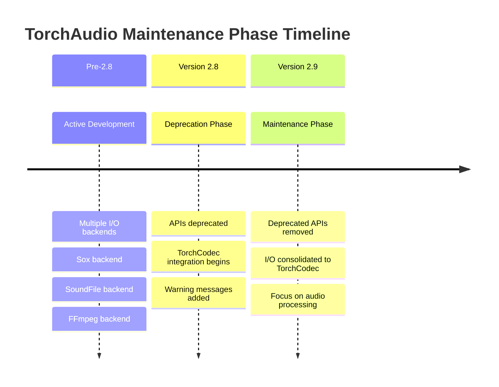

**Sources**: [README.md:11-19](), [docs/source/index.rst:11-17](), [docs/source/torchaudio.rst:7-17]()

### Goals of the Transition

| Goal | Description | Impact |
|------|-------------|--------|
| **Reduce Redundancy** | Eliminate duplicate functionality across PyTorch ecosystem | I/O moved to specialized TorchCodec library |
| **Easier Maintenance** | Reduce codebase complexity and maintenance burden | Removal of multiple backend implementations |
| **Focused Scope** | Concentrate on audio processing for ML | Clearer library boundaries and responsibilities |

The official announcement and detailed discussion can be found in the community message at https://github.com/pytorch/audio/issues/3902 (referenced in [README.md:18]()).

**Sources**: [README.md:14-16](), [docs/source/index.rst:11-17]()

---

## TorchCodec: The New I/O Backend

**TorchCodec** is a specialized library that consolidates audio and video decoding and encoding capabilities for the PyTorch ecosystem. Prior to this consolidation, TorchAudio maintained multiple I/O backend implementations (Sox, SoundFile, FFmpeg), which created redundancy and maintenance overhead.

### Architecture: TorchAudio and TorchCodec Separation

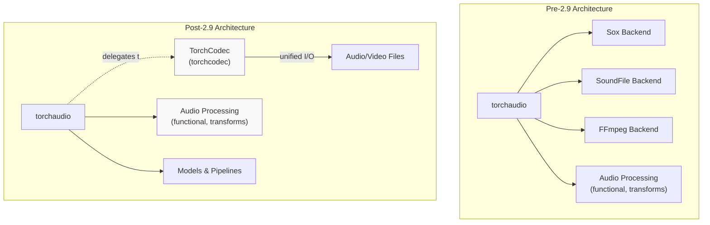

**Diagram**: Architectural shift from multiple backends to TorchCodec delegation

**Sources**: [README.md:11-19](), [docs/source/index.rst:14-16](), [docs/source/torchaudio.rst:10-14]()

### Responsibility Split

| Library | Responsibility | Key Modules |
|---------|---------------|-------------|
| **TorchCodec** | Audio/video I/O (load, save, decode, encode) | Codec implementations, format handling |
| **TorchAudio** | Audio processing for ML | `functional`, `transforms`, `models`, `pipelines`, `datasets` |

This separation allows each library to focus on its core competency while reducing duplication of effort.

**Sources**: [README.md:16-17](), [docs/source/index.rst:14-15]()

---

## API Changes and Migration

### I/O Function Evolution

The I/O APIs underwent significant changes to integrate with TorchCodec:

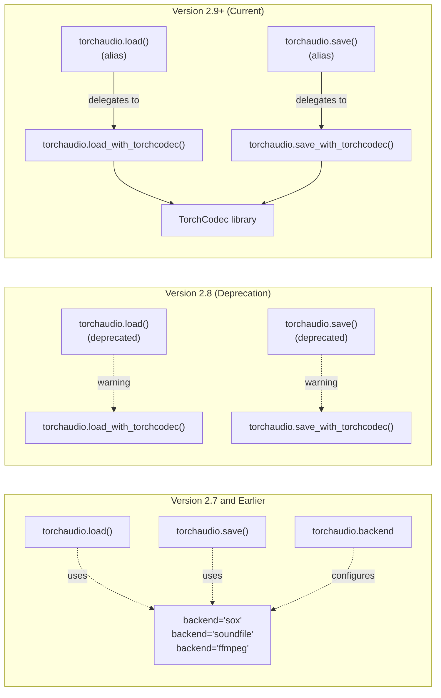

**Diagram**: Evolution of I/O APIs across versions

**Sources**: [docs/source/torchaudio.rst:7-17]()

### Current API Structure

In version 2.9 and later, the `torchaudio` top-level module provides these I/O functions (as documented in [docs/source/torchaudio.rst:19-33]()):

| Function | Description | Status |
|----------|-------------|--------|
| `torchaudio.load` | Load audio file | Alias to `load_with_torchcodec` |
| `torchaudio.save` | Save audio file | Alias to `save_with_torchcodec` |
| `torchaudio.load_with_torchcodec` | Direct TorchCodec loading | Primary implementation |
| `torchaudio.save_with_torchcodec` | Direct TorchCodec saving | Primary implementation |

**Sources**: [docs/source/torchaudio.rst:19-33]()

### Migration Guidance

#### Backward Compatibility Aliases

For backward compatibility, `torchaudio.load` and `torchaudio.save` continue to work as aliases:

```python
# This still works in version 2.9+
import torchaudio
waveform, sample_rate = torchaudio.load("audio.wav")
torchaudio.save("output.wav", waveform, sample_rate)
```

The functions delegate to `load_with_torchcodec` and `save_with_torchcodec` internally ([docs/source/torchaudio.rst:12-14]()).

#### Recommended Migration Path

However, the documentation recommends **porting code to native TorchCodec APIs** for long-term maintainability:

```python
# Recommended: Use TorchCodec directly
import torchcodec
# Use torchcodec native APIs
```

This allows users to:
1. Access the full TorchCodec feature set
2. Get updates and improvements directly from TorchCodec
3. Reduce dependency on TorchAudio for I/O operations

**Sources**: [docs/source/torchaudio.rst:15-16]()

#### Removed Backend Selection

The old backend selection mechanism is no longer available:

```python
# NO LONGER SUPPORTED (removed in 2.9):
# torchaudio.set_audio_backend("sox")
# torchaudio.load(file, backend="soundfile")
```

All I/O now goes through TorchCodec's unified implementation.

**Sources**: [docs/source/index.rst:14-15]()

---

## TorchAudio's Focused Scope

With I/O functionality delegated to TorchCodec, TorchAudio now focuses exclusively on its core competency: **processing audio data for machine learning**.

### What Remains in TorchAudio

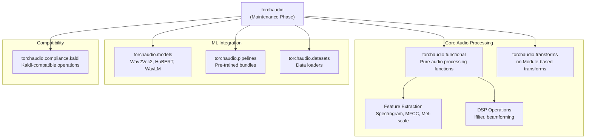

**Diagram**: TorchAudio's focused scope in maintenance phase

**Sources**: [README.md:21-36]()

### Core Capabilities

As stated in [README.md:21-28](), TorchAudio continues to provide:

1. **Audio Processing for ML**: All computations are PyTorch operations, enabling:
   - Strong GPU acceleration
   - Trainable features through autograd
   - Consistent PyTorch-style tensor operations

2. **Key Features** (from [README.md:30-36]()):
   - Dataloaders for common audio datasets
   - Audio and speech processing functions (e.g., `forced_align`)
   - Common audio transforms (Spectrogram, MelSpectrogram, MFCC, Resample, etc.)
   - Compliance interfaces (Kaldi-compatible operations)

3. **What Sets TorchAudio Apart**: "It is primarily a machine learning library and not a general signal processing library" ([README.md:25-26]()).

**Sources**: [README.md:21-36]()

---

## Summary of Changes

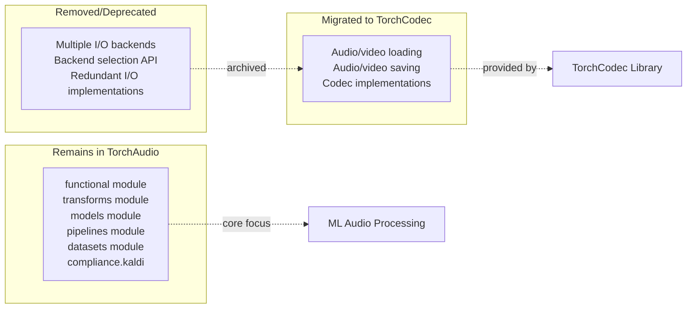

**Diagram**: High-level summary of the maintenance phase changes

### Version-Specific Changes

| Version | Changes | Impact |
|---------|---------|--------|
| **2.8** | APIs deprecated, warnings added | Users receive deprecation warnings |
| **2.9** | Deprecated APIs removed, TorchCodec integration complete | Must use new I/O APIs or TorchCodec directly |
| **Future** | Maintenance only, focused on audio processing for ML | Feature additions unlikely; bug fixes and PyTorch compatibility updates continue |

**Sources**: [README.md:11-19](), [docs/source/index.rst:11-17](), [docs/source/torchaudio.rst:7-17]()

---

## Impact on Development and Testing

The maintenance phase also affects development practices:

### Testing Structure

The test suite (as documented in [test/torchaudio_unittest/README.md]()) continues to validate:
- Numerical compatibility against existing software (scipy, librosa, Kaldi)
- TorchScript consistency
- Batch consistency
- Autograd compatibility

However, I/O-specific tests now focus on TorchCodec integration rather than multiple backend implementations.

### Contribution Focus

As noted in [CONTRIBUTING.md:8-14](), contributions are still welcome for:
- Bug fixes (no discussion needed)
- New features in core audio processing (requires discussion)
- Documentation improvements

However, new I/O functionality should be contributed to TorchCodec instead of TorchAudio.

**Sources**: [test/torchaudio_unittest/README.md:1-142](), [CONTRIBUTING.md:1-195]()

---

# Page: Core Audio Processing

# Core Audio Processing

<details>
<summary>Relevant source files</summary>

The following files were used as context for generating this wiki page:

- [docs/source/functional.rst](docs/source/functional.rst)
- [docs/source/transforms.rst](docs/source/transforms.rst)
- [test/torchaudio_unittest/common_utils/beamform_utils.py](test/torchaudio_unittest/common_utils/beamform_utils.py)
- [test/torchaudio_unittest/functional/autograd_impl.py](test/torchaudio_unittest/functional/autograd_impl.py)
- [test/torchaudio_unittest/functional/batch_consistency_test.py](test/torchaudio_unittest/functional/batch_consistency_test.py)
- [test/torchaudio_unittest/functional/functional_cpu_test.py](test/torchaudio_unittest/functional/functional_cpu_test.py)
- [test/torchaudio_unittest/functional/functional_cuda_test.py](test/torchaudio_unittest/functional/functional_cuda_test.py)
- [test/torchaudio_unittest/functional/functional_impl.py](test/torchaudio_unittest/functional/functional_impl.py)
- [test/torchaudio_unittest/functional/torchscript_consistency_impl.py](test/torchaudio_unittest/functional/torchscript_consistency_impl.py)
- [test/torchaudio_unittest/transforms/autograd_test_impl.py](test/torchaudio_unittest/transforms/autograd_test_impl.py)
- [test/torchaudio_unittest/transforms/batch_consistency_test.py](test/torchaudio_unittest/transforms/batch_consistency_test.py)
- [test/torchaudio_unittest/transforms/torchscript_consistency_impl.py](test/torchaudio_unittest/transforms/torchscript_consistency_impl.py)
- [test/torchaudio_unittest/transforms/transforms_test.py](test/torchaudio_unittest/transforms/transforms_test.py)
- [test/torchaudio_unittest/transforms/transforms_test_impl.py](test/torchaudio_unittest/transforms/transforms_test_impl.py)

</details>


This page documents TorchAudio's core audio processing capabilities, including the `torchaudio.functional` module (stateless pure functions) and the `torchaudio.transforms` module (stateful `nn.Module` components). These modules provide the fundamental building blocks for audio feature extraction, signal processing, and augmentation.

For information about pre-trained models and pipelines, see [Models and Pipelines](#4). For native C++ and CUDA implementation details, see [Native C++ and CUDA Implementations](#2.5). For I/O operations, see [Audio I/O and TorchCodec Migration](#3.1).

## Design Philosophy

TorchAudio's core processing layer is designed with three key principles:

**Differentiability**: All operations support automatic differentiation via PyTorch's autograd system, enabling end-to-end training of audio processing pipelines. Tests verify gradient correctness using `gradcheck` and `gradgradcheck`.

**TorchScript Compatibility**: Operations are compatible with `torch.jit.script` for deployment and optimization. Tests verify that scripted and eager execution produce identical results.

**Batch Processing**: Operations handle arbitrary batch dimensions consistently. Tests verify that batched processing produces identical results to per-item processing.

Sources: [test/torchaudio_unittest/functional/autograd_impl.py:19-35](), [test/torchaudio_unittest/functional/torchscript_consistency_impl.py:11-31](), [test/torchaudio_unittest/functional/batch_consistency_test.py:26-42]()

## Module Architecture

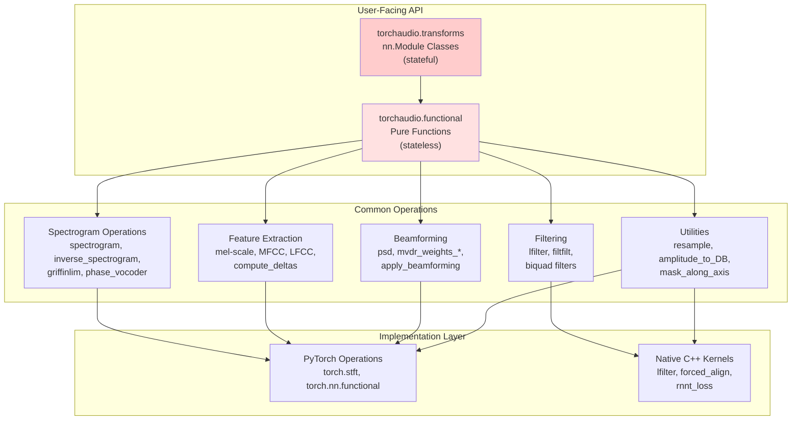

**Relationship Between Functional and Transforms**

The `torchaudio.transforms` module builds on `torchaudio.functional` by wrapping functions in `nn.Module` classes. This enables:
- Parameter persistence (e.g., filterbank matrices, window functions)
- Integration with `nn.Sequential` and custom modules
- State management for operations like `Resample` that cache kernels

Example: `T.Spectrogram` wraps `F.spectrogram` and stores the window tensor as a buffer, while `T.Resample` caches resampling kernels to avoid recomputation.

Sources: [docs/source/functional.rst:1-125](), [docs/source/transforms.rst:1-154]()

## Functional API Organization

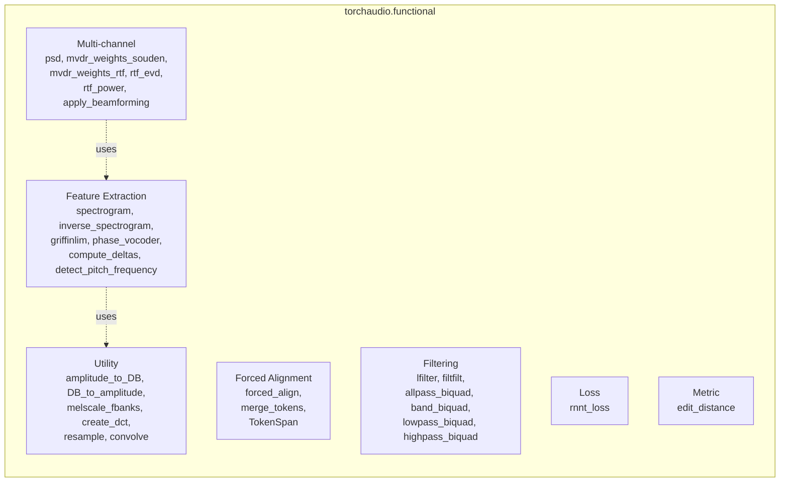

All functional operations are stateless pure functions that accept tensors and return tensors. They are organized into seven categories as shown above and documented in [docs/source/functional.rst]().

**Key Characteristics:**
- **Pure functions**: No internal state, deterministic output for given inputs
- **Device agnostic**: Work on CPU, CUDA, and other devices
- **dtype flexible**: Support `float32`, `float64`, and complex types where applicable
- **Arbitrary batch dimensions**: Leading dimensions are preserved through operations

Sources: [docs/source/functional.rst:1-125]()

## Transforms API Organization

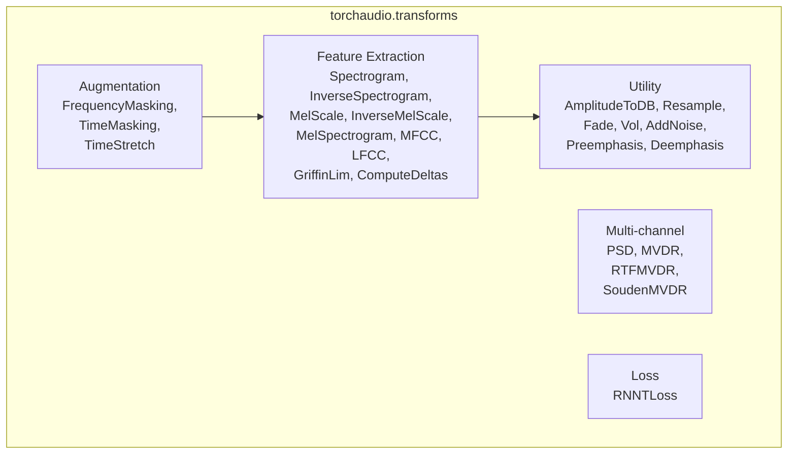

Transform classes inherit from `torch.nn.Module` and can be:
- Composed using `torch.nn.Sequential`
- Moved to specific devices/dtypes with `.to()`
- Saved/loaded with state_dict
- Scripted with `torch.jit.script`

**Example Pipeline Construction:**

```python
class MyPipeline(torch.nn.Module):
    def __init__(self):
        super().__init__()
        self.resample = T.Resample(16000, 8000)
        self.spec = T.Spectrogram(n_fft=400, power=2)
        self.mel = T.MelScale(n_mels=128, sample_rate=8000, n_stft=201)
    
    def forward(self, waveform):
        return self.mel(self.spec(self.resample(waveform)))
```

Sources: [docs/source/transforms.rst:8-73](), [test/torchaudio_unittest/transforms/transforms_test_impl.py:20-136]()

## Testing Framework

TorchAudio employs a comprehensive testing strategy to ensure correctness across multiple dimensions:

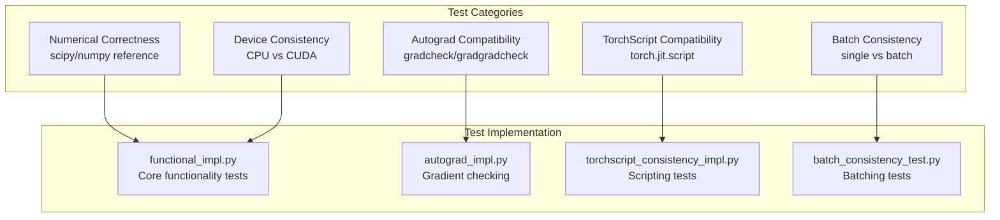

### Numerical Correctness

Operations are validated against reference implementations from `scipy.signal`, `numpy`, and `librosa`. Tests verify outputs match within specified tolerances.

Example: `lfilter` is tested against `scipy.signal.sosfilt` for high-order filters:

Sources: [test/torchaudio_unittest/functional/functional_impl.py:125-144]()

### Autograd Compatibility

All differentiable operations must pass `torch.autograd.gradcheck` and `torch.autograd.gradgradcheck` to verify first and second-order gradients are correct.

Example autograd test pattern:
```python
def assert_grad(self, transform, inputs):
    # Convert to float64 for gradcheck precision requirements
    inputs_ = [i.to(dtype=torch.double, device=self.device) for i in inputs]
    assert gradcheck(transform, inputs_)
    assert gradgradcheck(transform, inputs_)
```

Sources: [test/torchaudio_unittest/functional/autograd_impl.py:19-35](), [test/torchaudio_unittest/transforms/autograd_test_impl.py:24-45]()

### TorchScript Compatibility

Tests verify that `torch.jit.script(transform)` produces identical outputs to eager mode execution:

Sources: [test/torchaudio_unittest/functional/torchscript_consistency_impl.py:14-31]()

### Batch Consistency

Tests ensure batched inputs produce identical results to processing items individually:

Sources: [test/torchaudio_unittest/functional/batch_consistency_test.py:26-42]()

## Operation Categories

### Spectrogram and Time-Frequency Operations

The core time-frequency transformation operations:

| Function/Transform | Purpose | Key Parameters |
|-------------------|---------|----------------|
| `F.spectrogram` / `T.Spectrogram` | Compute STFT-based spectrogram | `n_fft`, `hop_length`, `power`, `normalized` |
| `F.inverse_spectrogram` / `T.InverseSpectrogram` | Reconstruct waveform from spectrogram | `n_fft`, `hop_length`, `length` |
| `F.griffinlim` / `T.GriffinLim` | Phase reconstruction algorithm | `n_iter`, `momentum`, `rand_init` |
| `F.phase_vocoder` | Time-stretch in frequency domain | `rate`, `phase_advance` |

**Normalization Options:**
- `normalized=False`: No normalization
- `normalized=True` or `"window"`: Normalize by sum of squared window samples: `sqrt(3 * n_fft / 8)` for Hann window
- `normalized="frame_length"`: Normalize by `sqrt(n_fft)`

Sources: [test/torchaudio_unittest/functional/functional_impl.py:256-318](), [docs/source/functional.rst:76-93]()

### Mel-Scale and Perceptual Features

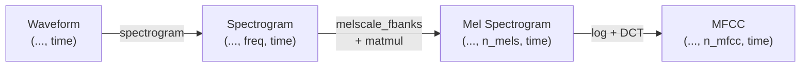

| Operation | Purpose | Key Parameters |
|-----------|---------|----------------|
| `F.melscale_fbanks` | Create mel-scale filterbank matrix | `n_mels`, `sample_rate`, `f_min`, `f_max`, `norm` |
| `T.MelScale` | Apply mel-scale filterbank to spectrogram | `n_mels`, `sample_rate`, `n_stft` |
| `T.MelSpectrogram` | Combined spectrogram + mel-scale | `sample_rate`, `n_fft`, `n_mels` |
| `T.MFCC` | Mel-frequency cepstral coefficients | `sample_rate`, `n_mfcc`, `log_mels`, `melkwargs` |
| `T.LFCC` | Linear-frequency cepstral coefficients | `sample_rate`, `n_lfcc`, `n_filter`, `speckwargs` |
| `F.create_dct` | Create DCT transformation matrix | `n_mfcc`, `n_mels`, `norm` |

**MFCC/LFCC DCT Normalization:**
- `norm="ortho"`: Orthonormal DCT (first coefficient scaled by `sqrt(n_mels) * 2`, rest by `sqrt(n_mels/2) * 2`)
- `norm=None`: Unnormalized DCT

Sources: [docs/source/functional.rst:17-21](), [test/torchaudio_unittest/transforms/transforms_test.py:132-174]()

### Filtering Operations

TorchAudio provides both general-purpose filters and specialized audio filters:

**General Filters:**
- `F.lfilter`: Apply IIR/FIR filter with `a_coeffs` and `b_coeffs`
- `F.filtfilt`: Zero-phase filtering (forward-backward filter)

**Biquad Filters:**
All biquad filters implement second-order IIR filtering with specific frequency responses:

| Filter | Purpose | Parameters |
|--------|---------|------------|
| `F.lowpass_biquad` | Low-pass filter | `cutoff_freq`, `Q` |
| `F.highpass_biquad` | High-pass filter | `cutoff_freq`, `Q` |
| `F.bandpass_biquad` | Band-pass filter | `central_freq`, `Q`, `const_skirt_gain` |
| `F.bandreject_biquad` | Band-reject (notch) filter | `central_freq`, `Q` |
| `F.allpass_biquad` | All-pass filter (phase shift) | `central_freq`, `Q` |
| `F.equalizer_biquad` | Parametric equalizer | `central_freq`, `gain`, `Q` |
| `F.bass_biquad` | Bass boost/cut | `central_freq`, `gain`, `Q` |
| `F.treble_biquad` | Treble boost/cut | `central_freq`, `gain`, `Q` |

**Filter Stability:**

High-order filters can become numerically unstable. TorchAudio's `lfilter` uses direct-form implementation, which is less stable than cascaded second-order sections used by scipy:

Sources: [test/torchaudio_unittest/functional/functional_impl.py:125-144](), [docs/source/functional.rst:47-75]()

### Beamforming and Multi-Channel Processing

Multi-channel audio processing operations for spatial filtering:

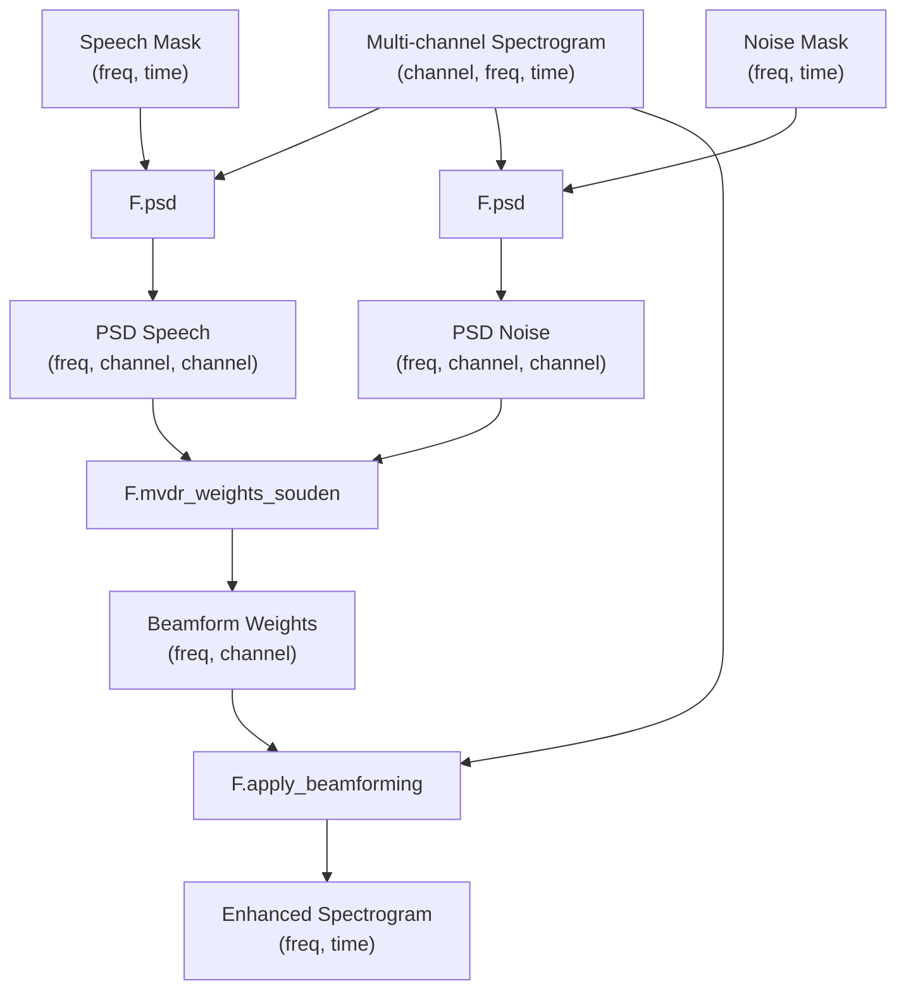

**Power Spectral Density (PSD):**
- `F.psd` / `T.PSD`: Compute PSD matrix from multi-channel spectrogram
- Optional mask weighting for time-frequency bins
- Normalization options for mask

**MVDR Beamforming:**
Two formulations for computing Minimum Variance Distortionless Response beamformer weights:

1. **Souden's Method** (`F.mvdr_weights_souden`): Uses speech and noise PSD matrices directly
2. **RTF-based Method** (`F.mvdr_weights_rtf`): Uses relative transfer function and noise PSD

**RTF Estimation:**
- `F.rtf_evd`: Eigenvalue decomposition method
- `F.rtf_power`: Power iteration method

Sources: [docs/source/functional.rst:94-107](), [test/torchaudio_unittest/functional/functional_impl.py:690-843](), [test/torchaudio_unittest/common_utils/beamform_utils.py:1-85]()

### Data Augmentation

**SpecAugment** operations for training robustness:

| Transform | Purpose | Key Parameters |
|-----------|---------|----------------|
| `T.FrequencyMasking` | Mask contiguous frequency bins | `freq_mask_param`, `iid_masks` |
| `T.TimeMasking` | Mask contiguous time frames | `time_mask_param`, `iid_masks`, `p` |
| `T.TimeStretch` | Time-domain stretching via phase vocoder | `n_freq`, `fixed_rate` |

**Masking Behavior:**
- `iid_masks=False`: Same mask for all items in batch
- `iid_masks=True`: Independent mask per batch item
- `p`: Probability parameter (fraction of dimension to mask)

Sources: [docs/source/transforms.rst:121-133](), [test/torchaudio_unittest/functional/functional_impl.py:400-499]()

### Resampling

Resampling changes the sample rate of waveforms:

**Methods:**
- `resampling_method="sinc_interp_hann"`: Sinc interpolation with Hann window (default)
- `resampling_method="sinc_interp_kaiser"`: Sinc interpolation with Kaiser window

**Parameters:**
- `lowpass_filter_width`: Width of lowpass filter (Kaiser only)
- `rolloff`: Roll-off frequency as fraction of Nyquist (Kaiser only)
- `beta`: Kaiser window beta parameter

**Kernel Caching:**
`T.Resample` caches the resampling kernel to avoid recomputation across forward passes. The kernel dtype can be specified via the `dtype` parameter:

Sources: [test/torchaudio_unittest/transforms/transforms_test_impl.py:62-82](), [test/torchaudio_unittest/functional/functional_impl.py:509-565]()

### Loss Functions

**RNN-Transducer Loss:**

`F.rnnt_loss` and `T.RNNTLoss` implement the RNN-Transducer loss for sequence-to-sequence training:

| Parameter | Type | Description |
|-----------|------|-------------|
| `logits` | Tensor | Predictions of shape `(batch, time, target, classes)` |
| `targets` | Tensor | Target sequences of shape `(batch, target_length)` |
| `logit_lengths` | Tensor | Valid time steps per batch item |
| `target_lengths` | Tensor | Valid target lengths per batch item |
| `blank` | int | Blank label index |
| `reduction` | str | Reduction method: `"mean"`, `"sum"`, or `"none"` |
| `fused_log_softmax` | bool | Apply log_softmax internally (default: `True`) |

**Native Implementation:**
The core computation is implemented in C++ with CUDA acceleration for performance. Tests verify numerical correctness against reference implementations.

Sources: [docs/source/functional.rst:108-116](), [test/torchaudio_unittest/functional/functional_impl.py:634-689]()

## Type Support and Device Handling

### Supported Data Types

Most operations support:
- **Real**: `torch.float32`, `torch.float64`
- **Complex**: `torch.complex64`, `torch.complex128` (for spectrogram, beamforming)

Tests validate numerical behavior across dtypes, with higher precision requirements for `float64` in gradient checking.

### Complex Number Handling

Operations returning complex outputs (e.g., STFT-based spectrograms) support:
- `return_complex=True`: Return native complex tensors
- `return_complex=False`: Return stacked real/imaginary tensors (deprecated)

Power spectrograms (`power=1.0` or `power=2.0`) always return real-valued tensors.

### Device Consistency

All operations are device-agnostic and work on CPU, CUDA, and other PyTorch-supported devices. Tests verify:
- Identical numerical results across devices (within floating-point precision)
- Proper device placement of outputs
- Efficient GPU utilization for supported operations

Sources: [test/torchaudio_unittest/functional/functional_cpu_test.py:1-21](), [test/torchaudio_unittest/functional/functional_cuda_test.py:1-41]()

## Common Usage Patterns

### Basic Feature Extraction Pipeline

```python
import torchaudio.transforms as T

# Create pipeline
pipeline = torch.nn.Sequential(
    T.Resample(orig_freq=16000, new_freq=8000),
    T.MelSpectrogram(sample_rate=8000, n_fft=400, n_mels=128),
    T.AmplitudeToDB()
)

# Move to device
pipeline = pipeline.to(device="cuda", dtype=torch.float32)

# Process waveform
features = pipeline(waveform)  # (batch, n_mels, time)
```

### Stateless Processing with Functional API

```python
import torchaudio.functional as F

# All parameters specified per-call
spec = F.spectrogram(
    waveform, 
    pad=0,
    window=torch.hann_window(400),
    n_fft=400,
    hop_length=160,
    win_length=400,
    power=2.0,
    normalized=True
)

mel = F.melscale_fbanks(
    n_freqs=201,
    f_min=0.0,
    f_max=4000.0,
    n_mels=128,
    sample_rate=8000
) @ spec  # Manual filterbank application
```

### Multi-Channel Beamforming

```python
import torchaudio.functional as F

# Multi-channel spectrogram: (channel, freq, time)
specgram = F.spectrogram(multichannel_waveform, ...)

# Compute PSD matrices with masks
psd_speech = F.psd(specgram, mask=speech_mask)
psd_noise = F.psd(specgram, mask=noise_mask)

# Compute beamformer weights
weights = F.mvdr_weights_souden(
    psd_speech, 
    psd_noise, 
    reference_channel=0
)

# Apply beamforming
enhanced = F.apply_beamforming(weights, specgram)
```

Sources: [docs/source/transforms.rst:14-73]()

## Performance Considerations

### Kernel Caching

Several transforms cache computed parameters to avoid recomputation:
- `T.Resample`: Caches sinc resampling kernels
- `T.MelScale`: Caches mel filterbank matrix
- `T.Spectrogram`: Stores window as buffer

Cache dtype can be controlled via transform constructor parameters.

### Native Implementation Dispatch

Performance-critical operations dispatch to native C++ implementations when available:
- `F.lfilter`: C++ implementation via PyBind11
- `F.rnnt_loss`: CUDA-accelerated loss computation
- `F.forced_align`: Optimized alignment algorithm

For details on native implementations, see [Native C++ and CUDA Implementations](#2.5).

### Batch Processing

Always prefer batch processing over loops:
```python
# Good: Single batched call
features = transform(batched_waveform)  # (batch, ...)

# Avoid: Loop over batch
features = torch.stack([transform(waveform[i]) for i in range(batch)])
```

Batch consistency tests verify this produces identical results while being more efficient.

Sources: [test/torchaudio_unittest/transforms/transforms_test_impl.py:78-82](), [test/torchaudio_unittest/functional/batch_consistency_test.py:1-483]()

---

# Page: Functional API

# Functional API

<details>
<summary>Relevant source files</summary>

The following files were used as context for generating this wiki page:

- [docs/source/functional.rst](docs/source/functional.rst)
- [test/torchaudio_unittest/common_utils/beamform_utils.py](test/torchaudio_unittest/common_utils/beamform_utils.py)
- [test/torchaudio_unittest/functional/autograd_impl.py](test/torchaudio_unittest/functional/autograd_impl.py)
- [test/torchaudio_unittest/functional/batch_consistency_test.py](test/torchaudio_unittest/functional/batch_consistency_test.py)
- [test/torchaudio_unittest/functional/functional_cpu_test.py](test/torchaudio_unittest/functional/functional_cpu_test.py)
- [test/torchaudio_unittest/functional/functional_cuda_test.py](test/torchaudio_unittest/functional/functional_cuda_test.py)
- [test/torchaudio_unittest/functional/functional_impl.py](test/torchaudio_unittest/functional/functional_impl.py)
- [test/torchaudio_unittest/functional/torchscript_consistency_impl.py](test/torchaudio_unittest/functional/torchscript_consistency_impl.py)

</details>


The `torchaudio.functional` module provides low-level audio processing functions that operate directly on tensors. This API forms the foundation of TorchAudio's audio processing capabilities, offering a comprehensive set of operations for audio manipulation, feature extraction, filtering, and more. For information about the transform-based interface (which wraps these functions as `nn.Module` objects), see [Transforms](#2.2).

## Overview of the Functional API

The Functional API provides direct, efficient tensor operations for audio processing without the overhead of creating module objects. This makes it ideal for custom processing pipelines where flexibility is essential.

```mermaid
graph TD
    subgraph "torchaudio.functional"
        direction TB
        
        Utility["Utility Functions
        - amplitude_to_DB/DB_to_amplitude
        - melscale_fbanks/linear_fbanks
        - mu_law_encoding/decoding
        - resample"]
        
        Feature["Feature Extraction
        - spectrogram/inverse_spectrogram
        - griffinlim
        - compute_deltas
        - detect_pitch_frequency"]
        
        Filtering["Filtering
        - lfilter/filtfilt
        - biquad filters
        - equalizer
        - contrast/gain"]
        
        MultiChannel["Multi-Channel Processing
        - psd
        - mvdr_weights
        - apply_beamforming"]
        
        Loss["Loss Functions
        - rnnt_loss"]
        
        Metric["Metrics
        - edit_distance"]
        
        Augmentation["Augmentation
        - mask_along_axis
        - pitch_shift"]
    end

    Utility --- Feature
    Utility --- Filtering
    Feature --- Augmentation
    Filtering --- MultiChannel
    Feature --- Loss
    Feature --- Metric
```

Sources: [docs/source/functional.rst:1-126](), [test/torchaudio_unittest/functional/functional_impl.py:6-8]()

## Relationship to Other Components

The Functional API serves as the foundation for higher-level components in TorchAudio. Most notably, the Transforms module wraps these functional operations as `nn.Module` objects for easier integration into neural network pipelines.

```mermaid
graph TD
    subgraph "TorchAudio Architecture"
        direction LR
        
        Functional["torchaudio.functional
        - Pure tensor operations
        - Function-based API"]
        
        Transforms["torchaudio.transforms
        - nn.Module wrappers
        - Stateful operations"]
        
        Models["torchaudio.models
        - Pre-trained models
        - Neural network architectures"]
        
        Pipelines["torchaudio.pipelines
        - End-to-end solutions
        - Pre-configured chains"]
        
        DataLoading["I/O & Data Loading
        - Audio file loading
        - Dataset handling"]
    end
    
    Functional --> Transforms
    Transforms --> Models
    Transforms --> Pipelines
    Models --> Pipelines
    DataLoading --> Functional
    DataLoading --> Transforms
    
    classDef highlight fill:#f9f9f9,stroke:#333,stroke-width:2px;
    class Functional highlight
```

Sources: [docs/source/transforms.rst:1-154]()

## Core Function Categories

The Functional API is organized into several categories of audio processing functions:

### Feature Extraction

Functions for extracting features from audio signals, including spectrograms, mel spectrograms, and pitch detection.

| Function | Description |
|----------|-------------|
| `spectrogram` | Computes a spectrogram using the Short-Time Fourier Transform (STFT) |
| `inverse_spectrogram` | Reconstructs a waveform from a spectrogram |
| `griffinlim` | Reconstructs a signal from a magnitude spectrogram using the Griffin-Lim algorithm |
| `compute_deltas` | Computes delta coefficients (used in feature extraction pipelines like MFCC) |
| `detect_pitch_frequency` | Detects the fundamental frequency (pitch) of an audio signal |
| `phase_vocoder` | Modifies the phase of a complex spectrogram for time stretching |
| `spectral_centroid` | Computes the spectral centroid for each audio frame |

Sources: [docs/source/functional.rst:77-94](), [test/torchaudio_unittest/functional/functional_impl.py:229-264](), [test/torchaudio_unittest/functional/functional_impl.py:320-341]()

### Filtering and Signal Processing

Functions for applying various filters and signal processing operations to audio signals.

| Function | Description |
|----------|-------------|
| `lfilter` | Applies IIR/FIR filtering (similar to scipy's lfilter) |
| `filtfilt` | Applies zero-phase filtering (forward-backward) |
| `biquad` | Applies a biquad filter with specified coefficients |
| `highpass_biquad` / `lowpass_biquad` | Applies high/low-pass biquad filtering |
| `bandpass_biquad` / `bandreject_biquad` | Applies band-pass/band-reject biquad filtering |
| `equalizer_biquad` | Applies equalization using a biquad filter |
| `gain` | Applies gain (volume adjustment) to an audio signal |
| `contrast` | Enhances the contrast of an audio signal |
| `dcshift` | Applies DC shift to an audio signal |
| `overdrive` | Applies an overdrive effect to an audio signal |
| `phaser` / `flanger` | Applies phaser/flanger effects to an audio signal |

Sources: [docs/source/functional.rst:48-76](), [test/torchaudio_unittest/functional/functional_impl.py:59-145](), [test/torchaudio_unittest/functional/torchscript_consistency_impl.py:294-547]()

### Utilities and Conversion Functions

Utility functions for converting between different representations and scales, resampling, and other operations.

| Function | Description |
|----------|-------------|
| `amplitude_to_DB` | Converts amplitude or power spectrogram to decibel scale |
| `DB_to_amplitude` | Converts decibel-scale spectrogram to amplitude or power |
| `melscale_fbanks` | Creates Mel filterbanks for feature extraction |
| `linear_fbanks` | Creates linear filterbanks for feature extraction |
| `create_dct` | Creates a DCT (Discrete Cosine Transform) matrix |
| `mu_law_encoding` / `mu_law_decoding` | Applies mu-law encoding/decoding for signal compression |
| `resample` | Resamples an audio signal to a different sample rate |
| `pitch_shift` | Shifts the pitch of an audio signal by a specified number of semitones |
| `speed` | Changes the speed of an audio signal |

Sources: [docs/source/functional.rst:10-36](), [test/torchaudio_unittest/functional/functional_impl.py:344-369](), [test/torchaudio_unittest/functional/functional_impl.py:495-552]()

### Multi-Channel Audio Processing

Functions for processing multi-channel audio signals, particularly for beamforming applications.

| Function | Description |
|----------|-------------|
| `psd` | Computes the Power Spectral Density matrix |
| `mvdr_weights_souden` | Computes MVDR beamforming weights using Souden's formulation |
| `mvdr_weights_rtf` | Computes MVDR beamforming weights using a relative transfer function |
| `rtf_evd` | Estimates the relative transfer function using eigenvalue decomposition |
| `rtf_power` | Estimates the relative transfer function using the power method |
| `apply_beamforming` | Applies beamforming weights to a multi-channel spectrogram |

Sources: [docs/source/functional.rst:95-108](), [test/torchaudio_unittest/functional/functional_impl.py:676-858](), [test/torchaudio_unittest/functional/batch_consistency_test.py:272-295]()

### Audio Augmentation

Functions for audio data augmentation, commonly used in training speech recognition models.

| Function | Description |
|----------|-------------|
| `mask_along_axis` | Applies masking along specified axis (time or frequency) |
| `mask_along_axis_iid` | Applies independent masking across batch dimension |
| `add_noise` | Adds noise to an audio signal with specified SNR |
| `preemphasis` / `deemphasis` | Applies preemphasis/deemphasis filtering |

Sources: [test/torchaudio_unittest/functional/functional_impl.py:401-485](), [test/torchaudio_unittest/functional/autograd_impl.py:360-384]()

### Loss Functions and Metrics

Functions for computing losses and metrics, particularly for speech recognition tasks.

| Function | Description |
|----------|-------------|
| `rnnt_loss` | Computes the RNN Transducer loss for sequence prediction |
| `edit_distance` | Computes the edit distance between two sequences |
| `forced_align` | Aligns a transcript to audio using CTC-based forced alignment |

Sources: [docs/source/functional.rst:109-125](), [test/torchaudio_unittest/functional/functional_impl.py:620-665](), [test/torchaudio_unittest/functional/functional_impl.py:607-609]()

## Usage Patterns

### Basic Usage

The functions in the Functional API operate directly on PyTorch tensors. Most functions accept and return tensors, making them easy to integrate into tensor-based processing pipelines.

```python
import torch
import torchaudio.functional as F

# Load an audio file
waveform, sample_rate = torchaudio.load("audio.wav")

# Apply processing
spectrogram = F.spectrogram(waveform, n_fft=400, hop_length=200)
mel_filterbank = F.melscale_fbanks(n_stft=201, n_mels=40, sample_rate=sample_rate)
mel_spectrogram = torch.matmul(spectrogram, mel_filterbank.T)
```

### Batch Processing

Most functions in the Functional API support batch processing, allowing efficient operations on batches of audio signals.

```mermaid
graph LR
    subgraph "Single Sample Processing"
        A1["Single Waveform"] --> B1["F.function()"] --> C1["Single Output"]
    end
    
    subgraph "Batch Processing"
        A2["Batch of Waveforms"] --> B2["F.function()"] --> C2["Batch of Outputs"]
    end
```

Sources: [test/torchaudio_unittest/functional/batch_consistency_test.py:1-483]()

### Gradient Support

Functions in the Functional API support automatic differentiation, allowing them to be used in differentiable processing pipelines and neural networks.

Sources: [test/torchaudio_unittest/transforms/autograd_test_impl.py:1-417](), [test/torchaudio_unittest/functional/autograd_impl.py:1-409]()

### TorchScript Compatibility

Most functions in the Functional API are compatible with TorchScript, enabling optimization and deployment in production environments.

Sources: [test/torchaudio_unittest/functional/torchscript_consistency_impl.py:1-741]()

## Functional API vs Transforms

The key difference between the Functional API and the Transforms module is in their usage pattern and state management.

```mermaid
graph TD
    subgraph "Functional API"
        F1["import torchaudio.functional as F"] --> F2["result = F.function(input, param1, param2)"]
    end
    
    subgraph "Transforms"
        T1["import torchaudio.transforms as T"] --> T2["transform = T.Transform(param1, param2)"] --> T3["result = transform(input)"]
    end
    
    note["Key Differences:
    - Functional: Stateless, direct operations
    - Transforms: Stateful, configurable objects
    - Transforms are nn.Module wrappers around Functional operations"]
```

### When to Use Functional API vs Transforms

| Functional API | Transforms |
|----------------|------------|
| For one-off processing operations | For repeated use with the same parameters |
| When building custom processing pipelines | When integrating with PyTorch `nn.Module` pipelines |
| When lower-level control is needed | When you need to compose transformations using `nn.Sequential` |
| When parameters need to change dynamically | When parameters are fixed at initialization time |

Sources: [docs/source/functional.rst:1-126](), [docs/source/transforms.rst:1-154]()

## Conclusion

The Functional API is a powerful foundation for audio processing in TorchAudio, offering a comprehensive set of functions for manipulating and extracting features from audio signals. Whether used directly or through the Transforms module, these functions enable advanced audio processing capabilities with the performance and flexibility of PyTorch tensors.

Sources: [test/torchaudio_unittest/functional/functional_impl.py:1-884]()

---

# Page: Transforms

# Transforms

<details>
<summary>Relevant source files</summary>

The following files were used as context for generating this wiki page:

- [docs/source/transforms.rst](docs/source/transforms.rst)
- [test/torchaudio_unittest/transforms/autograd_test_impl.py](test/torchaudio_unittest/transforms/autograd_test_impl.py)
- [test/torchaudio_unittest/transforms/batch_consistency_test.py](test/torchaudio_unittest/transforms/batch_consistency_test.py)
- [test/torchaudio_unittest/transforms/torchscript_consistency_impl.py](test/torchaudio_unittest/transforms/torchscript_consistency_impl.py)
- [test/torchaudio_unittest/transforms/transforms_test.py](test/torchaudio_unittest/transforms/transforms_test.py)
- [test/torchaudio_unittest/transforms/transforms_test_impl.py](test/torchaudio_unittest/transforms/transforms_test_impl.py)

</details>


The `torchaudio.transforms` module provides a collection of audio processing operations implemented as `torch.nn.Module` objects. These transforms build on top of the `torchaudio.functional` API (see [Functional API](#2.1)) by providing stateful, composable building blocks that can be used to create complex audio processing pipelines. As they are PyTorch modules, transforms can be easily integrated into neural network architectures, serialized using TorchScript, and support autograd for end-to-end differentiable audio processing.

## Core Concepts

Transforms wrap the functionality provided by the functional API into PyTorch modules. This design offers several advantages:

1. **Statefulness** - Transforms can precompute and cache parameters, improving performance for repeated operations
2. **Composability** - Transforms can be chained together using `torch.nn.Sequential` or custom module definitions
3. **Serialization** - Transforms can be saved and loaded using TorchScript
4. **Device/dtype Flexibility** - Transforms can be moved between devices (CPU/CUDA) and data types

```mermaid
graph TD
    subgraph "Transform Architecture"
        direction TB
        F["torchaudio.functional
        Raw operations"] --> |wraps| TM["torch.nn.Module
        Base class"]
        
        TM --> |extends| T["torchaudio.transforms
        Stateful modules"]
        
        T --> |provides| FE["Feature Extractions
        - Spectrogram
        - MelSpectrogram
        - MFCC"]
        
        T --> |provides| A["Augmentations
        - FrequencyMasking
        - TimeMasking
        - TimeStretch"]
        
        T --> |provides| U["Utility
        - Resample
        - AmplitudeToDB
        - Fade"]
        
        T --> |provides| MC["Multi-channel
        - PSD
        - MVDR"]
    end
```

Sources: [docs/source/transforms.rst:6-14](docs/source/transforms.rst:6-14), [docs/source/functional.rst:1-9](docs/source/functional.rst:1-9)

## Pipeline Construction

Transforms are designed to be combined into processing pipelines. Since they inherit from `torch.nn.Module`, they can be used in several ways:

1. Chained together using `torch.nn.Sequential`
2. Composed inside a custom module class
3. Applied individually in sequence

```mermaid
graph LR
    subgraph "Audio Processing Pipeline"
        direction LR
        I["Input Waveform"] --> R["Resample
        Change sample rate"]
        R --> S["Spectrogram
        Time-frequency repr."]
        S --> A["Augmentations
        e.g. TimeMasking"]
        A --> M["MelScale
        Perceptual scaling"]
        M --> O["Output Features"]
    end
```

Sources: [docs/source/transforms.rst:16-73](docs/source/transforms.rst:16-73), [examples/tutorials/audio_feature_extractions_tutorial.py:12-73](examples/tutorials/audio_feature_extractions_tutorial.py:12-73)

Here's an example of how to build a custom audio processing pipeline:

```python
# Example: Custom feature extraction pipeline
class MyPipeline(torch.nn.Module):
    def __init__(
        self,
        input_freq=16000,
        resample_freq=8000,
        n_fft=1024,
        n_mel=256,
        stretch_factor=0.8,
    ):
        super().__init__()
        self.resample = Resample(orig_freq=input_freq, new_freq=resample_freq)
        self.spec = Spectrogram(n_fft=n_fft, power=2)
        self.spec_aug = torch.nn.Sequential(
            TimeStretch(stretch_factor, fixed_rate=True),
            FrequencyMasking(freq_mask_param=80),
            TimeMasking(time_mask_param=80),
        )
        self.mel_scale = MelScale(
            n_mels=n_mel, sample_rate=resample_freq, n_stft=n_fft // 2 + 1)

    def forward(self, waveform):
        # Resample the input
        resampled = self.resample(waveform)
        # Convert to power spectrogram
        spec = self.spec(resampled)
        # Apply SpecAugment
        spec = self.spec_aug(spec)
        # Convert to mel-scale
        mel = self.mel_scale(spec)
        return mel
```

Sources: [docs/source/transforms.rst:24-60](docs/source/transforms.rst:24-60)

## Transform Categories

### Feature Extraction

Feature extraction transforms convert audio waveforms into various representations useful for audio analysis and machine learning tasks.

```mermaid
flowchart TD
    subgraph "Audio Feature Extraction Hierarchy"
        direction TB
        W["Waveform"] --> S["Spectrogram
        Time-frequency representation"]
        S --> IS["InverseSpectrogram
        Spectrogram to waveform"]
        
        S --> GL["GriffinLim
        Phase reconstruction"]
        
        S --> MS["MelSpectrogram
        Perceptual scaling"]
        MS --> MFCC["MFCC
        Mel-frequency cepstral coefficients"]
        
        S --> LFCC["LFCC
        Linear-frequency cepstral coefficients"]
        
        MS --> IMS["InverseMelScale
        Mel to linear spectrogram"]
        
        S --> SC["SpectralCentroid
        Weighted mean of frequencies"]
        
        S --> CD["ComputeDeltas
        Temporal derivatives"]
    end
```

Sources: [docs/source/transforms.rst:103-118](docs/source/transforms.rst:103-118), [examples/tutorials/audio_feature_extractions_tutorial.py:32-39](examples/tutorials/audio_feature_extractions_tutorial.py:32-39)

Key feature extraction transforms include:

- **Spectrogram**: Converts a waveform to a spectrogram, a 2D representation where one axis represents time and the other represents frequency.
- **MelSpectrogram**: Creates a spectrogram with frequency bins scaled according to the Mel scale, which better approximates human perception of frequency.
- **MFCC**: Computes Mel-frequency cepstral coefficients, which are commonly used in speech recognition.
- **InverseSpectrogram**: Converts a spectrogram back to a waveform.
- **GriffinLim**: Performs phase reconstruction to convert a magnitude spectrogram back to a waveform.

### Augmentation

Augmentation transforms are used to artificially increase the diversity of training data by applying various transformations.

```mermaid
flowchart LR
    subgraph "SpecAugment Transforms"
        direction TB
        S["Spectrogram"] --> FM["FrequencyMasking
        Mask frequency bands"]
        S --> TM["TimeMasking
        Mask time segments"]
        S --> TS["TimeStretch
        Stretch/compress time axis"]
        
        FM & TM & TS --> SA["SpecAugment
        Combined augmentation"]
    end
```

Sources: [docs/source/transforms.rst:126-132](docs/source/transforms.rst:126-132), [test/torchaudio_unittest/transforms/transforms_test_impl.py:424-473](test/torchaudio_unittest/transforms/transforms_test_impl.py:424-473)

Key augmentation transforms include:

- **FrequencyMasking**: Masks random frequency bands in a spectrogram.
- **TimeMasking**: Masks random time segments in a spectrogram.
- **TimeStretch**: Stretches or compresses the time axis of a spectrogram.
- **PitchShift**: Shifts the pitch of an audio signal while preserving the duration.
- **AddNoise**: Adds noise to a waveform at a specified signal-to-noise ratio (SNR).

### Utility

Utility transforms provide basic audio processing operations that are commonly used in audio pipelines.

Key utility transforms include:

- **Resample**: Changes the sample rate of an audio signal.
- **AmplitudeToDB**: Converts amplitude values to decibels.
- **MuLawEncoding/MuLawDecoding**: Applies μ-law compression/decompression.
- **Fade**: Applies fade-in and fade-out effects to audio signals.
- **Vol**: Adjusts the volume of an audio signal.
- **Preemphasis/Deemphasis**: Applies pre-emphasis and de-emphasis filters.

Sources: [docs/source/transforms.rst:81-98](docs/source/transforms.rst:81-98)

### Multi-channel

Multi-channel transforms operate on multi-channel audio signals, often used for beamforming and speech enhancement.

Key multi-channel transforms include:

- **PSD**: Computes power spectral density matrices.
- **MVDR**: Implements minimum variance distortionless response beamforming.
- **RTFMVDR**: Implements relative transfer function MVDR.
- **SoudenMVDR**: Implements Souden's formulation of MVDR.

Sources: [docs/source/transforms.rst:146-153](docs/source/transforms.rst:146-153), [examples/tutorials/mvdr_tutorial.py:18-29](examples/tutorials/mvdr_tutorial.py:18-29)

## Batch Processing

Most transforms support batched inputs, allowing for efficient processing of multiple audio samples simultaneously. This is particularly useful for training neural networks. The batch dimension is typically the first dimension of the input tensor.

```mermaid
flowchart TD
    subgraph "Batch Processing"
        direction LR
        I1["Input Tensor
        [B, C, L]"] --> T1["Transform"]
        T1 --> O1["Output Tensor
        [B, ...]"]
        
        subgraph "Single Sample Processing"
            direction LR
            I2["Input 1
            [C, L]"] --> T2["Transform"]
            T2 --> O2["Output 1"]
            
            I3["Input 2
            [C, L]"] --> T3["Transform"]
            T3 --> O3["Output 2"]
            
            I4["Input B
            [C, L]"] --> T4["Transform"]
            T4 --> O4["Output B"]
        end
        
        C1["Consistent Results"] --- C2["batch_result[i] == single_result[i]"]
    end
```

Sources: [test/torchaudio_unittest/transforms/batch_consistency_test.py:12-27](test/torchaudio_unittest/transforms/batch_consistency_test.py:12-27), [test/torchaudio_unittest/functional/batch_consistency_test.py:28-42](test/torchaudio_unittest/functional/batch_consistency_test.py:28-42)

## TorchScript Support

Most transforms in torchaudio can be serialized using TorchScript, which allows for deployment in production environments without a Python dependency.

Example of using TorchScript with transforms:

```python
# Create a transform
spectrogram = torchaudio.transforms.Spectrogram()

# Convert to TorchScript
scripted_spectrogram = torch.jit.script(spectrogram)

# Save to file
scripted_spectrogram.save("spectrogram.pt")

# Later, load and use
loaded_spectrogram = torch.jit.load("spectrogram.pt")
output = loaded_spectrogram(waveform)
```

Sources: [test/torchaudio_unittest/transforms/torchscript_consistency_impl.py:10-33](test/torchaudio_unittest/transforms/torchscript_consistency_impl.py:10-33)

## Autograd Support

All transforms support automatic differentiation (autograd), making them suitable for end-to-end training of neural networks. This is useful for tasks where the transforms are part of a learnable pipeline.

Exceptions and edge cases:
- Some transforms like `TimeStretch` may have undefined gradients at specific values (e.g., at zero)
- Some operations might require higher numerical precision during gradient computation

Sources: [test/torchaudio_unittest/transforms/autograd_test_impl.py:1-417](test/torchaudio_unittest/transforms/autograd_test_impl.py:1-417), [test/torchaudio_unittest/functional/autograd_impl.py:1-393](test/torchaudio_unittest/functional/autograd_impl.py:1-393)

## Commonly Used Transforms

This table shows the most commonly used transforms and their purposes:

| Transform | Purpose | Input | Output |
|-----------|---------|-------|--------|
| `Spectrogram` | Convert waveform to time-frequency representation | Waveform `[..., time]` | Spectrogram `[..., freq, time]` |
| `MelSpectrogram` | Create mel-scaled spectrogram | Waveform `[..., time]` | Mel Spectrogram `[..., mel_bins, time]` |
| `MFCC` | Extract mel-frequency cepstral coefficients | Waveform `[..., time]` | MFCC `[..., n_mfcc, time]` |
| `Resample` | Change sample rate | Waveform `[..., time]` | Resampled Waveform `[..., new_time]` |
| `AmplitudeToDB` | Convert amplitude to decibels | Spectrogram `[..., freq, time]` | dB Spectrogram `[..., freq, time]` |
| `FrequencyMasking` | Mask frequency bands (augmentation) | Spectrogram `[..., freq, time]` | Masked Spectrogram `[..., freq, time]` |
| `TimeMasking` | Mask time segments (augmentation) | Spectrogram `[..., freq, time]` | Masked Spectrogram `[..., freq, time]` |

Sources: [examples/tutorials/audio_feature_extractions_tutorial.py:98-120](examples/tutorials/audio_feature_extractions_tutorial.py:98-120), [examples/tutorials/audio_feature_augmentation_tutorial.py:23-54](examples/tutorials/audio_feature_augmentation_tutorial.py:23-54)

## Comparison with Functional API

While the functional API (`torchaudio.functional`) provides stateless functions, transforms offer several advantages:

1. **Parameter Caching**: Transforms can precompute and cache parameters, improving performance for repeated operations. For example, `Resample` caches the resampling kernel.
2. **Stateful Configuration**: Transforms store configuration parameters, making it easier to reuse the same configuration multiple times.
3. **Module Integration**: Transforms can be directly integrated into PyTorch `nn.Module` architectures.
4. **Serialization**: Transforms can be serialized using TorchScript.

For simple one-off operations, the functional API may be more appropriate. For complex pipelines or when integration with PyTorch modules is required, transforms are recommended.

```mermaid
graph TD
    subgraph "Comparison: Functional vs Transforms"
        direction LR
        
        subgraph "Functional API"
            F1["Stateless"]
            F2["One-off operations"]
            F3["Lower overhead"]
            F4["Direct tensor operations"]
        end
        
        subgraph "Transforms"
            T1["Stateful"]
            T2["Reusable components"]
            T3["Parameter caching"]
            T4["nn.Module integration"]
            T5["TorchScript support"]
        end
    end
```

Sources: [docs/source/transforms.rst:16-73](docs/source/transforms.rst:16-73), [docs/source/functional.rst:1-9](docs/source/functional.rst:1-9)

## Example Usage

Here's an example of using transforms to extract MFCC features from an audio waveform:

```python
import torch
import torchaudio.transforms as T

# Load audio waveform (example)
# waveform shape: [channels, time]
waveform, sample_rate = torchaudio.load("audio.wav")

# Create a feature extraction pipeline
transform = torch.nn.Sequential(
    T.Resample(orig_freq=sample_rate, new_freq=16000),
    T.MelSpectrogram(
        sample_rate=16000,
        n_fft=400,
        hop_length=160,
        n_mels=80
    ),
    T.AmplitudeToDB()
)

# Move the pipeline to the target device and dtype
transform = transform.to(device="cuda", dtype=torch.float32)

# Apply the transform
features = transform(waveform)

# features shape: [channels, mels, time]
```

Sources: [docs/source/transforms.rst:66-70](docs/source/transforms.rst:66-70), [examples/tutorials/audio_feature_extractions_tutorial.py:156-178](examples/tutorials/audio_feature_extractions_tutorial.py:156-178)

---

# Page: Feature Extraction

# Feature Extraction

<details>
<summary>Relevant source files</summary>

The following files were used as context for generating this wiki page:

- [docs/source/functional.rst](docs/source/functional.rst)
- [docs/source/transforms.rst](docs/source/transforms.rst)
- [test/torchaudio_unittest/common_utils/beamform_utils.py](test/torchaudio_unittest/common_utils/beamform_utils.py)
- [test/torchaudio_unittest/functional/autograd_impl.py](test/torchaudio_unittest/functional/autograd_impl.py)
- [test/torchaudio_unittest/functional/batch_consistency_test.py](test/torchaudio_unittest/functional/batch_consistency_test.py)
- [test/torchaudio_unittest/functional/functional_cpu_test.py](test/torchaudio_unittest/functional/functional_cpu_test.py)
- [test/torchaudio_unittest/functional/functional_cuda_test.py](test/torchaudio_unittest/functional/functional_cuda_test.py)
- [test/torchaudio_unittest/functional/functional_impl.py](test/torchaudio_unittest/functional/functional_impl.py)
- [test/torchaudio_unittest/functional/torchscript_consistency_impl.py](test/torchaudio_unittest/functional/torchscript_consistency_impl.py)
- [test/torchaudio_unittest/transforms/autograd_test_impl.py](test/torchaudio_unittest/transforms/autograd_test_impl.py)
- [test/torchaudio_unittest/transforms/batch_consistency_test.py](test/torchaudio_unittest/transforms/batch_consistency_test.py)
- [test/torchaudio_unittest/transforms/torchscript_consistency_impl.py](test/torchaudio_unittest/transforms/torchscript_consistency_impl.py)
- [test/torchaudio_unittest/transforms/transforms_test.py](test/torchaudio_unittest/transforms/transforms_test.py)
- [test/torchaudio_unittest/transforms/transforms_test_impl.py](test/torchaudio_unittest/transforms/transforms_test_impl.py)

</details>


This document provides comprehensive information about the feature extraction capabilities in the PyTorch Audio library. Feature extraction is a fundamental step in audio processing that transforms raw waveforms into representations useful for analysis and machine learning models. For audio filtering and effects processing, see [Filtering and DSP](#2.4).

## Introduction to Audio Feature Extraction

Audio feature extraction transforms raw audio signals into meaningful representations that capture specific characteristics of the audio signal. TorchAudio provides a rich set of tools for extracting common audio features, available through both functional (stateless functions) and transforms (stateful modules) APIs.

```mermaid
flowchart TD
    subgraph "Audio Feature Extraction"
        direction LR
        
        AudioWaveform["Raw Audio Waveform"]
        
        subgraph "Time-Domain Features"
            VAD["Voice Activity Detection"]
            ZeroCrossing["Zero Crossing Rate"]
        end
        
        subgraph "Frequency-Domain Features"
            Spectrogram["Spectrogram"]
            MelSpectrogram["Mel Spectrogram"]
            MFCC["MFCC"]
            LFCC["LFCC"]
            SpectralCentroid["Spectral Centroid"]
        end
        
        subgraph "Additional Processing"
            ComputeDeltas["Compute Deltas"]
            Pitch["Pitch Detection"]
            SlidingWindowCMN["Sliding Window CMN"]
        end
        
        AudioWaveform --> Spectrogram
        Spectrogram --> MelSpectrogram
        MelSpectrogram --> MFCC
        Spectrogram --> LFCC
        Spectrogram --> SpectralCentroid
        
        MelSpectrogram --> ComputeDeltas
        MFCC --> ComputeDeltas
        
        AudioWaveform --> Pitch
        AudioWaveform --> VAD
        AudioWaveform --> ZeroCrossing
        
        MelSpectrogram --> SlidingWindowCMN
        MFCC --> SlidingWindowCMN
    end
```

Sources: 
- [docs/source/functional.rst:77-94](docs/source/functional.rst:77-94)
- [docs/source/transforms.rst:100-118](docs/source/transforms.rst:100-118)
- [examples/tutorials/audio_feature_extractions_tutorial.py:32-42](examples/tutorials/audio_feature_extractions_tutorial.py:32-42)

## API Structure

TorchAudio provides two complementary APIs for feature extraction:

```mermaid
flowchart LR
    subgraph "TorchAudio Feature Extraction APIs"
        direction TB
        
        Functional["torchaudio.functional
        - Stateless functions
        - Lower-level processing
        - Pure PyTorch operations"]
        
        Transforms["torchaudio.transforms
        - torch.nn.Module implementations
        - Stateful objects
        - Serializable with TorchScript
        - Builds on functional API"]
        
        Functional --> Transforms
    end
```

Sources:
- [docs/source/transforms.rst:8-14](docs/source/transforms.rst:8-14)
- [examples/tutorials/audio_feature_extractions_tutorial.py:12-17](examples/tutorials/audio_feature_extractions_tutorial.py:12-17)

### Functional API

The functional API provides stateless functions for audio processing in the `torchaudio.functional` module. These functions are pure PyTorch operations that transform input tensors.

Key functional features include:

| Function | Description |
|----------|-------------|
| `F.spectrogram` | Computes the spectrogram of a waveform |
| `F.inverse_spectrogram` | Reconstructs waveform from spectrogram |
| `F.griffinlim` | Computes waveform from magnitude spectrogram |
| `F.compute_deltas` | Computes delta coefficients of a tensor |
| `F.detect_pitch_frequency` | Detects pitch of a waveform |
| `F.spectral_centroid` | Computes spectral centroid of a waveform |
| `F.sliding_window_cmn` | Applies sliding window cepstral mean normalization |
| `F.vad` | Applies voice activity detection |

Sources:
- [docs/source/functional.rst:77-94](docs/source/functional.rst:77-94)
- [test/torchaudio_unittest/functional/functional_impl.py:230-232](test/torchaudio_unittest/functional/functional_impl.py:230-232)
- [test/torchaudio_unittest/functional/functional_impl.py:320-332](test/torchaudio_unittest/functional/functional_impl.py:320-332)
- [test/torchaudio_unittest/functional/functional_impl.py:333-341](test/torchaudio_unittest/functional/functional_impl.py:333-341)

### Transforms API

The transforms API provides `torch.nn.Module` implementations that can be used in PyTorch models. These modules are stateful and can be serialized using TorchScript.

Key transform classes include:

| Transform | Description |
|-----------|-------------|
| `T.Spectrogram` | Creates a spectrogram from a waveform |
| `T.InverseSpectrogram` | Reconstructs waveform from spectrogram |
| `T.MelScale` | Converts spectrogram to mel-scale |
| `T.MelSpectrogram` | Creates a mel-spectrogram from a waveform |
| `T.MFCC` | Creates MFCC features from waveform |
| `T.LFCC` | Creates LFCC features from waveform |
| `T.ComputeDeltas` | Computes delta coefficients |
| `T.SpectralCentroid` | Computes spectral centroid |
| `T.SlidingWindowCmn` | Applies sliding window cepstral mean normalization |
| `T.Vad` | Applies voice activity detection |

Sources:
- [docs/source/transforms.rst:100-118](docs/source/transforms.rst:100-118)
- [examples/tutorials/audio_feature_extractions_tutorial.py:104-112](examples/tutorials/audio_feature_extractions_tutorial.py:104-112)
- [test/torchaudio_unittest/transforms/transforms_test_impl.py:16-61](test/torchaudio_unittest/transforms/transforms_test_impl.py:16-61)

## Core Feature Extraction Methods

### Spectrogram

The spectrogram is the fundamental time-frequency representation of audio signals from which many other features are derived.

```mermaid
flowchart TD
    subgraph "Spectrogram Computation"
        direction LR
        
        Waveform["Audio Waveform"]
        
        Windowing["Windowing
        - n_fft: FFT size
        - hop_length: Frame shift
        - win_length: Window size
        - window_fn: Window function"]
        
        FFT["Fast Fourier Transform
        - Convert time domain to frequency domain"]
        
        Magnitude["Magnitude Computation
        - power: Exponent for magnitude"]
        
        Spectrogram["Spectrogram Output
        - (channel, freq_bins, time_frames)"]
        
        Waveform --> Windowing
        Windowing --> FFT
        FFT --> Magnitude
        Magnitude --> Spectrogram
    end
```

**Implementation Notes:**
- `n_fft` parameter determines frequency resolution
- Default values: `hop_length = n_fft // 4` when not specified
- Can use different normalization modes: `False`, `True`, `"window"`, or `"frame_length"`
- Can return complex spectrogram with `power=None, return_complex=True`

Sources:
- [examples/tutorials/audio_feature_extractions_tutorial.py:98-120](examples/tutorials/audio_feature_extractions_tutorial.py:98-120)
- [test/torchaudio_unittest/functional/functional_impl.py:229-257](test/torchaudio_unittest/functional/functional_impl.py:229-257)
- [test/torchaudio_unittest/functional/functional_impl.py:256-318](test/torchaudio_unittest/functional/functional_impl.py:256-318)

### Mel Spectrogram

Mel spectrogram is derived from spectrogram by applying mel filterbanks, which better represent human auditory perception.

```mermaid
flowchart LR
    subgraph "Mel Spectrogram Pipeline"
        direction TB
        
        Waveform["Audio Waveform"]
        Spectrogram["Spectrogram"]
        MelFilterbanks["Mel Filterbanks
        - n_mels: Number of mel bands
        - sample_rate: Audio sample rate
        - f_min: Minimum frequency
        - f_max: Maximum frequency"]
        MelSpectrogram["Mel Spectrogram"]
        MFCC["MFCC
        - n_mfcc: Number of coefficients
        - log_mels: Whether to use log-mel
        - DCT: Discrete Cosine Transform"]
        
        Waveform --> Spectrogram
        Spectrogram --> MelFilterbanks
        MelFilterbanks --> MelSpectrogram
        MelSpectrogram --> MFCC
    end
```

**Implementation Notes:**
- Mel filterbanks are generated using `F.melscale_fbanks`
- MFCC uses `F.create_dct` to apply discrete cosine transform

Sources:
- [examples/tutorials/audio_feature_extractions_tutorial.py:393-446](examples/tutorials/audio_feature_extractions_tutorial.py:393-446)
- [test/torchaudio_unittest/transforms/autograd_test_impl.py:83-94](test/torchaudio_unittest/transforms/autograd_test_impl.py:83-94)
- [test/torchaudio_unittest/transforms/autograd_test_impl.py:107-122](test/torchaudio_unittest/transforms/autograd_test_impl.py:107-122)
- [test/torchaudio_unittest/functional/torchscript_consistency_impl.py:134-142](test/torchaudio_unittest/functional/torchscript_consistency_impl.py:134-142)

### Computing Deltas

Deltas (also called differential or velocity features) represent how features change over time and are important for capturing dynamic aspects of audio.

**Implementation Notes:**
- Uses a sliding window approach with configurable window length
- Windows are padded at the edges with replication by default
- Supports multiple frames and channels

Sources:
- [test/torchaudio_unittest/functional/functional_impl.py:320-332](test/torchaudio_unittest/functional/functional_impl.py:320-332)
- [test/torchaudio_unittest/transforms/autograd_test_impl.py:124-127](test/torchaudio_unittest/transforms/autograd_test_impl.py:124-127)
- [test/torchaudio_unittest/functional/torchscript_consistency_impl.py:112-112](test/torchaudio_unittest/functional/torchscript_consistency_impl.py:112-112)

### Pitch Detection

Pitch detection identifies the fundamental frequency of audio, primarily for monophonic signals.

**Implementation Notes:**
- Implemented in `F.detect_pitch_frequency`
- Works accurately for simple tones like sinusoids
- May need preprocessing for reliable detection in complex signals

Sources:
- [test/torchaudio_unittest/functional/functional_impl.py:333-341](test/torchaudio_unittest/functional/functional_impl.py:333-341)
- [test/torchaudio_unittest/functional/batch_consistency_test.py:77-93](test/torchaudio_unittest/functional/batch_consistency_test.py:77-93)
- [test/torchaudio_unittest/functional/torchscript_consistency_impl.py:121-121](test/torchaudio_unittest/functional/torchscript_consistency_impl.py:121-121)

### Spectral Centroid

Spectral centroid is the weighted average frequency in a signal, representing the "center of mass" of the spectrum.

**Implementation Notes:**
- Implemented in `F.spectral_centroid`
- Useful for characterizing the brightness or timbre of sound
- Provided in both functional API and as a transform

Sources:
- [test/torchaudio_unittest/transforms/autograd_test_impl.py:177-181](test/torchaudio_unittest/transforms/autograd_test_impl.py:177-181)
- [test/torchaudio_unittest/transforms/batch_consistency_test.py:150-156](test/torchaudio_unittest/transforms/batch_consistency_test.py:150-156)
- [test/torchaudio_unittest/functional/torchscript_consistency_impl.py:575-586](test/torchaudio_unittest/functional/torchscript_consistency_impl.py:575-586)

### Sliding Window CMN

Sliding Window Cepstral Mean Normalization (CMN) is a technique to normalize features like MFCC or mel spectrograms for improved robustness.

**Implementation Notes:**
- Supports different normalization options: `center` and `norm_vars`
- Configurable window size with `cmn_window` and `min_cmn_window`
- Applied to features reshape as (batch, time, freq)

Sources:
- [test/torchaudio_unittest/transforms/autograd_test_impl.py:215-222](test/torchaudio_unittest/transforms/autograd_test_impl.py:215-222)
- [test/torchaudio_unittest/functional/torchscript_consistency_impl.py:490-504](test/torchaudio_unittest/functional/torchscript_consistency_impl.py:490-504)
- [test/torchaudio_unittest/functional/batch_consistency_test.py:224-232](test/torchaudio_unittest/functional/batch_consistency_test.py:224-232)

## Feature Extraction Pipeline Example

Below is an example of a typical feature extraction pipeline that could be constructed using torchaudio:

```mermaid
flowchart TD
    subgraph "Complete Audio Feature Extraction Pipeline"
        direction TB
        
        Raw["Raw Audio Waveform"]
        
        Preprocess["Preprocessing
        - Resampling
        - Normalization"]
        
        FeatureExtract["Feature Extraction
        - Spectrogram/STFT
        - Mel Spectrogram
        - MFCC"]
        
        Enhancement["Feature Enhancement
        - Compute Deltas
        - Sliding Window CMN"]
        
        Augment["Data Augmentation
        - SpecAugment
        - Time/Frequency Masking"]
        
        Features["Final Features for ML Model"]
        
        Raw --> Preprocess
        Preprocess --> FeatureExtract
        FeatureExtract --> Enhancement
        Enhancement --> Augment
        Augment --> Features
    end
```

Implementing this pipeline using torchaudio's transform classes would look like:

```python
class MyPipeline(torch.nn.Module):
    def __init__(
        self,
        input_freq=16000,
        resample_freq=8000,
        n_fft=1024,
        n_mel=256,
    ):
        super().__init__()
        self.resample = T.Resample(orig_freq=input_freq, new_freq=resample_freq)
        self.mel_spec = T.MelSpectrogram(
            sample_rate=resample_freq, 
            n_fft=n_fft,
            n_mels=n_mel
        )
        self.compute_deltas = T.ComputeDeltas()
        self.cmn = T.SlidingWindowCmn()
        
    def forward(self, waveform):
        # Resample
        resampled = self.resample(waveform)
        
        # Extract mel spectrogram
        mel_spec = self.mel_spec(resampled)
        
        # Compute deltas
        deltas = self.compute_deltas(mel_spec)
        
        # Apply CMN
        mel_spec_normalized = self.cmn(mel_spec.transpose(-1, -2))
        deltas_normalized = self.cmn(deltas.transpose(-1, -2))
        
        # Combine features
        features = torch.cat([
            mel_spec_normalized.transpose(-1, -2),
            deltas_normalized.transpose(-1, -2)
        ], dim=1)
        
        return features
```

Sources:
- [docs/source/transforms.rst:23-60](docs/source/transforms.rst:23-60)
- [examples/tutorials/audio_feature_extractions_tutorial.py:12-17](examples/tutorials/audio_feature_extractions_tutorial.py:12-17)
- [examples/tutorials/audio_feature_extractions_tutorial.py:98-120](examples/tutorials/audio_feature_extractions_tutorial.py:98-120)

## Performance Considerations

When working with audio feature extraction, consider the following performance aspects:

1. **Batching**: Most functions and transforms support batched inputs for parallel processing
   
2. **GPU Acceleration**: All transforms can be moved to CUDA devices with `.to(device)`

3. **TorchScript Compatibility**: All transforms are compatible with TorchScript for deployment

4. **Gradient Computation**: Most transforms support autograd for end-to-end training

5. **Numerical Precision**: Functions work with different precision (float32/float64) with some limitations

Sources:
- [test/torchaudio_unittest/functional/batch_consistency_test.py](test/torchaudio_unittest/functional/batch_consistency_test.py)
- [test/torchaudio_unittest/transforms/torchscript_consistency_impl.py](test/torchaudio_unittest/transforms/torchscript_consistency_impl.py)
- [test/torchaudio_unittest/transforms/autograd_test_impl.py](test/torchaudio_unittest/transforms/autograd_test_impl.py)

## Advanced Feature Types

### Multi-channel Processing

TorchAudio provides specialized features for multi-channel audio processing:

| Function | Description |
|----------|-------------|
| `F.psd` | Computes power spectral density matrix |
| `F.mvdr_weights_souden` | Computes MVDR beamforming weights using Souden's formula |
| `F.mvdr_weights_rtf` | Computes MVDR beamforming weights using relative transfer function |
| `F.rtf_evd` | Estimates relative transfer function using eigenvalue decomposition |
| `F.rtf_power` | Estimates relative transfer function using power method |
| `F.apply_beamforming` | Applies beamforming to multi-channel spectrogram |

Sources:
- [docs/source/functional.rst:95-107](docs/source/functional.rst:95-107)
- [test/torchaudio_unittest/functional/functional_impl.py:676-711](test/torchaudio_unittest/functional/functional_impl.py:676-711)
- [examples/tutorials/mvdr_tutorial.py:15-30](examples/tutorials/mvdr_tutorial.py:15-30)

### Time-domain Features

Voice Activity Detection (VAD) is an important time-domain feature extraction method that identifies segments containing speech:

```python
# Example VAD usage
speech_segments = F.vad(waveform, sample_rate)
```

Sources:
- [docs/source/functional.rst:77-94](docs/source/functional.rst:77-94)
- [test/torchaudio_unittest/transforms/transforms_test_impl.py:482-500](test/torchaudio_unittest/transforms/transforms_test_impl.py:482-500)

## Integration with Audio Augmentation

Feature extraction often works alongside audio augmentation techniques. TorchAudio supports time and frequency domain augmentations that can be applied to extracted features:

| Transform | Description |
|-----------|-------------|
| `T.TimeStretch` | Stretches spectrogram along time axis |
| `T.FrequencyMasking` | Masks blocks of consecutive frequencies |
| `T.TimeMasking` | Masks blocks of consecutive time steps |

Sources:
- [docs/source/transforms.rst:126-132](docs/source/transforms.rst:126-132)
- [test/torchaudio_unittest/transforms/transforms_test_impl.py:368-479](test/torchaudio_unittest/transforms/transforms_test_impl.py:368-479)

## Conclusion

TorchAudio's feature extraction capabilities offer a comprehensive suite of tools for transforming raw audio into useful representations for machine learning models. With both functional and object-oriented APIs, it provides flexibility for different use cases while ensuring computational efficiency and compatibility with the PyTorch ecosystem.

---

# Page: Filtering and DSP

# Filtering and DSP

<details>
<summary>Relevant source files</summary>

The following files were used as context for generating this wiki page:

- [docs/source/functional.rst](docs/source/functional.rst)
- [src/libtorchaudio/cuda_utils.h](src/libtorchaudio/cuda_utils.h)
- [src/libtorchaudio/forced_align/compute.cpp](src/libtorchaudio/forced_align/compute.cpp)
- [src/libtorchaudio/forced_align/compute.h](src/libtorchaudio/forced_align/compute.h)
- [src/libtorchaudio/forced_align/cpu/compute.cpp](src/libtorchaudio/forced_align/cpu/compute.cpp)
- [src/libtorchaudio/forced_align/gpu/compute.cu](src/libtorchaudio/forced_align/gpu/compute.cu)
- [src/libtorchaudio/iir_cuda.cu](src/libtorchaudio/iir_cuda.cu)
- [src/libtorchaudio/iir_cuda.h](src/libtorchaudio/iir_cuda.h)
- [src/libtorchaudio/lfilter.cpp](src/libtorchaudio/lfilter.cpp)
- [src/libtorchaudio/overdrive.cpp](src/libtorchaudio/overdrive.cpp)
- [src/libtorchaudio/rnnt/cpu/compute.cpp](src/libtorchaudio/rnnt/cpu/compute.cpp)
- [src/libtorchaudio/rnnt/gpu/compute.cu](src/libtorchaudio/rnnt/gpu/compute.cu)
- [src/libtorchaudio/utils.h](src/libtorchaudio/utils.h)
- [src/torchaudio/functional/_alignment.py](src/torchaudio/functional/_alignment.py)
- [test/torchaudio_unittest/common_utils/beamform_utils.py](test/torchaudio_unittest/common_utils/beamform_utils.py)
- [test/torchaudio_unittest/functional/autograd_impl.py](test/torchaudio_unittest/functional/autograd_impl.py)
- [test/torchaudio_unittest/functional/batch_consistency_test.py](test/torchaudio_unittest/functional/batch_consistency_test.py)
- [test/torchaudio_unittest/functional/functional_cpu_test.py](test/torchaudio_unittest/functional/functional_cpu_test.py)
- [test/torchaudio_unittest/functional/functional_cuda_test.py](test/torchaudio_unittest/functional/functional_cuda_test.py)
- [test/torchaudio_unittest/functional/functional_impl.py](test/torchaudio_unittest/functional/functional_impl.py)
- [test/torchaudio_unittest/functional/torchscript_consistency_impl.py](test/torchaudio_unittest/functional/torchscript_consistency_impl.py)

</details>


The Filtering and Digital Signal Processing (DSP) system in PyTorch Audio provides a comprehensive set of audio filtering operations and signal processing capabilities. This page documents the available filtering functions, their implementation details, and how they integrate with the broader PyTorch ecosystem.

For information about audio feature extraction, see [Feature Extraction](#2.3). For details about audio I/O systems, refer to [I/O Systems](#3).

## Overview

The Filtering and DSP module provides audio filtering operations and beamforming utilities. Core filtering functions include `lfilter` and `filtfilt` for IIR filtering, various biquad filters for frequency-domain processing, and audio effects. The module also includes multi-channel beamforming functions such as `psd`, `mvdr_weights_souden`, and `mvdr_weights_rtf`. All functions are implemented in `torchaudio.functional`, with performance-critical operations using C++/CUDA backends. Functions support both CPU and CUDA devices and are compatible with PyTorch's autograd system.

**Filtering and DSP System Architecture**

```mermaid
graph TB
    subgraph FunctionalAPI["torchaudio.functional API"]
        Filtering["Filtering Operations"]
        Beamforming["Multi-channel Beamforming"]
    end
    
    subgraph FilteringOps["Filtering Functions"]
        lfilter["lfilter"]
        filtfilt["filtfilt"]
        biquad_filters["biquad filters<br/>(lowpass/highpass/bandpass/etc)"]
        audio_effects["audio effects<br/>(gain/contrast/flanger/etc)"]
    end
    
    subgraph BeamformingOps["Beamforming Functions"]
        psd["psd"]
        mvdr_souden["mvdr_weights_souden"]
        mvdr_rtf["mvdr_weights_rtf"]
        rtf_evd["rtf_evd"]
        rtf_power["rtf_power"]
        apply_bf["apply_beamforming"]
    end
    
    subgraph Implementation["Implementation Layer"]
        PythonImpl["Python Implementation<br/>(most functions)"]
        CPPImpl["C++ Implementation<br/>(_lfilter_core_loop)"]
        CUDAImpl["CUDA Implementation<br/>(cuda_lfilter_core_loop)"]
    end
    
    Filtering --> FilteringOps
    Beamforming --> BeamformingOps
    
    lfilter --> CPPImpl
    lfilter --> CUDAImpl
    filtfilt --> CPPImpl
    filtfilt --> CUDAImpl
    biquad_filters --> PythonImpl
    audio_effects --> PythonImpl
    
    psd --> PythonImpl
    mvdr_souden --> PythonImpl
    mvdr_rtf --> PythonImpl
    rtf_evd --> PythonImpl
    rtf_power --> PythonImpl
    apply_bf --> PythonImpl
```

Sources: [docs/source/functional.rst:47-107](), [src/libtorchaudio/lfilter.cpp:118-138](), [src/libtorchaudio/iir_cuda.cu:37-80]()

## Filtering Operations

### IIR Filters

Infinite Impulse Response (IIR) filters provide recursive filtering where output depends on both current/past inputs and past outputs. TorchAudio implements two core IIR functions: `lfilter` and `filtfilt`.

#### lfilter

The `lfilter` function implements digital linear filtering using difference equations. It applies the filter defined by coefficients `a` and `b`:

```
y[n] = (b[0]*x[n] + b[1]*x[n-1] + ... + b[M]*x[n-M]) - (a[1]*y[n-1] + ... + a[N]*y[n-N]) / a[0]
```

The function supports:
- Batched processing across channels
- CPU and CUDA execution
- Gradient computation through autograd
- Optional clamping to prevent overflow

**lfilter Implementation Dispatch**

```mermaid
graph TB
    UserCode["User Code:<br/>F.lfilter(waveform, a, b)"]
    PythonWrapper["Python wrapper<br/>(torchaudio.functional)"]
    
    TorchOp["torch.ops.torchaudio._lfilter_core_loop"]
    
    CPUDispatch["CPU Implementation<br/>cpu_lfilter_core_loop"]
    CUDADispatch["CUDA Implementation<br/>cuda_lfilter_core_loop"]
    GenericDispatch["Generic Implementation<br/>lfilter_core_generic_loop"]
    
    CPUKernel["host_lfilter_core_loop<br/>(C++ parallel_for)"]
    CUDAKernel["iir_cu_kernel<br/>(CUDA kernel)"]
    
    UserCode --> PythonWrapper
    PythonWrapper --> TorchOp
    
    TorchOp -->|"device=cpu"| CPUDispatch
    TorchOp -->|"device=cuda"| CUDADispatch
    TorchOp -->|"fallback"| GenericDispatch
    
    CPUDispatch --> CPUKernel
    CUDADispatch --> CUDAKernel
```

The native implementations use optimized core loops for performance. The CPU version uses `torch::stable::parallel_for` for multi-threaded execution [src/libtorchaudio/lfilter.cpp:32-47](), while the CUDA version uses custom kernels [src/libtorchaudio/iir_cuda.cu:11-35]().

Sources: [src/libtorchaudio/lfilter.cpp:17-88](), [src/libtorchaudio/iir_cuda.cu:37-80](), [test/torchaudio_unittest/functional/functional_impl.py:59-81]()

#### filtfilt

The `filtfilt` function applies a linear filter twice (forward then backward) to achieve zero-phase filtering. This eliminates phase distortion at the cost of doubling the filter order. The function internally uses `lfilter` and reverses the signal between passes.

**Key characteristics:**
- Zero-phase response (no time delay)
- Sharper frequency response than single-pass filtering
- Requires padding to handle boundary effects
- Supports batched operation and autograd

Sources: [test/torchaudio_unittest/functional/functional_impl.py:146-227](), [test/torchaudio_unittest/functional/autograd_impl.py:76-104]()

### Biquad Filters

Biquad filters are a type of IIR filter implemented with second-order sections, providing various frequency response characteristics. TorchAudio provides multiple specialized biquad filter implementations:

| Filter Type | Function | Purpose |
|-------------|----------|---------|
| Lowpass | `lowpass_biquad` | Allows signals below a cutoff frequency to pass |
| Highpass | `highpass_biquad` | Allows signals above a cutoff frequency to pass |
| Bandpass | `bandpass_biquad` | Allows signals within a frequency band to pass |
| Bandreject | `bandreject_biquad` | Rejects signals within a frequency band |
| Allpass | `allpass_biquad` | Preserves amplitude but changes phase |
| Bass | `bass_biquad` | Boosts or cuts the bass frequency range |
| Treble | `treble_biquad` | Boosts or cuts the treble frequency range |
| Equalizer | `equalizer_biquad` | Boosts or cuts a specific frequency range |
| RIAA | `riaa_biquad` | Applies RIAA vinyl playback equalization |
| De-emphasis | `deemph_biquad` | Applies standard de-emphasis |

Sources: [docs/source/functional.rst:51-75](), [test/torchaudio_unittest/functional/autograd_impl.py:106-242]()

### Audio Effects

The module provides audio effects for signal enhancement and creative processing:

| Effect | Function | Description | Native Implementation |
|--------|----------|-------------|----------------------|
| Gain | `gain` | Adjusts signal amplitude | Python |
| Contrast | `contrast` | Enhances signal contrast | Python |
| DC Shift | `dcshift` | Applies DC offset | Python |
| Overdrive | `overdrive` | Simulates distortion | C++ (_overdrive_core_loop) |
| Flanger | `flanger` | Sweeping comb filter | Python |
| Phaser | `phaser` | Phase-shifted copies | Python |
| Dither | `dither` | Reduces quantization noise | Python |

Most effects are implemented in pure Python for flexibility. The `overdrive` function has a C++ core loop for performance [src/libtorchaudio/overdrive.cpp:11-56]().

Sources: [docs/source/functional.rst:55-74](), [src/libtorchaudio/overdrive.cpp:1-72](), [test/torchaudio_unittest/functional/torchscript_consistency_impl.py:213-573]()

## Beamforming Utilities

Multi-channel beamforming functions enable spatial filtering for microphone arrays. These functions are used in speech enhancement and source separation applications.

### PSD Computation

The `psd` function computes the Power Spectral Density matrix from multi-channel spectrograms. It supports optional masking for time-frequency selective processing.

**Function signature:**
```python
F.psd(specgram: Tensor, mask: Optional[Tensor] = None, normalize: bool = True, eps: float = 1e-10) -> Tensor
```

**Inputs:**
- `specgram`: Complex spectrogram with shape `(..., channel, freq, time)`
- `mask`: Optional time-frequency mask with shape `(..., freq, time)`
- `normalize`: Whether to normalize by mask sum
- `eps`: Small value to prevent division by zero

**Output:** PSD matrix with shape `(..., freq, channel, channel)`

The PSD is computed as:
```
PSD[f] = (1/T) * Σ_t X[f,t] X[f,t]^H
```
where `X[f,t]` is the spectrogram and `^H` denotes conjugate transpose.

Sources: [test/torchaudio_unittest/functional/functional_impl.py:690-725](), [test/torchaudio_unittest/common_utils/beamform_utils.py:4-14]()

### MVDR Beamforming

Minimum Variance Distortionless Response (MVDR) beamforming suppresses noise while preserving the target signal. TorchAudio provides two MVDR implementations:

#### mvdr_weights_souden

Computes MVDR weights using Souden's formula, which requires PSD matrices for both speech and noise:

```python
F.mvdr_weights_souden(
    psd_speech: Tensor,  # shape: (..., freq, channel, channel)
    psd_noise: Tensor,   # shape: (..., freq, channel, channel)
    reference_channel: Union[int, Tensor],
    diagonal_loading: bool = True,
    diag_eps: float = 1e-7,
    eps: float = 1e-8
) -> Tensor  # shape: (..., freq, channel)
```

The beamforming weights are computed as:
```
w = (Φ_n^-1 Φ_s) / trace(Φ_n^-1 Φ_s)
```
where `Φ_s` is speech PSD and `Φ_n` is noise PSD.

Sources: [test/torchaudio_unittest/functional/functional_impl.py:727-776](), [test/torchaudio_unittest/common_utils/beamform_utils.py:17-31]()

#### mvdr_weights_rtf

Computes MVDR weights using the Relative Transfer Function (RTF):

```python
F.mvdr_weights_rtf(
    rtf: Tensor,         # shape: (..., freq, channel)
    psd_noise: Tensor,   # shape: (..., freq, channel, channel)
    reference_channel: Union[int, Tensor],
    diagonal_loading: bool = True,
    diag_eps: float = 1e-7,
    eps: float = 1e-8
) -> Tensor  # shape: (..., freq, channel)
```

The beamforming weights are:
```
w = Φ_n^-1 h / (h^H Φ_n^-1 h)
```
where `h` is the RTF vector.

Sources: [test/torchaudio_unittest/functional/functional_impl.py:778-829](), [test/torchaudio_unittest/common_utils/beamform_utils.py:34-49]()

### RTF Estimation

Two methods are provided for estimating the Relative Transfer Function:

| Function | Method | Input | Use Case |
|----------|--------|-------|----------|
| `rtf_evd` | Eigenvalue decomposition | PSD matrix | Single source scenarios |
| `rtf_power` | Power iteration | Speech and noise PSD | Multi-source scenarios |

The `rtf_power` function supports iterative refinement with configurable iterations:

```python
F.rtf_power(
    psd_speech: Tensor,
    psd_noise: Tensor,
    reference_channel: Union[int, Tensor],
    n_iter: int = 3,
    diagonal_loading: bool = True,
    diag_eps: float = 1e-7
) -> Tensor
```

Sources: [test/torchaudio_unittest/functional/functional_impl.py:831-872](), [test/torchaudio_unittest/common_utils/beamform_utils.py:52-79]()

### Applying Beamforming

The `apply_beamforming` function applies computed beamforming weights to a multi-channel spectrogram:

```python
F.apply_beamforming(
    beamform_weights: Tensor,  # shape: (..., freq, channel)
    specgram: Tensor           # shape: (..., channel, freq, time)
) -> Tensor  # shape: (..., freq, time)
```

The enhanced signal is obtained by:
```
Y[f,t] = w[f]^H X[f,t]
```

**Beamforming Pipeline Example**

```mermaid
graph LR
    MultiChannel["Multi-channel<br/>Spectrogram"]
    PSD_S["psd(speech_spec)<br/>→ Φ_s"]
    PSD_N["psd(noise_spec)<br/>→ Φ_n"]
    
    MVDR["mvdr_weights_souden<br/>(Φ_s, Φ_n)<br/>→ weights"]
    
    Apply["apply_beamforming<br/>(weights, spec)<br/>→ enhanced"]
    
    Enhanced["Enhanced<br/>Single-channel<br/>Spectrogram"]
    
    MultiChannel --> PSD_S
    MultiChannel --> PSD_N
    PSD_S --> MVDR
    PSD_N --> MVDR
    MVDR --> Apply
    MultiChannel --> Apply
    Apply --> Enhanced
```

Sources: [test/torchaudio_unittest/functional/functional_impl.py:690-701](), [test/torchaudio_unittest/common_utils/beamform_utils.py:82-84]()

## Native Implementation Details

The filtering and DSP module uses a hybrid implementation strategy, with most functions in Python but performance-critical operations in C++/CUDA.

### Implementation Architecture

**Native Backend Organization**

```mermaid
graph TB
    subgraph Python["Python Layer (torchaudio.functional)"]
        PyAPI["Public API Functions"]
    end
    
    subgraph TorchOps["Torch Ops (torch.ops.torchaudio)"]
        LFilterOp["_lfilter_core_loop"]
        OverdriveOp["_overdrive_core_loop"]
    end
    
    subgraph StableABI["Stable ABI Registration"]
        Fragment["STABLE_TORCH_LIBRARY_FRAGMENT"]
        CPUImpl["STABLE_TORCH_LIBRARY_IMPL(CPU)"]
        CUDAImpl["STABLE_TORCH_LIBRARY_IMPL(CUDA)"]
        GenericImpl["STABLE_TORCH_LIBRARY_IMPL<br/>(CompositeExplicitAutograd)"]
    end
    
    subgraph NativeKernels["Native Kernels"]
        CPULFilter["cpu_lfilter_core_loop<br/>(parallel_for)"]
        CUDALFilter["cuda_lfilter_core_loop<br/>(CUDA kernel)"]
        GenericLFilter["lfilter_core_generic_loop<br/>(PyTorch ops)"]
        CPUOverdrive["overdrive_cpu_kernel"]
    end
    
    PyAPI --> LFilterOp
    PyAPI --> OverdriveOp
    
    LFilterOp --> Fragment
    Fragment --> CPUImpl
    Fragment --> CUDAImpl
    Fragment --> GenericImpl
    
    CPUImpl --> CPULFilter
    CUDAImpl --> CUDALFilter
    GenericImpl --> GenericLFilter
    
    OverdriveOp --> CPUOverdrive
```

Sources: [src/libtorchaudio/lfilter.cpp:118-138](), [src/libtorchaudio/iir_cuda.cu:37-80](), [src/libtorchaudio/overdrive.cpp:60-71]()

### lfilter C++ Implementation

The `lfilter` core loop is implemented in C++ for CPU with multi-threading support:

**Key components:**
1. **Operator registration** [src/libtorchaudio/lfilter.cpp:118-124](): Defines the `_lfilter_core_loop` operator in the stable ABI
2. **CPU kernel** [src/libtorchaudio/lfilter.cpp:17-48](): Uses `torch::stable::parallel_for` to process channels in parallel
3. **Generic fallback** [src/libtorchaudio/lfilter.cpp:90-114](): Pure PyTorch implementation for devices without specialized kernels
4. **Device dispatch** [src/libtorchaudio/lfilter.cpp:126-138](): Routes to appropriate implementation based on device

The CPU implementation processes each channel independently using parallel loops:

```cpp
torch::stable::parallel_for(0, n_channel * n_batch, 1, [&](int64_t begin, int64_t end) {
    for (auto i = begin; i < end; i++) {
        // Process samples for channel i
        for (int64_t i_sample = 0; i_sample < n_samples_input; i_sample++) {
            // Apply IIR difference equation
        }
    }
});
```

Sources: [src/libtorchaudio/lfilter.cpp:17-88]()

### lfilter CUDA Implementation

The CUDA implementation uses a custom kernel for GPU execution:

**Key components:**
1. **CUDA kernel** [src/libtorchaudio/iir_cuda.cu:11-35](): Processes each channel in parallel on GPU
2. **Device guard** [src/libtorchaudio/iir_cuda.cu:67](): Ensures correct device context
3. **Kernel launch** [src/libtorchaudio/iir_cuda.cu:68-78](): Configures thread blocks and launches kernel

The kernel assigns one thread per channel, with each thread processing all samples for that channel sequentially to maintain IIR dependencies.

Sources: [src/libtorchaudio/iir_cuda.cu:1-81](), [src/libtorchaudio/iir_cuda.h:1-8]()

### Python-Only Functions

Most filtering and all beamforming functions are implemented in pure Python using PyTorch operations. This approach provides:
- Full autograd support without custom gradient implementations
- Device-agnostic code (works on CPU/CUDA/MPS automatically)
- Easier maintenance and extensibility
- TorchScript compatibility through standard PyTorch operations

Examples include biquad filters, beamforming functions (`psd`, `mvdr_weights_souden`, etc.), and most audio effects.

Sources: [test/torchaudio_unittest/functional/batch_consistency_test.py:258-483]()

### Batching Support

All filtering and beamforming functions support batched processing. The test suite verifies batch consistency, ensuring that batched execution produces identical results to processing items individually:

```python
# Batch processing is equivalent to individual processing
batch_result = F.lfilter(batched_waveform, a_coeffs, b_coeffs)
individual_results = [F.lfilter(waveform[i], a_coeffs, b_coeffs) 
                      for i in range(batch_size)]
```

Sources: [test/torchaudio_unittest/functional/batch_consistency_test.py:1-483]()

## Integration with PyTorch

The filtering functions are designed to integrate seamlessly with PyTorch:

### Autograd Support

All filtering functions are compatible with PyTorch's autograd system, allowing gradients to flow through them during network training.

Sources: [test/torchaudio_unittest/functional/autograd_impl.py](), [test/torchaudio_unittest/transforms/autograd_test_impl.py]()

### TorchScript Support

Filter functions can be used with TorchScript, enabling optimization through just-in-time compilation and deployment in production environments.

Sources: [test/torchaudio_unittest/functional/torchscript_consistency_impl.py](), [test/torchaudio_unittest/transforms/torchscript_consistency_impl.py]()

### Transform Modules

In addition to functional operations, TorchAudio provides transforms that wrap these filtering functions as PyTorch `nn.Module` objects:

```python
# Example transform modules for filtering
transforms.Preemphasis  # Applies preemphasis filter
transforms.Deemphasis  # Applies deemphasis filter
transforms.Fade  # Applies fade-in and fade-out
transforms.Vol  # Adjusts volume
```

Sources: [docs/source/transforms.rst:85-98]()

## Usage Examples

### Basic Filtering

Apply a low-pass biquad filter:

```python
import torch
import torchaudio.functional as F

waveform = torch.randn(2, 16000)  # 2 channels, 16000 samples
sample_rate = 16000

# Apply low-pass filter with 1000 Hz cutoff
filtered = F.lowpass_biquad(waveform, sample_rate, cutoff_freq=1000.0)
```

### IIR Filtering with Custom Coefficients

Design and apply a custom IIR filter using scipy, then apply with `lfilter`:

```python
from scipy.signal import butter
import torch
import torchaudio.functional as F

# Design a 5th-order Butterworth lowpass filter
b, a = butter(5, 0.1)  # 0.1 = normalized cutoff frequency

# Convert to tensors
b_coeffs = torch.tensor(b, dtype=torch.float32)
a_coeffs = torch.tensor(a, dtype=torch.float32)

waveform = torch.randn(1, 8000, dtype=torch.float32)

# Apply filter
filtered = F.lfilter(waveform, a_coeffs, b_coeffs)
```

### Zero-Phase Filtering

Use `filtfilt` for zero-phase filtering (no time delay):

```python
# Same coefficients as above
filtered_zero_phase = F.filtfilt(waveform, a_coeffs, b_coeffs)
```

### Multi-Channel Beamforming

Process multi-channel audio with MVDR beamforming:

```python
import torch
import torchaudio.functional as F

# Multi-channel spectrogram (4 channels, 257 freq bins, 100 time frames)
multi_channel_spec = torch.randn(4, 257, 100, dtype=torch.cfloat)

# Compute PSD matrices for speech and noise (using masks)
speech_mask = torch.ones(257, 100)  # Simple example
noise_mask = torch.zeros(257, 100)
noise_mask[:, :20] = 1.0  # First 20 frames are noise

psd_speech = F.psd(multi_channel_spec, mask=speech_mask)
psd_noise = F.psd(multi_channel_spec, mask=noise_mask)

# Compute MVDR beamforming weights (channel 0 as reference)
weights = F.mvdr_weights_souden(psd_speech, psd_noise, reference_channel=0)

# Apply beamforming to get enhanced single-channel output
enhanced_spec = F.apply_beamforming(weights, multi_channel_spec)
```

## Performance Considerations

While the filtering functions are optimized for performance, some considerations are important:

1. **GPU vs CPU**: For large batch processing, using CUDA-enabled functions on GPU can provide significant speedups.
2. **Batching**: Processing audio in batches is more efficient than sequential processing.
3. **Filter Order**: Higher-order filters are more computationally expensive and may introduce numerical instability.
4. **In-place Operations**: Some filters support in-place operations to reduce memory usage.

Sources: [test/torchaudio_unittest/functional/functional_impl.py:125-144](), [src/libtorchaudio/lfilter.cpp:21-39]()

## Advanced Topics

### Signal Chaining

Complex audio processing often requires chaining multiple filters. This can be accomplished by sequential function calls or by using PyTorch's `nn.Sequential` with transform modules.

### Custom Filters

For specialized applications, custom filters can be implemented by directly using the `biquad` or `lfilter` functions with specific coefficients.

### Numerical Stability

Some filters, particularly high-order IIR filters, may have numerical stability issues. The `filtfilt` function and state-space representations are available to help mitigate these issues.

Sources: [test/torchaudio_unittest/functional/functional_impl.py:125-144]()

---

# Page: Native C++ and CUDA Implementations

# Native C++ and CUDA Implementations

<details>
<summary>Relevant source files</summary>

The following files were used as context for generating this wiki page:

- [CMakeLists.txt](CMakeLists.txt)
- [cmake/TorchAudioHelper.cmake](cmake/TorchAudioHelper.cmake)
- [src/libtorchaudio/cuda_utils.h](src/libtorchaudio/cuda_utils.h)
- [src/libtorchaudio/forced_align/compute.cpp](src/libtorchaudio/forced_align/compute.cpp)
- [src/libtorchaudio/forced_align/compute.h](src/libtorchaudio/forced_align/compute.h)
- [src/libtorchaudio/forced_align/cpu/compute.cpp](src/libtorchaudio/forced_align/cpu/compute.cpp)
- [src/libtorchaudio/forced_align/gpu/compute.cu](src/libtorchaudio/forced_align/gpu/compute.cu)
- [src/libtorchaudio/iir_cuda.cu](src/libtorchaudio/iir_cuda.cu)
- [src/libtorchaudio/iir_cuda.h](src/libtorchaudio/iir_cuda.h)
- [src/libtorchaudio/lfilter.cpp](src/libtorchaudio/lfilter.cpp)
- [src/libtorchaudio/overdrive.cpp](src/libtorchaudio/overdrive.cpp)
- [src/libtorchaudio/rnnt/cpu/compute.cpp](src/libtorchaudio/rnnt/cpu/compute.cpp)
- [src/libtorchaudio/rnnt/gpu/compute.cu](src/libtorchaudio/rnnt/gpu/compute.cu)
- [src/libtorchaudio/utils.h](src/libtorchaudio/utils.h)
- [src/torchaudio/functional/_alignment.py](src/torchaudio/functional/_alignment.py)
- [tools/setup_helpers/extension.py](tools/setup_helpers/extension.py)

</details>


## Purpose and Scope

This document explains TorchAudio's native C++ and CUDA implementations for performance-critical audio processing operations. These native implementations provide significant performance improvements over pure Python implementations, particularly for computationally intensive algorithms such as forced alignment, RNN-Transducer (RNNT) loss computation, and IIR filtering.

This page covers:
- The architecture of native C++ and CUDA implementations
- Integration with PyTorch's Stable ABI for binary compatibility
- Device dispatch mechanisms for CPU and GPU execution
- Specific implementations: `forced_align`, `rnnt_loss`, and `lfilter`
- Build system configuration and compilation options
- CUDA utilities and stream management

For information about the CMake build system configuration, see [Build Configuration](#5.1). For details on the Python API that exposes these native operations, see [Functional API](#2.1).

---

## Architecture Overview

TorchAudio implements performance-critical operations in C++ and CUDA, exposing them to Python through PyTorch's operator registration system. The architecture follows a three-layer design:

```mermaid
graph TB
    subgraph "Python Layer"
        PY_FUNC["torchaudio.functional<br/>forced_align()"]
        PY_OPS["torch.ops.torchaudio<br/>forced_align"]
    end
    
    subgraph "PyTorch Operator Registration"
        STABLE_LIB["STABLE_TORCH_LIBRARY<br/>torchaudio"]
        CPU_IMPL["STABLE_TORCH_LIBRARY_IMPL<br/>torchaudio, CPU"]
        CUDA_IMPL["STABLE_TORCH_LIBRARY_IMPL<br/>torchaudio, CUDA"]
        COMPOSITE["STABLE_TORCH_LIBRARY_IMPL<br/>torchaudio, CompositeExplicitAutograd"]
    end
    
    subgraph "Native Implementations"
        CPU_CODE["CPU Implementation<br/>compute.cpp"]
        CUDA_CODE["GPU Implementation<br/>compute.cu"]
        GENERIC["Generic Implementation<br/>Pure PyTorch ops"]
    end
    
    PY_FUNC --> PY_OPS
    PY_OPS --> STABLE_LIB
    STABLE_LIB --> CPU_IMPL
    STABLE_LIB --> CUDA_IMPL
    STABLE_LIB --> COMPOSITE
    
    CPU_IMPL --> CPU_CODE
    CUDA_IMPL --> CUDA_CODE
    COMPOSITE --> GENERIC
```

**Diagram: Three-Layer Architecture for Native Operations**

The system uses PyTorch's dispatch mechanism to automatically route operations to the appropriate implementation based on tensor device type. This allows a single Python API to seamlessly execute on CPU or GPU.

**Sources:** [src/libtorchaudio/forced_align/compute.cpp:1-11](), [src/libtorchaudio/forced_align/cpu/compute.cpp:215-217](), [src/libtorchaudio/forced_align/gpu/compute.cu:316-318]()

---

## PyTorch Stable ABI Integration

TorchAudio uses PyTorch's **Stable ABI** (Application Binary Interface) to ensure binary compatibility across PyTorch versions. This allows TorchAudio extensions compiled against one version of PyTorch to work with newer versions without recompilation.

### Stable ABI Headers

All native implementations include stable ABI headers instead of traditional PyTorch headers:

```cpp
#include <torch/csrc/stable/library.h>
#include <torch/csrc/stable/ops.h>
#include <torch/csrc/stable/tensor.h>
#include <torch/headeronly/core/Dispatch_v2.h>
#include <torch/headeronly/core/ScalarType.h>
```

**Key Components:**

| Header | Purpose |
|--------|---------|
| `torch/csrc/stable/library.h` | Operator registration macros (`STABLE_TORCH_LIBRARY`) |
| `torch/csrc/stable/ops.h` | Stable tensor operations (`torch::stable::empty`, `fill_`, etc.) |
| `torch/csrc/stable/tensor.h` | Stable `Tensor` type definition |
| `torch/headeronly/core/Dispatch_v2.h` | Type dispatch macros (`THO_DISPATCH_V2`) |
| `torch/headeronly/core/ScalarType.h` | Scalar type enumeration |

### ABI Target Version

The build system explicitly sets a target ABI version to ensure stability:

[CMakeLists.txt:155-156]():
```cmake
# Ensure that torchaudio is torch ABI stable with torch 2.10 onwards
set(CMAKE_CXX_FLAGS "${CMAKE_CXX_FLAGS} -DTORCH_TARGET_VERSION=0x020a000000000000")
```

This guarantees that TorchAudio binaries compiled with this flag remain compatible with PyTorch 2.10 and later versions.

**Sources:** [src/libtorchaudio/forced_align/cpu/compute.cpp:1-7](), [src/libtorchaudio/rnnt/cpu/compute.cpp:1-7](), [CMakeLists.txt:155-156]()

---

## Device Dispatch Mechanism

TorchAudio uses PyTorch's operator dispatch system to route operations to device-specific implementations automatically. Each operation is registered with multiple dispatch keys.

### Operator Registration Pattern

```mermaid
graph LR
    FRAGMENT["STABLE_TORCH_LIBRARY_FRAGMENT<br/>Define signature"]
    CPU["STABLE_TORCH_LIBRARY_IMPL<br/>CPU implementation"]
    CUDA["STABLE_TORCH_LIBRARY_IMPL<br/>CUDA implementation"]
    COMPOSITE["STABLE_TORCH_LIBRARY_IMPL<br/>CompositeExplicitAutograd"]
    
    FRAGMENT --> CPU
    FRAGMENT --> CUDA
    FRAGMENT --> COMPOSITE
    
    CPU --> CPU_FUNC["compute() CPU version"]
    CUDA --> CUDA_FUNC["compute() GPU version"]
    COMPOSITE --> GENERIC_FUNC["Generic fallback"]
```

**Diagram: Operator Dispatch Registration Pattern**

### Example: Forced Alignment

**1. Signature Definition** [src/libtorchaudio/forced_align/compute.cpp:3-10]():
```cpp
STABLE_TORCH_LIBRARY_FRAGMENT(torchaudio, m) {
  m.def(
      "forced_align(Tensor log_probs,"
      "Tensor targets,"
      "Tensor input_lengths,"
      "Tensor target_lengths,"
      "int blank) -> (Tensor, Tensor)");
}
```

**2. CPU Implementation** [src/libtorchaudio/forced_align/cpu/compute.cpp:215-217]():
```cpp
STABLE_TORCH_LIBRARY_IMPL(torchaudio, CPU, m) {
  m.impl("forced_align", TORCH_BOX(&compute));
}
```

**3. CUDA Implementation** [src/libtorchaudio/forced_align/gpu/compute.cu:316-318]():
```cpp
STABLE_TORCH_LIBRARY_IMPL(torchaudio, CUDA, m) {
  m.impl("forced_align", TORCH_BOX(&compute));
}
```

### Dispatch Selection

At runtime, PyTorch automatically selects the correct implementation based on the input tensor's device:

| Tensor Device | Dispatch Key | Implementation Called |
|---------------|--------------|----------------------|
| `cpu` | `CPU` | `torchaudio::alignment::cpu::compute()` |
| `cuda:0` | `CUDA` | `torchaudio::alignment::gpu::compute()` |
| Fallback | `CompositeExplicitAutograd` | Generic PyTorch ops |

**Sources:** [src/libtorchaudio/forced_align/compute.cpp:3-10](), [src/libtorchaudio/forced_align/cpu/compute.cpp:215-217](), [src/libtorchaudio/forced_align/gpu/compute.cu:316-318](), [src/libtorchaudio/lfilter.cpp:118-138]()

---

## Performance-Critical Implementations

### Forced Alignment

Forced alignment computes the optimal CTC (Connectionist Temporal Classification) alignment between a sequence of labels and an emission sequence. It uses dynamic programming to find the most likely path through the CTC lattice.

```mermaid
graph TB
    subgraph "Python API"
        PY_ALIGN["torchaudio.functional.forced_align<br/>_alignment.py"]
    end
    
    subgraph "Native Interface"
        OP_DEF["torch.ops.torchaudio.forced_align<br/>compute.cpp"]
    end
    
    subgraph "CPU Implementation"
        CPU_COMPUTE["forced_align_impl<br/>cpu/compute.cpp:18-141"]
        CPU_ALPHA["Alpha computation<br/>Dynamic programming"]
        CPU_BACKPTR["Backpointer tracking<br/>Optimal path"]
    end
    
    subgraph "GPU Implementation"
        GPU_COMPUTE["forced_align_impl<br/>gpu/compute.cu:118-248"]
        GPU_KERNEL["falign_cuda_step_kernel<br/>Parallel alpha update"]
        GPU_ASYNC["Async GPU->CPU transfer<br/>Overlapped computation"]
    end
    
    PY_ALIGN --> OP_DEF
    OP_DEF --> CPU_COMPUTE
    OP_DEF --> GPU_COMPUTE
    CPU_COMPUTE --> CPU_ALPHA
    CPU_COMPUTE --> CPU_BACKPTR
    GPU_COMPUTE --> GPU_KERNEL
    GPU_COMPUTE --> GPU_ASYNC
```

**Diagram: Forced Alignment Implementation Architecture**

#### CPU Implementation

The CPU implementation [src/libtorchaudio/forced_align/cpu/compute.cpp:18-141]() uses a dynamic programming approach:

**Key Algorithm Steps:**
1. **Initialization** [src/libtorchaudio/forced_align/cpu/compute.cpp:33-41](): Allocate alpha and backpointer arrays
2. **Forward Pass** [src/libtorchaudio/forced_align/cpu/compute.cpp:65-128](): Compute forward probabilities with path tracking
3. **Backtracking** [src/libtorchaudio/forced_align/cpu/compute.cpp:135-140](): Reconstruct optimal alignment path

**Memory Optimization:** Only 2 time steps of alpha values are stored at once (current and previous), reducing memory footprint from `O(T*S)` to `O(S)` where `T` is time steps and `S = 2*L+1` (label length).

#### GPU Implementation

The GPU implementation [src/libtorchaudio/forced_align/gpu/compute.cu:26-116]() parallelizes the computation using CUDA:

**Parallelization Strategy:**
- Each time step processed sequentially (data dependency)
- Within each time step, `S` positions updated in parallel using 1024 threads
- Uses CUB library for efficient block-level reductions

**Asynchronous Transfer:** [src/libtorchaudio/forced_align/gpu/compute.cu:214-232]()
```
Buffer backpointers on GPU (100 steps)
When buffer full:
  1. Clone buffer GPU->GPU (default stream)
  2. Switch to transfer stream
  3. Async copy GPU->CPU
  4. Switch back to default stream
  5. Continue computation (overlapped)
```

This overlapping of computation and data transfer significantly improves performance by hiding memory transfer latency.

**Sources:** [src/libtorchaudio/forced_align/cpu/compute.cpp:18-141](), [src/libtorchaudio/forced_align/gpu/compute.cu:26-314](), [src/torchaudio/functional/_alignment.py:11-73]()

---

### RNNT Loss

RNN-Transducer loss computation is essential for sequence-to-sequence models. TorchAudio provides optimized CPU and GPU implementations.

```mermaid
graph TB
    subgraph "Entry Point"
        COMPUTE["rnnt::compute()<br/>cpu/compute.cpp:17-136<br/>gpu/compute.cu:17-131"]
    end
    
    subgraph "Validation"
        CHECK_DEVICE["Device checks<br/>is_cpu() / is_cuda()"]
        CHECK_DTYPE["Dtype validation<br/>Float32/Float16"]
        CHECK_SHAPE["Shape validation<br/>4D logits, 2D targets"]
    end
    
    subgraph "Workspace Allocation"
        OPTIONS["Options struct<br/>batch, length, targets"]
        INT_WS["IntWorkspace<br/>Integer scratch space"]
        FLOAT_WS["DtypeWorkspace<br/>Float/Half scratch space"]
        WORKSPACE["Workspace<br/>Unified memory manager"]
    end
    
    subgraph "Computation"
        DISPATCH["THO_DISPATCH_V2<br/>Float/Half dispatch"]
        COMPUTE_IMPL["Compute<DTYPE, CAST_DTYPE><br/>Template implementation"]
    end
    
    COMPUTE --> CHECK_DEVICE
    COMPUTE --> CHECK_DTYPE
    COMPUTE --> CHECK_SHAPE
    
    CHECK_SHAPE --> OPTIONS
    OPTIONS --> INT_WS
    OPTIONS --> FLOAT_WS
    INT_WS --> WORKSPACE
    FLOAT_WS --> WORKSPACE
    
    WORKSPACE --> DISPATCH
    DISPATCH --> COMPUTE_IMPL
```

**Diagram: RNNT Loss Computation Flow**

#### Common Structure

Both CPU and GPU implementations share a similar validation and setup pattern:

**Input Validation** [src/libtorchaudio/rnnt/cpu/compute.cpp:25-85]():
- Device consistency checks
- Dtype validation (`float32` or `float16`)
- Contiguity requirements
- Shape validation (4D logits: `[B, T, U, V]`)

**Options Configuration** [src/libtorchaudio/rnnt/cpu/compute.cpp:88-97]():
```cpp
Options options;
options.batchSize_ = logit_lengths.size(0);
options.nHypos_ = target_lengths.size(0) / logit_lengths.size(0);
options.maxSrcLen_ = logits.size(1);
options.maxTgtLen_ = logits.size(2);
options.numTargets_ = logits.size(3);
options.blank_ = blank;
options.clamp_ = clamp;
options.fusedLogSmax_ = fused_log_softmax;
```

#### Workspace Management

Both implementations use a workspace abstraction for efficient memory allocation:

**CPU Workspace** [src/libtorchaudio/rnnt/cpu/compute.cpp:99-117]():
```cpp
Tensor int_workspace = torch::stable::new_empty(
    logits, {IntWorkspace::ComputeSizeFromOptions(options)}, ScalarType::Int);
Tensor float_workspace = torch::stable::new_empty(
    logits, {DtypeWorkspace<float>::ComputeSizeFromOptions(options)}, 
    ScalarType::Float);

Workspace<float> workspace(
    options, 
    float_workspace.mutable_data_ptr<float>(),
    float_workspace.numel(),
    int_workspace.mutable_data_ptr<int>(),
    int_workspace.numel());
```

**GPU Workspace** [src/libtorchaudio/rnnt/gpu/compute.cu:104-112]():
```cpp
// Set CUDA device and stream
cudaSetDevice(logits.get_device());
options.stream_ = libtorchaudio::cuda::getCurrentCUDAStream(
    logits.get_device_index());
options.device_ = GPU;
```

The workspace pre-allocates all scratch memory needed for computation, avoiding repeated allocations and improving cache locality.

**Sources:** [src/libtorchaudio/rnnt/cpu/compute.cpp:17-140](), [src/libtorchaudio/rnnt/gpu/compute.cu:17-136]()

---

### IIR Filtering (lfilter)

The `lfilter` operation implements Infinite Impulse Response (IIR) filtering, which is computationally intensive due to sequential data dependencies.

```mermaid
graph TB
    subgraph "Dispatch Entry"
        LFILTER_ENTRY["_lfilter_core_loop<br/>lfilter.cpp:118-138"]
    end
    
    subgraph "CPU Implementation"
        CPU_LFILTER["cpu_lfilter_core_loop<br/>lfilter.cpp:50-88"]
        HOST_KERNEL["host_lfilter_core_loop<br/>Parallel channels<br/>lfilter.cpp:18-48"]
    end
    
    subgraph "CUDA Implementation"
        CUDA_LFILTER["cuda_lfilter_core_loop<br/>iir_cuda.cu:37-80"]
        IIR_KERNEL["iir_cu_kernel<br/>Parallel batch*channel<br/>iir_cuda.cu:11-35"]
    end
    
    subgraph "Fallback"
        GENERIC["lfilter_core_generic_loop<br/>Pure PyTorch ops<br/>lfilter.cpp:90-114"]
    end
    
    LFILTER_ENTRY --> CPU_LFILTER
    LFILTER_ENTRY --> CUDA_LFILTER
    LFILTER_ENTRY --> GENERIC
    
    CPU_LFILTER --> HOST_KERNEL
    CUDA_LFILTER --> IIR_KERNEL
```

**Diagram: lfilter Implementation Variants**

#### CPU Implementation

The CPU implementation [src/libtorchaudio/lfilter.cpp:18-48]() uses parallel processing across channels:

**Parallelization:** [src/libtorchaudio/lfilter.cpp:32-47]()
```cpp
torch::stable::parallel_for(
    0, n_channel * n_batch, 1, [&](int64_t begin, int64_t end) {
      for (auto i = begin; i < end; i++) {
        // Process each channel independently
        for (int64_t i_sample = 0; i_sample < n_samples_input; i_sample++) {
          scalar_t a0 = input_data[offset_input + i_sample];
          for (int64_t i_coeff = 0; i_coeff < n_order; i_coeff++) {
            a0 -= output_data[offset_output + i_sample + i_coeff] *
                a_coeff_flipped_data[i_coeff + i_channel * n_order];
          }
          output_data[offset_output + i_sample + n_order - 1] = a0;
        }
      }
    });
```

Each channel can be processed independently since the IIR filter state is per-channel.

#### CUDA Implementation

The CUDA implementation [src/libtorchaudio/iir_cuda.cu:11-35]() parallelizes across batch and channel dimensions:

**Kernel Configuration:** [src/libtorchaudio/iir_cuda.cu:68-69]()
```cpp
const dim3 threads(256);
const dim3 blocks((N * C + threads.x - 1) / threads.x);
```

**Sequential Processing Within Kernel:** [src/libtorchaudio/iir_cuda.cu:29-34]()
```cpp
for (int64_t i = 0; i < n_samples_input; i++) {
  scalar_t a0 = in[n_pos][c_pos][i];
  for (int64_t j = 0; j < n_order - 1; j++)
    a0 -= a_flipped[c_pos][j] * out[n_pos][c_pos][i + j];
  out[n_pos][c_pos][i + n_order - 1] = a0;
}
```

Each CUDA thread handles one (batch, channel) pair, processing all time steps sequentially due to data dependencies.

#### Generic Fallback

The generic implementation [src/libtorchaudio/lfilter.cpp:90-114]() uses pure PyTorch operations:

```cpp
for (int64_t i_sample = 0; i_sample < n_samples_input; i_sample++) {
  auto windowed_output_signal = torch::stable::transpose(
      torch::stable::narrow(padded_output_waveform, 2, i_sample, n_order), 0, 1);
  auto o0 = torch::stable::subtract(
      torch::stable::select(input_signal_windows, 2, i_sample),
      torch::stable::transpose(
          torch::stable::squeeze(
              torch::stable::matmul(windowed_output_signal, coeff), 2), 0, 1));
  // ... update output
}
```

This fallback ensures the operation works on any device, even if custom kernels aren't available.

**Sources:** [src/libtorchaudio/lfilter.cpp:18-138](), [src/libtorchaudio/iir_cuda.cu:11-80](), [src/libtorchaudio/iir_cuda.h:1-8]()

---

## Build Configuration

The build system uses CMake with configurable options to enable/disable specific native implementations.

### Build Options

[CMakeLists.txt:54-61]():
```cmake
option(BUILD_RNNT "Enable RNN transducer" ON)
option(BUILD_ALIGN "Enable forced alignment" ON)
option(BUILD_CUDA_CTC_DECODER "Build CUCTC decoder" OFF)
option(BUILD_TORCHAUDIO_PYTHON_EXTENSION "Build Python extension" OFF)
option(USE_CUDA "Enable CUDA support" OFF)
option(USE_ROCM "Enable ROCM support" OFF)
option(USE_OPENMP "Enable OpenMP support" OFF)
```

### Build Option Matrix

| Option | Default | Purpose |
|--------|---------|---------|
| `BUILD_RNNT` | `ON` | Build RNNT loss implementation |
| `BUILD_ALIGN` | `ON` | Build forced alignment implementation |
| `BUILD_CUDA_CTC_DECODER` | `OFF` | Build CUDA CTC decoder (requires `USE_CUDA`) |
| `USE_CUDA` | `OFF` | Enable CUDA kernels and GPU support |
| `USE_ROCM` | `OFF` | Enable ROCm for AMD GPUs |
| `USE_OPENMP` | `OFF` | Enable OpenMP parallelization |

### Python Build Integration

The Python build system [tools/setup_helpers/extension.py:22-43]() auto-detects CUDA availability:

```python
_USE_CUDA = _get_build("USE_CUDA", 
    torch.backends.cuda.is_built() and torch.version.hip is None)
_USE_ROCM = _get_build("USE_ROCM", 
    torch.backends.cuda.is_built() and torch.version.hip is not None)
_BUILD_CUDA_CTC_DECODER = _get_build("BUILD_CUDA_CTC_DECODER", _USE_CUDA)
```

### CMake Pass-Through

[tools/setup_helpers/extension.py:95-109]():
```python
cmake_args = [
    f"-DCMAKE_BUILD_TYPE={cfg}",
    f"-DBUILD_RNNT:BOOL={'ON' if _BUILD_RNNT else 'OFF'}",
    f"-DBUILD_ALIGN:BOOL={'ON' if _BUILD_ALIGN else 'OFF'}",
    f"-DBUILD_CUDA_CTC_DECODER:BOOL={'ON' if _BUILD_CUDA_CTC_DECODER else 'OFF'}",
    f"-DUSE_CUDA:BOOL={'ON' if _USE_CUDA else 'OFF'}",
    f"-DUSE_ROCM:BOOL={'ON' if _USE_ROCM else 'OFF'}",
    f"-DUSE_OPENMP:BOOL={'ON' if _USE_OPENMP else 'OFF'}",
]
```

### CUDA Configuration

When `USE_CUDA=ON`, the build system configures CUDA compilation [CMakeLists.txt:78-88]():

```cmake
if(USE_CUDA)
  enable_language(CUDA)
  set(CMAKE_CUDA_FLAGS
    "${CMAKE_CUDA_FLAGS} \
    -DCUDA_HAS_FP16=1 \
    -D__CUDA_NO_HALF_OPERATORS__ \
    -D__CUDA_NO_HALF_CONVERSIONS__ \
    -D__CUDA_NO_HALF2_OPERATORS__"
  )
endif()
```

These flags disable certain CUDA half-precision operators to ensure compatibility.

**Sources:** [CMakeLists.txt:54-88](), [tools/setup_helpers/extension.py:22-109]()

---

## CUDA Utilities and Stream Management

TorchAudio provides CUDA utility functions for stream management and synchronization, essential for achieving optimal GPU performance through asynchronous operations.

### CUDA Stream API

[src/libtorchaudio/cuda_utils.h:9-40]():

```mermaid
graph TB
    subgraph "Stream Management Functions"
        GET_CURRENT["getCurrentCUDAStream()<br/>Get active stream"]
        SET_CURRENT["setCurrentCUDAStream()<br/>Set active stream"]
        GET_POOL["getStreamFromPool()<br/>Get stream from pool"]
        SYNC["synchronize()<br/>Wait for completion"]
    end
    
    subgraph "PyTorch C API"
        AOTI_GET["aoti_torch_get_current_cuda_stream"]
        TORCH_SET["torch_set_current_cuda_stream"]
        TORCH_POOL["torch_get_cuda_stream_from_pool"]
        TORCH_SYNC["torch_cuda_stream_synchronize"]
    end
    
    GET_CURRENT --> AOTI_GET
    SET_CURRENT --> TORCH_SET
    GET_POOL --> TORCH_POOL
    SYNC --> TORCH_SYNC
```

**Diagram: CUDA Stream Management API Wrapper**

### Stream Functions

| Function | Purpose | Usage |
|----------|---------|-------|
| `getCurrentCUDAStream()` | Get the current default CUDA stream for a device | Used to launch kernels on default stream |
| `setCurrentCUDAStream()` | Change the active CUDA stream | Switch between computation and transfer streams |
| `getStreamFromPool()` | Allocate a stream from PyTorch's pool | Create secondary streams for overlap |
| `synchronize()` | Block until all operations on a stream complete | Wait for async transfers |

### Usage Example: Forced Alignment

The forced alignment GPU implementation uses multiple streams for computation/transfer overlap [src/libtorchaudio/forced_align/gpu/compute.cu:126-127]():

```cpp
auto defaultStream = libtorchaudio::cuda::getCurrentCUDAStream(device_index);
auto cpuDataTranferStream = libtorchaudio::cuda::getStreamFromPool(
    false, device_index);
```

**Asynchronous Transfer Pattern** [src/libtorchaudio/forced_align/gpu/compute.cu:214-230]():
```cpp
if (backPtrBufferLen == kBackPtrBufferSize || t == T - 1) {
  libtorchaudio::cuda::synchronize(cpuDataTranferStream, device_index);
  // GPU -> GPU copy on default stream
  bufferCopy = torch::stable::clone(backPtrBuffer);
  libtorchaudio::cuda::synchronize(defaultStream, device_index);
  
  // Switch to transfer stream for async GPU -> CPU copy
  libtorchaudio::cuda::setCurrentCUDAStream(cpuDataTranferStream, device_index);
  STD_CUDA_CHECK(cudaMemcpyAsync(
      static_cast<int8_t*>(backPtrCpu.data_ptr()) + offset,
      bufferCopy.data_ptr(),
      backPtrBufferLen * S * sizeof(int8_t),
      cudaMemcpyDeviceToHost,
      cpuDataTranferStream));
  
  // Switch back to default stream
  libtorchaudio::cuda::setCurrentCUDAStream(defaultStream, device_index);
}
```

This pattern allows computation on the default stream to continue while GPU-to-CPU transfers occur on a separate stream, hiding memory transfer latency.

**Sources:** [src/libtorchaudio/cuda_utils.h:1-41](), [src/libtorchaudio/forced_align/gpu/compute.cu:126-234](), [src/libtorchaudio/rnnt/gpu/compute.cu:96-97]()

---

## Tensor Access Patterns

TorchAudio defines custom tensor accessor types for efficient data access in C++ and CUDA kernels.

### Accessor Types

[src/libtorchaudio/utils.h:25-73]():

```mermaid
graph TB
    subgraph "CPU Accessors"
        TENSOR_ACC["TensorAccessor<T, N><br/>Multi-dimensional indexing<br/>utils.h:25-34"]
    end
    
    subgraph "GPU Accessors"
        PACKED32["PackedTensorAccessor32<T, N><br/>32-bit indices, restrict pointers<br/>utils.h:38-53"]
        PACKED_SIZE["PackedTensorAccessorSizeT<T, N><br/>size_t indices<br/>utils.h:56-71"]
    end
    
    subgraph "PyTorch Header-Only Types"
        HO_ACC["HeaderOnlyTensorAccessor"]
        HO_PACKED["HeaderOnlyGenericPackedTensorAccessor"]
    end
    
    TENSOR_ACC -.alias.-> HO_ACC
    PACKED32 -.alias.-> HO_PACKED
    PACKED_SIZE -.alias.-> HO_PACKED
```

**Diagram: Tensor Accessor Type Hierarchy**

### Accessor Characteristics

| Accessor Type | Index Type | Pointer Traits | Use Case |
|---------------|------------|----------------|----------|
| `TensorAccessor<T, N>` | `int64_t` | Standard | CPU code with large tensors |
| `PackedTensorAccessor32<T, N>` | `int32_t` | Restrict | CUDA kernels (smaller register usage) |
| `PackedTensorAccessorSizeT<T, N>` | `size_t` | Restrict | CUDA kernels needing 64-bit indices |

### Helper Functions

**CPU Accessor Creation** [src/libtorchaudio/utils.h:31-34]():
```cpp
template <typename T, size_t N>
inline TensorAccessor<T, N> accessor(torch::stable::Tensor t) {
  return TensorAccessor<T, N>(
      reinterpret_cast<T*>(t.data_ptr()), 
      t.sizes().data(), 
      t.strides().data());
}
```

**GPU Packed Accessor Creation** [src/libtorchaudio/utils.h:48-53]():
```cpp
template <typename T, size_t N>
inline PackedTensorAccessor32<T, N> packed_accessor32(torch::stable::Tensor t) {
  return PackedTensorAccessor32<T, N>(
      static_cast<typename PackedTensorAccessor32<T, N>::PtrType>(t.data_ptr()),
      t.sizes().data(),
      t.strides().data());
}
```

### Usage Examples

**CPU Example** [src/libtorchaudio/forced_align/cpu/compute.cpp:42-44]():
```cpp
auto logProbs_a = torchaudio::accessor<scalar_t, 3>(logProbs);
auto targets_a = torchaudio::accessor<target_t, 2>(targets);
auto paths_a = torchaudio::accessor<target_t, 2>(paths);

// Access: logProbs_a[batchIndex][t][labelIdx]
```

**CUDA Example** [src/libtorchaudio/forced_align/gpu/compute.cu:197-211]():
```cpp
falign_cuda_step_kernel<scalar_t, target_t><<<1, kNumThreads, 0, defaultStream>>>(
    torchaudio::packed_accessor32<scalar_t, 3>(logProbs),
    torchaudio::packed_accessor32<target_t, 2>(targets),
    // ...
    torchaudio::packed_accessor32<scalar_t, 2>(alphas),
    torchaudio::packed_accessor32<int8_t, 2>(backPtrBuffer));

// Inside kernel: alphas_a[curIdxOffset][i] = ...
```

**Why Packed Accessors for CUDA:**
- **32-bit indices** reduce register pressure on GPU
- **Restrict pointers** allow compiler optimizations (no aliasing)
- **Bounds checking** can be disabled for performance in release builds

**Sources:** [src/libtorchaudio/utils.h:25-73](), [src/libtorchaudio/forced_align/cpu/compute.cpp:42-44](), [src/libtorchaudio/forced_align/gpu/compute.cu:197-211](), [src/libtorchaudio/iir_cuda.cu:12-14]()

---

## Type Dispatching

All native implementations use PyTorch's type dispatch macros to support multiple data types efficiently.

### THO_DISPATCH_V2 Macro

The `THO_DISPATCH_V2` macro generates specialized code for each supported scalar type [src/libtorchaudio/forced_align/cpu/compute.cpp:200-211]():

```cpp
THO_DISPATCH_V2(
    logProbs.scalar_type(),
    "forced_align_impl",
    AT_WRAP([&] {
      if (targets.scalar_type() == ScalarType::Long) {
        forced_align_long_impl<scalar_t>(logProbs, targets, blank, paths);
      } else {
        forced_align_int_impl<scalar_t>(logProbs, targets, blank, paths);
      }
    }),
    AT_EXPAND(AT_FLOATING_TYPES),  // float32, float64
    ScalarType::Half);              // float16
```

**Dispatch Flow:**

```mermaid
graph TB
    DISPATCH["THO_DISPATCH_V2<br/>Runtime type check"]
    
    FLOAT32["scalar_t = float<br/>forced_align_impl<float>"]
    FLOAT64["scalar_t = double<br/>forced_align_impl<double>"]
    FLOAT16["scalar_t = half<br/>forced_align_impl<half>"]
    
    DISPATCH --> FLOAT32
    DISPATCH --> FLOAT64
    DISPATCH --> FLOAT16
    
    FLOAT32 --> INT32["target_t = int32"]
    FLOAT32 --> INT64["target_t = int64"]
    FLOAT64 --> INT32_2["target_t = int32"]
    FLOAT64 --> INT64_2["target_t = int64"]
```

**Diagram: Type Dispatch for forced_align**

### Supported Types by Operation

| Operation | Input Types | Output Types | Notes |
|-----------|-------------|--------------|-------|
| `forced_align` | `float32`, `float64`, `float16` | `int32`, `int64` | Targets can be int32 or int64 |
| `rnnt_loss` | `float32`, `float16` | Same as input | Half precision for memory efficiency |
| `lfilter` | `float32`, `float64` | Same as input | Double precision for numerical stability |

**Sources:** [src/libtorchaudio/forced_align/cpu/compute.cpp:200-212](), [src/libtorchaudio/rnnt/cpu/compute.cpp:119-133](), [src/libtorchaudio/lfilter.cpp:79-86]()

---

# Page: I/O and Data

# I/O and Data

<details>
<summary>Relevant source files</summary>

The following files were used as context for generating this wiki page:

- [CONTRIBUTING.md](CONTRIBUTING.md)
- [README.md](README.md)
- [docs/source/compliance.kaldi.rst](docs/source/compliance.kaldi.rst)
- [docs/source/index.rst](docs/source/index.rst)
- [docs/source/torchaudio.rst](docs/source/torchaudio.rst)
- [test/torchaudio_unittest/README.md](test/torchaudio_unittest/README.md)
- [test/torchaudio_unittest/datasets/iemocap_test.py](test/torchaudio_unittest/datasets/iemocap_test.py)
- [test/torchaudio_unittest/datasets/tedlium_test.py](test/torchaudio_unittest/datasets/tedlium_test.py)

</details>


## Purpose and Scope

This document provides an overview of TorchAudio's data handling capabilities, including audio file I/O operations and dataset loaders. It covers how TorchAudio loads and saves audio data, and how it provides structured access to common audio datasets for machine learning workflows.

Starting with version 2.8, TorchAudio's I/O functionality has been consolidated into **TorchCodec**, a separate library focused on audio and video codec operations. For detailed information about I/O functions and the TorchCodec migration, see [Audio I/O and TorchCodec Migration](#3.1). For comprehensive documentation of available dataset loaders, see [Datasets](#3.2).

**Sources:** [README.md:10-19](), [docs/source/index.rst:10-17](), [docs/source/torchaudio.rst:6-17]()

---

## System Overview

TorchAudio's data handling infrastructure consists of two primary subsystems:

1. **I/O Operations**: Functions for loading and saving audio files, now delegated to TorchCodec
2. **Dataset Loaders**: PyTorch-style dataset classes for common audio corpora

```mermaid
graph TB
    subgraph "User Code"
        USER["User Application"]
    end
    
    subgraph "TorchAudio I/O Layer"
        LOAD["torchaudio.load()"]
        SAVE["torchaudio.save()"]
        LOAD_TC["torchaudio.load_with_torchcodec()"]
        SAVE_TC["torchaudio.save_with_torchcodec()"]
    end
    
    subgraph "TorchCodec Integration"
        TORCHCODEC["TorchCodec Library<br/>Audio/Video Codecs"]
    end
    
    subgraph "Dataset Ecosystem"
        DS_BASE["torch.utils.data.Dataset"]
        LIBRI["torchaudio.datasets.LIBRISPEECH"]
        COMMON["torchaudio.datasets.COMMONVOICE"]
        TEDLIUM["torchaudio.datasets.TEDLIUM"]
        VCTK["torchaudio.datasets.VCTK"]
        YESNO["torchaudio.datasets.YESNO"]
        IEMOCAP["torchaudio.datasets.IEMOCAP"]
        OTHER["...other datasets"]
    end
    
    subgraph "Data Output"
        TENSOR["torch.Tensor<br/>waveform data"]
        METADATA["Metadata<br/>sample_rate, labels, etc"]
    end
    
    USER --> LOAD
    USER --> SAVE
    USER --> LIBRI
    USER --> COMMON
    USER --> TEDLIUM
    
    LOAD -.alias to.-> LOAD_TC
    SAVE -.alias to.-> SAVE_TC
    LOAD_TC --> TORCHCODEC
    SAVE_TC --> TORCHCODEC
    
    LIBRI -.inherits.-> DS_BASE
    COMMON -.inherits.-> DS_BASE
    TEDLIUM -.inherits.-> DS_BASE
    VCTK -.inherits.-> DS_BASE
    YESNO -.inherits.-> DS_BASE
    IEMOCAP -.inherits.-> DS_BASE
    OTHER -.inherits.-> DS_BASE
    
    TORCHCODEC --> TENSOR
    LIBRI --> TENSOR
    LIBRI --> METADATA
    COMMON --> TENSOR
    COMMON --> METADATA
    TEDLIUM --> TENSOR
    TEDLIUM --> METADATA
```

**Diagram: TorchAudio I/O and Data Architecture**

The diagram shows how user code interacts with TorchAudio's I/O functions (which delegate to TorchCodec) and dataset loaders (which inherit from PyTorch's `Dataset` base class). Both paths produce audio tensors and associated metadata.

**Sources:** [docs/source/torchaudio.rst:19-33](), [README.md:30](), [docs/source/index.rst:64-69]()

---

## I/O Operations: TorchCodec Integration

### Function Mapping

As of TorchAudio 2.9, the primary I/O functions are aliases to TorchCodec:

| TorchAudio Function | Delegates To | Purpose |
|---------------------|--------------|---------|
| `torchaudio.load()` | `torchaudio.load_with_torchcodec()` | Load audio from file to tensor |
| `torchaudio.save()` | `torchaudio.save_with_torchcodec()` | Save tensor to audio file |
| `torchaudio.load_with_torchcodec()` | TorchCodec library | Direct TorchCodec integration |
| `torchaudio.save_with_torchcodec()` | TorchCodec library | Direct TorchCodec integration |

**Sources:** [docs/source/torchaudio.rst:10-14](), [docs/source/torchaudio.rst:25-33]()

### Migration Impact

The consolidation into TorchCodec represents a significant architectural shift:

- **Deprecated in 2.8, Removed in 2.9**: Multiple backend options (SoX, SoundFile, FFmpeg) were removed
- **Single Integration Point**: All I/O now flows through TorchCodec
- **Recommended Practice**: Port code to native `torchcodec` APIs for better long-term support

For detailed migration guidance, see [Audio I/O and TorchCodec Migration](#3.1).

**Sources:** [docs/source/index.rst:11-17](), [docs/source/torchaudio.rst:6-17]()

---

## Dataset Ecosystem

### Dataset Categories

TorchAudio provides dataset loaders organized by application domain:

```mermaid
graph LR
    subgraph "Dataset Loaders"
        ASR["ASR Datasets"]
        TTS["TTS Datasets"]
        MUSIC["Music/Audio Datasets"]
        EMOTION["Emotion/Paralinguistic"]
    end
    
    subgraph "ASR Examples"
        LIBRISPEECH["LIBRISPEECH"]
        COMMONVOICE["COMMONVOICE"]
        TEDLIUM["TEDLIUM"]
        YESNO["YESNO"]
    end
    
    subgraph "TTS Examples"
        VCTK["VCTK"]
        LIBRITTS["LIBRITTS"]
    end
    
    subgraph "Emotion Examples"
        IEMOCAP["IEMOCAP"]
    end
    
    ASR --> LIBRISPEECH
    ASR --> COMMONVOICE
    ASR --> TEDLIUM
    ASR --> YESNO
    
    TTS --> VCTK
    TTS --> LIBRITTS
    
    EMOTION --> IEMOCAP
```

**Diagram: Dataset Organization by Application Domain**

**Sources:** [README.md:30](), [docs/source/index.rst:65]()

### Common Dataset Interface

All TorchAudio datasets inherit from `torch.utils.data.Dataset` and follow a consistent interface pattern:

| Method/Attribute | Description | Return Type |
|------------------|-------------|-------------|
| `__init__(root, ...)` | Initialize dataset with root directory and options | N/A |
| `__getitem__(n)` | Get nth sample | `Tuple[Tensor, int, ...]` |
| `__len__()` | Get dataset size | `int` |

Each dataset returns a tuple containing:
1. **Waveform tensor**: Audio data as `torch.Tensor` with shape `(..., channel, time)`
2. **Sample rate**: Integer sample rate in Hz
3. **Additional metadata**: Dataset-specific (transcripts, speaker IDs, labels, etc.)

**Sources:** [test/torchaudio_unittest/datasets/tedlium_test.py:96-107](), [test/torchaudio_unittest/datasets/iemocap_test.py:105-111]()

### Dataset Example: TEDLIUM

```mermaid
graph TB
    ROOT["Root Directory"]
    RELEASE["Release Folder<br/>e.g., TEDLIUM_release1"]
    SUBSET["Subset Folder<br/>e.g., train"]
    SPH["sph/<br/>Audio Files"]
    STM["stm/<br/>Transcripts"]
    DIC["Dictionary File<br/>.dic"]
    
    DATASET["tedlium.TEDLIUM<br/>Dataset Object"]
    ITEM["Dataset Item<br/>(waveform, sr, transcript,<br/>talk_id, speaker_id, identifier)"]
    
    ROOT --> RELEASE
    RELEASE --> SUBSET
    SUBSET --> SPH
    SUBSET --> STM
    SUBSET --> DIC
    
    DATASET --> SPH
    DATASET --> STM
    DATASET --> DIC
    DATASET --> ITEM
```

**Diagram: TEDLIUM Dataset Structure**

The TEDLIUM dataset structure demonstrates the typical organization: audio files in one directory (`sph/`), transcripts in another (`stm/`), and additional metadata files (`.dic` for phoneme dictionary) at the subset level.

**Sources:** [test/torchaudio_unittest/datasets/tedlium_test.py:27-83](), [test/torchaudio_unittest/datasets/tedlium_test.py:96-112]()

### Dataset Example: IEMOCAP

The IEMOCAP dataset illustrates emotion classification structure:

| Component | Path Pattern | Content |
|-----------|--------------|---------|
| Audio Files | `Session{N}/sentences/wav/{subfolder}/{stem}.wav` | Waveform data |
| Labels | `Session{N}/dialog/EmoEvaluation/{subfolder}.txt` | Emotion annotations |
| Output | `(waveform, sample_rate, wav_stem, label, speaker)` | Dataset item tuple |

Available emotion labels: `neu` (neutral), `hap` (happy), `ang` (angry), `sad` (sad), `exc` (excited), `fru` (frustrated), `xxx` (other).

**Sources:** [test/torchaudio_unittest/datasets/iemocap_test.py:7-8](), [test/torchaudio_unittest/datasets/iemocap_test.py:32-76]()

---

## Data Flow Pipeline

The following diagram illustrates how data flows from raw files through TorchAudio's data handling infrastructure to model training:

```mermaid
graph LR
    subgraph "Data Sources"
        FILES["Audio Files<br/>.wav, .flac, .mp3"]
        CORPUS["Downloaded Corpus<br/>LIBRISPEECH, etc."]
    end
    
    subgraph "TorchAudio Loading"
        IO["torchaudio.load()<br/>→ TorchCodec"]
        DS["torchaudio.datasets.LIBRISPEECH<br/>or other dataset"]
    end
    
    subgraph "PyTorch DataLoader"
        DL["torch.utils.data.DataLoader<br/>batching, shuffling, workers"]
    end
    
    subgraph "Output Format"
        BATCH["Batched Tensors<br/>(..., channel, time)"]
        META["Metadata<br/>sample_rate, labels"]
    end
    
    subgraph "Model Pipeline"
        PREPROC["Preprocessing<br/>torchaudio.transforms"]
        MODEL["Model Training"]
    end
    
    FILES --> IO
    CORPUS --> DS
    
    IO --> DL
    DS --> DL
    
    DL --> BATCH
    DL --> META
    
    BATCH --> PREPROC
    META --> PREPROC
    PREPROC --> MODEL
```

**Diagram: Data Flow from Files to Model Training**

This pipeline shows two primary paths:
1. **Direct I/O Path**: Individual files loaded via `torchaudio.load()` (delegating to TorchCodec)
2. **Dataset Path**: Structured corpora accessed via `torchaudio.datasets` classes

Both paths integrate with PyTorch's `DataLoader` for efficient batching and parallel loading.

**Sources:** [docs/source/torchaudio.rst:19-33](), [docs/source/index.rst:64-69]()

---

## Integration with PyTorch Ecosystem

### DataLoader Integration

All TorchAudio datasets are fully compatible with `torch.utils.data.DataLoader`:

```python
# Example pattern (not executable code)
dataset = torchaudio.datasets.LIBRISPEECH(root, url="train-clean-100")
dataloader = torch.utils.data.DataLoader(
    dataset,
    batch_size=32,
    shuffle=True,
    num_workers=4,
)

for batch in dataloader:
    waveform, sample_rate, transcript, speaker_id, chapter_id, utterance_id = batch
    # Process batch...
```

**Sources:** [test/torchaudio_unittest/README.md:66]()

### Testing Framework

TorchAudio's testing infrastructure provides utilities for data-related tests:

| Utility | Module | Purpose |
|---------|--------|---------|
| `TempDirMixin` | `common_utils` | Temporary directory management for test files |
| `get_whitenoise()` | `common_utils` | Generate synthetic audio for testing |
| `save_wav()` | `common_utils` | Save test audio files |
| `load_wav()` | `common_utils` | Load test audio files |

**Sources:** [test/torchaudio_unittest/datasets/tedlium_test.py:5](), [test/torchaudio_unittest/datasets/iemocap_test.py:5](), [test/torchaudio_unittest/README.md:80-110]()

---

## Key Architectural Decisions

### 1. TorchCodec Consolidation

**Decision**: Migrate all I/O functionality to TorchCodec library.

**Rationale**: Reduce redundancy in PyTorch ecosystem, simplify maintenance, focus TorchAudio on audio processing rather than codec management.

**Impact**: Deprecated multiple backend options; users should migrate to TorchCodec APIs directly for future compatibility.

**Sources:** [README.md:11-19](), [docs/source/index.rst:11-17]()

### 2. Dataset Inheritance Pattern

**Decision**: All datasets inherit from `torch.utils.data.Dataset`.

**Rationale**: Ensures seamless integration with PyTorch's data loading infrastructure (DataLoader, samplers, transforms).

**Impact**: Datasets are immediately compatible with standard PyTorch training loops and distributed training setups.

**Sources:** [test/torchaudio_unittest/datasets/tedlium_test.py:86-133](), [test/torchaudio_unittest/datasets/iemocap_test.py:92-123]()

### 3. Consistent Return Format

**Decision**: Datasets return tuples with `(waveform, sample_rate, ...)` as first elements.

**Rationale**: Provides predictable interface across all datasets; additional metadata varies by dataset type but core audio data is always first.

**Impact**: Users can write generic data processing code that works across different datasets.

**Sources:** [test/torchaudio_unittest/datasets/tedlium_test.py:72-80](), [test/torchaudio_unittest/datasets/iemocap_test.py:67]()

---

## Data Handling Conventions

### Tensor Shapes

TorchAudio follows consistent tensor dimension ordering:

| Tensor Type | Shape | Description |
|-------------|-------|-------------|
| Waveform | `(..., channel, time)` | Raw audio samples |
| Spectrogram | `(..., channel, freq, time)` | Frequency-domain representation |
| Batch | `(batch, ...)` | Batch dimension always first when present |

The ellipsis `...` represents optional leading dimensions (e.g., batch size).

**Sources:** [CONTRIBUTING.md:154-165]()

### Variable Naming

Standard variable names used throughout the codebase:

| Variable | Type | Description |
|----------|------|-------------|
| `waveform` | `Tensor` | Audio samples, shape `(..., channel, time)` |
| `sample_rate` | `int` | Sampling rate in Hz |
| `specgram` | `Tensor` | Spectrogram, shape `(..., channel, freq, time)` |

**Sources:** [CONTRIBUTING.md:175-182]()

---

## Testing Data Operations

### Test Utilities

TorchAudio provides comprehensive test utilities for data operations:

```mermaid
graph TB
    subgraph "Test Base Classes"
        BASE["TorchaudioTestCase<br/>Base test class"]
        TEMPMIXIN["TempDirMixin<br/>Temp directory management"]
    end
    
    subgraph "Data Generators"
        WHITENOISE["get_whitenoise()<br/>Synthetic audio"]
        SINUSOID["get_sinusoid()<br/>Pure tones"]
    end
    
    subgraph "I/O Helpers"
        SAVE["save_wav()<br/>Write test files"]
        LOAD["load_wav()<br/>Read test files"]
        ASSET["get_asset_path()<br/>Test asset location"]
    end
    
    subgraph "Test Cases"
        DATASET_TEST["Dataset Tests"]
        IO_TEST["I/O Tests"]
    end
    
    DATASET_TEST --> BASE
    DATASET_TEST --> TEMPMIXIN
    DATASET_TEST --> WHITENOISE
    DATASET_TEST --> SAVE
    
    IO_TEST --> BASE
    IO_TEST --> LOAD
    IO_TEST --> ASSET
```

**Diagram: Testing Infrastructure for Data Operations**

**Sources:** [test/torchaudio_unittest/README.md:76-111](), [test/torchaudio_unittest/datasets/tedlium_test.py:5]()

### Mock Dataset Pattern

Tests use mock datasets to avoid external dependencies:

1. **Create temporary directory structure**: Matches real dataset layout
2. **Generate synthetic audio**: Use `get_whitenoise()` or other generators
3. **Create metadata files**: Transcripts, labels, etc. in expected formats
4. **Instantiate dataset**: Point to mock directory
5. **Verify output**: Compare against expected samples

**Sources:** [test/torchaudio_unittest/datasets/tedlium_test.py:27-83](), [test/torchaudio_unittest/datasets/iemocap_test.py:78-89]()

---

## Maintenance Phase Implications

TorchAudio's transition to maintenance phase affects data handling as follows:

| Aspect | Status | Recommendation |
|--------|--------|----------------|
| I/O Functions | Deprecated backends removed; now aliases to TorchCodec | Migrate to native TorchCodec APIs |
| Dataset Loaders | Maintained; no changes planned | Continue using as-is |
| New Datasets | Limited; focus on ML processing | Consider external dataset libraries |
| Bug Fixes | Supported | Report issues on GitHub |

The library remains focused on providing audio processing capabilities for machine learning, with data I/O delegated to specialized libraries.

**Sources:** [README.md:10-19](), [docs/source/index.rst:11-17]()

---

## Related Documentation

- For detailed I/O function signatures and TorchCodec migration guide: [Audio I/O and TorchCodec Migration](#3.1)
- For comprehensive dataset documentation and usage examples: [Datasets](#3.2)
- For audio preprocessing after loading data: [Transforms](#2.2)
- For feature extraction from loaded audio: [Feature Extraction](#2.3)

---

# Page: Audio I/O and TorchCodec Migration

# Backend Architecture

<details>
<summary>Relevant source files</summary>

The following files were used as context for generating this wiki page:

- [CONTRIBUTING.md](CONTRIBUTING.md)
- [README.md](README.md)
- [docs/source/compliance.kaldi.rst](docs/source/compliance.kaldi.rst)
- [docs/source/index.rst](docs/source/index.rst)
- [docs/source/torchaudio.rst](docs/source/torchaudio.rst)
- [test/torchaudio_unittest/README.md](test/torchaudio_unittest/README.md)

</details>


This document explains the backend architecture of TorchAudio's I/O system, focusing on how different audio processing backends are managed and dispatched. The architecture allows TorchAudio to support multiple audio processing libraries while providing a unified interface. For information about specific I/O components like StreamReader and StreamWriter, see [StreamReader](#3.2) and [StreamWriter](#3.3). For details on supported audio formats, see [Audio Formats and Backends](#3.5).

## Overview of Backend System

TorchAudio's backend architecture is designed to abstract away the complexities of different audio processing libraries. It provides a set of common functions (`load`, `save`, `info`) that dispatch to specific backend implementations based on availability and user preference.

The key components of the backend system are:
- The backend dispatcher that selects appropriate backends
- Multiple backend implementations (FFmpeg, SoX, SoundFile)
- I/O functions that use the dispatcher to route operations

```mermaid
graph TD
    subgraph User_API["User-Facing API"]
        direction LR
        load["torchaudio.load()"]
        save["torchaudio.save()"]
        info["torchaudio.info()"]
    end
    
    subgraph Backend_Dispatcher["Backend Dispatcher System"]
        dispatcher["Backend Selection Logic"]
        get_load["get_load_func()"]
        get_save["get_save_func()"]
        get_info["get_info_func()"]
    end
    
    subgraph Backend_Implementations["Backend Implementations"]
        ffmpeg["FFmpeg Backend"]
        sox["SoX Backend"]
        soundfile["SoundFile Backend"]
    end
    
    load --> get_load --> dispatcher
    save --> get_save --> dispatcher
    info --> get_info --> dispatcher
    
    dispatcher -- "Priority 1" --> ffmpeg
    dispatcher -- "Priority 2" --> sox
    dispatcher -- "Priority 3" --> soundfile
```

Sources: 
- [docs/source/torchaudio.rst:22-79]()
- [test/torchaudio_unittest/backend/dispatcher/sox/load_test.py:1-26]()

## Backend Dispatcher

The backend dispatcher is the core component that determines which backend implementation to use for audio I/O operations. It was introduced in TorchAudio v2.0 to provide flexibility in backend selection.

### Dispatcher Mechanism

The dispatcher allows:
1. Explicit backend selection through the `backend` parameter
2. Automatic backend selection based on priority and availability
3. Format-specific routing to appropriate backends

```mermaid
flowchart TD
    Start["I/O Function Call"] --> HasBackend{"Backend\nSpecified?"}
    
    HasBackend -- "Yes" --> CheckAvailable{"Is Backend\nAvailable?"}
    HasBackend -- "No" --> TryFFmpeg{"Is FFmpeg\nAvailable?"}
    
    CheckAvailable -- "Yes" --> UseSpecified["Use Specified Backend"]
    CheckAvailable -- "No" --> Error["Raise Error"]
    
    TryFFmpeg -- "Yes" --> UseFFmpeg["Use FFmpeg Backend"]
    TryFFmpeg -- "No" --> TrySox{"Is SoX\nAvailable?"}
    
    TrySox -- "Yes" --> UseSox["Use SoX Backend"]
    TrySox -- "No" --> TrySoundFile{"Is SoundFile\nAvailable?"}
    
    TrySoundFile -- "Yes" --> UseSoundFile["Use SoundFile Backend"]
    TrySoundFile -- "No" --> NoBackend["Raise No Backend Error"]
    
    UseSpecified --> Execute["Execute Operation"]
    UseFFmpeg --> Execute
    UseSox --> Execute
    UseSoundFile --> Execute
```

Sources:
- [docs/source/torchaudio.rst:44-79]()
- [test/torchaudio_unittest/backend/dispatcher/sox/load_test.py:25]()

### Backend Selection Order

When no backend is explicitly specified, the dispatcher selects backends in the following order of precedence:

| Priority | Backend    | Supported OS                | Features                                         |
|----------|------------|-----------------------------|-------------------------------------------------|
| 1        | FFmpeg     | Linux, macOS, Windows       | Extensive format support, protocols, file objects |
| 2        | SoX        | Linux, macOS                | Audio processing                                 |
| 3        | SoundFile  | Linux, macOS, Windows       | File-like objects                                |

Sources:
- [docs/source/torchaudio.rst:47-79]()

## Backend Implementations

Each backend implementation provides its own version of the core I/O functions (`load`, `save`, `info`). These functions are accessed through the dispatcher system.

### FFmpeg Backend

The FFmpeg backend is the highest priority backend with the most extensive format support.

Key features:
- Supports numerous audio and video formats
- Handles various protocols (HTTPS, RTSP, etc.)
- Supports file-like objects
- Available on all major platforms

### SoX Backend

The SoX (Sound eXchange) backend provides audio processing capabilities.

Key features:
- Focused on audio processing and manipulation
- Extensive effects processing capability
- Limited to Linux and macOS platforms
- As of v2.1, does not support file-like objects

```mermaid
graph TD
    subgraph SoX_Implementation["SoX Backend Implementation"]
        direction LR
        sox_load["sox_io_backend.load()"]
        sox_save["sox_io_backend.save()"]
        sox_info["sox_io_backend.info()"]
    end
    
    subgraph SoX_Functionality["SoX Functionality"]
        open["Open Audio File"]
        decode["Decode Audio Data"]
        process["Process Audio"]
        encode["Encode Audio"]
        write["Write to File"]
        query["Query File Metadata"]
    end
    
    sox_load --> open --> decode --> process
    sox_save --> encode --> write
    sox_info --> query
```

Sources:
- [test/torchaudio_unittest/backend/sox_io/load_test.py:1-342]()
- [test/torchaudio_unittest/backend/sox_io/info_test.py:1-330]()
- [test/torchaudio_unittest/backend/sox_io/save_test.py:1-377]()
- [test/torchaudio_unittest/backend/sox_io/smoke_test.py:1-90]()
- [docs/source/torchaudio.rst:95-103]()

### SoundFile Backend

The SoundFile backend provides a simpler interface with good cross-platform support.

Key features:
- Cross-platform support
- Supports file-like objects
- Format support depends on installed SoundFile library

Sources:
- [test/torchaudio_unittest/backend/soundfile/info_test.py:1-186]()
- [docs/source/torchaudio.rst:73-78]()

## Core I/O Functions

The backend architecture exposes three main functions for audio I/O operations:

### info()

Retrieves metadata about an audio file without loading its content:
- Sample rate
- Number of frames
- Number of channels
- Bits per sample
- Encoding format

### load()

Loads audio data from a file or file-like object:
- Returns audio tensor and sample rate
- Supports normalization
- Configurable channel ordering (channels_first)
- Supports frame offsets and limits

### save()

Saves audio tensor to a file:
- Configurable format and encoding
- Supports compression options
- Configurable bit depth and channel ordering

```mermaid
sequenceDiagram
    participant User
    participant Dispatcher as Backend Dispatcher
    participant Backend as Selected Backend
    
    User->>Dispatcher: call load/save/info
    Dispatcher->>Dispatcher: select backend
    Dispatcher->>Backend: forward call
    Backend->>Backend: process audio
    Backend->>Dispatcher: return result
    Dispatcher->>User: return result
```

Sources:
- [test/torchaudio_unittest/backend/sox_io/load_test.py:23-97]()
- [test/torchaudio_unittest/backend/sox_io/info_test.py:23-47]()
- [test/torchaudio_unittest/backend/sox_io/save_test.py:34-101]()

## Dispatcher Migration

TorchAudio has been transitioning from a global backend setting to the dispatcher model:

| Version | Change |
|---------|--------|
| 2.0     | Introduced backend dispatcher (opt-in via environment variable) |
| 2.1     | Made dispatcher the default mechanism for I/O |
| 2.2     | Removed legacy global backend mechanism |

Sources:
- [docs/source/torchaudio.rst:82-98]()

## Format Support

Different backends support different audio formats and features. The table below summarizes the core formats supported by each backend:

| Format | FFmpeg | SoX    | SoundFile |
|--------|--------|--------|-----------|
| WAV    | ✓      | ✓      | ✓         |
| MP3    | ✓      | ✓      | ❌        |
| FLAC   | ✓      | ✓      | ✓         |
| OGG    | ✓      | ✓ (Vorbis) | ✓ (Vorbis) |
| AAC    | ✓      | ❌     | ❌        |
| OPUS   | ✓      | ✓ (with decoder) | ❌ |
| SPHERE | ✓      | ✓      | ✓ (as NIST) |
| AMB    | ❌      | ✓      | ❌        |

Each backend also supports different encodings and bit depths for various formats.

Sources:
- [test/torchaudio_unittest/backend/sox_io/load_test.py:118-286]()
- [test/torchaudio_unittest/backend/soundfile/info_test.py:31-98]()
- [test/torchaudio_unittest/backend/sox_io/info_test.py:34-246]()

## Using the Backend System

### Explicit Backend Selection

To explicitly select a backend for an operation:

```python
# Using FFmpeg backend
waveform, sample_rate = torchaudio.load("audio.mp3", backend="ffmpeg")

# Using SoX backend
torchaudio.save("audio.wav", waveform, sample_rate, backend="sox")

# Using SoundFile backend
file_info = torchaudio.info("audio.flac", backend="soundfile")
```

### Format Specification for Files Without Extensions

Some backends (like SoX) require format specification when the file doesn't have an extension:

```python
# Specifying format for a file without extension
torchaudio.load("audio_file", format="mp3", backend="sox")
```

Sources:
- [test/torchaudio_unittest/backend/sox_io/load_test.py:319-331]()
- [test/torchaudio_unittest/backend/dispatcher/sox/load_test.py:25]()

## Implementation Details

### Error Handling

The backend system provides informative error messages that include the file paths when operations fail:

```python
# Attempting to load a non-existent file
try:
    torchaudio.load("non_existing_audio.wav")
except RuntimeError as e:
    # Error message will contain the file path
    print(e)  # Will include "non_existing_audio.wav" in the error message
```

Sources:
- [test/torchaudio_unittest/backend/sox_io/load_test.py:334-342]()
- [test/torchaudio_unittest/backend/sox_io/info_test.py:322-330]()
- [test/torchaudio_unittest/backend/sox_io/save_test.py:369-377]()

### File-Like Object Support

Support for file-like objects varies by backend:

| Backend    | File-Like Object Support |
|------------|--------------------------|
| FFmpeg     | ✓                        |
| SoX        | ❌ (removed in v2.1)     |
| SoundFile  | ✓                        |

Sources:
- [docs/source/torchaudio.rst:95-103]()
- [test/torchaudio_unittest/backend/dispatcher/sox/load_test.py:326-358]()
- [test/torchaudio_unittest/backend/soundfile/info_test.py:125-186]()

## Conclusion

TorchAudio's Backend Architecture provides a flexible system for audio I/O operations, allowing users to leverage different audio processing libraries through a unified interface. The dispatcher mechanism enables both automatic and explicit backend selection, while the implementation details handle various audio formats and encoding options.

---

# Page: Datasets

# Datasets

<details>
<summary>Relevant source files</summary>

The following files were used as context for generating this wiki page:

- [docs/source/datasets.rst](docs/source/datasets.rst)
- [test/torchaudio_unittest/datasets/commonvoice_test.py](test/torchaudio_unittest/datasets/commonvoice_test.py)
- [test/torchaudio_unittest/datasets/iemocap_test.py](test/torchaudio_unittest/datasets/iemocap_test.py)
- [test/torchaudio_unittest/datasets/tedlium_test.py](test/torchaudio_unittest/datasets/tedlium_test.py)
- [test/torchaudio_unittest/datasets/yesno_test.py](test/torchaudio_unittest/datasets/yesno_test.py)

</details>


## Purpose and Scope

This document covers the `torchaudio.datasets` module, which provides a collection of ready-to-use audio datasets for machine learning tasks. These datasets primarily focus on speech recognition, speech synthesis, music analysis, and other audio-related tasks. All datasets follow PyTorch's dataset convention, making them seamlessly integrable with PyTorch's data loading utilities.

The document describes the common architecture of dataset classes, their integration with PyTorch's ecosystem, and provides an overview of available datasets.

## Dataset Architecture

All datasets in the `torchaudio.datasets` module are subclasses of `torch.utils.data.Dataset` and implement the standard PyTorch dataset interface with `__getitem__` and `__len__` methods. This design allows them to be used with PyTorch's `DataLoader` for efficient batch processing, multiprocessing, and other features.

```mermaid
classDiagram
    direction TB
    class "torch.utils.data.Dataset" {
        <<abstract>>
        +__getitem__(idx)
        +__len__()
    }
    
    class "torchaudio.datasets.AudioDataset" {
        <<interface pattern>>
        +__getitem__(idx): (waveform, sample_rate, metadata)
        +__len__()
        #_load_item(idx)
    }
    
    class "Dataset Implementations" {
        YESNO
        COMMONVOICE
        LIBRISPEECH
        VCTK_092
        etc...
    }
    
    "torch.utils.data.Dataset" <|-- "torchaudio.datasets.AudioDataset"
    "torchaudio.datasets.AudioDataset" <|-- "Dataset Implementations"
```

### Common Return Format

While the exact return values vary between datasets, most follow a common pattern:

```
(waveform, sample_rate, metadata)
```

Where:
- `waveform`: A PyTorch tensor containing the audio data
- `sample_rate`: The sample rate of the audio as an integer
- `metadata`: Dataset-specific metadata, which can be a dictionary, label, or other structure

Sources: [docs/source/datasets.rst:1-50]()

## Integration with PyTorch DataLoader

A primary advantage of torchaudio's datasets is their compatibility with PyTorch's data loading ecosystem. This allows for:
- Automatic batching of samples
- Multi-process data loading
- Custom data sampling strategies
- On-the-fly transformations

```mermaid
flowchart LR
    subgraph "Usage Flow"
        direction TB
        A["torchaudio.datasets.*"]
        B["torch.utils.data.DataLoader"]
        C["Training Loop / Model"]
        
        A --> B
        B --> C
    end
    
    subgraph "Sample Code"
        direction TB
        D["dataset = torchaudio.datasets.YESNO(root)"]
        E["dataloader = DataLoader(dataset, batch_size=16)"]
        F["for batch in dataloader: ..."]
        
        D --> E
        E --> F
    end
```

Sources: [docs/source/datasets.rst:7-20]()

## Available Datasets

TorchAudio provides numerous datasets across different audio domains:

### Speech Datasets

| Dataset | Description | Return Format |
|---------|-------------|---------------|
| COMMONVOICE | Multi-language speech dataset by Mozilla | (waveform, sample_rate, dictionary) |
| LIBRISPEECH | Read English speech dataset | (waveform, sample_rate, dictionary) |
| VCTK_092 | Speech data from 109 English speakers | (waveform, sample_rate, dictionary) |
| YESNO | Simple dataset with "yes" and "no" utterances | (waveform, sample_rate, label) |
| TEDLIUM | Speech data from TED talks | (waveform, sample_rate, dictionary) |
| IEMOCAP | Emotional speech dataset | (waveform, sample_rate, dictionary) |
| LJSPEECH | Single speaker English speech dataset | (waveform, sample_rate, dictionary) |

### Specialized Datasets

| Dataset | Description | Return Format |
|---------|-------------|---------------|
| SPEECHCOMMANDS | Spoken command words dataset | (waveform, sample_rate, dictionary) |
| FluentSpeechCommands | Spoken commands for voice assistants | (waveform, sample_rate, dictionary) |
| QUESST14 | Query by Example Search on Speech Task | (waveform, sample_rate, name) |
| CMUDict | Pronunciation dictionary | (word, pronunciation) |

### Music and General Audio Datasets

| Dataset | Description | Return Format |
|---------|-------------|---------------|
| GTZAN | Music genre classification dataset | (waveform, sample_rate, dictionary) |
| MUSDB_HQ | Music source separation dataset | (waveform, sample_rate, dictionary) |

Sources: [docs/source/datasets.rst:24-49]()

## Dataset Structure Examples

### Common Dataset Structure

Most datasets follow a similar structure, with differences in how they organize files and metadata:

```mermaid
flowchart TD
    subgraph "Dataset Class Structure"
        direction TB
        init["__init__(root, transform=None, download=False)"]
        getitem["__getitem__(index)"]
        len["__len__()"]
        process["_process_files()"]
        load["_load_file(path)"]
        
        init --> process
        getitem --> load
    end
    
    subgraph "Disk Organization"
        direction TB
        root["Root Directory"]
        meta["Metadata Files (.csv, .tsv, etc.)"]
        audio["Audio Files (.wav, .mp3, etc.)"]
        
        root --> meta
        root --> audio
    end
    
    process -.-> meta
    load -.-> audio
```

### Example: YESNO Dataset

The YESNO dataset is one of the simplest datasets in torchaudio:

```mermaid
flowchart TD
    subgraph "YESNO Dataset"
        direction TB
        A["waves_yesno/"]
        B["waves_yesno/0_0_0_0_1_1_1_1.wav"]
        C["waves_yesno/0_1_0_1_0_1_1_0.wav"]
        D["etc..."]
        
        A --> B
        A --> C
        A --> D
    end
    
    subgraph "Usage Code"
        direction TB
        E["dataset = torchaudio.datasets.YESNO(root)"]
        F["waveform, sample_rate, label = dataset[0]"]
        
        E --> F
    end
    
    subgraph "Return Value"
        direction TB
        G["waveform: Tensor (audio data)"]
        H["sample_rate: int (8000 Hz)"]
        I["label: list (e.g., [0,0,0,0,1,1,1,1])"]
        
        F -.-> G
        F -.-> H
        F -.-> I
    end
```

Sources: [test/torchaudio_unittest/datasets/yesno_test.py:1-60]()

### Example: COMMONVOICE Dataset

The Mozilla Common Voice dataset has a more complex structure:

```mermaid
flowchart TD
    subgraph "COMMONVOICE Dataset"
        direction TB
        root["root/"]
        clips["root/clips/"]
        train["root/train.tsv"]
        audio1["clips/common_voice_en_123.wav"]
        audio2["clips/common_voice_en_456.wav"]
        
        root --> clips
        root --> train
        clips --> audio1
        clips --> audio2
    end
    
    subgraph "Metadata Structure"
        direction TB
        headers["Headers:
        client_ids, path, sentence,
        up_votes, down_votes, age,
        gender, accent"]
        
        entry["Sample entry:
        client_id123, common_voice_en_123.wav,
        'Sample text', 2, 0, twenties,
        male, us"]
        
        headers --> entry
    end
    
    train -.-> headers
```

Sources: [test/torchaudio_unittest/datasets/commonvoice_test.py:1-172]()

## Usage Examples

### Basic Usage

```python
# Load the YESNO dataset
dataset = torchaudio.datasets.YESNO('./data', download=True)

# Access an item
waveform, sample_rate, label = dataset[0]
print(f"Sample rate: {sample_rate}")
print(f"Waveform shape: {waveform.shape}")
print(f"Label: {label}")
```

### Using with DataLoader

```python
from torch.utils.data import DataLoader

# Create a DataLoader for batch processing
dataloader = DataLoader(
    dataset,
    batch_size=16,
    shuffle=True,
    num_workers=4
)

# Iterate through batches
for batch_waveforms, batch_sample_rates, batch_labels in dataloader:
    # Process batch
    # batch_waveforms shape: [batch_size, num_channels, num_samples]
    pass
```

Sources: [docs/source/datasets.rst:10-20]()

## Implementing Custom Datasets

When creating a custom dataset that extends the functionality of torchaudio datasets, you should follow these patterns:

1. Subclass `torch.utils.data.Dataset`
2. Implement `__init__`, `__getitem__`, and `__len__` methods
3. Follow the common return pattern of (waveform, sample_rate, metadata)
4. Consider providing a `download` parameter if your dataset can be downloaded

```python
class MyCustomDataset(torch.utils.data.Dataset):
    def __init__(self, root, download=False):
        self.root = root
        if download:
            # Download logic here
            pass
        
        # Process and index files
        self._walker = self._parse_files()
        
    def _parse_files(self):
        # Logic to find and index all required files
        return file_list
        
    def __getitem__(self, n):
        # Load the nth item
        filepath = self._walker[n]
        waveform, sample_rate = torchaudio.load(filepath)
        # Extract metadata
        # ...
        return waveform, sample_rate, metadata
        
    def __len__(self):
        return len(self._walker)
```

## Conclusion

The `torchaudio.datasets` module provides a comprehensive collection of audio datasets that integrate seamlessly with PyTorch's data loading utilities. By using a consistent interface across datasets, it simplifies working with audio data in machine learning applications.

For more specific information about audio processing operations that can be applied to the data obtained from these datasets, refer to the [Core Audio Processing](#2) documentation.

Sources: [docs/source/datasets.rst:1-50]()

---

# Page: Models and Pipelines

# Models and Pipelines

<details>
<summary>Relevant source files</summary>

The following files were used as context for generating this wiki page:

- [docs/source/_templates/autosummary/bundle_class.rst](docs/source/_templates/autosummary/bundle_class.rst)
- [docs/source/models.rst](docs/source/models.rst)
- [docs/source/pipelines.rst](docs/source/pipelines.rst)
- [src/torchaudio/pipelines/_wav2vec2/aligner.py](src/torchaudio/pipelines/_wav2vec2/aligner.py)
- [test/integration_tests/__init__.py](test/integration_tests/__init__.py)
- [test/integration_tests/conftest.py](test/integration_tests/conftest.py)
- [test/integration_tests/source_separation_pipeline_test.py](test/integration_tests/source_separation_pipeline_test.py)
- [test/integration_tests/wav2vec2_pipeline_test.py](test/integration_tests/wav2vec2_pipeline_test.py)
- [test/torchaudio_unittest/models/wav2vec2/fairseq_integration_test.py](test/torchaudio_unittest/models/wav2vec2/fairseq_integration_test.py)
- [test/torchaudio_unittest/models/wav2vec2/huggingface_intergration_test.py](test/torchaudio_unittest/models/wav2vec2/huggingface_intergration_test.py)
- [test/torchaudio_unittest/models/wav2vec2/model_test.py](test/torchaudio_unittest/models/wav2vec2/model_test.py)

</details>


This page provides an overview of the audio model architectures and pre-trained pipeline bundles available in TorchAudio. It covers the `torchaudio.models` module, which defines model architectures, and the `torchaudio.pipelines` module, which packages pre-trained models with supporting utilities for specific tasks. For information about core audio processing functionality, see [Core Audio Processing](#2).

## 1. Architecture Overview

The Models and Pipelines system in TorchAudio separates model definitions from pre-trained implementations, enabling flexibility while providing easy-to-use solutions for common audio tasks.

```mermaid
flowchart TB
    subgraph Models["torchaudio.models"]
        direction LR
        ModelDefs["Model Definitions
        - Neural Network Architectures
        - Computation Graphs
        - Forward Methods"]
        
        FactoryFuncs["Factory Functions
        - Configuration Presets
        - Architecture Variants"]
    end
    
    subgraph Pipelines["torchaudio.pipelines"]
        direction LR
        Bundles["Bundle Classes
        - Task-specific Interfaces
        - Input/Output Processing"]
        
        PretrainedModels["Pretrained Models
        - Trained Weights
        - Hyperparameters"]
        
        Processors["Processors
        - Feature Extraction
        - Tokenization
        - Post-processing"]
    end
    
    ModelDefs --> FactoryFuncs
    FactoryFuncs --> Bundles
    Bundles --> PretrainedModels
    Bundles --> Processors
    
    User(["User Application"]) --> Pipelines
    User --> Models
```

Sources: [docs/source/models.rst:1-37](), [docs/source/pipelines.rst:1-21]()

## 2. Models

The `torchaudio.models` module provides definitions of neural network architectures for common audio tasks. These models define the computation graph structure but don't include pre-trained weights (for pre-trained models, see the Pipelines section).

### 2.1 Available Models

TorchAudio includes the following key model architectures:

| Model Type | Description | Applications |
|------------|-------------|--------------|
| Wav2Vec2 | Self-supervised speech representation model | Speech recognition, audio representation |
| HuBERT | Hidden-Unit BERT speech model | Speech recognition, audio representation |
| WavLM | Large-scale self-supervised pre-training for speech | Speech understanding, representation |
| Conformer | Convolution-augmented transformer for ASR | Speech recognition |
| ConvTasNet | Time-domain audio separation network | Source separation |
| HDemucs | Hybrid Demucs for music source separation | Music source separation |
| Tacotron2 | Neural text-to-speech model | Speech synthesis |
| RNNT | RNN-Transducer for streaming ASR | Speech recognition |
| SQUIM | Speech quality and intelligibility metrics | Audio quality assessment |

Sources: [docs/source/models.rst:18-37]()

### 2.2 Model Implementation Structure

Models in TorchAudio follow a consistent implementation pattern:

```mermaid
classDiagram
    class BaseModel {
        +forward(input, lengths) output, output_lengths
        +extract_features(input, lengths) features, feature_lengths
    }
    
    class FeatureExtractor {
        +forward(waveform, lengths) features, feature_lengths
    }
    
    class Encoder {
        +forward(features, lengths) encoded, encoded_lengths
    }
    
    class AuxiliaryNetwork {
        +forward(encoded) output
    }
    
    BaseModel --> FeatureExtractor: contains
    BaseModel --> Encoder: contains
    BaseModel --> AuxiliaryNetwork: contains (optional)
```

Sources: [test/torchaudio_unittest/models/wav2vec2/model_test.py:65-101]()

## 3. Pipelines

The `torchaudio.pipelines` module packages pre-trained models with support functions and metadata into simple APIs for specific tasks. Pipelines abstract away implementation details, making it easy to use state-of-the-art models without deep knowledge of the underlying architecture.

### 3.1 Bundle Architecture

Pipelines use the concept of "Bundles" - classes that provide a consistent interface for specific tasks while encapsulating different implementations.

```mermaid
flowchart TD
    subgraph "Bundle Architecture"
        direction LR
        
        BundleClass["Bundle Class
        - Task-specific Interface"]
        
        Model["Pre-trained Model"]
        
        Preprocessor["Preprocessor
        - Feature Extraction
        - Input Normalization"]
        
        Postprocessor["Postprocessor
        - Decoding
        - Output Formatting"]
        
        BundleClass --> Model
        BundleClass --> Preprocessor
        BundleClass --> Postprocessor
    end
    
    User["User Application"] --> |"1. get_xxx()"| BundleClass
    BundleClass --> |"2. return component"| User
    User --> |"3. use components"| Output["Task Result"]
```

Sources: [docs/source/pipelines.rst:8-21]()

### 3.2 Common Pipeline Types

TorchAudio provides several pipeline types for different audio tasks:

1. **Speech Recognition (ASR)**:
   - RNNTBundle - For streaming/non-streaming ASR
   - Wav2Vec2ASRBundle - For fine-tuned wav2vec2 ASR

2. **Self-Supervised Learning (SSL)**:
   - Wav2Vec2Bundle - For wav2vec2, HuBERT, WavLM models that generate acoustic features

3. **Forced Alignment**:
   - Wav2Vec2FABundle - For aligning text with speech audio

4. **Text-to-Speech (TTS)**:
   - Tacotron2TTSBundle - For text-to-speech synthesis

5. **Source Separation**:
   - SourceSeparationBundle - For separating audio sources

6. **Speech Quality Assessment**:
   - SquimObjectiveBundle - For objective quality metrics
   - SquimSubjectiveBundle - For subjective quality metrics

Sources: [docs/source/pipelines.rst:24-301]()

## 4. Speech Recognition Pipelines

TorchAudio offers several pre-trained automatic speech recognition (ASR) pipelines.

### 4.1 RNN-T Based ASR

The RNNTBundle combines a streaming ASR model based on RNN-Transducer architecture with feature extraction and token processing.

```mermaid
flowchart LR
    subgraph "RNNTBundle Pipeline"
        direction LR
        
        FeatExtractor["FeatureExtractor
        - Extract features from audio"]
        
        RNNTModel["RNNT Model
        - Emformer/Conformer Encoder
        - Prediction Network
        - Joint Network"]
        
        TokenProcessor["TokenProcessor
        - Convert predictions to text"]
        
        FeatExtractor --> RNNTModel --> TokenProcessor
    end
    
    Audio["Audio Waveform"] --> FeatExtractor
    TokenProcessor --> Text["Transcribed Text"]
```

Available pre-trained models:
- EMFORMER_RNNT_BASE_LIBRISPEECH - English ASR model trained on LibriSpeech
- EMFORMER_RNNT_BASE_MUSTC - English ASR model trained on MuST-C
- EMFORMER_RNNT_BASE_TEDLIUM3 - English ASR model trained on TED-LIUM 3

Sources: [docs/source/pipelines.rst:24-57](), [test/integration_tests/rnnt_pipeline_test.py:1-24]()

### 4.2 Wav2Vec2/HuBERT ASR

The Wav2Vec2ASRBundle provides fine-tuned speech recognition models based on wav2vec 2.0 or HuBERT architectures.

```mermaid
flowchart LR
    subgraph "Wav2Vec2ASRBundle Pipeline"
        direction LR
        
        FeatureExtractor["Feature Extractor
        - CNN Layers"]
        
        Encoder["Transformer Encoder
        - Self-attention Layers"]
        
        ProjectionHead["Projection Head
        - Linear Layer
        - Character/Word Probabilities"]
        
        Decoder["CTC Decoder
        - Greedy/Beam Search"]
        
        FeatureExtractor --> Encoder --> ProjectionHead --> Decoder
    end
    
    Audio["Audio Waveform"] --> FeatureExtractor
    Decoder --> Text["Transcribed Text"]
```

Available model types:
- Base and Large wav2vec 2.0 models
- XLS-R multilingual models
- HuBERT models
- Language-specific models (English, German, Spanish, French, Italian)

Sources: [docs/source/pipelines.rst:99-143](), [test/integration_tests/wav2vec2_pipeline_test.py:1-121]()

## 5. Self-Supervised Learning Pipelines

TorchAudio provides pre-trained self-supervised learning (SSL) models for speech representation.

### 5.1 Wav2Vec2/HuBERT/WavLM

The Wav2Vec2Bundle instantiates models that generate acoustic features for downstream tasks:

```mermaid
flowchart TD
    subgraph "Self-Supervised Learning Models"
        direction LR
        
        Audio["Audio Waveform"] --> FeatureExtractor

        subgraph ModelArchitecture["Model Architecture"]
            FeatureExtractor["CNN Feature Extractor"] --> FeatureProjection["Feature Projection"]
            FeatureProjection --> TransformerEncoder["Transformer Encoder"]
        end
        
        TransformerEncoder --> Features["Contextualized Features"]
        Features --> Downstream["Downstream Tasks
        - Fine-tuning
        - Feature Extraction"]
    end
```

Available pre-trained SSL models:
- WAV2VEC2_BASE, WAV2VEC2_LARGE, WAV2VEC2_LARGE_LV60K
- WAV2VEC2_XLSR53, WAV2VEC2_XLSR_300M, WAV2VEC2_XLSR_1B, WAV2VEC2_XLSR_2B
- HUBERT_BASE, HUBERT_LARGE, HUBERT_XLARGE
- WAVLM_BASE, WAVLM_BASE_PLUS, WAVLM_LARGE

Sources: [docs/source/pipelines.rst:60-98](), [test/torchaudio_unittest/models/wav2vec2/huggingface_intergration_test.py:1-100](), [test/torchaudio_unittest/models/wav2vec2/fairseq_integration_test.py:1-100]()

## 6. Forced Alignment Pipelines

The Wav2Vec2FABundle provides tools for aligning text with speech audio. This is useful for creating word-level timestamps.

```mermaid
flowchart LR
    subgraph "Wav2Vec2FABundle Pipeline"
        direction LR
        
        Tokenizer["Tokenizer
        - Convert text to tokens"]
        
        Wav2Vec2Model["Wav2Vec2 Model
        - Generate emission probabilities"]
        
        Aligner["Aligner
        - Forced Alignment
        - CTC-based alignment"]
        
        Tokenizer --> |"Character Tokens"| Aligner
        Wav2Vec2Model --> |"Emission Probabilities"| Aligner
    end
    
    Audio["Audio Waveform"] --> Wav2Vec2Model
    Text["Transcript Text"] --> Tokenizer
    Aligner --> Alignment["Time-aligned Tokens
    - Start/End Times
    - Confidence Scores"]
```

Available pre-trained models:
- MMS_FA - Multilingual Speech (MMS) forced alignment model

Sources: [docs/source/pipelines.rst:145-176](), [src/torchaudio/pipelines/_wav2vec2/aligner.py:1-88]()

## 7. Text-to-Speech Pipelines

The Tacotron2TTSBundle provides text-to-speech capabilities combining text processing, spectrogram generation, and vocoding.

```mermaid
flowchart LR
    subgraph "Tacotron2TTSBundle Pipeline"
        direction LR
        
        TextProcessor["TextProcessor
        - Text Normalization
        - Grapheme-to-Phoneme"]
        
        Tacotron2["Tacotron2 Model
        - Generate Mel Spectrogram"]
        
        Vocoder["Vocoder
        - WaveRNN or Griffin-Lim
        - Generate Audio Waveform"]
        
        TextProcessor --> Tacotron2 --> Vocoder
    end
    
    Text["Input Text"] --> TextProcessor
    Vocoder --> Audio["Synthesized Speech"]
```

Available pre-trained models:
- TACOTRON2_WAVERNN_PHONE_LJSPEECH - Phoneme-based with WaveRNN vocoder
- TACOTRON2_WAVERNN_CHAR_LJSPEECH - Character-based with WaveRNN vocoder
- TACOTRON2_GRIFFINLIM_PHONE_LJSPEECH - Phoneme-based with Griffin-Lim vocoder
- TACOTRON2_GRIFFINLIM_CHAR_LJSPEECH - Character-based with Griffin-Lim vocoder

Sources: [docs/source/pipelines.rst:180-218]()

## 8. Source Separation Pipelines

The SourceSeparationBundle provides models for separating audio sources from a mixture.

```mermaid
flowchart LR
    subgraph "SourceSeparationBundle Pipeline"
        direction LR
        
        Model["Separation Model
        - ConvTasNet
        - HDemucs"]
    end
    
    MixtureAudio["Mixed Audio
    - Speech + Noise
    - Music Instruments"] --> Model
    Model --> SeparatedSources["Separated Sources
    - Individual Voices/Instruments
    - Clean Speech"]
```

Available pre-trained models:
- CONVTASNET_BASE_LIBRI2MIX - Speech separation model
- HDEMUCS_HIGH_MUSDB_PLUS - High-quality music separation model
- HDEMUCS_HIGH_MUSDB - Music separation model

Sources: [docs/source/pipelines.rst:220-252](), [test/integration_tests/source_separation_pipeline_test.py:1-43]()

## 9. Speech Quality Assessment Pipelines

The SQUIM (Speech Quality and Intelligibility Metrics) bundles provide models for assessing speech quality.

### 9.1 Objective Metrics

The SquimObjectiveBundle predicts objective speech quality metrics from audio.

Available pre-trained models:
- SQUIM_OBJECTIVE - Predicts objective quality scores

### 9.2 Subjective Metrics

The SquimSubjectiveBundle predicts subjective speech quality metrics from audio.

Available pre-trained models:
- SQUIM_SUBJECTIVE - Predicts subjective quality scores

Sources: [docs/source/pipelines.rst:253-301]()

## 10. Using Models and Pipelines

### 10.1 Loading Pre-trained Models

To use a pre-trained pipeline:

1. Import the desired bundle from `torchaudio.pipelines`
2. Get the model and associated components using the bundle's methods
3. Run inference with the model

Example usage pattern:

```
# Import bundle
from torchaudio.pipelines import WAV2VEC2_ASR_BASE_960H

# Get model and components
model = WAV2VEC2_ASR_BASE_960H.get_model()
decoder = WAV2VEC2_ASR_BASE_960H.get_decoder()
labels = WAV2VEC2_ASR_BASE_960H.get_labels()

# Inference
emission, _ = model(waveform)
transcript = decoder(emission[0])
```

### 10.2 Common Design Patterns

Most pipelines follow a similar pattern:

1. Extract features from raw audio
2. Process features through a neural network
3. Decode/post-process the output

Different tasks have specialized components, but the overall flow remains consistent across bundles.

Sources: [test/integration_tests/wav2vec2_pipeline_test.py:80-120](), [test/integration_tests/conftest.py:9-31]()

### 10.3 Model Optimization

TorchAudio models support optimization techniques:

1. **TorchScript** - Models can be compiled for deployment
2. **Quantization** - Models support dynamic quantization for reduced memory footprint
3. **GPU Acceleration** - Models can run on CUDA devices for faster inference

Sources: [test/torchaudio_unittest/models/wav2vec2/model_test.py:184-288](), [test/torchaudio_unittest/models/wav2vec2/model_test.py:348-413]()

## 11. Integration with External Frameworks

TorchAudio provides utilities to import models from external frameworks:

### 11.1 Hugging Face Integration

Models from Hugging Face Transformers can be imported and used with TorchAudio:

```mermaid
flowchart LR
    HFModel["Hugging Face Model
    - Wav2Vec2ForCTC
    - WavLMModel"] --> ImportUtil["import_huggingface_model()"]
    ImportUtil --> TorchAudioModel["TorchAudio Model
    - Compatible with pipelines
    - Scriptable"]
```

Sources: [test/torchaudio_unittest/models/wav2vec2/huggingface_intergration_test.py:1-356]()

### 11.2 Fairseq Integration

Models from Fairseq can be imported and used with TorchAudio:

```mermaid
flowchart LR
    FairseqModel["Fairseq Model
    - Wav2Vec2Model
    - HubertModel"] --> ImportUtil["import_fairseq_model()"]
    ImportUtil --> TorchAudioModel["TorchAudio Model
    - Compatible with pipelines
    - Scriptable"]
```

Sources: [test/torchaudio_unittest/models/wav2vec2/fairseq_integration_test.py:1-290]()

## 12. Summary

The Models and Pipelines system in TorchAudio provides:

1. Flexible model architectures for various audio tasks
2. Pre-trained models packaged with necessary processing components
3. Consistent interfaces through the Bundle pattern
4. Integration with external frameworks
5. Support for optimization techniques for deployment

This design enables both easy use of state-of-the-art audio models through pipelines and flexibility for custom implementations using the underlying model architectures.

---

# Page: Speech Recognition Models

# Speech Recognition Models

<details>
<summary>Relevant source files</summary>

The following files were used as context for generating this wiki page:

- [docs/source/models.rst](docs/source/models.rst)
- [test/integration_tests/__init__.py](test/integration_tests/__init__.py)
- [test/torchaudio_unittest/models/wav2vec2/fairseq_integration_test.py](test/torchaudio_unittest/models/wav2vec2/fairseq_integration_test.py)
- [test/torchaudio_unittest/models/wav2vec2/huggingface_intergration_test.py](test/torchaudio_unittest/models/wav2vec2/huggingface_intergration_test.py)
- [test/torchaudio_unittest/models/wav2vec2/model_test.py](test/torchaudio_unittest/models/wav2vec2/model_test.py)

</details>


This document provides an overview of the speech recognition model architectures implemented in the `torchaudio.models` module. It covers the key model families—Wav2Vec2, HuBERT, and WavLM—their architectures, and usage patterns. For information about using these models with pre-trained weights, see [ASR Pipelines](#4.2).

## Model Families Overview

TorchAudio implements three primary families of state-of-the-art speech recognition models:

```mermaid
graph TD
    subgraph "Speech Recognition Model Families"
        wav2vec2["Wav2Vec2 Family
        - wav2vec2_base
        - wav2vec2_large
        - wav2vec2_large_lv60k
        - wav2vec2_xlsr variants"]
        
        hubert["HuBERT Family
        - hubert_base
        - hubert_large
        - hubert_xlarge
        - hubert_pretrain variants"]
        
        wavlm["WavLM Family
        - wavlm_base
        - wavlm_large"]
    end
    
    subgraph "Common Capabilities"
        feature["Feature Extraction"]
        pretrain["Self-supervised Pretraining"]
        finetune["ASR Fine-tuning"]
        quant["Quantization Support"]
        script["TorchScript Support"]
    end
    
    wav2vec2 --> feature
    wav2vec2 --> pretrain
    wav2vec2 --> finetune
    wav2vec2 --> quant
    wav2vec2 --> script
    
    hubert --> feature
    hubert --> pretrain
    hubert --> finetune
    hubert --> quant
    hubert --> script
    
    wavlm --> feature
    wavlm --> pretrain
    wavlm --> finetune
    wavlm --> quant
    wavlm --> script
```

Sources: [test/torchaudio_unittest/models/wav2vec2/model_test.py:7-20](), [test/torchaudio_unittest/models/wav2vec2/huggingface_intergration_test.py:6-15]()

### Wav2Vec2 Models

Wav2Vec2 is a self-supervised learning framework for speech recognition that produces state-of-the-art results with limited labeled data. Available variants include:

- **Base**: Smaller model with ~95M parameters
- **Large**: Larger model with ~317M parameters
- **Large LV60k**: Large model trained on 60k hours of unlabeled data
- **XLS-R variants**: Multilingual variants trained on up to 2 billion parameters (300M, 1B, and 2B versions)

Sources: [test/torchaudio_unittest/models/wav2vec2/huggingface_intergration_test.py:36-45](), [test/torchaudio_unittest/models/wav2vec2/fairseq_integration_test.py:30-39]()

### HuBERT Models

HuBERT (Hidden-Unit BERT) applies masked prediction to automatically discovered units from speech audio. Available variants include:

- **Base**: ~95M parameters
- **Large**: ~317M parameters 
- **XLarge**: ~1B parameters
- **Pretrain variants**: Specialized versions for pretraining tasks

Sources: [test/torchaudio_unittest/models/wav2vec2/model_test.py:9-14]()

### WavLM Models

WavLM extends the masked speech prediction objective with denoising capability and is designed for both speech recognition and understanding tasks. Available variants:

- **Base**: ~95M parameters
- **Large**: ~317M parameters

Sources: [test/torchaudio_unittest/models/wav2vec2/huggingface_intergration_test.py:13-14]()

## Architecture and Components

All these speech recognition model families share a similar high-level architecture:

```mermaid
flowchart TB
    subgraph "Model Architecture"
        direction LR
        
        input["Raw Audio Input
        (Batch, Time)"]
        
        subgraph "Feature Extractor"
            conv_blocks["Convolutional Blocks
            7-layer CNN"]
            feature_proj["Feature Projection
            Linear Layer"]
        end
        
        subgraph "Encoder"
            pos_embed["Positional Embeddings
            Conv-based or Learned"]
            
            subgraph transformer["Transformer Encoder"]
                direction TB
                layer1["Layer 1
                Self-attention + Feed-forward"]
                layer2["Layer 2"]
                layerN["Layer N"]
                
                layer1 --> layer2 --> layerN
            end
        end
        
        subgraph "Optional Components"
            aux["Auxiliary Module (aux)
            Linear classifier for ASR"]
        end
        
        output["Output
        (Batch, Time, Features)"]
        
        input --> conv_blocks --> feature_proj --> pos_embed --> transformer
        transformer --> output
        transformer --> aux
    end
```

Sources: [test/torchaudio_unittest/models/wav2vec2/model_test.py:97-103](), [test/torchaudio_unittest/models/wav2vec2/huggingface_intergration_test.py:118-147]()

### Key Components

1. **Feature Extractor**: Converts raw audio waveforms into feature representations using a multi-layer CNN.
   
2. **Feature Projection**: Projects CNN output features into the transformer dimension space.

3. **Positional Embedding**: Adds positional information, typically using convolutional positional embeddings.

4. **Transformer Encoder**: Core component with multiple layers of self-attention blocks.

5. **Auxiliary Module**: Optional classification head used for ASR fine-tuning.

Sources: [test/torchaudio_unittest/models/wav2vec2/huggingface_intergration_test.py:118-147]()

## Model Instantiation

Models can be instantiated using factory functions corresponding to each architecture variant:

```python
# Create base model for feature extraction or representation learning
model = torchaudio.models.wav2vec2_base()  # or wavlm_base(), hubert_base(), etc.

# Create model with an auxiliary classification head for ASR
model = torchaudio.models.wav2vec2_base(aux_num_out=32)  # 32 output classes
```

The model family factory functions are available for different sizes and variants:

| Model Family | Factory Functions |
|--------------|-------------------|
| Wav2Vec2     | `wav2vec2_base()`, `wav2vec2_large()`, `wav2vec2_large_lv60k()`, `wav2vec2_xlsr_300m()`, `wav2vec2_xlsr_1b()`, `wav2vec2_xlsr_2b()` |
| HuBERT       | `hubert_base()`, `hubert_large()`, `hubert_xlarge()`, `hubert_pretrain_base()`, `hubert_pretrain_large()`, `hubert_pretrain_xlarge()` |
| WavLM        | `wavlm_base()`, `wavlm_large()` |

Sources: [test/torchaudio_unittest/models/wav2vec2/model_test.py:34-52](), [docs/source/models.rst:18-37]()

## Model Usage and API

### Basic Forward Pass

Models accept raw audio waveforms and optional length tensors:

```python
# Input: (batch_size, num_frames)
waveforms = torch.randn(3, 1024) 

# Optional: lengths tensor to handle variable-length inputs
lengths = torch.tensor([1024, 800, 600])  

# Forward pass
outputs, output_lengths = model(waveforms, lengths)
```

For models with auxiliary heads (fine-tuned models), outputs are logits for the target classes. For base models, outputs are feature representations.

Sources: [test/torchaudio_unittest/models/wav2vec2/model_test.py:69-81]()

### Feature Extraction

All models provide a feature extraction API to access intermediate layer outputs:

```python
# Extract features from specific layers
features, output_lengths = model.extract_features(waveforms, lengths, num_layers=12)
```

Setting `num_layers=None` returns outputs from all transformer layers.

Sources: [test/torchaudio_unittest/models/wav2vec2/model_test.py:98-128]()

## Integration with External Frameworks

TorchAudio provides utilities to import models from popular external frameworks:

```mermaid
graph LR
    subgraph "External Frameworks"
        direction TB
        huggingface["Hugging Face Transformers
        - Wav2Vec2Model
        - Wav2Vec2ForCTC
        - WavLMModel"]
        
        fairseq["Fairseq
        - Wav2Vec2Model
        - Wav2Vec2CtcConfig
        - HubertModel"]
    end
    
    subgraph "TorchAudio"
        import_utils["Import Utilities
        - import_huggingface_model()
        - import_fairseq_model()"]
        
        factory["Factory Functions
        - wav2vec2_base()
        - hubert_large()
        - wavlm_base()
        - etc."]
    end
    
    huggingface --> import_utils
    fairseq --> import_utils
    import_utils --> factory
```

Sources: [test/torchaudio_unittest/models/wav2vec2/huggingface_intergration_test.py:16](), [test/torchaudio_unittest/models/wav2vec2/fairseq_integration_test.py:16]()

### Importing from Hugging Face

Models trained with Hugging Face Transformers can be imported using the utility function:

```python
from torchaudio.models.wav2vec2.utils import import_huggingface_model

# Import the model from Hugging Face
imported_model = import_huggingface_model(hf_model)
```

Sources: [test/torchaudio_unittest/models/wav2vec2/huggingface_intergration_test.py:184-185]()

### Importing from Fairseq

Similarly, models from Fairseq can be imported:

```python
from torchaudio.models.wav2vec2.utils import import_fairseq_model

# Import the model from Fairseq
imported_model = import_fairseq_model(fairseq_model)
```

Sources: [test/torchaudio_unittest/models/wav2vec2/fairseq_integration_test.py:144-145]()

## Optimization and Deployment

### TorchScript Support

All model variants support TorchScript for optimized deployment:

```python
# Script the model for deployment
scripted_model = torch.jit.script(model)
```

Sources: [test/torchaudio_unittest/models/wav2vec2/model_test.py:200]()

### Quantization Support

The models support dynamic quantization for reduced memory footprint and faster inference:

```python
import torch.quantization as tq

# Prepare model for quantization
model.eval()
model.encoder.transformer.pos_conv_embed.__prepare_scriptable__()

# Apply dynamic quantization
quantized_model = tq.quantize_dynamic(
    model, 
    qconfig_spec={torch.nn.Linear}, 
    dtype=torch.qint8
)
```

Sources: [test/torchaudio_unittest/models/wav2vec2/model_test.py:225-231]()

## Model Behavior with Variable-length Inputs

The models handle variable-length inputs by masking, making them suitable for real-world speech processing tasks:

```python
batch_size, max_frames = 5, 5 * 1024
waveforms = torch.randn(batch_size, max_frames)
input_lengths = torch.tensor([3200, 6400, 9600, 12800, 16000])

# Batch process with lengths
batch_outputs, output_lengths = model(waveforms, input_lengths)
```

The output's effective length is indicated by `output_lengths`, while the tensor itself is padded.

Sources: [test/torchaudio_unittest/models/wav2vec2/model_test.py:135-151]()

## Comparison of Model Variants

The following table provides a comparison of key model variants:

| Model | Parameters | Architecture Size | Multilingual | Typical Use Cases |
|-------|------------|-------------------|--------------|-------------------|
| Wav2Vec2 Base | ~95M | 12 transformer layers | No | English ASR, feature extraction |
| Wav2Vec2 Large | ~317M | 24 transformer layers | No | High-accuracy English ASR |
| Wav2Vec2 Large LV60k | ~317M | 24 transformer layers | No | Robust ASR with more training data |
| Wav2Vec2 XLS-R | 300M-2B | 24+ transformer layers | Yes | Multilingual ASR |
| HuBERT Base | ~95M | 12 transformer layers | No | English ASR, masked prediction |
| HuBERT Large | ~317M | 24 transformer layers | No | High-accuracy English ASR |
| HuBERT XLarge | ~1B | 48 transformer layers | No | Highest accuracy English ASR |
| WavLM Base | ~95M | 12 transformer layers | No | ASR, speech understanding |
| WavLM Large | ~317M | 24 transformer layers | No | High-accuracy ASR, robust to noise |

Sources: [test/torchaudio_unittest/models/wav2vec2/fairseq_integration_test.py:30-46](), [test/torchaudio_unittest/models/wav2vec2/huggingface_intergration_test.py:36-52]()

---

# Page: ASR Pipelines

# ASR Pipelines

<details>
<summary>Relevant source files</summary>

The following files were used as context for generating this wiki page:

- [docs/source/_templates/autosummary/bundle_class.rst](docs/source/_templates/autosummary/bundle_class.rst)
- [docs/source/pipelines.rst](docs/source/pipelines.rst)
- [src/torchaudio/pipelines/_wav2vec2/aligner.py](src/torchaudio/pipelines/_wav2vec2/aligner.py)
- [test/integration_tests/conftest.py](test/integration_tests/conftest.py)
- [test/integration_tests/source_separation_pipeline_test.py](test/integration_tests/source_separation_pipeline_test.py)
- [test/integration_tests/wav2vec2_pipeline_test.py](test/integration_tests/wav2vec2_pipeline_test.py)

</details>


This document describes the Automatic Speech Recognition (ASR) pipeline bundles provided by TorchAudio in the `torchaudio.pipelines` module. ASR pipelines package pre-trained models with their associated preprocessing, inference, and postprocessing components into unified APIs for performing speech-to-text transcription.

For information about the underlying ASR model architectures themselves, see [Speech Recognition Models](#4.1). For CTC decoding and forced alignment algorithms, see [CTC Decoder and Forced Alignment](#4.3). For other types of pipelines (TTS, source separation, SQUIM), see [Other Pipelines](#4.4).

**Sources**: [docs/source/pipelines.rst:1-23]()

## Bundle Architecture

The `torchaudio.pipelines` module uses a **Bundle** abstraction to tie together pre-trained models with their training-time configurations. A Bundle is a class that:

1. Stores metadata about how the model was trained (sample rates, transform parameters, vocabulary)
2. Provides factory methods to instantiate the model with pre-trained weights
3. Exposes standardized interfaces for preprocessing and postprocessing
4. Ensures consistency between training and inference pipelines

Different instances of the same Bundle class share the same interface but may use different model architectures or training datasets. This allows users to swap between different pre-trained models without changing their application code.

### Bundle Design Pattern

```mermaid
graph TB
    Bundle["Bundle Instance<br/>(e.g., WAV2VEC2_ASR_BASE_960H)"]
    Meta["Metadata<br/>• sample_rate<br/>• labels/vocabulary<br/>• model config"]
    Factory["get_model()"]
    Model["Pre-trained Model<br/>(loaded weights)"]
    
    Bundle --> Meta
    Bundle --> Factory
    Factory --> Model
    
    subgraph "Usage Pattern"
        Audio["Raw Audio Tensor"]
        Preprocess["Preprocessing<br/>(from Bundle metadata)"]
        Inference["Model Inference"]
        Postprocess["Postprocessing<br/>(decode with labels)"]
        Output["Transcription"]
        
        Audio --> Preprocess
        Preprocess --> Inference
        Inference --> Postprocess
        Postprocess --> Output
    end
    
    Meta -.configures.-> Preprocess
    Model --> Inference
    Meta -.provides.-> Postprocess
```

**Diagram**: Bundle abstraction pattern showing metadata, factory methods, and usage workflow.

**Sources**: [docs/source/pipelines.rst:8-22]()

## RNN-T Streaming/Non-Streaming ASR

### RNNTBundle Overview

`RNNTBundle` provides an interface for ASR using RNN-Transducer models, which support both streaming (online) and non-streaming (offline) speech recognition. The pipeline consists of three stages:

1. **Feature Extraction**: Convert raw waveform to acoustic features
2. **Model Inference**: Generate token probabilities using RNN-T architecture
3. **Token Processing**: Decode token sequences to text

```mermaid
graph LR
    Waveform["Audio Waveform<br/>(Tensor)"]
    FE["FeatureExtractor<br/>__call__()"]
    Features["Acoustic Features"]
    Model["RNN-T Model<br/>(Emformer)"]
    Tokens["Token IDs"]
    TP["TokenProcessor<br/>__call__()"]
    Text["Transcript<br/>(str)"]
    
    Waveform --> FE
    FE --> Features
    Features --> Model
    Model --> Tokens
    Tokens --> TP
    TP --> Text
```

**Diagram**: RNNTBundle pipeline stages from raw audio to text transcription.

### RNNTBundle Interface

The `RNNTBundle` class [docs/source/pipelines.rst:32-42]() provides three main components:

| Component | Type | Purpose |
|-----------|------|---------|
| `get_model()` | Factory method | Instantiates pre-trained RNN-T model |
| `FeatureExtractor` | Callable class | Extracts features from waveform |
| `TokenProcessor` | Callable class | Decodes token IDs to text |

### Available Pre-trained Models

| Bundle Instance | Model Architecture | Training Dataset | Use Case |
|----------------|-------------------|-----------------|----------|
| `EMFORMER_RNNT_BASE_LIBRISPEECH` | Emformer + RNN-T | LibriSpeech | English ASR (streaming/non-streaming) |

**Sources**: [docs/source/pipelines.rst:24-58]()

## Wav2Vec2 Fine-tuned ASR

### Wav2Vec2ASRBundle Overview

`Wav2Vec2ASRBundle` provides ASR using Wav2Vec2 or HuBERT models that have been fine-tuned on labeled speech data. These models output probability distributions over a pre-defined character or phoneme vocabulary, which can be decoded using CTC (Connectionist Temporal Classification).

```mermaid
graph LR
    Waveform["Audio Waveform<br/>(sample_rate must match)"]
    Model["Wav2Vec2/HuBERT<br/>Fine-tuned Model"]
    Emission["Log Probabilities<br/>(time, vocab_size)"]
    Decoder["CTC Decoder<br/>(e.g., greedy)"]
    Transcript["Text Transcript"]
    
    Waveform --> Model
    Model --> Emission
    Emission --> Decoder
    Decoder --> Transcript
    
    Labels["get_labels()<br/>Character/Token List"]
    Labels -.provides vocabulary.-> Decoder
```

**Diagram**: Wav2Vec2ASRBundle inference flow showing model output to decoded text.

### Wav2Vec2ASRBundle Interface

The `Wav2Vec2ASRBundle` class [docs/source/pipelines.rst:102-114]() provides:

| Method/Property | Description |
|----------------|-------------|
| `get_model()` | Returns Wav2Vec2/HuBERT model with ASR head |
| `get_labels()` | Returns vocabulary (list of tokens/characters) |
| `sample_rate` | Expected audio sample rate |

### Pre-trained Model Catalog

#### Wav2Vec2 English ASR Models

Trained on LibriSpeech dataset with varying amounts of labeled data:

| Bundle Instance | Base/Large | Pre-training | Labeled Hours | Notes |
|----------------|------------|--------------|---------------|-------|
| `WAV2VEC2_ASR_BASE_10M` | Base | LibriSpeech 960h | 10 minutes | Minimal supervision |
| `WAV2VEC2_ASR_BASE_100H` | Base | LibriSpeech 960h | 100 hours | Mid supervision |
| `WAV2VEC2_ASR_BASE_960H` | Base | LibriSpeech 960h | 960 hours | Full supervision |
| `WAV2VEC2_ASR_LARGE_10M` | Large | LibriSpeech 960h | 10 minutes | Minimal supervision |
| `WAV2VEC2_ASR_LARGE_100H` | Large | LibriSpeech 960h | 100 hours | Mid supervision |
| `WAV2VEC2_ASR_LARGE_960H` | Large | LibriSpeech 960h | 960 hours | Full supervision |
| `WAV2VEC2_ASR_LARGE_LV60K_10M` | Large | Libri-Light 60k h | 10 minutes | Large-scale pre-training |
| `WAV2VEC2_ASR_LARGE_LV60K_100H` | Large | Libri-Light 60k h | 100 hours | Large-scale pre-training |
| `WAV2VEC2_ASR_LARGE_LV60K_960H` | Large | Libri-Light 60k h | 960 hours | Large-scale pre-training |

#### VoxPopuli Multilingual ASR Models

Fine-tuned on VoxPopuli dataset for European languages:

| Bundle Instance | Language | Labeled Hours |
|----------------|----------|---------------|
| `VOXPOPULI_ASR_BASE_10K_DE` | German | 10k hours |
| `VOXPOPULI_ASR_BASE_10K_EN` | English | 10k hours |
| `VOXPOPULI_ASR_BASE_10K_ES` | Spanish | 10k hours |
| `VOXPOPULI_ASR_BASE_10K_FR` | French | 10k hours |
| `VOXPOPULI_ASR_BASE_10K_IT` | Italian | 10k hours |

#### HuBERT ASR Models

| Bundle Instance | Model Size | Training Dataset |
|----------------|-----------|-----------------|
| `HUBERT_ASR_LARGE` | Large | LibriSpeech 960h |
| `HUBERT_ASR_XLARGE` | XLarge | LibriSpeech 960h |

**Sources**: [docs/source/pipelines.rst:99-143](), [test/integration_tests/wav2vec2_pipeline_test.py:70-105]()

### Usage Pattern

```mermaid
graph TB
    subgraph "Initialization"
        Bundle["Import Bundle<br/>from torchaudio.pipelines"]
        GetModel["bundle.get_model()"]
        GetLabels["bundle.get_labels()"]
        Model["Loaded Model"]
        Labels["Vocabulary List"]
        
        Bundle --> GetModel
        Bundle --> GetLabels
        GetModel --> Model
        GetLabels --> Labels
    end
    
    subgraph "Inference"
        Audio["Load Audio<br/>torchaudio.load()"]
        CheckSR["Verify sample_rate<br/>== bundle.sample_rate"]
        Forward["model(waveform)"]
        Emission["emission, lengths"]
        Decode["GreedyCTCDecoder"]
        Result["Transcript"]
        
        Audio --> CheckSR
        CheckSR --> Forward
        Model --> Forward
        Forward --> Emission
        Emission --> Decode
        Labels --> Decode
        Decode --> Result
    end
```

**Diagram**: Typical usage flow for Wav2Vec2ASRBundle showing initialization and inference phases.

The test file demonstrates this pattern with a `GreedyCTCDecoder` [test/integration_tests/conftest.py:9-31]():

```python
class GreedyCTCDecoder:
    def __init__(self, labels, blank=0):
        self.blank = blank
        self.labels = labels
    
    def forward(self, logits):
        best_path = torch.argmax(logits, dim=-1)
        best_path = torch.unique_consecutive(best_path, dim=-1)
        hypothesis = []
        for i in best_path:
            if i != self.blank:
                hypothesis.append(self.labels[i])
        return "".join(hypothesis)
```

**Sources**: [test/integration_tests/wav2vec2_pipeline_test.py:107-120](), [test/integration_tests/conftest.py:9-31]()

## Forced Alignment Pipeline

### Wav2Vec2FABundle Overview

`Wav2Vec2FABundle` provides forced alignment capabilities, which compute time-aligned token sequences given both audio and a reference transcript. This is useful for:

- Generating training data for speech recognition
- Creating subtitle timestamps
- Analyzing pronunciation timing
- Audio-text synchronization

Unlike ASR bundles that generate transcripts, forced alignment requires a known transcript and produces token-level timestamps.

```mermaid
graph TB
    subgraph "Inputs"
        Waveform["Audio Waveform"]
        Transcript["Reference Transcript<br/>(list of words)"]
    end
    
    subgraph "Wav2Vec2FABundle Components"
        Model["get_model()<br/>Wav2Vec2/HuBERT"]
        Tokenizer["Tokenizer<br/>__call__()"]
        Aligner["Aligner<br/>__call__()"]
    end
    
    subgraph "Processing"
        Emission["emission = model(waveform)"]
        Tokens["tokens = tokenizer(transcript)"]
        Spans["token_spans = aligner(emission, tokens)"]
    end
    
    subgraph "Output"
        Result["List[List[TokenSpan]]<br/>• token: int<br/>• start: int<br/>• end: int<br/>• score: float"]
    end
    
    Waveform --> Model
    Model --> Emission
    Transcript --> Tokenizer
    Tokenizer --> Tokens
    Emission --> Aligner
    Tokens --> Aligner
    Aligner --> Spans
    Spans --> Result
```

**Diagram**: Wav2Vec2FABundle architecture showing dual-input (audio + transcript) forced alignment.

### Wav2Vec2FABundle Interface

The `Wav2Vec2FABundle` class [docs/source/pipelines.rst:146-162]() provides:

| Component | Type | Purpose |
|-----------|------|---------|
| `get_model()` | Factory method | Returns pre-trained Wav2Vec2/HuBERT model |
| `get_dict()` | Method | Returns character-to-index dictionary |
| `Tokenizer` | Callable class | Converts transcript words to token sequences |
| `Aligner` | Callable class | Computes time-aligned token spans |

### Tokenizer and Aligner Implementation

The `Tokenizer` class [src/torchaudio/pipelines/_wav2vec2/aligner.py:27-32]() converts normalized transcripts to token IDs:

```python
class Tokenizer:
    def __init__(self, dictionary: Dict[str, int]):
        self.dictionary = dictionary
    
    def __call__(self, transcript: List[str]) -> List[List[int]]:
        return [[self.dictionary[c] for c in word] for word in transcript]
```

The `Aligner` class [src/torchaudio/pipelines/_wav2vec2/aligner.py:77-87]() performs forced alignment using the `forced_align` functional:

```python
class Aligner:
    def __init__(self, blank):
        self.blank = blank
    
    def __call__(self, emission: Tensor, tokens: List[List[int]]) -> List[List[TokenSpan]]:
        # emission: (time, vocab_size) log probabilities
        # tokens: list of token sequences (one per word)
        aligned_tokens, scores = _align_emission_and_tokens(emission, flatten(tokens), self.blank)
        spans = F.merge_tokens(aligned_tokens, scores)
        return unflatten(spans, [len(ts) for ts in tokens])
```

The core alignment algorithm [src/torchaudio/pipelines/_wav2vec2/aligner.py:35-44]() uses `torchaudio.functional.forced_align`:

```python
def _align_emission_and_tokens(emission: Tensor, tokens: List[int], blank: int = 0):
    emission = emission.unsqueeze(0)
    targets = torch.tensor([tokens], dtype=torch.int32, device=emission.device)
    aligned_tokens, scores = F.forced_align(emission, targets, blank=blank)
    scores = scores.exp()  # convert log-domain to probability
    aligned_tokens, scores = aligned_tokens[0], scores[0]
    return aligned_tokens, scores
```

### Available Pre-trained Models

| Bundle Instance | Description |
|----------------|-------------|
| `MMS_FA` | Massively Multilingual Speech (MMS) model for forced alignment across 1000+ languages |

**Sources**: [docs/source/pipelines.rst:145-177](), [src/torchaudio/pipelines/_wav2vec2/aligner.py:1-88]()

## ASR Pipeline Comparison

```mermaid
graph TB
    subgraph "RNNTBundle<br/>Streaming/Non-Streaming ASR"
        R_Audio["Waveform"]
        R_FE["FeatureExtractor"]
        R_Model["Emformer RNN-T"]
        R_TP["TokenProcessor"]
        R_Text["Transcript"]
        
        R_Audio --> R_FE
        R_FE --> R_Model
        R_Model --> R_TP
        R_TP --> R_Text
    end
    
    subgraph "Wav2Vec2ASRBundle<br/>CTC-based ASR"
        W_Audio["Waveform"]
        W_Model["Wav2Vec2/HuBERT<br/>+ CTC Head"]
        W_Emission["Emission<br/>(log probs)"]
        W_Decode["CTC Decoder"]
        W_Text["Transcript"]
        
        W_Audio --> W_Model
        W_Model --> W_Emission
        W_Emission --> W_Decode
        W_Decode --> W_Text
    end
    
    subgraph "Wav2Vec2FABundle<br/>Forced Alignment"
        F_Audio["Waveform"]
        F_Trans["Transcript<br/>(known)"]
        F_Model["Wav2Vec2/HuBERT"]
        F_Tok["Tokenizer"]
        F_Align["Aligner"]
        F_Spans["TokenSpans<br/>(timestamped)"]
        
        F_Audio --> F_Model
        F_Trans --> F_Tok
        F_Model --> F_Align
        F_Tok --> F_Align
        F_Align --> F_Spans
    end
```

**Diagram**: Comparison of three ASR pipeline types showing their different architectures and outputs.

| Bundle Type | Input | Output | Use Case | Decoding |
|------------|-------|--------|----------|----------|
| `RNNTBundle` | Audio only | Text transcript | Streaming/offline ASR | RNN-T beam search |
| `Wav2Vec2ASRBundle` | Audio only | Text transcript | Offline ASR | CTC (greedy/beam) |
| `Wav2Vec2FABundle` | Audio + transcript | Token timestamps | Alignment, data generation | Forced alignment |

**Sources**: [docs/source/pipelines.rst:24-177]()

## Testing and Integration

### Integration Test Structure

The ASR pipeline integration tests verify end-to-end functionality by:

1. Loading pre-trained model bundles
2. Processing real audio files
3. Validating transcription accuracy
4. Checking sample rate compatibility

Test fixtures [test/integration_tests/conftest.py:38-70]() provide:

| Fixture | Purpose |
|---------|---------|
| `sample_speech` | Audio files in multiple languages (en, de, es, fr, it) |
| `ctc_decoder` | GreedyCTCDecoder factory for CTC decoding |
| `emissions` | Pre-computed emission tensors for alignment tests |

### Wav2Vec2ASRBundle Test Pattern

The integration test [test/integration_tests/wav2vec2_pipeline_test.py:107-120]() validates ASR pipelines:

```python
@pytest.mark.parametrize("bundle,lang,expected", [...])
def test_finetune_asr_model(bundle, lang, expected, sample_speech, ctc_decoder):
    # Load model
    model = bundle.get_model().eval()
    
    # Load audio
    waveform, sample_rate = torchaudio.load(sample_speech)
    
    # Inference
    emission, _ = model(waveform)
    
    # Decode
    decoder = ctc_decoder(bundle.get_labels())
    result = decoder(emission[0])
    
    # Validate
    assert result == expected
```

This pattern ensures:
- Models can be loaded successfully
- Audio preprocessing is compatible
- Emission shapes are correct
- Decoding produces expected transcripts

**Sources**: [test/integration_tests/wav2vec2_pipeline_test.py:1-121](), [test/integration_tests/conftest.py:1-120]()

## Key Design Principles

### Sample Rate Consistency

All ASR bundles expose a `sample_rate` property that specifies the expected audio sample rate. Input audio must be resampled to match this rate before inference:

```python
if waveform_sample_rate != bundle.sample_rate:
    waveform = torchaudio.functional.resample(
        waveform, 
        orig_freq=waveform_sample_rate,
        new_freq=bundle.sample_rate
    )
```

### Model Evaluation Mode

Pre-trained models should be set to evaluation mode before inference to disable training-specific behaviors (dropout, batch normalization):

```python
model = bundle.get_model().eval()
```

### Batch Processing

ASR models typically expect batched input with shape `(batch, time)` or `(batch, channel, time)`. Single audio files should be processed with `batch=1`:

```python
waveform = waveform.unsqueeze(0)  # Add batch dimension
emission, lengths = model(waveform)
```

### Device Management

Models can be moved to GPU for faster inference:

```python
device = torch.device("cuda" if torch.cuda.is_available() else "cpu")
model = bundle.get_model().to(device).eval()
waveform = waveform.to(device)
```

**Sources**: [test/integration_tests/wav2vec2_pipeline_test.py:107-120](), [docs/source/pipelines.rst:8-23]()

---

# Page: CTC Decoder and Forced Alignment

# CTC Decoder and Forced Alignment

<details>
<summary>Relevant source files</summary>

The following files were used as context for generating this wiki page:

- [docs/source/_templates/autosummary/bundle_class.rst](docs/source/_templates/autosummary/bundle_class.rst)
- [docs/source/pipelines.rst](docs/source/pipelines.rst)
- [src/libtorchaudio/cuda_utils.h](src/libtorchaudio/cuda_utils.h)
- [src/libtorchaudio/forced_align/compute.cpp](src/libtorchaudio/forced_align/compute.cpp)
- [src/libtorchaudio/forced_align/compute.h](src/libtorchaudio/forced_align/compute.h)
- [src/libtorchaudio/forced_align/cpu/compute.cpp](src/libtorchaudio/forced_align/cpu/compute.cpp)
- [src/libtorchaudio/forced_align/gpu/compute.cu](src/libtorchaudio/forced_align/gpu/compute.cu)
- [src/libtorchaudio/iir_cuda.cu](src/libtorchaudio/iir_cuda.cu)
- [src/libtorchaudio/iir_cuda.h](src/libtorchaudio/iir_cuda.h)
- [src/libtorchaudio/lfilter.cpp](src/libtorchaudio/lfilter.cpp)
- [src/libtorchaudio/overdrive.cpp](src/libtorchaudio/overdrive.cpp)
- [src/libtorchaudio/rnnt/cpu/compute.cpp](src/libtorchaudio/rnnt/cpu/compute.cpp)
- [src/libtorchaudio/rnnt/gpu/compute.cu](src/libtorchaudio/rnnt/gpu/compute.cu)
- [src/libtorchaudio/utils.h](src/libtorchaudio/utils.h)
- [src/torchaudio/functional/_alignment.py](src/torchaudio/functional/_alignment.py)
- [src/torchaudio/pipelines/_wav2vec2/aligner.py](src/torchaudio/pipelines/_wav2vec2/aligner.py)
- [test/integration_tests/conftest.py](test/integration_tests/conftest.py)
- [test/integration_tests/source_separation_pipeline_test.py](test/integration_tests/source_separation_pipeline_test.py)
- [test/integration_tests/wav2vec2_pipeline_test.py](test/integration_tests/wav2vec2_pipeline_test.py)

</details>


## Overview

This page documents two related components in TorchAudio for working with Connectionist Temporal Classification (CTC) models in automatic speech recognition (ASR):

1. **CTC Decoder**: A beam search decoder (`torchaudio.models.decoder.ctc_decoder` and `cuda_ctc_decoder`) that converts model outputs to text, with support for lexicon constraints and language models.

2. **Forced Alignment**: Functions and pipelines (`torchaudio.functional.forced_align`, `Wav2Vec2FABundle`) that align reference text to audio by finding the optimal path through CTC emissions.

Both components leverage CTC's ability to handle variable-length sequences and share similar native implementations for performance. The CTC Decoder performs unconstrained decoding to generate transcripts, while forced alignment performs constrained decoding with known target sequences to determine precise timing.

For information about ASR Pipelines that may use these components, see [ASR Pipelines](#4.2).

Sources:
[examples/tutorials/asr_inference_with_ctc_decoder_tutorial.py:1-44]()
[docs/source/models.decoder.rst:8-22]()
[src/torchaudio/functional/_alignment.py:11-74]()
[docs/source/pipelines.rst:145-177]()

## CTC and Forced Alignment: Relationship and Concepts

CTC (Connectionist Temporal Classification) is a loss function and decoding framework for sequence-to-sequence problems where alignment between input and output is unknown. In ASR, CTC models output probability distributions over tokens (including a blank token) at each time step.

```mermaid
graph TB
    subgraph "CTC Model Output"
        Audio["Audio Waveform"] --> Model["Acoustic Model<br/>(Wav2Vec2, HuBERT)"]
        Model --> Emissions["Log Probabilities<br/>Shape: (batch, time, vocab)"]
    end
    
    subgraph "Two Decoding Approaches"
        Emissions --> CTCDecoder["CTC Decoder<br/>(Beam Search)"]
        Emissions --> ForcedAlign["Forced Alignment<br/>(Viterbi)"]
        
        CTCDecoder --> Transcript["Predicted Transcript<br/>(Unknown text)"]
        
        RefText["Reference Text<br/>(Known)"] --> ForcedAlign
        ForcedAlign --> Alignment["Alignment Path<br/>(Token timestamps)"]
    end
    
    style CTCDecoder fill:#f9f9f9
    style ForcedAlign fill:#f9f9f9
```

**Diagram: CTC Decoding Approaches**

| Aspect | CTC Decoder | Forced Alignment |
|--------|-------------|------------------|
| **Input** | Emissions only | Emissions + target sequence |
| **Goal** | Find most likely text | Find most likely alignment path |
| **Algorithm** | Beam search | Viterbi (dynamic programming) |
| **Output** | Hypotheses with words/tokens | Token-level timestamps |
| **Use Case** | Transcription, ASR inference | Word timing, training data alignment |
| **Constraint** | None (search over all paths) | Must emit target sequence |

Both approaches operate on the same CTC emission outputs but solve different problems:

- **CTC Decoder** explores many possible token sequences to find the best transcript
- **Forced Alignment** finds the best way to align a known transcript to the audio

Sources:
[src/torchaudio/functional/_alignment.py:18-74]()
[src/libtorchaudio/forced_align/cpu/compute.cpp:1-222]()
[examples/tutorials/asr_inference_with_ctc_decoder_tutorial.py:12-41]()

## Architecture and Components

The CTC Decoder in TorchAudio is based on Flashlight's beam search decoder implementation. It processes the probability distributions (emissions) output by acoustic models such as Wav2Vec2 and converts them into text, with optional language model scoring to improve results.

```mermaid
graph TD
    subgraph "Acoustic Model"
        AM["Speech Recognition Model<br/>(Wav2Vec2, HuBERT, etc.)"]
    end
    
    subgraph "CTC Decoder"
        direction TB
        Emissions["Acoustic Emissions<br/>(Token Probabilities)"]
        BeamSearch["Beam Search Algorithm"]
        
        subgraph "Optional Components"
            Lexicon["Lexicon<br/>(Word -> Token Sequences)"]
            LM["Language Model<br/>(KenLM or Custom)"]
        end
        
        Emissions --> BeamSearch
        Lexicon -.-> BeamSearch
        LM -.-> BeamSearch
    end
    
    subgraph "Output"
        Hypotheses["Hypotheses<br/>(Words, Tokens, Scores, Timesteps)"]
    end
    
    AM --> Emissions
    BeamSearch --> Hypotheses
```

**Diagram: CTC Decoder Architecture**

Sources:
[examples/tutorials/asr_inference_with_ctc_decoder_tutorial.py:12-41]()
[examples/tutorials/asr_inference_with_ctc_decoder_tutorial.py:108-115]()

### Key Components

The CTC Decoder system consists of several key classes and interfaces:

```mermaid
classDiagram
    class CTCDecoder {
        +decode(emission): List[List[CTCHypothesis]]
        +decode_begin()
        +decode_step(emission_step)
        +decode_end()
        +get_final_hypothesis(): List[CTCHypothesis]
        +idxs_to_tokens(token_indices): List[str]
    }
    
    class CTCHypothesis {
        +tokens: Tensor
        +words: List[str]
        +score: float
        +timesteps: Tensor
    }
    
    class CTCDecoderLM {
        <<interface>>
        +start(start_with_nothing): CTCDecoderLMState
        +score(state, token_index): Tuple[CTCDecoderLMState, float]
        +finish(state): Tuple[CTCDecoderLMState, float]
    }
    
    class CTCDecoderLMState {
        +child(token_index): CTCDecoderLMState
    }
    
    CTCDecoder --> CTCHypothesis : returns
    CTCDecoder --> CTCDecoderLM : uses
    CTCDecoderLM --> CTCDecoderLMState : manages
```

**Diagram: CTC Decoder Class Structure**

Sources:
[docs/source/_templates/autosummary/ctc_decoder_class.rst:17-51]()
[examples/tutorials/asr_inference_with_ctc_decoder_tutorial.py:205-237]()

## Usage

The CTC Decoder can be created using the `ctc_decoder` factory function, which takes various inputs:

1. **Tokens**: The possible symbols that the acoustic model can predict, either as a file path or a list
2. **Lexicon**: A mapping from words to their corresponding token sequences (optional)
3. **Language Model**: An n-gram KenLM language model or a custom language model (optional)
4. **Beam Search Parameters**: Controls the decoding process (beam size, beam threshold, etc.)

### Basic Decoding Example

The following is the basic pattern for using CTC Decoder:

1. Create acoustic model and prepare emission outputs
2. Create decoder with appropriate configuration
3. Run decoding to get hypotheses
4. Extract text results from hypotheses

```mermaid
sequenceDiagram
    participant AM as Acoustic Model
    participant CD as CTC Decoder
    participant App as Application

    App->>AM: Load model
    App->>AM: Process waveform
    AM->>App: Return emissions
    
    App->>CD: Create decoder with tokens, lexicon, LM
    App->>CD: Pass emissions for decoding
    CD->>App: Return hypotheses
    
    App->>App: Extract text from hypotheses
```

**Diagram: CTC Decoder Usage Flow**

Sources:
[examples/tutorials/asr_inference_with_ctc_decoder_tutorial.py:80-94]()
[examples/tutorials/asr_inference_with_ctc_decoder_tutorial.py:251-264]()
[examples/tutorials/asr_inference_with_ctc_decoder_tutorial.py:360-367]()

### Decoding Modes

The CTC Decoder supports two main decoding modes:

#### 1. Batch Decoding

Process the entire emission tensor at once:

```
beam_search_result = beam_search_decoder(emission)
```

#### 2. Incremental Decoding

Process emissions one frame at a time, useful for long inputs:

```
beam_search_decoder.decode_begin()
for t in range(emission.size(1)):
    beam_search_decoder.decode_step(emission[0, t:t+1, :])
beam_search_decoder.decode_end()
beam_search_result_inc = beam_search_decoder.get_final_hypothesis()
```

Sources:
[examples/tutorials/asr_inference_with_ctc_decoder_tutorial.py:390-430]()

## Language Model Integration

The CTC Decoder can integrate with different types of language models to improve decoding accuracy:

### 1. No Language Model

Set `lm=None` when creating the decoder to rely only on acoustic model scores.

### 2. KenLM Integration

Use a pre-trained n-gram KenLM model in ARPA or binary format:

```
decoder = ctc_decoder(
    lexicon=files.lexicon,
    tokens=files.tokens,
    lm=files.lm,
    lm_weight=3.23,
    word_score=-0.26
)
```

### 3. Custom Language Model

Implement the `CTCDecoderLM` interface to use custom statistical or neural language models:

```mermaid
graph TD
    subgraph "Custom Language Model Integration"
        CustomLMClass["Custom LM Class<br/>Implements CTCDecoderLM"]
        LMInterface["CTCDecoderLM Interface<br/>start()<br/>score()<br/>finish()"]
        StateInterface["CTCDecoderLMState Interface"]
        
        CustomLMClass -->|"implements"| LMInterface
        LMInterface -->|"uses"| StateInterface
        
        CustomLMClass -->|"passed to"| DecoderFactory["ctc_decoder()"]
        DecoderFactory -->|"creates"| Decoder["CTCDecoder Instance"]
    end
```

**Diagram: Custom Language Model Integration**

Sources:
[examples/tutorials/asr_inference_with_ctc_decoder_tutorial.py:170-237]()
[test/torchaudio_unittest/models/decoder/ctc_decoder_utils.py:6-78]()

## Result Interpretation

The CTC Decoder returns a list of list of `CTCHypothesis` objects. The outer list corresponds to batch elements, and the inner list contains the n-best hypotheses for each batch element.

Each `CTCHypothesis` contains:

1. **tokens**: Tensor of token indices
2. **words**: List of words (if lexicon was provided)
3. **score**: The hypothesis score
4. **timesteps**: Tensor of timesteps corresponding to each token

### Working with Lexicon-Free Decoding

If no lexicon is provided, the `words` field of hypotheses will be empty. To obtain text output:

```
tokens_str = "".join(beam_search_decoder.idxs_to_tokens(hypothesis.tokens))
transcript = " ".join(tokens_str.split("|"))
```

Sources:
[examples/tutorials/asr_inference_with_ctc_decoder_tutorial.py:371-387]()
[examples/tutorials/asr_inference_with_ctc_decoder_tutorial.py:441-444]()

## Token Timestep Alignments

One valuable feature of the CTC Decoder is that it provides token-level timestep information, which can be used for tasks like forced alignment or word-level timestamping in transcriptions.

```mermaid
graph LR
    subgraph "Token Timestep Alignment"
        Waveform["Input Waveform"]
        Emissions["Acoustic Emissions"]
        Tokens["Decoded Tokens"]
        Timestamps["Token Timesteps"]
        Visualization["Alignment Visualization"]
        
        Waveform --> Emissions
        Emissions --> Tokens
        Emissions --> Timestamps
        Tokens --> Visualization
        Timestamps --> Visualization
    end
```

**Diagram: Token Timestep Alignment Process**

Sources:
[examples/tutorials/asr_inference_with_ctc_decoder_tutorial.py:432-489]()

## Beam Search Parameters

The decoder's performance can be tuned through several parameters:

| Parameter | Description | Impact |
|-----------|-------------|--------|
| `beam_size` | Maximum number of hypotheses to store | Larger values allow more hypotheses exploration but increase computation |
| `beam_size_token` | Number of tokens to consider for expanding each hypothesis | Larger values increase potential hypotheses range |
| `beam_threshold` | Threshold for pruning low-scoring hypotheses | Smaller values prune more aggressively |
| `lm_weight` | Weight for language model scores | Higher values give more influence to the language model |
| `word_score` | Score added when a word finishes | Adjusts preference for longer/shorter words |
| `nbest` | Number of best hypotheses to return | Allows for multiple candidate transcriptions |

Sources:
[examples/tutorials/asr_inference_with_ctc_decoder_tutorial.py:493-653]()
[examples/asr/librispeech_ctc_decoder/inference.py:13-104]()
[examples/asr/librispeech_ctc_decoder/README.md:1-34]()

## Pretrained Models and Files

The TorchAudio package provides a function `download_pretrained_files()` to download pretrained files for various datasets:

```
from torchaudio.models.decoder import download_pretrained_files
files = download_pretrained_files("librispeech-4-gram")
```

Available pretrained model sets include:
- `librispeech`: Standard LibriSpeech decoder files
- `librispeech-3-gram`: LibriSpeech with 3-gram language model
- `librispeech-4-gram`: LibriSpeech with 4-gram language model (recommended)

Sources:
[examples/tutorials/asr_inference_with_ctc_decoder_tutorial.py:251-256]()
[test/integration_tests/ctc_decoder_integration_test.py:1-22]()

## Performance Considerations

The CTC Decoder performance is affected by both accuracy (measured in Word Error Rate - WER) and decoding speed. The configuration parameters should be tuned based on your specific requirements:

1. **Beam Size Trade-off**: Larger beam sizes typically improve accuracy but increase computation time
2. **Language Model Weight**: Needs to be tuned based on the acoustic model and language model quality
3. **Word Score**: Adjusts preference for longer/shorter words, affecting overall transcription quality

For reference, the model and configuration used in the example tutorial achieves significant WER improvements compared to greedy decoding:

| Decoder | WER Example |
|---------|-------------|
| Greedy Decoder | Higher error rate, may produce non-word tokens |
| Beam Search with LM | Lower error rate, produces real words from lexicon |

Sources:
[examples/tutorials/asr_inference_with_ctc_decoder_tutorial.py:548-564]()
[examples/asr/librispeech_ctc_decoder/README.md:20-33]()

## Summary

The CTC Decoder system in TorchAudio provides a robust mechanism for converting acoustic model outputs into text for speech recognition tasks. With support for beam search, language models, and lexicon constraints, it offers flexibility and high accuracy for ASR applications. The system's ability to provide token-level timestep information also makes it valuable for applications requiring precise alignment between audio and text.

---

# Page: Other Pipelines

# Other Pipelines

<details>
<summary>Relevant source files</summary>

The following files were used as context for generating this wiki page:

- [docs/source/_templates/autosummary/bundle_class.rst](docs/source/_templates/autosummary/bundle_class.rst)
- [docs/source/pipelines.rst](docs/source/pipelines.rst)
- [docs/source/refs.bib](docs/source/refs.bib)
- [src/torchaudio/pipelines/_wav2vec2/aligner.py](src/torchaudio/pipelines/_wav2vec2/aligner.py)
- [test/integration_tests/conftest.py](test/integration_tests/conftest.py)
- [test/integration_tests/source_separation_pipeline_test.py](test/integration_tests/source_separation_pipeline_test.py)
- [test/integration_tests/wav2vec2_pipeline_test.py](test/integration_tests/wav2vec2_pipeline_test.py)

</details>


This page documents TorchAudio's non-ASR pipeline bundles, including text-to-speech (TTS), source separation, and speech quality measurement. These pipelines provide end-to-end solutions for specific audio processing tasks beyond automatic speech recognition.

For ASR-related pipelines, see [ASR Pipelines](#4.2) and [CTC Decoder and Forced Alignment](#4.3). For the underlying model architectures, see [Speech Recognition Models](#4.1).

---

## Overview of Pipeline Architecture

TorchAudio's pipeline bundles follow a common design pattern: they encapsulate pre-trained models along with all necessary preprocessing, postprocessing, and metadata required to perform a specific task. Each pipeline bundle is defined as a Python class that provides standardized methods to instantiate components.

```mermaid
graph TB
    subgraph "Pipeline Bundle Abstraction"
        Bundle["Bundle Class<br/>(e.g., Tacotron2TTSBundle)"]
        Meta["Metadata<br/>sample_rate, model_url"]
        GetModel["get_model()<br/>Returns nn.Module"]
        Processors["Component Accessors<br/>TextProcessor, Vocoder"]
    end
    
    subgraph "TTS Pipelines"
        TTS["Tacotron2TTSBundle"]
        TTSProc1["TextProcessor"]
        TTSProc2["Vocoder"]
    end
    
    subgraph "Source Separation"
        Sep["SourceSeparationBundle"]
        SepModel["ConvTasNet or HDemucs"]
    end
    
    subgraph "Speech Quality"
        SquimObj["SquimObjectiveBundle"]
        SquimSubj["SquimSubjectiveBundle"]
    end
    
    Bundle --> GetModel
    Bundle --> Meta
    Bundle --> Processors
    
    TTS --> TTSProc1
    TTS --> TTSProc2
    Sep --> SepModel
    
    style Bundle fill:#f9f9f9
    style TTS fill:#e8f5e9
    style Sep fill:#e1f5ff
    style SquimObj fill:#fff4e1
    style SquimSubj fill:#fff4e1
```

**Sources:** [docs/source/pipelines.rst:1-23]()

---

## Text-to-Speech (TTS) Pipelines

### Tacotron2TTSBundle

The `Tacotron2TTSBundle` provides complete text-to-speech pipelines based on the Tacotron2 architecture. The bundle encapsulates three stages: text tokenization, mel-spectrogram generation, and waveform synthesis (vocoding).

```mermaid
graph LR
    subgraph "TTS Pipeline Flow"
        Text["Input Text<br/>'Hello world'"]
        TextProc["TextProcessor<br/>__call__()"]
        Tokens["Token Sequence<br/>Integer IDs"]
        Tacotron["Tacotron2 Model<br/>get_model()"]
        MelSpec["Mel-Spectrogram<br/>Tensor"]
        Vocoder["Vocoder<br/>__call__()"]
        Waveform["Output Waveform<br/>Tensor"]
    end
    
    Text --> TextProc
    TextProc --> Tokens
    Tokens --> Tacotron
    Tacotron --> MelSpec
    MelSpec --> Vocoder
    Vocoder --> Waveform
```

**Sources:** [docs/source/pipelines.rst:180-190]()

### TextProcessor Component

The `TextProcessor` converts input text into token sequences suitable for the Tacotron2 model. It can operate in two modes:

| Mode | Description | Implementation |
|------|-------------|----------------|
| **Character-based** | Direct character-to-token mapping | Rule-based tokenization |
| **Phoneme-based** | Grapheme-to-phoneme (G2P) conversion | Neural network G2P model |

The `TextProcessor` provides:
- `tokens` property: vocabulary of supported tokens
- `__call__(text: str)` method: converts text to token sequence

**Sources:** [docs/source/pipelines.rst:187-189](), [docs/source/_templates/autosummary/bundle_class.rst:14-16]()

### Vocoder Component

The `Vocoder` converts mel-spectrograms to audio waveforms. TorchAudio provides both algorithmic and neural network-based vocoders:

| Vocoder Type | Description | Model |
|--------------|-------------|-------|
| **Griffin-Lim** | Iterative phase reconstruction algorithm | No learned parameters |
| **WaveRNN** | Efficient recurrent neural vocoder | Neural network |

The `Vocoder` interface provides:
- `sample_rate` property: output sampling rate
- `__call__(specgram: Tensor)` method: converts spectrogram to waveform

**Sources:** [docs/source/pipelines.rst:189-190](), [docs/source/_templates/autosummary/bundle_class.rst:17-19]()

### Pretrained TTS Models

TorchAudio provides four pretrained Tacotron2 bundles trained on the LJSpeech dataset:

```mermaid
graph TD
    subgraph "Pretrained Tacotron2 Bundles"
        PHONE_WAVERNN["TACOTRON2_WAVERNN_PHONE_LJSPEECH<br/>Phoneme + WaveRNN"]
        CHAR_WAVERNN["TACOTRON2_WAVERNN_CHAR_LJSPEECH<br/>Character + WaveRNN"]
        PHONE_GL["TACOTRON2_GRIFFINLIM_PHONE_LJSPEECH<br/>Phoneme + Griffin-Lim"]
        CHAR_GL["TACOTRON2_GRIFFINLIM_CHAR_LJSPEECH<br/>Character + Griffin-Lim"]
    end
    
    PHONE_WAVERNN -.-> TextProc1["Phoneme-based TextProcessor"]
    PHONE_WAVERNN -.-> Voc1["WaveRNN Vocoder"]
    
    CHAR_WAVERNN -.-> TextProc2["Character-based TextProcessor"]
    CHAR_WAVERNN -.-> Voc2["WaveRNN Vocoder"]
    
    PHONE_GL -.-> TextProc3["Phoneme-based TextProcessor"]
    PHONE_GL -.-> Voc3["Griffin-Lim Vocoder"]
    
    CHAR_GL -.-> TextProc4["Character-based TextProcessor"]
    CHAR_GL -.-> Voc4["Griffin-Lim Vocoder"]
```

Each bundle is accessed as a module-level constant in `torchaudio.pipelines`:

- `TACOTRON2_WAVERNN_PHONE_LJSPEECH`: Phoneme-based with WaveRNN vocoder
- `TACOTRON2_WAVERNN_CHAR_LJSPEECH`: Character-based with WaveRNN vocoder
- `TACOTRON2_GRIFFINLIM_PHONE_LJSPEECH`: Phoneme-based with Griffin-Lim vocoder
- `TACOTRON2_GRIFFINLIM_CHAR_LJSPEECH`: Character-based with Griffin-Lim vocoder

**Sources:** [docs/source/pipelines.rst:207-218](), [docs/source/refs.bib:238-245]()

---

## Source Separation Pipelines

### SourceSeparationBundle

The `SourceSeparationBundle` provides models for separating mixed audio into individual sources. The bundle interface is designed to handle both speech separation (isolating individual speakers) and music source separation (isolating instruments).

```mermaid
graph LR
    subgraph "Source Separation Flow"
        Input["Input Mixture<br/>Shape: (batch, channel, time)"]
        Model["Separation Model<br/>get_model()"]
        Output["Separated Sources<br/>Shape: (batch, num_sources, time)"]
    end
    
    Input --> Model
    Model --> Output
    
    subgraph "Model Architectures"
        ConvTasNet["ConvTasNet<br/>Conv-based TasNet"]
        HDemucs["HDemucs<br/>Hybrid Demucs"]
    end
    
    Model -.implements.-> ConvTasNet
    Model -.implements.-> HDemucs
```

The `SourceSeparationBundle` provides:
- `sample_rate`: expected sampling rate of input audio
- `get_model()`: returns a trained separation model

**Sources:** [docs/source/pipelines.rst:220-228]()

### Architecture Comparison

TorchAudio provides two distinct source separation architectures:

| Bundle | Architecture | Domain | Training Data | Use Case |
|--------|--------------|--------|---------------|----------|
| `CONVTASNET_BASE_LIBRI2MIX` | ConvTasNet | Speech | LibriMix (2 speakers) | Speech separation |
| `HDEMUCS_HIGH_MUSDB` | Hybrid Demucs | Music | MUSDB18 | Music source separation |
| `HDEMUCS_HIGH_MUSDB_PLUS` | Hybrid Demucs | Music | MUSDB18-HQ | High-quality music separation |

**ConvTasNet** (Conv-based Time-domain Audio Separation Network) operates in the time domain with convolutional layers to separate speech sources. It is optimized for separating overlapping speakers.

**HDemucs** (Hybrid Demucs) combines time-domain and frequency-domain processing using a U-Net architecture with skip connections. It separates music into four stems: drums, bass, other instruments, and vocals.

**Sources:** [docs/source/pipelines.rst:241-251](), [docs/source/refs.bib:188-201](), [docs/source/refs.bib:415-420]()

### Integration Test Example

The source separation pipeline integration tests validate model performance using the Signal-to-Distortion Ratio (SDR) metric:

```mermaid
graph TB
    subgraph "Source Separation Test Flow"
        Mixture["Load Mixture Audio<br/>torchaudio.load()"]
        Clean["Load Clean Sources<br/>Multiple files"]
        Bundle["Get Model<br/>bundle.get_model()"]
        Inference["Run Separation<br/>model(mixture_waveform)"]
        Reshape["Reshape Output<br/>(batch, num_sources, time)"]
        SDR["Compute SDR Score<br/>sdr(estimated, clean)"]
        Assert["Assert SDR >= threshold"]
    end
    
    Mixture --> Inference
    Bundle --> Inference
    Inference --> Reshape
    Clean --> SDR
    Reshape --> SDR
    SDR --> Assert
```

Expected SDR scores (in dB):
- `CONVTASNET_BASE_LIBRI2MIX`: ≥ 8.14 dB
- `HDEMUCS_HIGH_MUSDB_PLUS`: ≥ 8.75 dB
- `HDEMUCS_HIGH_MUSDB`: ≥ 8.07 dB

**Sources:** [test/integration_tests/source_separation_pipeline_test.py:14-42](), [test/integration_tests/conftest.py:46-61]()

---

## Speech Quality and Intelligibility Measurement (SQUIM)

SQUIM (Speech Quality and Intelligibility Measurement) pipelines provide reference-less assessment of speech audio quality. Unlike traditional metrics that require clean reference signals, SQUIM models predict quality scores directly from degraded audio.

### Objective vs Subjective Metrics

TorchAudio provides two SQUIM bundle types:

```mermaid
graph TB
    subgraph "SQUIM Pipeline Types"
        Input["Input Waveform<br/>Degraded speech"]
        
        subgraph "Objective Metrics"
            ObjBundle["SquimObjectiveBundle"]
            ObjModel["get_model()"]
            ObjScores["Objective Scores<br/>STOI, PESQ, SI-SDR"]
        end
        
        subgraph "Subjective Metrics"
            SubjBundle["SquimSubjectiveBundle"]
            SubjModel["get_model()"]
            SubjScores["Subjective Scores<br/>MOS predictions"]
        end
    end
    
    Input --> ObjModel
    Input --> SubjModel
    ObjBundle --> ObjModel
    SubjBundle --> SubjModel
    ObjModel --> ObjScores
    SubjModel --> SubjScores
```

| Bundle Type | Metrics | Description |
|-------------|---------|-------------|
| **SquimObjectiveBundle** | STOI, PESQ, SI-SDR | Predicts objective speech quality metrics that correlate with signal degradation |
| **SquimSubjectiveBundle** | MOS (Mean Opinion Score) | Predicts subjective quality ratings as would be given by human listeners |

**Sources:** [docs/source/pipelines.rst:253-301](), [docs/source/refs.bib:545-571]()

### SquimObjectiveBundle

The `SquimObjectiveBundle` predicts three objective metrics:

- **STOI** (Short-Time Objective Intelligibility): measures speech intelligibility
- **PESQ** (Perceptual Evaluation of Speech Quality): measures perceived quality
- **SI-SDR** (Scale-Invariant Signal-to-Distortion Ratio): measures signal fidelity

Pretrained model:
- `SQUIM_OBJECTIVE`: trained on diverse speech degradation conditions

**Sources:** [docs/source/pipelines.rst:253-276]()

### SquimSubjectiveBundle

The `SquimSubjectiveBundle` predicts subjective quality scores that correlate with Mean Opinion Score (MOS) ratings from human listeners. This enables automated quality assessment without the need for expensive and time-consuming human evaluation studies.

Pretrained model:
- `SQUIM_SUBJECTIVE`: trained on speech with MOS labels from listening tests

**Sources:** [docs/source/pipelines.rst:278-301]()

### Use Cases

SQUIM pipelines are particularly useful for:

1. **Quality monitoring**: Assess audio quality in real-time systems
2. **Dataset curation**: Filter low-quality samples from training data
3. **Model evaluation**: Measure speech enhancement or synthesis quality
4. **Codec comparison**: Compare compression algorithms without reference signals

**Sources:** [docs/source/refs.bib:545-571]()

---

## Bundle Implementation Pattern

All pipeline bundles follow a consistent implementation pattern for easy usage and interchangeability:

```mermaid
graph TB
    subgraph "Bundle Implementation Pattern"
        Instantiate["Import Bundle<br/>from torchaudio.pipelines"]
        Access["Access Metadata<br/>sample_rate, model_url"]
        GetModel["Load Model<br/>bundle.get_model()"]
        GetProc["Get Processors<br/>TextProcessor, Vocoder, etc."]
        Inference["Run Inference<br/>model(input_tensor)"]
        PostProc["Post-processing<br/>processor(output)"]
    end
    
    Instantiate --> Access
    Access --> GetModel
    Instantiate --> GetProc
    GetModel --> Inference
    Inference --> PostProc
```

Each bundle class provides:
- **Metadata attributes**: `sample_rate`, `model_url`, etc.
- **Model factory**: `get_model()` method that downloads weights and instantiates the model
- **Component accessors**: Properties or methods to access preprocessing/postprocessing components
- **Standardized interface**: Consistent API across different implementations

This design ensures that switching between different pretrained models requires minimal code changes, as all models within a bundle class share the same interface.

**Sources:** [docs/source/pipelines.rst:8-22]()

---

## References

The pipeline implementations are based on the following research papers:

- **Tacotron2**: Shen et al., "Natural TTS Synthesis by Conditioning WaveNet on Mel Spectrogram Predictions" (ICASSP 2018)
- **WaveRNN**: Kalchbrenner et al., "Efficient Neural Audio Synthesis" (ICML 2018)
- **Conv-TasNet**: Luo & Mesgarani, "Conv-TasNet: Surpassing Ideal Time–Frequency Magnitude Masking for Speech Separation" (IEEE/ACM TASLP 2019)
- **Hybrid Demucs**: Défossez, "Hybrid Spectrogram and Waveform Source Separation" (ISMIR 2021)
- **SQUIM**: Kumar et al., "TorchAudio-Squim: Reference-less Speech Quality and Intelligibility measures in TorchAudio" (arXiv 2023)

**Sources:** [docs/source/refs.bib:238-245](), [docs/source/refs.bib:172-179](), [docs/source/refs.bib:188-201](), [docs/source/refs.bib:415-420](), [docs/source/refs.bib:567-571]()

---

# Page: Model Integration with External Frameworks

# Model Integration with External Frameworks

<details>
<summary>Relevant source files</summary>

The following files were used as context for generating this wiki page:

- [docs/source/models.rst](docs/source/models.rst)
- [test/integration_tests/__init__.py](test/integration_tests/__init__.py)
- [test/torchaudio_unittest/models/wav2vec2/fairseq_integration_test.py](test/torchaudio_unittest/models/wav2vec2/fairseq_integration_test.py)
- [test/torchaudio_unittest/models/wav2vec2/huggingface_intergration_test.py](test/torchaudio_unittest/models/wav2vec2/huggingface_intergration_test.py)
- [test/torchaudio_unittest/models/wav2vec2/model_test.py](test/torchaudio_unittest/models/wav2vec2/model_test.py)

</details>


## Purpose and Scope

This document explains how to integrate pre-trained speech models from external frameworks into TorchAudio's native model architecture. It covers the import utilities (`import_huggingface_model`, `import_fairseq_model`), supported model types, and the workflow for converting models to eliminate external dependencies.

For information about the underlying model architectures (Wav2Vec2, HuBERT, WavLM), see [Speech Recognition Models](#4.1). For pre-trained model bundles and end-to-end pipelines, see [ASR Pipelines](#4.2).

---

## Overview

TorchAudio provides conversion utilities to import speech models from two major frameworks:

| Framework | Import Function | Models Supported |
|-----------|----------------|------------------|
| HuggingFace Transformers | `import_huggingface_model()` | Wav2Vec2, WavLM |
| Fairseq | `import_fairseq_model()` | Wav2Vec2, HuBERT |

The import process converts external model weights to TorchAudio's model structure, enabling users to:
1. Leverage pre-trained models from external frameworks
2. Eliminate external framework dependencies after import
3. Use TorchAudio's factory functions for model recreation
4. Maintain compatibility with TorchScript and quantization

**Sources:** [test/torchaudio_unittest/models/wav2vec2/huggingface_intergration_test.py:1-23](), [test/torchaudio_unittest/models/wav2vec2/fairseq_integration_test.py:1-17]()

---

## Integration Architecture

```mermaid
graph TB
    subgraph "External Frameworks"
        HF["HuggingFace Transformers<br/>Wav2Vec2Model<br/>Wav2Vec2ForCTC<br/>WavLMModel"]
        FS["Fairseq<br/>Wav2Vec2Model<br/>HubertModel<br/>Wav2VecEncoder"]
    end
    
    subgraph "Import Layer"
        HF_IMPORT["import_huggingface_model()"]
        FS_IMPORT["import_fairseq_model()"]
    end
    
    subgraph "TorchAudio Models"
        W2V2["Wav2Vec2Model<br/>native structure"]
        FACTORY["Factory Functions<br/>wav2vec2_base()<br/>wav2vec2_large()<br/>hubert_base()<br/>wavlm_base()"]
    end
    
    subgraph "Model State"
        STATE["state_dict()<br/>parameter mapping"]
    end
    
    HF --> HF_IMPORT
    FS --> FS_IMPORT
    
    HF_IMPORT --> W2V2
    FS_IMPORT --> W2V2
    
    W2V2 --> STATE
    STATE --> FACTORY
    
    FACTORY --> W2V2
    
    style HF_IMPORT fill:#f9f9f9
    style FS_IMPORT fill:#f9f9f9
    style STATE fill:#f0f0f0
```

**Sources:** [test/torchaudio_unittest/models/wav2vec2/huggingface_intergration_test.py:94-99](), [test/torchaudio_unittest/models/wav2vec2/fairseq_integration_test.py:101-107]()

---

## HuggingFace Transformers Integration

### Import Process

The `import_huggingface_model()` function converts HuggingFace models to TorchAudio's native structure:

```python
from transformers import Wav2Vec2Model, Wav2Vec2Config
from torchaudio.models.wav2vec2.utils import import_huggingface_model

# Load model from HuggingFace
hf_config = Wav2Vec2Config(...)
hf_model = Wav2Vec2Model(hf_config)

# Import to TorchAudio
torchaudio_model = import_huggingface_model(hf_model)
```

The conversion maps HuggingFace model components to TorchAudio equivalents:

| HuggingFace Component | TorchAudio Component |
|----------------------|----------------------|
| `feature_extractor` | `feature_extractor` |
| `feature_projection` | `encoder.feature_projection` |
| `encoder.pos_conv_embed` | `encoder.transformer.pos_conv_embed` |
| `encoder.layers` | `encoder.transformer.layers` |
| `lm_head` (fine-tuned) | `aux` |

**Sources:** [test/torchaudio_unittest/models/wav2vec2/huggingface_intergration_test.py:118-148](), [test/torchaudio_unittest/models/wav2vec2/huggingface_intergration_test.py:149-161]()

### Supported Models

#### Pre-trained Models

The following pre-trained HuggingFace models are supported:

| Model Configuration | TorchAudio Factory | Config Key |
|--------------------|-------------------|------------|
| wav2vec2-base | `wav2vec2_base()` | HF_BASE |
| wav2vec2-large | `wav2vec2_large()` | HF_LARGE |
| wav2vec2-large-lv60 | `wav2vec2_large_lv60k()` | HF_LARGE_LV60 |
| wav2vec2-large-xlsr-53 | `wav2vec2_large_lv60k()` | HF_LARGE_XLSR_53 |
| wav2vec2-xls-r-300m | `wav2vec2_xlsr_300m()` | HF_XLSR_300M |
| wav2vec2-xls-r-1b | `wav2vec2_xlsr_1b()` | HF_XLSR_1B |
| wav2vec2-xls-r-2b | `wav2vec2_xlsr_2b()` | HF_XLSR_2B |
| wavlm-base | `wavlm_base()` | HF_BASE_WAVLM |
| wavlm-large | `wavlm_large()` | HF_LARGE_WAVLM |

**Sources:** [test/torchaudio_unittest/models/wav2vec2/huggingface_intergration_test.py:36-46](), [test/torchaudio_unittest/models/wav2vec2/huggingface_intergration_test.py:54-88]()

#### Fine-tuned Models

Fine-tuned models with CTC heads are also supported:

| Model Configuration | TorchAudio Factory | Config Key |
|--------------------|-------------------|------------|
| wav2vec2-base-960h | `wav2vec2_base(aux_num_out=...)` | HF_BASE_960H |
| wav2vec2-large-960h | `wav2vec2_large(aux_num_out=...)` | HF_LARGE_960H |
| wav2vec2-large-960h-lv60 | `wav2vec2_large_lv60k(aux_num_out=...)` | HF_LARGE_LV60_960H |
| wav2vec2-large-960h-lv60-self | `wav2vec2_large_lv60k(aux_num_out=...)` | HF_LARGE_LV60_SELF_960H |

**Sources:** [test/torchaudio_unittest/models/wav2vec2/huggingface_intergration_test.py:47-51](), [test/torchaudio_unittest/models/wav2vec2/huggingface_intergration_test.py:72-81]()

### Verification Tests

The integration is verified through component-level tests:

```mermaid
graph LR
    subgraph "Component Tests"
        FE["Feature Extractor<br/>input: (batch, time)<br/>output: (batch, time, features)"]
        FP["Feature Projection<br/>input: (batch, time, conv_dim)<br/>output: (batch, time, hidden_size)"]
        CPE["Positional Encoder<br/>pos_conv_embed"]
        TL["Transformer Layers<br/>self-attention blocks"]
        ET["Full Encoder<br/>complete transformer"]
        AUX["Auxiliary Head<br/>lm_head / aux"]
    end
    
    FE --> FP
    FP --> CPE
    CPE --> TL
    TL --> ET
    ET --> AUX
    
    style FE fill:#f9f9f9
    style FP fill:#f9f9f9
    style CPE fill:#f9f9f9
    style TL fill:#f9f9f9
    style ET fill:#f9f9f9
    style AUX fill:#f9f9f9
```

**Sources:** [test/torchaudio_unittest/models/wav2vec2/huggingface_intergration_test.py:118-161]()

---

## Fairseq Integration

### Import Process

The `import_fairseq_model()` function converts Fairseq models to TorchAudio:

```python
from fairseq.models.wav2vec.wav2vec2 import Wav2Vec2Model, Wav2Vec2Config
from torchaudio.models.wav2vec2.utils import import_fairseq_model

# Load model from Fairseq
fairseq_config = Wav2Vec2Config(...)
fairseq_model = Wav2Vec2Model(fairseq_config)

# Import to TorchAudio
torchaudio_model = import_fairseq_model(fairseq_model)
```

The conversion handles both Wav2Vec2 and HuBERT architectures from Fairseq:

| Fairseq Model Type | Config Name | TorchAudio Output |
|-------------------|-------------|-------------------|
| `Wav2Vec2Model` | `wav2vec2` | `Wav2Vec2Model` (pre-train) |
| `Wav2VecEncoder` | `wav2vec_ctc` | `Wav2Vec2Model` (fine-tune) |
| `HubertModel` | `hubert` | `Wav2Vec2Model` (pre-train) |
| `HubertEncoder` | `hubert_ctc` | `Wav2Vec2Model` (fine-tune) |

**Sources:** [test/torchaudio_unittest/models/wav2vec2/fairseq_integration_test.py:109-137]()

### Supported Models

#### Pre-training Models

| Fairseq Model | TorchAudio Factory | Config Key |
|--------------|-------------------|------------|
| wav2vec_small | `wav2vec2_base()` | WAV2VEC2_BASE |
| libri960_big | `wav2vec2_large()` | WAV2VEC2_LARGE |
| wav2vec_vox_new | `wav2vec2_large_lv60k()` | WAV2VEC2_LARGE_LV60K |
| xlsr_53_56k | `wav2vec2_large_lv60k()` | WAV2VEC2_XLSR_53_56K |
| xlsr_300m | `wav2vec2_xlsr_300m()` | WAV2VEC2_XLSR_300M |
| xlsr_1b | `wav2vec2_xlsr_1b()` | WAV2VEC2_XLSR_1B |
| xlsr_2b | `wav2vec2_xlsr_2b()` | WAV2VEC2_XLSR_2B |
| hubert_base_ls960 | `hubert_base()` | HUBERT_BASE |
| hubert_large_ll60k | `hubert_large()` | HUBERT_LARGE_LL60K |
| hubert_xtralarge_ll60k | `hubert_xlarge()` | HUBERT_XLARGE_LL60K |

**Sources:** [test/torchaudio_unittest/models/wav2vec2/fairseq_integration_test.py:30-39](), [test/torchaudio_unittest/models/wav2vec2/fairseq_integration_test.py:50-86]()

#### Fine-tuning Models

| Fairseq Model | TorchAudio Factory | Config Key |
|--------------|-------------------|------------|
| wav2vec_small_960h | `wav2vec2_base(aux_num_out=28)` | WAV2VEC2_BASE_960H |
| wav2vec_large_960h | `wav2vec2_large(aux_num_out=28)` | WAV2VEC2_LARGE_960H |
| wav2vec_large_lv60k_960h | `wav2vec2_large_lv60k(aux_num_out=28)` | WAV2VEC2_LARGE_LV60K_960H |
| wav2vec_large_lv60k_self_960h | `wav2vec2_large_lv60k(aux_num_out=28)` | WAV2VEC2_LARGE_LV60K_SELF_960H |
| hubert_large_ll60k_finetune_ls960 | `hubert_large(aux_num_out=28)` | HUBERT_LARGE |
| hubert_xtralarge_ll60k_finetune_ls960 | `hubert_xlarge(aux_num_out=28)` | HUBERT_XLARGE |

**Sources:** [test/torchaudio_unittest/models/wav2vec2/fairseq_integration_test.py:41-46](), [test/torchaudio_unittest/models/wav2vec2/fairseq_integration_test.py:87-97]()

### Feature Extraction Verification

For pre-training models, the import process verifies that intermediate layer outputs match:

```python
# Extract features from multiple layers
hyp, _ = imported.extract_features(x)
refs = original.extract_features(x, padding_mask=torch.zeros_like(x), layer=-1)

# Verify each transformer layer output
for i, (ref, _) in enumerate(refs["layer_results"]):
    assert hyp[i] == ref.transpose(0, 1)
```

**Sources:** [test/torchaudio_unittest/models/wav2vec2/fairseq_integration_test.py:139-151](), [test/torchaudio_unittest/models/wav2vec2/fairseq_integration_test.py:170-188]()

---

## Model Recreation Workflow

After importing a model from an external framework, it can be recreated using TorchAudio's factory functions without any external dependencies:

```mermaid
graph TB
    subgraph "Step 1: Import"
        EXT["External Framework Model<br/>HuggingFace or Fairseq"]
        IMPORT["import_*_model()"]
        IMPORTED["Imported TorchAudio Model"]
    end
    
    subgraph "Step 2: Save State"
        STATE["state_dict = model.state_dict()"]
        SAVE["torch.save(state_dict, 'model.pt')"]
    end
    
    subgraph "Step 3: Recreate"
        FACTORY["factory_func = wav2vec2_base<br/>or wav2vec2_large<br/>or hubert_base, etc."]
        NEW["new_model = factory_func()"]
        LOAD["new_model.load_state_dict(state_dict)"]
    end
    
    subgraph "Step 4: Use"
        INFERENCE["Model Inference<br/>TorchScript<br/>Quantization<br/>Deployment"]
    end
    
    EXT --> IMPORT
    IMPORT --> IMPORTED
    IMPORTED --> STATE
    STATE --> SAVE
    
    SAVE --> FACTORY
    FACTORY --> NEW
    NEW --> LOAD
    LOAD --> INFERENCE
    
    style IMPORT fill:#f9f9f9
    style STATE fill:#f0f0f0
    style FACTORY fill:#f9f9f9
```

**Sources:** [test/torchaudio_unittest/models/wav2vec2/huggingface_intergration_test.py:293-310](), [test/torchaudio_unittest/models/wav2vec2/fairseq_integration_test.py:190-222]()

### Factory Function Mapping

The recreation process requires matching the imported model to the correct factory function:

| Model Type | Imported From | Factory Function | Parameters |
|-----------|---------------|-----------------|------------|
| Wav2Vec2 Base | HF/Fairseq | `wav2vec2_base()` | `aux_num_out=None` for pre-train |
| Wav2Vec2 Large | HF/Fairseq | `wav2vec2_large()` | `aux_num_out=None` for pre-train |
| Wav2Vec2 Large LV60K | HF/Fairseq | `wav2vec2_large_lv60k()` | `aux_num_out=None` for pre-train |
| XLS-R 300M | HF/Fairseq | `wav2vec2_xlsr_300m()` | `aux_num_out=None` for pre-train |
| XLS-R 1B | HF/Fairseq | `wav2vec2_xlsr_1b()` | `aux_num_out=None` for pre-train |
| XLS-R 2B | HF/Fairseq | `wav2vec2_xlsr_2b()` | `aux_num_out=None` for pre-train |
| HuBERT Base | Fairseq | `hubert_base()` | `aux_num_out=None` for pre-train |
| HuBERT Large | Fairseq | `hubert_large()` | `aux_num_out=None` for pre-train |
| HuBERT XLarge | Fairseq | `hubert_xlarge()` | `aux_num_out=None` for pre-train |
| WavLM Base | HF | `wavlm_base()` | `aux_num_out=None` for pre-train |
| WavLM Large | HF | `wavlm_large()` | `aux_num_out=None` for pre-train |

For fine-tuned models, specify `aux_num_out` parameter matching the output vocabulary size.

**Sources:** [test/torchaudio_unittest/models/wav2vec2/huggingface_intergration_test.py:54-88](), [test/torchaudio_unittest/models/wav2vec2/fairseq_integration_test.py:50-97]()

### Complete Example: HuggingFace Model

```python
# Step 1: Import from HuggingFace
from transformers import Wav2Vec2Model, Wav2Vec2Config
from torchaudio.models.wav2vec2.utils import import_huggingface_model
from torchaudio.models.wav2vec2 import wav2vec2_base

hf_config = Wav2Vec2Config.from_pretrained("facebook/wav2vec2-base")
hf_model = Wav2Vec2Model(hf_config)
imported = import_huggingface_model(hf_model)

# Step 2: Save state
state_dict = imported.state_dict()

# Step 3: Recreate without HuggingFace
model = wav2vec2_base()
model.load_state_dict(state_dict)

# Step 4: Use model
model.eval()
waveform = torch.randn(1, 16000)
output, lengths = model(waveform)
```

**Sources:** [test/torchaudio_unittest/models/wav2vec2/huggingface_intergration_test.py:293-300]()

### Complete Example: Fairseq Model

```python
# Step 1: Import from Fairseq
from fairseq.models.wav2vec.wav2vec2 import Wav2Vec2Model, Wav2Vec2Config
from torchaudio.models.wav2vec2.utils import import_fairseq_model
from torchaudio.models.wav2vec2 import wav2vec2_large

fairseq_config = Wav2Vec2Config(...)
fairseq_model = Wav2Vec2Model(fairseq_config)
imported = import_fairseq_model(fairseq_model)

# Step 2: Save state
state_dict = imported.state_dict()

# Step 3: Recreate without Fairseq
model = wav2vec2_large()
model.load_state_dict(state_dict)

# Step 4: Use model
model.eval()
waveform = torch.randn(1, 16000)
output, lengths = model(waveform)
```

**Sources:** [test/torchaudio_unittest/models/wav2vec2/fairseq_integration_test.py:190-218]()

---

## Component Mapping Details

### HuggingFace Component Mapping

```mermaid
graph LR
    subgraph "HuggingFace Wav2Vec2Model"
        HF_FE["feature_extractor"]
        HF_FP["feature_projection"]
        HF_ENC["encoder"]
        HF_PCE["encoder.pos_conv_embed"]
        HF_LAYERS["encoder.layers"]
    end
    
    subgraph "TorchAudio Wav2Vec2Model"
        TA_FE["feature_extractor"]
        TA_FP["encoder.feature_projection"]
        TA_PCE["encoder.transformer.pos_conv_embed"]
        TA_LAYERS["encoder.transformer.layers"]
    end
    
    HF_FE --> TA_FE
    HF_FP --> TA_FP
    HF_PCE --> TA_PCE
    HF_LAYERS --> TA_LAYERS
    
    style HF_FE fill:#f9f9f9
    style HF_FP fill:#f9f9f9
    style HF_PCE fill:#f9f9f9
    style HF_LAYERS fill:#f9f9f9
    style TA_FE fill:#f0f0f0
    style TA_FP fill:#f0f0f0
    style TA_PCE fill:#f0f0f0
    style TA_LAYERS fill:#f0f0f0
```

**Sources:** [test/torchaudio_unittest/models/wav2vec2/huggingface_intergration_test.py:118-148]()

### Fairseq Component Mapping

For Fairseq models, the mapping depends on the model type:

**Pre-training Models (Wav2Vec2Model, HubertModel):**
- Feature extraction and transformer layers are mapped directly
- The `extract_features` method with `layer=-1` returns all intermediate outputs

**Fine-tuning Models (Wav2VecEncoder, HubertEncoder):**
- The encoder output is mapped to the main model output
- The CTC head becomes the `aux` module in TorchAudio
- Padding masks are converted to length tensors

**Sources:** [test/torchaudio_unittest/models/wav2vec2/fairseq_integration_test.py:139-189](), [test/torchaudio_unittest/models/wav2vec2/fairseq_integration_test.py:229-258]()

---

## Mask Handling Differences

### HuggingFace: Attention Mask

HuggingFace models use attention masks:

```python
# HuggingFace: attention_mask (1 = valid, 0 = invalid)
attention_mask = torch.arange(num_frames).expand(batch_size, num_frames) < lengths[:, None]
hf_output = hf_model(waveform, attention_mask=attention_mask)
```

### TorchAudio: Length Tensors

TorchAudio models use length tensors:

```python
# TorchAudio: lengths tensor
lengths = torch.tensor([length1, length2, length3])
ta_output, output_lengths = ta_model(waveform, lengths)
```

The conversion handles this difference automatically during import.

**Sources:** [test/torchaudio_unittest/models/wav2vec2/huggingface_intergration_test.py:162-179](), [test/torchaudio_unittest/models/wav2vec2/fairseq_integration_test.py:245-257]()

---

## Testing and Verification

The integration utilities are tested through multiple validation levels:

| Test Level | Verification Method | Purpose |
|-----------|-------------------|---------|
| Component | Per-component output comparison | Verify correct weight mapping |
| Feature Extraction | Intermediate layer outputs | Verify transformer layer conversion |
| Full Model | End-to-end inference comparison | Verify complete pipeline |
| Batch Consistency | Single vs batch processing | Verify mask/length handling |
| Recreation | Factory function instantiation | Verify framework independence |

### Test Configuration

Test configurations are loaded from JSON files:

- HuggingFace configs: [test/torchaudio_unittest/models/wav2vec2/huggingface_intergration_test.py:26-28]()
- Fairseq configs: [test/torchaudio_unittest/models/wav2vec2/fairseq_integration_test.py:20-22]()

These configurations define model architecture parameters that guide the conversion process.

**Sources:** [test/torchaudio_unittest/models/wav2vec2/huggingface_intergration_test.py:93-99](), [test/torchaudio_unittest/models/wav2vec2/fairseq_integration_test.py:101-107]()

---

## Limitations and Considerations

### WavLM Position Bias

WavLM models use relative position bias that persists across layers:

```python
position_bias = None
for layer in model.encoder.transformer.layers:
    output, position_bias = layer(x, key_padding_mask=mask, position_bias=position_bias)
```

The position bias is returned from each layer and passed to the next, requiring special handling during conversion.

**Sources:** [test/torchaudio_unittest/models/wav2vec2/huggingface_intergration_test.py:225-246]()

### Mask Format Differences

Different frameworks use different mask conventions:

| Framework | Mask Type | Format | Valid Elements |
|-----------|-----------|--------|---------------|
| HuggingFace | Attention Mask | Binary tensor | 1 = valid, 0 = masked |
| Fairseq | Padding Mask | Binary tensor | True = masked, False = valid |
| TorchAudio | Lengths | Integer tensor | Length values |

The import utilities handle these conversions automatically, but users should be aware when manually processing masks.

**Sources:** [test/torchaudio_unittest/models/wav2vec2/huggingface_intergration_test.py:172-173](), [test/torchaudio_unittest/models/wav2vec2/fairseq_integration_test.py:253-254]()

### Model Version Compatibility

The test suite includes a skip decorator for HuggingFace integration:

> "transformers v4.30 seems to break the weight format" 

This indicates that specific versions of external frameworks may introduce compatibility issues. Users should verify compatibility with their specific framework versions.

**Sources:** [test/torchaudio_unittest/models/wav2vec2/huggingface_intergration_test.py:91-92]()

---

## Import Utility Locations

The import utilities are located in:

```
torchaudio.models.wav2vec2.utils
├── import_huggingface_model()
└── import_fairseq_model()
```

These functions are imported in tests at:
- [test/torchaudio_unittest/models/wav2vec2/huggingface_intergration_test.py:16]()
- [test/torchaudio_unittest/models/wav2vec2/fairseq_integration_test.py:16]()

Factory functions are imported from:
- [test/torchaudio_unittest/models/wav2vec2/huggingface_intergration_test.py:6-15]()
- [test/torchaudio_unittest/models/wav2vec2/fairseq_integration_test.py:5-15]()

**Sources:** [test/torchaudio_unittest/models/wav2vec2/huggingface_intergration_test.py:6-16](), [test/torchaudio_unittest/models/wav2vec2/fairseq_integration_test.py:5-16]()

---

# Page: Build System and Deployment

# Build System and Deployment

<details>
<summary>Relevant source files</summary>

The following files were used as context for generating this wiki page:

- [CMakeLists.txt](CMakeLists.txt)
- [cmake/TorchAudioHelper.cmake](cmake/TorchAudioHelper.cmake)
- [packaging/torchaudio/meta.yaml](packaging/torchaudio/meta.yaml)
- [setup.py](setup.py)
- [tools/setup_helpers/extension.py](tools/setup_helpers/extension.py)

</details>


This document provides a comprehensive overview of TorchAudio's build system, continuous integration pipeline, and deployment process. It covers how TorchAudio is built across different platforms, the available configuration options, and how releases are managed.

## Build System Architecture

TorchAudio uses a combination of CMake for C++ components and Python's setuptools for package management. The system supports multiple platforms (Linux, macOS, Windows) and configurations (CPU, CUDA, ROCm).

```mermaid
graph TD
    subgraph "BuildSystem"
        CMake["CMakeLists.txt
        - Core configuration
        - Platform-specific settings"]
        
        SetupTools["setup.py
        - Python package config
        - Extension building"]
        
        ExtensionHelper["CMakeBuild class
        - Manages cmake execution
        - Extension configuration"]
    end
    
    subgraph "BuildOptions"
        CppOptions["Feature Options
        - BUILD_SOX
        - BUILD_RIR
        - BUILD_RNNT
        - BUILD_ALIGN"]
        
        BackendOptions["Backend Options
        - USE_FFMPEG
        - USE_CUDA
        - USE_ROCM
        - USE_OPENMP"]
    end
    
    subgraph "Packaging"
        Wheels["PyPI Wheels
        - Platform-specific
        - Python version-specific"]
        
        Conda["Conda Packages
        - meta.yaml
        - build.sh"]
    end
    
    SetupTools --> ExtensionHelper
    ExtensionHelper --> CMake
    CppOptions --> CMake
    BackendOptions --> CMake
    CMake --> Wheels
    CMake --> Conda
```

Sources: [CMakeLists.txt:1-191](), [tools/setup_helpers/extension.py:1-194]()

### CMake Build System

The core of TorchAudio's build system is the CMake configuration that manages C++ compilation, external dependencies, and platform-specific settings.

Key characteristics of the CMake system:
- Minimum CMake version 3.18
- C++17 standard requirement
- Position-independent code (PIC) enabled by default
- Configurable feature flags
- Platform-specific compiler settings

The build system generates multiple libraries:
- `libtorchaudio`: Core C++ implementation
- `libtorchaudio_sox`: SoX integration (optional)
- FFmpeg libraries (optional, version-specific)

Sources: [CMakeLists.txt:1-60](), [CMakeLists.txt:167-191]()

### Python Extension Building

The Python extension building is managed by the `CMakeBuild` class in `extension.py`, which:
1. Detects the build environment
2. Configures CMake with appropriate flags
3. Builds C++ components
4. Installs built libraries to the Python package

The extension system supports both development builds (`pip install -e .`) and production builds for distribution.

Sources: [tools/setup_helpers/extension.py:91-194]()

## Build Configuration Options

TorchAudio provides numerous build options that can be enabled or disabled via environment variables:

| Option | Default | Description |
|--------|---------|-------------|
| `BUILD_SOX` | ON (except Windows) | Build libsox statically |
| `BUILD_RIR` | ON | Enable room impulse response simulation |
| `BUILD_RNNT` | ON | Enable RNN transducer |
| `BUILD_ALIGN` | ON | Enable forced alignment |
| `BUILD_CUDA_CTC_DECODER` | OFF | Build CUDA CTC decoder |
| `USE_FFMPEG` | OFF | Enable FFmpeg-based features |
| `USE_CUDA` | OFF | Enable CUDA support |
| `USE_ROCM` | OFF | Enable ROCm support |
| `USE_OPENMP` | OFF | Enable OpenMP support |

These options are controlled by environment variables and passed to CMake during the build process:

```mermaid
flowchart LR
    subgraph "EnvVars"
        direction LR
        BuildVars["BUILD_* Variables
        - BUILD_SOX
        - BUILD_RIR
        - BUILD_RNNT"]
        
        UseVars["USE_* Variables
        - USE_CUDA
        - USE_FFMPEG
        - USE_ROCM"]
        
        TorchVars["PyTorch Variables
        - TORCH_CUDA_ARCH_LIST"]
    end
    
    subgraph "BuildSystem"
        direction LR
        SetupPy["setup.py"]
        ExtHelpers["extension.py"]
        CMake["CMakeLists.txt"]
    end
    
    BuildVars --> ExtHelpers
    UseVars --> ExtHelpers
    TorchVars --> ExtHelpers
    ExtHelpers --> CMake
```

Sources: [tools/setup_helpers/extension.py:22-46](), [CMakeLists.txt:54-64]()

## CI/CD Pipeline

TorchAudio uses GitHub Actions for continuous integration and deployment. The pipeline automates testing, building, and deploying across multiple platforms and configurations.

```mermaid
flowchart TD
    subgraph "TriggerEvents"
        PR["Pull Requests"]
        Push["Push to main/nightly/release"]
        Tag["Release Tags v*.*.*-rc*"]
        Manual["Manual Workflow Dispatch"]
    end
    
    subgraph "Testing"
        Lint["lint.yml
        - Python style
        - C++ format"]
        
        UnitCPU["unittest-linux-cpu.yml
        unittest-macos-cpu.yml"]
        
        UnitGPU["unittest-linux-gpu.yml"]
        
        Integration["integration-test.yml"]
    end
    
    subgraph "Packaging"
        WheelsLinux["build_wheels_linux.yml"]
        WheelsWin["build_wheels_windows.yml"]
        WheelsM1["build-wheels-m1.yml"]
        WheelsAArch64["build_wheels_aarch64_linux.yml"]
        
        CondaLinux["build_conda_linux.yml"]
        CondaWin["build-conda-windows.yml"]
        CondaM1["build-conda-m1.yml"]
    end
    
    subgraph "Deployment"
        Docs["build_docs.yml"]
    end
    
    PR --> Testing
    Push --> Testing
    Push --> Packaging
    Push --> Docs
    Tag --> Packaging
    Manual --> Testing
    Manual --> Packaging
    Manual --> Docs
```

Sources: [.github/workflows/lint.yml:1-44](), [.github/workflows/unittest-linux-cpu.yml:1-69](), [.github/workflows/unittest-linux-gpu.yml:1-123](), [.github/workflows/build_wheels_linux.yml:1-53]()

### Test Workflows

The CI pipeline includes multiple test workflows:

1. **Linting**: Checks code style and formatting
   - Uses pre-commit hooks for Python and C++ linting
   - Enforces consistent code style

2. **Unit Tests**: Tests core functionality
   - Runs on CPU (Linux, macOS) and GPU (Linux)
   - Tests various Python versions (3.8, 3.9, 3.10)
   - Tests various CUDA versions (when applicable)

3. **Integration Tests**: Tests component integration
   - Verifies compatibility between modules
   - Tests real-world usage scenarios

Sources: [.github/workflows/lint.yml:1-44](), [.github/workflows/unittest-linux-cpu.yml:1-69](), [.github/workflows/unittest-linux-gpu.yml:1-123](), [.github/workflows/integration-test.yml:1-36]()

### Build Workflows

The CI pipeline builds packages for multiple platforms and configurations:

1. **Wheels**: Python binary packages
   - Linux (x86_64, aarch64)
   - macOS (Intel, M1/ARM)
   - Windows
   - CPU and GPU variants

2. **Conda Packages**: Anaconda binary packages
   - Linux (x86_64)
   - macOS (Intel, M1/ARM)
   - Windows
   - CPU and GPU variants

Build workflows are triggered on:
- PRs (for testing)
- Pushes to main/nightly/release branches
- Release tags (v*.*.*)
- Manual workflow dispatch

Sources: [.github/workflows/build_wheels_linux.yml:1-53](), [.github/workflows/build-wheels-m1.yml:1-53](), [.github/workflows/build_wheels_windows.yml:1-52](), [.github/workflows/build_conda_linux.yml:1-53]()

## FFmpeg Integration

TorchAudio optionally integrates with FFmpeg for enhanced audio I/O capabilities. The FFmpeg integration requires specific build configurations.

### FFmpeg Build Process

```mermaid
graph TD
    subgraph "FFmpegBuild"
        BuildScript["build_gpu.sh / build.sh / build.bat"]
        FFmpegVersions["Multiple FFmpeg Versions
        - 4.4.4
        - 5.1.4
        - 6.1.1
        - master"]
        Platforms["Platforms
        - Linux x86_64/aarch64
        - macOS Intel/ARM
        - Windows"]
    end
    
    subgraph "TorchAudioBuild"
        UseFFmpeg["USE_FFMPEG option"]
        FFmpegRoot["FFMPEG_ROOT env var"]
        
        SingleMode["Single Version Mode
        - third_party/ffmpeg/single"]
        
        MultiMode["Multi Version Mode
        - third_party/ffmpeg/multi
        - Version detection"]
    end
    
    BuildScript --> ArtifactStorage["S3 Storage"]
    ArtifactStorage --> TorchAudioBuild
    
    UseFFmpeg -- "true" --> FFmpegRoot
    FFmpegRoot -- "set" --> SingleMode
    FFmpegRoot -- "not set" --> MultiMode
```

Sources: [.github/workflows/ffmpeg.yml:1-109](), [.github/scripts/ffmpeg/build_gpu.sh:1-63](), [CMakeLists.txt:173-181]()

The FFmpeg build process:
1. Builds FFmpeg libraries for multiple versions and platforms
2. Stores artifacts for later use in CI
3. Supports both LGPL mode and GPU-accelerated mode

During TorchAudio build:
- If `USE_FFMPEG=1`, FFmpeg support is enabled
- If `FFMPEG_ROOT` is set, single-version mode is used
- Otherwise, multi-version mode is used (supporting FFmpeg 4, 5, and 6)

Sources: [CMakeLists.txt:173-181](), [tools/setup_helpers/extension.py:68-87]()

## Documentation Building

TorchAudio documentation is built using Sphinx and deployed to GitHub Pages automatically via GitHub Actions.

```mermaid
flowchart LR
    subgraph "Triggers"
        PR["Pull Requests"]
        PushMain["Push to main"]
        Nightly["Daily Cron Job"]
        Manual["Manual (Release)"]
    end
    
    subgraph "BuildProcess"
        InstallDeps["Install Dependencies
        - PyTorch
        - FFmpeg
        - SoX
        - Sphinx"]
        
        BuildDocs["Build Documentation
        - API Reference
        - Tutorials
        - Galleries"]
        
        CreateArtifact["Create Artifact"]
    end
    
    subgraph "Deployment"
        CheckoutGHPages["Checkout gh-pages"]
        
        MainDeploy["Update main/ directory"]
        
        ReleaseDeploy["Create version-specific
        directory (x.y.z)"]
    end
    
    PR --> BuildProcess
    PushMain --> BuildProcess --> CreateArtifact --> CheckoutGHPages --> MainDeploy
    Nightly --> BuildProcess --> CreateArtifact --> CheckoutGHPages --> MainDeploy
    Manual --> BuildProcess --> CreateArtifact --> CheckoutGHPages --> ReleaseDeploy
```

Sources: [.github/workflows/build_docs.yml:1-183]()

The documentation build process:
1. Sets up the build environment with all dependencies
2. Builds documentation using Sphinx
3. Creates an artifact with the built HTML
4. Deploys to GitHub Pages:
   - For main branch: Updates the `main/` directory
   - For releases: Creates a version-specific directory

Sources: [.github/workflows/build_docs.yml:38-96](), [.github/workflows/build_docs.yml:98-137](), [.github/workflows/build_docs.yml:141-182]()

## Platform-Specific Build Considerations

### Linux

- Supports both x86_64 and aarch64 architectures
- Builds for multiple Python versions (3.8, 3.9, 3.10)
- Supports CUDA and ROCm for GPU acceleration
- Uses Docker containers for building

Sources: [.github/workflows/build_wheels_linux.yml:1-53](), [.github/workflows/build_wheels_aarch64_linux.yml:1-57]()

### macOS

- Supports both Intel (x86_64) and Apple Silicon (arm64)
- Special handling for RPATH settings
- No CUDA support on macOS

Sources: [.github/workflows/build-wheels-m1.yml:1-53](), [CMakeLists.txt:40-51]()

### Windows

- Uses MSVC compiler settings
- Special handling for symbol exports
- Requires Windows-specific build configuration
- Uses Visual Studio environment setup

Sources: [.github/workflows/build_wheels_windows.yml:1-52](), [CMakeLists.txt:106-141]()

## Packaging and Distribution

### PyPI Wheels

Wheels are built for:
- Multiple platforms (Linux, macOS, Windows)
- Multiple Python versions (3.8, 3.9, 3.10)
- CPU and GPU (CUDA/ROCm) variants

The wheel building process:
1. Generates a build matrix for all platform/Python/CUDA combinations
2. Builds each wheel configuration
3. Runs smoke tests to verify basic functionality
4. Uploads wheels to PyPI or staging repositories

Sources: [.github/workflows/build_wheels_linux.yml:25-52](), [.github/workflows/build_wheels_windows.yml:21-51]()

### Conda Packages

Conda packages are defined in `packaging/torchaudio/meta.yaml` with:
- Package metadata
- Build requirements
- Runtime dependencies
- Test requirements

The conda build process:
1. Generates a build matrix for all platform/Python/CUDA combinations
2. Builds each conda package configuration
3. Runs tests to verify functionality
4. Uploads packages to Anaconda or staging channels

Sources: [packaging/torchaudio/meta.yaml:1-74](), [packaging/torchaudio/build.sh:1-18](), [.github/workflows/build_conda_linux.yml:1-53]()

## Troubleshooting Build Issues

Common build issues include:

1. **Dependency Conflicts**: Ensure PyTorch version is compatible with TorchAudio
2. **CUDA Version Mismatch**: TorchAudio CUDA version must match PyTorch CUDA version
3. **Missing Build Dependencies**: Install required packages (CMake, Ninja, compilers)
4. **FFmpeg Integration Issues**: Check if FFmpeg is properly installed when using `USE_FFMPEG=1`

The build system provides verbose output for diagnosing issues by passing `-v` to pip install or setting environment variables.

## Summary

TorchAudio's build and deployment system:
- Uses CMake for C++ components and setuptools for Python packaging
- Supports multiple platforms, Python versions, and GPU configurations
- Has an automated CI/CD pipeline for testing, building, and deploying
- Provides configurable build options for various features
- Distributes packages through PyPI and Anaconda

For development guide information, see [Development Guide](#6).

Sources: [CMakeLists.txt:1-191](), [tools/setup_helpers/extension.py:1-194](), [.github/workflows/build_docs.yml:1-183]()

---

# Page: Build Configuration

# Build Configuration

<details>
<summary>Relevant source files</summary>

The following files were used as context for generating this wiki page:

- [packaging/torchaudio/meta.yaml](packaging/torchaudio/meta.yaml)
- [setup.py](setup.py)

</details>


## Purpose and Scope

This document covers TorchAudio's build configuration, focusing on the `setup.py` orchestration layer and conda packaging configuration via `meta.yaml`. It explains version management, dependency resolution (particularly PyTorch version matching), and how setuptools integrates with the CMake-based native compilation system.

For details about the CMake build system itself, see [CMake Build System](#5.2). For CI/CD workflows that execute these build configurations, see [CI/CD Pipeline](#5.3). For the packaging and distribution process, see [Packaging and Distribution](#5.4).

---

## Build Configuration Architecture

TorchAudio uses a two-tier build system: `setup.py` serves as the setuptools entry point that orchestrates high-level concerns (versioning, dependencies, package metadata), while CMake handles the low-level native compilation. For conda packages, `meta.yaml` specifies the conda-specific build and runtime environment.

```mermaid
graph TB
    subgraph "Entry Points"
        PIP["pip install torchaudio"]
        CONDA["conda install torchaudio"]
        DEV["python setup.py develop"]
    end
    
    subgraph "setup.py [setup.py:1-144]"
        MAIN["_main() [82-143]"]
        VERSION["_get_version() [23-30]<br/>_make_version_file() [33-38]"]
        PYTORCH["_get_pytorch_version() [41-44]"]
        SETUP["setup() [99-140]"]
        CLEAN["clean command [47-63]"]
    end
    
    subgraph "meta.yaml [packaging/torchaudio/meta.yaml:1-70]"
        PKG["package definition [2-4]"]
        BUILD_REQ["build requirements [10-22]"]
        RUN_REQ["run requirements [24-29]"]
        BUILD_CFG["build config [39-47]"]
    end
    
    subgraph "Build Orchestration"
        EXT["setup_helpers.get_ext_modules()"]
        CMAKE_CMD["setup_helpers.CMakeBuild"]
    end
    
    subgraph "Output Artifacts"
        WHEEL["Python Wheel (.whl)"]
        CONDA_PKG["Conda Package (.tar.bz2)"]
        VERSION_FILE["src/torchaudio/version.py"]
    end
    
    PIP --> MAIN
    DEV --> MAIN
    CONDA --> PKG
    
    MAIN --> VERSION
    MAIN --> PYTORCH
    MAIN --> SETUP
    
    VERSION --> VERSION_FILE
    PYTORCH --> SETUP
    
    SETUP --> EXT
    SETUP --> CMAKE_CMD
    SETUP --> CLEAN
    
    EXT --> CMAKE_CMD
    CMAKE_CMD --> WHEEL
    
    BUILD_REQ --> CMAKE_CMD
    RUN_REQ --> CONDA_PKG
    BUILD_CFG --> CONDA_PKG
```

**Diagram: Build Configuration Architecture**

This diagram maps the build configuration components to their actual code locations. `setup.py` is the primary configuration file for pip-based builds, while `meta.yaml` configures conda builds. Both ultimately invoke CMake for native compilation, but through different mechanisms.

**Sources:** [setup.py:1-144](), [packaging/torchaudio/meta.yaml:1-70]()

---

## setup.py Structure

The `setup.py` file is located at the repository root and serves as the entry point for setuptools-based builds. It handles version management, dependency resolution, and delegates native compilation to CMake via a custom build command.

### Main Execution Flow

The `_main()` function orchestrates the build process:

```mermaid
graph LR
    START["_main() [82-143]"]
    GIT["Git Information<br/>_run_cmd() [16-20]"]
    VER["Version Resolution<br/>_get_version() [23-30]"]
    VER_FILE["Generate version.py<br/>_make_version_file() [33-38]"]
    TORCH_DEP["PyTorch Dependency<br/>_get_pytorch_version() [41-44]"]
    SETUP_CALL["setup() call [99-140]"]
    
    START --> GIT
    GIT --> VER
    VER --> VER_FILE
    VER --> TORCH_DEP
    TORCH_DEP --> SETUP_CALL
```

**Diagram: setup.py Main Execution Flow**

**Sources:** [setup.py:82-143]()

### Version Management

Version management follows a multi-source priority system:

| Priority | Source | Code Location | Description |
|----------|--------|---------------|-------------|
| 1 | `BUILD_VERSION` environment variable | [setup.py:26-27]() | Overrides all other sources; used in CI |
| 2 | `version.txt` + Git SHA | [setup.py:24-29]() | Default for development builds |
| 3 | `version.txt` only | [setup.py:24-25]() | Fallback when Git is unavailable |

The version resolution logic:

```mermaid
graph TD
    READ["Read version.txt [24-25]"]
    ENV_CHECK{"BUILD_VERSION<br/>env var set? [26]"}
    GIT_CHECK{"Git SHA<br/>available? [28]"}
    ENV_VER["version = BUILD_VERSION [27]"]
    GIT_VER["version += '+' + sha[:7] [29]"]
    RETURN["Return version [30]"]
    
    READ --> ENV_CHECK
    ENV_CHECK -->|Yes| ENV_VER
    ENV_CHECK -->|No| GIT_CHECK
    GIT_CHECK -->|Yes| GIT_VER
    GIT_CHECK -->|No| RETURN
    ENV_VER --> RETURN
    GIT_VER --> RETURN
```

**Diagram: Version Resolution Flow**

The generated version is written to `src/torchaudio/version.py` with both the version string and git SHA:

```python
# Generated by _make_version_file() [33-38]
__version__ = '2.0.0+abc1234'
git_version = 'abc1234567890...'
```

**Sources:** [setup.py:23-38]()

### Dependency Resolution

TorchAudio must be built against a specific PyTorch version to ensure ABI compatibility. The `_get_pytorch_version()` function determines the PyTorch dependency:

| Source | Environment Variable | Code Location | Result |
|--------|---------------------|---------------|---------|
| Explicit version | `PYTORCH_VERSION` set | [setup.py:42-43]() | `torch==X.Y.Z` |
| Latest compatible | `PYTORCH_VERSION` not set | [setup.py:44]() | `torch` (any version) |

This dependency is passed to `setup()` as `install_requires`:

```python
# setup.py:138
install_requires=[pytorch_package_dep]
```

**Important:** The PyTorch version must be available at build time because native extensions link against PyTorch's C++ libraries. The build system uses `import torch` at [setup.py:9]() to access PyTorch's build configuration.

**Sources:** [setup.py:9](), [setup.py:41-44](), [setup.py:138]()

### Extension Module Configuration

Native extensions are configured via the `ext_modules` parameter:

```python
# setup.py:133
ext_modules=setup_helpers.get_ext_modules()
```

This delegates to `tools/setup_helpers.py` (not shown in provided files) which generates extension specifications that are built by the custom `CMakeBuild` command:

```python
# setup.py:134-136
cmdclass={
    "build_ext": setup_helpers.CMakeBuild,
    "clean": clean,
}
```

The `CMakeBuild` command class integrates setuptools with CMake, handling the handoff from Python's build system to CMake for native compilation. See [CMake Build System](#5.2) for details on the CMake integration.

**Sources:** [setup.py:133-136]()

### Custom Clean Command

TorchAudio provides a custom `clean` command that extends setuptools' default clean behavior:

```mermaid
graph TD
    CLEAN["clean.run() [48-63]"]
    DEFAULT["distutils.command.clean.clean.run() [50]"]
    SO["Remove .so files [53-55]"]
    BUILD["Remove build/ directory [56-63]"]
    
    CLEAN --> DEFAULT
    CLEAN --> SO
    CLEAN --> BUILD
```

**Diagram: Custom Clean Command**

The clean command removes:
1. All `.so` files in `src/**/*.so` (compiled extensions)
2. The `build/` directory

This ensures a clean rebuild when switching between configurations (e.g., CPU to CUDA builds).

**Sources:** [setup.py:47-63]()

### setup() Configuration

The `setup()` call at [setup.py:99-140]() specifies package metadata and configuration:

| Parameter | Value | Description |
|-----------|-------|-------------|
| `name` | `"torchaudio"` | Package name on PyPI |
| `version` | Computed by `_get_version()` | Dynamic versioning |
| `packages` | `find_packages(where="src")` | Auto-discover Python packages |
| `package_dir` | `{"": "src"}` | Python source root |
| `ext_modules` | From `setup_helpers.get_ext_modules()` | Native extensions |
| `cmdclass` | `CMakeBuild`, `clean` | Custom build commands |
| `install_requires` | PyTorch dependency | Runtime dependencies |
| `zip_safe` | `False` | Required for native extensions |

**Python Version Support:** [setup.py:122-126]() declares support for Python 3.10, 3.11, 3.12, 3.13, and 3.14 via classifiers.

**Sources:** [setup.py:99-140]()

---

## Conda Packaging Configuration

For conda distribution, `packaging/torchaudio/meta.yaml` specifies the conda package configuration. This file uses Jinja2 templating to support different build variants (CPU, CUDA).

### Package Definition

```yaml
# meta.yaml:2-7
package:
  name: torchaudio
  version: "{{ environ.get('BUILD_VERSION', '0.0.0') }}"

source:
  path: "{{ environ.get('SOURCE_ROOT_DIR', '../..') }}"
```

The package version comes from the `BUILD_VERSION` environment variable, allowing CI to control versioning consistently across pip and conda builds.

**Sources:** [packaging/torchaudio/meta.yaml:2-7]()

### Build Requirements

Conda build requirements specify tools and libraries needed at build time:

```mermaid
graph TB
    subgraph "Build Requirements [10-22]"
        COMPILER["C/C++ Compiler<br/>Windows only [11-12]"]
        PYTHON["python [15]"]
        SETUP["setuptools [16]"]
        CMAKE["cmake [17]"]
        NINJA["ninja [18]"]
        MUTEX["pytorch-mutex [19]"]
        PYTORCH_BUILD["CONDA_PYTORCH_BUILD_CONSTRAINT [20]"]
        CUDA["CONDA_CUDATOOLKIT_CONSTRAINT [22]"]
    end
    
    subgraph "Runtime Requirements [24-29]"
        PYTHON_RUN["python [25]"]
        NUMPY["numpy [26]"]
        MUTEX_RUN["pytorch-mutex [27]"]
        PYTORCH_RUN["CONDA_PYTORCH_CONSTRAINT [28]"]
        CUDA_RUN["CONDA_CUDATOOLKIT_CONSTRAINT [29]"]
    end
```

**Diagram: Conda Dependency Structure**

**Build vs. Runtime Dependencies:**

| Build Dependencies | Purpose |
|-------------------|---------|
| Compilers (Windows) | Native code compilation |
| cmake, ninja | Build system tools |
| pytorch-mutex | Ensures CPU/CUDA variant consistency |
| CUDA toolkit | GPU support (when building CUDA variant) |

| Runtime Dependencies | Purpose |
|---------------------|---------|
| python | Python interpreter |
| numpy | Numerical operations |
| pytorch-mutex | Runtime variant enforcement |
| PyTorch | Core dependency |

**Sources:** [packaging/torchaudio/meta.yaml:10-29]()

### Build Variants

The `build_variant` variable controls CPU vs. CUDA builds:

```yaml
# meta.yaml:1

```

This affects:
1. **pytorch-mutex:** Ensures only compatible PyTorch/TorchAudio combinations are installed ([meta.yaml:19](), [meta.yaml:27]())
2. **Run constraints:** CPU builds require `cpuonly` package ([meta.yaml:31-37]())
3. **Build string:** Includes CUDA version in package filename ([meta.yaml:40]())

**Sources:** [packaging/torchaudio/meta.yaml:1](), [packaging/torchaudio/meta.yaml:19-40]()

### Environment Variables

The conda build exposes environment variables to control compilation:

```yaml
# meta.yaml:41-47
script_env:
  - BUILD_VERSION
  - USE_CUDA
  - CUDA_HOME
  - TORCH_CUDA_ARCH_LIST
  - USE_OPENMP
  - MACOSX_DEPLOYMENT_TARGET
```

| Variable | Purpose | Related Build Option |
|----------|---------|---------------------|
| `BUILD_VERSION` | Package version | Used in `_get_version()` |
| `USE_CUDA` | Enable CUDA compilation | CMake `USE_CUDA` option |
| `CUDA_HOME` | CUDA toolkit location | CMake finds CUDA |
| `TORCH_CUDA_ARCH_LIST` | Target GPU architectures | CMake compilation flags |
| `USE_OPENMP` | Enable OpenMP parallelization | CMake finds OpenMP |
| `MACOSX_DEPLOYMENT_TARGET` | macOS SDK version | macOS ABI compatibility |

These variables are consumed by CMake during the build process. See [CMake Build System](#5.2) for how these are used.

**Sources:** [packaging/torchaudio/meta.yaml:41-47]()

### Test Configuration

The conda package includes basic smoke tests:

```yaml
# meta.yaml:49-63
test:
  imports:
    - torchaudio
    - torchaudio.datasets
    - torchaudio.transforms
  
  requires:
    - pytest
    - scipy
```

These import tests verify that the package was built correctly and can be loaded. Full test suites run in CI (see [CI/CD Pipeline](#5.3)).

**Sources:** [packaging/torchaudio/meta.yaml:49-63]()

---

## Build Process Integration

The following diagram shows how the different build configurations integrate during an actual build:

```mermaid
sequenceDiagram
    participant User
    participant PIP as pip/setup.py
    participant CONDA as conda-build/meta.yaml
    participant VERSION as Version Management
    participant CMAKE as CMake System
    participant COMPILER as C++ Compiler
    participant OUTPUT as Build Artifacts
    
    alt Pip Build
        User->>PIP: pip install torchaudio
        PIP->>VERSION: _get_version()
        VERSION->>PIP: version string
        PIP->>VERSION: _make_version_file()
        VERSION->>OUTPUT: src/torchaudio/version.py
        PIP->>CMAKE: CMakeBuild.run()
        CMAKE->>COMPILER: Build native extensions
        COMPILER->>OUTPUT: _torchaudio.so
        PIP->>OUTPUT: torchaudio-x.y.z-*.whl
    end
    
    alt Conda Build
        User->>CONDA: conda build recipe
        CONDA->>PIP: python setup.py install
        PIP->>VERSION: _get_version() [BUILD_VERSION env]
        VERSION->>PIP: version string
        PIP->>CMAKE: CMakeBuild.run() [USE_CUDA env]
        CMAKE->>COMPILER: Build native extensions
        COMPILER->>OUTPUT: _torchaudio.so
        CONDA->>OUTPUT: torchaudio-x.y.z-*.tar.bz2
    end
```

**Diagram: Build Process Integration**

**Key Points:**

1. Both pip and conda builds ultimately call `setup.py`, but conda sets environment variables to control behavior
2. Version management occurs early in the build process and generates `version.py` before native compilation
3. CMake integration happens via the custom `CMakeBuild` command class
4. Native extension compilation produces `.so` (Linux), `.dylib` (macOS), or `.pyd` (Windows) files
5. Final packaging differs: pip creates wheels, conda creates conda packages

**Sources:** [setup.py:82-143](), [packaging/torchaudio/meta.yaml:1-70]()

---

## Configuration Summary

### Key Configuration Files

| File | Purpose | Primary Responsibilities |
|------|---------|------------------------|
| `setup.py` | Setuptools entry point | Version management, dependency resolution, CMake orchestration |
| `packaging/torchaudio/meta.yaml` | Conda recipe | Conda-specific dependencies, build variants, test specification |
| `version.txt` | Base version | Stores the base version string (e.g., "2.0.0") |

### Environment Variables Reference

| Variable | Source | Used By | Purpose |
|----------|--------|---------|---------|
| `BUILD_VERSION` | CI/CD | setup.py, meta.yaml | Override version string |
| `PYTORCH_VERSION` | CI/CD | setup.py | Pin PyTorch dependency |
| `CONDA_BUILD_VARIANT` | conda-build | meta.yaml | Select CPU/CUDA variant |
| `USE_CUDA` | CI/CD | CMake | Enable CUDA compilation |
| `CUDA_HOME` | System/CI | CMake | CUDA toolkit location |
| `TORCH_CUDA_ARCH_LIST` | CI/CD | CMake | Target GPU architectures |

### Build Command Examples

**Development build (pip):**
```bash
python setup.py develop
```

**Wheel build:**
```bash
python setup.py bdist_wheel
```

**Clean build artifacts:**
```bash
python setup.py clean
```

**Conda package build:**
```bash
conda build packaging/torchaudio/
```

**Sources:** [setup.py:1-144](), [packaging/torchaudio/meta.yaml:1-70]()

---

# Page: CMake Build System

# CMake Build System

<details>
<summary>Relevant source files</summary>

The following files were used as context for generating this wiki page:

- [CMakeLists.txt](CMakeLists.txt)
- [cmake/TorchAudioHelper.cmake](cmake/TorchAudioHelper.cmake)
- [tools/setup_helpers/extension.py](tools/setup_helpers/extension.py)

</details>


## Purpose and Scope

This document details the CMake-based build system that compiles TorchAudio's native C++ and CUDA extensions. The CMake build system is invoked by setuptools during package installation and handles platform-specific compilation, CUDA/ROCm support, and the creation of shared libraries that are loaded by Python at runtime.

For information about the higher-level build orchestration and packaging configuration, see [Build Configuration](#5.1). For details on the continuous integration workflows that invoke this build system, see [CI/CD Pipeline](#5.3).

**Sources:** [CMakeLists.txt:1-175](), [tools/setup_helpers/extension.py:1-162]()

---

## Build System Overview

The CMake build system operates as a two-stage process: setuptools invokes CMake via a custom `CMakeBuild` command class, which then executes the CMake configuration and build phases to produce native extensions.

### Build Flow Diagram

```mermaid
graph TD
    SETUP["setup.py<br/>(setuptools entry point)"]
    CMAKEBUILD["CMakeBuild.run()<br/>[extension.py:64]"]
    GETMODS["get_ext_modules()<br/>[extension.py:46]"]
    BUILDEXT["build_extension(ext)<br/>[extension.py:71]"]
    
    CMAKECFG["cmake configure<br/>[extension.py:153]"]
    CMAKEBLD["cmake build<br/>[extension.py:154]"]
    
    ROOTCMAKE["CMakeLists.txt<br/>(root)"]
    HELPERCMAKE["TorchAudioHelper.cmake"]
    SUBDIRS["add_subdirectory()<br/>src/libtorchaudio"]
    
    COMPILE["C++/CUDA compilation"]
    LINK["Linking with<br/>torch_cpu/torch_cuda"]
    INSTALL["Install to<br/>torchaudio/lib/"]
    
    SETUP --> GETMODS
    GETMODS --> CMAKEBUILD
    CMAKEBUILD --> BUILDEXT
    BUILDEXT --> CMAKECFG
    CMAKECFG --> ROOTCMAKE
    ROOTCMAKE --> HELPERCMAKE
    ROOTCMAKE --> SUBDIRS
    SUBDIRS --> COMPILE
    COMPILE --> LINK
    BUILDEXT --> CMAKEBLD
    CMAKEBLD --> INSTALL
    
    style SETUP fill:#f9f9f9
    style CMAKEBUILD fill:#f9f9f9
    style ROOTCMAKE fill:#f9f9f9
    style COMPILE fill:#f9f9f9
```

The `CMakeBuild` class in [tools/setup_helpers/extension.py:63-161]() extends setuptools' `build_ext` to invoke CMake instead of using Python's default C extension compiler. When `build_extension()` is called, it executes CMake with project-specific arguments derived from environment variables and PyTorch's configuration.

**Sources:** [tools/setup_helpers/extension.py:63-154](), [CMakeLists.txt:1-175]()

---

## Build Options and Configuration

The build system exposes several compile-time options that control which features are enabled. These options are set via environment variables read by [tools/setup_helpers/extension.py:22-43]() and passed as CMake definitions.

### Primary Build Options

| CMake Option | Environment Variable | Default | Purpose |
|--------------|---------------------|---------|---------|
| `BUILD_RNNT` | `BUILD_RNNT` | `ON` | Build RNN transducer implementation |
| `BUILD_ALIGN` | `BUILD_ALIGN` | `ON` | Build forced alignment functionality |
| `BUILD_CUDA_CTC_DECODER` | `BUILD_CUDA_CTC_DECODER` | `OFF` (or auto-detect) | Build CUDA CTC decoder |
| `USE_CUDA` | `USE_CUDA` | Auto-detect from PyTorch | Enable CUDA support |
| `USE_ROCM` | `USE_ROCM` | Auto-detect from PyTorch | Enable ROCm/HIP support |
| `USE_OPENMP` | `USE_OPENMP` | Auto-detect from PyTorch | Enable OpenMP parallelization |
| `BUILD_TORCHAUDIO_PYTHON_EXTENSION` | N/A | `OFF` (set by CMakeBuild) | Build Python bindings |

The auto-detection logic in [tools/setup_helpers/extension.py:36-42]() checks PyTorch's configuration to determine hardware support:

```python
_USE_ROCM = _get_build("USE_ROCM", torch.backends.cuda.is_built() and torch.version.hip is not None)
_USE_CUDA = _get_build("USE_CUDA", torch.backends.cuda.is_built() and torch.version.hip is None)
```

These options are passed to CMake as `-D` flags in [tools/setup_helpers/extension.py:95-110]().

**Sources:** [tools/setup_helpers/extension.py:36-43](), [tools/setup_helpers/extension.py:95-110](), [CMakeLists.txt:55-61]()

---

## Root CMakeLists.txt Structure

The root [CMakeLists.txt:1-175]() establishes the build environment and delegates to subdirectories for actual library compilation.

### Project Configuration Diagram

```mermaid
graph TD
    POLICY["CMake Policies<br/>CMP0010, CMP0025, CMP0092, CMP0135<br/>[CMakeLists.txt:9-22]"]
    PROJECT["project(torchaudio)<br/>[CMakeLists.txt:24]"]
    
    STDVERS["C++17 / C11 Standard<br/>[CMakeLists.txt:34-35]"]
    POSFLAGS["Position Independent Code<br/>CMAKE_POSITION_INDEPENDENT_CODE<br/>[CMakeLists.txt:38]"]
    
    APPLE["macOS Configuration<br/>RPATH, .so suffix<br/>[CMakeLists.txt:41-51]"]
    
    OPTIONS["Build Options<br/>BUILD_RNNT, USE_CUDA, etc.<br/>[CMakeLists.txt:55-61]"]
    
    ROCMCHECK{"USE_ROCM?<br/>[CMakeLists.txt:70]"}
    LOADHIP["include(cmake/LoadHIP.cmake)<br/>[CMakeLists.txt:72]"]
    
    CUDACHECK{"USE_CUDA?<br/>[CMakeLists.txt:78]"}
    ENABLECUDA["enable_language(CUDA)<br/>Set CUDA flags<br/>[CMakeLists.txt:79-88]"]
    
    HELPER["include(TorchAudioHelper.cmake)<br/>[CMakeLists.txt:90]"]
    
    TORCHFLAGS["Append TORCH_CXX_FLAGS<br/>Set ABI version<br/>[CMakeLists.txt:153-156]"]
    
    SUBDIRS["add_subdirectory(src/libtorchaudio)<br/>[CMakeLists.txt:168]"]
    CUCTC["add_subdirectory(src/libtorchaudio/cuctc)<br/>[CMakeLists.txt:173]"]
    
    POLICY --> PROJECT
    PROJECT --> STDVERS
    PROJECT --> POSFLAGS
    PROJECT --> APPLE
    PROJECT --> OPTIONS
    OPTIONS --> ROCMCHECK
    ROCMCHECK -->|Yes| LOADHIP
    OPTIONS --> CUDACHECK
    CUDACHECK -->|Yes| ENABLECUDA
    OPTIONS --> HELPER
    HELPER --> TORCHFLAGS
    TORCHFLAGS --> SUBDIRS
    SUBDIRS --> CUCTC
    
    style PROJECT fill:#f9f9f9
    style OPTIONS fill:#f9f9f9
    style HELPER fill:#f9f9f9
```

**Sources:** [CMakeLists.txt:1-175]()

### Key Configuration Steps

1. **CMake Policies** [CMakeLists.txt:9-22](): Sets modern CMake behavior including compiler ID detection and warning suppression for MSVC.

2. **Language Standards** [CMakeLists.txt:34-35](): Enforces C++17 (required by PyTorch) and C11. A warning is issued if the environment already defines a C++ standard [CMakeLists.txt:28-33]().

3. **Platform-Specific Configuration**:
   - **macOS** [CMakeLists.txt:41-51](): Detects Apple Clang version, enables RPATH, and forces `.so` suffix instead of `.dylib` for Python compatibility.
   - **MSVC** [CMakeLists.txt:103-138](): Suppresses warning 4819 and adds extensive CUDA diagnostic suppressions for NVCC.

4. **PyTorch Integration** [CMakeLists.txt:153-156](): Appends `TORCH_CXX_FLAGS` to inherit PyTorch's ABI settings and sets `TORCH_TARGET_VERSION` for ABI stability with PyTorch 2.10+.

5. **Compiler Caching** [CMakeLists.txt:158-166](): Detects and enables ccache if available to accelerate incremental builds.

**Sources:** [CMakeLists.txt:9-166]()

---

## CUDA and ROCm Support

The build system supports both NVIDIA CUDA and AMD ROCm platforms, but not simultaneously [CMakeLists.txt:66-68]().

### CUDA Configuration

When `USE_CUDA=ON`, the build enables CUDA language support and configures compiler flags:

```cmake
enable_language(CUDA)
set(CMAKE_CUDA_FLAGS "${CMAKE_CUDA_FLAGS} \
    -DCUDA_HAS_FP16=1 \
    -D__CUDA_NO_HALF_OPERATORS__ \
    -D__CUDA_NO_HALF_CONVERSIONS__ \
    -D__CUDA_NO_HALF2_OPERATORS__")
```

These flags [CMakeLists.txt:78-88]() disable half-precision operators that conflict with PyTorch's custom implementations.

On MSVC, additional NVCC diagnostic suppressions are applied [CMakeLists.txt:107-126]() to reduce compiler noise. The `CUDA_CONVERT_FLAGS` function [CMakeLists.txt:93-101]() adapts C++ compiler flags to CUDA by wrapping them with `-Xcompiler=`.

The Python build script passes CUDA architecture list via `CMAKE_CUDA_ARCHITECTURES` [tools/setup_helpers/extension.py:113-118](), converting from PyTorch's format (e.g., "7.5+PTX") to CMake's format (e.g., "75-real").

**Sources:** [CMakeLists.txt:78-138](), [tools/setup_helpers/extension.py:113-122]()

### ROCm/HIP Configuration

For AMD GPUs, `USE_ROCM=ON` triggers loading of HIP paths via [cmake/LoadHIP.cmake]() [CMakeLists.txt:72](). If HIP is not found, ROCm support is automatically disabled [CMakeLists.txt:73-75]().

**Sources:** [CMakeLists.txt:70-76]()

---

## TorchAudioHelper.cmake Utilities

The [cmake/TorchAudioHelper.cmake:1-109]() module provides helper functions for building libraries and Python extensions with consistent configuration.

### Helper Function Architecture

```mermaid
graph TB
    FINDTORCH["find_package(Torch REQUIRED)<br/>[TorchAudioHelper.cmake:1]"]
    
    MKLFIX["Remove caffe2::mkl dependency<br/>Intel macOS workaround<br/>[TorchAudioHelper.cmake:11-15]"]
    
    LIBFUNC["_library(destination, name, source, ...)<br/>[TorchAudioHelper.cmake:17-31]"]
    TAFUNC["torchaudio_library(name, source, ...)<br/>[TorchAudioHelper.cmake:33-42]"]
    
    EXTCHECK{"BUILD_TORCHAUDIO_PYTHON_EXTENSION?<br/>[TorchAudioHelper.cmake:44]"}
    
    FINDPYTHON["find_library(torch_python)<br/>[TorchAudioHelper.cmake:46]"]
    EXTFUNC["_extension(destination, name, sources, ...)<br/>[TorchAudioHelper.cmake:53-83]"]
    TAEXTFUNC["torchaudio_extension(name, sources, ...)<br/>[TorchAudioHelper.cmake:85-94]"]
    
    CUDACHECK{"USE_CUDA?<br/>[TorchAudioHelper.cmake:98]"}
    CUDADEPS["add_library(cuda_deps INTERFACE)<br/>Link CUDA libraries<br/>[TorchAudioHelper.cmake:99-108]"]
    
    FINDTORCH --> MKLFIX
    MKLFIX --> LIBFUNC
    LIBFUNC --> TAFUNC
    
    FINDTORCH --> EXTCHECK
    EXTCHECK -->|Yes| FINDPYTHON
    FINDPYTHON --> EXTFUNC
    EXTFUNC --> TAEXTFUNC
    
    FINDTORCH --> CUDACHECK
    CUDACHECK -->|Yes| CUDADEPS
    
    style LIBFUNC fill:#f9f9f9
    style EXTFUNC fill:#f9f9f9
    style CUDADEPS fill:#f9f9f9
```

**Sources:** [cmake/TorchAudioHelper.cmake:1-109]()

### Core Functions

#### `torchaudio_library()`

Defined at [cmake/TorchAudioHelper.cmake:33-42](), this function builds shared libraries (`.so`, `.dylib`, `.pyd`) that do not contain Python bindings. It wraps the internal `_library()` function [cmake/TorchAudioHelper.cmake:17-31](), which:
- Creates a shared library with `add_library()`
- Sets include directories to `${PROJECT_SOURCE_DIR}/src` and additional specified paths
- Links against specified libraries (typically `torch_cpu`)
- Removes the `lib` prefix via `set_target_properties()`
- Sets `.pyd` suffix on Windows
- Installs to `torchaudio/lib/`

#### `torchaudio_extension()`

Defined at [cmake/TorchAudioHelper.cmake:85-94](), this function builds Python extension modules by wrapping `_extension()` [cmake/TorchAudioHelper.cmake:53-83](). Key differences from `torchaudio_library()`:
- Links against `torch_python` library [cmake/TorchAudioHelper.cmake:66]()
- Includes Python headers via `${Python_INCLUDE_DIR}` [cmake/TorchAudioHelper.cmake:60]()
- On macOS, sets `-undefined dynamic_lookup` link flag [cmake/TorchAudioHelper.cmake:76]() for delayed symbol resolution
- On Windows, links against Python development libraries [cmake/TorchAudioHelper.cmake:48-52]()

#### `cuda_deps` Interface Target

When `USE_CUDA=ON`, an interface target is created [cmake/TorchAudioHelper.cmake:99-108]() that bundles CUDA dependencies:
- Includes CUDA toolkit headers
- Defines `USE_CUDA` preprocessor macro
- Links against `c10_cuda` and `cudart` libraries

This target can be added to `target_link_libraries()` to enable CUDA support in any extension.

**Sources:** [cmake/TorchAudioHelper.cmake:17-108]()

---

## CMake Integration with setuptools

The integration between setuptools and CMake is implemented in [tools/setup_helpers/extension.py:63-161]() via the `CMakeBuild` class.

### Extension Module Specification

The `get_ext_modules()` function [tools/setup_helpers/extension.py:46-58]() returns `Extension` objects with empty source lists. This is necessary because setuptools requires `Extension` objects, but the actual compilation is handled by CMake:

```python
modules = [
    Extension(name="torchaudio.lib.libtorchaudio", sources=[]),
    Extension(name="torchaudio.lib._torchaudio", sources=[]),
]
```

When `BUILD_CUDA_CTC_DECODER=1`, additional CTC decoder extensions are included [tools/setup_helpers/extension.py:51-56]().

**Sources:** [tools/setup_helpers/extension.py:46-58]()

### CMake Invocation Process

```mermaid
graph LR
    BUILDEXT["build_extension(ext)<br/>[extension.py:71]"]
    
    CHECK{"ext.name ==<br/>libtorchaudio?<br/>[extension.py:78]"}
    
    GETDIR["self.get_ext_fullpath('foo')<br/>[extension.py:87]"]
    EXTDIR["extdir (install prefix)"]
    
    ARGS["Build cmake_args list<br/>[extension.py:95-127]"]
    CFGARG["-DCMAKE_BUILD_TYPE=Release<br/>-DCMAKE_PREFIX_PATH=torch.utils.cmake_prefix_path<br/>-DCMAKE_INSTALL_PREFIX=extdir<br/>-DBUILD_RNNT:BOOL=ON<br/>-DUSE_CUDA:BOOL=ON<br/>etc."]
    
    BLDARGS["Build build_args<br/>[extension.py:111]"]
    INSTALL["--target install"]
    
    CMAKECFG["subprocess.check_call()<br/>cmake configure<br/>[extension.py:153]"]
    CMAKEBLD["subprocess.check_call()<br/>cmake build<br/>[extension.py:154]"]
    
    BUILDEXT --> CHECK
    CHECK -->|Yes| GETDIR
    CHECK -->|No| RETURN["return (skip)"]
    GETDIR --> EXTDIR
    EXTDIR --> ARGS
    ARGS --> CFGARG
    CFGARG --> BLDARGS
    BLDARGS --> INSTALL
    INSTALL --> CMAKECFG
    CMAKECFG --> CMAKEBLD
    
    style BUILDEXT fill:#f9f9f9
    style CMAKECFG fill:#f9f9f9
    style CMAKEBLD fill:#f9f9f9
```

The `build_extension()` method executes two subprocess calls:
1. **Configure phase** [tools/setup_helpers/extension.py:153](): Runs `cmake <root_dir> <args>` to generate build files
2. **Build phase** [tools/setup_helpers/extension.py:154](): Runs `cmake --build . --target install` to compile and install

Key arguments passed to CMake include:
- `CMAKE_PREFIX_PATH`: Set to `torch.utils.cmake_prefix_path` [tools/setup_helpers/extension.py:97]() to locate PyTorch's CMake configuration
- `CMAKE_INSTALL_PREFIX`: Set to the extension directory [tools/setup_helpers/extension.py:98]() where libraries are installed
- `Python_INCLUDE_DIR`: Python header location [tools/setup_helpers/extension.py:100]()
- Build options: All `BUILD_*` and `USE_*` flags [tools/setup_helpers/extension.py:101-109]()

**Sources:** [tools/setup_helpers/extension.py:71-154]()

---

## Platform-Specific Build Configurations

### Windows (MSVC)

Windows builds have several special requirements:

1. **Compiler Selection** [tools/setup_helpers/extension.py:132-139](): Explicitly sets `CMAKE_C_COMPILER` and `CMAKE_CXX_COMPILER` to handle MSVC.

2. **Generator Override** [tools/setup_helpers/extension.py:125-126](): Forces Ninja generator on Windows for better build performance.

3. **Python Version** [tools/setup_helpers/extension.py:138](): Passes Python version to CMake for proper library detection.

4. **Extension Suffix** [cmake/TorchAudioHelper.cmake:24-25](): Sets `.pyd` suffix for shared libraries.

5. **Export All Symbols** [CMakeLists.txt:149](): Enables `CMAKE_WINDOWS_EXPORT_ALL_SYMBOLS` to avoid manual DLL export annotations.

**Sources:** [tools/setup_helpers/extension.py:127-139](), [CMakeLists.txt:103-149](), [cmake/TorchAudioHelper.cmake:23-25]()

### macOS

macOS builds handle universal binaries and dynamic linking:

1. **Shared Library Suffix** [CMakeLists.txt:50](): Forces `.so` extension instead of `.dylib` for Python module compatibility.

2. **RPATH** [CMakeLists.txt:48](): Enables `CMAKE_MACOSX_RPATH` for relocatable binaries.

3. **Dynamic Lookup** [cmake/TorchAudioHelper.cmake:76](): Python extensions use `-undefined dynamic_lookup` to resolve symbols at runtime rather than link time.

4. **MKL Dependency Removal** [cmake/TorchAudioHelper.cmake:11-15](): Removes the `caffe2::mkl` dependency from `torch_cpu` on Intel Macs to prevent unnecessary MKL linking.

**Sources:** [CMakeLists.txt:41-51](), [cmake/TorchAudioHelper.cmake:11-15](), [cmake/TorchAudioHelper.cmake:73-77]()

### Linux

Linux builds use standard configurations with optional CUDA support:

1. **CUDA Compiler Path** [tools/setup_helpers/extension.py:120-122](): When `CUDA_HOME` is set, explicitly passes NVCC path and toolkit directory to CMake.

2. **Generator** [tools/setup_helpers/extension.py:125-126](): Uses Ninja if `CMAKE_GENERATOR` is not set in environment.

3. **Position Independent Code** [CMakeLists.txt:38](): Required for shared libraries on Linux.

**Sources:** [tools/setup_helpers/extension.py:120-126](), [CMakeLists.txt:38]()

---

## Parallel Build Configuration

The build system supports parallel compilation to reduce build times:

1. **CMake Parallel Level** [tools/setup_helpers/extension.py:143-148](): Checks for `CMAKE_BUILD_PARALLEL_LEVEL` environment variable or `self.parallel` attribute (set via `-j` flag to `setup.py build_ext`).

2. **CCache Integration** [CMakeLists.txt:158-166](): Automatically detects and enables ccache for C/C++/CUDA compilation to cache compiler outputs across builds.

**Sources:** [tools/setup_helpers/extension.py:141-148](), [CMakeLists.txt:158-166]()

---

## Extension Filename Handling

The `get_ext_filename()` method [tools/setup_helpers/extension.py:156-161]() strips ABI tags from extension filenames. Standard Python extensions include the Python version and ABI in their names (e.g., `module.cpython-38-x86_64-linux-gnu.so`), but TorchAudio extensions omit these tags for simpler naming (e.g., `module.so`).

This is achieved by removing the middle components of the filename:

```python
ext_filename_parts = ext_filename.split(".")
without_abi = ext_filename_parts[:-2] + ext_filename_parts[-1:]
ext_filename = ".".join(without_abi)
```

**Sources:** [tools/setup_helpers/extension.py:156-161]()

---

## Build System Execution Flow

The complete build process from user invocation to installed extensions:

```mermaid
graph TD
    USER["pip install torchaudio<br/>or<br/>python setup.py build"]
    
    SETUP["setup.py<br/>setuptools.setup()"]
    READENV["Read environment variables<br/>BUILD_RNNT, USE_CUDA, etc.<br/>[extension.py:36-43]"]
    
    GETEXT["get_ext_modules()<br/>[extension.py:46]"]
    EXT1["Extension('libtorchaudio', sources=[])"]
    EXT2["Extension('_torchaudio', sources=[])"]
    
    BUILDEXT["CMakeBuild.build_extension()<br/>[extension.py:71]"]
    
    CMAKEGEN["cmake configure<br/>Generate build files<br/>[extension.py:153]"]
    ROOTCMAKE["CMakeLists.txt<br/>Root configuration"]
    HELPER["TorchAudioHelper.cmake<br/>Helper functions"]
    
    SUBDIR["add_subdirectory(src/libtorchaudio)<br/>[CMakeLists.txt:168]"]
    LIBCMAKE["src/libtorchaudio/CMakeLists.txt<br/>(not shown in files)"]
    
    COMPILE["Compile C++/CUDA sources<br/>gcc/clang/MSVC/NVCC"]
    LINK["Link with torch_cpu/torch_cuda<br/>Create .so/.pyd files"]
    
    CMAKEBUILD["cmake --build . --target install<br/>[extension.py:154]"]
    
    INSTALL["Install to torchaudio/lib/<br/>libtorchaudio.so<br/>_torchaudio.so"]
    
    WHEEL["Create wheel package<br/>or install to site-packages"]
    
    USER --> SETUP
    SETUP --> READENV
    READENV --> GETEXT
    GETEXT --> EXT1
    GETEXT --> EXT2
    EXT1 --> BUILDEXT
    EXT2 --> BUILDEXT
    
    BUILDEXT --> CMAKEGEN
    CMAKEGEN --> ROOTCMAKE
    ROOTCMAKE --> HELPER
    ROOTCMAKE --> SUBDIR
    SUBDIR --> LIBCMAKE
    LIBCMAKE --> COMPILE
    COMPILE --> LINK
    
    BUILDEXT --> CMAKEBUILD
    CMAKEBUILD --> INSTALL
    INSTALL --> WHEEL
    
    style USER fill:#f9f9f9
    style CMAKEGEN fill:#f9f9f9
    style COMPILE fill:#f9f9f9
    style INSTALL fill:#f9f9f9
```

**Sources:** [tools/setup_helpers/extension.py:1-162](), [CMakeLists.txt:1-175](), [cmake/TorchAudioHelper.cmake:1-109]()

---

## Summary

The CMake build system provides a cross-platform compilation infrastructure that:

1. **Integrates with setuptools** via the `CMakeBuild` class to enable standard Python packaging workflows
2. **Supports multiple hardware backends** (CPU, NVIDIA CUDA, AMD ROCm) with conditional compilation
3. **Enforces ABI compatibility** with PyTorch through compiler flags and version targeting
4. **Provides helper functions** (`torchaudio_library`, `torchaudio_extension`) for consistent library and extension building
5. **Handles platform-specific requirements** for Windows, macOS, and Linux
6. **Enables parallel builds** through CMake parallel level configuration and ccache integration

The build system is invoked automatically during `pip install` or can be triggered manually via `python setup.py build_ext` for development workflows.

**Sources:** [CMakeLists.txt:1-175](), [tools/setup_helpers/extension.py:1-162](), [cmake/TorchAudioHelper.cmake:1-109]()

---

# Page: CI/CD Pipeline

# CI/CD Pipeline

<details>
<summary>Relevant source files</summary>

The following files were used as context for generating this wiki page:

- [.github/scripts/unittest-linux/install.sh](.github/scripts/unittest-linux/install.sh)
- [.github/scripts/unittest-linux/run_test.sh](.github/scripts/unittest-linux/run_test.sh)
- [.github/scripts/unittest-windows/environment.yml](.github/scripts/unittest-windows/environment.yml)
- [.github/scripts/unittest-windows/install.sh](.github/scripts/unittest-windows/install.sh)
- [.github/scripts/unittest-windows/run_test.sh](.github/scripts/unittest-windows/run_test.sh)
- [.github/scripts/unittest-windows/setup_env.sh](.github/scripts/unittest-windows/setup_env.sh)
- [.github/workflows/build-wheels-m1.yml](.github/workflows/build-wheels-m1.yml)
- [.github/workflows/build_wheels_aarch64_linux.yml](.github/workflows/build_wheels_aarch64_linux.yml)
- [.github/workflows/build_wheels_linux.yml](.github/workflows/build_wheels_linux.yml)
- [.github/workflows/build_wheels_windows.yml](.github/workflows/build_wheels_windows.yml)
- [.github/workflows/docs.yaml](.github/workflows/docs.yaml)
- [.github/workflows/unittest-linux-cpu.yml](.github/workflows/unittest-linux-cpu.yml)
- [.github/workflows/unittest-linux-gpu.yml](.github/workflows/unittest-linux-gpu.yml)
- [.github/workflows/unittest-macos-cpu.yml](.github/workflows/unittest-macos-cpu.yml)
- [.github/workflows/unittest-windows-cpu.yml](.github/workflows/unittest-windows-cpu.yml)
- [.github/workflows/unittest-windows-gpu.yml](.github/workflows/unittest-windows-gpu.yml)
- [src/torchaudio/_extension/__init__.py](src/torchaudio/_extension/__init__.py)
- [src/torchaudio/_extension/utils.py](src/torchaudio/_extension/utils.py)
- [test/torchaudio_unittest/common_utils/__init__.py](test/torchaudio_unittest/common_utils/__init__.py)
- [test/torchaudio_unittest/common_utils/case_utils.py](test/torchaudio_unittest/common_utils/case_utils.py)

</details>


This document describes the Continuous Integration and Continuous Deployment (CI/CD) pipeline used in the TorchAudio project. The pipeline automates code quality checks, testing, building, and deployment processes across multiple platforms and configurations.

For information about the CMake build system used for C++ components, see [CMake Build System](#5.1). For information about the packaging and distribution process, see [Packaging and Distribution](#5.3).

## Overview

The TorchAudio CI/CD pipeline uses GitHub Actions workflows to automate various tasks in the development lifecycle, ensuring code quality, compatibility across platforms, and reliable releases.

```mermaid
flowchart TD
    subgraph "Triggers"
        PR["Pull Request"]
        Push["Push to Main/Release Branch"]
        Schedule["Scheduled (Nightly)"]
        Manual["Manual (Workflow Dispatch)"]
        Tag["Tag (Release)"]
    end

    subgraph "Quality"
        Lint["Lint Checks
        - Python style
        - C++ format
        - Documentation"]
    end

    subgraph "Testing"
        UnitTestLinuxCPU["Unit Tests (Linux CPU)"]
        UnitTestLinuxGPU["Unit Tests (Linux GPU)"]
        UnitTestMacOS["Unit Tests (macOS)"]
        IntegrationTest["Integration Tests"]
    end

    subgraph "Building"
        Docs["Documentation Build"]
        WheelsLinux["Wheels (Linux)"]
        WheelsWindows["Wheels (Windows)"]
        WheelsM1["Wheels (macOS ARM)"]
        WheelsAarch64["Wheels (Linux ARM)"]
        CondaLinux["Conda Packages (Linux)"]
        CondaWindows["Conda Packages (Windows)"]
        CondaM1["Conda Packages (macOS ARM)"]
        FFmpeg["FFmpeg Binaries"]
    end

    subgraph "Deployment"
        DeployDocs["Deploy Documentation"]
        DeployBinaries["Deploy Binaries"]
    end

    PR --> Lint
    PR --> UnitTestLinuxCPU
    PR --> UnitTestLinuxGPU
    PR --> UnitTestMacOS
    PR --> IntegrationTest
    PR --> Docs
    PR --> WheelsLinux
    PR --> WheelsWindows
    PR --> WheelsM1
    PR --> WheelsAarch64
    PR --> CondaLinux
    PR --> CondaWindows
    PR --> CondaM1

    Push --> Lint
    Push --> UnitTestLinuxCPU
    Push --> UnitTestLinuxGPU
    Push --> UnitTestMacOS
    Push --> Docs
    Push --> WheelsLinux
    Push --> WheelsWindows
    Push --> WheelsM1
    Push --> WheelsAarch64
    Push --> CondaLinux
    Push --> CondaWindows
    Push --> CondaM1
    Push --> DeployDocs

    Schedule --> Docs
    Schedule --> DeployDocs
    Schedule --> FFmpeg

    Manual --> Docs
    Manual --> WheelsLinux
    Manual --> WheelsWindows
    Manual --> WheelsM1
    Manual --> WheelsAarch64
    Manual --> CondaLinux
    Manual --> CondaWindows
    Manual --> CondaM1
    Manual --> DeployDocs
    Manual --> DeployBinaries
    Manual --> FFmpeg

    Tag --> WheelsLinux
    Tag --> WheelsWindows
    Tag --> WheelsM1
    Tag --> WheelsAarch64
    Tag --> CondaLinux
    Tag --> CondaWindows
    Tag --> CondaM1
    Tag --> DeployBinaries
```

Sources: [.github/workflows/lint.yml](), [.github/workflows/unittest-linux-cpu.yml](), [.github/workflows/unittest-linux-gpu.yml](), [.github/workflows/unittest-macos-cpu.yml](), [.github/workflows/integration-test.yml](), [.github/workflows/build_docs.yml](), [.github/workflows/build_wheels_linux.yml](), [.github/workflows/build_wheels_windows.yml](), [.github/workflows/build-wheels-m1.yml](), [.github/workflows/build_wheels_aarch64_linux.yml](), [.github/workflows/build_conda_linux.yml](), [.github/workflows/build-conda-windows.yml](), [.github/workflows/build-conda-m1.yml](), [.github/workflows/ffmpeg.yml]()

## Code Quality Checks

The codebase uses pre-commit hooks and GitHub Actions to enforce code quality standards.

### Pre-commit Hooks

Pre-commit hooks run automatically when a developer attempts to commit code, providing immediate feedback:

| Hook Type | Tool | Purpose |
|-----------|------|---------|
| Formatting | Black | Python code formatting |
| Sorting | usort | Python import sorting |
| Linting | Flake8 | Python code quality |
| Formatting | clang-format | C++ code formatting |
| Documentation | pydocstyle | Python docstring style |
| General | Various | End-of-file fixing, YAML checking, etc. |

### Lint Workflow

The lint workflow runs on pull requests and pushes to main/release branches, checking for code style and formatting issues:

```mermaid
flowchart TD
    Trigger["Workflow Trigger
    - Pull Request
    - Push to Main/Release
    - Manual"]
    
    Setup["Setup Environment
    - Python 3.10
    - pre-commit"]
    
    RunPrecommit["Run Pre-commit
    - usort
    - black
    - clang-format
    - flake8
    - pydocstyle"]
    
    Summary["Create Summary Report"]
    
    Status{"Success?"}
    
    Success["Pass Checks"]
    Failure["Fail Checks"]
    
    Trigger --> Setup
    Setup --> RunPrecommit
    RunPrecommit --> Summary
    Summary --> Status
    Status -- Yes --> Success
    Status -- No --> Failure
```

Sources: [.github/workflows/lint.yml](), [.pre-commit-config.yaml](), [.flake8](), [pyproject.toml]()

## Testing Strategy

TorchAudio employs a comprehensive testing strategy across different platforms, Python versions, and hardware configurations.

### Unit Tests

Unit tests run on multiple platforms with different Python versions:

| Platform | Python Versions | Hardware |
|----------|-----------------|----------|
| Linux | 3.8, 3.9, 3.10 | CPU |
| Linux | 3.8, 3.9, 3.10 | NVIDIA GPU (CUDA 11.8) |
| macOS | 3.8 | CPU |

The tests use various environment variables to control test behavior (e.g., skipping tests that require specific hardware).

### Integration Tests

Integration tests verify that TorchAudio works correctly with other PyTorch ecosystem components and external dependencies. These tests run on Ubuntu with Python 3.9.

```mermaid
flowchart LR
    subgraph "Test Workflow Execution"
        Setup["Setup Environment
        - Python Version
        - PyTorch Version
        - CUDA (if GPU)
        - Environment Variables"]
        
        Install["Install Dependencies
        - PyTorch
        - TorchAudio
        - FFmpeg (for GPU tests)
        - Test dependencies"]
        
        RunTests["Run Tests
        - Unit tests
        - Coverage measurement"]
        
        Report["Generate Reports
        - JUnit XML
        - Coverage HTML"]
    end
    
    PyVer["Python Versions
    - 3.8
    - 3.9
    - 3.10"]
    
    Platform["Platforms
    - Linux + CPU
    - Linux + GPU
    - macOS + CPU"]
    
    PyVer --> Setup
    Platform --> Setup
    Setup --> Install
    Install --> RunTests
    RunTests --> Report
```

Sources: [.github/workflows/unittest-linux-cpu.yml](), [.github/workflows/unittest-linux-gpu.yml](), [.github/workflows/unittest-macos-cpu.yml](), [.github/workflows/integration-test.yml]()

## Documentation Building and Deployment

Documentation is built and deployed in three scenarios:
1. Each time a commit is pushed to the main branch
2. Nightly (to ensure documentation is updated even without commits)
3. Manual triggers for releases

```mermaid
flowchart TD
    subgraph "Triggers"
        PR["Pull Request"]
        PushMain["Push to Main"]
        Schedule["Nightly Schedule"]
        Manual["Manual (Release)"]
    end
    
    subgraph "Build Process"
        Setup["Setup Environment
        - Python 3.10
        - CUDA 11.8
        - PyTorch"]
        
        InstallTorchAudio["Install TorchAudio"]
        
        BuildFFmpeg["Build FFmpeg with GPU support"]
        
        InstallDeps["Install Documentation Dependencies
        - Sox, pandoc, doxygen
        - Sphinx requirements"]
        
        BuildDocs["Build Documentation
        - Sphinx HTML
        - Tutorials & Gallery"]
        
        CopyArtifact["Copy HTML to Artifact Directory"]
    end
    
    subgraph "Deployment"
        CheckoutGHPages["Checkout gh-pages Branch"]
        
        DownloadArtifact["Download Documentation Artifact"]
        
        UpdateDocs["Update Documentation
        - For main: update 'main' directory
        - For release: update version directory"]
        
        GitCommit["Commit and Force Push"]
    end
    
    PR --> Setup
    PushMain --> Setup
    Schedule --> Setup
    Manual --> Setup
    
    Setup --> InstallTorchAudio
    InstallTorchAudio --> BuildFFmpeg
    BuildFFmpeg --> InstallDeps
    InstallDeps --> BuildDocs
    BuildDocs --> CopyArtifact
    
    CopyArtifact --> CheckoutGHPages
    CheckoutGHPages --> DownloadArtifact
    DownloadArtifact --> UpdateDocs
    UpdateDocs --> GitCommit
```

Sources: [.github/workflows/build_docs.yml]()

## Binary Building

TorchAudio builds binary packages (wheels and conda packages) for multiple platforms, Python versions, and compute architectures.

### Matrix Generation

Binary builds use a matrix-based approach, where each combination of Python version, platform, and compute architecture is built separately:

```mermaid
flowchart TD
    subgraph "Matrix Generation"
        GenMatrix["generate-matrix Job
        - Define OS/Platform
        - Define Package Type
        - Define Python Versions
        - Define CUDA Versions"]
    end
    
    subgraph "Build Jobs"
        Build["build Job (for each matrix entry)
        - Setup environment
        - Install dependencies
        - Build binary
        - Test binary
        - Upload artifact"]
    end
    
    subgraph "Parameters"
        PackageType["Package Type
        - wheel
        - conda"]
        
        OS["Operating System
        - linux
        - windows
        - macos-arm64 (M1)
        - linux-aarch64"]
        
        PythonVer["Python Versions
        - 3.8, 3.9, 3.10"]
        
        ComputeArch["Compute Architecture
        - CPU
        - CUDA 11.8
        - CUDA 12.1
        - ROCm"]
    end
    
    GenMatrix --> Build
    PackageType --> GenMatrix
    OS --> GenMatrix
    PythonVer --> GenMatrix
    ComputeArch --> GenMatrix
```

### Wheel Building Process

The wheel building process includes:

1. Setting up the build environment with appropriate Python version and compute libraries
2. Installing dependencies (CMake, Ninja, etc.)
3. Building the TorchAudio wheel
4. Running smoke tests to verify the wheel works
5. Uploading the wheel as an artifact

### Conda Package Building Process

The conda package building process is similar but uses conda-specific tools:

1. Setting up the conda build environment
2. Using conda-build with the `meta.yaml` specification
3. Building the package
4. Testing the package
5. Uploading the package as an artifact

Sources: [.github/workflows/build_wheels_linux.yml](), [.github/workflows/build_wheels_windows.yml](), [.github/workflows/build-wheels-m1.yml](), [.github/workflows/build_wheels_aarch64_linux.yml](), [.github/workflows/build_conda_linux.yml](), [.github/workflows/build-conda-windows.yml](), [.github/workflows/build-conda-m1.yml](), [packaging/torchaudio/meta.yaml](), [packaging/torchaudio/build.sh]()

## FFmpeg Binary Building

TorchAudio depends on FFmpeg for audio I/O functionality. The project maintains a workflow to build FFmpeg binaries for different platforms.

```mermaid
flowchart TD
    subgraph "Triggers"
        Schedule["Weekly Schedule (Sunday)"]
        Manual["Manual Trigger"]
    end
    
    subgraph "Matrix Parameters"
        FFmpegVersion["FFmpeg Versions
        - 4.4.4
        - 5.1.4
        - 6.1.1
        - master"]
        
        Platform["Platforms
        - Linux x86_64
        - Linux aarch64
        - macOS Intel
        - macOS ARM
        - Windows"]
    end
    
    subgraph "Build Process"
        Setup["Setup Environment"]
        
        BuildFFmpeg["Build FFmpeg
        - LGPL configuration
        - Platform-specific options"]
        
        Package["Package Binaries
        - tar/zip archives"]
        
        Upload["Upload as Artifacts"]
    end
    
    Schedule --> Setup
    Manual --> Setup
    FFmpegVersion --> Setup
    Platform --> Setup
    Setup --> BuildFFmpeg
    BuildFFmpeg --> Package
    Package --> Upload
```

Sources: [.github/workflows/ffmpeg.yml](), [.github/scripts/ffmpeg/build_gpu.sh]()

## Deployment Strategy

TorchAudio uses different deployment strategies for documentation and binary packages.

### Documentation Deployment

Documentation is deployed to GitHub Pages:

1. For pushes to main: The "main" directory is updated
2. For releases: A version-specific directory is created

### Binary Deployment

Binary packages are deployed to different channels:

1. For nightly builds: Packages are uploaded to the "nightly" channel
2. For release candidates: Packages are uploaded to the "test" channel
3. For final releases: Packages are uploaded to the main channel

The actual upload process happens outside of the CI/CD pipeline using AWS S3 (for wheels) and Anaconda.org (for conda packages).

Sources: [.github/workflows/build_docs.yml]()

## CI/CD Environment Variables

The CI/CD pipeline uses various environment variables to control behavior:

| Variable | Purpose | Used In |
|----------|---------|---------|
| `PYTHON_VERSION` | Python version for testing/building | All workflows |
| `CU_VERSION` | CUDA version for GPU support | GPU-related workflows |
| `CUDATOOLKIT` | CUDA toolkit package for conda | GPU-related workflows |
| `CHANNEL` | Channel for PyTorch dependencies (nightly/test) | All workflows |
| `BUILD_VERSION` | Version for built packages | Build workflows |
| `USE_CUDA` | Enable CUDA support in building | Build workflows |
| `FFMPEG_VERSION` | FFmpeg version to build | FFmpeg workflow |
| Various `TORCHAUDIO_TEST_*` | Control test skipping behavior | Test workflows |

Sources: [.github/workflows/build_docs.yml](), [.github/workflows/unittest-linux-cpu.yml](), [.github/workflows/unittest-linux-gpu.yml](), [.github/workflows/build_wheels_linux.yml]()

---

# Page: Packaging and Distribution

# Packaging and Distribution

<details>
<summary>Relevant source files</summary>

The following files were used as context for generating this wiki page:

- [.github/workflows/build-wheels-m1.yml](.github/workflows/build-wheels-m1.yml)
- [.github/workflows/build_wheels_aarch64_linux.yml](.github/workflows/build_wheels_aarch64_linux.yml)
- [.github/workflows/build_wheels_linux.yml](.github/workflows/build_wheels_linux.yml)
- [.github/workflows/build_wheels_windows.yml](.github/workflows/build_wheels_windows.yml)
- [packaging/torchaudio/meta.yaml](packaging/torchaudio/meta.yaml)
- [setup.py](setup.py)

</details>


This document provides a detailed overview of how torchaudio is packaged and distributed across different platforms, architectures, and package formats. It covers the build system configurations, CI/CD workflows, package variants, and distribution channels for torchaudio.

For information about the CMake build system for C++ components, see [CMake Build System](#5.1).
For details on the continuous integration pipeline, see [CI/CD Pipeline](#5.2).

## Package Types and Platforms

TorchAudio is distributed in two primary package formats:

1. **Python wheels**: For installation via pip
2. **Conda packages**: For installation via conda

These packages are built for multiple platforms and architectures:

| Platform | Architectures | Variants |
|----------|--------------|----------|
| Linux | x86_64, aarch64 (ARM64) | CPU, CUDA, ROCm, XPU |
| Windows | x86_64 | CPU, CUDA, XPU |
| macOS | x86_64, arm64 (M1/Apple Silicon) | CPU only |

Each package is built to be compatible with different Python versions (typically 3.8-3.11) and PyTorch versions.

Sources: [.github/workflows/build_wheels_linux.yml](), [.github/workflows/build_wheels_windows.yml](), [.github/workflows/build-wheels-m1.yml](), [.github/workflows/build_wheels_aarch64_linux.yml]()

## Package Structure and Dependencies

```mermaid
graph TD
    subgraph "TorchAudio Package Structure"
        torchaudio["torchaudio (root package)"]
        functional["torchaudio.functional"]
        transforms["torchaudio.transforms"]
        io["torchaudio.io"]
        backend["torchaudio.backend"]
        models["torchaudio.models"]
        pipelines["torchaudio.pipelines"]
        datasets["torchaudio.datasets"]
        kaldi_io["torchaudio.kaldi_io"]
        sox_effects["torchaudio.sox_effects"]
    end

    subgraph "Runtime Dependencies"
        pytorch["PyTorch"]
        numpy["NumPy"]
        cudatoolkit["CUDA Toolkit (optional)"]
        ffmpeg["FFmpeg (optional)"]
        sox["SoX (optional)"]
    end

    torchaudio --> functional
    torchaudio --> transforms
    torchaudio --> io
    torchaudio --> backend
    torchaudio --> models
    torchaudio --> pipelines
    torchaudio --> datasets
    torchaudio --> kaldi_io
    torchaudio --> sox_effects
    
    pytorch --> torchaudio
    numpy --> torchaudio
    cudatoolkit -.-> torchaudio
    ffmpeg -.-> io
    sox -.-> sox_effects
```

The TorchAudio package has several key dependencies:

1. **Required Dependencies**:
   - PyTorch: The core dependency
   - NumPy: For numerical operations

2. **Optional Dependencies**:
   - CUDA Toolkit: For GPU acceleration
   - FFmpeg: For advanced audio I/O capabilities
   - SoX: For audio processing effects

The conda package configuration defines both build and runtime dependencies:

Sources: [packaging/torchaudio/meta.yaml:9-37](), [packaging/torchaudio/build.sh]()

## Build System and Workflow

TorchAudio's build and distribution system leverages GitHub Actions workflows to automate the process of building packages for different platforms, Python versions, and PyTorch configurations.

```mermaid
flowchart TD
    subgraph "Build Triggers"
        PR["Pull Request"]
        Push["Push to main/nightly/release branches"]
        Tag["Release Tag (v*.*.*.rc*)"]
        Manual["Manual Workflow Dispatch"]
    end

    subgraph "Matrix Generation"
        MatrixGen["Matrix Generator Workflow
        pytorch/test-infra"]
        BuildMatrix["Build Matrix
        - Python versions
        - PyTorch versions
        - CUDA versions
        - Platform-specific options"]
    end

    subgraph "Build Workflows"
        LinuxWheel["Linux Wheels Builder"]
        WindowsWheel["Windows Wheels Builder"]
        MacOSWheel["macOS Wheels Builder"]
        AArch64Wheel["AArch64 Linux Wheels Builder"]
        LinuxConda["Linux Conda Builder"]
        WindowsConda["Windows Conda Builder"]
        MacOSConda["macOS Conda Builder"]
    end

    subgraph "Distribution"
        PyPI["PyPI Repository"]
        Conda["Conda Repository"]
    end

    PR --> MatrixGen
    Push --> MatrixGen
    Tag --> MatrixGen
    Manual --> MatrixGen
    
    MatrixGen --> BuildMatrix
    
    BuildMatrix --> LinuxWheel
    BuildMatrix --> WindowsWheel
    BuildMatrix --> MacOSWheel
    BuildMatrix --> AArch64Wheel
    BuildMatrix --> LinuxConda
    BuildMatrix --> WindowsConda
    BuildMatrix --> MacOSConda
    
    LinuxWheel --> PyPI
    WindowsWheel --> PyPI
    MacOSWheel --> PyPI
    AArch64Wheel --> PyPI
    
    LinuxConda --> Conda
    WindowsConda --> Conda
    MacOSConda --> Conda
```

Sources: [.github/workflows/build_wheels_linux.yml](), [.github/workflows/build_wheels_windows.yml](), [.github/workflows/build-wheels-m1.yml](), [.github/workflows/build_wheels_aarch64_linux.yml](), [.github/workflows/build_conda_linux.yml](), [.github/workflows/build-conda-windows.yml](), [.github/workflows/build-conda-m1.yml]()

## Build Matrix Generation

The build process begins with generating a build matrix that defines the combinations of Python versions, PyTorch versions, and CUDA versions to build for. This is handled by reusable workflows from the PyTorch test-infra repository.

For example, a typical matrix might include:

| Python Version | PyTorch Version | CUDA Version | Platform |
|----------------|----------------|-------------|----------|
| 3.8            | 2.0.0          | cpu         | Linux    |
| 3.8            | 2.0.0          | cu117       | Linux    |
| 3.9            | 2.0.0          | cpu         | Linux    |
| 3.9            | 2.0.0          | cu117       | Linux    |
| 3.10           | 2.0.0          | cpu         | Linux    |
| 3.10           | 2.0.0          | cu117       | Linux    |
| 3.11           | 2.0.0          | cpu         | Linux    |
| 3.11           | 2.0.0          | cu117       | Linux    |

This matrix generation is dynamic and adapts to the current PyTorch release schedule.

Sources: [.github/workflows/build_wheels_linux.yml:25-32](), [.github/workflows/build_conda_linux.yml:21-27]()

## Conda Package Configuration

The Conda package is configured using a meta.yaml file that defines package metadata, dependencies, and build settings.

Key aspects of the Conda package configuration:

1. **Package Metadata**:
   - Name: torchaudio
   - Version: Derived from environment variable `BUILD_VERSION`

2. **Dependencies**:
   - Build dependencies: Python, setuptools, CMake, Ninja, PyTorch
   - Runtime dependencies: Python, NumPy, PyTorch

3. **Build Configuration**:
   - Build string includes Python version and CUDA version
   - Environment variables control build options:
     - `USE_CUDA`: Enable CUDA support
     - `USE_FFMPEG`: Enable FFmpeg support
     - `USE_OPENMP`: Enable OpenMP support

4. **Variant handling**:
   - CPU-only builds include a constraint to the `cpuonly` package
   - GPU builds include constraints to prevent installation with `cpuonly`

Sources: [packaging/torchaudio/meta.yaml](), [packaging/torchaudio/build.sh]()

## Wheel Building Process

```mermaid
flowchart LR
    subgraph "Wheel Build Process"
        direction TB
        checkout["Checkout Repository"]
        setup_env["Setup Build Environment"]
        install_deps["Install Dependencies"]
        build_wheel["Build Wheel Package"]
        test_wheel["Test Built Wheel"]
        upload_wheel["Upload Wheel to PyPI"]
    end

    checkout --> setup_env
    setup_env --> install_deps
    install_deps --> build_wheel
    build_wheel --> test_wheel
    test_wheel --> upload_wheel
```

The wheel building process involves:

1. **Checkout**: Getting the source code from the repository
2. **Environment Setup**: Setting up build tools and compiler environment
3. **Dependencies**: Installing PyTorch and other build dependencies
4. **Build**: Running `setup.py bdist_wheel` to build the wheel
5. **Test**: Running smoke tests to ensure the wheel works correctly
6. **Upload**: Publishing the wheel to PyPI (for release builds)

For Windows builds, a custom environment script (`packaging/vc_env_helper.bat`) is used to set up the Visual C++ compiler environment.

Sources: [.github/workflows/build_wheels_linux.yml](), [.github/workflows/build_wheels_windows.yml:36-37]()

## Package Variants and Feature Support

TorchAudio packages come in several variants with different feature support:

| Variant | CUDA Support | FFmpeg Support | SoX Support | Platform Availability |
|---------|-------------|---------------|-------------|------------------------|
| CPU | No | Optional | Optional | All platforms |
| CUDA | Yes | Optional | Optional | Linux, Windows |
| ROCm | Yes (AMD) | Optional | Optional | Linux only |
| XPU | Yes (Intel) | Optional | Optional | Linux, Windows |

Build options control which features are included:

1. **CUDA Support**: Controlled by `USE_CUDA` and `CUDA_HOME` environment variables
2. **FFmpeg Support**: Controlled by `USE_FFMPEG` environment variable
3. **OpenMP Support**: Controlled by `USE_OPENMP` environment variable

Sources: [packaging/torchaudio/meta.yaml:39-48](), [packaging/torchaudio/build.sh:7-16]()

## Distribution Channels and Versioning

TorchAudio packages are distributed through two main channels:

1. **PyPI**: For pip installation
   - Release versions: `pip install torchaudio`
   - Nightly builds: `pip install --pre torchaudio -f https://download.pytorch.org/whl/nightly/cpu/torch_nightly.html`

2. **Conda**: For conda installation
   - Release versions: `conda install torchaudio -c pytorch`
   - Nightly builds: `conda install torchaudio -c pytorch-nightly`

The versioning scheme follows PyTorch's versioning:
- Release versions: v1.x.y (e.g., v1.13.1)
- Release candidates: v1.x.y-rc1 (e.g., v1.13.0-rc1)
- Nightly builds: Date-based versioning

Binary packages are typically built only for release candidates and nightly builds, as triggered by the workflow configurations.

Sources: [.github/workflows/build_wheels_linux.yml:3-14](), [.github/workflows/build_conda_linux.yml:3-14]()

## Installation Recommendations

For most users, installing torchaudio via pip or conda is recommended:

```bash
# Pip installation (CPU-only)
pip install torchaudio

# Pip installation (with CUDA support)
pip install torchaudio -f https://download.pytorch.org/whl/cu118/torch_stable.html

# Conda installation (CPU-only)
conda install torchaudio -c pytorch

# Conda installation (with CUDA support)
conda install torchaudio cudatoolkit=11.8 -c pytorch
```

For developers or users with custom requirements, building from source may be necessary. This is covered in the [Installation and Getting Started](#1.1) section.

Sources: [packaging/torchaudio/meta.yaml:24-37]()

---

# Page: Development Guide

# Development Guide

<details>
<summary>Relevant source files</summary>

The following files were used as context for generating this wiki page:

- [.github/scripts/unittest-linux/install.sh](.github/scripts/unittest-linux/install.sh)
- [.github/scripts/unittest-linux/run_test.sh](.github/scripts/unittest-linux/run_test.sh)
- [.github/scripts/unittest-windows/environment.yml](.github/scripts/unittest-windows/environment.yml)
- [.github/scripts/unittest-windows/install.sh](.github/scripts/unittest-windows/install.sh)
- [.github/scripts/unittest-windows/run_test.sh](.github/scripts/unittest-windows/run_test.sh)
- [.github/scripts/unittest-windows/setup_env.sh](.github/scripts/unittest-windows/setup_env.sh)
- [.github/workflows/docs.yaml](.github/workflows/docs.yaml)
- [.github/workflows/unittest-linux-cpu.yml](.github/workflows/unittest-linux-cpu.yml)
- [.github/workflows/unittest-linux-gpu.yml](.github/workflows/unittest-linux-gpu.yml)
- [.github/workflows/unittest-macos-cpu.yml](.github/workflows/unittest-macos-cpu.yml)
- [.github/workflows/unittest-windows-cpu.yml](.github/workflows/unittest-windows-cpu.yml)
- [.github/workflows/unittest-windows-gpu.yml](.github/workflows/unittest-windows-gpu.yml)
- [CONTRIBUTING.md](CONTRIBUTING.md)
- [README.md](README.md)
- [docs/source/compliance.kaldi.rst](docs/source/compliance.kaldi.rst)
- [docs/source/index.rst](docs/source/index.rst)
- [docs/source/torchaudio.rst](docs/source/torchaudio.rst)
- [src/torchaudio/_extension/__init__.py](src/torchaudio/_extension/__init__.py)
- [src/torchaudio/_extension/utils.py](src/torchaudio/_extension/utils.py)
- [test/torchaudio_unittest/README.md](test/torchaudio_unittest/README.md)
- [test/torchaudio_unittest/common_utils/__init__.py](test/torchaudio_unittest/common_utils/__init__.py)
- [test/torchaudio_unittest/common_utils/case_utils.py](test/torchaudio_unittest/common_utils/case_utils.py)

</details>


This document provides guidelines and instructions for developers who want to contribute to the PyTorch Audio library. It covers the development setup, contribution workflow, testing framework, and documentation system. For information about the build system and deployment, see [Build System and Deployment](#5).

## 1. Development Environment Setup

### 1.1 Prerequisites

Before contributing to torchaudio, you'll need the following:

- Python 3.7 or newer
- PyTorch (latest stable version recommended)
- Git

Depending on which components you're working with, you may also need:

- FFmpeg (for I/O functionality)
- SoX (for audio processing functionality)
- CMake (for building C++ extensions)
- CUDA toolkit (for GPU acceleration)

### 1.2 Building from Source

The recommended approach to develop torchaudio is to build it from source:

```bash
# Clone the repository
git clone https://github.com/pytorch/audio.git
cd audio

# Install dependencies
pip install -r requirements.txt

# Build and install in development mode
python setup.py develop
```

For detailed instructions, refer to the online documentation at https://pytorch.org/audio/main/build.html

Sources: [CONTRIBUTING.md:41-43]()

## 2. Contribution Workflow

```mermaid
flowchart TD
    A["Fork Repository"] --> B["Create Feature Branch"]
    B --> C["Make Changes"]
    C --> D["Add Tests"]
    D --> E["Update Documentation"]
    E --> F["Run Tests"]
    F -- "Fails" --> C
    F -- "Passes" --> G["Submit Pull Request"]
    G --> H["Address Review Feedback"]
    H --> I["Merge to Main"]
```

### 2.1 Getting Started

1. Fork the [torchaudio repository](https://github.com/pytorch/audio)
2. Create your feature branch from `main`:
   ```bash
   git checkout main
   git checkout -b my_cool_feature
   ```
3. Make your changes
4. Add tests to verify your changes
5. Update documentation if you've changed APIs
6. Run tests to ensure everything works
7. Submit a pull request

Sources: [CONTRIBUTING.md:72-83]()

### 2.2 Contribution Guidelines

- For bug fixes, submit a PR without further discussion
- For new features, first open an issue to discuss the feature
- Help by reporting problems or giving a thumbs-up on relevant issues
- Improve documentation - this is as important as code improvements
- You can pick issues labeled as "help wanted" to get started

Sources: [CONTRIBUTING.md:4-35]()

## 3. Testing Framework

```mermaid
classDiagram
    class TempDirMixin {
        +get_base_temp_dir()
        +get_temp_path()
        +tearDownClass()
    }
    class TestBaseMixin {
        +setUp()
        +complex_dtype
    }
    class PytorchTestCase {
        (from torch.testing)
    }
    class TorchaudioTestCase {
        (combines TestBaseMixin & PytorchTestCase)
    }
    
    TestBaseMixin <|-- TorchaudioTestCase
    PytorchTestCase <|-- TorchaudioTestCase
    TempDirMixin <|-- HttpServerMixin
    
    class skipIfNoSox {
        (decorator)
    }
    class skipIfNoFFmpeg {
        (decorator)
    }
    class skipIfNoCuda {
        (decorator)
    }
```

Torchaudio provides a robust testing framework with utilities for creating tests with different backends and environments.

### 3.1 Running Tests

To run tests, you'll need additional dependencies:

```bash
pip install typing pytest scipy numpy parameterized
```

Optional dependencies for specific test groups:
- `librosa`, `requests`, `soundfile`, `kaldi_io`
- `transformers`, `fairseq`, `unidecode`, `inflect`, `Pillow`

To run tests:

```bash
# Set PATH if you built Sox
export PATH="<path_to_torchaudio>/third_party/install/bin:${PATH}"

# Run tests
pytest test/torchaudio_unittest/
```

Sources: [CONTRIBUTING.md:45-70]()

### 3.2 Test Case Classes

The main test case classes are:

- `TorchaudioTestCase`: Base class for most audio tests, combines PyTorch testing utilities with audio-specific ones
- `TempDirMixin`: Provides temporary directory utilities for tests that need file I/O
- `HttpServerMixin`: Sets up a temporary HTTP server for tests that require network access

Sources: [test/torchaudio_unittest/common_utils/case_utils.py:19-86]()

### 3.3 Skip Decorators

The testing framework provides several decorators to skip tests when specific dependencies are unavailable:

| Decorator | Purpose |
|-----------|---------|
| `skipIfNoSox` | Skip when SoX is not available |
| `skipIfNoFFmpeg` | Skip when FFmpeg is not available |
| `skipIfNoCuda` | Skip when CUDA is not available |
| `skipIfNoModule(name)` | Skip when a specific module cannot be imported |
| `skipIfNoExec(cmd)` | Skip when a specific command is not in PATH |

Sources: [test/torchaudio_unittest/common_utils/case_utils.py:181-297]()

### 3.4 Writing Tests

When writing tests:

1. Subclass from `TorchaudioTestCase` for most functionality tests
2. Use `TempDirMixin` when you need to work with files
3. Use appropriate skip decorators to handle optional dependencies
4. Set random seed in `setUp` for deterministic testing
5. Follow PyTorch's test assertion methods

Example test class structure:

```python
class MyFeatureTest(TorchaudioTestCase):
    def setUp(self):
        super().setUp()  # Sets random seed
        self.waveform = torch.randn(2, 1000)
        
    def test_my_feature(self):
        result = my_feature(self.waveform)
        self.assertEqual(result.shape, expected_shape)
```

Sources: [test/torchaudio_unittest/common_utils/case_utils.py:88-106](), [test/torchaudio_unittest/common_utils/__init__.py:1-75]()

## 4. Documentation System

### 4.1 Documentation Style

Torchaudio follows the Google style for docstrings. Key guidelines:

- Line length inside docstring blocks must be limited to 120 characters
- Use single backticks for parameter names, tensor dimensions, and variable types
- Use type annotations in the format `(type, optional)` for parameters with defaults
- For tensor dimensions, use the convention `(..., channel, time)`

Example:

```python
def my_function(waveform, sample_rate, normalize=True):
    """Process audio waveform.
    
    Args:
        waveform (Tensor): Tensor of audio of dimension `(..., channel, time)`
        sample_rate (int): Sample rate of the audio
        normalize (bool, optional): Whether to normalize the output. Default: ``True``
        
    Returns:
        Tensor: Processed audio of dimension `(..., channel, time)`
    """
    ...
```

Sources: [CONTRIBUTING.md:92-198]()

### 4.2 Building Documentation

To build the documentation:

```bash
cd docs
pip install -r requirements.txt
make html
```

The built documentation will be available in `docs/build/html`. To build tutorials as well:

```bash
pip install -r requirements-tutorials.txt
BUILD_GALLERY=1 make html
```

To build a specific tutorial:

```bash
GALLERY_PATTERN=forced_alignment_tutorial.py make html
```

Sources: [CONTRIBUTING.md:99-141](), [docs/Makefile:1-36]()

### 4.3 Adding Tutorials

Tutorials are created using Sphinx-Gallery. Guidelines for adding tutorials:

- Use the suffix `_tutorial.py` to be recognized by the build process
- Put one audio object per cell when using `IPython.display.Audio`
- Put one plot per code cell for proper rendering
- Use `-` or `~` for section headers, not `=`

Sources: [CONTRIBUTING.md:143-155]()

## 5. Extension System

```mermaid
flowchart TD
    subgraph "Extension Layer"
        A["torchaudio._extension"]
        B["torio._extension"]
    end
    
    subgraph "Native Libraries"
        C["libtorchaudio.so/pyd"]
        D["libtorchaudio_sox.so/pyd"]
        E["libffmpeg.so/dll"]
    end
    
    subgraph "Backend System"
        F["Backend Dispatcher"]
        G["SoX Backend"]
        H["FFmpeg Backend"]
        I["SoundFile Backend"]
    end
    
    A --> C
    A --> D
    B --> E
    
    D --> G
    E --> H
    F --> G
    F --> H
    F --> I
```

Torchaudio uses a flexible extension system that lazy-loads native libraries as needed.

### 5.1 Extension Architecture

The extension system follows these key patterns:

1. **Lazy Loading**: Extensions are loaded only when needed using the `_LazyImporter` class
2. **Backend Dispatcher**: The I/O system uses a dispatcher to select the appropriate backend
3. **Availability Checks**: Each extension checks for availability of dependencies

Sources: [src/torchaudio/_extension/utils.py:1-180](), [src/torchaudio/_extension/__init__.py:1-74]()

### 5.2 Building Extensions

Extensions are built using CMake. The `TorchAudioHelper.cmake` provides utility functions:

- `torchaudio_library`: Builds a shared library for torchaudio
- `torchaudio_extension`: Builds a Python extension for torchaudio
- `torio_library` and `torio_extension`: Similar functions for the torio package

Sources: [cmake/TorchAudioHelper.cmake:1-129]()

### 5.3 Backend System

```mermaid
classDiagram
    class Backend {
        <<interface>>
        +info()
        +load()
        +save()
        +can_decode()
        +can_encode()
    }
    
    class SoXBackend {
        +info()
        +load()
        +save()
        +can_decode()
        +can_encode()
    }
    
    class FFmpegBackend {
        +info()
        +load()
        +save()
        +can_decode()
        +can_encode()
    }
    
    class SoundfileBackend {
        +info()
        +load()
        +save()
        +can_decode()
        +can_encode()
    }
    
    Backend <|-- SoXBackend
    Backend <|-- FFmpegBackend
    Backend <|-- SoundfileBackend
```

The backend system provides a consistent interface for audio I/O operations. Key components:

1. **Backend Interface**: Defines methods for info, load, save, and format checking
2. **Backend Implementations**: SoX, FFmpeg, and SoundFile backends
3. **Dispatcher Functions**: Select the appropriate backend based on the input format

Sources: [src/torchaudio/_backend/utils.py:1-317]()

## 6. Coding Conventions

### 6.1 Tensor Conventions

When working with tensors in torchaudio:

- Use ellipsis `...` as a placeholder for optional dimensions
- Batch dimension should come first when present
- Channel dimension comes before time dimension
- Use `n_` prefix for size names (e.g., `n_freq`, `n_mels`)
- Do not use `n_` prefix for dimension names (e.g., "channel", "time")

### 6.2 Common Variable Names and Shapes

| Variable Name | Meaning | Shape/Units |
|---------------|---------|-------------|
| `waveform` | Audio samples | `(..., channel, time)` |
| `sample_rate` | Rate of audio | samples per second |
| `specgram` | Spectrogram | `(..., channel, freq, time)` |
| `mel_specgram` | Mel spectrogram | `(..., channel, mel, time)` |
| `hop_length` | Frame advance | samples |
| `n_fft` | FFT size | bins |
| `n_mels`, `n_mfcc` | Mel/MFCC bins | count |
| `f_min`, `f_max` | Frequency range | Hz |
| `win_length` | STFT window length | samples |

Sources: [CONTRIBUTING.md:156-199]()

### 6.3 Security Considerations

Torchaudio employs static security analysis using Bandit in the CI pipeline to identify potential security issues in the codebase.

Sources: [.github/workflows/bandit.yml:1-24]()

## 7. Common Development Tasks

### 7.1 Adding a New Audio Backend

To add a new audio backend:

1. Create a new class that implements the `Backend` interface
2. Add detection code to `get_available_backends()` in [src/torchaudio/_backend/utils.py]()
3. Implement the required methods: `info()`, `load()`, `save()`, `can_decode()`, and `can_encode()`
4. Add appropriate tests using the testing framework

### 7.2 Adding a New Transform

To add a new audio transform:

1. Implement the core functionality in `torchaudio.functional`
2. Create a wrapper class in `torchaudio.transforms` that extends `nn.Module`
3. Follow the tensor and naming conventions
4. Add comprehensive tests for different input shapes and edge cases
5. Update documentation with examples

### 7.3 Adding a New Model

When contributing a new model:

1. Implement the model in the appropriate module under `torchaudio.models`
2. Provide pre-trained weights if applicable
3. Create examples showing how to use the model
4. Add tests including expected outputs for specific inputs
5. Document the model architecture and usage

---

# Page: Contributing Guidelines

# Contributing Guidelines

<details>
<summary>Relevant source files</summary>

The following files were used as context for generating this wiki page:

- [CONTRIBUTING.md](CONTRIBUTING.md)
- [README.md](README.md)
- [docs/source/compliance.kaldi.rst](docs/source/compliance.kaldi.rst)
- [docs/source/index.rst](docs/source/index.rst)
- [docs/source/torchaudio.rst](docs/source/torchaudio.rst)
- [test/torchaudio_unittest/README.md](test/torchaudio_unittest/README.md)

</details>


This document describes the process for contributing to TorchAudio, including how to report issues, submit pull requests, meet code quality requirements, and participate in the review process. This covers workflows, conventions, and requirements that contributors must follow.

For information about the testing framework architecture and writing tests, see [Testing Framework](#6.2). For information about building and updating documentation, see [Documentation System](#6.3). For information about the build system and CI/CD workflows, see [CI/CD Pipeline](#5.3).

---

## Overview of Contribution Types

TorchAudio accepts several types of contributions, each with different requirements and processes.

### Bug Reports and Bug Fixes

Bug reports should be filed as GitHub issues. Bug fixes can be submitted directly as pull requests without prior discussion.

### New Features and Extensions

New features, utility functions, or extensions to the core require discussion before implementation. Contributors must open an issue to discuss the feature with maintainers before submitting a pull request. This prevents rejected PRs due to misalignment with project direction.

### Documentation Improvements

Documentation contributions are equally important as code contributions. This includes fixing typos, improving clarity, adding examples, and creating tutorials.

### Maintenance Contributions

Contributors can help by:
- Reporting problems they encounter
- Giving feedback (👍) on issues relevant to them
- Working on issues labeled ["help wanted"](https://github.com/pytorch/audio/issues?q=is%3Aopen+is%3Aissue+label%3A%22help+wanted%22)

**Sources:** [CONTRIBUTING.md:1-34](), [README.md:49-52]()

---

## Contribution Workflow

The following diagram illustrates the complete contribution workflow from issue creation through merge.

**Contribution Process Flow**

```mermaid
graph TD
    subgraph "Issue Phase"
        BUG["Bug Report<br/>(github.com/pytorch/audio/issues)"]
        FEATURE["Feature Proposal<br/>(github.com/pytorch/audio/issues)"]
        DISCUSS["Discussion with Maintainers"]
    end
    
    subgraph "Development Phase"
        FORK["Fork Repository"]
        BRANCH["Create Branch<br/>(git checkout -b my_cool_feature)"]
        CODE["Implement Changes"]
        TEST["Add Tests<br/>(test/torchaudio_unittest)"]
        DOC["Update Documentation<br/>(docs/source)"]
    end
    
    subgraph "Submission Phase"
        CLA["Sign CLA<br/>(code.facebook.com/cla)"]
        PR["Open Pull Request"]
        CI["CI/CD Validation<br/>(GitHub Actions)"]
    end
    
    subgraph "Review Phase"
        REVIEW["Code Review"]
        CHANGES["Address Feedback"]
        APPROVE["Approval"]
        MERGE["Merge to main"]
    end
    
    BUG --> FORK
    FEATURE --> DISCUSS
    DISCUSS --> FORK
    
    FORK --> BRANCH
    BRANCH --> CODE
    CODE --> TEST
    TEST --> DOC
    
    DOC --> CLA
    CLA --> PR
    PR --> CI
    CI --> REVIEW
    
    REVIEW --> CHANGES
    CHANGES --> CI
    REVIEW --> APPROVE
    APPROVE --> MERGE
    
    style BUG fill:#f9f9f9
    style FEATURE fill:#f9f9f9
    style PR fill:#f9f9f9
    style MERGE fill:#f9f9f9
```

**Sources:** [CONTRIBUTING.md:4-34](), [CONTRIBUTING.md:64-76]()

---

## Contributor License Agreement (CLA)

All contributors must submit a Contributor License Agreement before their pull request can be accepted. The CLA only needs to be completed once and applies to all Facebook/Meta open source projects.

**CLA Requirements:**
- Complete CLA at: https://code.facebook.com/cla
- Required for all code contributions
- One-time requirement per contributor
- Automatically checked by GitHub integration

**Sources:** [CONTRIBUTING.md:35-40]()

---

## Security Vulnerability Disclosure

Security bugs must not be filed as public issues. Facebook/Meta has a [bounty program](https://www.facebook.com/whitehat) for safe disclosure of security vulnerabilities. Follow the process outlined on that page instead of creating a GitHub issue.

**Sources:** [CONTRIBUTING.md:16-18]()

---

## Development Process and Requirements

### Setting Up the Development Environment

Contributors must build TorchAudio from source to make code changes. Detailed build instructions are available at https://pytorch.org/audio/main/build.html. See [Build Configuration](#5.1) and [CMake Build System](#5.2) for more details.

**Required Testing Dependencies:**

| Package | Purpose | Installation |
|---------|---------|--------------|
| `pytest` | Test runner | Required |
| `scipy` | Numerical reference | Required |
| `numpy` | Array operations | Required |
| `parameterized` | Test parameterization | Required |
| `typing` | Type annotations | Required |

**Optional Testing Dependencies:**

| Package | Purpose | When Needed |
|---------|---------|-------------|
| `librosa` | Audio analysis reference | Librosa compatibility tests |
| `requests` | HTTP operations | Dataset tests |
| `soundfile` | Audio I/O | Legacy I/O tests |
| `transformers` | HuggingFace models | Model import tests |
| `fairseq` | Fairseq models | Model import tests (commit e6eddd80 or newer) |
| `unidecode` | Text preprocessing | Tacotron2 example tests |
| `inflect` | Text preprocessing | Tacotron2 example tests |

**Sources:** [CONTRIBUTING.md:41-63]()

### Development Checklist

When modifying code or documentation, follow these steps:

1. **Fork and Branch**
   ```bash
   git checkout main
   git checkout -b my_cool_feature
   ```

2. **Implement Changes**
   - For new features or bug fixes: Add tests in [test/torchaudio_unittest/]()
   - For API changes: Update documentation in [docs/source/]()

3. **Submit Pull Request**
   - Ensure all tests pass locally
   - Sign the CLA
   - Follow code style conventions (see below)

**Sources:** [CONTRIBUTING.md:64-76]()

---

## Code Style and Conventions

### Docstring Format

TorchAudio uses **Google style** for docstrings. All docstrings must adhere to the following requirements:

- **Line Length:** Maximum 120 characters per line
- **Format:** Google style (see [Napoleon documentation](http://sphinxcontrib-napoleon.readthedocs.io/en/latest/example_google.html))
- **Warnings:** All docstring warnings must be fixed before PR approval
- **CI Enforcement:** Documentation build uses `SPHINXOPTS=-W` to treat warnings as errors

**Sources:** [CONTRIBUTING.md:84-110]()

### Tensor Naming Conventions

The following diagram maps common tensor concepts to their standardized naming conventions in TorchAudio.

**Tensor Naming and Shape Conventions**

```mermaid
graph LR
    subgraph "Audio Domain"
        WAVE["waveform<br/>Shape: (..., channel, time)"]
        SR["sample_rate<br/>Unit: samples per second"]
    end
    
    subgraph "Frequency Domain"
        SPEC["specgram<br/>Shape: (..., channel, freq, time)"]
        MEL["mel_specgram<br/>Shape: (..., channel, mel, time)"]
    end
    
    subgraph "Transform Parameters"
        HOP["hop_length<br/>samples between frames"]
        NFFT["n_fft<br/>number of Fourier bins"]
        NMELS["n_mels / n_mfcc<br/>number of mel/MFCC bins"]
        NFREQ["n_freq<br/>number of linear spectrogram bins"]
    end
    
    subgraph "Frequency Range"
        FMIN["f_min<br/>lowest frequency"]
        FMAX["f_max<br/>highest frequency"]
    end
    
    subgraph "Window Parameters"
        WINLEN["win_length<br/>STFT window length"]
        WINFN["window_fn<br/>e.g., torch.hann_window"]
    end
    
    WAVE --> SPEC
    SPEC --> MEL
    
    HOP --> SPEC
    NFFT --> SPEC
    NMELS --> MEL
    WINLEN --> SPEC
    WINFN --> SPEC
    
    FMIN --> SPEC
    FMAX --> SPEC
```

**Dimension Ordering Rules:**

| Dimension Type | Position | Example |
|----------------|----------|---------|
| Batch (optional) | First | `(batch, ...)` |
| Channel | Before time/freq | `(..., channel, time)` |
| Frequency bins | After channel, before time | `(..., channel, freq, time)` |
| Mel bins | After channel, before time | `(..., channel, mel, time)` |
| Time | Last | `(..., time)` |

**Ellipsis Convention:**
- Use `"..."` as placeholder for optional batching and channel dimensions
- Example: `"(..., time)"` allows both `(time,)` and `(batch, channel, time)`

**Size vs Dimension Naming:**
- Size names use `n_` prefix: `n_freq`, `n_mels`, `n_fft`
- Dimension names have no prefix: `channel`, `time`, `freq`

**Sources:** [CONTRIBUTING.md:148-190]()

### Docstring Parameter Type Conventions

The following table specifies how to document parameter and return types:

| Type Category | Format | Example |
|---------------|--------|---------|
| Tensor dimension | Single backticks | `` `(..., time)` `` |
| Optional parameter with default | `(T, optional)` | `hop_length (int, optional)` |
| Optional parameter (None allowed) | `(T or None)` | `window_fn (Callable or None)` |
| Known tuple/list elements | `(element1, element2)` or `[element1, element2]` | `(Tensor, int)` |
| Variable-length tuple/list | `Tuple[T]` or `List[T]` | `List[Tensor]` |

**Example Docstring:**

```python
def resample(waveform: Tensor, sample_rate: int, new_sample_rate: int) -> Tensor:
    """Resample a waveform from one sample rate to another.
    
    Args:
        waveform (Tensor): Audio tensor of dimension `(..., time)`
        sample_rate (int): Original sample rate
        new_sample_rate (int): Target sample rate
        
    Returns:
        Tensor: Resampled waveform of dimension `(..., time)`
    """
```

**Sources:** [CONTRIBUTING.md:154-174]()

---

## Code Quality Requirements

### Testing Requirements

All code changes must include appropriate tests. The testing framework is detailed in [Testing Framework](#6.2), but key requirements include:

**Test Types Required:**

```mermaid
graph TD
    subgraph "Core Test Properties"
        NUMERIC["Numerical Correctness<br/>(vs scipy/librosa/kaldi)"]
        AUTOGRAD["Gradient Checking<br/>(gradcheck/gradgradcheck)"]
        TORCHSCRIPT["TorchScript Compatibility<br/>(torch.jit.script)"]
        BATCH["Batch Consistency<br/>(single vs batch input)"]
    end
    
    subgraph "Test Locations"
        FUNC_TEST["test/torchaudio_unittest/functional/"]
        TRANS_TEST["test/torchaudio_unittest/transforms/"]
        MODEL_TEST["test/torchaudio_unittest/models/"]
    end
    
    subgraph "Test Base Classes"
        TESTBASE["common_utils.TestBaseMixin"]
        TORCHTEST["common_utils.TorchaudioTestCase"]
        PYTORCH["common_utils.PytorchTestCase"]
    end
    
    FUNC_TEST --> NUMERIC
    FUNC_TEST --> AUTOGRAD
    FUNC_TEST --> TORCHSCRIPT
    FUNC_TEST --> BATCH
    
    TRANS_TEST --> NUMERIC
    TRANS_TEST --> AUTOGRAD
    TRANS_TEST --> TORCHSCRIPT
    TRANS_TEST --> BATCH
    
    MODEL_TEST --> NUMERIC
    MODEL_TEST --> TORCHSCRIPT
    
    TESTBASE --> TORCHTEST
    TORCHTEST --> PYTORCH
```

**Testing Guidelines:**

1. **Use Synthetic Data:** Unless testing I/O, use synthetic data from [common_utils]() generators
2. **Base Class Selection:**
   - Use `common_utils.TorchaudioTestCase` for standard tests
   - Use `common_utils.TestBaseMixin` for device/dtype-agnostic tests
   - Set class members: `dtype`, `device`, `backend`
3. **Tensor Comparison:** Use `assertEqual` method for robust tensor comparison across types
4. **New Feature Requirements:**
   - Must be TorchScript-compatible (unless performance degradation)
   - Must be batch-consistent
   - Must include numerical compatibility tests if implementing existing software functionality
   - Must include correctness tests for unique functionality

**Running Tests:**

```bash
# List all tests
pytest test --collect-only

# Run all tests
pytest test

# Run specific test file
pytest test/torchaudio_unittest/functional/

# Run tests matching pattern
pytest test -k "resample"

# Useful options
pytest test -x    # Stop on first failure
pytest test --ff  # Run failures first
pytest test --lf  # Only rerun failures
```

**Sources:** [CONTRIBUTING.md:79-82](), [test/torchaudio_unittest/README.md:1-142]()

---

## Documentation Requirements

### Building Documentation

Documentation must be updated when APIs change. TorchAudio uses Sphinx with sphinx-gallery for tutorials.

**Documentation Build Process:**

```bash
# Install requirements
cd docs
pip install -r requirements.txt

# Build API reference only
make html

# Build with tutorials (time-consuming)
pip install -r requirements-tutorials.txt
BUILD_GALLERY=1 make html

# Build specific tutorial
GALLERY_PATTERN=forced_alignment_tutorial.py make html

# Treat warnings as errors (CI mode)
SPHINXOPTS=-W make html
```

Built documentation will be available in `docs/build/html`.

**Documentation Structure:**

| Directory/File | Purpose |
|----------------|---------|
| [docs/source/*.rst]() | API reference pages |
| [docs/source/tutorials/*_tutorial.py]() | Sphinx-gallery tutorials |
| [docs/source/conf.py]() | Sphinx configuration |
| [docs/source/_static/]() | Static assets (images, CSS) |
| [docs/requirements.txt]() | Base documentation dependencies |
| [docs/requirements-tutorials.txt]() | Tutorial-specific dependencies |

**Sources:** [CONTRIBUTING.md:84-134]()

### Adding Tutorials

Tutorials use Sphinx-Gallery format and must follow specific conventions:

**Tutorial Requirements:**

1. **File Naming:** Use suffix `_tutorial.py` (e.g., `forced_alignment_tutorial.py`)
2. **Audio Display:** One `IPython.display.Audio` object per cell, placed at end
3. **Plots:** One plot per code cell; use `subplots` for multiple plots in one cell
4. **Section Headers:** Avoid `=` for section headers; use `-` or `~` instead
5. **Format:** Follow [Sphinx-Gallery syntax](https://sphinx-gallery.github.io/stable/syntax.html)

**Development Workflow:**

1. Draft in Google Colab
2. Export as IPython notebook
3. Convert to Python file (with potential rendering issues)
4. Verify tutorial renders correctly

**Sources:** [CONTRIBUTING.md:135-147]()

---

## Maintenance Phase Considerations

Since version 2.8, TorchAudio has transitioned to a maintenance phase. This affects contribution priorities:

**Current Priorities:**

- Processing audio data for machine learning
- Maintaining existing functionality
- Bug fixes and performance improvements
- Reducing redundancies with PyTorch ecosystem

**Removed/Deprecated Areas (as of 2.9):**

- Multiple I/O backend options (Sox, SoundFile, FFmpeg backends)
- Decoding/encoding capabilities (consolidated into TorchCodec)
- Features redundant with PyTorch ecosystem

Contributors proposing new features should align with TorchAudio's focused scope on audio processing for ML rather than general signal processing.

**Sources:** [README.md:10-19](), [docs/source/index.rst:10-17]()

---

## Code Entity Reference

The following diagram maps contribution activities to specific code locations and classes:

**Contribution Targets by Code Location**

```mermaid
graph TB
    subgraph "Core API Modules"
        FUNC["torchaudio.functional<br/>src/torchaudio/functional/functional.py"]
        TRANS["torchaudio.transforms<br/>src/torchaudio/transforms/_transforms.py"]
        MODELS["torchaudio.models<br/>src/torchaudio/models/"]
        DATASETS["torchaudio.datasets<br/>src/torchaudio/datasets/"]
    end
    
    subgraph "Test Infrastructure"
        TEST_COMMON["test/torchaudio_unittest/common_utils/<br/>TestBaseMixin<br/>TorchaudioTestCase<br/>PytorchTestCase"]
        TEST_FUNC["test/torchaudio_unittest/functional/"]
        TEST_TRANS["test/torchaudio_unittest/transforms/"]
        TEST_MODELS["test/torchaudio_unittest/models/"]
    end
    
    subgraph "Documentation"
        DOC_API["docs/source/<br/>functional.rst<br/>transforms.rst<br/>models.rst"]
        DOC_TUTORIALS["docs/source/tutorials/<br/>*_tutorial.py"]
        DOC_CONF["docs/source/conf.py"]
    end
    
    subgraph "Build System"
        SETUP["setup.py"]
        CMAKE["CMakeLists.txt"]
        CI["GitHub Actions<br/>.github/workflows/"]
    end
    
    FUNC --> TEST_FUNC
    TRANS --> TEST_TRANS
    MODELS --> TEST_MODELS
    
    TEST_FUNC --> TEST_COMMON
    TEST_TRANS --> TEST_COMMON
    TEST_MODELS --> TEST_COMMON
    
    FUNC --> DOC_API
    TRANS --> DOC_API
    MODELS --> DOC_API
    
    DOC_API --> DOC_CONF
    DOC_TUTORIALS --> DOC_CONF
    
    FUNC --> SETUP
    TRANS --> SETUP
    MODELS --> CMAKE
    
    SETUP --> CI
    CMAKE --> CI
```

**Key File Paths:**

| Component | Primary Files | Test Files | Documentation |
|-----------|---------------|------------|---------------|
| Functional API | [src/torchaudio/functional/functional.py]() | [test/torchaudio_unittest/functional/]() | [docs/source/functional.rst]() |
| Transforms | [src/torchaudio/transforms/_transforms.py]() | [test/torchaudio_unittest/transforms/]() | [docs/source/transforms.rst]() |
| Models | [src/torchaudio/models/]() | [test/torchaudio_unittest/models/]() | [docs/source/models.rst]() |
| Datasets | [src/torchaudio/datasets/]() | [test/torchaudio_unittest/datasets/]() | [docs/source/datasets.rst]() |
| Build Config | [setup.py](), [CMakeLists.txt]() | N/A | [docs/source/build.rst]() |

**Sources:** [CONTRIBUTING.md:1-195](), [test/torchaudio_unittest/README.md:34-67]()

---

## License

By contributing to TorchAudio, contributors agree that their contributions will be licensed under the LICENSE file in the root directory of the source tree. This is a requirement for all contributions.

**Sources:** [CONTRIBUTING.md:191-194]()

---

# Page: Testing Framework

# Testing Framework

<details>
<summary>Relevant source files</summary>

The following files were used as context for generating this wiki page:

- [.github/scripts/unittest-linux/install.sh](.github/scripts/unittest-linux/install.sh)
- [.github/scripts/unittest-linux/run_test.sh](.github/scripts/unittest-linux/run_test.sh)
- [.github/scripts/unittest-windows/environment.yml](.github/scripts/unittest-windows/environment.yml)
- [.github/scripts/unittest-windows/install.sh](.github/scripts/unittest-windows/install.sh)
- [.github/scripts/unittest-windows/run_test.sh](.github/scripts/unittest-windows/run_test.sh)
- [.github/scripts/unittest-windows/setup_env.sh](.github/scripts/unittest-windows/setup_env.sh)
- [.github/workflows/docs.yaml](.github/workflows/docs.yaml)
- [.github/workflows/unittest-linux-cpu.yml](.github/workflows/unittest-linux-cpu.yml)
- [.github/workflows/unittest-linux-gpu.yml](.github/workflows/unittest-linux-gpu.yml)
- [.github/workflows/unittest-macos-cpu.yml](.github/workflows/unittest-macos-cpu.yml)
- [.github/workflows/unittest-windows-cpu.yml](.github/workflows/unittest-windows-cpu.yml)
- [.github/workflows/unittest-windows-gpu.yml](.github/workflows/unittest-windows-gpu.yml)
- [docs/source/functional.rst](docs/source/functional.rst)
- [src/torchaudio/_extension/__init__.py](src/torchaudio/_extension/__init__.py)
- [src/torchaudio/_extension/utils.py](src/torchaudio/_extension/utils.py)
- [test/torchaudio_unittest/common_utils/__init__.py](test/torchaudio_unittest/common_utils/__init__.py)
- [test/torchaudio_unittest/common_utils/beamform_utils.py](test/torchaudio_unittest/common_utils/beamform_utils.py)
- [test/torchaudio_unittest/common_utils/case_utils.py](test/torchaudio_unittest/common_utils/case_utils.py)
- [test/torchaudio_unittest/functional/autograd_impl.py](test/torchaudio_unittest/functional/autograd_impl.py)
- [test/torchaudio_unittest/functional/batch_consistency_test.py](test/torchaudio_unittest/functional/batch_consistency_test.py)
- [test/torchaudio_unittest/functional/functional_cpu_test.py](test/torchaudio_unittest/functional/functional_cpu_test.py)
- [test/torchaudio_unittest/functional/functional_cuda_test.py](test/torchaudio_unittest/functional/functional_cuda_test.py)
- [test/torchaudio_unittest/functional/functional_impl.py](test/torchaudio_unittest/functional/functional_impl.py)
- [test/torchaudio_unittest/functional/torchscript_consistency_impl.py](test/torchaudio_unittest/functional/torchscript_consistency_impl.py)

</details>


The testing framework validates TorchAudio's correctness, compatibility, and consistency across multiple dimensions: numerical accuracy against reference implementations, differentiability for training, TorchScript compatibility for deployment, and behavior consistency across execution modes and platforms. This framework ensures that all audio processing operations in [torchaudio.functional](#2.1) and [torchaudio.transforms](#2.2) work correctly across CPU, CUDA, different data types, and deployment scenarios.

For information about the build system that compiles the code being tested, see [Build Configuration](#5.1). For information about CI/CD workflows that orchestrate test execution, see [CI/CD Pipeline](#5.3).

## Test Organization

Tests are organized by module and execution environment, following a multi-dimensional structure that separates test logic from environment-specific configurations.

```mermaid
graph TB
    subgraph "Test Suite Structure"
        ROOT["test/torchaudio_unittest/"]
        
        FUNCTIONAL["functional/"]
        TRANSFORMS["transforms/"]
        MODELS["models/"]
        DATASETS["datasets/"]
        
        ROOT --> FUNCTIONAL
        ROOT --> TRANSFORMS
        ROOT --> MODELS
        ROOT --> DATASETS
    end
    
    subgraph "Functional Test Files"
        IMPL["functional_impl.py<br/>Test definitions"]
        CPU["functional_cpu_test.py<br/>CPU instantiation"]
        CUDA["functional_cuda_test.py<br/>CUDA instantiation"]
        
        IMPL -.implemented by.-> CPU
        IMPL -.implemented by.-> CUDA
    end
    
    subgraph "Test Dimensions"
        NUMERICAL["Numerical Correctness<br/>vs scipy/numpy"]
        AUTOGRAD["Gradient Checking<br/>gradcheck/gradgradcheck"]
        TORCHSCRIPT["TorchScript Compatibility<br/>torch.jit.script"]
        BATCH["Batch Consistency<br/>single vs batched"]
    end
    
    FUNCTIONAL --> IMPL
    IMPL --> NUMERICAL
    IMPL --> AUTOGRAD
    IMPL --> TORCHSCRIPT
    IMPL --> BATCH
    
    subgraph "Common Utilities"
        UTILS["common_utils/"]
        BASE["TestBaseMixin"]
        TEMP["TempDirMixin"]
        SKIP["Skip Decorators"]
        
        UTILS --> BASE
        UTILS --> TEMP
        UTILS --> SKIP
    end
    
    CPU --> BASE
    CUDA --> BASE
```

**Test File Organization Pattern**: Test logic is defined in `*_impl.py` files (e.g., [test/torchaudio_unittest/functional/functional_impl.py]()), which contain device-agnostic test classes. These are then instantiated for specific devices in `*_cpu_test.py` and `*_cuda_test.py` files ([test/torchaudio_unittest/functional/functional_cpu_test.py](), [test/torchaudio_unittest/functional/functional_cuda_test.py]()). This separation allows the same test logic to execute on different devices with appropriate dtype and device configurations.

**Sources**: [test/torchaudio_unittest/functional/functional_impl.py:1-900](), [test/torchaudio_unittest/functional/functional_cpu_test.py:1-21](), [test/torchaudio_unittest/functional/functional_cuda_test.py:1-41]()

## Test Infrastructure

The test infrastructure provides base classes and utilities that enable consistent test patterns across the codebase.

### TestBaseMixin

`TestBaseMixin` provides device and dtype awareness to test classes:

```mermaid
graph LR
    subgraph "TestBaseMixin"
        MIXIN["TestBaseMixin"]
        DTYPE["self.dtype<br/>torch.float32/float64"]
        DEVICE["self.device<br/>cpu/cuda"]
        COMPLEX["self.complex_dtype<br/>Derived from dtype"]
        SETUP["setUp()<br/>Sets random seed"]
    end
    
    MIXIN --> DTYPE
    MIXIN --> DEVICE
    MIXIN --> COMPLEX
    MIXIN --> SETUP
    
    subgraph "Test Class Usage"
        FUNCTIONAL["class Functional(TestBaseMixin)"]
        CPU_TEST["class TestFunctionalFloat32<br/>dtype=torch.float32<br/>device=cpu"]
        CUDA_TEST["class TestFunctionalFloat32<br/>dtype=torch.float32<br/>device=cuda"]
    end
    
    FUNCTIONAL -.inherited by.-> CPU_TEST
    FUNCTIONAL -.inherited by.-> CUDA_TEST
    MIXIN -.mixed into.-> FUNCTIONAL
```

Key attributes defined by `TestBaseMixin`:
- **`dtype`**: Set to `torch.float32` or `torch.float64` by the concrete test class
- **`device`**: Set to `torch.device("cpu")` or `torch.device("cuda")` 
- **`complex_dtype`**: Automatically derived property that returns `torch.cfloat` or `torch.cdouble` based on `dtype`
- **`setUp()`**: Sets random seed to 2434 for reproducibility

**Sources**: [test/torchaudio_unittest/common_utils/case_utils.py:85-102]()

### TempDirMixin

`TempDirMixin` manages temporary directories for tests that require file I/O:

```mermaid
graph TB
    subgraph "TempDirMixin Lifecycle"
        BASE["TempDirMixin"]
        GET_BASE["get_base_temp_dir()<br/>Returns shared temp dir"]
        GET_PATH["get_temp_path(*paths)<br/>Creates test-specific subdirs"]
        TEARDOWN["tearDownClass()<br/>Cleanup on completion"]
    end
    
    BASE --> GET_BASE
    BASE --> GET_PATH
    BASE --> TEARDOWN
    
    subgraph "Directory Structure"
        ROOT_TEMP["temp_dir_/<br/>or TORCHAUDIO_TEST_TEMP_DIR"]
        TEST_ID["test_id()/<br/>Unique per test"]
        FILES["file paths"]
        
        ROOT_TEMP --> TEST_ID
        TEST_ID --> FILES
    end
    
    GET_BASE -.creates.-> ROOT_TEMP
    GET_PATH -.creates.-> TEST_ID
```

**Directory Creation**: `get_temp_path(*paths)` creates directories under `<base_temp_dir>/<test_id>/<paths>` where `test_id()` uniquely identifies each test. The base temporary directory is either a system temp directory or the value of environment variable `TORCHAUDIO_TEST_TEMP_DIR` if set (useful for debugging).

**Cleanup Handling**: On Windows, the cleanup may fail with `PermissionError` due to a known `shutil.rmtree` issue ([test/torchaudio_unittest/common_utils/case_utils.py:38-48]()). The framework silently ignores these errors to prevent test failures.

**Sources**: [test/torchaudio_unittest/common_utils/case_utils.py:16-56]()

### Test Utilities

Common test utilities provide reusable data generation and assertion patterns:

| Utility Function | Purpose | Location |
|-----------------|---------|----------|
| `get_whitenoise()` | Generate random noise waveforms | [test/torchaudio_unittest/common_utils/data_utils.py]() |
| `get_sinusoid()` | Generate sinusoidal test signals | [test/torchaudio_unittest/common_utils/data_utils.py]() |
| `get_spectrogram()` | Generate spectrograms from waveforms | [test/torchaudio_unittest/common_utils/data_utils.py]() |
| `torch_script()` | Helper to script functions for TorchScript tests | [test/torchaudio_unittest/common_utils/func_utils.py]() |
| `beamform_utils.*` | NumPy reference implementations for beamforming | [test/torchaudio_unittest/common_utils/beamform_utils.py]() |
| `rnnt_utils.*` | RNN-T loss test data and reference implementations | [test/torchaudio_unittest/common_utils/rnnt_utils.py]() |

**Sources**: [test/torchaudio_unittest/common_utils/__init__.py:1-81](), [test/torchaudio_unittest/common_utils/beamform_utils.py:1-85]()

## Test Categories

Tests are organized into distinct categories that validate different properties of the audio processing operations.

### Numerical Correctness Tests

**File**: [test/torchaudio_unittest/functional/functional_impl.py:1-900]()

These tests validate that TorchAudio operations produce numerically correct results by comparing against reference implementations from scipy, numpy, or librosa.

```mermaid
graph LR
    subgraph "Numerical Correctness Pattern"
        INPUT["Test Input<br/>Synthetic or real data"]
        TORCHAUDIO["TorchAudio Function<br/>F.lfilter, F.spectrogram, etc."]
        REFERENCE["Reference Implementation<br/>scipy.signal, numpy, etc."]
        ASSERT["self.assertEqual()<br/>with atol, rtol"]
    end
    
    INPUT --> TORCHAUDIO
    INPUT --> REFERENCE
    TORCHAUDIO --> ASSERT
    REFERENCE --> ASSERT
```

**Example Test Pattern** ([test/torchaudio_unittest/functional/functional_impl.py:125-144]()):
```python
def test_lfilter_9th_order_filter_stability(self):
    # Create impulse signal
    x = torch.zeros(1024, dtype=self.dtype, device=self.device)
    x[0] = 1
    
    # Get scipy reference
    sos = signal.butter(9, 850, "hp", fs=22050, output="sos")
    y = torch.from_numpy(signal.sosfilt(sos, x.cpu().numpy()))
    
    # Get TorchAudio result
    b, a = signal.butter(9, 850, "hp", fs=22050, output="ba")
    yhat = F.lfilter(x, a, b, False)
    
    # Compare
    self.assertEqual(yhat, y, atol=1e-4, rtol=1e-5)
```

**Key Tests**:
- `test_lfilter_*`: Validates filtering operations against `scipy.signal`
- `test_spectrogram_*`: Validates spectrograms with various normalization modes
- `test_psd()`, `test_mvdr_weights_*()`: Validates beamforming operations against NumPy implementations
- `test_resample_waveform_*_accuracy()`: Validates resampling against ground truth sinusoids

**Sources**: [test/torchaudio_unittest/functional/functional_impl.py:59-873]()

### Autograd Tests

**File**: [test/torchaudio_unittest/functional/autograd_impl.py:1-437]()

These tests validate that operations are differentiable and that gradients are computed correctly using PyTorch's `gradcheck` and `gradgradcheck` utilities.

```mermaid
graph TB
    subgraph "Gradient Checking Process"
        INPUT["Test Inputs<br/>requires_grad=True"]
        GRADCHECK["torch.autograd.gradcheck()<br/>Finite difference vs autograd"]
        GRADGRADCHECK["torch.autograd.gradgradcheck()<br/>Second-order gradients"]
        PASS["Test Passes"]
    end
    
    INPUT --> GRADCHECK
    GRADCHECK --> GRADGRADCHECK
    GRADGRADCHECK --> PASS
    
    subgraph "Test Pattern"
        ASSERT["assert_grad(transform, inputs)"]
        CONVERT["Convert dtype/device"]
        ENABLE["Enable requires_grad"]
        CHECK["Run gradcheck/gradgradcheck"]
    end
    
    ASSERT --> CONVERT
    CONVERT --> ENABLE
    ENABLE --> CHECK
```

**Example Test Pattern** ([test/torchaudio_unittest/functional/autograd_impl.py:37-62]()):
```python
def test_lfilter_all_inputs(self):
    x = get_whitenoise(sample_rate=22050, duration=0.01, n_channels=2)
    a = torch.tensor([0.7, 0.2, 0.6])
    b = torch.tensor([0.4, 0.2, 0.9])
    self.assert_grad(F.lfilter, (x, a, b))  # All inputs get requires_grad=True
```

**Operations Tested**:
- Filtering: `lfilter`, `filtfilt`, `biquad`, all biquad variants
- Effects: `phaser`, `flanger`, `gain`, `overdrive`
- Beamforming: `psd`, `mvdr_weights_souden`, `mvdr_weights_rtf`, `rtf_power`, `apply_beamforming`
- Utilities: `convolve`, `fftconvolve`, `add_noise`, `speed`, `preemphasis`, `deemphasis`

**Special Cases**: RNN-T loss tests use float32-only validation with relaxed tolerances ([test/torchaudio_unittest/functional/autograd_impl.py:395-437]()) due to numerical precision requirements.

**Sources**: [test/torchaudio_unittest/functional/autograd_impl.py:19-437]()

### TorchScript Consistency Tests

**File**: [test/torchaudio_unittest/functional/torchscript_consistency_impl.py:1-810]()

These tests validate that operations can be scripted with `torch.jit.script` and produce identical results to eager mode.

```mermaid
graph LR
    subgraph "TorchScript Consistency Pattern"
        INPUTS["Test Inputs"]
        EAGER["Eager Execution<br/>func(*inputs)"]
        SCRIPT["TorchScript Execution<br/>torch_script(func)(*inputs)"]
        ASSERT["self.assertEqual()<br/>outputs match"]
    end
    
    INPUTS --> EAGER
    INPUTS --> SCRIPT
    EAGER --> ASSERT
    SCRIPT --> ASSERT
    
    subgraph "Random Seed Control"
        SEED1["torch.random.manual_seed(40)"]
        SEED2["torch.random.manual_seed(40)"]
    end
    
    SEED1 --> EAGER
    SEED2 --> SCRIPT
```

**Example Test Pattern** ([test/torchaudio_unittest/functional/torchscript_consistency_impl.py:14-31]()):
```python
def _assert_consistency(self, func, inputs, shape_only=False):
    # Convert to device/dtype
    inputs_ = [i.to(device=self.device, dtype=self.dtype) if torch.is_tensor(i) else i 
               for i in inputs]
    ts_func = torch_script(func)
    
    # Eager mode
    torch.random.manual_seed(40)
    output = func(*inputs_)
    
    # Scripted mode
    torch.random.manual_seed(40)
    ts_output = ts_func(*inputs_)
    
    self.assertEqual(ts_output, output)
```

**Coverage**: Tests cover virtually all functional operations including:
- Feature extraction: `spectrogram`, `inverse_spectrogram`, `griffinlim`, `melscale_fbanks`
- Filtering: `lfilter`, `filtfilt`, all biquad filters
- Effects: `dither`, `gain`, `contrast`, `dcshift`, `overdrive`, `phaser`, `flanger`
- Beamforming: `psd`, `mvdr_weights_souden`, `mvdr_weights_rtf`, `rtf_evd`, `rtf_power`
- Resampling: `resample` with both `sinc_interp_hann` and `sinc_interp_kaiser` methods

**Sources**: [test/torchaudio_unittest/functional/torchscript_consistency_impl.py:11-796]()

### Batch Consistency Tests

**File**: [test/torchaudio_unittest/functional/batch_consistency_test.py:1-483]()

These tests validate that operations produce identical results whether processing items individually or as a batch.

```mermaid
graph TB
    subgraph "Batch Consistency Validation"
        BATCH_INPUT["Batched Input<br/>Shape: (B, ...)"]
        SPLIT["Split into B items"]
        PROCESS_ITEMS["Process each item<br/>individually"]
        STACK["Stack results"]
        PROCESS_BATCH["Process entire batch<br/>at once"]
        COMPARE["Compare results"]
    end
    
    BATCH_INPUT --> SPLIT
    BATCH_INPUT --> PROCESS_BATCH
    SPLIT --> PROCESS_ITEMS
    PROCESS_ITEMS --> STACK
    STACK --> COMPARE
    PROCESS_BATCH --> COMPARE
```

**Example Test Pattern** ([test/torchaudio_unittest/functional/batch_consistency_test.py:28-42]()):
```python
def assert_batch_consistency(self, functional, inputs, atol=1e-6, rtol=1e-5, seed=42):
    n = inputs[0].size(0)  # Batch size
    
    # Process items separately
    torch.random.manual_seed(seed)
    items_result = torch.stack([functional(*[ele[i] for ele in inputs]) 
                                for i in range(n)])
    
    # Process batch
    torch.random.manual_seed(seed)
    batch_result = functional(*inputs)
    
    self.assertEqual(items_result, batch_result, rtol=rtol, atol=atol)
```

**Parameterized Batch Sizes**: Tests run with `batch_size=1` (isolates dimension issues) and `batch_size=3` (tests multi-item batching) using `@parameterized_class` ([test/torchaudio_unittest/functional/batch_consistency_test.py:17-24]()).

**Special Case Testing**: Includes tests for itemwise vs batchwise clamping in `amplitude_to_DB` ([test/torchaudio_unittest/functional/batch_consistency_test.py:118-166]()) to ensure clamps are applied per-item, not per-batch.

**Sources**: [test/torchaudio_unittest/functional/batch_consistency_test.py:1-483]()

## Conditional Test Skipping System

The conditional skipping system allows tests to be skipped based on environment capabilities while preventing accidental skips in CI.

### Skip Decorator Architecture

```mermaid
graph TB
    subgraph "Skip Decision Logic"
        CONDITION["Check Condition<br/>e.g., torch.cuda.is_available()"]
        IN_CI["CI Environment?<br/>CI env var set"]
        VAR_SET["Skip Allowed?<br/>TORCHAUDIO_TEST_ALLOW_SKIP_IF_* set"]
    end
    
    CONDITION -->|False| IN_CI
    IN_CI -->|Yes| VAR_SET
    IN_CI -->|No| SKIP["unittest.skip()"]
    VAR_SET -->|Yes| SKIP
    VAR_SET -->|No| FAIL["_fail() - RuntimeError"]
    
    CONDITION -->|True| RUN["Run Test"]
```

**Core Implementation** ([test/torchaudio_unittest/common_utils/case_utils.py:163-174]()):
```python
def _skipIf(condition, reason, key):
    if not condition:
        return _pass
    
    var = f"TORCHAUDIO_TEST_ALLOW_SKIP_IF_{key}"
    skip_allowed = eval_env(var, default=not _IN_CI)
    if skip_allowed:
        return unittest.skip(reason)
    return _fail(f"{reason} But the test cannot be skipped. (CI={_IN_CI}, {var}={skip_allowed}.)")
```

### Available Skip Decorators

| Decorator | Condition | Environment Variable |
|-----------|-----------|---------------------|
| `skipIfNoCuda` | No CUDA available | `TORCHAUDIO_TEST_ALLOW_SKIP_IF_NO_CUDA` |
| `skipIfCudaSmallMemory` | Insufficient CUDA memory | `TORCHAUDIO_TEST_ALLOW_SKIP_IF_CUDA_SMALL_MEMORY` |
| `skipIfNoModule(module)` | Python module not available | `TORCHAUDIO_TEST_ALLOW_SKIP_IF_NO_MOD_{module}` |
| `skipIfNoExec(cmd)` | Command not found in PATH | `TORCHAUDIO_TEST_ALLOW_SKIP_IF_NO_CMD_{cmd}` |
| `skipIfNoCtcDecoder` | CTC decoder not built | `TORCHAUDIO_TEST_ALLOW_SKIP_IF_NO_CTC_DECODER` |
| `skipIfRocm` | Running on ROCm | `TORCHAUDIO_TEST_ALLOW_SKIP_IF_ON_ROCM` |
| `skipIfPy310` | Python 3.10+ | `TORCHAUDIO_TEST_ALLOW_SKIP_IF_ON_PYTHON_310` |
| `skipIfSingleCuda` | Less than 2 CUDA devices | `TORCHAUDIO_TEST_ALLOW_SKIP_IF_NO_MULTIGPU_CUDA` |
| `disabledInCI` | Running in CI | `TORCHAUDIO_TEST_ALLOW_SKIP_IF_TEMPORARY_DISABLED` |

**Sources**: [test/torchaudio_unittest/common_utils/case_utils.py:163-265](), [test/torchaudio_unittest/common_utils/__init__.py:4-80]()

### CI Environment Variable Configuration

CI workflows set skip environment variables to control which tests run on each platform:

**Linux CPU** ([.github/workflows/unittest-linux-cpu.yml:75-95]()):
```bash
export TORCHAUDIO_TEST_ALLOW_SKIP_IF_NO_CTC_DECODER=true
export TORCHAUDIO_TEST_ALLOW_SKIP_IF_NO_CUDA=true
export TORCHAUDIO_TEST_ALLOW_SKIP_IF_NO_AUDIO_OUT_DEVICE=true
export TORCHAUDIO_TEST_ALLOW_SKIP_IF_NO_MACOS=true
export TORCHAUDIO_TEST_ALLOW_SKIP_IF_NO_MULTIGPU_CUDA=true
# ... more skip variables
```

**Linux GPU** ([.github/workflows/unittest-linux-gpu.yml:40-47]()):
```bash
export TORCHAUDIO_TEST_ALLOW_SKIP_IF_CUDA_SMALL_MEMORY=true
export TORCHAUDIO_TEST_ALLOW_SKIP_IF_NO_SOX_DECODER=true
export TORCHAUDIO_TEST_ALLOW_SKIP_IF_NO_SOX_ENCODER=true
export TORCHAUDIO_TEST_ALLOW_SKIP_IF_NO_MULTIGPU_CUDA=true
# Allows CUDA tests, but skips if memory insufficient
```

**Sources**: [.github/workflows/unittest-linux-cpu.yml:75-95](), [.github/workflows/unittest-linux-gpu.yml:40-47](), [.github/workflows/unittest-macos-cpu.yml:74-92](), [.github/workflows/unittest-windows-cpu.yml:36-57]()

## CI/CD Integration

The testing framework integrates with GitHub Actions to execute tests across multiple platforms and configurations.

### Test Execution Matrix

```mermaid
graph TB
    subgraph "Platform Matrix"
        LINUX_CPU["Linux CPU<br/>Python 3.11<br/>FFmpeg 7"]
        LINUX_GPU["Linux GPU<br/>Python 3.11<br/>CUDA 12.8"]
        MACOS["macOS M1<br/>Python 3.11<br/>FFmpeg 7"]
        WIN_CPU["Windows CPU<br/>Python 3.11"]
        WIN_GPU["Windows GPU<br/>Python 3.10<br/>CUDA 12.6"]
    end
    
    subgraph "Test Commands"
        PYTEST["pytest torchaudio_unittest"]
        K_FILTER["-k filter expression"]
        COVERAGE["--cov=torchaudio"]
        JUNIT["--junitxml results"]
    end
    
    LINUX_CPU --> PYTEST
    LINUX_GPU --> PYTEST
    MACOS --> PYTEST
    WIN_CPU --> PYTEST
    WIN_GPU --> PYTEST
    
    PYTEST --> K_FILTER
    PYTEST --> COVERAGE
    PYTEST --> JUNIT
```

### Platform-Specific Test Filters

Each platform uses pytest's `-k` option to filter tests appropriately:

**Linux CPU** ([.github/workflows/unittest-linux-cpu.yml:97]()):
```bash
pytest test/torchaudio_unittest -k "not torchscript and not fairseq and not demucs" -x
```

**Linux GPU** ([.github/workflows/unittest-linux-gpu.yml:89]()):
```bash
pytest -k '(cuda or gpu) and not (torchscript and rnnt) and not torchscript_consistency' -x
```

**macOS** ([.github/workflows/unittest-macos-cpu.yml:94]()):
```bash
pytest test/torchaudio_unittest -k "not torchscript and not fairseq and not demucs and not librosa" -x
```

**Windows CPU** ([.github/scripts/unittest-windows/run_test.sh:16]()):
```bash
pytest --cov=torchaudio -k "not fairseq and not demucs and not librosa"
```

**Windows GPU** ([.github/scripts/unittest-windows/run_test.sh:18]()):
```bash
pytest --cov=torchaudio -k "not cpu and (cuda or gpu) and not fairseq and not demucs and not librosa"
```

**Rationale**: TorchScript tests are often skipped on CPU to reduce CI time since they are fully tested on GPU platforms. Fairseq and demucs tests are skipped when optional dependencies are not available.

**Sources**: [.github/workflows/unittest-linux-cpu.yml:97](), [.github/workflows/unittest-linux-gpu.yml:89](), [.github/workflows/unittest-macos-cpu.yml:94](), [.github/scripts/unittest-windows/run_test.sh:16-18]()

### Test Workflow Structure

```mermaid
graph LR
    subgraph "Workflow Stages"
        SETUP["Environment Setup<br/>Create conda env<br/>Install dependencies"]
        INSTALL_TORCH["Install PyTorch<br/>From nightly channel<br/>Platform-specific wheel"]
        BUILD["Build TorchAudio<br/>pip install . -v<br/>--no-build-isolation"]
        INSTALL_TOOLS["Install Test Tools<br/>pytest, scipy, etc."]
        RUN["Run Tests<br/>pytest with filters"]
        REPORT["Report Results<br/>Coverage, JUnit XML"]
    end
    
    SETUP --> INSTALL_TORCH
    INSTALL_TORCH --> BUILD
    BUILD --> INSTALL_TOOLS
    INSTALL_TOOLS --> RUN
    RUN --> REPORT
```

**Setup Pattern**: All workflows follow a similar pattern:
1. Create conda environment with Python and FFmpeg
2. Install PyTorch from nightly channel (or test channel for releases)
3. Install TorchCodec for I/O functionality
4. Build and install TorchAudio from source
5. Install test dependencies (parameterized, pytest, scipy, etc.)
6. Set skip environment variables for the platform
7. Run pytest with platform-specific filters
8. Generate coverage and JUnit reports

**Sources**: [.github/workflows/unittest-linux-cpu.yml:31-98](), [.github/workflows/unittest-linux-gpu.yml:32-97](), [.github/scripts/unittest-linux/run_test.sh:1-34]()

## Test Execution Examples

### Running Tests Locally

**All tests**:
```bash
cd test
pytest torchaudio_unittest
```

**Specific module**:
```bash
pytest torchaudio_unittest/functional
```

**CUDA tests only**:
```bash
pytest torchaudio_unittest -k "cuda or gpu"
```

**With coverage**:
```bash
pytest torchaudio_unittest --cov=torchaudio --cov-report=html
```

**Specific test**:
```bash
pytest torchaudio_unittest/functional/functional_cpu_test.py::TestFunctionalFloat32::test_lfilter_simple
```

### Debugging Test Failures

**Set temporary directory** (to inspect test artifacts):
```bash
export TORCHAUDIO_TEST_TEMP_DIR=/tmp/torchaudio_test
pytest torchaudio_unittest/functional
```

**Allow skipping in local environment**:
```bash
export TORCHAUDIO_TEST_ALLOW_SKIP_IF_NO_CUDA=true
pytest torchaudio_unittest
```

**Verbose output**:
```bash
pytest torchaudio_unittest -v --tb=long
```

**Sources**: [test/torchaudio_unittest/common_utils/case_utils.py:22-30](), [.github/scripts/unittest-linux/run_test.sh:13-33]()

## Test Property Validation Summary

| Test Property | Implementation | Validation Method | Key Files |
|--------------|----------------|-------------------|-----------|
| **Numerical Correctness** | Compare against scipy/numpy | `self.assertEqual(output, reference, atol=, rtol=)` | [functional_impl.py]() |
| **Autograd Compatibility** | First and second-order gradients | `gradcheck()`, `gradgradcheck()` | [autograd_impl.py]() |
| **TorchScript Compatibility** | Script and compare outputs | `torch_script(func)`, compare eager vs scripted | [torchscript_consistency_impl.py]() |
| **Batch Consistency** | Compare batched vs individual | Process separately then stack, compare to batch | [batch_consistency_test.py]() |
| **Cross-platform** | CI execution matrix | Run on Linux/macOS/Windows, CPU/GPU | [.github/workflows/]() |
| **Cross-dtype** | Test instantiation | Separate test classes for float32/float64 | [functional_cpu_test.py]() |

**Sources**: All files referenced in the document above.

---

# Page: Documentation System

# Documentation System

<details>
<summary>Relevant source files</summary>

The following files were used as context for generating this wiki page:

- [docs/Makefile](docs/Makefile)
- [docs/post_process_dispatcher.py](docs/post_process_dispatcher.py)
- [docs/requirements-tutorials.txt](docs/requirements-tutorials.txt)
- [docs/requirements.txt](docs/requirements.txt)
- [docs/source/_static/css/custom.css](docs/source/_static/css/custom.css)
- [docs/source/_templates/breadcrumbs.html](docs/source/_templates/breadcrumbs.html)
- [docs/source/_templates/layout.html](docs/source/_templates/layout.html)
- [docs/source/conf.py](docs/source/conf.py)
- [docs/source/custom_directives.py](docs/source/custom_directives.py)
- [docs/source/feature_classifications.rst](docs/source/feature_classifications.rst)
- [docs/source/supported_features.rst](docs/source/supported_features.rst)
- [src/torchaudio/pipelines/_tts/utils.py](src/torchaudio/pipelines/_tts/utils.py)

</details>


This document describes TorchAudio's Sphinx-based documentation system, including API reference generation, tutorial rendering, custom directives for feature badges, and the build process. For information about contributing to documentation content, see [Contributing Guidelines](#6.1). For details on CI/CD workflows that build and deploy documentation, see [CI/CD Pipeline](#5.3).

## Purpose and Scope

TorchAudio uses Sphinx as its documentation framework, enhanced with custom directives, sphinx-gallery for tutorials, and the pytorch_sphinx_theme for consistent PyTorch ecosystem branding. The system generates both API reference documentation from Python docstrings and rendered tutorials from example scripts. Key capabilities include:

- Automatic API documentation via `autodoc` and `autosummary`
- Tutorial generation from Python scripts via `sphinx-gallery`
- Custom badge directives for supported devices and properties
- Cross-references to PyTorch and NumPy documentation
- Custom theme modifications for TorchAudio-specific features

## Documentation Build Architecture

The documentation system consists of three main layers: source content (reStructuredText and Python), Sphinx processing with extensions, and generated HTML output.

```mermaid
graph TB
    subgraph "Source Content"
        RST["RST Files<br/>docs/source/*.rst"]
        TUTORIALS["Tutorial Scripts<br/>examples/tutorials/*.py"]
        DOCSTRINGS["Python Docstrings<br/>src/torchaudio/**/*.py"]
    end
    
    subgraph "Sphinx Processing"
        CONF["conf.py<br/>Configuration"]
        AUTODOC["sphinx.ext.autodoc<br/>Extract docstrings"]
        AUTOSUMMARY["sphinx.ext.autosummary<br/>Generate summaries"]
        GALLERY["sphinx_gallery<br/>Execute & render tutorials"]
        NBSPHINX["nbsphinx<br/>Render notebooks"]
        CUSTOM["Custom Directives<br/>custom_directives.py"]
    end
    
    subgraph "Theme & Templates"
        THEME["pytorch_sphinx_theme"]
        LAYOUT["layout.html<br/>Colab/GitHub links"]
        BREADCRUMBS["breadcrumbs.html<br/>Version navigation"]
        CSS["custom.css<br/>Styling overrides"]
    end
    
    subgraph "Generated Output"
        HTML["HTML Pages<br/>build/html/"]
        IMAGES["Generated Images<br/>gen_images/"]
        BACKREFS["Backreferences<br/>gen_modules/backreferences/"]
    end
    
    subgraph "Post-Processing"
        POSTPROC["post_process_dispatcher.py<br/>URL rewriting"]
    end
    
    RST --> CONF
    TUTORIALS --> GALLERY
    DOCSTRINGS --> AUTODOC
    
    CONF --> AUTODOC
    CONF --> AUTOSUMMARY
    CONF --> GALLERY
    CONF --> NBSPHINX
    CONF --> CUSTOM
    
    AUTODOC --> HTML
    AUTOSUMMARY --> HTML
    GALLERY --> HTML
    GALLERY --> IMAGES
    NBSPHINX --> HTML
    CUSTOM --> IMAGES
    
    THEME --> HTML
    LAYOUT --> HTML
    BREADCRUMBS --> HTML
    CSS --> HTML
    
    AUTODOC --> BACKREFS
    
    HTML --> POSTPROC
    POSTPROC --> HTML
```

**Build Flow**: RST source files and Python docstrings are processed by Sphinx with extensions. `autodoc` extracts API documentation, `autosummary` generates summary tables, `sphinx_gallery` executes tutorial scripts and captures output, and custom directives generate feature badges. The pytorch_sphinx_theme with custom templates provides layout and styling. Post-processing adjusts URLs in the final HTML.

Sources: [docs/source/conf.py:1-394](), [docs/Makefile:1-35](), [docs/post_process_dispatcher.py:1-17]()

## Sphinx Configuration

The primary configuration file [docs/source/conf.py]() controls all aspects of documentation generation.

### Core Configuration

| Configuration | Value | Purpose |
|--------------|-------|---------|
| `needs_sphinx` | `"4.0.0"` | Minimum Sphinx version required |
| `source_suffix` | `".rst"` | Source file format |
| `master_doc` | `"index"` | Root documentation file |
| `html_theme` | `"pytorch_sphinx_theme"` | PyTorch-consistent theme |
| `project` | `"Torchaudio"` | Project name |

Sources: [docs/source/conf.py:38-223]()

### Enabled Extensions

The system uses multiple Sphinx extensions to provide comprehensive documentation capabilities:

```mermaid
graph LR
    subgraph "API Documentation"
        AUTODOC["sphinx.ext.autodoc<br/>Extract docstrings"]
        AUTOSUMMARY["sphinx.ext.autosummary<br/>Generate tables"]
        NAPOLEON["sphinx.ext.napoleon<br/>Google/NumPy style"]
        VIEWCODE["sphinx.ext.viewcode<br/>Source links"]
    end
    
    subgraph "Cross-References"
        INTERSPHINX["sphinx.ext.intersphinx<br/>Link to PyTorch/NumPy"]
    end
    
    subgraph "Tutorial System"
        GALLERY["sphinx_gallery.gen_gallery<br/>Execute Python scripts"]
        NBSPHINX["nbsphinx<br/>Render notebooks"]
    end
    
    subgraph "Enhanced Content"
        BIBTEX["sphinxcontrib.bibtex<br/>Citations"]
    end
    
    AUTODOC --> AUTOSUMMARY
    NAPOLEON --> AUTODOC
    AUTODOC --> VIEWCODE
```

**Extension Roles**:
- `autodoc`: Automatically extracts documentation from Python docstrings
- `autosummary`: Generates summary tables of modules, classes, and functions with `autosummary_generate = True`
- `napoleon`: Parses Google-style docstrings (preferred) over NumPy style
- `sphinx_gallery`: Executes tutorial scripts, captures output and plots
- `intersphinx`: Creates cross-references to external documentation (PyTorch, NumPy, Python stdlib)

Sources: [docs/source/conf.py:43-56](), [docs/source/conf.py:154-158]()

### Version Management

Documentation versions are controlled through environment variables and displayed in templates:

```python
# Version displayed to users and in metadata
if os.getenv("BUILD_VERSION"):
    version = release = os.environ["BUILD_VERSION"]  # e.g., "2.2.0"
else:
    version = f"Nightly Build ({torchaudio.__version__})"
    release = "nightly"

# Stable version reference for breadcrumbs
html_context = {"version_stable": "2.2.0"}
```

The breadcrumb template uses this to indicate version status (Nightly/Current/Old).

Sources: [docs/source/conf.py:183-198](), [docs/source/_templates/breadcrumbs.html:45-51]()

## Tutorial Generation System

Tutorials are authored as Python scripts in [examples/tutorials/]() and converted to documentation pages with executed code and rendered outputs.

### Sphinx-Gallery Configuration

The `sphinx_gallery_conf` dictionary controls tutorial generation:

```mermaid
graph TB
    subgraph "Tutorial Sources"
        SCRIPTS["Python Scripts<br/>examples/tutorials/*.py"]
    end
    
    subgraph "Gallery Configuration"
        PATTERN["_get_pattern()<br/>Filter tutorials"]
        RESET["reset_mpl()<br/>Matplotlib config"]
    end
    
    subgraph "Execution"
        EXECUTE["Execute Scripts<br/>Capture stdout"]
        PLOTS["Generate Plots<br/>Save figures"]
    end
    
    subgraph "Output"
        RST_GEN["Generated RST<br/>docs/source/tutorials/"]
        NOTEBOOK["Jupyter Notebooks<br/>*.ipynb"]
        BACKREFS["Mini-galleries<br/>gen_modules/backreferences/"]
    end
    
    SCRIPTS --> PATTERN
    PATTERN --> EXECUTE
    RESET --> EXECUTE
    EXECUTE --> PLOTS
    EXECUTE --> RST_GEN
    RST_GEN --> NOTEBOOK
    EXECUTE --> BACKREFS
```

**Configuration Details**:

| Option | Value | Purpose |
|--------|-------|---------|
| `examples_dirs` | `["../../examples/tutorials"]` | Source directory for tutorial scripts |
| `gallery_dirs` | `["tutorials"]` | Output directory in documentation |
| `filename_pattern` | `"tutorial.py"` | Only process files matching pattern |
| `doc_module` | `("torchaudio",)` | Module for generating backreferences |
| `reset_modules` | `(reset_mpl, "seaborn")` | Reset state between tutorials |
| `promote_jupyter_magic` | `True` | Convert Jupyter magic commands |

Sources: [docs/source/conf.py:96-153]()

### Tutorial Pattern Filtering

The `_get_pattern()` function controls which tutorials are built based on environment variables:

```python
def _get_pattern():
    pattern = os.getenv("GALLERY_PATTERN")
    # BUILD_GALLERY controls overall building
    if not _get_var("BUILD_GALLERY", default=False if pattern is None else True):
        return {"ignore_pattern": r"\.py"}  # Ignore all
    
    # GALLERY_PATTERN filters specific tutorials
    ret = {"filename_pattern": "tutorial.py"}
    no_build = r".*ctc_decoder_tutorial.py"  # Always skip
    if os.getenv("GALLERY_PATTERN"):
        # Build only matching tutorials
        ret["ignore_pattern"] = r"(/(?!" + re.escape(os.getenv("GALLERY_PATTERN")) + r")[^/]+$)"
        ret["ignore_pattern"] += "|(" + no_build + ")"
    else:
        ret["ignore_pattern"] = no_build
    return ret
```

This allows selective tutorial building during development to speed up iteration.

Sources: [docs/source/conf.py:96-122]()

### Matplotlib Customization

The `reset_mpl()` function configures matplotlib for consistent tutorial output:

```python
def reset_mpl(gallery_conf, fname):
    from sphinx_gallery.scrapers import _reset_matplotlib
    _reset_matplotlib(gallery_conf, fname)
    import matplotlib
    matplotlib.rcParams.update({
        "image.interpolation": "none",
        "figure.figsize": (9.6, 4.8),
        "font.size": 8.0,
        "axes.axisbelow": True,
    })
```

Sources: [docs/source/conf.py:124-138]()

## Custom Directives System

TorchAudio implements custom reStructuredText directives to enhance API documentation with device support and property badges.

### Directive Architecture

```mermaid
graph TB
    subgraph "Custom Directives"
        DEVICES["SupportedDevices<br/>.. devices:: CPU CUDA"]
        PROPERTIES["SupportedProperties<br/>.. properties:: Autograd TorchScript"]
        CARDSTART["CustomCardStart<br/>.. customcardstart::"]
        CARDITEM["CustomCardItem<br/>.. customcarditem::"]
        CARDEND["CustomCardEnd<br/>.. customcardend::"]
    end
    
    subgraph "Badge Generation"
        SHIELDS["shields.io API<br/>Generate SVG badges"]
        CACHE["Image Cache<br/>gen_images/"]
    end
    
    subgraph "Rendered Output"
        BADGE_IMG["Badge Images<br/>Device/Property icons"]
        CARDS["Tutorial Cards<br/>Filterable gallery"]
    end
    
    DEVICES --> SHIELDS
    PROPERTIES --> SHIELDS
    SHIELDS --> CACHE
    CACHE --> BADGE_IMG
    
    CARDSTART --> CARDS
    CARDITEM --> CARDS
    CARDEND --> CARDS
```

**Directive Types**:
- `SupportedDevices`: Displays supported execution devices (CPU, CUDA)
- `SupportedProperties`: Displays supported properties (Autograd, TorchScript)
- `CustomCard*`: Creates tutorial gallery cards with tags and filtering

Sources: [docs/source/custom_directives.py:1-228]()

### Device and Property Badges

The badge directives inherit from `BaseShield` which generates badges via shields.io:

**SupportedDevices Directive**:
```python
class SupportedDevices(BaseShield):
    required_arguments = 1
    final_argument_whitespace = True
    
    def run(self):
        devices = _parse_devices(self.arguments[0])  # e.g., "CPU, CUDA"
        params = {
            "label": "Devices",
            "message": devices,
            "labelColor": GRAY,
            "color": BLUE,
            "style": "flat-square",
        }
        # Generates URL: https://img.shields.io/static/v1?label=Devices&message=CPU%2C%20CUDA&...
        return super().run(params, alt, "devices")
```

**SupportedProperties Directive**:
```python
class SupportedProperties(BaseShield):
    def run(self):
        properties = _parse_properties(self.arguments[0])  # e.g., "Autograd, TorchScript"
        params = {
            "label": "Properties",
            "message": properties,
            "labelColor": GRAY,
            "color": GREEN,
            "style": "flat-square",
        }
        return super().run(params, alt, "properties")
```

**Usage in Documentation**:
```rst
.. devices:: CPU CUDA

.. properties:: Autograd TorchScript
```

Sources: [docs/source/custom_directives.py:56-130](), [docs/source/supported_features.rst:8-10]()

### Image Caching

Badge images are cached to avoid repeated downloads:

```python
def _get_cache_path(key, ext):
    filename = f"{hashlib.sha256(key).hexdigest()}{ext}"
    cache_dir = _THIS_DIR / "gen_images"
    cache_dir.mkdir(parents=True, exist_ok=True)
    return cache_dir / filename

def _fetch_image(url):
    path = _get_cache_path(url.encode("utf-8"), ext=".svg")
    if not path.exists():
        _download(url, path)
    return os.sep + str(path.relative_to(_THIS_DIR))
```

Cached images are stored in [docs/source/gen_images/]() and cleaned with `make clean`.

Sources: [docs/source/custom_directives.py:27-45]()

### Tutorial Card Gallery

The `CustomCard*` directives create interactive tutorial galleries:

```mermaid
graph LR
    subgraph "Card Definition"
        START[".. customcardstart::"]
        ITEM1[".. customcarditem::<br/>:header: Title<br/>:link: url<br/>:tags: tag1 tag2"]
        ITEM2[".. customcarditem::<br/>..."]
        END[".. customcardend::"]
    end
    
    subgraph "Generated HTML"
        CONTAINER["<div tutorial-cards-container>"]
        FILTERS["<div tutorial-filter>"]
        CARD1["<div tutorials-card>"]
        CARD2["<div tutorials-card>"]
    end
    
    START --> CONTAINER
    START --> FILTERS
    ITEM1 --> CARD1
    ITEM2 --> CARD2
    END --> CONTAINER
```

**Card Template**:
```python
_CARD_TEMPLATE = """
.. raw:: html

   <div class="col-md-12 tutorials-card-container" data-tags={tags}>
     <div class="card tutorials-card">
       <a href="{link}">
         <div class="card-body">
           <div class="card-title-container">
             <h4>{header}</h4>
           </div>
           <p>Topics: <span class="tags">{tags}</span></p>
           <p class="card-summary">{card_description}</p>
           <div class="tutorials-image">{image}</div>
         </div>
       </a>
     </div>
   </div>
"""
```

Sources: [docs/source/custom_directives.py:132-227]()

## Theme Customization

TorchAudio uses `pytorch_sphinx_theme` with custom templates and CSS for branding and functionality.

### Custom Templates

**layout.html Modifications**:
The custom layout template adds tutorial-specific features:

```mermaid
graph TB
    subgraph "Base Template"
        BASE["pytorch_sphinx_theme/layout.html"]
    end
    
    subgraph "Custom Overrides"
        SIDEBAR["sidebartitle block<br/>Version selector"]
        CONTENT["content block<br/>Colab/GitHub links"]
        FOOTER["footer block<br/>URL rewriting"]
    end
    
    subgraph "JavaScript Enhancements"
        GITHUB_FIX["Fix GitHub URL<br/>pytorch/tutorials → pytorch/audio"]
        COLAB_LINK["Generate Colab links<br/>From notebook path"]
        SIDEBAR_JS["Expand sidebar sections"]
    end
    
    BASE --> SIDEBAR
    BASE --> CONTENT
    BASE --> FOOTER
    
    CONTENT --> COLAB_LINK
    FOOTER --> GITHUB_FIX
    FOOTER --> SIDEBAR_JS
```

**Key Customizations**:

1. **Version Dropdown** ([docs/source/_templates/layout.html:3-8]()):
```jinja2

    <div class="version">
      <a href="{{ pathto('../versions.html', 1) }}"><span style="font-size:110%">{{ version }} &#x25BC</span></a>
    </div>
    

```

2. **Tutorial Action Links** ([docs/source/_templates/layout.html:19-42]()):
```jinja2

<div class="pytorch-call-to-action-links">
  <div id="google-colab-link">...</div>
  <div id="download-notebook-link">...</div>
  <div id="github-view-link">...</div>
</div>

```

3. **GitHub URL Rewriting** ([docs/source/_templates/layout.html:66-84]()):
```javascript
var githubLink = "https://github.com/pytorch/audio/blob/main/examples/" + tutorialUrl + ".py"
var colabLink = "https://colab.research.google.com/github/pytorch/audio/blob/gh-pages/main/_downloads" + notebookDownloadPath
```

Sources: [docs/source/_templates/layout.html:1-136]()

**breadcrumbs.html Modifications**:
Custom breadcrumb navigation shows version status:

```jinja2

<li>Nightly (unstable)</li>

<li>Current (stable)</li>

<li>Old version (stable)</li>

```

Sources: [docs/source/_templates/breadcrumbs.html:45-51]()

### Custom CSS Styling

The custom stylesheet [docs/source/_static/css/custom.css]() provides visual enhancements:

**Function Signature Formatting**:
```css
/* Newlines and spaces before each parameter */
dt > em.sig-param:before {
    content: "\a\20\20\20\20";
    white-space: pre;
}
/* Newline after the last parameter */
dt > em.sig-param:last-of-type::after {
    content: "\a";
    white-space: pre;
}
```

**Shield Badge Styling**:
```css
article.pytorch-article img.shield-badge {
    width: unset;
    margin-top: -18px;
    margin-bottom: 9px;
}
```

**C++ Documentation**:
```css
/* Keywords like const and explicit, class */
dt.sig.sig-object.cpp > span.k > span.pre {
    color: #c95362;
}
/* Type names */
dt.sig.sig-object.cpp > span.n:not(.sig-param) > span.pre {
    color: #9257c6;
}
```

Sources: [docs/source/_static/css/custom.css:1-78]()

## API Documentation Generation

API documentation is automatically generated from Python docstrings using `autodoc` and `autosummary`.

### Autodoc Configuration

```python
autodoc_member_order = "bysource"  # Document members in source order
autodoc_mock_imports = ["torchaudio.models.decoder"]  # Mock unavailable modules
```

### Napoleon Docstring Style

Napoleon parses Google-style docstrings (preferred):

```python
napoleon_use_ivar = True
napoleon_numpy_docstring = False  # Disable NumPy style
napoleon_google_docstring = True  # Enable Google style
```

**Example Google-style Docstring**:
```python
def my_function(arg1: int, arg2: str) -> bool:
    """Short description.
    
    Longer description with more details.
    
    Args:
        arg1 (int): Description of arg1
        arg2 (str): Description of arg2
        
    Returns:
        bool: Description of return value
        
    .. devices:: CPU CUDA
    
    .. properties:: Autograd TorchScript
    """
```

Sources: [docs/source/conf.py:61-158]()

### Intersphinx Cross-References

Intersphinx enables linking to external documentation:

```python
intersphinx_mapping = {
    "python": ("https://docs.python.org/3/", None),
    "numpy": ("https://numpy.org/doc/stable/", None),
    "torch": ("https://pytorch.org/docs/stable/", None),
}
```

This allows references like `` :py:func:`torch.nn.Module` `` to link to PyTorch documentation.

Sources: [docs/source/conf.py:303-307]()

### Mini-Gallery Injection

The system automatically injects mini-galleries showing which tutorials use each API:

```python
def inject_minigalleries(app, what, name, obj, options, lines):
    if what in ("class", "function") and _has_backref(name):
        lines.append(f"Tutorials using ``{name.split('.')[-1]}``:")
        lines.append(f"    .. minigallery:: {name}")
        lines.append("\n")
```

Backreference files are generated in [docs/source/gen_modules/backreferences/]() by sphinx-gallery.

Sources: [docs/source/conf.py:362-380]()

## Build Process

The documentation build process is orchestrated by the Makefile and involves multiple stages.

### Build Workflow

```mermaid
graph TD
    subgraph "Invocation"
        MAKE["make html"]
    end
    
    subgraph "Sphinx Build"
        SPHINX["sphinx-build<br/>Process RST files"]
        AUTODOC_RUN["Run autodoc<br/>Extract docstrings"]
        GALLERY_RUN["Run sphinx_gallery<br/>Execute tutorials"]
        CUSTOM_RUN["Run custom directives<br/>Generate badges"]
    end
    
    subgraph "Output Generation"
        HTML_GEN["Generate HTML<br/>build/html/"]
        IMAGES_GEN["Save images<br/>gen_images/"]
        TUTORIALS_GEN["Generate tutorial pages<br/>tutorials/"]
    end
    
    subgraph "Post-Processing"
        POST["post_process_dispatcher.py<br/>URL rewriting"]
    end
    
    MAKE --> SPHINX
    SPHINX --> AUTODOC_RUN
    SPHINX --> GALLERY_RUN
    SPHINX --> CUSTOM_RUN
    
    AUTODOC_RUN --> HTML_GEN
    GALLERY_RUN --> TUTORIALS_GEN
    GALLERY_RUN --> IMAGES_GEN
    CUSTOM_RUN --> IMAGES_GEN
    
    HTML_GEN --> POST
    TUTORIALS_GEN --> POST
    POST --> HTML_GEN
```

**Build Command**:
```bash
make html
# Equivalent to:
sphinx-build -M html docs/source docs/build
python docs/post_process_dispatcher.py docs/build
```

Sources: [docs/Makefile:26-28]()

### Clean Target

The clean target removes all generated files:

```bash
make clean
# Removes:
# - build/* (all built documentation)
# - source/generated/ (autosummary outputs)
# - source/aen_images/ (audio enhancement images)
# - source/gen_modules/ (backreferences)
```

Sources: [docs/Makefile:30-34]()

### Post-Processing

The `post_process_dispatcher.py` script modifies generated HTML:

```python
"""Replaces every instance of 'torchaudio._backend' with 'torchaudio' in torchaudio.html.
Temporary hack while we maintain both the existing set of info/load/save functions and the
new ones backed by the backend dispatcher in torchaudio._backend.
"""
filepath = f"{build_dir}/html/torchaudio.html"
with open(filepath, "r") as f:
    text = f.read()
    text = text.replace("torchaudio._backend", "torchaudio")
with open(filepath, "w") as f:
    f.write(text)
```

This ensures internal backend references are hidden from users.

Sources: [docs/post_process_dispatcher.py:1-17]()

## Dependencies

The documentation system requires specific package versions:

| Package | Version | Purpose |
|---------|---------|---------|
| `sphinx` | `5.1.1` | Core documentation engine |
| `sphinx_gallery` | `0.11.1` | Tutorial generation |
| `nbsphinx` | `0.8.8` | Jupyter notebook rendering |
| `sphinxcontrib.katex` | `0.8.6` | Math rendering |
| `sphinxcontrib.bibtex` | Latest | Citation support |
| `pytorch_sphinx_theme` | Git `32a6550` | PyTorch theme |
| `matplotlib` | `<=3.8` | Plot generation |
| `Jinja2` | `<3.1.0` | Template engine compatibility |

**Installation**:
```bash
pip install -r docs/requirements.txt
pip install -r docs/requirements-tutorials.txt  # For IPython in tutorials
```

Sources: [docs/requirements.txt:1-17](), [docs/requirements-tutorials.txt:1-2]()

## Feature Documentation Standards

TorchAudio enforces documentation standards for API features through custom directives and testing.

### Feature Classifications

Documentation uses standardized classifications ([docs/source/feature_classifications.rst]()):

- **Stable**: Long-term maintenance, backwards compatibility guaranteed
- **Beta**: API may change based on feedback, no backwards compatibility guarantee
- **Prototype**: Early stage, may not be in binary distributions

### Supported Features Documentation

All APIs should document their supported devices and properties using custom directives:

```rst
.. devices:: CPU CUDA

.. properties:: Autograd TorchScript
```

These badges indicate automated test coverage. Missing badges mean either:
1. The feature works but is not tested
2. The feature is not compatible

Users should verify untested features before relying on them.

Sources: [docs/source/supported_features.rst:1-99](), [docs/source/feature_classifications.rst:1-21]()