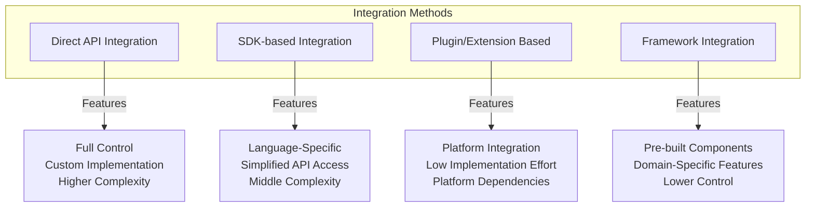
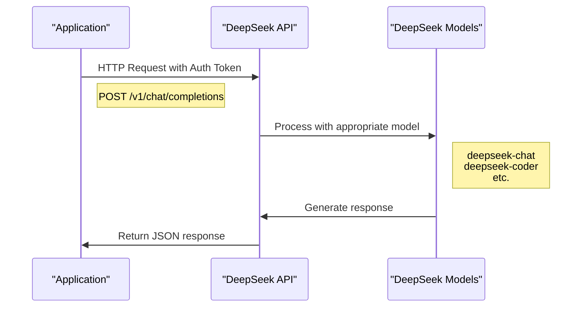
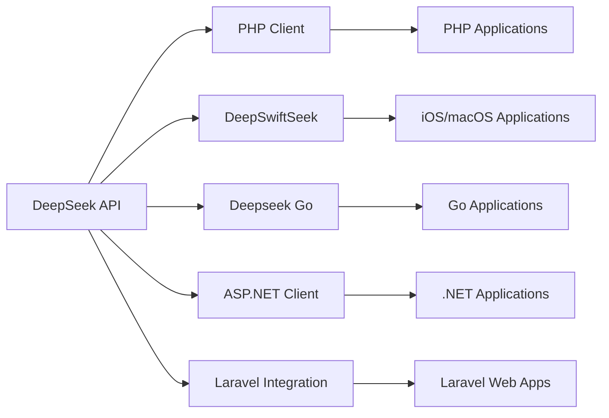
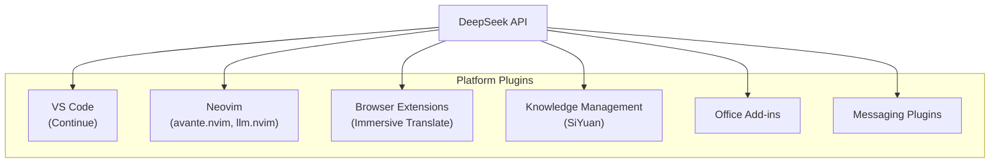
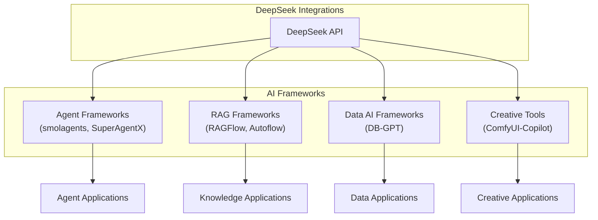
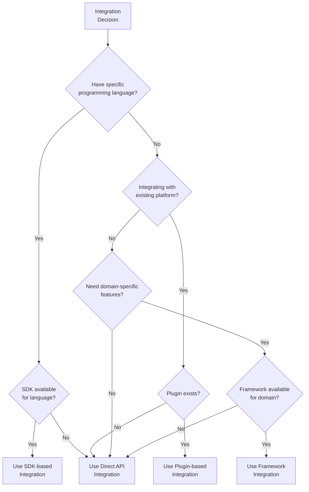
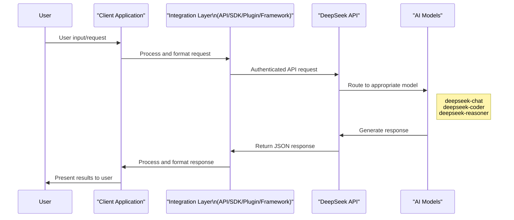

<!-- source: DeepWiki mcp.deepwiki.com · repo deepseek-ai/awesome-deepseek-integration · page 1.2 Integration Methods · fetched 2026-10-30 -->

# Integration Methods

<details>
<summary>Relevant source files</summary>

The following files were used as context for generating this wiki page:

- [README.md](README.md)
- [README_cn.md](README_cn.md)
- [README_ja.md](README_ja.md)
- [docs/4EVERChat/README.md](docs/4EVERChat/README.md)
- [docs/4EVERChat/README_cn.md](docs/4EVERChat/README_cn.md)
- [docs/4EVERChat/README_ja.md](docs/4EVERChat/README_ja.md)
- [docs/bob_translate/README.md](docs/bob_translate/README.md)
- [docs/chatbox/README.md](docs/chatbox/README.md)
- [docs/chatgpt_box/README.md](docs/chatgpt_box/README.md)
- [docs/chatgpt_next_web/README.md](docs/chatgpt_next_web/README.md)
- [docs/continue/README.md](docs/continue/README.md)
- [docs/continue/README_cn.md](docs/continue/README_cn.md)
- [docs/hcfy/README.md](docs/hcfy/README.md)
- [docs/immersive_translate/README.md](docs/immersive_translate/README.md)
- [docs/pal/README.md](docs/pal/README.md)

</details>


This page documents the various approaches available for integrating with the DeepSeek API. It covers the technical implementation patterns, authentication methods, and configuration options that developers can use to incorporate DeepSeek's AI capabilities into their applications, tools, and frameworks. For information about the specific categories of integrations, see [Integration Categories](#1.1).

## Overview of Integration Methods

DeepSeek offers multiple integration methods that vary in terms of implementation complexity, control, and flexibility. Choosing the right integration method depends on your specific requirements, preferred development language, and target platform.



Sources: [README.md:433-367]()

## Direct API Integration

The most straightforward approach for integrating with DeepSeek is to directly call the API endpoints. This method provides maximum flexibility and control but requires handling authentication, request formatting, and response parsing.

### Implementation Flow



Sources: [README.md:76-86]()

### Basic Configuration

Direct API integration typically involves:

1. Obtaining an API key from the [DeepSeek Open Platform](https://platform.deepseek.com)
2. Making HTTP requests to the DeepSeek API endpoints
3. Processing the JSON responses

A typical API call will include:
- API key for authentication in the headers
- Model selection and parameters in the request body 
- Handling the streaming or non-streaming response

### Examples

Projects using direct API integration include:
- eechat
- ChatDOC 
- ChatGPT-Next-Web

These applications implement their own API clients to communicate directly with the DeepSeek API.

Sources: [README.md:42-75](), [docs/chatgpt_next_web/README.md:10-13]()

## SDK-based Integration

SDKs (Software Development Kits) provide language-specific wrappers around the DeepSeek API, simplifying integration with standardized methods, strong typing, and error handling.

### Available SDKs



Sources: [README.md:213-226](), [README.md:230-232](), [README.md:235-238](), [README.md:295-297]()

### Implementation Pattern

SDKs typically follow this pattern:

1. Initialize the SDK with your API key
2. Create requests using language-specific objects and methods
3. Handle responses with language-appropriate patterns (promises, async/await, etc.)
4. Use language-native error handling

### Code Examples

For example, with DeepSwiftSeek (Swift client):

```swift
// Initialize the client
let client = DeepSeekClient(apiKey: "your-api-key")

// Make chat completion request
let response = try await client.chat.completions.create(
    model: "deepseek-chat",
    messages: [
        ChatMessage(role: .user, content: "Hello, DeepSeek!")
    ]
)
```

With the PHP client:

```php
// Initialize the client
$client = new \Deepseek\Client('your-api-key');

// Make a completion request
$response = $client->chat()->create([
    'model' => 'deepseek-chat',
    'messages' => [
        ['role' => 'user', 'content' => 'Hello, DeepSeek!']
    ]
]);
```

Sources: [README.md:213-227](), [README.md:230-233]()

## Plugin/Extension-Based Integration

This approach involves integrating DeepSeek into existing platforms through their extension mechanisms, such as browser extensions, editor plugins, or app add-ins.



Sources: [README.md:30-37](), [docs/continue/README.md:1-44](), [docs/immersive_translate/README.md:1-15](), [README.md:247-248]()

### Configuration Patterns

Plugin integrations typically involve:

1. Installing the plugin/extension from the platform's marketplace
2. Configuring the plugin with your DeepSeek API key
3. Setting model parameters and preferences

For example, in the Continue VS Code extension:

```json
{
  "models": [
    {
      "title": "DeepSeek",
      "model": "deepseek-chat",
      "contextLength": 128000,
      "apiKey": "YOUR_API_KEY",
      "provider": "openai",
      "apiBase": "https://api.deepseek.com/beta"
    }
  ]
}
```

Sources: [docs/continue/README.md:16-41]()

### Benefits

- Minimal code required (often zero code)
- Integration with familiar tools
- Platform-specific features and UX

### Popular Plugins

1. **Code Editor Plugins**:
   - Continue (VS Code)
   - avante.nvim, codecompanion.nvim, llm.nvim (Neovim)
   - Cline (CLI and editors)

2. **Browser Extensions**:
   - Immersive Translate
   - ChatGPT Box
   - hcfy (划词翻译)

3. **Knowledge Management**:
   - SiYuan

Sources: [README.md:30-36](), [docs/continue/README.md:1-14](), [docs/immersive_translate/README.md:1-15](), [README.md:247-248]()

## Framework Integration

Framework integration involves using specialized AI/agent frameworks that support DeepSeek as one of their LLM providers. These frameworks offer higher-level abstractions and domain-specific features.



Sources: [README.md:22-26](), [README.md:436-453](), [README.md:424-425](), [README.md:412-448]()

### Types of Frameworks

1. **AI Agent Frameworks**
   - smolagents
   - SuperAgentX
   - Anda
   - agentUniverse

2. **RAG (Retrieval-Augmented Generation) Frameworks**
   - RAGFlow
   - Autoflow
   - DeepSearcher

3. **Data AI Application Frameworks**
   - DB-GPT

4. **Creative Tools**
   - ComfyUI-Copilot
   - 16x Prompt

Sources: [README.md:436-453](), [README.md:424-442](), [README.md:412-420]()

### Implementation Pattern

Framework integration typically follows this pattern:

1. Install the framework
2. Configure the framework with your DeepSeek API key
3. Define your application using the framework's abstractions
4. The framework handles communication with DeepSeek API

### Benefits

- Pre-built components for complex AI workflows
- Domain-specific optimizations
- Reduced development time
- Advanced capabilities with minimal code

## Authentication and Configuration

All integration methods require authentication with the DeepSeek API. This is typically done using an API key obtained from the [DeepSeek Open Platform](https://platform.deepseek.com).

### Common Configuration Parameters

| Parameter | Description | Typical Values |
|-----------|-------------|----------------|
| `apiKey` | Authentication token | Your API key string |
| `model` | DeepSeek model to use | "deepseek-chat", "deepseek-coder" |
| `temperature` | Randomness of responses | 0.0 - 1.0 (0 for deterministic) |
| `maxTokens` | Maximum response length | 256, 1024, etc. |
| `apiBase` | API endpoint URL | "https://api.deepseek.com/beta" |

Sources: [docs/continue/README.md:16-41](), [docs/chatgpt_next_web/README.md:11-13]()

## Choosing the Right Integration Method



Sources: [README.md:383-395]()

### Comparison of Integration Methods

| Integration Method | Development Effort | Control Level | Flexibility | Best For |
|--------------------|-------------------|---------------|-------------|----------|
| Direct API | High | High | High | Custom solutions, unique requirements |
| SDK-based | Medium | High | Medium | Language-specific applications |
| Plugin/Extension | Low | Low | Low | Quick integration with existing platforms |
| Framework | Medium | Medium | Medium | Domain-specific AI applications |

Sources: [README.md:433-367]()

### Recommendations

- **For custom applications**: Consider Direct API or SDK-based integration for maximum control
- **For existing applications**: Use Plugin/Extension based integration where available
- **For domain-specific use cases**: Framework integration often provides the most value
- **For rapid prototyping**: Plugin-based integration usually offers the fastest path to implementation

## Integration Flow Example

Regardless of the integration method chosen, most DeepSeek integrations follow a similar flow pattern:



Sources: [README.md:76-88]()

This document provides an overview of the different methods for integrating with the DeepSeek API. Depending on your specific requirements and constraints, you can choose the integration method that best suits your needs. For more detailed information about specific integration categories, refer to the [Integration Categories](#1.1) page.

---

