# Page: Overview

# Overview

<details>
<summary>Relevant source files</summary>

The following files were used as context for generating this wiki page:

- [README.md](README.md)
- [README_cn.md](README_cn.md)
- [README_es.md](README_es.md)
- [README_ja.md](README_ja.md)
- [README_zh_tw.md](README_zh_tw.md)
- [docs/4EVERChat/README.md](docs/4EVERChat/README.md)
- [docs/4EVERChat/README_cn.md](docs/4EVERChat/README_cn.md)
- [docs/4EVERChat/README_ja.md](docs/4EVERChat/README_ja.md)
- [docs/DocKit/README.md](docs/DocKit/README.md)
- [docs/DocKit/README_cn.md](docs/DocKit/README_cn.md)
- [docs/DocKit/assets/client-ui.png](docs/DocKit/assets/client-ui.png)
- [docs/DocKit/assets/dockit.png](docs/DocKit/assets/dockit.png)
- [docs/DocKit/assets/wechat_official.png](docs/DocKit/assets/wechat_official.png)
- [docs/DocKit/assets/wechat_ponsor.jpg](docs/DocKit/assets/wechat_ponsor.jpg)
- [docs/OpenXLab/migo/logo.svg](docs/OpenXLab/migo/logo.svg)

</details>


This document provides a technical introduction to the DeepSeek integrations ecosystem, explaining how applications, frameworks, tools, and extensions utilize the DeepSeek API to incorporate AI capabilities. It summarizes the integration categories, architecture patterns, and implementation approaches for leveraging DeepSeek's language models across diverse software systems.

## Integration Ecosystem

The DeepSeek ecosystem spans numerous software integrations that connect to the DeepSeek API to access AI models including `deepseek-chat`, `deepseek-coder`, and `deepseek-reasoner`. These integrations are organized into four primary categories:

```mermaid
graph TD
    DeepSeek["DeepSeek API"] --> Apps["Applications"]
    DeepSeek --> Frameworks["AI/Agent Frameworks"]
    DeepSeek --> DevTools["Developer Tools"]
    DeepSeek --> Extensions["Platform Extensions"]
    
    Apps --> ChatApps["Chat Applications"]
    Apps --> TransTools["Translation Tools"]
    Apps --> CodeAsst["Code Assistants"]
    Apps --> KnowledgeBases["Knowledge Bases"]
    Apps --> Productivity["Productivity Tools"]
    
    Frameworks --> AgentF["AI Agent Frameworks"]
    Frameworks --> RAG["RAG Frameworks"]
    Frameworks --> DataAI["Data AI Applications"]
    Frameworks --> FHE["FHE Frameworks"]
    
    DevTools --> CodeEditors["Code Editor Integrations"]
    DevTools --> SDKs["Language SDKs"]
    DevTools --> CLITools["CLI Tools"]
    
    Extensions --> BrowserExt["Browser Extensions"]
    Extensions --> MessagingExt["Messaging App Plugins"]
    Extensions --> OfficeExt["Office Add-ins"]
```

Sources: [README.md:16-42](), [README_cn.md:19-38]()

### Applications

DeepSeek-powered applications provide AI capabilities directly to end-users:

| Type | Examples | Purpose |
|-----------------|----------|---------|
| Chat Applications | `eechat`, `4EVERChat`, `ChatGPT-Next-Web` | Conversational AI interfaces |
| Translation Tools | `Immersive Translate`, `Bob`, `translate.js` | Text translation between languages |
| Code Assistants | `Continue`, `avante.nvim`, `codecompanion.nvim` | Programming assistance |
| Knowledge Bases | `SiYuan`, `DocKit`, `Refine Reader` | Knowledge management with AI |
| Productivity Tools | `SwiftChat`, `ToMemo`, `DingTalk` | AI-enhanced productivity |

Sources: [README.md:45-433](), [README_cn.md:42-358]()

### AI Frameworks

Frameworks that provide infrastructure for building AI applications using DeepSeek:

| Type | Examples | Purpose |
|----------------|----------|---------|
| AI Agent Frameworks | `smolagents`, `SuperAgentX`, `Anda` | Building autonomous AI agents |
| RAG Frameworks | `RAGFlow`, `Autoflow` | Retrieval-augmented generation systems |
| Data AI Frameworks | `DB-GPT` | Data-centric AI applications |
| FHE Frameworks | `Mind FHE SDK` | Homomorphic encryption for AI |

Sources: [README.md:438-541](), [README_cn.md:362-408]()

### Developer Tools

Tools that facilitate DeepSeek integration during development:

| Type | Examples | Purpose |
|-----------|----------|---------|
| Code Editor Extensions | `Continue` (VS Code), `avante.nvim` (Neovim) | IDE integration |
| Language SDKs | `DeepSwiftSeek`, `PHP Client`, `Deepseek Go` | Language-specific APIs |
| CLI Tools | `Cline` | Command-line access |

Sources: [README.md:542-622](), [README_cn.md:409-473]()

### Platform Extensions

Extensions that integrate DeepSeek into existing platforms:

| Type | Examples | Purpose |
|----------------|----------|---------|
| Browser Extensions | `Immersive Translate`, `Refine Reader` | Browser integration |
| Messaging App Plugins | `Huixiangdou`, `LangBot` | Messaging platform integration |
| Office Add-ins | `Office-AI` | Office application integration |

Sources: [README.md:623-715](), [README_cn.md:474-546]()

## Integration Flow Pattern

Most DeepSeek integrations follow this common interaction pattern:

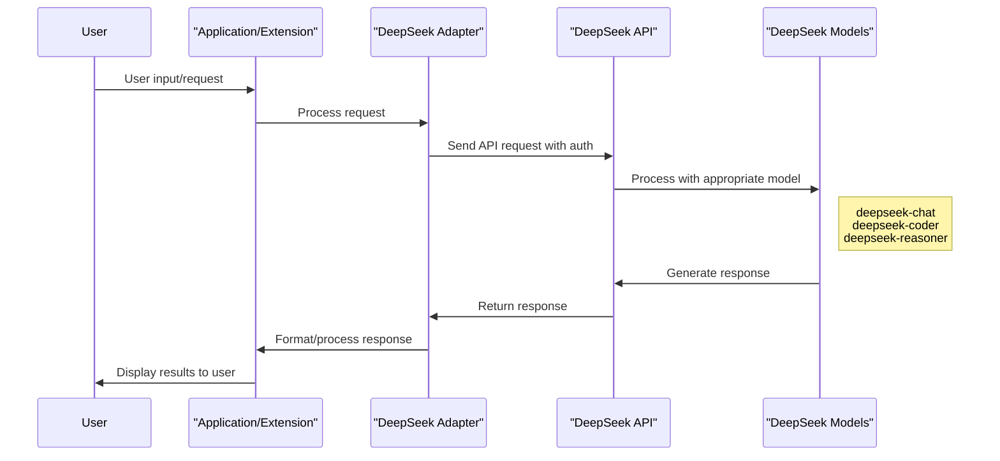

Sources: [README.md:16-42](), [README_cn.md:19-38]()

## Integration Methods Comparison

There are four primary approaches to integrating with the DeepSeek API:

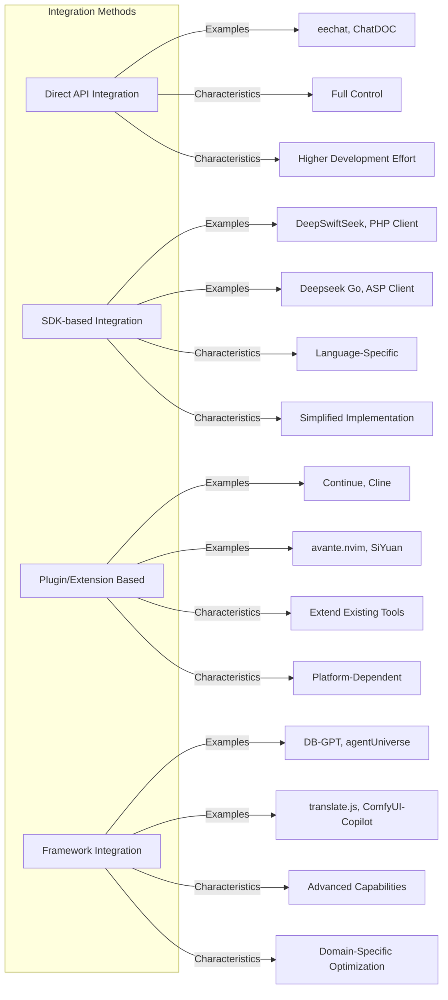

Sources: [README.md:16-42](), [README_cn.md:19-38]()

| Method | Description | Best For |
|--------|-------------|----------|
| Direct API Integration | Directly calling DeepSeek API endpoints | Maximum control and customization |
| SDK-based Integration | Using language-specific libraries | Faster development in specific languages |
| Plugin/Extension Based | Building extensions for existing platforms | Enhancing existing tools |
| Framework Integration | Using higher-level frameworks | Complex AI applications |

## Application Architecture

Most DeepSeek-integrated applications share these architectural components:

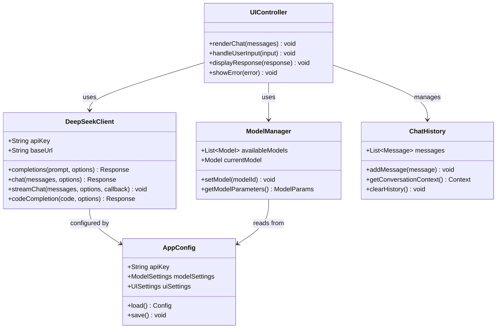

Sources: [README.md:45-433](), [README_cn.md:42-358]()

## Example Application: eechat

`eechat` provides a good example of a DeepSeek-integrated application architecture:

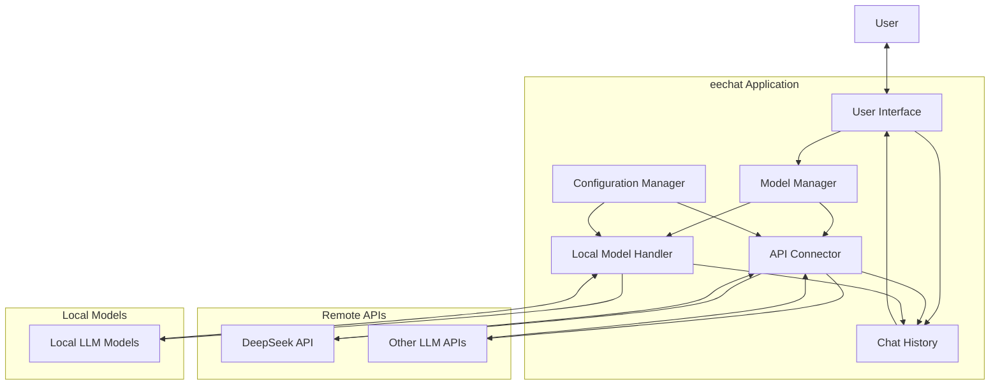

Sources: [README.md:54-57](), [README_cn.md:51-53]()

## API Request/Response Flow

The following diagram illustrates the specific API interaction between an application and the DeepSeek API:

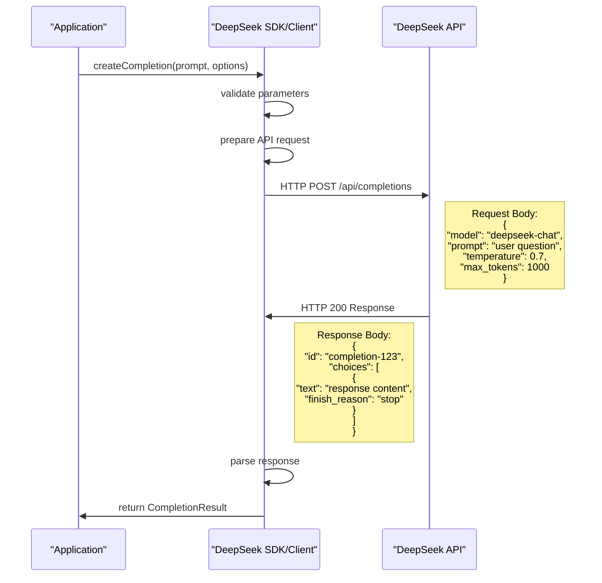

Sources: [README.md:54-57](), [README_cn.md:51-53](), [README.md:438-541]()

## API Configuration Patterns

Most DeepSeek integrations implement similar configuration patterns:

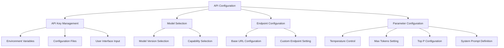

Sources: [README.md:16-42](), [README_cn.md:19-38]()

Common configuration elements include:

| Configuration Area | Elements | Description |
|-------------------|----------|-------------|
| API Key Management | Environment variables, Config files, UI settings | Secure handling of API credentials |
| Model Selection | Model variant, capabilities | Selection between different DeepSeek models |
| Endpoint Configuration | Base URL, custom endpoints | API endpoint configuration |
| Parameter Configuration | Temperature, max tokens, top-p, system prompts | Response generation parameters |

## Next Steps

For more detailed information about specific categories of DeepSeek integrations, refer to the following pages:

- For more on integration categories, see [Integration Categories](#1.1)
- For more on integration methods, see [Integration Methods](#1.2)
- For more on API configuration, see [API Configuration](#1.3)
- For details on chat applications, see [Chat Applications](#2)
- For details on productivity tools, see [Productivity Tools](#3)
- For details on document tools, see [Document Tools](#4)
- For details on IDE integrations, see [IDE Integrations](#5)
- For details on browser extensions, see [Browser Extensions](#6)
- For details on AI frameworks, see [AI Frameworks](#7)
- For details on creative tools, see [Creative Tools](#8)
- For details on knowledge management, see [Knowledge Management](#9)

---

# Page: Integration Categories

# Integration Categories

<details>
<summary>Relevant source files</summary>

The following files were used as context for generating this wiki page:

- [README.md](README.md)
- [README_cn.md](README_cn.md)
- [README_ja.md](README_ja.md)
- [README_zh_tw.md](README_zh_tw.md)
- [docs/4EVERChat/README.md](docs/4EVERChat/README.md)
- [docs/4EVERChat/README_cn.md](docs/4EVERChat/README_cn.md)
- [docs/4EVERChat/README_ja.md](docs/4EVERChat/README_ja.md)
- [docs/OpenXLab/migo/logo.svg](docs/OpenXLab/migo/logo.svg)

</details>


This page provides an overview of the major categories of integrations in the DeepSeek ecosystem. It classifies the different types of software, frameworks, applications, and tools that integrate with the DeepSeek API. For information about specific integration methods and techniques, see [Integration Methods](#1.2).

## Overview of Integration Categories

The DeepSeek integration ecosystem spans a wide range of software types, from end-user applications to development frameworks and platform extensions. These integrations enable developers and users to access DeepSeek's AI capabilities across various contexts and environments.

```mermaid
graph TD
    subgraph "DeepSeek Integration Categories"
        Applications["Applications"]
        Frameworks["AI/Agent Frameworks"]
        DevTools["Developer Tools"]
        Extensions["Platform Extensions"]
    end
    
    Applications --> MobileApps["Mobile Apps"]
    Applications --> WebApps["Web Applications"] 
    Applications --> DesktopApps["Desktop Applications"]
    
    Frameworks --> AgentF["AI Agent Frameworks"]
    Frameworks --> RAG["RAG Frameworks"]
    Frameworks --> DataAI["Data AI Applications"]
    Frameworks --> FHE["FHE Frameworks"]
    
    DevTools --> CodeEditors["Code Editor Integrations"]
    DevTools --> SDKs["Language SDKs"]
    DevTools --> CLITools["CLI Tools"]
    
    Extensions --> BrowserExt["Browser Extensions"]
    Extensions --> MessagingExt["Messaging App Plugins"]
    Extensions --> OfficeExt["Office Add-ins"]
```

*Diagram: Primary categories of DeepSeek API integrations and their subcategories*

Sources: [README.md:18-41]()

## Applications

Applications represent the largest category of DeepSeek integrations. These are end-user software programs that leverage DeepSeek's language models for various purposes across different platforms.

### Mobile Applications

Mobile applications provide AI capabilities on iOS and Android devices, bringing DeepSeek-powered intelligence to smartphones and tablets.

Key Examples:
- **Pal**: AI Chat Client for iOS/iPadOS
- **SwiftChat**: React Native-based cross-platform chat application
- **ToMemo**: iOS phrasebook and clipboard app with AI integration
- **xhai Browser**: Android desktop management & AI browser

### Web Applications

Web-based applications that run in browsers and integrate with DeepSeek for online AI capabilities.

Key Examples:
- **ChatGPT-Next-Web**: Cross-platform web UI for AI chat
- **4EVERChat**: LLM model selection platform with real-time comparison
- **FastGPT**: Open-source AI knowledge base platform
- **LibreChat**: Customizable open-source app for AI interactions

### Desktop Applications

Native applications for Windows, macOS, or Linux that integrate DeepSeek capabilities directly into desktop environments.

Key Examples:
- **eechat**: Local deployment tool for LLMs with privacy focus
- **AingDesk**: One-click AI model deployment with visual interface
- **ChatDOC**: AI-powered document reading tool
- **DeepChat**: Free desktop smart assistant with advanced capabilities
- **Chatbox**: Multi-model desktop client

Sources: [README.md:45-404]()

## Application Types and Use Cases

DeepSeek's integrations span several common application types focused on specific user needs and workflows.

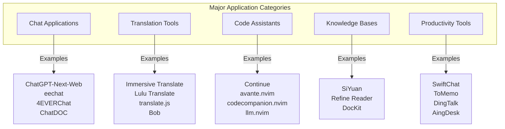

*Diagram: Major application types and representative examples*

Sources: [README.md:45-404]()

### Chat Applications

Chat applications provide conversational interfaces to DeepSeek's language models, enabling natural language interaction for various purposes.

Key characteristics:
- Interactive dialogue-based interfaces
- Support for multi-turn conversations
- Context retention between interactions
- Often include streaming responses for real-time feedback

### Translation Tools

Translation applications use DeepSeek's language capabilities to translate content between different languages, often with specialized features for specific content types.

Key characteristics:
- Support for multiple language pairs
- Context-aware translation
- Domain-specific terminology handling
- Often include OCR capabilities for image-based translation

### Code Assistants

Code assistants integrate DeepSeek's coding capabilities into development environments to provide coding assistance, documentation, and other programming support.

Key characteristics:
- Code completion and generation
- Documentation assistance
- Bug detection and fixing
- Integration with popular development tools

### Knowledge Bases

Knowledge base applications combine DeepSeek with information retrieval and storage capabilities to create customized information systems.

Key characteristics:
- Document indexing and search
- Question answering based on stored knowledge
- Often implement RAG (Retrieval-Augmented Generation)
- Support for various document formats

### Productivity Tools

Productivity tools integrate DeepSeek capabilities into workflows to improve efficiency across various tasks.

Key characteristics:
- Task-specific AI assistance
- Integration with productivity workflows
- Often provide specialized UI for specific domains
- Cross-platform availability

Sources: [README.md:45-404]()

## AI/Agent Frameworks

AI and Agent Frameworks provide development infrastructure for building applications and services powered by DeepSeek's language models.

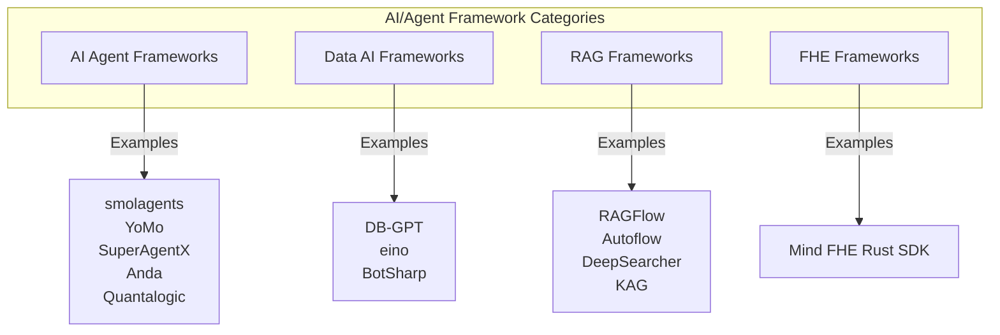

*Diagram: AI/Agent Framework categories with examples*

Sources: [README.md:436-486]()

### AI Agent Frameworks

AI Agent frameworks provide infrastructures for building autonomous AI agents that can perform complex tasks using DeepSeek models.

Key characteristics:
- Agent orchestration capabilities
- Tool usage and function calling
- Multi-agent collaboration
- Memory and context management

Key examples:
- **smolagents**: Simplified agent building framework
- **SuperAgentX**: Lightweight framework for autonomous multi-agent applications
- **Anda**: Rust framework for AI agent development
- **Quantalogic**: ReAct (Reasoning & Action) framework

### Data AI Application Frameworks

Data AI frameworks focus on integrating DeepSeek with database technologies and data processing capabilities.

Key characteristics:
- Database integration
- Query generation and interpretation
- Data analysis capabilities
- Specialized for data-centric applications

Key example:
- **DB-GPT**: Open-source framework for AI-native data applications

### RAG Frameworks

RAG (Retrieval-Augmented Generation) frameworks combine DeepSeek's generative capabilities with information retrieval to provide context-aware AI responses.

Key characteristics:
- Document indexing and retrieval
- Vector database integration
- Context augmentation for LLM responses
- Knowledge management workflows

Key examples:
- **RAGFlow**: Open-source RAG engine for document understanding
- **Autoflow**: GraphRAG-based knowledge base tool
- **DeepSearcher**: Combines LLMs with vector databases

### FHE Frameworks

FHE (Fully Homomorphic Encryption) frameworks enable privacy-preserving computation on encrypted data for DeepSeek interactions.

Key characteristics:
- Privacy-preserving AI computation
- Data encryption during processing
- Secure agent consensus mechanisms
- No exposure of underlying data

Key example:
- **Mind FHE Rust SDK**: Open-source SDK for encrypted AI using FHE

Sources: [README.md:436-486]()

## Developer Tools

Developer tools enable software engineers to integrate DeepSeek capabilities into their development workflows and applications.

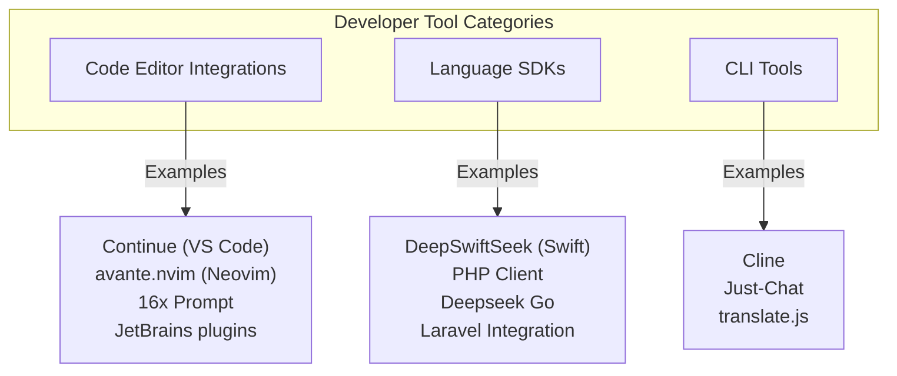

*Diagram: Developer Tool categories with examples*

Sources: [README.md:195-247]()

### Code Editor Integrations

Code editor integrations bring DeepSeek capabilities directly into programming environments, providing context-aware assistance for software development.

Platforms with DeepSeek integrations include:
- **VS Code**: Continue, 16x Prompt
- **Neovim**: avante.nvim, codecompanion.nvim, llm.nvim
- **JetBrains IDEs**: Various plugins
- **Visual Studio**: Extensions
- **Emacs**: Plugins

### Language SDKs

Language-specific Software Development Kits (SDKs) provide programmers with native interfaces to DeepSeek APIs in their preferred programming languages.

Available SDKs include:
- **Swift**: DeepSwiftSeek
- **PHP**: deepseek-php-client
- **Go**: Deepseek Go
- **PHP/Laravel**: Laravel Integration
- **ASP.NET**: ASP Client

### CLI Tools

Command-Line Interface (CLI) tools provide access to DeepSeek capabilities through terminal interfaces, enabling integration with scripts and automation workflows.

Examples include:
- **Cline**: AI assistant for CLI and editors
- **Just-Chat**: Lightweight library for LLM agents
- **translate.js**: AI i18n tool for frontend developers

Sources: [README.md:195-247](), [README.md:524-578]()

## Platform Extensions

Platform extensions integrate DeepSeek capabilities into existing platforms and services, extending their functionality with AI capabilities.

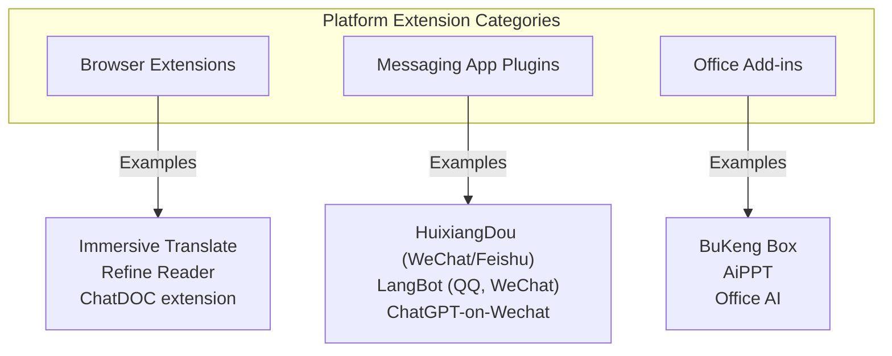

*Diagram: Platform Extension categories with examples*

Sources: [README.md:487-536]()

### Browser Extensions

Browser extensions add DeepSeek capabilities to web browsers, providing AI features while users browse the internet.

Key characteristics:
- Integration with browsing experience
- Content analysis and transformation
- Translation and summarization features
- Web content interaction

Key examples:
- **Immersive Translate**: In-page translation extension
- **Refine Reader**: Chrome extension for document reading
- **xhai Browser**: Android browser with DeepSeek integration

### Messaging App Plugins

Messaging plugins integrate DeepSeek into communication platforms, enabling AI capabilities within chat experiences.

Key characteristics:
- Chat-based interaction
- Group chat integration
- Command-based invocation
- Context retention within chat threads

Key examples:
- **HuixiangDou**: Integration for personal WeChat/Feishu groups
- **LangBot**: Bot platform for QQ, enterprise WeChat, Feishu
- **AstrBot**: Multi-platform chatbot and development framework

### Office Add-ins

Office add-ins extend productivity suites with DeepSeek capabilities, enhancing document creation and management with AI features.

Key characteristics:
- Integration with document workflows
- Content generation and transformation
- Document analysis and summarization
- Productivity enhancement features

Key examples:
- **BuKeng Box**: Add-in for Word, Excel, and PowerPoint
- **AiPPT**: PPT generation tool
- **Office AI**: Integration for Microsoft Office

Sources: [README.md:487-536]()

## Integration Flow Pattern

Regardless of the integration category, most DeepSeek integrations follow a similar flow pattern for handling user interactions.

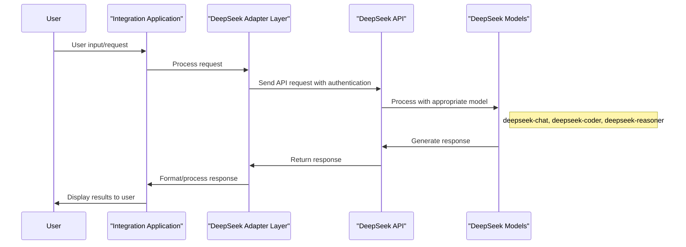

*Diagram: Typical flow pattern in DeepSeek integrations*

This standard flow pattern is consistent across different integration types and allows for a modular approach to DeepSeek integration. The adapter layer handles API communication, authentication, and response processing, which can be implemented in different ways depending on the integration category.

Sources: [README.md:45-84]()

## Summary

DeepSeek integrations span a diverse ecosystem of applications, frameworks, developer tools, and platform extensions. These integrations enable AI capabilities across various contexts, from mobile and desktop applications to development environments and productivity tools. The common integration pattern allows for consistent interaction with DeepSeek's models regardless of the integration category.

Each category serves different user needs and technical requirements:

| Category | Primary Purpose | Target Users | Typical Examples |
|----------|----------------|--------------|------------------|
| Applications | End-user AI services | General users | eechat, SwiftChat, ChatDOC |
| AI/Agent Frameworks | Development infrastructure | Developers | smolagents, DB-GPT, RAGFlow |
| Developer Tools | Development assistance | Software engineers | Continue, DeepSwiftSeek, Cline |
| Platform Extensions | Enhance existing platforms | Platform users | Immersive Translate, HuixiangDou, BuKeng Box |

This categorization provides a foundation for understanding the DeepSeek integration ecosystem and navigating the various ways DeepSeek's capabilities can be accessed and utilized.

Sources: [README.md:18-41](), [README.md:45-404](), [README.md:436-486](), [README.md:487-536]()

---

# Page: Integration Methods

# Integration Methods

<details>
<summary>Relevant source files</summary>

The following files were used as context for generating this wiki page:

- [README.md](README.md)
- [README_cn.md](README_cn.md)
- [README_ja.md](README_ja.md)
- [docs/4EVERChat/README.md](docs/4EVERChat/README.md)
- [docs/4EVERChat/README_cn.md](docs/4EVERChat/README_cn.md)
- [docs/4EVERChat/README_ja.md](docs/4EVERChat/README_ja.md)
- [docs/bob_translate/README.md](docs/bob_translate/README.md)
- [docs/chatbox/README.md](docs/chatbox/README.md)
- [docs/chatgpt_box/README.md](docs/chatgpt_box/README.md)
- [docs/chatgpt_next_web/README.md](docs/chatgpt_next_web/README.md)
- [docs/continue/README.md](docs/continue/README.md)
- [docs/continue/README_cn.md](docs/continue/README_cn.md)
- [docs/hcfy/README.md](docs/hcfy/README.md)
- [docs/immersive_translate/README.md](docs/immersive_translate/README.md)
- [docs/pal/README.md](docs/pal/README.md)

</details>


This page documents the various approaches available for integrating with the DeepSeek API. It covers the technical implementation patterns, authentication methods, and configuration options that developers can use to incorporate DeepSeek's AI capabilities into their applications, tools, and frameworks. For information about the specific categories of integrations, see [Integration Categories](#1.1).

## Overview of Integration Methods

DeepSeek offers multiple integration methods that vary in terms of implementation complexity, control, and flexibility. Choosing the right integration method depends on your specific requirements, preferred development language, and target platform.

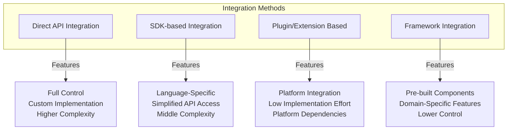

Sources: [README.md:433-367]()

## Direct API Integration

The most straightforward approach for integrating with DeepSeek is to directly call the API endpoints. This method provides maximum flexibility and control but requires handling authentication, request formatting, and response parsing.

### Implementation Flow

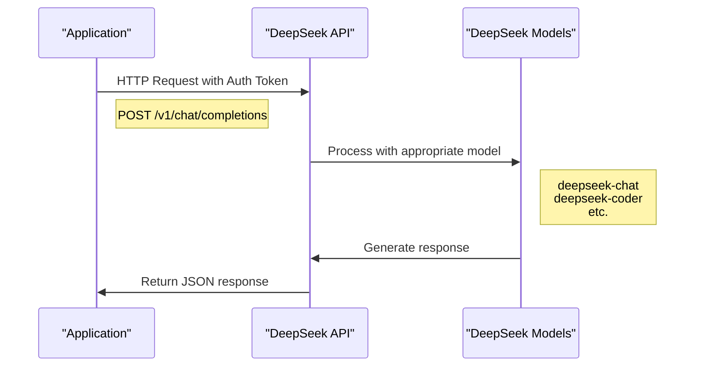

Sources: [README.md:76-86]()

### Basic Configuration

Direct API integration typically involves:

1. Obtaining an API key from the [DeepSeek Open Platform](https://platform.deepseek.com)
2. Making HTTP requests to the DeepSeek API endpoints
3. Processing the JSON responses

A typical API call will include:
- API key for authentication in the headers
- Model selection and parameters in the request body 
- Handling the streaming or non-streaming response

### Examples

Projects using direct API integration include:
- eechat
- ChatDOC 
- ChatGPT-Next-Web

These applications implement their own API clients to communicate directly with the DeepSeek API.

Sources: [README.md:42-75](), [docs/chatgpt_next_web/README.md:10-13]()

## SDK-based Integration

SDKs (Software Development Kits) provide language-specific wrappers around the DeepSeek API, simplifying integration with standardized methods, strong typing, and error handling.

### Available SDKs

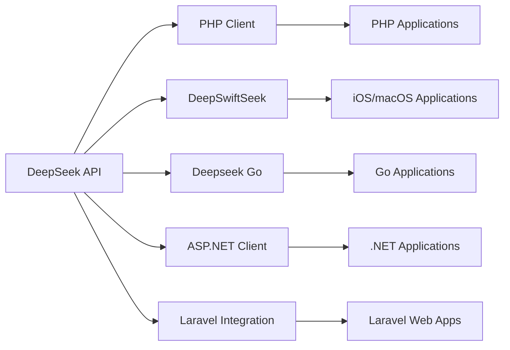

Sources: [README.md:213-226](), [README.md:230-232](), [README.md:235-238](), [README.md:295-297]()

### Implementation Pattern

SDKs typically follow this pattern:

1. Initialize the SDK with your API key
2. Create requests using language-specific objects and methods
3. Handle responses with language-appropriate patterns (promises, async/await, etc.)
4. Use language-native error handling

### Code Examples

For example, with DeepSwiftSeek (Swift client):

```swift
// Initialize the client
let client = DeepSeekClient(apiKey: "your-api-key")

// Make chat completion request
let response = try await client.chat.completions.create(
    model: "deepseek-chat",
    messages: [
        ChatMessage(role: .user, content: "Hello, DeepSeek!")
    ]
)
```

With the PHP client:

```php
// Initialize the client
$client = new \Deepseek\Client('your-api-key');

// Make a completion request
$response = $client->chat()->create([
    'model' => 'deepseek-chat',
    'messages' => [
        ['role' => 'user', 'content' => 'Hello, DeepSeek!']
    ]
]);
```

Sources: [README.md:213-227](), [README.md:230-233]()

## Plugin/Extension-Based Integration

This approach involves integrating DeepSeek into existing platforms through their extension mechanisms, such as browser extensions, editor plugins, or app add-ins.

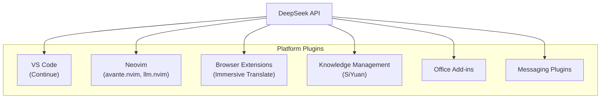

Sources: [README.md:30-37](), [docs/continue/README.md:1-44](), [docs/immersive_translate/README.md:1-15](), [README.md:247-248]()

### Configuration Patterns

Plugin integrations typically involve:

1. Installing the plugin/extension from the platform's marketplace
2. Configuring the plugin with your DeepSeek API key
3. Setting model parameters and preferences

For example, in the Continue VS Code extension:

```json
{
  "models": [
    {
      "title": "DeepSeek",
      "model": "deepseek-chat",
      "contextLength": 128000,
      "apiKey": "YOUR_API_KEY",
      "provider": "openai",
      "apiBase": "https://api.deepseek.com/beta"
    }
  ]
}
```

Sources: [docs/continue/README.md:16-41]()

### Benefits

- Minimal code required (often zero code)
- Integration with familiar tools
- Platform-specific features and UX

### Popular Plugins

1. **Code Editor Plugins**:
   - Continue (VS Code)
   - avante.nvim, codecompanion.nvim, llm.nvim (Neovim)
   - Cline (CLI and editors)

2. **Browser Extensions**:
   - Immersive Translate
   - ChatGPT Box
   - hcfy (划词翻译)

3. **Knowledge Management**:
   - SiYuan

Sources: [README.md:30-36](), [docs/continue/README.md:1-14](), [docs/immersive_translate/README.md:1-15](), [README.md:247-248]()

## Framework Integration

Framework integration involves using specialized AI/agent frameworks that support DeepSeek as one of their LLM providers. These frameworks offer higher-level abstractions and domain-specific features.

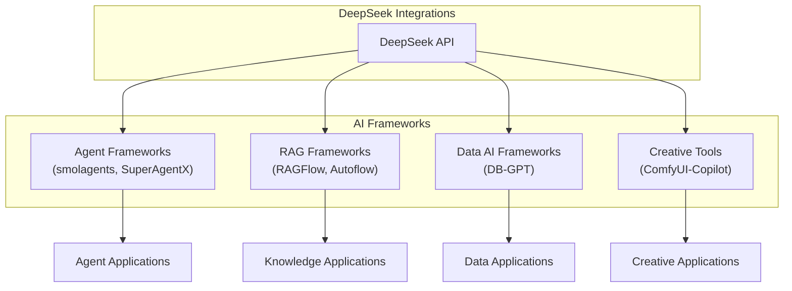

Sources: [README.md:22-26](), [README.md:436-453](), [README.md:424-425](), [README.md:412-448]()

### Types of Frameworks

1. **AI Agent Frameworks**
   - smolagents
   - SuperAgentX
   - Anda
   - agentUniverse

2. **RAG (Retrieval-Augmented Generation) Frameworks**
   - RAGFlow
   - Autoflow
   - DeepSearcher

3. **Data AI Application Frameworks**
   - DB-GPT

4. **Creative Tools**
   - ComfyUI-Copilot
   - 16x Prompt

Sources: [README.md:436-453](), [README.md:424-442](), [README.md:412-420]()

### Implementation Pattern

Framework integration typically follows this pattern:

1. Install the framework
2. Configure the framework with your DeepSeek API key
3. Define your application using the framework's abstractions
4. The framework handles communication with DeepSeek API

### Benefits

- Pre-built components for complex AI workflows
- Domain-specific optimizations
- Reduced development time
- Advanced capabilities with minimal code

## Authentication and Configuration

All integration methods require authentication with the DeepSeek API. This is typically done using an API key obtained from the [DeepSeek Open Platform](https://platform.deepseek.com).

### Common Configuration Parameters

| Parameter | Description | Typical Values |
|-----------|-------------|----------------|
| `apiKey` | Authentication token | Your API key string |
| `model` | DeepSeek model to use | "deepseek-chat", "deepseek-coder" |
| `temperature` | Randomness of responses | 0.0 - 1.0 (0 for deterministic) |
| `maxTokens` | Maximum response length | 256, 1024, etc. |
| `apiBase` | API endpoint URL | "https://api.deepseek.com/beta" |

Sources: [docs/continue/README.md:16-41](), [docs/chatgpt_next_web/README.md:11-13]()

## Choosing the Right Integration Method

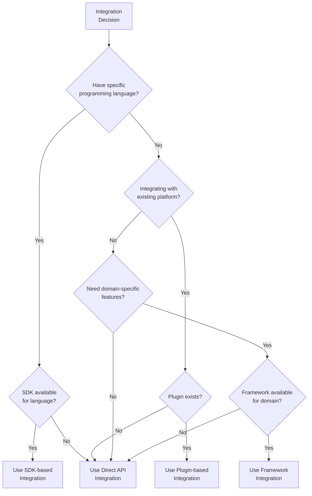

Sources: [README.md:383-395]()

### Comparison of Integration Methods

| Integration Method | Development Effort | Control Level | Flexibility | Best For |
|--------------------|-------------------|---------------|-------------|----------|
| Direct API | High | High | High | Custom solutions, unique requirements |
| SDK-based | Medium | High | Medium | Language-specific applications |
| Plugin/Extension | Low | Low | Low | Quick integration with existing platforms |
| Framework | Medium | Medium | Medium | Domain-specific AI applications |

Sources: [README.md:433-367]()

### Recommendations

- **For custom applications**: Consider Direct API or SDK-based integration for maximum control
- **For existing applications**: Use Plugin/Extension based integration where available
- **For domain-specific use cases**: Framework integration often provides the most value
- **For rapid prototyping**: Plugin-based integration usually offers the fastest path to implementation

## Integration Flow Example

Regardless of the integration method chosen, most DeepSeek integrations follow a similar flow pattern:

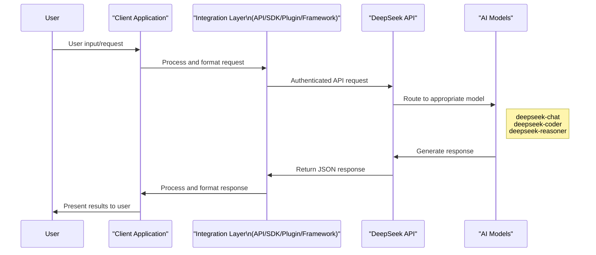

Sources: [README.md:76-88]()

This document provides an overview of the different methods for integrating with the DeepSeek API. Depending on your specific requirements and constraints, you can choose the integration method that best suits your needs. For more detailed information about specific integration categories, refer to the [Integration Categories](#1.1) page.

---

# Page: API Configuration

# API Configuration

<details>
<summary>Relevant source files</summary>

The following files were used as context for generating this wiki page:

- [README.md](README.md)
- [README_cn.md](README_cn.md)
- [README_ja.md](README_ja.md)
- [docs/4EVERChat/README.md](docs/4EVERChat/README.md)
- [docs/4EVERChat/README_cn.md](docs/4EVERChat/README_cn.md)
- [docs/4EVERChat/README_ja.md](docs/4EVERChat/README_ja.md)
- [docs/bob_translate/README.md](docs/bob_translate/README.md)
- [docs/bob_translate/README_cn.md](docs/bob_translate/README_cn.md)
- [docs/chatbox/README.md](docs/chatbox/README.md)
- [docs/chatbox/README_cn.md](docs/chatbox/README_cn.md)
- [docs/chatgpt_box/README.md](docs/chatgpt_box/README.md)
- [docs/chatgpt_box/README_cn.md](docs/chatgpt_box/README_cn.md)
- [docs/chatgpt_next_web/README.md](docs/chatgpt_next_web/README.md)
- [docs/chatgpt_next_web/README_cn.md](docs/chatgpt_next_web/README_cn.md)
- [docs/continue/README.md](docs/continue/README.md)
- [docs/continue/README_cn.md](docs/continue/README_cn.md)
- [docs/hcfy/README.md](docs/hcfy/README.md)
- [docs/hcfy/README_cn.md](docs/hcfy/README_cn.md)
- [docs/immersive_translate/README.md](docs/immersive_translate/README.md)
- [docs/immersive_translate/README_cn.md](docs/immersive_translate/README_cn.md)
- [docs/pal/README.md](docs/pal/README.md)
- [docs/pal/README_cn.md](docs/pal/README_cn.md)

</details>


This page documents common patterns for configuring the DeepSeek API across different integrations. It covers essential configuration parameters, authentication methods, and implementation examples to help developers properly set up DeepSeek API in various applications and frameworks.

For information about different integration methods, see [Integration Methods](#1.2).

## API Configuration in the Integration Ecosystem

API configuration is a crucial step when integrating with the DeepSeek platform. It establishes the connection between your application and DeepSeek's AI services, determining how requests are authenticated, processed, and how responses are returned.

```mermaid
flowchart TD
    subgraph "API Configuration Components"
        APIKey["API Key"]
        BaseURL["Base URL"]
        ModelSelection["Model Selection"]
        Parameters["Request Parameters"]
    end

    subgraph "Integration Types"
        DirectAPI["Direct API Integration"]
        SDKs["SDK Integration"]
        Plugins["Plugin/Extension"]
        Frameworks["Framework Integration"]
    end

    APIKey --> DirectAPI
    APIKey --> SDKs
    APIKey --> Plugins
    APIKey --> Frameworks
    
    BaseURL --> DirectAPI
    BaseURL --> SDKs
    BaseURL --> Plugins
    BaseURL --> Frameworks
    
    ModelSelection --> DirectAPI
    ModelSelection --> SDKs
    ModelSelection --> Plugins
    ModelSelection --> Frameworks
    
    Parameters --> DirectAPI
    Parameters --> SDKs
    Parameters --> Plugins
    Parameters --> Frameworks
    
    DirectAPI --> Apps["Applications"]
    SDKs --> Apps
    Plugins --> Apps
    Frameworks --> Apps
    
    Apps --> User["End User"]
```

Sources:
- README.md
- docs/continue/README.md
- docs/immersive_translate/README.md
- docs/chatgpt_next_web/README.md

## Core API Configuration Parameters

The following parameters are essential when configuring the DeepSeek API:

| Parameter | Description | Example |
|-----------|-------------|---------|
| API Key | Authentication token required to access DeepSeek services | `sk-xxxxxxxxxxxxxxxxxxxxxxxxxxxx` |
| Base URL | The endpoint URL for the DeepSeek API | `https://api.deepseek.com/beta` |
| Model | DeepSeek model to be used | `deepseek-chat`, `deepseek-coder`, `deepseek-reasoner` |
| Temperature | Controls randomness in responses (0-1) | `0.0` for deterministic, `0.7` for creative |
| Max Tokens | Maximum length of the generated response | `256`, `1024`, etc. |
| Context Length | How much context the model can process | `16000`, `128000`, etc. |

Sources:
- docs/continue/README.md:16-42
- docs/continue/README_cn.md:16-42

## API Configuration Flow

The following diagram illustrates how API configuration integrates into the typical request-response flow:

```mermaid
sequenceDiagram
    participant User as "User"
    participant App as "Application"
    participant Config as "API Configuration"
    participant DeepSeekAPI as "DeepSeek API"
    participant Models as "DeepSeek Models"
    
    User->>App: Makes request
    App->>Config: Retrieves API configuration
    Note over Config: API Key<br>Base URL<br>Model Selection<br>Parameters
    
    App->>DeepSeekAPI: Sends request with configuration
    DeepSeekAPI->>Models: Processes with selected model
    Note right of Models: deepseek-chat<br>deepseek-coder<br>deepseek-reasoner
    
    Models->>DeepSeekAPI: Returns generated content
    DeepSeekAPI->>App: Sends response
    App->>User: Displays results
```

Sources:
- README.md:36-58

## Configuration Methods

There are several methods to configure the DeepSeek API in your application. The following diagram illustrates the most common approaches:

```mermaid
graph TD
    subgraph "API Configuration Methods"
        CodeBased["Code-based Configuration"]
        UIBased["UI-based Configuration"]
        ConfigFile["Configuration File"]
        EnvVar["Environment Variables"]
    end
    
    CodeBased -->|Used in| SDKs["Language SDKs"]
    CodeBased -->|Used in| DirectAPI["Direct API Integration"]
    
    UIBased -->|Used in| BrowserExt["Browser Extensions"]
    UIBased -->|Used in| DesktopApps["Desktop Applications"]
    UIBased -->|Used in| MobileApps["Mobile Applications"]
    
    ConfigFile -->|Used in| DesktopApps
    ConfigFile -->|Used in| Frameworks["AI Frameworks"]
    
    EnvVar -->|Used in| ServerApps["Server Applications"]
    EnvVar -->|Used in| CLITools["Command-line Tools"]
    
    SDKs -.->|Examples| Langs["Python, PHP, Go, Swift"]
    BrowserExt -.->|Examples| Ext["Immersive Translate, ChatGPT Box"]
    DesktopApps -.->|Examples| Apps["Continue, Chatbox, eechat"]
    MobileApps -.->|Examples| Mobile["Pal AI, SwiftChat"]
```

Sources:
- docs/continue/README.md
- docs/immersive_translate/README.md
- docs/hcfy/README.md
- docs/chatgpt_next_web/README.md
- docs/chatbox/README.md
- docs/pal/README.md

## Implementation Examples

### Code-based Configuration (Continue IDE Extension)

In the Continue IDE extension, DeepSeek API is configured through a JSON configuration file:

```json
{
  "models": [
    {
      "title": "DeepSeek",
      "model": "deepseek-chat",
      "contextLength": 128000,
      "apiKey": "REDACTED",
      "provider": "openai",
      "apiBase": "https://api.deepseek.com/beta"
    }
  ],
  "tabAutocompleteModel": {
    "title": "DeepSeek",
    "model": "deepseek-chat",
    "apiKey": "REDACTED",
    "provider": "openai", 
    "apiBase": "https://api.deepseek.com/beta"
  }
}
```

Note the key configuration elements:
- The model is specified as `deepseek-chat`
- The API base URL is set to `https://api.deepseek.com/beta`
- The provider is set to `openai` (indicating OpenAI-compatible API)
- The context length is configured to 128000 tokens

Sources:
- docs/continue/README.md:16-42

### UI-based Configuration

Many applications provide graphical interfaces for configuring the DeepSeek API. The following diagram illustrates the typical UI configuration flow:

```mermaid
graph LR
    subgraph "UI Configuration Flow"
        Settings["Settings/Preferences"]
        ModelSelect["Model Selection"]
        APIConfig["API Configuration"]
        KeyEntry["API Key Entry"]
        TestConnection["Test Connection"]
        SaveConfig["Save Configuration"]
    end
    
    Settings --> ModelSelect
    ModelSelect -->|Select DeepSeek| APIConfig
    APIConfig --> KeyEntry
    KeyEntry --> TestConnection
    TestConnection -->|Success| SaveConfig
    TestConnection -->|Failure| KeyEntry
```

Examples of applications with UI-based configuration include:
- Immersive Translate (Browser Extension)
- ChatGPT-Next-Web
- Chatbox (Desktop Application)
- Pal AI (iOS Application)

Sources:
- docs/immersive_translate/README.md
- docs/hcfy/README.md
- docs/chatgpt_next_web/README.md
- docs/chatbox/README.md
- docs/pal/README.md

## API Integration with SDK Libraries

DeepSeek offers integration through various language-specific SDK libraries:

| Language | SDK | Example Usage |
|----------|-----|---------------|
| PHP | deepseek-php-client | PHP client library for DeepSeek API integration |
| Swift | DeepSwiftSeek | Supports chat, streaming, FIM completions with Swift concurrency |
| Go | deepseek-go | Supports Chat and Reasoning models with provider flexibility |
| ASP.NET | Deepseek.Asp.Client | .NET wrapper for the DeepSeek AI API |

Sources:
- README.md:214-237
- README.md:295-298

## Configuration Components and Data Flow

The following diagram provides a more detailed view of how configuration data flows through a typical DeepSeek integration:

```mermaid
graph TD
    ConfigSource["Configuration Sources"]
    APIConfig["API Configuration Object"]
    RequestBuilder["Request Builder"]
    APIClient["API Client"]
    ResponseHandler["Response Handler"]
    
    ConfigSource -->|Loads| APIConfig
    APIConfig -->|Provides Parameters| RequestBuilder
    UserInput["User Input"] -->|Merged with| RequestBuilder
    RequestBuilder -->|Creates Request| APIClient
    APIClient -->|Sends Request to| DeepSeekAPI["DeepSeek API"]
    DeepSeekAPI -->|Returns Response to| APIClient
    APIClient -->|Passes Response to| ResponseHandler
    ResponseHandler -->|Formats Response for| Application["Application UI"]
    Application -->|Displays to| User["User"]
    
    subgraph "Configuration Components"
        ConfigSource
        subgraph "API Configuration"
            APIConfig
            Authentication["Authentication"]
            Endpoints["Endpoints"]
            ModelParams["Model Parameters"]
        end
    end
    
    ConfigSource -.->|Provides| Authentication
    ConfigSource -.->|Provides| Endpoints
    ConfigSource -.->|Provides| ModelParams
    
    Authentication -.->|Used by| APIConfig
    Endpoints -.->|Used by| APIConfig
    ModelParams -.->|Used by| APIConfig
```

Sources:
- README.md
- docs/continue/README.md
- docs/chatgpt_next_web/README.md

## Best Practices for API Configuration

### Security Considerations

1. **API Key Management**:
   - Never hardcode API keys in your source code
   - Use environment variables or secure configuration stores
   - For client-side applications, consider using a backend proxy

2. **Configuration Validation**:
   - Validate configuration parameters before sending requests
   - Implement error handling for invalid configuration

3. **Rate Limiting and Quota Management**:
   - Monitor API usage to prevent exceeding quotas
   - Implement backoff strategies for rate limit errors

### Configuration Recommendations

| Parameter | Recommendation | Use Case |
|-----------|---------------|----------|
| Temperature | 0.0 - 0.3 | Factual responses, code generation |
| Temperature | 0.5 - 0.7 | Creative content, balanced responses |
| Temperature | 0.8 - 1.0 | Highly creative, varied outputs |
| Max Tokens | Lower values | Quick responses, chat applications |
| Max Tokens | Higher values | Long-form content, document generation |
| Model | deepseek-chat | General conversation, Q&A |
| Model | deepseek-coder | Code generation, technical tasks |
| Model | deepseek-reasoner | Complex reasoning, step-by-step solutions |

Sources:
- README.md
- docs/continue/README.md:16-42

## Troubleshooting Common Configuration Issues

| Issue | Possible Causes | Solutions |
|-------|----------------|-----------|
| Authentication Error | Invalid or expired API key | Verify and update your API key |
| Connection Timeout | Network issues, server overload | Implement retry logic with exponential backoff |
| Invalid Request | Incorrect parameters, malformed JSON | Validate request format before sending |
| Model Not Found | Incorrect model name in configuration | Check available models and correct configuration |
| Rate Limit Exceeded | Too many requests in short time | Implement rate limiting, optimize request patterns |

Sources:
- README.md

## Summary

Proper API configuration is essential for successful integration with the DeepSeek platform. The key components include:

1. API authentication with a valid API key
2. Correct base URL and endpoint configuration
3. Appropriate model selection
4. Request parameter optimization

By following the patterns and practices outlined in this document, developers can ensure reliable and efficient communication with the DeepSeek API across various integration types.

---

# Page: Chat Applications

# Chat Applications

<details>
<summary>Relevant source files</summary>

The following files were used as context for generating this wiki page:

- [README.md](README.md)
- [README_cn.md](README_cn.md)
- [README_es.md](README_es.md)
- [README_ja.md](README_ja.md)
- [docs/4EVERChat/README.md](docs/4EVERChat/README.md)
- [docs/4EVERChat/README_cn.md](docs/4EVERChat/README_cn.md)
- [docs/4EVERChat/README_ja.md](docs/4EVERChat/README_ja.md)
- [docs/DocKit/README.md](docs/DocKit/README.md)
- [docs/DocKit/README_cn.md](docs/DocKit/README_cn.md)
- [docs/DocKit/assets/client-ui.png](docs/DocKit/assets/client-ui.png)
- [docs/DocKit/assets/dockit.png](docs/DocKit/assets/dockit.png)
- [docs/DocKit/assets/wechat_official.png](docs/DocKit/assets/wechat_official.png)
- [docs/DocKit/assets/wechat_ponsor.jpg](docs/DocKit/assets/wechat_ponsor.jpg)
- [docs/SwiftChat/README.md](docs/SwiftChat/README.md)
- [docs/SwiftChat/README_cn.md](docs/SwiftChat/README_cn.md)
- [docs/SwiftChat/assets/favicon.png](docs/SwiftChat/assets/favicon.png)
- [docs/SwiftChat/assets/promo.png](docs/SwiftChat/assets/promo.png)
- [docs/SwiftChat/assets/settings.png](docs/SwiftChat/assets/settings.png)
- [docs/SwiftChat/assets/system-prompt.png](docs/SwiftChat/assets/system-prompt.png)
- [docs/eechat/assets/README.md](docs/eechat/assets/README.md)
- [docs/eechat/assets/README.zh-CN.md](docs/eechat/assets/README.zh-CN.md)
- [docs/eechat/assets/logo.png](docs/eechat/assets/logo.png)
- [docs/eechat/assets/logo.svg](docs/eechat/assets/logo.svg)
- [docs/eechat/assets/resources/apimodel_dark.png](docs/eechat/assets/resources/apimodel_dark.png)
- [docs/eechat/assets/resources/apimodel_light.png](docs/eechat/assets/resources/apimodel_light.png)

</details>


This page documents chat-focused applications that integrate with the DeepSeek API, providing conversational interfaces for users to interact with DeepSeek's large language models. These applications range from general-purpose chat interfaces to specialized tools, all leveraging DeepSeek's capabilities through API integration.

## Types of Chat Applications

Chat applications in the DeepSeek integration ecosystem can be categorized based on their deployment model, platform support, and specialization:

```mermaid
graph TD
    subgraph "Chat Applications Categories"
        ChatApps["Chat Applications"]
        
        ChatApps --> LocalDeploy["Local Deployment Apps"]
        ChatApps --> CrossPlat["Cross-Platform Apps"]
        ChatApps --> ModelSelect["Model Selection Platforms"]
        ChatApps --> Special["Specialized Chat Apps"]
        
        LocalDeploy --> eechat["eechat - Local LLM deployment"]
        LocalDeploy --> DeepChat["DeepChat - Desktop assistant"]
        
        CrossPlat --> SwiftChat["SwiftChat - Mobile & desktop"]
        CrossPlat --> ChatGPTNextWeb["ChatGPT-Next-Web - Web UI"]
        
        ModelSelect --> EverChat["4EVERChat - Model comparison"]
        
        Special --> ChatDOC["ChatDOC - Document reading"]
        Special --> DocKit["DocKit - NoSQL database client"]
    end
```

Sources: [README.md:44-130]()

### Local Deployment Applications

These applications support running models locally on the user's device or connecting to remote DeepSeek API endpoints. Examples include:

- **eechat**: A tool for deploying large language models locally with DeepSeek-R1 support
- **DeepChat**: A desktop assistant with the DeepSeek model built-in

### Cross-Platform Applications

These applications provide consistent chat experiences across multiple platforms:

- **SwiftChat**: A React Native application for Android, iOS, and macOS
- **ChatGPT-Next-Web**: A web-based UI supporting multiple LLMs including DeepSeek

### Model Selection Platforms

These platforms allow users to compare and choose from multiple language models:

- **4EVERChat**: Integrates hundreds of LLMs including DeepSeek for real-time comparison

### Specialized Chat Applications

These applications focus on specific use cases beyond general conversation:

- **ChatDOC**: An AI-powered document reading tool
- **DocKit**: A NoSQL database client with DeepSeek integration for query assistance

Sources: [README.md:50-130]()

## Integration Architecture

Chat applications typically follow a common pattern when integrating with the DeepSeek API:

```mermaid
sequenceDiagram
    participant User
    participant App as "Chat Application"
    participant API as "DeepSeek API"
    participant Models as "DeepSeek Models"
    
    User->>App: Input query
    App->>API: Send API request with authentication
    Note over App,API: Include API key, model selection, parameters
    API->>Models: Process with appropriate model
    Note over API,Models: DeepSeek-Chat, DeepSeek-Coder, DeepSeek-R1, etc.
    Models->>API: Return generated response
    API->>App: JSON or streaming response
    App->>User: Display formatted response
```

This architecture separates the user interface from the AI processing, allowing applications to focus on user experience while leveraging DeepSeek's models for intelligence.

Sources: [README.md:102-106](), [README.md:430-440]()

## Key Applications

### eechat

eechat is a lightweight application for local deployment of large language models and remote API integration.

```mermaid
graph TD
    subgraph "eechat Components"
        UI["User Interface"]
        LocalModels["Local Model Support"]
        APIClient["Remote API Client"]
        
        UI --> LocalModels
        UI --> APIClient
        LocalModels --> Models["DeepSeek-R1 & Other Models"]
        APIClient --> DeepSeekAPI["DeepSeek API"]
    end
```

Key features:
- Local deployment of DeepSeek-R1 and other models
- Remote API integration for cloud-based models
- Privacy-focused design with local data storage
- Simple user interface for conversations

Sources: [docs/eechat/assets/logo.svg](), [README.md:50-57]()

### SwiftChat

SwiftChat is a cross-platform AI chat application built with React Native that delivers native performance across devices.

Key features:
- Cross-platform support (Android, iOS, macOS)
- Real-time streaming chat with DeepSeek and other providers
- Rich Markdown support including tables and code blocks
- Customizable system prompts for tailored interactions
- AI image generation capabilities

SwiftChat's integration with DeepSeek is configured through its settings interface, allowing users to enter their API key and configure model parameters.

Sources: [docs/SwiftChat/README.md:1-17](), [docs/SwiftChat/assets/settings.png]()

### 4EVERChat

4EVERChat is a model selection platform that integrates hundreds of LLMs, enabling real-time comparison of their performance.

Key features:
- Integration with hundreds of LLM models including DeepSeek
- Real-time model performance comparison
- Unified API endpoint through 4EVERLAND AI RPC
- Cost-free model switching
- Automatic selection of optimal model combinations

4EVERChat eliminates the need for users to manage individual API keys, providing access to DeepSeek and other models through a unified endpoint.

Sources: [docs/4EVERChat/README.md:4-36]()

### DocKit

DocKit is an AI-powered desktop GUI client for NoSQL databases that leverages DeepSeek for query assistance.

Key features:
- Database management interface for Elasticsearch and OpenSearch
- DeepSeek integration for complex DSL query assistance
- Cross-platform support (Mac, Windows, Linux)
- AI-driven data analysis capabilities

DocKit demonstrates how DeepSeek integration can enhance specialized tools beyond general-purpose chat applications.

Sources: [docs/DocKit/README.md:17-19](), [docs/DocKit/assets/client-ui.png]()

## Common Features and Implementation

Chat applications that integrate with DeepSeek typically implement several common features:

### Conversational Interface

All applications provide a conversational interface with:
- Message exchange between user and AI
- Chat history management
- Context preservation across turns
- Response formatting for readability

### Configuration Management

Applications implement configuration interfaces for:
- DeepSeek API key management
- Model selection (DeepSeek-Chat, DeepSeek-Coder, DeepSeek-R1)
- Parameter adjustment (temperature, max tokens, etc.)
- System prompt customization

### Advanced Capabilities

Many applications extend basic chat with:
- Document and file upload/processing
- Web search integration
- Knowledge base access
- Specialized tools for specific domains

## Technical Requirements

To integrate with DeepSeek API, chat applications require:

1. **Authentication**: An API key from the DeepSeek Open Platform
2. **API Communication**: HTTP client for API requests and response handling
3. **User Experience**: Message formatting and conversation management
4. **Configuration**: Settings for API key, model selection, and parameters

Sources: [README.md:9](), [docs/SwiftChat/assets/settings.png]()

## Deployment Models

Chat applications implement various deployment approaches:

```mermaid
graph TD
    subgraph "Deployment Models"
        Deploy["Deployment Approaches"]
        
        Deploy --> Local["Local Deployment"]
        Deploy --> Cloud["Cloud-based"]
        Deploy --> Hybrid["Hybrid Approach"]
        
        Local --> Privacy["Enhanced Privacy"]
        Local --> Offline["Offline Capability"]
        
        Cloud --> Resources["Lower Resource Requirements"]
        Cloud --> Access["Cross-device Access"]
        
        Hybrid --> Flexibility["Deployment Flexibility"]
        Hybrid --> Fallback["Automatic Fallback"]
    end
```

1. **Local Deployment**:
   - Models run directly on user's device
   - Enhanced privacy and reduced latency
   - Higher resource requirements
   - Example: eechat

2. **Cloud-based**:
   - API calls to DeepSeek cloud endpoints
   - Lower local resource requirements
   - Requires internet connectivity
   - Example: ChatGPT-Next-Web

3. **Hybrid**:
   - Combines local and cloud capabilities
   - Flexible deployment based on requirements
   - Example: Applications that support both approaches

Sources: [README.md:50-57](), [README.md:114-118]()

## Conclusion

Chat applications represent a significant category within the DeepSeek integration ecosystem, providing conversational interfaces to DeepSeek's language models. These applications demonstrate various approaches to leveraging the DeepSeek API, from simple chat interfaces to sophisticated specialized tools.

By understanding the common patterns and examining the example applications, developers can effectively implement their own chat applications that leverage DeepSeek's capabilities.

Sources: [README.md:9-14](), [README.md:44-130]()

---

# Page: eechat

# eechat

<details>
<summary>Relevant source files</summary>

The following files were used as context for generating this wiki page:

- [docs/eechat/assets/README.md](docs/eechat/assets/README.md)
- [docs/eechat/assets/README.zh-CN.md](docs/eechat/assets/README.zh-CN.md)
- [docs/eechat/assets/logo.png](docs/eechat/assets/logo.png)
- [docs/eechat/assets/logo.svg](docs/eechat/assets/logo.svg)
- [docs/eechat/assets/resources/apimodel_dark.png](docs/eechat/assets/resources/apimodel_dark.png)
- [docs/eechat/assets/resources/apimodel_light.png](docs/eechat/assets/resources/apimodel_light.png)

</details>


eechat is a powerful local AI chat application that focuses on security, efficiency, and personalization. This document details the architecture, features, and integration capabilities of eechat, specifically in the context of DeepSeek integration.

For information about other chat applications in the DeepSeek ecosystem, see [Chat Applications](#2).

## System Overview

eechat implements a client-side architecture that prioritizes local data storage while providing flexible AI model integration options, including DeepSeek API connectivity. The application allows users to interact with AI models securely with all conversation data remaining on the user's device.

```mermaid
flowchart TD
    subgraph "eechat Application"
        UI["User Interface"]
        SessionManager["Session Manager"]
        StorageHandler["Local Storage Handler"]
        APIConnector["API Connector"]
        ModelInterface["Local Model Interface"]
        MarkdownRenderer["Markdown Renderer"]
        CodeHighlighter["Code Highlighter"]
    end
    
    User["User"] <--> UI
    UI <--> SessionManager
    SessionManager <--> StorageHandler
    
    subgraph "AI Processing"
        LocalModels["Local AI Models"]
        RemoteAPIs["Remote APIs (DeepSeek, etc.)"]
    end
    
    SessionManager <--> APIConnector
    SessionManager <--> ModelInterface
    APIConnector <--> RemoteAPIs
    ModelInterface <--> LocalModels
    
    UI <--> MarkdownRenderer
    UI <--> CodeHighlighter
```

Sources: docs/eechat/assets/README.md, docs/eechat/assets/README.zh-CN.md

## Data Flow Architecture

The application uses a structured data flow to process user inputs, manage conversations, and integrate with AI models:

```mermaid
sequenceDiagram
    participant User
    participant UI as "UI Controller"
    participant Session as "Session Manager"
    participant Storage as "Local Storage"
    participant Connector as "API/Model Connector"
    participant AIService as "AI Service (DeepSeek/Local)"
    
    User->>UI: Enters message
    UI->>Session: Processes input
    Session->>Storage: Stores message
    Session->>Connector: Forwards query
    Connector->>AIService: Sends request
    AIService->>Connector: Returns response
    Connector->>Session: Processes response
    Session->>Storage: Updates conversation
    Session->>UI: Updates display
    UI->>User: Shows AI response
```

Sources: docs/eechat/assets/README.md:25-35, docs/eechat/assets/README.zh-CN.md:25-38

## Core Features

### Data Privacy & Security

eechat prioritizes user privacy through several key mechanisms:

- **Local Data Storage**: All conversation data is stored on the user's device
- **Offline Capability**: Functions without continuous internet connection after initial setup
- **API Customization**: Supports custom API endpoints with user-controlled credentials

| Storage Type | Location | Security Benefit |
|--------------|----------|------------------|
| Conversation History | Local device only | No data sent to third parties |
| User Settings | Local device only | Configuration remains private |
| Prompt Templates | Local device only | Intellectual property protection |

Sources: docs/eechat/assets/README.md:25-35, docs/eechat/assets/README.zh-CN.md:25-38

### Conversation Management

The application provides comprehensive conversation management capabilities:

- Multi-session support with independent conversation contexts
- Automatic history tracking and recall
- Context-aware AI responses for natural conversation flow

Sources: docs/eechat/assets/README.md:38-42, docs/eechat/assets/README.zh-CN.md:41-45

### Advanced Text Rendering

eechat implements sophisticated text processing and display features:

- **Complete Markdown Support**: Renders formatted text, including tables and lists
- **Code Highlighting**: Automatic language detection and syntax highlighting
- **Math Formula Support**: Renders complex mathematical expressions

Sources: docs/eechat/assets/README.md:43-45, docs/eechat/assets/README.zh-CN.md:44-45

### Customization Options

The application offers extensive customization capabilities:

- Light and dark theme switching
- Prompt template management for frequently used queries
- Model parameter adjustment (temperature, max output tokens, etc.)

Sources: docs/eechat/assets/README.md:48-52, docs/eechat/assets/README.zh-CN.md:48-52

## DeepSeek Integration

eechat integrates with the DeepSeek API as one of its supported AI model providers. The implementation follows a modular approach that allows users to configure and use DeepSeek's models alongside other AI services.

```mermaid
flowchart LR
    subgraph "eechat API Layer"
        APIManager["API Manager"]
        DeepSeekConnector["DeepSeek Connector"]
        OtherConnectors["Other API Connectors"]
    end
    
    subgraph "DeepSeek Service"
        DeepSeekAPI["DeepSeek API"]
        DeepSeekModels["DeepSeek Models"]
    end
    
    subgraph "Other AI Services"
        OpenAI["OpenAI"]
        Anthropic["Anthropic"]
        CustomAPI["Custom APIs"]
    end
    
    APIManager --> DeepSeekConnector
    APIManager --> OtherConnectors
    
    DeepSeekConnector --> DeepSeekAPI
    DeepSeekAPI --> DeepSeekModels
    
    OtherConnectors --> OpenAI
    OtherConnectors --> Anthropic
    OtherConnectors --> CustomAPI
```

Key integration components:

- **API Manager**: Coordinates different API connections
- **DeepSeek Connector**: Handles communication with DeepSeek API
- **Configuration Interface**: Allows users to set API keys and endpoints

Sources: docs/eechat/assets/README.md:32-34, docs/eechat/assets/README.md:56-57, docs/eechat/assets/README.zh-CN.md:35-38, docs/eechat/assets/README.zh-CN.md:56-57

## Local AI Model Support

In addition to API integration, eechat supports running local AI models for completely offline operation:

- Support for locally installed language models
- Resource management for optimal performance
- Memory usage optimization for different system capabilities

Sources: docs/eechat/assets/README.md:28-31, docs/eechat/assets/README.zh-CN.md:29-34

## User Interface Components

eechat implements a structured user interface organized into functional components:

```mermaid
flowchart TD
    subgraph "Main UI Components"
        MainView["Main View Controller"]
        Sidebar["Sidebar Controller"]
        Settings["Settings Panel"]
    end
    
    subgraph "Conversation Components"
        ChatArea["Chat Area"]
        InputBox["Input Box"]
        PromptSelector["Prompt Template Selector"]
        ResponseRenderer["Response Renderer"]
    end
    
    subgraph "Session Management"
        SessionList["Session List"]
        NewSession["New Session Button"]
        SessionSearch["Session Search"]
    end
    
    subgraph "Configuration"
        ModelSelector["Model Selector"]
        APIConfig["API Configuration"]
        ThemeToggle["Theme Toggle"]
        ParameterControls["Parameter Controls"]
    end
    
    MainView --> ChatArea
    MainView --> InputBox
    MainView --> PromptSelector
    MainView --> ResponseRenderer
    
    Sidebar --> SessionList
    Sidebar --> NewSession
    Sidebar --> SessionSearch
    
    Settings --> ModelSelector
    Settings --> APIConfig
    Settings --> ThemeToggle
    Settings --> ParameterControls
```

The UI provides access to all core functionality while maintaining a clean, intuitive interface that adapts to user preferences.

Sources: docs/eechat/assets/README.md:38-52, docs/eechat/assets/README.zh-CN.md:41-52

## Developer-Focused Features

eechat includes specialized functionality for developers:

- Code generation and explanation across multiple programming languages
- API documentation assistance
- Debugging support and code issue identification

These features make the application particularly valuable for software development workflows.

Sources: docs/eechat/assets/README.md:65-72, docs/eechat/assets/README.zh-CN.md:68-72

## Deployment & System Requirements

### System Requirements

| Component | Requirement |
|-----------|-------------|
| Operating System | Windows 10/11 64-bit, macOS 10.15+, Linux (Ubuntu 18.04+, Debian 10+) |
| Memory | Minimum 4GB RAM |
| Storage | 500MB available disk space |
| GPU (optional) | CUDA support, 8GB+ for Windows |

### Installation Methods

#### Pre-built Packages
Pre-compiled application packages can be downloaded from the GitHub releases page.

#### Building from Source
```bash
# Clone repository
git clone https://github.com/Lucassssss/eechat.git
cd eechat

# Install dependencies
npm install

# Run in development mode
npm run dev

# Build application
npm run build
```

Sources: docs/eechat/assets/README.md:76-112, docs/eechat/assets/README.zh-CN.md:80-113

## Technical Stack

eechat is built using modern cross-platform technologies:

```mermaid
flowchart TD
    subgraph "Application Framework"
        Electron["Electron"]
        Node["Node.js"]
    end
    
    subgraph "Frontend Technologies"
        JavaScript["JavaScript/TypeScript"]
        UI["UI Framework"]
        Markdown["Markdown Processor"]
        CodeHighlight["Syntax Highlighter"]
    end
    
    subgraph "Backend Components"
        Storage["Local Storage Engine"]
        APILayer["API Integration Layer"]
        ModelRunner["Local Model Runner"]
    end
    
    Electron --> Node
    Electron --> Frontend
    
    Frontend --> JavaScript
    Frontend --> UI
    Frontend --> Markdown
    Frontend --> CodeHighlight
    
    Node --> Storage
    Node --> APILayer
    Node --> ModelRunner
```

This architecture enables eechat to deliver high performance while maintaining cross-platform compatibility and offline capabilities.

Sources: docs/eechat/assets/README.md, docs/eechat/assets/README.zh-CN.md

---

# Page: SwiftChat

# SwiftChat

<details>
<summary>Relevant source files</summary>

The following files were used as context for generating this wiki page:

- [docs/SwiftChat/README.md](docs/SwiftChat/README.md)
- [docs/SwiftChat/README_cn.md](docs/SwiftChat/README_cn.md)
- [docs/SwiftChat/assets/favicon.png](docs/SwiftChat/assets/favicon.png)
- [docs/SwiftChat/assets/promo.png](docs/SwiftChat/assets/promo.png)
- [docs/SwiftChat/assets/settings.png](docs/SwiftChat/assets/settings.png)
- [docs/SwiftChat/assets/system-prompt.png](docs/SwiftChat/assets/system-prompt.png)

</details>


This document provides a comprehensive overview of SwiftChat, a cross-platform AI chat application that integrates with DeepSeek API. It covers the application's architecture, features, and integration capabilities with a focus on how DeepSeek is implemented within the system.

## 1. Overview

SwiftChat is a lightning-fast, cross-platform AI chat application built with React Native. It provides native performance on Android, iOS, iPad, Android tablets, and macOS while offering seamless integration with multiple AI providers including DeepSeek, Amazon Bedrock, Ollama, and OpenAI API-compatible models.

The application is designed with performance in mind, featuring a minimalist UI that ensures instant launch and responsive interactions across all supported platforms.

Sources: [docs/SwiftChat/README.md:3-3]()

## 2. Key Features

SwiftChat offers a comprehensive set of features for AI interaction:

| Feature | Description |
|---------|-------------|
| Real-time streaming chat | Instant responses with streaming capabilities |
| Rich Markdown support | Tables, code blocks, LaTeX rendering |
| AI image generation | Built-in support for generating images via AI |
| Customizable system prompts | Configurable prompts to control AI behavior |
| Model switching | Quick switching between different AI models |
| Multimodal capabilities | Support for both text and image inputs |
| Cross-platform support | Android, iOS, iPad, Android tablets, macOS |

Sources: [docs/SwiftChat/README.md:3-3]()

## 3. Architecture

SwiftChat is built on React Native, enabling true cross-platform functionality while maintaining native performance. The architecture is optimized for responsiveness and low-latency communication with AI providers.

```mermaid
flowchart TB
    subgraph "SwiftChat Architecture"
        UI["User Interface Layer"] --> Core["Core Application Logic"]
        Core --> APIClient["API Client Layer"]
        APIClient --> Providers["AI Provider Connectors"]
        
        subgraph "UI Components"
            UIChat["Chat Interface"]
            UISettings["Settings Panel"]
            UIPrompt["System Prompt Editor"]
            UIMarkdown["Markdown Renderer"]
        end
        
        UI --- UIChat
        UI --- UISettings
        UI --- UIPrompt
        UI --- UIMarkdown
        
        subgraph "AI Providers"
            DeepSeek["DeepSeek Connector"]
            Bedrock["Amazon Bedrock Connector"]
            Ollama["Ollama Connector"]
            OpenAI["OpenAI Compatible Connector"]
        end
        
        Providers --- DeepSeek
        Providers --- Bedrock
        Providers --- Ollama
        Providers --- OpenAI
    end
```

The application follows a layered architecture pattern:
- **User Interface Layer**: Handles all user interactions and rendering
- **Core Application Logic**: Manages the application state and business logic
- **API Client Layer**: Handles communication with external services
- **AI Provider Connectors**: Specific implementations for each AI provider

Sources: [docs/SwiftChat/README.md:3-3]()

## 4. DeepSeek Integration

SwiftChat integrates with DeepSeek's API to provide advanced AI capabilities. The integration flow is structured to ensure efficient communication and optimal user experience.

```mermaid
sequenceDiagram
    participant User
    participant SwiftChat
    participant DeepSeekConnector
    participant DeepSeekAPI["DeepSeek API"]
    
    User->>SwiftChat: Enter message
    SwiftChat->>DeepSeekConnector: Process message
    DeepSeekConnector->>DeepSeekAPI: Send API request with user message
    Note right of DeepSeekAPI: Authentication & system prompt applied
    DeepSeekAPI->>DeepSeekConnector: Stream response tokens
    DeepSeekConnector->>SwiftChat: Process streamed tokens
    SwiftChat->>User: Display response in real time
    
    User->>SwiftChat: Configure DeepSeek settings
    SwiftChat->>DeepSeekConnector: Update API configuration
    DeepSeekConnector->>SwiftChat: Confirm settings updated
```

### 4.1 Configuration

To integrate with DeepSeek API, users need to configure their API settings in the SwiftChat settings panel. The following settings are available:

1. API Key: User's DeepSeek API key
2. Model selection: Choose from available DeepSeek models
3. System prompt configuration: Custom instructions for the AI behavior

Sources: [docs/SwiftChat/README.md:9-11](), [docs/SwiftChat/assets/settings.png]()

### 4.2 System Prompts

SwiftChat allows users to define custom system prompts specifically for DeepSeek models. These prompts help guide the AI's behavior and responses according to user preferences.

System prompts can be configured to:
- Define the AI's personality
- Set constraints on responses
- Provide context for specialized knowledge
- Establish preferred response formats

Sources: [docs/SwiftChat/README.md:13-15](), [docs/SwiftChat/assets/system-prompt.png]()

## 5. User Interface

SwiftChat features a clean, minimalist UI design optimized for efficient interaction with AI models. The interface is designed to be intuitive and responsive across all supported platforms.

### 5.1 Main Chat Interface

The main chat interface presents:
- Message history with clear distinction between user and AI messages
- Input area with support for text and multimodal inputs
- Markdown rendering for formatting, code blocks, tables, and LaTeX content
- Real-time streaming of AI responses

### 5.2 Settings Interface

The settings interface allows users to configure:
- AI provider selection (DeepSeek, Amazon Bedrock, Ollama, OpenAI)
- API keys and endpoints
- Model selection for each provider
- System prompt configuration
- Interface preferences

Sources: [docs/SwiftChat/README.md:6-7](), [docs/SwiftChat/assets/settings.png]()

## 6. Usage Examples

### 6.1 Basic Conversation

Users can engage in natural conversations with the AI by simply typing messages in the input area. SwiftChat will process these messages through the selected AI provider (such as DeepSeek) and display the responses in real-time.

### 6.2 Using System Prompts with DeepSeek

To customize the AI's behavior:
1. Access the settings panel
2. Select DeepSeek as the AI provider
3. Configure your API key
4. Enter a custom system prompt
5. Start a new conversation

The system prompt will be applied to all subsequent interactions with the DeepSeek model, guiding its responses according to your specifications.

Sources: [docs/SwiftChat/README.md:13-15](), [docs/SwiftChat/assets/system-prompt.png]()

## 7. Integration with Other AI Systems

Beyond DeepSeek, SwiftChat supports integration with multiple AI providers, allowing users to leverage different models based on their specific needs.

```mermaid
graph TD
    subgraph "SwiftChat Provider Ecosystem"
        SwiftChat["SwiftChat Core"]
        
        SwiftChat --> DeepSeek["DeepSeek Integration"]
        SwiftChat --> Bedrock["Amazon Bedrock Integration"]
        SwiftChat --> Ollama["Ollama Integration"]
        SwiftChat --> OpenAI["OpenAI Compatible Integration"]
        
        subgraph "DeepSeek Models"
            DSChat["deepseek-chat"]
            DSCoder["deepseek-coder"]
            DSReasoner["deepseek-reasoner"]
        end
        
        DeepSeek --- DSChat
        DeepSeek --- DSCoder
        DeepSeek --- DSReasoner
    end
```

SwiftChat's modular architecture allows for seamless switching between AI providers, enabling users to select the most appropriate model for their specific task.

Sources: [docs/SwiftChat/README.md:3-3]()

## 8. Availability and Installation

SwiftChat is an open-source project available on GitHub. Users can access the source code, contribute to the project, or download pre-built versions for their preferred platforms.

For more information and to access the latest version of SwiftChat, please refer to the [official GitHub repository](https://github.com/aws-samples/swift-chat).

Sources: [docs/SwiftChat/README.md:1-1](), [docs/SwiftChat/README.md:17-17]()

## 9. Related Resources

For information about other chat applications that integrate with DeepSeek, see:
- [eechat](#2.1)
- [4EVERChat](#2.3)

For information about productivity tools with DeepSeek integration, see:
- [Productivity Tools](#3)

Sources: [docs/SwiftChat/README.md:1-17]()

---

# Page: 4EVERChat

# 4EVERChat

<details>
<summary>Relevant source files</summary>

The following files were used as context for generating this wiki page:

- [README.md](README.md)
- [README_cn.md](README_cn.md)
- [README_ja.md](README_ja.md)
- [docs/4EVERChat/README.md](docs/4EVERChat/README.md)
- [docs/4EVERChat/README_cn.md](docs/4EVERChat/README_cn.md)
- [docs/4EVERChat/README_ja.md](docs/4EVERChat/README_ja.md)

</details>


## Purpose and Scope

4EVERChat is a large language model selection platform that seamlessly integrates hundreds of mainstream LLM models, including DeepSeek, ChatGPT, and Grok. This document covers the architecture, functionality, and integration capabilities of 4EVERChat, with a particular focus on its DeepSeek integration. The platform enables real-time comparison of different models' response characteristics, helping developers identify the optimal engine for their specific needs.

Sources: [README.md:80-83](), [docs/4EVERChat/README.md:5-7]()

## System Architecture

4EVERChat leverages the 4EVERLAND AI RPC technology as its foundation, providing a unified API endpoint through which hundreds of models can be accessed without configuration overhead. This architecture enables zero-cost switching between different LLM providers while maintaining performance optimization.

### System Integration Flow

```mermaid
graph TD
    User["User"] --> |"Sends prompt"| ChatInterface["4EVERChat Interface"]
    ChatInterface --> |"API request"| AIRPC["4EVERLAND AI RPC"]
    
    AIRPC --> |"Routes to models"| ModelHandler["Model Handler"]
    
    ModelHandler --> |"Request"| DeepSeekModels["DeepSeek Models"]
    ModelHandler --> |"Request"| OpenAIModels["OpenAI Models"]
    ModelHandler --> |"Request"| OtherProviders["Other LLM Providers"]
    
    DeepSeekModels --> |"Response"| ResponseAggregator["Response Aggregator"]
    OpenAIModels --> |"Response"| ResponseAggregator
    OtherProviders --> |"Response"| ResponseAggregator
    
    ResponseAggregator --> AIRPC
    AIRPC --> ChatInterface
    ChatInterface --> User
    
    Monitor["Service Monitor"] --> |"Monitors"| AIRPC
    Monitor --> |"Activates"| BackupNodes["Backup Nodes"]
    BackupNodes --> |"Failover"| AIRPC
```

Sources: [docs/4EVERChat/README.md:7-8](), [README.md:81-82]()

### Request Processing Flow

```mermaid
sequenceDiagram
    participant User
    participant ChatUI as "4EVERChat UI"
    participant AIRPC as "4EVERLAND AI RPC"
    participant ModelSelector as "Model Selector"
    participant DeepSeek
    participant OtherModels as "Other Models"
    participant BackupService as "Backup Service"
    
    User->>ChatUI: Enter prompt
    ChatUI->>AIRPC: Forward request
    AIRPC->>ModelSelector: Process request
    
    alt Normal Operation
        ModelSelector->>DeepSeek: Send to primary model
        DeepSeek-->>ModelSelector: Return response
    else Service Degradation
        ModelSelector->>BackupService: Activate backup
        BackupService->>OtherModels: Route to backup models
        OtherModels-->>BackupService: Return response
        BackupService-->>ModelSelector: Forward response
    end
    
    ModelSelector->>AIRPC: Consolidate response
    AIRPC->>ChatUI: Return formatted response
    ChatUI->>User: Display results
```

Sources: [docs/4EVERChat/README.md:7-8](), [README.md:81-82]()

## Dynamic Model Selection

4EVERChat automatically selects model combinations with fast response times and low inference costs. The platform monitors service status in real-time and dynamically routes requests to optimize for both performance and cost-efficiency.

### Model Selection Process

```mermaid
graph TD
    Request["User Request"] --> PerformanceMetrics["Performance Metrics Analysis"]
    
    PerformanceMetrics --> ResponseTime["Response Time"]
    PerformanceMetrics --> InferenceCost["Inference Cost"]
    PerformanceMetrics --> Reliability["Service Reliability"]
    
    ResponseTime --> OptimizationEngine["Optimization Engine"]
    InferenceCost --> OptimizationEngine
    Reliability --> OptimizationEngine
    
    OptimizationEngine --> ModelSelection["Model Selection"]
    
    ModelSelection --> PrimaryModel["Primary Model"]
    ModelSelection --> BackupModels["Backup Models"]
    
    PrimaryModel --> RequestExecution["Request Execution"]
    BackupModels --> |"Failover if needed"| RequestExecution
    
    RequestExecution --> ResponseDelivery["Response Delivery"]
```

Sources: [docs/4EVERChat/README.md:7-8](), [README.md:81-82]()

## User Interface

4EVERChat provides an intuitive interface that allows users to interact with multiple LLM models simultaneously, comparing their outputs side-by-side for quality assessment.

### 4EVERChat UI
The platform features a chat-style interface where users can input prompts and view responses from different models in parallel, making it easy to compare performance characteristics.

### 4EVER AI RPC Interface
The underlying AI RPC service provides administrative capabilities for managing model integrations, monitoring service status, and configuring performance parameters.

Sources: [docs/4EVERChat/README.md:21-29](), [docs/4EVERChat/README_cn.md:16-24]()

## DeepSeek Integration

4EVERChat fully integrates with DeepSeek's language models, making them available alongside other major LLM providers. Users can select DeepSeek models from the model selection interface and compare their performance against other options.

### Model Selection Workflow

```mermaid
graph LR
    User["User"] --> |"Opens"| ModelSelection["Model Selection UI"]
    ModelSelection --> |"Selects"| DeepSeekModels["DeepSeek Models"]
    DeepSeekModels --> |"Configures"| ModelParameters["Model Parameters"]
    ModelParameters --> |"Applies"| ChatSession["Chat Session"]
    ChatSession --> |"Uses"| DeepSeekAPI["DeepSeek API via AI RPC"]
    DeepSeekAPI --> |"Processes"| UserPrompts["User Prompts"]
    UserPrompts --> |"Generates"| ModelResponses["Model Responses"]
```

Sources: [docs/4EVERChat/README.md:33-35](), [docs/4EVERChat/README_cn.md:28-30]()

## Key Features

| Feature | Description |
|---------|-------------|
| Model Integration | Seamless integration of hundreds of LLM models including DeepSeek |
| Real-time Comparison | Side-by-side comparison of model responses for quality assessment |
| No API Key Required | Ready-to-use platform with no need for individual API key configuration |
| Unified API Endpoint | Single endpoint for accessing multiple LLM providers |
| Dynamic Model Selection | Automatic selection of optimal models based on response time and cost |
| Service Monitoring | Real-time monitoring with automatic backup node activation |
| Cost Optimization | Zero-cost switching between models to optimize for inference costs |

Sources: [docs/4EVERChat/README.md:5-8](), [README.md:80-83]()

## Technical Implementation

The platform's core functionality relies on 4EVERLAND AI RPC, which provides:

1. A unified API endpoint for accessing hundreds of models
2. Zero-cost model switching capabilities
3. Real-time service status monitoring
4. Automatic backup node activation
5. Dynamic model selection based on performance metrics

This architecture ensures high availability and optimal performance while maintaining cost efficiency for AI development infrastructure.

Sources: [docs/4EVERChat/README.md:7-8](), [README.md:81-82]()

## Usage

4EVERChat can be accessed at [https://chat.4everland.org/](https://chat.4everland.org) and requires no API key configuration. Users can immediately begin comparing different LLM models, including DeepSeek, to identify the optimal solution for their specific use cases.

The underlying 4EVERLAND platform can be accessed at [https://www.4everland.org/](https://www.4everland.org) for additional information and services.

Sources: [docs/4EVERChat/README.md:13-15](), [docs/4EVERChat/README_cn.md:10-14]()

---

# Page: Productivity Tools

# Productivity Tools

<details>
<summary>Relevant source files</summary>

The following files were used as context for generating this wiki page:

- [README.md](README.md)
- [README_cn.md](README_cn.md)
- [README_ja.md](README_ja.md)
- [docs/4EVERChat/README.md](docs/4EVERChat/README.md)
- [docs/4EVERChat/README_cn.md](docs/4EVERChat/README_cn.md)
- [docs/4EVERChat/README_ja.md](docs/4EVERChat/README_ja.md)
- [docs/aingdesk/README.md](docs/aingdesk/README.md)
- [docs/aingdesk/README.zh_cn.md](docs/aingdesk/README.zh_cn.md)
- [docs/aingdesk/assets/img/1_en.png](docs/aingdesk/assets/img/1_en.png)
- [docs/aingdesk/assets/img/1_zh.png](docs/aingdesk/assets/img/1_zh.png)
- [docs/aingdesk/assets/img/2_zh.png](docs/aingdesk/assets/img/2_zh.png)
- [docs/aingdesk/assets/img/3_zh.png](docs/aingdesk/assets/img/3_zh.png)
- [docs/dingtalk/README.md](docs/dingtalk/README.md)
- [docs/dingtalk/README_cn.md](docs/dingtalk/README_cn.md)
- [docs/dingtalk/assets/dingtalk.png](docs/dingtalk/assets/dingtalk.png)
- [docs/dingtalk/assets/dingtalk_ai_assistant.png](docs/dingtalk/assets/dingtalk_ai_assistant.png)
- [docs/dingtalk/assets/dingtalk_icon.png](docs/dingtalk/assets/dingtalk_icon.png)
- [docs/dingtalk/img.png](docs/dingtalk/img.png)
- [docs/tomemo/README.md](docs/tomemo/README.md)
- [docs/tomemo/README_cn.md](docs/tomemo/README_cn.md)
- [docs/tomemo/assets/Integrate.jpg](docs/tomemo/assets/Integrate.jpg)
- [docs/tomemo/assets/app-provider.png](docs/tomemo/assets/app-provider.png)
- [docs/tomemo/assets/ui-keyboard.jpg](docs/tomemo/assets/ui-keyboard.jpg)
- [docs/tomemo/assets/ui.jpg](docs/tomemo/assets/ui.jpg)
- [docs/tomemo/assets/use-deepseek.png](docs/tomemo/assets/use-deepseek.png)

</details>


This page documents productivity applications that leverage DeepSeek AI to enhance user efficiency and workflow automation. These tools transform DeepSeek's capabilities into practical solutions that can be seamlessly integrated into daily work routines across various platforms. For information about document-specific productivity tools, see [Document Tools](#4). For code assistance tools, see [IDE Integrations](#5).

## Overview of Productivity Tool Categories

Productivity tools in the DeepSeek ecosystem fall into three primary categories: personal productivity assistants, enterprise collaboration tools, and AI deployment utilities. Each category serves distinct user needs while leveraging DeepSeek's language models.

```mermaid
flowchart TD
    subgraph "DeepSeek Productivity Ecosystem"
        API["DeepSeek API"]
        
        API --> PersonalTools["Personal Productivity Tools"]
        API --> EnterpriseTools["Enterprise Collaboration Tools"]
        API --> DeploymentTools["AI Deployment Utilities"]
        
        PersonalTools --> ToMemo["ToMemo (iOS)"]
        PersonalTools --> SwiftChat["SwiftChat (Cross-Platform)"]
        
        EnterpriseTools --> DingTalk["DingTalk Enterprise Assistant"]
        EnterpriseTools --> AThena["Athena"]
        
        DeploymentTools --> AingDesk["AingDesk"]
        DeploymentTools --> PopAI["PopAI"]
    end

    style API stroke-width:2px
```

Sources: [README.md:175-179](). [README.md:60-68](). [README.md:55-58]().

## Personal Productivity Assistants

Personal productivity assistants integrate DeepSeek AI capabilities into everyday tools and applications, helping users manage information, automate repetitive tasks, and enhance their creative workflows.

### ToMemo

ToMemo is an iOS application that combines three core functions: a phrasebook for storing useful text snippets, a clipboard history manager, and an AI-powered keyboard that enables quick text generation and transformation. The app seamlessly integrates with DeepSeek models to provide AI assistance directly within the keyboard interface.

**Key Features:**
- AI-assisted text generation through custom keyboard
- Clipboard history management for quick access to previously copied text
- Phrasebook functionality for storing and organizing frequently used text snippets
- Direct integration with DeepSeek API for text processing and generation

**Integration Process:**
1. Access Settings > Extensions > AI Services > AI Providers
2. Add DeepSeek as a provider and enter your API key
3. Test the connection and load available models
4. Enable the service and save settings
5. Create an AI Assistant using DeepSeek models

```mermaid
sequenceDiagram
    participant User
    participant Keyboard as "ToMemo Keyboard"
    participant App as "ToMemo App"
    participant API as "DeepSeek API"
    
    User->>Keyboard: Request text generation
    Keyboard->>App: Forward request
    App->>API: Send prompt to DeepSeek
    API->>App: Return generated text
    App->>Keyboard: Display in keyboard interface
    Keyboard->>User: Insert text into active application
```

Sources: [docs/tomemo/README.md:1-30](). [docs/tomemo/README_cn.md:1-31]().

### SwiftChat

SwiftChat is a high-performance, cross-platform AI chat application built with React Native that delivers native performance on Android, iOS, and macOS. It provides a unified interface for interacting with DeepSeek models and other AI providers.

**Key Features:**
- Real-time streaming chat with minimal latency
- Rich Markdown support for formatted content
- AI image generation capabilities
- Customizable system prompts
- Quick model selection and multimodal capabilities

Sources: [README.md:75-79]().

## Enterprise Collaboration Tools

Enterprise collaboration tools leverage DeepSeek's AI capabilities to enhance team productivity, automate routine tasks, and provide intelligent assistance for business processes.

### DingTalk AI Assistant

DingTalk AI Assistant is an enterprise-focused intelligent tool that integrates multiple AI features to support daily workflows within organizations. It leverages DeepSeek models to provide AI-powered capabilities for communication, collaboration, and management.

**Key Features:**
- Smart communication tools for efficient messaging
- Intelligent collaboration for team coordination
- Automated administrative process assistance
- Meeting summarization and key points extraction
- Task notification and schedule reminders
- Knowledge base for answering common questions about company policies and procedures

**Supported DeepSeek Models:**
- DeepSeek-R1 32B Distilled Version
- DeepSeek-R1 671B Full-Power Version
- DeepSeek-V3 671B Full-Power Version

```mermaid
flowchart TD
    subgraph "DingTalk AI Assistant"
        Input["User Input"]
        Processing["Request Processing"]
        ModelSelection["DeepSeek Model Selection"]
        Output["Response Generation"]
        
        Input --> Processing
        Processing --> ModelSelection
        ModelSelection --> |"Model Inference"| Output
        Output --> |"Formatted Response"| Input
    end
    
    ModelSelection --> R1Distilled["DeepSeek-R1 32B\nDistilled Version"]
    ModelSelection --> R1Full["DeepSeek-R1 671B\nFull-Power Version"]
    ModelSelection --> V3Full["DeepSeek-V3 671B\nFull-Power Version"]
```

Sources: [docs/dingtalk/README.md:1-11](). [README.md:60-68]().

## AI Deployment Utilities

AI deployment utilities help users seamlessly deploy and manage DeepSeek models for various productivity applications.

### AingDesk

AingDesk is a one-click deployment tool for AI models, including DeepSeek, that provides a visual interface for model management and interaction. It enables users to deploy models on their local computers and share access with others for collaborative use.

**Key Features:**
- One-click deployment of DeepSeek and other AI models
- Visual interface for model management and interaction
- Multi-source knowledge base support for enhanced responses
- Web search and third-party API integration
- Online sharing functionality for collaborative use
- Support for Windows, Linux, and macOS platforms

**Technical Architecture:**

```mermaid
flowchart TD
    User["User Interface"] --> Deployment["Deployment Engine"]
    User --> Chat["Chat Interface"]
    User --> KB["Knowledge Base Manager"]
    
    Deployment --> LocalModels["Local Model Runtime"]
    Deployment --> APIConnector["API Connector"]
    
    APIConnector --> DeepSeekAPI["DeepSeek API"]
    APIConnector --> ThirdPartyAPIs["Third-Party APIs"]
    
    KB --> DataSources["Multiple Data Sources"]
    
    Chat --> ResponseProcessor["Response Processor"]
    ResponseProcessor --> LocalModels
    ResponseProcessor --> APIConnector
    ResponseProcessor --> KB
```

Sources: [docs/aingdesk/README.md:1-41](). [docs/aingdesk/README.zh_cn.md:1-35](). [README.md:55-58]().

## Integration Patterns

Productivity tools typically integrate with DeepSeek API using one of three primary patterns: direct API integration, SDK-based integration, or plugin/extension-based integration.

```mermaid
flowchart TD
    subgraph "DeepSeek Integration Patterns"
        DirectAPI["Direct API Integration"]
        SDKIntegration["SDK-based Integration"]
        PluginIntegration["Plugin/Extension Integration"]
        
        DirectAPI --> |"Examples"| AingDesk["AingDesk"]
        DirectAPI --> |"Examples"| DingTalk["DingTalk"]
        SDKIntegration --> |"Examples"| SwiftChat["SwiftChat"]
        PluginIntegration --> |"Examples"| ToMemo["ToMemo"]
        
        DirectAPI --> |"Characteristics"| DirectControl["Full Control\nHigher Development Effort"]
        SDKIntegration --> |"Characteristics"| SDKSimple["Language-Specific\nSimplified Implementation"]
        PluginIntegration --> |"Characteristics"| PluginEase["Extend Existing Tools\nPlatform-Dependent"]
    end
```

Sources: [README.md:60-68](). [README.md:175-179](). [README.md:55-58]().

## Common Features Comparison

The following table compares key features across the major productivity tools that integrate DeepSeek:

| Feature | ToMemo | DingTalk | AingDesk | SwiftChat |
|---------|--------|----------|----------|-----------|
| Platform | iOS | Enterprise | Windows/Linux/macOS | Android/iOS/macOS |
| Primary Use Case | Personal text management | Enterprise collaboration | Model deployment | Conversational AI |
| DeepSeek Integration | API-based | Multiple models | One-click deployment | API-based |
| Multi-model Support | Yes | Yes | Yes | Yes |
| Knowledge Base | Limited | Yes | Yes | No |
| Web Search | No | Yes | Yes | No |
| Sharing/Collaboration | No | Yes | Yes | No |
| Real-time Streaming | Limited | Yes | Yes | Yes |

Sources: [README.md:175-179](). [README.md:60-68](). [README.md:55-58](). [README.md:75-79]().

## Implementation Considerations

When implementing productivity tools with DeepSeek integration, consider the following factors:

1. **API Authentication**: All productivity tools require secure handling of DeepSeek API keys
2. **Rate Limiting**: Enterprise tools like DingTalk implement sophisticated rate limiting to manage API costs
3. **Error Handling**: Robust error handling for API failures is critical for user experience
4. **Caching**: Local caching of responses helps improve performance and reduce API calls
5. **Privacy**: Tools like ToMemo and AingDesk emphasize privacy and local processing where possible

```mermaid
flowchart TD
    subgraph "Implementation Considerations"
        Auth["API Authentication"]
        Rate["Rate Limiting"]
        Error["Error Handling"]
        Cache["Response Caching"]
        Privacy["Privacy Controls"]
    end
    
    Auth --> SecureStorage["Secure Key Storage"]
    Rate --> TokenBucket["Token Bucket Algorithm"]
    Error --> GracefulDegradation["Graceful Degradation"]
    Cache --> LocalDatabase["Local Storage"]
    Privacy --> DataMinimization["Data Minimization"]
```

Sources: [docs/tomemo/README.md:1-30](). [docs/aingdesk/README.md:1-41](). [README.md:60-68]().

## Use Cases and Workflows

DeepSeek-powered productivity tools enable several key workflows:

### Personal Content Creation and Management

1. **Text Generation and Refinement**: Using ToMemo to quickly generate and refine text content directly from the keyboard
2. **Information Organization**: Leveraging tools like SwiftChat to organize and retrieve information through conversational interfaces

### Enterprise Collaboration and Knowledge Management

1. **Meeting Assistance**: DingTalk AI Assistant helps prepare for, conduct, and summarize meetings
2. **Policy Inquiries**: Answering employee questions about company policies and procedures
3. **Administrative Automation**: Streamlining administrative processes through intelligent assistance

### AI Model Deployment and Customization

1. **Local AI Infrastructure**: Using AingDesk to create personal AI infrastructure for various productivity tasks
2. **Custom Knowledge Bases**: Building specialized knowledge bases to enhance AI responses for domain-specific tasks

Sources: [README.md:60-68](). [README.md:175-179](). [README.md:55-58](). [README.md:75-79]().

## Future Directions

Productivity tools in the DeepSeek ecosystem continue to evolve, with several trends emerging:

1. **Enhanced Multimodal Capabilities**: Integration of image, voice, and text understanding in a unified interface
2. **Advanced Agent Functionality**: Moving beyond simple commands to complex, multi-step task execution
3. **Cross-tool Integration**: Creating seamless workflows across different productivity applications
4. **Customization and Personalization**: More sophisticated personalization of AI responses based on user preferences and behavior
5. **Privacy-Preserving Computation**: Increased focus on local processing and privacy controls

Sources: [docs/aingdesk/README.zh_cn.md:25-29](). [README.md:60-68](). [README.md:175-179]().

---

# Page: ToMemo

# ToMemo

<details>
<summary>Relevant source files</summary>

The following files were used as context for generating this wiki page:

- [docs/tomemo/README.md](docs/tomemo/README.md)
- [docs/tomemo/README_cn.md](docs/tomemo/README_cn.md)
- [docs/tomemo/assets/Integrate.jpg](docs/tomemo/assets/Integrate.jpg)
- [docs/tomemo/assets/app-provider.png](docs/tomemo/assets/app-provider.png)
- [docs/tomemo/assets/ui-keyboard.jpg](docs/tomemo/assets/ui-keyboard.jpg)
- [docs/tomemo/assets/ui.jpg](docs/tomemo/assets/ui.jpg)
- [docs/tomemo/assets/use-deepseek.png](docs/tomemo/assets/use-deepseek.png)

</details>


ToMemo is an iOS application that combines a phrasebook, clipboard history manager, and custom keyboard with integrated AI capabilities. This document explains the purpose, features, and integration of ToMemo with DeepSeek's AI models, focusing on how users can leverage these features for enhanced productivity.

## 1. System Overview

ToMemo provides three core functionalities: a phrasebook for storing frequently used text, a clipboard history manager that tracks copied content, and a custom iOS keyboard that allows quick access to both stored phrases and clipboard items. The app also integrates with AI services like DeepSeek to provide AI assistant capabilities directly within the app.

### ToMemo System Architecture

```mermaid
graph TD
    User(["User"])
    ToMemoApp["ToMemoApp"]
    PhrasebookModule["PhrasebookModule"]
    ClipboardModule["ClipboardHistoryModule"]
    KeyboardModule["CustomKeyboardModule"]
    AIModule["AIServiceModule"]
    DeepSeekAPI["DeepSeekAPI"]
    OtherAI["OtherAIProviders"]
    
    User --> ToMemoApp
    ToMemoApp --> PhrasebookModule
    ToMemoApp --> ClipboardModule
    ToMemoApp --> KeyboardModule
    ToMemoApp --> AIModule
    AIModule --> DeepSeekAPI
    AIModule --> OtherAI
    
    KeyboardModule --> PhrasebookModule
    KeyboardModule --> ClipboardModule
    KeyboardModule --> AIModule
```

Sources: [docs/tomemo/README.md:1-5](). [docs/tomemo/README_cn.md:1-5]()

## 2. Primary Features

### 2.1 Phrasebook
The phrasebook functionality allows users to save frequently used phrases, sentences, or templates for quick access. This is particularly useful for responses, greetings, or specialized text that users need to type frequently.

### 2.2 Clipboard History
The clipboard history feature automatically tracks and stores text copied to the clipboard, allowing users to access and reuse previously copied content without having to switch between apps to re-copy text.

### 2.3 Custom Keyboard
ToMemo includes a custom iOS keyboard that integrates with both the phrasebook and clipboard history, enabling users to quickly insert saved phrases or previously copied text while typing in any app.

### 2.4 AI Integration
The AI service integration allows users to communicate with AI models, including DeepSeek, directly within ToMemo. This enables AI-assisted text generation, answering questions, and other language-based tasks.

### User Interaction Flow

```mermaid
flowchart TD
    Start([Start ToMemo]) --> UseCase{{"Select Function"}}
    
    UseCase -->|"Manage Phrases"| Phrasebook["Phrasebook"]
    UseCase -->|"View Clipboard"| Clipboard["ClipboardHistory"]
    UseCase -->|"Use Keyboard"| Keyboard["CustomKeyboard"]
    UseCase -->|"Use AI"| AI["AIAssistant"]
    
    Phrasebook --> SavePhrase["SaveCustomPhrases"]
    Phrasebook --> OrganizePhrase["CategorizePhrases"]
    
    Clipboard --> ViewHistory["AccessCopyHistory"]
    Clipboard --> UseClipped["ReuseClippedText"]
    
    Keyboard --> TypeText["InputText"]
    Keyboard --> AccessPhrase["QuickAccessPhrases"]
    Keyboard --> AccessClipboard["QuickAccessClipboard"]
    Keyboard --> AccessAI["AccessAIFeatures"]
    
    AI --> ConfigureAI["SetupAIProvider"]
    AI --> ChatWithAI["ChatWithAI"]
    AI --> GenerateText["GenerateContent"]
```

Sources: [docs/tomemo/README.md:5](). [docs/tomemo/README_cn.md:5]()

## 3. DeepSeek Integration

ToMemo supports integration with DeepSeek's AI models, allowing users to utilize advanced AI capabilities within the app. This section details how to configure and use DeepSeek with ToMemo.

### 3.1 DeepSeek Configuration Flow

```mermaid
graph TD
    Start([Begin Setup]) --> Settings["Settings"]
    Settings --> Extensions["Extensions"]
    Extensions --> AIServices["AIServices"]
    AIServices --> AIProviders["AIProviders"]
    AIProviders --> AddProvider["AddNewProvider"]
    AddProvider --> SelectDeepSeek["SelectDeepSeek"]
    SelectDeepSeek --> EnterAPIKey["EnterAPIKey"]
    EnterAPIKey --> TestAPI["TestConnection"]
    TestAPI --> LoadModels["LoadModels"]
    LoadModels --> SelectModel["SelectModel"]
    SelectModel --> EnableToggle["EnableService"]
    EnableToggle --> SaveSettings["SaveSettings"]
    SaveSettings --> Finish([Setup Complete])
```

Sources: [docs/tomemo/README.md:13-19](). [docs/tomemo/README_cn.md:13-19]()

### 3.2 Configuration Steps

1. Go to "Settings > Extensions > AI Services > AI Providers"
2. Click "Add" in the top right corner
3. Select "DeepSeek" from the provider options
4. Enter your DeepSeek API Key
5. Click "Test" to verify the API key works
6. Click "Load Models" to retrieve available models
7. Select the desired model
8. Toggle "Enable" on
9. Click "Save" to complete the setup

### 3.3 DeepSeek Usage Process

```mermaid
sequenceDiagram
    participant User as "User"
    participant ToMemo as "ToMemoApp"
    participant AIService as "AIServiceModule"
    participant DeepSeek as "DeepSeekAPI"
    
    User->>ToMemo: Navigate to AI Services
    User->>ToMemo: Access AI Assistant
    User->>ToMemo: Add new assistant with DeepSeek
    User->>ToMemo: Enter prompt/question
    ToMemo->>AIService: Process request
    AIService->>DeepSeek: Forward request to API
    DeepSeek-->>AIService: Return generated response
    AIService-->>ToMemo: Format response
    ToMemo-->>User: Display response
```

Sources: [docs/tomemo/README.md:23-28](). [docs/tomemo/README_cn.md:23-28]()

### 3.4 Using DeepSeek

1. Navigate to "Settings > Extensions > AI Services"
2. Click on "AI Assistant" to enter the AI Assistant interface
3. Add a new AI assistant by clicking the add button in the top right corner
4. Select "Deepseek" from the available models
5. Start chatting with the DeepSeek-powered assistant
6. Your messages will be processed by the DeepSeek API, and the AI's responses will be displayed in the conversation

## 4. User Interface

ToMemo features a clean and functional user interface designed for efficient text management and AI interaction.

### 4.1 Main App Interface

The main interface provides access to all key features, including:
- Phrasebook management
- Clipboard history
- Settings for AI services and other configurations

### 4.2 Keyboard Interface

The custom keyboard interface enables:
- Standard typing capabilities
- Quick access to saved phrases
- Access to clipboard history
- Integration with AI features for typing assistance

### 4.3 Screenshots

The application provides a clean interface for managing phrases, clipboard items, and AI interactions:


The custom keyboard provides integrated access to phrases, clipboard, and AI features:


The DeepSeek provider configuration screen allows users to set up and test their API connection:


The DeepSeek chat interface provides AI assistant functionality:


Sources: [docs/tomemo/README.md:7-11, 21, 30](). [docs/tomemo/README_cn.md:7-11, 21, 30]()

## 5. Benefits and Use Cases

ToMemo is particularly useful for:

1. **Repetitive Text Entry**: Save time by accessing frequently used phrases or templates with a few taps
2. **Cross-App Text Management**: Easily reuse clipboard content across different applications
3. **AI-Assisted Writing**: Get help from AI models for drafting, editing, or generating content
4. **Language Assistance**: Use AI to help with translations, grammar checking, or language learning
5. **Productivity Enhancement**: Combine all text-related tools in one accessible interface

By integrating phrasebook, clipboard management, and AI capabilities into a custom keyboard, ToMemo streamlines text-based workflows on iOS devices.

Sources: [docs/tomemo/README.md:3-5](). [docs/tomemo/README_cn.md:3-5]()

---

# Page: DingTalk

# DingTalk

<details>
<summary>Relevant source files</summary>

The following files were used as context for generating this wiki page:

- [docs/dingtalk/README.md](docs/dingtalk/README.md)
- [docs/dingtalk/README_cn.md](docs/dingtalk/README_cn.md)
- [docs/dingtalk/assets/dingtalk.png](docs/dingtalk/assets/dingtalk.png)
- [docs/dingtalk/assets/dingtalk_ai_assistant.png](docs/dingtalk/assets/dingtalk_ai_assistant.png)
- [docs/dingtalk/assets/dingtalk_icon.png](docs/dingtalk/assets/dingtalk_icon.png)
- [docs/dingtalk/img.png](docs/dingtalk/img.png)

</details>


DingTalk is an enterprise AI assistant that integrates with the DeepSeek API, allowing organizations to leverage AI capabilities within their collaboration environment. This document focuses on DingTalk's implementation of DeepSeek model selection and inference capabilities. For information about other productivity tools in the DeepSeek ecosystem, see [ToMemo](#3.1) and [AingDesk](#3.3).

## Overview

The DingTalk AI Assistant empowers users to independently select different DeepSeek models for their AI tasks. This model selection functionality enables organizations to choose the most appropriate model based on their specific requirements, balancing factors such as model size, capability, and performance.

### DingTalk in the DeepSeek Integration Ecosystem

```mermaid
graph TD
    DeepSeekAPI["DeepSeek API"]
    ProductivityTools["Productivity Tools"]
    DingTalk["DingTalk"]
    ModelSelector["ModelSelector Component"]
    EnterpriseUsers["Enterprise Users"]
    
    DeepSeekAPI -->|"Provides models to"| ProductivityTools
    ProductivityTools -->|"Contains"| DingTalk
    DingTalk -->|"Implements"| ModelSelector
    ModelSelector -->|"Configures requests to"| DeepSeekAPI
    EnterpriseUsers -->|"Interact with"| DingTalk
```

Sources: docs/dingtalk/README.md

## Supported DeepSeek Models

DingTalk AI Assistant provides users with three DeepSeek model options:

| Model Identifier | Version | Parameters | Type |
|------------------|---------|------------|------|
| `DeepSeek-R1-32B` | R1 | 32B | Distilled Version |
| `DeepSeek-R1-671B` | R1 | 671B | Full-Power Version |
| `DeepSeek-V3-671B` | V3 | 671B | Full-Power Version |

Sources: docs/dingtalk/README.md, docs/dingtalk/README_cn.md

## Integration Architecture

The following diagram illustrates the likely architecture of DingTalk's integration with the DeepSeek API:

```mermaid
graph TD
    User["Enterprise User"]
    DingTalkUI["DingTalkUI"]
    ModelSelector["ModelSelector"]
    DeepSeekClient["DeepSeekClient"]
    DeepSeekAPI["DeepSeek API"]
    ModelR1_32B["DeepSeek-R1-32B"]
    ModelR1_671B["DeepSeek-R1-671B"]
    ModelV3_671B["DeepSeek-V3-671B"]
    
    User -->|"Interacts with"| DingTalkUI
    DingTalkUI -->|"Uses"| ModelSelector
    ModelSelector -->|"setSelectedModel(modelId)"| DeepSeekClient
    DeepSeekClient -->|"makeInferenceRequest(modelId, prompt)"| DeepSeekAPI
    DeepSeekAPI -->|"Routes to"| ModelR1_32B
    DeepSeekAPI -->|"Routes to"| ModelR1_671B
    DeepSeekAPI -->|"Routes to"| ModelV3_671B
```

Sources: docs/dingtalk/README.md

## Model Selection Workflow

The following sequence diagram illustrates the process flow when a user selects a model and makes an inference request:

```mermaid
sequenceDiagram
    participant User as "Enterprise User"
    participant UI as "DingTalkUI"
    participant Selector as "ModelSelector"
    participant Client as "DeepSeekClient"
    participant API as "DeepSeek API"
    participant Models as "DeepSeek Models"
    
    User->>UI: "Opens AI Assistant"
    UI->>Selector: "getAvailableModels()"
    Selector->>UI: "Returns model options"
    UI->>User: "Displays model selection interface"
    User->>UI: "Selects model (e.g., DeepSeek-R1-32B)"
    UI->>Selector: "selectModel(modelId)"
    Selector->>Client: "configureClient(modelId)"
    User->>UI: "Submits prompt"
    UI->>Client: "submitPrompt(text)"
    Client->>API: "infer(modelId, prompt)"
    API->>Models: "Routes to selected model"
    Models->>API: "Generates response"
    API->>Client: "Returns response data"
    Client->>UI: "processResponse(data)"
    UI->>User: "Displays AI response"
```

Sources: docs/dingtalk/README.md

## User Interface

The DingTalk AI Assistant interface includes a model selection component that allows users to choose between the available DeepSeek models. The interface likely contains:

- `ModelSelectorDropdown`: For selecting the DeepSeek model variant
- `PromptInputArea`: For entering text prompts
- `ResponseDisplay`: For viewing AI-generated responses
- `ModelInfoPanel`: For displaying information about the selected model


Sources: docs/dingtalk/README.md, docs/dingtalk/assets/dingtalk_ai_assistant.png

## Implementation Considerations

When implementing or using the DingTalk AI Assistant, consider these aspects:

1. **Model Selection**: The different models offer tradeoffs between performance and capability:
   - `DeepSeek-R1-32B`: Suitable for faster responses and lower resource usage
   - `DeepSeek-R1-671B`: Provides higher-quality responses but may require more time
   - `DeepSeek-V3-671B`: Offers the latest capabilities with the newest model version

2. **API Integration**: The integration likely uses the standard DeepSeek API endpoints with model specification parameters to route requests to the appropriate model.

3. **Deployment Environment**: For enterprise deployments, consider network configurations to ensure reliable access to the DeepSeek API from the DingTalk environment.

Sources: docs/dingtalk/README.md

---

# Page: AingDesk

# AingDesk

<details>
<summary>Relevant source files</summary>

The following files were used as context for generating this wiki page:

- [docs/aingdesk/README.md](docs/aingdesk/README.md)
- [docs/aingdesk/README.zh_cn.md](docs/aingdesk/README.zh_cn.md)
- [docs/aingdesk/assets/img/1_en.png](docs/aingdesk/assets/img/1_en.png)
- [docs/aingdesk/assets/img/1_zh.png](docs/aingdesk/assets/img/1_zh.png)
- [docs/aingdesk/assets/img/2_zh.png](docs/aingdesk/assets/img/2_zh.png)
- [docs/aingdesk/assets/img/3_zh.png](docs/aingdesk/assets/img/3_zh.png)

</details>


AingDesk is a desktop application that enables one-click deployment of DeepSeek and other AI language models on local machines. This page documents the architecture, features, and technical aspects of AingDesk, focusing on its model deployment capabilities and knowledge base integrations.

## Purpose and Scope

This document covers the technical implementation and features of AingDesk, a tool designed to simplify the process of deploying and interacting with large language models. It details the application's architecture, deployment workflow, knowledge base support, and third-party API integrations.

## System Overview

AingDesk provides a user-friendly interface to deploy, configure, and interact with AI models locally. It supports both DeepSeek models and other compatible AI models, allowing users to create and manage personalized AI assistants.

### Architecture Diagram

```mermaid
flowchart TD
    subgraph "AingDesk System"
        UI["User Interface"]
        DM["Deployment Manager"]
        MM["Model Manager"]
        KBM["Knowledge Base Manager"]
        API["API Integration Module"]
        Chat["Chat Interface"]
        Share["Sharing Module"]
    end

    subgraph "External Components"
        LLM["Large Language Models"]
        KBS["Knowledge Base Sources"]
        TAPI["Third-party APIs"]
        WebS["Web Search"]
    end

    User -->|"Interacts with"| UI
    UI -->|"Initiates deployment"| DM
    DM -->|"Configures"| MM
    MM -->|"Manages"| LLM
    UI -->|"Configures"| KBM
    KBM -->|"Accesses"| KBS
    API -->|"Connects to"| TAPI
    Chat -->|"Interfaces with"| MM
    UI -->|"Enables"| Share
    MM -->|"Utilizes"| API
    MM -->|"Uses"| WebS
    KBM -->|"Feeds into"| MM
```

Sources: docs/aingdesk/README.md, docs/aingdesk/README.zh_cn.md

## Core Features

### One-Click Model Deployment

AingDesk's primary feature is its ability to deploy DeepSeek or other AI models with a single click. The user interface provides a streamlined process for model selection, configuration, and deployment.

```mermaid
sequenceDiagram
    participant User
    participant UI as "AingDesk UI"
    participant DM as "Deployment Manager"
    participant MM as "Model Manager"
    participant LLM as "AI Model"
    
    User->>UI: Select model
    UI->>DM: Initiate deployment
    DM->>MM: Configure model settings
    MM->>LLM: Download and setup model
    LLM-->>MM: Deployment status
    MM-->>DM: Configuration complete
    DM-->>UI: Ready notification
    UI-->>User: Display model interface
```

Sources: docs/aingdesk/README.md, docs/aingdesk/assets/img/1_en.png

### Multi-Source Knowledge Base Support

AingDesk allows users to integrate various data sources as knowledge bases for the AI models. This feature enhances the models' capabilities by providing domain-specific information.

```mermaid
flowchart TD
    subgraph "Knowledge Base Manager"
        Config["Configuration Interface"]
        Parser["Document Parser"]
        Indexer["Knowledge Indexer"]
        Query["Query Processor"]
    end
    
    subgraph "Data Sources"
        PDF["PDF Documents"]
        DOCX["Word Documents"]
        TXT["Text Files"]
        Web["Web Content"]
        DB["Databases"]
    end
    
    subgraph "AI Model Integration"
        Context["Context Builder"]
        Retrieval["Retrieval Mechanism"]
        Generator["Response Generator"]
    end
    
    PDF -->|"Parse"| Parser
    DOCX -->|"Parse"| Parser
    TXT -->|"Parse"| Parser
    Web -->|"Parse"| Parser
    DB -->|"Query"| Parser
    
    Parser -->|"Process"| Indexer
    Indexer -->|"Store"| Query
    Query -->|"Retrieve"| Context
    Context -->|"Enhance"| Retrieval
    Retrieval -->|"Input to"| Generator
```

Sources: docs/aingdesk/README.zh_cn.md, docs/aingdesk/assets/img/2_zh.png

### Third-Party API Support

AingDesk supports integration with third-party APIs, allowing the models to access external services and information sources.

```mermaid
flowchart LR
    subgraph "AingDesk"
        Config["API Configuration"]
        Manager["API Manager"]
        Auth["Authentication Handler"]
        Request["Request Processor"]
        Response["Response Handler"]
    end
    
    subgraph "External APIs"
        DeepSeek["DeepSeek API"]
        OtherLLM["Other LLM APIs"]
        WebSearch["Search APIs"]
        Custom["Custom Services"]
    end
    
    Config -->|"Setup"| Manager
    Manager -->|"Authenticate"| Auth
    Auth -->|"Authorize"| Request
    Request -->|"Send"| DeepSeek
    Request -->|"Send"| OtherLLM
    Request -->|"Send"| WebSearch
    Request -->|"Send"| Custom
    
    DeepSeek -->|"Return"| Response
    OtherLLM -->|"Return"| Response
    WebSearch -->|"Return"| Response
    Custom -->|"Return"| Response
    
    Response -->|"Process"| Manager
```

Sources: docs/aingdesk/README.zh_cn.md, docs/aingdesk/assets/img/3_zh.png

### Built-in Chat Interface

AingDesk includes a built-in chat interface for interacting with deployed models, providing a seamless user experience.

```mermaid
sequenceDiagram
    participant User
    participant Chat as "Chat Interface"
    participant Model as "AI Model"
    participant KB as "Knowledge Base"
    participant API as "External APIs"
    
    User->>Chat: Enter message
    Chat->>Model: Process input
    Model->>KB: Query relevant information
    KB-->>Model: Return context
    Model->>API: Request external data (if needed)
    API-->>Model: Return data
    Model-->>Chat: Generate response
    Chat-->>User: Display response
```

Sources: docs/aingdesk/README.md, docs/aingdesk/README.zh_cn.md

## Technical Implementation

### Deployment Workflow

The deployment process in AingDesk follows a structured workflow that handles model selection, resource allocation, and configuration.

```mermaid
stateDiagram-v2
    [*] --> ModelSelection
    ModelSelection --> ResourceCheck
    ResourceCheck --> Failed: Insufficient
    ResourceCheck --> ModelDownload: Sufficient
    Failed --> [*]
    ModelDownload --> ConfigSetup
    ConfigSetup --> DeploymentProcess
    DeploymentProcess --> ValidationCheck
    ValidationCheck --> Failed: Invalid
    ValidationCheck --> Ready: Valid
    Ready --> ChatInterface
    ChatInterface --> [*]
```

Sources: docs/aingdesk/README.md

### Knowledge Base Integration Process

```mermaid
flowchart TD
    Start(["Start"]) --> DocumentImport["Import Documents"]
    DocumentImport --> FormatDetection["Detect Format"]
    FormatDetection --> Parsing["Parse Content"]
    Parsing --> Vectorization["Vectorize Text"]
    Vectorization --> Indexing["Create Searchable Index"]
    Indexing --> Integration["Integrate with Model"]
    Integration --> End(["End"])
    
    subgraph "Supported Document Types"
        PDF["PDF"]
        Word["DOCX/DOC"]
        Text["TXT"]
        Web["HTML/Web"]
        Custom["Custom Format"]
    end
    
    PDF --> DocumentImport
    Word --> DocumentImport
    Text --> DocumentImport
    Web --> DocumentImport
    Custom --> DocumentImport
```

Sources: docs/aingdesk/README.zh_cn.md, docs/aingdesk/assets/img/2_zh.png

## Usage Examples

### Model Deployment Example

1. Launch AingDesk application
2. Select DeepSeek or another supported AI model from the available options
3. Configure resource allocation (CPU, GPU, RAM)
4. Click the Deploy button
5. Wait for deployment completion
6. Start interacting with the model through the chat interface

### Knowledge Base Configuration Example

1. Navigate to the Knowledge Base section in AingDesk
2. Add documents by clicking the import button
3. Select document type and source location
4. Configure indexing settings
5. Process and index the documents
6. Test knowledge base integration with a query

## Future Development Plans

AingDesk's roadmap includes several planned features and enhancements:

1. **AI Agents**: Implementation of autonomous AI agents that can perform complex tasks
2. **Local Text-to-Image Models**: Support for deploying and using text-to-image hybrid models

```mermaid
gantt
    title AingDesk Development Roadmap
    dateFormat  YYYY-MM
    
    section Core Features
    Knowledge Base Improvements    :2023-11, 3M
    Advanced API Integrations      :2024-01, 4M
    
    section New Capabilities
    AI Agents Implementation       :2024-03, 5M
    Text-to-Image Model Support    :2024-05, 4M
    
    section User Experience
    UI/UX Enhancements            :2024-02, 3M
    Multi-platform Support        :2024-06, 3M
```

Sources: docs/aingdesk/README.md, docs/aingdesk/README.zh_cn.md

## Integration with DeepSeek API

AingDesk is designed to work seamlessly with the DeepSeek API, providing a user-friendly interface to interact with DeepSeek models.

```mermaid
flowchart TD
    subgraph "AingDesk Application"
        UI["User Interface"]
        AM["API Manager"]
        Config["Configuration Store"]
        Auth["Authentication Module"]
    end
    
    subgraph "DeepSeek API"
        Endpoint["API Endpoints"]
        Models["Model Selection"]
        Keys["API Keys"]
        Params["Parameters"]
    end
    
    UI -->|"User input"| AM
    AM -->|"Configure"| Config
    Config -->|"Store keys"| Auth
    Auth -->|"Authenticate"| Keys
    AM -->|"Select model"| Models
    AM -->|"Set parameters"| Params
    AM -->|"Make requests"| Endpoint
    Endpoint -->|"Return results"| AM
    AM -->|"Display results"| UI
```

Sources: docs/aingdesk/README.md, docs/aingdesk/README.zh_cn.md

## System Requirements

AingDesk is designed to work on modern desktop systems. The specific requirements depend on the AI models being deployed. Here's a general guide:

| Component | Minimum Requirements | Recommended Specifications |
|-----------|----------------------|----------------------------|
| Operating System | Windows 10/11, macOS 10.15+, Linux (major distributions) | Windows 11, macOS 12+, Ubuntu 22.04+ |
| Processor | Intel Core i5 (8th gen) or AMD Ryzen 5 | Intel Core i7/i9 or AMD Ryzen 7/9 |
| RAM | 8GB | 16GB+ (32GB+ for larger models) |
| Storage | 10GB free space | SSD with 50GB+ free space |
| GPU | Not required for small models | NVIDIA GPU with 8GB+ VRAM for larger models |
| Network | Stable internet connection | High-speed internet connection |

Sources: docs/aingdesk/README.md

## Installation Guide

AingDesk can be installed from various sources:

1. **Official Website**: Download from [the official AingDesk website](https://www.aingdesk.com/en/download.html)
2. **GitHub**: Download from [AingDesk GitHub releases](https://github.com/aingdesk/AingDesk/releases)
3. **CNB**: Download from [CNB](https://cnb.cool/aingdesk/AingDesk/-/releases)

After downloading, follow the standard installation process for your operating system.

Sources: docs/aingdesk/README.md, docs/aingdesk/README.zh_cn.md

## Conclusion

AingDesk provides a powerful yet user-friendly interface for deploying and utilizing DeepSeek and other AI models. Its one-click deployment, knowledge base integration, and built-in chat interface make it an excellent tool for both AI enthusiasts and professionals looking to leverage the capabilities of large language models without dealing with complex setup procedures.

The application continues to evolve with planned features like AI agents and text-to-image model support, promising even more functionality in future releases.

Sources: docs/aingdesk/README.md, docs/aingdesk/README.zh_cn.md

---

# Page: Document Tools

# Document Tools

<details>
<summary>Relevant source files</summary>

The following files were used as context for generating this wiki page:

- [README.md](README.md)
- [README_cn.md](README_cn.md)
- [README_ja.md](README_ja.md)
- [docs/4EVERChat/README.md](docs/4EVERChat/README.md)
- [docs/4EVERChat/README_cn.md](docs/4EVERChat/README_cn.md)
- [docs/4EVERChat/README_ja.md](docs/4EVERChat/README_ja.md)
- [docs/ChatDOC/README.md](docs/ChatDOC/README.md)
- [docs/ChatDOC/README_cn.md](docs/ChatDOC/README_cn.md)
- [docs/ChatDOC/assets/settings.png](docs/ChatDOC/assets/settings.png)
- [docs/ChatDOC/assets/ui.png](docs/ChatDOC/assets/ui.png)
- [docs/refinereader/README.md](docs/refinereader/README.md)
- [docs/refinereader/README_cn.md](docs/refinereader/README_cn.md)
- [docs/refinereader/assets/refinereader-128.png](docs/refinereader/assets/refinereader-128.png)
- [docs/refinereader/assets/refinereader-preview-1.png](docs/refinereader/assets/refinereader-preview-1.png)
- [docs/refinereader/assets/refinereader-preview-2.png](docs/refinereader/assets/refinereader-preview-2.png)
- [docs/refinereader/assets/refinereader-preview-3.jpg](docs/refinereader/assets/refinereader-preview-3.jpg)

</details>


Document tools represent applications and extensions that leverage DeepSeek's AI capabilities to enhance document reading, analysis, and management. These tools facilitate efficient information extraction, document summarization, and interactive questioning of document content through the DeepSeek API integration.

This page covers document-focused applications within the DeepSeek integration ecosystem. For information about other tools such as IDE integrations, see [IDE Integrations](#5), and for browser extensions, see [Browser Extensions](#6).

## Document Tools Overview

Document tools in the DeepSeek ecosystem can be categorized into three main types based on their primary functionality:

```mermaid
flowchart TD
    subgraph "Document Tools Ecosystem"
        DocumentTools["Document Tools"]
        DocumentTools --> ReadingTools["Document Reading Tools"]
        DocumentTools --> ManagementTools["Document Management Tools"]
        DocumentTools --> TranslationTools["Document Translation Tools"]
        
        ReadingTools --> ChatDOC["ChatDOC - AI Document Reader"]
        ReadingTools --> RefineReader["Refine Reader - Browser Extension"]
        ReadingTools --> ChatPDFLocal["ChatPDFLocal - macOS PDF Assistant"]
        
        ManagementTools --> DocKit["DocKit - NoSQL DB Client"]
        ManagementTools --> SiYuan["SiYuan - Knowledge Management"]
        
        TranslationTools --> PDFMathTranslate["PDFMathTranslate - Layout-preserving Translation"]
    end
```

Sources: [README.md:61-73](). [README.md:190-204](). [README.md:428-432](), [README_cn.md:70-72]()

## Integration Architecture

Document tools typically follow a similar pattern when integrating with the DeepSeek API. The diagram below illustrates how document content flows through these applications to leverage DeepSeek's AI capabilities:

```mermaid
sequenceDiagram
    participant User
    participant DocApp as "Document Application"
    participant Parser as "Document Parser"
    participant DeepSeekAPI as "DeepSeek API"
    participant ResponseHandler as "Response Handler"
    
    User->>DocApp: Upload/Select Document
    DocApp->>Parser: Extract text content
    Parser->>DocApp: Structured document content
    User->>DocApp: Query document/Request summary
    DocApp->>DeepSeekAPI: Send document content + query
    DeepSeekAPI->>ResponseHandler: AI-generated response
    ResponseHandler->>DocApp: Format and display response
    DocApp->>User: Present relevant document information
```

Sources: [README.md:73-90]()

## Document Reading Tools

### ChatDOC

ChatDOC is an AI-powered document reading tool that focuses on information traceability. It ensures that every piece of information provided by the AI is clearly traced back to its source in the document, allowing users to efficiently and accurately understand document content.

**Key Features:**
- Robust source traceability for all information
- AI-powered document analysis
- Interactive document questioning
- DeepSeek API integration through settings panel


**DeepSeek Integration:**
ChatDOC allows users to connect to the DeepSeek API through its settings interface, enabling document analysis using DeepSeek's language models.

Sources: [docs/ChatDOC/README.md:1-13](), [docs/ChatDOC/README_cn.md:1-11]()

### Refine Reader

Refine Reader (萃花阅读) is a Chrome extension that serves as an AI-powered intelligent reading assistant. It helps users quickly understand and extract article essentials through interactive reading support.

**Key Features:**
- AI smart summary generation (core viewpoints, key arguments, crucial conclusions)
- Multi-language support (Simplified/Traditional Chinese, English, Japanese, Korean)
- Multiple theme options
- Multi-turn dialogue based on article content
- Built-in question templates for quick insights

**Supported AI Models:**
- DeepSeek
- OpenAI (GPT-4/3.5)
- Tongyi Qianwen
- Claude
- Ollama (Local Deployment)

**Use Cases:**
- Quickly understanding key points of long articles
- Generating professional article analysis
- Obtaining multi-perspective interpretations
- One-click content sharing generation

Sources: [docs/refinereader/README.md:1-64](), [docs/refinereader/README_cn.md:1-67]()

### ChatPDFLocal

ChatPDFLocal is a macOS application designed to help users interact with PDF documents using AI. It integrates with DeepSeek and other AI models to improve reading efficiency.

**Key Features:**
- PDF document analysis
- Interactive querying of PDF content
- Integration with multiple AI models including DeepSeek
- Native macOS application

Sources: [README.md:201-204](), [README_cn.md:190-193]()

## Document Management Tools

### DocKit

DocKit is an AI-powered desktop GUI client designed specifically for NoSQL databases. It supports Elasticsearch and OpenSearch across Mac, Windows, and Linux platforms. By integrating with large models like DeepSeek, DocKit helps developers write complex DSL queries and provides an enhanced experience for data management and analysis.

**Key Features:**
- GUI interface for NoSQL databases
- Support for Elasticsearch and OpenSearch
- Cross-platform compatibility (Mac, Windows, Linux)
- AI assistance for complex query writing through DeepSeek integration
- Enhanced data management and analysis capabilities

Sources: [README.md:428-432](), [README_cn.md:354-357]()

### SiYuan

SiYuan is a privacy-focused personal knowledge management system that supports complete offline usage and provides end-to-end encrypted data synchronization. It integrates with DeepSeek to enhance its knowledge management capabilities.

**Key Features:**
- Privacy-first approach
- Complete offline functionality
- End-to-end encrypted data sync
- Knowledge management with AI assistance

Sources: [README.md:245-248](), [README_cn.md:201-202]()

## Document Translation Tools

### PDFMathTranslate

PDFMathTranslate is an AI-based full-text bilingual translation tool that fully preserves the layout of PDF documents. It integrates with AI models like DeepSeek to provide high-quality translations while maintaining the original document structure.

**Key Features:**
- Preservation of PDF layout during translation
- Full-text bilingual translation
- AI-powered translation quality

Sources: [README.md:399-402](), [README_cn.md:325-328]()

## Integration Methods

Document tools in the DeepSeek ecosystem typically integrate with the DeepSeek API through one of the following methods:

| Integration Method | Description | Example |
|-------------------|-------------|---------|
| Direct API Integration | Applications directly call the DeepSeek API endpoints | ChatDOC |
| Settings Configuration | Tools allow users to configure their own DeepSeek API keys | Refine Reader |
| Client Libraries | Applications use language-specific client libraries to access DeepSeek | DocKit |

Most document tools follow a similar pattern for processing documents with DeepSeek:

1. Document ingestion and parsing
2. Content extraction and structuring
3. Query formation based on user input
4. API request to DeepSeek with document context
5. Response processing and presentation

```mermaid
graph TB
    subgraph "Document Processing Flow"
        A["Document Upload"] --> B["Text Extraction & Parsing"]
        B --> C["Content Structuring"]
        C --> D["Context Formation"]
        D --> E["DeepSeek API Request"]
        E --> F["Response Processing"]
        F --> G["Information Presentation"]
    end
    
    subgraph "User Interaction Layer"
        H["User Query"] --> D
        G --> I["Interactive Q&A"]
        I --> H
    end
```

Sources: [README.md:73-90]()

## Common Use Cases

Document tools with DeepSeek integration are commonly used for:

1. **Document Summarization**: Quickly generating summaries of lengthy documents
2. **Information Extraction**: Pulling specific information from documents through targeted queries
3. **Content Analysis**: Analyzing document content for insights, trends, or key points
4. **Interactive Document Exploration**: Asking questions about document content and receiving contextually relevant answers
5. **Complex Query Generation**: For database tools like DocKit, generating complex queries based on natural language descriptions
6. **Document Translation**: Translating documents while preserving formatting and layout

Sources: [docs/refinereader/README.md:35-41](), [docs/ChatDOC/README.md:1-3]()

## Comparison of Document Tools

| Tool | Platform | Primary Focus | Unique Features |
|------|----------|---------------|-----------------|
| ChatDOC | Web | Document reading and analysis | Traceability features for source verification |
| Refine Reader | Chrome Extension | Web article analysis | Quick insights via templates, multi-language support |
| ChatPDFLocal | macOS | PDF interaction | Native macOS application |
| DocKit | Mac, Windows, Linux | NoSQL database management | AI for complex DSL query generation |
| SiYuan | Cross-platform | Knowledge management | Privacy-first, end-to-end encryption |
| PDFMathTranslate | Unspecified | PDF translation | Layout preservation during translation |

Sources: [README.md:61-73](), [README.md:190-204](), [README.md:428-432](), [docs/refinereader/README.md:1-64](), [docs/ChatDOC/README.md:1-13]()

---

# Page: ChatDOC

# ChatDOC

<details>
<summary>Relevant source files</summary>

The following files were used as context for generating this wiki page:

- [docs/ChatDOC/README.md](docs/ChatDOC/README.md)
- [docs/ChatDOC/README_cn.md](docs/ChatDOC/README_cn.md)
- [docs/ChatDOC/assets/settings.png](docs/ChatDOC/assets/settings.png)
- [docs/ChatDOC/assets/ui.png](docs/ChatDOC/assets/ui.png)

</details>


ChatDOC is an AI-powered document reading tool that integrates with the DeepSeek API. It features robust traceability capabilities, ensuring that the source of every piece of information is clear and verifiable, helping users efficiently and accurately grasp the core of their documents.

## Overview and Purpose

ChatDOC serves as a specialized document analysis tool within the DeepSeek integration ecosystem. It enables users to:
- Upload and process various document formats
- Query document content using natural language
- Receive AI-generated answers with clear source attribution
- Navigate complex documents efficiently with AI assistance

The system maintains traceability throughout the analysis process, allowing users to verify information sources directly within the original document.

Sources: [docs/ChatDOC/README.md:3]()

## System Architecture

### ChatDOC in the DeepSeek Ecosystem

```mermaid
graph TD
    User["User"] --> ChatDOC["ChatDOC Application"]
    ChatDOC --> DeepSeekAdapter["DeepSeekAdapter"]
    DeepSeekAdapter --> DeepSeekAPI["DeepSeek API"]
    DeepSeekAPI --> AIModels["DeepSeek AI Models"]
    
    Documents["User Documents"] --> ChatDOC
    ChatDOC --> ProcessedResults["Processed Results"]
    ProcessedResults --> SourcedResponses["Responses with Source References"]
    SourcedResponses --> User
```

Sources: [docs/ChatDOC/README.md:3](), [docs/ChatDOC/README.md:9-11]()

### Document Processing and Query Flow

```mermaid
sequenceDiagram
    participant User
    participant DocUpload["Document Upload"]
    participant DocProcessor["Document Processor"]
    participant QueryEngine["Query Engine"]
    participant DeepSeekIntegration["DeepSeek Integration"]
    participant ResponseHandler["Response Handler"]
    participant UIRenderer["UI Renderer"]
    
    User->>DocUpload: Upload document
    DocUpload->>DocProcessor: Parse and index document
    DocProcessor->>QueryEngine: Create searchable representation
    User->>QueryEngine: Submit natural language query
    QueryEngine->>DeepSeekIntegration: Process query with document context
    DeepSeekIntegration->>DeepSeekIntegration: Prepare API request
    DeepSeekIntegration->>ResponseHandler: Receive AI-generated response
    ResponseHandler->>ResponseHandler: Map response to source locations
    ResponseHandler->>UIRenderer: Format response with references
    UIRenderer->>User: Display answer with source highlighting
```

This diagram illustrates the typical document processing and query flow in ChatDOC, showing how user queries are processed through the system and how responses maintain traceability back to source material.

Sources: [docs/ChatDOC/README.md:3]()

## User Interface

ChatDOC provides an intuitive interface designed for efficient document interaction and analysis. The UI offers:

- Document viewing pane (likely showing the uploaded document with source highlighting)
- Query input area for natural language questions
- Response display that links back to relevant document sections
- Navigation tools for exploring document content


The interface prioritizes traceability, making it easy for users to verify the sources of information provided by the AI assistant.

Sources: [docs/ChatDOC/README.md:5-7]()

## DeepSeek API Integration

ChatDOC leverages the DeepSeek API to power its document understanding and question-answering capabilities. The integration focuses on:

1. **API Configuration**: Users can set up the DeepSeek API connection through the settings interface
2. **Model Selection**: Options to choose appropriate DeepSeek language models
3. **Authentication**: Secure API key management
4. **Context Management**: Transmitting document context along with user queries


The settings interface allows users to customize the DeepSeek API integration according to their specific needs, potentially including model selection, parameter tuning, and authentication configuration.

Sources: [docs/ChatDOC/README.md:9-11]()

## Key Technical Components

| Component | Function |
|-----------|----------|
| Document Parser | Processes various document formats into analyzable text |
| Index Builder | Creates searchable representations of document content |
| Query Processor | Transforms user questions into structured queries |
| DeepSeek Connector | Manages communication with the DeepSeek API |
| Source Mapper | Links AI-generated responses back to original document locations |
| Response Renderer | Displays answers with appropriate source highlighting |

These components work together to provide a seamless document analysis experience while maintaining strict traceability between AI-generated responses and source material.

Sources: [docs/ChatDOC/README.md:3]()

## Use Cases

ChatDOC is particularly valuable for professionals and researchers who need to extract specific information from complex documents while maintaining data provenance:

- **Legal professionals** analyzing case documents and legislation
- **Researchers** working with academic papers and technical reports
- **Business analysts** reviewing lengthy financial or market reports
- **Students** studying textbooks and research materials
- **Technical professionals** navigating complex documentation

The tool's ability to trace information back to source material makes it especially useful in contexts where accuracy and verification are critical.

Sources: [docs/ChatDOC/README.md:3]()

## Summary

ChatDOC represents an integration of DeepSeek's AI capabilities with specialized document processing technology. By maintaining strict traceability between AI-generated responses and source material, it enables users to efficiently extract information from documents while ensuring that sources remain clear and verifiable.

Sources: [docs/ChatDOC/README.md:3]()

---

# Page: Refine Reader

# Refine Reader

<details>
<summary>Relevant source files</summary>

The following files were used as context for generating this wiki page:

- [docs/refinereader/README.md](docs/refinereader/README.md)
- [docs/refinereader/README_cn.md](docs/refinereader/README_cn.md)
- [docs/refinereader/assets/refinereader-128.png](docs/refinereader/assets/refinereader-128.png)
- [docs/refinereader/assets/refinereader-preview-1.png](docs/refinereader/assets/refinereader-preview-1.png)
- [docs/refinereader/assets/refinereader-preview-2.png](docs/refinereader/assets/refinereader-preview-2.png)
- [docs/refinereader/assets/refinereader-preview-3.jpg](docs/refinereader/assets/refinereader-preview-3.jpg)

</details>


Refine Reader is a Chrome extension that serves as an AI-powered intelligent reading assistant. It enables users to quickly understand and extract article essentials, providing interactive reading support for various content types. This wiki page documents the purpose, architecture, functionality, and integration with DeepSeek API.

## Overview and Purpose

Refine Reader helps users efficiently comprehend and interact with written content through AI assistance. By leveraging AI models including DeepSeek, it can generate summaries, answer questions, and provide analytical insights about any article or document visible in the Chrome browser.

Sources: [docs/refinereader/README.md:7-9](), [docs/refinereader/README_cn.md:7-9]()

## System Architecture

### High-Level Architecture

```mermaid
graph TD
    User["User"] --> Browser["Chrome Browser"]
    Browser --> Extension["Refine Reader Extension"]
    Extension --> ContentParser["Content Parser"]
    Extension --> APIManager["API Manager"]
    APIManager --> DeepSeekAPI["DeepSeek API"]
    APIManager --> OtherAPIs["Other AI Model APIs"]
    Extension --> UIRenderer["UI Renderer"]
    ContentParser --> WebPageContent["Web Page Content"]
```

Sources: [docs/refinereader/README.md:11-18](). [docs/refinereader/README.md:19-26]()

### User Interaction Flow

```mermaid
sequenceDiagram
    participant User as "User"
    participant Browser as "Chrome Browser"
    participant Reader as "Refine Reader"
    participant Parser as "Content Parser"
    participant APIManager as "API Manager"
    participant DeepSeekAPI as "DeepSeek API"
    
    User->>Browser: Browse to article
    User->>Reader: Click Refine Reader icon
    User->>Reader: Select "AI Smart Summary"
    Reader->>Parser: Extract article content
    Parser->>APIManager: Send extracted content
    APIManager->>DeepSeekAPI: Send API request with content
    DeepSeekAPI->>APIManager: Return analysis
    APIManager->>Reader: Process response
    Reader->>User: Display summary & insights
    User->>Reader: Optional follow-up questions
    Reader->>DeepSeekAPI: Send follow-up queries
    DeepSeekAPI->>Reader: Return additional insights
    Reader->>User: Display interactive responses
```

Sources: [docs/refinereader/README.md:28-33](), [docs/refinereader/README.md:35-41]()

## Key Features

### AI Smart Summary

Refine Reader's primary feature is its ability to generate concise summaries of web content, highlighting:
- Core viewpoints
- Key arguments
- Crucial conclusions
- Main themes and topics

This feature enables users to quickly grasp the essence of long articles without reading the entire content.

### Multi-language Support

The extension supports content analysis in multiple languages:
- Simplified Chinese
- Traditional Chinese
- English
- Japanese
- Korean

This makes it versatile for international users accessing content in different languages.

### Theme Switching

Multiple UI themes are available, including:
- Chinese Ink theme
- Spring Vibes theme
- Other aesthetic options

This allows users to customize their experience according to visual preferences.

### Reading Interaction

Users can engage in multi-turn dialogue with the AI about the article content, asking follow-up questions or requesting further analysis on specific aspects of the document.

### Quick Inquiry

Built-in question templates allow users to instantly generate professional insights with one click, such as:
- Request for critical analysis
- Alternative viewpoints
- Background context
- Related knowledge

Sources: [docs/refinereader/README.md:11-18](), [docs/refinereader/README_cn.md:12-19]()

## AI Model Integration

### Supported Models Architecture

```mermaid
graph LR
    RefineReader["Refine Reader Extension"] --> ModelInterface["Model Interface Layer"]
    ModelInterface --> ModelSelector["Model Selector"]
    ModelSelector --> DeepSeekConnector["DeepSeek Connector"]
    ModelSelector --> OpenAIConnector["OpenAI Connector"]
    ModelSelector --> TongyiConnector["Tongyi Qianwen Connector"]
    ModelSelector --> ClaudeConnector["Claude Connector"]
    ModelSelector --> OllamaConnector["Ollama Connector"]
    
    DeepSeekConnector --> DeepSeekAPI["DeepSeek API"]
    OpenAIConnector --> OpenAIAPI["OpenAI API"]
    TongyiConnector --> TongyiAPI["Tongyi Qianwen API"]
    ClaudeConnector --> ClaudeAPI["Claude API"]
    OllamaConnector --> LocalLLM["Local Ollama Deployment"]
```

### Supported AI Models

Refine Reader integrates with multiple AI models, allowing users to choose their preferred provider:

| Model | Type | Deployment |
|-------|------|------------|
| DeepSeek | Cloud API | Remote |
| OpenAI (GPT-4/3.5) | Cloud API | Remote |
| Tongyi Qianwen | Cloud API | Remote |
| Claude | Cloud API | Remote |
| Ollama | Self-hosted | Local |

The extension is designed with a flexible model interface that allows for adding more integrations in the future.

Sources: [docs/refinereader/README.md:19-26](), [docs/refinereader/README_cn.md:20-27]()

## Usage Flow

```mermaid
graph TD
    Install["1. Install Chrome Extension"] --> Configure["2. Configure AI Model"]
    Configure --> OpenPage["3. Open Article Page"]
    OpenPage --> ClickSummary["4. Click 'AI Smart Summary'"]
    ClickSummary --> ViewResults["5. View Results"]
    ViewResults --> AskQuestions["6. Ask Follow-up Questions"]
    AskQuestions --> UseTemplates["7. Use Query Templates"]
    UseTemplates --> ChangeTheme["8. Change Theme (Optional)"]
```

The typical usage flow starts with installation from the Chrome Web Store, followed by configuration of the preferred AI model (including setting up API keys). Users can then browse to any article, click the "AI Smart Summary" button, and interact with the results through follow-up questions or predefined query templates.

Sources: [docs/refinereader/README.md:28-33](), [docs/refinereader/README_cn.md:29-34]()

## Use Cases

Refine Reader serves several key use cases:

1. **Rapid Content Comprehension**: Quickly understanding long articles without reading entirely
2. **Professional Analysis**: Obtaining structured, analytical insights about complex topics
3. **Multi-perspective Interpretation**: Viewing content from different angles or frameworks
4. **Content Sharing Preparation**: Generating shareable summaries and key points

Sources: [docs/refinereader/README.md:35-41](), [docs/refinereader/README_cn.md:36-42]()

## Privacy and Security Features

Refine Reader includes important privacy measures:

- All configuration information is stored locally only
- API keys are securely encrypted
- No collection of personal user information occurs

This ensures user data and API credentials remain secure while using the extension.

Sources: [docs/refinereader/README.md:54-58](), [docs/refinereader/README_cn.md:56-60]()

## Developer Information

The extension is developed by:
- GitHub repository: wzfukui/refinereader
- Website: https://refinereader.cuihuaer.com

Sources: [docs/refinereader/README.md:60-63](), [docs/refinereader/README_cn.md:63-66]()

---

# Page: IDE Integrations

# IDE Integrations

<details>
<summary>Relevant source files</summary>

The following files were used as context for generating this wiki page:

- [README.md](README.md)
- [README_cn.md](README_cn.md)
- [README_ja.md](README_ja.md)
- [docs/4EVERChat/README.md](docs/4EVERChat/README.md)
- [docs/4EVERChat/README_cn.md](docs/4EVERChat/README_cn.md)
- [docs/4EVERChat/README_ja.md](docs/4EVERChat/README_ja.md)
- [docs/avante.nvim/README.md](docs/avante.nvim/README.md)
- [docs/avante.nvim/README_cn.md](docs/avante.nvim/README_cn.md)
- [docs/cline/README.md](docs/cline/README.md)
- [docs/cline/README_cn.md](docs/cline/README_cn.md)
- [docs/cline/assets/cline-00.png](docs/cline/assets/cline-00.png)
- [docs/cline/assets/cline-01.png](docs/cline/assets/cline-01.png)
- [docs/cline/assets/cline-02.png](docs/cline/assets/cline-02.png)
- [docs/cline/assets/favicon.png](docs/cline/assets/favicon.png)
- [docs/cline/assets/roocline-00.png](docs/cline/assets/roocline-00.png)
- [docs/codecompanion.nvim/README.md](docs/codecompanion.nvim/README.md)
- [docs/codecompanion.nvim/README_cn.md](docs/codecompanion.nvim/README_cn.md)
- [docs/continue/README.md](docs/continue/README.md)
- [docs/continue/README_cn.md](docs/continue/README_cn.md)
- [docs/llm.nvim/README.md](docs/llm.nvim/README.md)
- [docs/llm.nvim/README_cn.md](docs/llm.nvim/README_cn.md)

</details>


This page documents code editor extensions and plugins that integrate with DeepSeek. These integrations allow developers to leverage DeepSeek's AI capabilities directly within their preferred development environments, enhancing productivity through features like code generation, refactoring, explanation, and AI-assisted programming.

For information about browser extensions that integrate with DeepSeek, see [Browser Extensions](#6).

## Overview of IDE Integrations

DeepSeek integrations are available for several popular development environments, including Visual Studio Code, Neovim, and command-line interfaces. These integrations provide a seamless way to access DeepSeek's language models directly within your coding workflow.

```mermaid
graph TD
    subgraph "IDE Integration Architecture"
        IDE["IDE/Editor"]
        Plugin["DeepSeek Plugin/Extension"]
        API["DeepSeek API"]
        User["Developer"]
        
        User -->|"Interacts with"| IDE
        IDE <-->|"Hosts"| Plugin
        Plugin <-->|"API Calls"| API
        API -->|"AI Response"| Plugin
        Plugin -->|"Code Suggestions/Edits"| IDE
    end
```

Sources: [README.md:30-34](). [docs/continue/README.md](). [docs/avante.nvim/README.md](). [docs/codecompanion.nvim/README.md](). [docs/llm.nvim/README.md](). [docs/cline/README.md]().

### Integration Workflow

The typical workflow for using DeepSeek within an IDE follows this pattern:

```mermaid
sequenceDiagram
    participant Developer
    participant Extension as "IDE Extension"
    participant DeepSeek as "DeepSeek API"
    
    Developer->>Extension: Activate extension
    Developer->>Extension: Submit query/code with context
    Extension->>DeepSeek: Send request with API key
    DeepSeek->>Extension: Return AI-generated response
    Extension->>Developer: Display suggestions
    Developer->>Extension: Accept/modify suggestions
    Extension->>Developer: Apply changes to codebase
```

Sources: [docs/continue/README.md](). [docs/avante.nvim/README.md](). [docs/codecompanion.nvim/README.md](). [docs/llm.nvim/README.md](). [docs/cline/README.md]().

## VS Code Extensions

### Continue

Continue is an open-source autopilot for VS Code that provides AI-powered assistance for generating, refactoring, and explaining code. It integrates with DeepSeek to offer context-aware code suggestions directly within your editor.

#### Features

- Code generation based on natural language prompts
- Code refactoring suggestions
- Code explanation capabilities
- Tab autocompletion

#### DeepSeek Configuration

To integrate Continue with DeepSeek, you need to configure your `config.json` file:

```json
{
  "completionOptions": {
    "BaseCompletionOptions": {
        "temperature": 0.0,
        "maxTokens": 256
    }
  },
  "models": [
    {
      "title": "DeepSeek",
      "model": "deepseek-chat",
      "contextLength": 128000,
      "apiKey": "YOUR_API_KEY",
      "provider": "openai",
      "apiBase": "https://api.deepseek.com/beta"
    }
  ],
  "tabAutocompleteModel": {
    "title": "DeepSeek",
    "model": "deepseek-chat",
    "apiKey": "YOUR_API_KEY",
    "provider": "openai",
    "apiBase": "https://api.deepseek.com/beta"
  }
}
```

Sources: [docs/continue/README.md:12-42](). [README.md:31](). 

## Neovim Plugins

Neovim offers several plugins that integrate with DeepSeek, providing AI-assisted coding directly within this powerful text editor.

### avante.nvim

avante.nvim is a Neovim plugin designed to emulate the behavior of the Cursor AI IDE. It provides AI-powered code assistance with the ability to apply suggestions directly to source files.

#### Features

- AI-driven code assistance for current code files
- One-click application of AI suggestions
- Seamless integration with Neovim's editing workflow

#### DeepSeek Configuration

Configure avante.nvim with DeepSeek by adding the following to your Neovim configuration:

```lua
return {
  {
    "yetone/avante.nvim",
    event = "VeryLazy",
    lazy = false,
    version = false,
    opts = {
      provider = "deepseek",
      vendors = {
        deepseek = {
          __inherited_from = "openai",
          api_key_name = "DEEPSEEK_API_KEY",
          endpoint = "https://api.deepseek.com",
          model = "deepseek-coder",
          max_tokens = 8192,
        },
      },
    },
    build = "make",
    dependencies = {
      -- Dependencies omitted for brevity
    },
  },
}
```

Sources: [docs/avante.nvim/README.md:1-85](). [README.md:32]().

### codecompanion.nvim

codecompanion.nvim is a productivity tool for Neovim that streamlines development with LLMs, offering features like inline transformations and code refactoring.

#### Features

- Support for multiple AI providers including DeepSeek
- Inline code transformations and refactoring
- Built-in prompt library for common tasks
- Multiple chat sessions simultaneously

#### DeepSeek Configuration

Configure codecompanion.nvim with DeepSeek using:

```lua
require("codecompanion").setup({
  adapters = {
    deepseek = function()
      return require("codecompanion.adapters").extend("deepseek", {
        env = {
          api_key = "YOUR_API_KEY",
        },
      })
    end,
  },
  strategies = {
    chat = { adapter = "deepseek", },
    inline = { adapter = "deepseek" },
    agent = { adapter = "deepseek" },
  },
})
```

Sources: [docs/codecompanion.nvim/README.md:1-95](). [README.md:32]().

### llm.nvim

llm.nvim is a free large language model plugin for Neovim that enables interaction with LLMs, including DeepSeek.

#### Features

- AI chat directly within Neovim
- Code explanation and optimization
- Translation capabilities
- Git commit message generation
- Documentation generation

#### DeepSeek Configuration

Configure llm.nvim with DeepSeek by adding:

```lua
require("llm").setup({
  url = "https://api.deepseek.com/chat/completions",
  model = "deepseek-chat",
  api_type = "openai",
  max_tokens = 4096,
  temperature = 0.3,
  top_p = 0.7,
  
  prompt = "You are a helpful Chinese assistant.",
  
  -- Configuration continues...
})
```

Sources: [docs/llm.nvim/README.md:1-77](). [README.md:32]().

## CLI and Editor AI Assistants

### Cline

Cline is an AI assistant that can operate within your command-line interface and editor, providing intelligent coding assistance and automation.

```mermaid
graph LR
    subgraph "Cline Architecture"
        CLI["Command Line Interface"]
        Editor["Text Editor"]
        AI["Cline AI Assistant"]
        DeepSeek["DeepSeek API"]
        
        CLI <-->|"Interacts with"| AI
        Editor <-->|"Interacts with"| AI
        AI <-->|"API Requests/Responses"| DeepSeek
    end
```

#### Features

- Agentic coding capabilities
- File and project management
- Terminal integration
- Browser automation
- Context-aware assistance
- Proactive error handling

#### DeepSeek Integration

Cline can be configured to use DeepSeek as its AI provider through the settings menu. However, there are some best practices to consider:

- Disable Cline's Auto Approve feature when using DeepSeek to reduce resource consumption
- Use caution with large projects, as they can slow down API request processing due to the large context
- Consider using modified versions like Roo-Cline for improved performance with DeepSeek

Sources: [docs/cline/README.md:1-50](). [README.md:34]().

## Integration Comparison

Here's a comparison of the different IDE integrations available for DeepSeek:

| Integration | IDE/Editor | Key Features | Configuration Complexity |
|-------------|------------|--------------|--------------------------|
| Continue | VS Code | Code generation, refactoring, explanation, tab autocompletion | Medium (JSON configuration) |
| avante.nvim | Neovim | AI code assistance, one-click suggestion application | Medium (Lua configuration) |
| codecompanion.nvim | Neovim | Inline transformations, multiple chat sessions, prompt library | Medium (Lua configuration) |
| llm.nvim | Neovim | AI chat, code explanation, translation, git commit generation | Low (Simple Lua setup) |
| Cline | CLI & Editors | Agentic coding, terminal integration, browser automation | Medium (GUI settings) |

Sources: [README.md:30-34](). [docs/continue/README.md](). [docs/avante.nvim/README.md](). [docs/codecompanion.nvim/README.md](). [docs/llm.nvim/README.md](). [docs/cline/README.md]().

## Best Practices for IDE Integrations

When using DeepSeek in IDE integrations, consider these best practices:

1. **API Key Management**: Store your DeepSeek API key securely, preferably as an environment variable
2. **Optimize Context**: Limit the amount of code context sent to DeepSeek in large projects
3. **Temperature Settings**: Lower the temperature setting (0.0-0.3) for more deterministic code generation
4. **Rate Limiting**: Implement rate limiting in high-usage scenarios to avoid hitting API limits
5. **Review Generated Code**: Always review and understand AI-generated code before integrating it

Sources: [docs/continue/README.md](). [docs/avante.nvim/README.md](). [docs/codecompanion.nvim/README.md](). [docs/llm.nvim/README.md](). [docs/cline/README.md]().

---

# Page: Continue

# Continue

<details>
<summary>Relevant source files</summary>

The following files were used as context for generating this wiki page:

- [docs/continue/README.md](docs/continue/README.md)
- [docs/continue/README_cn.md](docs/continue/README_cn.md)

</details>


Continue is an open-source autopilot plugin for integrated development environments (IDEs) that uses Large Language Models (LLMs) to assist with coding tasks. This document explains how Continue integrates with DeepSeek's API to provide code generation, refactoring, and explanation capabilities directly within your development environment.

## Overview

Continue functions as an AI assistant embedded directly in your IDE, allowing developers to leverage the power of language models for various coding tasks without leaving their development environment. By integrating with DeepSeek's language models, Continue provides intelligent code suggestions, refactoring assistance, and code explanations.


Sources: [docs/continue/README.md:5-9]()

## System Architecture

Continue operates as an IDE plugin that communicates with the DeepSeek API to provide coding assistance. Here's how the components interact:

```mermaid
flowchart TD
    subgraph "Developer Environment"
        IDE["IDE (VS Code or other)"]
        ContinuePlugin["Continue Plugin"]
        ConfigFile["config.json"]
    end
    
    subgraph "DeepSeek Services"
        DeepSeekAPI["DeepSeek API"]
        Models["LLM Models (deepseek-chat/deepseek-coder)"]
    end
    
    IDE <--> ContinuePlugin
    ContinuePlugin --> ConfigFile
    ContinuePlugin <--> DeepSeekAPI
    DeepSeekAPI <--> Models
```

The Continue plugin integrates directly with your IDE and communicates with the DeepSeek API based on the configuration specified in the `config.json` file.

Sources: [docs/continue/README.md:12-42]()

## DeepSeek Integration

Continue allows integration with DeepSeek models through a simple configuration process. This enables developers to leverage DeepSeek's powerful language models for coding assistance.

### Integration Flow

```mermaid
sequenceDiagram
    participant Developer
    participant Continue as "Continue Plugin"
    participant DeepSeekAPI as "DeepSeek API"
    participant Models as "DeepSeek Models"
    
    Developer->>Continue: Write code/Select code
    Developer->>Continue: Request assistance
    Continue->>DeepSeekAPI: Send context + request
    DeepSeekAPI->>Models: Process with appropriate model
    Note right of Models: deepseek-chat or deepseek-coder
    Models->>DeepSeekAPI: Generate response
    DeepSeekAPI->>Continue: Return response
    Continue->>Developer: Display suggestions/code
```

Sources: [docs/continue/README.md:12-42](), [docs/continue/README_cn.md:12-42]()

## Configuration

Continue requires a `config.json` file to set up the DeepSeek API integration. This configuration specifies which models to use, API credentials, and other parameters.

### Basic Configuration Structure

The configuration file includes the following key sections:

1. **Completion Options**: Basic parameters for code completions 
2. **Models**: Configuration for the main models used
3. **Tab Autocomplete Model**: Configuration for the tab autocomplete functionality

```mermaid
graph TD
    subgraph "config.json Structure"
        Config["Configuration File"]
        CompOptions["completionOptions"]
        Models["models[]"]
        TabModel["tabAutocompleteModel"]
        
        Config --> CompOptions
        Config --> Models
        Config --> TabModel
        
        CompOptions --> BaseOptions["BaseCompletionOptions"]
        BaseOptions --> Temperature["temperature"]
        BaseOptions --> MaxTokens["maxTokens"]
        
        Models --> Title["title"]
        Models --> ModelName["model"]
        Models --> ContextLength["contextLength"]
        Models --> ApiKey["apiKey"]
        Models --> Provider["provider"]
        Models --> ApiBase["apiBase"]
        
        TabModel --> TabTitle["title"]
        TabModel --> TabModelName["model"]
        TabModel --> TabApiKey["apiKey"]
        TabModel --> TabProvider["provider"]
        TabModel --> TabApiBase["apiBase"]
    end
```

### Example Configuration

Below is an example configuration for integrating Continue with DeepSeek:

| Configuration Parameter | Value |
|------------------------|-------|
| Model Name | deepseek-chat or deepseek-coder |
| Context Length | 128000 |
| API Base | https://api.deepseek.com/beta |
| Provider | openai or deepseek (depends on version) |
| Temperature | 0.0 (for deterministic responses) |
| Max Tokens | 256 (default limit for responses) |

Note: The provider is set as "openai" in the English documentation but "deepseek" in the Chinese documentation. This reflects different configuration approaches in different versions.

Sources: [docs/continue/README.md:16-42](), [docs/continue/README_cn.md:16-42]()

## Usage Patterns

Continue with DeepSeek integration supports several key usage patterns:

```mermaid
graph TD
    subgraph "Continue Usage Patterns"
        CodeGen["Code Generation"]
        CodeRefactor["Code Refactoring"]
        CodeExplain["Code Explanation"]
        TabComplete["Tab Autocompletion"]
    end
    
    CodeGen --> Gen1["Generate functions"]
    CodeGen --> Gen2["Complete partial code"]
    
    CodeRefactor --> Ref1["Optimize existing code"]
    CodeRefactor --> Ref2["Restructure code modules"]
    
    CodeExplain --> Exp1["Explain selected code"]
    CodeExplain --> Exp2["Document code blocks"]
    
    TabComplete --> Tab1["Inline code suggestions"]
    TabComplete --> Tab2["Context-aware completions"]
```

Each of these usage patterns leverages either the main DeepSeek model (configured in the "models" section) or the tab autocomplete model (configured in the "tabAutocompleteModel" section).

Sources: [docs/continue/README.md:5-7](), [docs/continue/README_cn.md:5-6]()

## Model Selection

Continue allows configuration of different DeepSeek models for different tasks:

| Task Type | Recommended Model | Notes |
|-----------|------------------|-------|
| General coding assistance | deepseek-chat | Good for general-purpose coding help |
| Code-specific completions | deepseek-coder | Optimized for code generation |
| Tab autocompletion | deepseek-coder | Better for short, context-aware completions |

The Chinese documentation specifically recommends using deepseek-coder for tab autocompletion, which suggests it may be more optimized for this particular use case.

Sources: [docs/continue/README.md:23-40](), [docs/continue/README_cn.md:23-40]()

## Configuration Differences

There are some notable differences in the configuration between the English and Chinese documentation:

| Parameter | English Documentation | Chinese Documentation |
|-----------|----------------------|----------------------|
| Provider | "openai" | "deepseek" |
| Tab Autocomplete Model | "deepseek-chat" | "deepseek-coder" |

These differences might represent different versions of the integration or alternative configuration approaches.

Sources: [docs/continue/README.md:25-39](), [docs/continue/README_cn.md:25-39]()

## Conclusion

Continue provides a seamless integration with DeepSeek's powerful language models directly within your IDE. By configuring the `config.json` file, developers can leverage DeepSeek's capabilities for code generation, refactoring, and explanation without leaving their development environment.

The integration is flexible, allowing users to choose between different DeepSeek models for various tasks and to fine-tune parameters like temperature and token limits to suit their specific needs.

---

# Page: Neovim Plugins

# Neovim Plugins

<details>
<summary>Relevant source files</summary>

The following files were used as context for generating this wiki page:

- [docs/avante.nvim/README.md](docs/avante.nvim/README.md)
- [docs/avante.nvim/README_cn.md](docs/avante.nvim/README_cn.md)
- [docs/codecompanion.nvim/README.md](docs/codecompanion.nvim/README.md)
- [docs/codecompanion.nvim/README_cn.md](docs/codecompanion.nvim/README_cn.md)
- [docs/llm.nvim/README.md](docs/llm.nvim/README.md)
- [docs/llm.nvim/README_cn.md](docs/llm.nvim/README_cn.md)

</details>


## Introduction

This document provides detailed information about Neovim plugins that integrate with the DeepSeek API, allowing developers to leverage DeepSeek's AI capabilities directly within their Neovim editor. These plugins enhance coding workflows by providing AI-powered code assistance, chat interfaces, and other productivity features.

The plugins covered in this document include:
- avante.nvim
- codecompanion.nvim
- llm.nvim

For information about other IDE integrations, such as the Continue plugin for VS Code, see [Continue](#5.1).

## Integration Overview

The following diagram illustrates how these Neovim plugins connect to the DeepSeek API:

```mermaid
flowchart TD
    subgraph "Neovim Environment"
        avante["avante.nvim"]
        codecompanion["codecompanion.nvim"]
        llm["llm.nvim"]
    end
    
    subgraph "External Services"
        DeepSeekAPI["DeepSeek API"]
    end
    
    avante -- "API Requests" --> DeepSeekAPI
    codecompanion -- "API Requests" --> DeepSeekAPI
    llm -- "API Requests" --> DeepSeekAPI
    
    DeepSeekAPI -- "AI Responses" --> avante
    DeepSeekAPI -- "AI Responses" --> codecompanion
    DeepSeekAPI -- "AI Responses" --> llm
    
    subgraph "Developer Experience"
        CodeAssistance["Code Assistance"]
        ChatInterface["Chat Interface"]
        CodeRefactoring["Code Refactoring"]
        Translation["Translation"]
    end
    
    avante --> CodeAssistance
    avante --> CodeRefactoring
    
    codecompanion --> CodeAssistance
    codecompanion --> ChatInterface
    codecompanion --> CodeRefactoring
    
    llm --> ChatInterface
    llm --> Translation
```

Sources: [docs/avante.nvim/README.md](), [docs/codecompanion.nvim/README.md](), [docs/llm.nvim/README.md]()

## Plugin Comparison

The following table compares the key features of each plugin:

| Feature | avante.nvim | codecompanion.nvim | llm.nvim |
|---------|------------|-------------------|----------|
| Code Assistance | ✓ | ✓ | ✓ |
| Chat Interface | ✓ | ✓ | ✓ |
| Code Refactoring | ✓ | ✓ | ✓ |
| Translation | - | - | ✓ |
| Git Commit Generation | - | - | ✓ |
| Docstring Generation | - | - | ✓ |
| Multiple Chat Sessions | - | ✓ | ✓ |
| DeepSeek Integration | Pre-configured | Via adapters | Direct configuration |

Sources: [docs/avante.nvim/README.md](), [docs/codecompanion.nvim/README.md](), [docs/llm.nvim/README.md]()

## avante.nvim

avante.nvim is designed to emulate the behavior of the Cursor AI IDE within Neovim, providing AI-driven code suggestions and the ability to apply these recommendations directly to source files.

### Features

- AI-powered code assistance for suggesting improvements and modifications
- One-click application of AI suggestions to streamline the editing process
- Integration with multiple AI providers, including DeepSeek

### Installation and Configuration

avante.nvim can be installed using plugin managers like lazy.nvim. Here's how to configure it for DeepSeek:

```mermaid
flowchart TD
    Neovim["Neovim"]
    LazyNvim["lazy.nvim"]
    AvanteNvim["avante.nvim"]
    AvanteConfig["DeepSeek Configuration"]
    DeepSeekAPI["DeepSeek API"]
    
    Neovim --> LazyNvim
    LazyNvim --> AvanteNvim
    AvanteNvim --> AvanteConfig
    AvanteConfig --> DeepSeekAPI
    
    subgraph "Configuration Components"
        Provider["provider = 'deepseek'"]
        Endpoint["endpoint = 'https://api.deepseek.com'"]
        Model["model = 'deepseek-coder'"]
        MaxTokens["max_tokens = 8192"]
        ApiKey["api_key_name = 'DEEPSEEK_API_KEY'"]
    end
    
    AvanteConfig --> Provider
    AvanteConfig --> Endpoint
    AvanteConfig --> Model
    AvanteConfig --> MaxTokens
    AvanteConfig --> ApiKey
```

The configuration for DeepSeek in avante.nvim involves setting the provider to "deepseek" and configuring vendor-specific settings, as shown in [docs/avante.nvim/README.md:27-36]().

Sources: [docs/avante.nvim/README.md]()

## codecompanion.nvim

codecompanion.nvim is a productivity tool that streamlines LLM usage within Neovim, offering various features to enhance the development workflow.

### Features

- Combines functionality similar to Copilot Chat and Zed AI
- Supports multiple LLM providers, including DeepSeek
- Inline transformations, code creation, and refactoring
- Custom prompts, variables, and slash commands
- Multiple simultaneous chat sessions
- Asynchronous execution for better performance

### Installation and Configuration

codecompanion.nvim can be installed via plugin managers like lazy.nvim or mini.deps. The DeepSeek integration is handled through the adapters system:

```mermaid
flowchart TD
    Plugin["codecompanion.nvim"]
    Setup["setup()"]
    Adapters["adapters"]
    DeepSeekAdapter["deepseek adapter"]
    Strategies["strategies"]
    Chat["chat strategy"]
    Inline["inline strategy"]
    Agent["agent strategy"]
    DeepSeekAPI["DeepSeek API"]
    
    Plugin --> Setup
    Setup --> Adapters
    Setup --> Strategies
    
    Adapters --> DeepSeekAdapter
    DeepSeekAdapter --> DeepSeekAPI
    
    Strategies --> Chat
    Strategies --> Inline
    Strategies --> Agent
    
    Chat --> DeepSeekAdapter
    Inline --> DeepSeekAdapter
    Agent --> DeepSeekAdapter
```

The key components of DeepSeek configuration include creating a custom adapter and setting strategies to use that adapter, as shown in [docs/codecompanion.nvim/README.md:35-48]().

Sources: [docs/codecompanion.nvim/README.md]()

## llm.nvim

llm.nvim is a free large language model plugin that enables Neovim users to interact with LLMs, including DeepSeek, offering various AI-powered features.

### Features

- AI chat interface
- Code explanation and optimization
- Translation functionality
- Test case generation
- Git commit message generation
- Docstring generation

### Installation and Configuration

The plugin can be installed using lazy.nvim, with configuration specifically for DeepSeek:

```mermaid
flowchart TD
    LazyNvim["lazy.nvim"]
    LLMNvim["llm.nvim"]
    Setup["setup()"]
    
    LazyNvim --> LLMNvim
    LLMNvim --> Setup
    
    subgraph "DeepSeek Configuration"
        URL["url = 'https://api.deepseek.com/chat/completions'"]
        Model["model = 'deepseek-chat'"]
        APIType["api_type = 'openai'"]
        MaxTokens["max_tokens = 4096"]
        Temperature["temperature = 0.3"]
        TopP["top_p = 0.7"]
    end
    
    Setup --> URL
    Setup --> Model
    Setup --> APIType
    Setup --> MaxTokens
    Setup --> Temperature
    Setup --> TopP
    
    subgraph "Commands"
        SessionToggle["LLMSessionToggle"]
        SelectedTextHandler["LLMSelectedTextHandler"]
        AppHandler["LLMAppHandler"]
    end
    
    LLMNvim --> SessionToggle
    LLMNvim --> SelectedTextHandler
    LLMNvim --> AppHandler
```

The configuration for DeepSeek in llm.nvim involves setting the API URL, model, and other parameters as shown in [docs/llm.nvim/README.md:29-34]().

Sources: [docs/llm.nvim/README.md]()

## Integration Architecture

The following diagram illustrates the common architecture pattern shared by these Neovim plugins when integrating with DeepSeek:

```mermaid
sequenceDiagram
    participant User
    participant NeovimPlugin as "Neovim Plugin (avante/codecompanion/llm)"
    participant DeepSeekAPI as "DeepSeek API"
    participant DeepSeekModel as "DeepSeek Model (deepseek-chat/deepseek-coder)"
    
    User->>NeovimPlugin: Initiate action (command/keybinding)
    
    alt avante.nvim
        NeovimPlugin->>NeovimPlugin: Process using vendor configuration
    else codecompanion.nvim
        NeovimPlugin->>NeovimPlugin: Process using adapter system
    else llm.nvim
        NeovimPlugin->>NeovimPlugin: Process using direct configuration
    end
    
    NeovimPlugin->>DeepSeekAPI: Send API request with prompt
    DeepSeekAPI->>DeepSeekModel: Process with appropriate model
    DeepSeekModel->>DeepSeekAPI: Generate response
    DeepSeekAPI->>NeovimPlugin: Return response
    
    alt avante.nvim
        NeovimPlugin->>User: Display response with one-click application
    else codecompanion.nvim
        NeovimPlugin->>User: Display response with transformation options
    else llm.nvim
        NeovimPlugin->>User: Display response in chat interface
    end
```

Sources: [docs/avante.nvim/README.md](), [docs/codecompanion.nvim/README.md](), [docs/llm.nvim/README.md]()

## Installation Considerations

When installing these plugins, consider the following:

1. **API Key Management**: All plugins require a DeepSeek API key, which can be configured through environment variables or directly in the setup configuration.

2. **Dependencies**: 
   - avante.nvim: Requires nvim-treesitter, dressing.nvim, plenary.nvim, and nui.nvim
   - codecompanion.nvim: Requires plenary.nvim and nvim-treesitter
   - llm.nvim: Requires plenary.nvim and nui.nvim

3. **Plugin Manager Compatibility**: All plugins support installation via lazy.nvim, while codecompanion.nvim also has explicit support for mini.deps.

4. **Build Requirements**: avante.nvim requires a build step (`make` on Unix systems or `powershell` script on Windows).

## Conclusion

The Neovim plugins covered in this document provide powerful ways to integrate DeepSeek's AI capabilities into your coding workflow. While they share core functionality like code assistance and chat interfaces, each has unique features and approaches to integration:

- avante.nvim emphasizes simplicity and a Cursor-like experience
- codecompanion.nvim offers flexibility with its adapter system and extensive feature set
- llm.nvim provides specialized features like translation and git commit generation

Choose the plugin that best fits your workflow requirements and integration preferences.

Sources: [docs/avante.nvim/README.md](), [docs/codecompanion.nvim/README.md](), [docs/llm.nvim/README.md]()

---

# Page: Cline

# Cline

<details>
<summary>Relevant source files</summary>

The following files were used as context for generating this wiki page:

- [docs/cline/README.md](docs/cline/README.md)
- [docs/cline/README_cn.md](docs/cline/README_cn.md)
- [docs/cline/assets/cline-00.png](docs/cline/assets/cline-00.png)
- [docs/cline/assets/cline-01.png](docs/cline/assets/cline-01.png)
- [docs/cline/assets/cline-02.png](docs/cline/assets/cline-02.png)
- [docs/cline/assets/favicon.png](docs/cline/assets/favicon.png)
- [docs/cline/assets/roocline-00.png](docs/cline/assets/roocline-00.png)

</details>


This document provides an overview of Cline, an AI assistant that can use your Command Line Interface (CLI) and text editors. It explains Cline's key features, architecture, integration with DeepSeek API, and best practices for effective use.

## Introduction

Cline is an AI-powered assistant designed to enhance developer productivity by providing intelligent assistance within the CLI and editor environments. Unlike traditional AI coding assistants that are limited to code completion or technical support, Cline can perform complex software development tasks step-by-step by leveraging advanced AI capabilities to interact with your terminal, edit files, and even automate browser interactions.

Sources: docs/cline/README.md:1-3, docs/cline/README_cn.md:1-3

## Key Features

Cline offers several powerful capabilities that set it apart from conventional AI assistants:

1. **Agentic Coding**: Leverages advanced AI capabilities to handle complex software development tasks step-by-step, going beyond simple code completion.

2. **File and Project Management**: Creates, edits, and explores files within large projects, enabling seamless navigation and modification of codebases.

3. **Terminal Integration**: Executes terminal commands and monitors their output with user permission, allowing it to react dynamically to issues like development server errors.

4. **Browser Automation**: For web development, launches sites in a headless browser, interacts with pages (click, type, scroll), and captures screenshots and console logs to debug runtime errors and visual bugs.

5. **Human-in-the-Loop Safety**: Requires user approval for every file change and terminal command via a GUI, ensuring a secure and controlled environment.

6. **Context-Aware Assistance**: Analyzes file structures, source code ASTs, and runs regex searches to understand existing projects, providing relevant assistance without overwhelming the context window.

7. **Proactive Error Handling**: Monitors linter/compiler errors and proactively fixes issues like missing imports and syntax errors during file editing.

8. **Model Context Protocol (MCP)**: Extends its own capabilities by creating new tools using the MCP, enabling continuous adaptation to user needs.

9. **Task Completion with Ease**: Presents results with simple terminal commands that users can execute with a single click.

Sources: docs/cline/README.md:9-27, docs/cline/README_cn.md:9-27

## Architecture and Components

Cline's architecture enables seamless interaction between the AI model, your development environment, and external tools. Below is a high-level overview of how Cline works:

```mermaid
flowchart TD
    subgraph "User Environment"
        User["User"]
        CLI["Command Line Interface"]
        Editor["Text Editor"]
        Browser["Headless Browser"]
    end

    subgraph "Cline System"
        ClineCore["Cline Core"]
        FileManager["File Manager"]
        TerminalExecutor["Terminal Executor"]
        BrowserAutomation["Browser Automation"]
        ErrorHandler["Error Handler"]
        MCP["Model Context Protocol"]
    end

    subgraph "AI Backend"
        AIModel["LLM (Claude 3.5 Sonnet/DeepSeek)"]
    end

    User <--> ClineCore
    ClineCore <--> AIModel
    ClineCore <--> FileManager
    ClineCore <--> TerminalExecutor
    ClineCore <--> BrowserAutomation
    ClineCore <--> ErrorHandler
    ClineCore <--> MCP
    
    FileManager <--> Editor
    TerminalExecutor <--> CLI
    BrowserAutomation <--> Browser
```

The core components of Cline include:

1. **Cline Core**: The central component that orchestrates all interactions between the user, the AI model, and the various tools.

2. **File Manager**: Handles file operations like creation, modification, and navigation.

3. **Terminal Executor**: Manages command execution in the CLI and captures output.

4. **Browser Automation**: Controls headless browser instances for web development and debugging.

5. **Error Handler**: Monitors and proactively addresses issues in code.

6. **Model Context Protocol (MCP)**: Provides extensibility for creating new tools.

Sources: docs/cline/README.md:11-27, docs/cline/README_cn.md:11-27

## User Interface

Cline offers an intuitive interface that enables seamless interaction between the user, the AI assistant, and the development environment.

```mermaid
sequenceDiagram
    participant User
    participant ClineUI as "Cline UI"
    participant AIModel as "AI Model"
    participant Tools as "Development Tools"
    
    User->>ClineUI: Enter prompt/request
    ClineUI->>AIModel: Process user request
    AIModel->>ClineUI: Generate response/plan
    ClineUI->>User: Display proposed action
    User->>ClineUI: Approve action
    ClineUI->>Tools: Execute approved command
    Tools->>ClineUI: Return result
    ClineUI->>User: Display result
    
    Note over ClineUI,Tools: Human-in-the-loop safety requires user approval for all actions
```

The interface includes:
- Input area for user requests
- Display of AI responses and proposed actions
- Approval mechanisms for suggested file changes and terminal commands
- Output display showing results of executed actions

Sources: docs/cline/README.md:29-31, docs/cline/README_cn.md:29-31

## Integration with DeepSeek API

Cline can integrate with DeepSeek's API to utilize its language models for AI-powered assistance. The integration process is straightforward but requires careful configuration for optimal performance.

```mermaid
flowchart LR
    subgraph "Cline"
        Config["Configuration"]
        ClineCore["Cline Core"]
    end
    
    subgraph "DeepSeek"
        API["DeepSeek API"]
        Models["DeepSeek Models"]
    end
    
    User["User"] -->|"Configure API key"| Config
    Config -->|"Store credentials"| ClineCore
    ClineCore -->|"Send requests"| API
    API -->|"Process with models"| Models
    Models -->|"Return responses"| API
    API -->|"Deliver results"| ClineCore
    ClineCore -->|"Present to user"| User
```

Setting up DeepSeek integration requires configuring your API credentials within the Cline interface, as shown in the screenshot referenced in the documentation.

Sources: docs/cline/README.md:33-35, docs/cline/README_cn.md:33-35

## Best Practices for DeepSeek Integration

When using Cline with DeepSeek, consider the following best practices to ensure optimal performance:

1. **Disable Auto Approve Feature**: It's recommended to disable Cline's Auto Approve feature when using DeepSeek to reduce resource consumption and minimize lag risk caused by concurrent multiple requests.

2. **Consider Modified Versions**: Alternative versions like Roo-Cline or ALine carry shorter contexts, handle requests more smoothly, and have higher cache hit rates, which can help save API call costs.

3. **Be Cautious with Large Projects**: DeepSeek + Cline is not recommended for large code projects as they typically carry substantial code context, significantly slowing down API request processing.

4. **Consider Alternative LLM Providers**: For a smoother experience, you might want to switch to other LLM providers when using Cline.

These recommendations are based on observed performance characteristics when using Cline with DeepSeek.

Sources: docs/cline/README.md:37-45, docs/cline/README_cn.md:37-45

## Modified Versions

### Roo Cline

Roo Cline is a modified version of Cline that offers optimizations for performance and efficiency. It maintains the core functionality of Cline while providing some advantages:

- Carries shorter context, making API requests more efficient
- Processes requests more smoothly
- Has higher cache hit rates
- Helps reduce API call costs

The interface of Roo Cline maintains most of the essential features of the original Cline while optimizing for performance with DeepSeek and other LLMs.

Sources: docs/cline/README.md:47-49, docs/cline/README_cn.md:47-49

## Comparative Analysis: Cline vs. Traditional AI Assistants

Cline differentiates itself from traditional AI assistants through its agent-like capabilities and deep integration with development environments:

| Feature | Cline | Traditional AI Coding Assistants |
|---------|-------|-----------------------------------|
| Terminal Integration | Yes - can execute and monitor commands | Limited or none |
| File Management | Complete file creation and editing | Usually limited to suggestions |
| Browser Automation | Supports headless browser interactions | Generally not available |
| Human Approval | Required for all actions | Not applicable (suggestion-only) |
| Context Understanding | Analyzes file structures, ASTs, regex | Typically relies only on visible code |
| Error Handling | Proactive detection and fixing | Usually reactive to explicit queries |
| Extensibility | Can create new tools via MCP | Fixed capabilities |

Cline operates more as an AI agent rather than just an assistant, with the ability to perform complex sequences of actions while maintaining user control through approval mechanisms.

Sources: docs/cline/README.md:11-27, docs/cline/README_cn.md:11-27

## Use Case Scenarios

Cline is particularly effective in several development scenarios:

1. **Project Initialization**: Setting up new projects, creating file structures, and implementing boilerplate code.

2. **Debugging Complex Issues**: Diagnosing and fixing runtime errors by combining terminal output monitoring, browser interactions, and code analysis.

3. **Refactoring**: Understanding existing code structures through AST analysis and making coordinated changes across multiple files.

4. **Learning New Frameworks**: Guiding developers through the setup and implementation of unfamiliar technologies.

5. **Automating Repetitive Tasks**: Using MCP to create custom tools for recurring development workflows.

The human-in-the-loop approach ensures that while Cline can automate many aspects of these workflows, the developer maintains control over all actions.

Sources: docs/cline/README.md:11-27, docs/cline/README_cn.md:11-27

## Conclusion

Cline represents an advancement in AI-assisted development by going beyond simple code completion to offer comprehensive assistance across the entire development environment. Its ability to interact with terminals, files, and browsers while maintaining user control through approval mechanisms provides a powerful yet safe approach to AI-augmented coding.

When integrating with DeepSeek, following the recommended best practices ensures optimal performance. For specific use cases or performance requirements, modified versions like Roo Cline offer alternative optimizations.

Sources: docs/cline/README.md:1-49, docs/cline/README_cn.md:1-49

---

# Page: Browser Extensions

# Browser Extensions

<details>
<summary>Relevant source files</summary>

The following files were used as context for generating this wiki page:

- [.gitignore](.gitignore)
- [README.md](README.md)
- [README_cn.md](README_cn.md)
- [README_ja.md](README_ja.md)
- [docs/4EVERChat/README.md](docs/4EVERChat/README.md)
- [docs/4EVERChat/README_cn.md](docs/4EVERChat/README_cn.md)
- [docs/4EVERChat/README_ja.md](docs/4EVERChat/README_ja.md)
- [docs/bob_translate/README.md](docs/bob_translate/README.md)
- [docs/bob_translate/README_cn.md](docs/bob_translate/README_cn.md)
- [docs/chatbox/README.md](docs/chatbox/README.md)
- [docs/chatbox/README_cn.md](docs/chatbox/README_cn.md)
- [docs/chatgpt_box/README.md](docs/chatgpt_box/README.md)
- [docs/chatgpt_box/README_cn.md](docs/chatgpt_box/README_cn.md)
- [docs/chatgpt_next_web/README.md](docs/chatgpt_next_web/README.md)
- [docs/chatgpt_next_web/README_cn.md](docs/chatgpt_next_web/README_cn.md)
- [docs/hcfy/README.md](docs/hcfy/README.md)
- [docs/hcfy/README_cn.md](docs/hcfy/README_cn.md)
- [docs/immersive_translate/README.md](docs/immersive_translate/README.md)
- [docs/immersive_translate/README_cn.md](docs/immersive_translate/README_cn.md)
- [docs/pal/README.md](docs/pal/README.md)
- [docs/pal/README_cn.md](docs/pal/README_cn.md)
- [docs/xhai_browser/README.md](docs/xhai_browser/README.md)
- [docs/xhai_browser/README_cn.md](docs/xhai_browser/README_cn.md)
- [docs/xhai_browser/assets/deepseek3-4_2t.jpg](docs/xhai_browser/assets/deepseek3-4_2t.jpg)
- [docs/xhai_browser/assets/deepseek3-4t.jpg](docs/xhai_browser/assets/deepseek3-4t.jpg)
- [docs/xhai_browser/assets/desktop_512.png](docs/xhai_browser/assets/desktop_512.png)
- [docs/xhai_browser/assets/logo_512.png](docs/xhai_browser/assets/logo_512.png)

</details>


This page documents browser extensions that integrate with DeepSeek's API, enabling users to access DeepSeek's AI capabilities directly within their web browsers. These extensions span translation services, AI assistants, and specialized browsers with DeepSeek integration. For mobile applications with DeepSeek integration, see [Mobile Apps](#2), and for desktop applications, see [Desktop Applications](#2.2).

## Types of Browser Extensions

Browser extensions supporting DeepSeek can be categorized based on their primary functionality and integration approach.

```mermaid
flowchart TD
    subgraph "DeepSeek Browser Extensions"
        TranslationExt["Translation Extensions"]
        AssistantExt["AI Assistant Extensions"]
        SpecializedBrowsers["Specialized Browsers"]
    end
    
    TranslationExt --> ImmersiveTranslate["Immersive Translate\n(Bilingual webpage translation)"]
    TranslationExt --> HCFY["HCFY/划词翻译\n(Text selection translation)"]
    
    AssistantExt --> ChatGPTBox["ChatGPT Box\n(In-page AI assistant)"]
    AssistantExt --> ChatGPTNextWeb["ChatGPT-Next-Web\n(Web-based LLM UI)"]
    
    SpecializedBrowsers --> XhaiBrowser["xhai Browser\n(Android AI Browser)"]
```

Sources: [README.md:29-31](), [README_cn.md:31-32](), [README_ja.md:30-31]()

## Translation Extensions

Translation extensions leverage DeepSeek's language models to provide real-time translation capabilities directly in the browser.

### Immersive Translate

Immersive Translate is a bilingual webpage translation plugin that creates side-by-side translations of web content, supporting DeepSeek API integration.

**Key Features:**
- Parallel bilingual translation of entire webpages
- Customizable translation rules and preferences
- Multiple translation service providers including DeepSeek
- Preservation of original webpage formatting and structure

**DeepSeek Integration:**
The extension allows users to configure their DeepSeek API key through the settings menu, which enables the extension to leverage DeepSeek's language models for high-quality translations.

<div style="text-align: center">

</div>

Sources: [docs/immersive_translate/README.md](), [docs/immersive_translate/README_cn.md]()

### HCFY (划词翻译)

HCFY is a browser translation plugin that provides text selection translation capabilities, supporting multiple translation APIs including DeepSeek.

**Key Features:**
- Text selection-based translation
- Multiple translation service integrations
- Customizable hotkeys and context menu options
- Dictionary lookups and definitions

**DeepSeek Integration:**
The plugin includes dedicated configuration options for DeepSeek API, allowing users to specify their API key and customize model parameters for optimal translation quality.

Sources: [docs/hcfy/README.md](), [docs/hcfy/README_cn.md]()

## Integration Architecture

Browser extensions that integrate with DeepSeek follow a common pattern for API communication and content processing.

### Common Integration Flow

```mermaid
sequenceDiagram
    participant User as "User"
    participant Extension as "Browser Extension"
    participant API as "DeepSeek API"
    participant Model as "DeepSeek Models"
    
    User->>Extension: Select text/Initiate action
    Extension->>Extension: Process request
    Extension->>API: Send API request with<br/>authentication and parameters
    API->>Model: Process with appropriate model
    Model->>API: Generate response
    API->>Extension: Return formatted response
    Extension->>Extension: Parse and format result
    Extension->>User: Display translation/response
```

Sources: [README.md:29-31](), [docs/immersive_translate/README.md](), [docs/hcfy/README.md]()

### API Configuration Pattern

Most browser extensions follow a similar pattern for DeepSeek API configuration:

```mermaid
flowchart LR
    subgraph "Extension Settings Flow"
        direction TB
        Settings["Access Extension Settings"]
        Provider["Select DeepSeek as Provider"]
        APIKey["Enter DeepSeek API Key"]
        ModelSelect["Select Model (if applicable)"]
        Parameters["Configure Parameters (optional)"]
    end
    
    Settings --> Provider
    Provider --> APIKey
    APIKey --> ModelSelect
    ModelSelect --> Parameters
```

Sources: [docs/immersive_translate/README.md:12-14](), [docs/hcfy/README.md:11-14](), [docs/chatgpt_box/README.md:11-12](), [docs/chatgpt_next_web/README.md:11-12]()

## AI Assistant Extensions

AI assistant extensions leverage DeepSeek's language models to provide content generation, summarization, and conversational capabilities directly in the browser.

### ChatGPT Box

ChatGPT Box integrates large language models including DeepSeek directly into the browser, providing in-context AI assistance.

**Key Features:**
- In-page AI assistance activated via context menu or keyboard shortcuts
- Multiple LLM provider support, including DeepSeek
- Content summarization and generation
- Customizable prompts and templates

**DeepSeek Integration:**
ChatGPT Box allows users to add DeepSeek as a provider through its settings interface, where users can configure their API key and model preferences.

Sources: [docs/chatgpt_box/README.md](), [docs/chatgpt_box/README_cn.md]()

### ChatGPT-Next-Web

ChatGPT-Next-Web provides a cross-platform web UI for ChatGPT and other large language models, including DeepSeek.

**Key Features:**
- Clean, intuitive user interface
- Support for multiple LLM providers
- Conversation history management
- Customizable settings and prompt templates

**DeepSeek Integration:**
Users can configure DeepSeek API access through the settings menu, which allows the application to connect to DeepSeek's models for conversation generation.

Sources: [docs/chatgpt_next_web/README.md](), [docs/chatgpt_next_web/README_cn.md]()

## Specialized Browsers

### xhai Browser

xhai Browser is an Android desktop management and AI browser application with DeepSeek integrated as the default AI dialog engine.

**Key Features:**
- Fast performance (0.2 seconds startup time)
- Compact size (3MB APK)
- Ad-free experience with ad blocking
- Multi-screen classification and navigation
- Integrated AI capabilities powered by DeepSeek

**DeepSeek Integration:**
Unlike extensions that require configuration, xhai Browser comes with DeepSeek pre-integrated as the default AI dialog engine, providing out-of-the-box AI capabilities.

Sources: [docs/xhai_browser/README.md](), [docs/xhai_browser/README_cn.md]()

## Integration Comparison

The following table compares key aspects of various browser extensions that integrate with DeepSeek:

| Extension | Type | Integration Method | Configuration Complexity | Primary Use Case |
|-----------|------|-------------------|--------------------------|------------------|
| Immersive Translate | Translation | API Key + Custom Parameters | Medium | Webpage Translation |
| HCFY | Translation | API Key + Custom Parameters | Medium | Selected Text Translation |
| ChatGPT Box | Assistant | API Key + Provider Selection | Medium | In-context AI Assistance |
| ChatGPT-Next-Web | Assistant | API Key + Model Selection | Medium | Conversational Interface |
| xhai Browser | Specialized Browser | Pre-integrated | None (Built-in) | Mobile AI Browsing |

Sources: [README.md:29-31](), [docs/immersive_translate/README.md](), [docs/hcfy/README.md](), [docs/chatgpt_box/README.md](), [docs/chatgpt_next_web/README.md](), [docs/xhai_browser/README.md]()

## Configuration Guide

### Obtaining a DeepSeek API Key

Most browser extensions require a DeepSeek API key for integration:

1. Visit the [DeepSeek Open Platform](https://platform.deepseek.com)
2. Create an account or sign in
3. Navigate to the API management section
4. Generate a new API key
5. Copy the key for use in extension configuration

### Common Configuration Steps

While specific configuration interfaces vary, most extensions follow a similar pattern:

1. Access the extension's settings or options
2. Navigate to the API or model provider section
3. Select DeepSeek as a provider
4. Enter your DeepSeek API key
5. Select specific DeepSeek models if applicable
6. Configure additional parameters as needed
7. Save settings and test the integration

Sources: [README.md:9](), [docs/immersive_translate/README.md:12-14](), [docs/hcfy/README.md:11-14](), [docs/chatgpt_next_web/README.md:11-12]()

## Troubleshooting

Common issues when using DeepSeek with browser extensions:

1. **Authentication Errors**: Verify your API key is valid and correctly entered
2. **API Quota Limits**: Check if you've reached your usage limits
3. **Network Connectivity**: Ensure your browser can connect to DeepSeek's API servers
4. **Extension Compatibility**: Verify the extension version supports DeepSeek integration
5. **Browser Permissions**: Confirm the extension has necessary permissions for API communication

For extension-specific issues, refer to the documentation or GitHub repository of the respective extension.

Sources: [README.md:9]()

---

# Page: Translation Extensions

# Translation Extensions

<details>
<summary>Relevant source files</summary>

The following files were used as context for generating this wiki page:

- [docs/bob_translate/README.md](docs/bob_translate/README.md)
- [docs/bob_translate/README_cn.md](docs/bob_translate/README_cn.md)
- [docs/chatbox/README.md](docs/chatbox/README.md)
- [docs/chatbox/README_cn.md](docs/chatbox/README_cn.md)
- [docs/chatgpt_box/README.md](docs/chatgpt_box/README.md)
- [docs/chatgpt_box/README_cn.md](docs/chatgpt_box/README_cn.md)
- [docs/chatgpt_next_web/README.md](docs/chatgpt_next_web/README.md)
- [docs/chatgpt_next_web/README_cn.md](docs/chatgpt_next_web/README_cn.md)
- [docs/hcfy/README.md](docs/hcfy/README.md)
- [docs/hcfy/README_cn.md](docs/hcfy/README_cn.md)
- [docs/immersive_translate/README.md](docs/immersive_translate/README.md)
- [docs/immersive_translate/README_cn.md](docs/immersive_translate/README_cn.md)
- [docs/pal/README.md](docs/pal/README.md)
- [docs/pal/README_cn.md](docs/pal/README_cn.md)

</details>


This document covers browser extensions and translation tools that integrate with the DeepSeek API to provide enhanced translation capabilities. These extensions leverage DeepSeek's language models to deliver high-quality, context-aware translations directly within web browsers and other applications. For information about general browser assistant extensions, see [Assistant Extensions](#6.2).

## Overview of Translation Extensions

Translation extensions utilizing DeepSeek enhance the standard browser experience by offering powerful AI-driven translation capabilities. These tools enable users to translate web content while preserving context and nuance that traditional translation services might miss.

```mermaid
flowchart TB
    subgraph "Translation Extension Types"
        WebPage["Webpage Translation Extensions"]
        TextSelection["Text Selection Translation Tools"]
        SystemWide["System-Wide Translation Utilities"]
    end
    
    WebPage --> ImmersiveTranslate["Immersive Translate"]
    TextSelection --> HCFY["HCFY (划词翻译)"]
    SystemWide --> Bob["Bob Translate"]
    
    ImmersiveTranslate --> DeepSeekAPI["DeepSeek API"]
    HCFY --> DeepSeekAPI
    Bob --> DeepSeekAPI
    
    DeepSeekAPI --> DeepSeekModels["DeepSeek Language Models"]
```

Sources: docs/immersive_translate/README.md, docs/hcfy/README.md, docs/bob_translate/README.md

## Key Translation Extensions

### Immersive Translate

Immersive Translate is a sophisticated bilingual webpage translation plugin that provides side-by-side views of original content and translations. It maintains webpage layout and formatting while delivering seamless translation experiences.

**Key Features:**
- Bilingual parallel translation of entire webpages
- Preservation of original page structure and formatting
- DeepSeek AI integration for natural-sounding translations
- Customizable translation display preferences

**Integration with DeepSeek API:**
Immersive Translate allows users to configure DeepSeek API access through its settings interface, providing a straightforward way to utilize DeepSeek's language models for translation tasks.


Sources: docs/immersive_translate/README.md, docs/immersive_translate/README_cn.md

### HCFY (划词翻译)

HCFY, or "划词翻译" (Huaci Fanyi, which means "select text to translate" in Chinese), is a versatile browser translation plugin that integrates multiple translation APIs including DeepSeek.

**Key Features:**
- Text selection translation with popup interface
- Support for multiple translation providers and LLM APIs
- Customizable user interface and keyboard shortcuts
- Context-aware translation capabilities

**Integration with DeepSeek API:**
HCFY provides dedicated configuration options for DeepSeek API, allowing users to input their API credentials and select preferred models for translation tasks.


Sources: docs/hcfy/README.md, docs/hcfy/README_cn.md

### Bob Translate

Bob Translate is a macOS-exclusive translation and OCR application that provides system-wide translation capabilities. While not strictly a browser extension, it complements browser-based workflows by offering translation services in any application.

**Key Features:**
- System-wide translation functionality on macOS
- Optical Character Recognition (OCR) for translating text in images
- Plugin ecosystem for extending functionality
- Efficient, minimalist interface

**Integration with DeepSeek API:**
Bob Translate supports DeepSeek integration through the OpenAI Translator plugin, which allows users to configure DeepSeek API access for translation tasks.


Sources: docs/bob_translate/README.md, docs/bob_translate/README_cn.md

## Translation Extension Architecture

```mermaid
sequenceDiagram
    participant "User" as U
    participant "Browser Extension" as BE
    participant "Translation Module" as TM
    participant "DeepSeek Adapter" as DA
    participant "DeepSeek API" as API
    participant "DeepSeek Model" as DM
    
    U->>BE: Select text/Webpage for translation
    BE->>TM: Parse content and prepare for translation
    TM->>DA: Format translation request
    DA->>API: Send API request with authorization
    API->>DM: Process with language model
    DM->>API: Generate translation
    API->>DA: Return translated content
    DA->>TM: Process and format translation
    TM->>BE: Render translated content
    BE->>U: Display translation to user
```

Sources: docs/immersive_translate/README.md, docs/hcfy/README.md, docs/bob_translate/README.md

## Configuration Workflow

Setting up DeepSeek API in translation extensions typically follows this common pattern:

```mermaid
graph TD
    A["Obtain DeepSeek API Key"] --> B["Access Extension Settings"]
    B --> C["Navigate to API/Provider Configuration"]
    C --> D["Select DeepSeek as Provider"]
    D --> E["Enter API Key and Endpoint"]
    E --> F["Select Preferred Model"]
    F --> G["Configure Translation Preferences"]
    G --> H["Save Settings"]
    H --> I["Test Translation"]
```

Sources: docs/immersive_translate/README.md, docs/hcfy/README.md, docs/bob_translate/README.md

## Detailed DeepSeek Integration Screenshots

### Immersive Translate Configuration


Sources: docs/immersive_translate/README.md

### HCFY Configuration

HCFY provides a comprehensive configuration interface for DeepSeek API integration:

1. Access to model selection:


2. API configuration settings:


3. Translation preferences:


Sources: docs/hcfy/README.md

### Bob Translate Configuration

Bob Translate requires the installation of the OpenAI Translator plugin to integrate with DeepSeek API. The plugin is available at: [https://github.com/openai-translator/bob-plugin-openai-translator](https://github.com/openai-translator/bob-plugin-openai-translator)

Sources: docs/bob_translate/README.md

## Use Cases and Advantages

### Primary Use Cases

| Use Case | Description | Best Tool |
|----------|-------------|-----------|
| Full webpage translation | Translating entire webpages while preserving layout | Immersive Translate |
| On-demand text translation | Translating selected portions of text on demand | HCFY |
| System-wide translation | Translating text across different applications | Bob Translate |
| Research across languages | Accessing and understanding content in foreign languages | All extensions |
| Language learning | Improving language skills through parallel text display | Immersive Translate |

### DeepSeek Advantages for Translation

- Context-aware translations that understand nuance
- Preservation of technical terminology accuracy
- Natural language output that reads fluently
- Handling of complex formatting and structures
- Consistent quality across many language pairs

Sources: docs/immersive_translate/README.md, docs/hcfy/README.md, docs/bob_translate/README.md

## Comparison with Other Platform Extensions

Translation extensions represent one category within the broader ecosystem of DeepSeek-integrated browser extensions. While focusing specifically on translation tasks, they share architectural similarities with other browser extensions that leverage DeepSeek's API.

```mermaid
graph TD
    subgraph "Browser Extensions Ecosystem"
        TE["Translation Extensions"]
        AE["Assistant Extensions"]
        RE["Research Extensions"]
    end
    
    TE --> IT["Immersive Translate"]
    TE --> HF["HCFY"]
    
    AE --> CB["ChatGPT Box"]
    
    RE --> RR["Refine Reader"]
    
    IT --> DSI["DeepSeek Integration"]
    HF --> DSI
    CB --> DSI
    RR --> DSI
```

Sources: docs/immersive_translate/README.md, docs/hcfy/README.md, docs/chatgpt_box/README.md

Translation extensions demonstrate the versatility of DeepSeek's API in handling specialized natural language processing tasks beyond general conversation, showing how the same underlying AI capabilities can be applied to specific use cases with appropriate interfaces.

---

# Page: Assistant Extensions

# Assistant Extensions

<details>
<summary>Relevant source files</summary>

The following files were used as context for generating this wiki page:

- [docs/bob_translate/README.md](docs/bob_translate/README.md)
- [docs/chatbox/README.md](docs/chatbox/README.md)
- [docs/chatgpt_box/README.md](docs/chatgpt_box/README.md)
- [docs/chatgpt_next_web/README.md](docs/chatgpt_next_web/README.md)
- [docs/hcfy/README.md](docs/hcfy/README.md)
- [docs/immersive_translate/README.md](docs/immersive_translate/README.md)
- [docs/pal/README.md](docs/pal/README.md)

</details>


This page documents browser AI assistant extensions that integrate with the DeepSeek API. These extensions enable users to access DeepSeek's AI capabilities directly within their browsers, providing conversational AI assistance for various tasks. For translation-specific browser extensions, see [Translation Extensions](#6.1).

## Overview of Assistant Browser Extensions

Assistant browser extensions serve as convenient access points to AI capabilities, enabling users to interact with large language models without leaving their browser context. These tools differ from standalone applications by operating within the browser environment, typically as browser add-ons that can be invoked through context menus, popups, or sidebars.

```mermaid
graph TD
    subgraph "Browser Extension Architecture"
        Browser["Browser Environment"]
        UI["Extension UI Components"]
        APIHandler["API Communication Layer"]
        Config["Extension Configuration"]
        Auth["Authentication Handler"]
        
        Browser --> UI
        UI --> APIHandler
        APIHandler --> DeepSeekAPI["DeepSeek API"]
        Config --> APIHandler
        Auth --> APIHandler
    end

    subgraph "User Interactions"
        ContextMenu["Context Menu Selection"]
        Toolbar["Toolbar Button Click"]
        Popup["Popup Dialog"]
        Sidebar["Browser Sidebar"]
        
        ContextMenu --> UI
        Toolbar --> UI
        UI --> Popup
        UI --> Sidebar
    end
```

Sources: docs/chatgpt_box/README.md, docs/chatgpt_next_web/README.md, docs/chatbox/README.md

## Key Extensions Supporting DeepSeek

Browser AI assistant extensions that integrate with DeepSeek offer various UI approaches and feature sets. The following comparison highlights the most notable implementations:

| Extension | Type | Key Features | UI Approach | Platforms |
|-----------|------|--------------|-------------|-----------|
| ChatGPT-Next-Web | Web UI | Multi-LLM support, conversation history, prompt templates | Web interface | Cross-platform |
| ChatGPT Box | Browser extension | In-page assistance, sidebar chat, context menu | Embedded overlay | Chrome, Firefox, Edge |
| Chatbox | Desktop application | Multi-model support, conversation management | Native desktop app | Windows, Mac, Linux |

Sources: docs/chatgpt_box/README.md, docs/chatgpt_next_web/README.md, docs/chatbox/README.md

### Integration Pattern

```mermaid
sequenceDiagram
    participant User
    participant ExtUI as "Extension UI"
    participant Config as "Extension Config"
    participant APIClient as "API Client"
    participant DeepSeek as "DeepSeek API"
    
    User->>ExtUI: Initiates AI assistance request
    ExtUI->>Config: Retrieves DeepSeek API settings
    Config->>APIClient: Provides API key and endpoint
    APIClient->>DeepSeek: Sends formatted API request
    DeepSeek->>APIClient: Returns AI-generated response
    APIClient->>ExtUI: Processes and formats response
    ExtUI->>User: Displays response to user
```

Sources: docs/chatgpt_box/README.md, docs/chatgpt_next_web/README.md, docs/chatbox/README.md

## ChatGPT-Next-Web

ChatGPT-Next-Web is a well-designed cross-platform web UI for interacting with multiple LLM providers, including DeepSeek. It offers a comprehensive interface with conversation management capabilities.

### Features
- Clean, intuitive chat interface
- Support for multiple LLMs including DeepSeek
- Conversation history management
- Customizable system prompts
- Cross-platform accessibility

### DeepSeek Integration
ChatGPT-Next-Web provides direct integration with DeepSeek API through its model selection interface, allowing users to configure their API key and select from available DeepSeek models.


Sources: docs/chatgpt_next_web/README.md

## ChatGPT Box

ChatGPT Box is a browser extension that deeply integrates LLMs, including DeepSeek, directly into the browsing experience. It provides multiple access methods within the browser interface.

### Features
- Context menu integration for targeted assistance
- Floating window for chat interactions
- Multiple LLM provider support
- Free to use (requires user's API keys)

### DeepSeek Integration
ChatGPT Box allows users to configure the DeepSeek API as one of their LLM providers through the extension settings, enabling access to DeepSeek's capabilities throughout the browsing experience.


Sources: docs/chatgpt_box/README.md

## Chatbox

Chatbox is a desktop application that functions as a client for multiple LLM models, including DeepSeek. Though not strictly a browser extension, it provides similar assistant functionality in a dedicated desktop environment.

### Features
- Native desktop application for Windows, Mac, and Linux
- Support for multiple LLM providers
- Conversation management
- Customizable interface

### DeepSeek Integration
Chatbox allows users to configure DeepSeek API access through its settings interface, providing access to DeepSeek's models alongside other LLM providers.

Sources: docs/chatbox/README.md

## Common Integration Patterns

```mermaid
graph TD
    subgraph "DeepSeek Assistant Extensions Integration"
        UserConfig["User Configuration"]
        APIKey["API Key Storage"]
        ModelSelection["Model Selection"]
        PromptTemplate["Prompt Templates"]
        APIRequest["API Request Formation"]
        ResponseHandling["Response Parsing & Display"]
        
        UserConfig --> APIKey
        UserConfig --> ModelSelection
        UserConfig --> PromptTemplate
        APIKey --> APIRequest
        ModelSelection --> APIRequest
        PromptTemplate --> APIRequest
        APIRequest --> ResponseHandling
    end
    
    subgraph "API Communication Flow"
        ExtAuth["Extension Authentication"]
        ExtRequest["Extension Request Builder"]
        ExtResponse["Extension Response Handler"]
        DSEndpoint["DeepSeek API Endpoint"]
        
        ExtAuth --> ExtRequest
        ExtRequest --> DSEndpoint
        DSEndpoint --> ExtResponse
    end
```

Sources: docs/chatgpt_box/README.md, docs/chatgpt_next_web/README.md, docs/chatbox/README.md

## Configuration Considerations

Most DeepSeek-integrated assistant extensions require similar configuration elements:

1. **API Key**: A valid DeepSeek API key that must be obtained and entered by the user
2. **Model Selection**: Choice between available DeepSeek models (e.g., deepseek-chat, deepseek-coder)
3. **API Parameters**: Configuration of temperature, max tokens, and other generation parameters
4. **System Prompts**: Customizable prompts to configure the assistant's behavior

Users typically need to provide their own DeepSeek API key through the extension's settings interface. This approach allows the extensions to remain free to use while providing access to DeepSeek's capabilities.

Sources: docs/chatgpt_box/README.md, docs/chatgpt_next_web/README.md, docs/chatbox/README.md

## Security Considerations

Browser assistant extensions implementing DeepSeek API integration should consider these security aspects:

1. **API Key Storage**: API keys should be securely stored using browser's secure storage mechanisms
2. **Data Privacy**: Clear communication about what user data is sent to DeepSeek API
3. **Permission Scope**: Minimal permission requirements for browser extension functionality
4. **Content Security**: Proper sanitization of AI-generated responses before rendering

These considerations help ensure that users' API credentials and interaction data remain secure while using DeepSeek-integrated browser assistants.

Sources: docs/chatgpt_box/README.md, docs/chatgpt_next_web/README.md

## Conclusion

Browser assistant extensions provide convenient access to DeepSeek's AI capabilities within the web browsing context. Through various integration approaches, these extensions enable users to interact with DeepSeek models without leaving their browser, enhancing productivity and accessibility. The flexible configuration options allow users to customize their experience according to their specific needs while maintaining control over their API access.

---

# Page: xhai Browser

# xhai Browser

<details>
<summary>Relevant source files</summary>

The following files were used as context for generating this wiki page:

- [.gitignore](.gitignore)
- [docs/xhai_browser/README.md](docs/xhai_browser/README.md)
- [docs/xhai_browser/README_cn.md](docs/xhai_browser/README_cn.md)
- [docs/xhai_browser/assets/deepseek3-4_2t.jpg](docs/xhai_browser/assets/deepseek3-4_2t.jpg)
- [docs/xhai_browser/assets/deepseek3-4t.jpg](docs/xhai_browser/assets/deepseek3-4t.jpg)
- [docs/xhai_browser/assets/desktop_512.png](docs/xhai_browser/assets/desktop_512.png)
- [docs/xhai_browser/assets/logo_512.png](docs/xhai_browser/assets/logo_512.png)

</details>


## Purpose and Scope

This document covers the xhai Browser Android application and its integration with DeepSeek AI. This lightweight, high-performance browser uses DeepSeek as its default AI dialog engine. For information about other browser extensions that integrate with DeepSeek, see [Browser Extensions](#6).

## Overview

xhai Browser (derived from "xiaohai" in Chinese, meaning "extreme, high-performance, AI Browser") is an Android application that functions as both a desktop management tool and an AI-powered browser. It demonstrates a mobile implementation of DeepSeek AI integration.

Key characteristics include:
- Performance: 0.2 seconds startup time
- Size: 3MB APK package
- Features: No ads, ultra-fast ad blocking, multi-screen classification, screen navigation
- Search: Multiple search box functionality with single-box multi-search capability
- AI: Native DeepSeek AI dialog integration

Sources: docs/xhai_browser/README.md, docs/xhai_browser/README_cn.md

## DeepSeek Integration

### DeepSeek Ecosystem Position

```mermaid
graph TD
    DeepSeekAPI["DeepSeek API"] --> IntegrationTypes["Integration Types"]
    
    IntegrationTypes --> BrowserExtensions["Browser Extensions"]
    IntegrationTypes --> MobileApps["Mobile Applications"]
    
    BrowserExtensions --> XhaiBrowser["xhai Browser"]
    MobileApps --> XhaiBrowser
    
    XhaiBrowser --> UserInteraction["User Interaction"]
    UserInteraction --> AIDialog["AI Dialog"]
    UserInteraction --> WebBrowsing["Web Browsing"]
    UserInteraction --> DesktopManagement["Desktop Management"]
    
    AIDialog --> DeepSeekAPI
```

xhai Browser integrates with DeepSeek as its default AI dialog engine, making it part of the broader DeepSeek integration ecosystem. It represents how DeepSeek can be incorporated into a mobile browser context while maintaining high performance standards.

Sources: docs/xhai_browser/README.md

## AI Dialog Flow

```mermaid
sequenceDiagram
    User->>xhai Browser: Initiates AI dialog
    xhai Browser->>DeepSeek API: Sends request with auth
    DeepSeek API->>Models: Processes with appropriate model
    Models->>DeepSeek API: Generates response
    DeepSeek API->>xhai Browser: Returns response
    xhai Browser->>User: Displays dialog results
```

The communication between user, xhai Browser, and DeepSeek follows the standard integration pattern for DeepSeek implementations. When a user initiates an AI interaction through the browser's interface, the request is authenticated and sent to the DeepSeek API, which processes it using the appropriate AI model and returns the response for display within the browser.

Sources: docs/xhai_browser/README.md

## User Interface

The xhai Browser provides a dedicated interface for DeepSeek AI dialog, as shown in the documentation screenshots. This interface allows users to interact with DeepSeek's AI capabilities directly within the browser environment.

The UI demonstrates how AI functionality can be integrated into a browser experience, allowing for seamless transitions between web browsing and AI assistance. The interface appears to maintain the browser's overall focus on performance and efficiency while providing access to DeepSeek's capabilities.

Sources: docs/xhai_browser/assets/deepseek3-4t.jpg, docs/xhai_browser/assets/deepseek3-4_2t.jpg

## Browser Architecture Components

```mermaid
graph TD
    XhaiBrowser["xhai Browser"] --> CoreComponents["Core Components"]
    
    CoreComponents --> BrowserEngine["Browser Engine"]
    CoreComponents --> DesktopManager["Desktop Manager"]
    CoreComponents --> AIIntegration["AI Integration"]
    
    BrowserEngine --> AdBlocker["Ad Blocker"]
    BrowserEngine --> PerformanceOptimizer["Performance Optimizer"]
    BrowserEngine --> MultiSearchBox["Multi-Search Box"]
    
    DesktopManager --> ScreenClassification["Screen Classification"]
    DesktopManager --> ScreenNavigation["Screen Navigation"]
    
    AIIntegration --> DeepSeekConnector["DeepSeek Connector"]
    DeepSeekConnector --> DeepSeekAPI["DeepSeek API"]
```

The browser's architecture combines three main component sets:
1. A lightweight browser engine with ad blocking and multi-search capabilities
2. A desktop management system for organizing content 
3. The DeepSeek AI integration layer

This design enables the browser to maintain its performance characteristics (0.2-second startup time, 3MB size) while still providing advanced features including AI dialog capabilities.

Sources: docs/xhai_browser/README.md, docs/xhai_browser/README_cn.md

## Integration Significance

xhai Browser demonstrates how DeepSeek AI can be integrated into a performance-focused mobile application. This integration exemplifies how DeepSeek can enhance mobile browsing experiences while maintaining performance efficiency.

The browser serves as an example of:
- Mobile AI integration with DeepSeek
- Performance-optimized AI implementation
- Combined desktop management and AI-powered browsing

This implementation shows the versatility of the DeepSeek API, demonstrating its ability to enhance mobile applications without compromising performance - a particularly important consideration for mobile platforms.

Sources: docs/xhai_browser/README.md, docs/xhai_browser/README_cn.md

## Documentation Note

This documentation is based on the information available in the repository, which includes descriptive documentation about xhai Browser but not its source code. The architectural diagrams represent conceptual models based on the described functionality.

---

# Page: AI Frameworks

# AI Frameworks

<details>
<summary>Relevant source files</summary>

The following files were used as context for generating this wiki page:

- [README.md](README.md)
- [README_cn.md](README_cn.md)
- [README_ja.md](README_ja.md)
- [docs/4EVERChat/README.md](docs/4EVERChat/README.md)
- [docs/4EVERChat/README_cn.md](docs/4EVERChat/README_cn.md)
- [docs/4EVERChat/README_ja.md](docs/4EVERChat/README_ja.md)
- [docs/agentUniverse/README.md](docs/agentUniverse/README.md)
- [docs/agentUniverse/README_cn.md](docs/agentUniverse/README_cn.md)
- [docs/agentUniverse/README_ja.md](docs/agentUniverse/README_ja.md)
- [docs/agentUniverse/assets/agentUniverse_logo.jpg](docs/agentUniverse/assets/agentUniverse_logo.jpg)
- [docs/agentUniverse/assets/agentUniverse_logo_s.png](docs/agentUniverse/assets/agentUniverse_logo_s.png)
- [docs/dbgpt/README.md](docs/dbgpt/README.md)
- [docs/dbgpt/README_cn.md](docs/dbgpt/README_cn.md)
- [docs/dbgpt/assets/dbgpt_chat_data.jpg](docs/dbgpt/assets/dbgpt_chat_data.jpg)
- [docs/dbgpt/assets/dbgpt_chat_data_en.jpg](docs/dbgpt/assets/dbgpt_chat_data_en.jpg)
- [docs/dbgpt/assets/dbgpt_datasource.jpg](docs/dbgpt/assets/dbgpt_datasource.jpg)
- [docs/dbgpt/assets/dbgpt_datasource_en.jpg](docs/dbgpt/assets/dbgpt_datasource_en.jpg)
- [docs/dbgpt/assets/dbgpt_ui.jpg](docs/dbgpt/assets/dbgpt_ui.jpg)
- [docs/dbgpt/assets/dbgpt_ui_en.jpg](docs/dbgpt/assets/dbgpt_ui_en.jpg)
- [docs/huixiangdou/README.md](docs/huixiangdou/README.md)
- [docs/huixiangdou/README_cn.md](docs/huixiangdou/README_cn.md)
- [docs/translate.js/README.md](docs/translate.js/README.md)
- [docs/translate.js/README_cn.md](docs/translate.js/README_cn.md)
- [docs/translate.js/README_ja.md](docs/translate.js/README_ja.md)
- [docs/translate.js/assets/application_properties_demo.png](docs/translate.js/assets/application_properties_demo.png)
- [docs/translate.js/assets/html_demo.gif](docs/translate.js/assets/html_demo.gif)
- [docs/translate.js/assets/icon.png](docs/translate.js/assets/icon.png)
- [docs/translate.js/assets/site_demo.png](docs/translate.js/assets/site_demo.png)
- [docs/translate.js/assets/texts_translate_api_demo.png](docs/translate.js/assets/texts_translate_api_demo.png)

</details>


This document provides an overview of AI frameworks that integrate with the DeepSeek API. These frameworks serve as intermediary layers that abstract and extend DeepSeek's capabilities, enabling developers to build more complex AI applications with specialized functionality. For specific implementations and details about individual frameworks, see [Agent Frameworks](#7.1) and [Data AI Frameworks](#7.2).

## Framework Categories

The DeepSeek integration ecosystem supports various types of AI frameworks, each serving different purposes and use cases:

```mermaid
graph TD
    DeepSeek["DeepSeek API"] --> AgentFrameworks["Agent Frameworks"]
    DeepSeek --> DataFrameworks["Data AI Frameworks"]
    DeepSeek --> RAGFrameworks["RAG Frameworks"]
    DeepSeek --> FHEFrameworks["FHE Frameworks"]
    DeepSeek --> BlockchainFrameworks["Blockchain Frameworks"]
    DeepSeek --> DataCuration["Synthetic Data Curation"]
    
    subgraph "Agent Frameworks"
        AgentFrameworks --> smolagents["smolagents"]
        AgentFrameworks --> YoMo["YoMo"]
        AgentFrameworks --> SuperAgentX["SuperAgentX"]
        AgentFrameworks --> Anda["Anda"]
        AgentFrameworks --> AgentUniverse["agentUniverse"]
    end
    
    subgraph "Data AI Frameworks"
        DataFrameworks --> DBGPT["DB-GPT"]
        DataFrameworks --> Eino["Eino"]
    end
    
    subgraph "RAG Frameworks"
        RAGFrameworks --> RAGFlow["RAGFlow"]
        RAGFrameworks --> AutoFlow["AutoFlow"]
        RAGFrameworks --> DeepSearcher["DeepSearcher"]
        RAGFrameworks --> KAG["KAG"]
    end
    
    subgraph "FHE & Blockchain"
        FHEFrameworks --> MindFHE["Mind FHE SDK"]
        BlockchainFrameworks --> SolanaKit["Solana Agent Kit"]
    end
    
    subgraph "Data Curation"
        DataCuration --> Dingo["Dingo"]
    end
    
    classDef default fill:#f9f9f9,stroke:#333,stroke-width:1px;
```

Sources: [README.md:424-433](), [README.md:435-448](), [README.md:410-422](), [README.md:452-460](), [README.md:464-472](), [README.md:476-484]()

## Integration Architecture

AI frameworks typically integrate with DeepSeek through a structured architecture that processes user inputs, transforms them into appropriate API calls, and manages the responses:

```mermaid
sequenceDiagram
    participant User
    participant Framework as "AI Framework"
    participant Adapter as "DeepSeek Adapter"
    participant API as "DeepSeek API"
    participant Models as "DeepSeek Models"
    
    User->>Framework: Request/Query
    Framework->>Framework: Process & Transform Input
    Framework->>Adapter: Formatted Request
    Adapter->>API: API Call with Authentication
    API->>Models: Process with appropriate model
    Note right of Models: deepseek-chat<br>deepseek-coder<br>deepseek-reasoner
    Models->>API: Generate response
    API->>Adapter: Return raw response
    Adapter->>Framework: Parse & structure response
    Framework->>Framework: Post-processing
    Framework->>User: Return final result
```

Sources: [README.md:84-107](), [README.md:437-448]()

## Framework Types and Capabilities

### Agent Frameworks

Agent frameworks facilitate the development of AI agents that can perform complex tasks, make decisions, and execute actions using DeepSeek's language models.

| Framework | Key Features | Use Cases |
|-----------|--------------|-----------|
| smolagents | Simple agent construction, prioritizes open models | Building task-specific agents, orchestration |
| YoMo | Stateful serverless LLM function calling, strongly-typed support | Real-time data processing, streaming applications |
| SuperAgentX | Lightweight framework for autonomous multi-agent applications | Complex collaborative tasks, AGI capabilities |
| Anda | Rust-based framework for AI agent development | Highly composable agent networks with persistent memory |
| agentUniverse | Multi-agent collaboration framework | Complex business scenarios, agent coordination |

Sources: [README.md:437-448](), [README.md:449-453](), [README.md:454-458](), [README.md:459-463]()

### Data AI Frameworks

Data AI frameworks focus on integrating DeepSeek with database systems and data processing pipelines.

| Framework | Key Features | Use Cases |
|-----------|--------------|-----------|
| DB-GPT | AI native data app development framework, AWEL support | Text2SQL, database interaction, data analysis |
| Eino | Go language LLM application framework | Building data-focused AI applications with Go |

The DB-GPT framework is particularly notable for its comprehensive integration with database systems:

```mermaid
graph TD
    User["User"] --> DBGPT["DB-GPT"]
    
    subgraph "DB-GPT Components"
        DBGPT --> SMMF["Multi-Model Management (SMMF)"]
        DBGPT --> Text2SQL["Text2SQL Optimization"]
        DBGPT --> RAGEngine["RAG Framework"]
        DBGPT --> Agents["Multi-Agents Framework"]
        DBGPT --> AWEL["Agent Workflow Orchestration (AWEL)"]
    end
    
    subgraph "DeepSeek Integration"
        SMMF --> DeepSeekAPI["DeepSeek API"]
        Text2SQL --> DeepSeekAPI
        RAGEngine --> DeepSeekAPI
        Agents --> DeepSeekAPI
    end
    
    subgraph "Database Systems"
        DBGPT --> Databases["Database Connectors"]
        Databases --> SQL["SQL Databases"]
        Databases --> NoSQL["NoSQL Databases"]
    end
    
    DBGPT --> DataAnalysis["Data Analysis"]
    DBGPT --> DataChat["Chat with Data"]
```

Sources: [docs/dbgpt/README.md:1-11](), [docs/dbgpt/README_cn.md:1-6]()

### RAG Frameworks

Retrieval-Augmented Generation (RAG) frameworks enhance DeepSeek's capabilities by integrating external knowledge retrieval.

| Framework | Key Features | Use Cases |
|-----------|--------------|-----------|
| RAGFlow | Deep document understanding | Q&A with source citations, document analysis |
| Autoflow | GraphRAG-based knowledge base tool | Perplexity-like search, website integration |
| DeepSearcher | Combines LLMs with vector databases | Private data search, evaluation, reasoning |
| KAG | Based on OpenSPG engine, logical reasoning | Vertical domain knowledge bases, multi-hop reasoning |

Sources: [README.md:424-433]()

### Specialized Frameworks

#### FHE Frameworks

Fully Homomorphic Encryption (FHE) frameworks enable computation on encrypted data, preserving privacy while leveraging DeepSeek's capabilities.

| Framework | Description |
|-----------|-------------|
| Mind FHE Rust SDK | Open-source SDK for encrypted AI using FHE, enabling agent consensus while protecting privacy |

#### Blockchain Frameworks

These frameworks connect AI agents to blockchain systems, enabling autonomous interactions with blockchain protocols.

| Framework | Description |
|-----------|-------------|
| Solana Agent Kit | Open-source toolkit connecting AI agents to the Solana protocol, enabling autonomous execution of Solana operations |

#### Synthetic Data Curation

Tools focused on evaluating and curating synthetic data for AI training and fine-tuning.

| Framework | Description |
|-----------|-------------|
| Dingo | Comprehensive data quality assessment tool |

Sources: [README.md:452-460](), [README.md:464-472](), [README.md:476-484]()

## Framework-to-Codebase Mapping

The following diagram maps key AI frameworks to their underlying code repositories and components:

```mermaid
graph TD
    subgraph "DeepSeek Integration"
        DeepSeekAPI["DeepSeek API"]
    end
    
    subgraph "Agent Frameworks"
        AgentFrameworks["Agent Frameworks"] --> smolagentsRepo["huggingface/smolagents"]
        AgentFrameworks --> AndaRepo["panda-fans/anda"]
        AgentFrameworks --> SuperAgentXRepo["superagentxai/superagentX"]
        AgentFrameworks --> YoMoRepo["yomo-run"]
    end
    
    subgraph "Data AI Frameworks"
        DataFrameworks["Data AI Frameworks"] --> DBGPTRepo["eosphoros-ai/DB-GPT"]
        DBGPTRepo --> SMMF["Multi-model management"]
        DBGPTRepo --> Text2SQL["Text2SQL optimization"]
        DBGPTRepo --> RAGFramework["RAG framework"]
        DBGPTRepo --> MultiAgents["Multi-Agents framework"]
        DBGPTRepo --> AWEL["Agent workflow orchestration"]
        
        DataFrameworks --> EinoRepo["cloudwego/eino"]
    end
    
    subgraph "RAG Frameworks"
        RAGFrameworks["RAG Frameworks"] --> RAGFlowRepo["RAGFlow implementation"]
        RAGFrameworks --> AutoFlowRepo["pingcap/autoflow"]
        RAGFrameworks --> DeepSearcherRepo["zilliztech/deep-searcher"]
        RAGFrameworks --> KAGRepo["OpenSPG/KAG"]
    end
    
    DeepSeekAPI --> AgentFrameworks
    DeepSeekAPI --> DataFrameworks
    DeepSeekAPI --> RAGFrameworks
    
    DBGPTRepo --> DataAnalysis["Data analysis components"]
    DBGPTRepo --> Chat["Chat with data interfaces"]
    DBGPTRepo --> DBConnectors["Database connectors"]
```

Sources: [docs/dbgpt/README.md:1-19](), [README.md:437-448](), [README.md:410-422]()

## Integration Patterns

AI frameworks typically integrate with DeepSeek following several common patterns:

1. **API Wrapper**: Most frameworks implement adapter components that wrap the DeepSeek API, handling authentication, request formatting, and response parsing.

2. **Model Selection**: Frameworks often provide mechanisms to select specific DeepSeek models (deepseek-chat, deepseek-coder, etc.) based on task requirements.

3. **Context Management**: Many frameworks implement context window management to optimize token usage and handle longer conversations.

4. **Error Handling**: Robust error handling for API limits, connection issues, and other potential failures.

5. **Extension Points**: Frameworks typically expose hooks or extension points that allow developers to customize behavior at various stages of the interaction flow.

The following diagram illustrates the typical component structure of AI frameworks integrating with DeepSeek:

```mermaid
graph TD
    subgraph "Application Layer"
        App["Application Code"]
    end
    
    subgraph "Framework Layer"
        Framework["AI Framework"]
        Framework --> Core["Core Components"]
        Framework --> Extensions["Extensions/Plugins"]
        Framework --> Utilities["Utility Functions"]
        
        Core --> ModelManager["Model Manager"]
        Core --> ContextManager["Context Manager"]
        Core --> ResponseProcessor["Response Processor"]
    end
    
    subgraph "Integration Layer"
        Adapter["DeepSeek Adapter"]
        Adapter --> Auth["Authentication"]
        Adapter --> RequestFormatter["Request Formatter"]
        Adapter --> ResponseParser["Response Parser"]
        Adapter --> ErrorHandler["Error Handler"]
    end
    
    subgraph "API Layer"
        DeepSeekAPI["DeepSeek API"]
    end
    
    App --> Framework
    Framework --> Adapter
    Adapter --> DeepSeekAPI
```

Sources: [README.md:84-107](), [README.md:437-448]()

## Framework Selection Guide

When selecting an AI framework for DeepSeek integration, consider these key factors:

| Category | Considerations |
|----------|----------------|
| **Task Complexity** | Simple tasks may require only basic frameworks, while complex autonomous behaviors benefit from agent frameworks |
| **Development Language** | Match the framework to your tech stack (Python, Go, Rust, etc.) |
| **Specialization** | Choose frameworks designed for your domain (data, document processing, agents, etc.) |
| **Integration Effort** | Consider the complexity of integrating the framework with existing systems |
| **Performance Requirements** | Evaluate frameworks based on throughput, latency, and resource efficiency |
| **Community & Support** | Consider the activity level of the framework's community and available support |

Sources: [README.md:424-484]()

## Conclusion

AI frameworks provide powerful abstractions that simplify the process of building complex AI applications with DeepSeek. By choosing the right framework for your specific use case, you can accelerate development, ensure best practices, and unlock advanced capabilities like agent autonomy, data analysis, document retrieval, and more. For more detailed information about specific framework types, refer to the dedicated pages on [Agent Frameworks](#7.1) and [Data AI Frameworks](#7.2).

---

# Page: Agent Frameworks

# Agent Frameworks

<details>
<summary>Relevant source files</summary>

The following files were used as context for generating this wiki page:

- [docs/agentUniverse/README.md](docs/agentUniverse/README.md)
- [docs/agentUniverse/README_cn.md](docs/agentUniverse/README_cn.md)
- [docs/agentUniverse/README_ja.md](docs/agentUniverse/README_ja.md)
- [docs/agentUniverse/assets/agentUniverse_logo.jpg](docs/agentUniverse/assets/agentUniverse_logo.jpg)
- [docs/agentUniverse/assets/agentUniverse_logo_s.png](docs/agentUniverse/assets/agentUniverse_logo_s.png)
- [docs/huixiangdou/README.md](docs/huixiangdou/README.md)
- [docs/huixiangdou/README_cn.md](docs/huixiangdou/README_cn.md)

</details>


This page documents the agent frameworks that integrate with DeepSeek's models and APIs. These frameworks provide structured environments for building sophisticated AI applications using DeepSeek's large language models. For information about data-specific AI frameworks, see [Data AI Frameworks](#7.2).

## Introduction to Agent Frameworks

Agent frameworks provide architectures and tools for creating AI systems that can perform complex tasks with varying degrees of autonomy. In the context of DeepSeek integration, these frameworks leverage DeepSeek's language models to power intelligent agents that can understand, reason, and act based on natural language instructions and environmental context.

The frameworks documented here range from domain-specific assistants to comprehensive multi-agent collaboration platforms, each designed to solve different types of problems.

```mermaid
flowchart TD
    subgraph "DeepSeek Integration"
        DeepseekAPI["DeepSeek API"]
        DeepseekModels["DeepSeek Models"]
    end
    
    subgraph "Agent Frameworks Layer"
        AgentFrameworks["Agent Frameworks"]
        AgentFrameworks --> HuixiangDou["HuixiangDou"]
        AgentFrameworks --> AgentUniverse["agentUniverse"]
    end
    
    subgraph "Application Layer"
        Applications["Applications"]
        Applications --> GroupChat["Group Chat Assistants"]
        Applications --> FinancialServices["Financial Services"]
        Applications --> DomainExperts["Domain Expert Systems"]
    end
    
    DeepseekAPI --> AgentFrameworks
    DeepseekModels --> DeepseekAPI
    AgentFrameworks --> Applications
```

**Diagram: Agent Frameworks in the DeepSeek Ecosystem**

Sources: [docs/huixiangdou/README.md](), [docs/agentUniverse/README.md]()

## HuixiangDou: Domain Knowledge Assistant Framework

HuixiangDou (茴香豆) is a domain knowledge assistant framework built on top of LLMs, including DeepSeek models. It is specifically designed to handle complex scenarios such as group chat environments where traditional chatbots might struggle.

### Key Features

- **Selective Response**: Only responds to relevant technical questions, ignoring idle chat
- **Algorithm-driven**: Uses a specialized algorithm pipeline rather than additional training
- **Low Deployment Cost**: Efficient infrastructure requirements
- **Battle-tested**: Has been used by thousands of users with over 20,000 interactions

```mermaid
sequenceDiagram
    participant User
    participant GroupChat as "Group Chat"
    participant HuixiangDou as "HuixiangDou Core"
    participant DeepSeek as "DeepSeek LLM"
    
    User->>GroupChat: Posts technical question
    GroupChat->>HuixiangDou: Message forwarded
    HuixiangDou->>HuixiangDou: Question qualification
    HuixiangDou->>DeepSeek: Query formulation
    DeepSeek->>HuixiangDou: Technical response
    HuixiangDou->>GroupChat: Formatted answer
    GroupChat->>User: Delivers answer
    
    User->>GroupChat: Posts casual chat
    GroupChat->>HuixiangDou: Message forwarded
    HuixiangDou->>HuixiangDou: Identifies as non-technical
    Note right of HuixiangDou: No response necessary
```

**Diagram: HuixiangDou Interaction Flow**

Sources: [docs/huixiangdou/README.md](), [docs/huixiangdou/README_cn.md]()

### DeepSeek Integration

HuixiangDou can be configured to use DeepSeek's LLM through its configuration file. The integration involves setting up API credentials and model parameters.

#### Configuration Steps

1. Obtain a token from the DeepSeek open platform
2. Configure the `config.ini` file with DeepSeek parameters:

```ini
[llm]
enable_local = 0
enable_remote = 1
..
[llm.server]
..
remote_type = "deepseek"
remote_api_key = "YOUR-API-KEY"
remote_llm_max_text_length = 16000
remote_llm_model = "deepseek-chat"
```

3. Run the application with: `python3 -m huixiangdou.main --standalone`

Sources: [docs/huixiangdou/README.md:33-52](), [docs/huixiangdou/README_cn.md:36-58]()

## agentUniverse: Multi-Agent Collaboration Framework

agentUniverse is a comprehensive multi-agent collaboration framework designed for complex business scenarios. Originally developed from Ant Group's financial industry experiences, it now features full integration with DeepSeek models.

### Key Features

- **Multi-Agent Collaboration**: Enables coordination among multiple specialized agents
- **Autonomous Decision-Making**: Agents can make independent decisions based on context
- **Dynamic Feedback Mechanisms**: Systems for providing and incorporating feedback
- **Business-Oriented Design**: Built to handle complex real-world business scenarios

```mermaid
flowchart TD
    subgraph "agentUniverse Framework"
        AgentCoord["Agent Coordination"]
        DecisionMaking["Autonomous Decision Making"]
        Feedback["Dynamic Feedback"]
        Scheduler["Collaborative Scheduler"]
    end
    
    subgraph "LLM Layer"
        DeepSeekLLM["DeepSeek LLM"]
        OtherLLMs["Other LLMs"]
    end
    
    subgraph "Business Applications"
        FinancialApps["Financial Applications"]
        CustomerService["Customer Service"]
        DataAnalysis["Data Analysis"]
    end
    
    AgentCoord --> Scheduler
    DecisionMaking --> Scheduler
    Feedback --> AgentCoord
    
    DeepSeekLLM --> AgentCoord
    DeepSeekLLM --> DecisionMaking
    
    Scheduler --> FinancialApps
    Scheduler --> CustomerService
    Scheduler --> DataAnalysis
```

**Diagram: agentUniverse Architecture**

Sources: [docs/agentUniverse/README.md](), [docs/agentUniverse/README_cn.md]()

### DeepSeek Integration

agentUniverse offers two methods for integrating with DeepSeek API:

#### Method 1: Python Environment Variables

```python
import os
os.environ['DEEPSEEK_API_KEY'] = 'sk-***'
os.environ['DEEPSEEK_API_BASE'] = 'https://xxxxxx'  # Optional
```

#### Method 2: Configuration File

Add to `custom_key.toml` under the config directory:

```toml
DEEPSEEK_API_KEY="sk-******"
DEEPSEEK_API_BASE="https://xxxxxx"  # Optional
```

Sources: [docs/agentUniverse/README.md:16-27](), [docs/agentUniverse/README_cn.md:16-29](), [docs/agentUniverse/README_ja.md:16-27]()

## Comparison of Agent Frameworks

Both HuixiangDou and agentUniverse provide integration with DeepSeek, but they serve different purposes and use cases.

| Framework | Primary Purpose | Key Features | Optimal Use Case |
|-----------|----------------|--------------|------------------|
| HuixiangDou | Domain knowledge assistant | Message filtering, Group chat focused, Algorithm-driven | Technical support, Community forums, Knowledge sharing platforms |
| agentUniverse | Multi-agent collaboration | Complex workflows, Business process automation, Autonomous decision-making | Financial services, Enterprise applications, Complex business processes |

Sources: [docs/huixiangdou/README.md](), [docs/agentUniverse/README.md]()

## Integration Flow Pattern

Both frameworks follow a similar pattern for integrating with DeepSeek's API, though they implement it differently based on their specific architectures.

```mermaid
sequenceDiagram
    participant User
    participant Framework as "Agent Framework"
    participant DeepSeekAPILayer as "DeepSeek API Layer"
    participant DeepSeekModel as "DeepSeek Models"
    
    User->>Framework: User Input
    
    Framework->>Framework: Process Input
    Framework->>DeepSeekAPILayer: API Request
    
    DeepSeekAPILayer->>DeepSeekModel: Model Inference
    DeepSeekModel->>DeepSeekAPILayer: Model Output
    
    DeepSeekAPILayer->>Framework: API Response
    Framework->>Framework: Process Output
    
    Framework->>User: Framework Response
    
    Note over Framework,DeepSeekAPILayer: Authentication and configuration<br>handled at this boundary
```

**Diagram: Common Integration Flow Pattern**

Sources: [docs/huixiangdou/README.md:30-53](), [docs/agentUniverse/README.md:14-29]()

## Best Practices for Agent Frameworks

When working with agent frameworks and DeepSeek integration, consider these best practices:

1. **Secure API Key Management**: Store API keys securely, either as environment variables or in protected configuration files
2. **Error Handling**: Implement robust error handling for API calls, particularly for network issues or rate limiting
3. **Model Selection**: Choose the appropriate DeepSeek model based on the specific requirements of your application
4. **Context Management**: Be mindful of token limits and optimize prompt construction 
5. **Testing**: Thoroughly test agent behavior under various scenarios before deployment

Sources: [docs/huixiangdou/README.md](), [docs/agentUniverse/README.md]()

## Summary

Agent frameworks like HuixiangDou and agentUniverse extend the capabilities of DeepSeek's language models by providing structured environments for creating sophisticated AI applications. They handle the complexity of agent coordination, decision-making, and integration with the underlying LLM, allowing developers to focus on building domain-specific solutions.

Whether you need a domain knowledge assistant for technical support or a multi-agent system for complex business processes, these frameworks provide the foundation for leveraging DeepSeek's powerful language models in agent-based applications.

---

# Page: Data AI Frameworks

# Data AI Frameworks

<details>
<summary>Relevant source files</summary>

The following files were used as context for generating this wiki page:

- [docs/dbgpt/README.md](docs/dbgpt/README.md)
- [docs/dbgpt/README_cn.md](docs/dbgpt/README_cn.md)
- [docs/dbgpt/assets/dbgpt_chat_data.jpg](docs/dbgpt/assets/dbgpt_chat_data.jpg)
- [docs/dbgpt/assets/dbgpt_chat_data_en.jpg](docs/dbgpt/assets/dbgpt_chat_data_en.jpg)
- [docs/dbgpt/assets/dbgpt_datasource.jpg](docs/dbgpt/assets/dbgpt_datasource.jpg)
- [docs/dbgpt/assets/dbgpt_datasource_en.jpg](docs/dbgpt/assets/dbgpt_datasource_en.jpg)
- [docs/dbgpt/assets/dbgpt_ui.jpg](docs/dbgpt/assets/dbgpt_ui.jpg)
- [docs/dbgpt/assets/dbgpt_ui_en.jpg](docs/dbgpt/assets/dbgpt_ui_en.jpg)
- [docs/translate.js/README.md](docs/translate.js/README.md)
- [docs/translate.js/README_cn.md](docs/translate.js/README_cn.md)
- [docs/translate.js/README_ja.md](docs/translate.js/README_ja.md)
- [docs/translate.js/assets/application_properties_demo.png](docs/translate.js/assets/application_properties_demo.png)
- [docs/translate.js/assets/html_demo.gif](docs/translate.js/assets/html_demo.gif)
- [docs/translate.js/assets/icon.png](docs/translate.js/assets/icon.png)
- [docs/translate.js/assets/site_demo.png](docs/translate.js/assets/site_demo.png)
- [docs/translate.js/assets/texts_translate_api_demo.png](docs/translate.js/assets/texts_translate_api_demo.png)

</details>


This document provides an overview of data-focused AI frameworks that integrate with DeepSeek's API. These frameworks specialize in processing, analyzing, and managing data using large language models, enabling advanced AI-powered database interactions, data analysis, and application development.

For information about agent-focused frameworks, see [Agent Frameworks](#7.1).

## Overview of Data AI Frameworks

Data AI Frameworks serve as a bridge between traditional data systems and large language models, allowing organizations to leverage AI capabilities for data-centric operations. These frameworks typically provide:

1. **Data connectivity** - Interfaces to connect with various data sources
2. **Natural language processing** for data queries and analysis
3. **Workflow orchestration** for complex data operations
4. **Specialized visualization** of AI-processed data

Within the DeepSeek integration ecosystem, these frameworks enable developers to build applications that process, analyze, and interact with data using DeepSeek's language models without having to handle all the complexity of direct API integration.

```mermaid
graph TD
    subgraph "DeepSeek Integration Ecosystem"
        API["DeepSeek API"] --> Frameworks["AI Frameworks"]
        Frameworks --> AgentF["AI Agent Frameworks"]
        Frameworks --> DataAI["Data AI Frameworks"]
        Frameworks --> RAG["RAG Frameworks"]
        Frameworks --> FHE["FHE Frameworks"]
    end
    
    subgraph "Data AI Framework Components"
        DataAI --> DataConn["Data Connectors"]
        DataAI --> NLInterface["Natural Language Interfaces"]
        DataAI --> WorkflowOrch["Workflow Orchestration"]
        DataAI --> DataViz["Data Visualization"]
    end
    
    DataConn --> DS[("Database Systems")]
    NLInterface --> LLM["DeepSeek LLM"]
    WorkflowOrch --> AWEL["AWEL (Agentic Workflow Expression Language)"]
```

**Diagram: Data AI Frameworks in the DeepSeek Ecosystem**

Sources: `docs/dbgpt/README.md`

## Key Framework: DB-GPT

DB-GPT stands as a prominent example of a Data AI Framework that integrates with the DeepSeek API. It's an open-source AI native data application development framework that incorporates Agentic Workflow Expression Language (AWEL) and agents to simplify building large model applications with data.

### Core Capabilities

DB-GPT provides several key capabilities that demonstrate the power of Data AI Frameworks:

1. **Multi-model management (SMMF)** - Manages and orchestrates multiple AI models
2. **Text2SQL optimization** - Converts natural language into optimized SQL queries
3. **RAG framework** - Implements Retrieval Augmented Generation for enhanced responses
4. **Multi-Agents collaboration** - Enables multiple AI agents to work together on data tasks
5. **AWEL orchestration** - Provides a workflow language for orchestrating agent activities

```mermaid
graph TB
    subgraph "DB-GPT Architecture"
        UI["User Interface"] --> Core["DB-GPT Core"]
        Core --> SMMF["SMMF (Multi-model Management)"]
        Core --> Text2SQL["Text2SQL Engine"]
        Core --> RAGModule["RAG Framework"]
        Core --> MultiAgent["Multi-Agent Framework"]
        Core --> AWEL["AWEL Orchestration"]
    end
    
    subgraph "Integration Layer"
        SMMF --> DeepSeekAPI["DeepSeek API"]
        Text2SQL --> DeepSeekAPI
        RAGModule --> DeepSeekAPI
    end
    
    subgraph "Data Layer"
        Core --> DataSources["Data Sources"]
        DataSources --> SQLDatabases[("SQL Databases")]
        DataSources --> NoSQLDatabases[("NoSQL Databases")]
        DataSources --> FileStores[("File Stores")]
    end
```

**Diagram: DB-GPT Architecture and DeepSeek Integration**

Sources: `docs/dbgpt/README.md`, `docs/dbgpt/assets/dbgpt_ui_en.jpg`, `docs/dbgpt/assets/dbgpt_datasource_en.jpg`

### DB-GPT and DeepSeek Integration

DB-GPT integrates with the DeepSeek API to enhance its data analysis capabilities. The integration allows users to:

1. Perform natural language data analysis on connected databases
2. Generate SQL queries from natural language prompts
3. Receive AI-powered explanations of data insights
4. Create visualizations based on language instructions

The framework manages the complexity of API calls, context management, and result formatting, providing a seamless user experience.

Sources: `docs/dbgpt/README.md`, `docs/dbgpt/assets/dbgpt_chat_data_en.jpg`

## Data Flow and Integration Patterns

Data AI Frameworks like DB-GPT follow specific patterns when integrating with the DeepSeek API. Understanding these patterns helps developers implement their own integrations or customize existing ones.

```mermaid
sequenceDiagram
    participant User
    participant Framework as "Data AI Framework"
    participant DataSource as "Data Source"
    participant DeepSeek as "DeepSeek API"
    
    User->>Framework: Natural language query
    Framework->>DataSource: Retrieve schema info
    DataSource-->>Framework: Return schema
    Framework->>DeepSeek: Send query + schema context
    DeepSeek-->>Framework: Return Text2SQL/analysis
    
    alt Text2SQL Flow
        Framework->>DataSource: Execute generated SQL
        DataSource-->>Framework: Return data results
        Framework->>DeepSeek: Send results for explanation
        DeepSeek-->>Framework: Return natural language explanation
    else Direct Analysis Flow
        Framework->>DeepSeek: Send follow-up questions
        DeepSeek-->>Framework: Return analytical insights
    end
    
    Framework-->>User: Present results and explanations
```

**Diagram: Data AI Framework Integration Flow**

Sources: `docs/dbgpt/README.md`

### Key Integration Considerations

When integrating Data AI Frameworks with DeepSeek, developers should consider:

1. **Context management** - Effectively managing the context window to include relevant schema information and data samples
2. **Prompt engineering** - Crafting effective prompts that leverage DeepSeek's capabilities for data tasks
3. **Error handling** - Gracefully handling API errors and invalid responses
4. **Performance optimization** - Implementing caching and asynchronous processing for better user experience

## Use Cases for Data AI Frameworks

Data AI Frameworks with DeepSeek integration enable several powerful use cases:

| Use Case | Description | Benefits |
|----------|-------------|----------|
| Natural language data querying | Allows users to query databases using natural language | Democratizes data access for non-technical users |
| Automated data analysis | Performs AI-powered analysis of datasets | Uncovers insights that might be missed with traditional methods |
| Data explanation | Explains complex data in simple terms | Improves data literacy across organizations |
| Code generation | Generates data processing code based on requirements | Accelerates development of data pipelines |
| Data documentation | Automatically documents databases and data models | Keeps documentation current and comprehensive |

Sources: `docs/dbgpt/README.md`, `docs/dbgpt/assets/dbgpt_chat_data_en.jpg`

## Translation Framework Example: translate.js

Another example of a Data AI Framework in the DeepSeek ecosystem is translate.js, which focuses on language translation. While DB-GPT handles general data operations, translate.js specializes in making web content multilingual through AI-powered translation.

```mermaid
graph TD
    subgraph "translate.js Architecture"
        HTML["HTML Content"] --> Parser["HTML Parser"]
        Parser --> TextExtractor["Text Extraction"]
        TextExtractor --> Translation["Translation Engine"]
        Translation --> DeepSeekAPI["DeepSeek API"]
        Translation --> Results["Translated Content"]
        Results --> Renderer["HTML Renderer"]
        Renderer --> FinalHTML["Multilingual HTML"]
    end
```

**Diagram: translate.js Architecture**

Key features of translate.js include:
- Automatic HTML translation with minimal code
- No need for separate language configuration files
- SEO-friendly implementation
- Batch translation to minimize API calls

Sources: `docs/translate.js/README.md`, `docs/translate.js/assets/html_demo.gif`

## Framework Comparison

The table below compares different Data AI Frameworks that integrate with DeepSeek:

| Framework | Primary Focus | Key Features | Integration Method |
|-----------|---------------|--------------|-------------------|
| DB-GPT | Database interaction & analysis | Text2SQL, multi-model management, RAG framework | Direct API integration |
| translate.js | Web content translation | Automatic HTML translation, SEO-friendly | Translation API wrapper |

This comparison highlights how different Data AI Frameworks serve specific needs while all leveraging DeepSeek's capabilities through API integration.

Sources: `docs/dbgpt/README.md`, `docs/translate.js/README.md`

## Conclusion

Data AI Frameworks represent a powerful approach to integrating DeepSeek's capabilities with data-centric applications. By abstracting the complexities of API integration and providing specialized functionality for data operations, these frameworks enable developers to rapidly build sophisticated AI-powered data applications.

The examples of DB-GPT and translate.js demonstrate the versatility of the approach, showing how frameworks can be developed for specific domains (database interaction, translation) while sharing common integration patterns with the DeepSeek API.

---

# Page: Creative Tools

# Creative Tools

<details>
<summary>Relevant source files</summary>

The following files were used as context for generating this wiki page:

- [README.md](README.md)
- [README_cn.md](README_cn.md)
- [README_ja.md](README_ja.md)
- [docs/16x_prompt/README.md](docs/16x_prompt/README.md)
- [docs/16x_prompt/assets/16x_prompt_integration.png](docs/16x_prompt/assets/16x_prompt_integration.png)
- [docs/16x_prompt/assets/16x_prompt_ui.png](docs/16x_prompt/assets/16x_prompt_ui.png)
- [docs/4EVERChat/README.md](docs/4EVERChat/README.md)
- [docs/4EVERChat/README_cn.md](docs/4EVERChat/README_cn.md)
- [docs/4EVERChat/README_ja.md](docs/4EVERChat/README_ja.md)

</details>


This page documents the creative tools that integrate with the DeepSeek API, focusing on applications that enhance creative workflows through AI assistance. These tools help users leverage DeepSeek's language models for visual content creation, code development with context awareness, and other creative tasks.

For information about general AI capabilities and frameworks, see [AI Frameworks](#7).

## Overview of Creative Tools

Creative tools in the DeepSeek ecosystem are specialized applications that leverage DeepSeek's AI capabilities to enhance creative workflows, whether for visual content generation, coding, or other forms of content creation. These tools provide intuitive interfaces for interacting with the powerful AI models.

```mermaid
graph TD
    DeepSeekAPI["DeepSeek API"] --> CreativeTools["Creative Tools"]
    CreativeTools --> VisualWorkflow["Visual AI Workflow Tools"]
    CreativeTools --> CodeTools["Coding Context Tools"]
    
    VisualWorkflow --> ComfyUICopilot["ComfyUI-Copilot"]
    CodeTools --> Prompt16x["16x Prompt"]
    
    ComfyUICopilot -->|"Assists with"| NodeGraphs["Node-based SD Workflows"]
    Prompt16x -->|"Manages"| CodeContext["Source Code Context"]
```

Sources: README.md

The typical integration pattern for creative tools follows this workflow:

```mermaid
sequenceDiagram
    participant User
    participant Tool as "Creative Tool"
    participant APIClient as "DeepSeek API Client"
    participant API as "DeepSeek API Endpoint"
    
    User->>Tool: Input (prompts, code, context)
    Tool->>APIClient: Prepare request
    APIClient->>API: Send request with API key
    Note right of API: Models: deepseek-chat or deepseek-reasoner
    API->>APIClient: JSON response
    APIClient->>Tool: Processed response
    Tool->>User: Creative output/suggestions
```

Sources: README.md

## Visual AI Workflow Tools

### ComfyUI-Copilot

ComfyUI-Copilot is an assistant designed for AI workflows in ComfyUI, a node-based interface for creating stable diffusion pipelines. It integrates with the DeepSeek API to provide intelligent assistance for visual content creation workflows.

Key features:
- AI-assisted workflow creation for visual content
- Integration with ComfyUI's node-based interface
- Intelligent suggestions for workflow improvement
- DeepSeek model integration for workflow assistance

Sources: README.md (based on JSON table of contents)

## Code Context Management Tools

### 16x Prompt

16x Prompt is an AI coding tool with dedicated context management capabilities. It helps developers manage source code context and craft effective prompts for complex coding tasks on existing codebases.

```mermaid
graph LR
    Developer["Developer"] -->|"Selects Code"| CodeContext["Source Code Context"]
    Developer -->|"Configures"| APISettings["DeepSeek API Settings"]
    APISettings -->|"Sets"| ModelID["Model ID (deepseek-chat/deepseek-reasoner)"]
    APISettings -->|"Sets"| APIKey["DeepSeek API Key"]
    CodeContext --> Prompt16x["16x Prompt"]
    ModelID --> Prompt16x
    APIKey --> Prompt16x
    Prompt16x -->|"API Request"| DeepSeekAPI["DeepSeek API Endpoint"]
    DeepSeekAPI -->|"Response"| Prompt16x
    Prompt16x -->|"Suggestions"| Developer
```

Sources: docs/16x_prompt/README.md

#### Integration with DeepSeek API

16x Prompt offers straightforward integration with the DeepSeek API:

1. Click on the model selection button at the bottom right of the interface
2. Click on "DeepSeek API" to automatically fill in the API Endpoint
3. Enter the model ID:
   - `deepseek-chat` for DeepSeek V3
   - `deepseek-reasoner` for DeepSeek R1
4. Enter your DeepSeek API key

Key features:
- Source code context management for better AI assistance
- Intelligent prompt crafting for complex coding tasks
- Support for multiple DeepSeek models
- Contextual code suggestions based on existing codebase

Use cases:
- Working with large, unfamiliar codebases
- Generating code that fits existing architecture
- Refactoring and optimizing code with AI assistance
- Debugging complex issues with contextual AI help

Sources:
- README.md:317-321
- docs/16x_prompt/README.md

## Other Creative Tools in the DeepSeek Ecosystem

Several other tools in the DeepSeek integration ecosystem can be used for creative purposes, though they may be categorized under different sections:

| Tool | Category | Creative Use Case |
|------|----------|-------------------|
| Story-Flicks | Application | Generate high-definition videos from a single sentence |
| Video Subtitle Master | Media Processing | Batch generate and translate video subtitles |
| LiberSonora | Audiobook Toolkit | Create and process audiobooks with AI assistance |
| Cherry Studio | Producer Assistant | AI-powered desktop assistant for content production |

### Story-Flicks

Story-Flicks allows users to quickly generate high-definition story short videos from just a single sentence prompt. The tool supports DeepSeek models for video generation, enabling rapid creation of visual narratives.

Sources: README.md:312-316

### Video Subtitle Master

This is a client-side tool that supports both Mac and Windows platforms, allowing users to batch generate subtitles for videos and translate them into other languages. It integrates with multiple translation services including DeepSeek.

Sources: README.md:175-178

### LiberSonora

LiberSonora is an AI-powered audiobook toolkit that includes features like intelligent subtitle extraction, AI title generation, and multilingual translation. It supports GPU acceleration and batch offline processing.

Sources: README.md:270-273

### Cherry Studio

Cherry Studio is a desktop AI assistant specifically designed for producers to enhance creative workflows. It leverages DeepSeek's AI capabilities to assist with various aspects of content production.

Sources: README.md:171-174

---

# Page: 16x Prompt

# 16x Prompt

<details>
<summary>Relevant source files</summary>

The following files were used as context for generating this wiki page:

- [docs/16x_prompt/README.md](docs/16x_prompt/README.md)
- [docs/16x_prompt/assets/16x_prompt_integration.png](docs/16x_prompt/assets/16x_prompt_integration.png)
- [docs/16x_prompt/assets/16x_prompt_ui.png](docs/16x_prompt/assets/16x_prompt_ui.png)

</details>


## Purpose and Scope

This document describes 16x Prompt, a context management tool designed to help developers manage source code context and craft effective prompts for complex coding tasks on existing codebases. The tool streamlines the process of working with AI coding assistants by providing specialized context management features that integrate with DeepSeek models.

For related creative tools that integrate with DeepSeek, see [ComfyUI-Copilot](#8.1).

Sources: [docs/16x_prompt/README.md:1-5]()

## Overview

16x Prompt serves as an intermediary layer between developers and AI language models, specifically focusing on providing proper context for coding-related tasks. It helps developers extract, organize, and present relevant code context to AI models to get more accurate and useful responses for development tasks.

```mermaid
graph TD
    subgraph "16x Prompt System"
        A["Developer"] -->|"Provides code snippets"| B["Context Manager"]
        B -->|"Organizes context"| C["Prompt Crafting Interface"]
        C -->|"Sends optimized prompt"| D["DeepSeek API"]
        D -->|"Returns AI response"| A
    end
```

Sources: [docs/16x_prompt/README.md:3-5]()

## System Architecture

16x Prompt facilitates the flow of context from source code repositories to language models through a specialized interface. The tool manages contextual information to ensure AI models have sufficient understanding of the codebase to provide relevant assistance.

```mermaid
flowchart LR
    subgraph "Natural Language Space"
        Dev["Developer"]
        Query["Coding Query"]
    end
    
    subgraph "16xPrompt System"
        CtxMgr["Context Manager"]
        PromptBuilder["Prompt Builder"]
        ModelIntegration["Model Integration Layer"]
    end
    
    subgraph "Code Entity Space"
        Codebase["Source Codebase"]
        CodeSnippets["Code Snippets"]
        FileStructure["File Structure"]
    end
    
    subgraph "DeepSeek API"
        APIEndpoint["API Endpoint"]
        Models["DeepSeek Models"]
    end
    
    Dev -->|"Initiates"| Query
    Dev -->|"Selects"| CodeSnippets
    Codebase -->|"Provides"| CodeSnippets
    Codebase -->|"Provides"| FileStructure
    
    CodeSnippets -->|"Feeds into"| CtxMgr
    FileStructure -->|"Informs"| CtxMgr
    Query -->|"Directs"| PromptBuilder
    CtxMgr -->|"Provides context to"| PromptBuilder
    
    PromptBuilder -->|"Generates optimized prompt"| ModelIntegration
    ModelIntegration -->|"Sends request to"| APIEndpoint
    APIEndpoint -->|"Routes to"| Models
    Models -->|"Generates response"| Dev
```

Sources: [docs/16x_prompt/README.md:3-5]()

## DeepSeek API Integration

16x Prompt integrates directly with the DeepSeek API, allowing developers to leverage powerful language models for coding assistance. The integration supports multiple DeepSeek models, including DeepSeek V3 (deepseek-chat) and DeepSeek R1 (deepseek-reasoner).

### Integration Configuration

The integration with DeepSeek API requires several configuration steps:

1. API endpoint selection
2. Model ID specification
3. API key authentication

```mermaid
sequenceDiagram
    participant User as "Developer"
    participant UI as "16x Prompt Interface"
    participant APIConfig as "API Configuration"
    participant DeepSeekAPI as "DeepSeek API"
    
    User->>UI: Click model selection button
    UI->>APIConfig: Select "DeepSeek API"
    APIConfig->>UI: Fill API Endpoint automatically
    User->>APIConfig: Enter model ID (deepseek-chat/deepseek-reasoner)
    User->>APIConfig: Enter API key
    APIConfig->>DeepSeekAPI: Authenticate and establish connection
    DeepSeekAPI-->>UI: Connection confirmed
    UI-->>User: Display ready state
```

### Supported DeepSeek Models

16x Prompt supports multiple DeepSeek models:

| Model ID | Description |
|----------|-------------|
| `deepseek-chat` | DeepSeek V3 - General purpose chat model |
| `deepseek-reasoner` | DeepSeek R1 - Advanced reasoning model |

Sources: [docs/16x_prompt/README.md:11-17]()

## Context Management Workflow

The core functionality of 16x Prompt revolves around its context management capabilities, which facilitate more effective AI-assisted coding.

```mermaid
graph TD
    subgraph "Developer Actions"
        A1["Select relevant code files"]
        A2["Define coding task/problem"]
        A3["Review and refine context"]
    end
    
    subgraph "16x Prompt Processing"
        B1["Parse and analyze code"]
        B2["Extract contextual information"]
        B3["Organize context hierarchy"]
        B4["Generate optimized prompt"]
    end
    
    subgraph "DeepSeek API Interaction"
        C1["Send prompt with context"]
        C2["Process with selected model"]
        C3["Return contextually aware response"]
    end
    
    A1 --> B1
    B1 --> B2
    A2 --> B4
    B2 --> B3
    B3 --> A3
    A3 --> B4
    B4 --> C1
    C1 --> C2
    C2 --> C3
    C3 --> A1
```

Sources: [docs/16x_prompt/README.md:3-5]()

## User Interface

16x Prompt provides a specialized interface designed for managing code context and crafting prompts. The interface includes:

1. Context management area
2. Prompt crafting section
3. Model configuration controls
4. Response display area

The UI is optimized for working with code snippets and technical prompts, with features specifically designed for developer workflows.

Sources: [docs/16x_prompt/README.md:7-9]()

## Integration Steps

To use 16x Prompt with DeepSeek models:

1. Access the 16x Prompt interface (available at https://prompt.16x.engineer)
2. Navigate to the model selection button at the bottom right of the interface
3. Select "DeepSeek API" from the available options
4. Confirm the API endpoint is automatically filled in
5. Enter the appropriate model ID based on your requirements:
   - `deepseek-chat` for DeepSeek V3
   - `deepseek-reasoner` for DeepSeek R1
6. Enter your DeepSeek API key
7. Begin using the tool with your selected DeepSeek model

### Technical Integration Flow

```mermaid
flowchart TD
    subgraph "Integration Process"
        A["Access 16x Prompt Interface"]
        B["Select Model Configuration"]
        C["Choose DeepSeek API"]
        D["Confirm API Endpoint"]
        E["Enter Model ID"]
        F["Provide API Key"]
        G["Test Connection"]
        H["Start Using with DeepSeek"]
    end
    
    A --> B
    B --> C
    C --> D
    D --> E
    E --> F
    F --> G
    G -->|"Success"| H
    G -->|"Failure"| F
```

Sources: [docs/16x_prompt/README.md:11-17]()

## Summary

16x Prompt provides developers with a specialized tool for managing code context when working with AI coding assistants. Its integration with DeepSeek models enables more effective AI-assisted coding by providing the models with better contextual understanding of the codebase. The tool bridges the gap between complex codebases and AI language models, making it easier for developers to get relevant assistance for coding tasks.

Sources: [docs/16x_prompt/README.md:1-17]()

---

# Page: Knowledge Management

# Knowledge Management

<details>
<summary>Relevant source files</summary>

The following files were used as context for generating this wiki page:

- [README.md](README.md)
- [README_cn.md](README_cn.md)
- [README_ja.md](README_ja.md)
- [docs/4EVERChat/README.md](docs/4EVERChat/README.md)
- [docs/4EVERChat/README_cn.md](docs/4EVERChat/README_cn.md)
- [docs/4EVERChat/README_ja.md](docs/4EVERChat/README_ja.md)
- [docs/SiYuan/README.md](docs/SiYuan/README.md)
- [docs/SiYuan/README_cn.md](docs/SiYuan/README_cn.md)
- [docs/SiYuan/assets/image-20250122162241-32a4oma.png](docs/SiYuan/assets/image-20250122162241-32a4oma.png)
- [docs/SiYuan/assets/image-20250122162425-wlsgw0u.png](docs/SiYuan/assets/image-20250122162425-wlsgw0u.png)
- [docs/SiYuan/assets/image-20250122163007-hkuruoe.png](docs/SiYuan/assets/image-20250122163007-hkuruoe.png)

</details>


This document provides a technical overview of knowledge management systems and frameworks that integrate with the DeepSeek API. It covers tools for organizing, storing, retrieving, and enhancing information using DeepSeek's language models, focusing specifically on systems like SiYuan, remio, DocKit, and various RAG frameworks that leverage DeepSeek's capabilities.

For related information about AI agent frameworks that also handle knowledge, see [AI Agent Frameworks](#7.1).

## Architecture Overview

Knowledge management systems in the DeepSeek ecosystem integrate with the API to provide AI-enhanced capabilities for organizing and retrieving information.

### Typical Knowledge Management Architecture

```mermaid
graph TD
    User["User"] --> KMInterface["Knowledge Management Interface"]
    KMInterface --> KnowledgeBase["Knowledge Base"]
    KMInterface --> DeepSeekAPI["DeepSeek API (api.deepseek.com/v1)"]
    KnowledgeBase --> VectorIndexer["Vector Indexer"]
    VectorIndexer --> QueryEngine["Query Engine"]
    QueryEngine --> DeepSeekAPIClient["DeepSeekAPIClient"]
    DeepSeekAPIClient --> DeepSeekAPI
    DeepSeekAPI --> ResponseProcessor["Response Processor"]
    ResponseProcessor --> KMInterface
    
    subgraph "Knowledge Management System"
        KMInterface
        KnowledgeBase
        VectorIndexer
        QueryEngine
        DeepSeekAPIClient
        ResponseProcessor
    end
```

Sources: 
- [README.md:245-248]()
- [docs/SiYuan/README.md:35-37]()

### Integration Flow

```mermaid
sequenceDiagram
    participant User
    participant KMS as "Knowledge Management System"
    participant VDB as "Vector Database"
    participant DSClient as "DeepSeekAPIClient"
    participant DSA as "DeepSeek API"
    
    User->>KMS: query(user_input)
    KMS->>VDB: retrieveRelevantDocuments(query)
    VDB->>KMS: return relevantDocuments
    KMS->>DSClient: generateResponse(query, context)
    DSClient->>DSA: POST /v1/chat/completions
    Note right of DSA: Model: deepseek-chat
    DSA->>DSClient: JSON response
    DSClient->>KMS: parsedResponse
    KMS->>User: formattedAnswer(response)
```

Sources:
- [README.md:245-248]()
- [docs/SiYuan/README.md:35-37]()

## Key Components

### 1. Knowledge Storage and Indexing

Knowledge management systems store information in various formats:

| Component | Description | Example Systems |
|-----------|-------------|-----------------|
| Document Storage | Storage for full documents and their metadata | SiYuan, DocKit |
| Vector Database | Storage for document embeddings for semantic search | RAGFlow, DeepSearcher |
| Block Storage | Storage for atomic units of information with bidirectional links | SiYuan |
| Metadata Index | Index for document properties, tags, and references | remio, Casibase |

Sources:
- [README.md:245-248]()
- [docs/SiYuan/README.md:9]()

### 2. DeepSeek API Integration

All systems connect to the DeepSeek API, typically configuring:

- API Endpoint: `https://api.deepseek.com/v1/`
- Model Selection: Usually `deepseek-chat` or other DeepSeek models
- Temperature Settings: Adjustable based on use case (typically 0.7-1.3)
- Additional Parameters: `max_tokens`, `top_p`, etc.

Sources:
- [docs/SiYuan/README.md:35-39]()
- [README.md:245-248]()

### 3. Retrieval Mechanisms

Knowledge management tools implement various retrieval strategies:

```mermaid
graph TD
    Query["User Query"] --> QueryProcessor["QueryProcessor"]
    QueryProcessor --> DirectSearch["directSearch()"]
    QueryProcessor --> SemanticSearch["semanticSearch()"]
    QueryProcessor --> HybridSearch["hybridSearch()"]
    
    DirectSearch --> KBIndexer["Knowledge Base Indexer"]
    SemanticSearch --> VectorDB["Vector Database"]
    HybridSearch --> KBIndexer
    HybridSearch --> VectorDB
    
    KBIndexer --> ResultRanker["ResultRanker"]
    VectorDB --> ResultRanker
    ResultRanker --> ContextBuilder["ContextBuilder"]
    ContextBuilder --> DeepSeekAPIClient["DeepSeekAPIClient"]
```

Sources:
- [README.md:430-435]()
- [README.md:437-441]()

## Knowledge Management Systems

### SiYuan

SiYuan is a privacy-first personal knowledge management system that supports complete offline usage with end-to-end encrypted data sync. It integrates DeepSeek for AI-powered queries.

#### Configuration Process

To configure DeepSeek in SiYuan:

1. Obtain a DeepSeek API key from the DeepSeek Open Platform
2. Access the Settings interface
3. Navigate to the "AI" tab
4. Configure the following parameters:
   - API Key: Your DeepSeek API key
   - URI: `https://api.deepseek.com/v1/`
   - Model: `deepseek-chat`
   - Temperature: 1.3 (adjustable)

After configuration, users can query DeepSeek directly within the knowledge base by selecting blocks of text and invoking the AI features.

```mermaid
graph TD
    subgraph "SiYuan DeepSeek Integration"
        Settings["Settings Interface"] --> AITab["AI Tab"]
        AITab --> APIConfig["API Configuration"]
        APIConfig --> DeepSeekURI["URI: api.deepseek.com/v1"]
        APIConfig --> ModelSelection["Model: deepseek-chat"]
        APIConfig --> TempSetting["Temperature: 1.3"]
        APIConfig --> APIKeyInput["API Key Input"]
        
        UserContent["User Content Blocks"] --> TextSelection["Text Selection"]
        TextSelection --> AIAssistant["AI Assistant"]
        AIAssistant --> DeepSeekAPI["DeepSeek API"]
        DeepSeekAPI --> Response["AI Response"]
        Response --> ContentDisplay["Content Display"]
    end
```

Sources:
- [docs/SiYuan/README.md:17-40]()
- [docs/SiYuan/README_cn.md:15-34]()
- [docs/SiYuan/assets/image-20250122162241-32a4oma.png]()
- [docs/SiYuan/assets/image-20250122163007-hkuruoe.png]()

### remio

remio is an AI-powered personal knowledge hub that builds personalized knowledge bases from:
- Web browsing content (auto-captured)
- Local file parsing
- Personal note integration

It enables searching and natural language Q&A within the personal knowledge base while offering smart writing assistance that adapts to the user's style. remio implements a local-first storage design that prioritizes data privacy.

Sources:
- [README.md:423-426]()

### DocKit

DocKit is an AI-powered desktop GUI client for NoSQL databases that supports:
- Elasticsearch and OpenSearch databases
- Cross-platform operation (Mac, Windows, Linux)
- Integration with DeepSeek for complex DSL query generation
- Visual data management and analysis interfaces

Sources:
- [README.md:428-431]()

## RAG Frameworks

RAG (Retrieval-Augmented Generation) frameworks enhance LLM outputs by retrieving relevant information from knowledge bases before generating responses. The DeepSeek ecosystem includes several RAG implementations.

### RAG Process Flow

```mermaid
graph TD
    subgraph "RAG Process Flow"
        UserQuery["User Query"] --> Preprocessing["Preprocessing"]
        Preprocessing --> EmbeddingGeneration["EmbeddingGeneration"]
        EmbeddingGeneration --> VectorSearch["VectorSearch"]
        VectorSearch --> RelevanceRanking["RelevanceRanking"]
        RelevanceRanking --> ContextFormation["ContextFormation"]
        ContextFormation --> PromptConstruction["PromptConstruction"]
        PromptConstruction --> DeepSeekGeneration["DeepSeekGeneration"]
        DeepSeekGeneration --> ResponsePostprocessing["ResponsePostprocessing"]
        ResponsePostprocessing --> FinalResponse["Final Response"]
    end
    
    subgraph "RAG Framework Components"
        DocumentProcessing["DocumentProcessing"]
        DocumentProcessing --> ChunkingStrategy["ChunkingStrategy"]
        ChunkingStrategy --> EmbeddingStorage["EmbeddingStorage"]
        EmbeddingStorage --> VectorDatabase["VectorDatabase"]
        DeepSeekIntegration["DeepSeekIntegration"]
        ResponseHandling["ResponseHandling"]
    end
    
    EmbeddingGeneration -.-> EmbeddingStorage
    VectorSearch -.-> VectorDatabase
    DeepSeekGeneration -.-> DeepSeekIntegration
    ResponsePostprocessing -.-> ResponseHandling
```

Sources:
- [README.md:426-446]()

### RAGFlow

RAGFlow is an open-source RAG engine based on deep document understanding, providing:
- Enhanced document comprehension capabilities
- Support for complex document formats
- Reliable question answering with source attribution
- Integration with DeepSeek LLMs

Sources:
- [README.md:428-432]()

### Autoflow

Autoflow is a GraphRAG-based knowledge base tool built on:
- TiDB Vector database
- LlamaIndex for indexing and retrieval
- DSPy for prompt engineering
- JavaScript-based website embedding functionality

Sources:
- [README.md:434-437]()

### DeepSearcher

DeepSearcher combines LLMs (including DeepSeek) with vector databases like Milvus to:
- Search private data repositories
- Evaluate information quality and relevance
- Apply reasoning to produce accurate answers
- Generate comprehensive reports

Sources:
- [README.md:439-442]()

### KAG

KAG is a logic reasoning Q&A framework built on:
- OpenSPG engine for knowledge graph representation
- Large language models for reasoning
- Specialized architecture for vertical domain knowledge bases
- Optimizations to overcome traditional RAG limitations

Sources:
- [README.md:443-446]()

## Integration Patterns

Knowledge management tools typically integrate with the DeepSeek API through these patterns:

### Direct API Integration

```mermaid
sequenceDiagram
    participant User
    participant KMS as "Knowledge Management System"
    participant DSA as "DeepSeek API (api.deepseek.com/v1)"
    
    User->>KMS: submitQuery(text)
    KMS->>DSA: POST /v1/chat/completions
    Note right of DSA: {
    Note right of DSA:   "model": "deepseek-chat",
    Note right of DSA:   "messages": [{"role": "user", "content": "..."}],
    Note right of DSA:   "temperature": 1.3
    Note right of DSA: }
    DSA->>KMS: JSON Response
    KMS->>User: displayResponse(text)
```

### RAG-Enhanced Integration

```mermaid
sequenceDiagram
    participant User
    participant KMS as "Knowledge Management System"
    participant VDB as "Vector Database"
    participant DSA as "DeepSeek API"
    
    User->>KMS: submitQuery(text)
    KMS->>VDB: findSimilarDocuments(embeddedQuery)
    VDB->>KMS: relevantDocuments[]
    KMS->>KMS: buildContextPrompt(query, documents)
    KMS->>DSA: POST /v1/chat/completions
    Note right of DSA: {
    Note right of DSA:   "model": "deepseek-chat",
    Note right of DSA:   "messages": [
    Note right of DSA:     {"role": "system", "content": "Context: ..."},
    Note right of DSA:     {"role": "user", "content": "..."}
    Note right of DSA:   ],
    Note right of DSA:   "temperature": 0.7
    Note right of DSA: }
    DSA->>KMS: JSON Response
    KMS->>KMS: formatResponseWithCitations()
    KMS->>User: displayEnhancedResponse(text, sources)
```

Sources:
- [docs/SiYuan/README.md:35-40]()
- [README.md:427-446]()

## Best Practices

### Privacy and Security Considerations

When implementing knowledge management with DeepSeek:
- Use end-to-end encryption for sensitive data
- Consider local-first approaches for privacy-critical information
- Implement proper API key management
- Control what information is sent to external APIs

### Performance Optimization

For optimal knowledge management performance:
- Implement efficient document chunking strategies
- Use appropriate vector similarity metrics
- Balance retrieval relevance with context length
- Consider caching frequently accessed information

Sources:
- [README.md:423-426]()
- [docs/SiYuan/README.md:9]()

## 4EVERChat Integration Example

The 4EVERChat platform integrates with DeepSeek for knowledge management purposes, allowing users to interact with multiple LLM models including DeepSeek. It provides:

- Unified API endpoint through 4EVERLAND AI RPC
- Zero-cost switching between hundreds of models
- Real-time comparison of different model responses
- Dynamic selection of model combinations based on response speed and cost

Sources:
- [docs/4EVERChat/README.md:5-7]()
- [docs/4EVERChat/README_cn.md:5-7]()
- [docs/4EVERChat/README_ja.md:5-7]()

---

# Page: SiYuan

# SiYuan

<details>
<summary>Relevant source files</summary>

The following files were used as context for generating this wiki page:

- [docs/SiYuan/README.md](docs/SiYuan/README.md)
- [docs/SiYuan/README_cn.md](docs/SiYuan/README_cn.md)
- [docs/SiYuan/assets/image-20250122162241-32a4oma.png](docs/SiYuan/assets/image-20250122162241-32a4oma.png)
- [docs/SiYuan/assets/image-20250122162425-wlsgw0u.png](docs/SiYuan/assets/image-20250122162425-wlsgw0u.png)
- [docs/SiYuan/assets/image-20250122163007-hkuruoe.png](docs/SiYuan/assets/image-20250122163007-hkuruoe.png)

</details>


This wiki page documents the integration of SiYuan, a personal knowledge management system, with the DeepSeek API. It covers the setup process, configuration options, and usage of AI capabilities within SiYuan through DeepSeek's language models. For information about other knowledge management tools in the DeepSeek ecosystem, see the main Knowledge Management section [Knowledge Management](#9).

## 1. Overview of SiYuan

SiYuan is a privacy-first personal knowledge management system that supports complete offline usage and provides end-to-end encrypted data synchronization. It differentiates itself by fusing blocks, outlines, and bidirectional links to help users organize their knowledge and restructure their thinking processes.

Within the DeepSeek integration ecosystem, SiYuan represents a sophisticated example of how AI capabilities can enhance knowledge management systems by providing contextual assistance, content generation, and information processing capabilities.

Sources: 
- [docs/SiYuan/README.md:7-11]()
- [docs/SiYuan/README_cn.md:7-8]()

## 2. Integration Architecture

SiYuan integrates with DeepSeek through a direct API connection. When a user triggers an AI operation in SiYuan, the application sends the request to DeepSeek's API servers, which process it using the specified model and return the response back to SiYuan for display.

```mermaid
flowchart TD
    subgraph "SiYuan Application"
        UI["User Interface"]
        Config["Configuration Settings"]
        Request["Request Formatter"]
        Response["Response Processor"]
    end
    
    subgraph "DeepSeek Service"
        API["DeepSeek API"]
        Model["deepseek-chat Model"]
        Auth["Authentication"]
    end
    
    User["User"] --> UI
    UI --> Request
    Config --> Request
    Request --> API
    API --> Auth
    API --> Model
    Model --> API
    API --> Response
    Response --> UI
    UI --> User
```

The integration follows a request-response pattern where:
1. User initiates an AI action through the SiYuan interface
2. SiYuan formats the request with proper parameters and API key
3. The request is sent to DeepSeek's API endpoint
4. DeepSeek authenticates and processes the request
5. The response is returned and displayed in SiYuan

Sources:
- [docs/SiYuan/README.md:15-40]()
- General ecosystem flow pattern from the introduction

## 3. Integration Setup Process

Setting up the DeepSeek integration with SiYuan requires obtaining an API key and configuring the connection parameters in SiYuan's settings.

```mermaid
flowchart LR
    step1["1. Obtain DeepSeek Token"] --> step2["2. Access SiYuan Settings"]
    step2 --> step3["3. Navigate to AI Tab"]
    step3 --> step4["4. Configure API Parameters"]
    step4 --> step5["5. Save Configuration"]
    step5 --> step6["6. Use AI Features"]
```

### 3.1 Obtaining a DeepSeek API Key

Before configuring SiYuan, you need to obtain an API token from the DeepSeek open platform:

1. Visit the [DeepSeek Open Platform](https://platform.deepseek.com)
2. Register or log in to your account
3. Navigate to the API section to create a new API key
4. Save the generated token securely

Sources:
- [docs/SiYuan/README.md:15-17]()
- [docs/SiYuan/README_cn.md:9-11]()

### 3.2 Configuring SiYuan

After obtaining your API key, configure SiYuan with these steps:

1. Open SiYuan and navigate to the Settings interface
2. Select the "AI" tab in the settings panel
3. Enter your DeepSeek API key in the provided field
4. Configure the endpoint URL and model parameters:
   - URI: `https://api.deepseek.com/v1/`
   - Model: `deepseek-chat`
   - Temperature: 1.3
5. Save the settings

This configuration establishes the connection between SiYuan and DeepSeek's language models.

Sources:
- [docs/SiYuan/README.md:21-39]()
- [docs/SiYuan/README_cn.md:14-29]()

## 4. Configuration Parameters

The integration between SiYuan and DeepSeek requires several key configuration parameters:

| Parameter | Value | Description |
|-----------|-------|-------------|
| API Key | Your personal token | Authenticates requests to DeepSeek API |
| URI | `https://api.deepseek.com/v1/` | Endpoint URL for DeepSeek API |
| Model | `deepseek-chat` | The language model used for processing |
| Temperature | 1.3 | Controls randomness in responses |

### 4.1 Understanding the Temperature Setting

The temperature parameter (set to 1.3 by default) controls the randomness and creativity of the AI responses:

- Higher values (like 1.3) produce more creative, diverse outputs
- Lower values (closer to 0) produce more deterministic, focused responses
- The default setting balances creativity with coherence for knowledge management tasks

Sources:
- [docs/SiYuan/README.md:26-28]()
- [docs/SiYuan/README_cn.md:25-28]()

## 5. Using DeepSeek AI in SiYuan

After configuration, users can access DeepSeek AI capabilities directly within SiYuan's interface. The integration provides AI assistance for various knowledge management tasks.

```mermaid
sequenceDiagram
    participant User
    participant SiYuan
    participant DeepSeek
    
    User->>SiYuan: Select text/block
    User->>SiYuan: Trigger AI action
    SiYuan->>DeepSeek: Send selected content with prompt
    DeepSeek->>DeepSeek: Process with deepseek-chat model
    DeepSeek->>SiYuan: Return generated response
    SiYuan->>User: Display AI-generated content
```

### 5.1 User Workflows

Common use cases for the DeepSeek integration include:

1. **Content Generation**: Creating new notes or expanding on existing ideas
2. **Summarization**: Condensing longer content into key points
3. **Question Answering**: Getting information based on your knowledge base
4. **Translation**: Converting content between languages
5. **Restructuring**: Reorganizing information in different formats

### 5.2 Accessing AI Features

To use DeepSeek AI features:

1. Select a block or text in your SiYuan note
2. Access the AI menu through the context menu or dedicated button
3. Choose the desired AI operation
4. Review and incorporate the generated content into your notes

Sources:
- [docs/SiYuan/README.md:44-48]()
- [docs/SiYuan/README_cn.md:32-34]()

## 6. Integration Benefits

The integration of DeepSeek AI capabilities into SiYuan provides several key benefits:

1. **Enhanced Knowledge Processing**: Leverage AI to organize and process information more effectively
2. **Privacy-Focused AI**: Maintain SiYuan's privacy-first approach while gaining AI capabilities
3. **Contextual Assistance**: Get AI help that understands the context of your knowledge base
4. **Seamless Workflow**: Access AI features within your familiar SiYuan environment
5. **Customizable Experience**: Adjust parameters like temperature to suit your specific needs

By combining SiYuan's powerful knowledge management tools with DeepSeek's AI capabilities, users can significantly enhance their ability to capture, organize, and leverage information.

## 7. Technical Context

SiYuan represents an important integration pattern within the DeepSeek ecosystem. As illustrated in the broader integration categories, it exemplifies how specialized knowledge management applications can incorporate AI capabilities through direct API integration.

```mermaid
flowchart TD
    subgraph "DeepSeek Integration Types"
        API["DeepSeek API"]
        API --> KnowledgeBases["Knowledge Base Applications"]
        API --> ChatApps["Chat Applications"]
        API --> CodeTools["Code Tools"]
        API --> DocTools["Document Tools"]
    end
    
    subgraph "Knowledge Bases"
        KnowledgeBases --> SiYuan["SiYuan"]
        KnowledgeBases --> Others["Other Knowledge Tools"]
    end
    
    SiYuan --> Features["Features:
    - Block-based Structure
    - Bidirectional Links
    - AI Assistance
    - Privacy Focus"]
```

Within this ecosystem, SiYuan demonstrates how specialized tools that already have sophisticated knowledge organization capabilities can be enhanced with AI to provide additional value to users.

Sources:
- Overview of integration ecosystem from the introduction

## 8. Troubleshooting

If you encounter issues with the DeepSeek integration in SiYuan, consider these common troubleshooting steps:

1. **API Key Verification**: Ensure your DeepSeek API key is valid and correctly entered
2. **Network Connectivity**: Check that SiYuan can connect to the DeepSeek API endpoint
3. **Parameter Settings**: Verify the URI, model name, and temperature settings
4. **Token Limits**: Be aware of token limits when sending large blocks of text
5. **API Rate Limits**: If you receive errors, you may have hit DeepSeek API rate limits

For persistent issues, check the SiYuan community forums or documentation for updated information on the DeepSeek integration.

## Summary

The integration between SiYuan and DeepSeek brings powerful AI capabilities to a privacy-focused knowledge management system. By following the straightforward configuration process outlined in this guide, users can enhance their knowledge management workflows with AI assistance while maintaining the security and organization benefits that SiYuan provides.

The combination of SiYuan's block-based structure and DeepSeek's language models creates a powerful environment for organizing information, generating content, and developing ideas - all while respecting user privacy and control over data.