# Page: Overview

# Overview

<details>
<summary>Relevant source files</summary>

The following files were used as context for generating this wiki page:

- [README.md](README.md)
- [assets/ChainerRL.png](assets/ChainerRL.png)
- [assets/breakout.gif](assets/breakout.gif)
- [assets/grasping.gif](assets/grasping.gif)
- [assets/humanoid.gif](assets/humanoid.gif)
- [chainerrl/links/mlp_bn.py](chainerrl/links/mlp_bn.py)
- [docs/install.rst](docs/install.rst)

</details>


## Purpose and Scope

ChainerRL is a deep reinforcement learning library that implements various state-of-the-art deep reinforcement learning algorithms in Python using the Chainer deep learning framework. This document provides an architectural overview of the ChainerRL codebase, covering its core components, algorithm implementations, and system organization.

For detailed information about specific RL algorithms, see [Reinforcement Learning Agents](#2). For implementation details of neural network components, see [Core Components](#3). For guidance on training agents and evaluation, see [Training and Evaluation Infrastructure](#4).

## Library Architecture

ChainerRL is organized into several key subsystems that work together to provide a comprehensive deep RL framework:

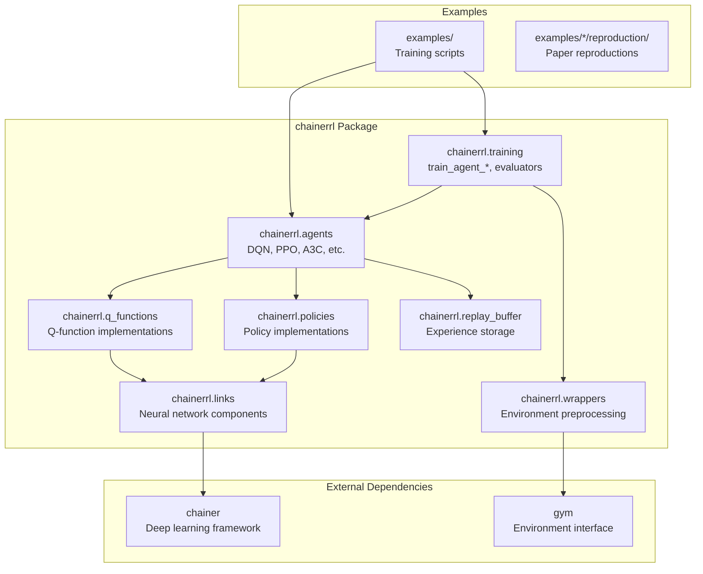

Sources: [README.md:1-134](), [chainerrl/links/mlp_bn.py:1-83]()

## Algorithm Portfolio

ChainerRL implements a comprehensive set of modern RL algorithms across different paradigms:

### Algorithm Support Matrix

| Algorithm | Discrete Actions | Continuous Actions | Recurrent Models | Batch Training | Async Training |
|-----------|:----------------:|:------------------:|:----------------:|:--------------:|:--------------:|
| `DQN` (including `DoubleDQN`) | ✓ | ✓ (NAF) | ✓ | ✓ | ✗ |
| `CategoricalDQN` | ✓ | ✗ | ✓ | ✓ | ✗ |
| `Rainbow` | ✓ | ✗ | ✓ | ✓ | ✗ |
| `IQN` | ✓ | ✗ | ✓ | ✓ | ✗ |
| `DDPG` | ✗ | ✓ | ✓ | ✓ | ✗ |
| `A3C` | ✓ | ✓ | ✓ | ✓ (A2C) | ✓ |
| `ACER` | ✓ | ✓ | ✓ | ✗ | ✓ |
| `NSQ` | ✓ | ✓ (NAF) | ✓ | ✗ | ✓ |
| `PCL` | ✓ | ✓ | ✓ | ✗ | ✓ |
| `PPO` | ✓ | ✓ | ✓ | ✓ | ✗ |
| `TRPO` | ✓ | ✓ | ✓ | ✓ | ✗ |
| `TD3` | ✗ | ✓ | ✗ | ✓ | ✗ |
| `SAC` | ✗ | ✓ | ✗ | ✓ | ✗ |

Sources: [README.md:40-54]()

### Algorithm Organization by Approach

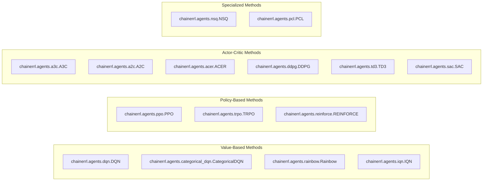

Sources: [README.md:56-86]()

## Core Neural Network Components

ChainerRL provides reusable neural network building blocks that agents compose for different tasks:

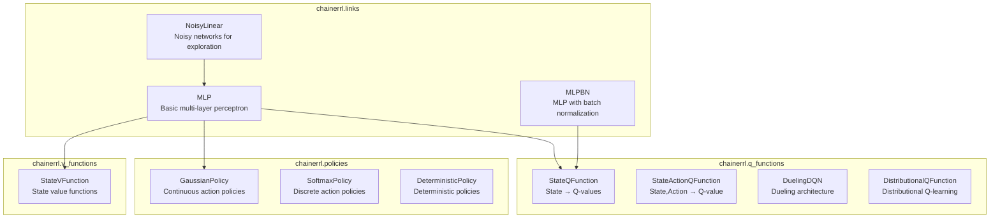

Sources: [chainerrl/links/mlp_bn.py:22-82](), [README.md:88-98]()

## Training Infrastructure

ChainerRL provides multiple training paradigms to accommodate different algorithm requirements:

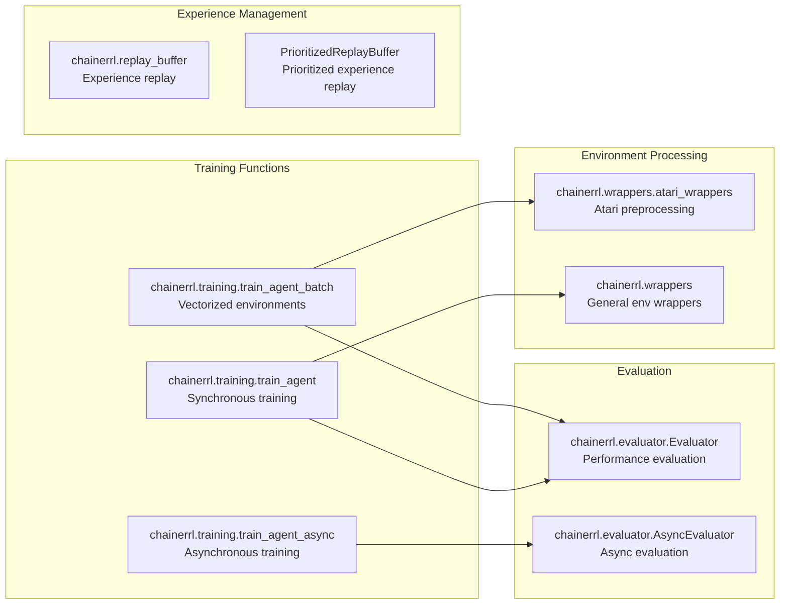

Sources: [README.md:32-36]()

## Integration and Usage Patterns

ChainerRL integrates with standard RL environments and provides comprehensive examples:

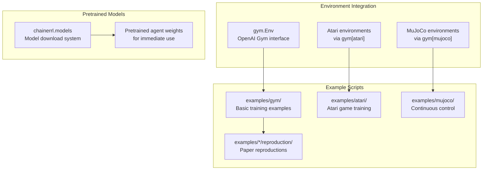

Sources: [README.md:34-36](), [README.md:58-86]()

## Installation and Dependencies

ChainerRL requires Python 3.6+ and depends primarily on the Chainer deep learning framework. Installation is available via PyPI or from source:

```bash
pip install chainerrl
```

Or for development:
```bash
python setup.py install
```

Key dependencies include `chainer`, `numpy`, and `gym` for environment interfaces.

Sources: [README.md:16-30](), [docs/install.rst:1-26]()

---

# Page: Reinforcement Learning Agents

# Reinforcement Learning Agents

<details>
<summary>Relevant source files</summary>

The following files were used as context for generating this wiki page:

- [chainerrl/agents/a3c.py](chainerrl/agents/a3c.py)
- [chainerrl/agents/acer.py](chainerrl/agents/acer.py)
- [chainerrl/agents/ddpg.py](chainerrl/agents/ddpg.py)
- [chainerrl/agents/dqn.py](chainerrl/agents/dqn.py)
- [chainerrl/agents/nsq.py](chainerrl/agents/nsq.py)
- [chainerrl/agents/pcl.py](chainerrl/agents/pcl.py)
- [chainerrl/agents/pgt.py](chainerrl/agents/pgt.py)
- [chainerrl/misc/prioritized.py](chainerrl/misc/prioritized.py)
- [chainerrl/replay_buffer.py](chainerrl/replay_buffer.py)
- [tests/agents_tests/basetest_dqn_like.py](tests/agents_tests/basetest_dqn_like.py)
- [tests/agents_tests/test_dqn.py](tests/agents_tests/test_dqn.py)
- [tests/misc_tests/test_prioritized.py](tests/misc_tests/test_prioritized.py)
- [tests/test_replay_buffer.py](tests/test_replay_buffer.py)

</details>


This document provides an overview of the reinforcement learning agent implementations in ChainerRL, covering the various algorithms, their architectural patterns, and relationships between different agent types. The agents represent the core learning algorithms that interact with environments to solve reinforcement learning problems.

For information about the neural network components used by these agents, see [Core Components](#3). For details about training infrastructure and evaluation systems, see [Training and Evaluation Infrastructure](#4).

## Agent Architecture Overview

ChainerRL implements a diverse collection of RL algorithms organized around common interface patterns. All agents inherit from base classes that define standard methods for acting, training, and episode management.

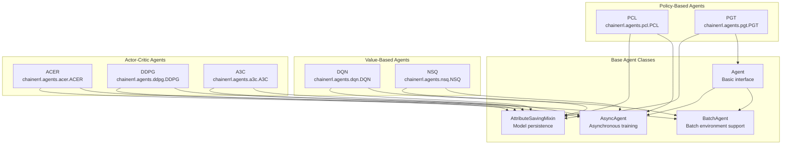

The agent hierarchy reflects fundamental differences in training paradigms:
- `BatchAgent`: Supports vectorized environments and batch operations
- `AsyncAgent`: Designed for asynchronous multi-process training
- `AttributeSavingMixin`: Provides model saving/loading capabilities

Sources: [chainerrl/agents/dqn.py:98](), [chainerrl/agents/acer.py:223](), [chainerrl/agents/ddpg.py:35](), [chainerrl/agents/a3c.py:72]()

## Agent Training Lifecycle

All agents follow a common training lifecycle that involves environment interaction, experience collection, and model updates:

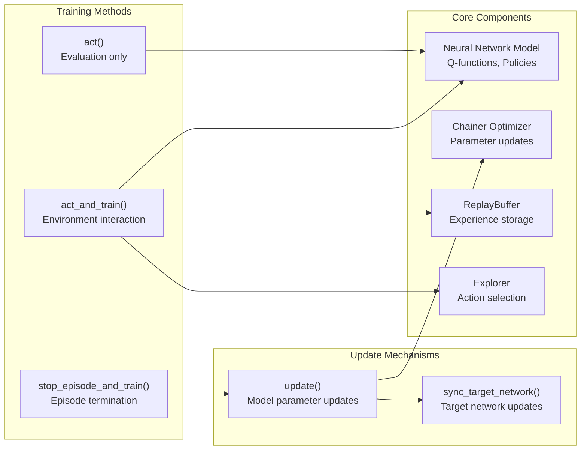

Sources: [chainerrl/agents/dqn.py:376-428](), [chainerrl/agents/ddpg.py:299-331]()

## Value-Based Agents

Value-based agents learn action-value functions (Q-functions) to make decisions. The DQN agent is the most prominent implementation and serves as the foundation for many variants.

### DQN (Deep Q-Networks)

The `DQN` class implements the Deep Q-Networks algorithm with experience replay and target networks:

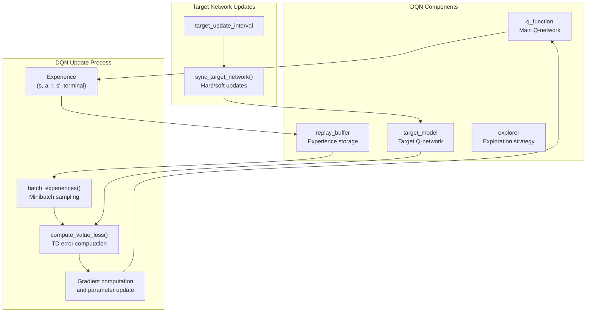

Key features of the DQN implementation:
- **Experience Replay**: Uses `ReplayBuffer` for storing and sampling transitions
- **Target Networks**: Maintains separate target network updated periodically
- **Loss Computation**: Supports both Huber loss and MSE with weighted variants
- **Recurrent Support**: Optional recurrent network support for partial observability

Sources: [chainerrl/agents/dqn.py:98-573](), [chainerrl/replay_buffer.py:135-176]()

The DQN agent supports both standard and recurrent variants:

| Configuration | Update Function | Replay Buffer Type | Use Case |
|---------------|-----------------|-------------------|----------|
| Standard DQN | `update()` | `ReplayBuffer` | Fully observable MDPs |
| Recurrent DQN | `update_from_episodes()` | `EpisodicReplayBuffer` | Partially observable MDPs |

Sources: [chainerrl/agents/dqn.py:173-176](), [chainerrl/agents/dqn.py:273-287]()

### NSQ (N-step Q-Learning)

The `NSQ` agent implements asynchronous n-step Q-learning for multi-process training:

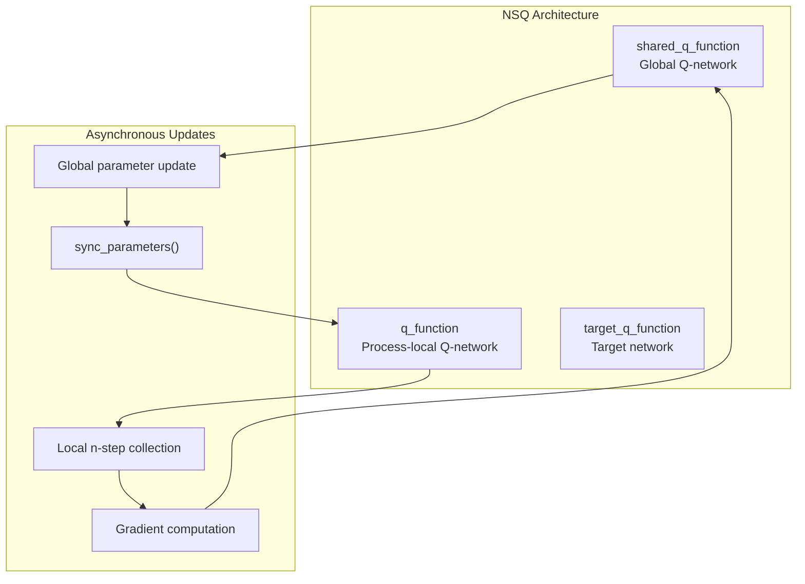

Sources: [chainerrl/agents/nsq.py:18-193]()

## Actor-Critic Agents

Actor-critic agents combine policy optimization (actor) with value function learning (critic). These agents can handle both discrete and continuous action spaces.

### ACER (Actor-Critic with Experience Replay)

ACER combines on-policy actor-critic learning with off-policy experience replay:

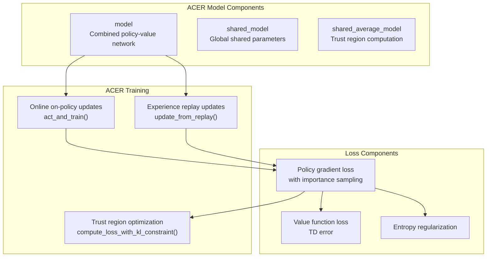

ACER's key innovations include:
- **Importance Sampling**: Corrects for off-policy bias in experience replay
- **Trust Region**: Uses efficient trust region optimization to stabilize training
- **Truncated Importance Weights**: Prevents exploding importance ratios

Sources: [chainerrl/agents/acer.py:223-710](), [chainerrl/agents/acer.py:184-221]()

### DDPG (Deep Deterministic Policy Gradients)

DDPG extends DQN to continuous action spaces using deterministic policies:

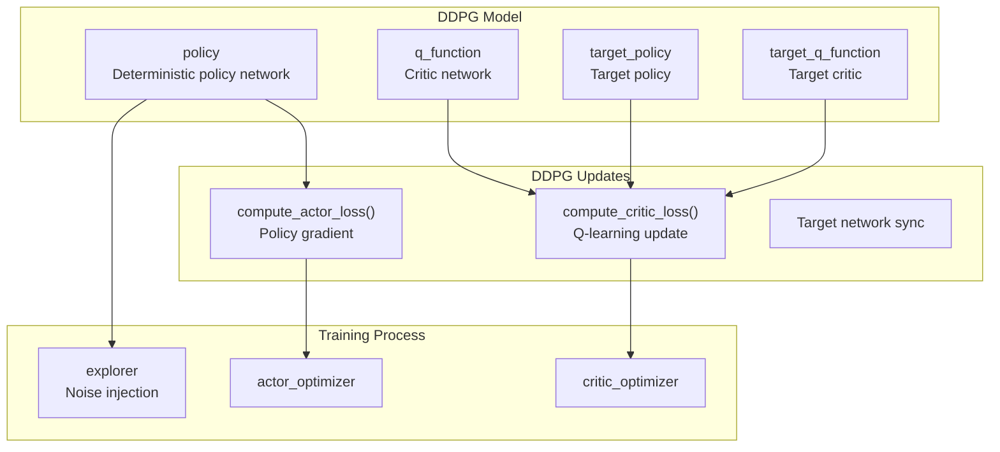

DDPG training alternates between critic and actor updates:
1. **Critic Update**: Standard Q-learning with target networks
2. **Actor Update**: Policy gradient to maximize Q-values
3. **Target Updates**: Soft updates to target networks

Sources: [chainerrl/agents/ddpg.py:35-470](), [chainerrl/agents/ddpg.py:161-212](), [chainerrl/agents/ddpg.py:214-251]()

### A3C (Asynchronous Advantage Actor-Critic)

A3C implements asynchronous actor-critic learning across multiple processes:

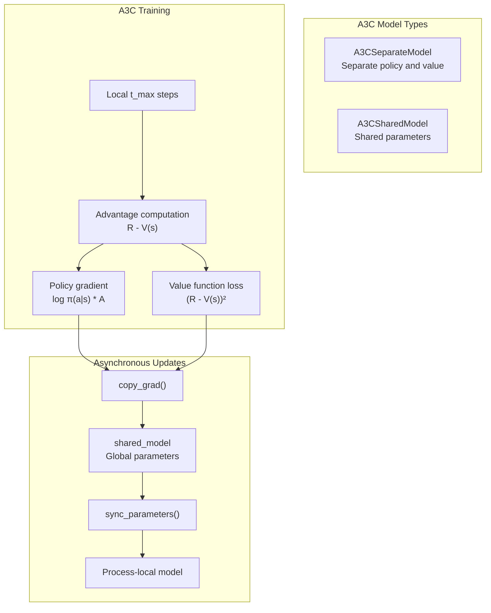

Sources: [chainerrl/agents/a3c.py:72-304](), [chainerrl/agents/a3c.py:36-70]()

## Specialized Agents

### PCL (Path Consistency Learning)

PCL implements a novel approach that enforces consistency between different trajectory segments:

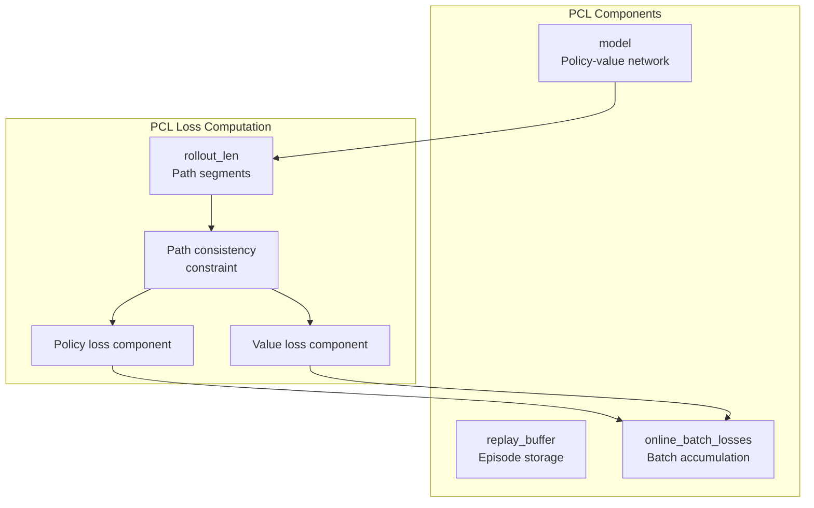

Sources: [chainerrl/agents/pcl.py:30-490]()

### PGT (Policy Gradient Theorem)

PGT implements likelihood ratio policy gradients with Q-function baselines:

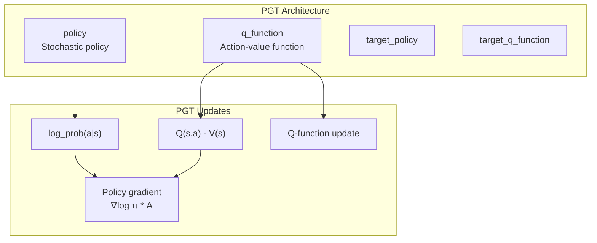

Sources: [chainerrl/agents/pgt.py:18-284]()

## Agent Configuration Patterns

Most agents follow common configuration patterns for their key components:

| Component | Purpose | Common Types |
|-----------|---------|--------------|
| Model/Q-function | Neural network architecture | `StateQFunction`, `Policy`, `VFunction` |
| Optimizer | Parameter updates | `Adam`, `RMSprop` |
| Replay Buffer | Experience storage | `ReplayBuffer`, `EpisodicReplayBuffer`, `PrioritizedReplayBuffer` |
| Explorer | Action selection strategy | `EpsilonGreedy`, `AdditiveGaussian` |
| Target Update | Stabilization mechanism | Hard updates, soft updates with τ |

Sources: [chainerrl/agents/dqn.py:135-149](), [chainerrl/agents/ddpg.py:80-95](), [chainerrl/replay_buffer.py:230-281]()

---

# Page: DQN and Value-Based Methods

# DQN and Value-Based Methods

<details>
<summary>Relevant source files</summary>

The following files were used as context for generating this wiki page:

- [chainerrl/agents/categorical_double_dqn.py](chainerrl/agents/categorical_double_dqn.py)
- [chainerrl/agents/categorical_dqn.py](chainerrl/agents/categorical_dqn.py)
- [chainerrl/agents/double_iqn.py](chainerrl/agents/double_iqn.py)
- [chainerrl/agents/dqn.py](chainerrl/agents/dqn.py)
- [chainerrl/agents/iqn.py](chainerrl/agents/iqn.py)
- [chainerrl/misc/prioritized.py](chainerrl/misc/prioritized.py)
- [chainerrl/q_functions/dueling_dqn.py](chainerrl/q_functions/dueling_dqn.py)
- [chainerrl/replay_buffer.py](chainerrl/replay_buffer.py)
- [chainerrl/wrappers/vector_frame_stack.py](chainerrl/wrappers/vector_frame_stack.py)
- [examples/atari/train_double_iqn.py](examples/atari/train_double_iqn.py)
- [examples/gym/train_iqn_gym.py](examples/gym/train_iqn_gym.py)
- [examples_tests/atari/test_double_iqn.sh](examples_tests/atari/test_double_iqn.sh)
- [tests/agents_tests/basetest_dqn_like.py](tests/agents_tests/basetest_dqn_like.py)
- [tests/agents_tests/test_categorical_dqn.py](tests/agents_tests/test_categorical_dqn.py)
- [tests/agents_tests/test_double_categorical_dqn.py](tests/agents_tests/test_double_categorical_dqn.py)
- [tests/agents_tests/test_dqn.py](tests/agents_tests/test_dqn.py)
- [tests/agents_tests/test_iqn.py](tests/agents_tests/test_iqn.py)
- [tests/misc_tests/test_prioritized.py](tests/misc_tests/test_prioritized.py)
- [tests/test_replay_buffer.py](tests/test_replay_buffer.py)

</details>


This document covers the Deep Q-Network (DQN) and related value-based reinforcement learning algorithms implemented in ChainerRL. It includes the core DQN implementation, distributional variants (Categorical DQN, IQN), architectural improvements (Dueling DQN, Double DQN), and supporting infrastructure like replay buffers and prioritized experience replay.

For policy-based methods like PPO and TRPO, see [Policy Gradient Methods](#2.2). For actor-critic methods that combine value estimation with policy optimization, see [Actor-Critic Methods](#2.3).

## Core DQN Architecture

The foundational DQN implementation provides the template for all value-based methods in ChainerRL. The `DQN` class orchestrates training through experience replay, target network updates, and exploration strategies.

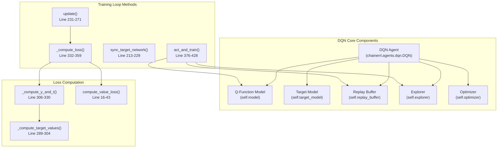

**Sources:** [chainerrl/agents/dqn.py:98-573]()

The DQN agent maintains two neural networks: a primary model for action selection and learning, and a target model for stable target computation. The `ReplayUpdater` coordinates when updates occur based on configuration parameters.

| Component | Purpose | Key Configuration |
|-----------|---------|------------------|
| `model` | Primary Q-function for learning | Updated every step via gradient descent |
| `target_model` | Stable target computation | Updated every `target_update_interval` steps |
| `replay_buffer` | Experience storage | Capacity and sampling strategy |
| `explorer` | Action selection strategy | Epsilon-greedy, Boltzmann, etc. |

**Sources:** [chainerrl/agents/dqn.py:150-199]()

## Value-Based Method Variants

ChainerRL implements several important extensions to the basic DQN algorithm, each addressing specific limitations or adding capabilities.

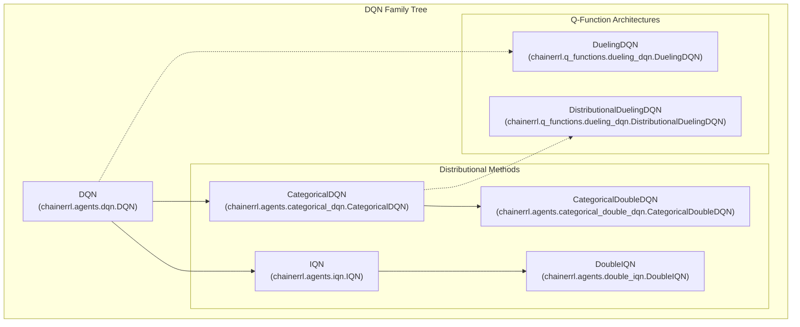

**Sources:** [chainerrl/agents/categorical_dqn.py:112-120](), [chainerrl/agents/iqn.py:268-288](), [chainerrl/agents/double_iqn.py:7-15]()

### Categorical DQN

Categorical DQN represents the value distribution rather than just the expected value, providing richer information about return uncertainty.

The core innovation is replacing scalar Q-values with categorical distributions over a fixed support:

**Sources:** [chainerrl/agents/categorical_dqn.py:121-200]()

### Implicit Quantile Networks (IQN)

IQN extends distributional RL by learning the full quantile function rather than a fixed categorical distribution. It uses cosine basis functions to embed quantile thresholds.

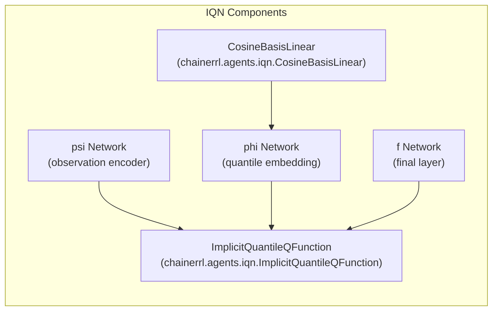

**Sources:** [chainerrl/agents/iqn.py:84-126](), [chainerrl/agents/iqn.py:30-60]()

## Replay Buffer System

The replay buffer system provides experience storage and sampling for off-policy learning. ChainerRL supports multiple replay buffer types with different sampling strategies.

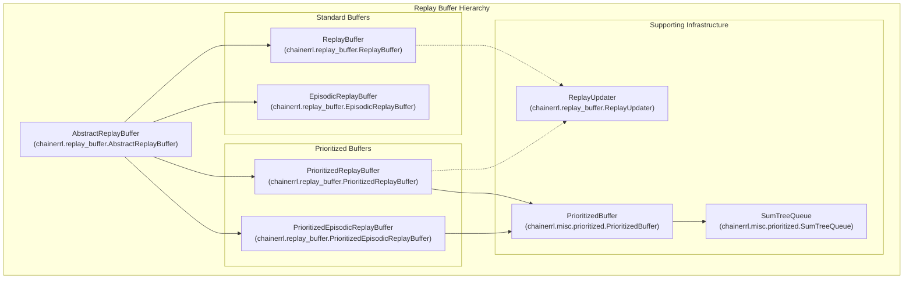

**Sources:** [chainerrl/replay_buffer.py:11-281](), [chainerrl/misc/prioritized.py:8-293]()

### Experience Batching

The replay buffer system provides utilities for batching experiences for training:

| Function | Purpose | Input | Output |
|----------|---------|-------|--------|
| `batch_experiences` | Batch transition sequences | List of experience sequences | Batched arrays |
| `batch_recurrent_experiences` | Batch for recurrent models | List of episodes | Sequences with recurrent states |

**Sources:** [chainerrl/replay_buffer.py:135-177](), [chainerrl/replay_buffer.py:179-228]()

### Prioritized Experience Replay

Prioritized replay samples experiences based on their temporal difference (TD) error, focusing learning on surprising transitions.

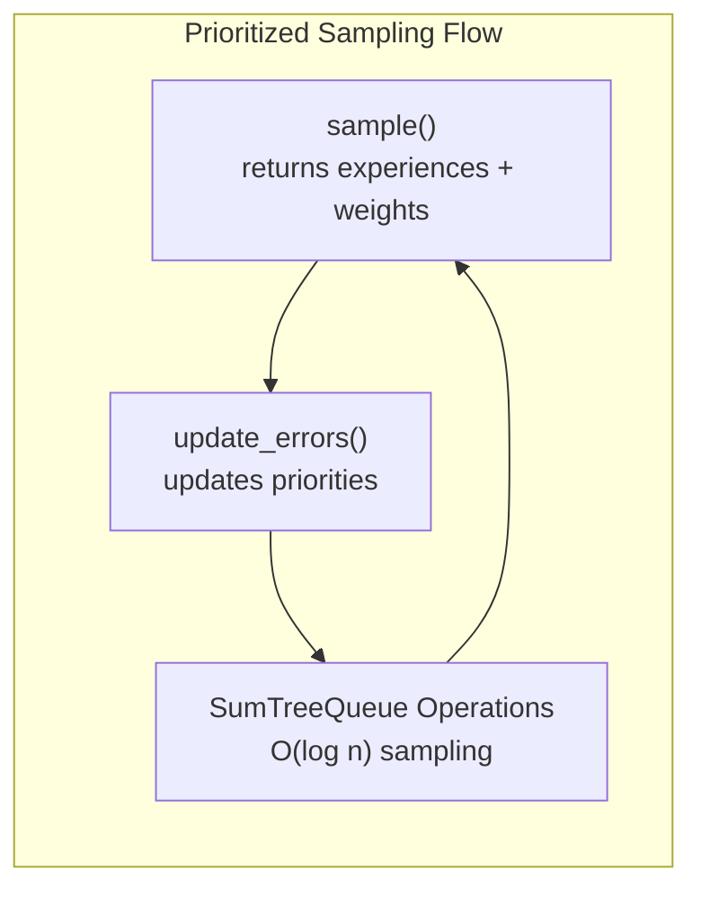

**Sources:** [chainerrl/misc/prioritized.py:70-107]()

## Q-Function Architectures

ChainerRL provides several Q-function architectures optimized for different types of value-based learning.

### Dueling Networks

Dueling networks separate the value function into state value and advantage components, improving learning efficiency.

**Sources:** [chainerrl/q_functions/dueling_dqn.py:12-54]()

### Distributional Q-Functions

For distributional methods, specialized Q-functions output probability distributions rather than scalar values.

**Sources:** [chainerrl/q_functions/dueling_dqn.py:56-113]()

## Training Infrastructure Integration

The DQN family integrates with ChainerRL's broader training infrastructure through standardized interfaces.

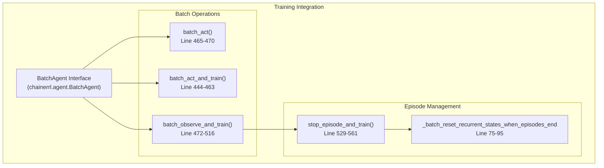

**Sources:** [chainerrl/agents/dqn.py:444-527](), [chainerrl/agents/dqn.py:75-95]()

The `ReplayUpdater` coordinates the training schedule, determining when to perform model updates based on buffer size, update intervals, and other configuration parameters.

| Parameter | Purpose | Default Value |
|-----------|---------|--------------|
| `replay_start_size` | Minimum buffer size before training | 50,000 |
| `update_interval` | Steps between model updates | 1 |
| `target_update_interval` | Steps between target network updates | 10,000 |
| `minibatch_size` | Batch size for training | 32 |

**Sources:** [chainerrl/replay_buffer.py:230-281]()

---

# Page: Policy Gradient Methods

# Policy Gradient Methods

<details>
<summary>Relevant source files</summary>

The following files were used as context for generating this wiki page:

- [chainerrl/agents/ppo.py](chainerrl/agents/ppo.py)
- [chainerrl/agents/reinforce.py](chainerrl/agents/reinforce.py)
- [chainerrl/agents/trpo.py](chainerrl/agents/trpo.py)
- [examples/quickstart/quickstart.ipynb](examples/quickstart/quickstart.ipynb)
- [tests/agents_tests/basetest_training.py](tests/agents_tests/basetest_training.py)
- [tests/agents_tests/test_ppo.py](tests/agents_tests/test_ppo.py)
- [tests/agents_tests/test_reinforce.py](tests/agents_tests/test_reinforce.py)
- [tests/agents_tests/test_trpo.py](tests/agents_tests/test_trpo.py)

</details>


## Purpose and Scope

This document covers the policy gradient algorithms implemented in ChainerRL, which optimize policies directly through gradient ascent on expected rewards. Policy gradient methods learn a parameterized policy that maps observations to action probabilities, rather than learning value functions like in value-based methods.

For value-based methods like DQN, see [DQN and Value-Based Methods](#2.1). For algorithms that combine policy gradients with value estimation, see [Actor-Critic Methods](#2.3).

The policy gradient algorithms covered here include:
- **PPO (Proximal Policy Optimization)** - clips policy updates to prevent large changes
- **TRPO (Trust Region Policy Optimization)** - constrains policy updates using KL divergence
- **REINFORCE** - basic policy gradient using Monte Carlo returns

## Algorithm Overview

| Algorithm | File | Key Features | Policy Update Method |
|-----------|------|--------------|---------------------|
| PPO | [chainerrl/agents/ppo.py]() | Clipped surrogate objective, GAE | Minibatch SGD with clipping |
| TRPO | [chainerrl/agents/trpo.py]() | KL divergence constraint, natural gradients | Conjugate gradient + line search |
| REINFORCE | [chainerrl/agents/reinforce.py]() | Monte Carlo returns, episodic | Direct policy gradient |

## Policy Gradient Architecture

```mermaid
graph TB
    subgraph "Policy Gradient Agents"
        PPO["PPO Agent<br/>(chainerrl.agents.ppo.PPO)"]
        TRPO["TRPO Agent<br/>(chainerrl.agents.trpo.TRPO)"]
        REINFORCE["REINFORCE Agent<br/>(chainerrl.agents.reinforce.REINFORCE)"]
    end
    
    subgraph "Core Components"
        POLICY["Policy Networks<br/>(FCSoftmaxPolicy, FCGaussianPolicy)"]
        VALUE["Value Functions<br/>(for PPO/TRPO only)"]
        ADVANTAGE["Advantage Estimation<br/>(_add_advantage_and_value_target_to_episodes)"]
    end
    
    subgraph "Training Infrastructure"
        EPISODES["Episode Memory<br/>(self.memory, self.last_episode)"]
        DATASET["Dataset Creation<br/>(_make_dataset, _make_dataset_recurrent)"]
        OPTIMIZER["Optimizers<br/>(Adam, SGD)"]
    end
    
    PPO --> POLICY
    PPO --> VALUE
    PPO --> ADVANTAGE
    
    TRPO --> POLICY
    TRPO --> VALUE
    TRPO --> ADVANTAGE
    
    REINFORCE --> POLICY
    
    PPO --> EPISODES
    TRPO --> EPISODES
    REINFORCE --> EPISODES
    
    EPISODES --> DATASET
    DATASET --> OPTIMIZER
```

Sources: [chainerrl/agents/ppo.py:233-817](), [chainerrl/agents/trpo.py:89-859](), [chainerrl/agents/reinforce.py:13-180]()

## PPO (Proximal Policy Optimization)

PPO implements the clipped surrogate objective to prevent destructively large policy updates while maintaining sample efficiency.

### Core Algorithm Components

```mermaid
graph LR
    subgraph "PPO Update Process"
        COLLECT["Collect Episodes<br/>(act_and_train)"]
        DATASET["Create Dataset<br/>(_make_dataset)"]
        ADVANTAGE["Compute Advantages<br/>(_add_advantage_and_value_target_to_episodes)"]
        CLIP["Clipped Loss<br/>(_lossfun)"]
        UPDATE["SGD Updates<br/>(_update)"]
    end
    
    COLLECT --> DATASET
    DATASET --> ADVANTAGE
    ADVANTAGE --> CLIP
    CLIP --> UPDATE
    UPDATE --> COLLECT
```

### Key Implementation Details

The PPO agent uses a combined model that outputs both policy distributions and value estimates:

- **Model Structure**: [chainerrl/agents/ppo.py:239-240]() - Takes states and returns `(policy_distribution, value)`
- **Clipped Objective**: [chainerrl/agents/ppo.py:564-568]() - Implements clipped probability ratio
- **Value Function Loss**: [chainerrl/agents/ppo.py:570-579]() - Optional clipping for value updates
- **Advantage Estimation**: [chainerrl/agents/ppo.py:27-45]() - Generalized Advantage Estimation (GAE)

The loss function combines three components:
```python
loss = loss_policy + value_func_coef * loss_value_func + entropy_coef * loss_entropy
```

### Configuration Parameters

| Parameter | Purpose | Default |
|-----------|---------|---------|
| `clip_eps` | Policy ratio clipping threshold | 0.2 |
| `lambd` | GAE lambda parameter | 0.95 |
| `update_interval` | Steps between updates | 2048 |
| `epochs` | Training epochs per update | 10 |
| `minibatch_size` | Minibatch size for SGD | 64 |

Sources: [chainerrl/agents/ppo.py:291-314](), [chainerrl/agents/ppo.py:559-591]()

## TRPO (Trust Region Policy Optimization)

TRPO constrains policy updates using KL divergence to ensure stable learning through natural policy gradients.

### Algorithm Structure

```mermaid
graph TB
    subgraph "TRPO Components"
        SEPARATE["Separate Models<br/>(policy, vf)"]
        KL["KL Constraint<br/>(_compute_kl_constrained_step)"]
        CG["Conjugate Gradient<br/>(conjugate_gradient)"]
        LINESEARCH["Line Search<br/>(_line_search)"]
        HVP["Hessian-Vector Product<br/>(_hessian_vector_product)"]
    end
    
    SEPARATE --> KL
    KL --> CG
    CG --> HVP
    KL --> LINESEARCH
```

### Implementation Details

TRPO requires separate policy and value function models and uses advanced optimization techniques:

- **Separate Models**: [chainerrl/agents/trpo.py:187-199]() - Policy and value function are separate
- **Fisher Information**: [chainerrl/agents/trpo.py:529-531]() - Hessian-vector product for natural gradients  
- **Line Search**: [chainerrl/agents/trpo.py:555-650]() - Backtracking to satisfy KL constraint
- **Second-order Requirements**: [chainerrl/agents/trpo.py:100-102]() - Requires functions supporting double backprop

### Key Functions

| Function | Purpose | Location |
|----------|---------|----------|
| `_compute_kl_constrained_step` | Natural gradient step with KL constraint | [chainerrl/agents/trpo.py:507-553]() |
| `_hessian_vector_product` | Efficient Hessian-vector computation | [chainerrl/agents/trpo.py:60-66]() |
| `_line_search` | Backtracking line search | [chainerrl/agents/trpo.py:555-650]() |

Sources: [chainerrl/agents/trpo.py:89-859](), [chainerrl/agents/trpo.py:19-66]()

## REINFORCE

REINFORCE implements the basic policy gradient algorithm using Monte Carlo estimates of returns.

### Algorithm Flow

```mermaid
graph LR
    subgraph "REINFORCE Process"
        EPISODE["Collect Episode<br/>(act_and_train)"]
        RETURN["Compute Returns<br/>(cumsum)"]
        GRAD["Policy Gradient<br/>(-R * log_prob)"]
        UPDATE["Update Policy<br/>(optimizer.update)"]
    end
    
    EPISODE --> RETURN
    RETURN --> GRAD  
    GRAD --> UPDATE
    UPDATE --> EPISODE
```

### Implementation Features

- **Episodic Only**: [chainerrl/agents/reinforce.py:107-111]() - Only supports episodic environments
- **Batch Training**: [chainerrl/agents/reinforce.py:41]() - Configurable batch size for updates
- **Monte Carlo Returns**: [chainerrl/agents/reinforce.py:143]() - Uses cumulative sum of future rewards
- **Entropy Regularization**: [chainerrl/agents/reinforce.py:39]() - Optional entropy bonus

### Key Methods

| Method | Purpose | Location |
|--------|---------|----------|
| `act_and_train` | Action selection and data collection | [chainerrl/agents/reinforce.py:69-93]() |
| `stop_episode_and_train` | Episode termination and training | [chainerrl/agents/reinforce.py:105-131]() |
| `accumulate_grad` | Gradient computation | [chainerrl/agents/reinforce.py:133-156]() |

Sources: [chainerrl/agents/reinforce.py:13-180]()

## Training Infrastructure

### Episode Memory Management

All policy gradient agents collect complete episodes before training:

```mermaid
graph TB
    subgraph "Episode Collection"
        TRANSITION["Transition<br/>{state, action, reward, next_state}"]
        EPISODE["Episode<br/>(list of transitions)"]
        MEMORY["Memory<br/>(list of episodes)"]
    end
    
    TRANSITION --> EPISODE
    EPISODE --> MEMORY
    
    subgraph "Dataset Creation"
        LOGPROB["Add Log Probabilities<br/>(_add_log_prob_and_value_to_episodes)"]
        ADV["Add Advantages<br/>(_add_advantage_and_value_target_to_episodes)"]
        FLAT["Flatten to Transitions<br/>(chain.from_iterable)"]
    end
    
    MEMORY --> LOGPROB
    LOGPROB --> ADV
    ADV --> FLAT
```

### Shared Utilities

Policy gradient agents share several utility functions:

- **Advantage Computation**: [chainerrl/agents/ppo.py:27-45]() - GAE implementation used by PPO and TRPO
- **Dataset Creation**: [chainerrl/agents/ppo.py:214-230]() - Converts episodes to training data
- **Recurrent Support**: [chainerrl/agents/ppo.py:48-100]() - Handles recurrent model states
- **Explained Variance**: [chainerrl/agents/ppo.py:174-186]() - Training diagnostic

### Update Patterns

| Agent | Update Frequency | Batch Processing |
|-------|------------------|------------------|
| PPO | Every `update_interval` steps | Multiple epochs over minibatches |
| TRPO | Every `update_interval` steps | Single full-batch update |
| REINFORCE | Every `batchsize` episodes | Single batch update |

Sources: [chainerrl/agents/ppo.py:375-409](), [chainerrl/agents/trpo.py:256-290](), [chainerrl/agents/reinforce.py:158-171]()

## Usage Examples

### Basic PPO Training

The tests demonstrate typical usage patterns:

```python
# Model combines policy and value function
model = A3CSeparateModel(
    pi=chainerrl.policies.FCSoftmaxPolicy(obs_size, n_actions),
    v=L.Linear(obs_size, 1),
)

# PPO agent with standard hyperparameters  
agent = PPO(
    model, optimizer, gamma=0.8, lambd=0.95,
    update_interval=64, minibatch_size=16, epochs=3,
    clip_eps=0.2, standardize_advantages=True
)
```

### TRPO with Separate Models

```python
# Separate policy and value function
policy = policies.FCSoftmaxPolicy(obs_size, n_actions)
vf = L.Linear(obs_size, 1)

agent = TRPO(
    policy=policy, vf=vf, vf_optimizer=vf_opt,
    gamma=0.5, lambd=0.95, max_kl=0.01,
    update_interval=64, standardize_advantages=True
)
```

Sources: [tests/agents_tests/test_ppo.py:422-440](), [tests/agents_tests/test_trpo.py:319-353](), [tests/agents_tests/test_reinforce.py:48-124]()

---

# Page: Actor-Critic Methods

# Actor-Critic Methods

<details>
<summary>Relevant source files</summary>

The following files were used as context for generating this wiki page:

- [chainerrl/agents/a2c.py](chainerrl/agents/a2c.py)
- [chainerrl/agents/a3c.py](chainerrl/agents/a3c.py)
- [chainerrl/agents/acer.py](chainerrl/agents/acer.py)
- [chainerrl/agents/ddpg.py](chainerrl/agents/ddpg.py)
- [chainerrl/agents/nsq.py](chainerrl/agents/nsq.py)
- [chainerrl/agents/pcl.py](chainerrl/agents/pcl.py)
- [chainerrl/agents/pgt.py](chainerrl/agents/pgt.py)
- [chainerrl/experiments/train_agent_batch.py](chainerrl/experiments/train_agent_batch.py)
- [examples/gym/train_a2c_gym.py](examples/gym/train_a2c_gym.py)
- [tests/agents_tests/test_a2c.py](tests/agents_tests/test_a2c.py)

</details>


This document covers the actor-critic reinforcement learning algorithms implemented in ChainerRL. Actor-critic methods combine policy-based and value-based approaches by maintaining both a policy (actor) that selects actions and a value function (critic) that evaluates states or state-action pairs.

For value-based methods like DQN, see [DQN and Value-Based Methods](#2.1). For pure policy gradient methods, see [Policy Gradient Methods](#2.2).

## Overview

ChainerRL implements several actor-critic algorithms that differ in their training paradigms, model architectures, and update mechanisms. These algorithms share common architectural patterns but employ different strategies for learning and exploration.

```mermaid
graph TB
    subgraph "Synchronous Algorithms"
        A2C["A2C<br/>(Advantage Actor-Critic)"]
        DDPG["DDPG<br/>(Deep Deterministic Policy Gradients)"]
        PGT["PGT<br/>(Policy Gradient Theorem)"]
    end
    
    subgraph "Asynchronous Algorithms"
        A3C["A3C<br/>(Asynchronous Advantage Actor-Critic)"]
        ACER["ACER<br/>(Actor-Critic with Experience Replay)"]
        NSQ["NSQ<br/>(Asynchronous N-step Q-Learning)"]
        PCL["PCL<br/>(Path Consistency Learning)"]
    end
    
    subgraph "Action Space Support"
        DISCRETE["Discrete Actions<br/>A2C, A3C, ACER, NSQ, PCL"]
        CONTINUOUS["Continuous Actions<br/>DDPG, PGT, A2C, A3C"]
    end
    
    A3C --> A2C
    A3C --> PCL
    DDPG --> PGT
    
    A2C --> DISCRETE
    A3C --> DISCRETE
    A3C --> CONTINUOUS
    ACER --> DISCRETE
    DDPG --> CONTINUOUS
    PGT --> CONTINUOUS
    NSQ --> DISCRETE
    PCL --> DISCRETE
```

**Actor-Critic Algorithm Classification**

Sources: [chainerrl/agents/a2c.py:1-301](), [chainerrl/agents/a3c.py:1-304](), [chainerrl/agents/acer.py:1-710](), [chainerrl/agents/ddpg.py:1-470](), [chainerrl/agents/pcl.py:1-490](), [chainerrl/agents/pgt.py:1-284](), [chainerrl/agents/nsq.py:1-193]()

## Model Architecture Patterns

Actor-critic algorithms in ChainerRL follow two main architectural patterns: separate models where the policy and value function have independent parameters, and shared models where they share a common feature extraction backbone.

```mermaid
graph TB
    subgraph "Separate Model Architecture"
        SEPARATE_OBS["Observation Input"]
        SEPARATE_PI["Policy Network<br/>(Actor)"]
        SEPARATE_V["Value Function<br/>(Critic)"]
        SEPARATE_ACTION["Action Output"]
        SEPARATE_VALUE["Value Output"]
        
        SEPARATE_OBS --> SEPARATE_PI
        SEPARATE_OBS --> SEPARATE_V
        SEPARATE_PI --> SEPARATE_ACTION
        SEPARATE_V --> SEPARATE_VALUE
    end
    
    subgraph "Shared Model Architecture"
        SHARED_OBS["Observation Input"]
        SHARED_BACKBONE["Shared Feature Network"]
        SHARED_PI["Policy Head"]
        SHARED_V["Value Head"]
        SHARED_ACTION["Action Output"]
        SHARED_VALUE["Value Output"]
        
        SHARED_OBS --> SHARED_BACKBONE
        SHARED_BACKBONE --> SHARED_PI
        SHARED_BACKBONE --> SHARED_V
        SHARED_PI --> SHARED_ACTION
        SHARED_V --> SHARED_VALUE
    end
```

**Model Architecture Patterns for Actor-Critic Methods**

| Algorithm | Separate Model Class | Shared Model Class |
|-----------|---------------------|-------------------|
| A3C | `A3CSeparateModel` | `A3CSharedModel` |
| A2C | `A2CSeparateModel` | Not implemented |
| ACER | `ACERSeparateModel` | `ACERSharedModel` |
| DDPG | `DDPGModel` | N/A (inherently shared) |
| PCL | `PCLSeparateModel` | `PCLSharedModel` |

Sources: [chainerrl/agents/a3c.py:36-70](), [chainerrl/agents/a2c.py:31-46](), [chainerrl/agents/acer.py:112-182](), [chainerrl/agents/ddpg.py:29-34](), [chainerrl/agents/pcl.py:26-27]()

## Core Actor-Critic Components

### A3C: Asynchronous Advantage Actor-Critic

A3C serves as the foundation for many other actor-critic implementations in ChainerRL. It uses multiple asynchronous processes to collect experience and update a shared model.

```mermaid
graph TB
    subgraph "A3C Training Process"
        SHARED_MODEL["shared_model<br/>(A3CModel)"]
        THREAD_MODEL["thread_model<br/>(Copy of shared_model)"]
        ENV["Environment"]
        EXPERIENCE["Experience Collection<br/>(t_max steps)"]
        UPDATE["Advantage Calculation<br/>& Gradient Update"]
        SYNC["Parameter Synchronization"]
        
        SHARED_MODEL --> THREAD_MODEL
        THREAD_MODEL --> ENV
        ENV --> EXPERIENCE
        EXPERIENCE --> UPDATE
        UPDATE --> SHARED_MODEL
        SHARED_MODEL --> SYNC
        SYNC --> THREAD_MODEL
    end
```

**A3C Training Flow**

The `A3C` class implements the core actor-critic logic with the following key methods:

- `act_and_train()`: Collects experience and triggers updates every `t_max` steps
- `update()`: Computes advantages and performs gradient updates
- `sync_parameters()`: Synchronizes thread-local model with shared model

Sources: [chainerrl/agents/a3c.py:72-304](), [chainerrl/agents/a3c.py:156-239](), [chainerrl/agents/a3c.py:240-268]()

### A2C: Advantage Actor-Critic

A2C is the synchronous, batch version of A3C that processes multiple environments simultaneously.

The `A2C` class supports:
- Batch training with `batch_act_and_train()` and `batch_observe_and_train()`
- Generalized Advantage Estimation (GAE) when `use_gae=True`
- GPU acceleration for faster training

Key differences from A3C:
- Uses vectorized environments instead of asynchronous processes
- Accumulates gradients over multiple environments before updating
- Does not support single-environment training

Sources: [chainerrl/agents/a2c.py:48-301](), [chainerrl/agents/a2c.py:158-173](), [chainerrl/agents/a2c.py:219-244]()

### ACER: Actor-Critic with Experience Replay

ACER extends actor-critic methods to support off-policy learning through experience replay and importance sampling.

```mermaid
graph TB
    subgraph "ACER Update Mechanism"
        ONLINE["Online On-Policy Update"]
        REPLAY["Experience Replay Update"]
        IMPORTANCE["Importance Sampling<br/>compute_importance()"]
        TRUNCATION["Importance Weight Truncation<br/>truncation_threshold"]
        BIAS_CORRECTION["Bias Correction<br/>compute_policy_gradient_*_correction()"]
        TRUST_REGION["Trust Region Constraint<br/>compute_loss_with_kl_constraint()"]
        
        ONLINE --> TRUST_REGION
        REPLAY --> IMPORTANCE
        IMPORTANCE --> TRUNCATION
        TRUNCATION --> BIAS_CORRECTION
        BIAS_CORRECTION --> TRUST_REGION
    end
```

**ACER Off-Policy Learning Components**

ACER implements several advanced techniques:

- **Importance Sampling**: `compute_importance()` calculates ratios between current and behavior policies
- **Bias Correction**: `compute_policy_gradient_full_correction()` and `compute_policy_gradient_sample_correction()` handle truncated importance weights
- **Trust Region**: `compute_loss_with_kl_constraint()` maintains a KL constraint for stable updates

Sources: [chainerrl/agents/acer.py:20-221](), [chainerrl/agents/acer.py:223-710](), [chainerrl/agents/acer.py:32-109]()

### DDPG: Deep Deterministic Policy Gradients

DDPG applies actor-critic methods to continuous action spaces using deterministic policies and target networks.

The `DDPG` class architecture includes:
- **Actor**: Deterministic policy network (`policy`)
- **Critic**: Q-function network (`q_function`)
- **Target Networks**: Slowly updated copies for stable learning (`target_policy`, `target_q_function`)
- **Replay Buffer**: Off-policy experience storage

Key update methods:
- `compute_actor_loss()`: Maximizes Q-values for policy-generated actions
- `compute_critic_loss()`: Minimizes TD error for Q-function
- `sync_target_network()`: Updates target networks using soft or hard updates

Sources: [chainerrl/agents/ddpg.py:35-470](), [chainerrl/agents/ddpg.py:214-251](), [chainerrl/agents/ddpg.py:161-212]()

## Training Infrastructure Integration

Actor-critic methods integrate with ChainerRL's training infrastructure through standardized interfaces:

```mermaid
graph TB
    subgraph "Training Integration"
        BATCH_TRAINING["train_agent_batch()"]
        ASYNC_TRAINING["Asynchronous Training"]
        EVALUATION["Evaluator"]
        
        subgraph "Agent Interface Methods"
            BATCH_ACT["batch_act_and_train()"]
            SINGLE_ACT["act_and_train()"]
            BATCH_OBSERVE["batch_observe_and_train()"]
            STOP_EPISODE["stop_episode_and_train()"]
        end
        
        BATCH_TRAINING --> BATCH_ACT
        BATCH_TRAINING --> BATCH_OBSERVE
        ASYNC_TRAINING --> SINGLE_ACT
        ASYNC_TRAINING --> STOP_EPISODE
        EVALUATION --> BATCH_ACT
    end
```

**Training Infrastructure Integration**

| Agent Type | Batch Support | Async Support | Training Function |
|------------|---------------|---------------|-------------------|
| A2C | ✓ | ✗ | `train_agent_batch()` |
| A3C | ✗ | ✓ | `train_agent_async()` |
| ACER | ✗ | ✓ | `train_agent_async()` |
| DDPG | ✓ | ✗ | `train_agent_batch()` |

Sources: [chainerrl/experiments/train_agent_batch.py:12-135](), [chainerrl/agents/a2c.py:219-276](), [chainerrl/agents/ddpg.py:373-436]()

## Algorithm-Specific Features

### Experience Replay Support

Different algorithms handle experience replay in various ways:

- **ACER**: Sophisticated off-policy replay with importance sampling and bias correction
- **DDPG**: Standard replay buffer with random sampling
- **PCL**: Optional replay buffer for batch updates
- **A3C/A2C**: No replay (on-policy only)

### Recurrent Network Support

All actor-critic algorithms support recurrent neural networks through the `RecurrentChainMixin`:

- State management with `state_kept()` and `state_reset()`
- Automatic state updates during episode boundaries
- Proper gradient flow through time steps

Sources: [chainerrl/agents/acer.py:513-567](), [chainerrl/agents/ddpg.py:260-298](), [chainerrl/recurrent.py]()

### Exploration Strategies

Actor-critic methods handle exploration differently:

- **Stochastic Policies** (A3C, A2C, ACER): Natural exploration through policy sampling
- **Deterministic Policies** (DDPG): Requires external `Explorer` for action noise
- **Entropy Regularization**: Available in most algorithms via `beta` parameter

Sources: [chainerrl/agents/ddpg.py:106-107](), [chainerrl/agents/a3c.py:184-185](), [chainerrl/agents/acer.py:388-390]()

---

# Page: Core Components

# Core Components

<details>
<summary>Relevant source files</summary>

The following files were used as context for generating this wiki page:

- [chainerrl/action_value.py](chainerrl/action_value.py)
- [chainerrl/links/mlp.py](chainerrl/links/mlp.py)
- [chainerrl/policies/deterministic_policy.py](chainerrl/policies/deterministic_policy.py)
- [chainerrl/policies/gaussian_policy.py](chainerrl/policies/gaussian_policy.py)
- [chainerrl/policies/mellowmax_policy.py](chainerrl/policies/mellowmax_policy.py)
- [chainerrl/policies/softmax_policy.py](chainerrl/policies/softmax_policy.py)
- [chainerrl/q_functions/state_action_q_functions.py](chainerrl/q_functions/state_action_q_functions.py)
- [chainerrl/q_functions/state_q_functions.py](chainerrl/q_functions/state_q_functions.py)
- [chainerrl/v_functions/v_functions.py](chainerrl/v_functions/v_functions.py)
- [tests/policies_tests/test_deterministic_policy.py](tests/policies_tests/test_deterministic_policy.py)

</details>


This document covers the fundamental building blocks used across different reinforcement learning algorithms in ChainerRL. These components provide the neural network architectures and data structures that RL agents use to represent value functions, policies, and action values.

For information about specific RL algorithms that use these components, see [Reinforcement Learning Agents](#2). For training infrastructure that orchestrates these components, see [Training and Evaluation Infrastructure](#4).

## Architecture Overview

ChainerRL's core components form a modular architecture where different RL algorithms can mix and match components based on their needs. The system is organized around three main abstractions: action values, policies, and value functions.

```mermaid
graph TB
    subgraph "Action Value Representations"
        ActionValue["ActionValue (Base)"]
        DiscreteAV["DiscreteActionValue"]
        DistributionalAV["DistributionalDiscreteActionValue"] 
        QuantileAV["QuantileDiscreteActionValue"]
        QuadraticAV["QuadraticActionValue"]
        SingleAV["SingleActionValue"]
    end
    
    subgraph "Policy Implementations"
        Policy["Policy (Base)"]
        GaussianPol["FCGaussianPolicy"]
        DeterministicPol["FCDeterministicPolicy"]
        SoftmaxPol["SoftmaxPolicy"]
        MellowmaxPol["MellowmaxPolicy"]
    end
    
    subgraph "Value Functions"
        StateQFunc["StateQFunction"]
        StateActionQFunc["StateActionQFunction"] 
        VFunc["VFunction"]
    end
    
    subgraph "Neural Building Blocks"
        MLP["MLP"]
        MLPBN["MLPBN"]
        LSTM["L.LSTM"]
        Sequence["links.Sequence"]
    end
    
    ActionValue --> DiscreteAV
    ActionValue --> DistributionalAV
    ActionValue --> QuantileAV
    ActionValue --> QuadraticAV
    ActionValue --> SingleAV
    
    Policy --> GaussianPol
    Policy --> DeterministicPol
    Policy --> SoftmaxPol
    Policy --> MellowmaxPol
    
    StateQFunc --> MLP
    StateActionQFunc --> MLP
    VFunc --> MLP
    GaussianPol --> MLP
    DeterministicPol --> MLP
    SoftmaxPol --> MLP
```

**Sources:** [chainerrl/action_value.py:13-42](), [chainerrl/policies/gaussian_policy.py:18-106](), [chainerrl/policies/deterministic_policy.py:19-48](), [chainerrl/policies/softmax_policy.py:14-32](), [chainerrl/q_functions/state_q_functions.py:27-41](), [chainerrl/q_functions/state_action_q_functions.py:12-26](), [chainerrl/v_functions/v_functions.py:9-23]()

## Action Value Representations

Action values represent Q-functions and provide standardized interfaces for action selection and value evaluation. All action value classes inherit from the abstract `ActionValue` base class.

```mermaid
graph TD
    ActionValue["ActionValue<br/>(Abstract Base)"]
    
    subgraph "Discrete Action Spaces"
        DiscreteAV["DiscreteActionValue<br/>Standard Q-values"]
        DistributionalAV["DistributionalDiscreteActionValue<br/>Full return distribution"]
        QuantileAV["QuantileDiscreteActionValue<br/>Quantile representation"]
    end
    
    subgraph "Continuous Action Spaces"
        QuadraticAV["QuadraticActionValue<br/>Quadratic advantage function"]
        SingleAV["SingleActionValue<br/>Single action evaluator"]
    end
    
    ActionValue --> DiscreteAV
    ActionValue --> DistributionalAV
    ActionValue --> QuantileAV
    ActionValue --> QuadraticAV
    ActionValue --> SingleAV
    
    DiscreteAV --> DistributionalAV
    DiscreteAV --> QuantileAV
```

**Sources:** [chainerrl/action_value.py:13-365]()

### Core ActionValue Interface

The `ActionValue` base class defines four essential methods that all implementations must provide:

| Method | Purpose | Return Type |
|--------|---------|-------------|
| `greedy_actions` | Get argmax_a Q(s,a) | `chainer.Variable` |
| `max` | Evaluate max Q(s,a) | `chainer.Variable` |
| `evaluate_actions(actions)` | Evaluate Q(s,a) for given actions | `chainer.Variable` |
| `params` | Get learnable parameters | `tuple` |

**Sources:** [chainerrl/action_value.py:19-41]()

### Discrete Action Values

`DiscreteActionValue` handles Q-functions for discrete action spaces. It takes Q-values with shape `(batch_size, n_actions)` and provides efficient action selection and evaluation.

```python
# Example: Creating discrete action values from Q-function output
q_values = model(state)  # Shape: (batch_size, n_actions)
action_value = DiscreteActionValue(q_values)
greedy_action = action_value.greedy_actions  # argmax actions
max_q = action_value.max  # max Q-values
```

**Sources:** [chainerrl/action_value.py:44-94]()

### Distributional Action Values

`DistributionalDiscreteActionValue` represents the full return distribution for each action, supporting distributional RL algorithms like C51. It takes probability distributions over return atoms with shape `(batch_size, n_actions, n_atoms)`.

**Sources:** [chainerrl/action_value.py:96-182]()

### Continuous Action Values

`QuadraticActionValue` implements a quadratic advantage function for continuous control, as used in NAF (Normalized Advantage Functions). It represents Q(s,a) = V(s) + A(s,a) where A(s,a) has a quadratic form.

**Sources:** [chainerrl/action_value.py:237-322]()

## Policy Implementations

Policies define how agents select actions given states. ChainerRL provides several policy types for different action spaces and exploration strategies.

```mermaid
graph TD
    subgraph "Continuous Policies"
        GaussianPol["FCGaussianPolicy<br/>Stochastic Gaussian"]
        GaussianFixed["FCGaussianPolicyWithFixedCovariance<br/>Fixed variance"]
        GaussianIndep["FCGaussianPolicyWithStateIndependentCovariance<br/>Learned state-independent variance"]
        DeterministicPol["FCDeterministicPolicy<br/>Deterministic continuous"]
    end
    
    subgraph "Discrete Policies"
        SoftmaxPol["SoftmaxPolicy<br/>Boltzmann distribution"]
        MellowmaxPol["MellowmaxPolicy<br/>Mellowmax distribution"]
    end
    
    subgraph "Network Variants"
        FCBN["FCBNDeterministicPolicy<br/>With Batch Normalization"]
        FCLSTM["FCLSTMDeterministicPolicy<br/>With LSTM"]
    end
    
    GaussianPol --> GaussianFixed
    GaussianPol --> GaussianIndep
    DeterministicPol --> FCBN
    DeterministicPol --> FCLSTM
```

**Sources:** [chainerrl/policies/gaussian_policy.py:18-294](), [chainerrl/policies/deterministic_policy.py:19-218](), [chainerrl/policies/softmax_policy.py:14-56](), [chainerrl/policies/mellowmax_policy.py:12-30]()

### Gaussian Policies

`FCGaussianPolicy` implements stochastic policies for continuous action spaces using Gaussian distributions. The policy outputs both mean and variance, with options for action bounding and different variance parameterizations.

Key parameters:
- `var_type`: `'spherical'` (single variance) or `'diagonal'` (per-dimension variance)
- `bound_mean`: Whether to bound actions using tanh
- `min_var`: Minimum variance to ensure numerical stability

**Sources:** [chainerrl/policies/gaussian_policy.py:18-106]()

### Deterministic Policies

`FCDeterministicPolicy` implements deterministic policies for continuous control. Actions can optionally be bounded to `[min_action, max_action]` using tanh activation.

**Sources:** [chainerrl/policies/deterministic_policy.py:50-98]()

## Q-Function and Value Function Implementations

Q-functions and value functions provide the neural network architectures for value estimation. ChainerRL distinguishes between state Q-functions Q(s) that output action values for all actions, and state-action Q-functions Q(s,a) that evaluate specific state-action pairs.

### State Q-Functions

State Q-functions take states as input and output action values. They are used in value-based methods like DQN.

```mermaid
graph TD
    StateQFunc["StateQFunction (Base)"]
    
    subgraph "Discrete Actions"
        FCStateQ["FCStateQFunctionWithDiscreteAction<br/>Basic MLP"]
        LSTMStateQ["FCLSTMStateQFunction<br/>With LSTM memory"]
        DistStateQ["DistributionalFCStateQFunctionWithDiscreteAction<br/>Distributional RL"]
    end
    
    subgraph "Continuous Actions"
        QuadStateQ["FCQuadraticStateQFunction<br/>Quadratic advantage"]
        BNQuadStateQ["FCBNQuadraticStateQFunction<br/>With Batch Normalization"]
    end
    
    StateQFunc --> FCStateQ
    StateQFunc --> LSTMStateQ
    StateQFunc --> DistStateQ
    StateQFunc --> QuadStateQ
    StateQFunc --> BNQuadStateQ
```

**Sources:** [chainerrl/q_functions/state_q_functions.py:27-276]()

### State-Action Q-Functions

State-action Q-functions take both states and actions as input, commonly used in actor-critic methods like DDPG.

**Implementation Variants:**

| Class | Architecture | Use Case |
|-------|-------------|-----------|
| `FCSAQFunction` | Basic concatenation of state and action | Standard DDPG |
| `FCBNSAQFunction` | With batch normalization | Improved training stability |
| `FCBNLateActionSAQFunction` | Late action injection | DDPG paper architecture |
| `FCLSTMSAQFunction` | With LSTM | Partially observable environments |

**Sources:** [chainerrl/q_functions/state_action_q_functions.py:29-243]()

### Value Functions

`VFunction` implementations estimate state values V(s) for policy gradient methods.

**Sources:** [chainerrl/v_functions/v_functions.py:9-40]()

## Neural Network Building Blocks

Core neural network components provide reusable architectures across different function approximators.

### Multi-Layer Perceptron (MLP)

The `MLP` class is the fundamental building block used throughout ChainerRL. It provides a configurable fully-connected network with customizable hidden layers and nonlinearities.

```python
# Basic MLP usage
mlp = MLP(
    in_size=state_dim,
    out_size=action_dim, 
    hidden_sizes=[64, 64],  # Two hidden layers with 64 units each
    nonlinearity=F.relu,
    last_wscale=1.0  # Weight initialization scale for output layer
)
```

**Key Features:**
- Configurable number of hidden layers and units
- Custom nonlinearity functions
- Weight initialization control via `last_wscale`
- Support for no hidden layers (linear transformation)

**Sources:** [chainerrl/links/mlp.py:7-36]()

### Specialized Network Components

ChainerRL also provides specialized network variants:

- **MLPBN**: MLP with batch normalization for improved training stability
- **Sequence**: For chaining multiple operations and transformations
- **LSTM layers**: For recurrent neural network implementations

These building blocks are composed together to create the policy and value function implementations described above.

**Sources:** [chainerrl/q_functions/state_q_functions.py:109-117](), [chainerrl/q_functions/state_action_q_functions.py:103-138]()

---

# Page: Q-Functions and Action Values

# Q-Functions and Action Values

<details>
<summary>Relevant source files</summary>

The following files were used as context for generating this wiki page:

- [chainerrl/action_value.py](chainerrl/action_value.py)
- [chainerrl/agents/categorical_double_dqn.py](chainerrl/agents/categorical_double_dqn.py)
- [chainerrl/agents/categorical_dqn.py](chainerrl/agents/categorical_dqn.py)
- [chainerrl/q_functions/dueling_dqn.py](chainerrl/q_functions/dueling_dqn.py)
- [chainerrl/q_functions/state_q_functions.py](chainerrl/q_functions/state_q_functions.py)
- [tests/agents_tests/test_categorical_dqn.py](tests/agents_tests/test_categorical_dqn.py)
- [tests/agents_tests/test_double_categorical_dqn.py](tests/agents_tests/test_double_categorical_dqn.py)

</details>


## Purpose and Scope

This document covers the neural network architectures for value estimation in ChainerRL, specifically Q-functions that estimate state-action values and the action value representations they produce. Q-functions are fundamental components used across value-based RL algorithms like DQN and actor-critic methods.

For information about policy networks and state value functions, see [Policies and Value Functions](#3.2). For details on specific RL algorithms that use these components, see [DQN and Value-Based Methods](#2.1) and [Actor-Critic Methods](#2.3).

## Action Value Interface and Types

The foundation of ChainerRL's Q-function system is the `ActionValue` abstract class that defines a common interface for representing state-action values across different action spaces and algorithmic variants.

### Core ActionValue Interface

```mermaid
classDiagram
    class ActionValue {
        <<abstract>>
        +greedy_actions*
        +max*
        +evaluate_actions(actions)*
        +params*
    }
    
    class DiscreteActionValue {
        +q_values: Variable
        +n_actions: int
        +greedy_actions
        +max
        +evaluate_actions(actions)
        +compute_advantage(actions)
        +compute_double_advantage(actions, argmax_actions)
        +compute_expectation(beta)
    }
    
    class DistributionalDiscreteActionValue {
        +q_dist: Variable
        +z_values: ndarray
        +q_values: Variable
        +max_as_distribution
        +evaluate_actions_as_distribution(actions)
    }
    
    class QuantileDiscreteActionValue {
        +quantiles: Variable
        +evaluate_actions_as_quantiles(actions)
    }
    
    class QuadraticActionValue {
        +mu: Variable
        +mat: Variable
        +v: Variable
        +min_action: ndarray
        +max_action: ndarray
    }
    
    class SingleActionValue {
        +evaluator: callable
        +maximizer: callable
    }
    
    ActionValue <|-- DiscreteActionValue
    ActionValue <|-- DistributionalDiscreteActionValue
    ActionValue <|-- QuadraticActionValue
    ActionValue <|-- SingleActionValue
    DiscreteActionValue <|-- QuantileDiscreteActionValue
```

Sources: [chainerrl/action_value.py:13-366]()

### Discrete Action Values

`DiscreteActionValue` is the most commonly used action value type, representing Q-values for discrete action spaces as a tensor of shape `(batch_size, n_actions)`. It provides efficient computation of greedy actions via `argmax` and supports various advantage calculations needed by different algorithms.

The class includes several utility methods:
- `compute_advantage()` for policy gradient methods
- `compute_double_advantage()` for double Q-learning variants  
- `compute_expectation()` for soft Q-learning approaches

Sources: [chainerrl/action_value.py:44-95]()

### Distributional Action Values

`DistributionalDiscreteActionValue` extends the discrete case to represent full return distributions rather than just expected values. This supports distributional RL algorithms like Categorical DQN and Quantile Regression DQN.

The distribution is represented as:
- `q_dist`: Probability distributions over atoms, shape `(batch_size, n_actions, n_atoms)`
- `z_values`: Fixed support values for the distribution atoms
- `q_values`: Expected Q-values computed from the distribution

Sources: [chainerrl/action_value.py:96-183]()

### Continuous Action Values

`QuadraticActionValue` handles continuous action spaces using a quadratic approximation of the advantage function:

```
Q(s,a) = V(s) + A(s,a)
A(s,a) = -1/2 (a - μ(s))^T P(s) (a - μ(s))
```

This representation allows for efficient optimization in continuous control problems and is used by algorithms like NAF (Normalized Advantage Functions).

Sources: [chainerrl/action_value.py:237-323]()

## Q-Function Architectures

Q-functions in ChainerRL implement the `StateQFunction` interface and produce `ActionValue` objects. The architecture varies based on the action space type and algorithmic requirements.

### Basic State Q-Functions

```mermaid
graph TD
    subgraph "Input Processing"
        STATE["State Input<br/>(batch_size, obs_dim)"]
    end
    
    subgraph "Neural Network Backbone"
        MLP["Multi-Layer Perceptron<br/>chainerrl.links.mlp.MLP"]
        CNN["Convolutional Layers<br/>chainer.links.Convolution2D"]
        LSTM["LSTM Layers<br/>chainer.links.LSTM"]
    end
    
    subgraph "Output Heads"
        DISCRETE_HEAD["Linear Layer<br/>(hidden_size, n_actions)"]
        DISTRIBUTIONAL_HEAD["Linear + Reshape + Softmax<br/>(hidden_size, n_actions * n_atoms)"]
        QUADRATIC_HEAD["Multiple Linear Layers<br/>μ, P, V components"]
    end
    
    subgraph "Action Value Objects"
        DISCRETE_AV["DiscreteActionValue"]
        DISTRIBUTIONAL_AV["DistributionalDiscreteActionValue"]
        QUADRATIC_AV["QuadraticActionValue"]
    end
    
    STATE --> MLP
    STATE --> CNN
    STATE --> LSTM
    
    MLP --> DISCRETE_HEAD
    CNN --> DISCRETE_HEAD
    LSTM --> DISCRETE_HEAD
    
    MLP --> DISTRIBUTIONAL_HEAD
    MLP --> QUADRATIC_HEAD
    
    DISCRETE_HEAD --> DISCRETE_AV
    DISTRIBUTIONAL_HEAD --> DISTRIBUTIONAL_AV
    QUADRATIC_HEAD --> QUADRATIC_AV
```

Sources: [chainerrl/q_functions/state_q_functions.py:27-277]()

### Dueling Architecture

The dueling architecture separates value and advantage estimation to improve learning stability, particularly in environments where action choices don't significantly affect outcomes in many states.

```mermaid
graph TD
    subgraph "Dueling Q-Network Architecture"
        INPUT["State Input<br/>batch_size × channels × height × width"]
        
        subgraph "Shared Convolutional Layers"
            CONV1["Conv2D(channels, 32, 8, stride=4)"]
            CONV2["Conv2D(32, 64, 4, stride=2)"]
            CONV3["Conv2D(64, 64, 3, stride=1)"]
        end
        
        subgraph "Stream Separation"
            ADVANTAGE_STREAM["Advantage Stream<br/>MLP(3136, n_actions, [512])"]
            VALUE_STREAM["Value Stream<br/>MLP(3136, 1, [512])"]
        end
        
        subgraph "Dueling Combination"
            MEAN_SUB["Mean Subtraction<br/>A(s,a) - mean(A(s,·))"]
            COMBINE["Addition<br/>Q(s,a) = V(s) + A'(s,a)"]
        end
        
        OUTPUT["DiscreteActionValue<br/>Q-values for all actions"]
    end
    
    INPUT --> CONV1
    CONV1 --> CONV2
    CONV2 --> CONV3
    
    CONV3 --> ADVANTAGE_STREAM
    CONV3 --> VALUE_STREAM
    
    ADVANTAGE_STREAM --> MEAN_SUB
    VALUE_STREAM --> COMBINE
    MEAN_SUB --> COMBINE
    
    COMBINE --> OUTPUT
```

The key insight is the dueling combination formula at [chainerrl/q_functions/dueling_dqn.py:42-52]():
```python
ya = self.a_stream(h)
mean = F.sum(ya, axis=1) / self.n_actions
ya -= mean
ys = self.v_stream(h)
q = ya + ys
```

Sources: [chainerrl/q_functions/dueling_dqn.py:12-54]()

## Distributional Q-Function Variants

Distributional RL extends Q-learning by learning the full distribution of returns rather than just expected values. ChainerRL supports several distributional variants.

### Categorical DQN Implementation

```mermaid
flowchart TD
    subgraph "Distributional Q-Function Flow"
        STATE["State Input"]
        NETWORK["Neural Network<br/>(MLP or CNN)"]
        
        subgraph "Output Processing"
            RAW_OUT["Raw Output<br/>(batch_size, n_actions * n_atoms)"]
            RESHAPE["Reshape<br/>(batch_size, n_actions, n_atoms)"]
            SOFTMAX["Softmax over atoms<br/>axis=2"]
        end
        
        subgraph "Distribution Representation"
            Q_DIST["q_dist: Distribution probabilities<br/>(batch_size, n_actions, n_atoms)"]
            Z_VALUES["z_values: Fixed atom locations<br/>(n_atoms,)"]
            Q_VALUES["q_values: Expected values<br/>Σ p_i * z_i"]
        end
        
        RESULT["DistributionalDiscreteActionValue"]
    end
    
    STATE --> NETWORK
    NETWORK --> RAW_OUT
    RAW_OUT --> RESHAPE
    RESHAPE --> SOFTMAX
    SOFTMAX --> Q_DIST
    Q_DIST --> RESULT
    Z_VALUES --> RESULT
    Q_VALUES --> RESULT
```

The distributional Q-function creates a probability distribution over a fixed set of return values (atoms) for each action. The expected Q-value is computed as: `q_values = F.sum(F.scale(q_dist, z_values, axis=2), axis=2)`.

Sources: [chainerrl/q_functions/state_q_functions.py:87-117](), [chainerrl/action_value.py:106-118]()

### Categorical Projection

A critical component of distributional RL is the categorical projection operation that maps target distributions back onto the fixed support during training:

```mermaid
graph TD
    subgraph "Categorical Projection Process"
        TARGET_DIST["Target Distribution<br/>y_probs on y_values"]
        CLIP["Clip to Support Range<br/>[v_min, v_max]"]
        
        subgraph "Projection Computation"
            BJ["Compute bin indices<br/>bj = (y - v_min) / delta_z"]
            FLOOR_CEIL["l = floor(bj), u = ceil(bj)"]
            
            subgraph "Weight Distribution"
                LOWER_WEIGHT["Lower bin weight<br/>1 - (bj - l)"]
                UPPER_WEIGHT["Upper bin weight<br/>bj - l"]
            end
            
            SCATTER["Scatter Add<br/>Accumulate weights"]
        end
        
        PROJECTED["Projected Distribution<br/>on fixed z_values"]
    end
    
    TARGET_DIST --> CLIP
    CLIP --> BJ
    BJ --> FLOOR_CEIL
    FLOOR_CEIL --> LOWER_WEIGHT
    FLOOR_CEIL --> UPPER_WEIGHT
    LOWER_WEIGHT --> SCATTER
    UPPER_WEIGHT --> SCATTER
    SCATTER --> PROJECTED
```

This projection ensures that target distributions from the Bellman update can be represented on the fixed atom locations used by the Q-function.

Sources: [chainerrl/agents/categorical_dqn.py:9-66]()

## Specialized Q-Function Implementations

### Recurrent Q-Functions

For partially observable environments, ChainerRL provides LSTM-based Q-functions that maintain hidden state across time steps:

| Component | Implementation | Purpose |
|-----------|---------------|---------|
| Feature Extraction | `MLP` or convolutional layers | Process observations |
| Memory | `chainer.links.LSTM` | Maintain temporal context |
| Output | Linear layer to action values | Final Q-value prediction |
| State Management | `RecurrentChainMixin` | Handle LSTM state reset/forward |

Sources: [chainerrl/q_functions/state_q_functions.py:120-149]()

### Continuous Control Q-Functions

For continuous action spaces, quadratic Q-functions parameterize the action-value function using a quadratic advantage term:

```mermaid
graph TB
    subgraph "Quadratic Q-Function Components"
        INPUT_STATE["State Input"]
        HIDDEN["Hidden Layers<br/>Multiple Linear + ReLU"]
        
        subgraph "Output Heads"
            V_HEAD["Value Head<br/>Linear(hidden, 1)"]
            MU_HEAD["Action Head<br/>Linear(hidden, action_dim)"]
            MAT_DIAG["Matrix Diagonal<br/>Linear(hidden, action_dim)"]
            MAT_NONDIAG["Matrix Off-diagonal<br/>Linear(hidden, n_choose_2)"]
        end
        
        subgraph "Quadratic Construction"
            SCALE_MU["Scale μ with tanh<br/>if action bounds exist"]
            BUILD_MAT["Build Positive Definite Matrix<br/>P = L @ L^T"]
            QUADRATIC["QuadraticActionValue<br/>Q(s,a) = V(s) - ½(a-μ)^T P (a-μ)"]
        end
    end
    
    INPUT_STATE --> HIDDEN
    HIDDEN --> V_HEAD
    HIDDEN --> MU_HEAD
    HIDDEN --> MAT_DIAG
    HIDDEN --> MAT_NONDIAG
    
    MU_HEAD --> SCALE_MU
    MAT_DIAG --> BUILD_MAT
    MAT_NONDIAG --> BUILD_MAT
    
    V_HEAD --> QUADRATIC
    SCALE_MU --> QUADRATIC
    BUILD_MAT --> QUADRATIC
```

The quadratic formulation ensures that Q-values have a unique maximum at μ(s), making optimization tractable in continuous spaces.

Sources: [chainerrl/q_functions/state_q_functions.py:151-214]()

## Implementation Patterns

### StateQFunction Interface

All Q-functions inherit from `StateQFunction` and implement the `__call__` method that takes states and returns `ActionValue` objects:

```python
class StateQFunction:
    def __call__(self, x):
        # Process state input x
        # Return ActionValue object
```

This interface ensures compatibility across different RL algorithms while allowing for diverse internal architectures.

### Batch Processing

Q-functions are designed for efficient batch processing, with all operations supporting batched inputs of shape `(batch_size, ...)`. This is critical for sample efficiency in deep RL training.

### GPU Support

Through Chainer's backend, all Q-function implementations automatically support GPU acceleration when `cuda.get_array_module()` detects GPU arrays.

Sources: [chainerrl/q_function.py](), [chainerrl/action_value.py:54, 113, 196, 257]()

---

# Page: Policies and Value Functions

# Policies and Value Functions

<details>
<summary>Relevant source files</summary>

The following files were used as context for generating this wiki page:

- [chainerrl/links/mlp.py](chainerrl/links/mlp.py)
- [chainerrl/policies/deterministic_policy.py](chainerrl/policies/deterministic_policy.py)
- [chainerrl/policies/gaussian_policy.py](chainerrl/policies/gaussian_policy.py)
- [chainerrl/policies/mellowmax_policy.py](chainerrl/policies/mellowmax_policy.py)
- [chainerrl/policies/softmax_policy.py](chainerrl/policies/softmax_policy.py)
- [chainerrl/q_functions/state_action_q_functions.py](chainerrl/q_functions/state_action_q_functions.py)
- [chainerrl/v_functions/v_functions.py](chainerrl/v_functions/v_functions.py)
- [tests/policies_tests/test_deterministic_policy.py](tests/policies_tests/test_deterministic_policy.py)

</details>


This document covers ChainerRL's policy networks for action selection and value functions for state evaluation. These components serve as the core neural network architectures that implement the decision-making and value estimation capabilities of reinforcement learning agents.

For Q-functions and action-value representations, see [Q-Functions and Action Values](#3.1). For the neural network building blocks that these components use, see [Neural Network Building Blocks](#3.3).

## Policy Networks

Policy networks are neural networks that map states to action distributions (stochastic policies) or directly to actions (deterministic policies). ChainerRL provides implementations for both continuous and discrete action spaces.

### Continuous Action Space Policies

For continuous control tasks, ChainerRL offers both stochastic and deterministic policy implementations.

#### Gaussian Policies

Gaussian policies output probability distributions over continuous actions, enabling exploration through sampling from the distribution.

```mermaid
graph TD
    subgraph "Gaussian Policy Types"
        FCGaussianPolicy["FCGaussianPolicy<br/>State-dependent variance"]
        FCGaussianPolicyWithStateIndependentCovariance["FCGaussianPolicyWithStateIndependentCovariance<br/>Learnable state-independent variance"]
        FCGaussianPolicyWithFixedCovariance["FCGaussianPolicyWithFixedCovariance<br/>Fixed variance"]
        GaussianHeadWithStateIndependentCovariance["GaussianHeadWithStateIndependentCovariance<br/>Head component for existing networks"]
    end
    
    subgraph "Neural Network Computation"
        Input["State Input"]
        HiddenLayers["Hidden Layers<br/>(MLP)"]
        MeanLayer["Mean Layer<br/>Linear"]
        VarLayer["Var Layer<br/>Linear + Softplus"]
        VarParam["Var Parameter<br/>Learnable/Fixed"]
    end
    
    subgraph "Output Distribution"
        GaussianDist["GaussianDistribution<br/>(mean, var)"]
        ActionSample["Action Sample"]
    end
    
    Input --> HiddenLayers
    HiddenLayers --> MeanLayer
    HiddenLayers --> VarLayer
    VarParam --> VarLayer
    MeanLayer --> GaussianDist
    VarLayer --> GaussianDist
    GaussianDist --> ActionSample
    
    FCGaussianPolicy -.-> MeanLayer
    FCGaussianPolicy -.-> VarLayer
    FCGaussianPolicyWithStateIndependentCovariance -.-> MeanLayer
    FCGaussianPolicyWithStateIndependentCovariance -.-> VarParam
    FCGaussianPolicyWithFixedCovariance -.-> MeanLayer
    GaussianHeadWithStateIndependentCovariance -.-> VarParam
```

**Core Gaussian Policy Features:**

| Policy Class | Variance Type | Use Case |
|--------------|---------------|----------|
| `FCGaussianPolicy` | State-dependent | Full stochastic policy with adaptive exploration |
| `FCGaussianPolicyWithStateIndependentCovariance` | State-independent learnable | PPO/TRPO-style policies |
| `FCGaussianPolicyWithFixedCovariance` | Fixed | Simple exploration with known noise level |
| `GaussianHeadWithStateIndependentCovariance` | State-independent learnable | Component for custom architectures |

**Sources:** [chainerrl/policies/gaussian_policy.py:18-106](), [chainerrl/policies/gaussian_policy.py:108-177](), [chainerrl/policies/gaussian_policy.py:179-244](), [chainerrl/policies/gaussian_policy.py:247-295]()

#### Deterministic Policies

Deterministic policies output single action values for each state, commonly used in algorithms like DDPG and TD3.

```mermaid
graph TD
    subgraph "Deterministic Policy Implementations"
        ContinuousDeterministicPolicy["ContinuousDeterministicPolicy<br/>Base class with model + filters"]
        FCDeterministicPolicy["FCDeterministicPolicy<br/>Standard MLP"]
        FCBNDeterministicPolicy["FCBNDeterministicPolicy<br/>With Batch Normalization"]
        FCLSTMDeterministicPolicy["FCLSTMDeterministicPolicy<br/>With LSTM layers"]
    end
    
    subgraph "Action Processing Pipeline"
        StateInput["State Input"]
        NeuralModel["Neural Model<br/>(MLP/MLPBN/LSTM)"]
        ActionFilter["Action Filter<br/>(bound_by_tanh)"]
        ContinuousDeterministicDistribution["ContinuousDeterministicDistribution"]
        DeterministicAction["Deterministic Action"]
    end
    
    StateInput --> NeuralModel
    NeuralModel --> ActionFilter
    ActionFilter --> ContinuousDeterministicDistribution
    ContinuousDeterministicDistribution --> DeterministicAction
    
    FCDeterministicPolicy -.-> NeuralModel
    FCBNDeterministicPolicy -.-> NeuralModel  
    FCLSTMDeterministicPolicy -.-> NeuralModel
    ContinuousDeterministicPolicy -.-> ActionFilter
```

**Sources:** [chainerrl/policies/deterministic_policy.py:19-48](), [chainerrl/policies/deterministic_policy.py:50-99](), [chainerrl/policies/deterministic_policy.py:101-155](), [chainerrl/policies/deterministic_policy.py:157-219]()

### Discrete Action Space Policies

For environments with discrete action spaces, ChainerRL provides categorical policy implementations.

#### Softmax Policies

Softmax policies use Boltzmann distributions over discrete actions, providing temperature-controlled exploration.

```mermaid
graph TD
    subgraph "Discrete Policy Types"
        SoftmaxPolicy["SoftmaxPolicy<br/>Base Boltzmann policy"]
        FCSoftmaxPolicy["FCSoftmaxPolicy<br/>Fully-connected implementation"]
        MellowmaxPolicy["MellowmaxPolicy<br/>Mellowmax function variant"]
    end
    
    subgraph "Computation Flow"
        DiscreteInput["State Input"]
        MLPModel["MLP Model"]
        ActionLogits["Action Logits"]
        SoftmaxDist["SoftmaxDistribution<br/>(logits, beta)"]
        MellowmaxDist["MellowmaxDistribution<br/>(logits, omega)"]
        DiscreteAction["Discrete Action"]
    end
    
    DiscreteInput --> MLPModel
    MLPModel --> ActionLogits
    ActionLogits --> SoftmaxDist
    ActionLogits --> MellowmaxDist
    SoftmaxDist --> DiscreteAction
    MellowmaxDist --> DiscreteAction
    
    SoftmaxPolicy -.-> SoftmaxDist
    FCSoftmaxPolicy -.-> SoftmaxDist
    MellowmaxPolicy -.-> MellowmaxDist
```

**Sources:** [chainerrl/policies/softmax_policy.py:14-33](), [chainerrl/policies/softmax_policy.py:35-57](), [chainerrl/policies/mellowmax_policy.py:12-31]()

## Value Functions

Value functions estimate the expected return from states, providing the baseline for advantage estimation in actor-critic algorithms.

### State Value Functions

State value functions `V(s)` estimate the expected return starting from a given state under the current policy.

```mermaid
graph TD
    subgraph "Value Function Architecture"
        VFunctionBase["VFunction<br/>Abstract base class"]
        SingleModelVFunction["SingleModelVFunction<br/>Generic wrapper around any model"]
        FCVFunction["FCVFunction<br/>Fully-connected implementation"]
    end
    
    subgraph "Implementation Details"
        StateInput["State Input"]
        MLPLayers["MLP Layers<br/>Hidden processing"]
        ValueOutput["Value Output<br/>Single scalar per state"]
    end
    
    subgraph "Building Blocks"
        MLPComponent["MLP<br/>from links.mlp"]
        RecurrentMixin["RecurrentChainMixin<br/>For RNN support"]
    end
    
    StateInput --> MLPLayers
    MLPLayers --> ValueOutput
    
    VFunctionBase --> SingleModelVFunction
    SingleModelVFunction --> FCVFunction
    
    FCVFunction -.-> MLPComponent
    SingleModelVFunction -.-> RecurrentMixin
```

The `FCVFunction` is the most commonly used implementation, providing a straightforward fully-connected architecture that maps states to scalar value estimates.

**Sources:** [chainerrl/v_functions/v_functions.py:9-24](), [chainerrl/v_functions/v_functions.py:26-41]()

## Policy and Value Function Integration

Policies and value functions work together in actor-critic algorithms, where the policy (actor) selects actions and the value function (critic) evaluates states.

```mermaid
graph TB
    subgraph "Actor-Critic Architecture"
        SharedFeatures["Shared Feature Extraction<br/>(Optional)"]
        PolicyHead["Policy Head<br/>Action distribution"]
        ValueHead["Value Head<br/>State value"]
    end
    
    subgraph "Policy Types by Action Space"
        ContinuousPolicies["Continuous Policies<br/>GaussianPolicy, DeterministicPolicy"]
        DiscretePolicies["Discrete Policies<br/>SoftmaxPolicy, MellowmaxPolicy"]
    end
    
    subgraph "Algorithm Usage"
        PPO["PPO<br/>GaussianPolicy + VFunction"]
        A3C["A3C<br/>SoftmaxPolicy + VFunction"] 
        DDPG["DDPG<br/>DeterministicPolicy + QFunction"]
        SAC["SAC<br/>GaussianPolicy + QFunction"]
    end
    
    SharedFeatures --> PolicyHead
    SharedFeatures --> ValueHead
    
    ContinuousPolicies --> PolicyHead
    DiscretePolicies --> PolicyHead
    
    PolicyHead --> PPO
    ValueHead --> PPO
    PolicyHead --> A3C
    ValueHead --> A3C
    PolicyHead --> DDPG
    PolicyHead --> SAC
```

**Architecture Patterns:**

- **Separate Networks**: Independent policy and value networks with no shared parameters
- **Shared Features**: Common feature extraction layers with separate heads for policy and value
- **Multi-Head**: Single network with multiple output heads for different components

**Sources:** [chainerrl/policies/gaussian_policy.py:247-295](), [chainerrl/v_functions/v_functions.py:9-41](), [chainerrl/links/mlp.py:7-37]()

## Implementation Details

### Neural Network Building Blocks

All policy and value function implementations build on the foundational `MLP` class that provides flexible fully-connected architectures.

| Component | Purpose | Key Features |
|-----------|---------|--------------|
| `MLP` | Base neural network | Configurable layers, nonlinearities, weight initialization |
| `MLPBN` | Batch normalized MLP | Batch normalization for stable training |
| `RecurrentChainMixin` | RNN support | LSTM/GRU integration for sequential data |

### Action Space Handling

The library handles different action space requirements through specialized output layers and post-processing:

- **Continuous Bounded**: `bound_by_tanh` function constrains actions to valid ranges
- **Continuous Unbounded**: Direct neural network outputs
- **Discrete**: Softmax over logits for categorical distributions

### Distribution Interface

All policies return distribution objects that provide a consistent interface for sampling actions and computing log probabilities, enabling algorithm-agnostic policy interaction.

**Sources:** [chainerrl/links/mlp.py:7-37](), [chainerrl/functions/bound_by_tanh.py](), [chainerrl/distribution]()

---

# Page: Neural Network Building Blocks

# Neural Network Building Blocks

<details>
<summary>Relevant source files</summary>

The following files were used as context for generating this wiki page:

- [chainerrl/functions/lower_triangular_matrix.py](chainerrl/functions/lower_triangular_matrix.py)
- [chainerrl/initializers/constant.py](chainerrl/initializers/constant.py)
- [chainerrl/links/noisy_chain.py](chainerrl/links/noisy_chain.py)
- [chainerrl/links/noisy_linear.py](chainerrl/links/noisy_linear.py)
- [chainerrl/links/sequence.py](chainerrl/links/sequence.py)
- [requirements.txt](requirements.txt)
- [setup.py](setup.py)
- [tests/links_tests/test_noisy_linear.py](tests/links_tests/test_noisy_linear.py)
- [tests/links_tests/test_sequence.py](tests/links_tests/test_sequence.py)

</details>


## Purpose and Scope

This document covers the reusable neural network components and building blocks that form the foundation of ChainerRL's neural network architectures. These components provide specialized functionality beyond standard layers, including noise injection for exploration, sequential composition utilities, matrix manipulation functions, and custom initialization schemes.

For information about higher-level neural network architectures like Q-functions and policies that use these building blocks, see [Q-Functions and Action Values](#3.1) and [Policies and Value Functions](#3.2).

## Core Building Block Components

ChainerRL provides several categories of neural network building blocks that extend Chainer's base functionality with RL-specific features:

```mermaid
graph TD
    subgraph "Neural Network Building Blocks"
        NoisyLinear["FactorizedNoisyLinear<br/>Noisy exploration layers"]
        Sequence["Sequence<br/>Sequential layer composition"]
        LowerTriangular["LowerTriangularMatrix<br/>Matrix structure functions"]
        Initializers["Custom Initializers<br/>VarianceScalingConstant"]
    end
    
    subgraph "Base Chainer Components"
        Linear["chainer.links.Linear"]
        Chain["chainer.Chain"]
        ChainList["chainer.ChainList"]
        Function["chainer.Function"]
    end
    
    subgraph "Higher-Level Components"
        QFunctions["Q-Functions"]
        Policies["Policy Networks"]
        ValueFunctions["Value Functions"]
    end
    
    NoisyLinear --> Linear
    Sequence --> Chain
    Sequence --> ChainList
    LowerTriangular --> Function
    
    QFunctions --> NoisyLinear
    QFunctions --> Sequence
    Policies --> NoisyLinear
    Policies --> Sequence
    ValueFunctions --> Sequence
    
    NoisyLinear --> Initializers
```

**Sources:** [chainerrl/links/noisy_linear.py:1-81](), [chainerrl/links/sequence.py:1-42](), [chainerrl/functions/lower_triangular_matrix.py:1-155](), [chainerrl/initializers/constant.py:1-21]()

## Noisy Networks

### FactorizedNoisyLinear

The `FactorizedNoisyLinear` class implements the factorized noisy networks approach for exploration in deep reinforcement learning. This technique adds learnable noise to network parameters to encourage exploration without requiring separate exploration strategies.

```mermaid
graph LR
    subgraph "FactorizedNoisyLinear Structure"
        Input["Input x"]
        MuLinear["mu (L.Linear)<br/>Mean parameters"]
        SigmaLinear["sigma (L.Linear)<br/>Noise scaling"]
        NoiseGen["_eps()<br/>Factorized noise generation"]
        WeightComp["Weight computation<br/>W = mu.W + sigma.W * noise"]
        Output["Linear output<br/>F.linear(x, W, b)"]
    end
    
    Input --> MuLinear
    Input --> SigmaLinear
    NoiseGen --> WeightComp
    MuLinear --> WeightComp
    SigmaLinear --> WeightComp
    WeightComp --> Output
```

**Sources:** [chainerrl/links/noisy_linear.py:12-81]()

The implementation uses factorized Gaussian noise where independent noise vectors are generated for input and output dimensions, then combined using an outer product. Key features include:

| Component | Purpose | Implementation |
|-----------|---------|----------------|
| `mu` | Mean weights and biases | Standard `L.Linear` with LeCun uniform initialization |
| `sigma` | Noise scaling parameters | `L.Linear` with `VarianceScalingConstant` initialization |
| `_eps()` | Noise generation | Factorized Gaussian noise with sign(x)√|x| transformation |
| `sigma_scale` | Hyperparameter controlling initial noise magnitude | Default: 0.4 |

**Sources:** [chainerrl/links/noisy_linear.py:21-40](), [chainerrl/links/noisy_linear.py:52-61]()

### Noisy Network Conversion

The `to_factorized_noisy` function provides automated conversion of existing networks to use noisy layers:

```mermaid
graph TD
    subgraph "Network Conversion Process"
        OriginalNet["Original Network<br/>with L.Linear layers"]
        MapLinks["_map_links()<br/>Recursive traversal"]
        CheckType["isinstance(link, Linear)"]
        Convert["FactorizedNoisyLinear(link)"]
        NoisyNet["Noisy Network<br/>with exploration capability"]
    end
    
    OriginalNet --> MapLinks
    MapLinks --> CheckType
    CheckType --> Convert
    Convert --> NoisyNet
    
    subgraph "Supported Structures"
        Chain["chainer.Chain"]
        ChainList["chainer.ChainList"]
        Sequential["chainer.Sequential"]
        SequenceLink["Sequence"]
    end
    
    MapLinks --> Chain
    MapLinks --> ChainList
    MapLinks --> Sequential
    MapLinks --> SequenceLink
```

**Sources:** [chainerrl/links/noisy_chain.py:13-26](), [chainerrl/links/noisy_chain.py:28-58]()

## Sequential Composition

### Sequence Class

The `Sequence` class provides a flexible way to compose multiple layers or functions into a sequential pipeline, with support for keyword argument forwarding:

```mermaid
graph LR
    subgraph "Sequence Execution Flow"
        Input["Input x"]
        Layer1["Layer 1<br/>func_a(x)"]
        Layer2["Layer 2<br/>func_b(x, **kwargs)"]
        Layer3["Layer 3<br/>func_c(x, **kwargs)"]
        Output["Output"]
        
        KwArgs["Keyword Arguments<br/>{test: True, debug: False}"]
        ArgFilter["Argument Filtering<br/>Based on function signatures"]
    end
    
    Input --> Layer1
    Layer1 --> Layer2
    Layer2 --> Layer3
    Layer3 --> Output
    
    KwArgs --> ArgFilter
    ArgFilter --> Layer2
    ArgFilter --> Layer3
```

**Sources:** [chainerrl/links/sequence.py:17-42]()

Key features of the `Sequence` implementation:

| Feature | Implementation | Purpose |
|---------|---------------|---------|
| Signature inspection | `signature(layer).parameters` | Determines which kwargs each layer accepts |
| Variable argument support | `accept_variable_arguments()` | Detects `*args` and `**kwargs` in function signatures |
| Selective forwarding | Filtered `layer_kwargs` | Only passes relevant arguments to each layer |
| Mixed composition | Links and functions | Supports both Chainer links and plain functions |

**Sources:** [chainerrl/links/sequence.py:9-14](), [chainerrl/links/sequence.py:23-27](), [chainerrl/links/sequence.py:30-41]()

## Specialized Functions

### LowerTriangularMatrix

The `LowerTriangularMatrix` function creates batched lower triangular matrices from separate diagonal and non-diagonal elements, commonly used in covariance matrix parameterization:

```mermaid
graph TB
    subgraph "LowerTriangularMatrix Function"
        DiagInput["Diagonal Elements<br/>(batch_size, n)"]
        NonDiagInput["Non-diagonal Elements<br/>(batch_size, n*(n-1)/2)"]
        
        ZeroMatrix["Zero Matrix<br/>(batch_size, n, n)"]
        SetNonDiag["_set_batch_non_diagonal()<br/>Fill lower triangle"]
        SetDiag["_set_batch_diagonal()<br/>Fill diagonal"]
        
        Output["Lower Triangular Matrix<br/>(batch_size, n, n)"]
    end
    
    DiagInput --> SetDiag
    NonDiagInput --> SetNonDiag
    ZeroMatrix --> SetNonDiag
    SetNonDiag --> SetDiag
    SetDiag --> Output
    
    subgraph "GPU/CPU Implementation"
        CPUImpl["CPU: numpy indexing<br/>np.tril_indices, np.diag_indices"]
        GPUImpl["GPU: ElementwiseKernel<br/>Cached index arrays"]
    end
    
    SetDiag --> CPUImpl
    SetDiag --> GPUImpl
    SetNonDiag --> CPUImpl
    SetNonDiag --> GPUImpl
```

**Sources:** [chainerrl/functions/lower_triangular_matrix.py:125-155](), [chainerrl/functions/lower_triangular_matrix.py:9-21](), [chainerrl/functions/lower_triangular_matrix.py:43-59]()

The implementation provides efficient GPU and CPU versions using cached index arrays and elementwise kernels for optimal performance.

## Custom Initializers

### VarianceScalingConstant

The `VarianceScalingConstant` initializer provides fan-in scaled constant initialization, commonly used for noise parameters in noisy networks:

```mermaid
graph LR
    subgraph "VarianceScalingConstant Initialization"
        Scale["scale parameter<br/>Default: 1.0"]
        ArrayShape["Array shape<br/>Determines fan_in"]
        FanIn["Fan-in calculation<br/>get_fans(shape)"]
        ScaledValue["Constant value<br/>scale / sqrt(fan_in)"]
        FillArray["Fill array<br/>Constant(scaled_value)"]
    end
    
    Scale --> ScaledValue
    ArrayShape --> FanIn
    FanIn --> ScaledValue
    ScaledValue --> FillArray
    
    subgraph "Usage Cases"
        NoisySigma["Noisy network sigma<br/>sigma_scale=0.4"]
        BiasInit["Bias initialization<br/>Variance-scaled constants"]
    end
    
    FillArray --> NoisySigma
    FillArray --> BiasInit
```

**Sources:** [chainerrl/initializers/constant.py:6-21]()

This initializer is specifically used in `FactorizedNoisyLinear` for initializing the sigma parameters that control noise magnitude.

## Integration with ChainerRL Components

The neural network building blocks integrate seamlessly with higher-level ChainerRL components:

```mermaid
graph TB
    subgraph "Building Blocks Layer"
        FactorizedNoisyLinear["FactorizedNoisyLinear"]
        Sequence["Sequence"]
        LowerTriangularMatrix["LowerTriangularMatrix"] 
        VarianceScalingConstant["VarianceScalingConstant"]
    end
    
    subgraph "RL Component Layer"
        DQNHead["DQN Q-function heads"]
        PolicyNets["Policy networks"]
        ValueNets["Value function networks"]
        DistributionalQ["Distributional Q-functions"]
    end
    
    subgraph "Agent Layer"
        DQNAgent["DQN agents"]
        PPOAgent["PPO agents"]
        DDPGAgent["DDPG agents"]
        RainbowAgent["Rainbow agents"]
    end
    
    FactorizedNoisyLinear --> DQNHead
    FactorizedNoisyLinear --> PolicyNets
    Sequence --> DQNHead
    Sequence --> PolicyNets
    Sequence --> ValueNets
    LowerTriangularMatrix --> DistributionalQ
    VarianceScalingConstant --> FactorizedNoisyLinear
    
    DQNHead --> DQNAgent
    DQNHead --> RainbowAgent
    PolicyNets --> PPOAgent
    PolicyNets --> DDPGAgent
    ValueNets --> PPOAgent
    DistributionalQ --> RainbowAgent
```

**Sources:** [chainerrl/links/noisy_linear.py:1-81](), [chainerrl/links/sequence.py:1-42](), [chainerrl/functions/lower_triangular_matrix.py:1-155](), [chainerrl/initializers/constant.py:1-21]()

These building blocks provide the foundation for implementing sophisticated neural network architectures required by modern deep reinforcement learning algorithms while maintaining modularity and reusability across different agent implementations.

---

# Page: Probability Distributions

# Probability Distributions

<details>
<summary>Relevant source files</summary>

The following files were used as context for generating this wiki page:

- [chainerrl/distribution.py](chainerrl/distribution.py)
- [tests/test_distribution.py](tests/test_distribution.py)

</details>


This document covers the probability distribution classes used throughout ChainerRL for handling stochastic policies and probabilistic action selection. These distributions provide a unified interface for sampling actions, computing probabilities, and calculating key properties like entropy and KL divergence across different action space types.

For neural network components that use these distributions, see [Policies and Value Functions](#3.2). For specific agent implementations that utilize distributions, see [Reinforcement Learning Agents](#2).

## Distribution System Architecture

ChainerRL's distribution system provides a clean abstraction for handling both discrete and continuous action spaces through a common interface. The system supports various distribution types commonly used in reinforcement learning algorithms.

**Distribution Class Hierarchy**

```mermaid
classDiagram
    class Distribution {
        <<abstract>>
        +entropy: Variable
        +most_probable: Variable  
        +params: tuple
        +sample() Variable
        +prob(x) Variable
        +log_prob(x) Variable
        +copy() Distribution
        +kl(distrib) Variable
        +sample_with_log_prob() tuple
    }
    
    class CategoricalDistribution {
        <<abstract>>
        +all_prob() Variable
        +all_log_prob() Variable
        +sample() Variable
        +prob(x) Variable
        +log_prob(x) Variable
        +kl(distrib) Variable
    }
    
    class SoftmaxDistribution {
        +logits: Variable
        +beta: float
        +min_prob: float
        +all_prob: Variable
        +all_log_prob: Variable
        +copy() SoftmaxDistribution
    }
    
    class MellowmaxDistribution {
        +values: Variable
        +omega: float
        +all_prob: Variable
        +all_log_prob: Variable
        +copy() MellowmaxDistribution
    }
    
    class GaussianDistribution {
        +mean: Variable
        +var: Variable
        +ln_var: Variable
        +sample() Variable
        +log_prob(x) Variable
        +entropy: Variable
        +kl(q) Variable
    }
    
    class SquashedGaussianDistribution {
        +mean: Variable
        +var: Variable
        +ln_var: Variable
        +sample_with_log_prob() tuple
        +most_probable: Variable
    }
    
    class ContinuousDeterministicDistribution {
        +x: Variable
        +sample() Variable
        +most_probable: Variable
    }
    
    Distribution <|-- CategoricalDistribution
    Distribution <|-- GaussianDistribution
    Distribution <|-- SquashedGaussianDistribution
    Distribution <|-- ContinuousDeterministicDistribution
    CategoricalDistribution <|-- SoftmaxDistribution
    CategoricalDistribution <|-- MellowmaxDistribution
```

Sources: [chainerrl/distribution.py:42-441]()

## Base Distribution Interface

The abstract `Distribution` class defines the core interface that all distributions must implement. This provides consistency across different distribution types used by various RL agents.

**Core Distribution Methods**

| Method | Purpose | Returns |
|--------|---------|---------|
| `sample()` | Sample from the distribution | `chainer.Variable` |
| `prob(x)` | Compute probability p(x) | `chainer.Variable` |
| `log_prob(x)` | Compute log probability log p(x) | `chainer.Variable` |
| `sample_with_log_prob()` | Combined sampling and log prob computation | `(Variable, Variable)` |
| `copy()` | Create detached copy of distribution | `Distribution` |

**Key Properties**

| Property | Purpose | Returns |
|----------|---------|---------|
| `entropy` | Distribution entropy | `chainer.Variable` |
| `most_probable` | Mode of the distribution | `chainer.Variable` |
| `params` | Learnable parameters | `tuple` |
| `kl(distrib)` | KL divergence computation | `chainer.Variable` |

The `sample_with_log_prob()` method is particularly important for efficiency, as many RL algorithms need both the sample and its log probability. This method can compute both more efficiently than calling the methods separately.

Sources: [chainerrl/distribution.py:42-131]()

## Categorical Distributions for Discrete Actions

Categorical distributions handle discrete action spaces, commonly used in algorithms like DQN, PPO, and A3C for environments with discrete actions.

**Distribution Usage Flow**

```mermaid
flowchart TD
    LogitsInput["Logits Input<br/>from Policy Network"] --> SoftmaxDist["SoftmaxDistribution<br/>(logits, beta, min_prob)"]
    ValuesInput["Values Input<br/>from Q-Network"] --> MellowmaxDist["MellowmaxDistribution<br/>(values, omega)"]
    
    SoftmaxDist --> CommonOps["Common Operations"]
    MellowmaxDist --> CommonOps
    
    CommonOps --> Sample["sample()<br/>sample_discrete_actions()"]
    CommonOps --> Prob["prob(action)<br/>F.select_item()"]
    CommonOps --> LogProb["log_prob(action)<br/>F.select_item()"]
    CommonOps --> Entropy["entropy<br/>-sum(p * log_p)"]
    CommonOps --> KL["kl(other_dist)<br/>sum(p * (log_p - log_q))"]
    
    Sample --> ActionIndex["Action Index<br/>(int32)"]
    Prob --> ActionProb["Action Probability<br/>(float32)"]
    LogProb --> LogActionProb["Log Action Probability<br/>(float32)"]
```

### SoftmaxDistribution

The `SoftmaxDistribution` class implements the standard categorical distribution using the softmax function. It supports temperature scaling via the `beta` parameter and minimum probability constraints via `min_prob`.

**Key Features:**
- **Temperature scaling**: The `beta` parameter controls the "sharpness" of the distribution
- **Minimum probability**: Ensures numerical stability and exploration
- **Efficient computation**: Uses `F.log_softmax` when `min_prob=0`

```python
# Example usage (not from codebase, for illustration)
logits = policy_network(state)
dist = SoftmaxDistribution(logits, beta=1.0, min_prob=0.01)
action = dist.sample()
log_prob = dist.log_prob(action)
```

### MellowmaxDistribution

The `MellowmaxDistribution` provides an alternative to softmax using the mellowmax operator, which can provide better exploration properties in some scenarios.

Sources: [chainerrl/distribution.py:133-259](), [tests/test_distribution.py:44-191]()

## Continuous Distributions

Continuous distributions handle environments with continuous action spaces, essential for algorithms like DDPG, SAC, and TD3.

**Continuous Distribution Types and Use Cases**

```mermaid
flowchart LR
    subgraph "Input Types"
        MeanVar["Mean + Variance<br/>from Policy Network"]
        DeterministicOut["Deterministic Output<br/>from Policy Network"]
    end
    
    subgraph "Distribution Types"
        Gaussian["GaussianDistribution<br/>Unbounded actions"]
        SquashedGaussian["SquashedGaussianDistribution<br/>Bounded actions [-1,1]"]
        Deterministic["ContinuousDeterministicDistribution<br/>No stochasticity"]
    end
    
    subgraph "Applications"
        DDPG["DDPG Agent<br/>Deterministic policy"]
        SAC["SAC Agent<br/>Stochastic policy"]
        PPOCont["PPO Continuous<br/>Unbounded actions"]
    end
    
    MeanVar --> Gaussian
    MeanVar --> SquashedGaussian
    DeterministicOut --> Deterministic
    
    Gaussian --> PPOCont
    SquashedGaussian --> SAC
    Deterministic --> DDPG
```

### GaussianDistribution

The `GaussianDistribution` class implements a multivariate Gaussian distribution with diagonal covariance. It's used for continuous control tasks where actions are not bounded.

**Key computations:**
- **Sampling**: Uses `F.gaussian(mean, ln_var)` for reparameterization trick compatibility
- **Log probability**: Implements the multivariate Gaussian log-likelihood formula
- **Entropy**: Computed analytically as `0.5 * (log(2πe) + log_var)`
- **KL divergence**: Closed-form computation between two Gaussian distributions

### SquashedGaussianDistribution  

The `SquashedGaussianDistribution` applies a `tanh` transformation to a Gaussian distribution, ensuring actions are bounded in `[-1, 1]`. This is particularly useful for algorithms like SAC.

**Important considerations:**
- **Jacobian correction**: Accounts for the change of variables when computing log probabilities
- **Numerical stability**: The `sample_with_log_prob()` method is more stable than separate calls
- **Bounded outputs**: All samples are guaranteed to be in `[-1, 1]`

### ContinuousDeterministicDistribution

This "distribution" represents deterministic policies that always output the same action for a given state. Many methods like `entropy()` and `prob()` raise `RuntimeError` since they're not meaningful for deterministic outputs.

Sources: [chainerrl/distribution.py:275-441](), [tests/test_distribution.py:193-373]()

## Discrete Action Sampling

The `sample_discrete_actions` function provides an efficient way to sample from categorical distributions using the Gumbel-max trick, which is more numerically stable than direct multinomial sampling.

**Gumbel-Max Sampling Process**

```mermaid
flowchart TD
    BatchProbs["Batch Probabilities<br/>Shape: (batch_size, num_actions)"]
    LogProbs["Log Probabilities<br/>log(batch_probs)"]
    GumbelNoise["Gumbel Noise<br/>random.gumbel(size=shape)"]
    GumbelMax["Gumbel-Max<br/>log_probs + gumbel_noise"]
    ArgMax["Argmax<br/>axis=1"]
    ActionIndices["Action Indices<br/>Shape: (batch_size,)"]
    
    BatchProbs --> LogProbs
    BatchProbs --> GumbelNoise
    LogProbs --> GumbelMax
    GumbelNoise --> GumbelMax
    GumbelMax --> ArgMax
    ArgMax --> ActionIndices
```

This sampling method is equivalent to multinomial sampling but avoids potential numerical issues with very small probabilities and is differentiable through the Gumbel distribution.

Sources: [chainerrl/distribution.py:28-39](), [tests/test_distribution.py:12-42]()

## Integration with RL Agents

Distributions are used throughout ChainerRL agents in several key ways:

**Distribution Usage Patterns**

| Agent Type | Distribution Usage | Primary Methods |
|------------|-------------------|-----------------|
| Policy Gradient (PPO, TRPO) | Action sampling + log prob for policy gradient | `sample()`, `log_prob()`, `entropy` |
| Actor-Critic (A3C, SAC) | Action sampling + KL divergence for regularization | `sample()`, `log_prob()`, `kl()` |
| Value-based (DQN variants) | Action sampling from value-derived distributions | `sample()`, `most_probable` |
| Deterministic (DDPG) | Deterministic action selection | `sample()`, `most_probable` |

The modular design allows agents to work with different distribution types by depending only on the abstract `Distribution` interface, enabling easy experimentation with different action selection mechanisms.

Sources: [chainerrl/distribution.py:1-441]()

---

# Page: Training and Evaluation Infrastructure

# Training and Evaluation Infrastructure

<details>
<summary>Relevant source files</summary>

The following files were used as context for generating this wiki page:

- [chainerrl/agents/a2c.py](chainerrl/agents/a2c.py)
- [chainerrl/experiments/evaluator.py](chainerrl/experiments/evaluator.py)
- [chainerrl/experiments/train_agent.py](chainerrl/experiments/train_agent.py)
- [chainerrl/experiments/train_agent_async.py](chainerrl/experiments/train_agent_async.py)
- [chainerrl/experiments/train_agent_batch.py](chainerrl/experiments/train_agent_batch.py)
- [examples/gym/train_a2c_gym.py](examples/gym/train_a2c_gym.py)
- [test_examples.sh](test_examples.sh)
- [tests/agents_tests/test_a2c.py](tests/agents_tests/test_a2c.py)

</details>


This document covers ChainerRL's training and evaluation infrastructure, which provides systematic approaches for training reinforcement learning agents and measuring their performance. The infrastructure supports three main training paradigms: synchronous single-environment training, vectorized batch training, and asynchronous multi-process training, each paired with appropriate evaluation systems.

For information about specific RL algorithms and their implementations, see [Reinforcement Learning Agents](#2). For details about environment preprocessing and wrappers, see [Environment Wrappers](#4.2). For practical usage examples, see [Examples and Usage](#5).

## Training Paradigm Overview

ChainerRL provides three distinct training approaches, each optimized for different use cases and computational requirements. The choice of training paradigm affects both performance characteristics and the complexity of the training setup.

```mermaid
graph TD
    subgraph "Single Environment Training"
        SA["train_agent()"]
        SE["Single Environment"]
        SEval["Evaluator"]
    end
    
    subgraph "Batch Environment Training"  
        BA["train_agent_batch()"]
        VE["VectorEnv"]
        BEval["Evaluator"]
    end
    
    subgraph "Async Multi-Process Training"
        AA["train_agent_async()"]
        ME["Multi-Process Envs"]
        AEval["AsyncEvaluator"]
    end
    
    SA --> SE
    SA --> SEval
    BA --> VE  
    BA --> BEval
    AA --> ME
    AA --> AEval
    
    SEval --> SR["scores.txt<br/>checkpoints<br/>best models"]
    BEval --> BR["scores.txt<br/>checkpoints<br/>best models"]
    AEval --> AR["scores.txt<br/>checkpoints<br/>best models"]
```

**Training Paradigm Architecture**

The three training paradigms each handle different scales of parallelization and have distinct performance characteristics. Single environment training (`train_agent`) is simplest and most suitable for debugging, batch training (`train_agent_batch`) leverages vectorized environments for efficiency, and async training (`train_agent_async`) uses multiple processes for maximum parallelization.

Sources: [chainerrl/experiments/train_agent.py:22-85](), [chainerrl/experiments/train_agent_batch.py:12-135](), [chainerrl/experiments/train_agent_async.py:124-246]()

## Evaluation System Architecture  

The evaluation infrastructure provides systematic performance measurement during training, with support for both synchronous and asynchronous evaluation depending on the training paradigm used.

```mermaid
graph TB
    subgraph "Evaluation Core Functions"
        REE["run_evaluation_episodes()"]
        BREE["batch_run_evaluation_episodes()"] 
        EP["eval_performance()"]
    end
    
    subgraph "Evaluator Classes"
        EVAL["Evaluator"]
        AEVAL["AsyncEvaluator"]
    end
    
    subgraph "Statistics & Output"
        RS["record_stats()"]
        SA["save_agent()"]
        ST["scores.txt"]
        CP["checkpoints/"]
        BEST["best_models/"]
    end
    
    REE --> EP
    BREE --> EP
    EP --> EVAL
    EP --> AEVAL
    
    EVAL --> RS
    AEVAL --> RS
    EVAL --> SA
    AEVAL --> SA
    
    RS --> ST
    SA --> CP
    SA --> BEST
```

**Evaluation System Components**

The evaluation system consists of core evaluation functions that run episodes and compute statistics, evaluator classes that manage the evaluation lifecycle, and output systems that record results and save models. The `Evaluator` class handles synchronous evaluation while `AsyncEvaluator` manages evaluation in multi-process environments.

Sources: [chainerrl/experiments/evaluator.py:27-84](), [chainerrl/experiments/evaluator.py:86-216](), [chainerrl/experiments/evaluator.py:269-355](), [chainerrl/experiments/evaluator.py:356-456]()

## Training-Evaluation Integration

The training and evaluation systems are tightly integrated, with evaluation occurring at regular intervals during training and automatic model saving based on performance improvements.

| Training Function | Evaluator Used | Key Features |
|-------------------|----------------|--------------|
| `train_agent` | `Evaluator` | Single environment, synchronous evaluation |
| `train_agent_batch` | `Evaluator` | Vectorized environments, batch evaluation |
| `train_agent_async` | `AsyncEvaluator` | Multi-process, shared memory coordination |

```mermaid
sequenceDiagram
    participant TF as "Training Function"
    participant A as "Agent"
    participant E as "Environment"
    participant EV as "Evaluator"
    participant FS as "File System"
    
    TF->>A: Initialize agent
    TF->>E: Reset environment
    
    loop Training Steps
        TF->>A: act_and_train(obs, reward)
        A-->>TF: action
        TF->>E: step(action)
        E-->>TF: obs, reward, done, info
        
        alt Evaluation Interval Reached
            TF->>EV: evaluate_if_necessary(t, episodes)
            EV->>A: Evaluate performance
            EV->>FS: record_stats(scores.txt)
            
            alt Best Score Improved
                EV->>FS: save_agent(best)
            end
        end
        
        alt Checkpoint Interval Reached
            TF->>FS: save_agent(checkpoint)
        end
    end
    
    TF->>FS: save_agent(finish)
```

**Training-Evaluation Interaction Flow**

This sequence shows how training and evaluation are coordinated. The training loop periodically triggers evaluation, which measures agent performance and saves models when improvements are detected. Checkpoints are saved at regular intervals regardless of performance.

Sources: [chainerrl/experiments/train_agent.py:61-67](), [chainerrl/experiments/train_agent_batch.py:109-115](), [chainerrl/experiments/evaluator.py:348-354]()

## Key Components and File Organization

The training and evaluation infrastructure is organized across several key files, each containing specific functionality for different aspects of the system.

```mermaid
graph LR
    subgraph "chainerrl/experiments/"
        TA["train_agent.py<br/>• train_agent()<br/>• train_agent_with_evaluation()"]
        TAB["train_agent_batch.py<br/>• train_agent_batch()<br/>• train_agent_batch_with_evaluation()"]
        TAA["train_agent_async.py<br/>• train_agent_async()<br/>• train_loop()"]
        EVAL["evaluator.py<br/>• Evaluator<br/>• AsyncEvaluator<br/>• eval_performance()"]
    end
    
    subgraph "Core Functions"
        ACT["agent.act_and_train()"]
        OBS["agent.batch_observe_and_train()"]
        SAVE["agent.save()"]
        STATS["agent.get_statistics()"]
    end
    
    TA --> ACT
    TAB --> OBS
    TAA --> ACT
    EVAL --> SAVE
    EVAL --> STATS
```

**File Organization and Key Functions**

The infrastructure is modularized across four main files in the experiments package. Each training paradigm has its own file with both basic and evaluation-enabled versions of training functions. The evaluator module provides shared evaluation functionality used by all training approaches.

| File | Primary Classes/Functions | Purpose |
|------|---------------------------|---------|
| `train_agent.py` | `train_agent`, `train_agent_with_evaluation` | Single environment training |
| `train_agent_batch.py` | `train_agent_batch`, `train_agent_batch_with_evaluation` | Vectorized environment training |
| `train_agent_async.py` | `train_agent_async`, `train_loop` | Multi-process asynchronous training |
| `evaluator.py` | `Evaluator`, `AsyncEvaluator`, evaluation functions | Performance measurement and model management |

Sources: [chainerrl/experiments/train_agent.py:1-161](), [chainerrl/experiments/train_agent_batch.py:1-218](), [chainerrl/experiments/train_agent_async.py:1-246](), [chainerrl/experiments/evaluator.py:1-456]()

## Statistics and Output Management

The infrastructure provides comprehensive logging and output management, tracking training progress and evaluation results in standardized formats.

The evaluation system records statistics in a consistent format across all training paradigms. The `_basic_columns` tuple defines the standard metrics: `('steps', 'episodes', 'elapsed', 'mean', 'median', 'stdev', 'max', 'min')`. Additional agent-specific statistics are appended through the `agent.get_statistics()` method.

```mermaid
graph TD
    subgraph "Output Files"
        ST["scores.txt<br/>Tab-separated values<br/>Headers + data rows"]
        CK["checkpoints/<br/>step_checkpoint/<br/>Model files"]
        BEST["best/<br/>Best performing model"]
        FIN["finish/<br/>Final model"]
        EXC["except/<br/>Exception recovery model"]
    end
    
    subgraph "Statistics Sources"
        ES["eval_stats<br/>mean, median, stdev<br/>max, min episodes"]
        AS["agent.get_statistics()<br/>Custom agent metrics"]
        TS["Training metadata<br/>steps, episodes, elapsed"]
    end
    
    ES --> ST
    AS --> ST  
    TS --> ST
    
    ST --> CK
    ST --> BEST
    ST --> FIN
    ST --> EXC
```

**Output Management System**

The system maintains multiple types of output files for different purposes. The `scores.txt` file provides a complete training log with evaluation metrics, while model directories contain saved agent states at key points during training.

Sources: [chainerrl/experiments/evaluator.py:12-25](), [chainerrl/experiments/evaluator.py:258-267](), [chainerrl/experiments/evaluator.py:318-322]()

---

# Page: Training Systems

# Training Systems

<details>
<summary>Relevant source files</summary>

The following files were used as context for generating this wiki page:

- [chainerrl/agents/a2c.py](chainerrl/agents/a2c.py)
- [chainerrl/experiments/evaluator.py](chainerrl/experiments/evaluator.py)
- [chainerrl/experiments/train_agent.py](chainerrl/experiments/train_agent.py)
- [chainerrl/experiments/train_agent_async.py](chainerrl/experiments/train_agent_async.py)
- [chainerrl/experiments/train_agent_batch.py](chainerrl/experiments/train_agent_batch.py)
- [examples/gym/train_a2c_gym.py](examples/gym/train_a2c_gym.py)
- [test_examples.sh](test_examples.sh)
- [tests/agents_tests/test_a2c.py](tests/agents_tests/test_a2c.py)

</details>


This document covers ChainerRL's training infrastructure, which orchestrates the interaction between agents, environments, and evaluation systems during the learning process. The training systems provide three main paradigms: single-environment training, batch/vectorized training, and asynchronous multi-process training.

For information about specific RL agents and their algorithms, see [Reinforcement Learning Agents](#2). For details about evaluation metrics and performance measurement, see [Training and Evaluation Infrastructure](#4).

## Training Paradigms Overview

ChainerRL provides three distinct training orchestration approaches, each optimized for different use cases and computational resources:

```mermaid
graph TB
    subgraph "Single Environment Training"
        TRAIN_AGENT["train_agent()"]
        TRAIN_WITH_EVAL["train_agent_with_evaluation()"]
        EVALUATOR["Evaluator"]
    end
    
    subgraph "Batch Training"
        TRAIN_BATCH["train_agent_batch()"]
        TRAIN_BATCH_EVAL["train_agent_batch_with_evaluation()"]
        VECTOR_ENV["VectorEnv"]
    end
    
    subgraph "Asynchronous Training"
        TRAIN_ASYNC["train_agent_async()"]
        ASYNC_EVALUATOR["AsyncEvaluator"]
        MULTIPROCESS["MultiprocessVectorEnv"]
    end
    
    subgraph "Core Components"
        AGENT["Agent"]
        ENV["Environment"]
        OUTDIR["Output Directory"]
        CHECKPOINTS["Model Checkpoints"]
    end
    
    TRAIN_AGENT --> AGENT
    TRAIN_BATCH --> AGENT
    TRAIN_ASYNC --> AGENT
    
    TRAIN_AGENT --> ENV
    TRAIN_BATCH --> VECTOR_ENV
    TRAIN_ASYNC --> MULTIPROCESS
    
    TRAIN_WITH_EVAL --> EVALUATOR
    TRAIN_BATCH_EVAL --> EVALUATOR
    TRAIN_ASYNC --> ASYNC_EVALUATOR
    
    TRAIN_AGENT --> OUTDIR
    TRAIN_BATCH --> OUTDIR
    TRAIN_ASYNC --> OUTDIR
    
    EVALUATOR --> CHECKPOINTS
    ASYNC_EVALUATOR --> CHECKPOINTS
```

**Sources:** [chainerrl/experiments/train_agent.py:22-84](), [chainerrl/experiments/train_agent_batch.py:12-134](), [chainerrl/experiments/train_agent_async.py:124-245]()

## Single Environment Training

The single environment training system in [chainerrl/experiments/train_agent.py]() provides sequential interaction between an agent and a single environment instance. This is the simplest training paradigm and is suitable for debugging and small-scale experiments.

### Core Training Function

The `train_agent` function [chainerrl/experiments/train_agent.py:22-84]() implements the basic training loop:

| Parameter | Type | Purpose |
|-----------|------|---------|
| `agent` | Agent | The RL agent to train |
| `env` | Environment | Single environment instance |
| `steps` | int | Total training timesteps |
| `outdir` | str | Output directory for logs and models |
| `checkpoint_freq` | int | Frequency for saving checkpoints |
| `max_episode_len` | int | Maximum episode length |
| `evaluator` | Evaluator | Optional evaluation system |

The training loop follows this sequence:
1. Get action from agent: `action = agent.act_and_train(obs, r)`
2. Step environment: `obs, r, done, info = env.step(action)`
3. Handle episode termination: `agent.stop_episode_and_train(obs, r, done=done)`
4. Periodic evaluation and checkpointing

### Training with Evaluation

The `train_agent_with_evaluation` function [chainerrl/experiments/train_agent.py:87-160]() wraps the basic training with built-in evaluation using the `Evaluator` class. It creates an `Evaluator` instance and passes it to `train_agent`.

**Sources:** [chainerrl/experiments/train_agent.py:22-84](), [chainerrl/experiments/train_agent.py:87-160]()

## Batch Training

The batch training system in [chainerrl/experiments/train_agent_batch.py]() enables training with vectorized environments, allowing multiple environment instances to run in parallel and agents to process batches of observations efficiently.

### Core Batch Training Function

The `train_agent_batch` function [chainerrl/experiments/train_agent_batch.py:12-134]() implements vectorized training:

```mermaid
graph LR
    subgraph "Vectorized Environment"
        ENV1["env[0]"]
        ENV2["env[1]"]
        ENV3["env[...]"]
        ENVN["env[n-1]"]
    end
    
    subgraph "Agent Batch Processing"
        BATCH_ACT["agent.batch_act_and_train()"]
        BATCH_OBS["agent.batch_observe_and_train()"]
    end
    
    subgraph "Training Loop"
        STEP["env.step(actions)"]
        RESET_LOGIC["Reset Logic"]
        EPISODE_TRACKING["Episode Tracking"]
    end
    
    ENV1 --> STEP
    ENV2 --> STEP
    ENV3 --> STEP
    ENVN --> STEP
    
    STEP --> BATCH_OBS
    BATCH_ACT --> STEP
    STEP --> RESET_LOGIC
    RESET_LOGIC --> EPISODE_TRACKING
```

Key differences from single-environment training:
- Uses `agent.batch_act_and_train(obss)` instead of `agent.act_and_train(obs, r)`
- Processes arrays of observations, rewards, and done flags
- Handles selective environment resets with `env.reset(not_end)`
- Tracks multiple episodes simultaneously

### Batch Training Data Structures

The batch training loop maintains several NumPy arrays to track state across multiple environments [chainerrl/experiments/train_agent_batch.py:42-49]():

| Variable | Shape | Purpose |
|----------|-------|---------|
| `episode_r` | `(num_envs,)` | Cumulative reward per environment |
| `episode_idx` | `(num_envs,)` | Episode index per environment |
| `episode_len` | `(num_envs,)` | Current episode length per environment |
| `obss` | `(num_envs, obs_shape)` | Current observations |
| `rs` | `(num_envs,)` | Current rewards |

**Sources:** [chainerrl/experiments/train_agent_batch.py:12-134](), [chainerrl/experiments/train_agent_batch.py:136-217]()

## Asynchronous Training

The asynchronous training system in [chainerrl/experiments/train_agent_async.py]() enables multi-process training where multiple agent processes interact with separate environment instances concurrently.

### Asynchronous Training Architecture

```mermaid
graph TB
    subgraph "Process 0"
        AGENT0["Agent Copy 0"]
        ENV0["Environment 0"]
        LOOP0["train_loop()"]
    end
    
    subgraph "Process 1"
        AGENT1["Agent Copy 1"]
        ENV1["Environment 1"]
        LOOP1["train_loop()"]
    end
    
    subgraph "Process N"
        AGENTN["Agent Copy N"]
        ENVN["Environment N"]
        LOOPN["train_loop()"]
    end
    
    subgraph "Shared State"
        COUNTER["mp.Value counter"]
        EPISODES_COUNTER["mp.Value episodes_counter"]
        TRAINING_DONE["mp.Value training_done"]
        SHARED_OBJECTS["Shared Model Parameters"]
    end
    
    LOOP0 --> COUNTER
    LOOP1 --> COUNTER
    LOOPN --> COUNTER
    
    LOOP0 --> EPISODES_COUNTER
    LOOP1 --> EPISODES_COUNTER
    LOOPN --> EPISODES_COUNTER
    
    AGENT0 --> SHARED_OBJECTS
    AGENT1 --> SHARED_OBJECTS
    AGENTN --> SHARED_OBJECTS
    
    COUNTER --> TRAINING_DONE
```

### Shared Object Management

The asynchronous system uses two key functions for managing shared state:

- `extract_shared_objects_from_agent(agent)` [chainerrl/experiments/train_agent_async.py:112-114]() - Extracts shareable attributes from an agent
- `set_shared_objects(agent, shared_objects)` [chainerrl/experiments/train_agent_async.py:117-121]() - Synchronizes agent state with shared objects

### Training Loop Process

Each process runs the `train_loop` function [chainerrl/experiments/train_agent_async.py:10-110]() which:
1. Maintains local episode state
2. Updates global counters with locks
3. Coordinates evaluation through `AsyncEvaluator`
4. Handles early termination when success criteria are met

**Sources:** [chainerrl/experiments/train_agent_async.py:124-245](), [chainerrl/experiments/train_agent_async.py:10-110](), [chainerrl/experiments/train_agent_async.py:112-121]()

## Evaluation Infrastructure

The evaluation infrastructure provides systematic performance measurement during training through two main classes in [chainerrl/experiments/evaluator.py]().

### Evaluator Class

The `Evaluator` class [chainerrl/experiments/evaluator.py:269-354]() handles synchronous evaluation for single and batch training:

| Method | Purpose |
|--------|---------|
| `evaluate_if_necessary(t, episodes)` | Checks if evaluation should run based on interval |
| `evaluate_and_update_max_score(t, episodes)` | Runs evaluation and updates best score |
| `save_agent(agent, "best", outdir, logger)` | Saves best-performing agent |

### AsyncEvaluator Class

The `AsyncEvaluator` class [chainerrl/experiments/evaluator.py:356-455]() handles evaluation for multi-process training with process-safe shared state using `multiprocessing.Value` objects.

### Evaluation Execution

```mermaid
graph LR
    subgraph "Evaluation Functions"
        RUN_EVAL["run_evaluation_episodes()"]
        BATCH_RUN_EVAL["batch_run_evaluation_episodes()"]
        EVAL_PERF["eval_performance()"]
    end
    
    subgraph "Statistics Generation"
        SCORES["Episode Scores"]
        STATS["Statistics Dict"]
        OUTPUT["scores.txt"]
    end
    
    subgraph "Environment Types"
        SINGLE_ENV["Single Environment"]
        VECTOR_ENV["VectorEnv"]
    end
    
    SINGLE_ENV --> RUN_EVAL
    VECTOR_ENV --> BATCH_RUN_EVAL
    
    RUN_EVAL --> EVAL_PERF
    BATCH_RUN_EVAL --> EVAL_PERF
    
    EVAL_PERF --> SCORES
    SCORES --> STATS
    STATS --> OUTPUT
```

The evaluation system automatically detects environment type and uses the appropriate evaluation method [chainerrl/experiments/evaluator.py:238-247]().

**Sources:** [chainerrl/experiments/evaluator.py:269-354](), [chainerrl/experiments/evaluator.py:356-455](), [chainerrl/experiments/evaluator.py:27-83](), [chainerrl/experiments/evaluator.py:86-215]()

## Integration with Agents

Different agent types integrate with the training systems through specific interfaces:

### Batch-Compatible Agents

Agents like `A2C` [chainerrl/agents/a2c.py:48-301]() implement batch training methods:
- `batch_act_and_train(batch_obs)` - Process batch of observations and return actions
- `batch_observe_and_train(batch_obs, batch_reward, batch_done, batch_reset)` - Learn from batch of transitions

### Training System Selection

The choice of training system depends on agent capabilities:

| Agent Type | Single Training | Batch Training | Async Training |
|------------|----------------|----------------|----------------|
| Standard agents | ✓ | ✗ | ✓ |
| Batch agents (A2C, etc.) | ✗ | ✓ | ✗ |
| Async agents (A3C, etc.) | ✗ | ✗ | ✓ |

### Example Usage

The A2C gym training example [examples/gym/train_a2c_gym.py:194-204]() demonstrates typical batch training setup:

```python
experiments.train_agent_batch_with_evaluation(
    agent=agent,
    env=make_batch_env(test=False),
    eval_env=make_batch_env(test=True),
    steps=args.steps,
    eval_n_episodes=args.eval_n_runs,
    eval_interval=args.eval_interval,
    outdir=args.outdir,
)
```

**Sources:** [chainerrl/agents/a2c.py:219-244](), [chainerrl/agents/a2c.py:253-272](), [examples/gym/train_a2c_gym.py:194-204](), [tests/agents_tests/test_a2c.py:63-74]()

---

# Page: Environment Wrappers

# Environment Wrappers

<details>
<summary>Relevant source files</summary>

The following files were used as context for generating this wiki page:

- [.travis.yml](.travis.yml)
- [chainerrl/__init__.py](chainerrl/__init__.py)
- [chainerrl/wrappers/__init__.py](chainerrl/wrappers/__init__.py)
- [chainerrl/wrappers/atari_wrappers.py](chainerrl/wrappers/atari_wrappers.py)
- [chainerrl/wrappers/cast_observation.py](chainerrl/wrappers/cast_observation.py)
- [chainerrl/wrappers/continuing_time_limit.py](chainerrl/wrappers/continuing_time_limit.py)
- [chainerrl/wrappers/randomize_action.py](chainerrl/wrappers/randomize_action.py)
- [chainerrl/wrappers/scale_reward.py](chainerrl/wrappers/scale_reward.py)
- [examples/grasping/train_dqn_batch_grasping.py](examples/grasping/train_dqn_batch_grasping.py)
- [requirements-dev.txt](requirements-dev.txt)
- [tests/experiments_tests/test_collect_demos.py](tests/experiments_tests/test_collect_demos.py)
- [tests/experiments_tests/test_evaluator.py](tests/experiments_tests/test_evaluator.py)
- [tests/experiments_tests/test_train_agent.py](tests/experiments_tests/test_train_agent.py)
- [tests/experiments_tests/test_train_agent_async.py](tests/experiments_tests/test_train_agent_async.py)
- [tests/experiments_tests/test_train_agent_batch.py](tests/experiments_tests/test_train_agent_batch.py)
- [tests/wrappers_tests/test_atari_wrappers.py](tests/wrappers_tests/test_atari_wrappers.py)
- [tests/wrappers_tests/test_cast_observation.py](tests/wrappers_tests/test_cast_observation.py)
- [tests/wrappers_tests/test_continuing_time_limit.py](tests/wrappers_tests/test_continuing_time_limit.py)
- [tests/wrappers_tests/test_render.py](tests/wrappers_tests/test_render.py)
- [tests/wrappers_tests/test_scale_reward.py](tests/wrappers_tests/test_scale_reward.py)
- [tests/wrappers_tests/test_vector_frame_stack.py](tests/wrappers_tests/test_vector_frame_stack.py)

</details>


Environment wrappers provide a standardized way to modify and extend environment behavior without changing the underlying environment implementation. ChainerRL includes both general-purpose wrappers for common preprocessing tasks and specialized wrappers optimized for specific domains like Atari games.

For information about training systems that use these wrappers, see [Training Systems](#4.1). For examples of wrapper usage in practice, see [Basic Training Examples](#5.1).

## Wrapper Architecture

ChainerRL's environment wrappers follow the OpenAI Gym wrapper pattern, where each wrapper inherits from a specific Gym wrapper base class and modifies one aspect of environment behavior.

```mermaid
graph TD
    subgraph "Gym Base Classes"
        GymWrapper["gym.Wrapper"]
        ActionWrapper["gym.ActionWrapper"]
        ObservationWrapper["gym.ObservationWrapper"] 
        RewardWrapper["gym.RewardWrapper"]
    end
    
    subgraph "General Purpose Wrappers"
        CastObservation["CastObservation"]
        CastObservationToFloat32["CastObservationToFloat32"]
        ContinuingTimeLimit["ContinuingTimeLimit"]
        Monitor["Monitor"]
        NormalizeActionSpace["NormalizeActionSpace"]
        RandomizeAction["RandomizeAction"]
        Render["Render"]
        ScaleReward["ScaleReward"]
    end
    
    subgraph "Atari Specific Wrappers"
        NoopResetEnv["NoopResetEnv"]
        FireResetEnv["FireResetEnv"]
        EpisodicLifeEnv["EpisodicLifeEnv"]
        MaxAndSkipEnv["MaxAndSkipEnv"]
        ClipRewardEnv["ClipRewardEnv"]
        WarpFrame["WarpFrame"]
        FrameStack["FrameStack"]
        ScaledFloatFrame["ScaledFloatFrame"]
        FlickerFrame["FlickerFrame"]
    end
    
    subgraph "Vector Environment Wrappers"
        VectorFrameStack["VectorFrameStack"]
        VectorEnvWrapper["VectorEnvWrapper"]
    end
    
    GymWrapper --> ContinuingTimeLimit
    GymWrapper --> Monitor
    GymWrapper --> Render
    GymWrapper --> NoopResetEnv
    GymWrapper --> FireResetEnv
    GymWrapper --> EpisodicLifeEnv
    GymWrapper --> MaxAndSkipEnv
    GymWrapper --> FrameStack
    GymWrapper --> FlickerFrame
    
    ActionWrapper --> RandomizeAction
    ActionWrapper --> NormalizeActionSpace
    
    ObservationWrapper --> CastObservation
    ObservationWrapper --> WarpFrame
    ObservationWrapper --> ScaledFloatFrame
    
    RewardWrapper --> ScaleReward
    RewardWrapper --> ClipRewardEnv
    
    CastObservation --> CastObservationToFloat32
```

**Data Flow Through Wrapper Chain**

```mermaid
graph LR
    Agent["RL Agent"]
    WrapperN["Wrapper N"]
    Wrapper2["Wrapper 2"] 
    Wrapper1["Wrapper 1"]
    BaseEnv["Base Environment"]
    
    Agent -->|"action"| WrapperN
    WrapperN -->|"modified_action"| Wrapper2
    Wrapper2 -->|"action"| Wrapper1
    Wrapper1 -->|"action"| BaseEnv
    
    BaseEnv -->|"obs, reward, done, info"| Wrapper1
    Wrapper1 -->|"modified_obs, reward, done, info"| Wrapper2
    Wrapper2 -->|"obs, modified_reward, done, info"| WrapperN
    WrapperN -->|"obs, reward, done, modified_info"| Agent
```

Sources: [chainerrl/wrappers/__init__.py:1-17](), [chainerrl/wrappers/atari_wrappers.py:1-315]()

## General Purpose Wrappers

### Observation Processing

| Wrapper | Purpose | Base Class |
|---------|---------|------------|
| `CastObservation` | Cast observations to specified dtype | `gym.ObservationWrapper` |
| `CastObservationToFloat32` | Cast observations to `float32` for Chainer compatibility | `CastObservation` |

The `CastObservation` wrapper modifies observation data types while preserving the original observation in the `original_observation` attribute. This is particularly useful for ensuring compatibility with neural network frameworks that expect specific data types.

Sources: [chainerrl/wrappers/cast_observation.py:5-37]()

### Action Processing

| Wrapper | Purpose | Base Class |
|---------|---------|------------|
| `RandomizeAction` | Replace actions with random ones at specified probability | `gym.ActionWrapper` |
| `NormalizeActionSpace` | Normalize action spaces to standard ranges | `gym.ActionWrapper` |

The `RandomizeAction` wrapper is designed for evaluation scenarios where stochastic behavior is needed. It supports only `gym.spaces.Discrete` action spaces and maintains its own random state for reproducibility.

Sources: [chainerrl/wrappers/randomize_action.py:5-40]()

### Reward Processing  

| Wrapper | Purpose | Base Class |
|---------|---------|------------|
| `ScaleReward` | Scale rewards by a constant factor | `gym.RewardWrapper` |

The `ScaleReward` wrapper multiplies all rewards by a scale factor while preserving the original reward value in the `original_reward` attribute.

Sources: [chainerrl/wrappers/scale_reward.py:4-24]()

### Episode Management

| Wrapper | Purpose | Base Class |
|---------|---------|------------|
| `ContinuingTimeLimit` | Set time limits without episode termination | `gym.Wrapper` |
| `Monitor` | Monitor environment statistics | `gym.Wrapper` |
| `Render` | Automatically render environment | `gym.Wrapper` |

The `ContinuingTimeLimit` wrapper implements time limits for continuing environments by setting `info['needs_reset'] = True` when the limit is reached, but keeps `done = False`. This allows the training code to handle resets explicitly.

Sources: [chainerrl/wrappers/continuing_time_limit.py:4-41]()

## Atari Environment Wrappers

ChainerRL includes a comprehensive set of Atari-specific wrappers adapted from OpenAI Baselines, designed to implement the preprocessing pipeline used in landmark papers like DQN.

### Core Atari Wrappers

```mermaid
graph TD
    subgraph "Reset Behavior Wrappers"
        NoopResetEnv["NoopResetEnv<br/>Random no-ops on reset"]
        FireResetEnv["FireResetEnv<br/>Fire action on reset"]
        EpisodicLifeEnv["EpisodicLifeEnv<br/>Life loss = episode end"]
    end
    
    subgraph "Frame Processing Wrappers"  
        MaxAndSkipEnv["MaxAndSkipEnv<br/>Skip frames, max pool"]
        WarpFrame["WarpFrame<br/>Resize to 84x84 grayscale"]
        FrameStack["FrameStack<br/>Stack k recent frames"]
        ScaledFloatFrame["ScaledFloatFrame<br/>Normalize to [0,1]"]
        FlickerFrame["FlickerFrame<br/>Stochastic frame dropping"]
    end
    
    subgraph "Reward Processing"
        ClipRewardEnv["ClipRewardEnv<br/>Clip rewards to {-1,0,1}"]
    end
    
    subgraph "Memory Optimization"
        LazyFrames["LazyFrames<br/>Lazy frame concatenation"]
    end
    
    FrameStack -.->|"returns"| LazyFrames
```

### Frame Processing Pipeline

The typical Atari preprocessing pipeline follows this sequence:

1. **`NoopResetEnv`** - Adds 1-30 random no-op actions at episode start for stochastic initial states
2. **`MaxAndSkipEnv`** - Repeats actions for 4 frames and returns max-pooled observation  
3. **`EpisodicLifeEnv`** - Treats life loss as episode termination for better value estimation
4. **`FireResetEnv`** - Automatically fires to start games that require it
5. **`WarpFrame`** - Converts frames to 84x84 grayscale images
6. **`ScaledFloatFrame`** - Normalizes pixel values from [0,255] to [0,1] 
7. **`ClipRewardEnv`** - Clips rewards to {-1, 0, +1} by sign
8. **`FrameStack`** - Stacks 4 consecutive frames using `LazyFrames` for memory efficiency

### Helper Functions

ChainerRL provides convenience functions to apply standard Atari preprocessing:

- **`make_atari(env_id, max_frames)`** - Creates base Atari environment with time limits
- **`wrap_deepmind(env, **kwargs)`** - Applies full DeepMind-style preprocessing pipeline

```python
# Typical usage pattern from atari_wrappers.py
env = make_atari('BreakoutNoFrameskip-v4')
env = wrap_deepmind(env, episode_life=True, clip_rewards=True, frame_stack=True)
```

Sources: [chainerrl/wrappers/atari_wrappers.py:281-315]()

### Memory-Efficient Frame Stacking

The `LazyFrames` class implements memory-efficient frame stacking by storing references to frames rather than copying them. This is crucial for DQN's 1M frame replay buffers.

```mermaid
graph LR
    subgraph "Traditional Stacking"
        Frame1["Frame 1 Copy"]
        Frame2["Frame 2 Copy"] 
        Frame3["Frame 3 Copy"]
        Frame4["Frame 4 Copy"]
        Stack1["Stacked Array"]
        
        Frame1 --> Stack1
        Frame2 --> Stack1  
        Frame3 --> Stack1
        Frame4 --> Stack1
    end
    
    subgraph "LazyFrames Stacking"
        OrigFrame1["Original Frame 1"]
        OrigFrame2["Original Frame 2"]
        OrigFrame3["Original Frame 3"] 
        OrigFrame4["Original Frame 4"]
        LazyStack["LazyFrames Object"]
        
        OrigFrame1 -.->|"reference"| LazyStack
        OrigFrame2 -.->|"reference"| LazyStack
        OrigFrame3 -.->|"reference"| LazyStack
        OrigFrame4 -.->|"reference"| LazyStack
    end
```

Sources: [chainerrl/wrappers/atari_wrappers.py:244-266]()

## Vector Environment Wrappers

For batch training with multiple environments, ChainerRL provides specialized vector environment wrappers.

### VectorFrameStack

The `VectorFrameStack` wrapper applies frame stacking across multiple environments simultaneously, sharing frame references between environments for memory efficiency.

```mermaid
graph TD
    subgraph "VectorFrameStack Architecture"
        VectorEnv["VectorEnv<br/>(Multiple Environments)"]
        VectorFrameStack["VectorFrameStack"]
        
        subgraph "Per-Environment Frame Deques"
            Env1Frames["Env 1 Frame Deque"]
            Env2Frames["Env 2 Frame Deque"] 
            Env3Frames["Env 3 Frame Deque"]
        end
        
        subgraph "Lazy Frame Objects"
            Env1Lazy["Env 1 LazyFrames"]
            Env2Lazy["Env 2 LazyFrames"]
            Env3Lazy["Env 3 LazyFrames"]
        end
    end
    
    VectorEnv --> VectorFrameStack
    VectorFrameStack --> Env1Frames
    VectorFrameStack --> Env2Frames  
    VectorFrameStack --> Env3Frames
    Env1Frames --> Env1Lazy
    Env2Frames --> Env2Lazy
    Env3Frames --> Env3Lazy
```

Unlike individually wrapped environments, `VectorFrameStack` allows frames to be shared between environments, providing better memory efficiency for batch training scenarios.

Sources: [chainerrl/wrappers/vector_frame_stack.py](), [tests/wrappers_tests/test_vector_frame_stack.py:37-124]()

## Integration with Training Systems

Environment wrappers integrate seamlessly with ChainerRL's training infrastructure:

```mermaid
graph LR
    subgraph "Training Functions"
        TrainAgent["train_agent"]
        TrainBatch["train_agent_batch"] 
        TrainAsync["train_agent_async"]
    end
    
    subgraph "Environment Creation"
        MakeEnv["make_env function"]
        WrapperChain["Wrapper Chain"]
        FinalEnv["Final Environment"]
    end
    
    subgraph "Example Wrappers Applied"
        CastObs["CastObservationToFloat32"]
        AtariWrap["wrap_deepmind"]
        TimeLimit["ContinuingTimeLimit"]
    end
    
    TrainAgent --> MakeEnv
    TrainBatch --> MakeEnv
    TrainAsync --> MakeEnv
    
    MakeEnv --> WrapperChain
    WrapperChain --> CastObs
    CastObs --> AtariWrap
    AtariWrap --> TimeLimit
    TimeLimit --> FinalEnv
```

Training functions accept `make_env` functions that return pre-wrapped environments, allowing flexible environment configuration while maintaining consistent interfaces.

Sources: [examples/grasping/train_dqn_batch_grasping.py:194-223](), [tests/experiments_tests/test_train_agent_batch.py:27-47]()

---

# Page: Examples and Usage

# Examples and Usage

<details>
<summary>Relevant source files</summary>

The following files were used as context for generating this wiki page:

- [examples/atari/reproduction/a3c/README.md](examples/atari/reproduction/a3c/README.md)
- [examples/atari/reproduction/dqn/README.md](examples/atari/reproduction/dqn/README.md)
- [examples/atari/reproduction/iqn/README.md](examples/atari/reproduction/iqn/README.md)
- [examples/atari/reproduction/rainbow/README.md](examples/atari/reproduction/rainbow/README.md)
- [examples/gym/train_a3c_gym.py](examples/gym/train_a3c_gym.py)
- [examples/gym/train_acer_gym.py](examples/gym/train_acer_gym.py)
- [examples/gym/train_categorical_dqn_gym.py](examples/gym/train_categorical_dqn_gym.py)
- [examples/gym/train_dqn_gym.py](examples/gym/train_dqn_gym.py)
- [examples/gym/train_pcl_gym.py](examples/gym/train_pcl_gym.py)
- [examples/gym/train_reinforce_gym.py](examples/gym/train_reinforce_gym.py)
- [examples/mujoco/reproduction/ddpg/README.md](examples/mujoco/reproduction/ddpg/README.md)
- [examples/mujoco/reproduction/ppo/README.md](examples/mujoco/reproduction/ppo/README.md)
- [examples/mujoco/reproduction/soft_actor_critic/README.md](examples/mujoco/reproduction/soft_actor_critic/README.md)
- [examples/mujoco/reproduction/td3/README.md](examples/mujoco/reproduction/td3/README.md)
- [examples/mujoco/reproduction/trpo/README.md](examples/mujoco/reproduction/trpo/README.md)

</details>


This page provides practical guidance for using ChainerRL through its comprehensive collection of examples and reproduction scripts. The examples demonstrate how to train reinforcement learning agents on standard benchmarks and reproduce results from published research papers.

For information about the underlying training infrastructure, see [Training and Evaluation Infrastructure](#4). For details about specific RL algorithms, see [Reinforcement Learning Agents](#2).

## Overview of Examples Structure

ChainerRL provides examples organized into three main categories: basic training examples for getting started, algorithm reproduction scripts that match paper results, and a pretrained models system for immediate evaluation.

### Example Categories and Code Structure

```mermaid
graph TB
    subgraph "examples/"
        subgraph "gym/"
            GYM_BASIC["Basic Gym Examples<br/>train_dqn_gym.py<br/>train_a3c_gym.py<br/>train_ppo_gym.py<br/>etc."]
        end
        
        subgraph "atari/reproduction/"
            ATARI_DQN["dqn/<br/>train_dqn.py"]
            ATARI_A3C["a3c/<br/>train_a3c.py"]
            ATARI_RAINBOW["rainbow/<br/>train_rainbow.py"]
            ATARI_IQN["iqn/<br/>train_iqn.py"]
        end
        
        subgraph "mujoco/reproduction/"
            MUJOCO_PPO["ppo/<br/>train_ppo.py"]
            MUJOCO_TRPO["trpo/<br/>train_trpo.py"]
            MUJOCO_DDPG["ddpg/<br/>train_ddpg.py"]
            MUJOCO_TD3["td3/<br/>train_td3.py"]
            MUJOCO_SAC["soft_actor_critic/<br/>train_soft_actor_critic.py"]
        end
    end
    
    subgraph "Core Training Functions"
        TRAIN_EVAL["experiments.train_agent_with_evaluation"]
        TRAIN_ASYNC["experiments.train_agent_async"]
        EVAL_PERF["experiments.eval_performance"]
    end
    
    GYM_BASIC --> TRAIN_EVAL
    ATARI_DQN --> TRAIN_EVAL
    ATARI_A3C --> TRAIN_ASYNC
    MUJOCO_PPO --> TRAIN_EVAL
    MUJOCO_DDPG --> TRAIN_EVAL
```

Sources: [examples/gym/train_dqn_gym.py:1-187](), [examples/gym/train_a3c_gym.py:1-203](), [examples/atari/reproduction/a3c/README.md:1-139](), [examples/mujoco/reproduction/ppo/README.md:1-90]()

### Common Command Line Interface

All examples follow a consistent command line interface pattern with standard options for training, evaluation, and model management.

| Option | Purpose | Example |
|--------|---------|---------|
| `--env` | Environment name | `--env CartPole-v0` |
| `--gpu` | GPU device ID (-1 for CPU) | `--gpu 0` |
| `--seed` | Random seed | `--seed 42` |
| `--outdir` | Output directory | `--outdir results` |
| `--demo` | Evaluation mode | `--demo` |
| `--load` | Load saved model | `--load model.pkl` |
| `--load-pretrained` | Load pretrained model | `--load-pretrained` |
| `--steps` | Training steps | `--steps 1000000` |
| `--eval-interval` | Evaluation frequency | `--eval-interval 10000` |

Sources: [examples/gym/train_dqn_gym.py:37-69](), [examples/gym/train_a3c_gym.py:91-116]()

## Basic Training Examples

The basic examples in `examples/gym/` demonstrate how to train popular RL algorithms on OpenAI Gym environments. These examples are designed for learning and experimentation with straightforward configurations.

### Environment Setup Pattern

All basic examples follow a consistent environment setup pattern using ChainerRL wrappers:

```mermaid
graph LR
    ENV_CREATE["gym.make(args.env)"] --> SEED["env.seed()"]
    SEED --> CAST_OBS["CastObservationToFloat32"]
    CAST_OBS --> MONITOR["Monitor (optional)"]
    MONITOR --> SCALE_REWARD["ScaleReward (training only)"]
    SCALE_REWARD --> RENDER["Render (optional)"]
    
    subgraph "Wrapper Classes"
        CAST_CLASS["chainerrl.wrappers.CastObservationToFloat32"]
        MONITOR_CLASS["chainerrl.wrappers.Monitor"]
        SCALE_CLASS["chainerrl.wrappers.ScaleReward"]
        RENDER_CLASS["chainerrl.wrappers.Render"]
    end
```

Sources: [examples/gym/train_dqn_gym.py:81-99](), [examples/gym/train_a3c_gym.py:133-149]()

### Agent Configuration Patterns

The examples demonstrate different agent configuration patterns based on action space types:

**Discrete Action Spaces (DQN Example):**
- Uses `FCStateQFunctionWithDiscreteAction` for Q-functions
- Employs `LinearDecayEpsilonGreedy` exploration
- Configures `ReplayBuffer` or `PrioritizedReplayBuffer`

**Continuous Action Spaces (DQN with NAF):**
- Uses `FCQuadraticStateQFunction` for continuous control
- Employs `AdditiveOU` exploration noise
- Handles action clipping with `make_action_filtered`

Sources: [examples/gym/train_dqn_gym.py:107-128](), [examples/gym/train_dqn_gym.py:153-160]()

### Training Loop Integration

Basic examples use the high-level training functions from the `experiments` module:

```mermaid
graph TD
    START["Script Start"] --> PARSE_ARGS["Parse Arguments"]
    PARSE_ARGS --> SETUP_ENV["Setup Environment"]
    SETUP_ENV --> CREATE_AGENT["Create Agent"]
    CREATE_AGENT --> DEMO_CHECK{"--demo flag?"}
    
    DEMO_CHECK -->|Yes| EVAL_PERF["experiments.eval_performance"]
    DEMO_CHECK -->|No| TRAIN_CHECK{"Async training?"}
    
    TRAIN_CHECK -->|Yes| TRAIN_ASYNC["experiments.train_agent_async"]
    TRAIN_CHECK -->|No| TRAIN_EVAL["experiments.train_agent_with_evaluation"]
    
    EVAL_PERF --> END["Print Results"]
    TRAIN_ASYNC --> END
    TRAIN_EVAL --> END
```

Sources: [examples/gym/train_dqn_gym.py:167-183](), [examples/gym/train_a3c_gym.py:176-198]()

## Algorithm Reproductions

The reproduction scripts in `examples/atari/reproduction/` and `examples/mujoco/reproduction/` are designed to match published paper results with carefully tuned hyperparameters and evaluation protocols.

### Atari Reproduction Structure

```mermaid
graph TB
    subgraph "Atari Algorithms"
        DQN_ATARI["DQN<br/>Human-level control through<br/>Deep Reinforcement Learning"]
        A3C_ATARI["A3C<br/>Asynchronous Methods for<br/>Deep Reinforcement Learning"]
        RAINBOW_ATARI["Rainbow<br/>Combining Improvements in<br/>Deep Reinforcement Learning"]
        IQN_ATARI["IQN<br/>Implicit Quantile Networks for<br/>Distributional Reinforcement Learning"]
    end
    
    subgraph "Common Features"
        ATARI_WRAPPERS["Atari Environment Wrappers<br/>Frame processing, stacking"]
        EVAL_PROTOCOL["Standardized Evaluation Protocol<br/>1M frame intervals, 500K evaluation frames"]
        PRETRAINED["Pretrained Model Support<br/>--load-pretrained flag"]
        BENCHMARKS["Performance Benchmarks<br/>Comparison with paper results"]
    end
    
    DQN_ATARI --> EVAL_PROTOCOL
    A3C_ATARI --> EVAL_PROTOCOL
    RAINBOW_ATARI --> EVAL_PROTOCOL
    IQN_ATARI --> EVAL_PROTOCOL
```

Sources: [examples/atari/reproduction/a3c/README.md:32-43](), [examples/atari/reproduction/dqn/README.md:34-49](), [examples/atari/reproduction/rainbow/README.md:35-46]()

### MuJoCo Reproduction Structure

```mermaid
graph TB
    subgraph "MuJoCo Algorithms"
        PPO_MUJOCO["PPO<br/>Proximal Policy Optimization"]
        TRPO_MUJOCO["TRPO<br/>Trust Region Policy Optimization"]
        DDPG_MUJOCO["DDPG<br/>Continuous Control with<br/>Deep Reinforcement Learning"]
        TD3_MUJOCO["TD3<br/>Addressing Function Approximation<br/>Error in Actor-Critic Methods"]
        SAC_MUJOCO["SAC<br/>Soft Actor-Critic Algorithms<br/>and Applications"]
    end
    
    subgraph "Evaluation Standards"
        BENCHMARKS_MUJOCO["Standardized Benchmarks<br/>HalfCheetah, Hopper, Walker2d, etc."]
        EVAL_EPISODES["100 evaluation episodes<br/>after 2M training steps"]
        MULTIPLE_SEEDS["Multiple random seeds<br/>10-20 trials per algorithm"]
        TIMING_DATA["Training time measurements<br/>Hours per environment"]
    end
    
    PPO_MUJOCO --> BENCHMARKS_MUJOCO
    TRPO_MUJOCO --> BENCHMARKS_MUJOCO
    DDPG_MUJOCO --> BENCHMARKS_MUJOCO
    TD3_MUJOCO --> BENCHMARKS_MUJOCO
    SAC_MUJOCO --> BENCHMARKS_MUJOCO
```

Sources: [examples/mujoco/reproduction/ppo/README.md:42-59](), [examples/mujoco/reproduction/trpo/README.md:42-55](), [examples/mujoco/reproduction/ddpg/README.md:39-82]()

### Evaluation Protocols

Reproduction scripts implement rigorous evaluation protocols that match the original papers:

**Atari Evaluation Protocol:**
- Evaluation frequency: Every 1 million frames (250K timesteps)
- Evaluation duration: 500K frames (125K timesteps) per evaluation
- Episode constraints: Random no-ops (up to 30), time limits vary by algorithm
- Reporting: Best intermediate score across 200 evaluations

**MuJoCo Evaluation Protocol:**
- Training duration: 2M timesteps for most algorithms
- Evaluation frequency: Every 5K-50K timesteps depending on algorithm
- Episode evaluation: 100 episodes without exploration noise
- Reporting: Average return ± standard error across multiple seeds

Sources: [examples/atari/reproduction/a3c/README.md:110-125](), [examples/mujoco/reproduction/ppo/README.md:42-52]()

## Pretrained Models System

ChainerRL provides a pretrained models system that allows immediate evaluation of trained agents without running lengthy training procedures.

### Loading Pretrained Models

The pretrained model system uses the `--load-pretrained` flag with optional `--pretrained-type` specification:

```bash
# Load best intermediate model
python train_dqn.py --demo --load-pretrained --env BreakoutNoFrameskip-v4 --pretrained-type best

# Load final model after training
python train_rainbow.py --demo --load-pretrained --env BreakoutNoFrameskip-v4 --pretrained-type final
```

### Pretrained Model Types

| Type | Description | Use Case |
|------|-------------|----------|
| `best` | Best intermediate network during training | Highest performance evaluation |
| `final` | Final network after training completion | End-of-training state |

Sources: [examples/atari/reproduction/dqn/README.md:16-30](), [examples/atari/reproduction/rainbow/README.md:16-30]()

### Model Availability

Pretrained models are available for:
- **Atari domains**: DQN, A3C, Rainbow, IQN across 50+ games
- **MuJoCo domains**: PPO, TRPO, DDPG, TD3, SAC across standard continuous control tasks

Each reproduction script includes pretrained models that represent the performance reported in the corresponding README files.

Sources: [examples/atari/reproduction/a3c/README.md:16-19](), [examples/mujoco/reproduction/ppo/README.md:19-23]()

## Practical Usage Patterns

### Quick Start for New Environments

1. **Choose an appropriate base example** based on action space:
   - Discrete actions: Use `train_dqn_gym.py` as starting point
   - Continuous actions: Use DQN with NAF or actor-critic methods

2. **Modify environment creation**:
   ```python
   def make_env(test):
       env = gym.make(args.env)
       env = chainerrl.wrappers.CastObservationToFloat32(env)
       # Add environment-specific wrappers
       return env
   ```

3. **Adjust hyperparameters** in the argument parser section

4. **Run training**:
   ```bash
   python your_script.py --env YourEnv-v0 --steps 100000
   ```

### Reproducing Paper Results

1. **Use the appropriate reproduction script** from the paper you want to reproduce
2. **Check requirements** in the README (e.g., MuJoCo Pro, atari_py)
3. **Run with paper-matching hyperparameters**:
   ```bash
   python train_algorithm.py --env PaperEnv-v0 --seed 0
   ```
4. **Compare results** with the benchmarks provided in the README

### Custom Algorithm Development

1. **Start with the closest existing example** to your algorithm type
2. **Replace the agent creation section** with your custom agent
3. **Maintain the environment setup and training loop patterns**
4. **Use the same evaluation infrastructure** for consistent comparisons

Sources: [examples/gym/train_dqn_gym.py:33-187](), [examples/gym/train_a3c_gym.py:88-202]()

---

# Page: Basic Training Examples

# Basic Training Examples

<details>
<summary>Relevant source files</summary>

The following files were used as context for generating this wiki page:

- [examples/gym/train_a3c_gym.py](examples/gym/train_a3c_gym.py)
- [examples/gym/train_acer_gym.py](examples/gym/train_acer_gym.py)
- [examples/gym/train_categorical_dqn_gym.py](examples/gym/train_categorical_dqn_gym.py)
- [examples/gym/train_dqn_gym.py](examples/gym/train_dqn_gym.py)
- [examples/gym/train_pcl_gym.py](examples/gym/train_pcl_gym.py)
- [examples/gym/train_reinforce_gym.py](examples/gym/train_reinforce_gym.py)

</details>


This page documents the basic training examples provided in ChainerRL for getting started with reinforcement learning agents on standard environments like OpenAI Gym. These examples demonstrate fundamental training workflows and serve as templates for implementing custom training scripts.

For algorithm-specific reproduction scripts that replicate research paper results, see [Algorithm Reproductions](#5.2). For information about pretrained models, see [Pretrained Models](#5.3).

## Overview of Basic Examples

ChainerRL provides several basic training examples in the `examples/gym/` directory that demonstrate how to train different RL agents on OpenAI Gym environments. These examples follow consistent patterns and can be easily adapted for custom use cases.

### Available Training Examples

| Script | Agent Type | Supported Action Spaces | Key Features |
|--------|------------|------------------------|--------------|
| `train_dqn_gym.py` | DQN | Discrete, Continuous (via NAF) | Replay buffer, target networks, epsilon-greedy |
| `train_a3c_gym.py` | A3C | Discrete, Continuous | Asynchronous training, multiple processes |
| `train_categorical_dqn_gym.py` | Categorical DQN | Discrete | Distributional value learning |
| `train_acer_gym.py` | ACER | Discrete, Continuous | Actor-critic with experience replay |
| `train_pcl_gym.py` | PCL | Discrete, Continuous | Path consistency learning |
| `train_reinforce_gym.py` | REINFORCE | Discrete, Continuous | Basic policy gradient |

Sources: [examples/gym/train_dqn_gym.py:1-12](), [examples/gym/train_a3c_gym.py:1-11](), [examples/gym/train_categorical_dqn_gym.py:1-8](), [examples/gym/train_acer_gym.py:1-2](), [examples/gym/train_pcl_gym.py:1-11](), [examples/gym/train_reinforce_gym.py:1-11]()

## Common Training Workflow

All basic examples follow a standardized workflow that demonstrates ChainerRL best practices:

```mermaid
flowchart TD
    START["Script Execution"] --> ARGS["argparse.ArgumentParser"]
    ARGS --> SEED["misc.set_random_seed()"]
    SEED --> OUTDIR["experiments.prepare_output_dir()"]
    OUTDIR --> ENV_FACTORY["make_env() function"]
    ENV_FACTORY --> AGENT_CONFIG["Agent Configuration"]
    AGENT_CONFIG --> TRAINING_CALL["Training Function Call"]
    
    subgraph "Environment Setup"
        ENV_FACTORY --> GYM_MAKE["gym.make()"]
        GYM_MAKE --> WRAPPERS["Environment Wrappers"]
        WRAPPERS --> CAST["CastObservationToFloat32"]
        WRAPPERS --> SCALE["ScaleReward"]
        WRAPPERS --> MONITOR["Monitor"]
        WRAPPERS --> RENDER["Render"]
    end
    
    subgraph "Agent Components"
        AGENT_CONFIG --> Q_FUNC["Q-Functions / Policies"]
        AGENT_CONFIG --> OPTIMIZER["Optimizer"]
        AGENT_CONFIG --> EXPLORER["Explorer"]
        AGENT_CONFIG --> REPLAY["Replay Buffer"]
        Q_FUNC --> AGENT_INSTANCE["Agent Instance"]
        OPTIMIZER --> AGENT_INSTANCE
        EXPLORER --> AGENT_INSTANCE
        REPLAY --> AGENT_INSTANCE
    end
    
    subgraph "Training Execution"
        TRAINING_CALL --> SYNC["train_agent_with_evaluation()"]
        TRAINING_CALL --> ASYNC["train_agent_async()"]
        SYNC --> RESULTS["Training Results"]
        ASYNC --> RESULTS
    end
```

Sources: [examples/gym/train_dqn_gym.py:33-187](), [examples/gym/train_a3c_gym.py:88-202](), [examples/gym/train_reinforce_gym.py:25-142]()

## Environment Wrappers Pattern

All examples use a consistent environment wrapping pattern implemented through a `make_env()` function:

```mermaid
flowchart LR
    RAW_ENV["gym.make(env_name)"] --> SEED["env.seed()"]
    SEED --> CAST["CastObservationToFloat32"]
    CAST --> OPTIONAL_WRAPPERS["Optional Wrappers"]
    
    subgraph "Optional Wrappers"
        OPTIONAL_WRAPPERS --> MONITOR["Monitor (if --monitor)"]
        OPTIONAL_WRAPPERS --> SCALE["ScaleReward (if training)"]
        OPTIONAL_WRAPPERS --> RENDER["Render (if --render)"]
        OPTIONAL_WRAPPERS --> ACTION_FILTER["Action Filtering (continuous)"]
    end
    
    OPTIONAL_WRAPPERS --> FINAL_ENV["Wrapped Environment"]
```

The `make_env()` function typically includes these components:

- **Environment Creation**: Uses `gym.make()` to create the base environment
- **Seed Management**: Different seeds for training vs evaluation environments
- **Observation Casting**: `chainerrl.wrappers.CastObservationToFloat32` for consistent data types
- **Reward Scaling**: `chainerrl.wrappers.ScaleReward` for training stability
- **Monitoring**: `chainerrl.wrappers.Monitor` for recording episode statistics
- **Rendering**: `chainerrl.wrappers.Render` for visualization

Sources: [examples/gym/train_dqn_gym.py:81-99](), [examples/gym/train_a3c_gym.py:133-149](), [examples/gym/train_reinforce_gym.py:57-72]()

## Agent Configuration Patterns

### Value-Based Agents (DQN, Categorical DQN)

Value-based examples demonstrate Q-function configuration and replay buffer setup:

```mermaid
graph TD
    ACTION_SPACE["Action Space Check"] --> DISCRETE["Discrete Actions"]
    ACTION_SPACE --> CONTINUOUS["Continuous Actions"]
    
    DISCRETE --> FC_Q["FCStateQFunctionWithDiscreteAction"]
    DISCRETE --> EPSILON["LinearDecayEpsilonGreedy"]
    
    CONTINUOUS --> NAF_Q["FCQuadraticStateQFunction"]
    CONTINUOUS --> OU["AdditiveOU Explorer"]
    
    FC_Q --> REPLAY_BUF["ReplayBuffer / PrioritizedReplayBuffer"]
    NAF_Q --> REPLAY_BUF
    
    REPLAY_BUF --> DQN_AGENT["DQN Agent"]
    EPSILON --> DQN_AGENT
    OU --> DQN_AGENT
```

Sources: [examples/gym/train_dqn_gym.py:107-160](), [examples/gym/train_categorical_dqn_gym.py:90-126]()

### Policy-Based Agents (REINFORCE, A3C)

Policy-based examples show direct policy optimization setup:

```mermaid
graph TD
    ACTION_SPACE["Action Space Check"] --> DISCRETE_POL["Discrete Actions"]
    ACTION_SPACE --> CONTINUOUS_POL["Continuous Actions"]
    
    DISCRETE_POL --> SOFTMAX["FCSoftmaxPolicy"]
    DISCRETE_POL --> MELLOWMAX["MellowmaxPolicy"]
    
    CONTINUOUS_POL --> GAUSSIAN["FCGaussianPolicy"]
    CONTINUOUS_POL --> FIXED_COV["FCGaussianPolicyWithFixedCovariance"]
    
    SOFTMAX --> POLICY_AGENT["Policy Agent"]
    MELLOWMAX --> POLICY_AGENT
    GAUSSIAN --> POLICY_AGENT
    FIXED_COV --> POLICY_AGENT
    
    VALUE_FUNC["FCVFunction"] --> POLICY_AGENT
```

Sources: [examples/gym/train_a3c_gym.py:156-162](), [examples/gym/train_reinforce_gym.py:79-96]()

## Training Functions

ChainerRL provides different training functions for different paradigms:

### Synchronous Training

Used by DQN, Categorical DQN, REINFORCE, and PCL (non-async mode):

```python
experiments.train_agent_with_evaluation(
    agent=agent,
    env=train_env,
    eval_env=eval_env,
    steps=args.steps,
    eval_interval=args.eval_interval,
    eval_n_episodes=args.eval_n_runs,
    outdir=args.outdir
)
```

### Asynchronous Training

Used by A3C, ACER, and PCL (async mode):

```python
experiments.train_agent_async(
    agent=agent,
    outdir=args.outdir,
    processes=args.processes,
    make_env=make_env,
    steps=args.steps,
    eval_interval=args.eval_interval,
    eval_n_episodes=args.eval_n_runs
)
```

Sources: [examples/gym/train_dqn_gym.py:178-183](), [examples/gym/train_a3c_gym.py:188-198](), [examples/gym/train_acer_gym.py:166-176]()

## Running Examples

All examples follow consistent command-line argument patterns:

### Basic Usage

```bash
# Train DQN on CartPole
python train_dqn_gym.py --env CartPole-v0

# Train A3C with 8 processes
python train_a3c_gym.py 8 --env CartPole-v0

# Train with custom parameters
python train_dqn_gym.py --env Pendulum-v0 --steps 100000 --eval-interval 5000
```

### Common Arguments

| Argument | Purpose | Default |
|----------|---------|---------|
| `--env` | OpenAI Gym environment name | Varies by script |
| `--steps` | Total training steps | 10^5 to 8×10^7 |
| `--eval-interval` | Steps between evaluations | 10^4 to 10^5 |
| `--eval-n-runs` | Episodes per evaluation | 10-100 |
| `--outdir` | Output directory | 'results' |
| `--seed` | Random seed | 0 |
| `--gpu` | GPU device ID | 0 |
| `--demo` | Run evaluation only | False |
| `--load` | Load pretrained model | None |

### Demo Mode

All examples support demo mode for evaluating pretrained agents:

```bash
python train_dqn_gym.py --demo --load path/to/model --eval-n-runs 10
```

Sources: [examples/gym/train_dqn_gym.py:37-69](), [examples/gym/train_a3c_gym.py:91-116](), [examples/gym/train_reinforce_gym.py:28-48]()

## Key Implementation Details

### Random Seed Management

Examples implement proper random seed management for reproducibility:

- Training and evaluation environments use different seeds
- Multi-process training assigns different seeds per process
- GPU operations are included in seed setting

Sources: [examples/gym/train_dqn_gym.py:72-72](), [examples/gym/train_a3c_gym.py:120-129]()

### Output Directory Management

All examples use `experiments.prepare_output_dir()` to:
- Create output directories if they don't exist
- Save command-line arguments
- Handle experiment metadata

Sources: [examples/gym/train_dqn_gym.py:74-76](), [examples/gym/train_a3c_gym.py:131-131]()

### Computational Graph Visualization

Some examples save computational graphs for debugging:

```python
chainerrl.misc.draw_computational_graph(
    [q_func(np.zeros_like(obs_space.low, dtype=np.float32)[None])],
    os.path.join(args.outdir, 'model'))
```

Sources: [examples/gym/train_dqn_gym.py:134-137](), [examples/gym/train_reinforce_gym.py:98-101]()

---

# Page: Algorithm Reproductions

# Algorithm Reproductions

<details>
<summary>Relevant source files</summary>

The following files were used as context for generating this wiki page:

- [examples/atari/reproduction/a3c/README.md](examples/atari/reproduction/a3c/README.md)
- [examples/atari/reproduction/dqn/README.md](examples/atari/reproduction/dqn/README.md)
- [examples/atari/reproduction/iqn/README.md](examples/atari/reproduction/iqn/README.md)
- [examples/atari/reproduction/rainbow/README.md](examples/atari/reproduction/rainbow/README.md)
- [examples/mujoco/reproduction/ddpg/README.md](examples/mujoco/reproduction/ddpg/README.md)
- [examples/mujoco/reproduction/ppo/README.md](examples/mujoco/reproduction/ppo/README.md)
- [examples/mujoco/reproduction/soft_actor_critic/README.md](examples/mujoco/reproduction/soft_actor_critic/README.md)
- [examples/mujoco/reproduction/td3/README.md](examples/mujoco/reproduction/td3/README.md)
- [examples/mujoco/reproduction/trpo/README.md](examples/mujoco/reproduction/trpo/README.md)

</details>


This page documents the algorithm reproduction scripts provided in ChainerRL that reproduce results from original research papers across different algorithms and environments. These scripts serve as validation of the library's implementations and provide researchers with baseline results for comparison.

For basic training examples and tutorials, see [Basic Training Examples](#5.1). For information about downloading and using pretrained models generated by these reproduction scripts, see [Pretrained Models](#5.3).

## Purpose and Scope

The reproduction scripts implement rigorous experimental protocols that mirror the evaluation methodologies from original research papers. Each reproduction includes:

- Faithful implementation of training hyperparameters
- Standardized evaluation protocols
- Multiple random seeds for statistical significance
- Comparison tables against published results
- Training time benchmarks

## Reproduction Structure Overview

The reproduction examples are organized by environment domain and algorithm type, following a consistent structure across all implementations.

```mermaid
graph TB
    subgraph "Algorithm Categories"
        ATARI["Atari Reproductions<br/>examples/atari/reproduction/"]
        MUJOCO["MuJoCo Reproductions<br/>examples/mujoco/reproduction/"]
    end
    
    subgraph "Atari Algorithms"
        A3C_ATARI["a3c/<br/>train_a3c.py"]
        DQN_ATARI["dqn/<br/>train_dqn.py"]
        IQN_ATARI["iqn/<br/>train_iqn.py"]
        RAINBOW_ATARI["rainbow/<br/>train_rainbow.py"]
    end
    
    subgraph "MuJoCo Algorithms"
        PPO_MUJOCO["ppo/<br/>train_ppo.py"]
        TRPO_MUJOCO["trpo/<br/>train_trpo.py"]
        DDPG_MUJOCO["ddpg/<br/>train_ddpg.py"]
        TD3_MUJOCO["td3/<br/>train_td3.py"]
        SAC_MUJOCO["soft_actor_critic/<br/>train_soft_actor_critic.py"]
    end
    
    subgraph "Common Components"
        TRAIN_FUNC["Training Functions<br/>train_agent, train_agent_batch"]
        EVAL_FUNC["Evaluation Functions<br/>Evaluator, AsyncEvaluator"]
        PRETRAINED["Pretrained Models<br/>--load-pretrained flag"]
    end
    
    ATARI --> A3C_ATARI
    ATARI --> DQN_ATARI
    ATARI --> IQN_ATARI
    ATARI --> RAINBOW_ATARI
    
    MUJOCO --> PPO_MUJOCO
    MUJOCO --> TRPO_MUJOCO
    MUJOCO --> DDPG_MUJOCO
    MUJOCO --> TD3_MUJOCO
    MUJOCO --> SAC_MUJOCO
    
    A3C_ATARI --> TRAIN_FUNC
    DQN_ATARI --> TRAIN_FUNC
    PPO_MUJOCO --> TRAIN_FUNC
    
    A3C_ATARI --> EVAL_FUNC
    DQN_ATARI --> EVAL_FUNC
    PPO_MUJOCO --> EVAL_FUNC
    
    A3C_ATARI --> PRETRAINED
    DQN_ATARI --> PRETRAINED
    PPO_MUJOCO --> PRETRAINED
```

Sources: [examples/atari/reproduction/a3c/README.md:1-139](), [examples/mujoco/reproduction/ppo/README.md:1-90](), [examples/atari/reproduction/iqn/README.md:1-134]()

## Atari Reproductions

### Value-Based Methods on Atari

The Atari reproduction suite includes several value-based algorithms that operate on discrete action spaces with visual observations.

#### DQN (Deep Q-Networks)
The DQN reproduction implements the Nature paper protocol with extensive Atari game coverage.

**Training Script**: [examples/atari/reproduction/dqn/train_dqn.py]()
**Evaluation Protocol**: 
- 200 intermediate evaluations (every 1M frames)
- 500K frames per evaluation phase
- Best intermediate agent re-evaluated for 30 episodes
- Episodes capped at 5 minutes (4500 timesteps)

| Evaluation Metric | Value |
|------------------|-------|
| Number of seeds | 5 |
| Common domains | 49 |
| Training time (average) | 4.23 days |
| GPU requirement | Single GPU |

#### Rainbow
Rainbow combines six DQN improvements in a single algorithm.

**Training Script**: [examples/atari/reproduction/rainbow/train_rainbow.py]()
**Key Features**:
- Distributional RL with categorical distributions
- Prioritized experience replay
- Dueling network architecture
- Multi-step learning
- Double Q-learning
- Noisy networks

| Evaluation Metric | Value |
|------------------|-------|
| Number of seeds | 3 |
| Common domains | 52 |
| Training time (average) | 12.27 days |
| ChainerRL wins vs paper | 34/52 domains |

#### IQN (Implicit Quantile Networks)
IQN implements distributional RL using implicit quantile regression.

**Training Script**: [examples/atari/reproduction/iqn/train_iqn.py]()
**Evaluation Protocol**:
- Episodes capped at 30 minutes (27K timesteps)
- Random no-ops (up to 30) at episode start
- Best intermediate evaluation reported

| Evaluation Metric | Value |
|------------------|-------|
| Number of seeds | 3 |
| Common domains | 55 |
| Training time (average) | 9.10 days |
| ChainerRL wins vs paper | 28/55 domains |

Sources: [examples/atari/reproduction/dqn/README.md:1-130](), [examples/atari/reproduction/rainbow/README.md:1-139](), [examples/atari/reproduction/iqn/README.md:1-134]()

#### A3C (Asynchronous Advantage Actor-Critic)
A3C implements multi-process training with actor-critic architecture.

**Training Script**: [examples/atari/reproduction/a3c/train_a3c.py]()
**Key Features**:
- 16 parallel processes (no GPU required)
- Asynchronous parameter updates
- Advantage estimation with baseline

| Evaluation Metric | Value |
|------------------|-------|
| Number of seeds | 5 |
| Common domains | 54 |
| Training time (average) | 0.84 days |
| Hardware requirement | 17 CPUs |

Sources: [examples/atari/reproduction/a3c/README.md:1-139]()

## MuJoCo Reproductions

### Continuous Control Algorithms

The MuJoCo reproduction suite covers algorithms designed for continuous action spaces and physics simulation environments.

```mermaid
graph LR
    subgraph "Policy-Based Methods"
        PPO_NODE["PPO<br/>train_ppo.py"]
        TRPO_NODE["TRPO<br/>train_trpo.py"]
    end
    
    subgraph "Actor-Critic Methods"
        DDPG_NODE["DDPG<br/>train_ddpg.py"]
        TD3_NODE["TD3<br/>train_td3.py"]
        SAC_NODE["SAC<br/>train_soft_actor_critic.py"]
    end
    
    subgraph "Training Infrastructure"
        TRAIN_AGENT["train_agent<br/>function"]
        EVALUATOR["Evaluator<br/>class"]
        REPLAY_BUFFER["ReplayBuffer<br/>for off-policy methods"]
    end
    
    subgraph "MuJoCo Environments"
        HALFCHEETAH["HalfCheetah-v2"]
        HOPPER["Hopper-v2"]
        WALKER2D["Walker2d-v2"]
        ANT["Ant-v2"]
    end
    
    PPO_NODE --> TRAIN_AGENT
    TRPO_NODE --> TRAIN_AGENT
    DDPG_NODE --> TRAIN_AGENT
    TD3_NODE --> TRAIN_AGENT
    SAC_NODE --> TRAIN_AGENT
    
    DDPG_NODE --> REPLAY_BUFFER
    TD3_NODE --> REPLAY_BUFFER
    SAC_NODE --> REPLAY_BUFFER
    
    PPO_NODE --> EVALUATOR
    DDPG_NODE --> EVALUATOR
    
    TRAIN_AGENT --> HALFCHEETAH
    TRAIN_AGENT --> HOPPER
    TRAIN_AGENT --> WALKER2D
    TRAIN_AGENT --> ANT
```

Sources: [examples/mujoco/reproduction/ppo/README.md:1-90](), [examples/mujoco/reproduction/ddpg/README.md:1-116](), [examples/mujoco/reproduction/td3/README.md:1-121]()

#### PPO (Proximal Policy Optimization)
PPO implements clipped policy gradients for stable policy updates.

**Training Script**: [examples/mujoco/reproduction/ppo/train_ppo.py]()
**Protocol**: Follows "Deep Reinforcement Learning that Matters" evaluation
**Training**: 2M timesteps, 100 evaluation episodes

| Environment | ChainerRL Score | Reported Score |
|-------------|:---------------:|:--------------:|
| HalfCheetah | **2404**±185 | 2201±323 |
| Hopper | 2719±67 | **2790**±62 |
| Walker2d | 2994±113 | N/A |
| Swimmer | 111±4 | N/A |

#### TRPO (Trust Region Policy Optimization)
TRPO uses natural policy gradients with trust region constraints.

**Training Script**: [examples/mujoco/reproduction/trpo/train_trpo.py]()
**Key Features**:
- Natural policy gradient updates
- KL divergence constraints
- Line search for step size

| Environment | ChainerRL Score | Reported Score |
|-------------|:---------------:|:--------------:|
| HalfCheetah | **1474**±112 | 205±256 |
| Hopper | **3056**±44 | 2828±70 |
| Walker2d | 3073±59 | N/A |
| Swimmer | 200±25 | N/A |

Sources: [examples/mujoco/reproduction/ppo/README.md:54-60](), [examples/mujoco/reproduction/trpo/README.md:49-54]()

#### DDPG (Deep Deterministic Policy Gradients)
DDPG extends DQN to continuous action spaces using the actor-critic framework.

**Training Script**: [examples/mujoco/reproduction/ddpg/train_ddpg.py]()
**Protocol**: 1M timesteps, evaluation every 5000 timesteps

| Environment | ChainerRL Score | Reported Score |
|-------------|:---------------:|:--------------:|
| HalfCheetah-v2 | **10797.04** | 8577.29 |
| Hopper-v2 | **3565.60** | 1860.02 |
| Walker2d-v2 | **3594.26** | 3098.11 |
| Ant-v2 | **1505.47** | 888.77 |

#### TD3 (Twin Delayed Deep Deterministic Policy Gradients)
TD3 improves upon DDPG with three key modifications.

**Training Script**: [examples/mujoco/reproduction/td3/train_td3.py]()
**Key Improvements**:
- Twin critic networks
- Delayed policy updates
- Target policy smoothing

| Environment | ChainerRL Score | Reported Score |
|-------------|:---------------:|:--------------:|
| HalfCheetah-v2 | **10248.51**±1063.48 | 9636.95±859.065 |
| Hopper-v2 | **3662.85**±144.98 | 3564.07±114.74 |
| Walker2d-v2 | **4978.32**±517.44 | 4682.82±539.64 |
| Ant-v2 | **4626.25**±1020.70 | 4372.44±1000.33 |

#### SAC (Soft Actor-Critic)
SAC implements maximum entropy reinforcement learning for robust policy learning.

**Training Script**: [examples/mujoco/reproduction/soft_actor_critic/train_soft_actor_critic.py]()
**Key Features**:
- Entropy regularization
- Automatic temperature tuning
- Off-policy learning

| Environment | ChainerRL Score | Reported Score |
|-------------|:---------------:|:--------------:|
| HalfCheetah-v2 | 14850.54 | ~15000 |
| Hopper-v2 | 2911.89 | ~3300 |
| Walker2d-v2 | 5282.61 | ~5600 |
| Ant-v2 | 5925.63 | ~5800 |

Sources: [examples/mujoco/reproduction/ddpg/README.md:56-64](), [examples/mujoco/reproduction/td3/README.md:59-67](), [examples/mujoco/reproduction/soft_actor_critic/README.md:52-58]()

## Common Script Interface

All reproduction scripts follow a standardized command-line interface for consistency and ease of use.

### Standard Command-Line Options

```mermaid
graph TD
    SCRIPT["Reproduction Script<br/>train_*.py"]
    
    subgraph "Core Options"
        GPU["--gpu<br/>GPU device (-1 for CPU)"]
        ENV["--env<br/>Environment name"]
        SEED["--seed<br/>Random seed"]
        OUTDIR["--outdir<br/>Output directory"]
    end
    
    subgraph "Execution Modes"
        DEMO["--demo<br/>Evaluation mode"]
        RENDER["--render<br/>GUI visualization"]
    end
    
    subgraph "Model Loading"
        LOAD_PRETRAINED["--load-pretrained<br/>Load pretrained model"]
        PRETRAINED_TYPE["--pretrained-type<br/>best or final"]
    end
    
    SCRIPT --> GPU
    SCRIPT --> ENV
    SCRIPT --> SEED
    SCRIPT --> OUTDIR
    SCRIPT --> DEMO
    SCRIPT --> RENDER
    SCRIPT --> LOAD_PRETRAINED
    SCRIPT --> PRETRAINED_TYPE
```

### Example Usage Patterns

**Training a new agent**:
```bash
python train_ppo.py --env HalfCheetah-v2 --seed 42 --gpu 0
```

**Loading a pretrained model for evaluation**:
```bash
python train_dqn.py --demo --load-pretrained --env BreakoutNoFrameskip-v4 --pretrained-type best --gpu -1
```

**Running with CPU only**:
```bash
python train_a3c.py --env PongNoFrameskip-v4 --gpu -1
```

Sources: [examples/atari/reproduction/dqn/README.md:22-32](), [examples/mujoco/reproduction/ppo/README.md:25-36]()

## Evaluation Protocols

Each algorithm family implements domain-specific evaluation protocols that match the original research papers.

### Atari Evaluation Standard

The Atari evaluations follow a consistent protocol across all value-based methods:

- **Evaluation Frequency**: Every 1M frames (250K timesteps)
- **Evaluation Duration**: 500K frames (125K timesteps) per phase
- **Episode Constraints**: 30 minutes maximum, random no-ops (up to 30)
- **Reporting**: Best intermediate evaluation score

### MuJoCo Evaluation Standard

MuJoCo evaluations vary by algorithm but typically include:

- **Evaluation Frequency**: Every 5K-50K timesteps
- **Evaluation Episodes**: 10-100 episodes per evaluation
- **Reporting Metrics**: Maximum average return and final average return
- **Statistical Analysis**: Multiple seeds with standard deviation reporting

Sources: [examples/atari/reproduction/dqn/README.md:114-125](), [examples/mujoco/reproduction/td3/README.md:47-51]()

## Training Performance Benchmarks

### Hardware Requirements and Training Times

| Algorithm | Environment | Hardware | Training Time | Seeds |
|-----------|-------------|----------|---------------|-------|
| DQN | Atari | Single GPU | 4.23 days | 5 |
| Rainbow | Atari | Single GPU | 12.27 days | 3 |
| IQN | Atari | Single GPU | 9.10 days | 3 |
| A3C | Atari | 17 CPUs | 0.84 days | 5 |
| PPO | MuJoCo | CPU only | 2.06 hours | 20 |
| TD3 | MuJoCo | CPU + GPU | 3.79 hours | 10 |
| DDPG | MuJoCo | CPU + GPU | 4.04 hours | 10 |

### Performance vs. Original Papers

The reproduction results demonstrate that ChainerRL implementations generally achieve competitive or superior performance compared to original paper results:

- **Atari**: ChainerRL outperforms original papers in 60-65% of tested domains
- **MuJoCo**: ChainerRL consistently matches or exceeds reported scores
- **Statistical Significance**: Multiple seeds ensure robust comparisons

Sources: [examples/atari/reproduction/dqn/README.md:127-130](), [examples/mujoco/reproduction/ppo/README.md:62-79](), [examples/mujoco/reproduction/td3/README.md:87-107]()

---

# Page: Pretrained Models

# Pretrained Models

<details>
<summary>Relevant source files</summary>

The following files were used as context for generating this wiki page:

- [chainerrl/misc/pretrained_models.py](chainerrl/misc/pretrained_models.py)
- [examples/atari/reproduction/a3c/train_a3c.py](examples/atari/reproduction/a3c/train_a3c.py)
- [examples/atari/reproduction/dqn/train_dqn.py](examples/atari/reproduction/dqn/train_dqn.py)
- [examples/atari/reproduction/iqn/train_iqn.py](examples/atari/reproduction/iqn/train_iqn.py)
- [examples/atari/reproduction/rainbow/train_rainbow.py](examples/atari/reproduction/rainbow/train_rainbow.py)
- [tests/misc_tests/test_pretrained_models.py](tests/misc_tests/test_pretrained_models.py)

</details>


This document covers ChainerRL's pretrained model system, which provides pre-trained agents for various reinforcement learning algorithms across different environments. The system handles automatic downloading, caching, and loading of models that have been trained on standard benchmark environments.

For information about training agents from scratch, see [Basic Training Examples](#5.1). For reproducing research results, see [Algorithm Reproductions](#5.2).

## Overview

ChainerRL provides a centralized system for accessing pretrained models across multiple RL algorithms. The system automatically downloads models from a remote server, caches them locally, and provides a simple API for loading them into agents.

### Pretrained Model System Architecture

```mermaid
graph TB
    subgraph "Public API"
        download_model["download_model(alg, env, model_type)"]
    end
    
    subgraph "Core Components"
        MODELS["MODELS dict<br/>Algorithm → Model Types"]
        download_and_store["download_and_store_model()"]
        cached_download["cached_download()"]
    end
    
    subgraph "Storage & Caching"
        remote_server["Remote Server<br/>chainer-assets.preferred.jp"]
        local_cache["Local Cache<br/>~/.chainer/dataset/_dl_cache"]
        model_directory["Model Directory<br/>~/.chainer/dataset/pfnet/chainerrl/models"]
    end
    
    subgraph "Agent Integration"
        agent_load["agent.load(model_path)"]
        agent_instances["Agent Instances<br/>DQN, PPO, SAC, etc."]
    end
    
    download_model --> MODELS
    download_model --> download_and_store
    download_and_store --> cached_download
    cached_download --> remote_server
    cached_download --> local_cache
    download_and_store --> model_directory
    download_model --> agent_load
    agent_load --> agent_instances
```

Sources: [chainerrl/misc/pretrained_models.py:20-32](), [chainerrl/misc/pretrained_models.py:133-152]()

## Supported Algorithms and Environments

The pretrained model system supports multiple algorithms across different environment categories:

| Algorithm | Environment Type | Available Models | Example Environment |
|-----------|------------------|------------------|-------------------|
| DQN | Atari | best, final | BreakoutNoFrameskip-v4 |
| IQN | Atari | best, final | BreakoutNoFrameskip-v4 |
| Rainbow | Atari | best, final | BreakoutNoFrameskip-v4 |
| A3C | Atari | final | BreakoutNoFrameskip-v4 |
| DDPG | Continuous Control | best, final | Hopper-v2 |
| TRPO | Continuous Control | best, final | Hopper-v2 |
| PPO | Continuous Control | final | Hopper-v2 |
| TD3 | Continuous Control | best, final | Hopper-v2 |
| SAC | Continuous Control | best, final | Hopper-v2 |

### Model Types

- **best**: Model with the highest evaluation performance during training
- **final**: Model at the end of training (may not be the best performing)

Sources: [chainerrl/misc/pretrained_models.py:20-30](), [tests/misc_tests/test_pretrained_models.py:25-575]()

## Download and Caching System

### Download Flow Diagram

```mermaid
flowchart TD
    user_call["User calls download_model(alg, env, model_type)"]
    check_cache["Check if model exists in<br/>model_directory"]
    
    subgraph "Download Process"
        build_url["Build download URL<br/>download_url + alg + env + model_type + '.zip'"]
        cached_download_call["Call cached_download(url)"]
        check_dl_cache["Check _dl_cache for file"]
        download_file["Download file from remote server<br/>with progress reporting"]
        extract_zip["Extract ZIP to model directory"]
    end
    
    return_path["Return model_path, is_cached"]
    
    user_call --> check_cache
    check_cache -->|Not cached| build_url
    check_cache -->|Cached| return_path
    build_url --> cached_download_call
    cached_download_call --> check_dl_cache
    check_dl_cache -->|Not in cache| download_file
    check_dl_cache -->|In cache| extract_zip
    download_file --> extract_zip
    extract_zip --> return_path
```

### Caching Strategy

The system uses a two-level caching approach:

1. **Download Cache**: Raw downloaded files stored in `~/.chainer/dataset/_dl_cache`
2. **Model Directory**: Extracted and organized models in `~/.chainer/dataset/pfnet/chainerrl/models/{alg}/{env}/`

Sources: [chainerrl/misc/pretrained_models.py:57-97](), [chainerrl/misc/pretrained_models.py:100-131]()

## Usage Examples

### Basic Usage Pattern

```python
from chainerrl.misc import download_model

# Download and load a pretrained DQN model
model_path, is_cached = download_model("DQN", "BreakoutNoFrameskip-v4", "best")
agent.load(model_path)
```

### Integration in Training Scripts

The pretrained models are commonly used in example scripts with the `--load-pretrained` flag:

```python
if args.load_pretrained:
    agent.load(misc.download_model("A3C", args.env, model_type="final")[0])
```

### Environment Name Processing

The system automatically processes environment names to remove version suffixes:

```python
env = env.replace("NoFrameskip-v4", "")  # BreakoutNoFrameskip-v4 → Breakout
```

Sources: [chainerrl/misc/pretrained_models.py:148](), [examples/atari/reproduction/a3c/train_a3c.py:122-123](), [examples/atari/reproduction/dqn/train_dqn.py:133-134]()

## Implementation Details

### Core Functions

#### `download_model(alg, env, model_type="best")`

Main public API function that:
- Validates algorithm and model type availability
- Processes environment name
- Calls `download_and_store_model()`
- Returns `(model_path, is_cached)`

#### `cached_download(url)`

Handles file downloading with:
- MD5-based cache lookup
- Progress reporting via `_reporthook()`
- Thread-safe file operations using `filelock`

#### `download_and_store_model(alg, url, env, model_type)`

Manages model organization:
- Creates appropriate directory structure
- Downloads and extracts ZIP files
- Returns path to extracted model directory

Sources: [chainerrl/misc/pretrained_models.py:133-152](), [chainerrl/misc/pretrained_models.py:57-97](), [chainerrl/misc/pretrained_models.py:100-131]()

## Testing Infrastructure

### Test Coverage by Algorithm

```mermaid
graph LR
    subgraph "Atari Tests"
        TestLoadDQN["TestLoadDQN<br/>best, final"]
        TestLoadIQN["TestLoadIQN<br/>best, final"]
        TestLoadRainbow["TestLoadRainbow<br/>best, final"]
        TestLoadA3C["TestLoadA3C<br/>final"]
    end
    
    subgraph "Continuous Control Tests"
        TestLoadDDPG["TestLoadDDPG<br/>best, final"]
        TestLoadTRPO["TestLoadTRPO<br/>best, final"]
        TestLoadPPO["TestLoadPPO<br/>final"]
        TestLoadTD3["TestLoadTD3<br/>best, final"]
        TestLoadSAC["TestLoadSAC<br/>best, final"]
    end
    
    subgraph "Test Features"
        cpu_gpu["CPU + GPU Testing"]
        cache_validation["Cache Validation"]
        agent_construction["Full Agent Construction"]
    end
    
    TestLoadDQN --> cpu_gpu
    TestLoadIQN --> cpu_gpu
    TestLoadDDPG --> cache_validation
    TestLoadPPO --> agent_construction
```

Each test class:
- Constructs the appropriate agent architecture
- Downloads the pretrained model
- Loads the model into the agent
- Validates caching behavior when `CHAINERRL_ASSERT_DOWNLOADED_MODEL_IS_CACHED` is set

Sources: [tests/misc_tests/test_pretrained_models.py:30-575]()

### Agent Architecture Validation

The tests ensure that pretrained models are compatible with standard agent configurations by constructing complete agents with:
- Appropriate Q-functions or policy networks
- Correct optimizers and hyperparameters
- Proper replay buffers and explorers
- Environment-specific preprocessing (`phi` functions)

This validates that the pretrained models can be seamlessly integrated into both training and evaluation workflows.

Sources: [tests/misc_tests/test_pretrained_models.py:32-59](), [tests/misc_tests/test_pretrained_models.py:194-213]()

---

# Page: Development and Testing

# Development and Testing

<details>
<summary>Relevant source files</summary>

The following files were used as context for generating this wiki page:

- [.travis.yml](.travis.yml)
- [requirements-dev.txt](requirements-dev.txt)
- [tests/agents_tests/test_a3c.py](tests/agents_tests/test_a3c.py)
- [tests/agents_tests/test_acer.py](tests/agents_tests/test_acer.py)
- [tests/agents_tests/test_nsq.py](tests/agents_tests/test_nsq.py)
- [tests/agents_tests/test_pcl.py](tests/agents_tests/test_pcl.py)
- [tests/experiments_tests/test_collect_demos.py](tests/experiments_tests/test_collect_demos.py)
- [tests/experiments_tests/test_evaluator.py](tests/experiments_tests/test_evaluator.py)
- [tests/experiments_tests/test_train_agent.py](tests/experiments_tests/test_train_agent.py)
- [tests/experiments_tests/test_train_agent_async.py](tests/experiments_tests/test_train_agent_async.py)
- [tests/experiments_tests/test_train_agent_batch.py](tests/experiments_tests/test_train_agent_batch.py)
- [tests/wrappers_tests/test_atari_wrappers.py](tests/wrappers_tests/test_atari_wrappers.py)
- [tests/wrappers_tests/test_render.py](tests/wrappers_tests/test_render.py)
- [tests/wrappers_tests/test_vector_frame_stack.py](tests/wrappers_tests/test_vector_frame_stack.py)

</details>


This document covers the development infrastructure, testing framework, and quality assurance systems used in ChainerRL. It provides guidance for contributors on running tests, understanding the continuous integration pipeline, and setting up a development environment.

For information about training agents and conducting experiments, see [Training and Evaluation Infrastructure](#4). For details about usage examples and running algorithms, see [Examples and Usage](#5).

## Overview

ChainerRL employs a comprehensive testing and development infrastructure built around pytest, Travis CI, and automated quality assurance tools. The system ensures code reliability through extensive unit testing, integration testing, and continuous validation across different configurations.

```mermaid
graph TB
    subgraph "Development Environment"
        DEV["Local Development"]
        DEPS["requirements-dev.txt"]
        SETUP["setup.py develop"]
    end
    
    subgraph "Testing Framework"
        PYTEST["pytest Test Runner"]
        MOCK["unittest.mock Framework"]
        PARAM["Parameterized Testing"]
        COVERAGE["pytest-cov Coverage"]
    end
    
    subgraph "Quality Assurance"
        FLAKE8["flake8 Linting"]
        AUTOPEP8["autopep8 Formatting"]
        STYLE["Code Style Checks"]
    end
    
    subgraph "Continuous Integration"
        TRAVIS["Travis CI Pipeline"]
        MATRIX["Test Matrix"]
        EXAMPLES["Example Testing"]
        NOTEBOOKS["Jupyter Notebook Tests"]
    end
    
    DEV --> PYTEST
    DEPS --> PYTEST
    SETUP --> PYTEST
    PYTEST --> MOCK
    PYTEST --> PARAM
    PYTEST --> COVERAGE
    
    PYTEST --> FLAKE8
    PYTEST --> AUTOPEP8
    
    TRAVIS --> PYTEST
    TRAVIS --> FLAKE8
    TRAVIS --> EXAMPLES
    TRAVIS --> NOTEBOOKS
```

**Testing Architecture Overview**

Sources: [.travis.yml:1-49](), [requirements-dev.txt:1-10]()

---

## Testing Framework

ChainerRL uses pytest as its primary testing framework, with extensive use of parameterized testing and mock objects to ensure comprehensive coverage of algorithms and components.

### Test Organization Structure

The test suite is organized into logical modules that mirror the main codebase structure:

```mermaid
graph TB
    subgraph "tests/"
        AGENTS_TESTS["agents_tests/"]
        EXPERIMENTS_TESTS["experiments_tests/"]
        WRAPPERS_TESTS["wrappers_tests/"]
        MISC_TESTS["misc_tests/"]
    end
    
    subgraph "Agent Testing"
        A3C_TEST["test_a3c.py"]
        ACER_TEST["test_acer.py"]
        NSQ_TEST["test_nsq.py"]
        PCL_TEST["test_pcl.py"]
        DQN_TEST["test_dqn.py"]
    end
    
    subgraph "Experiment Testing"
        EVAL_TEST["test_evaluator.py"]
        TRAIN_ASYNC_TEST["test_train_agent_async.py"]
        TRAIN_BATCH_TEST["test_train_agent_batch.py"]
        TRAIN_TEST["test_train_agent.py"]
        DEMOS_TEST["test_collect_demos.py"]
    end
    
    subgraph "Wrapper Testing"
        ATARI_TEST["test_atari_wrappers.py"]
        VECTOR_TEST["test_vector_frame_stack.py"]
        RENDER_TEST["test_render.py"]
    end
    
    AGENTS_TESTS --> A3C_TEST
    AGENTS_TESTS --> ACER_TEST
    AGENTS_TESTS --> NSQ_TEST
    AGENTS_TESTS --> PCL_TEST
    
    EXPERIMENTS_TESTS --> EVAL_TEST
    EXPERIMENTS_TESTS --> TRAIN_ASYNC_TEST
    EXPERIMENTS_TESTS --> TRAIN_BATCH_TEST
    EXPERIMENTS_TESTS --> DEMOS_TEST
    
    WRAPPERS_TESTS --> ATARI_TEST
    WRAPPERS_TESTS --> VECTOR_TEST
    WRAPPERS_TESTS --> RENDER_TEST
```

**Test Suite Organization**

Sources: [tests/agents_tests/test_acer.py:1-505](), [tests/experiments_tests/test_evaluator.py:1-355](), [tests/wrappers_tests/test_atari_wrappers.py:1-157]()

### Testing Patterns and Utilities

ChainerRL tests employ several key patterns for comprehensive validation:

#### Parameterized Testing
Tests use `chainer.testing.parameterize` extensively to validate algorithms across different configurations:

| Test Parameter | Purpose | Example Values |
|---|---|---|
| `distrib_type` | Distribution types | `'Gaussian'`, `'Softmax'` |
| `t_max` | Temporal horizons | `1`, `2`, `5` |
| `use_lstm` | LSTM usage | `True`, `False` |
| `episodic` | Environment types | `True`, `False` |
| `discrete` | Action spaces | `True`, `False` |

#### Mock-Based Testing
The framework uses `unittest.mock` for isolating components and testing interactions:

```mermaid
graph LR
    subgraph "Mock Environment Pattern"
        MOCK_ENV["mock.Mock()"]
        RESET["reset.side_effect"]
        STEP["step.side_effect"]
        SPACES["action_space/observation_space"]
    end
    
    subgraph "Mock Agent Pattern"
        MOCK_AGENT["mock.Mock()"]
        ACT["act.return_value"]
        BATCH_ACT["batch_act.side_effect"]
        STATS["get_statistics.return_value"]
    end
    
    MOCK_ENV --> RESET
    MOCK_ENV --> STEP
    MOCK_ENV --> SPACES
    
    MOCK_AGENT --> ACT
    MOCK_AGENT --> BATCH_ACT
    MOCK_AGENT --> STATS
```

**Mock Testing Pattern**

Sources: [tests/experiments_tests/test_evaluator.py:23-29](), [tests/experiments_tests/test_train_agent_batch.py:24-44]()

#### Integration Testing with ABC Environment
Many agent tests use the `ABC` (Always Be Counting) environment for integration testing:

- **Purpose**: Simple deterministic environment for validating agent training
- **Configuration**: Supports discrete/continuous actions, episodic/continuing tasks
- **Success Criteria**: Agents must achieve score of 1.0 for successful training

Sources: [tests/agents_tests/test_acer.py:356-361](), [tests/agents_tests/test_a3c.py:61-65]()

### Test Execution and Coverage

The test suite supports different execution modes:

- **Fast Tests**: Quick validation without `@testing.attr.slow` decorator
- **Slow Tests**: Full integration tests with actual agent training
- **GPU Tests**: Tests marked with GPU requirements (excluded in CI)
- **Coverage Reporting**: Uses `pytest-cov` for coverage analysis

Test execution command from CI: `pytest -m "not gpu and not slow" -x tests --cov=chainerrl`

Sources: [.travis.yml:42]()

---

## Continuous Integration

ChainerRL uses Travis CI for automated testing and quality assurance across multiple configurations.

### CI Pipeline Workflow

```mermaid
graph TD
    TRIGGER["Git Push/PR"]
    
    subgraph "Environment Setup"
        PYTHON["Python 3.6"]
        DEPS_INSTALL["Install Dependencies"]
        CHAINER_VERSIONS["Chainer v4 & stable"]
        SYSTEM_DEPS["System Dependencies"]
    end
    
    subgraph "Quality Checks"
        FLAKE8_MAIN["flake8 chainerrl"]
        FLAKE8_TESTS["flake8 tests"]
        FLAKE8_EXAMPLES["flake8 examples"]
        AUTOPEP8_CHECK["autopep8 diff check"]
    end
    
    subgraph "Test Execution"
        UNIT_TESTS["Unit Tests"]
        EXAMPLE_TESTS["Example Scripts"]
        NOTEBOOK_TESTS["Jupyter Notebooks"]
    end
    
    subgraph "Reporting"
        COVERAGE["Coverage Report"]
        COVERALLS["Coveralls Upload"]
    end
    
    TRIGGER --> PYTHON
    PYTHON --> DEPS_INSTALL
    DEPS_INSTALL --> CHAINER_VERSIONS
    CHAINER_VERSIONS --> SYSTEM_DEPS
    
    SYSTEM_DEPS --> FLAKE8_MAIN
    FLAKE8_MAIN --> FLAKE8_TESTS
    FLAKE8_TESTS --> FLAKE8_EXAMPLES
    FLAKE8_EXAMPLES --> AUTOPEP8_CHECK
    
    AUTOPEP8_CHECK --> UNIT_TESTS
    UNIT_TESTS --> EXAMPLE_TESTS
    EXAMPLE_TESTS --> NOTEBOOK_TESTS
    
    NOTEBOOK_TESTS --> COVERAGE
    COVERAGE --> COVERALLS
```

**Travis CI Pipeline**

Sources: [.travis.yml:1-49]()

### CI Configuration Matrix

The CI pipeline tests across multiple configurations:

| Configuration | Values | Purpose |
|---|---|---|
| Python Version | `3.6` | Core Python version support |
| Chainer Version | `4`, `stable` | Backward compatibility and latest features |
| Environment | `xenial` | Ubuntu distribution for testing |
| Services | `xvfb` | Virtual display for GUI-dependent tests |

### Quality Assurance Tools

#### Code Style Enforcement
- **flake8**: Linting for PEP 8 compliance and code quality
- **autopep8**: Automatic formatting validation
- **Configuration**: Different rules for main code vs examples (`--ignore=E402,W504` for examples)

#### Coverage Requirements
- **Tool**: `pytest-cov` with coveralls integration
- **Reporting**: Automatic upload to coveralls.io for coverage tracking
- **Exclusions**: Pretrained model tests excluded from CI runs

Sources: [.travis.yml:37-42](), [.travis.yml:47-48]()

### Example and Notebook Testing

The CI pipeline includes validation of:

#### Example Scripts
- **Command**: `./test_examples.sh -1`
- **Purpose**: Ensure example scripts run without errors
- **Scope**: Quick validation runs to verify basic functionality

#### Jupyter Notebooks
- **Target**: `examples/quickstart/quickstart.ipynb`
- **Execution**: Full notebook execution with 600-second timeout
- **Condition**: Only on Python 3.6 with stable Chainer version

Sources: [.travis.yml:43-46]()

---

## Setup and Dependencies

ChainerRL requires specific development dependencies and environment configuration for testing and development.

### Development Dependencies

The development environment is defined in `requirements-dev.txt`:

| Dependency | Purpose |
|---|---|
| `autopep8` | Code formatting |
| `atari_py` | Atari environment support |
| `flake8` | Code linting |
| `opencv-python` | Computer vision operations |
| `pybullet` | Physics simulation environments |
| `pytest` | Testing framework |
| `sphinx` | Documentation generation |
| `sphinx_rtd_theme` | Documentation theme |

### System Dependencies

CI installation includes system-level dependencies:

```mermaid
graph LR
    subgraph "APT Packages"
        FFMPEG["ffmpeg-4"]
        FREEGLUT["freeglut3-dev"]
        PPA["PPA: cran/ffmpeg-4"]
    end
    
    subgraph "Python Packages"
        GYM["gym[atari]==0.16.0"]
        CHAINER["chainer (version-specific)"]
        OPENCV["opencv-python"]
        PYBULLET["pybullet"]
        JUPYTER["jupyter"]
    end
    
    subgraph "Development Setup"
        DEVELOP["python setup.py develop"]
        CONFIG["numpy.show_config()"]
    end
    
    PPA --> FFMPEG
    FFMPEG --> FREEGLUT
    
    FREEGLUT --> GYM
    GYM --> CHAINER
    CHAINER --> OPENCV
    OPENCV --> PYBULLET
    PYBULLET --> JUPYTER
    
    JUPYTER --> DEVELOP
    DEVELOP --> CONFIG
```

**Development Environment Setup**

Sources: [.travis.yml:11-34](), [requirements-dev.txt:1-10]()

### Installation Process

For development setup, the CI process follows this sequence:

1. **System Dependencies**: Install ffmpeg and OpenGL libraries
2. **Python Environment**: Upgrade pip, setuptools, wheel
3. **Chainer Installation**: Version-specific Chainer installation
4. **Testing Dependencies**: pytest-cov and related tools
5. **RL Dependencies**: Gym with Atari support, physics simulators
6. **Development Tools**: Code quality and documentation tools
7. **Package Installation**: Install ChainerRL in development mode

The development installation uses `python setup.py develop` to enable in-place editing and testing.

Sources: [.travis.yml:16-33]()

---

# Page: Testing Framework

# Testing Framework

<details>
<summary>Relevant source files</summary>

The following files were used as context for generating this wiki page:

- [.travis.yml](.travis.yml)
- [requirements-dev.txt](requirements-dev.txt)
- [tests/agents_tests/test_a3c.py](tests/agents_tests/test_a3c.py)
- [tests/agents_tests/test_acer.py](tests/agents_tests/test_acer.py)
- [tests/agents_tests/test_nsq.py](tests/agents_tests/test_nsq.py)
- [tests/agents_tests/test_pcl.py](tests/agents_tests/test_pcl.py)
- [tests/experiments_tests/test_collect_demos.py](tests/experiments_tests/test_collect_demos.py)
- [tests/experiments_tests/test_evaluator.py](tests/experiments_tests/test_evaluator.py)
- [tests/experiments_tests/test_train_agent.py](tests/experiments_tests/test_train_agent.py)
- [tests/experiments_tests/test_train_agent_async.py](tests/experiments_tests/test_train_agent_async.py)
- [tests/experiments_tests/test_train_agent_batch.py](tests/experiments_tests/test_train_agent_batch.py)
- [tests/wrappers_tests/test_atari_wrappers.py](tests/wrappers_tests/test_atari_wrappers.py)
- [tests/wrappers_tests/test_render.py](tests/wrappers_tests/test_render.py)
- [tests/wrappers_tests/test_vector_frame_stack.py](tests/wrappers_tests/test_vector_frame_stack.py)

</details>


## Purpose and Scope

This document covers the testing infrastructure used in ChainerRL, including test organization, testing utilities, continuous integration setup, and common testing patterns. The testing framework ensures code quality and correctness across all RL agents, training infrastructure, and supporting components.

For information about the continuous integration pipeline, see [Continuous Integration](#6.2). For development setup requirements, see [Setup and Dependencies](#6.3).

## Test Organization Structure

ChainerRL organizes tests into a hierarchical structure that mirrors the main codebase organization. Tests are grouped by functional area to facilitate targeted testing and maintenance.

```mermaid
graph TD
    subgraph "tests/"
        AGENTS["agents_tests/"]
        EXPERIMENTS["experiments_tests/"]
        WRAPPERS["wrappers_tests/"]
        MISC["misc_tests/"]
    end
    
    subgraph "Agent Tests"
        AGENTS --> A3C["test_a3c.py"]
        AGENTS --> ACER["test_acer.py"]
        AGENTS --> NSQ["test_nsq.py"]
        AGENTS --> PCL["test_pcl.py"]
        AGENTS --> DQN["test_dqn.py"]
        AGENTS --> PPO["test_ppo.py"]
    end
    
    subgraph "Experiment Tests"
        EXPERIMENTS --> EVALUATOR["test_evaluator.py"]
        EXPERIMENTS --> TRAIN_AGENT["test_train_agent.py"]
        EXPERIMENTS --> TRAIN_BATCH["test_train_agent_batch.py"]
        EXPERIMENTS --> TRAIN_ASYNC["test_train_agent_async.py"]
        EXPERIMENTS --> COLLECT_DEMOS["test_collect_demos.py"]
    end
    
    subgraph "Wrapper Tests"
        WRAPPERS --> ATARI["test_atari_wrappers.py"]
        WRAPPERS --> VECTOR_FRAME["test_vector_frame_stack.py"]
        WRAPPERS --> RENDER["test_render.py"]
    end
```

**Sources**: [tests/agents_tests/test_acer.py:1-505](), [tests/experiments_tests/test_evaluator.py:1-355](), [tests/wrappers_tests/test_atari_wrappers.py:1-157]()

## Testing Framework Components

The testing framework relies on several key components that provide parameterization, mocking, and specialized testing utilities for reinforcement learning scenarios.

```mermaid
graph TB
    subgraph "Core Testing Stack"
        PYTEST["pytest"]
        CHAINER_TESTING["chainer.testing"]
        UNITTEST["unittest"]
        MOCK["unittest.mock"]
    end
    
    subgraph "RL-Specific Testing"
        ABC_ENV["ABC Environment"]
        MOCK_ENVS["Mock Environments"]
        EVALUATOR_TEST["Evaluator Testing"]
        TRAINING_TEST["Training Pipeline Tests"]
    end
    
    subgraph "Parameterization"
        PARAM["@testing.parameterize"]
        PRODUCT["testing.product"]
        ATTR_SLOW["@testing.attr.slow"]
    end
    
    PYTEST --> CHAINER_TESTING
    CHAINER_TESTING --> PARAM
    PARAM --> PRODUCT
    
    UNITTEST --> MOCK
    MOCK --> MOCK_ENVS
    
    ABC_ENV --> TRAINING_TEST
    MOCK_ENVS --> EVALUATOR_TEST
    
    CHAINER_TESTING --> ABC_ENV
```

**Sources**: [tests/agents_tests/test_acer.py:8-24](), [tests/experiments_tests/test_evaluator.py:5-8](), [requirements-dev.txt:7]()

## Test Types and Patterns

### Parameterized Agent Tests

Agent tests use extensive parameterization to test different configurations and scenarios. The `@testing.parameterize` decorator with `testing.product` enables comprehensive coverage of parameter combinations.

```mermaid
graph LR
    subgraph "Test Parameters"
        DISCRETE["discrete: [True, False]"]
        T_MAX["t_max: [1, 2, 5]"]
        LSTM["use_lstm: [True, False]"]
        EPISODIC["episodic: [True, False]"]
    end
    
    subgraph "Test Execution"
        FAST["test_abc_fast()"]
        SLOW["test_abc_slow()"]
    end
    
    subgraph "Test Environment"
        ABC["ABC Environment"]
        MOCK_ENV["Mock Environment"]
    end
    
    DISCRETE --> FAST
    T_MAX --> FAST
    LSTM --> FAST
    EPISODIC --> FAST
    
    FAST --> ABC
    SLOW --> ABC
    
    ABC --> MOCK_ENV
```

**Sources**: [tests/agents_tests/test_acer.py:316-335](), [tests/agents_tests/test_a3c.py:19-30](), [tests/agents_tests/test_pcl.py:20-39]()

### Mock-Based Testing

Experiments and evaluator tests extensively use mocking to isolate components and test specific behaviors without running full RL training loops.

```mermaid
graph TB
    subgraph "Mock Components"
        MOCK_AGENT["mock.Mock() Agent"]
        MOCK_ENV["mock.Mock() Environment"]
        MOCK_RESET["env.reset.side_effect"]
        MOCK_STEP["env.step.side_effect"]
    end
    
    subgraph "Test Scenarios"
        EVALUATOR_TEST["Evaluator Testing"]
        TRAINING_TEST["Training Loop Testing"]
        DEMO_COLLECTION["Demo Collection Testing"]
    end
    
    subgraph "Verification"
        CALL_COUNT["call_count verification"]
        ARGS_VERIFICATION["call_args verification"]
        STATE_VERIFICATION["state verification"]
    end
    
    MOCK_AGENT --> EVALUATOR_TEST
    MOCK_ENV --> EVALUATOR_TEST
    MOCK_RESET --> TRAINING_TEST
    MOCK_STEP --> DEMO_COLLECTION
    
    EVALUATOR_TEST --> CALL_COUNT
    TRAINING_TEST --> ARGS_VERIFICATION
    DEMO_COLLECTION --> STATE_VERIFICATION
```

**Sources**: [tests/experiments_tests/test_evaluator.py:23-29](), [tests/experiments_tests/test_train_agent_async.py:25-45](), [tests/experiments_tests/test_collect_demos.py:24-33]()

## ABC Test Environment

The `ABC` (Artificial Bee Colony) environment serves as a standardized test environment for validating agent performance. It provides a simple, deterministic environment that agents should be able to solve reliably.

```mermaid
graph TB
    subgraph "ABC Environment Features"
        SIZE["size parameter"]
        DISCRETE_MODE["discrete/continuous actions"]
        EPISODIC_MODE["episodic/continuing"]
        PARTIAL_OBS["partially_observable"]
        DETERMINISTIC["deterministic mode"]
    end
    
    subgraph "Test Scenarios"
        AGENT_SUCCESS["Successful Learning"]
        FAST_TEST["Fast Testing (10 steps)"]
        SLOW_TEST["Full Testing (100k steps)"]
    end
    
    subgraph "Validation"
        SCORE_CHECK["assertAlmostEqual(total_r, 1)"]
        CONVERGENCE["require_success parameter"]
    end
    
    SIZE --> AGENT_SUCCESS
    DISCRETE_MODE --> FAST_TEST
    EPISODIC_MODE --> SLOW_TEST
    PARTIAL_OBS --> AGENT_SUCCESS
    DETERMINISTIC --> AGENT_SUCCESS
    
    FAST_TEST --> SCORE_CHECK
    SLOW_TEST --> CONVERGENCE
```

**Sources**: [tests/agents_tests/test_acer.py:356-360](), [tests/agents_tests/test_a3c.py:61-65](), [tests/agents_tests/test_nsq.py:57-60]()

## Continuous Integration Pipeline

The Travis CI configuration defines the automated testing pipeline that runs on every code change, ensuring consistent quality across different Python and Chainer versions.

```mermaid
graph TB
    subgraph "CI Environment"
        PYTHON_36["Python 3.6"]
        CHAINER_4["Chainer 4.0.0"]
        CHAINER_STABLE["Chainer stable"]
        UBUNTU_XENIAL["Ubuntu Xenial"]
    end
    
    subgraph "Dependencies"
        SYSTEM_DEPS["freeglut3-dev, ffmpeg"]
        PIP_DEPS["pytest-cov, gym[atari], opencv-python"]
        DEV_DEPS["autopep8, flake8, coveralls"]
    end
    
    subgraph "Test Execution"
        FLAKE8_CHECK["flake8 chainerrl tests examples"]
        AUTOPEP8_CHECK["autopep8 diff check"]
        PYTEST_RUN["pytest -m 'not gpu and not slow'"]
        EXAMPLE_TEST["./test_examples.sh -1"]
        NOTEBOOK_TEST["jupyter nbconvert quickstart.ipynb"]
    end
    
    subgraph "Coverage and Reporting"
        COVERAGE["--cov=chainerrl"]
        COVERALLS_REPORT["coveralls reporting"]
    end
    
    PYTHON_36 --> SYSTEM_DEPS
    CHAINER_4 --> PIP_DEPS
    CHAINER_STABLE --> DEV_DEPS
    
    SYSTEM_DEPS --> FLAKE8_CHECK
    PIP_DEPS --> AUTOPEP8_CHECK
    DEV_DEPS --> PYTEST_RUN
    
    PYTEST_RUN --> EXAMPLE_TEST
    EXAMPLE_TEST --> NOTEBOOK_TEST
    
    PYTEST_RUN --> COVERAGE
    COVERAGE --> COVERALLS_REPORT
```

**Sources**: [.travis.yml:1-49](), [.travis.yml:36-46]()

## Test Execution and Filtering

The testing framework provides multiple execution modes to balance comprehensive testing with development speed.

### Test Markers and Filtering

| Marker | Purpose | Usage |
|--------|---------|-------|
| `@testing.attr.slow` | Long-running integration tests | `pytest -m "not slow"` |
| `gpu` marker | GPU-dependent tests | `pytest -m "not gpu"` |
| Fast variants | Quick smoke tests | `test_abc_fast()` methods |

### Common Test Patterns

```mermaid
graph LR
    subgraph "Test Method Patterns"
        SETUP["setUp()"]
        FAST_TEST["test_abc_fast()"]
        SLOW_TEST["test_abc()"]
        TEARDOWN["tearDown()"]
    end
    
    subgraph "Test Execution Flow"
        TEMP_DIR["tempfile.mkdtemp()"]
        AGENT_CREATION["Agent instantiation"]
        TRAINING["Training execution"]
        VALIDATION["Performance validation"]
    end
    
    SETUP --> TEMP_DIR
    FAST_TEST --> AGENT_CREATION
    SLOW_TEST --> TRAINING
    
    TEMP_DIR --> AGENT_CREATION
    AGENT_CREATION --> TRAINING
    TRAINING --> VALIDATION
    
    VALIDATION --> TEARDOWN
```

**Sources**: [tests/agents_tests/test_acer.py:342-349](), [tests/agents_tests/test_a3c.py:37-43](), [.travis.yml:42]()

## Evaluation Testing Framework

The evaluator testing system validates the evaluation infrastructure used during training, ensuring proper episode management and metric collection.

```mermaid
graph TB
    subgraph "Evaluator Test Components"
        EVAL_CLASS["Evaluator"]
        ASYNC_EVAL["AsyncEvaluator"]
        BATCH_EVAL["batch_run_evaluation_episodes"]
    end
    
    subgraph "Test Scenarios"
        N_STEPS["n_steps evaluation"]
        N_EPISODES["n_episodes evaluation"]
        BEST_AGENT["save_best_so_far_agent"]
        NEEDS_RESET["needs_reset handling"]
    end
    
    subgraph "Verification Points"
        ACT_COUNT["agent.act.call_count"]
        SAVE_COUNT["agent.save.call_count"]
        EPISODE_COUNT["agent.stop_episode.call_count"]
        SCORE_TRACKING["score tracking"]
    end
    
    EVAL_CLASS --> N_STEPS
    ASYNC_EVAL --> N_EPISODES
    BATCH_EVAL --> BEST_AGENT
    
    N_STEPS --> ACT_COUNT
    N_EPISODES --> SAVE_COUNT
    NEEDS_RESET --> EPISODE_COUNT
    BEST_AGENT --> SCORE_TRACKING
```

**Sources**: [tests/experiments_tests/test_evaluator.py:18-92](), [tests/experiments_tests/test_evaluator.py:100-161](), [tests/experiments_tests/test_evaluator.py:242-303]()

**Sources**: [tests/agents_tests/test_acer.py:1-505](), [tests/experiments_tests/test_evaluator.py:1-355](), [tests/agents_tests/test_a3c.py:1-194](), [tests/experiments_tests/test_train_agent_async.py:1-160](), [.travis.yml:1-49](), [requirements-dev.txt:1-10]()

---

# Page: Continuous Integration

# Continuous Integration

<details>
<summary>Relevant source files</summary>

The following files were used as context for generating this wiki page:

- [.pfnci/config.pbtxt](.pfnci/config.pbtxt)
- [.pfnci/hint.pbtxt](.pfnci/hint.pbtxt)
- [.pfnci/run.sh](.pfnci/run.sh)
- [.pfnci/script.sh](.pfnci/script.sh)
- [.travis.yml](.travis.yml)
- [requirements-dev.txt](requirements-dev.txt)
- [tests/experiments_tests/test_collect_demos.py](tests/experiments_tests/test_collect_demos.py)
- [tests/experiments_tests/test_evaluator.py](tests/experiments_tests/test_evaluator.py)
- [tests/experiments_tests/test_train_agent.py](tests/experiments_tests/test_train_agent.py)
- [tests/experiments_tests/test_train_agent_async.py](tests/experiments_tests/test_train_agent_async.py)
- [tests/experiments_tests/test_train_agent_batch.py](tests/experiments_tests/test_train_agent_batch.py)
- [tests/wrappers_tests/test_atari_wrappers.py](tests/wrappers_tests/test_atari_wrappers.py)
- [tests/wrappers_tests/test_render.py](tests/wrappers_tests/test_render.py)
- [tests/wrappers_tests/test_vector_frame_stack.py](tests/wrappers_tests/test_vector_frame_stack.py)

</details>


This document covers the continuous integration (CI) and testing infrastructure used in ChainerRL. The CI system ensures code quality, validates functionality across different configurations, and maintains compatibility with various dependencies and hardware setups.

For information about the testing framework and test structure, see [Testing Framework](#6.1). For setup and development dependencies, see [Setup and Dependencies](#6.3).

## CI Architecture Overview

ChainerRL uses a dual CI system combining Travis CI for public builds and PFN CI for internal testing with GPU resources and extensive test matrices.

```mermaid
graph TB
    subgraph "Public CI - Travis"
        TravisCI["Travis CI"]
        TravisConfig[".travis.yml"]
        TravisEnv["Ubuntu Xenial<br/>Python 3.6<br/>CPU Only"]
    end
    
    subgraph "Internal CI - PFN"
        PfnCI["PFN CI"]
        PfnConfig[".pfnci/config.pbtxt"]
        PfnScript[".pfnci/script.sh"]
        PfnRun[".pfnci/run.sh"]
        PfnHint[".pfnci/hint.pbtxt"]
    end
    
    subgraph "Test Execution"
        Linting["Code Quality<br/>flake8, autopep8"]
        UnitTests["Unit Tests<br/>pytest"]
        ExampleTests["Example Scripts<br/>test_examples.sh"]
        NotebookTests["Jupyter Notebooks<br/>quickstart.ipynb"]
        Coverage["Coverage Reporting<br/>coveralls"]
    end
    
    subgraph "Test Environments"
        CPUTests["CPU Tests<br/>chainerrl.py3.cpu"]
        GPUTests["GPU Tests<br/>chainerrl.py3.gpu"]
        SlowTests["Slow Tests<br/>60+ seconds"]
        ChainerVersions["Chainer Compatibility<br/>v4.0.0, stable"]
    end
    
    TravisCI --> TravisConfig
    TravisConfig --> TravisEnv
    TravisEnv --> Linting
    TravisEnv --> UnitTests
    TravisEnv --> ExampleTests
    TravisEnv --> NotebookTests
    TravisEnv --> Coverage
    
    PfnCI --> PfnConfig
    PfnConfig --> PfnScript
    PfnScript --> PfnRun
    PfnRun --> CPUTests
    PfnRun --> GPUTests
    PfnRun --> SlowTests
    PfnRun --> ChainerVersions
```

Sources: [.travis.yml:1-48](), [.pfnci/config.pbtxt:1-105](), [.pfnci/script.sh:1-112]()

## Travis CI Configuration

The Travis CI setup provides public continuous integration for the ChainerRL repository with comprehensive testing across different Chainer versions.

### Environment Configuration

| Configuration | Value |
|---------------|-------|
| OS | Ubuntu Xenial |
| Language | Python 3.6 |
| Services | xvfb (Virtual Framebuffer) |
| Cache | pip |

### Test Matrix

Travis CI tests against multiple Chainer versions:
- `CHAINER_VERSION=4` - Tests compatibility with Chainer 4.0.0
- `CHAINER_VERSION=stable` - Tests with latest stable Chainer

### Dependency Installation

The CI installs a comprehensive set of dependencies:

```mermaid
graph LR
    subgraph "Core Dependencies"
        Chainer["chainer"]
        ChainerRL["chainerrl"]
        Pytest["pytest-cov"]
    end
    
    subgraph "Environment Dependencies"
        Gym["gym[atari]==0.16.0"]
        OpenCV["opencv-python"]
        PyBullet["pybullet"]
        Jupyter["jupyter"]
    end
    
    subgraph "Code Quality"
        Flake8["flake8"]
        Autopep8["autopep8"]
        Coveralls["coveralls"]
    end
    
    subgraph "System Dependencies"
        FFmpeg["ffmpeg"]
        FreeGLUT["freeglut3-dev"]
    end
    
    Chainer --> ChainerRL
    ChainerRL --> Pytest
```

Sources: [.travis.yml:16-33]()

### Test Execution Pipeline

The Travis CI executes tests in the following sequence:

1. **Code Quality Checks**
   - `flake8 chainerrl` - Lints core library code
   - `flake8 tests` - Lints test code
   - `flake8 --ignore=E402,W504 examples` - Lints examples with relaxed rules
   - `autopep8` diff check - Ensures PEP8 compliance

2. **Unit Tests**
   - `pytest -m "not gpu and not slow"` - Runs CPU-only, fast tests
   - Excludes `tests/misc_tests/test_pretrained_models.py`
   - Includes coverage reporting with `--cov=chainerrl`

3. **Integration Tests**
   - `./test_examples.sh -1` - Tests example scripts
   - Jupyter notebook execution for quickstart guide

Sources: [.travis.yml:36-46]()

## PFN CI System

The PFN CI system provides more comprehensive testing with GPU support, multiple configurations, and extensive test parallelization.

### Test Configurations

The PFN CI defines multiple test targets in `config.pbtxt`:

| Configuration | GPU | Memory | CPU | Time Limit | Environment |
|---------------|-----|--------|-----|------------|-------------|
| `chainerrl.py3.gpu` | 1 | 30GB | 10 | 20min | GPU=1 |
| `chainerrl.py3.gpu.slow` | 1 | 30GB | 10 | 40min | GPU=1, SLOW=1 |
| `chainerrl.py3.cpu` | 0 | 10GB | 10 | 20min | CPU only |
| `chainerrl.py3.cpu.slow` | 0 | 30GB | 10 | 40min | SLOW=1 |
| `chainerrl.py3.chainer4` | 0 | 10GB | 10 | 20min | Chainer 4.0.0 |

### Docker-Based Test Execution

```mermaid
graph TD
    subgraph "Test Orchestration"
        ScriptSh[".pfnci/script.sh"]
        DockerPrep["prepare_docker()"]
        XpytestPrep["prepare_xpytest()"]
        ModelDownload["Download Pretrained Models"]
    end
    
    subgraph "Docker Environment"
        BaseImage["ubuntu:18.04<br/>chainer/chainer:latest-python3"]
        Volume["Volume Mounts<br/>/src, /root/.chainer"]
        GPURuntime["nvidia runtime<br/>--privileged --ipc=host"]
    end
    
    subgraph "Test Execution"
        RunSh[".pfnci/run.sh"]
        PythonInstall["Python Environment Setup"]
        DependencyInstall["Install Dependencies"]
        TestRunner["xpytest Test Runner"]
    end
    
    ScriptSh --> DockerPrep
    ScriptSh --> XpytestPrep
    ScriptSh --> ModelDownload
    ScriptSh --> BaseImage
    BaseImage --> Volume
    BaseImage --> GPURuntime
    BaseImage --> RunSh
    RunSh --> PythonInstall
    RunSh --> DependencyInstall
    RunSh --> TestRunner
```

Sources: [.pfnci/script.sh:28-74](), [.pfnci/run.sh:43-110]()

### Pretrained Model Management

The CI system downloads pretrained models to ensure reproducible testing:

```bash
# Downloaded model archives
a3c_results.zip
dqn_results.zip  
iqn_results.zip
rainbow_results.zip
ddpg_results.zip
trpo_results.zip
ppo_results.zip
td3_results.zip
sac_results.zip
```

These are extracted to `~/.chainer/dataset/pfnet/chainerrl/models/` and used by tests marked with `CHAINERRL_ASSERT_DOWNLOADED_MODEL_IS_CACHED=1`.

Sources: [.pfnci/script.sh:66-72]()

## Test Parallelization and Optimization

### xpytest Configuration

The CI uses `xpytest` for intelligent test parallelization and timeout management. Test-specific configurations are defined in `hint.pbtxt`:

```mermaid
graph LR
    subgraph "Slow Tests (60+ seconds)"
        DDPG["test_ddpg.py<br/>600s timeout<br/>4 parallel"]
        REINFORCE["test_reinforce.py<br/>480s timeout<br/>4 parallel"]
        PCL["test_pcl.py<br/>480s timeout<br/>4 parallel"]
    end
    
    subgraph "Medium Tests (240s)"
        A2C["test_a2c.py"]
        DQN["test_dqn.py"] 
        PPO["test_ppo.py"]
        TRPO["test_trpo.py"]
    end
    
    subgraph "Standard Tests"
        ACER["test_acer.py"]
        ALE["test_ale.py"]
        Others["Other test files"]
    end
```

### Test Categories and Markers

Tests are categorized using pytest markers:

| Marker | Description | Usage |
|--------|-------------|-------|
| `gpu` | Requires GPU hardware | GPU-specific algorithm tests |
| `slow` | Takes >60 seconds | Integration and training tests |
| `not gpu` | CPU-only tests | Standard unit tests |
| `not slow` | Fast tests | Quick validation tests |

Sources: [.pfnci/hint.pbtxt:6-40](), [.pfnci/run.sh:44-55]()

## Test Coverage Areas

### Core Component Testing

The CI system validates all major ChainerRL components:

```mermaid
graph TB
    subgraph "Agent Tests"
        AgentDQN["test_dqn.py<br/>test_double_dqn.py<br/>test_categorical_dqn.py"]
        AgentPG["test_ppo.py<br/>test_trpo.py<br/>test_reinforce.py"]
        AgentAC["test_a3c.py<br/>test_a2c.py<br/>test_acer.py"]
        AgentContinuous["test_ddpg.py<br/>test_td3.py<br/>test_sac.py"]
    end
    
    subgraph "Training System Tests"
        TrainSync["test_train_agent.py"]
        TrainAsync["test_train_agent_async.py"]
        TrainBatch["test_train_agent_batch.py"]
    end
    
    subgraph "Infrastructure Tests"
        Evaluator["test_evaluator.py"]
        Wrappers["test_atari_wrappers.py<br/>test_vector_frame_stack.py"]
        Demos["test_collect_demos.py"]
    end
    
    subgraph "Component Tests"
        QFunctions["Q-function tests"]
        Policies["Policy tests"]
        Distributions["Distribution tests"]
    end
```

### Example and Integration Testing

The CI runs comprehensive example testing through `test_examples.sh`:

- Algorithm reproduction scripts
- Environment integration examples
- Quickstart Jupyter notebook execution
- Pretrained model usage validation

Sources: [tests/experiments_tests/test_evaluator.py:1-355](), [tests/experiments_tests/test_train_agent_async.py:1-160](), [tests/experiments_tests/test_train_agent_batch.py:1-159]()

## Quality Assurance Measures

### Code Style Enforcement

| Tool | Purpose | Configuration |
|------|---------|---------------|
| `flake8` | Linting and style checking | Standard rules, relaxed for examples |
| `autopep8` | PEP8 formatting validation | Diff-based checking |
| Coverage reporting | Test coverage tracking | `pytest-cov` with coveralls |

### Environment Isolation

- **Docker containerization** for consistent test environments
- **Virtual display** (`xvfb`) for headless GUI testing
- **GPU isolation** using NVIDIA MPS for stable GPU testing
- **Dependency pinning** for reproducible builds

### Timeout and Resource Management

- **Per-test timeouts** to prevent hanging tests
- **Memory limits** (10-30GB) based on test requirements  
- **CPU allocation** (10 cores) for parallel execution
- **GPU allocation** (0-1 GPU) based on test needs

Sources: [.travis.yml:37-41](), [.pfnci/config.pbtxt:5-105](), [.pfnci/run.sh:34-37]()

---

# Page: Setup and Dependencies

# Setup and Dependencies

<details>
<summary>Relevant source files</summary>

The following files were used as context for generating this wiki page:

- [chainerrl/functions/lower_triangular_matrix.py](chainerrl/functions/lower_triangular_matrix.py)
- [chainerrl/links/sequence.py](chainerrl/links/sequence.py)
- [requirements.txt](requirements.txt)
- [setup.py](setup.py)
- [tests/links_tests/test_sequence.py](tests/links_tests/test_sequence.py)

</details>


This document covers the installation requirements, package structure, and development environment setup for ChainerRL. It provides guidance for both end users installing the library and developers contributing to the codebase. For information about the testing framework and validation approaches, see [Testing Framework](#6.1). For details about the CI/CD pipeline, see [Continuous Integration](#6.2).

## Core Dependencies

ChainerRL is built on top of several key dependencies that provide deep learning, reinforcement learning environment interfaces, and numerical computation capabilities.

### Primary Dependencies

| Dependency | Version | Purpose |
|------------|---------|---------|
| `chainer` | ≥2.0.0 (≥4.0.0 in requirements.txt) | Core deep learning framework |
| `gym` | ≥0.9.7 | OpenAI Gym environment interface |
| `numpy` | ≥1.10.4 | Numerical computing |
| `scipy` | Any | Scientific computing utilities |
| `pillow` | Any | Image processing for visual environments |
| `cached-property` | Any | Caching utilities |

**Sources:** [setup.py:5-12](), [requirements.txt:1-6]()

### Development and Testing Dependencies

| Dependency | Version | Purpose |
|------------|---------|---------|
| `pytest` | Any | Testing framework |
| `attrs` | <19.2.0 | Testing utilities (version constraint due to pytest compatibility) |

**Sources:** [setup.py:14-17]()

## Dependency Architecture

```mermaid
graph TD
    ChainerRL["ChainerRL Library"]
    
    subgraph "Core Framework"
        Chainer["chainer (≥2.0.0)"]
        ChainerCUDA["chainer.cuda"]
        ChainerFunction["chainer.function"]
        ChainerLink["chainer.Link"]
    end
    
    subgraph "Environment Interface"
        Gym["gym (≥0.9.7)"]
        GymEnvs["gym.envs"]
    end
    
    subgraph "Numerical Computing"
        Numpy["numpy (≥1.10.4)"]
        Scipy["scipy"]
        Pillow["pillow"]
    end
    
    subgraph "Utilities"
        CachedProperty["cached-property"]
    end
    
    subgraph "Development Tools"
        Pytest["pytest"]
        Attrs["attrs (<19.2.0)"]
    end
    
    ChainerRL --> Chainer
    ChainerRL --> Gym
    ChainerRL --> Numpy
    ChainerRL --> Scipy
    ChainerRL --> Pillow
    ChainerRL --> CachedProperty
    
    Chainer --> ChainerCUDA
    Chainer --> ChainerFunction
    Chainer --> ChainerLink
    
    Pytest --> Attrs
    ChainerRL -.-> Pytest
    ChainerRL -.-> Attrs
```

**Sources:** [setup.py:5-17](), [chainerrl/functions/lower_triangular_matrix.py:3-6](), [chainerrl/links/sequence.py:4]()

## Installation Methods

### Standard Installation

The library can be installed using standard Python package management tools:

```bash
pip install chainerrl
```

### Development Installation

For development purposes, install from source with editable mode:

```bash
git clone https://github.com/chainer/chainerrl
cd chainerrl
pip install -e .
```

**Sources:** [setup.py:19-29]()

## Package Structure

ChainerRL follows a standard Python package structure organized around functional modules:

```mermaid
graph TD
    Root["chainerrl/"]
    
    subgraph "Core Components"
        Agents["agents/"]
        Links["links/"]
        Functions["functions/"]
        Policies["policies/"]
        QFunctions["q_functions/"]
        ValueFunctions["v_functions/"]
    end
    
    subgraph "Training Infrastructure"
        Misc["misc/"]
        Replay["replay_buffer/"]
        Optimizers["optimizers/"]
    end
    
    subgraph "Environment Integration"
        Wrappers["wrappers/"]
        Envs["envs/"]
    end
    
    subgraph "Utilities"
        Experiments["experiments/"]
        Distribution["distribution/"]
        Recurrent["recurrent/"]
    end
    
    Root --> Agents
    Root --> Links
    Root --> Functions
    Root --> Policies
    Root --> QFunctions
    Root --> ValueFunctions
    Root --> Misc
    Root --> Replay
    Root --> Optimizers
    Root --> Wrappers
    Root --> Envs
    Root --> Experiments
    Root --> Distribution
    Root --> Recurrent
```

**Sources:** [chainerrl/links/sequence.py:1](), [chainerrl/functions/lower_triangular_matrix.py:1]()

## Development Environment Requirements

### Python Version Support

ChainerRL is designed to work with Python 3.x environments. The specific version requirements are inherited from the Chainer framework dependency.

### Hardware Requirements

#### CPU Support
- Standard x86_64 architecture
- NumPy and SciPy provide optimized BLAS operations
- Multi-core support through Chainer's computational graph

#### GPU Support
ChainerRL supports GPU acceleration through Chainer's CUDA integration:

```mermaid
graph LR
    subgraph "GPU Acceleration Stack"
        ChainerRL["ChainerRL Algorithms"]
        ChainerCUDA["chainer.cuda"]
        CuPy["CuPy"]
        CUDA["CUDA Toolkit"]
        GPU["NVIDIA GPU"]
    end
    
    ChainerRL --> ChainerCUDA
    ChainerCUDA --> CuPy
    CuPy --> CUDA
    CUDA --> GPU
    
    subgraph "GPU Functions"
        ElementwiseKernel["cuda.cupy.ElementwiseKernel"]
        ArrayModule["cuda.get_array_module"]
        ToGPU["cuda.to_gpu"]
    end
    
    ChainerCUDA --> ElementwiseKernel
    ChainerCUDA --> ArrayModule
    ChainerCUDA --> ToGPU
```

**Sources:** [chainerrl/functions/lower_triangular_matrix.py:3, 46-49, 62-66]()

### Memory Management

The library implements efficient memory management for both CPU and GPU operations:

- **CPU Operations**: Uses NumPy arrays with efficient indexing operations
- **GPU Operations**: Leverages CuPy's memory pool and CUDA memory management
- **Caching**: Utilizes `@lru_cache()` decorators for expensive computations

**Sources:** [chainerrl/functions/lower_triangular_matrix.py:23, 33, 61-75]()

## Testing Environment Setup

### Test Dependencies Installation

Install testing dependencies for development:

```bash
pip install pytest "attrs<19.2.0"
```

### Running Tests

The test suite uses pytest and includes component-specific tests:

```bash
pytest tests/
```

**Sources:** [setup.py:14-17](), [tests/links_tests/test_sequence.py:1-3]()

## Environment Integration

ChainerRL integrates with multiple environment types, each with specific setup requirements:

### OpenAI Gym Environments
- Requires `gym>=0.9.7`
- Supports discrete and continuous action spaces
- Compatible with Atari environments through additional wrappers

### Custom Environment Development
The library provides base classes and utilities for implementing custom environments compatible with the ChainerRL training infrastructure.

**Sources:** [setup.py:8](), [requirements.txt:3]()