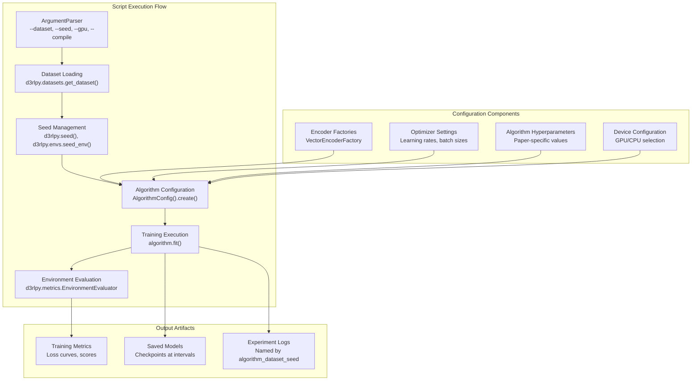
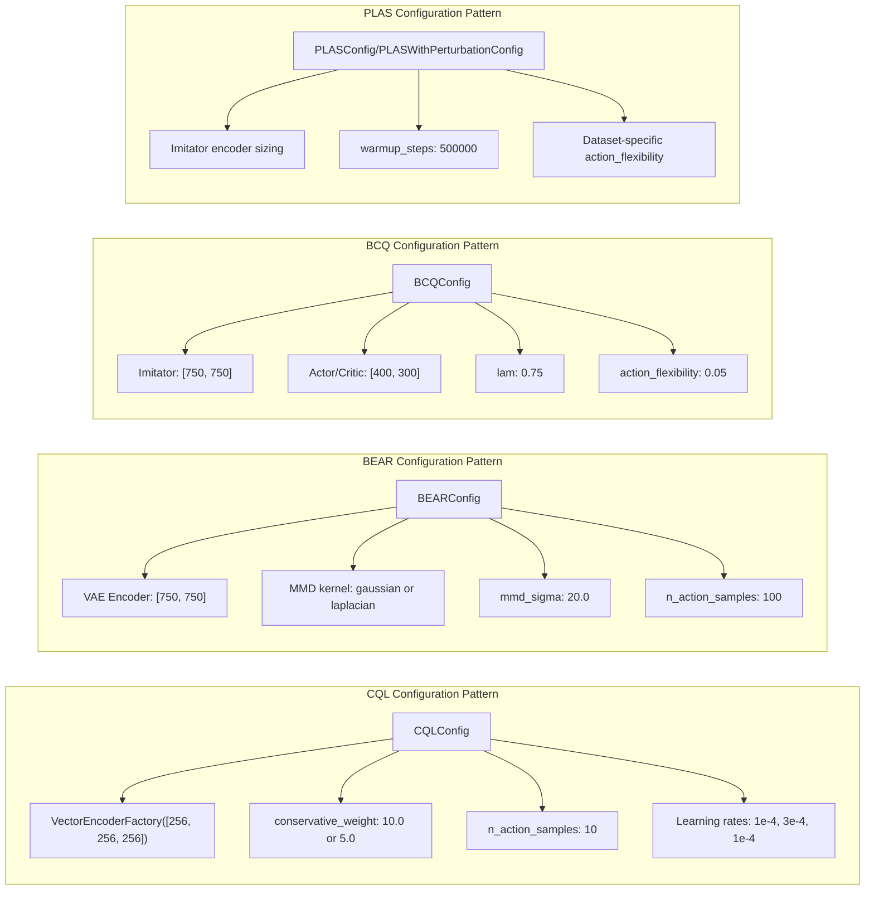
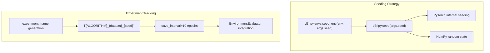

<!-- source: DeepWiki mcp.deepwiki.com · repo takuseno/d3rlpy · page 10 Example Reproductions · fetched 2026-10-30 -->

# Example Reproductions

<details>
<summary>Relevant source files</summary>

The following files were used as context for generating this wiki page:

- [README.md](README.md)
- [ROADMAP.md](ROADMAP.md)
- [d3rlpy/algos/__init__.py](d3rlpy/algos/__init__.py)
- [docs/references/algos.rst](docs/references/algos.rst)
- [docs/requirements.txt](docs/requirements.txt)
- [reproductions/offline/bcq.py](reproductions/offline/bcq.py)
- [reproductions/offline/bear.py](reproductions/offline/bear.py)
- [reproductions/offline/cql.py](reproductions/offline/cql.py)
- [reproductions/offline/discrete_cql.py](reproductions/offline/discrete_cql.py)
- [reproductions/offline/plas.py](reproductions/offline/plas.py)
- [reproductions/offline/plas_with_perturbation.py](reproductions/offline/plas_with_perturbation.py)

</details>


This document covers the example reproduction scripts provided with d3rlpy that demonstrate real-world usage patterns for training state-of-the-art offline reinforcement learning algorithms. These scripts serve as both benchmarking tools and practical examples showing proper algorithm configuration, hyperparameter tuning, and evaluation protocols.

For information about the underlying algorithm implementations, see [Algorithm System](#5). For basic usage tutorials, see [Quick Start Tutorial](#3). For details about training and evaluation systems, see [Training and Evaluation](#8).

## Purpose and Scope

The reproduction scripts in d3rlpy provide complete, runnable examples that reproduce the results from original research papers. Each script demonstrates:

- Proper algorithm configuration with paper-specific hyperparameters
- Dataset loading and preprocessing setup
- Training loop configuration with evaluation protocols
- Seed management for reproducible results
- GPU utilization and compilation optimizations

These scripts are located in the [reproductions/](reproductions) directory and serve as both validation of d3rlpy's implementation quality and practical templates for users implementing their own training pipelines.

## Reproduction Script Architecture

### Common Structure Pattern

All reproduction scripts follow a consistent architectural pattern that demonstrates d3rlpy best practices:



**Script Execution Flow**
This diagram shows the standard execution pattern used across all reproduction scripts. Each script processes command-line arguments, loads the appropriate dataset, configures seeds for reproducibility, creates the algorithm with paper-specific settings, and executes training with environment evaluation.

Sources: [reproductions/offline/bear.py:6-57](), [reproductions/offline/cql.py:6-51](), [reproductions/offline/bcq.py:6-48]()

### Algorithm-Specific Configurations

Different algorithms require specific configuration patterns that reflect their original paper implementations:



**Algorithm Configuration Patterns**
This diagram illustrates the key configuration patterns for major offline RL algorithms. Each algorithm has specific hyperparameter requirements that reflect the original paper implementations and optimal performance characteristics.

Sources: [reproductions/offline/cql.py:20-38](), [reproductions/offline/bear.py:20-44](), [reproductions/offline/bcq.py:20-35](), [reproductions/offline/plas.py:20-37]()

## Specific Algorithm Examples

### Conservative Q-Learning (CQL)

The CQL reproduction script demonstrates advanced offline RL configuration with dataset-specific hyperparameter selection:

| Configuration Aspect | Implementation | Purpose |
|----------------------|----------------|---------|
| Encoder Architecture | `VectorEncoderFactory([256, 256, 256])` | Three-layer fully connected networks |
| Conservative Weight | `10.0` for medium datasets, `5.0` for others | Dataset-specific regularization strength |
| Learning Rates | Actor: `1e-4`, Critic: `3e-4`, Temperature: `1e-4` | Balanced learning across components |
| Action Sampling | `n_action_samples=10` | Conservative Q-function estimation |
| Training Steps | `500000` with `1000` steps per epoch | Extended training for convergence |

The script implements dataset-specific logic for optimal performance:

```python
if "medium-v0" in args.dataset:
    conservative_weight = 10.0
else:
    conservative_weight = 5.0
```

Sources: [reproductions/offline/cql.py:22-36]()

### Bootstrapping Error Accumulation Reduction (BEAR) 

The BEAR reproduction script showcases MMD-based policy constraint configuration:

| Configuration Aspect | Implementation | Purpose |
|----------------------|----------------|---------|
| VAE Encoder | `VectorEncoderFactory([750, 750])` | Large capacity for behavior modeling |
| MMD Kernel | `gaussian` for HalfCheetah, `laplacian` for others | Environment-specific kernel selection |
| MMD Parameters | `sigma=20.0`, `n_mmd_action_samples=4` | Maximum Mean Discrepancy tuning |
| Support Constraint | `alpha_threshold=0.05`, `n_target_samples=10` | Policy support constraint parameters |
| Warmup Period | `warmup_steps=40000` | Behavior cloning initialization |

The script includes environment-specific MMD kernel selection:

```python
if "halfcheetah" in args.dataset:
    kernel = "gaussian"
else:
    kernel = "laplacian"
```

Sources: [reproductions/offline/bear.py:22-44]()

### Batch Constrained Q-Learning (BCQ)

The BCQ reproduction script demonstrates VAE-based action constraint methodology:

| Configuration Aspect | Implementation | Purpose |
|----------------------|----------------|---------|
| VAE Encoder | `VectorEncoderFactory([750, 750])` | Behavior modeling capacity |
| RL Encoders | `VectorEncoderFactory([400, 300])` | Actor and critic network sizing |
| Constraint Parameter | `lam=0.75` | VAE reconstruction weight |
| Action Flexibility | `action_flexibility=0.05` | Perturbation magnitude |
| Action Sampling | `n_action_samples=100` | Extensive action sampling |

Sources: [reproductions/offline/bcq.py:20-34]()

### Policy in Latent Action Space (PLAS)

The PLAS reproduction scripts demonstrate sophisticated VAE-based policy learning with dataset-specific action flexibility:

| Dataset | Action Flexibility | Rationale |
|---------|-------------------|-----------|
| `walker2d-random-v0` | `0.05` | Conservative exploration in random data |
| `hopper-random-v0` | `0.5` | Higher flexibility for unstable dynamics |
| `halfcheetah-medium-v0` | `0.1` | Balanced constraint for medium quality data |
| `hopper-medium-expert-v0` | `0.01` | Minimal deviation from expert behavior |

The action flexibility mapping demonstrates dataset-aware hyperparameter selection:

```python
ACTION_FLEXIBILITY = {
    "walker2d-random-v0": 0.05,
    "hopper-random-v0": 0.5,
    "halfcheetah-random-v0": 0.01,
    # ... dataset-specific mappings
}
```

Sources: [reproductions/offline/plas_with_perturbation.py:5-18](), [reproductions/offline/plas.py:20-36]()

### Discrete CQL for Atari

The discrete CQL reproduction script demonstrates pixel-based offline RL configuration:

| Configuration Aspect | Implementation | Purpose |
|----------------------|----------------|---------|
| Dataset Loading | `get_atari_transitions(fraction=0.01)` | 1% subset for manageable training |
| Quantile Regression | `QRQFunctionFactory(n_quantiles=200)` | Distributional Q-function estimation |
| Pixel Scaling | `PixelObservationScaler()` | Pixel normalization to [0,1] |
| Reward Clipping | `ClipRewardScaler(-1.0, 1.0)` | Standard Atari reward preprocessing |
| Optimizer Tuning | `AdamFactory(eps=1e-2/32)` | Epsilon adjustment for stability |

Sources: [reproductions/offline/discrete_cql.py:25-37]()

## Usage and Execution

### Command Line Interface

All reproduction scripts support a consistent command-line interface:

```bash
# Basic execution with defaults
python reproductions/offline/cql.py

# Specify custom dataset and seed
python reproductions/offline/cql.py --dataset hopper-medium-expert-v0 --seed 42

# Enable GPU acceleration and graph compilation
python reproductions/offline/cql.py --gpu 0 --compile

# Full configuration example
python reproductions/offline/bear.py \
    --dataset halfcheetah-medium-v0 \
    --seed 1 \
    --gpu 0 \
    --compile
```

### Common Parameters

| Parameter | Type | Default | Purpose |
|-----------|------|---------|---------|
| `--dataset` | `str` | Algorithm-specific | D4RL dataset identifier |
| `--seed` | `int` | `1` | Random seed for reproducibility |
| `--gpu` | `int` | `None` | GPU device index (CPU if unspecified) |
| `--compile` | `flag` | `False` | Enable `torch.compile` optimization |

Sources: [reproductions/offline/bear.py:7-12](), [reproductions/offline/cql.py:7-12]()

### Reproducibility Practices

The scripts implement comprehensive reproducibility through multi-level seeding:



**Reproducibility and Experiment Management**
This diagram shows the comprehensive approach to ensuring reproducible results through multi-level seeding and systematic experiment naming conventions used across all reproduction scripts.

Sources: [reproductions/offline/bear.py:16-18](), [reproductions/offline/cql.py:16-18]()

### Training Configuration Patterns

The reproduction scripts demonstrate consistent training configuration:

| Setting | Value | Purpose |
|---------|-------|---------|
| Training Steps | `500000` (most) / `1000000` (PLAS) | Sufficient convergence time |
| Steps per Epoch | `1000` | Regular evaluation frequency |
| Save Interval | `10` epochs | Checkpoint preservation |
| Batch Size | Algorithm-specific (`32`-`256`) | Memory and stability balance |
| Environment Evaluation | `EnvironmentEvaluator(env)` | Performance monitoring |

Sources: [reproductions/offline/cql.py:40-47](), [reproductions/offline/bear.py:46-53]()

---

