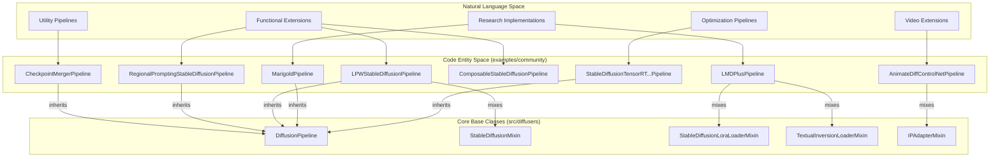
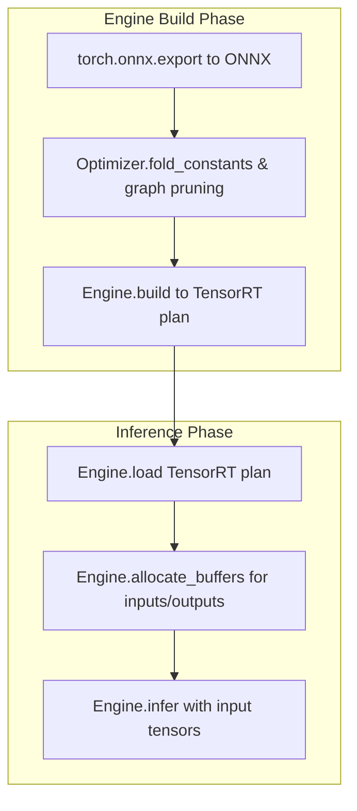
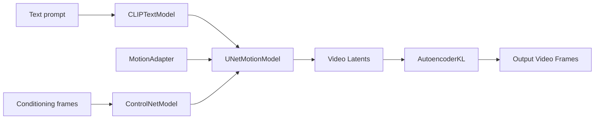
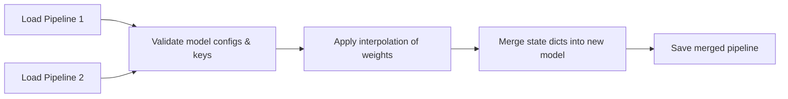

<!-- source: DeepWiki mcp.deepwiki.com · repo huggingface/diffusers · page 3.6 Community and Specialized Pipelines · fetched 2026-10-21 -->

# Community and Specialized Pipelines

Relevant source files

The following files were used as context for generating this wiki page:

- [docs/source/en/api/models/transformer_bria_fibo.md](docs/source/en/api/models/transformer_bria_fibo.md)
- [docs/source/en/api/pipelines/bria_fibo_edit.md](docs/source/en/api/pipelines/bria_fibo_edit.md)
- [docs/source/en/api/pipelines/value_guided_sampling.md](docs/source/en/api/pipelines/value_guided_sampling.md)
- [examples/community/README.md](examples/community/README.md)
- [examples/community/composable_stable_diffusion.py](examples/community/composable_stable_diffusion.py)
- [examples/community/imagic_stable_diffusion.py](examples/community/imagic_stable_diffusion.py)
- [examples/community/interpolate_stable_diffusion.py](examples/community/interpolate_stable_diffusion.py)
- [examples/community/llm_grounded_diffusion.py](examples/community/llm_grounded_diffusion.py)
- [examples/community/lpw_stable_diffusion.py](examples/community/lpw_stable_diffusion.py)
- [examples/community/lpw_stable_diffusion_onnx.py](examples/community/lpw_stable_diffusion_onnx.py)
- [examples/community/marigold_depth_estimation.py](examples/community/marigold_depth_estimation.py)
- [examples/community/pipeline_animatediff_controlnet.py](examples/community/pipeline_animatediff_controlnet.py)
- [examples/community/pipeline_animatediff_img2video.py](examples/community/pipeline_animatediff_img2video.py)
- [examples/community/pipeline_prompt2prompt.py](examples/community/pipeline_prompt2prompt.py)
- [examples/community/pipeline_zero1to3.py](examples/community/pipeline_zero1to3.py)
- [examples/community/regional_prompting_stable_diffusion.py](examples/community/regional_prompting_stable_diffusion.py)
- [examples/community/run_onnx_controlnet.py](examples/community/run_onnx_controlnet.py)
- [examples/community/run_tensorrt_controlnet.py](examples/community/run_tensorrt_controlnet.py)
- [examples/community/seed_resize_stable_diffusion.py](examples/community/seed_resize_stable_diffusion.py)
- [examples/community/speech_to_image_diffusion.py](examples/community/speech_to_image_diffusion.py)
- [examples/community/stable_diffusion_controlnet_reference.py](examples/community/stable_diffusion_controlnet_reference.py)
- [examples/community/stable_diffusion_reference.py](examples/community/stable_diffusion_reference.py)
- [examples/community/stable_diffusion_repaint.py](examples/community/stable_diffusion_repaint.py)
- [examples/community/stable_diffusion_tensorrt_img2img.py](examples/community/stable_diffusion_tensorrt_img2img.py)
- [examples/community/stable_diffusion_tensorrt_inpaint.py](examples/community/stable_diffusion_tensorrt_inpaint.py)
- [examples/community/stable_diffusion_tensorrt_txt2img.py](examples/community/stable_diffusion_tensorrt_txt2img.py)
- [examples/community/stable_diffusion_xl_controlnet_reference.py](examples/community/stable_diffusion_xl_controlnet_reference.py)
- [examples/community/stable_diffusion_xl_reference.py](examples/community/stable_diffusion_xl_reference.py)
- [examples/community/wildcard_stable_diffusion.py](examples/community/wildcard_stable_diffusion.py)
- [src/diffusers/experimental/rl/value_guided_sampling.py](src/diffusers/experimental/rl/value_guided_sampling.py)
- [src/diffusers/models/transformers/transformer_bria_fibo.py](src/diffusers/models/transformers/transformer_bria_fibo.py)
- [src/diffusers/pipelines/bria/pipeline_bria.py](src/diffusers/pipelines/bria/pipeline_bria.py)
- [src/diffusers/pipelines/bria_fibo/__init__.py](src/diffusers/pipelines/bria_fibo/__init__.py)
- [src/diffusers/pipelines/bria_fibo/pipeline_bria_fibo.py](src/diffusers/pipelines/bria_fibo/pipeline_bria_fibo.py)
- [src/diffusers/pipelines/bria_fibo/pipeline_bria_fibo_edit.py](src/diffusers/pipelines/bria_fibo/pipeline_bria_fibo_edit.py)
- [src/diffusers/pipelines/bria_fibo/pipeline_output.py](src/diffusers/pipelines/bria_fibo/pipeline_output.py)
- [src/diffusers/pipelines/deepfloyd_if/watermark.py](src/diffusers/pipelines/deepfloyd_if/watermark.py)
- [tests/pipelines/bria/test_pipeline_bria.py](tests/pipelines/bria/test_pipeline_bria.py)
- [tests/pipelines/bria_fibo/test_pipeline_bria_fibo.py](tests/pipelines/bria_fibo/test_pipeline_bria_fibo.py)
- [tests/pipelines/bria_fibo_edit/__init__.py](tests/pipelines/bria_fibo_edit/__init__.py)
- [tests/pipelines/bria_fibo_edit/test_pipeline_bria_fibo_edit.py](tests/pipelines/bria_fibo_edit/test_pipeline_bria_fibo_edit.py)

This document covers community-contributed and specialized pipelines in the `diffusers` library. These pipelines extend beyond the core Stable Diffusion implementations to provide optimization techniques, research implementations, and experimental features. For standard Stable Diffusion pipelines (text-to-image, image-to-image, inpainting), see [Text-to-Image Pipeline]() and [Image-to-Image and Inpainting](). For ControlNet integration with standard pipelines, see [ControlNet and Conditional Generation]().

**Scope**: This page documents custom pipelines located in `examples/community/` and specialized research implementations. These pipelines typically implement performance optimizations (TensorRT), research papers (Marigold, LMD+, AnimateDiff), or novel features (Long Prompt Weighting, Composable Diffusion, Regional Prompting).

---

## Pipeline Categories and Organization

Community and specialized pipelines fall into several categories based on their purpose and implementation location.

### High-Level Architecture Mapping

The following diagram bridges the natural language concepts of community pipelines to the specific code entities used in their implementation.

**Pipeline Entity Mapping**

**Sources**: [examples/community/README.md:1-20](), [examples/community/lpw_stable_diffusion.py:11-17](), [examples/community/marigold_depth_estimation.py:80-99](), [examples/community/llm_grounded_diffusion.py:32-43](), [examples/community/regional_prompting_stable_diffusion.py:53-60](), [examples/community/pipeline_animatediff_controlnet.py:116-122](), [examples/community/checkpoint_merger.py:15-38]()

---

## Long Prompt Weighting (LPW) Pipeline

The `LPWStableDiffusionPipeline` addresses the 77-token input limitation of standard CLIP text encoders by supporting long prompts with weighting for specific sections.

### Implementation Details

- **Prompt Parsing**: The pipeline parses prompt strings using the `parse_prompt_attention` function, interpreting tokens for increased or decreased attention weights (e.g., `(word:1.2)`, `[word]`) using a comprehensive regex-based parser `re_attention`. This function returns a list of `(text, weight)` pairs that reflect the weighted segments in the prompt [examples/community/lpw_stable_diffusion.py:35-138]().

- **Token Chunking and Padding**: The functions `get_prompts_with_weights` and `pad_tokens_and_weights` tokenize the weighted text segments, chunk them into 77-token segments, and add padding along with attention weights to comply with model input requirements [examples/community/lpw_stable_diffusion.py:141-198]().

- **Embedding Generation**: Tokens and weights are processed through the text encoder. The embeddings for multiple chunks are then concatenated to form the full text embedding, allowing for effective long prompt encoding surpassing the standard limit [examples/community/lpw_stable_diffusion.py:201-207]().

### Data Flow for LPW Text Embeddings

**Sources**: [examples/community/lpw_stable_diffusion.py:1-250](), [examples/community/lpw_stable_diffusion_onnx.py:1-200]()

---

## TensorRT Optimization Pipelines

TensorRT-based pipelines offer GPU-accelerated inference by compiling the ONNX models into optimized TensorRT engine plans, bypassing the slower PyTorch execution.

### Core Components

- **Engine Class**: Encapsulates the TensorRT engine lifecycle:
  - **build()**: Uses Polygraphy and TensorRT APIs to convert an ONNX model into a TensorRT engine file (`.plan`), supporting precision modes like FP16 and dynamic input shapes via optimization profiles [examples/community/stable_diffusion_tensorrt_txt2img.py:108-145]().

  - **load()**: Loads a compiled TensorRT engine from disk and prepares an execution context.

  - **allocate_buffers()**: Allocates PyTorch CUDA tensors that interface with TensorRT engine bindings for inputs and outputs, considering dynamic shapes.

  - **infer()**: Copies inputs into device buffers, sets tensor addresses in the execution context, and executes asynchronous inference.

- **Optimizer Class**: Statically processes the ONNX graph to fold constants, prune outputs, and perform shape inference, improving engine build efficiency [examples/community/stable_diffusion_tensorrt_txt2img.py:166-197]().

### Pipeline Wrappers

Separate pipeline implementations exist for Txt2Img, Img2Img, and Inpainting with TensorRT, where each defines appropriate wrappers for encoding the UNet, VAE, and text encoder models into ONNX graphs and manages the execution order.

### TensorRT Inference Lifecycle

**Sources**: [examples/community/stable_diffusion_tensorrt_txt2img.py:94-197](), [examples/community/stable_diffusion_tensorrt_img2img.py:106-177](), [examples/community/stable_diffusion_tensorrt_inpaint.py:110-181]()

---

## Research Implementation: Marigold Depth Estimation Pipeline

The `MarigoldPipeline` is a monocular depth estimation pipeline leveraging diffusion models trained to predict depth maps from a single RGB image.

### Key Components

- **Model Setup**: The pipeline uses a `UNet2DConditionModel` trained to denoise depth latents, with a corresponding `AutoencoderKL` (VAE) for image and depth encoding/decoding [examples/community/marigold_depth_estimation.py:88-89]().

- **Inference Method** (`__call__`):
  - Supports multiple denoising passes for ensembling (`ensemble_size`), enhancing depth prediction robustness.
  - Accepts parameterized denoising steps and processing resolution.
  - Outputs a `MarigoldDepthOutput` including the depth map as `np.ndarray`, a colorized depth map using a specified colormap, and an uncertainty estimate from ensembling [examples/community/marigold_depth_estimation.py:125-178]().

- **Scaling Factors**: Defines consistent latent scale factors for both RGB and depth branches to ensure compatible latent representations [examples/community/marigold_depth_estimation.py:101-102]().

**Sources**: [examples/community/marigold_depth_estimation.py:49-174]()

---

## Reference and Guidance Pipelines

Several pipelines implement guidance using reference images or language model (LLM) grounded layouts.

### LLM-Grounded Diffusion (LMD+)

- **Purpose**: Introduces layout-conditioned generation by grounding the image generation process in bounding boxes and phrase guidance derived from an LLM [examples/community/llm_grounded_diffusion.py:15-55]().

- **Core Class**: `LMDPlusPipeline` inherits `DiffusionPipeline` with additional mixins for LoRA and Textual Inversion loading.

- **Attention Processor Hook**: `AttnProcessorWithHook` is a custom attention processor that alters cross-attention based on spatial guidance from bounding boxes, modulating attention maps accordingly [examples/community/llm_grounded_diffusion.py:154-171]().

- **Parsing Layouts**: The pipeline also supports parsing LLM output (text describing boxes and phrases) with helper functions to extract structured layout guidance.

### Regional Prompting Pipeline

- **Overview**: Allows partitioning images into columns or rows controlled by separate prompt segments, enabling region-specific prompt conditioning [examples/community/regional_prompting_stable_diffusion.py:53-159]().

- **Key Parameters**: Modes like 'cols', 'rows', 'prompt' allow different forms of regional control. Dividers specify proportions, and custom keywords like `BREAK`, `ADDBASE`, and `ADDCOMM` help manage global base prompts and regional additions.

- **Data Flow**: Internally, the pipeline parses and partitions the prompt inputs and computes attention controls or mask regions accordingly.

### Stable Diffusion Reference Variants

- **Reference Guidance**: Pipelines like `StableDiffusionReferencePipeline` allow conditioning generation on a reference image by injecting attention and style (AdaIN) signals guided by flags `reference_attn` and `reference_adain`. This enables image manipulations grounded in an initial image [examples/community/stable_diffusion_reference.py:83-118](), [examples/community/stable_diffusion_xl_reference.py:139-160]().

**Sources**: [examples/community/llm_grounded_diffusion.py:118-180](), [examples/community/regional_prompting_stable_diffusion.py:48-159](), [examples/community/stable_diffusion_reference.py:83-118](), [examples/community/stable_diffusion_xl_reference.py:139-160]()

---

## Specialized Video Pipelines

### AnimateDiff with ControlNet Integration

- **Objective**: Provides video generation with temporal motion guidance combined with spatial conditioning from ControlNet.

- **Implementation**:
  - Converts a standard UNet into a `UNetMotionModel` incorporating temporal attention blocks.
  - Motion adapters inject temporal consistency control into cross-attention layers of UNet.
  - ControlNet models process conditioning frames for spatial control.

- **Data Flow**:
  - The prompt is encoded by CLIP into embeddings.
  - Temporal motion adapters and ControlNet conditioning influence the UNet latent denoising at each diffusion step.
  - The video latents are decoded by the VAE, producing final video frames [examples/community/pipeline_animatediff_controlnet.py:116-162](), [examples/community/pipeline_animatediff_controlnet.py:73-90]().

### AnimateDiff ControlNet Pipeline Logic

**Sources**: [examples/community/pipeline_animatediff_controlnet.py:116-162](), [examples/community/pipeline_animatediff_controlnet.py:73-90]()

---

## Composable and Editing Pipelines

### Composable Stable Diffusion Pipeline

- Enables combining multiple prompts with weights and conjunction logic to flexibly compose imagery from several concepts.

- Uses the base `DiffusionPipeline` and mixes in `StableDiffusionMixin` for standard Stable Diffusion operations, with scheduler compatibility across several schedulers (DDIM, PNDMScheduler, LMSDiscreteScheduler, etc.) [examples/community/composable_stable_diffusion.py:42-89]().

### Imagic Pipeline

- An innovative multi-stage image editing pipeline with the following phases:

  1. **Embedding Optimization**: Learns to optimize a prompt embedding to better encode the input image content.

  2. **Model Fine-tuning**: Fine-tunes the UNet weights for improved reconstruction fidelity on the target image.

  3. **Interpolation**: Smoothly interpolates between the optimized embedding and the target prompt embedding for controlled editing strength using spherical linear interpolation (`slerp`) [examples/community/imagic_stable_diffusion.py:61-122]().

**Sources**: [examples/community/composable_stable_diffusion.py:42-134](), [examples/community/imagic_stable_diffusion.py:61-122](), [examples/community/interpolate_stable_diffusion.py:22-46]()

---

## Utility Pipelines: Checkpoint Merger

The `CheckpointMergerPipeline` facilitates merging multiple pretrained checkpoints inside the diffusers ecosystem without needing external tools.

### Features

- Supports multiple interpolation strategies for blending weights:

  - `sigmoid`
  - `inv_sigmoid`
  - `add_diff`
  - Simple weighted sums

- Validates compatibility by comparing `model_index.json` entries of source pipelines to ensure consistent architecture [examples/community/checkpoint_merger.py:40-58]().

- Merges model weights by iterating over the state dict keys of sub-models (UNet, VAE, Text Encoder) applying the chosen interpolation [examples/community/checkpoint_merger.py:79-143]().

### Merging Flow Simplified

**Sources**: [examples/community/checkpoint_merger.py:15-143]()

---

This page highlights the diversity and extensibility of the `diffusers` ecosystem driven by community contributions and experimental research. Users can explore advanced optimizations, guided generation methods, as well as novel model interactions supporting scenarios such as video generation, layout-conditioned diffusion, and enhanced prompt control. For stable and supported pipelines, refer to the core documentation pages specific to each pipeline family.

---

