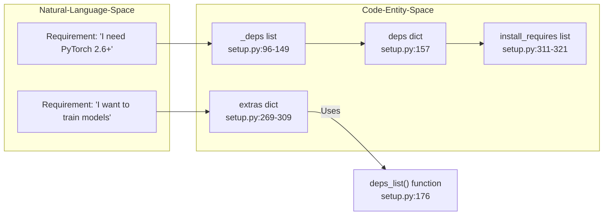
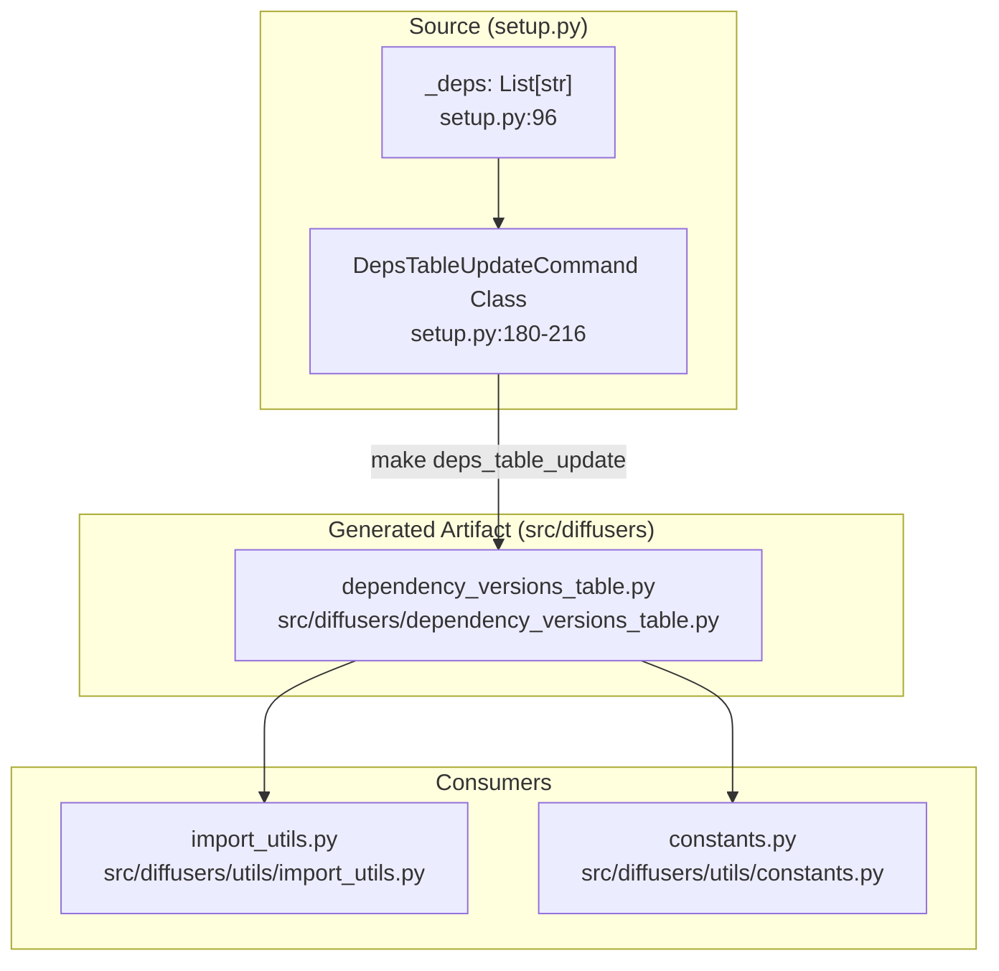

<!-- source: DeepWiki mcp.deepwiki.com · repo huggingface/diffusers · page 9.1 Package Setup and Distribution · fetched 2026-10-21 -->

# Package Setup and Distribution

<details>
<summary>Relevant source files</summary>

The following files were used as context for generating this wiki page:

- [.github/workflows/build_docker_images.yml](.github/workflows/build_docker_images.yml)
- [docker/diffusers-doc-builder/Dockerfile](docker/diffusers-doc-builder/Dockerfile)
- [docker/diffusers-onnxruntime-cpu/Dockerfile](docker/diffusers-onnxruntime-cpu/Dockerfile)
- [docker/diffusers-onnxruntime-cuda/Dockerfile](docker/diffusers-onnxruntime-cuda/Dockerfile)
- [docker/diffusers-pytorch-cpu/Dockerfile](docker/diffusers-pytorch-cpu/Dockerfile)
- [docker/diffusers-pytorch-cuda/Dockerfile](docker/diffusers-pytorch-cuda/Dockerfile)
- [docker/diffusers-pytorch-minimum-cuda/Dockerfile](docker/diffusers-pytorch-minimum-cuda/Dockerfile)
- [docker/diffusers-pytorch-xformers-cuda/Dockerfile](docker/diffusers-pytorch-xformers-cuda/Dockerfile)
- [examples/dreambooth/train_dreambooth.py](examples/dreambooth/train_dreambooth.py)
- [examples/dreambooth/train_dreambooth_flax.py](examples/dreambooth/train_dreambooth_flax.py)
- [examples/dreambooth/train_dreambooth_lora.py](examples/dreambooth/train_dreambooth_lora.py)
- [examples/text_to_image/train_text_to_image.py](examples/text_to_image/train_text_to_image.py)
- [examples/text_to_image/train_text_to_image_flax.py](examples/text_to_image/train_text_to_image_flax.py)
- [examples/text_to_image/train_text_to_image_lora.py](examples/text_to_image/train_text_to_image_lora.py)
- [examples/textual_inversion/textual_inversion.py](examples/textual_inversion/textual_inversion.py)
- [examples/textual_inversion/textual_inversion_flax.py](examples/textual_inversion/textual_inversion_flax.py)
- [examples/unconditional_image_generation/train_unconditional.py](examples/unconditional_image_generation/train_unconditional.py)
- [setup.py](setup.py)
- [src/diffusers/dependency_versions_table.py](src/diffusers/dependency_versions_table.py)
- [src/diffusers/utils/__init__.py](src/diffusers/utils/__init__.py)
- [src/diffusers/utils/constants.py](src/diffusers/utils/constants.py)
- [src/diffusers/utils/import_utils.py](src/diffusers/utils/import_utils.py)
- [src/diffusers/utils/testing_utils.py](src/diffusers/utils/testing_utils.py)

</details>


This page documents the package setup, dependency management, and distribution system for the Diffusers library. It covers how the package is configured via `setup.py`, how dependencies are declared and versioned, the extras installation profiles available, and the build/release workflow.

For information about runtime import management and backend detection, see [Import and Backend Management](9.3). For the overall package structure and module organization, see [Package Structure and Dependencies](1.3).

## Purpose and Scope

This document explains:  
- Core package configuration in `setup.py` and dependency declaration.  
- The dependency version management system and auto-generation of version tables.  
- Installation extras groups for different use cases (training, quantization, backends).  
- Build, test, and release workflows orchestrated via `setup.py` commands and GitHub Actions.  
- Docker images provided for consistent deployment environments.

---

## Core Setup Configuration

### Package Metadata and Structure

The package is configured via the `setup.py` script using `setuptools`. Key metadata and configuration parameters are:

| Field             | Value                         | Purpose                                  |
|-------------------|-------------------------------|------------------------------------------|
| `name`            | `"diffusers"`                 | PyPI package name [setup.py:303]()      |
| `version`         | Imported from `src/diffusers/__init__.py` | Current package version [src/diffusers/__init__.py:20-23]() |
| `package_dir`     | `{"": "src"}`                 | Source directory root [setup.py:303]()  |
| `packages`        | `find_packages("src")`        | Automatically discovers Python packages [setup.py:303]() |
| `python_requires` | `">=3.10.0"`                  | Minimum Python version supported [setup.py:123,303]() |
| `entry_points`    | `console_scripts` for CLI     | Defines `diffusers-cli` command [setup.py:303]() |

The CLI entry point enables the `diffusers-cli` command line tool that provides utility commands and environment inspection at runtime.

**Sources:** [setup.py:303](), [src/diffusers/__init__.py:20-23]()

---

### Dependency Declaration System

Dependencies are declared centrally in the `_deps` list in `setup.py`, which enumerates all required and optional packages with their version constraints [setup.py:96-149](). This list acts as the single source of truth for dependency and version information.

The `_deps` list is parsed into a dictionary called `deps` mapping package names to version requirements. This lookup makes programmatic management easier, for example:

```python
deps = {b: a for a, b in (re.findall(r"^(([^!=<>~]+)(?:[!=<>~].*)?$)", x)[0] for x in _deps)}
```

This regex extracts package names (keys) and corresponding full requirements (values) [setup.py:157]().

**Diagram: From Natural Language Requirements to Code Entities**



**Sources:** [setup.py:96-178]()

---

### Required Dependencies

The `install_requires` list enumerates essential runtime dependencies of the package, installed in all default installations. These include core libraries for file locking, HTTP requests, numerical operations, and model hub integration.

| Package            | Version Constraint        | Purpose                  |
|--------------------|---------------------------|--------------------------|
| `importlib_metadata`| None                      | Metadata access          |
| `filelock`         | None                      | File locking             |
| `huggingface-hub`  | `>=1.23.0,<2.0`           | Integration with model hub|
| `numpy`            | None                      | Numerical computation    |
| `regex`            | `!=2019.12.17`            | Regex matching           |
| `requests`         | None                      | HTTP client              |
| `safetensors`      | `>=0.8.0`                 | Safe tensor serialization|
| `Pillow`           | None                      | Image processing         |

**Sources:** [setup.py:303]()

---

### Optional Dependency Extras

To support specialized features and workflows, `extras_require` groups dependencies into "extras" for easier optional installation. Notable extras groups include:

| Extra Group     | Key Dependencies                                                         | Purpose                                |
|-----------------|--------------------------------------------------------------------------|--------------------------------------|
| `training`      | `accelerate`, `datasets`, `peft`, `timm`                               | Training and fine-tuning ecosystem    |
| `test`          | `pytest`, `pytest-timeout`, `transformers`, `isort`, `ruff`             | Unit tests and quality checks         |
| `quality`       | `black`, `ruff`, `isort`, `hf-doc-builder`                             | Code style and documentation          |
| `torch`         | `torch`, `accelerate`                                                   | PyTorch backend support                |
| `bitsandbytes`  | `bitsandbytes`                                                          | 8-bit quantization library             |
| `gguf`          | `gguf`                                                                  | GGUF model format support              |
| `torchao`       | `torchao`                                                               | TorchAO quantization support           |
| `onnxruntime`   | `onnxruntime`, `onnx`                                                   | ONNX backend acceleration             |

These extras simplify installation scenarios. For example, installing `diffusers[training]` pulls all dependencies needed for training pipelines.

**Sources:** [setup.py:269-303]()

---

## Dependency Version Management

### Auto-Generated Version Table

Because the `_deps` list in `setup.py` contains the definitive dependency versions, the project auto-generates a Python dictionary in `src/diffusers/dependency_versions_table.py` that mirrors this information. This allows runtime access to dependency versions without importing `setup.py`.

The generation is handled by the custom `DepsTableUpdateCommand` class defined inside `setup.py`. It writes a plain dictionary mapping package names to version specifiers to the dependency version table file when the command `make deps_table_update` is run.

**Diagram: Dependency Versions Synchronization Pipeline**



This approach ensures that dependency versions are consistent, centralized, and accessible programmatically at runtime.

**Sources:** [setup.py:180-216](), [src/diffusers/dependency_versions_table.py:1-56](), [src/diffusers/utils/import_utils.py:35-43]()

---

## Distribution and Release Process

### Release Workflow

The officially documented release process in `setup.py` provides a step-by-step guide for maintainers to create releases and upload packages to PyPI.

The major steps include [setup.py:15-85]():

1. **Preparation**  
   Run `make pre-release` (or `make pre-patch` for patches) and fix doc copies with `make fix-copies`.  
   Optionally, if releasing from a special branch, copy updated README and fix copies on the main branch.

2. **Version Unpinning**  
   Unpin dependencies from git installs in `setup.py` before release commit.

3. **Branch and Commit**  
   Checkout a release branch named `v<RELEASE>-release`, commit version changes with message `Release: <RELEASE>`, then push.

4. **Test Running**  
   Manually trigger the GitHub Actions workflow "Nightly and release tests" on the release branch, waiting for completion.

5. **Tagging the Release**  
   Create a git tag named `v<RELEASE>` and push it.

6. **Building Distributions**  
   Build both the wheel and source distributions:  
   ```
   python setup.py bdist_wheel && python setup.py sdist
   ```

7. **Test PyPI Upload and Validation**  
   Upload artifacts to TestPyPI and check installability via pip from TestPyPI.

8. **Publish to Official PyPI**  
   Upload the final build artifacts to the official PyPI server using twine.

9. **Release Notes Preparation**  
   Generate and publish release notes, optionally using the auto-release-notes Spacem on Hugging Face Hub.

10. **Post-release Tasks**  
    Run `make post-release` or `make post-patch` and switch back to the main branch.

This process ensures quality through testing and reproducibility via clear tagging.

**Sources:** [setup.py:15-85]()

---

## Docker Infrastructure

Dockerfiles are provided to simplify environment setup across various runtime scenarios, ensuring consistent dependency versions and system libraries.

| Environment               | Base Image               | Overview                                                             | Source File                      |
|---------------------------|--------------------------|----------------------------------------------------------------------|----------------------------------|
| `pytorch-cuda`            | `nvidia/cuda:12.9.1`     | Installs CUDA libraries, Python 3.10, torch 2.10.0, and diffusers with `[test]` extra.                      | docker/diffusers-pytorch-cuda/Dockerfile:1-53() |
| `pytorch-cpu`             | `python:3.10-slim`       | CPU-only Python environment with minimal dependencies.               | docker/diffusers-pytorch-cpu/Dockerfile:1-39()  |
| `doc-builder`             | `python:3.10-slim`       | Includes doc-builder and quantization tools for building docs.       | docker/diffusers-doc-builder/Dockerfile:1-46()  |
| `pytorch-xformers-cuda`   | `nvidia/cuda:12.9.1`     | Adds xformers dependency and pins LLVM-related packages for GPU acceleration.                         | docker/diffusers-pytorch-xformers-cuda/Dockerfile:1-59() |

Example snippet from `pytorch-cuda` Dockerfile includes Python venv creation, installation of CUDA runtime libraries, and `diffusers` package installation including test dependencies:

```dockerfile
FROM nvidia/cuda:12.9.1-runtime-ubuntu24.04
RUN apt-get update && apt-get install -y python3 python3-pip bash curl ...
RUN python3 -m pip install --no-cache-dir torch==2.10.0 torchvision==0.25.0 ...
RUN python3 -m pip install --no-cache-dir "git+https://github.com/huggingface/diffusers.git@main#egg=diffusers[test]"
```

**Sources:** [docker/diffusers-pytorch-cuda/Dockerfile:1-53](), [docker/diffusers-pytorch-cpu/Dockerfile:1-38](), [docker/diffusers-doc-builder/Dockerfile:1-45](), [docker/diffusers-pytorch-xformers-cuda/Dockerfile:1-58]()

---

## Maintenance and Quality Control

### Repository Consistency

- The command `make deps_table_update` must be run after changing dependencies in `_deps` to keep the version table synchronized. This is enforced by CI checks [setup.py:95]().

- The project implements `check_min_version` in `src/diffusers/utils/__init__.py` to require minimum library versions at runtime, particularly for example scripts and features [src/diffusers/utils/__init__.py:164-175]().

### Deprecation Management

The package uses a `deprecate` decorator to manage API changes gracefully, raising warnings or exceptions depending on version timelines. Tests in `tests/others/test_utils.py` ensure deprecation rules are enforced systematically.

**Deprecation Logic Example:**

- If a deprecated feature is used before its planned removal version, a `FutureWarning` is raised.  
- If used after planned removal, a `ValueError` is thrown to enforce code removal.

This system guarantees smooth migration paths and maintains code quality.

**Sources:** [src/diffusers/utils/__init__.py:43](), [tests/others/test_utils.py:37-188](), [src/diffusers/utils/testing_utils.py:71-76]()

---

# Summary

This page covered the Diffusers package setup and distribution system focusing on:  
- The central `setup.py` script with dependency declaration and version management.  
- Extras groups intended for specific installation use cases.  
- The release process for building, testing, and publishing the package.  
- Docker images that provide reproducible runtime environments.  
- Project maintenance practices ensuring version consistency and quality control.

For related developer tools and testing infrastructure, please consult [Testing Framework](9.2) and [Import and Backend Management](9.3).

---

**Sources:**

- `setup.py:1-170`, `setup.py:176-216`, `setup.py:269-357`  
- `src/diffusers/dependency_versions_table.py:1-56`  
- `src/diffusers/utils/__init__.py:164-175`  
- `src/diffusers/utils/import_utils.py:35-43`  
- `docker/diffusers-pytorch-cuda/Dockerfile:1-53`  
- `docker/diffusers-pytorch-cpu/Dockerfile:1-39`  
- `docker/diffusers-doc-builder/Dockerfile:1-46`  
- `docker/diffusers-pytorch-xformers-cuda/Dockerfile:1-59`  
- `tests/others/test_utils.py:37-188`

---

