# Page: Introduction to Diffusers

# Introduction to Diffusers

<details>
<summary>Relevant source files</summary>

The following files were used as context for generating this wiki page:

- [README.md](README.md)
- [docs/source/en/_toctree.yml](docs/source/en/_toctree.yml)
- [src/diffusers/__init__.py](src/diffusers/__init__.py)
- [src/diffusers/models/README.md](src/diffusers/models/README.md)
- [src/diffusers/models/__init__.py](src/diffusers/models/__init__.py)
- [src/diffusers/models/autoencoders/__init__.py](src/diffusers/models/autoencoders/__init__.py)
- [src/diffusers/models/transformers/__init__.py](src/diffusers/models/transformers/__init__.py)
- [src/diffusers/pipelines/README.md](src/diffusers/pipelines/README.md)
- [src/diffusers/pipelines/__init__.py](src/diffusers/pipelines/__init__.py)
- [src/diffusers/pipelines/stable_diffusion/README.md](src/diffusers/pipelines/stable_diffusion/README.md)
- [src/diffusers/pipelines/stable_diffusion/__init__.py](src/diffusers/pipelines/stable_diffusion/__init__.py)
- [src/diffusers/schedulers/README.md](src/diffusers/schedulers/README.md)
- [src/diffusers/schedulers/__init__.py](src/diffusers/schedulers/__init__.py)
- [src/diffusers/utils/dummy_pt_objects.py](src/diffusers/utils/dummy_pt_objects.py)
- [src/diffusers/utils/dummy_torch_and_transformers_objects.py](src/diffusers/utils/dummy_torch_and_transformers_objects.py)

</details>


## Purpose and Scope

This document provides a high-level introduction to the `diffusers` library, a comprehensive Python toolkit for working with state-of-the-art diffusion models. This page covers the library's core purpose, fundamental architecture, and primary capabilities for both inference and training of diffusion models.

For detailed information about specific subsystems, see:
- **Architecture details**: [Architecture Overview](#1.1) — Explain the overall architecture of the library, including the module organization, lazy loading system, and backend abstraction.
- **Installation and basic usage**: [Getting Started](#1.2) — Guide users through installation and basic usage patterns, including simple text-to-image generation examples.
- **Package structure and dependencies**: [Package Structure and Dependencies](#1.3) — Document the package layout, dependency management, and extras groups for different use cases.
- **Core components**: [Core Components](#2)
- **Specific pipelines**: [Stable Diffusion Pipelines](#3)

---

## What is Diffusers?

**Diffusers** is a modular library designed to provide easy access to pretrained diffusion models for generating images, audio, video, and even 3D structures. The library is designed with a focus on usability, simplicity, and customizability over complex abstractions.

| Principle                     | Description                                                                                       |
|-------------------------------|-------------------------------------------------------------------------------------------------|
| **Usability over Performance** | Simple, intuitive APIs that prioritize ease of use while maintaining state-of-the-art capabilities [README.md:30-31]() |
| **Simple over Easy**           | Transparent, readable code where implementation details are accessible rather than hidden [README.md:30-31]()                 |
| **Customizability over Abstractions** | Modular components that can be mixed, matched, and extended [README.md:30-31]()                                                     |

The library supports both **inference** (generating outputs from pretrained models) and **training** (fine-tuning or training diffusion models from scratch).

**Sources:** [README.md:30-36]()

---

## Three Core Components

Diffusers is built around three fundamental, interchangeable component types:

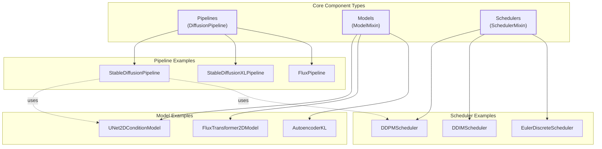

### 1. Pipelines (`DiffusionPipeline`)

Pipelines are end-to-end workflows that combine models, schedulers, and other components (like text encoders from `transformers`) to perform specific tasks.

- **Base class**: `DiffusionPipeline` [src/diffusers/pipelines/pipeline_utils.py:56]() (referenced in [src/diffusers/pipelines/__init__.py:56]())
- **Key method**: `from_pretrained()` for loading pretrained models [README.md:68](), `__call__()` for running inference [README.md:70]().
- **Examples**: `StableDiffusionPipeline`, `StableDiffusionXLPipeline`, `FluxPipeline` [src/diffusers/pipelines/__init__.py:43-200]().

### 2. Models (`ModelMixin`)

Models are neural network architectures that perform the core denoising or generative operations. These include UNets, Transformers, VAEs, and ControlNets.

- **Base class**: `ModelMixin` [src/diffusers/models/__init__.py:89]()
- **Key types**:
  - Denoisers: e.g., `UNet2DConditionModel`
  - Transformers: e.g., `FluxTransformer2DModel`
  - VAEs: e.g., `AutoencoderKL`
  
  [src/diffusers/models/__init__.py:26-110]()

### 3. Schedulers (`SchedulerMixin`)

Schedulers orchestrate the diffusion process, managing noise schedules, the forward and reverse diffusion steps, and controlling generation quality/speed trade-offs.

- **Base class**: `SchedulerMixin` [src/diffusers/schedulers/__init__.py:83]()
- **Key methods**: `set_timesteps()`, `step()`, and noise management [README.md:82-91]()
- **Examples**: `DDPMScheduler`, `DDIMScheduler`, `EulerDiscreteScheduler` [src/diffusers/schedulers/__init__.py:40-85]().

**Sources:** [README.md:32-36](), [src/diffusers/pipelines/__init__.py:43-200](), [src/diffusers/models/__init__.py:26-110](), [src/diffusers/schedulers/__init__.py:40-85]()

---

## Library Architecture: Code Structure

The high-level organization of the library reflects distinct modular responsibilities:

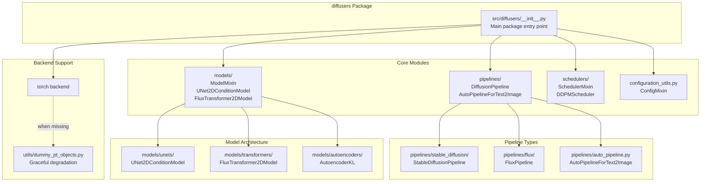

### Module Organization

| Module              | Location                       | Purpose                          |
|---------------------|--------------------------------|---------------------------------|
| **Pipelines**       | `src/diffusers/pipelines/`     | End-to-end inference workflows [src/diffusers/pipelines/__init__.py:22-33]() |
| **Models**          | `src/diffusers/models/`        | Neural network architectures [src/diffusers/models/__init__.py:26-110]()       |
| **Schedulers**      | `src/diffusers/schedulers/`    | Diffusion process control [src/diffusers/schedulers/__init__.py:40-84]()       |
| **Configuration**   | `src/diffusers/configuration_utils.py` | Configuration management via `ConfigMixin` [src/diffusers/__init__.py:37]()     |
| **Utils**           | `src/diffusers/utils/`         | Import management, logging, dummy objects [src/diffusers/__init__.py:47-61]()    |

---

## Lazy Loading and Dependency Management

`diffusers` uses a **lazy loading system** to optimize import times and conditionally load components based on available dependencies (e.g., `torch`, `transformers`, `accelerate`). This system delays import of heavy or optional submodules until they are actually accessed, improving startup performance and giving clear error messages if dependencies are missing.

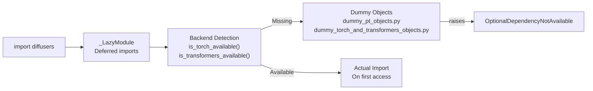

### Dummy Objects for Missing Dependencies

When optional dependencies are not installed, the library provides dummy proxy classes that raise informative errors if used, helping users quickly identify missing requirements.

Example: Classes in `dummy_torch_and_transformers_objects.py` (e.g., `Flux2AutoBlocks`) require both `torch` and `transformers` backends and will raise errors if either is absent [src/diffusers/utils/dummy_torch_and_transformers_objects.py:1-214]().

**Sources:** [src/diffusers/__init__.py:5-26](), [src/diffusers/utils/dummy_pt_objects.py:5-17](), [src/diffusers/utils/dummy_torch_and_transformers_objects.py:1-214]()

---

## Pipeline Loading and Execution Flow

The key entrypoint for end users is the `DiffusionPipeline` class, which supports loading complete pretrained diffusion systems easily:

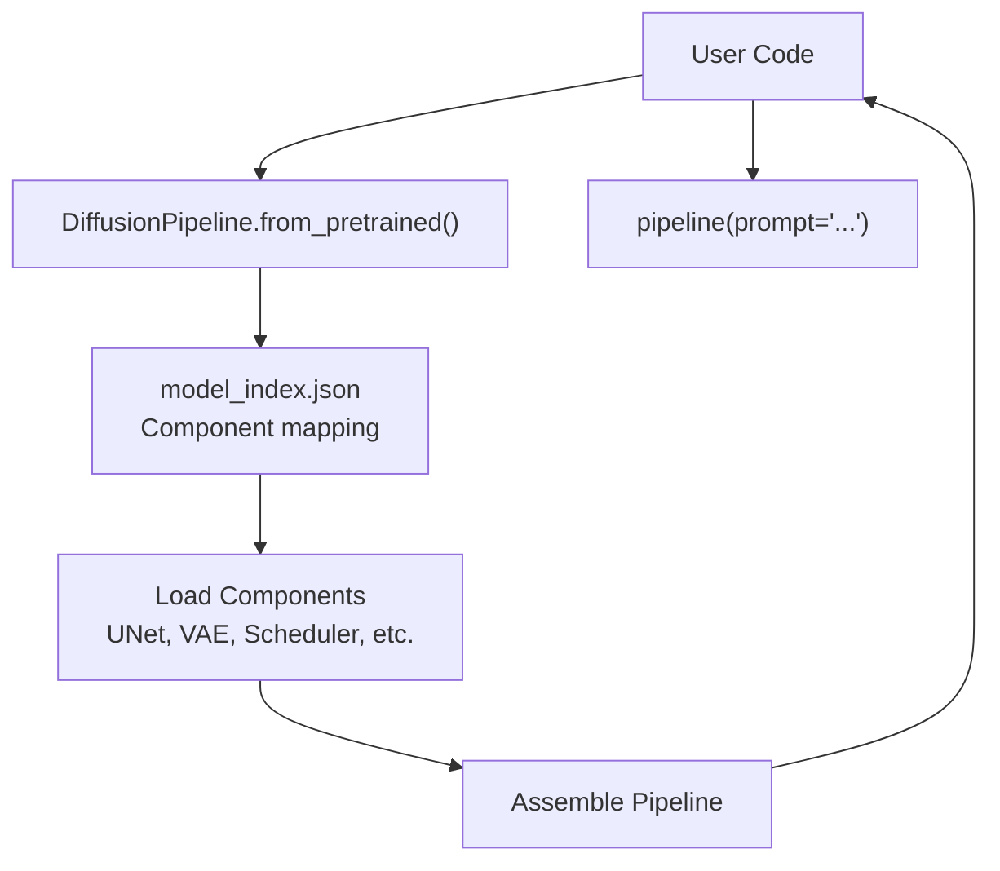

### Task-Based Pipeline Selection via AutoPipeline

The library provides `AutoPipeline` classes that automatically select the appropriate pipeline class based on the checkpoint’s metadata, enabling users to interact with the simplest possible API.

| AutoPipeline Class              | Task            | Location                                          |
|-------------------------------|-----------------|-------------------------------------------------|
| `AutoPipelineForText2Image`    | Text-to-Image   | [src/diffusers/pipelines/auto_pipeline.py:146]() (referenced in [src/diffusers/pipelines/__init__.py:46]()) |
| `AutoPipelineForImage2Image`   | Image-to-Image  | [src/diffusers/pipelines/auto_pipeline.py:334]() (referenced in [src/diffusers/pipelines/__init__.py:44]()) |
| `AutoPipelineForInpainting`    | Inpainting      | [src/diffusers/pipelines/auto_pipeline.py:516]() (referenced in [src/diffusers/pipelines/__init__.py:45]()) |
| `AutoPipelineForText2Audio`    | Text-to-Audio   | [src/diffusers/pipelines/__init__.py:47]()      |

**Sources:** [src/diffusers/pipelines/__init__.py:43-48](), [src/diffusers/pipelines/auto_pipeline.py:146-516]()

---

## Quick Start Example

Generating an image from text requires only a few lines of code using pretrained pipelines:

```python
from diffusers import DiffusionPipeline
import torch

# Load a pretrained pipeline [README.md:68]
pipeline = DiffusionPipeline.from_pretrained(
    "stable-diffusion-v1-5/stable-diffusion-v1-5", 
    torch_dtype=torch.float16
)
pipeline.to("cuda")

# Generate an image with a text prompt [README.md:70]
image = pipeline("An image of a squirrel in Picasso style").images[0]
```

For advanced users, the library also exposes the underlying building blocks to construct custom diffusion workflows:

```python
from diffusers import DDPMScheduler, UNet2DModel
import torch
from PIL import Image

scheduler = DDPMScheduler.from_pretrained("google/ddpm-cat-256")
model = UNet2DModel.from_pretrained("google/ddpm-cat-256").to("cuda")
scheduler.set_timesteps(50)

sample_size = model.config.sample_size
noise = torch.randn((1, 3, sample_size, sample_size), device="cuda")
input = noise

for t in scheduler.timesteps:
    with torch.no_grad():
        noisy_residual = model(input, t).sample
        prev_noisy_sample = scheduler.step(noisy_residual, t, input).prev_sample
        input = prev_noisy_sample

image = (input / 2 + 0.5).clamp(0, 1)
image = image.cpu().permute(0, 2, 3, 1).numpy()[0]
image = Image.fromarray((image * 255).round().astype("uint8"))
image
```

**Sources:** [README.md:65-98]()

---

## Summary

Diffusers offers a clean, modular, and extensible framework to work with diffusion models effectively:

- **Modular Components**: Pipelines, Models, and Schedulers are distinct and swappable to customize workflows.
- **Lazy Loading**: Optimized import system with clear optional dependency behavior.
- **Pretrained Model Hub**: Seamless access to over 30,000 pretrained checkpoints.
- **Broad Task Support**: Text-to-image, image-to-image, inpainting, video, and audio generation pipelines.

For more detailed explanations, see the following child pages:
- [Architecture Overview](#1.1)
- [Getting Started](#1.2)
- [Package Structure and Dependencies](#1.3)

---

# Associating Common Terms to Code Entities

```mermaid
graph LR
    NL["Natural Language Space"]
    CE["Code Entity Space"]

    NL -->|"Diffusion Model Pipeline"\n("End-to-end system for inference")| CE_DiffusionPipeline[DiffusionPipeline]
    NL -->|"Scheduler"\n("Manages noise and timesteps")| CE_Scheduler[SchedulerMixin and subclasses]
    NL -->|"Neural Network Model"\n("Denoiser, encoder-decoder")| CE_Model[ModelMixin and subclasses]
    NL -->|"AutoPipeline"\n("Task-based pipeline selector")| CE_AutoPipeline[AutoPipelineForText2Image, etc.]
    NL -->|"Pretrained Model Hub"\n("Load weights easily")| CE_from_pretrained[from_pretrained() methods]

    CE_DiffusionPipeline --> CE_Model
    CE_DiffusionPipeline --> CE_Scheduler
    CE_DiffusionPipeline --> CE_from_pretrained
    CE_AutoPipeline --> CE_DiffusionPipeline
```

---

# Mapping Library Components to Code Modules

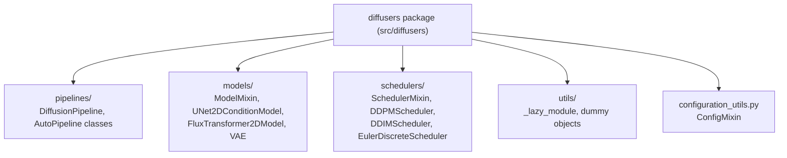

---

**Sources:**  
- [README.md:30-100]()  
- [src/diffusers/__init__.py:1-160]()  
- [src/diffusers/pipelines/__init__.py:20-200]()  
- [src/diffusers/models/__init__.py:10-110]()  
- [src/diffusers/schedulers/__init__.py:30-85]()  
- [src/diffusers/utils/dummy_torch_and_transformers_objects.py:1-214]()

---

# Page: Architecture Overview

# Architecture Overview

<details>
<summary>Relevant source files</summary>

The following files were used as context for generating this wiki page:

- [README.md](README.md)
- [docs/source/en/_toctree.yml](docs/source/en/_toctree.yml)
- [src/diffusers/__init__.py](src/diffusers/__init__.py)
- [src/diffusers/models/README.md](src/diffusers/models/README.md)
- [src/diffusers/models/__init__.py](src/diffusers/models/__init__.py)
- [src/diffusers/models/autoencoders/__init__.py](src/diffusers/models/autoencoders/__init__.py)
- [src/diffusers/models/transformers/__init__.py](src/diffusers/models/transformers/__init__.py)
- [src/diffusers/pipelines/README.md](src/diffusers/pipelines/README.md)
- [src/diffusers/pipelines/__init__.py](src/diffusers/pipelines/__init__.py)
- [src/diffusers/pipelines/stable_diffusion/README.md](src/diffusers/pipelines/stable_diffusion/README.md)
- [src/diffusers/pipelines/stable_diffusion/__init__.py](src/diffusers/pipelines/stable_diffusion/__init__.py)
- [src/diffusers/schedulers/README.md](src/diffusers/schedulers/README.md)
- [src/diffusers/schedulers/__init__.py](src/diffusers/schedulers/__init__.py)
- [src/diffusers/utils/dummy_pt_objects.py](src/diffusers/utils/dummy_pt_objects.py)
- [src/diffusers/utils/dummy_torch_and_transformers_objects.py](src/diffusers/utils/dummy_torch_and_transformers_objects.py)

</details>


This page provides a high-level overview of the Diffusers library architecture, explaining how the major systems work together. It covers the core base classes, the pipeline execution model, model components, import and backend management, and configuration mechanisms. For detailed information on specific subsystems, refer to the linked sections.

---

## Architectural Layers

The Diffusers library is organized into distinct architectural layers with specialized roles:

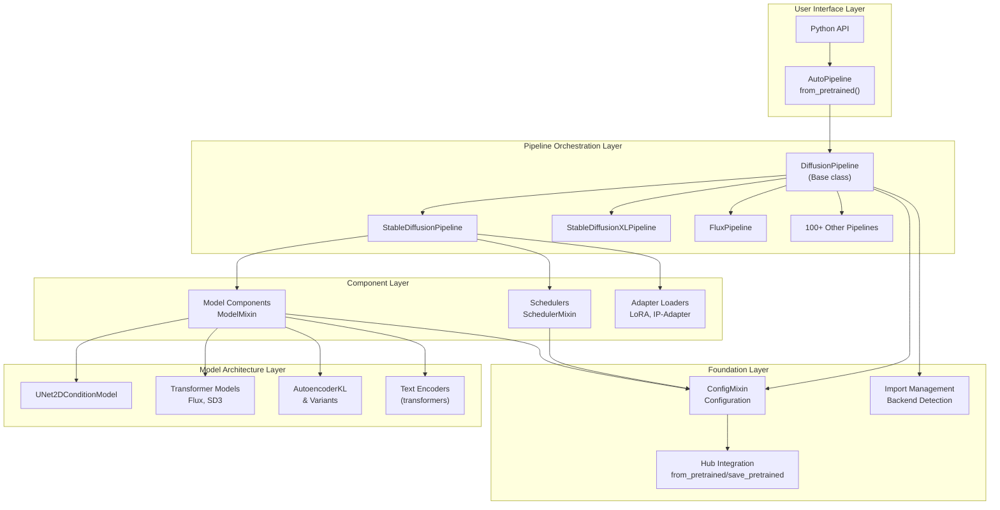

**Explanation:**
- The **User Interface Layer** exposes a user-friendly API and automatic pipeline loaders.
- The **Pipeline Orchestration Layer** defines base and specialized pipeline classes handling end-to-end diffusion.
- The **Component Layer** manages modular model parts (models, schedulers, adapters).
- The **Model Architecture Layer** contains the concrete neural network model classes.
- The **Foundation Layer** includes configuration, serialization, model hub integration, and import backend abstractions.

**Sources:** [src/diffusers/pipelines/pipeline_utils.py:184-209](), [src/diffusers/models/modeling_utils.py:80-123](), [src/diffusers/__init__.py:36-62]()

---

## Core Base Classes

Diffusers is built on four fundamental base classes, which provide consistent interfaces for model loading, configuration, scheduling, and pipelines.

| Base Class        | Location                                  | Responsibilities                                                      |
|-------------------|-------------------------------------------|---------------------------------------------------------------------|
| `ConfigMixin`     | [configuration_utils.py:47-47]()          | Serialize/deserialize configuration. Support `from_config`, `save_config`. Auto-registers parameters during init. |
| `ModelMixin`      | [modeling_utils.py:82-82]()                | Extends `torch.nn.Module`. Handles model loading/saving, device management, gradient checkpointing.              |
| `SchedulerMixin`  | [scheduling_utils.py:53-53]()              | Scheduler config, timestep setting, noise schedule logic.                                                |
| `DiffusionPipeline` | [pipeline_utils.py:184-184]()            | Orchestrates pipeline components for inference. Extends `ConfigMixin` and `PushToHubMixin`.               |

### Inheritance Hierarchy

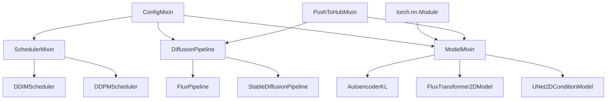

This hierarchy represents how configuration and pipeline orchestration extend model and scheduler abstractions, creating a modular, extensible system.

**Sources:** [src/diffusers/configuration_utils.py:47-47](), [src/diffusers/models/modeling_utils.py:80-123](), [src/diffusers/pipelines/pipeline_utils.py:184-209]()

---

## Pipeline System Architecture

The pipeline system provides the high-level, user-facing abstraction that unifies multiple components into easy-to-use diffusion pipelines.

### Component Registration within Pipelines

```mermaid
graph LR
    Pipeline["DiffusionPipeline Instance"]

    Pipeline -->|register_modules()| Components["Component Registry"]

    Components --> UNet["unet:<br/>UNet2DConditionModel"]
    Components --> VAE["vae:<br/>AutoencoderKL"]
    Components --> TextEnc["text_encoder:<br/>CLIPTextModel"]
    Components --> Tokenizer["tokenizer:<br/>CLIPTokenizer"]
    Components --> Scheduler["scheduler:<br/>DDIMScheduler"]

    Components -->|saved in| ConfigFile["model_index.json"]
```

- The `register_modules()` method registers components by string keys with their instances.
- Component library and class names are recorded in `model_index.json`, enabling reconstruction during `from_pretrained()` loading.
- This pattern allows pipelines to load complex multi-model systems seamlessly.

**Sources:** [src/diffusers/pipelines/pipeline_utils.py:210-224](), [src/diffusers/pipelines/pipeline_utils.py:240-372]()

### AutoPipeline Detection System

`AutoPipeline` classes implement an automated detection mechanism selecting the appropriate pipeline class for a given checkpoint based on the checkpoint’s configuration.

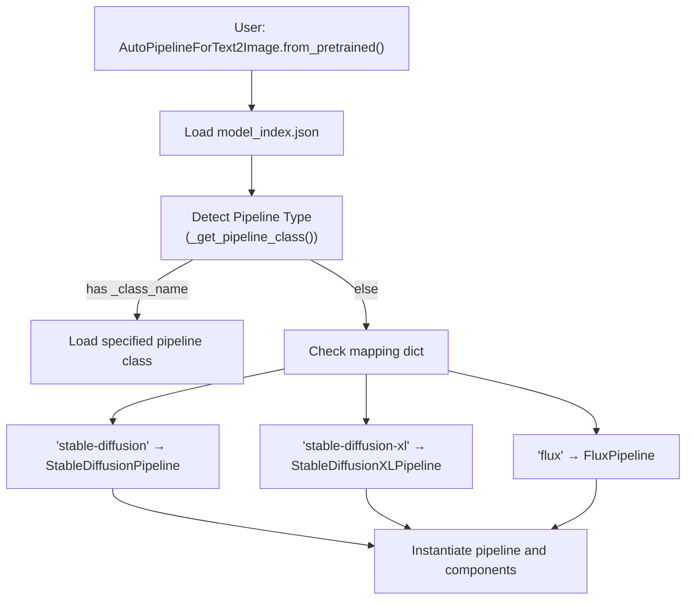

- The pipeline class is detected primarily by inspecting keys like `_class_name` or matching the checkpoint identifier with known pipeline mappings.
- This system supports multiple tasks like text-to-image, image-to-image, and inpainting by mapping auto pipeline classes accordingly.

**Sources:** [src/diffusers/pipelines/auto_pipeline.py:146-183](), [src/diffusers/pipelines/__init__.py:43-48]()

---

## Import and Backend Management

The library utilizes a lazy loading system and backend abstraction to handle optional dependencies and reduce import time.

### Lazy Loading System

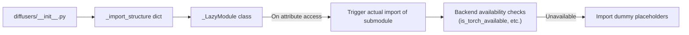

- `_import_structure` declares submodules and exported symbols without importing them immediately.
- `_LazyModule` proxies attribute access and defers import until the symbol is actually used.
- Backend availability functions check for environments (like PyTorch, Accelerate) and conditionally load dummy objects if missing.
- Dummy objects raise `OptionalDependencyNotAvailable` errors only upon usage, not upon import.

**Sources:** [src/diffusers/__init__.py:36-62](), [src/diffusers/utils/import_utils.py:64-94]()

### Backend Abstraction

- When core backends such as PyTorch or Transformers are absent, dummy classes defined in files such as `dummy_pt_objects.py` or `dummy_torch_and_transformers_objects.py` replace real implementations.
- These dummy classes delay dependency errors to runtime, improving flexibility during partial installs or environment mismatches.
- This system ensures the same namespace and API surface are always exposed, easing development and distribution.

**Sources:** [src/diffusers/utils/import_utils.py:130-131](), [src/diffusers/utils/dummy_pt_objects.py:5-17](), [src/diffusers/utils/dummy_torch_and_transformers_objects.py:5-13]()

---

## Model Component System

Model components are modular and inherit from `ModelMixin`, providing standardized functionality for model lifecycle management.

### Model Categories and Examples

| Category           | Base / Mixin                      | Examples                              | Description                                     |
|--------------------|----------------------------------|-------------------------------------|------------------------------------------------|
| **UNet Models**     | `UNet2DConditionModel`            | Stable Diffusion 1.x/2.x, ControlNet| Core CNN backbone for denoising diffusion      |
| **Transformer Models** | `FluxTransformer2DModel`, `SD3Transformer2DModel` | Flux, SD3, PixArt                   | Transformer-based backbone models               |
| **Autoencoders**   | `AutoencoderKL`                   | Standard VAE, CogVideoX VAE          | Encoder-decoder for latent space representation|
| **Adapters**        | `ControlNetModel`, `T2IAdapter`   | ControlNet, T2I-Adapter              | Conditional control modules for pipelines      |

- The component model base classes add consistent load/save and device management capabilities on top of `torch.nn.Module`.
- Models are typically loaded from pretrained weights and used as submodules within pipelines.

**Sources:** [src/diffusers/models/__init__.py:26-110](), [src/diffusers/models/modeling_utils.py:82-123]()

---

## Scheduler System

Schedulers implement noise schedules and sampling algorithms controlling the diffusion or denoising process.

| Important Methods       | Description                                                                                  |
|------------------------|----------------------------------------------------------------------------------------------|
| `set_timesteps()`       | Initialize the sequence of timesteps used in denoising or sampling loops                    |
| `step()`               | Perform one denoising sampling step                                                          |
| `add_noise()`           | Add noise to input samples for training or inversion tasks                                  |

- All schedulers implement a consistent interface via `SchedulerMixin`.
- The system supports many scheduler variants with interchangeable implementations, enabling different generation behaviors.

**Sources:** [src/diffusers/schedulers/__init__.py:23-34](), [src/diffusers/schedulers/scheduling_utils.py:53-53]()

---

## Configuration and Serialization

The `ConfigMixin` class underpins the configuration and serialization mechanism enabling easy saving/loading of models, schedulers, and pipelines.

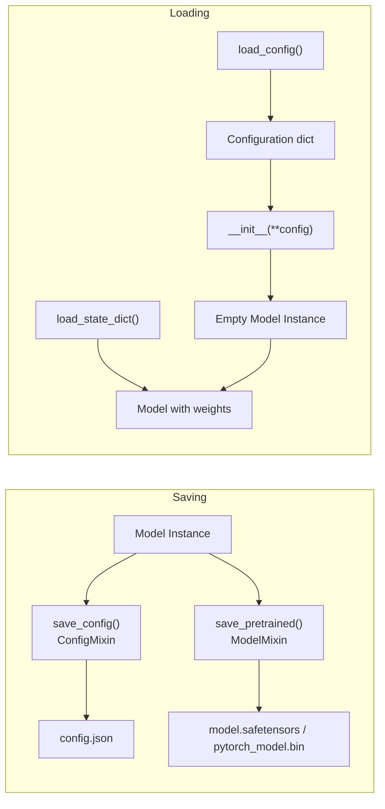

- ConfigMixin automatically stores constructor arguments in a dictionary.
- `save_config()` outputs JSON config files.
- `from_config()` instantiates models/pipelines directly from config dictionaries.
- The two-step load initializes a model first (config-only), then loads pretrained weights, allowing flexible model initialization.

**Sources:** [src/diffusers/configuration_utils.py:47-47](), [src/diffusers/models/modeling_utils.py:43-66]()

---

This architecture provides a flexible and extensible foundation to build, load, and run a variety of diffusion models and pipelines from pretrained components, while supporting multiple backends and optimization strategies.

# Additional Diagrams Bridging Natural Language Components to Code Entities

## Pipeline and Components Mapping

```mermaid
graph TD
    "Natural(Language Task)" -->|"uses"| "AutoPipelineForText2Image[from_pretrained()]"
    "AutoPipelineForText2Image" -->|"instantiates"| "StableDiffusionPipeline"
    "StableDiffusionPipeline" -->|"registers"| "UNet2DConditionModel[models/unet_2d_condition.py]"
    "StableDiffusionPipeline" -->|"registers"| "AutoencoderKL[models/autoencoders/autoencoder_kl.py]"
    "StableDiffusionPipeline" -->|"registers"| "CLIPTextModel[transformers]"
    "StableDiffusionPipeline" -->|"uses"| "DDIMScheduler[schedulers/scheduling_ddim.py]"
```

## Import and Backend Layer Detail

```mermaid
graph LR
    "diffusers/__init__.py" --> "_import_structure {modules and symbols}"
    "_import_structure" --> "_LazyModule (defer import)"
    "_LazyModule" --On access--> "Import submodule (e.g., models, pipelines)"
    "Import submodule" --> "Backend check (is_torch_available etc.)"
    "Backend check - failed" --> "Dummy objects - raise on usage"
```

---

**Sources:**  
- [src/diffusers/__init__.py:30-160]()  
- [src/diffusers/pipelines/pipeline_utils.py:184-372]()  
- [src/diffusers/pipelines/auto_pipeline.py:146-183]()  
- [src/diffusers/utils/dummy_pt_objects.py:1-60]()  
- [src/diffusers/utils/dummy_torch_and_transformers_objects.py:1-60]()  
- [src/diffusers/models/__init__.py:20-110]()  
- [src/diffusers/schedulers/__init__.py:20-80]()  
- [src/diffusers/configuration_utils.py:40-80]()

---

# Page: Getting Started

# Getting Started

<details>
<summary>Relevant source files</summary>

The following files were used as context for generating this wiki page:

- [docs/source/en/index.md](docs/source/en/index.md)
- [docs/source/en/installation.md](docs/source/en/installation.md)
- [docs/source/en/quantization/bitsandbytes.md](docs/source/en/quantization/bitsandbytes.md)
- [docs/source/en/quicktour.md](docs/source/en/quicktour.md)
- [docs/source/en/training/adapt_a_model.md](docs/source/en/training/adapt_a_model.md)
- [docs/source/en/training/overview.md](docs/source/en/training/overview.md)
- [docs/source/en/tutorials/basic_training.md](docs/source/en/tutorials/basic_training.md)
- [docs/source/en/using-diffusers/conditional_image_generation.md](docs/source/en/using-diffusers/conditional_image_generation.md)
- [docs/source/en/using-diffusers/depth2img.md](docs/source/en/using-diffusers/depth2img.md)
- [docs/source/en/using-diffusers/img2img.md](docs/source/en/using-diffusers/img2img.md)
- [docs/source/en/using-diffusers/inpaint.md](docs/source/en/using-diffusers/inpaint.md)
- [docs/source/en/using-diffusers/unconditional_image_generation.md](docs/source/en/using-diffusers/unconditional_image_generation.md)
- [docs/source/en/using-diffusers/write_own_pipeline.md](docs/source/en/using-diffusers/write_own_pipeline.md)
- [docs/source/ko/installation.md](docs/source/ko/installation.md)
- [docs/source/ko/optimization/fp16.md](docs/source/ko/optimization/fp16.md)
- [docs/source/ko/optimization/torch2.0.md](docs/source/ko/optimization/torch2.0.md)
- [docs/source/ko/training/adapt_a_model.md](docs/source/ko/training/adapt_a_model.md)
- [docs/source/ko/tutorials/basic_training.md](docs/source/ko/tutorials/basic_training.md)
- [docs/source/ko/using-diffusers/write_own_pipeline.md](docs/source/ko/using-diffusers/write_own_pipeline.md)
- [docs/source/zh/installation.md](docs/source/zh/installation.md)
- [examples/research_projects/intel_opts/textual_inversion_dfq/textual_inversion.py](examples/research_projects/intel_opts/textual_inversion_dfq/textual_inversion.py)
- [src/diffusers/quantizers/__init__.py](src/diffusers/quantizers/__init__.py)

</details>


## Purpose

This page guides you through installing the Diffusers library and running your first generation tasks. You'll learn how to load pretrained models, generate images and videos with a few lines of code, and understand the core library components. Diffusers is designed with a focus on usability, simplicity, and customizability [README.md:30-31]().

For the library's architecture and design principles, see [Architecture Overview](#1.1). For package structure and dependency management, see [Package Structure and Dependencies](#1.3).

---

## Installation

### Core Installation

Install Diffusers with PyTorch support using pip, which is the recommended method for most users [docs/source/en/installation.md:14-31]().

```bash
pip install --upgrade diffusers[torch] transformers
```

This command installs the Diffusers library along with essential dependencies such as PyTorch, Transformers, Accelerate, Safetensors, Pillow, and NumPy.

### Alternative Installation Methods

- **Conda (community-maintained):**

```bash
conda install -c conda-forge diffusers
```

- **Source installation (for latest development version):**

```bash
pip install accelerate
pip install git+https://github.com/huggingface/diffusers
```

> **Note:** Make sure to set up a Python 3.10+ environment and install PyTorch 2.6+ suitable for your hardware.

### Device Selection

Diffusers supports all accelerators that PyTorch supports, such as CUDA GPUs, Apple Silicon (via MPS), Intel GPUs (via XPU), and CPU. Specify the device when moving the pipeline:

```python
device = "cuda"  # or "mps", "xpu", "cpu"
pipeline.to(device)
```

To programmatically select the device at runtime, use the PyTorch accelerator API:

```python
import torch
device = torch.accelerator.current_accelerator().type if torch.accelerator.is_available() else "cpu"
```

### Cache Control and Telemetry

- Model weights and checkpoints download to a cache folder (default in your home directory). You can override this with environment variables:

```bash
export HF_HOME="/path/to/cache"
export HF_HUB_CACHE="/path/to/hub/cache"
```

- Telemetry data is collected when loading models from the Hub to improve reliability and prioritize features. Disable telemetry by:

```bash
export HF_HUB_DISABLE_TELEMETRY=1
```

**Sources:** [docs/source/en/installation.md:13-153]()

---

## Basic Usage Pattern: Loading and Running Pipelines

The Diffusers library offers a straightforward API for generating images, videos, and audio using pretrained diffusion pipelines. The core abstraction for inference is the `DiffusionPipeline` class, which bundles all relevant models and schedulers to provide a convenient interface.

### Loading a Pipeline

Use the `from_pretrained()` class method to load a pretrained model checkpoint; this automatically selects the appropriate pipeline subclass based on the checkpoint metadata (`model_index.json`).

```python
import torch
from diffusers import DiffusionPipeline

pipeline = DiffusionPipeline.from_pretrained(
    "stable-diffusion-v1-5/stable-diffusion-v1-5",
    torch_dtype=torch.float16,  # Use float16 for GPU acceleration
    variant="fp16"
)
pipeline.to("cuda")  # or use .to(device)
```

### Generating an Image: Simple Text-to-Image Example

Once loaded, generate an image by providing a text prompt:

```python
prompt = "A scenic landscape of mountains during sunrise, photorealistic, 4k"
image = pipeline(prompt).images[0]
image.save("output.png")
```

You can optionally set random seed generators for reproducibility:

```python
generator = torch.Generator("cuda").manual_seed(42)
image = pipeline(prompt, generator=generator).images[0]
```

---

### Core Components Involved

A typical text-to-image pipeline integrates several core model components:

- **Text Encoder** (`CLIPTextModel` or `T5EncoderModel`): encodes the prompt into embeddings
- **UNet Model** (`UNet2DConditionModel`): performs the denoising steps in latent space
- **Scheduler** (`SchedulerMixin`): guides the diffusion sampling process by scheduling noise steps
- **Autoencoder** (`AutoencoderKL`): decodes the final latent representation into a pixel image

---

### Data Flow Diagram for Text-to-Image Generation

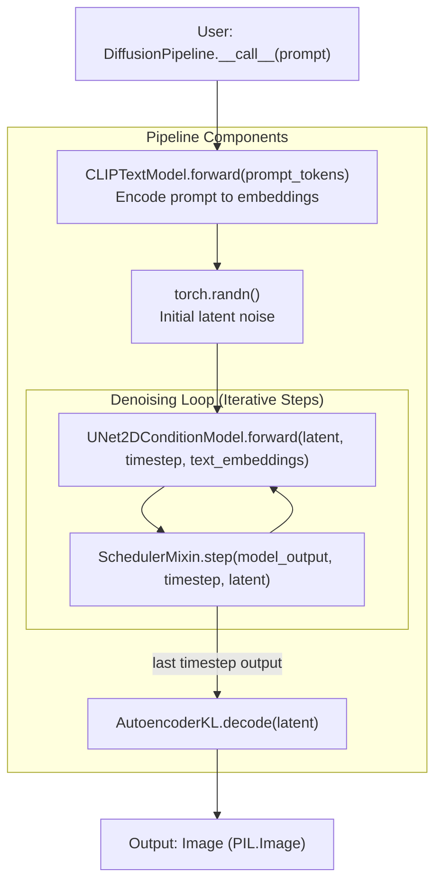

This diagram illustrates how the user's text prompt enters the pipeline, is encoded to embeddings, then combined with initial noise to be denoised by the UNet model and scheduler iteratively. The final latent representation is decoded into an image.

**Sources:** [docs/source/en/using-diffusers/conditional_image_generation.md:13-44](), [docs/source/en/quicktour.md:50-67](), [src/diffusers/pipelines/README.md:7-15]()

---

## Popular Example: Text-to-Image Generation with Stable Diffusion v1.5

```python
import torch
from diffusers import AutoPipelineForText2Image

pipeline = AutoPipelineForText2Image.from_pretrained(
    "stable-diffusion-v1-5/stable-diffusion-v1-5",
    torch_dtype=torch.float16
).to("cuda")

prompt = "A fantasy castle on a cliff, sunset, highly detailed"
image = pipeline(prompt).images[0]
image.save("castle.png")
```

---

## Handling Larger Models and Optimizations

### Model CPU Offloading

To handle large models on limited GPU memory, use CPU offloading:

```python
pipeline.enable_model_cpu_offload()
```

This moves parts of the model to CPU when inactive, reducing peak GPU memory requirements.

### Efficient Attention

For improved inference speed and memory usage, enable efficient attention mechanisms if available:

```python
pipeline.enable_xformers_memory_efficient_attention()
```

Note: PyTorch 2.0+ includes native scaled dot-product attention that is efficient, so this call might be optional depending on your environment.

### Quantization

Diffusers supports loading models in quantized formats (4-bit or 8-bit) using interfaces like bitsandbytes:

```python
from diffusers.quantizers import PipelineQuantizationConfig

quant_config = PipelineQuantizationConfig(
    quant_backend="bitsandbytes_4bit",
    quant_kwargs={"load_in_4bit": True},
    components_to_quantize=["transformer", "text_encoder"],
)

pipeline = DiffusionPipeline.from_pretrained(
    "Qwen/Qwen-Image",
    quantization_config=quant_config,
    device_map="auto"
)
```

Quantization reduces memory footprints and may speed up inference with minimal quality loss.

---

## Advanced Usage: Manual Pipeline Deconstruction and Model Interaction

For users requiring custom control, you can instantiate and run individual pipeline components directly.

### Example: Manually running denoising loop with model and scheduler

```python
from diffusers import UNet2DModel, DDPMScheduler
import torch

# Load components (model and scheduler)
model = UNet2DModel.from_pretrained("google/ddpm-cat-256").to("cuda")
scheduler = DDPMScheduler.from_pretrained("google/ddpm-cat-256")
scheduler.set_timesteps(num_inference_steps=50)

# Prepare initial noise tensor with expected shape
sample = torch.randn((1, 3, model.config.sample_size, model.config.sample_size), device="cuda")

for t in scheduler.timesteps:
    with torch.no_grad():
        noise_pred = model(sample, t).sample
    sample = scheduler.step(noise_pred, t, sample).prev_sample

# Convert tensor to PIL image
from PIL import Image
image_tensor = (sample / 2 + 0.5).clamp(0, 1).cpu()
image = Image.fromarray((image_tensor[0].permute(1, 2, 0).numpy() * 255).round().astype("uint8"))
image.save("generated_cat.png")
```

This exemplifies the fundamental logic inside the pipeline’s `__call__`.

---

### Component Interaction Diagram for Manual Usage

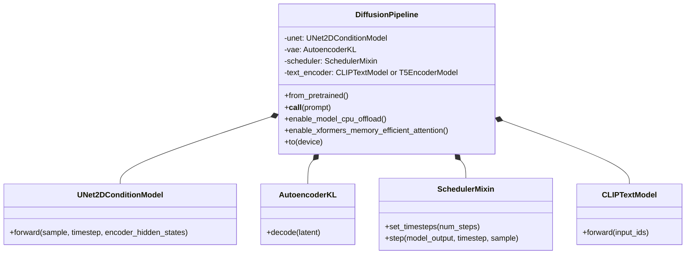

This diagram clarifies the `DiffusionPipeline` encapsulates these core components and provides orchestrated behavior over them.

**Sources:** [docs/source/en/using-diffusers/write_own_pipeline.md:12-101](), [docs/source/en/quicktour.md:26-45](), [src/diffusers/pipelines/README.md:7-23]()

---

## Next Steps

After mastering installation and basic generation:

- Explore [AutoPipelines](./api/pipelines/auto_pipeline.md) like `AutoPipelineForText2Image` and `AutoPipelineForImage2Image` for task-specific pipelines.
- Customize diffusion process with different schedulers ([Schedulers](./using-diffusers/schedulers.md)) like DDIM, Euler, or UniPC for speed or quality tradeoffs.
- Utilize adapters like LoRA for fine-tuning small task-specific weights without full model retraining.
- Examine example scripts for training and fine-tuning models in the [examples](https://github.com/huggingface/diffusers/tree/main/examples) directory.

---

**Sources:**  
- [docs/source/en/installation.md]()  
- [docs/source/en/using-diffusers/conditional_image_generation.md]()  
- [docs/source/en/quicktour.md]()  
- [docs/source/en/using-diffusers/write_own_pipeline.md]()  
- [src/diffusers/pipelines/README.md]()

---

# Page: Package Structure and Dependencies

# Package Structure and Dependencies

<details>
<summary>Relevant source files</summary>

The following files were used as context for generating this wiki page:

- [examples/dreambooth/train_dreambooth.py](examples/dreambooth/train_dreambooth.py)
- [examples/dreambooth/train_dreambooth_flax.py](examples/dreambooth/train_dreambooth_flax.py)
- [examples/dreambooth/train_dreambooth_lora.py](examples/dreambooth/train_dreambooth_lora.py)
- [examples/text_to_image/train_text_to_image.py](examples/text_to_image/train_text_to_image.py)
- [examples/text_to_image/train_text_to_image_flax.py](examples/text_to_image/train_text_to_image_flax.py)
- [examples/text_to_image/train_text_to_image_lora.py](examples/text_to_image/train_text_to_image_lora.py)
- [examples/textual_inversion/textual_inversion.py](examples/textual_inversion/textual_inversion.py)
- [examples/textual_inversion/textual_inversion_flax.py](examples/textual_inversion/textual_inversion_flax.py)
- [examples/unconditional_image_generation/train_unconditional.py](examples/unconditional_image_generation/train_unconditional.py)
- [setup.py](setup.py)
- [src/diffusers/dependency_versions_table.py](src/diffusers/dependency_versions_table.py)
- [src/diffusers/utils/__init__.py](src/diffusers/utils/__init__.py)
- [src/diffusers/utils/constants.py](src/diffusers/utils/constants.py)
- [src/diffusers/utils/import_utils.py](src/diffusers/utils/import_utils.py)
- [src/diffusers/utils/testing_utils.py](src/diffusers/utils/testing_utils.py)

</details>


This document describes the organization of the Diffusers library codebase, its dependency management system, and how optional backend support is handled. For information about configuration systems and loading mechanisms, see [Configuration System](2.4) and [Loading and Saving](2.5). For backend-specific optimization details, see [Attention System](4.1).

## Purpose and Scope

Diffusers is structured as a modular library that supports multiple backends (PyTorch, ONNX, and specialized hardware) with graceful degradation when optional dependencies are missing. This document covers:

- Source directory layout and package organization
- Dependency specification and version management
- Lazy import system and dummy object generation
- Backend detection and conditional imports
- Installation configurations and extras

## Package Structure Overview

The Diffusers library follows a hierarchical package structure organized by functionality. The main source code resides in `src/diffusers/` with subpackages for different component types.

### Directory Structure

**Major Package Components Hierarchy**

```mermaid
graph TB
    Root["src/diffusers/"]
    
    Root --> Init["__init__.py<br/>(lazy imports)"]
    Root --> Utils["utils/<br/>(import_utils, testing_utils)"]
    Root --> Pipelines["pipelines/<br/>(100+ pipeline implementations)"]
    Root --> Models["models/<br/>(transformers, unets, vaes)"]
    Root --> Schedulers["schedulers/<br/>(20+ sampling algorithms)"]
    Root --> Loaders["loaders/<br/>(LoRA, single_file, textual_inversion)"]
    Root --> Guiders["guiders/<br/>(guidance implementations)"]
    Root --> Hooks["hooks/<br/>(optimization hooks)"]
    Root --> Quantizers["quantizers/<br/>(quantization configs)"]
    
    Pipelines --> StableDiffusion["stable_diffusion/<br/>(SD 1.x/2.x/3.x pipelines)"]
    Pipelines --> StableDiffusionXL["stable_diffusion_xl/<br/>(SDXL pipelines)"]
    Pipelines --> Flux["flux/<br/>(Flux pipelines)"]
    Pipelines --> ControlNet["controlnet/<br/>(ControlNet pipelines)"]
    Pipelines --> PAG["pag/<br/>(PAG pipelines)"]
    Pipelines --> OtherPipelines["...<br/>(60+ other pipeline folders)"]
    
    Models --> Transformers["transformers/<br/>(50+ transformer models)"]
    Models --> UNets["unets/<br/>(10+ UNet variants)"]
    Models --> Autoencoders["autoencoders/<br/>(20+ VAE variants)"]
    Models --> ControlNets["controlnets/<br/>(10+ ControlNet models)"]
    
    Utils --> ImportUtils["import_utils.py<br/>(backend detection)"]
    Utils --> DummyObjects["dummy_*_objects.py<br/>(auto-generated)"]
    Utils --> HubUtils["hub_utils.py"]
    Utils --> StateDict["state_dict_utils.py"]
```

| Package       | Purpose                         | Key Files                                                  |
|---------------|--------------------------------|------------------------------------------------------------|
| `pipelines/`  | End-to-end generation pipelines| 100+ pipeline implementations across 60+ subdirectories    |
| `models/`     | Neural network architectures   | `transformers/`, `unets/`, `autoencoders/`, `controlnets/` |
| `schedulers/` | Noise scheduling algorithms    | 20+ scheduler implementations                              |
| `loaders/`    | Model loading utilities        | `lora.py`, `single_file.py`, `ip_adapter.py`, `textual_inversion.py` |
| `utils/`      | Shared utilities               | `import_utils.py`, `hub_utils.py`, `peft_utils.py`, `torch_utils.py` [src/diffusers/utils/__init__.py:16-159]() |
| `quantizers/` | Quantization support           | `quantization_config.py`                                   |

**Sources:** [src/diffusers/utils/__init__.py:16-159](), [src/diffusers/utils/import_utils.py:1-26]()

### Import Structure Map

Diffusers employs a lazy import system with dynamic imports based on backend availability. This structure elegantly handles the availability of optional backends like PyTorch and Transformers and gracefully degrades if these are missing.

**Natural Language to Code Entity Mapping: Import Resolution**

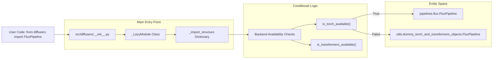

This import structure enables the main `diffusers` package initialization to present a clean namespace while only loading heavy submodules upon access.

**Sources:** [src/diffusers/utils/import_utils.py:560-645](), [src/diffusers/utils/import_utils.py:1008-1023]()

## Dependency Management System

Diffusers uses a sophisticated dependency management strategy that supports multiple optional backends with graceful fallbacks when dependencies are missing.

### Core Dependencies

All base dependencies required for the library to function are defined in the `_deps` list inside `setup.py`. This includes packages for image processing, data loading, model components, schedulers, quantization, and logging.

Key dependencies include but are not limited to:

- `Pillow` for image handling
- `accelerate` for optimized training and device management
- `huggingface-hub` for model and dataset access
- `torch>=2.6` as the main deep learning backend
- `transformers>=4.41.2` for transformer architectures
- `safetensors` for efficient weight serialization
- Quantization packages such as `bitsandbytes`, `gguf`, `torchao`, `optimum_quanto`, and `nvidia_modelopt`
- Testing and development tools: `pytest`, `black`, `isort`

**Sources:** [setup.py:96-149](), [src/diffusers/dependency_versions_table.py:4-56]()

### Optional Backend Groups and Extras

Diffusers defines optional dependency sets (extras) to facilitate installation tailored to specific use cases:

| Extra Name      | Included Dependencies                         | Use Case / Purpose                         |
|-----------------|----------------------------------------------|-------------------------------------------|
| `torch`         | `torch>=2.6`, `accelerate>=0.31.0`           | Primary PyTorch backend                    |
| `training`      | `accelerate`, `datasets`, `peft>=0.17.0`, `tensorboard` | Full training and fine-tuning environment|
| `test`          | `pytest`, `transformers`, `scipy`, `librosa` | Testing infrastructure                     |
| `bitsandbytes`  | `bitsandbytes>=0.43.3`                       | 8-bit/4-bit quantization                   |
| `gguf`          | `gguf>=0.10.0`                               | GGUF quantization format                   |
| `torchao`       | `torchao>=0.15.0`                            | TorchAO quantization backend               |
| `optimum_quanto`| `optimum_quanto>=0.2.6`                      | Intel Quanto quantization                  |
| `nvidia_modelopt`| `nvidia_modelopt[hf]>=0.33.1`               | NVIDIA Model Optimization support          |

These extras groups can be installed via pip as:

```bash
pip install diffusers[training]
```

**Sources:** [setup.py:96-149](), [src/diffusers/dependency_versions_table.py:4-56]()

### Dependency Detection System

The library dynamically detects available dependencies at import time to enable or disable features, avoiding hard failures if optional packages are not installed.

Key function for detection uses `importlib.util.find_spec()` and the `importlib_metadata` library to determine package presence and version. This logic is found in `import_utils.py`:

```python
# Simplified check example for torch availability
if USE_TORCH in ENV_VARS_TRUE_AND_AUTO_VALUES and USE_TF not in ENV_VARS_TRUE_VALUES:
    _torch_available, _torch_version = _is_package_available("torch")
else:
    logger.info("Disabling PyTorch because USE_TORCH is set")
    _torch_available = False
    _torch_version = "N/A"

def is_torch_available():
    return _torch_available
```

This dynamic checking pattern is used for many optional components, including `transformers`, `safetensors`, `onnxruntime`, `opencv`, and various quantization backends.

**Sources:** [src/diffusers/utils/import_utils.py:61-94](), [src/diffusers/utils/import_utils.py:97-104]()

## Lazy Import System

To improve import times and reduce startup overhead, Diffusers implements a lazy import mechanism that defers actual module imports until an attribute is referenced.

### Lazy Module Implementation Flow

When a user accesses a symbol from the `diffusers` package, the request is intercepted by the `_LazyModule` class, which:

- Checks if the attribute exists in an import structure dictionary mapping submodules to their exported symbols.
- Lazily imports the targeted submodule using `importlib`.
- Caches the imported symbols in the lazy module instance to avoid repeated imports.

**Natural Language to Code Entity Mapping: Lazy Loading Flow**

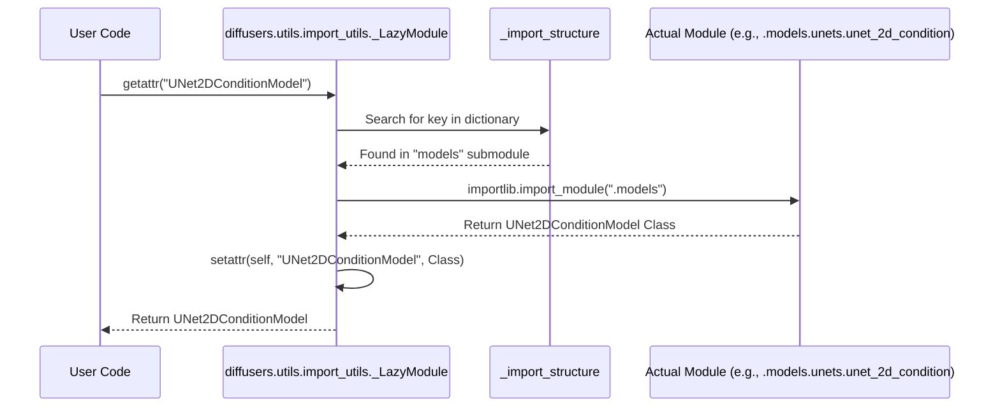

This technique allows for controlled and efficient loading behavior, especially important in a large codebase with many optional dependencies.

**Sources:** [src/diffusers/utils/import_utils.py:1008-1023]()

### Dummy Objects for Graceful Degradation

When optional dependencies are not available, Diffusers inserts dummy objects in their place that raise informative errors if accessed. This prevents import-time errors and gives clear messages about missing dependencies.

A metaclass `DummyObject` is used to create these stand-in classes automatically. It checks required backends on attribute access and throws errors if they are not met.

```python
class DummyObject(type):
    """
    Metaclass for dummy objects. Raises an ImportError on attribute access if required backends are missing.
    """
    def __getattr__(cls, key):
        requires_backends(cls, cls._backends)
```

This pattern is applied broadly to substitute dummy pipelines, models, schedulers, and other components that depend on optional backends like PyTorch or Transformers.

**Sources:** [src/diffusers/utils/import_utils.py:943-1005](), [src/diffusers/utils/import_utils.py:1023]()

## Dependency Version Management

### Auto-Generated Version Table

To maintain consistency and ease of version checks, Diffusers contains an auto-generated `dependency_versions_table.py` file derived from `setup.py` dependencies. This table records canonical version specs of all relevant dependencies and is updated via the `make deps_table_update` command.

```python
# Example excerpt from dependency_versions_table.py
deps = {
    "Pillow": "Pillow",
    "accelerate": "accelerate>=0.31.0",
    "torch": "torch>=2.6",
    "transformers": "transformers>=4.41.2",
    "safetensors": "safetensors>=0.8.0",
}
```

This table can be imported and used anywhere in the codebase to query dependency versions programmatically, enabling conditional logic and improved compatibility management.

**Sources:** [src/diffusers/dependency_versions_table.py:1-56](), [setup.py:180-216]()

### Version Checking Utilities

The package provides helper functions such as `is_torch_version()` and `is_transformers_version()` that leverage `packaging.version` to compare installed package versions against required version strings.

These utilities support:

- Granular version gating within code
- Compatibility warnings or errors
- Seamless upgrades and deprecations

**Sources:** [src/diffusers/utils/import_utils.py:236-330]()

## Environment Variables

Diffusers supports several environment variables to control backend availability and import system behaviors:

| Variable           | Accepted Values                                | Purpose                                           |
|--------------------|------------------------------------------------|--------------------------------------------------|
| `USE_TORCH`        | `"1"`, `"ON"`, `"YES"`, `"TRUE"`, `"AUTO"`    | Enable or disable PyTorch backend support         |
| `USE_TF`           | `"1"`, `"ON"`, `"YES"`, `"TRUE"`, `"AUTO"`    | Enable or disable TensorFlow backend (rare use)  |
| `DIFFUSERS_SLOW_IMPORT` | `"1"`, `"ON"`, `"YES"`, `"TRUE"`           | Disable lazy import for debugging or profiling    |
| `USE_SAFETENSORS`  | `"1"`, `"ON"`, `"YES"`, `"TRUE"`, `"AUTO"`    | Control usage of safetensors package               |

These variables allow fine control over which backends are initialized and influence import-time decisions documented above.

**Sources:** [src/diffusers/utils/import_utils.py:47-55]()

---

# Summary Diagram Bridging Natural Language Space and Code Entity Space

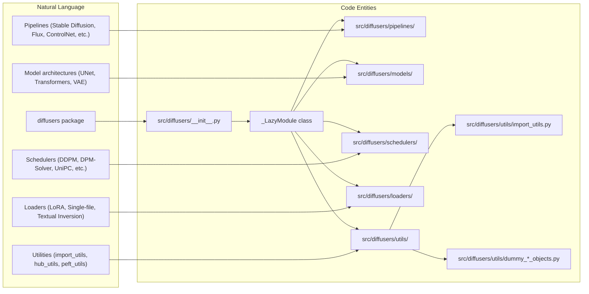

**Sources:** Combination of all cited files above.

---

# Table of Installation Extras (illuminating use case to extras correspondence)

| Use Case               | Install Command             | Description                                  |
|------------------------|-----------------------------|----------------------------------------------|
| Base Diffusers install  | `pip install diffusers`     | Core dependencies only                        |
| Using PyTorch backend   | `pip install diffusers[torch]` | Enables PyTorch and accelerate backend       |
| Training models        | `pip install diffusers[training]` | Adds accelerate, datasets, peft, tensorboard |
| Testing & development  | `pip install diffusers[test]` | Includes pytest, transformers, librosa, etc.  |
| Quantization features  | `pip install diffusers[bitsandbytes]` | 8-bit/4-bit quantization backend              |
| GGUF quantization      | `pip install diffusers[gguf]` | Support for GGUF format                       |
| TorchAO quantization   | `pip install diffusers[torchao]` | TorchAO quantization                          |
| Intel Quanto quantization| `pip install diffusers[optimum_quanto]` | Intel Quanto quantization                     |
| NVIDIA ModelOpt        | `pip install diffusers[nvidia_modelopt]` | NVIDIA-specific optimizations                 |

This structured extras system helps keep installs lean for users with specific needs.

**Sources:** [setup.py:96-149]()

---

# Conclusion

The Diffusers library is a comprehensive and modular system architected for extensibility and optimized performance across diverse infrastructures. Its well-structured package layout, combined with dynamic dependency checking and lazy loading, enables users to efficiently deploy and extend state-of-the-art diffusion pipelines with minimal friction.

Embedded helper utilities and clearly defined extras groups make it easy to tailor the environment to specific development, training, or inference needs.

For more details about how components are loaded and interconnected, see related sections on [Configuration System](2.4), [Loading and Saving](2.5), and [Scheduler System](7).

---

# References

- `setup.py` lines 15-149 for dependency enumeration and extras configuration
- `src/diffusers/utils/__init__.py` for utility imports and module overview
- `src/diffusers/utils/import_utils.py` for lazy loading system, backend detection, and dummy object design
- `src/diffusers/dependency_versions_table.py` auto-generated version pinning table
- Various example training scripts demonstrating use of dependency groups and pipeline imports

**Sources:**  
[setup.py:15-149](), [src/diffusers/utils/__init__.py:16-159](), [src/diffusers/utils/import_utils.py:1-173,560-1023](), [src/diffusers/dependency_versions_table.py:1-56]()

---

# Page: Core Components

# Core Components

<details>
<summary>Relevant source files</summary>

The following files were used as context for generating this wiki page:

- [src/diffusers/models/model_loading_utils.py](src/diffusers/models/model_loading_utils.py)
- [src/diffusers/models/modeling_utils.py](src/diffusers/models/modeling_utils.py)
- [src/diffusers/pipelines/pipeline_loading_utils.py](src/diffusers/pipelines/pipeline_loading_utils.py)
- [src/diffusers/pipelines/pipeline_utils.py](src/diffusers/pipelines/pipeline_utils.py)
- [src/diffusers/utils/hub_utils.py](src/diffusers/utils/hub_utils.py)
- [tests/models/test_modeling_common.py](tests/models/test_modeling_common.py)
- [tests/models/unets/test_models_unet_2d_condition.py](tests/models/unets/test_models_unet_2d_condition.py)
- [tests/pipelines/test_pipeline_utils.py](tests/pipelines/test_pipeline_utils.py)
- [tests/pipelines/test_pipelines.py](tests/pipelines/test_pipelines.py)
- [tests/pipelines/test_pipelines_common.py](tests/pipelines/test_pipelines_common.py)

</details>


The Diffusers library is built on a three-tier modular architecture consisting of **Pipelines**, **Models**, and **Schedulers**. This page explains how these core building blocks work together, their base classes, and the configuration system that enables their composition and interchangeability.

**Key Concepts:**
- **Pipelines** orchestrate the complete inference workflow by composing models and schedulers.
- **Models** implement neural network architectures such as UNet, Transformer, and VAE.
- **Schedulers** control the diffusion/denoising process via noise schedules.
- All components share a unified configuration system via `ConfigMixin`.
- Components can be loaded, saved, and shared through `from_pretrained()` and `save_pretrained()` methods.

---

## Three-Tier Architecture

The Diffusers library implements a modular architecture with three primary component types:

| Component Type | Base Class          | Purpose                                    | Config File           | PyTorch Module?        |
|----------------|---------------------|--------------------------------------------|-----------------------|------------------------|
| **Pipelines**  | `DiffusionPipeline` | Orchestrate inference, manage components   | `model_index.json`    | No                     |
| **Models**     | `ModelMixin`        | Neural networks (UNet, Transformer, VAE)  | `config.json`          | Yes (`torch.nn.Module`) |
| **Schedulers** | `SchedulerMixin`    | Noise schedules, denoising algorithms      | `scheduler_config.json`| No                     |

All three inherit from `ConfigMixin` for unified configuration management. Models and Pipelines additionally inherit from `PushToHubMixin` for Hugging Face Hub integration [src/diffusers/pipelines/pipeline_utils.py:198-234](), [src/diffusers/models/modeling_utils.py:50-82]().

### Component Type Hierarchy with Code Entities

```mermaid
graph TB
    subgraph "Base Classes"
        ConfigMixin["ConfigMixin\nsrc/diffusers/configuration_utils.py"]
        PushToHubMixin["PushToHubMixin\nsrc/diffusers/utils/hub_utils.py"]
        TorchModule["torch.nn.Module"]
    end

    subgraph "Component Base Classes"
        DiffusionPipeline["DiffusionPipeline\nsrc/diffusers/pipelines/pipeline_utils.py\nconfig_name='model_index.json'"]
        ModelMixin["ModelMixin\nsrc/diffusers/models/modeling_utils.py\nconfig_name='config.json'"]
        SchedulerMixin["SchedulerMixin\nsrc/diffusers/schedulers/scheduling_utils.py\nconfig_name='scheduler_config.json'"]
    end

    subgraph "Example Implementations"
        StableDiffusionPipeline["StableDiffusionPipeline\nStableDiffusionXLPipeline\nFluxPipeline"]
        UNet2DConditionModel["UNet2DConditionModel\nSD3Transformer2DModel\nFluxTransformer2DModel"]
        AutoencoderKL["AutoencoderKL\nAutoencoderTiny"]
        DDIMScheduler["DDIMScheduler\nDDPMScheduler\nEulerDiscreteScheduler"]
    end

    ConfigMixin -.->|"inherits"| DiffusionPipeline
    ConfigMixin -.->|"inherits"| ModelMixin
    ConfigMixin -.->|"inherits"| SchedulerMixin

    PushToHubMixin -.->|"inherits"| DiffusionPipeline
    PushToHubMixin -.->|"inherits"| ModelMixin

    TorchModule -.->|"inherits"| ModelMixin

    DiffusionPipeline -->|"implements"| StableDiffusionPipeline
    ModelMixin -->|"implements"| UNet2DConditionModel
    ModelMixin -->|"implements"| AutoencoderKL
    SchedulerMixin -->|"implements"| DDIMScheduler
```

**Sources:** [src/diffusers/pipelines/pipeline_utils.py:198-234](), [src/diffusers/models/modeling_utils.py:50-82]()

---

## Component Composition

Diffusion pipelines orchestrate multiple components to create complete inference workflows. The `DiffusionPipeline.register_modules()` method stores references to these components along with their class and library names. This information is serialized in the pipeline's `model_index.json` file, mapping each component to its corresponding Python class and enabling reproducible loading and saving of pipelines [src/diffusers/pipelines/pipeline_utils.py:210-230]().

### Pipeline Component Composition Pattern

```mermaid
graph TB
    subgraph "StableDiffusionPipeline Instance"
        Pipeline["pipeline = StableDiffusionPipeline(...)"]
        RegisterModules["register_modules(text_encoder=..., unet=..., vae=..., scheduler=...)"]
    end

    subgraph "Component Instances"
        TextEncoder["text_encoder\nCLIPTextModel\n(transformers)"]
        UNet["unet\nUNet2DConditionModel\n(diffusers.models)"]
        VAE["vae\nAutoencoderKL\n(diffusers.models)"]
        Scheduler["scheduler\nDDIMScheduler\n(diffusers.schedulers)"]
    end

    subgraph "model_index.json"
        ConfigJSON["'{\n  \"_class_name\": \"StableDiffusionPipeline\",\n  \"text_encoder\": [\"transformers\", \"CLIPTextModel\"],\n  \"unet\": [\"diffusers\", \"UNet2DConditionModel\"],\n  \"vae\": [\"diffusers\", \"AutoencoderKL\"],\n  \"scheduler\": [\"diffusers\", \"DDIMScheduler\"]\n}'"]
    end

    Pipeline --> RegisterModules
    RegisterModules -->|"Stores (library, class) info"| ConfigJSON
    RegisterModules -->|"Sets as attributes"| TextEncoder
    RegisterModules --> UNet
    RegisterModules --> VAE
    RegisterModules --> Scheduler
```

The pipeline registers these components as attributes which are then accessible during pipeline execution (`__call__` method), enabling flexible and modular inference setups.

**Sources:** [src/diffusers/pipelines/pipeline_utils.py:198-230](), [src/diffusers/pipelines/pipeline_loading_utils.py:88-113]()

---

## Base Class Responsibilities

Each core component type extends base classes providing uniform interfaces and features.

| Base Class         | Location                                    | Key Methods                                     | Purpose                                                                    |
|--------------------|---------------------------------------------|------------------------------------------------|---------------------------------------------------------------------------|
| `ConfigMixin`       | [src/diffusers/configuration_utils.py]()    | `save_config()`, `load_config()`, `register_to_config()` | Parameter serialization and config system; decorator `@register_to_config` |
| `PushToHubMixin`    | [src/diffusers/utils/hub_utils.py]()        | `push_to_hub()`, `save_pretrained()`            | Hugging Face Hub integration and model card management                    |
| `ModelMixin`        | [src/diffusers/models/modeling_utils.py]()  | `from_pretrained()`, `save_pretrained()`, `to()` | Neural network weights management, device placement                       |
| `DiffusionPipeline` | [src/diffusers/pipelines/pipeline_utils.py]() | `from_pretrained()`, `save_pretrained()`, `register_modules()` | Pipeline composition and inference orchestration                          |
| `SchedulerMixin`    | [src/diffusers/schedulers/scheduling_utils.py]() | `from_pretrained()`, `set_timesteps()`, `step()` | Noise scheduling and denoising step algorithms                           |

Each class builds upon `ConfigMixin` for config management, while pipelines and models integrate Hub support for sharing and versioning.

**Sources:** [src/diffusers/pipelines/pipeline_utils.py:198-234](), [src/diffusers/models/modeling_utils.py:50-82](), [src/diffusers/utils/hub_utils.py:66-110]()

---

## Configuration System

The unified configuration system is foundational across components, implemented via `ConfigMixin`. Components register their constructor parameters using the `@register_to_config` decorator which preserves initialization arguments in a `FrozenDict` stored in `self.config`. This enables seamless saving/loading of configurations alongside model weights.

### ConfigMixin Registration and Serialization

```mermaid
graph TB
    subgraph "Model Definition"
        InitMethod["def __init__(self, in_channels=4, ...):\n    self.register_to_config(in_channels=in_channels, ...)\n    super().__init__()"]
    end

    subgraph "Instance Creation"
        InstantiateModel["model = UNet2DConditionModel(\n  in_channels=4,\n  ...)\n"]
    end

    subgraph "Internal Storage"
        InternalDict["model._internal_dict = FrozenDict({\n  'in_channels': 4,\n  '_class_name': 'UNet2DConditionModel',\n  ...})"]
        ConfigProperty["model.config\n(property returns _internal_dict)"]
    end

    subgraph "Serialization"
        SaveConfig["model.save_config('path/')\n→ path/config.json"]
        LoadConfig["config = UNet2DConditionModel.load_config('path/')\n← path/config.json"]
    end

    InitMethod --> InstantiateModel
    InstantiateModel --> InternalDict
    InternalDict --> ConfigProperty
    ConfigProperty --> SaveConfig
    SaveConfig -.->|"writes"| LoadConfig
```

This config system standardizes how components save their hyperparameters and metadata, enabling consistent reproducibility and interoperability.

For details, see [Configuration System](#2.4).

**Sources:** [src/diffusers/pipelines/pipeline_utils.py:198-198](), [src/diffusers/models/modeling_utils.py:44-50]()

---

## Loading and Saving

The Diffusers library supports robust mechanisms for loading and saving all core components, abstracting complexities such as distributed checkpoint shards and variants.

- **Pipelines:** The main interface is `DiffusionPipeline.from_pretrained()` which loads the `model_index.json`, recursively fetches all components, supports sharded models, and handles variants like `fp16` [src/diffusers/pipelines/pipeline_utils.py:592-1450]().
- **Models:** Use `ModelMixin.from_pretrained()` to load standard model weights and config JSON files. It supports safetensors, sharded checkpoints, and automatic device mapping [src/diffusers/models/modeling_utils.py:50-82]().
- **Schedulers:** Use base scheduler from_pretrained methods to load scheduling parameters from their config files without weights.
- **Single-File Loading:** For legacy or alternative checkpoints (.ckpt, .safetensors) loading, the library provides specialized utilities for compatibility [src/diffusers/loaders/single_file_utils.py:62-157] (not shown).

Loading and saving integrates with the Hugging Face Hub and supports seamless model distribution and caching.

For details, see [Loading and Saving](#2.5).

**Sources:** [src/diffusers/pipelines/pipeline_utils.py:592-1450](), [src/diffusers/models/modeling_utils.py:50-82]()

---

## Device and Memory Management

Efficient device placement and memory usage are vital for large diffusion models. The library provides utilities and hooks:

- **Device Placement:** Components implement `.to(device)` for moving weights. Pipelines expose a `.to()` method to move all contained sub-modules [src/diffusers/pipelines/pipeline_utils.py:370-560]().
- **Dtype Management:** Utilities like `get_parameter_dtype` introspect model parameters, respecting hooks such as layerwise casting, to correctly determine and manage floating point precision [src/diffusers/models/modeling_utils.py:156-206]().
- **Offloading:** CPU offloading techniques like `enable_model_cpu_offload()` and `enable_sequential_cpu_offload()` reduce GPU memory by offloading model parts to CPU, controlled via pipeline hooks [src/diffusers/pipelines/pipeline_utils.py:1452-1480]().

These systems help run large models on limited hardware with manageable VRAM.

**Sources:** [src/diffusers/pipelines/pipeline_utils.py:370-560](), [src/diffusers/models/modeling_utils.py:156-206](), [src/diffusers/pipelines/pipeline_utils.py:1452-1480]()

---

## Summary of Subsystems and Links to Child Pages

For in-depth information on fundamental subsystems, consult the dedicated child pages:

- **[DiffusionPipeline System](#2.1)** — The `DiffusionPipeline` base class: component lifecycle, `model_index.json`, loading and saving mechanics.
- **[Model Components](#2.2)** — Core models such as UNet, Transformer, VAE, and the `ModelMixin` base class.
- **[Scheduler System](#2.3)** — The scheduler interface, compatibility system, and diffusion noise scheduling algorithms.
- **[Configuration System](#2.4)** — `ConfigMixin`, `FrozenDict`, the `@register_to_config` decorator, and config loading/saving methods.
- **[Loading and Saving](#2.5)** — Model and pipeline loading mechanisms from Hub, local, and DDUF formats, including state dict and sharded model handling.

---

This overview provides the fundamental building blocks from which all pipelines in the diffusers library are constructed, focusing on component modularity, configuration standardization, and efficient resource management.

**Sources:** [src/diffusers/pipelines/pipeline_utils.py:198-234, 592-1450](), [src/diffusers/models/modeling_utils.py:50-206](), [src/diffusers/pipelines/pipeline_loading_utils.py:88-113](), [src/diffusers/utils/hub_utils.py:66-110]()

---

# Page: DiffusionPipeline System

# DiffusionPipeline System

<details>
<summary>Relevant source files</summary>

The following files were used as context for generating this wiki page:

- [docs/source/en/api/pipelines/pag.md](docs/source/en/api/pipelines/pag.md)
- [scripts/convert_pixart_alpha_to_diffusers.py](scripts/convert_pixart_alpha_to_diffusers.py)
- [src/diffusers/models/model_loading_utils.py](src/diffusers/models/model_loading_utils.py)
- [src/diffusers/models/modeling_utils.py](src/diffusers/models/modeling_utils.py)
- [src/diffusers/pipelines/allegro/pipeline_allegro.py](src/diffusers/pipelines/allegro/pipeline_allegro.py)
- [src/diffusers/pipelines/auto_pipeline.py](src/diffusers/pipelines/auto_pipeline.py)
- [src/diffusers/pipelines/pag/__init__.py](src/diffusers/pipelines/pag/__init__.py)
- [src/diffusers/pipelines/pag/pag_utils.py](src/diffusers/pipelines/pag/pag_utils.py)
- [src/diffusers/pipelines/pag/pipeline_pag_pixart_sigma.py](src/diffusers/pipelines/pag/pipeline_pag_pixart_sigma.py)
- [src/diffusers/pipelines/pipeline_loading_utils.py](src/diffusers/pipelines/pipeline_loading_utils.py)
- [src/diffusers/pipelines/pipeline_utils.py](src/diffusers/pipelines/pipeline_utils.py)
- [src/diffusers/pipelines/pixart_alpha/pipeline_pixart_alpha.py](src/diffusers/pipelines/pixart_alpha/pipeline_pixart_alpha.py)
- [src/diffusers/pipelines/pixart_alpha/pipeline_pixart_sigma.py](src/diffusers/pipelines/pixart_alpha/pipeline_pixart_sigma.py)
- [src/diffusers/utils/hub_utils.py](src/diffusers/utils/hub_utils.py)
- [tests/models/test_modeling_common.py](tests/models/test_modeling_common.py)
- [tests/models/unets/test_models_unet_2d_condition.py](tests/models/unets/test_models_unet_2d_condition.py)
- [tests/pipelines/test_pipeline_utils.py](tests/pipelines/test_pipeline_utils.py)
- [tests/pipelines/test_pipelines.py](tests/pipelines/test_pipelines.py)
- [tests/pipelines/test_pipelines_auto.py](tests/pipelines/test_pipelines_auto.py)
- [tests/pipelines/test_pipelines_common.py](tests/pipelines/test_pipelines_common.py)

</details>


## Purpose and Scope

The DiffusionPipeline System forms the foundational orchestration layer in the `diffusers` library, responsible for managing the complete lifecycle of diffusion models during inference and model management operations. This page documents the `DiffusionPipeline` base class, detailing its component registration system, the loading and saving lifecycle (`from_pretrained`, `save_pretrained`), device and dtype management, and explains the central role of the `model_index.json` manifest file in describing component relationships within a pipeline.

This system enables modular composition of diffusion pipelines where models like UNet, Transformer, VAE, text encoders, and schedulers are organized and unified into a single callable pipeline object.

---

## Architecture Overview

The central class in this system is `DiffusionPipeline`, which inherits from `ConfigMixin` (for configuration serialization/deserialization) and `PushToHubMixin` (for integration with the Hugging Face Hub) [src/diffusers/pipelines/pipeline_utils.py:198-214]().

### Class Hierarchy Diagram: Pipeline Inheritance and Composition

```mermaid
graph TB
    subgraph "Base Mixins"
        ConfigMixin["ConfigMixin<br/>(src/diffusers/configuration_utils.py)"]
        PushToHubMixin["PushToHubMixin<br/>(src/diffusers/utils/hub_utils.py)"]
    end

    subgraph "Core Base Class"
        DiffusionPipeline["DiffusionPipeline<br/>(src/diffusers/pipelines/pipeline_utils.py)"]
    end

    subgraph "Concrete Pipeline Implementations"
        StableDiffusionPipeline["StableDiffusionPipeline"]
        FluxPipeline["FluxPipeline"]
        DDPMPipeline["DDPMPipeline"]
        DDIMPipeline["DDIMPipeline"]
    end

    ConfigMixin --> DiffusionPipeline
    PushToHubMixin --> DiffusionPipeline
    DiffusionPipeline --> StableDiffusionPipeline
    DiffusionPipeline --> FluxPipeline
    DiffusionPipeline --> DDPMPipeline
    DiffusionPipeline --> DDIMPipeline
```

### Key Responsibilities

| Responsibility           | Description                                      | Related Method(s)                                  |
|--------------------------|------------------------------------------------|---------------------------------------------------|
| Component Management     | Register and track pipeline submodules (models, schedulers, etc.) | `register_modules()` [src/diffusers/pipelines/pipeline_utils.py:224]() |
| Model Loading           | Instantiate and load pretrained models from the Hub, local storage, or other formats | `from_pretrained()` [src/diffusers/pipelines/pipeline_utils.py:653]() |
| Model Saving            | Serialize pipeline and its components to disk | `save_pretrained()` [src/diffusers/pipelines/pipeline_utils.py:298]() |
| Device and Dtype Control | Manage device placement and precision for all pipeline components | `to()` [src/diffusers/pipelines/pipeline_utils.py:431]() |
| Progress Control        | Enable or disable progress bars during inference | `set_progress_bar_config()` [src/diffusers/pipelines/pipeline_utils.py:206]() |

**Sources:**  
[src/diffusers/pipelines/pipeline_utils.py:198-214](), [tests/pipelines/test_pipelines.py:43-64]()

---

## Component Registration System and `model_index.json`

### Conceptual Overview

The pipeline is composed of multiple submodules, such as the `unet`, `vae`, `scheduler`, or `text_encoder`. The `DiffusionPipeline` tracks these components in two main ways:

- Attributes on the pipeline instance matching component names (e.g., `self.unet`).
- Entries in the internal configuration (`self.config`) that map component names to tuples describing their origin `(library, class_name)`.

This dual registration occurs via the `register_modules()` method, which stores components and their associated class origins. This facilitates consistent saving, loading, and verification of pipeline structure.

The metadata about components, including the pipeline class and the components' classes and libraries, is stored on disk in a JSON manifest named `model_index.json` [src/diffusers/pipelines/pipeline_utils.py:216-234]().

### Code-Level Registration Flow Diagram

```mermaid
graph LR
    UserInput["User passes dict of components"]
    registerModules["DiffusionPipeline.register_modules()"]
    fetchClass["_fetch_class_library_tuple()"]
    storeConfig["Store (library, class_name) in self.config"]
    setAttr["setattr(self, component_name, module)"]

    UserInput --> registerModules
    registerModules --> fetchClass
    fetchClass --> storeConfig
    registerModules --> setAttr
```

This system enables pipelines to introspect and maintain consistent metadata for all registered submodules.

---

### `model_index.json` Structure

The `model_index.json` file is a crucial artifact that defines the pipeline's modular architecture on disk. It includes:

- The `class` key: the full Python class name of the pipeline itself.
- The `library_name`: identifies the originating library for the pipeline class.
- A key for each component (e.g., `unet`, `vae`) that maps to a two-element array containing `[library_name, class_name]`.

Example (conceptual):

```json
{
  "class": "StableDiffusionPipeline",
  "library_name": "diffusers",
  "unet": ["diffusers", "UNet2DConditionModel"],
  "vae": ["diffusers", "AutoencoderKL"],
  "scheduler": ["diffusers", "PNDMScheduler"],
  "text_encoder": ["transformers", "CLIPTextModel"]
}
```

This manifest is both read and written by the pipeline to coordinate model component loading and saving.

**Sources:**  
[src/diffusers/pipelines/pipeline_utils.py:216-234](), [src/diffusers/pipelines/pipeline_utils.py:756-764]()

---

## Loading System: `from_pretrained`

The static method `from_pretrained` is the primary API for instantiating a pipeline from a pretrained repository or local directory.

### Overview of `from_pretrained` Lifecycle

The method handles the following steps for robust and flexible component loading:

1. **Path or Repo Resolution:**  
   Determines whether the path is:

   - A local directory.
   - A remote Hugging Face Hub model repository identified by `repo_id`.
   - A deprecated DDUF file format (now unsupported).

2. **Download and Cache:**  
   Uses `snapshot_download` internally to download the repo and cache files locally if needed.

3. **Pipeline Class Discovery:**  
   Read `model_index.json` and use `_get_pipeline_class()` to dynamically import and instantiate the correct pipeline class [src/diffusers/pipelines/pipeline_loading_utils.py:100]().

4. **Submodule Loading:**  
   Iterates over the components defined in `model_index.json`. Each component is loaded via the utility `load_sub_model()`, which:

   - Detects the library and class.
   - Calls that module's `from_pretrained()` if available, respecting variants, weights, and quantization options.

5. **Special Setup:**  
   Applies optional quantization, device map configurations, and other optimizations if the user requested them.

6. **Component Registration:**  
   Calls `register_modules()` to record loaded submodules into the pipeline instance and its config.

7. **Returns:**  
   The fully instantiated and prepared pipeline instance.

### Loading Flow Diagram

```mermaid
sequenceDiagram
    participant U as User
    participant DP as DiffusionPipeline
    participant HUB as HuggingFaceHub
    participant PLU as pipeline_loading_utils

    U->>DP: from_pretrained(repo_id_or_path)
    DP->>HUB: snapshot_download(repo_id_or_path)
    HUB-->>DP: Local path with model_index.json
    DP->>PLU: _get_pipeline_class(local_path)
    PLU-->>DP: PipelineClass
    loop for component_name in model_index
        DP->>PLU: load_sub_model(component_name)
        PLU-->>DP: Loaded Module instance
    end
    DP->>DP: register_modules(all loaded modules)
    DP-->>U: Pipeline instance
```

---

### Additional Loading Details

- Supports loading pipelines referencing components across multiple libraries (e.g., `transformers`, `diffusers`).
- Supports variants (e.g., `"fp16"`), and will verify compatibility of weight files (`safetensors` support).
- Accepts parameters for device mapping, quantization config, and local files only modes.
- Raises warnings or errors if deprecated formats or incompatible configs are detected.

**Sources:**  
[src/diffusers/pipelines/pipeline_utils.py:653-1147](), [src/diffusers/pipelines/pipeline_loading_utils.py:100-120]()

---

## Saving System: `save_pretrained`

The `save_pretrained` instance method persists the pipeline and all registered components to disk as a directory that can be then used for reloading.

### Save Procedure

1. **Directory Creation:**
   - Creates the target directory and subdirectories for each component (e.g., `unet/`, `vae/`, `scheduler/`) [src/diffusers/pipelines/pipeline_utils.py:335]().

2. **Saving Submodules:**
   - Iterates over all registered modules.
   - Calls their respective `save_pretrained` or custom saving if available.
   - Serializes configuration within these subfolders [src/diffusers/pipelines/pipeline_utils.py:368-394]().

3. **Writing `model_index.json`:**
   - Writes the manifest file that records the pipeline class and submodule mappings.
   - Ensures the file is always up-to-date for later loading [src/diffusers/pipelines/pipeline_utils.py:415]().

4. **Model Card Handling (Optional):**
   - Generates or updates a README model card description on disk using `load_or_create_model_card` with templating support [src/diffusers/pipelines/pipeline_utils.py:418]().

### Saving Flow Summary Table

| Step                  | Description                                 | Source Lines                                         |
|-----------------------|---------------------------------------------|-----------------------------------------------------|
| Setup target dirs     | Prepares root and component folders          | [pipeline_utils.py:335-355]()                        |
| Save each component   | Calls component’s `save_pretrained`          | [pipeline_utils.py:368-394]()                        |
| Write model_index.json| Dumps pipeline and components mapping into manifest | [pipeline_utils.py:412-426]()                        |
| Optionally model card | Generates README for model card (Hub upload) | [pipeline_utils.py:417-429]()                        |

**Sources:**  
[src/diffusers/pipelines/pipeline_utils.py:298-429](), [src/diffusers/utils/hub_utils.py:95-173]()

---

## Device and Dtype Management: `to()`

The pipeline exposes a unified `to()` method to move all registered submodules (models, schedulers, etc.) to a desired device (CPU, GPU, HPU) and optionally change dtype (e.g., to fp16).

### Implementation Summary

- Iterates all attributes of the pipeline that are `torch.nn.Module`.
- Calls `.to(device, dtype)` on each.
- Disallows usage if CPU offloading hooks (`sequential_cpu_offload` or `enable_model_cpu_offload`) are active, as it would conflict [src/diffusers/pipelines/pipeline_utils.py:501-508]().
- Special handling for models quantized with bitsandbytes (bfloat16 downgrading forbidden) [src/diffusers/pipelines/pipeline_utils.py:522-540]().
- Specific setup and environment variable checks for Habana Gaudi devices (HPU) to ensure compatibility [src/diffusers/pipelines/pipeline_utils.py:551-570]().

### Device Management Diagram: Pipeline Attributes to Device

```mermaid
graph TD
    DP["DiffusionPipeline instance"]
    attr1["submodule 1 (torch.nn.Module)"]
    attr2["submodule 2 (torch.nn.Module)"]
    attrN["submodule N (torch.nn.Module)"]
    to_func[".to(device, dtype) on each"]

    DP --> attr1
    DP --> attr2
    DP --> attrN
    attr1 --> to_func
    attr2 --> to_func
    attrN --> to_func
    to_func --> DP
```

**Sources:**  
[src/diffusers/pipelines/pipeline_utils.py:431-621]()

---

## Pipeline Execution Lifecycle: `__call__`

The core inference interface is implemented by overriding `__call__` in concrete pipeline subclasses (e.g., `StableDiffusionPipeline`).

### Typical Data Flow

1. **Input Processing:**
   - User inputs such as prompts are tokenized via `tokenizer`.
   - Text embeddings are generated by the `text_encoder`.

2. **Latent Initialization:**
   - Random noise latents are sampled on the target device.
   - If using img2img or similar pipelines, encode initial images through `vae.encode()`.

3. **Denoising / Iterative Sampling:**
   - The `scheduler` produces timesteps for diffusion.
   - Each step calls the `unet` or transformer to predict noise or residual.
   - The scheduler updates latents based on predictions and noise schedules.

4. **Decoding Final Output:**
   - Latents are decoded back into pixel space via `vae.decode()`.

5. **Post-Processing:**
   - Outputs are converted into final formats such as `PIL.Image` via `image_processor`.
   - Wrapper output classes like `ImagePipelineOutput` or `AudioPipelineOutput` encapsulate results [src/diffusers/pipelines/pipeline_utils.py:135-158]().

The base `DiffusionPipeline` class does not itself implement `__call__`, requiring subclasses to define pipeline-specific logic.

**Sources:**  
[src/diffusers/pipelines/pipeline_utils.py:135-158](), usage examples in [tests/pipelines/test_pipelines.py:120-180]()

---

## Summary Table: Core Lifecycle Methods in DiffusionPipeline

| Method                | Location                                   | Description                                                  |
|-----------------------|--------------------------------------------|--------------------------------------------------------------|
| `__init__`            | [pipeline_utils.py:198-223]()               | Initializes config and prepares component management.        |
| `register_modules`    | [pipeline_utils.py:224-234]()               | Registers components as instance attributes and updates config. |
| `save_pretrained`     | [pipeline_utils.py:298-429]()               | Saves pipeline and components, writes `model_index.json`.    |
| `to`                  | [pipeline_utils.py:431-621]()               | Moves all components to specified device and dtype.          |
| `from_pretrained`     | [pipeline_utils.py:653-1147]()              | Loads pipeline and components from checkpoint or Hub.        |
| `load_sub_model`      | [pipeline_loading_utils.py:109-130]()       | Utility to load individual models defined in `model_index.json`. |

---

## Concluding Remarks

The `DiffusionPipeline` system elegantly combines multiple model components into a unified pipeline object that can be seamlessly loaded from pretrained artifacts, manipulated on the device and dtype level, and saved back with complete metadata describing the modular architecture. The `model_index.json` manifest plays a key role in this system by encoding the component structure, aiding reproducibility and transparency.

Concrete implementations build on this foundation to support diverse diffusion models and usage patterns, encapsulating domain-specific inference logic.

---

**Sources:**

- `src/diffusers/pipelines/pipeline_utils.py:198-234, 298-429, 431-621, 653-1147`  
- `src/diffusers/pipelines/pipeline_loading_utils.py:95-130`  
- `src/diffusers/utils/hub_utils.py:90-173`  
- `tests/pipelines/test_pipelines.py:43-64, 120-180`

---

# Page: Model Components

# Model Components

<details>
<summary>Relevant source files</summary>

The following files were used as context for generating this wiki page:

- [docs/source/en/api/pipelines/animatediff.md](docs/source/en/api/pipelines/animatediff.md)
- [src/diffusers/models/model_loading_utils.py](src/diffusers/models/model_loading_utils.py)
- [src/diffusers/models/modeling_utils.py](src/diffusers/models/modeling_utils.py)
- [src/diffusers/models/transformers/transformer_2d.py](src/diffusers/models/transformers/transformer_2d.py)
- [src/diffusers/models/unets/unet_2d_blocks.py](src/diffusers/models/unets/unet_2d_blocks.py)
- [src/diffusers/models/unets/unet_2d_condition.py](src/diffusers/models/unets/unet_2d_condition.py)
- [src/diffusers/models/unets/unet_3d_blocks.py](src/diffusers/models/unets/unet_3d_blocks.py)
- [src/diffusers/models/unets/unet_3d_condition.py](src/diffusers/models/unets/unet_3d_condition.py)
- [src/diffusers/models/unets/unet_i2vgen_xl.py](src/diffusers/models/unets/unet_i2vgen_xl.py)
- [src/diffusers/models/unets/unet_motion_model.py](src/diffusers/models/unets/unet_motion_model.py)
- [src/diffusers/pipelines/animatediff/__init__.py](src/diffusers/pipelines/animatediff/__init__.py)
- [src/diffusers/pipelines/deprecated/versatile_diffusion/modeling_text_unet.py](src/diffusers/pipelines/deprecated/versatile_diffusion/modeling_text_unet.py)
- [src/diffusers/pipelines/pipeline_loading_utils.py](src/diffusers/pipelines/pipeline_loading_utils.py)
- [src/diffusers/pipelines/pipeline_utils.py](src/diffusers/pipelines/pipeline_utils.py)
- [src/diffusers/utils/hub_utils.py](src/diffusers/utils/hub_utils.py)
- [tests/models/test_modeling_common.py](tests/models/test_modeling_common.py)
- [tests/models/unets/test_models_unet_2d_condition.py](tests/models/unets/test_models_unet_2d_condition.py)
- [tests/pipelines/test_pipeline_utils.py](tests/pipelines/test_pipeline_utils.py)
- [tests/pipelines/test_pipelines.py](tests/pipelines/test_pipelines.py)
- [tests/pipelines/test_pipelines_common.py](tests/pipelines/test_pipelines_common.py)

</details>


## Purpose and Scope

This page documents the model component system in Diffusers, explaining the architecture, base classes, and types of neural network models used in diffusion pipelines. Model components are the core building blocks that perform the denoising, encoding, and decoding operations in diffusion models.

**Scope**: This page covers `ModelMixin`, core model architectures (UNet, Transformer, VAE), their variants, attention processors, and how these components integrate with pipelines.

---

## Model Component Architecture

Model components in Diffusers are organized into a hierarchical system with base classes providing common functionality and specialized classes implementing specific architectures.

### Model Hierarchy and Code Entities

This diagram associates high-level architectural roles with the specific code entities found in the Diffusers library.

```mermaid
graph TB
    subgraph "Base Classes"
        ModelMixin["ModelMixin<br/>(modeling_utils.py)"]
        ConfigMixin["ConfigMixin<br/>(configuration_utils.py)"]
        PushToHubMixin["PushToHubMixin<br/>(hub_utils.py)"]
    end
    
    subgraph "Denoiser Models (Transformers)"
        FluxTrans["FluxTransformer2DModel<br/>(transformer_flux.py)"]
        SD3Trans["SD3Transformer2DModel<br/>(transformer_sd3.py)"]
        HunyuanTrans["HunyuanVideoTransformer3DModel<br/>(transformer_hunyuan_video.py)"]
    end

    subgraph "Denoiser Models (UNets)"
        UNet2D["UNet2DConditionModel<br/>(unet_2d_condition.py)"]
        UNet3D["UNet3DConditionModel<br/>(unet_3d_condition.py)"]
        UNetMotion["UNetMotionModel<br/>(unet_motion_model.py)"]
    end
    
    subgraph "Autoencoder Models"
        VAE["AutoencoderKL<br/>(autoencoder_kl.py)"]
        VAETiny["AutoencoderTiny<br/>(autoencoder_tiny.py)"]
        VAEWan["AutoencoderKLWan<br/>(autoencoder_kl_wan.py)"]
    end
    
    ModelMixin --> UNet2D
    ModelMixin --> UNet3D
    ModelMixin --> UNetMotion
    ModelMixin --> FluxTrans
    ModelMixin --> SD3Trans
    ModelMixin --> HunyuanTrans
    ModelMixin --> VAE
    ModelMixin --> VAETiny
    ModelMixin --> VAEWan
    
    ConfigMixin --> ModelMixin
    PushToHubMixin --> ModelMixin
```

**Sources**: [src/diffusers/models/modeling_utils.py:230-255](), [src/diffusers/models/unets/unet_2d_condition.py:75-77](), [src/diffusers/models/unets/unet_motion_model.py:44-44](), [tests/models/test_modeling_common.py:29-29](), [src/diffusers/loaders/single_file_model.py:139-178]()

---

## ModelMixin: The Base Class

`ModelMixin` is the foundational class from which all model components inherit. It provides essential functionality such as device management, saving/loading modules, gradient checkpointing, and memory optimization.

### Core Functionality of ModelMixin

| Feature                 | Method/Property                 | Description                                                                   |
|-------------------------|-------------------------------|-------------------------------------------------------------------------------|
| **Device Management**   | `to(device, ...)`, `.device`   | Moves models across devices and queries current device placement [modeling_utils.py:130-154]() |
| **Saving and Loading**  | `save_pretrained()`, `from_pretrained()` | Serialize and deserialize model state dictionaries to and from disk or Hub [modeling_utils.py:700-750]() |
| **Gradient Checkpointing** | `enable_gradient_checkpointing()` | Enables memory-saving recomputation of activations during training [modeling_utils.py:283-320]() |
| **Attention Backend**   | `set_attn_processor()`          | Configure different attention implementations (native, fused, xformers) [unet_motion_model.py:30-37]() |
| **Quantization**        | `DiffusersAutoQuantizer` support | Supports loading quantized models for lighter inference using bitsandbytes or TorchAO [modeling_utils.py:41-42]() |

### Saving and Loading Mechanics

- The `from_pretrained` method supports:
  - Device-aware loading using `device_map` and automatic device placement via `accelerate` integration, balancing memory across devices [model_loading_utils.py:68-115]().
  - Efficient weight loading with `low_cpu_mem_usage` avoiding RAM overuse [modeling_utils.py:118-121]().
  - Variants support (e.g., `fp16`) for loading reduced-precision weights [pipeline_loading_utils.py:110-143]().
  - Single-file checkpoint loading via mixin `FromOriginalModelMixin` and adapters [loaders/single_file_model.py:83-107]().

**Sources**: [src/diffusers/models/modeling_utils.py:230-600](), [src/diffusers/models/model_loading_utils.py:68-115](), [src/diffusers/pipelines/pipeline_loading_utils.py:110-143](), [src/diffusers/loaders/single_file_model.py:83-107]()

---

## Denoiser Models

Denoiser models are the neural networks that operate the reverse diffusion, predicting noise residuals to denoise latent representations at each timestep.

### UNet-Based Models

UNet architectures follow a U-shaped encoder-decoder design with skip connections.

- **UNet2DConditionModel**: The prototypical conditional 2D UNet used in Stable Diffusion, composed of several `DownBlock2D` and `UpBlock2D` layers integrating Residual blocks (`ResnetBlock2D`), self- and cross-attention modules [unet_2d_condition.py:75-136]().
  
- **UNet3DConditionModel**: Extends to video by incorporating temporal dimensions and spatio-temporal ResNet blocks, suitable for video denoising tasks [unet_3d_condition.py:50-100]().

- **UNetMotionModel**: Specialized UNet variant used for AnimateDiff to model motion dynamics in video generation, incorporating 3D transformer blocks and motion modules [unet_motion_model.py:63-141]().

### Transformer-Based Models

The library includes Transformer architectures designed as alternatives or supplements to UNets for diffusion.

- **FluxTransformer2DModel**: Implements a 2D Transformer architecture designed for joint processing of image features with flexible conditioning [transformer_flux.py]().

- **SD3Transformer2DModel**: A specialized 2D Transformer variant supporting cross-attention for conditioning [transformer_sd3.py]().

- **3D Transformer Models**: Such as `HunyuanVideoTransformer3DModel` and similar for modeling spatio-temporal dependencies in video generation [transformer_hunyuan_video.py]().

- **Class remapping**: The loading utilities automatically replace generic Transformer base classes with specialized subclasses based on configuration (`norm_type`), e.g., remapping `Transformer2DModel` to `DiTTransformer2DModel` or `PixArtTransformer2DModel` for specialized normalization [model_loading_utils.py:54-59]().

**Sources**: [src/diffusers/models/unets/unet_2d_condition.py:75-136](), [src/diffusers/models/unets/unet_motion_model.py:44-44](), [src/diffusers/models/unets/unet_3d_condition.py:50-100](), [tests/models/test_modeling_common.py:29-29](), [src/diffusers/models/model_loading_utils.py:54-59](), [src/diffusers/loaders/single_file_model.py:114-170]()

---

## Autoencoder (VAE) Models

Variational Autoencoders (VAEs) encode images into lower-dimensional latent spaces for efficient denoising and decode latent representations back into images.

### VAE Encoder-Decoder Data Flow

The encoding and decoding phases of VAE components are represented conceptually and mapped to implementations:

```mermaid
graph LR
    subgraph "Encoding Phase"
        Input["Image Tensor (B, 3, H, W)"]
        Enc["Encoder (autoencoder_kl.py)"]
        Dist["DiagonalGaussianDistribution (vae.py)"]
        Latent["Latent Tensor (B, C, H/f, W/f)"]
        
        Input -->|"encode()"| Enc
        Enc --> Dist
        Dist -->|"sample()"| Latent
    end
    
    subgraph "Decoding Phase"
        LatentIn["Latent Tensor"]
        Dec["Decoder (autoencoder_kl.py)"]
        Output["Reconstructed Image"]
        
        LatentIn -->|"decode()"| Dec
        Dec --> Output
    end
    
    subgraph "Optimization Hooks"
        Tiling["enable_vae_tiling()"]
        Slicing["enable_vae_slicing()"]
    end

    Tiling -.-> Dec
    Slicing -.-> Dec
```

### Key VAE Variants

- **AutoencoderKL**: The primary VAE used in Stable Diffusion, supports KL divergence loss and latent space stochasticity [autoencoder_kl.py:40-44]().

- **AutoencoderTiny**: A lightweight autoencoder variant optimized for faster decoding and lower resource consumption [autoencoder_tiny.py:30-35]().
  
- **Video VAEs**: Specialized VAEs like `AutoencoderKLWan` designed for video data compression by capturing spatio-temporal features [loaders/single_file_model.py:130-178]().

**Sources**: [src/diffusers/models/autoencoders/autoencoder_kl.py:40-60](), [src/diffusers/models/autoencoders/vae.py:20-40](), [src/diffusers/pipelines/pipeline_utils.py:55-55](), [src/diffusers/models/autoencoders/autoencoder_tiny.py:30-35](), [src/diffusers/loaders/single_file_model.py:130-178]()

---

## Attention System

Attention mechanisms play a critical role in Transformer and UNet architectures, enabling conditional generation and dynamic feature weighting.

### Attention Processor Abstraction

Diffusers abstracts attention computations via the `AttentionProcessor` pattern to allow interchangeable backend implementations:

- **Native Scaled Dot Product Attention (SDPA)**: `AttnProcessor2_0` leverages PyTorch 2.0's native optimized `scaled_dot_product_attention` operator for performance improvements [attention_processor.py:56-56]().

- **Fused Attention Implementations**: `FusedAttnProcessor2_0` performs optimized fused projections and attention computation, further accelerating inference [attention_processor.py:56-56]().

- **Cross-Attention Conditioning Adapters**: `IPAdapterAttnProcessor` and `IPAdapterAttnProcessor2_0` inject image-based conditioning signals into cross-attention layers, enabling spatial conditioning such as face identity or IP adapters [tests/models/unets/test_models_unet_2d_condition.py:31-32]().

**Sources**: [src/diffusers/models/attention_processor.py:56-56](), [tests/models/unets/test_models_unet_2d_condition.py:31-32]()

---

## Memory Management and Offloading Strategies

Efficient memory usage is vital for large diffusion models. Diffusers integrates several strategies to optimize runtime memory footprint.

### Model Offloading Techniques

- **CPU Offload**: The method `enable_model_cpu_offload()` allows models to reside in CPU memory and move to GPU only during forward passes, saving GPU memory [pipeline_utils.py:202-207]().
  
- **Sequential CPU Offload**: Moves model layers one-by-one to GPU in sequence to minimize peak usage at some throughput cost [pipeline_loading_utils.py:56-60]().

- **Group Offloading**: The `GroupOffloading` feature divides models into groups (such as blocks) that are dynamically moved to and from the GPU during execution [modeling_utils.py:131-137](). This supports very large models which may not fit entirely in memory.

- **Disk-backed Offloading**: Large models can be offloaded to disk with memory-mapping to load weights on demand, enabling models bigger than system RAM [model_loading_utils.py:64-65]().

### Additional Memory Optimization

- Gradient checkpointing trades recomputation for GPU memory savings during training by enabling selective recomputation of activations [modeling_utils.py:283-320]().

- Attention backend selection and fused operators also contribute to runtime memory improvements.

**Sources**: [src/diffusers/pipelines/pipeline_utils.py:202-207](), [src/diffusers/models/modeling_utils.py:131-137](), [src/diffusers/models/model_loading_utils.py:64-65](), [src/diffusers/models/modeling_utils.py:283-320]()

---

## Integration with Pipelines

Models in Diffusers are registered as modular components of a `DiffusionPipeline`. The pipeline encapsulates model interaction and the diffusion process.

### Module Registration and Runtime Execution

`DiffusionPipeline` registers model components (UNet, VAE, scheduler, etc) via the method `register_modules()`. This registration enables the pipeline to call the models appropriately during the inference loop.

```mermaid
graph TB
    Pipe["DiffusionPipeline"]
    UNet["UNet2DConditionModel"]
    VAE["AutoencoderKL"]
    Sched["SchedulerMixin"]
    
    Pipe -->|"register_modules()"| UNet
    Pipe -->|"register_modules()"| VAE
    Pipe -->|"register_modules()"| Sched
    
    subgraph "Inference Execution"
        Pipe -->|"__call__()"| Step["Denoising Loop"]
        Step -->|"forward()"| UNet
        Step -->|"step()"| Sched
        Step -->|"decode()"| VAE
    end
```

- The pipeline’s `__call__()` method executes the main denoising loop, coordinating model inference (`UNet.forward()`), noise scheduling (`Scheduler.step()`), and image reconstruction (`VAE.decode()`).

- This modular design allows pipelines to flexibly use different model classes and scheduler combinations.

**Sources**: [src/diffusers/pipelines/pipeline_utils.py:198-217](), [src/diffusers/pipelines/pipeline_loading_utils.py:84-103]()

---

# Summary

This page has detailed the core model components in Diffusers:

- `ModelMixin` as the foundational base class enabling model life-cycle management.

- Core architectures including:
  - UNet variants (`UNet2DConditionModel`, `UNet3DConditionModel`, `UNetMotionModel`).
  - Transformer-based models (FluxTransformer2D, SD3Transformer2D, HunyuanVideoTransformer3D).
  - Autoencoder-based compression and decoding with VAEs (`AutoencoderKL` and variants).

- Pluggable Attention Processor classes allowing backend swapping and advanced conditioning.

- Memory management via offloading, gradient checkpointing, and fused operations.

- Integration into the `DiffusionPipeline` allowing easy registration and inference orchestration.

Together, these components form the neural architecture backbone powering Diffusers pipelines for image and video diffusion generation.

---

**End of page**

**Sources:**

- src/diffusers/models/modeling_utils.py:130-255,283-320,700-750
- src/diffusers/models/unets/unet_2d_condition.py:75-136
- src/diffusers/models/unets/unet_motion_model.py:44-141
- src/diffusers/models/unets/unet_3d_condition.py:50-100
- src/diffusers/models/model_loading_utils.py:54-115
- src/diffusers/pipelines/pipeline_utils.py:198-217
- src/diffusers/pipelines/pipeline_loading_utils.py:84-143
- src/diffusers/models/attention_processor.py:56-56
- src/diffusers/models/autoencoders/autoencoder_kl.py:40-60
- src/diffusers/models/autoencoders/vae.py:20-40
- src/diffusers/models/autoencoders/autoencoder_tiny.py:30-35
- src/diffusers/loaders/single_file_model.py:83-178
- tests/models/test_modeling_common.py:29
- tests/models/unets/test_models_unet_2d_condition.py:31-32

---

# Page: Scheduler System

# Scheduler System

<details>
<summary>Relevant source files</summary>

The following files were used as context for generating this wiki page:

- [src/diffusers/configuration_utils.py](src/diffusers/configuration_utils.py)
- [src/diffusers/schedulers/scheduling_ddim.py](src/diffusers/schedulers/scheduling_ddim.py)
- [src/diffusers/schedulers/scheduling_ddpm.py](src/diffusers/schedulers/scheduling_ddpm.py)
- [src/diffusers/schedulers/scheduling_deis_multistep.py](src/diffusers/schedulers/scheduling_deis_multistep.py)
- [src/diffusers/schedulers/scheduling_dpmsolver_multistep.py](src/diffusers/schedulers/scheduling_dpmsolver_multistep.py)
- [src/diffusers/schedulers/scheduling_dpmsolver_multistep_inverse.py](src/diffusers/schedulers/scheduling_dpmsolver_multistep_inverse.py)
- [src/diffusers/schedulers/scheduling_dpmsolver_sde.py](src/diffusers/schedulers/scheduling_dpmsolver_sde.py)
- [src/diffusers/schedulers/scheduling_dpmsolver_singlestep.py](src/diffusers/schedulers/scheduling_dpmsolver_singlestep.py)
- [src/diffusers/schedulers/scheduling_euler_ancestral_discrete.py](src/diffusers/schedulers/scheduling_euler_ancestral_discrete.py)
- [src/diffusers/schedulers/scheduling_euler_discrete.py](src/diffusers/schedulers/scheduling_euler_discrete.py)
- [src/diffusers/schedulers/scheduling_heun_discrete.py](src/diffusers/schedulers/scheduling_heun_discrete.py)
- [src/diffusers/schedulers/scheduling_k_dpm_2_ancestral_discrete.py](src/diffusers/schedulers/scheduling_k_dpm_2_ancestral_discrete.py)
- [src/diffusers/schedulers/scheduling_k_dpm_2_discrete.py](src/diffusers/schedulers/scheduling_k_dpm_2_discrete.py)
- [src/diffusers/schedulers/scheduling_lms_discrete.py](src/diffusers/schedulers/scheduling_lms_discrete.py)
- [src/diffusers/schedulers/scheduling_pndm.py](src/diffusers/schedulers/scheduling_pndm.py)
- [src/diffusers/schedulers/scheduling_sasolver.py](src/diffusers/schedulers/scheduling_sasolver.py)
- [src/diffusers/schedulers/scheduling_sde_ve.py](src/diffusers/schedulers/scheduling_sde_ve.py)
- [src/diffusers/schedulers/scheduling_unipc_multistep.py](src/diffusers/schedulers/scheduling_unipc_multistep.py)
- [src/diffusers/schedulers/scheduling_utils.py](src/diffusers/schedulers/scheduling_utils.py)

</details>


## Purpose and Scope

This document provides a detailed technical overview of the scheduler system within the Diffusers library. It explains the scheduler interface architecture, the compatibility and interchangeability mechanism between scheduler implementations, and how schedulers orchestrate the diffusion denoising process. The page targets developers wanting to understand or extend the scheduler system with a focus on code-level design, data flow, and core API methods.

For concrete scheduler algorithm details, see [7. Scheduler Deep Dive](). For integration with the broader pipeline system, see [2.1. DiffusionPipeline System]().

---

## System Overview

Schedulers in Diffusers define and control the discrete or continuous noise-removal process in diffusion models during training and inference. They encapsulate noise schedules, timestep samplings, input scaling, noise addition, and iterative denoising steps.

Schedulers enable a pluggable architecture allowing multiple sampling algorithms (DDPM, DDIM, Euler, DPMSolver, UniPC, etc.) to be interchanged seamlessly in pipelines without modifying pipeline code.

### Key Responsibilities of a Scheduler:

- Define beta and alpha noise schedules and related parameters for diffusion [example: betas defined between lines 145-154 in `scheduling_ddpm.py`]().
- Manage the inference timestep sequence, enabling different timestep spacings for sampling [lines 252-324 in `scheduling_ddpm.py`]().
- Implement the reverse diffusion denoising step performed each iteration through `step()` [lines 416-420 in `scheduling_ddpm.py`]().
- Scale inputs to the model depending on the timestep to maintain numerical stability [e.g., lines 279-285 in `scheduling_euler_discrete.py`]().
- Enable noise addition mechanisms for training or inversion — forward diffusion [lines 568-575 in `scheduling_ddpm.py`]().
- Declare compatibility to enable scheduler swapping inside pipelines.

### Scheduler Architecture and Data Flow

```mermaid
graph TB
    subgraph "DiffusionPipeline Layer"
        PIPE["DiffusionPipeline"]
    end
    
    subgraph "Scheduler Base Interface"
        MIXIN["SchedulerMixin (Base Class)"]
        CONFIG["ConfigMixin (Config Management)"]
    end
    
    subgraph "Scheduler Implementations"
        DDPM["DDPMScheduler (Stochastic)"]
        DDIM["DDIMScheduler (Deterministic)"]
        EULER["EulerDiscreteScheduler (ODE-based)"]
        DPM["DPMSolverMultistepScheduler (Fast Solver)"]
        UNIPC["UniPCMultistepScheduler (Unified Predictor-Corrector)"]
        LMS["LMSDiscreteScheduler (Linear Multistep)"]
        FLOW["FlowMatchEulerDiscreteScheduler (Flow Matching)"]
        OTHERS["20+ Other Schedulers"]
    end
    
    subgraph "Core Scheduler Methods"
        SET_TIMESTEPS["set_timesteps() - Configure inference steps"]
        STEP["step() - Perform denoising iteration"]
        ADD_NOISE["add_noise() - Add noise during training/inversion"]
        SCALE_INPUT["scale_model_input() - Input scaling for model"]
    end
    
    PIPE --> MIXIN
    MIXIN --> DDPM
    MIXIN --> DDIM
    MIXIN --> EULER
    MIXIN --> DPM
    MIXIN --> UNIPC
    MIXIN --> LMS
    MIXIN --> FLOW
    MIXIN --> OTHERS
    
    CONFIG --> MIXIN
    
    MIXIN --> SET_TIMESTEPS
    MIXIN --> STEP
    MIXIN --> ADD_NOISE
    MIXIN --> SCALE_INPUT
```

**Sources:**  
[src/diffusers/schedulers/scheduling_utils.py:65-153]()  
[src/diffusers/schedulers/scheduling_ddpm.py:137-177]()  
[src/diffusers/schedulers/scheduling_ddim.py:139-184]()  
[src/diffusers/schedulers/scheduling_flow_match_euler_discrete.py:48-86]()

---

## SchedulerMixin Interface

All scheduler classes inherit from a common base hierarchy combining:

- **SchedulerMixin**: Implements the common scheduler interface methods, loading/saving, and compatibility system.  
- **ConfigMixin**: Provides configuration serialization and registration support, enabling scheduler hyperparameters to be saved and restored.

### Base Class Structure and Attributes

| Component         | Purpose                                                    | Location                                  |
|-------------------|------------------------------------------------------------|-------------------------------------------|
| `SchedulerMixin`  | Base class for common scheduling interface and utilities  | `src/diffusers/schedulers/scheduling_utils.py:79-150`         |
| `ConfigMixin`     | Configuration management with `@register_to_config` decorator | `src/diffusers/configuration_utils.py:87-103`                 |
| `_compatibles`    | List of compatible scheduler class names for swapping     | e.g. `scheduling_pndm.py:116`            |
| `order`           | Integration order (numerical solver's order, e.g., 1 or 2) | e.g. `scheduling_pndm.py:117`             |

Schedulers define their compatibilities by listing strings from the `KarrasDiffusionSchedulers` enum for allowed swaps.

### Scheduler Class Relationships

```mermaid
classDiagram
    class SchedulerMixin {
        +from_pretrained()
        +save_pretrained()
        +step(model_output, timestep, sample)
        +set_timesteps(num_inference_steps, device)
        +add_noise(original_samples, noise, timesteps)
        +scale_model_input(sample, timestep)
        -_compatibles: List[str]
    }
    
    class ConfigMixin {
        +register_to_config()
        +config: FrozenDict
    }
    
    class DDPMScheduler {
        +num_train_timesteps: int
        +beta_schedule: str
        +prediction_type: str
        +timesteps: torch.Tensor
        +alphas_cumprod: torch.Tensor
        +step()
        +add_noise()
        +set_timesteps()
    }
    
    class DDIMScheduler {
        +num_train_timesteps: int
        +beta_schedule: str
        +set_alpha_to_one: bool
        +step()
        +set_timesteps()
    }

    class FlowMatchEulerDiscreteScheduler {
        +num_train_timesteps: int
        +shift: float
        +use_dynamic_shifting: bool
        +step()
        +set_timesteps()
    }

    SchedulerMixin <|-- DDPMScheduler
    SchedulerMixin <|-- DDIMScheduler
    SchedulerMixin <|-- FlowMatchEulerDiscreteScheduler
    ConfigMixin <|-- DDPMScheduler
    ConfigMixin <|-- DDIMScheduler
    ConfigMixin <|-- FlowMatchEulerDiscreteScheduler
```

**Sources:**  
[src/diffusers/schedulers/scheduling_utils.py:79-92]()  
[src/diffusers/schedulers/scheduling_ddpm.py:137-177]()  
[src/diffusers/schedulers/scheduling_ddim.py:139-184]()  
[src/diffusers/schedulers/scheduling_flow_match_euler_discrete.py:48-108]()

---

## Core Methods

### Common Interface Methods

Schedulers expose a consistent set of key methods relied upon by pipelines:

| Method           | Signature                                      | Description                                      | Example Location                                           |
|------------------|------------------------------------------------|------------------------------------------------|------------------------------------------------------------|
| `set_timesteps`  | `(num_inference_steps: int, device: str)`       | Initialize or configure timesteps for inference| [252-324 in scheduling_ddpm.py]()                          |
| `step`           | `(model_output, timestep, sample) -> SchedulerOutput` | Performs one denoising step                     | [416-420 in scheduling_ddpm.py]()                          |
| `add_noise`      | `(original_samples, noise, timesteps)`          | Adds noise to a clean sample (forward diffusion)| [568-575 in scheduling_ddpm.py]()                          |
| `scale_model_input` | `(sample, timestep) -> torch.Tensor`           | Scales model input based on timestep            | [279-285 in scheduling_euler_discrete.py]()                |

These methods are mandatory or commonly overridden by scheduler subclasses.

### Inference Denoising Loop Example

```mermaid
sequenceDiagram
    participant Pipeline as "DiffusionPipeline"
    participant Scheduler as "SchedulerMixin"
    participant Model as "ModelMixin"
    
    Pipeline->>Scheduler: set_timesteps(num_inference_steps=50)
    Scheduler-->>Pipeline: configured timesteps

    loop Denoising Loop
        Pipeline->>Scheduler: scale_model_input(latents, t)
        Scheduler-->>Pipeline: scaled_latents
        
        Pipeline->>Model: forward(scaled_latents, t, prompt_embeds)
        Model-->>Pipeline: model_output (noise pred)
        
        Pipeline->>Scheduler: step(model_output, t, latents)
        Scheduler-->>Pipeline: prev_sample (denoised latents)
    end
```

**Sources:**  
[src/diffusers/schedulers/scheduling_ddpm.py:235-254]()  
[src/diffusers/schedulers/scheduling_ddpm.py:416-560]()

---

### `set_timesteps()`

This method prepares the discrete timestep sequences to run reverse diffusion during inference. It must be called prior to sampling.

Schedulers support various `timestep_spacing` strategies:

| Strategy    | Description                            | Implementation snippet (example)                    |
|-------------|------------------------------------|--------------------------------------------------|
| `leading`   | Timesteps starting from the beginning of training range | `np.arange(0, num_steps) * step_ratio` [270-272] |
| `trailing`  | Timesteps starting from the end of training range       | `np.arange(num_train_timesteps, 0, -step_ratio)` [273-275] |
| `linspace`  | Evenly spaced timesteps over full range               | `np.linspace(0, num_train_timesteps-1, num_steps)` [267-269] |

This flexibility allows controlling sampling speed vs. quality trade-offs.

**Sources:**  
[src/diffusers/schedulers/scheduling_ddpm.py:252-324]()  
[src/diffusers/schedulers/scheduling_ddim.py:247-359]()

---

### `step()`

The critical reverse diffusion step that consumes the model's noise prediction and current noisy sample to produce a less-noisy sample estimate at the previous timestep.

- Returns a specialized output dataclass (e.g., `DDPMSchedulerOutput`) containing:  
  - `prev_sample`: The denoised sample for the next iteration.  
  - `pred_original_sample`: The predicted clean image (`x_0`) based on model output (optional and scheduler-dependent).

**SchedulerOutput example:**

```python
@dataclass
class DDPMSchedulerOutput(BaseOutput):
    prev_sample: torch.Tensor
    pred_original_sample: torch.Tensor | None = None
```

**Sources:**  
[src/diffusers/schedulers/scheduling_ddpm.py:31-47]()  
[src/diffusers/schedulers/scheduling_flow_match_euler_discrete.py:35-46]()

---

### `add_noise()`

Adds Gaussian noise to a clean sample according to the forward diffusion process. Used primarily during scheduler training or inversion setups.

---

### `scale_model_input()`

Adjusts the input to the denoising model depending on the current timestep, improving numerical stability or aligning with training conditions.

---

## Scheduler Interchangeability

### Compatibility System

Schedulers declare compatibility with other schedulers via the `_compatibles` class attribute, which is a list of strings representing scheduler names. This list consists mostly of members of the `KarrasDiffusionSchedulers` enum.

```python
# Example of _compatibles attribute
_compatibles = [e.name for e in KarrasDiffusionSchedulers]
```

This design allows swapping one scheduler implementation for another by reconstructing from shared configuration using `ConfigMixin.from_config()`.

The compatibility list generally includes major schedulers such as `DDIMScheduler`, `DDPMScheduler`, `PNDMScheduler`, `LMSDiscreteScheduler`, `EulerDiscreteScheduler`, `DPMSolverMultistepScheduler`, and many others.

### Scheduler Swapping Mechanism

```mermaid
graph LR
    subgraph "Pipeline Configuration"
        PIPE_CONFIG["pipeline = StableDiffusionPipeline.from_pretrained(...)"]
    end
    
    subgraph "Default Scheduler"
        DEFAULT["PNDMScheduler (Default)"]
    end
    
    subgraph "Compatible Schedulers (Swap Targets)"
        DDIM["DDIMScheduler (Deterministic)"]
        EULER["EulerDiscreteScheduler (ODE-based)"]
        DPM["DPMSolverMultistepScheduler (Fast Convergence)"]
    end
    
    PIPE_CONFIG --> DEFAULT
    DEFAULT -.from_config() .-> DDIM
    DEFAULT -.from_config() .-> EULER
    DEFAULT -.from_config() .-> DPM
```

This system ensures that pipelines can flexibly switch schedulers solely by config, enabling experimentation with new sampling algorithms or use-case-specific optimizations.

**Sources:**  
[src/diffusers/schedulers/scheduling_utils.py:94-153]()  
[src/diffusers/schedulers/scheduling_pndm.py:116-116]()  
[src/diffusers/schedulers/scheduling_utils.py:33-49]()

---

## Configuration and Noise Schedules

### Beta Schedules

Schedulers rely on beta schedules defining the discrete noise variance added per timestep during training. Several standard schedule types are implemented:

| Schedule Name       | Implementation Detail                                                                                  | Typical Use Case              |
|---------------------|-----------------------------------------------------------------------------------------------------|------------------------------|
| `linear`            | Linear interpolation between `beta_start` and `beta_end`                                             | Original DDPM standard        |
| `scaled_linear`     | Square of linear interpolation of square roots of betas                                              | Latent Diffusion / Stable Diffusion |
| `squaredcos_cap_v2` | Beta computed from a cosine alpha-bar function supporting improved noise scheduling                   | Improved diffusion models     |

The function `betas_for_alpha_bar` discretizes a cumulative alpha function to obtain betas supporting various transform types (`cosine`, `exp`, `laplace`). This function is widely reused among schedulers.

**Sources:**  
[src/diffusers/schedulers/scheduling_ddpm.py:48-97]()  
[src/diffusers/schedulers/scheduling_ddpm.py:179-197]()

---

### Prediction Types

Schedulers support different model output predictions, configurable via the `prediction_type` parameter:

| Type            | Meaning                                                      | Example Handling Location                                          |
|-----------------|--------------------------------------------------------------|------------------------------------------------------------------|
| `epsilon`       | Model predicts the added noise at current timestep           | Default in many schedulers [scheduling_ddpm.py:161-162]()        |
| `sample`        | Model directly predicts original clean sample `x_0`          | [scheduling_ddpm.py:162-163]()                                   |
| `v_prediction`  | Model predicts velocity (hybrid noise and sample)            | Used in Imagen Video paper variants [scheduling_ddpm.py:163-165]()|
| `flow_prediction` | Predicts a flow (used by flow matching schedulers)          | [scheduling_dpmsolver_multistep.py:144-147]()                    |

Schedulers convert model outputs according to prediction type for subsequent denoising calculations.

**Sources:**  
[src/diffusers/schedulers/scheduling_ddpm.py:161-165]()  
[src/diffusers/schedulers/scheduling_dpmsolver_multistep.py:144-147]()

---

## Specialized Utilities

### Beta Rescaling for Zero Terminal SNR

The utility function `rescale_zero_terminal_snr` rescales betas to guarantee a zero terminal signal-to-noise ratio at the final timestep, allowing generators to sample effectively from pure noise.

This approach follows algorithmic insights from the paper at https://huggingface.co/papers/2305.08891.

**Sources:**  
[src/diffusers/schedulers/scheduling_ddpm.py:101-134]()

---

### Alpha Bar Functions

The `betas_for_alpha_bar` utility generates beta noise schedules by discretizing an alpha cumulative product function \(\bar{\alpha}(t)\), supporting three transform types:

- cosine  
- exponential (exp)  
- laplace  

This function underpins noise schedules for many discrete schedulers (DDPM, DDIM, PNDM, DPMSolver).

**Sources:**  
[src/diffusers/schedulers/scheduling_ddpm.py:48-97]()  
[src/diffusers/schedulers/scheduling_ddim.py:51-101]()  
[src/diffusers/schedulers/scheduling_pndm.py:28-77]()  
[src/diffusers/schedulers/scheduling_dpmsolver_multistep.py:34-83]()  
[src/diffusers/schedulers/scheduling_unipc_multistep.py:34-83]()

---

### Adaptive Flow Matching with Resolution-based Shifting

State-of-the-art schedulers like `FlowMatchEulerDiscreteScheduler` improve stability by applying dynamic timestep shifting scaled relative to image resolution.

This mechanism modifies sampling behavior dynamically depending on resolution and uses exponential decay factors to calibrate noise schedules during inference.

**Sources:**  
[src/diffusers/schedulers/scheduling_flow_match_euler_discrete.py:58-69]()  
[src/diffusers/schedulers/scheduling_flow_match_euler_discrete.py:92-145]()

---

# Summary

The Diffusers scheduler system is a well-abstracted framework unifying diverse diffusion sampling strategies under a common interface defined by `SchedulerMixin` and `ConfigMixin`. Through configurable noise schedules, timestep management, and denoising steps, schedulers direct the iterative reconstruction of samples in diffusion pipelines.

The scheduler compatibility system facilitates seamless swapping, encouraging experimentation and rapid adoption of novel solvers. Key utilities for beta schedule generation and noise rescaling are shared across implementations, promoting consistency and efficiency.

Understanding this architecture is essential for extending diffusion pipelines with custom schedulers or optimizing existing sampling methods in the library.

---

# References and Sources

- `src/diffusers/schedulers/scheduling_utils.py:65-153`  
- `src/diffusers/schedulers/scheduling_ddpm.py:31-177, 252-575`  
- `src/diffusers/schedulers/scheduling_ddim.py:31-165`  
- `src/diffusers/schedulers/scheduling_pndm.py:28-150`  
- `src/diffusers/schedulers/scheduling_flow_match_euler_discrete.py:48-145`  
- `src/diffusers/schedulers/scheduling_dpmsolver_multistep.py:34-157`  
- `src/diffusers/configuration_utils.py:87-103`

---

# Page: Configuration System

# Configuration System

<details>
<summary>Relevant source files</summary>

The following files were used as context for generating this wiki page:

- [src/diffusers/configuration_utils.py](src/diffusers/configuration_utils.py)
- [src/diffusers/image_processor.py](src/diffusers/image_processor.py)
- [src/diffusers/schedulers/scheduling_ddim.py](src/diffusers/schedulers/scheduling_ddim.py)
- [src/diffusers/schedulers/scheduling_ddpm.py](src/diffusers/schedulers/scheduling_ddpm.py)
- [src/diffusers/schedulers/scheduling_deis_multistep.py](src/diffusers/schedulers/scheduling_deis_multistep.py)
- [src/diffusers/schedulers/scheduling_dpmsolver_multistep.py](src/diffusers/schedulers/scheduling_dpmsolver_multistep.py)
- [src/diffusers/schedulers/scheduling_dpmsolver_multistep_inverse.py](src/diffusers/schedulers/scheduling_dpmsolver_multistep_inverse.py)
- [src/diffusers/schedulers/scheduling_dpmsolver_sde.py](src/diffusers/schedulers/scheduling_dpmsolver_sde.py)
- [src/diffusers/schedulers/scheduling_dpmsolver_singlestep.py](src/diffusers/schedulers/scheduling_dpmsolver_singlestep.py)
- [src/diffusers/schedulers/scheduling_euler_ancestral_discrete.py](src/diffusers/schedulers/scheduling_euler_ancestral_discrete.py)
- [src/diffusers/schedulers/scheduling_euler_discrete.py](src/diffusers/schedulers/scheduling_euler_discrete.py)
- [src/diffusers/schedulers/scheduling_heun_discrete.py](src/diffusers/schedulers/scheduling_heun_discrete.py)
- [src/diffusers/schedulers/scheduling_k_dpm_2_ancestral_discrete.py](src/diffusers/schedulers/scheduling_k_dpm_2_ancestral_discrete.py)
- [src/diffusers/schedulers/scheduling_k_dpm_2_discrete.py](src/diffusers/schedulers/scheduling_k_dpm_2_discrete.py)
- [src/diffusers/schedulers/scheduling_lms_discrete.py](src/diffusers/schedulers/scheduling_lms_discrete.py)
- [src/diffusers/schedulers/scheduling_pndm.py](src/diffusers/schedulers/scheduling_pndm.py)
- [src/diffusers/schedulers/scheduling_sasolver.py](src/diffusers/schedulers/scheduling_sasolver.py)
- [src/diffusers/schedulers/scheduling_sde_ve.py](src/diffusers/schedulers/scheduling_sde_ve.py)
- [src/diffusers/schedulers/scheduling_unipc_multistep.py](src/diffusers/schedulers/scheduling_unipc_multistep.py)
- [src/diffusers/schedulers/scheduling_utils.py](src/diffusers/schedulers/scheduling_utils.py)
- [src/diffusers/utils/logging.py](src/diffusers/utils/logging.py)
- [src/diffusers/utils/outputs.py](src/diffusers/utils/outputs.py)
- [tests/others/test_check_copies.py](tests/others/test_check_copies.py)
- [tests/others/test_check_support_list.py](tests/others/test_check_support_list.py)
- [tests/others/test_config.py](tests/others/test_config.py)
- [tests/others/test_ema.py](tests/others/test_ema.py)
- [tests/others/test_flashpack.py](tests/others/test_flashpack.py)
- [tests/others/test_hub_utils.py](tests/others/test_hub_utils.py)
- [tests/others/test_image_processor.py](tests/others/test_image_processor.py)
- [tests/others/test_outputs.py](tests/others/test_outputs.py)
- [tests/others/test_training.py](tests/others/test_training.py)
- [tests/others/test_utils.py](tests/others/test_utils.py)

</details>


## Purpose and Scope

The Configuration System provides the foundation for managing initialization parameters, serialization, and loading of all components in the Diffusers library. This system enables models, pipelines, and schedulers to save their settings to JSON files and reconstruct themselves from configuration dictionaries, facilitating model sharing via the Hugging Face Hub and ensuring reproducibility.

For information about loading pretrained models and saving, see [Loading and Saving](2.5). For scheduler-specific configuration, see [Scheduler System](2.3). For pipeline-specific configuration, see [DiffusionPipeline System](2.1).

## Overview

The configuration system is built around the `ConfigMixin` base class, which provides:

- Automatic parameter registration during initialization,
- Immutable configuration storage using `FrozenDict`,
- JSON serialization and deserialization of configurations,
- Hub integration for configuration downloading and caching,
- Instantiation from config dictionaries via `from_config` class method.

All major components (pipelines, models, schedulers) inherit from or utilize `ConfigMixin` to manage their configuration state.

Key components include:

| Component or Decorator       | Role                                                    | Location                                                     |
|-----------------------------|---------------------------------------------------------|--------------------------------------------------------------|
| `ConfigMixin`               | Base class managing configuration lifecycle             | `src/diffusers/configuration_utils.py:87-750`                |
| `FrozenDict`                | Immutable ordered dictionary for configuration storage  | `src/diffusers/configuration_utils.py:55-85`                 |
| `register_to_config`        | Decorator/method to auto-register `__init__` params     | Implicitly used via decorator on `__init__` in schedulers    |
| Configuration JSON files    | Persistent storage of configurations                     | `config.json`, `scheduler_config.json` etc.                  |

Sources: [src/diffusers/configuration_utils.py:55-726]()

---

## ConfigMixin Architecture

The `ConfigMixin` class is the core of configuration management, grouping all config parameters in an immutable `FrozenDict` named `_internal_dict`. It defines properties and methods for saving, loading, and instantiating configurations.

### Class Structure and Data Flow

```mermaid
graph TB
    subgraph "ConfigMixin [src/diffusers/configuration_utils.py:87]"
        C[ConfigMixin] --> ID[_internal_dict: FrozenDict]
        C --> CN[config_name: str]
        C --> RJ[to_json_string(), to_json_file()]
        C --> RS[save_config() / load_config()]
        C --> FC[from_config()]
    end
    subgraph "FrozenDict [src/diffusers/configuration_utils.py:55]"
        FD[FrozenDict] --> OD[OrderedDict]
        FD --> IMM[Immutable ops with exceptions]
    end
    
    ID --> FD
```

- `_internal_dict` wraps all registered arguments in a `FrozenDict`, ensuring immutability after initialization.
- `config_name` points to the default JSON filename when saving/loading.
- Serialization methods convert configs to/from JSON files or strings.
- `from_config()` allows creating component instances from a plain config dictionary.
- `FrozenDict` extends `OrderedDict` but forbids modification operations.

Sources: [src/diffusers/configuration_utils.py:55-85](), [src/diffusers/configuration_utils.py:87-726]()

---

## Configuration Registration

### `register_to_config` Decorator and Method

To automatically track initialization parameters, classes use the `@register_to_config` decorator on their `__init__` methods. This decorator:

- Captures parameters passed to `__init__`,
- Calls `register_to_config` method internally,
- Stores parameters in `_internal_dict` as a frozen dict.

Example usage in a scheduler:

```python
@register_to_config
def __init__(self, num_train_timesteps=1000, beta_start=0.0001, beta_end=0.02, ...):
    ...
```

Internally, `register_to_config` does:

- Validates presence of `config_name`,
- Removes the `kwargs` argument if present to handle deprecation,
- Merges new parameters with existing `_internal_dict`,
- Ensures `_internal_dict` is a `FrozenDict`.

```mermaid
sequenceDiagram
    participant User
    participant Component["Model/Scheduler/Pipeline"]
    participant ConfigMixin
    participant FrozenDict
    
    User->>Component: __init__(params)
    Component->>ConfigMixin: register_to_config(params)
    ConfigMixin->>ConfigMixin: Check config_name defined
    ConfigMixin->>ConfigMixin: Remove kwargs if present
    ConfigMixin->>ConfigMixin: Merge with existing config dict
    ConfigMixin->>FrozenDict: Create new frozen dictionary
    FrozenDict-->>ConfigMixin: Immutable config
    ConfigMixin-->>Component: Configuration set
    Component-->>User: Initialization complete
```

This pattern is essential for all schedulers and models, such as `DDPMScheduler` and `DDIMScheduler`.

Sources:
[src/diffusers/configuration_utils.py:142-158](), [src/diffusers/schedulers/scheduling_ddpm.py:119-172](), [src/diffusers/schedulers/scheduling_ddim.py:139-165]()

### `FrozenDict` Class: Immutable Configuration Container

`FrozenDict` is a subclass of `OrderedDict` that prohibits mutation after construction, enforcing immutability for configuration storage. This prevents accidental modification of stored parameters.

| Method          | Behavior                                                                         |
|-----------------|----------------------------------------------------------------------------------|
| `__init__`      | Sets attributes as properties and marks the dict as frozen                      |
| `__setitem__`   | Raises Exception if tried to modify after frozen                                |
| `__delitem__`   | Raises Exception                                                                |
| `setdefault`    | Raises Exception                                                                |
| `pop`           | Raises Exception                                                                |
| `update`        | Raises Exception                                                                |
| `__setattr__`   | Raises Exception if frozen, prevents attribute changes after initialization      |

This guarantees configuration stability throughout an object's lifecycle.

Sources: [src/diffusers/configuration_utils.py:55-85]()

---

## Configuration Serialization and Deserialization

### Saving Configuration to JSON Files

`ConfigMixin` includes multiple methods for saving configurations, supporting both local filesystem and remote uploads.

| Method                  | Description                                      | Parameters                                   | Output                        |
|-------------------------|------------------------------------------------|----------------------------------------------|-------------------------------|
| `save_config`           | Save config JSON to a directory                 | `save_directory`, `push_to_hub`, `repo_id`  | JSON file saved locally or pushed to Hub |
| `to_json_file`           | Save config JSON to specified file path         | `json_file_path`                             | Writes JSON to file            |
| `to_json_string`         | Return the config as a JSON formatted string    | None                                         | JSON string                   |
| `to_diff_dict`           | Return only parameters differing from defaults  | None                                         | Dict of parameters differing from default |

`save_config` is used by components to persist their configuration as a JSON file named according to `config_name` (often `config.json`).

Additional metadata fields included in saved JSON:

- `_class_name`: class name of the component,
- `_diffusers_version`: version of the diffusers library at save time,
- `_module`: import path of the component.

Sources: [src/diffusers/configuration_utils.py:177-221](), [src/diffusers/configuration_utils.py:539-646]()

### Loading Configuration from JSON or Remote

The `load_config` class method handles loading JSON configuration from:

- Local files or directories,
- Hugging Face hub repositories,
- Subfolders inside repositories,
- Special Diffusion Data Universal Format (DDUF) archive files.

The loading logic is:

```mermaid
flowchart TD
    Start["load_config(pretrained_model_name_or_path)"]
    CheckType["Determine if input is file, directory, or repo ID"]
    
    IsFile["Path is file?"]
    IsDir["Path is directory?"]
    IsHub["Path is Hub repo ID?"]
    
    FileLoad["Use path as config file"]
    DirLoad["Join path with config_name"]
    DirSubfolder["Join path + subfolder + config_name"]
    HubDownload["Download config via hf_hub_download()"]
    
    ParseJson["Read and parse JSON config"]
    ExtractCommit["Extract commit hash for caching metadata"]
    ReturnConfig["Return config dict"]
    
    Start --> CheckType
    CheckType --> IsFile --> FileLoad
    CheckType --> IsDir --> DirLoad
    CheckType --> IsHub --> HubDownload
    DirLoad --> DirSubfolder
    FileLoad --> ParseJson
    DirSubfolder --> ParseJson
    HubDownload --> ParseJson
    ParseJson --> ExtractCommit
    ExtractCommit --> ReturnConfig
```

For archives (DDUF files), a helper method `_get_config_file_from_dduf` extracts the embedded JSON configuration.

Sources: [src/diffusers/configuration_utils.py:334-514](), [src/diffusers/configuration_utils.py:516-569]()

---

## Configuration-Based Instantiation

### `from_config` Class Method

`from_config` allows reconstructing components from a configuration dictionary or loaded JSON. It:

1. Extracts usable initialization arguments using `extract_init_dict`,
2. Invokes the class constructor with these arguments,
3. Applies any “hidden” parameters (those starting with `_`) to the internal config after instantiation,
4. Returns the instantiated component.

```mermaid
sequenceDiagram
    participant User
    participant ConfigMixin
    participant ExtractInitDict["extract_init_dict()"]
    participant ComponentCls["component.__init__()"]
    
    User->>ConfigMixin: from_config(config_dict, **kwargs)
    ConfigMixin->>ExtractInitDict: extract_init_dict(config, **kwargs)
    ExtractInitDict-->>ConfigMixin: init_dict, unused_kwargs, hidden_dict
    ConfigMixin->>ComponentCls: __init__(**init_dict)
    ComponentCls-->>ConfigMixin: instance
    ConfigMixin->>ConfigMixin: register_to_config(hidden_dict)
    ConfigMixin-->>User: instance
```

This method is crucial for enabling loading from saved configs or Hub repos.

Sources: [src/diffusers/configuration_utils.py:223-332](), [src/diffusers/configuration_utils.py:648-726]()

### `extract_init_dict`

This utility method divides a config dictionary into three parts:

| Part          | Meaning                                                                                               |
|---------------|-----------------------------------------------------------------------------------------------------|
| `init_dict`   | Parameters that match the class `__init__` signature (used as arguments for initialization).         |
| `unused_kwargs` | Parameters not appearing in `__init__` but present in config (possibly overrides).                   |
| `hidden_dict` | Parameters with keys starting with `_`; internal metadata or special flags not passed during init.   |

This enables a clean initialization while preserving extra metadata.

Sources: [src/diffusers/configuration_utils.py:648-726]()

---

## Configuration Attribute Access

To maintain API backward compatibility, `ConfigMixin` overrides `__getattr__` to allow deprecated direct access to config attributes on the object instance (e.g., accessing `scheduler.num_train_timesteps` instead of `scheduler.config.num_train_timesteps`). When such an attribute is accessed, a deprecation warning is emitted, and the value is fetched from `_internal_dict`.

This fosters migration toward explicit config usage without breaking existing code.

Sources: [src/diffusers/configuration_utils.py:159-175]()

---

## Advanced Configuration Features

### Configuration Differentiation: `to_diff_dict`

`to_diff_dict` returns only those parameters in the configuration that differ from class defaults. This supports minimal config saving by excluding default-valued parameters.

The internal steps are:

- Inspect the class `__init__` signature,
- Compare each config param to its default value,
- Keep only those that differ,
- Always include internal metadata parameters starting with `_`.

This method underpins efficient config persistence and transfer.

Sources: [src/diffusers/configuration_utils.py:607-646]()

### DDUF File Support

Special handling exists for Diffusion Data Universal Format (DDUF) archive files:

- DDUF archives combine model weights and configs,
- `load_config` detects such archives and extracts the relevant `config.json` internally,
- This supports unified checkpoint and configuration packaging.

Sources: [src/diffusers/configuration_utils.py:409-431](), [src/diffusers/configuration_utils.py:516-569]()

---

# Summary Diagram Bridging Natural Language to Code Entities

```mermaid
graph TD
    NL_ConfigSys["Natural Language: Configuration System"]

    NL_ConfigSys -->|Base class for configurations| Code_ConfigMixin["`ConfigMixin` (configuration_utils.py:87)"]
    NL_ConfigSys -->|Immutable config storage| Code_FrozenDict["`FrozenDict` (configuration_utils.py:55)"]
    NL_ConfigSys -->|Decorator to register __init__ args| Code_RegisterToConfig["`@register_to_config` (configuration_utils.py)"]
    NL_ConfigSys -->|Save/load configs as JSON| Code_SaveLoadConfig["`save_config()`, `load_config()` (configuration_utils.py:177, 334)"]
    NL_ConfigSys -->|Create from config dict| Code_FromConfig["`from_config()` (configuration_utils.py:223)"]

    Code_ConfigMixin --> Code_FrozenDict
    Code_ConfigMixin --> Code_RegisterToConfig
    Code_ConfigMixin --> Code_SaveLoadConfig
    Code_ConfigMixin --> Code_FromConfig
```

---

# Mermaid Diagram of Configuration Data Flow During Instantiation and Saving

```mermaid
sequenceDiagram
    participant User
    participant Component
    participant ConfigMixin
    participant FrozenDict
    participant FileSystem

    User->>Component: Instantiate with params (__init__)
    Component->>ConfigMixin: register_to_config(params)
    ConfigMixin->>FrozenDict: Create immutable config dict
    FrozenDict-->>ConfigMixin: Frozen config stored internally
    ConfigMixin-->>Component: Component ready with config

    Component->>ConfigMixin: save_config(directory)
    ConfigMixin->>FileSystem: Write `_internal_dict` + metadata as JSON file
    FileSystem-->>ConfigMixin: File saved
    ConfigMixin-->>Component: Save complete
```

---

# References & Sources

- `src/diffusers/configuration_utils.py:55-85, 87-750`
- `src/diffusers/schedulers/scheduling_ddpm.py:119-172`
- `src/diffusers/schedulers/scheduling_ddim.py:139-165`

---

# Page: Loading and Saving

# Loading and Saving

<details>
<summary>Relevant source files</summary>

The following files were used as context for generating this wiki page:

- [docs/source/en/tutorials/autopipeline.md](docs/source/en/tutorials/autopipeline.md)
- [docs/source/en/using-diffusers/automodel.md](docs/source/en/using-diffusers/automodel.md)
- [docs/source/en/using-diffusers/callback.md](docs/source/en/using-diffusers/callback.md)
- [docs/source/en/using-diffusers/custom_pipeline_overview.md](docs/source/en/using-diffusers/custom_pipeline_overview.md)
- [docs/source/en/using-diffusers/legacy_checkpoints.md](docs/source/en/using-diffusers/legacy_checkpoints.md)
- [docs/source/en/using-diffusers/loading.md](docs/source/en/using-diffusers/loading.md)
- [docs/source/en/using-diffusers/other-formats.md](docs/source/en/using-diffusers/other-formats.md)
- [docs/source/en/using-diffusers/push_to_hub.md](docs/source/en/using-diffusers/push_to_hub.md)
- [docs/source/en/using-diffusers/reusing_seeds.md](docs/source/en/using-diffusers/reusing_seeds.md)
- [docs/source/en/using-diffusers/schedulers.md](docs/source/en/using-diffusers/schedulers.md)
- [docs/source/en/using-diffusers/weighted_prompts.md](docs/source/en/using-diffusers/weighted_prompts.md)
- [src/diffusers/models/model_loading_utils.py](src/diffusers/models/model_loading_utils.py)
- [src/diffusers/models/modeling_utils.py](src/diffusers/models/modeling_utils.py)
- [src/diffusers/pipelines/pipeline_loading_utils.py](src/diffusers/pipelines/pipeline_loading_utils.py)
- [src/diffusers/pipelines/pipeline_utils.py](src/diffusers/pipelines/pipeline_utils.py)
- [src/diffusers/utils/hub_utils.py](src/diffusers/utils/hub_utils.py)
- [tests/models/test_modeling_common.py](tests/models/test_modeling_common.py)
- [tests/models/unets/test_models_unet_2d_condition.py](tests/models/unets/test_models_unet_2d_condition.py)
- [tests/pipelines/test_pipeline_utils.py](tests/pipelines/test_pipeline_utils.py)
- [tests/pipelines/test_pipelines.py](tests/pipelines/test_pipelines.py)
- [tests/pipelines/test_pipelines_common.py](tests/pipelines/test_pipelines_common.py)

</details>


This document explains the loading and saving mechanisms in the Diffusers library. Diffusers supports loading models from three primary sources:

- **Hugging Face Hub** repositories
- **Local directories** containing saved pipeline/model files
- **Single checkpoint files** such as `.ckpt` or `.safetensors` files, including the legacy DDUF format (deprecated)

All loadable components, including models, schedulers, and pipelines, share a common interface built around `from_pretrained()` and `save_pretrained()`, enabling ease of use and consistent behavior.

**Key Topics Covered:**
- Loading pipelines and models from Hub, local, or single file sources
- State dict handling, conversion, and integrity checks
- Support for sharded checkpoints with indexing and parallel loading
- File format support (SafeTensors, PyTorch `.bin`, GGUF)
- Device mapping and optimized loading with Accelerate
- Legacy DDUF pipeline loading behavior and deprecation
- Saving models and pipelines back to disk or Hub

---

## Loading Sources and Entry Points

Diffusers supports three main loading paths for pipelines and models:

### 1. Hugging Face Hub Loading

Loading directly from a Hub repository by specifying a model ID downloads the necessary files using `huggingface_hub.snapshot_download()` and caches them locally. For example:

```python
pipe = DiffusionPipeline.from_pretrained("runwayml/stable-diffusion-v1-5")
```

- The method downloads the model repository files including the `model_index.json` which defines the pipeline components.
- Files are cached locally in the standard cache directory (e.g., `~/.cache/huggingface/hub`).
- Diffusers supports loading with device mapping and dtype specification to optimize for hardware.

### 2. Local Directory Loading

Loading from a directory containing saved files locally. This directory should mirror the Diffusers pipeline folder structure with a `model_index.json` specifying components:

```python
pipe = DiffusionPipeline.from_pretrained("/path/to/saved_pipeline")
```

- Diffusers will load the pipeline and its components from the local files without downloading anything.
- Useful for offline usage or for loading custom fine-tuned checkpoints.

### 3. Single Checkpoint File Loading

Loading models from a single checkpoint file (e.g., `.ckpt`, `.safetensors`). This is a more specialized use case enabling loading legacy or custom checkpoints:

```python
pipe = DiffusionPipeline.from_single_file("model.safetensors")
```

- Under the hood, the checkpoint state dictionary is converted to the required Diffusers format.
- This method supports `.ckpt` and `.safetensors` formats.
- DDUF (Diffusers Distributed Universal Format) loading from single archives was deprecated and removed.

### Loading Flow Diagram

```mermaid
graph TB
    subgraph "Hub_Loading"
        Hub["DiffusionPipeline.from_pretrained('org/model')"]
        HubDownload["snapshot_download()<br/>(pipeline_utils.py:853-897)"]
        HubCache["Cache directory ~/.cache/huggingface/hub"]
    end
    
    subgraph "Local_Loading"
        Local["DiffusionPipeline.from_pretrained('/path/to/model')"]
        LocalRead["Read model files from local directory"]
        LocalFiles["Load model_index.json + components per config"]
    end
    
    subgraph "Single_File_Loading"
        SingleFile["DiffusionPipeline.from_single_file('model.ckpt')"]
        LoadCheckpoint["load_single_file_checkpoint()<br/>(single_file_utils.py:66)"]
        ConvertStateDict["Convert state dict to Diffusers format"]
    end
    
    Hub --> HubDownload
    HubDownload --> HubCache
    HubCache --> LoadPipeline["Assemble pipeline components"]
    
    Local --> LocalRead
    LocalRead --> LocalFiles
    LocalFiles --> LoadPipeline
    
    SingleFile --> LoadCheckpoint
    LoadCheckpoint --> ConvertStateDict
    ConvertStateDict --> LoadPipeline
```

**Sources:** [src/diffusers/pipelines/pipeline_utils.py:597-1105](), [src/diffusers/loaders/single_file_model.py:83-181](), [src/diffusers/loaders/single_file_utils.py:66-67]()

---

## The `from_pretrained()` / `save_pretrained()` Pattern

All core components—models, schedulers, and pipelines—in the Diffusers library implement a common loading and saving interface:

- `ConfigMixin` provides `load_config()` and `save_config()` methods for configuration.
- `ModelMixin` extends `ConfigMixin` with state dict handling and I/O for models.
- `SchedulerMixin` (not shown fully here) manages scheduler loading and saving.
- `DiffusionPipeline` integrates loading of all pipeline subcomponents.

### Class Hierarchy and Interfaces

```mermaid
graph TB
    ConfigMixin["ConfigMixin<br/>(configuration_utils.py)"]
    ModelMixin["ModelMixin<br/>(models/modeling_utils.py)"]
    SchedulerMixin["SchedulerMixin<br/>(schedulers/scheduling_utils.py)"]
    DiffusionPipeline["DiffusionPipeline<br/>(pipelines/pipeline_utils.py)"]
    
    UNet["UNet2DConditionModel"]
    VAE["AutoencoderKL"]
    Scheduler["DDIMScheduler"]
    Pipeline["StableDiffusionPipeline"]
    
    ConfigMixin --> ModelMixin
    ConfigMixin --> SchedulerMixin
    ConfigMixin --> DiffusionPipeline
    
    ModelMixin --> UNet
    ModelMixin --> VAE
    SchedulerMixin --> Scheduler
    DiffusionPipeline --> Pipeline
    
    ConfigMixin -.provides.-> load_config["load_config()<br/>save_config()"]
    ModelMixin -.provides.-> model_methods["from_pretrained()<br/>save_pretrained()"]
    DiffusionPipeline -.provides.-> pipe_methods["from_pretrained()<br/>save_pretrained()"]
```

- `from_pretrained()` typically takes a repo ID or local path, downloads or loads files, parses config, initializes model/pipeline class, loads weights, and returns an instantiated HuggingFace Diffusers object.
- Correspondingly, `save_pretrained()` saves weights, configs, and auxiliary files back to disk or Hub.

**Sources:** [src/diffusers/models/modeling_utils.py:233-255](), [src/diffusers/pipelines/pipeline_utils.py:198-214]()

---

## Pipeline Loading Architecture

### `model_index.json` Structure

A key file in pipeline directories is `model_index.json`. It describes pipeline components—e.g., `unet`, `vae`, `scheduler`—and maps them to specific model classes and subdirectories. The pipeline uses this to dynamically load and instantiate the correct classes.

### Pipeline Loading Flow

```mermaid
graph TB
    User["DiffusionPipeline.from_pretrained()"]
    
    subgraph "Step_1_Fetch_Index"
        LoadIndex["Load model_index.json"]
        ParseIndex["Parse component list and class info"]
    end
    
    subgraph "Step_2_Load_Components"
        LoadSub["load_sub_model()<br/>(pipeline_loading_utils.py:714-990)"]
    end
    
    subgraph "Step_3_Assemble"
        RegisterModules["register_modules()"]
        InitPipeline["Pipeline __init__() with components"]
    end
    
    User --> LoadIndex
    LoadIndex --> ParseIndex
    ParseIndex --> LoadSub
    LoadSub --> RegisterModules
    RegisterModules --> InitPipeline
```

Each component module loads independently:
- Checks file formats, variants, and sharding.
- Loads model weights with device mapping and dtype options.
- Wraps components with transforms if needed.

**Sources:** [src/diffusers/pipelines/pipeline_utils.py:597-1105](), [src/diffusers/pipelines/pipeline_loading_utils.py:714-990]()

---

## Model Loading and Sharding

### Model Loading Flow via `ModelMixin.from_pretrained()`

This method orchestrates:

1. Loading config JSON to get model args.
2. Instantiating an empty model with those args.
3. Loading model weights from a checkpoint into a state dict.
4. Loading the state dict into the model.
5. Returning the model ready for inference or fine-tuning.

```mermaid
graph TB
    FromPretrained["ModelMixin.from_pretrained()"]
    
    subgraph "Initialization"
        LoadConfig["load_config()"]
        CreateEmpty["Create model instance from config"]
    end
    
    subgraph "Weight Loading"
        LoadSD["load_state_dict()<br/>(model_loading_utils.py:75-108)"]
        Assign["model.load_state_dict()"]
    end
    
    FromPretrained --> LoadConfig
    LoadConfig --> CreateEmpty
    CreateEmpty --> LoadSD
    LoadSD --> Assign
```

- Loading supports SafeTensors and PyTorch `.bin` formats with fallback.
- Supports legacy checkpoint conversion and model variant handling.
- Can load partial weights with warnings for missing keys.
  
### Sharded Checkpoints for Large Models

To handle large models that don't fit in a single file:

- The system looks for an index file like `diffusion_pytorch_model.safetensors.index.json`.
- The index maps parameters to sharded weight files.
- Diffusers loads shards in parallel using a thread pool for speed.
- Shards are assigned to devices according to the `device_map`.

Workflow:

1. `_fetch_index_file()` locates and loads the index that maps parameter names to shards.
2. `_load_shard_files_with_threadpool()` uses concurrent futures to load shard files in parallel.
3. `_load_shard_file()` assigns each shard's weights to target device memory.

**Sources:** [src/diffusers/models/model_loading_utils.py:656-723](), [src/diffusers/models/model_loading_utils.py:282-327]()

---

## File Format Support

### SafeTensors Format

- Diffusers prefers SafeTensors due to security, speed, and smaller memory footprint on loading.
- The `use_safetensors` flag in `from_pretrained()` controls format preference.
- Utility `is_safetensors_compatible()` detects whether all components have matching SafeTensors files.
- Diffusers can automatically fall back to `.bin` if `.safetensors` is not fully available for all components.

### Model Variants

- Models may have variants suffixes (e.g., `fp16`).
- The loader filters compatible files with `variant_compatible_siblings()` and regex filters.
- This allows loading mixed precision or quantized variants transparently.

### GGUF Format

- Diffusers supports GGUF quantized checkpoint format for specific quantizers.
- Loading uses specialized loaders to convert GGUF format to PyTorch weights.

---

## Advanced Loading Scenarios

### Low CPU Memory Usage Mode

- Enabled by default if PyTorch >= 1.9.0 and `accelerate` available.
- Instantiates the model on a meta device (zero-cost allocation).
- Loads weights one param at a time into CPU or device memory, thus minimizing peak RAM usage.
- Ideal for loading very large models on limited hardware.

### Device Mapping and Quantization

- Passing a `device_map` allows placing model parts on specified GPU(s) or CPU.
- The library integrates with `accelerate` to infer optimal device splits.
- Quantization-aware loading using `DiffusersAutoQuantizer` adapts weights for bitsandbytes or other quantizers.

### Group Offloading Support

- Uses `GroupOffloadingConfig` and `ModuleGroup` abstractions to offload groups of modules on demand.
- Relies on hooks that move parameters between CPU and CUDA dynamically.
- Employs `AlignDevicesHook` and `CpuOffload` modules from `accelerate` under the hood.
- Enables larger models to be loaded and run by offloading infrequently used weights.

---

## DDUF Files (Diffusers Distributed Universal Format)

Legacy pipeline packaging format packing all components into a single archive.

- `_download_dduf_file()` manages DDUF downloads and verifies hashes.
- `read_dduf_file()` accesses internal objects.
- **DDUF pipeline loading is deprecated and removed** — users should use the standard Diffusers directory format with `model_index.json`.
- Attempts to load DDUF files raise errors with guidance to switch to the new format.

**Sources:** [src/diffusers/pipelines/pipeline_loading_utils.py:1025-1080](), [src/diffusers/pipelines/pipeline_utils.py:770-781]()

---

## Summary of Key Functions and Their Locations

| Action                            | Function/Method                         | Source File and Lines                             |
|----------------------------------|---------------------------------------|--------------------------------------------------|
| Load Pipeline                    | `DiffusionPipeline.from_pretrained()` | src/diffusers/pipelines/pipeline_utils.py:597    |
| Load Single Checkpoint           | `load_single_file_checkpoint()`       | src/diffusers/loaders/single_file_utils.py:66    |
| Load Model Weights               | `ModelMixin.from_pretrained()`        | src/diffusers/models/modeling_utils.py:1213-1551|
| Load State Dict                 | `load_state_dict()`                    | src/diffusers/models/model_loading_utils.py:75   |
| Save Model or Pipeline          | `save_pretrained()`                    | src/diffusers/models/modeling_utils.py:651       |
| Sharded Model Loading            | `_load_shard_files_with_threadpool()` | src/diffusers/models/model_loading_utils.py:677  |
| Determine Device Map           | `_determine_device_map()`              | src/diffusers/models/model_loading_utils.py:68   |
| DDUF File Handling (deprecated) | `_download_dduf_file()`                 | src/diffusers/pipelines/pipeline_loading_utils.py:1025 |

---

# Developer-Oriented Diagram Bridging Natural Language and Code Entities

### Loading Mechanisms and Key Entities

```mermaid
graph LR
  A["User calls DiffusionPipeline.from_pretrained()"] --> B["PipelineUtils: snapshot_download()"]
  B --> C["Cache: ~/.cache/huggingface/hub"]
  B --> D["Load model_index.json"]
  D --> E["pipeline_loading_utils: load_sub_model()"]
  
  E --> F["ModelMixin: from_pretrained()"]
  F --> G["Model: instantiate using config"]
  F --> H["model_loading_utils: load_state_dict()"]
  H --> I["Sharded loading via _load_shard_files_with_threadpool()"]
  
  I --> J["Shard files loaded in parallel"]
  J --> K["Weights assigned to device_map"]
  
  E --> L["SchedulerMixin: from_pretrained()"]
  E --> M["Load other components similarly"]
  
  A --> N["Single file loading via from_single_file()"]
  N --> O["Single file utils: load_single_file_checkpoint()"]
  O --> P["Convert checkpoint to Diffusers format"]
  P --> E
```
*Bars indicate usage of modules and functions in loading workflows.*

### Saving Mechanisms and Key Entities

```mermaid
graph LR
  U["User calls save_pretrained()"] --> V["ModelMixin: save_pretrained()"]
  V --> W["Save config.json, model_weights.safetensors"]
  V --> X["Support sharded saving via split_torch_state_dict_into_shards()"]
  V --> Y["PushToHubMixin: optionally push files to Hub"]
  U --> Z["DiffusionPipeline: save_pretrained()"]
  Z --> V
  Z --> AA["Save model_index.json describing components"]
```

---

# Notes

- The loading code automatically handles many edge cases: format compatibility, multi-file shards, device mapping, and quantized variants.
- Parallel loading and low CPU memory techniques significantly speed up and reduce system requirements.
- SafeTensors is strongly preferred for security and loading performance.
- Legacy formats like DDUF are no longer supported; users should convert or save pipelines with the new directory structure.

---

# References for Further Reading

- Pipeline loading: `src/diffusers/pipelines/pipeline_utils.py` [597-1105]()
- Pipeline loading utils and sharded loading: `src/diffusers/pipelines/pipeline_loading_utils.py` [700-990, 1000-1080]()
- Model loading and state dict management: `src/diffusers/models/modeling_utils.py` [1213-1551]()
- State dict loading helpers: `src/diffusers/models/model_loading_utils.py` [50-120, 660-720]()
- Single file loading: `src/diffusers/loaders/single_file_utils.py` [60-100]()
- Hub integration and caching: `src/diffusers/pipelines/pipeline_utils.py` [850-905]()

---

This page documents the current, detailed internal mechanics of loading and saving, bridging from user actions to core code entities within the Diffusers codebase.  
For more conceptual usage guides, see the "Using Diffusers" documentation.  
For low-level module details, consult the referenced source files.

Sources:  
[src/diffusers/pipelines/pipeline_utils.py:597-1105](), [src/diffusers/models/modeling_utils.py:1213-1551](), [src/diffusers/models/model_loading_utils.py:656-723](), [src/diffusers/pipelines/pipeline_loading_utils.py:700-990](), [src/diffusers/loaders/single_file_utils.py:60-100]()

---

# Page: Stable Diffusion Pipelines

# Stable Diffusion Pipelines

<details>
<summary>Relevant source files</summary>

The following files were used as context for generating this wiki page:

- [src/diffusers/pipelines/controlnet/pipeline_controlnet.py](src/diffusers/pipelines/controlnet/pipeline_controlnet.py)
- [src/diffusers/pipelines/controlnet/pipeline_controlnet_img2img.py](src/diffusers/pipelines/controlnet/pipeline_controlnet_img2img.py)
- [src/diffusers/pipelines/controlnet/pipeline_controlnet_inpaint.py](src/diffusers/pipelines/controlnet/pipeline_controlnet_inpaint.py)
- [src/diffusers/pipelines/controlnet/pipeline_controlnet_inpaint_sd_xl.py](src/diffusers/pipelines/controlnet/pipeline_controlnet_inpaint_sd_xl.py)
- [src/diffusers/pipelines/controlnet/pipeline_controlnet_sd_xl.py](src/diffusers/pipelines/controlnet/pipeline_controlnet_sd_xl.py)
- [src/diffusers/pipelines/controlnet/pipeline_controlnet_sd_xl_img2img.py](src/diffusers/pipelines/controlnet/pipeline_controlnet_sd_xl_img2img.py)
- [src/diffusers/pipelines/stable_diffusion/pipeline_stable_diffusion.py](src/diffusers/pipelines/stable_diffusion/pipeline_stable_diffusion.py)
- [src/diffusers/pipelines/stable_diffusion/pipeline_stable_diffusion_depth2img.py](src/diffusers/pipelines/stable_diffusion/pipeline_stable_diffusion_depth2img.py)
- [src/diffusers/pipelines/stable_diffusion/pipeline_stable_diffusion_img2img.py](src/diffusers/pipelines/stable_diffusion/pipeline_stable_diffusion_img2img.py)
- [src/diffusers/pipelines/stable_diffusion/pipeline_stable_diffusion_inpaint.py](src/diffusers/pipelines/stable_diffusion/pipeline_stable_diffusion_inpaint.py)
- [src/diffusers/pipelines/stable_diffusion/pipeline_stable_diffusion_instruct_pix2pix.py](src/diffusers/pipelines/stable_diffusion/pipeline_stable_diffusion_instruct_pix2pix.py)
- [src/diffusers/pipelines/stable_diffusion/pipeline_stable_diffusion_upscale.py](src/diffusers/pipelines/stable_diffusion/pipeline_stable_diffusion_upscale.py)
- [src/diffusers/pipelines/stable_diffusion_xl/pipeline_stable_diffusion_xl.py](src/diffusers/pipelines/stable_diffusion_xl/pipeline_stable_diffusion_xl.py)
- [src/diffusers/pipelines/stable_diffusion_xl/pipeline_stable_diffusion_xl_img2img.py](src/diffusers/pipelines/stable_diffusion_xl/pipeline_stable_diffusion_xl_img2img.py)
- [src/diffusers/pipelines/stable_diffusion_xl/pipeline_stable_diffusion_xl_inpaint.py](src/diffusers/pipelines/stable_diffusion_xl/pipeline_stable_diffusion_xl_inpaint.py)
- [src/diffusers/pipelines/stable_diffusion_xl/pipeline_stable_diffusion_xl_instruct_pix2pix.py](src/diffusers/pipelines/stable_diffusion_xl/pipeline_stable_diffusion_xl_instruct_pix2pix.py)
- [src/diffusers/pipelines/t2i_adapter/pipeline_stable_diffusion_xl_adapter.py](src/diffusers/pipelines/t2i_adapter/pipeline_stable_diffusion_xl_adapter.py)

</details>


This document covers the Stable Diffusion pipeline family, which represents the most widely-used text-to-image models in the `diffusers` library. These pipelines implement various tasks such as text-to-image generation, image-to-image translation, inpainting, and super-resolution using the Stable Diffusion architecture based on latent diffusion models with `UNet2DConditionModel` and CLIP text encoders.

For information about the base `DiffusionPipeline` system that all pipelines inherit from, see [DiffusionPipeline System](#2.1). For details on the Stable Diffusion XL (SDXL) pipelines, see [Stable Diffusion XL Pipelines](#3.4).

## Overview

The Stable Diffusion pipeline family includes multiple specialized pipelines sharing a common architecture, optimized for different generation tasks. Each pipeline operates in the latent space of the images using a Variational Autoencoder (VAE), guided by a CLIP text encoder for prompt conditioning, and a UNet model for denoising steps controlled by a scheduler.

### Stable Diffusion Pipeline Family Structure

```mermaid
graph TB
    subgraph "Base Classes"
        DiffusionPipeline["DiffusionPipeline<br/>(pipeline_utils.py)"]
        StableDiffusionMixin["StableDiffusionMixin<br/>(pipeline_utils.py)"]
    end
    
    subgraph "Loader Mixins"
        TextualInversionLoaderMixin["TextualInversionLoaderMixin"]
        StableDiffusionLoraLoaderMixin["StableDiffusionLoraLoaderMixin"]
        IPAdapterMixin["IPAdapterMixin"]
        FromSingleFileMixin["FromSingleFileMixin"]
    end
    
    subgraph "Core SD Pipelines"
        StableDiffusionPipeline["StableDiffusionPipeline<br/>pipeline_stable_diffusion.py<br/>Text-to-Image"]
        StableDiffusionImg2ImgPipeline["StableDiffusionImg2ImgPipeline<br/>pipeline_stable_diffusion_img2img.py<br/>Image-to-Image"]
        StableDiffusionInpaintPipeline["StableDiffusionInpaintPipeline<br/>pipeline_stable_diffusion_inpaint.py<br/>Inpainting"]
    end
    
    subgraph "Specialized SD Pipelines"
        StableDiffusionUpscalePipeline["StableDiffusionUpscalePipeline<br/>pipeline_stable_diffusion_upscale.py<br/>Super-Resolution"]
        StableDiffusionControlNetPipeline["StableDiffusionControlNetPipeline<br/>pipeline_controlnet.py<br/>Guided Generation"]
    end
    
    DiffusionPipeline --> StableDiffusionMixin
    StableDiffusionMixin --> StableDiffusionPipeline
    StableDiffusionMixin --> StableDiffusionImg2ImgPipeline
    StableDiffusionMixin --> StableDiffusionInpaintPipeline
    StableDiffusionMixin --> StableDiffusionUpscalePipeline
    StableDiffusionMixin --> StableDiffusionControlNetPipeline
    
    TextualInversionLoaderMixin -.->|inherited by| StableDiffusionPipeline
    StableDiffusionLoraLoaderMixin -.->|inherited by| StableDiffusionPipeline
    IPAdapterMixin -.->|inherited by| StableDiffusionPipeline
    FromSingleFileMixin -.->|inherited by| StableDiffusionPipeline
```

Sources:  
[src/diffusers/pipelines/stable_diffusion/pipeline_stable_diffusion.py:154-161](),  
[src/diffusers/pipelines/stable_diffusion/pipeline_stable_diffusion_img2img.py:182-189](),  
[src/diffusers/pipelines/stable_diffusion/pipeline_stable_diffusion_inpaint.py:128-135](),  
[src/diffusers/pipelines/controlnet/pipeline_controlnet.py:162-169]()

### Pipeline Variants Overview

| Pipeline Class                     | File                                   | Primary Task    | Input Requirements                 | Special Features             |
|----------------------------------|--------------------------------------|-----------------|----------------------------------|-----------------------------|
| `StableDiffusionPipeline`         | `pipeline_stable_diffusion.py`       | Text-to-Image   | Text prompt                       | Base Implementation          |
| `StableDiffusionImg2ImgPipeline`  | `pipeline_stable_diffusion_img2img.py` | Image-to-Image  | Text prompt + initial image       | `strength` parameter         |
| `StableDiffusionInpaintPipeline`  | `pipeline_stable_diffusion_inpaint.py` | Inpainting      | Text prompt + image + mask        | 9-channel UNet input         |
| `StableDiffusionUpscalePipeline`  | `pipeline_stable_diffusion_upscale.py` | Super-Resolution| Text prompt + low-res image       | `max_noise_level` parameter  |
| `StableDiffusionControlNetPipeline`| `pipeline_controlnet.py`             | Guided Generation| Text prompt + control image       | Spatial conditioning         |

Sources:  
[src/diffusers/pipelines/stable_diffusion/pipeline_stable_diffusion.py:154-161](),  
[src/diffusers/pipelines/stable_diffusion/pipeline_stable_diffusion_img2img.py:182-189](),  
[src/diffusers/pipelines/stable_diffusion/pipeline_stable_diffusion_inpaint.py:128-135](),  
[src/diffusers/pipelines/stable_diffusion/pipeline_stable_diffusion_upscale.py:78-84]()

---

## Common Architecture Components

All Stable Diffusion pipelines rely on a common set of model components cooperating to perform denoising in latent space during diffusion sampling.

### Core Model Components Diagram

```mermaid
graph LR
    subgraph "Natural Language Space"
        Prompt["Text Prompt<br/>(string)"]
        Tokenizer["CLIPTokenizer<br/>tokenizer"]
    end

    subgraph "Latent Space Encoding"
        TextEncoder["CLIPTextModel<br/>text_encoder"]
        VAEEncoder["AutoencoderKL.encode()<br/>vae"]
        PromptEmbeddings["Prompt Embeddings<br/>(batch_size, sequence_length, hidden_size)"]
        InitialLatents["Initial Latents<br/>(batch_size, latent_channels, h/8, w/8)"]
    end

    subgraph "Denoising Process"
        UNet["UNet2DConditionModel<br/>unet"]
        Scheduler["KarrasDiffusionSchedulers<br/>scheduler"]
        DenoisingLoop["Iterative Denoising Loop"]
    end

    subgraph "Output Decoding and Safety"
        VAEDecoder["AutoencoderKL.decode()<br/>vae"]
        SafetyChecker["StableDiffusionSafetyChecker<br/>safety_checker"]
        OutputImage["Output Image<br/>(PIL.Image)"]
    end

    Prompt --> Tokenizer
    Tokenizer --> TextEncoder
    TextEncoder --> PromptEmbeddings

    InitialLatents -- from noise or encoded image --> DenoisingLoop
    PromptEmbeddings --> UNet
    DenoisingLoop --> UNet
    Scheduler --> DenoisingLoop

    DenoisingLoop --> VAEDecoder
    VAEDecoder --> SafetyChecker
    SafetyChecker --> OutputImage
```

Sources:  
[src/diffusers/pipelines/stable_diffusion/pipeline_stable_diffusion.py:200-211](),  
[src/diffusers/pipelines/stable_diffusion/pipeline_stable_diffusion.py:286-298]()

### Component Registration and Interfaces

Stable Diffusion pipelines register key components during initialization via `self.register_modules()`. These include:

- **vae**: `AutoencoderKL` for encoding and decoding images into/from latents.
- **text_encoder**: `CLIPTextModel` for turning prompts into embeddings.
- **tokenizer**: `CLIPTokenizer` to convert text into tokens.
- **unet**: `UNet2DConditionModel` to denoise latents guided by embeddings.
- **scheduler**: e.g., `KarrasDiffusionSchedulers` to control the noise schedule.
- **safety_checker** (optional): `StableDiffusionSafetyChecker` to detect NSFW content.

Sources:  
[src/diffusers/pipelines/stable_diffusion/pipeline_stable_diffusion.py:286-298](),  
[src/diffusers/pipelines/stable_diffusion/pipeline_stable_diffusion_inpaint.py:261-270]()

---

## Pipeline Mixins for Extensibility

Stable Diffusion pipelines utilize several mixins to modularize loading and extending capabilities:

| Mixin                          | Key Methods                         | Purpose                                 |
|--------------------------------|-----------------------------------|-----------------------------------------|
| `TextualInversionLoaderMixin`  | `load_textual_inversion()`          | Load learned textual inversion embeddings to extend prompt vocabulary |
| `StableDiffusionLoraLoaderMixin`| `load_lora_weights()`, `save_lora_weights()`| Load and save LoRA adapter weights for parameter-efficient finetuning |
| `IPAdapterMixin`               | `load_ip_adapter()`                 | Load image-based prompt conditioning adapters (IP-Adapter)            |
| `FromSingleFileMixin`          | `from_single_file()`                | Load legacy `.ckpt` or `.safetensors` weights in single files        |

These mixins allow pipelines to support powerful extensions like LoRA adapters, textual inversion embeddings, and image-conditioned prompt adapters without modifying core pipeline logic.

Sources:  
[src/diffusers/pipelines/stable_diffusion/pipeline_stable_diffusion.py:157-160](),  
[src/diffusers/pipelines/stable_diffusion/pipeline_stable_diffusion_inpaint.py:131-134]()

---

## Pipeline Variants and Their Roles

### 1. Base Pipeline Architecture

All Stable Diffusion pipelines fundamentally operate by iteratively denoising latent representations conditioned on prompt embeddings, followed by decoding to image space via the VAE decoder. The scheduler orchestrates the diffusion timesteps.

For a detailed explanation of this base architecture and inference flow, see [Base Pipeline Architecture](#3.1).

Sources:  
[src/diffusers/pipelines/stable_diffusion/pipeline_stable_diffusion.py:154-200]()

### 2. Text-to-Image Pipeline

The `StableDiffusionPipeline` generates images directly from text prompts. It transforms text into embeddings with the CLIP text encoder and initializes latents as pure noise. The denoising loop gradually refines this noise into meaningful image latents.

Features include classifier-free guidance for improved fidelity and optional safety checking post-decoding.

For more, see [Text-to-Image Pipeline](#3.2).

Sources:  
[src/diffusers/pipelines/stable_diffusion/pipeline_stable_diffusion.py:154-161](),  
[src/diffusers/pipelines/stable_diffusion/pipeline_stable_diffusion.py:332-350]()

### 3. Image-to-Image and Inpainting Pipelines

- **Image-to-Image** (`StableDiffusionImg2ImgPipeline`): Accepts an initial image in addition to the text prompt. The image is encoded into latents, and noise is added proportionally according to a `strength` parameter controlling the degree of transformation. The pipeline denoises to produce a modified image latent.

- **Inpainting** (`StableDiffusionInpaintPipeline`): Blends masked image regions guided by text prompts. Uses specialized 9-channel UNet inputs (original latent, masked latent, mask) to allow spatially-aware restoration and modification.

For details, refer to [Image-to-Image and Inpainting](#3.3).

Sources:  
[src/diffusers/pipelines/stable_diffusion/pipeline_stable_diffusion_img2img.py:182-189](),  
[src/diffusers/pipelines/stable_diffusion/pipeline_stable_diffusion_inpaint.py:128-135]()

### 4. Stable Diffusion XL Pipelines (SDXL)

SDXL pipelines extend the base architecture with:

- Dual CLIP text encoders (`CLIPTextModel` and `CLIPTextModelWithProjection`) for richer textual conditioning.
- Larger UNet models for enhanced capacity.
- Support for higher native resolutions.
- Additional conditioning parameters like `target_size` for flexible output dimensions.
- Variants covering text-to-image, img2img, and inpainting tasks within the SDXL framework.

For comprehensive details, see [Stable Diffusion XL Pipelines](#3.4).

Sources:  
[src/diffusers/pipelines/stable_diffusion_xl/pipeline_stable_diffusion_xl.py:170-176](),  
[src/diffusers/pipelines/stable_diffusion_xl/pipeline_stable_diffusion_xl_img2img.py:162-169]()

### 5. ControlNet and Conditional Generation

The `StableDiffusionControlNetPipeline` integrates one or multiple `ControlNetModel` instances to provide spatial conditioning signals such as edges, depth maps, or other control modalities. These models produce residual corrections that guide the UNet during denoising.

ControlNet pipelines modify the denoising step to incorporate these conditional residuals, enabling fine-grained, structure-aware image generation and editing.

For details, see [ControlNet and Conditional Generation](#3.5).

Sources:  
[src/diffusers/pipelines/controlnet/pipeline_controlnet.py:162-169](),  
[src/diffusers/pipelines/controlnet/pipeline_controlnet_sd_xl.py:182-189]()

### 6. Community and Specialized Pipelines

Additional pipelines include:

- **Super-Resolution** (`StableDiffusionUpscalePipeline`): Performs text-guided upscaling using latent diffusion trained with low-res conditioning.
- **Instruction-to-Image (Instruct Pix2Pix)**
- Community-adapted pipelines with optimizations such as TensorRT acceleration, regional prompting, and animation pipelines like AnimateDiff.

See [Community and Specialized Pipelines](#3.6) for more.

Sources:  
[src/diffusers/pipelines/stable_diffusion/pipeline_stable_diffusion_upscale.py:78-84](),  
[src/diffusers/pipelines/stable_diffusion_xl/pipeline_stable_diffusion_xl_instruct_pix2pix.py:149-156]()

---

## Utility Functions Shared Across Stable Diffusion Pipelines

### retrieve_timesteps()

A utility function to call a scheduler's `set_timesteps` method and retrieve timesteps for the diffusion process. Supports custom timesteps or custom sigmas and ensures scheduler compatibility.

### rescale_noise_cfg()

Adjusts the noise predictions during classifier-free guidance sampling to reduce overexposure and improve image quality, implementing advanced noise rescaling strategies.

### retrieve_latents()

Extracts latent samples from the output of a latent encoder. Supports both stochastic sampling (`sample_mode="sample"`) and deterministic mode (`sample_mode="argmax"`).

Sources:  
[src/diffusers/pipelines/stable_diffusion/pipeline_stable_diffusion.py:69-92, 95-151](),  
[src/diffusers/pipelines/stable_diffusion/pipeline_stable_diffusion_inpaint.py:55-65, 69-125](),  
[src/diffusers/pipelines/stable_diffusion_img2img.py:86-96]()

---

# System to Code Entity Mapping Diagram: Pipeline Classes and Related Code Files

```mermaid
graph TD
    NL["Natural Language Tasks and Features"]
    CP["Core Pipeline Classes"]
    LF["Loader Mixin Classes"]
    SF["Source Files"]

    NL --> |"Text-to-Image Generation"| StableDiffusionPipeline
    NL --> |"Image-to-Image Translation"| StableDiffusionImg2ImgPipeline
    NL --> |"Inpainting with Mask Guidance"| StableDiffusionInpaintPipeline
    NL --> |"Super-Resolution"| StableDiffusionUpscalePipeline
    NL --> |"Spatial Conditioning"| StableDiffusionControlNetPipeline

    CP[("StableDiffusionPipeline<br>(pipeline_stable_diffusion.py)")]
    CP --> |"inherits"| DiffusionPipeline
    CP --> |"uses"| TextualInversionLoaderMixin
    CP --> |"uses"| StableDiffusionLoraLoaderMixin
    CP --> |"uses"| IPAdapterMixin
    CP --> |"uses"| FromSingleFileMixin

    CP --> StableDiffusionImg2ImgPipeline[("StableDiffusionImg2ImgPipeline<br>(pipeline_stable_diffusion_img2img.py)")]
    CP --> StableDiffusionInpaintPipeline[("StableDiffusionInpaintPipeline<br>(pipeline_stable_diffusion_inpaint.py)")]
    CP --> StableDiffusionUpscalePipeline[("StableDiffusionUpscalePipeline<br>(pipeline_stable_diffusion_upscale.py)")]
    CP --> StableDiffusionControlNetPipeline[("StableDiffusionControlNetPipeline<br>(pipeline_controlnet.py)")]

    LF[("Loaders and Utilities Mixins")]
    LF --> |"Load textual inversion"| TextualInversionLoaderMixin
    LF --> |"Load LoRA adapters"| StableDiffusionLoraLoaderMixin
    LF --> |"Load IP Adapter"| IPAdapterMixin
    LF --> |"Load legacy .ckpt"| FromSingleFileMixin

    SF[("Source Files")]
    SF --> pipeline_stable_diffusion[("pipeline_stable_diffusion.py")]
    SF --> pipeline_stable_diffusion_img2img[("pipeline_stable_diffusion_img2img.py")]
    SF --> pipeline_stable_diffusion_inpaint[("pipeline_stable_diffusion_inpaint.py")]
    SF --> pipeline_stable_diffusion_upscale[("pipeline_stable_diffusion_upscale.py")]
    SF --> pipeline_controlnet[("pipeline_controlnet.py")]

    pipeline_stable_diffusion --> StableDiffusionPipeline
    pipeline_stable_diffusion_img2img --> StableDiffusionImg2ImgPipeline
    pipeline_stable_diffusion_inpaint --> StableDiffusionInpaintPipeline
    pipeline_stable_diffusion_upscale --> StableDiffusionUpscalePipeline
    pipeline_controlnet --> StableDiffusionControlNetPipeline
```

Sources:  
[src/diffusers/pipelines/stable_diffusion/pipeline_stable_diffusion.py:154-161](),  
[src/diffusers/pipelines/stable_diffusion/pipeline_stable_diffusion_img2img.py:182-189](),  
[src/diffusers/pipelines/stable_diffusion/pipeline_stable_diffusion_inpaint.py:128-135](),  
[src/diffusers/pipelines/stable_diffusion/pipeline_stable_diffusion_upscale.py:78-84](),  
[src/diffusers/pipelines/controlnet/pipeline_controlnet.py:162-169]()

---

# Summary

The Stable Diffusion pipeline family in the `diffusers` library provides a flexible, modular foundation for latent text-conditional image generation and editing workflows. By sharing core components like the VAE, UNet, CLIP text encoder, and schedulers, these pipelines efficiently implement varied tasks such as direct text-to-image synthesis, image-guided modifications, inpainting, and super-resolution.

Extensible mixins allow for advanced features like textual inversion, LoRA finetuning, and conditional adapters (IPAdapter, ControlNet). For the next level of detail on architecture and variant-specific implementations, consult the linked child pages:

- [Base Pipeline Architecture](#3.1)  
- [Text-to-Image Pipeline](#3.2)  
- [Image-to-Image and Inpainting](#3.3)  
- [Stable Diffusion XL Pipelines](#3.4)  
- [ControlNet and Conditional Generation](#3.5)  
- [Community and Specialized Pipelines](#3.6)

This structured approach enables users and developers to understand, customize, and extend the Stable Diffusion pipelines efficiently.

Sources: Entire above section citations combined.

---

# Page: Base Pipeline Architecture

# Base Pipeline Architecture

<details>
<summary>Relevant source files</summary>

The following files were used as context for generating this wiki page:

- [src/diffusers/pipelines/controlnet/pipeline_controlnet.py](src/diffusers/pipelines/controlnet/pipeline_controlnet.py)
- [src/diffusers/pipelines/controlnet/pipeline_controlnet_img2img.py](src/diffusers/pipelines/controlnet/pipeline_controlnet_img2img.py)
- [src/diffusers/pipelines/controlnet/pipeline_controlnet_inpaint.py](src/diffusers/pipelines/controlnet/pipeline_controlnet_inpaint.py)
- [src/diffusers/pipelines/controlnet/pipeline_controlnet_inpaint_sd_xl.py](src/diffusers/pipelines/controlnet/pipeline_controlnet_inpaint_sd_xl.py)
- [src/diffusers/pipelines/controlnet/pipeline_controlnet_sd_xl.py](src/diffusers/pipelines/controlnet/pipeline_controlnet_sd_xl.py)
- [src/diffusers/pipelines/controlnet/pipeline_controlnet_sd_xl_img2img.py](src/diffusers/pipelines/controlnet/pipeline_controlnet_sd_xl_img2img.py)
- [src/diffusers/pipelines/ddim/pipeline_ddim.py](src/diffusers/pipelines/ddim/pipeline_ddim.py)
- [src/diffusers/pipelines/ddpm/pipeline_ddpm.py](src/diffusers/pipelines/ddpm/pipeline_ddpm.py)
- [src/diffusers/pipelines/dit/pipeline_dit.py](src/diffusers/pipelines/dit/pipeline_dit.py)
- [src/diffusers/pipelines/joyimage/pipeline_joyimage_edit.py](src/diffusers/pipelines/joyimage/pipeline_joyimage_edit.py)
- [src/diffusers/pipelines/latent_diffusion/pipeline_latent_diffusion.py](src/diffusers/pipelines/latent_diffusion/pipeline_latent_diffusion.py)
- [src/diffusers/pipelines/stable_diffusion/pipeline_stable_diffusion.py](src/diffusers/pipelines/stable_diffusion/pipeline_stable_diffusion.py)
- [src/diffusers/pipelines/stable_diffusion/pipeline_stable_diffusion_depth2img.py](src/diffusers/pipelines/stable_diffusion/pipeline_stable_diffusion_depth2img.py)
- [src/diffusers/pipelines/stable_diffusion/pipeline_stable_diffusion_img2img.py](src/diffusers/pipelines/stable_diffusion/pipeline_stable_diffusion_img2img.py)
- [src/diffusers/pipelines/stable_diffusion/pipeline_stable_diffusion_inpaint.py](src/diffusers/pipelines/stable_diffusion/pipeline_stable_diffusion_inpaint.py)
- [src/diffusers/pipelines/stable_diffusion/pipeline_stable_diffusion_instruct_pix2pix.py](src/diffusers/pipelines/stable_diffusion/pipeline_stable_diffusion_instruct_pix2pix.py)
- [src/diffusers/pipelines/stable_diffusion/pipeline_stable_diffusion_upscale.py](src/diffusers/pipelines/stable_diffusion/pipeline_stable_diffusion_upscale.py)
- [src/diffusers/pipelines/stable_diffusion_xl/pipeline_stable_diffusion_xl.py](src/diffusers/pipelines/stable_diffusion_xl/pipeline_stable_diffusion_xl.py)
- [src/diffusers/pipelines/stable_diffusion_xl/pipeline_stable_diffusion_xl_img2img.py](src/diffusers/pipelines/stable_diffusion_xl/pipeline_stable_diffusion_xl_img2img.py)
- [src/diffusers/pipelines/stable_diffusion_xl/pipeline_stable_diffusion_xl_inpaint.py](src/diffusers/pipelines/stable_diffusion_xl/pipeline_stable_diffusion_xl_inpaint.py)
- [src/diffusers/pipelines/stable_diffusion_xl/pipeline_stable_diffusion_xl_instruct_pix2pix.py](src/diffusers/pipelines/stable_diffusion_xl/pipeline_stable_diffusion_xl_instruct_pix2pix.py)
- [src/diffusers/pipelines/t2i_adapter/pipeline_stable_diffusion_xl_adapter.py](src/diffusers/pipelines/t2i_adapter/pipeline_stable_diffusion_xl_adapter.py)
- [tests/pipelines/ddim/test_ddim.py](tests/pipelines/ddim/test_ddim.py)
- [tests/pipelines/ddpm/test_ddpm.py](tests/pipelines/ddpm/test_ddpm.py)
- [tests/pipelines/dit/test_dit.py](tests/pipelines/dit/test_dit.py)
- [tests/pipelines/dreamlite/testing_utils.py](tests/pipelines/dreamlite/testing_utils.py)
- [tests/pipelines/joyimage/test_joyimage_edit.py](tests/pipelines/joyimage/test_joyimage_edit.py)
- [tests/pipelines/joyimage/test_joyimage_edit_plus.py](tests/pipelines/joyimage/test_joyimage_edit_plus.py)

</details>


This document explains the architectural foundation of Stable Diffusion (SD) pipelines in the Diffusers library. It provides an in-depth technical overview of the common components, design patterns, data flow, and key functions that form the core of all SD pipeline variants, including text-to-image, image-to-image, and inpainting pipelines.

The focus is on the essential building blocks shared across these pipelines: the Variational Autoencoder (VAE), UNet denoiser, text encoder, scheduler, and how they cooperate during inference.

For detailed usage of particular pipelines, see the sections on [Text-to-Image Pipeline](#3.2), [Image-to-Image and Inpainting](#3.3), and [Stable Diffusion XL Pipelines](#3.4). For the broader pipeline system architecture, see [DiffusionPipeline System (2.1)].

---

## Class Hierarchy and Mixin Architecture

All Stable Diffusion pipelines follow a class hierarchy combining core pipeline infrastructure with multiple mixin loading and utility classes to modularly add functionality.

### Inheritance Structure

```mermaid
graph TB
    ConfigMixin["ConfigMixin<br/>(configuration_utils.py)"]
    PushToHubMixin["PushToHubMixin<br/>(hub_utils.py)"]
    DiffusionPipeline["DiffusionPipeline<br/>(pipeline_utils.py)"]
    StableDiffusionMixin["StableDiffusionMixin<br/>(pipeline_utils.py)"]
    TextualInversionLoaderMixin["TextualInversionLoaderMixin<br/>(loaders)"]
    StableDiffusionLoraLoaderMixin["StableDiffusionLoraLoaderMixin<br/>(loaders)"]
    IPAdapterMixin["IPAdapterMixin<br/>(loaders)"]
    FromSingleFileMixin["FromSingleFileMixin<br/>(loaders)"]
    
    StableDiffusionPipeline["StableDiffusionPipeline<br/>(pipeline_stable_diffusion.py:154)"]
    StableDiffusionImg2ImgPipeline["StableDiffusionImg2ImgPipeline<br/>(pipeline_stable_diffusion_img2img.py:182)"]
    StableDiffusionInpaintPipeline["StableDiffusionInpaintPipeline<br/>(pipeline_stable_diffusion_inpaint.py:128)"]
    StableDiffusionUpscalePipeline["StableDiffusionUpscalePipeline<br/>(pipeline_stable_diffusion_upscale.py:78)"]
    
    ConfigMixin --> DiffusionPipeline
    PushToHubMixin --> DiffusionPipeline
    
    DiffusionPipeline --> StableDiffusionPipeline
    StableDiffusionMixin --> StableDiffusionPipeline
    TextualInversionLoaderMixin --> StableDiffusionPipeline
    StableDiffusionLoraLoaderMixin --> StableDiffusionPipeline
    IPAdapterMixin --> StableDiffusionPipeline
    FromSingleFileMixin --> StableDiffusionPipeline
    
    DiffusionPipeline --> StableDiffusionImg2ImgPipeline
    StableDiffusionMixin --> StableDiffusionImg2ImgPipeline
    TextualInversionLoaderMixin --> StableDiffusionImg2ImgPipeline
    StableDiffusionLoraLoaderMixin --> StableDiffusionImg2ImgPipeline
    IPAdapterMixin --> StableDiffusionImg2ImgPipeline
    FromSingleFileMixin --> StableDiffusionImg2ImgPipeline
    
    DiffusionPipeline --> StableDiffusionInpaintPipeline
    StableDiffusionMixin --> StableDiffusionInpaintPipeline
    TextualInversionLoaderMixin --> StableDiffusionInpaintPipeline
    StableDiffusionLoraLoaderMixin --> StableDiffusionInpaintPipeline
    IPAdapterMixin --> StableDiffusionInpaintPipeline
    FromSingleFileMixin --> StableDiffusionInpaintPipeline
```

- **ConfigMixin** (configuration_utils.py): Manages configuration loading, saving, and registration.
- **PushToHubMixin** (hub_utils.py): Enables integration for uploading model components to the Hugging Face Hub.
- **DiffusionPipeline** (pipeline_utils.py): Base class managing models and inference lifecycle.
- **StableDiffusionMixin** (pipeline_utils.py): Adds SD-specific methods like VAE encode/decode helpers.
- **TextualInversionLoaderMixin** (loaders): Supports textual inversion embeddings.
- **StableDiffusionLoraLoaderMixin** (loaders): Manages LoRA weight loading and fusion.
- **IPAdapterMixin** (loaders): Provides IP-Adapter support for image-based prompt conditioning.
- **FromSingleFileMixin** (loaders): Allows loading from legacy single checkpoint files.

**Sources:**  
[src/diffusers/pipelines/stable_diffusion/pipeline_stable_diffusion.py:154-161]()  
[src/diffusers/pipelines/stable_diffusion/pipeline_stable_diffusion_img2img.py:182-189]()  
[src/diffusers/pipelines/stable_diffusion/pipeline_stable_diffusion_inpaint.py:128-135]()  
[src/diffusers/pipelines/stable_diffusion/pipeline_stable_diffusion_upscale.py:78-84]()

---

## Core Components of the Stable Diffusion Pipeline

A Stable Diffusion pipeline is composed of several components that perform different roles in the generation process. These components are registered to the pipeline during initialization and orchestrated for inference.

### Required Core Components

```mermaid
graph LR
    Pipeline["StableDiffusionPipeline"]
    
    subgraph "Required Components"
        VAE["vae: AutoencoderKL"]
        TextEncoder["text_encoder: CLIPTextModel"]
        Tokenizer["tokenizer: CLIPTokenizer"]
        UNet["unet: UNet2DConditionModel"]
        Scheduler["scheduler: KarrasDiffusionSchedulers"]
    end
    
    subgraph "Optional Components"
        SafetyChecker["safety_checker: StableDiffusionSafetyChecker"]
        FeatureExtractor["feature_extractor: CLIPImageProcessor"]
        ImageEncoder["image_encoder: CLIPVisionModelWithProjection"]
    end
    
    Pipeline --> VAE
    Pipeline --> TextEncoder
    Pipeline --> Tokenizer
    Pipeline --> UNet
    Pipeline --> Scheduler
    Pipeline -.-> SafetyChecker
    Pipeline -.-> FeatureExtractor
    Pipeline -.-> ImageEncoder
```

- **VAE (AutoencoderKL)**  
  Encodes images into a latent space and decodes latents back into images. The latent space is typically lower dimensional, reducing computational cost.

- **Text Encoder (CLIPTextModel)**  
  Encodes text prompts into embeddings used for conditioning the diffusion model. Usually the frozen CLIP ViT model.

- **Tokenizer (CLIPTokenizer)**  
  Tokenizes input textual prompts for the text encoder.

- **UNet (UNet2DConditionModel)**  
  The core denoising neural network trained to iteratively refine noisy latents towards a clean latent matching the prompt.

- **Scheduler (KarrasDiffusionSchedulers)**  
  Controls the diffusion timestep schedule, noise addition, and denoising strategy during generation.

- **Optional Components**  
  - **Safety Checker (StableDiffusionSafetyChecker):** Checks outputs and filters unsafe content.  
  - **Feature Extractor (CLIPImageProcessor):** Preprocesses images for safety checker or other components.  
  - **Image Encoder (CLIPVisionModelWithProjection):** Used by some pipelines for additional image-conditioning.

**Sources:**  
[src/diffusers/pipelines/stable_diffusion/pipeline_stable_diffusion.py:175-193]()  
[src/diffusers/pipelines/stable_diffusion/pipeline_stable_diffusion.py:200-210]()

---

## Component Registration and Configuration Storage

The pipeline registers its components via the `register_modules()` method. This method performs two critical functions:

1. It registers the component instances as attributes on the pipeline object (e.g., `self.vae = vae`).
2. It stores metadata about each component’s library and class name into the pipeline configuration (`self.register_to_config(...)`). This metadata is used to serialize, reload, and instantiate the pipeline correctly.

The metadata stored allows preservation of architecture and compatibility information across save/load cycles.

### Example of Registration Logic

```python
def register_modules(self, **modules):
    for name, module in modules.items():
        if module is not None:
            # Extract library and class
            model_library = module.__module__.split(".")[0]
            model_class = module.__class__.__name__
            # Save to config for serialization
            self.register_to_config(**{name: (model_library, model_class)})
            # Set module attribute
            setattr(self, name, module)
```

**Note:** This dual system enables the `model_index.json` metadata file in saved pipelines, which stores fields like `_class_name`, `_diffusers_version`, and component entries like `"vae": ["diffusers", "AutoencoderKL"]`.

**Sources:**  
[src/diffusers/pipelines/stable_diffusion/pipeline_stable_diffusion.py:286-295]()  
[src/diffusers/pipelines/stable_diffusion/pipeline_stable_diffusion_upscale.py:151-161]()

---

## Pipeline Initialization and Validation

Upon instantiation, Stable Diffusion pipelines perform validation and setup of critical configurations and components.

### Initialization Steps

```mermaid
sequenceDiagram
    participant User
    participant Init as Pipeline.__init__()
    participant ValidateConfig as Configuration Validation
    participant RegisterModules as register_modules()
    participant SetupProcessors as Setup Image Processor and Misc
    
    User->>Init: Create pipeline with components
    Init->>ValidateConfig: Verify scheduler config (steps_offset=1, clip_sample=False)
    Init->>ValidateConfig: Verify UNet config (enforce sample_size >= 64)
    Init->>ValidateConfig: Validate safety_checker requirements with feature_extractor
    Init->>RegisterModules: Register all components
    Init->>SetupProcessors: Compute vae_scale_factor from VAE config
    Init->>SetupProcessors: Create VaeImageProcessor with scale factor
    Init->>SetupProcessors: Register safety checker requirement flag
```

### Configuration Validation Details

- **Scheduler Checks**  
  Deprecated configuration flags like `steps_offset` (should be 1) and `clip_sample` (should be False) are verified. Deprecated values trigger warnings and may be auto-corrected.

- **UNet Validation**  
  The `sample_size` attribute of `unet.config` is checked. For older checkpoints, sample sizes less than 64 may cause artifacts, triggering warnings.

- **Safety Checker Validation**  
  If a safety checker is requested (`requires_safety_checker=True`), it verifies compatibility with the feature extractor. Disabling safety with this flag triggers warnings.

- **VAE Scaling Factor**  
  Some specialized pipelines (e.g., upscale) validate the VAE’s scaling factor config (e.g., 0.08333) and warn if inconsistent.

### Code Snippet: Initialization Sample

```python
def __init__(
    self,
    vae,
    text_encoder,
    tokenizer,
    unet,
    scheduler,
    safety_checker=None,
    feature_extractor=None,
    image_encoder=None,
    requires_safety_checker=False,
):
    # Validate scheduler config
    if self.scheduler.config.steps_offset != 1:
      # warn + fix deprecated config
    if self.scheduler.config.get("clip_sample", False):
      # warn + fix deprecated config
      
    # Validate unet sample_size
    if unet.config.sample_size < 64:
        logger.warning("Sample size too small, artifacts possible.")
    
    # Safety checker and feature extractor validation
    if requires_safety_checker and safety_checker is None:
        logger.warning("Safety checker is required but disabled.")
    if safety_checker is not None and feature_extractor is None:
        raise ValueError("Feature extractor required if safety checker is present.")
    
    # Register all components
    self.register_modules(
        vae=vae,
        text_encoder=text_encoder,
        tokenizer=tokenizer,
        unet=unet,
        scheduler=scheduler,
        safety_checker=safety_checker,
        feature_extractor=feature_extractor,
        image_encoder=image_encoder,
    )

    # Setup VAE scale factor and processor
    self.vae_scale_factor = 2 ** (len(self.vae.config.block_out_channels) - 1)
    self.image_processor = VaeImageProcessor(vae_scale_factor=self.vae_scale_factor)
    
    self.register_to_config(requires_safety_checker=requires_safety_checker)
```

**Sources:**  
[src/diffusers/pipelines/stable_diffusion/pipeline_stable_diffusion.py:200-298]()  
[src/diffusers/pipelines/stable_diffusion/pipeline_stable_diffusion_upscale.py:133-150]()  
[src/diffusers/pipelines/stable_diffusion/pipeline_stable_diffusion_inpaint.py:188-256]()

---

## Common Utilities and Helper Functions

Stable Diffusion pipelines share various utility functions to handle data preparation and inference tasks.

| Function Name       | Purpose                                                                                                   | File and Lines                      |
|---------------------|-----------------------------------------------------------------------------------------------------------|-----------------------------------|
| `retrieve_timesteps` | Sets the scheduler timesteps based on `num_inference_steps`, or custom `timesteps`/`sigmas` if provided. Handles scheduler compatibility. | [pipeline_stable_diffusion.py:95-151]() |
| `retrieve_latents`  | Extracts latent tensors from VAE encoder outputs, supporting `latent_dist.sample()` and mode.              | [pipeline_stable_diffusion_img2img.py:86-96]() and also copied in inpaint/ and base pipelines |
| `rescale_noise_cfg` | Applies noise rescaling in classifier-free guidance (CFG) to reduce overexposure and improve image quality.| [pipeline_stable_diffusion.py:69-92]()   |

These utilities are reused and sometimes overridden with slight modifications in related SD pipelines.

---

## Device and Memory Management

To optimize memory usage on devices, pipelines specify CPU offloading sequences to offload model parts progressively.

| Pipeline                     | `model_cpu_offload_seq`                  | Notes                                 |
|------------------------------|-----------------------------------------|-------------------------------------|
| StableDiffusionPipeline       | `"text_encoder->image_encoder->unet->vae"` | Standard text-to-image offload order |
| StableDiffusionImg2ImgPipeline| `"text_encoder->image_encoder->unet->vae"` | Same as text-to-image                 |
| StableDiffusionInpaintPipeline| `"text_encoder->image_encoder->unet->vae"` | Same sequence for inpainting tasks    |
| StableDiffusionUpscalePipeline| `"text_encoder->unet->vae"`               | Upscale pipeline has no image_encoder |

Some components are marked as optional and excluded from auto offloading (e.g., `safety_checker`).

```python
_optional_components = ["safety_checker", "feature_extractor", "image_encoder"]
_exclude_from_cpu_offload = ["safety_checker"]
```

**Sources:**  
[src/diffusers/pipelines/stable_diffusion/pipeline_stable_diffusion.py:195-197]()  
[src/diffusers/pipelines/stable_diffusion/pipeline_stable_diffusion_upscale.py:114-116]()  
[src/diffusers/pipelines/stable_diffusion/pipeline_stable_diffusion_img2img.py:222-226]()  
[src/diffusers/pipelines/stable_diffusion/pipeline_stable_diffusion_inpaint.py:168-172]()

---

## Inference Data Flow Overview

The inference flow in Stable Diffusion pipelines typically follows these stages:

1. **Text Encoding**:  
   Input prompts are tokenized and encoded by the CLIP text encoder into embeddings (`prompt_embeds`), optionally with classifier-free guidance prompting.

2. **Latent Initialization**:  
   For text-to-image, latents are initialized as Gaussian noise tensors. For image-to-image or inpainting, latents may be obtained by VAE-encoding input images and possibly masked.

3. **Denoising Loop** (iterative steps):  
   - At each timestep, the noisy latents and text embeddings are passed to the UNet model, which predicts noise residuals.  
   - Noise predictions are optionally processed via guidance rescaling or classifier-free guidance logic.  
   - The scheduler uses the noise predictions to step latents backwards, refining toward clean latents.

4. **Decoding and Postprocessing**:  
   After all denoising steps, latents are decoded by the VAE decoder into images. Outputs may be passed through the safety checker and optional watermarking before returning.

### Mermaid Diagram: End-to-End Data Flow with Key Components

```mermaid
flowchart LR
    TextPrompt[/"Input: Text Prompt"/]
    Tokenizer["Tokenizer (CLIPTokenizer)"]
    TextEncoder["Text Encoder (CLIPTextModel)"]
    LatentInit["Initialize Latents\n(Gaussian noise or encoded image)"]
    UNet["UNet2DConditionModel"]
    Scheduler["Scheduler (KarrasDiffusionSchedulers)"]
    VAEDecoder["VAE Decoder (AutoencoderKL)"]
    SafetyChecker["Safety Checker (optional)"]
    Output["Output: Generated Image"]
    
    TextPrompt --> Tokenizer --> TextEncoder
    LatentInit --> UNet
    TextEncoder --> UNet
    subgraph Denoising Loop
        UNet --> Scheduler --> UNet
    end
    Scheduler --> VAEDecoder --> SafetyChecker --> Output
```

**Sources:**  
[src/diffusers/pipelines/stable_diffusion/pipeline_stable_diffusion.py:154-400]() (inferred from class and functions)

---

## Mapping Natural Language Components to Code Entities

This diagram associates conceptual components in Stable Diffusion pipelines with their exact code implementations in Diffusers.

```mermaid
graph TD
    NL_VAE["Variational Autoencoder (VAE)"]
    NL_UNet["UNet Denoiser"]
    NL_TextEncoder["Text Encoder (CLIP)"]
    NL_Scheduler["Diffusion Scheduler"]
    NL_Tokenizer["Tokenizer (CLIP)"]
    NL_SafetyChecker["Safety Checker (optional)"]
    
    CD_VAE["`AutoencoderKL` (src/diffusers/models/autoencoder_kl.py)"]
    CD_UNet["`UNet2DConditionModel` (src/diffusers/models/unet_2d_condition.py)"]
    CD_TextEncoder["`CLIPTextModel` (transformers)"]
    CD_Scheduler["`KarrasDiffusionSchedulers` (src/diffusers/schedulers/karras.py)"]
    CD_Tokenizer["`CLIPTokenizer` (transformers)"]
    CD_SafetyChecker["`StableDiffusionSafetyChecker` (src/diffusers/pipelines/stable_diffusion/safety_checker.py)"]
    
    NL_VAE --> CD_VAE
    NL_UNet --> CD_UNet
    NL_TextEncoder --> CD_TextEncoder
    NL_Scheduler --> CD_Scheduler
    NL_Tokenizer --> CD_Tokenizer
    NL_SafetyChecker --> CD_SafetyChecker
```

---

## Summary of Key Pipeline Class: `StableDiffusionPipeline`

The `StableDiffusionPipeline` class, implemented in `src/diffusers/pipelines/stable_diffusion/pipeline_stable_diffusion.py` from line 154, is the canonical text-to-image pipeline.

- Inherits from multiple mixins for loading LoRA, IP-adapters, textual inversion, and single-file checkpoints.
- Registers essential components: vae, text_encoder, tokenizer, unet, scheduler.
- Has optional components like safety_checker, feature_extractor, and image_encoder.
- Defines utility methods such as `rescale_noise_cfg` for guided diffusion.
- Registers device offloading order as `"text_encoder->image_encoder->unet->vae"`.
- Supports configuration validation to ensure consistency in scheduler and UNet parameters.

Very similar structural patterns hold for the Img2Img, Inpainting, and Upscale pipelines with adaptation to their unique input/output formats.

---

# References

- `src/diffusers/pipelines/stable_diffusion/pipeline_stable_diffusion.py:154-298`  
- `src/diffusers/pipelines/stable_diffusion/pipeline_stable_diffusion_img2img.py:80-100`  
- `src/diffusers/pipelines/stable_diffusion/pipeline_stable_diffusion_inpaint.py:128-256`  
- `src/diffusers/pipelines/stable_diffusion/pipeline_stable_diffusion_upscale.py:78-161`  
- `src/diffusers/image_processor.py:82-118`  
- `src/diffusers/loaders/ip_adapter.py`  
- `src/diffusers/loaders/lora_pipeline.py`  
- `src/diffusers/utils/torch_utils.py`  

---

This concludes the detailed explanation of the Base Pipeline Architecture for Stable Diffusion in the Diffusers library.

---

# Page: Text-to-Image Pipeline

# Text-to-Image Pipeline

<details>
<summary>Relevant source files</summary>

The following files were used as context for generating this wiki page:

- [src/diffusers/pipelines/controlnet/pipeline_controlnet.py](src/diffusers/pipelines/controlnet/pipeline_controlnet.py)
- [src/diffusers/pipelines/controlnet/pipeline_controlnet_img2img.py](src/diffusers/pipelines/controlnet/pipeline_controlnet_img2img.py)
- [src/diffusers/pipelines/controlnet/pipeline_controlnet_inpaint.py](src/diffusers/pipelines/controlnet/pipeline_controlnet_inpaint.py)
- [src/diffusers/pipelines/controlnet/pipeline_controlnet_inpaint_sd_xl.py](src/diffusers/pipelines/controlnet/pipeline_controlnet_inpaint_sd_xl.py)
- [src/diffusers/pipelines/controlnet/pipeline_controlnet_sd_xl.py](src/diffusers/pipelines/controlnet/pipeline_controlnet_sd_xl.py)
- [src/diffusers/pipelines/controlnet/pipeline_controlnet_sd_xl_img2img.py](src/diffusers/pipelines/controlnet/pipeline_controlnet_sd_xl_img2img.py)
- [src/diffusers/pipelines/stable_diffusion/pipeline_stable_diffusion.py](src/diffusers/pipelines/stable_diffusion/pipeline_stable_diffusion.py)
- [src/diffusers/pipelines/stable_diffusion/pipeline_stable_diffusion_depth2img.py](src/diffusers/pipelines/stable_diffusion/pipeline_stable_diffusion_depth2img.py)
- [src/diffusers/pipelines/stable_diffusion/pipeline_stable_diffusion_img2img.py](src/diffusers/pipelines/stable_diffusion/pipeline_stable_diffusion_img2img.py)
- [src/diffusers/pipelines/stable_diffusion/pipeline_stable_diffusion_inpaint.py](src/diffusers/pipelines/stable_diffusion/pipeline_stable_diffusion_inpaint.py)
- [src/diffusers/pipelines/stable_diffusion/pipeline_stable_diffusion_instruct_pix2pix.py](src/diffusers/pipelines/stable_diffusion/pipeline_stable_diffusion_instruct_pix2pix.py)
- [src/diffusers/pipelines/stable_diffusion/pipeline_stable_diffusion_upscale.py](src/diffusers/pipelines/stable_diffusion/pipeline_stable_diffusion_upscale.py)
- [src/diffusers/pipelines/stable_diffusion_xl/pipeline_stable_diffusion_xl.py](src/diffusers/pipelines/stable_diffusion_xl/pipeline_stable_diffusion_xl.py)
- [src/diffusers/pipelines/stable_diffusion_xl/pipeline_stable_diffusion_xl_img2img.py](src/diffusers/pipelines/stable_diffusion_xl/pipeline_stable_diffusion_xl_img2img.py)
- [src/diffusers/pipelines/stable_diffusion_xl/pipeline_stable_diffusion_xl_inpaint.py](src/diffusers/pipelines/stable_diffusion_xl/pipeline_stable_diffusion_xl_inpaint.py)
- [src/diffusers/pipelines/stable_diffusion_xl/pipeline_stable_diffusion_xl_instruct_pix2pix.py](src/diffusers/pipelines/stable_diffusion_xl/pipeline_stable_diffusion_xl_instruct_pix2pix.py)
- [src/diffusers/pipelines/t2i_adapter/pipeline_stable_diffusion_xl_adapter.py](src/diffusers/pipelines/t2i_adapter/pipeline_stable_diffusion_xl_adapter.py)
- [tests/pipelines/stable_diffusion/test_stable_diffusion.py](tests/pipelines/stable_diffusion/test_stable_diffusion.py)
- [tests/pipelines/stable_diffusion/test_stable_diffusion_img2img.py](tests/pipelines/stable_diffusion/test_stable_diffusion_img2img.py)
- [tests/pipelines/stable_diffusion/test_stable_diffusion_inpaint.py](tests/pipelines/stable_diffusion/test_stable_diffusion_inpaint.py)
- [tests/pipelines/stable_diffusion/test_stable_diffusion_instruction_pix2pix.py](tests/pipelines/stable_diffusion/test_stable_diffusion_instruction_pix2pix.py)
- [tests/pipelines/stable_diffusion_2/test_stable_diffusion.py](tests/pipelines/stable_diffusion_2/test_stable_diffusion.py)
- [tests/pipelines/stable_diffusion_2/test_stable_diffusion_depth.py](tests/pipelines/stable_diffusion_2/test_stable_diffusion_depth.py)
- [tests/pipelines/stable_diffusion_2/test_stable_diffusion_inpaint.py](tests/pipelines/stable_diffusion_2/test_stable_diffusion_inpaint.py)
- [tests/pipelines/stable_diffusion_2/test_stable_diffusion_latent_upscale.py](tests/pipelines/stable_diffusion_2/test_stable_diffusion_latent_upscale.py)
- [tests/pipelines/stable_diffusion_2/test_stable_diffusion_upscale.py](tests/pipelines/stable_diffusion_2/test_stable_diffusion_upscale.py)
- [tests/pipelines/stable_diffusion_2/test_stable_diffusion_v_pred.py](tests/pipelines/stable_diffusion_2/test_stable_diffusion_v_pred.py)
- [tests/pipelines/stable_unclip/test_stable_unclip.py](tests/pipelines/stable_unclip/test_stable_unclip.py)
- [tests/pipelines/stable_unclip/test_stable_unclip_img2img.py](tests/pipelines/stable_unclip/test_stable_unclip_img2img.py)

</details>


## Purpose and Scope

The Text-to-Image Pipeline implements the core text-guided image generation workflow using Stable Diffusion models. This pipeline converts textual prompts into images by encoding text inputs, performing iterative denoising in a latent space, and decoding the final latents into pixel space.

This document specifically covers the `StableDiffusionPipeline` class, which is the primary implementation supporting text-to-image synthesis. For related pipelines supporting image-to-image or inpainting generation, see [3.3]() and other pipeline pages. For core pipeline architecture concepts and subsystems, refer to [2.1]().

## Pipeline Component Architecture

The `StableDiffusionPipeline` is composed of five main neural components, a scheduler, image processors, and optional modules. These components interact to perform the diffusion process conditioned on text embeddings.

**Component Composition Diagram:**

```mermaid
graph TB
    subgraph "StableDiffusionPipeline"
        Pipeline["StableDiffusionPipeline<br/>__init__, __call__"]
    end

    subgraph "Neural Network Components"
        Tokenizer["tokenizer<br/>CLIPTokenizer"]
        TextEncoder["text_encoder<br/>CLIPTextModel"]
        UNet["unet<br/>UNet2DConditionModel"]
        VAE["vae<br/>AutoencoderKL"]
        SafetyChecker["safety_checker<br/>StableDiffusionSafetyChecker"]
    end

    subgraph "Scheduler"
        Scheduler["scheduler<br/>KarrasDiffusionSchedulers"]
    end

    subgraph "Image Processing"
        FeatureExtractor["feature_extractor<br/>CLIPImageProcessor"]
        ImageProcessor["image_processor<br/>VaeImageProcessor"]
    end

    subgraph "Optional"
        ImageEncoder["image_encoder<br/>CLIPVisionModelWithProjection"]
    end

    Pipeline --> Tokenizer
    Pipeline --> TextEncoder
    Pipeline --> UNet
    Pipeline --> VAE
    Pipeline --> Scheduler
    Pipeline --> SafetyChecker
    Pipeline --> FeatureExtractor
    Pipeline --> ImageProcessor
    Pipeline -.optional.-> ImageEncoder

    TextEncoder -.uses.-> Tokenizer
    SafetyChecker -.uses.-> FeatureExtractor
```

The pipeline inherits functionality from several mixin classes, enabling modular extension:

| Mixin Class                         | Role                                             | Notable Methods                       |
|-----------------------------------|-------------------------------------------------|-------------------------------------|
| `DiffusionPipeline`               | Base class for diffusion pipelines              | `from_pretrained`, `save_pretrained`, `to` |
| `StableDiffusionMixin`            | Stable Diffusion specific utilities              | Shared internal helper methods       |
| `TextualInversionLoaderMixin`    | Loading and applying textual inversion embeddings| `load_textual_inversion`             |
| `StableDiffusionLoraLoaderMixin` | Loading and saving LoRA weights                  | `load_lora_weights`, `save_lora_weights` |
| `IPAdapterMixin`                  | Loading IP-Adapter for image conditioning        | `load_ip_adapter`                    |
| `FromSingleFileMixin`             | Loading models from `.ckpt` files                | `from_single_file`                   |

**Sources:** [src/diffusers/pipelines/stable_diffusion/pipeline_stable_diffusion.py:154-161]()

## Pipeline Initialization

During construction, the pipeline registers all components and performs validation to ensure compatibility and configuration correctness.

### Initialization Flow

```mermaid
graph TB
    Init["__init__(vae, text_encoder, tokenizer, unet, scheduler, safety_checker, feature_extractor, image_encoder)"]
    ValidateScheduler["Validate scheduler:<br/>steps_offset == 1<br/>clip_sample == False"]
    ValidateSafety["Validate safety_checker & feature_extractor pairing"]
    ValidateUNet["Validate UNet configuration:<br/>sample_size >= 64<br/>_diffusers_version check"]
    RegisterModules["register_modules()<br/>Stores components as attributes"]
    VAEFactor["Compute vae_scale_factor:<br/>2^(len(block_out_channels) - 1)"]
    ImageProcessor["Create VaeImageProcessor<br/>with vae_scale_factor"]
    ConfigRegister["register_to_config() with requires_safety_checker"]

    Init --> ValidateScheduler --> ValidateSafety --> ValidateUNet --> RegisterModules
    RegisterModules --> VAEFactor --> ImageProcessor --> ConfigRegister
```

The `vae_scale_factor` is crucial to map spatial resolutions between pixel space and latent space (typically 8 for Stable Diffusion v1.x).

**Sources:** [src/diffusers/pipelines/stable_diffusion/pipeline_stable_diffusion.py:195-298]()

### Component Registration Example

The pipeline registers components for use throughout inference and serialization:

```python
self.register_modules(
    vae=vae,
    text_encoder=text_encoder,
    tokenizer=tokenizer,
    unet=unet,
    scheduler=scheduler,
    safety_checker=safety_checker,
    feature_extractor=feature_extractor,
    image_encoder=image_encoder,
)
```

**Sources:** [src/diffusers/pipelines/stable_diffusion/pipeline_stable_diffusion.py:286-295]()

### VAE Scale Factor Details

| Latent Shape Dimension | Pixel Dimension | Scale Factor |
|-----------------------|-----------------|-------------|
| 64 × 64               | 512 × 512       | 8           |
| 128 × 128             | 1024 × 1024     | 8           |
| 96 × 64               | 768 × 512       | 8           |

The scale factor corresponds to the downsampling by the number of encoder blocks:

```python
vae_scale_factor = 2 ** (len(vae.config.block_out_channels) - 1)
```

**Sources:** [src/diffusers/pipelines/stable_diffusion/pipeline_stable_diffusion.py:296-297]()

## Text Encoding Flow

The prompt text is tokenized and embedded through the CLIP text encoder to produce conditioning embeddings for the diffusion model.

### Text Encoding Process

```mermaid
graph TB
    Input["Input prompt(s): prompt, negative_prompt, num_images_per_prompt"]

    LoraScaleCheck["If lora_scale provided:<br/>scale LoRA weights on text_encoder"]

    ConvertPrompt["maybe_convert_prompt(prompt) -<br/>handle textual inversion tokens"]

    TokenizePrompt["tokenizer(prompt)<br/>padding='max_length', truncation=True, max_length=77"]

    PromptTruncation["Check truncation and log warning if token length > max"]

    EncodeText["text_encoder(tokenized_inputs)<br/>optionally output_hidden_states if clip_skip set"]

    ClipSkipCheck{"clip_skip set?"}
    UseLastHidden["Use last_hidden_state (default)"]
    UseEarlierLayer["Use hidden_states[-(clip_skip+1)] with layer norm"]

    DuplicateEmbeddings["Duplicate embeddings<br/>for num_images_per_prompt"]

    EncodeNegPrompt["Encode negative_prompt or empty string"]

    CFGConcat{"do_classifier_free_guidance?"}
    ConcatEmbeds["Concatenate negative and positive embeddings"]
    ReturnEmbeddings["Return embeddings tuple"]

    Input --> LoraScaleCheck --> ConvertPrompt --> TokenizePrompt --> PromptTruncation
    PromptTruncation --> EncodeText --> ClipSkipCheck
    ClipSkipCheck -->|No| UseLastHidden
    ClipSkipCheck -->|Yes| UseEarlierLayer
    UseLastHidden --> DuplicateEmbeddings
    UseEarlierLayer --> DuplicateEmbeddings
    DuplicateEmbeddings --> EncodeNegPrompt --> CFGConcat
    CFGConcat -->|Yes| ConcatEmbeds --> ReturnEmbeddings
    CFGConcat -->|No| ReturnEmbeddings
```

### Implementation Details

- Prompts are tokenized to length 77 tokens with truncation.
- If `clip_skip` is set, embeddings are taken from earlier transformer layers of CLIP instead of the final output.
- LoRA scaling (for fine-tuned adapters) is applied before encoding and undone after.
- When classifier-free guidance is used (`guidance_scale > 1`), embeddings for both positive and negative prompts are prepared and concatenated.

### Tokenizer and Text Encoder

- Uses `CLIPTokenizer` and `CLIPTextModel` from the Transformers library.
- Supports batching prompts and repeating embeddings for multiple images per prompt.

**Sources:** [src/diffusers/pipelines/stable_diffusion/pipeline_stable_diffusion.py:332-512]()

## Latent Preparation

The generation starts from a tensor of latents initialized with Gaussian noise scaled according to the scheduler.

### Latent Initialization Flow

```mermaid
graph TB
    Input["batch_size, num_channels_latents, height, width, dtype, device, latents(optional)"]

    ComputeShape["Compute shape = (batch_size, num_channels, height/vae_scale_factor, width/vae_scale_factor)"]

    GeneratorTypeCheck{"Is generator a list?"}
    ValidateGenList["Assert length matches batch_size"]

    LatentsProvided{"Are latents provided?"}
    UseLatents["Use provided latents.to(device)"]
    SampleRandomNoise["Sample noise tensor with randn_tensor"]

    ScaleNoise["Scale noise by scheduler.init_noise_sigma"]

    ReturnLatents["Return latents tensor"]

    Input --> ComputeShape --> GeneratorTypeCheck
    GeneratorTypeCheck -->|Yes| ValidateGenList --> LatentsProvided
    GeneratorTypeCheck -->|No| LatentsProvided
    LatentsProvided -->|Yes| UseLatents --> ScaleNoise --> ReturnLatents
    LatentsProvided -->|No| SampleRandomNoise --> ScaleNoise --> ReturnLatents
```

- Latents are shape `(batch_size, unet.in_channels, height//vae_scale_factor, width//vae_scale_factor)`.
- Noise is scaled by `scheduler.init_noise_sigma`.
- Providing precomputed latents enables reproducibility and control over generation.

**Sources:** [src/diffusers/pipelines/stable_diffusion/pipeline_stable_diffusion.py:694-714]()

## Generation Loop (`__call__` Method)

The most critical function, `__call__`, implements the entire diffusion process, from prompt input to image output.

### Generation Pipeline Flow

```mermaid
graph TB
    Call["__call__(prompt, height, width, num_inference_steps, guidance_scale, ...)"]

    InputCheck["check_inputs(): validate parameters"]

    SetState["Store guidance_scale, clip_skip,<br/>cross_attention_kwargs"]

    ResolveBatchSize["Determine batch size from prompt or prompt_embeds"]

    EncodePrompt["encode_prompt() to get prompt_embeds,<br/>negative_prompt_embeds"]

    CFGConcat["Concat embeddings for classifier-free guidance"]

    PrepIPAdapter["prepare_ip_adapter_image_embeds()<br/>if IPAdapter enabled"]

    SetupTimesteps["retrieve_timesteps() using scheduler"]

    PrepareLatents["prepare_latents() for initial noise"]

    StepArgs["prepare_extra_step_kwargs() (e.g., eta, generator)"]

    DenoiseLoop["Denoising loop over timesteps"]

    DecodeLatents["vae.decode() latents to images"]

    PostProcess["image_processor.postprocess()"]

    SafetyCheck["run_safety_checker() if enabled"]

    Watermarking["apply watermark if configured"]

    Cleanup["maybe_free_model_hooks() for offloading"]

    ReturnOutput["Return StableDiffusionPipelineOutput or tuple"]

    Call --> InputCheck --> SetState --> ResolveBatchSize --> EncodePrompt
    EncodePrompt --> CFGConcat --> PrepIPAdapter --> SetupTimesteps --> PrepareLatents --> StepArgs --> DenoiseLoop
    DenoiseLoop --> DecodeLatents --> PostProcess --> SafetyCheck --> Watermarking --> Cleanup --> ReturnOutput
```

### Input Validation

- `height` and `width` must be divisible by 8.
- Must provide either `prompt` or `prompt_embeds` (but not both).
- `negative_prompt` and `negative_prompt_embeds` must have matching shape.
- Callback steps must be positive integers.
- `ip_adapter_image` and `ip_adapter_image_embeds` cannot both be supplied simultaneously.

**Sources:** [src/diffusers/pipelines/stable_diffusion/pipeline_stable_diffusion.py:625-692]()

### Denoising Loop Detailed Flow

```mermaid
graph TB
    LoopStart["for i, t in enumerate(timesteps)"]

    CFGCheck{"do_classifier_free_guidance?"}
    ExpandLatents["latent_model_input = torch.cat([latents]*2)"]
    NormalLatents["latent_model_input = latents"]

    ScaleInput["latent_model_input = scheduler.scale_model_input(latent_model_input, t)"]

    PrepareKwargs["Setup cross_attention_kwargs and added_cond_kwargs"]

    UNetForward["noise_pred = unet(latent_model_input, t,<br/>encoder_hidden_states=prompt_embeds,<br/>cross_attention_kwargs)"]

    ApplyCFGCheck{"do_classifier_free_guidance?"}
    ChunkNoise["noise_pred_uncond, noise_pred_text = noise_pred.chunk(2)"]
    ComputeGuidance["noise_pred = noise_pred_uncond + guidance_scale * (noise_pred_text - noise_pred_uncond)"]

    GuidanceRescaleCheck{"guidance_rescale > 0?"}
    GuidanceRescale["noise_pred = rescale_noise_cfg(noise_pred,<br/>noise_pred_text, guidance_rescale)"]

    SchedulerStep["latents = scheduler.step(noise_pred, t, latents, **kwargs).prev_sample"]

    CallbackCheck{"callback_on_step_end provided?"}
    CallbackCall["callback_on_step_end(self, i, t, callback_kwargs)"]
    UpdateLatents["Update latents and prompt_embeds if callback returns values"]

    LoopContinue["Next timestep"]

    LoopStart --> CFGCheck
    CFGCheck -->|Yes| ExpandLatents --> ScaleInput
    CFGCheck -->|No| NormalLatents --> ScaleInput
    ScaleInput --> PrepareKwargs --> UNetForward --> ApplyCFGCheck
    ApplyCFGCheck -->|Yes| ChunkNoise --> ComputeGuidance --> GuidanceRescaleCheck
    ApplyCFGCheck -->|No| SchedulerStep
    GuidanceRescaleCheck -->|Yes| GuidanceRescale --> SchedulerStep
    GuidanceRescaleCheck -->|No| SchedulerStep
    SchedulerStep --> CallbackCheck
    CallbackCheck -->|Yes| CallbackCall --> UpdateLatents --> LoopContinue
    CallbackCheck -->|No| LoopContinue
```

### Classifier-Free Guidance (CFG)

- Performs inference on concatenated latents and embeddings (conditional and unconditional).
- The noise prediction is computed as:

  ```python
  noise_pred = noise_pred_uncond + guidance_scale * (noise_pred_text - noise_pred_uncond)
  ```

- CFG strengthens adherence to the text prompt at the cost of reduced diversity.

### Guidance Rescaling

- Fixes overexposure and "washed out" images by rescaling the guided noise tensor to match the unconditional noise statistics.
- Implemented by the `rescale_noise_cfg` function:

  ```python
  std_text = noise_pred_text.std(dim=[1,...], keepdim=True)
  std_cfg = noise_cfg.std(dim=[1,...], keepdim=True)
  noise_pred_rescaled = noise_cfg * (std_text / std_cfg)
  noise_cfg = guidance_rescale * noise_pred_rescaled + (1 - guidance_rescale) * noise_cfg
  ```

- The method comes from the paper "[Common Diffusion Noise Schedules and Sample Steps are Flawed](https://huggingface.co/papers/2305.08891)".

### Scheduler Step

- Updates the latent sample given the predicted noise and timestep.
- Supports various schedulers (DDIM, Euler, LMS, DPM-Solver, UniPC).
- Returns `prev_sample` used for the next denoising iteration.

**Sources:** [src/diffusers/pipelines/stable_diffusion/pipeline_stable_diffusion.py:780-1001](), [src/diffusers/pipelines/stable_diffusion/pipeline_stable_diffusion.py:69-92]()

## Post-Processing and Output

Once the denoising is complete, outputs are decoded and optionally safety-checked before returning to users.

### Post-Processing Flow

```mermaid
graph TB
    OutputCheck["output_type == 'latent'?"]
    ReturnLatents["Return raw latents directly"]

    VAEUnscale["latents /= vae.config.scaling_factor<br/>image = vae.decode(latents)"]

    Normalize["image = (image / 2 + 0.5).clamp(0, 1)"]

    SafetyCheckCondition["Is safety_checker set?"]
    RunSafetyCheck["run_safety_checker(image, device, dtype)"]
    SkipSafety["has_nsfw_concept = None"]

    PostprocessImage["image_processor.postprocess(image, output_type)"]

    WatermarkCheck["output_type == 'pil' and watermarker set?"]
    ApplyWatermark["Apply watermark"]

    OffloadModels["maybe_free_model_hooks()"]

    FinalOutput["Return StableDiffusionPipelineOutput(images=image,<br/>nsfw_content_detected=has_nsfw_concept)"]

    OutputCheck -->|Yes| ReturnLatents
    OutputCheck -->|No| VAEUnscale --> Normalize --> SafetyCheckCondition
    SafetyCheckCondition -->|Yes| RunSafetyCheck --> PostprocessImage
    SafetyCheckCondition -->|No| SkipSafety --> PostprocessImage
    PostprocessImage --> WatermarkCheck
    WatermarkCheck -->|Yes| ApplyWatermark --> OffloadModels --> FinalOutput
    WatermarkCheck -->|No| OffloadModels --> FinalOutput
```

### VAE Decoding

- Latents are unscaled by dividing by a factor (`vae.config.scaling_factor`, typically ≈0.18215).
- Decoded through `vae.decode` to pixel space; outputs values in [-1, 1].
- Converted to [0, 1] range for visualization.

### Safety Checker

- The `StableDiffusionSafetyChecker` assesses generated images for inappropriate content.
- Uses CLIP image features from `feature_extractor` plus the safety model classifier.
- Detected NSFW images can be flagged or replaced appropriately.

### Image Processor

- Converts PyTorch tensors into requested output types:
  - `"pil"`: PIL images.
  - `"np"`: NumPy arrays.
  - `"pt"`: raw PyTorch tensors.
  - `"latent"`: raw latent tensors without decoding.

### Watermarking and Memory Management

- Optional invisible watermarking can be applied on output images.
- Models can be offloaded from GPU to CPU after inference with `maybe_free_model_hooks()` to optimize memory footprint.

**Sources:** [src/diffusers/pipelines/stable_diffusion/pipeline_stable_diffusion.py:581-1001](), [src/diffusers/image_processor.py:128-149]()

## Key Parameters

### Main `__call__` Arguments

| Parameter                | Type                         | Default          | Description                                                     |
|--------------------------|------------------------------|------------------|-----------------------------------------------------------------|
| `prompt`                 | `str` or `List[str]`         | Required         | The text prompt(s) to guide the image generation.               |
| `height`, `width`        | `int`                        | `unet.config.sample_size * 8` | Output image height and width (divisible by 8).          |
| `num_inference_steps`    | `int`                        | 50               | Number of denoising steps in the diffusion process.             |
| `guidance_scale`         | `float`                      | 7.5              | Strength of classifier-free guidance (CFG).                    |
| `negative_prompt`        | `str` or `List[str]`         | None             | Text prompts to discourage during generation (unconditional).  |
| `num_images_per_prompt`  | `int`                        | 1                | Number of images to generate per prompt.                        |
| `eta`                    | `float`                      | 0.0              | DDIM scheduler eta parameter controlling stochasticity.        |
| `generator`              | `torch.Generator`            | None             | Pseudo-random generator for sampling noise.                     |
| `latents`                | `torch.Tensor`               | None             | Optional pretrained latent tensor for reproducible outputs.    |
| `output_type`            | `str`                        | `"pil"`          | Output format: `"pil"`, `"np"`, `"pt"`, or `"latent"`.         |
| `return_dict`            | `bool`                      | True             | Return a pipeline output object or tuple.                       |
| `callback_on_step_end`   | `Callable`                   | None             | Callback after each denoising step, for custom intermediate logic. |
| `cross_attention_kwargs` | `dict`                       | None             | Additional kwargs passed to UNet attention layers.             |
| `guidance_rescale`       | `float`                      | 0.0              | Rescaling factor for classifier-free guidance noise prediction.|
| `clip_skip`              | `int` or `None`              | None             | Number of CLIP layers to skip when encoding text.              |

**Sources:** [src/diffusers/pipelines/stable_diffusion/pipeline_stable_diffusion.py:780-807]()

### Properties Reflecting Internal State

| Property                  | From                              | Description                              |
|---------------------------|----------------------------------|------------------------------------------|
| `guidance_scale`          | `self._guidance_scale`            | Current CFG guidance scale value.         |
| `guidance_rescale`        | `self._guidance_rescale`          | Current CFG rescaling factor.              |
| `clip_skip`               | `self._clip_skip`                 | Number of CLIP layers to skip.              |
| `do_classifier_free_guidance` | Computed as `guidance_scale > 1` | Whether CFG is active.                  |
| `cross_attention_kwargs`  | `self._cross_attention_kwargs`   | Cross-attention layer kwargs.             |
| `num_timesteps`           | `self._num_timesteps`             | Number of timesteps in current generation. |
| `interrupt`               | `self._interrupt`                 | Flag to abort generation early.          |

**Sources:** [src/diffusers/pipelines/stable_diffusion/pipeline_stable_diffusion.py:747-776]()

## Advanced Features

### Custom Timesteps and Sigmas

Users can override default scheduler timesteps by providing a list of timesteps or sigmas:

```python
# Custom timesteps example
timesteps = [999, 800, 600, 400, 200, 100, 50, 0]
image = pipe(prompt, timesteps=timesteps).images[0]

# Custom sigmas example (for sigma-based schedulers)
sigmas = [14.615, 6.475, 3.861, 2.697, 1.886, 0.0]
image = pipe(prompt, sigmas=sigmas).images[0]
```

This flexibility supports experimental schedulers and non-standard inference strategies.

**Sources:** [src/diffusers/pipelines/stable_diffusion/pipeline_stable_diffusion.py:95-151]()

### IP-Adapter Integration

If an IP-Adapter is loaded:

- Image embeddings are generated via an image encoder (`CLIPVisionModelWithProjection`).
- These embeddings are passed to the UNet as `added_cond_kwargs` to condition the generation on images.
- Supports multimodal conditioning by combining text and image embeddings.

**Sources:** [src/diffusers/pipelines/stable_diffusion/pipeline_stable_diffusion.py:538-581]()

### Callback System

The pipeline supports an optional callback called after every diffusion step:

```python
def callback(pipe, step_index, timestep, callback_kwargs):
    latents = callback_kwargs["latents"]
    # Custom logic to alter latents or embeddings
    return {"latents": modified_latents}

image = pipe(
    prompt,
    callback_on_step_end=callback,
    callback_on_step_end_tensor_inputs=["latents", "prompt_embeds"]
).images[0]
```

This allows custom intermediate processing or early stopping during generation.

**Sources:** [src/diffusers/pipelines/stable_diffusion/pipeline_stable_diffusion.py:967-978]()

### LoRA Weight Scaling

- When fine-tuned LoRA weights are applied, the pipeline scales these weights during prompt encoding based on `lora_scale`.
- Uses either `scale_lora_layers()` from PEFT backend or legacy `adjust_lora_scale_text_encoder()`.
- After encoding, the LoRA scales are reverted to restore original weights.

**Sources:** [src/diffusers/pipelines/stable_diffusion/pipeline_stable_diffusion.py:373-382](), [src/diffusers/pipelines/stable_diffusion/pipeline_stable_diffusion.py:507-510]()

## Memory Optimization

### Model Offloading Sequence

The pipeline specifies an order to offload models to CPU to optimize GPU memory:

```python
model_cpu_offload_seq = "text_encoder->image_encoder->unet->vae"
```

The safety checker is excluded from offloading by configuration to avoid runtime issues.

### Gradient-Free Generation

All calls to `__call__` are decorated with `@torch.no_grad()`, ensuring gradients are not computed and memory usage is minimized during inference.

### Optional Components

The pipeline can operate without some components (`safety_checker`, `feature_extractor`, `image_encoder`), making them optional and saving memory when not used.

**Sources:** [src/diffusers/pipelines/stable_diffusion/pipeline_stable_diffusion.py:195-197]()

## Example Usages

### Basic Text-to-Image Generation

```python
from diffusers import StableDiffusionPipeline
import torch

pipe = StableDiffusionPipeline.from_pretrained(
    "stable-diffusion-v1-5/stable-diffusion-v1-5",
    torch_dtype=torch.float16,
)
pipe = pipe.to("cuda")

prompt = "a photo of an astronaut riding a horse on mars"
image = pipe(prompt).images[0]
image.save("astronaut.png")
```

### Negative Prompting to Reduce Unwanted Features

```python
image = pipe(
    prompt="a beautiful landscape",
    negative_prompt="blurry, low quality, watermark",
    guidance_scale=7.5,
).images[0]
```

### Reproducible Generation

```python
generator = torch.Generator(device="cuda").manual_seed(42)
image = pipe(
    prompt="a futuristic cityscape at dusk",
    generator=generator,
    num_inference_steps=50,
).images[0]
```

### Using Guidance Rescaling to Improve Image Quality

```python
image = pipe(
    prompt="a detailed portrait of a knight",
    guidance_scale=15.0,
    guidance_rescale=0.7,  # Helps mitigate overexposure
).images[0]
```

**Sources:** [src/diffusers/pipelines/stable_diffusion/pipeline_stable_diffusion.py:52-66](), [src/diffusers/pipelines/stable_diffusion/pipeline_stable_diffusion.py:69-92]()

---

# Appendix: Linking Concepts to Code Entities

### Prompt Encoding: From Natural Language to Code

```mermaid
graph TB
    A["Natural Language Prompt"]
    B["tokenizer()"]
    C["tokenized_inputs (input_ids, attention_mask)"]
    D["text_encoder()"]
    E["prompt_embeds tensor"]

    A --> B --> C --> D --> E
```

- `tokenizer()`: `self.tokenizer()` converts text to token IDs with truncation and padding.
- `text_encoder()`: `self.text_encoder()` embeds tokens to fixed-length vectors.
- `prompt_embeds`: Embedding tensor used for conditioning the UNet.

**Sources:** [src/diffusers/pipelines/stable_diffusion/pipeline_stable_diffusion.py:350-420]()

### Classifier-Free Guidance Integration

```mermaid
graph LR
    UNetInput["Latents"]
    Embeddings["prompt_embeds (concat conditional + unconditional)"]

    UNet["UNet2DConditionModel(latent_model_input, t, encoder_hidden_states=prompt_embeds)"]
    NoisePred["noise_pred"]

    NoiseUncond["noise_pred_uncond"]
    NoiseText["noise_pred_text"]
    GuidanceCalc["noise_pred = noise_pred_uncond + guidance_scale * (noise_pred_text - noise_pred_uncond)"]

    SchedulerStep["scheduler.step(noise_pred, t, latents)"]

    UNetInput --> UNet
    Embeddings --> UNet
    UNet --> NoisePred
    NoisePred --> NoiseUncond
    NoisePred --> NoiseText
    NoiseUncond --> GuidanceCalc
    NoiseText --> GuidanceCalc
    GuidanceCalc --> SchedulerStep
```

- UNet forward pass uses concatenated latents and embeddings.
- Noise predictions are split and recombined via guidance formula.
- Scheduler updates the latents accordingly.

**Sources:** [src/diffusers/pipelines/stable_diffusion/pipeline_stable_diffusion.py:897-965]()

---

This concludes the detailed documentation of the `StableDiffusionPipeline` text-to-image pipeline implementation in the Diffusers library.

**Sources:**  
- [src/diffusers/pipelines/stable_diffusion/pipeline_stable_diffusion.py:1-1018]()

---

# Page: Image-to-Image and Inpainting

# Image-to-Image and Inpainting

<details>
<summary>Relevant source files</summary>

The following files were used as context for generating this wiki page:

- [docs/source/en/training/overview.md](docs/source/en/training/overview.md)
- [docs/source/en/tutorials/basic_training.md](docs/source/en/tutorials/basic_training.md)
- [docs/source/en/using-diffusers/conditional_image_generation.md](docs/source/en/using-diffusers/conditional_image_generation.md)
- [docs/source/en/using-diffusers/depth2img.md](docs/source/en/using-diffusers/depth2img.md)
- [docs/source/en/using-diffusers/img2img.md](docs/source/en/using-diffusers/img2img.md)
- [docs/source/en/using-diffusers/inpaint.md](docs/source/en/using-diffusers/inpaint.md)
- [docs/source/en/using-diffusers/unconditional_image_generation.md](docs/source/en/using-diffusers/unconditional_image_generation.md)
- [docs/source/en/using-diffusers/write_own_pipeline.md](docs/source/en/using-diffusers/write_own_pipeline.md)
- [docs/source/ko/optimization/fp16.md](docs/source/ko/optimization/fp16.md)
- [docs/source/ko/tutorials/basic_training.md](docs/source/ko/tutorials/basic_training.md)
- [docs/source/ko/using-diffusers/write_own_pipeline.md](docs/source/ko/using-diffusers/write_own_pipeline.md)
- [examples/research_projects/intel_opts/textual_inversion_dfq/textual_inversion.py](examples/research_projects/intel_opts/textual_inversion_dfq/textual_inversion.py)
- [src/diffusers/pipelines/controlnet/pipeline_controlnet.py](src/diffusers/pipelines/controlnet/pipeline_controlnet.py)
- [src/diffusers/pipelines/controlnet/pipeline_controlnet_img2img.py](src/diffusers/pipelines/controlnet/pipeline_controlnet_img2img.py)
- [src/diffusers/pipelines/controlnet/pipeline_controlnet_inpaint.py](src/diffusers/pipelines/controlnet/pipeline_controlnet_inpaint.py)
- [src/diffusers/pipelines/controlnet/pipeline_controlnet_inpaint_sd_xl.py](src/diffusers/pipelines/controlnet/pipeline_controlnet_inpaint_sd_xl.py)
- [src/diffusers/pipelines/controlnet/pipeline_controlnet_sd_xl.py](src/diffusers/pipelines/controlnet/pipeline_controlnet_sd_xl.py)
- [src/diffusers/pipelines/controlnet/pipeline_controlnet_sd_xl_img2img.py](src/diffusers/pipelines/controlnet/pipeline_controlnet_sd_xl_img2img.py)
- [src/diffusers/pipelines/stable_diffusion/pipeline_stable_diffusion.py](src/diffusers/pipelines/stable_diffusion/pipeline_stable_diffusion.py)
- [src/diffusers/pipelines/stable_diffusion/pipeline_stable_diffusion_depth2img.py](src/diffusers/pipelines/stable_diffusion/pipeline_stable_diffusion_depth2img.py)
- [src/diffusers/pipelines/stable_diffusion/pipeline_stable_diffusion_img2img.py](src/diffusers/pipelines/stable_diffusion/pipeline_stable_diffusion_img2img.py)
- [src/diffusers/pipelines/stable_diffusion/pipeline_stable_diffusion_inpaint.py](src/diffusers/pipelines/stable_diffusion/pipeline_stable_diffusion_inpaint.py)
- [src/diffusers/pipelines/stable_diffusion/pipeline_stable_diffusion_instruct_pix2pix.py](src/diffusers/pipelines/stable_diffusion/pipeline_stable_diffusion_instruct_pix2pix.py)
- [src/diffusers/pipelines/stable_diffusion/pipeline_stable_diffusion_upscale.py](src/diffusers/pipelines/stable_diffusion/pipeline_stable_diffusion_upscale.py)
- [src/diffusers/pipelines/stable_diffusion_xl/pipeline_stable_diffusion_xl.py](src/diffusers/pipelines/stable_diffusion_xl/pipeline_stable_diffusion_xl.py)
- [src/diffusers/pipelines/stable_diffusion_xl/pipeline_stable_diffusion_xl_img2img.py](src/diffusers/pipelines/stable_diffusion_xl/pipeline_stable_diffusion_xl_img2img.py)
- [src/diffusers/pipelines/stable_diffusion_xl/pipeline_stable_diffusion_xl_inpaint.py](src/diffusers/pipelines/stable_diffusion_xl/pipeline_stable_diffusion_xl_inpaint.py)
- [src/diffusers/pipelines/stable_diffusion_xl/pipeline_stable_diffusion_xl_instruct_pix2pix.py](src/diffusers/pipelines/stable_diffusion_xl/pipeline_stable_diffusion_xl_instruct_pix2pix.py)
- [src/diffusers/pipelines/t2i_adapter/pipeline_stable_diffusion_xl_adapter.py](src/diffusers/pipelines/t2i_adapter/pipeline_stable_diffusion_xl_adapter.py)

</details>


This page documents the implementation details of the Stable Diffusion image-to-image (img2img) and inpainting pipelines. These pipelines extend the text-to-image paradigm by conditioning generation not only on prompts but also on input images and masks, enabling tasks such as image modification and targeted region filling.

---

## Pipeline Variants Overview

The following are core pipelines supporting image-conditioned diffusion in the HuggingFace Diffusers library:

| Pipeline Class                         | Task                       | Key Parameter(s)     | Input Requirements                        |
|--------------------------------------|----------------------------|----------------------|-------------------------------------------|
| `StableDiffusionImg2ImgPipeline`     | Image-to-Image transformation | `strength` (0.0–1.0)  | Input image + text prompt                  |
| `StableDiffusionInpaintPipeline`     | Image inpainting           | `mask_image`           | Input image + mask + text prompt           |
| `StableDiffusionUpscalePipeline`     | Image super-resolution    | `max_noise_level`      | Low-resolution image + text prompt         |
| `StableDiffusionXLImg2ImgPipeline`   | SDXL image-to-image       | `strength`             | Image + prompt (dual text encoders)        |
| `StableDiffusionXLInpaintPipeline`   | SDXL inpainting           | `mask_image`           | Image + mask + prompt                       |

All these pipelines extend the foundational Stable Diffusion architecture with modifications to inputs and latent preparation to suit their specific tasks.

**Sources**:  
[src/diffusers/pipelines/stable_diffusion/pipeline_stable_diffusion_img2img.py:182-189](),  
[src/diffusers/pipelines/stable_diffusion/pipeline_stable_diffusion_inpaint.py:128-135](),  
[src/diffusers/pipelines/stable_diffusion/pipeline_stable_diffusion_upscale.py:78-84](),  
[src/diffusers/pipelines/stable_diffusion_xl/pipeline_stable_diffusion_xl_img2img.py:186-192](),  
[src/diffusers/pipelines/stable_diffusion_xl/pipeline_stable_diffusion_xl_inpaint.py:170-177]()

---

## Image-to-Image Pipeline

### Architecture and Data Flow

The `StableDiffusionImg2ImgPipeline` performs image transformation conditioned on a source image and prompt. It follows this flow:

```mermaid
graph TB
    subgraph Inputs
        Prompt["Text Prompt"]
        Image["Input Image (PIL or Tensor)"]
        Strength["strength parameter (0.0 to 1.0)"]
    end
    
    subgraph Encoding
        VaeEncode["vae.encode()"]
        RetrieveLatents["retrieve_latents() (sample from latent_dist)"]
        LatentsScaled["latents * vae.config.scaling_factor"]
    end
    
    subgraph NoiseSetup
        SchedulerTimesteps["retrieve_timesteps(scheduler, num_inference_steps)"]
        TimestepsSlice["timesteps sliced by strength offset"]
        Noise["Generate noise tensor"]
        AddNoise["scheduler.add_noise(latents, noise, timestep)"]
    end
    
    subgraph DenoisingLoop
        UNet["unet(latents, timestep, encoder_hidden_states)"]
        SchedulerStep["scheduler.step()"]
    end
    
    subgraph Decoding
        VaeDecode["vae.decode()"]
        OutputImage["Output Image"]
    end
    
    Image --> VaeEncode
    VaeEncode --> RetrieveLatents
    RetrieveLatents --> LatentsScaled
    LatentsScaled --> AddNoise
    Strength --> TimestepsSlice
    SchedulerTimesteps --> TimestepsSlice
    TimestepsSlice --> AddNoise
    AddNoise --> UNet
    Prompt --> UNet
    UNet --> SchedulerStep
    SchedulerStep --> UNet
    UNet --> VaeDecode
    VaeDecode --> OutputImage
```

The pipeline encodes the input image into the latent space with the VAE encoder, scales it, then adds noise determined by the `strength` parameter.

### The `strength` Parameter and Timestep Scheduling

The `strength` parameter (0.0 to 1.0) controls how much the original image influences the final output, effectively controlling the diffusion process start timestep:

- `strength = 0.0`: Output is identical to the input image (no changes)
- `strength = 1.0`: The pipeline performs full denoising from pure noise (like text-to-image)

The pipeline calculates an offset in the scheduler timestep sequence proportional to `strength` to determine where denoising should start:

```python
timesteps, num_inference_steps = retrieve_timesteps(
    self.scheduler, num_inference_steps, device, timesteps, sigmas
)
offset = int(num_inference_steps * strength)
timesteps = timesteps[offset:]
latent_timestep = timesteps[0]
```

This slicing means the latent encoding is noised to the state at `latent_timestep`; only the remaining timesteps are denoised. This is the core to controlling "strength" of the image-to-image generation.

```mermaid
graph LR
    Timestep_1000["t=1000 (Full Noise)"]
    Timestep_700["t=700 (Start after 30% steps)"]
    Timestep_0["t=0 (End)"]

    Timestep_1000 -.-> Timestep_700
    Timestep_700 --> Timestep_0

    Note["Strength=0.3 leads to starting at t=700, preserving image details"]
```

**Sources**:  
[src/diffusers/pipelines/stable_diffusion/pipeline_stable_diffusion_img2img.py:820-840](),  
[src/diffusers/pipelines/stable_diffusion/pipeline_stable_diffusion_img2img.py:123-153]()

### Latent Preparation and Noise Addition

The method `prepare_latents()` manages:

- Encoding images to latents via `vae.encode()`
- Using `retrieve_latents()` to sample latent tensors from VAE encoder output distributions
- Scaling latents by VAE config's scaling factor
- Adding random noise at the latent timestep based on scheduler
- Handling input images already in latent form (latent shape check)

This ensures the diffusion denoiser starts from the correct noisy latent state corresponding to the `strength`.

```mermaid
graph TD
    InputImage["Image Tensor or PIL Image"]
    IsLatent{"Input already latent? (channels==4)"}
    EncodeVAE["vae.encode(image)"]
    SampleLatent["retrieve_latents() - sample latents from distribution"]
    ScaleLatent["Scale latents by vae.config.scaling_factor"]
    NoiseTensor["Generate noise tensor with randn_tensor()"]
    AddNoiseOp["scheduler.add_noise(latents, noise, latent_timestep)"]
    OutputLatents["Noisy latents (ready for UNet)"]

    InputImage --> IsLatent
    IsLatent -->|Yes| OutputLatents
    IsLatent -->|No| EncodeVAE
    EncodeVAE --> SampleLatent
    SampleLatent --> ScaleLatent
    ScaleLatent --> AddNoiseOp
    NoiseTensor --> AddNoiseOp
    AddNoiseOp --> OutputLatents
```

**Sources**:  
[src/diffusers/pipelines/stable_diffusion/pipeline_stable_diffusion_img2img.py:735-798](),  
[src/diffusers/pipelines/stable_diffusion/pipeline_stable_diffusion_img2img.py:86-96]()

---

## Inpainting Pipeline

### 9-Channel Input to UNet

Unlike text-to-image or img2img, inpainting UNet models accept 9-channel input tensors instead of the standard 4. This is composed of:

- 4 channels: Noisy latents (diffusion latent state)
- 1 channel: Mask (binary mask defining inpainting region)
- 4 channels: Masked image latents (original image latents masked outside mask region)

These three tensors are concatenated along the channel dimension before input to UNet:

```mermaid
graph LR
    Latents["Noisy Latents (4 channels)"]
    Mask["Mask Tensor (1 channel)"]
    MaskedImageLatents["Masked Image Latents (4 channels)"]

    Concat["torch.cat([latents, mask, masked_image_latents], dim=1) → 9 channels (B,9,H,W)"]
    UNetInput["Input to UNet"]

    Latents --> Concat
    Mask --> Concat
    MaskedImageLatents --> Concat
    Concat --> UNetInput
```

This design ensures the UNet can see the original pixel info within the masked region and focus on reconstructing it while leaving other regions unchanged.

During pipeline initialization, a check is usually performed to ensure the UNet model's first convolution layer expects 9 channels:

```python
if unet.config.in_channels != 9:
    logger.warning("UNet is not configured for 9-channel inpainting input.")
```

**Sources**:  
[src/diffusers/pipelines/stable_diffusion/pipeline_stable_diffusion_inpaint.py:245-260]()

### Mask Processing Workflow

The inpainting pipeline processes the input mask image and the masked image as follows:

1. The `VaeImageProcessor` is used to preprocess the input image and mask separately.
2. The mask is normalized, binarized (values 0 or 1), and resized to latent resolution (typically 1/8th of image resolution).
3. The original image is masked by setting pixels outside the mask to zero, then encoded via the VAE encoder into masked image latents.
4. Noise is added to the latents similarly to image-to-image pipelines.

```mermaid
graph TB
    InputImage["Input RGB Image"]
    InputMask["Input Mask Image"]

    ImageProc["VaeImageProcessor.do_normalize=True"]
    MaskProc["VaeImageProcessor.do_normalize=False, do_binarize=True"]
    
    BinarizeMask["Mask binarized to 0/1"]
    ResizeMask["Resize mask to latent size (H/8 x W/8)"]
    
    MaskTensor["Mask Tensor [B,1,H/8,W/8]"]
    MaskImageApplied["Apply mask to InputImage (masked image)"]
    MaskedImageLatents["VAE.encode(masked_image) → [B,4,H/8,W/8]"]
    
    NoiseInit["Generate noise tensor"]
    PrepareLatents["prepare_latents() combines to noisy latents"]

    InputImage --> ImageProc
    InputMask --> MaskProc
    MaskProc --> BinarizeMask
    BinarizeMask --> ResizeMask
    ResizeMask --> MaskTensor

    ImageProc --> MaskImageApplied
    MaskTensor --> MaskImageApplied
    MaskImageApplied --> MaskedImageLatents

    NoiseInit --> PrepareLatents
    MaskTensor --> PrepareLatents
    MaskedImageLatents --> PrepareLatents
```

**Sources**:  
[src/diffusers/pipelines/stable_diffusion/pipeline_stable_diffusion_inpaint.py:675-735](),  
[src/diffusers/pipelines/stable_diffusion/pipeline_stable_diffusion_inpaint.py:125-161]()

---

## Key Utility Functions

### `retrieve_latents`

Common helper to extract latent tensors from VAE encoder outputs. It supports multiple output types like:

- `latent_dist` (a `DiagonalGaussianDistribution`): samples latents stochastically
- `latents` attribute directly (deterministic latents)

Raises an error if latent data is inaccessible.

```python
def retrieve_latents(encoder_output: torch.Tensor, generator=None, sample_mode="sample"):
    if hasattr(encoder_output, "latent_dist") and sample_mode == "sample":
        return encoder_output.latent_dist.sample(generator)
    elif hasattr(encoder_output, "latent_dist") and sample_mode == "argmax":
        return encoder_output.latent_dist.mode()
    elif hasattr(encoder_output, "latents"):
        return encoder_output.latents
    else:
        raise AttributeError("Could not access latents of provided encoder_output")
```

**Sources**:  
[src/diffusers/pipelines/stable_diffusion/pipeline_stable_diffusion_img2img.py:86-96]()

### `retrieve_timesteps`

Configures the scheduler timesteps for inference and returns the active timestep sequence and count. Supports custom timesteps or sigmas overrides.

```python
def retrieve_timesteps(scheduler, num_inference_steps=None, device=None, timesteps=None, sigmas=None, **kwargs):
    # Validates and sets scheduler timesteps based on arguments.
    # Returns tuple (timesteps tensor, number of inference steps).
```

This is used by img2img and inpainting pipelines to generate the proper diffusion step schedule, particularly for strength slicing in img2img.

**Sources**:  
[src/diffusers/pipelines/stable_diffusion/pipeline_stable_diffusion.py:95-151](),  
[src/diffusers/pipelines/stable_diffusion/pipeline_stable_diffusion_img2img.py:123-153]()

### `rescale_noise_cfg`

Used to adjust noise scales during classifier-free guidance to improve image quality and prevent overexposure artifacts.

```python
def rescale_noise_cfg(noise_cfg, noise_pred_text, guidance_rescale=0.0):
    std_text = noise_pred_text.std(dim=list(range(1, noise_pred_text.ndim)), keepdim=True)
    std_cfg = noise_cfg.std(dim=list(range(1, noise_cfg.ndim)), keepdim=True)
    noise_pred_rescaled = noise_cfg * (std_text / std_cfg)
    noise_cfg = guidance_rescale * noise_pred_rescaled + (1 - guidance_rescale) * noise_cfg
    return noise_cfg
```

**Sources**:  
[src/diffusers/pipelines/stable_diffusion/pipeline_stable_diffusion.py:69-92]()

---

## Diagram: From Natural Language to Img2Img Code Entities

```mermaid
graph LR
    NL_Prompt["Natural Language Prompt"]
    InitImage["Input Image (PIL/torch.Tensor)"]
    StrengthParam["strength Parameter (float 0-1)"]

    SD_Img2Img["StableDiffusionImg2ImgPipeline (__call__)"]
    PrepareLatents["prepare_latents()"]
    VAE_Encode["vae.encode()"]
    RetrieveLatents["retrieve_latents()"]
    Scheduler_SetTimesteps["retrieve_timesteps()"]
    Scheduler_AddNoise["scheduler.add_noise()"]
    UNet_Model["unet.forward()"]
    Scheduler_Step["scheduler.step()"]
    VAE_Decode["vae.decode()"]

    NL_Prompt --> SD_Img2Img
    InitImage --> SD_Img2Img
    StrengthParam --> SD_Img2Img

    SD_Img2Img --> Scheduler_SetTimesteps
    SD_Img2Img --> PrepareLatents
    
    PrepareLatents --> VAE_Encode
    VAE_Encode --> RetrieveLatents
    RetrieveLatents --> Scheduler_AddNoise
    Scheduler_SetTimesteps --> Scheduler_AddNoise
    Scheduler_AddNoise --> UNet_Model

    NL_Prompt --> UNet_Model
    UNet_Model --> Scheduler_Step
    Scheduler_Step --> UNet_Model
    Scheduler_Step --> VAE_Decode
    VAE_Decode --> SD_Img2Img
```

---

## Diagram: From Natural Language to Inpainting Code Entities

```mermaid
graph LR
    NL_Prompt["Natural Language Prompt"]
    InputImage["Input Image (PIL/torch.Tensor)"]
    MaskImage["Mask Image (PIL/torch.Tensor, binary)"]

    SD_Inpaint["StableDiffusionInpaintPipeline (__call__)"]
    ImageProcessor["VaeImageProcessor (image processing)"]
    MaskProcessor["VaeImageProcessor (mask normalization & binarization)"]
    MaskTensor["Mask Tensor (1 channel)"]
    MaskedImageLatents["masked_image_latents"]
    VAE_Encode["vae.encode()"]
    RetrieveLatents["retrieve_latents()"]
    Scheduler_SetTimesteps["retrieve_timesteps()"]
    Scheduler_AddNoise["scheduler.add_noise()"]
    UNetInputConcat["Concatenate (latents + mask + masked_image_latents)"]
    UNet_Model["unet.forward()"]
    Scheduler_Step["scheduler.step()"]
    VAE_Decode["vae.decode()"]

    NL_Prompt --> SD_Inpaint
    InputImage --> ImageProcessor
    MaskImage --> MaskProcessor
    MaskProcessor --> MaskTensor
    ImageProcessor --> MaskedImageLatents
    MaskTensor --> SD_Inpaint
    MaskedImageLatents --> SD_Inpaint
    SD_Inpaint --> Scheduler_SetTimesteps
    SD_Inpaint --> RetrieveLatents
    RetrieveLatents --> Scheduler_AddNoise
    Scheduler_SetTimesteps --> Scheduler_AddNoise
    Scheduler_AddNoise --> UNetInputConcat
    MaskTensor --> UNetInputConcat
    MaskedImageLatents --> UNetInputConcat
    UNetInputConcat --> UNet_Model

    NL_Prompt --> UNet_Model
    UNet_Model --> Scheduler_Step
    Scheduler_Step --> UNet_Model
    Scheduler_Step --> VAE_Decode
    VAE_Decode --> SD_Inpaint
```

---

# Summary

This page detailed the image-to-image and inpainting pipelines for Stable Diffusion within the diffusers library. Key points include:

- The img2img pipeline uses a `strength` parameter to control how strongly the input image is preserved vs re-generated, by offsetting diffusion timesteps.
- Latents are prepared by encoding images with a VAE and adding noise at the appropriate timestep before denoising.
- Inpainting pipelines require a 9-channel input to the UNet formed by concatenating the noisy latents, mask, and masked image latents.
- The mask undergoes normalization, binarization, and resizing handled by the VaeImageProcessor.
- Shared utility functions, such as `retrieve_latents` and `retrieve_timesteps`, centralize key data preparation steps.

Understanding these elements equips engineers to customize and extend image-conditioned Stable Diffusion deployment for creative editing and restoration tasks.

---

# References / Sources

- `src/diffusers/pipelines/stable_diffusion/pipeline_stable_diffusion_img2img.py` (lines 50-260, 720-950)  
- `src/diffusers/pipelines/stable_diffusion/pipeline_stable_diffusion_inpaint.py` (lines 120-170, 245-280, 670-755)  
- `src/diffusers/pipelines/stable_diffusion/pipeline_stable_diffusion.py` (lines 60-160)  
- `src/diffusers/pipelines/stable_diffusion/pipeline_stable_diffusion_upscale.py` (lines 70-130)  
- `src/diffusers/pipelines/stable_diffusion_xl/pipeline_stable_diffusion_xl_img2img.py` (lines 150-190)  
- `src/diffusers/pipelines/stable_diffusion_xl/pipeline_stable_diffusion_xl_inpaint.py` (lines 160-180)

---

# Page: Stable Diffusion XL Pipelines

# Stable Diffusion XL Pipelines

<details>
<summary>Relevant source files</summary>

The following files were used as context for generating this wiki page:

- [src/diffusers/pipelines/controlnet/pipeline_controlnet.py](src/diffusers/pipelines/controlnet/pipeline_controlnet.py)
- [src/diffusers/pipelines/controlnet/pipeline_controlnet_img2img.py](src/diffusers/pipelines/controlnet/pipeline_controlnet_img2img.py)
- [src/diffusers/pipelines/controlnet/pipeline_controlnet_inpaint.py](src/diffusers/pipelines/controlnet/pipeline_controlnet_inpaint.py)
- [src/diffusers/pipelines/controlnet/pipeline_controlnet_inpaint_sd_xl.py](src/diffusers/pipelines/controlnet/pipeline_controlnet_inpaint_sd_xl.py)
- [src/diffusers/pipelines/controlnet/pipeline_controlnet_sd_xl.py](src/diffusers/pipelines/controlnet/pipeline_controlnet_sd_xl.py)
- [src/diffusers/pipelines/controlnet/pipeline_controlnet_sd_xl_img2img.py](src/diffusers/pipelines/controlnet/pipeline_controlnet_sd_xl_img2img.py)
- [src/diffusers/pipelines/stable_diffusion/pipeline_stable_diffusion.py](src/diffusers/pipelines/stable_diffusion/pipeline_stable_diffusion.py)
- [src/diffusers/pipelines/stable_diffusion/pipeline_stable_diffusion_depth2img.py](src/diffusers/pipelines/stable_diffusion/pipeline_stable_diffusion_depth2img.py)
- [src/diffusers/pipelines/stable_diffusion/pipeline_stable_diffusion_img2img.py](src/diffusers/pipelines/stable_diffusion/pipeline_stable_diffusion_img2img.py)
- [src/diffusers/pipelines/stable_diffusion/pipeline_stable_diffusion_inpaint.py](src/diffusers/pipelines/stable_diffusion/pipeline_stable_diffusion_inpaint.py)
- [src/diffusers/pipelines/stable_diffusion/pipeline_stable_diffusion_instruct_pix2pix.py](src/diffusers/pipelines/stable_diffusion/pipeline_stable_diffusion_instruct_pix2pix.py)
- [src/diffusers/pipelines/stable_diffusion/pipeline_stable_diffusion_upscale.py](src/diffusers/pipelines/stable_diffusion/pipeline_stable_diffusion_upscale.py)
- [src/diffusers/pipelines/stable_diffusion_xl/pipeline_stable_diffusion_xl.py](src/diffusers/pipelines/stable_diffusion_xl/pipeline_stable_diffusion_xl.py)
- [src/diffusers/pipelines/stable_diffusion_xl/pipeline_stable_diffusion_xl_img2img.py](src/diffusers/pipelines/stable_diffusion_xl/pipeline_stable_diffusion_xl_img2img.py)
- [src/diffusers/pipelines/stable_diffusion_xl/pipeline_stable_diffusion_xl_inpaint.py](src/diffusers/pipelines/stable_diffusion_xl/pipeline_stable_diffusion_xl_inpaint.py)
- [src/diffusers/pipelines/stable_diffusion_xl/pipeline_stable_diffusion_xl_instruct_pix2pix.py](src/diffusers/pipelines/stable_diffusion_xl/pipeline_stable_diffusion_xl_instruct_pix2pix.py)
- [src/diffusers/pipelines/t2i_adapter/pipeline_stable_diffusion_xl_adapter.py](src/diffusers/pipelines/t2i_adapter/pipeline_stable_diffusion_xl_adapter.py)
- [tests/pipelines/controlnet/test_controlnet.py](tests/pipelines/controlnet/test_controlnet.py)
- [tests/pipelines/controlnet/test_controlnet_img2img.py](tests/pipelines/controlnet/test_controlnet_img2img.py)
- [tests/pipelines/controlnet/test_controlnet_inpaint.py](tests/pipelines/controlnet/test_controlnet_inpaint.py)
- [tests/pipelines/controlnet/test_controlnet_sdxl.py](tests/pipelines/controlnet/test_controlnet_sdxl.py)
- [tests/pipelines/stable_diffusion_xl/test_stable_diffusion_xl.py](tests/pipelines/stable_diffusion_xl/test_stable_diffusion_xl.py)
- [tests/pipelines/stable_diffusion_xl/test_stable_diffusion_xl_adapter.py](tests/pipelines/stable_diffusion_xl/test_stable_diffusion_xl_adapter.py)
- [tests/pipelines/stable_diffusion_xl/test_stable_diffusion_xl_img2img.py](tests/pipelines/stable_diffusion_xl/test_stable_diffusion_xl_img2img.py)
- [tests/pipelines/stable_diffusion_xl/test_stable_diffusion_xl_inpaint.py](tests/pipelines/stable_diffusion_xl/test_stable_diffusion_xl_inpaint.py)

</details>


This document covers the Stable Diffusion XL (SDXL) pipeline family, which represents the second-generation architecture of Stable Diffusion models with significant improvements over v1.x. SDXL pipelines support higher resolution generation (default 1024×1024), integrate dual text encoders for enhanced prompt understanding, and include additional conditioning mechanisms such as image encoders and aesthetic scoring.

For in-depth details on the base Stable Diffusion pipelines (v1.x/v2.x), refer to [Base Pipeline Architecture](#3.1) and [Text-to-Image Pipeline](#3.2). For specialized ControlNet integration details beyond SDXL, see [ControlNet and Conditional Generation](#3.5).

---

## Architecture Overview

Stable Diffusion XL introduces several key architectural improvements:

| Feature                     | SD v1.x/v2.x         | SDXL                                       |
|-----------------------------|----------------------|--------------------------------------------|
| **Text Encoders**           | Single CLIP ViT-L/14 | Dual: CLIP ViT-L/14 + OpenCLIP ViT-bigG/14 |
| **Text Embedding Dimension**| 768                  | 2048 (concatenated embeddings)              |
| **Pooled Embeddings**       | Not used             | Pooled output from second encoder           |
| **Default Resolution**      | 512×512              | 1024×1024                                   |
| **UNet Channels**           | 320, 640, 1280, 1280 | 320, 640, 1280                              |
| **Additional Conditioning** | Timestep only        | Timestep + crop coordinates + target size + aesthetic score |
| **VAE**                    | SD VAE               | SDXL VAE (improved)                         |

The dual text encoder system significantly improves the semantic understanding of complex prompts by combining complementary representations from two different CLIP models.

**Sources:** [src/diffusers/pipelines/stable_diffusion_xl/pipeline_stable_diffusion_xl.py:191-221](), [src/diffusers/pipelines/stable_diffusion_xl/pipeline_stable_diffusion_xl.py:239-252]()

---

## Component Architecture

```mermaid
graph TB
    subgraph "SDXL Pipeline Components"
        Tokenizer1["tokenizer<br/>(CLIPTokenizer)"]
        Tokenizer2["tokenizer_2<br/>(CLIPTokenizer)"]
        TextEncoder1["text_encoder<br/>(CLIPTextModel)<br/>ViT-L/14"]
        TextEncoder2["text_encoder_2<br/>(CLIPTextModelWithProjection)<br/>ViT-bigG/14"]
        UNet["unet<br/>(UNet2DConditionModel)<br/>cross_attention_dim=2048"]
        VAE["vae<br/>(AutoencoderKL)<br/>SDXL VAE"]
        Scheduler["scheduler<br/>(KarrasDiffusionSchedulers)"]
        ImageEncoder["image_encoder<br/>(CLIPVisionModelWithProjection)<br/>Optional for IP-Adapter"]
        Watermark["watermarker<br/>(StableDiffusionXLWatermarker)<br/>Optional"]
    end
    
    subgraph "Loader Mixins"
        TextualInversion["TextualInversionLoaderMixin"]
        LoRA["StableDiffusionXLLoraLoaderMixin"]
        IPAdapter["IPAdapterMixin"]
        SingleFile["FromSingleFileMixin"]
    end
    
    Tokenizer1 --> TextEncoder1
    Tokenizer2 --> TextEncoder2
    TextEncoder1 --> |"hidden_states[-2]"| UNet
    TextEncoder2 --> |"hidden_states[-2]"| UNet
    TextEncoder2 --> |"pooled_output"| UNet
    UNet --> VAE
    
    TextualInversion -.->|"custom tokens"| Tokenizer1
    TextualInversion -.->|"custom tokens"| Tokenizer2
    LoRA -.->|"adapter weights"| UNet
    LoRA -.->|"adapter weights"| TextEncoder1
    LoRA -.->|"adapter weights"| TextEncoder2
    IPAdapter -.->|"image conditioning"| UNet
```

The SDXL pipeline combines multiple components:

- **Dual tokenizers and text encoders:** For prompt processing, these produce concatenated embeddings.
- **UNet:** Conditioned on combined embeddings for denoising latent representations.
- **VAE:** Encodes and decodes images in latent space.
- **Scheduler:** Controls the diffusion timestep schedule.
- **Image encoder:** Optional CLIP Vision model used for IP-Adapter image conditioning.
- **Loader Mixins:** Enable textual inversion embeddings, LoRA adapters, IP-Adapters, and `.ckpt` checkpoint compatibility.

All SDXL pipelines inherit from `DiffusionPipeline` with added mixins for loader extensibility.

**Sources:** [src/diffusers/pipelines/stable_diffusion_xl/pipeline_stable_diffusion_xl.py:170-177](), [src/diffusers/pipelines/stable_diffusion_xl/pipeline_stable_diffusion_xl.py:255-265]()

---

## Dual Text Encoder System

A core innovation in SDXL is the use of dual text encoders to process prompts and negative prompts separately, yielding richer combined embeddings.

```mermaid
graph TB
    Prompt["prompt<br/>(str or List[str])"]
    Prompt2["prompt_2<br/>(Optional, defaults to prompt)"]
    NegPrompt["negative_prompt<br/>(Optional)"]
    NegPrompt2["negative_prompt_2<br/>(Optional)"]
    
    subgraph "Tokenization & Encoding"
        Token1["Tokenize with tokenizer"]
        Token2["Tokenize with tokenizer_2"]
        Encode1["text_encoder<br/>output_hidden_states=True"]
        Encode2["text_encoder_2<br/>output_hidden_states=True"]
    end
    
    subgraph "Embedding Extraction"
        Hidden1["hidden_states[-2]<br/>or hidden_states[-(clip_skip+2)]"]
        Hidden2["hidden_states[-2]<br/>or hidden_states[-(clip_skip+2)]"]
        Pooled["pooled_output<br/>from text_encoder_2[0]"]
    end
    
    subgraph "Output"
        ConcatEmbeds["prompt_embeds<br/>(concat along dim=-1)<br/>shape: [B, 77, 2048]"]
        PooledEmbeds["pooled_prompt_embeds<br/>shape: [B, 1280]"]
        NegEmbeds["negative_prompt_embeds<br/>shape: [B, 77, 2048]"]
        NegPooled["negative_pooled_prompt_embeds<br/>shape: [B, 1280]"]
    end
    
    Prompt --> Token1
    Prompt2 --> Token2
    Token1 --> Encode1
    Token2 --> Encode2
    
    Encode1 --> Hidden1
    Encode2 --> Hidden2
    Encode2 --> Pooled
    
    Hidden1 --> ConcatEmbeds
    Hidden2 --> ConcatEmbeds
    
    NegPrompt --> Token1
    NegPrompt2 --> Token2
```

### Method Details

- **Tokenization:** Each prompt and negative prompt is tokenized with its respective tokenizer (`tokenizer` for first encoder and `tokenizer_2` for second), with a max token length of 77 tokens [src/diffusers/pipelines/stable_diffusion_xl/pipeline_stable_diffusion_xl.py:328-348]().

- **Encoding:** Both text encoders are executed with `output_hidden_states=True` to access the penultimate hidden layers from transformer blocks [src/diffusers/pipelines/stable_diffusion_xl/pipeline_stable_diffusion_xl.py:350-375]().

- **Hidden State Extraction:** The embeddings are extracted from the second-last hidden layer (`hidden_states[-2]`). The `clip_skip` parameter allows offset to earlier hidden states for aesthetic tuning, typically offset of 2 for SDXL [src/diffusers/pipelines/stable_diffusion_xl/pipeline_stable_diffusion_xl.py:407-419]().

- **Concatenation:** The hidden states from the two encoders are concatenated along the embedding dimension, resulting in tensors of shape `[batch_size, sequence_length, 768 + 1280 = 2048]` [src/diffusers/pipelines/stable_diffusion_xl/pipeline_stable_diffusion_xl.py:421-423]().

- **Pooled Output:** The second encoder also outputs a pooled embedding from its CLS token, providing a global sentence-level representation (`pooled_prompt_embeds`) used for additional conditioning [src/diffusers/pipelines/stable_diffusion_xl/pipeline_stable_diffusion_xl.py:425-426]().

- **Negative Prompts:** The process is mirrored for negative prompts, used in classifier-free guidance.

- **Empty Prompt Handling:** When `force_zeros_for_empty_prompt` is enabled, empty negative prompts produce zero embeddings, a technique to enhance generation quality [src/diffusers/pipelines/stable_diffusion_xl/pipeline_stable_diffusion_xl.py:461-465]().

This dual-encoder setup enhances semantic richness and robustness in prompt understanding, contributing to SDXL’s improved generation fidelity.

**Sources:** [src/diffusers/pipelines/stable_diffusion_xl/pipeline_stable_diffusion_xl.py:283-537](), [src/diffusers/pipelines/stable_diffusion_xl/pipeline_stable_diffusion_xl.py:407-419]()

---

## Additional Conditioning: `add_time_ids`

SDXL’s UNet receives augmented conditioning in the form of a tensor named `add_time_ids`, encoding additional generation context beyond the diffusion timestep. This tensor contains 6 to 8 elements, representing:

| Index | Content              | Description                                          |
|-------|----------------------|------------------------------------------------------|
| 0-1   | `original_size`      | Height and width of the original training image      |
| 2-3   | `crops_coords_top_left` | Coordinates of the top-left corner of crop (if any) |
| 4-5   | `target_size`        | Target output height and width                        |
| 6     | `aesthetic_score` (optional) | A scalar aesthetic quality score (for refiner models) |
| 7     | `negative_aesthetic_score` (optional) | Negative aesthetic score                            |

These values are concatenated with the timestep embedding vector and passed to the UNet for denoising, enabling the model to adapt its generation based on image composition and quality targets.

The method `_get_add_time_ids` constructs this tensor dynamically for each generation call [src/diffusers/pipelines/stable_diffusion_xl/pipeline_stable_diffusion_xl.py:824-872]().

**Sources:** [src/diffusers/pipelines/stable_diffusion_xl/pipeline_stable_diffusion_xl.py:824-872]()

---

## Pipeline Variants

### StableDiffusionXLPipeline (Text-to-Image)

This is the primary SDXL pipeline for generating images from text prompts.

**Key parameters:**

- `prompt` / `prompt_2`: Primary and secondary textual descriptions (second defaults to first).
- `negative_prompt` / `negative_prompt_2`: Optional negative prompts for classifier-free guidance.
- `height` / `width`: Output resolution, defaulting to 1024×1024.
- `num_inference_steps`: Number of diffusion denoising steps (default 50).
- `guidance_scale`: Strength of classifier-free guidance (default 5.0).
- `guidance_rescale`: Guidance rescaling factor to mitigate overexposure (default 0.0).

The pipeline accepts additional keyword arguments facilitating control over guidance rescaling, latent space precision, and scheduler customization [src/diffusers/pipelines/stable_diffusion_xl/pipeline_stable_diffusion_xl.py:170-177](), [src/diffusers/pipelines/stable_diffusion_xl/pipeline_stable_diffusion_xl.py:539-1068]().

---

### StableDiffusionXLImg2ImgPipeline

This variant applies controlled image-to-image translation with prompts guiding the generation.

- **Inputs:** Accepts an initial image which is encoded into latent space by the VAE.
- **Denoising strength:** Parameterizes how much noise is added and thus how drastically the image changes (from 0 to 1).
- **Latent encoding:** Utilizes VAE latent distribution sampling.
- **Timestep handling:** Supports `strength` and `denoising_start` to precisely control diffusion noise scheduling, useful for refiner-style pipelines.

This pipeline’s forward pass performs encoding of the input image into latents with scaling by VAE’s configured scaling factor, adds noise corresponding to the desired strength and denoising start, and runs the denoising step with classifier-free guidance on combined embeddings [src/diffusers/pipelines/stable_diffusion_xl/pipeline_stable_diffusion_xl_img2img.py:188-195](), [src/diffusers/pipelines/stable_diffusion_xl/pipeline_stable_diffusion_xl_img2img.py:686-770]().

---

### StableDiffusionXLInpaintPipeline

Facilitates image inpainting with text-guided generation restricted to masked regions while preserving unmasked areas.

**Inputs:**

- `image`: The initial image to be inpainted.
- `mask_image`: Binary mask defining regions to modify (white) and regions to preserve (black).
- `strength`: Controls denoising strength for masked regions.

**Processing flow:**

```mermaid
graph LR
    Input["Input Image<br/>+ Mask"]
    Process1["Encode image<br/>to latents"]
    Process2["Mask latents<br/>(downsampled)"]
    Process3["Prepare masked<br/>image latents"]
    Concat["Concatenate:<br/>noisy_latents<br/>+ mask<br/>+ masked_latents"]
    UNet["UNet<br/>(9 input channels)"]
    Output["Decoded image<br/>(masked regions filled)"]
    
    Input --> Process1
    Input --> Process2
    Process1 --> Process3
    Process2 --> Concat
    Process3 --> Concat
    Concat --> UNet
    UNet --> Output
```

The UNet input has 9 channels structured as:

- 4 channels: noisy latent image.
- 1 channel: mask latent (resized to latent resolution).
- 4 channels: latent of the original masked image.

This composite input enables the model to inpaint only specified regions while maintaining context and coherence with the original image [src/diffusers/pipelines/stable_diffusion_xl/pipeline_stable_diffusion_xl_inpaint.py:215-222](), [src/diffusers/pipelines/stable_diffusion_xl/pipeline_stable_diffusion_xl_inpaint.py:783-922]().

---

## ControlNet Integration

SDXL supports advanced ControlNet integration for spatial conditioning via additional control images (edge maps, sketches, depth, etc.).

### StableDiffusionXLControlNetPipeline

```mermaid
graph TB
    subgraph "Input Processing"
        Prompt["Text Prompt"]
        ControlImage["Control Image<br/>(e.g., Canny edges)"]
        EncodePrompt["encode_prompt()<br/>Dual text encoders"]
        PrepareControl["control_image_processor<br/>Resize & normalize"]
    end
    
    subgraph "Control Generation"
        ControlNet["ControlNet<br/>(processes control image)"]
        DownSamples["Down-block samples<br/>(spatial features)"]
        MidSample["Mid-block sample"]
    end
    
    subgraph "UNet Denoising"
        UNetDown["UNet Down Blocks<br/>+ ControlNet samples"]
        UNetMid["UNet Mid Block<br/>+ ControlNet sample"]
        UNetUp["UNet Up Blocks"]
    end
    
    Prompt --> EncodePrompt
    ControlImage --> PrepareControl
    
    PrepareControl --> ControlNet
    ControlNet --> DownSamples
    ControlNet --> MidSample
    
    EncodePrompt --> UNetDown
    DownSamples --> UNetDown
    UNetDown --> UNetMid
    MidSample --> UNetMid
    UNetMid --> UNetUp
```

- **ControlNets:** Accepts one or multiple `ControlNetModel` instances to provide fine-grained spatial conditioning.
- **Control image:** Inputs are processed and resized to the expected resolution before feeding into ControlNet.
- **Control scaling:** `controlnet_conditioning_scale` parameter controls the strength of ControlNet influence.
- **Multi-ControlNet:** Multiple ControlNets are combined via `MultiControlNetModel` for composite conditioning [src/diffusers/pipelines/controlnet/pipeline_controlnet_sd_xl.py:180-229](), [src/diffusers/pipelines/controlnet/pipeline_controlnet_sd_xl.py:1070-1152]().

---

## InstructPix2Pix for SDXL

`StableDiffusionXLInstructPix2PixPipeline` allows instruction-based image editing with the SDXL architecture.

- Supports separate `image_guidance_scale` to modulate adherence to the input image structure.
- The UNet is expanded to accept 8 input channels: 4 noisy latents + 4 encoded initial image latents.
- Guidance computation combines three predictions: unconditional, text-conditional, and image-conditional with respective guidance scales.

This pipeline offers powerful editing driven by natural language instructions over images [src/diffusers/pipelines/stable_diffusion_xl/pipeline_stable_diffusion_xl_instruct_pix2pix.py:113-167](), [src/diffusers/pipelines/stable_diffusion_xl/pipeline_stable_diffusion_xl_instruct_pix2pix.py:670-685]()

---

## Common Utilities and Helper Functions

- **`retrieve_timesteps`**: Used across SDXL pipelines, enables flexible timestep scheduling for inference, supporting standard, custom timesteps, or sigmas [src/diffusers/pipelines/stable_diffusion_xl/pipeline_stable_diffusion_xl.py:111-167]().

- **`retrieve_latents`**: Encodes images into latents via the VAE with support for stochastic sampling modes ("sample" or "argmax") [src/diffusers/pipelines/stable_diffusion_xl/pipeline_stable_diffusion_xl_img2img.py:115-126]().

- **`rescale_noise_cfg`**: Implements noise guidance rescaling following recent research to reduce overexposure by adjusting prediction standard deviations [src/diffusers/pipelines/stable_diffusion_xl/pipeline_stable_diffusion_xl.py:84-107]().

- **Watermarking:** Optional invisible watermarking via `StableDiffusionXLWatermarker` is activated if the corresponding library is available, embedding invisible marks for provenance [src/diffusers/pipelines/stable_diffusion_xl/pipeline_stable_diffusion_xl.py:53-55](), [src/diffusers/pipelines/stable_diffusion_xl/pipeline_stable_diffusion_xl.py:276-281]().

---

## Configuration and Runtime Behavior

### Model CPU Offloading Sequence

To optimize memory usage, SDXL pipelines specify an ordered sequence for model CPU offloading:

```
text_encoder -> text_encoder_2 -> image_encoder -> unet -> vae
```

This ensures memory-efficient loading and inference on limited hardware [src/diffusers/pipelines/stable_diffusion_xl/pipeline_stable_diffusion_xl.py:223]().

### Optional Components

The pipelines declare optional components (e.g., watermarker, safety checker, feature extractor, image encoder) to allow partial or customized loading [src/diffusers/pipelines/stable_diffusion_xl/pipeline_stable_diffusion_xl.py:224-231]().

### Callback Tensor Inputs

The pipelines expose tensors accessible or modifiable by inference callbacks, including:

- Latents
- Prompt embeddings
- Added text embeddings
- Additional time conditioning IDs (`add_time_ids`)

This enables advanced control during the inference lifecycle [src/diffusers/pipelines/stable_diffusion_xl/pipeline_stable_diffusion_xl.py:232-237]().

---

# Summary

Stable Diffusion XL pipelines combine:

- Dual text encoders generating high-dimensional concatenated prompt embeddings.
- Enhanced conditioning through additional metadata tensors (`add_time_ids`).
- Support for higher resolution output (typically 1024×1024).
- Flexible pipeline variants: text-to-image, image-to-image, inpainting.
- Optional integration with ControlNet for spatial conditioning and with IP-Adapters for image-based prompt conditioning.
- Advanced loading mixins for LoRA, textual inversion, IP-Adapters, and `.ckpt` files.
- Utility methods to handle noise rescaling, timestep retrieval, and latent encoding adaptively.

This modular design improves generation fidelity, flexibility, and control, forming the foundation for next-generation diffusion-based generative models.

---

**Sources:**

- `src/diffusers/pipelines/stable_diffusion_xl/pipeline_stable_diffusion_xl.py:170-537, 824-872`  
- `src/diffusers/pipelines/stable_diffusion_xl/pipeline_stable_diffusion_xl_img2img.py:188-195, 686-770`  
- `src/diffusers/pipelines/stable_diffusion_xl/pipeline_stable_diffusion_xl_inpaint.py:215-222, 783-922`  
- `src/diffusers/pipelines/controlnet/pipeline_controlnet_sd_xl.py:180-229, 1070-1152`  
- `src/diffusers/pipelines/stable_diffusion_xl/pipeline_stable_diffusion_xl_instruct_pix2pix.py:113-167, 670-685`

---

# Page: ControlNet and Conditional Generation

# ControlNet and Conditional Generation

<details>
<summary>Relevant source files</summary>

The following files were used as context for generating this wiki page:

- [docs/source/en/api/models/controlnet_union.md](docs/source/en/api/models/controlnet_union.md)
- [docs/source/en/api/pipelines/controlnet_union.md](docs/source/en/api/pipelines/controlnet_union.md)
- [docs/source/en/api/pipelines/ledits_pp.md](docs/source/en/api/pipelines/ledits_pp.md)
- [src/diffusers/models/adapter.py](src/diffusers/models/adapter.py)
- [src/diffusers/models/controlnets/__init__.py](src/diffusers/models/controlnets/__init__.py)
- [src/diffusers/models/controlnets/controlnet_union.py](src/diffusers/models/controlnets/controlnet_union.py)
- [src/diffusers/models/controlnets/multicontrolnet.py](src/diffusers/models/controlnets/multicontrolnet.py)
- [src/diffusers/models/controlnets/multicontrolnet_union.py](src/diffusers/models/controlnets/multicontrolnet_union.py)
- [src/diffusers/pipelines/controlnet/pipeline_controlnet_union_inpaint_sd_xl.py](src/diffusers/pipelines/controlnet/pipeline_controlnet_union_inpaint_sd_xl.py)
- [src/diffusers/pipelines/controlnet/pipeline_controlnet_union_sd_xl.py](src/diffusers/pipelines/controlnet/pipeline_controlnet_union_sd_xl.py)
- [src/diffusers/pipelines/controlnet/pipeline_controlnet_union_sd_xl_img2img.py](src/diffusers/pipelines/controlnet/pipeline_controlnet_union_sd_xl_img2img.py)
- [src/diffusers/pipelines/ledits_pp/__init__.py](src/diffusers/pipelines/ledits_pp/__init__.py)
- [src/diffusers/pipelines/ledits_pp/pipeline_leditspp_stable_diffusion.py](src/diffusers/pipelines/ledits_pp/pipeline_leditspp_stable_diffusion.py)
- [src/diffusers/pipelines/ledits_pp/pipeline_leditspp_stable_diffusion_xl.py](src/diffusers/pipelines/ledits_pp/pipeline_leditspp_stable_diffusion_xl.py)
- [src/diffusers/pipelines/ledits_pp/pipeline_output.py](src/diffusers/pipelines/ledits_pp/pipeline_output.py)
- [src/diffusers/pipelines/t2i_adapter/pipeline_stable_diffusion_adapter.py](src/diffusers/pipelines/t2i_adapter/pipeline_stable_diffusion_adapter.py)
- [tests/pipelines/controlnet/test_controlnet.py](tests/pipelines/controlnet/test_controlnet.py)
- [tests/pipelines/controlnet/test_controlnet_img2img.py](tests/pipelines/controlnet/test_controlnet_img2img.py)
- [tests/pipelines/controlnet/test_controlnet_inpaint.py](tests/pipelines/controlnet/test_controlnet_inpaint.py)
- [tests/pipelines/controlnet/test_controlnet_sdxl.py](tests/pipelines/controlnet/test_controlnet_sdxl.py)
- [tests/pipelines/ledits_pp/test_ledits_pp_stable_diffusion.py](tests/pipelines/ledits_pp/test_ledits_pp_stable_diffusion.py)
- [tests/pipelines/ledits_pp/test_ledits_pp_stable_diffusion_xl.py](tests/pipelines/ledits_pp/test_ledits_pp_stable_diffusion_xl.py)
- [tests/pipelines/stable_diffusion_xl/test_stable_diffusion_xl.py](tests/pipelines/stable_diffusion_xl/test_stable_diffusion_xl.py)
- [tests/pipelines/stable_diffusion_xl/test_stable_diffusion_xl_adapter.py](tests/pipelines/stable_diffusion_xl/test_stable_diffusion_xl_adapter.py)
- [tests/pipelines/stable_diffusion_xl/test_stable_diffusion_xl_img2img.py](tests/pipelines/stable_diffusion_xl/test_stable_diffusion_xl_img2img.py)
- [tests/pipelines/stable_diffusion_xl/test_stable_diffusion_xl_inpaint.py](tests/pipelines/stable_diffusion_xl/test_stable_diffusion_xl_inpaint.py)

</details>


## Purpose and Scope

This document explains the integration of ControlNet and T2I-Adapter within Stable Diffusion pipelines to enable spatial conditioning and conditional image generation. ControlNet extends the diffusion model by adding dedicated conditioning networks to guide the denoising process using control images (edges, depth, poses, segmentation, etc.), maintaining the text-to-image capability while introducing strong spatial constraints.

The page details the ControlNet architecture, processing flows, key parameters for control guidance, and elaborates on the T2I-Adapter as a lightweight alternative. Pipeline variants including SDXL and Union ControlNet are covered.

---

## ControlNet Architecture

### Core Concept

ControlNet is a trainable copy of the UNet encoder that processes a conditioning image and injects spatial features at various UNet encoder stages as residual additions. This enables fine-grained spatial control over the diffusion process while leveraging textual prompts.

```mermaid
graph TB
    subgraph "Natural Language Space to Code Entity Space"
        UserControl["Control Image Input"]
        UserPrompt["Text Prompt"]
        
        subgraph "Code Entity Space"
            ControlProcessor["VaeImageProcessor<br/>`control_image_processor`"]
            CNModel["ControlNetModel<br/>`src/diffusers/models/controlnets/controlnet.py`"]
            UNet["UNet2DConditionModel<br/>`src/diffusers/models/unets/unet_2d_condition.py`"]
            Pipeline["StableDiffusionControlNetPipeline<br/>`src/diffusers/pipelines/controlnet/pipeline_controlnet.py`"]
        end
    end
    
    UserControl --> ControlProcessor
    ControlProcessor -->|"control_image"| CNModel
    UserPrompt -->|"encoder_hidden_states"| CNModel
    UserPrompt -->|"encoder_hidden_states"| UNet
    
    CNModel -->|"down_block_res_samples, mid_block_res_sample"| UNet
    
    UNet -->|"noise_pred"| Pipeline
```

This pipeline enables simultaneous processing of prompt embeddings and control image features to guide the latent diffusion at each denoising step.

**Sources:**  
[src/diffusers/pipelines/controlnet/pipeline_controlnet.py:162-250](), [src/diffusers/pipelines/controlnet/pipeline_controlnet_sd_xl.py:94-102]()

### ControlNetModel Structure

The `ControlNetModel` closely mirrors the UNet's encoder blocks. It takes the control image as input, processes it through:

- `down_blocks`: Encoder blocks producing residual features at multiple scales.
- `mid_block`: Central block producing mid-level residual features.
- `controlnet_cond_embedding`: Conditioning embedding for the control image.

Outputs are passed through zero convolution layers to initialize residuals near zero and produce residual features for UNet skip connections.

```mermaid
graph LR
    ControlImage["Control Image (latent)"]
    ControlEmbed["controlnet_cond_embedding<br/>(Embedding Layer)"]
    DownBlocks["down_blocks<br/>(Encoder Blocks)"]
    MidBlock["mid_block<br/>(Mid Encoder Block)"]
    ZeroConvs["Zero Conv Layers"]
    
    ControlImage --> ControlEmbed
    ControlEmbed --> DownBlocks
    DownBlocks --> MidBlock
    
    DownBlocks --> ZeroConvs
    MidBlock --> ZeroConvs
    
    ZeroConvs --> DownResiduals["down_block_res_samples<br/>(Residuals List)"]
    ZeroConvs --> MidResidual["mid_block_res_sample"]
```

These residual samples are then added to the corresponding UNet feature maps to modulate the denoising, allowing spatial conditioning controlled by the additional image input.

**Sources:**  
[src/diffusers/pipelines/controlnet/pipeline_controlnet.py:850-950](), [src/diffusers/pipelines/controlnet/pipeline_controlnet_sd_xl.py:1000-1100]()

### MultiControlNetModel

To support multiple ControlNet models simultaneously (e.g., for conditioning on several control images or data types), the library provides `MultiControlNetModel`. It aggregates outputs from a list of ControlNet models by weighted summation of their residual outputs.

The pipeline automatically wraps multiple ControlNet instances in `MultiControlNetModel`:

```python
# auto-wrap multiple controlnets
if isinstance(controlnet, (list, tuple)):
    controlnet = MultiControlNetModel(controlnet)
```

This enables multi-modal spatial guidance seamlessly.

**Sources:**  
[src/diffusers/pipelines/controlnet/pipeline_controlnet.py:269-275](), [src/diffusers/pipelines/controlnet/pipeline_controlnet_sd_xl.py:269-275]()

---

## Control Image Processing

### VaeImageProcessor for ControlNet

Control images are preprocessed with a dedicated processor instance (`control_image_processor`), typically a `VaeImageProcessor` configured with:

- `do_convert_rgb=True` to ensure 3 channels even for greyscale maps.
- `do_normalize=False`, because control inputs are generally expected in [0,1] float range.
- Resize and center crop to the target resolution matching the generation size.

This preserves spatial fidelity required for effective conditioning.

**Sources:**  
[src/diffusers/pipelines/controlnet/pipeline_controlnet.py:285-288](), [src/diffusers/pipelines/controlnet/pipeline_controlnet_sd_xl.py:285-288]()

### Control Image Preparation with CFG Handling

Before conditioning, control images are batched and duplicated for classifier-free guidance (CFG):

```python
def prepare_control_image(
    self,
    image,
    width,
    height,
    batch_size,
    num_images_per_prompt,
    device,
    dtype,
    do_classifier_free_guidance=False,
    guess_mode=False,
):
    # Preprocess image using control_image_processor
    image = self.control_image_processor.preprocess(
        image, height=height, width=width
    ).to(dtype=torch.float32)
    
    # Repeat image for batch_size and num_images_per_prompt
    image = image.repeat(batch_size, 1, 1, 1)
    image = image.repeat_interleave(num_images_per_prompt, dim=0)
    
    # For classifier-free guidance, concatenate zero tensor for unconditional pass
    if do_classifier_free_guidance:
        if guess_mode:
            # Concatenate zeros (same shape) for unconditional ControlNet input
            image = torch.cat([torch.zeros_like(image), image])
        else:
            # Concatenate unconditional conditioning from prompt
            image = torch.cat([image, image])
    
    # Move image to target device and dtype
    image = image.to(device=device, dtype=dtype)
    return image
```

This mechanism efficiently manages unconditional and conditional branches required for CFG.

**Sources:**  
[src/diffusers/pipelines/controlnet/pipeline_controlnet.py:620-670](), [src/diffusers/pipelines/controlnet/pipeline_controlnet_sd_xl.py:750-800]()

---

## Control Guidance Parameters

ControlNet pipelines provide parameters controlling the strength and schedule of the conditioning:

| Parameter                    | Type                   | Default | Explanation                                                                                       |
|------------------------------|------------------------|---------|-------------------------------------------------------------------------------------------------|
| `controlnet_conditioning_scale` | `float` or `List[float]` | 1.0     | Weighting factor(s) scaling ControlNet residual contributions. Supports list for multiple ControlNets. |
| `control_guidance_start`       | `float` (fraction 0-1)   | 0.0     | Fraction of total denoising steps when ControlNet guidance begins applying.                       |
| `control_guidance_end`         | `float` (fraction 0-1)   | 1.0     | Fraction of total denoising steps when ControlNet guidance stops applying.                        |
| `guess_mode`                   | `bool`                    | False   | If True, ControlNet ignores text prompts for unconditional prediction ("guess" mode).            |

During the denoising loop, a timestep index ratio is computed to decide whether to apply ControlNet guidance for the current step. For example:

```python
for i, t in enumerate(timesteps):
    control_step_ratio = i / len(timesteps)
    # Apply ControlNet only if within start/end guidance windows
    if (control_step_ratio >= control_guidance_start and 
        control_step_ratio <= control_guidance_end):
        
        down_block_res_samples, mid_block_res_sample = self.controlnet(
            latent_model_input,
            t,
            encoder_hidden_states=prompt_embeds,
            controlnet_cond=control_image,
            conditioning_scale=controlnet_conditioning_scale,
            return_dict=False,
        )
    else:
        down_block_res_samples, mid_block_res_sample = None, None
    
    # UNet forward with or without ControlNet residuals
    noise_pred = self.unet(
        latent_model_input,
        t,
        encoder_hidden_states=prompt_embeds,
        down_block_additional_residuals=down_block_res_samples,
        mid_block_additional_residual=mid_block_res_sample,
        return_dict=False,
    )[0]
```

This design allows flexible scheduling of ControlNet influence over the diffusion steps.

**Sources:**  
[src/diffusers/pipelines/controlnet/pipeline_controlnet.py:900-1000](), [src/diffusers/pipelines/controlnet/pipeline_controlnet_sd_xl.py:1000-1100]()

---

## ControlNet Pipeline Variants

### Text-to-Image Pipeline with ControlNet

`StableDiffusionControlNetPipeline` and `StableDiffusionXLControlNetPipeline` extend the text-to-image Stable Diffusion pipelines by integrating ControlNet conditioning.

The generation flow involves:

- Encoding the prompt with text encoders (SDXL notably uses two encoders).
- Preprocessing and encoding the control image.
- Setting scheduler timesteps.
- Running the denoising loop where ControlNet residuals are injected into UNet at specified guidance strength and schedule.

```mermaid
graph TB
    subgraph "Pipeline Execution"
        Prompt["prompt (text)"]
        ControlImage["image (control image)"]
        TextEncoder1["text_encoder"]
        TextEncoder2["text_encoder_2 (SDXL)"]
        ControlNet["ControlNetModel"]
        UNet["UNet2DConditionModel"]
        Scheduler["Scheduler"]
        InferenceLoop["Denoising Loop"]
    end
    
    Prompt --> TextEncoder1
    Prompt --> TextEncoder2
    ControlImage --> ControlNet
    
    TextEncoder1 --> ControlNet
    TextEncoder2 --> ControlNet
    
    InferenceLoop --> ControlNet
    ControlNet --> UNet
    UNet --> InferenceLoop
    InferenceLoop --> Scheduler
```

This design allows flexible multi-modal conditionings: natural language, images, and spatial cues.

**Sources:**  
[src/diffusers/pipelines/controlnet/pipeline_controlnet.py:162-286](), [src/diffusers/pipelines/controlnet/pipeline_controlnet_sd_xl.py:1-117]()

### Image-to-Image and Inpainting with ControlNet

Specialized pipelines derive from the base ControlNet pipeline for image-to-image or inpainting tasks:

- `StableDiffusionControlNetImg2ImgPipeline` and `StableDiffusionXLControlNetImg2ImgPipeline` use an input image encoded as latents that are refined with ControlNet guidance, enabling guided image variations conditioned on control maps.  

- `StableDiffusionControlNetInpaintPipeline` and `StableDiffusionXLControlNetInpaintPipeline` add mask-based inpainting support, blending inpainting semantics with ControlNet spatial control.

These pipelines manage an expanded input state including the initial image or masked image plus control image, modifying UNet input accordingly.

**Sources:**  
[src/diffusers/pipelines/controlnet/pipeline_controlnet_img2img.py](), [src/diffusers/pipelines/controlnet/pipeline_controlnet_inpaint.py](),  
[src/diffusers/pipelines/controlnet/pipeline_controlnet_sd_xl_img2img.py](), [src/diffusers/pipelines/controlnet/pipeline_controlnet_inpaint_sd_xl.py]()

---

## ControlNet Union: Multi-Conditioning Model

The `ControlNetUnionModel` introduces a unified control architecture that integrates multiple control types (e.g., canny edges, depth, pose) into a single model checkpoint, removing the need for multiple separate ControlNets.

- It uses conditioning embeddings to select or blend among control modalities within one network.
- Supported by pipelines such as `StableDiffusionXLControlNetUnionPipeline`.

This reduces memory footprint and simplifies deployment when multiple spatial conditions are desired simultaneously.

```mermaid
graph LR
    UnionInput["Control Images (multi-modal)"]
    ControlTypes["control_type embeddings"]
    ControlNetUnion["ControlNetUnionModel\nSingle model handling multiple controls"]
    UNet["UNet2DConditionModel"]
    
    UnionInput --> ControlNetUnion
    ControlTypes --> ControlNetUnion
    ControlNetUnion --> UNet
```

**Sources:**  
[src/diffusers/models/controlnets/controlnet_union.py](), [src/diffusers/pipelines/controlnet/pipeline_controlnet_union_sd_xl.py]()

---

## T2I-Adapter: Lightweight Conditional Adapter

The T2I-Adapter provides a lightweight alternative to full ControlNet conditioning.

- Instead of mirroring the UNet encoder entirely, it uses a smaller adapter network generating additive features.
- Added directly to UNet encoder feature maps.
- Benefits from significantly fewer parameters and faster inference.
- Implemented as `T2IAdapter` model class.
- Supports multi-adapter fusion via `MultiAdapter` for combining multiple adapters with weighting.

| Feature           | ControlNet             | T2I-Adapter           |
|-------------------|-----------------------|-----------------------|
| Model Size        | Large (Full encoder)   | Smaller (Adapter only) |
| Integration       | Residuals added to UNet blocks | Features added to UNet encoder |
| Inference Speed   | Slower                | Faster                |
| Multi-adapter Support | Complex, multiple ControlNets | MultiAdapter supports weighted fusion |

**Sources:**  
[src/diffusers/pipelines/t2i_adapter/pipeline_stable_diffusion_xl_adapter.py](), [src/diffusers/models/adapter.py]()

---

## Usage and Best Practices

### Memory and Performance

- ControlNet uses additional large networks; enabling model offloading or sequential CPU offload is recommended to manage GPU memory.

```python
pipe.enable_model_cpu_offload()
# or for more granular control
pipe.enable_sequential_cpu_offload()
```

- Be mindful of batch sizes and the number of ControlNets used simultaneously, as these influence VRAM requirements heavily.

### Multi-ControlNet Conditioning

- When using multiple ControlNets, `controlnet_conditioning_scale` accepts a list of floats, one per ControlNet, allowing fine control over each guidance source's influence.

```python
controlnet_conditioning_scale = [0.7, 1.0, 0.5]  # scales for multiple ControlNets
```

---

# Summary

The integration of ControlNet facilitates spatial conditioning in Stable Diffusion pipelines by augmenting the denoising UNet with trainable auxiliary networks that process conditioning images. The pipelines support multiple guidance parameters controlling the strength and timing of ControlNet influence, with extensions for SDXL, image-to-image, inpainting, and union models.

The T2I-Adapter offers a lightweight alternative with faster inference but reduced capacity, using adapter features added directly to UNet components.

Together, these mechanisms enable controlled, conditioned image generation melding textual and spatial constraints, expanding the generation possibilities of diffusion models in the diffusers library.

---

**Sources:**  
- [src/diffusers/pipelines/controlnet/pipeline_controlnet.py:1-300]()  
- [src/diffusers/pipelines/controlnet/pipeline_controlnet_sd_xl.py:1-200]()  
- [src/diffusers/pipelines/controlnet/pipeline_controlnet_img2img.py]()  
- [src/diffusers/pipelines/controlnet/pipeline_controlnet_inpaint.py]()  
- [src/diffusers/pipelines/controlnet/pipeline_controlnet_union_sd_xl.py]()  
- [src/diffusers/models/adapter.py:28-109]()  
- [src/diffusers/pipelines/t2i_adapter/pipeline_stable_diffusion_adapter.py:50-130]()

---

# Page: Community and Specialized Pipelines

# Community and Specialized Pipelines

<details>
<summary>Relevant source files</summary>

The following files were used as context for generating this wiki page:

- [docs/source/en/api/models/transformer_bria_fibo.md](docs/source/en/api/models/transformer_bria_fibo.md)
- [docs/source/en/api/pipelines/bria_fibo_edit.md](docs/source/en/api/pipelines/bria_fibo_edit.md)
- [docs/source/en/api/pipelines/value_guided_sampling.md](docs/source/en/api/pipelines/value_guided_sampling.md)
- [examples/community/README.md](examples/community/README.md)
- [examples/community/composable_stable_diffusion.py](examples/community/composable_stable_diffusion.py)
- [examples/community/imagic_stable_diffusion.py](examples/community/imagic_stable_diffusion.py)
- [examples/community/interpolate_stable_diffusion.py](examples/community/interpolate_stable_diffusion.py)
- [examples/community/llm_grounded_diffusion.py](examples/community/llm_grounded_diffusion.py)
- [examples/community/lpw_stable_diffusion.py](examples/community/lpw_stable_diffusion.py)
- [examples/community/lpw_stable_diffusion_onnx.py](examples/community/lpw_stable_diffusion_onnx.py)
- [examples/community/marigold_depth_estimation.py](examples/community/marigold_depth_estimation.py)
- [examples/community/pipeline_animatediff_controlnet.py](examples/community/pipeline_animatediff_controlnet.py)
- [examples/community/pipeline_animatediff_img2video.py](examples/community/pipeline_animatediff_img2video.py)
- [examples/community/pipeline_prompt2prompt.py](examples/community/pipeline_prompt2prompt.py)
- [examples/community/pipeline_zero1to3.py](examples/community/pipeline_zero1to3.py)
- [examples/community/regional_prompting_stable_diffusion.py](examples/community/regional_prompting_stable_diffusion.py)
- [examples/community/run_onnx_controlnet.py](examples/community/run_onnx_controlnet.py)
- [examples/community/run_tensorrt_controlnet.py](examples/community/run_tensorrt_controlnet.py)
- [examples/community/seed_resize_stable_diffusion.py](examples/community/seed_resize_stable_diffusion.py)
- [examples/community/speech_to_image_diffusion.py](examples/community/speech_to_image_diffusion.py)
- [examples/community/stable_diffusion_controlnet_reference.py](examples/community/stable_diffusion_controlnet_reference.py)
- [examples/community/stable_diffusion_reference.py](examples/community/stable_diffusion_reference.py)
- [examples/community/stable_diffusion_repaint.py](examples/community/stable_diffusion_repaint.py)
- [examples/community/stable_diffusion_tensorrt_img2img.py](examples/community/stable_diffusion_tensorrt_img2img.py)
- [examples/community/stable_diffusion_tensorrt_inpaint.py](examples/community/stable_diffusion_tensorrt_inpaint.py)
- [examples/community/stable_diffusion_tensorrt_txt2img.py](examples/community/stable_diffusion_tensorrt_txt2img.py)
- [examples/community/stable_diffusion_xl_controlnet_reference.py](examples/community/stable_diffusion_xl_controlnet_reference.py)
- [examples/community/stable_diffusion_xl_reference.py](examples/community/stable_diffusion_xl_reference.py)
- [examples/community/wildcard_stable_diffusion.py](examples/community/wildcard_stable_diffusion.py)
- [src/diffusers/experimental/rl/value_guided_sampling.py](src/diffusers/experimental/rl/value_guided_sampling.py)
- [src/diffusers/models/transformers/transformer_bria_fibo.py](src/diffusers/models/transformers/transformer_bria_fibo.py)
- [src/diffusers/pipelines/bria/pipeline_bria.py](src/diffusers/pipelines/bria/pipeline_bria.py)
- [src/diffusers/pipelines/bria_fibo/__init__.py](src/diffusers/pipelines/bria_fibo/__init__.py)
- [src/diffusers/pipelines/bria_fibo/pipeline_bria_fibo.py](src/diffusers/pipelines/bria_fibo/pipeline_bria_fibo.py)
- [src/diffusers/pipelines/bria_fibo/pipeline_bria_fibo_edit.py](src/diffusers/pipelines/bria_fibo/pipeline_bria_fibo_edit.py)
- [src/diffusers/pipelines/bria_fibo/pipeline_output.py](src/diffusers/pipelines/bria_fibo/pipeline_output.py)
- [src/diffusers/pipelines/deepfloyd_if/watermark.py](src/diffusers/pipelines/deepfloyd_if/watermark.py)
- [tests/pipelines/bria/test_pipeline_bria.py](tests/pipelines/bria/test_pipeline_bria.py)
- [tests/pipelines/bria_fibo/test_pipeline_bria_fibo.py](tests/pipelines/bria_fibo/test_pipeline_bria_fibo.py)
- [tests/pipelines/bria_fibo_edit/__init__.py](tests/pipelines/bria_fibo_edit/__init__.py)
- [tests/pipelines/bria_fibo_edit/test_pipeline_bria_fibo_edit.py](tests/pipelines/bria_fibo_edit/test_pipeline_bria_fibo_edit.py)

</details>


This document covers community-contributed and specialized pipelines in the `diffusers` library. These pipelines extend beyond the core Stable Diffusion implementations to provide optimization techniques, research implementations, and experimental features. For standard Stable Diffusion pipelines (text-to-image, image-to-image, inpainting), see [Text-to-Image Pipeline]() and [Image-to-Image and Inpainting](). For ControlNet integration with standard pipelines, see [ControlNet and Conditional Generation]().

**Scope**: This page documents custom pipelines located in `examples/community/` and specialized research implementations. These pipelines typically implement performance optimizations (TensorRT), research papers (Marigold, LMD+, AnimateDiff), or novel features (Long Prompt Weighting, Composable Diffusion, Regional Prompting).

---

## Pipeline Categories and Organization

Community and specialized pipelines fall into several categories based on their purpose and implementation location.

### High-Level Architecture Mapping

The following diagram bridges the natural language concepts of community pipelines to the specific code entities used in their implementation.

**Pipeline Entity Mapping**
```mermaid
graph TB
    subgraph "Natural Language Space"
        Opt["Optimization Pipelines"]
        Res["Research Implementations"]
        Ext["Functional Extensions"]
        Vid["Video Extensions"]
        Uti["Utility Pipelines"]
    end

    subgraph "Code Entity Space (examples/community)"
        TRT["StableDiffusionTensorRT...Pipeline"]
        MG["MarigoldPipeline"]
        LPW["LPWStableDiffusionPipeline"]
        LMD["LMDPlusPipeline"]
        CSD["ComposableStableDiffusionPipeline"]
        RP["RegionalPromptingStableDiffusionPipeline"]
        ADCN["AnimateDiffControlNetPipeline"]
        CM["CheckpointMergerPipeline"]
    end

    subgraph "Core Base Classes (src/diffusers)"
        DP["DiffusionPipeline"]
        SDM["StableDiffusionMixin"]
        LORA["StableDiffusionLoraLoaderMixin"]
        TV["TextualInversionLoaderMixin"]
        IPM["IPAdapterMixin"]
    end

    Opt --> TRT
    Res --> MG
    Res --> LMD
    Ext --> LPW
    Ext --> CSD
    Ext --> RP
    Vid --> ADCN
    Uti --> CM

    TRT -- "inherits" --> DP
    MG -- "inherits" --> DP
    LPW -- "inherits" --> DP
    LPW -- "mixes" --> SDM
    LMD -- "mixes" --> LORA
    LMD -- "mixes" --> TV
    RP -- "inherits" --> DP
    ADCN -- "mixes" --> IPM
    CM -- "inherits" --> DP
```

**Sources**: [examples/community/README.md:1-20](), [examples/community/lpw_stable_diffusion.py:11-17](), [examples/community/marigold_depth_estimation.py:80-99](), [examples/community/llm_grounded_diffusion.py:32-43](), [examples/community/regional_prompting_stable_diffusion.py:53-60](), [examples/community/pipeline_animatediff_controlnet.py:116-122](), [examples/community/checkpoint_merger.py:15-38]()

---

## Long Prompt Weighting (LPW) Pipeline

The `LPWStableDiffusionPipeline` addresses the 77-token input limitation of standard CLIP text encoders by supporting long prompts with weighting for specific sections.

### Implementation Details

- **Prompt Parsing**: The pipeline parses prompt strings using the `parse_prompt_attention` function, interpreting tokens for increased or decreased attention weights (e.g., `(word:1.2)`, `[word]`) using a comprehensive regex-based parser `re_attention`. This function returns a list of `(text, weight)` pairs that reflect the weighted segments in the prompt [examples/community/lpw_stable_diffusion.py:35-138]().

- **Token Chunking and Padding**: The functions `get_prompts_with_weights` and `pad_tokens_and_weights` tokenize the weighted text segments, chunk them into 77-token segments, and add padding along with attention weights to comply with model input requirements [examples/community/lpw_stable_diffusion.py:141-198]().

- **Embedding Generation**: Tokens and weights are processed through the text encoder. The embeddings for multiple chunks are then concatenated to form the full text embedding, allowing for effective long prompt encoding surpassing the standard limit [examples/community/lpw_stable_diffusion.py:201-207]().

### Data Flow for LPW Text Embeddings
```mermaid
graph LR
    Prompt["Raw prompt text"] --> Parse["parse_prompt_attention"]
    Parse --> Tokens["Tokenize & Weight Lists"]
    Tokens --> Pad["pad_tokens_and_weights (chunk & pad)"]
    Pad --> TextEncoder["CLIPTextModel encoding for each chunk"]
    TextEncoder --> Concat["Concatenate embeddings across chunks"]
    Concat --> LPWEmbedding["Final long prompt embedding"]
```

**Sources**: [examples/community/lpw_stable_diffusion.py:1-250](), [examples/community/lpw_stable_diffusion_onnx.py:1-200]()

---

## TensorRT Optimization Pipelines

TensorRT-based pipelines offer GPU-accelerated inference by compiling the ONNX models into optimized TensorRT engine plans, bypassing the slower PyTorch execution.

### Core Components

- **Engine Class**: Encapsulates the TensorRT engine lifecycle:
  - **build()**: Uses Polygraphy and TensorRT APIs to convert an ONNX model into a TensorRT engine file (`.plan`), supporting precision modes like FP16 and dynamic input shapes via optimization profiles [examples/community/stable_diffusion_tensorrt_txt2img.py:108-145]().

  - **load()**: Loads a compiled TensorRT engine from disk and prepares an execution context.

  - **allocate_buffers()**: Allocates PyTorch CUDA tensors that interface with TensorRT engine bindings for inputs and outputs, considering dynamic shapes.

  - **infer()**: Copies inputs into device buffers, sets tensor addresses in the execution context, and executes asynchronous inference.

- **Optimizer Class**: Statically processes the ONNX graph to fold constants, prune outputs, and perform shape inference, improving engine build efficiency [examples/community/stable_diffusion_tensorrt_txt2img.py:166-197]().

### Pipeline Wrappers

Separate pipeline implementations exist for Txt2Img, Img2Img, and Inpainting with TensorRT, where each defines appropriate wrappers for encoding the UNet, VAE, and text encoder models into ONNX graphs and manages the execution order.

### TensorRT Inference Lifecycle
```mermaid
graph TD
    subgraph "Engine Build Phase"
        Export["torch.onnx.export to ONNX"]
        Optimizer["Optimizer.fold_constants & graph pruning"]
        BuildEngine["Engine.build to TensorRT plan"]
    end

    subgraph "Inference Phase"
        LoadEngine["Engine.load TensorRT plan"]
        Allocate["Engine.allocate_buffers for inputs/outputs"]
        Inference["Engine.infer with input tensors"]
    end

    Export --> Optimizer
    Optimizer --> BuildEngine
    BuildEngine --> LoadEngine
    LoadEngine --> Allocate
    Allocate --> Inference
```

**Sources**: [examples/community/stable_diffusion_tensorrt_txt2img.py:94-197](), [examples/community/stable_diffusion_tensorrt_img2img.py:106-177](), [examples/community/stable_diffusion_tensorrt_inpaint.py:110-181]()

---

## Research Implementation: Marigold Depth Estimation Pipeline

The `MarigoldPipeline` is a monocular depth estimation pipeline leveraging diffusion models trained to predict depth maps from a single RGB image.

### Key Components

- **Model Setup**: The pipeline uses a `UNet2DConditionModel` trained to denoise depth latents, with a corresponding `AutoencoderKL` (VAE) for image and depth encoding/decoding [examples/community/marigold_depth_estimation.py:88-89]().

- **Inference Method** (`__call__`):
  - Supports multiple denoising passes for ensembling (`ensemble_size`), enhancing depth prediction robustness.
  - Accepts parameterized denoising steps and processing resolution.
  - Outputs a `MarigoldDepthOutput` including the depth map as `np.ndarray`, a colorized depth map using a specified colormap, and an uncertainty estimate from ensembling [examples/community/marigold_depth_estimation.py:125-178]().

- **Scaling Factors**: Defines consistent latent scale factors for both RGB and depth branches to ensure compatible latent representations [examples/community/marigold_depth_estimation.py:101-102]().

**Sources**: [examples/community/marigold_depth_estimation.py:49-174]()

---

## Reference and Guidance Pipelines

Several pipelines implement guidance using reference images or language model (LLM) grounded layouts.

### LLM-Grounded Diffusion (LMD+)

- **Purpose**: Introduces layout-conditioned generation by grounding the image generation process in bounding boxes and phrase guidance derived from an LLM [examples/community/llm_grounded_diffusion.py:15-55]().

- **Core Class**: `LMDPlusPipeline` inherits `DiffusionPipeline` with additional mixins for LoRA and Textual Inversion loading.

- **Attention Processor Hook**: `AttnProcessorWithHook` is a custom attention processor that alters cross-attention based on spatial guidance from bounding boxes, modulating attention maps accordingly [examples/community/llm_grounded_diffusion.py:154-171]().

- **Parsing Layouts**: The pipeline also supports parsing LLM output (text describing boxes and phrases) with helper functions to extract structured layout guidance.

### Regional Prompting Pipeline

- **Overview**: Allows partitioning images into columns or rows controlled by separate prompt segments, enabling region-specific prompt conditioning [examples/community/regional_prompting_stable_diffusion.py:53-159]().

- **Key Parameters**: Modes like 'cols', 'rows', 'prompt' allow different forms of regional control. Dividers specify proportions, and custom keywords like `BREAK`, `ADDBASE`, and `ADDCOMM` help manage global base prompts and regional additions.

- **Data Flow**: Internally, the pipeline parses and partitions the prompt inputs and computes attention controls or mask regions accordingly.

### Stable Diffusion Reference Variants

- **Reference Guidance**: Pipelines like `StableDiffusionReferencePipeline` allow conditioning generation on a reference image by injecting attention and style (AdaIN) signals guided by flags `reference_attn` and `reference_adain`. This enables image manipulations grounded in an initial image [examples/community/stable_diffusion_reference.py:83-118](), [examples/community/stable_diffusion_xl_reference.py:139-160]().

**Sources**: [examples/community/llm_grounded_diffusion.py:118-180](), [examples/community/regional_prompting_stable_diffusion.py:48-159](), [examples/community/stable_diffusion_reference.py:83-118](), [examples/community/stable_diffusion_xl_reference.py:139-160]()

---

## Specialized Video Pipelines

### AnimateDiff with ControlNet Integration

- **Objective**: Provides video generation with temporal motion guidance combined with spatial conditioning from ControlNet.

- **Implementation**:
  - Converts a standard UNet into a `UNetMotionModel` incorporating temporal attention blocks.
  - Motion adapters inject temporal consistency control into cross-attention layers of UNet.
  - ControlNet models process conditioning frames for spatial control.

- **Data Flow**:
  - The prompt is encoded by CLIP into embeddings.
  - Temporal motion adapters and ControlNet conditioning influence the UNet latent denoising at each diffusion step.
  - The video latents are decoded by the VAE, producing final video frames [examples/community/pipeline_animatediff_controlnet.py:116-162](), [examples/community/pipeline_animatediff_controlnet.py:73-90]().

### AnimateDiff ControlNet Pipeline Logic
```mermaid
graph LR
    Prompt["Text prompt"] --> TE["CLIPTextModel"]
    TE --> UNet["UNetMotionModel"]
    MotionAdapter["MotionAdapter"] --> UNet
    CondFrames["Conditioning frames"] --> CN["ControlNetModel"]
    CN --> UNet
    UNet --> Latents["Video Latents"]
    Latents --> VAE["AutoencoderKL"]
    VAE --> Video["Output Video Frames"]
```

**Sources**: [examples/community/pipeline_animatediff_controlnet.py:116-162](), [examples/community/pipeline_animatediff_controlnet.py:73-90]()

---

## Composable and Editing Pipelines

### Composable Stable Diffusion Pipeline

- Enables combining multiple prompts with weights and conjunction logic to flexibly compose imagery from several concepts.

- Uses the base `DiffusionPipeline` and mixes in `StableDiffusionMixin` for standard Stable Diffusion operations, with scheduler compatibility across several schedulers (DDIM, PNDMScheduler, LMSDiscreteScheduler, etc.) [examples/community/composable_stable_diffusion.py:42-89]().

### Imagic Pipeline

- An innovative multi-stage image editing pipeline with the following phases:

  1. **Embedding Optimization**: Learns to optimize a prompt embedding to better encode the input image content.

  2. **Model Fine-tuning**: Fine-tunes the UNet weights for improved reconstruction fidelity on the target image.

  3. **Interpolation**: Smoothly interpolates between the optimized embedding and the target prompt embedding for controlled editing strength using spherical linear interpolation (`slerp`) [examples/community/imagic_stable_diffusion.py:61-122]().

**Sources**: [examples/community/composable_stable_diffusion.py:42-134](), [examples/community/imagic_stable_diffusion.py:61-122](), [examples/community/interpolate_stable_diffusion.py:22-46]()

---

## Utility Pipelines: Checkpoint Merger

The `CheckpointMergerPipeline` facilitates merging multiple pretrained checkpoints inside the diffusers ecosystem without needing external tools.

### Features

- Supports multiple interpolation strategies for blending weights:

  - `sigmoid`
  - `inv_sigmoid`
  - `add_diff`
  - Simple weighted sums

- Validates compatibility by comparing `model_index.json` entries of source pipelines to ensure consistent architecture [examples/community/checkpoint_merger.py:40-58]().

- Merges model weights by iterating over the state dict keys of sub-models (UNet, VAE, Text Encoder) applying the chosen interpolation [examples/community/checkpoint_merger.py:79-143]().

### Merging Flow Simplified
```mermaid
graph LR
    Load1["Load Pipeline 1"]
    Load2["Load Pipeline 2"]
    Validate["Validate model configs & keys"]
    Interpolate["Apply interpolation of weights"]
    MergeStateDict["Merge state dicts into new model"]
    Save["Save merged pipeline"]

    Load1 --> Validate
    Load2 --> Validate
    Validate --> Interpolate
    Interpolate --> MergeStateDict
    MergeStateDict --> Save
```

**Sources**: [examples/community/checkpoint_merger.py:15-143]()

---

This page highlights the diversity and extensibility of the `diffusers` ecosystem driven by community contributions and experimental research. Users can explore advanced optimizations, guided generation methods, as well as novel model interactions supporting scenarios such as video generation, layout-conditioned diffusion, and enhanced prompt control. For stable and supported pipelines, refer to the core documentation pages specific to each pipeline family.

---

# Page: Model Architecture

# Model Architecture

<details>
<summary>Relevant source files</summary>

The following files were used as context for generating this wiki page:

- [src/diffusers/models/attention.py](src/diffusers/models/attention.py)
- [src/diffusers/models/attention_processor.py](src/diffusers/models/attention_processor.py)
- [src/diffusers/models/embeddings.py](src/diffusers/models/embeddings.py)
- [src/diffusers/models/normalization.py](src/diffusers/models/normalization.py)
- [src/diffusers/models/resnet.py](src/diffusers/models/resnet.py)

</details>


## Purpose and Scope

This page provides a high-level overview of the neural network architectures powering the diffusion models supported by the `diffusers` library. It introduces the principal architecture families, key building blocks, and how they interrelate. For technical details on specific architectural components, links to dedicated child pages are provided.

This document targets advanced users and developers who want to understand the model design at the subsystem level without diving into implementation minutiae.

---

## Core Model Types

The `diffusers` library primarily features two core model architecture paradigms for diffusion models:

- **UNet-Based Models:** Encoder-decoder style convolutional models with skip connections processing image/video features across multiple resolutions.
- **Transformer-Based Models:** Attention-centric models leveraging self-attention, cross-attention, and feed-forward layers with rich conditioning.

### Overview Diagram: Model Families and Key Building Blocks

```mermaid
graph TB
    subgraph "UNet-Based Models"
        UNet2D["UNet2DConditionModel<br/>src/diffusers/models/unets/unet_2d_condition.py"]
        UNet3D["UNet3DConditionModel<br/>src/diffusers/models/unets/unet_3d_condition.py"]
        I2VGen["I2VGenXLUNet<br/>src/diffusers/models/unets/unet_i2vgen_xl.py"]
    end
    
    subgraph "Transformer-Based Models"
        Transformer2D["Transformer2DModel<br/>src/diffusers/models/transformers/transformer_2d.py"]
        FluxTransformer["FluxTransformer2DModel<br/>src/diffusers/models/transformers/transformer_flux.py"]
        CogVideoX["CogVideoXTransformer3DModel<br/>src/diffusers/models/transformers/cogvideox_transformer_3d.py"]
        PriorTransformer["PriorTransformer<br/>src/diffusers/models/transformers/prior_transformer.py"]
    end
    
    subgraph "Shared Building Blocks"
        Attention["Attention<br/>src/diffusers/models/attention_processor.py"]
        ResNet["ResnetBlock2D<br/>src/diffusers/models/resnet.py"]
        Embeddings["Embeddings<br/>src/diffusers/models/embeddings.py"]
        Norm["Normalization Layers<br/>src/diffusers/models/normalization.py"]
    end
    
    UNet2D --> Attention
    UNet2D --> ResNet
    
    Transformer2D --> Attention
    Transformer2D --> Embeddings
    FluxTransformer --> Attention
    
    Attention --> Norm
    ResNet --> Norm
```

**UNet-Based Models** use hierarchical convolutional blocks (ResNet variants) and attention modules in an encoder-decoder layout with skip connections. These are favored in image and video diffusion, including Stable Diffusion 1.x, 2.x, SDXL, and various video UNets. They incorporate timestep and class conditioning via normalization layers.  
[Source: src/diffusers/models/__init__.py:26-110](), [src/diffusers/models/resnet.py:43-147]()

**Transformer-Based Models** employ stacks of transformer blocks composed of self-attention, cross-attention, and feed-forward sublayers, often with rotary embeddings and adaptive normalizations for timestep conditioning. They power text-conditioned image models such as SD3 and Flux, as well as video transformers like CogVideoX.  
[Source: src/diffusers/models/__init__.py:84-110](), [src/diffusers/models/attention.py:39-120]()

---

## Attention System

Attention mechanisms are fundamental to both UNet and Transformer architectures in `diffusers`. The library uses a flexible **attention processor** pattern allowing dynamic backend swapping for efficient computation, including native PyTorch, xFormers, and Flash Attention.

### Attention Architecture and Processor Pattern

```mermaid
graph TB
    subgraph "Attention Module (class Attention)"
        QueryLinear["to_q: nn.Linear"]
        KeyLinear["to_k: nn.Linear"]
        ValueLinear["to_v: nn.Linear"]
        OutputProj["to_out: nn.ModuleList"]
        Processor["processor: AttentionProcessor"]
    end
    
    subgraph "Attention Processors"
        Native["AttnProcessor2_0 (PyTorch native)"]
        Xformers["XFormersAttnProcessor (memory-efficient)"]
        Joint["JointAttnProcessor2_0 (dual-stream)"]
        IPAdapter["IPAdapterAttnProcessor (image prompt conditioning)"]
    end
    
    Attention --> Processor
    Processor -.-> Native
    Processor -.-> Xformers
    Processor -.-> Joint
    Processor -.-> IPAdapter
```

The class `Attention` implements multi-headed attention supporting self-attention and cross-attention. Parameters control the number of heads, key/value head configurations (Multi-Head, Multi-Query, Grouped Query Attention), bias usage, and normalization. The computation can be dynamically dispatched to various processor backends for performance gains.  
[Source: src/diffusers/models/attention_processor.py:52-139](), [src/diffusers/models/attention.py:39-97]()

For a deep dive into the processor pattern, individual implementations, and integration, see the child page [Attention System](#4.1).

---

## Transformer Blocks

Transformer blocks combine attention with feed-forward networks and normalization layers, forming the building blocks of the Transformer-based diffusion models.

- **BasicTransformerBlock:** Implements the standard block with self-attention, cross-attention, and feed-forward layers arranged sequentially.  
- **JointTransformerBlock:** Supports joint streams for latents and conditions (e.g., in SD3/Flux), handling interactions via dual-stream attention.

These blocks incorporate conditioning via adaptive normalization and support fused query-key-value projections for efficiency.  
[Source: src/diffusers/models/attention.py:39-168]()

See the child page [Transformer Blocks](#4.2) for thorough explanation and code references.

---

## ResNet and Convolutional Blocks

ResNet blocks are core components for UNet architectures providing convolutional feature extraction with residual connections and conditioning mechanisms.

- **ResnetBlock2D:** Standard 2D residual block with optional upsampling/downsampling. Supports conditioning with timestep embeddings via normalization layers.  
- **ResnetBlockCondNorm2D:** Uses normalization layers that directly incorporate conditioning signals (e.g., timestep embeddings) for improved control and expressiveness.  
- **Temporal and Spatio-Temporal Variants:** Specialized blocks handle temporal dimensions for video diffusion models via 3D convolutions or temporal convolutions.

They rely on adaptive group normalization or spatial normalization and can include dropout and nonlinear activations like SiLU or Swish.  
[Source: src/diffusers/models/resnet.py:43-147]()

Explore architectural variants and detailed implementations in [ResNet and Convolutional Blocks](#4.3).

---

## Embeddings

Embeddings inject positional and temporal information into diffusion models to preserve spatial and temporal structure.

- **Timestep Embeddings:** Sinusoidal embeddings encode the diffusion time step information. Generated by the `get_timestep_embedding` function that produces sinusoidal frequency encodings.  
- **Positional Embeddings:** Support 1D, 2D, and 3D sinusoidal embeddings for spatial grids and temporal sequences to situate tokens or image patches in space-time.  
- **Rotary Embeddings (RoPE):** Applied in transformer attention to provide relative positional information via rotations in embedding space.

Combined embeddings enable models to attend properly across spatial and temporal dimensions and handle conditioning signals effectively.  
[Source: src/diffusers/models/embeddings.py:27-152](), [src/diffusers/models/attention.py:25-26]()

For comprehensive coverage, see [Embeddings](#4.4).

---

## Normalization Layers

Normalization stabilizes training and conditions model activations on external embeddings such as timesteps or class labels.

- **AdaLayerNorm:** Extends LayerNorm by incorporating timestep embeddings to produce scale and shift parameters for adaptive normalization.  
- **AdaLayerNormZero:** Adds gating mechanisms that predict multiplicative gates in addition to affine parameters, enabling fine-grained control over residual contributions.  
- **SD35AdaLayerNormZeroX:** A variant designed specifically for Stable Diffusion 3.5 models for enhanced conditioning.

These normalization modules are integral to conditioning signal injection in both transformer and UNet architectures.  
[Source: src/diffusers/models/normalization.py:27-171]()

More details are available in [Normalization Layers](#4.5).

---

## Autoencoders and VAE

Diffusion models operate in latent spaces produced by autoencoders that compress high-dimensional inputs like images or videos.

- **AutoencoderKL:** The primary variational autoencoder (VAE) class used for encoding images into latent diffusion representations and decoding them back to pixels.  
- **AutoencoderTiny:** A distilled, lightweight VAE for fast preview or low-resource settings.  
- **Video VAE Variants:** Specialized VAEs like `AutoencoderKLCogVideoX`, `AutoencoderKLHunyuanVideo`, and `AutoencoderKLWan` handle 3D latent spaces for video generation.

The encode-decode interface and latent scaling mechanisms allow seamless integration of autoencoders with diffusion processes.  
[Source: src/diffusers/models/__init__.py:31-59]()

Refer to the child page [Autoencoders and VAE](#4.6) for detailed architecture and usage.

---

## Attention Backend Dispatch and Parallelism

The library supports multiple attention backends for performance optimization, dynamically dispatching attention computations according to the hardware and execution environment using the `attention_dispatch` module.

It also provides integration hooks for context parallelism and distributed inference, facilitating scalable deployment on modern hardware.

For a detailed overview, see [Attention Backend Dispatch and Parallelism](#4.7).

---

# Summary

The model architecture subsystem in `diffusers` comprises sophisticated building blocks carefully designed for flexible and scalable diffusion model development:

- UNet and Transformer architectures form the backbone.
- Attention is modularly implemented with pluggable processors supporting multiple efficient backends.
- ResNet and convolutional blocks provide spatial and temporal processing.
- Embeddings encode position and timestep information for conditioning.
- Adaptive layer normalization variants enable conditioning signal fusion.
- Autoencoders translate between pixel and latent spaces for efficient diffusion.
- Attention dispatch modules enable performant execution on diverse hardware.

This modular design enables the construction, training, and deployment of diverse diffusion models across image and video domains.

---

# References to Child Pages

- [Attention System](#4.1)
- [Transformer Blocks](#4.2)
- [ResNet and Convolutional Blocks](#4.3)
- [Embeddings](#4.4)
- [Normalization Layers](#4.5)
- [Autoencoders and VAE](#4.6)
- [Attention Backend Dispatch and Parallelism](#4.7)

---

# Code Sources

- src/diffusers/models/__init__.py:26-110  
- src/diffusers/models/attention_processor.py:52-139  
- src/diffusers/models/attention.py:39-168  
- src/diffusers/models/resnet.py:43-147  
- src/diffusers/models/embeddings.py:27-152  
- src/diffusers/models/normalization.py:27-171  
- src/diffusers/models/__init__.py:31-59

---

# Page: Attention System

# Attention System

<details>
<summary>Relevant source files</summary>

The following files were used as context for generating this wiki page:

- [docs/source/en/api/pipelines/lumina2.md](docs/source/en/api/pipelines/lumina2.md)
- [examples/dreambooth/README_lumina2.md](examples/dreambooth/README_lumina2.md)
- [examples/dreambooth/test_dreambooth_lora_lumina2.py](examples/dreambooth/test_dreambooth_lora_lumina2.py)
- [scripts/convert_lumina_to_diffusers.py](scripts/convert_lumina_to_diffusers.py)
- [src/diffusers/models/attention.py](src/diffusers/models/attention.py)
- [src/diffusers/models/attention_processor.py](src/diffusers/models/attention_processor.py)
- [src/diffusers/models/embeddings.py](src/diffusers/models/embeddings.py)
- [src/diffusers/models/normalization.py](src/diffusers/models/normalization.py)
- [src/diffusers/models/resnet.py](src/diffusers/models/resnet.py)
- [src/diffusers/models/transformers/transformer_lumina2.py](src/diffusers/models/transformers/transformer_lumina2.py)
- [src/diffusers/pipelines/lumina/__init__.py](src/diffusers/pipelines/lumina/__init__.py)
- [src/diffusers/pipelines/lumina2/__init__.py](src/diffusers/pipelines/lumina2/__init__.py)
- [src/diffusers/pipelines/lumina2/pipeline_lumina2.py](src/diffusers/pipelines/lumina2/pipeline_lumina2.py)
- [tests/models/test_attention_processor.py](tests/models/test_attention_processor.py)
- [tests/models/transformers/test_models_transformer_ltx.py](tests/models/transformers/test_models_transformer_ltx.py)
- [tests/models/transformers/test_models_transformer_lumina.py](tests/models/transformers/test_models_transformer_lumina.py)
- [tests/models/transformers/test_models_transformer_lumina2.py](tests/models/transformers/test_models_transformer_lumina2.py)
- [tests/models/transformers/test_models_transformer_mochi.py](tests/models/transformers/test_models_transformer_mochi.py)
- [tests/models/transformers/test_models_transformer_omnigen.py](tests/models/transformers/test_models_transformer_omnigen.py)
- [tests/models/transformers/test_models_transformer_sana.py](tests/models/transformers/test_models_transformer_sana.py)
- [tests/pipelines/lumina2/test_pipeline_lumina2.py](tests/pipelines/lumina2/test_pipeline_lumina2.py)

</details>


## Purpose and Scope

The Attention System is the core mechanism for computing attention in diffusion models within the Diffusers library. It enables a flexible and modular architecture that allows switching between multiple attention implementations optimized for different hardware backends or research extensions. This modular design supports native PyTorch attention, memory efficient kernels like xFormers and Flash Attention, and specialized attention processors for features like LoRA, IP-Adapter, and Perturbed Attention Guidance (PAG).

This page details:

- The `Attention` module and its internal design.
- The pluggable `AttentionProcessor` pattern with various implementations (native PyTorch, xformers, flash attention).
- The integration helpers (`AttentionMixin`, `AttentionModuleMixin`).
- The attention forward data flow.
- The dispatcher system for backend selection.
- Common attention processor implementations.

For usage of attention within transformers, see the Transformer Blocks page [4.2]. For LoRA attention processors and integration, see the LoRA system page [6.1].

---

## Core Architecture

### Overview

The Attention System is designed around three core components:

1. **`Attention`**: The primary PyTorch `nn.Module` implementing cross/self-attention layers and defining query, key, value projections along with output projection. It delegates attention computation to a pluggable processor.  
2. **`AttentionProcessor`**: An abstract callable interface representing a concrete attention implementation (e.g., native PyTorch, xFormers, Flash Attention). Allows flexible switching of attention algorithm/backend without changing attention module code.  
3. **`AttentionMixin` / `AttentionModuleMixin`**: Classes providing model-wide or module-level management of attention processors, including utilities to set processors, fuse QKV projections, and configure backend execution.

The modular pattern enables runtime swapping and customization of attention computation (e.g., enabling xformers kernels only for certain layers), and supports custom processors for advanced conditioning and prompt injection.

---

### Attention System Components Mapping

```mermaid
graph TB
    subgraph "Model Level (ModelMixin classes)"
        UNet["UNet2DConditionModel<br/>SD3Transformer2DModel<br/>FluxTransformer2DModel"]
        AttentionMixin["AttentionMixin<br/>attn_processors property<br/>set_attn_processor()<br/>fuse_qkv_projections()"]
    end
    
    subgraph "Module Level (PyTorch nn.Module)"
        Attention["Attention<br/>__init__(): to_q, to_k, to_v<br/>forward: delegates to processor<br/>set_processor()<br/>fuse_projections()"]
        JointAttention["JointTransformerBlock.attn<br/>dual-stream attention modules"]
    end
    
    subgraph "Processor Level (Strategy Pattern)"
        AttnProcessor2_0["AttnProcessor2_0<br/>Uses torch.nn.functional.scaled_dot_product_attention (PyTorch 2.x)"]
        XFormersAttn["XFormersAttnProcessor<br/>xformers.ops.memory_efficient_attention"]
        NPUAttn["AttnProcessorNPU<br/>Huawei Ascend NPU's optimized torch_npu.npu_fusion_attention"]
        XLAAttn["XLAFlashAttnProcessor2_0<br/>FlashAttention custom kernels from torch_xla"]
    end
    
    subgraph "Custom / Extension Processors"
        IPAdapter["IPAdapterAttnProcessor2_0<br/>Adds image-based projections (to_k_ip, to_v_ip) with scaling"]
        PAGAttn["PAGIdentitySelfAttnProcessor2_0<br/>Perturbed Attention Guidance: identity/self-attention variants"]
        JointProc["JointAttnProcessor2_0<br/>Joint QKV attentions for dual-stream models"]
    end
    
    UNet --> AttentionMixin
    AttentionMixin -.manages all attention modules.-> Attention
    AttentionMixin -.manages.-> JointAttention
    
    Attention -->|processor attribute| AttnProcessor2_0
    Attention -->|swappable| XFormersAttn
    Attention -->|swappable| NPUAttn
    Attention -->|swappable| XLAAttn
    Attention -->|swappable| IPAdapter
    
    JointAttention -->|processor attribute| JointProc
    
    AttnProcessor2_0 -->|alternative processor| PAGAttn
```

**Sources:**  
[src/diffusers/models/attention_processor.py:52-139](),  
[src/diffusers/models/attention.py:39-120](),  
[src/diffusers/models/attention_processor.py:920-1090]()

---

## Attention Module

The `Attention` class encapsulates a cross/self-attention mechanism suitable for multi-head attention. It supports:

- Cross-attention using separate `encoder_hidden_states`.
- Multi-head attention (MHA), multi-query attention (MQA), and grouped query attention (GQA).
- Integration with multiple backend processors.
- Optional additional KV projections for extended conditioning (used in some specialized architectures).

### Constructor Parameters (Select Highlights)

| Parameter                  | Description                                                   |
|----------------------------|---------------------------------------------------------------|
| `query_dim`                | Number of channels in the query tensor                        |
| `cross_attention_dim`      | Dimensionality of encoder hidden states for cross-attention (if None, use `query_dim`) |
| `heads`                   | Number of attention heads (default 8)                         |
| `kv_heads`                | Number of key/value heads. If `None`, set to `heads`. Controls type: MHA (kv_heads=heads), MQA (kv_heads=1), or GQA (kv_heads between) |
| `dim_head`                | Dimensionality per head (default 64)                          |
| `bias`                    | Use bias in linear projections (default False)                |
| `processor`               | `AttentionProcessor` instance to delegate computation (default chosen based on torch version) |
| `norm_q`, `norm_k`        | Optional normalization layers applied on query and key after projection (LayerNorm / RMSNorm / FP32LayerNorm) |
| `add_k_proj`, `add_v_proj`| Additional key/value projections used in joint or extended attention patterns |
| `scale_qk`                | Scale query-key dot products by sqrt of dim_head (default True) |

### Internal Dimensions

- `inner_dim = dim_head * heads` (output dim of query projection, total channels)
- `inner_kv_dim = dim_head * kv_heads` (dim for key/value projections, possibly fewer heads for KV)

### Projections

- `to_q`: Projects query inputs to `(batch_size, seq_len, inner_dim)`
- `to_k`, `to_v`: Project encoding hidden states (or hidden states in self-attention) to `(batch_size, seq_len, inner_kv_dim)`
- `to_out`: Output linear projection layers

Extended conditioning modules may define:

- `add_k_proj`, `add_v_proj`: Additional projections for supplementary key-value conditioning

### Attention Norms

Optional norm layers (`norm_q`, `norm_k`) may be attached to query/key projections depending on the configuration.

### Processor Attribute

Each `Attention` instance holds a `processor` callable attribute, which implements the actual attention computation at the forward pass. By default, this is set to `AttnProcessor2_0` if PyTorch 2.x is available, otherwise legacy `AttnProcessor`.

---

**Sources:**  
[src/diffusers/models/attention_processor.py:52-307]()

---

## Attention Forward Pass Flow

The `forward()` method of the `Attention` module serves as a wrapper that prepares inputs and delegates the computation to the configured `processor`.

Below is the high-level flow of a forward pass inside the `Attention` module:

```mermaid
sequenceDiagram
    participant Model as "TransformerBlock or UNet"
    participant AttentionLayer as "Attention.forward()"
    participant Processor as "processor.__call__()"

    Model->>AttentionLayer: forward(hidden_states, encoder_hidden_states, attention_mask, **kwargs)
    Note right of AttentionLayer: Filter kwargs to match processor's signature
    AttentionLayer->>Processor: processor(self, hidden_states, encoder_hidden_states, attention_mask, **filtered_kwargs)
    Note right of Processor: Compute Q, K, V projections:
    Processor->>Processor: query = to_q(hidden_states)
    alt Cross-Attention
        Processor->>Processor: key = to_k(encoder_hidden_states)
        Processor->>Processor: value = to_v(encoder_hidden_states)
    else Self-Attention
        Processor->>Processor: key = to_k(hidden_states)
        Processor->>Processor: value = to_v(hidden_states)
    end
    Processor->>Processor: compute scaled_dot_product_attention or other kernel
    Processor->>Processor: apply output linear layer to result
    Processor-->>AttentionLayer: attended hidden_states
    AttentionLayer-->>Model: output
```

This delegation enables independently optimized attention implementations by swapping the `processor` attribute with various processor classes.

---

**Sources:** [src/diffusers/models/attention_processor.py:567-611](), [src/diffusers/models/attention_processor.py:920-1090]()

---

## Attention Dispatch and Backend Selection

Diffusers supports dispatching attention computation to multiple highly optimized backend implementations through an experimental attention dispatcher system.

### Supported Backends

| Backend Name | Implementation Description                               |
|--------------|----------------------------------------------------------|
| `native`     | PyTorch native `torch.nn.functional.scaled_dot_product_attention` kernel |
| `flash`      | FlashAttention tiled kernels optimized for minimal memory I/O  |
| `flex`       | PyTorch FlexAttention memory-efficient implementation    |
| `sage`       | SageAttention optimized for low-bit quantized inference (int8/fp8) |
| `xformers`   | xFormers memory-efficient attention kernels              |

### Setting Backend

The backend can be set globally for a model or per module:

```python
model.set_attention_backend("flash")
```

The `AttentionModuleMixin.set_attention_backend()` manages validation and setting of the backend string and propagates the change to the processor chosen by the dispatcher.

The dispatcher reads the target backend and hardware availability to instantiate the corresponding `AttentionProcessor` for each attention module.

---

**Sources:**  
[src/diffusers/models/attention_dispatch.py:25-30](),  
[src/diffusers/models/attention.py:161-170]()

---

## AttentionMixin and AttentionModuleMixin

### AttentionMixin (Model Level)

- Provides the `attn_processors` property returning a dict of all instantiated attention processors in the model, keyed by module weight name.
- Implements `set_attn_processor()` method to set the attention processor(s) for all attention modules in the model.
- Facilitates fusion and unfusion of QKV projections through `fuse_qkv_projections()` and `unfuse_qkv_projections()`.

This mixin is used in major models (UNet, transformers) that contain multiple attention layers, enabling uniform processor management.

### AttentionModuleMixin (Module Level)

- Each attention module (like `Attention`) inherits or composes this mixin for instance-level control.
- Implements `set_processor()` and `get_processor()` methods.
- Allows setting the attention backend by name with `set_attention_backend()`.

---

**Sources:**  
[src/diffusers/models/attention.py:39-170]()

---

## Attention Processor System

### Standard Built-in Processors

- **`AttnProcessor2_0`**: Uses PyTorch 2.0+ native `scaled_dot_product_attention` kernel for efficient attention [src/diffusers/models/attention_processor.py:920-1090]()  
- **`AttnProcessorNPU`**: Specialized processor that runs attention on Huawei Ascend NPUs using `torch_npu.npu_fusion_attention` kernel [src/diffusers/models/attention_processor.py:1092-1178]()  
- **`XLAFlashAttnProcessor2_0`**: Uses TPU-optimized custom FlashAttention kernels available in `torch_xla` experimental [src/diffusers/models/attention_processor.py:1648-1744]()

### Custom / Extension Processors

- **`IPAdapterAttnProcessor2_0`**: Extends standard attention by injecting additional key/value projections (`to_k_ip`, `to_v_ip`) and scaling in attention computations for image-based conditioning [src/diffusers/models/attention_processor.py:3392-3550]()  
- **`JointAttnProcessor2_0`**: Implements joint attention on combined streams used in models like SD3 and Flux for dual-modality token attention [src/diffusers/models/attention_processor.py:4550-4750]()  
- **`PAGIdentitySelfAttnProcessor2_0`**: Implements perturbed attention guidance by replacing self-attention with identity maps or perturbed scores [src/diffusers/models/attention_processor.py:5302-5400]()

The processor system allows defining customized attention behaviors under the common `AttentionProcessor` interface, useful for research or model extensions.

---

**Sources:** [src/diffusers/models/attention_processor.py:920-5600]()

---

## Optimization and Parallelism Notes

### QKV Fusion

The system supports fusing query, key, value projections to reduce kernel calls and improve throughput:

- For self-attention, query, key, value projections are fused.
- For cross-attention, key and value projections are fused.

Fusion is controlled via the methods:

- `AttentionMixin.fuse_qkv_projections()` (model-wide)
- `AttentionModuleMixin.fuse_projections()` (module-level)

### Context Parallelism

For optimizing very long sequences, advanced context parallelism is supported via hook systems (`ContextParallelSplitHook` and `ContextParallelGatherHook`). This supports methods like ring attention and ulysses attention by partitioning input and gathering outputs from distributed devices.

Detailed parallelism mechanisms allow scaling attention computations across multi-device or distributed setups.

---

## Summary

The Diffusers Attention System provides a modular, extensible, and high-performance attention mechanism designed for state-of-the-art diffusion model architectures. By decoupling the attention interface (`Attention` module) from the implementation (`AttentionProcessor`), it supports various hardware-optimized kernels, research extensions, and flexible backend management. This design is essential for offering best-in-class performance with the ability to rapidly experiment with novel attention methods.

---

# Appendix: Example Attention Processor Interface (Conceptual)

```python
class AttentionProcessor:
    def __call__(
        self,
        attn_module: Attention,
        hidden_states: torch.Tensor,
        encoder_hidden_states: torch.Tensor | None,
        attention_mask: torch.Tensor | None = None,
        **kwargs
    ) -> torch.Tensor:
        # Implement kernel-specific attention computation here
        ...
```

`Attention.forward()` calls `self.processor(self, hidden_states, encoder_hidden_states, attention_mask, **kwargs)`

---

# References to Source Files

- `src/diffusers/models/attention_processor.py:52-139,920-1090,1092-1178,1648-1744,3392-3550,4550-4750,5302-5400`  
- `src/diffusers/models/attention.py:39-170`  
- `src/diffusers/models/attention_dispatch.py:25-30,68-192`

---

# Page: Transformer Blocks

# Transformer Blocks

<details>
<summary>Relevant source files</summary>

The following files were used as context for generating this wiki page:

- [docs/source/en/api/pipelines/aura_flow.md](docs/source/en/api/pipelines/aura_flow.md)
- [docs/source/en/api/pipelines/stable_audio.md](docs/source/en/api/pipelines/stable_audio.md)
- [src/diffusers/models/attention.py](src/diffusers/models/attention.py)
- [src/diffusers/models/attention_processor.py](src/diffusers/models/attention_processor.py)
- [src/diffusers/models/embeddings.py](src/diffusers/models/embeddings.py)
- [src/diffusers/models/normalization.py](src/diffusers/models/normalization.py)
- [src/diffusers/models/resnet.py](src/diffusers/models/resnet.py)
- [src/diffusers/models/transformers/auraflow_transformer_2d.py](src/diffusers/models/transformers/auraflow_transformer_2d.py)
- [src/diffusers/models/transformers/pixart_transformer_2d.py](src/diffusers/models/transformers/pixart_transformer_2d.py)
- [tests/models/transformers/test_models_dit_transformer2d.py](tests/models/transformers/test_models_dit_transformer2d.py)
- [tests/models/transformers/test_models_pixart_transformer2d.py](tests/models/transformers/test_models_pixart_transformer2d.py)
- [tests/models/transformers/test_models_prior.py](tests/models/transformers/test_models_prior.py)
- [tests/models/transformers/test_models_transformer_allegro.py](tests/models/transformers/test_models_transformer_allegro.py)
- [tests/models/transformers/test_models_transformer_aura_flow.py](tests/models/transformers/test_models_transformer_aura_flow.py)
- [tests/models/transformers/test_models_transformer_cogvideox.py](tests/models/transformers/test_models_transformer_cogvideox.py)
- [tests/models/transformers/test_models_transformer_cogview3plus.py](tests/models/transformers/test_models_transformer_cogview3plus.py)
- [tests/models/transformers/test_models_transformer_cogview4.py](tests/models/transformers/test_models_transformer_cogview4.py)
- [tests/models/transformers/test_models_transformer_consisid.py](tests/models/transformers/test_models_transformer_consisid.py)
- [tests/models/transformers/test_models_transformer_latte.py](tests/models/transformers/test_models_transformer_latte.py)
- [tests/models/transformers/test_models_transformer_sd3.py](tests/models/transformers/test_models_transformer_sd3.py)

</details>


Transformer blocks are the fundamental building blocks used in modern transformer-based diffusion models. They integrate multi-head attention mechanisms (self-attention and cross-attention) with feed-forward networks and adaptive normalization layers to process latent and conditioning embeddings during the denoising process. This page details the main transformer block architectures implemented in Diffusers, with a focus on `BasicTransformerBlock` and `JointTransformerBlock`.

---

## Block Types and Architecture

The Diffusers library provides several transformer block variants tailored for different model families and architectures:

```mermaid
graph TB
    subgraph "Transformer Block Hierarchy"
        TransformerBlock["Transformer Block<br/>(Abstract Concept)"]
        BasicBlock["BasicTransformerBlock<br/>src/diffusers/models/attention.py (752-941)"]
        JointBlock["JointTransformerBlock<br/>src/diffusers/models/attention.py (580-748)"]
    end
    
    subgraph "BasicTransformerBlock Structure"
        BasicNorm1["norm1: AdaLayerNorm / LayerNorm"]
        BasicAttn1["attn1: Attention<br/>(self-attention)"]
        BasicNorm2["norm2: LayerNorm"]
        BasicAttn2["attn2: Attention<br/>(cross-attention)"]
        BasicNorm3["norm3: LayerNorm"]
        BasicFF["ff: FeedForward"]
    end
    
    subgraph "JointTransformerBlock Structure"
        JointNorm1["norm1: AdaLayerNormZero"]
        JointNorm1Context["norm1_context: AdaLayerNormZero / AdaLayerNormContinuous"]
        JointAttn["attn: Attention (joint attention)"]
        JointNorm2["norm2: LayerNorm"]
        JointFF["ff: FeedForward"]
        JointNorm2Context["norm2_context: LayerNorm"]
        JointFFContext["ff_context: FeedForward"]
    end
    
    TransformerBlock --> BasicBlock
    TransformerBlock --> JointBlock
    
    BasicBlock --> BasicNorm1
    BasicBlock --> BasicAttn1
    BasicBlock --> BasicNorm2
    BasicBlock --> BasicAttn2
    BasicBlock --> BasicNorm3
    BasicBlock --> BasicFF
    
    JointBlock --> JointNorm1
    JointBlock --> JointNorm1Context
    JointBlock --> JointAttn
    JointBlock --> JointNorm2
    JointBlock --> JointFF
    JointBlock --> JointNorm2Context
    JointBlock --> JointFFContext
```

| Block Type              | Purpose                                      | Typical Usage                           | Key Features                                  |
|------------------------|----------------------------------------------|---------------------------------------|-----------------------------------------------|
| BasicTransformerBlock   | Standard transformer block with sequential self- and cross-attention | UNet-based models (e.g. SD 1.x, SD 2.x, SDXL) | Separate self-attention, cross-attention, and feed-forward layers; flexible normalization options |
| JointTransformerBlock   | Multi-stream transformer block with joint attention over image and text tokens | MMDiT models (e.g. Stable Diffusion 3 family) | Parallel processing of image and text streams; joint attention layer; dual feed-forward networks and normalization |

Sources: [src/diffusers/models/attention.py:580-941](), [src/diffusers/models/attention_processor.py:52-139]()

---

## BasicTransformerBlock

### Architecture and Forward Pass

The `BasicTransformerBlock` represents a traditional transformer architecture. It processes the input hidden states through a sequence of:

1. **Self-Attention Layer**: Attends over the hidden states themselves.
2. **Cross-Attention Layer**: Attends over external conditioning embeddings (e.g., encoded text).
3. **Feed-Forward Network**: Applies position-wise transformations.

Each layer follows a pre-normalization scheme (normalization before attention or feed-forward) with residual connections.

```mermaid
flowchart TB
    Input["Input: hidden_states<br/>(B, S, D)"]
    
    subgraph "Self-Attention Block"
        Norm1["norm1<br/>(AdaLayerNorm or LayerNorm)"]
        SelfAttn["attn1<br/>(self-attention)"]
        Residual1["+ residual"]
    end
    
    subgraph "Cross-Attention Block"
        Norm2["norm2<br/>(LayerNorm)"]
        CrossAttn["attn2<br/>(cross-attention)"]
        Residual2["+ residual"]
    end
    
    subgraph "Feed-Forward Block"
        Norm3["norm3<br/>(LayerNorm)"]
        FF["ff: FeedForward"]
        Residual3["+ residual"]
    end
    
    Output["Output: hidden_states"]
    
    Input --> Norm1
    Norm1 --> SelfAttn
    SelfAttn --> Residual1
    Residual1 --> Norm2
    Norm2 --> CrossAttn
    CrossAttn --> Residual2
    Residual2 --> Norm3
    Norm3 --> FF
    FF --> Residual3
    Residual3 --> Output
```

At each residual addition, the block sums the layer output with its input, preserving gradients and supporting deep architectures.

### Initialization and Normalization Types

- The block supports different normalization types controlled by the `norm_type` parameter:
  - `"layer_norm"`: standard `LayerNorm`.
  - `"ada_norm"`: adaptive layer norm that incorporates timestep embeddings for conditioning.
  - `"ada_norm_zero"`: zero-initialized adaptive norm used in some models for stable conditioning [src/diffusers/models/normalization.py:130-172]().
  - `"ada_norm_continuous"`: continuous adaptive norm that can modulate conditioning signals during denoising.

- The conditioning embedding (usually timestep embeddings) is fed into the adaptive normalization layers to compute scaling and shifting parameters.

- Attention layers use the `Attention` class, supporting multi-head self- and cross-attention, with optional upcasting and normalization variants [src/diffusers/models/attention_processor.py:52-139]().

Sources: [src/diffusers/models/attention.py:752-941](), [src/diffusers/models/normalization.py:27-172](), [src/diffusers/models/attention_processor.py:52-139]()

---

## JointTransformerBlock

### Motivation and Architecture

The `JointTransformerBlock` is designed for the MMDiT (Multi-Modal Diffusion Transformer) architecture. It simultaneously processes image and text tokens in two parallel streams while leveraging a joint attention layer where both streams attend to each other.

This block contains components for:

- Separate adaptive normalization layers for image and context (text) tokens.
- A **joint attention** layer that processes the normalized image and text tokens together.
- Separate feed-forward networks and layer norms for image and text streams.
- Optional gating mechanisms that modulate residual connections.

### Data Flow Diagram

```mermaid
flowchart TB
    ImageInput["Image Tokens<br/>hidden_states"]
    TextInput["Text Tokens<br/>encoder_hidden_states"]
    Timestep["Timestep Embedding<br/>temb"]
    
    subgraph "Parallel Normalization"
        ImgNorm["norm1 (AdaLayerNormZero)"]
        TxtNorm["norm1_context (AdaLayerNormZero / AdaLayerNormContinuous)"]
    end
    
    subgraph "Joint Attention"
        JAttn["attn (Attention joint layer)"]
        ImgOut["Image Attention Output"]
        TxtOut["Context Attention Output"]
    end
    
    subgraph "Image Stream Feed-Forward"
        ImgNorm2["norm2 (LayerNorm)"]
        ImgFF["ff (FeedForward)"]
        ImgRes["+ residual + gate modulation"]
    end
    
    subgraph "Text Stream Feed-Forward"
        TxtNorm2["norm2_context (LayerNorm)"]
        TxtFF["ff_context (FeedForward)"]
        TxtRes["+ residual + gate modulation"]
    end
    
    ImageInput --> ImgNorm
    TextInput --> TxtNorm
    Timestep --> ImgNorm
    Timestep --> TxtNorm
    
    ImgNorm --> JAttn
    TxtNorm --> JAttn
    
    JAttn --> ImgOut
    JAttn --> TxtOut
    
    ImgOut --> ImgNorm2
    ImgNorm2 --> ImgFF
    ImgFF --> ImgRes
    
    TxtOut --> TxtNorm2
    TxtNorm2 --> TxtFF
    TxtFF --> TxtRes
```

### Context Pre-Only Mode

- When the `context_pre_only=True` flag is set (e.g., in the last layers of Stable Diffusion 3), the block performs normalization and attention on the context stream but **skips its feed-forward network**.
- This is useful for optimizing inference and training by modifying the interaction dynamics between image and text streams.

Sources: [src/diffusers/models/attention.py:580-748](), [src/diffusers/models/attention.py:696-747]()

---

## Key Classes and Functions

### `BasicTransformerBlock` (`src/diffusers/models/attention.py`, lines ~752-941)

- Implements the sequential self-attention, cross-attention, and feed-forward layers with residual connections.
- Supports different normalization strategies via a configurable `norm_type`.
- Uses `Attention` layers to implement multi-head self- and cross-attention.
- Supports gradient checkpointing for memory efficiency [src/diffusers/models/attention.py:953]().

### `JointTransformerBlock` (`src/diffusers/models/attention.py`, lines ~580-748)

- Implements the dual-stream processing with joint attention for image and text token interaction.
- Uses `AdaLayerNormZero` for adaptive normalization conditioned on timestep embeddings.
- Includes gating mechanisms for modulating residual paths.
- Supports a context pre-only mode for skipping certain computations in the context stream.

### `Attention` class (`src/diffusers/models/attention_processor.py`, lines 52-151)

- Core attention mechanism supporting multi-head attention and cross attention.
- Supports different attention processors for optimized implementations.
- Handles query, key, and value projections with optional biases, dropout, and scaling.
- Allows configuring various normalization and bias options.

---

## Component Integration and Data Flow

To clarify how the natural language inputs and code entities relate in the context of transformer blocks:

```mermaid
graph LR
    NaturalLanguage["Natural Language Space"]
    CodeEntity["Code Entity Space"]

    NaturalLanguage -->|Uses Transformer Blocks| CodeEntity
    NaturalLanguage -->|Processes Latent & Encoded Inputs| BasicTransformerBlock["BasicTransformerBlock <br/> src/diffusers/models/attention.py"]
    NaturalLanguage -->|Processes Parallel Image + Text Streams| JointTransformerBlock["JointTransformerBlock<br/>src/diffusers/models/attention.py"]
    
    BasicTransformerBlock -->|Self-Attention & Cross-Attention Layers| AttentionClass["Attention Class <br/> src/diffusers/models/attention_processor.py"]
    JointTransformerBlock -->|Joint Attention Layer| AttentionClass

    BasicTransformerBlock -->|Adaptive LayerNorms| AdaLayerNormClasses["AdaLayerNorm & AdaLayerNormZero<br/> src/diffusers/models/normalization.py"]
    JointTransformerBlock -->|Adaptive LayerNorms| AdaLayerNormClasses

    AdaLayerNormClasses -->|Conditioned on Timestep Embeddings| TimestepEmbeddings["Timestep Embeddings <br/> src/diffusers/models/embeddings.py"]
```

---

```mermaid
graph TB
    subgraph "BasicTransformerBlock Workflow"
        InputHS["hidden_states (B, S, D)"]
        Norm1["norm1 (AdaLayerNorm / LayerNorm)"]
        SelfAttn["attn1 (self-attention)"]
        Norm2["norm2 (LayerNorm)"]
        CrossAttn["attn2 (cross-attention)"]
        Norm3["norm3 (LayerNorm)"]
        FeedForward["FeedForward"]
        OutputHS["Output hidden_states"]
    end
    
    InputHS --> Norm1
    Norm1 --> SelfAttn
    SelfAttn --> Norm2
    Norm2 --> CrossAttn
    CrossAttn --> Norm3
    Norm3 --> FeedForward
    FeedForward --> OutputHS
```

These diagrams illustrate the crucial connections mapping user-facing concepts and inputs to the corresponding classes and layers in the codebase.

---

## Summary

Transformer blocks in Diffusers handle complex attention and conditioning mechanisms critical for high-quality diffusion model performance:

- The `BasicTransformerBlock` encapsulates standard sequential transformer layers with configurable normalization.
- The `JointTransformerBlock` enables parallel multi-stream processing and joint attention, crucial for models like Stable Diffusion 3.
- Both leverage adaptive normalization layers (`AdaLayerNorm`, `AdaLayerNormZero`) to incorporate timestep and conditioning signals effectively.
- Attention computation is delegated to the `Attention` class and its processors, ensuring flexibility and optimization.
- Gradient checkpointing and feed-forward chunking optimizations support scalability for large models.

Understanding these blocks is essential for developing, modifying, or debugging transformer-centric diffusion models within the Diffusers library.

---

# References

- BasicTransformerBlock and JointTransformerBlock implementations: `src/diffusers/models/attention.py` [580-941]()
- Attention mechanism: `src/diffusers/models/attention_processor.py` [52-151]()
- Adaptive normalization layers: `src/diffusers/models/normalization.py` [27-172]()
- Timestep embeddings conditioning: `src/diffusers/models/embeddings.py` [27-78]()

Sources:  
[src/diffusers/models/attention.py:580-941](),  
[src/diffusers/models/attention_processor.py:52-151](),  
[src/diffusers/models/normalization.py:27-172](),  
[src/diffusers/models/embeddings.py:27-78]()

---

# Page: ResNet and Convolutional Blocks

# ResNet and Convolutional Blocks

<details>
<summary>Relevant source files</summary>

The following files were used as context for generating this wiki page:

- [docs/source/en/api/pipelines/animatediff.md](docs/source/en/api/pipelines/animatediff.md)
- [src/diffusers/models/attention.py](src/diffusers/models/attention.py)
- [src/diffusers/models/attention_processor.py](src/diffusers/models/attention_processor.py)
- [src/diffusers/models/embeddings.py](src/diffusers/models/embeddings.py)
- [src/diffusers/models/normalization.py](src/diffusers/models/normalization.py)
- [src/diffusers/models/resnet.py](src/diffusers/models/resnet.py)
- [src/diffusers/models/transformers/transformer_2d.py](src/diffusers/models/transformers/transformer_2d.py)
- [src/diffusers/models/unets/unet_2d_blocks.py](src/diffusers/models/unets/unet_2d_blocks.py)
- [src/diffusers/models/unets/unet_2d_condition.py](src/diffusers/models/unets/unet_2d_condition.py)
- [src/diffusers/models/unets/unet_3d_blocks.py](src/diffusers/models/unets/unet_3d_blocks.py)
- [src/diffusers/models/unets/unet_3d_condition.py](src/diffusers/models/unets/unet_3d_condition.py)
- [src/diffusers/models/unets/unet_i2vgen_xl.py](src/diffusers/models/unets/unet_i2vgen_xl.py)
- [src/diffusers/models/unets/unet_motion_model.py](src/diffusers/models/unets/unet_motion_model.py)
- [src/diffusers/pipelines/animatediff/__init__.py](src/diffusers/pipelines/animatediff/__init__.py)
- [src/diffusers/pipelines/deprecated/versatile_diffusion/modeling_text_unet.py](src/diffusers/pipelines/deprecated/versatile_diffusion/modeling_text_unet.py)

</details>


This document covers the residual network (ResNet) and convolutional block implementations used throughout the Diffusers model architecture layer. These blocks serve as the fundamental building blocks for UNet-based and some Transformer-based diffusion models, handling spatial feature extraction, temporal modeling, and time-conditioned transformations.

**Scope**: This page focuses on the concrete implementations of ResNet blocks, convolutional layers, and their variants for 2D images, 1D sequences, and 3D video data. For information about the attention mechanisms that complement these blocks, see [Attention System](4.1). For embeddings that condition these blocks, see [Embeddings](4.4). For normalization layer details, see [Normalization Layers](4.5).

## Overview

ResNet blocks in Diffusers provide the convolutional backbone for processing spatial and temporal features in diffusion models. The library implements multiple variants tailored for different modalities and conditioning strategies:

| Block Type                 | Dimensionality | Primary Use Case             | Key Features                                   |
|----------------------------|----------------|-----------------------------|------------------------------------------------|
| `ResnetBlock2D`            | 2D             | Standard image UNet blocks  | GroupNorm, time embedding injection             |
| `ResnetBlockCondNorm2D`    | 2D             | Conditional models          | Adaptive GroupNorm and SpatialNorm conditioning |
| `Conv1dBlock`              | 1D             | Sequential/RL tasks          | Conv1d + GroupNorm + activation                 |
| `ResidualTemporalBlock1D`  | 1D             | Temporal sequences          | Time-conditioned residual Conv1d block          |
| `TemporalConvLayer`        | 3D             | Video frame mixing          | Temporal-only Conv3d with identity init         |
| `TemporalResnetBlock`      | 3D             | Video temporal processing   | 3D Conv ResNet block with time conditioning      |
| `SpatioTemporalResBlock`   | 2D+3D          | Video generation (SVD)      | Spatial-Temporal hybrid with learned blending    |

These blocks serve as the core computational units inside UNet variants for tasks ranging from still image generation to video and animation.

Sources: [src/diffusers/models/resnet.py:43-798]()

## Architecture Hierarchy

The following diagram maps high-level architectural concepts to specific code entities implemented in `resnet.py` and related UNet block files to clarify their relationships.

```mermaid
graph TB
    subgraph "2D_Image_Blocks"
        ResnetBlock2D["ResnetBlock2D (resnet.py)"]
        ResnetBlockCondNorm2D["ResnetBlockCondNorm2D (resnet.py)"]
    end
    
    subgraph "1D_Sequential_Blocks"
        Conv1dBlock["Conv1dBlock (resnet.py)"]
        ResidualTemporalBlock1D["ResidualTemporalBlock1D (resnet.py)"]
    end
    
    subgraph "3D_Video_Blocks"
        TemporalConvLayer["TemporalConvLayer (resnet.py)"]
        TemporalResnetBlock["TemporalResnetBlock (resnet.py)"]
    end
    
    subgraph "Hybrid_Blocks"
        SpatioTemporalResBlock["SpatioTemporalResBlock (resnet.py)"]
        AlphaBlender["AlphaBlender (resnet.py)"]
    end
    
    subgraph "UNet_Model_Containers"
        UNet2D["UNet2DConditionModel (unet_2d_condition.py)"]
        UNet3D["UNet3DConditionModel (unet_3d_condition.py)"]
        UNetMotion["UNetMotionModel (unet_motion_model.py)"]
        I2VGenXL["I2VGenXLUNet (unet_i2vgen_xl.py)"]
    end
    
    subgraph "Conditioning_and_Normalization"
        AdaGroupNorm["AdaGroupNorm (normalization.py)"]
        SpatialNorm["SpatialNorm (attention_processor.py)"]
        TimeEmb["TimestepEmbedding (embeddings.py)"]
    end
    
    ResnetBlock2D --> TimeEmb
    ResnetBlockCondNorm2D --> AdaGroupNorm
    ResnetBlockCondNorm2D --> SpatialNorm
    
    SpatioTemporalResBlock --> ResnetBlock2D
    SpatioTemporalResBlock --> TemporalResnetBlock
    SpatioTemporalResBlock --> AlphaBlender
    
    UNet2D --> ResnetBlock2D
    UNet3D --> TemporalResnetBlock
    UNetMotion --> SpatioTemporalResBlock
    I2VGenXL --> TemporalResnetBlock
```

Sources: [src/diffusers/models/resnet.py:43-798](), [src/diffusers/models/unets/unet_2d_condition.py:76-150](), [src/diffusers/models/unets/unet_3d_condition.py:62-126](), [src/diffusers/models/unets/unet_motion_model.py:50-150](), [src/diffusers/models/unets/unet_i2vgen_xl.py:96-148]()

## ResnetBlock2D: Standard 2D ResNet Block

`ResnetBlock2D` is the principal ResNet block in Diffusers, widely used as the backbone convolutional block for UNet-based stable diffusion models. It consists of:

- Two 2D convolution layers with GroupNorm normalization.
- Conditioning through time embeddings (`temb`).
- Optional upsampling/downsampling inside the block.
- Skip connections with optional 1x1 conv projection when input/output channels differ.

### Structure Diagram

```mermaid
graph LR
    Input["input_tensor"] --> Norm1["GroupNorm_norm1"]
    Norm1 --> Act1["nonlinearity"]
    Act1 --> Up["upsample_(optional)"]
    Up --> Conv1["Conv2d_conv1"]
    Conv1 --> TimeEmbProjection["add temb_proj(temb)"]
    TimeEmbProjection --> Norm2["GroupNorm_norm2"]
    Norm2 --> Act2["nonlinearity"]
    Act2 --> Dropout["Dropout"]
    Dropout --> Conv2["Conv2d_conv2"]
    
    Input --> Shortcut["conv_shortcut_(if_needed)"]
    Shortcut --> Add["add residual"]
    Conv2 --> Add
    Add --> Scale["scale output by output_scale_factor"]
    Scale --> Output["output_tensor"]
```

Sources: [src/diffusers/models/resnet.py:189-373]()

### Key Parameters

| Parameter            | Description                                                          |
|----------------------|----------------------------------------------------------------------|
| `in_channels`        | Number of input feature channels                                     |
| `out_channels`       | Number of output feature channels for first conv layer               |
| `temb_channels`      | Channels in the time embedding vector (usually 512)                  |
| `time_embedding_norm`| Conditioning norm type: `"default"` (additive) or `"scale_shift"`     |
| `up` / `down`        | Boolean flags to optionally upsample or downsample inside the block  |
| `output_scale_factor`| Float scaling factor applied to output (often 1.0 or 1/√2)            |

Sources: [src/diffusers/models/resnet.py:220-242]()

### Time Embedding Conditioning

Two modes support time embedding conditioning — used for denoising steps in diffusion:

- **Default Additive Mode**
  ```python
  hidden_states = hidden_states + temb
  hidden_states = self.norm2(hidden_states)
  ```
- **Scale-Shift Mode** (modulates scale and shift after norm)
  ```python
  time_scale, time_shift = torch.chunk(temb, 2, dim=1)
  hidden_states = self.norm2(hidden_states)
  hidden_states = hidden_states * (1 + time_scale) + time_shift
  ```

Scale-shift conditioning provides a stronger adaptive modulation of features.

Sources: [src/diffusers/models/resnet.py:343-361]()

### Upsampling / Downsampling

`ResnetBlock2D` optionally integrates upsampling/downsampling layers, which are based on `Upsample2D` and `Downsample2D` classes. This allows spatial scaling within the block and supports stable diffusion architectures needing multi-scale features.

Sources: [src/diffusers/models/resnet.py:129-134]()

## ResnetBlockCondNorm2D: Conditional Normalization Variant

`ResnetBlockCondNorm2D` is a ResNet block variant that directly incorporates conditioning info into the normalization layers. This block is used in more conditioning-sensitive models like Versatile Diffusion.

### Normalization Modes

| Mode         | Norm used                     | Description                                  |
|--------------|------------------------------|----------------------------------------------|
| `"ada_group"`| `AdaGroupNorm`               | Adaptive group normalization conditioned by time embedding |
| `"spatial"`  | `SpatialNorm` (from attention_processor.py) | Spatial conditioning per location           |

```python
if time_embedding_norm == "ada_group":
    norm1 = AdaGroupNorm(temb_channels, in_channels, groups)
elif time_embedding_norm == "spatial":
    norm1 = SpatialNorm(in_channels, temb_channels)
else:
    raise ValueError(...)
```

Sources: [src/diffusers/models/resnet.py:43-121]()

### Forward Pass

Forward pass applies conditioning as:

1. Normalize input with `norm1`, conditioned on `temb`.
2. Apply activation and first convolution.
3. Normalize with `norm2` with conditioning.
4. Apply dropout and second convolution.
5. Add skip connection via shortcut conv if needed.

This conditioning through normalization allows stronger integration with control signals than the additive approach in `ResnetBlock2D`.

Sources: [src/diffusers/models/resnet.py:148-187]()

## 1D Temporal Blocks

### Conv1dBlock

A modular 1D convolution block with:

- Conv1d layer
- GroupNorm normalization (using 4D input adaptation)
- Activation function

Used in sequential or reinforcement learning contexts with time series data.

Sources: [src/diffusers/models/resnet.py:377-421]()

### ResidualTemporalBlock1D

Implements a residual temporal block with two `Conv1dBlock`s and time embedding conditioning injected via linear projection and added after the first conv block.

Sources: [src/diffusers/models/resnet.py:424-469]()

## 3D Temporal Blocks

For video and spatio-temporal data, Diffusers offers blocks using 3D convolutions focusing on temporal feature mixing.

### TemporalConvLayer

`TemporalConvLayer` applies temporal-only 3D convolutions (kernel shape `(3,1,1)`), effectively mixing information across frames while preserving spatial resolution.

- The last convolution is initialized as identity (`conv4.weight` zeroed), enabling the layer to start as an identity transform and learn temporal mixing progressively.
- Used in text-to-video models like ModelScope.

Sources: [src/diffusers/models/resnet.py:471-540]()

### TemporalResnetBlock

A 3D ResNet block extending 2D ResNet blocks into the temporal domain:

- Uses 3D `Conv3d` with kernel `(3,1,1)` for temporal convolutions.
- Incorporates time embedding conditioning injected through a linear projection.
- Employs residual connections and GroupNorm.

Sources: [src/diffusers/models/resnet.py:542-632]()

## SpatioTemporalResBlock: Hybrid Architecture

Designed for video diffusion with spatial-temporal feature modeling in Stable Video Diffusion (SVD).

### Architecture Diagram

```mermaid
graph TB
    Input["hidden_states (batch_times_frames, C, H, W)"] --> SpatialResBlock["ResnetBlock2D (spatial_res_block)"]
    SpatialResBlock --> Reshape["reshape (batch, C, frames, H, W)"]
    Reshape --> SpatialBranch["spatial_path"]
    Reshape --> TemporalBranch["temporal_path"]
    TemporalBranch --> TemporalResBlock["TemporalResnetBlock (temporal_res_block)"]
    SpatialBranch --> Mixer["AlphaBlender (time_mixer)"]
    TemporalResBlock --> Mixer
    Mixer --> ReshapeBack["reshape to (batch_times_frames, C, H, W)"]
    ReshapeBack --> Output["output tensor"]
```

### AlphaBlender

A module that blends spatial and temporal representations using various strategies:

- `"fixed"`: static blending coefficient.
- `"learned"`: trainable scalar with sigmoid activation.
- `"learned_with_images"`: additionally uses an image-only indicator to disable temporal mixing for static frames.

This enables flexible mixing of temporal and spatial features to leverage motion while preserving frame-level quality.

Sources: [src/diffusers/models/resnet.py:635-798]()

## Implementation and Data Flow in UNet

An example data flow of `ResnetBlock2D` inside a 2D UNet downsampling block:

```mermaid
sequenceDiagram
    participant UNet as UNet2DConditionModel
    participant Down as DownBlock2D
    participant Res as ResnetBlock2D
    participant Norm1 as GroupNorm_norm1
    participant Conv1 as Conv2d_conv1
    participant TEmb as temb_proj
    participant Norm2 as GroupNorm_norm2
    participant Conv2 as Conv2d_conv2
    participant Shortcut as conv_shortcut
    participant Add as Add_Residual

    UNet->>Down: forward(input, temb)
    loop layers_per_block
        Down->>Res: forward(hidden_states, temb)
        Res->>Norm1: norm1(hidden_states)
        Res->>Conv1: conv1(activation(norm1))
        Res->>TEmb: add temb_proj(temb)
        Res->>Norm2: norm2(hidden_states)
        Res->>Conv2: conv2(activation(norm2))
        Res->>Shortcut: conv_shortcut(input)
        Conv2->>Add: add residual connection
        Shortcut->>Add: add residual connection
        Add-->>Down: residual output
    end
    Down-->>UNet: output
```

Sources: [src/diffusers/models/unets/unet_2d_condition.py:76-150](), [src/diffusers/models/unets/unet_2d_blocks.py:78-91](), [src/diffusers/models/resnet.py:320-373]()

## Performance Considerations

- Upsampling in `ResnetBlock2D` invokes `.contiguous()` when batch size is large (≥64) to avoid PyTorch memory fragmentation issues [src/diffusers/models/resnet.py:332-336]().
- FIR filter-based upsampling/downsampling implemented as `FirUpsample2D` and `FirDownsample2D` support aliased-free resampling [src/diffusers/models/resnet.py:25-41]().
- The `TemporalConvLayer`'s identity initialization facilitates stable learning of temporal correlations by starting from a no-op baseline.

---

This page encapsulates the key residual and convolutional components implemented in the Diffusers codebase underpinning core UNet architectures for image and video diffusion models.

Sources:  
[src/diffusers/models/resnet.py:43-798](),  
[src/diffusers/models/unets/unet_2d_condition.py:76-150](),  
[src/diffusers/models/unets/unet_3d_condition.py:62-126](),  
[src/diffusers/models/unets/unet_motion_model.py:50-150](),  
[src/diffusers/models/unets/unet_i2vgen_xl.py:96-148](),  
[src/diffusers/models/attention_processor.py:24-40](),  
[src/diffusers/models/normalization.py:27-171]()

---

# Page: Embeddings

# Embeddings

<details>
<summary>Relevant source files</summary>

The following files were used as context for generating this wiki page:

- [src/diffusers/models/attention.py](src/diffusers/models/attention.py)
- [src/diffusers/models/attention_processor.py](src/diffusers/models/attention_processor.py)
- [src/diffusers/models/embeddings.py](src/diffusers/models/embeddings.py)
- [src/diffusers/models/normalization.py](src/diffusers/models/normalization.py)
- [src/diffusers/models/resnet.py](src/diffusers/models/resnet.py)

</details>


This page documents the embedding systems in the `diffusers` library. Embeddings encode positional information (spatial, temporal, and spatio-temporal), conditioning signals (timesteps, class labels, image sizes), and convert input data (images/videos) into patch-based token representations suitable for transformer and attention-based architectures.

For information about normalization layers that use embeddings for conditioning, see [Normalization Layers](#4.5). For information about how embeddings integrate with attention mechanisms, see [Attention System](#4.1) and [Transformer Blocks](#4.2).

## Overview

Embeddings in diffusion models serve three primary purposes:

1.  **Timestep Conditioning**: Encode the scalar diffusion timestep as a continuous signal that conditions the denoising process via adaptive normalization or cross-attention.
2.  **Positional Encoding**: Provide spatial and temporal position information to attention layers, either through additive sinusoidal encodings or multiplicative rotary embeddings (RoPE).
3.  **Input Transformation**: Convert high-dimensional images and videos into flattened sequences of projected patches.

All primary embedding implementations are located in [src/diffusers/models/embeddings.py]().

## Embedding Type Taxonomy

The following diagram maps the high-level embedding categories to their specific code implementations:

```mermaid
graph TB
    subgraph "Timestep_Conditioning"
        TimestepSinusoidal["get_timestep_embedding()<br/>Sinusoidal Encoding"]
        TimestepCombined["CombinedTimestepLabelEmbeddings<br/>Timestep + Class Labels"]
        TimestepSize["PixArtAlphaCombinedTimestepSizeEmbeddings<br/>Timestep + Size + Aspect Ratio"]
        TimestepMLP["TimestepEmbedding<br/>MLP Projection Layer"]
    end
    
    subgraph "Positional_Embeddings"
        Sinusoidal1D["get_1d_sincos_pos_embed_from_grid()<br/>1D Sinusoidal"]
        Sinusoidal2D["get_2d_sincos_pos_embed()<br/>2D Sinusoidal"]
        Sinusoidal3D["get_3d_sincos_pos_embed()<br/>3D Sinusoidal (Video)"]
        
        Rotary1D["get_1d_rotary_pos_embed()<br/>1D RoPE"]
        Rotary2D["get_2d_rotary_pos_embed()<br/>2D RoPE"]
        Rotary3D["get_3d_rotary_pos_embed()<br/>3D RoPE (Video)"]
    end
    
    subgraph "Patch_Embeddings"
        PatchEmbed["PatchEmbed<br/>Standard Image to Patches"]
        LuminaPatch["LuminaPatchEmbed<br/>Lumina-T2X Linear Projection"]
        CogVideoPatch["CogVideoXPatchEmbed<br/>Video Patches + Text Tokens"]
        CogView3Patch["CogView3PlusPatchEmbed<br/>Image Patches + Text Tokens"]
    end
    
    Embeddings["Embedding Systems"]
    
    Embeddings --> TimestepSinusoidal
    Embeddings --> TimestepCombined
    Embeddings --> TimestepSize
    
    Embeddings --> Sinusoidal1D
    Embeddings --> Sinusoidal2D
    Embeddings --> Sinusoidal3D
    Embeddings --> Rotary1D
    Embeddings --> Rotary2D
    Embeddings --> Rotary3D
    
    Embeddings --> PatchEmbed
    Embeddings --> LuminaPatch
    Embeddings --> CogVideoPatch
    Embeddings --> CogView3Patch
```

**Sources:** [src/diffusers/models/embeddings.py:27-1154](), [src/diffusers/models/normalization.py:24-25]()

## Timestep Embeddings

Timestep embeddings encode the scalar diffusion process timestep into a high-dimensional vector.

### Sinusoidal Timestep Encoding
The `get_timestep_embedding()` function implements the sinusoidal encoding used in DDPM. It generates a vector of size `embedding_dim` where the first half contains sine components and the second half contains cosine components. The embedding can optionally flip the sine and cosine order, and apply scaling factors to frequencies and overall magnitude to adjust the representation for different model scales or timestep ranges [src/diffusers/models/embeddings.py:27-78]().

```mermaid
graph LR
    Timestep["timesteps<br/>[batch_size]"] --> Frequencies["exponent = -log(max_period) * arange / (half_dim - shift)"]
    Frequencies --> Product["emb = timesteps * exp(exponent)"]
    Product --> SinCos["torch.cat([sin(emb), cos(emb)])"]
    SinCos --> Padding["Optional: Zero Padding<br/>(if dim is odd)"]
    Padding --> Output["Timestep Embedding<br/>[batch_size, embedding_dim]"]
```

### Combined and Adaptive Conditioning
Specialized classes handle multi-modal conditioning by combining timesteps with other metadata:

| Class                          | Functionality                                                 | File Reference                               |
|-------------------------------|---------------------------------------------------------------|----------------------------------------------|
| `CombinedTimestepLabelEmbeddings`   | Concatenates timestep embeddings with learned class label embeddings. | [src/diffusers/models/normalization.py:24]() |
| `PixArtAlphaCombinedTimestepSizeEmbeddings` | Combines timestep with image resolution and aspect ratio metadata.     | [src/diffusers/models/normalization.py:24]() |
| `TimestepEmbedding`            | An MLP stack (Linear -> Activation -> Linear) that projects sinusoidal timesteps to a desired dimension. | [src/diffusers/models/embeddings.py:371-409]() |

### Integration with Normalization

Timestep embeddings are typically consumed by adaptive normalization layers such as `AdaLayerNorm` and `AdaLayerNormZero`. These layers take timestep embeddings and use them to predict scale and shift parameters that modulate the hidden states in attention and feed-forward blocks, allowing the model to condition on the diffusion step effectively.

For instance, `AdaLayerNormZero` expands the embedding into six tensors (`shift_msa`, `scale_msa`, `gate_msa`, `shift_mlp`, `scale_mlp`, `gate_mlp`) to modulate multiple parts of the Transformer block [src/diffusers/models/normalization.py:130-171]().

**Sources:** [src/diffusers/models/embeddings.py:27-78,371-409](), [src/diffusers/models/normalization.py:27-172]()

## Positional Embeddings (Sinusoidal)

Positional embeddings encode spatial and temporal positional information for input tokens, essential for attention mechanisms to capture positional context.

### 1D Sinusoidal Embeddings
Function `get_1d_sincos_pos_embed_from_grid()` generates 1D sinusoidal embeddings based on a coordinate grid, which is used as a building block in higher-dimensional embeddings [src/diffusers/models/embeddings.py:514-561]().

### 2D Sinusoidal Embeddings
The function `get_2d_sincos_pos_embed()` generates 2D position embeddings for images by creating a mesh grid over height and width dimensions and applying 1D sinusoidal embedding on each axis. The outputs are concatenated to form the final 2D positional embedding tensor with a shape corresponding to `(num_patches, embedding_dim)` [src/diffusers/models/embeddings.py:221-319]().

With support for interpolation, the model can rescale positional embeddings for images of different resolutions by scaling coordinate grids accordingly. This supports zero-shot generalization to novel image sizes during inference [src/diffusers/models/embeddings.py:85-86]().

### 3D Sinusoidal Embeddings for Video
For video data, `get_3d_sincos_pos_embed()` extends the sinusoidal embeddings to three dimensions: temporal (frames), height, and width spatial dimensions.

- The embedding dimension is split, with about 75% allocated to spatial dimensions and 25% to temporal.
- Separate 1D sinusoidal embeddings are computed for the temporal axis.
- The spatial embeddings are generated using 2D sinusoidal embeddings and then repeated over the temporal frames.
- The temporal and spatial embeddings are concatenated to form the final 3D positional embedding tensor of shape `[temporal_size, spatial_size[0] * spatial_size[1], embed_dim]`.

This function supports both NumPy and PyTorch output formats [src/diffusers/models/embeddings.py:81-152]().

```mermaid
graph LR
    SpatialCoords["Spatial grid (H, W) scaled by spatial_interpolation_scale"] --> GridMesh2D["Meshgrid and stack"]
    GridMesh2D --> PosEmbSpatial["get_2d_sincos_pos_embed_from_grid()"]
    
    TemporalCoords["Temporal grid (T) scaled by temporal_interpolation_scale"] --> PosEmbTemporal["get_1d_sincos_pos_embed_from_grid()"]
    
    PosEmbSpatial --> RepeatSpatial["Repeat for each temporal frame"]
    PosEmbTemporal --> RepeatTemporal["Repeat for each spatial location"]
    
    RepeatSpatial --> Concat["Concatenate along embedding dim"]
    RepeatTemporal --> Concat
    
    Concat --> Output3DPosEmb["Final 3D Positional Embeddings: [T, H*W, D]"]
```

**Sources:** [src/diffusers/models/embeddings.py:81-319]()

## Rotary Positional Embeddings (RoPE)

Rotary embeddings encode relative positions by applying complex rotations to the query and key vectors in attention, without requiring an explicit absolute positional embedding vector.

### RoPE Variants
- **1D RoPE:** Supports sequences by applying rotations across one dimension.
- **2D RoPE:** Extends RoPE to two spatial dimensions for images.
- **3D RoPE:** For video data, incorporates temporal and spatial rotations by partitioning the embedding dimension among temporal, height, and width axes appropriately.

The 3D RoPE splits the embedding channels into temporal and spatial blocks as follows:

| Component  | Embedding Dimension Allocation            |
|------------|-------------------------------------------|
| Temporal   | embed_dim // 4                            |
| Height     | (embed_dim // 4) * 3 // 2                 |
| Width      | (embed_dim // 4) * 3 // 2                 |

This enables encoding relative positions along all three axes in video tensors [src/diffusers/models/embeddings.py:831-1154]().

RoPE is applied usually inside attention query and key computations, modifying the projected vectors before the scaled dot product operation, to impart positional biases implicitly [src/diffusers/models/attention_processor.py:52-150]().

**Sources:** [src/diffusers/models/embeddings.py:831-1154](), [src/diffusers/models/attention_processor.py:52-150]()

## Patch Embeddings

Patch embeddings convert input image or video data into flattened token sequences suitable for processing by Transformer and attention layers.

### PatchEmbed Class
The `PatchEmbed` class projects image data into patches using a 2D convolution:

- Uses `nn.Conv2d` with kernel and stride equal to the `patch_size` parameter.
- The convolution projects input latent features of shape `[B, C, H, W]` into a sequence of patches `[B, N, embed_dim]` where N is the number of patches.
- Supports optional appending of a learnable `[cls_token]`.
- Adds fixed 2D sinusoidal positional embeddings to patches.
- Supports cropping or interpolating positional embeddings to accommodate variable input sizes at inference time (e.g., SD3 / Flux cropping logic) [src/diffusers/models/embeddings.py:459-584]().

### Specialized Patch Embeddings for Video with Text Conditioning

#### CogVideoXPatchEmbed

This patch embedder handles multi-modal input combining video and text:

- Text tokens are projected via a linear layer.
- Video frames are patchified either through Conv3D (`patchify_method="conv"`) or linear projection (`patchify_method="linear"`), with support for downsampling.
- Text and video embeddings are concatenated along the sequence dimension.
- 3D sinusoidal positional embeddings are added only to the video part of the sequence.
- Optionally supports dropout.

This design facilitates transformer architectures that jointly process video and text sequences by embedding and fusing both modalities efficiently [src/diffusers/models/embeddings.py:641-772]().

```mermaid
graph TD
    VideoInput["Video Input [B, T, C, H, W]"] --> Patchify["3D Patchify (Conv or Linear)"]
    Patchify --> VideoEmb["Video Token Embeddings"]
    
    TextInput["Text Tokens [B, L, D_text]"] --> TextProj["Linear Projection"]
    TextProj --> TextEmb["Text Token Embeddings"]
    
    VideoEmb --> Concat["Concatenate Video & Text Embeddings"]
    TextEmb --> Concat
    
    PosEmbed3D["3D Sinusoidal Positional Embeddings (Video only)"] --> AddPosEmb["Add to Video Tokens"]
    Concat --> AddPosEmb
    
    AddPosEmb --> OutputEmbeddings["Final Sequence [B, L + T*H*W, D]"]
```

**Sources:** [src/diffusers/models/embeddings.py:459-772]()

## Data Flow: Input to Attention

The typical flow of embeddings from input through patch embedding, timestep conditioning, normalization, and finally to attention layers is illustrated below for a transformer-based diffusion model:

```mermaid
graph TD
    subgraph "Patching_Stage"
        ImgLatents["Latents [B, C, H, W]"] --> PE["`PatchEmbed.forward()`"]
        PE --> Patches["Patches [B, N, D_embed]"]
    end

    subgraph "Conditioning_Stage"
        Timesteps["Timestep Tensor"] --> TSE["`get_timestep_embedding()`"]
        TSE --> TMlp["`TimestepEmbedding` (MLP)"]
        TMlp --> TEmbed["Conditioning Vector [B, D_cond]"]
    end

    subgraph "Normalization_Stage"
        TEmbed -.-> AdaLN["`AdaLayerNormZero` modulates normalization with TEmbed"]
        Patches --> AdaLN --> NormOut["Normalized Patch Embeddings"]
    end

    subgraph "Attention_Block"
        NormOut --> Attn["`Attention.forward()`"]
        Attn --> RoPE["Apply Rotary Embeddings (RoPE) to Q, K"]
        RoPE --> AttnOut["Attention Output"]
    end
```

This illustrates how:

- Raw input latents are patchified into tokens.
- The denoising timestep is embedded sinusoidally and projected via an MLP.
- The timestep embedding conditions the normalization layer.
- Normalized embeddings enter the attention block.
- Rotary positional embeddings are multiplied into attention queries and keys.

All these embedding components cooperate to provide rich conditioning signals and positional information for the diffusion model [src/diffusers/models/attention_processor.py:52-139](), [src/diffusers/models/embeddings.py:459-584](), [src/diffusers/models/normalization.py:130-171]().

---

**Sources:**  
[src/diffusers/models/embeddings.py:27-1154]()  
[src/diffusers/models/normalization.py:24-171]()  
[src/diffusers/models/attention_processor.py:52-150]()

---

# Page: Normalization Layers

# Normalization Layers

<details>
<summary>Relevant source files</summary>

The following files were used as context for generating this wiki page:

- [src/diffusers/models/attention.py](src/diffusers/models/attention.py)
- [src/diffusers/models/attention_processor.py](src/diffusers/models/attention_processor.py)
- [src/diffusers/models/embeddings.py](src/diffusers/models/embeddings.py)
- [src/diffusers/models/normalization.py](src/diffusers/models/normalization.py)
- [src/diffusers/models/resnet.py](src/diffusers/models/resnet.py)

</details>


This page documents the normalization layer implementations used throughout diffusion model architectures in the `diffusers` library. These layers apply adaptive normalization that conditions on timestep and other embeddings, which is essential for the diffusion process.

For information about attention mechanisms that use these normalization layers, see [Attention System](). For details on transformer blocks that integrate normalization, see [Transformer Blocks](). For embedding layers that feed into normalization, see [Embeddings]().

## Purpose and Scope

Normalization layers in diffusion models serve two primary functions:

1.  **Standard normalization**: Stabilizing activations during training and inference (LayerNorm, GroupNorm, RMSNorm) [src/diffusers/models/normalization.py:84-93](), [src/diffusers/models/normalization.py:511-568]().
2.  **Adaptive normalization**: Modulating network behavior based on conditioning signals like timestep embeddings [src/diffusers/models/normalization.py:27-81](), [src/diffusers/models/normalization.py:130-171]().

The adaptive variants are critical for diffusion models because they allow the network to adjust its behavior at different noise levels during the denoising process. This page covers all normalization implementations in `src/diffusers/models/normalization.py` and their integration patterns.

---

## Adaptive Normalization Architecture

Adaptive normalization layers follow a common pattern: they normalize the input and then apply affine transformations derived from conditioning embeddings. The conditioning signal (typically a timestep embedding) controls scale and shift parameters that modulate the normalized features.

### Adaptive Normalization Data Flow

```mermaid
graph LR
    Input["Input Tensor<br/>(hidden_states)"]
    Condition["Conditioning<br/>(timestep or embedding)"]

    MLP["nn.Linear + nn.SiLU"]
    Norm["Normalization (LayerNorm / RMSNorm)"]
    Chunk["Chunk<br/>(scale, shift, gate)"]

    Modulate["Modulation<br/>norm(x) * (1 + scale) + shift"]
    Gate["Optional Gating<br/>output * gate"]
    Output["Modulated Output"]

    Input --> Norm
    Condition --> MLP
    MLP --> Chunk
    Chunk --> Modulate
    Norm --> Modulate
    Modulate --> Gate
    Gate --> Output
```

In this flow, the conditioning input (like a timestep embedding) is projected through a non-linearity and a linear layer to produce modulation parameters. These parameters (scale, shift, and sometimes gate) are used to adaptively modulate the normalized input features.

Sources: [src/diffusers/models/normalization.py:27-81](), [src/diffusers/models/normalization.py:130-171]()

---

## Core Normalization Classes

The library provides several base normalization implementations that are used throughout the codebase.

### Standard Normalization Types

| Class                   | Normalization Type | Key Features                              | Use Cases                      |
|-------------------------|--------------------|-----------------------------------------|--------------------------------|
| `nn.LayerNorm`           | Layer              | Standard PyTorch LayerNorm               | General in transformer blocks  |
| `RMSNorm`                | RMS                | Elementwise affine; optional bias       | Modern transformers (SD3, Flux)|
| `MochiRMSNorm`           | RMS                | Always FP32 precision                    | Mochi video model              |
| `FP32LayerNorm`          | Layer              | Forces FP32 precision for stability     | Mixed precision stability      |
| `GlobalResponseNorm`     | Channel            | ConvNeXt-v2 style normalization         | Convolutional architectures    |
| `LpNorm`                 | Lp                 | Configurable p-norm                      | Query/key normalization        |

Sources: [src/diffusers/models/normalization.py:84-93](), [src/diffusers/models/normalization.py:511-568](), [src/diffusers/models/normalization.py:573-599](), [src/diffusers/models/normalization.py:601-619](), [src/diffusers/models/normalization.py:621-631]()

### RMSNorm Implementation Overview

`RMSNorm` normalizes inputs by their root mean square rather than mean and variance. The implementation uses FP32 computations for numerical stability but returns output in the original input dtype. It includes device-specific optimizations for Torch NPU if available.

Sources: [src/diffusers/models/normalization.py:511-568]()

---

## AdaLayerNorm Variants

Adaptive Layer Normalization (AdaLayerNorm) layers condition normalization on external signals such as timestep or combined timestep-label embeddings. The "Zero" variants start their gating parameters at zero, enabling smoother residual updates during training.

### Relationship Among AdaLayerNorm Classes and Conditioning Embeddings

```mermaid
graph TB
    subgraph "Base Classes"
        BaseNorm["nn.Module"]
    end

    subgraph "Adaptive Normalization (src/diffusers/models/normalization.py)"
        AdaLN["AdaLayerNorm"]
        AdaLNZero["AdaLayerNormZero"]
        AdaLNZeroSingle["AdaLayerNormZeroSingle"]
        SD35["SD35AdaLayerNormZeroX"]
        AdaLNCont["AdaLayerNormContinuous"]
    end

    subgraph "Embedding Utilities (src/diffusers/models/embeddings.py)"
        Temb["get_timestep_embedding"]
        Combined["CombinedTimestepLabelEmbeddings"]
    end

    BaseNorm --> AdaLN
    BaseNorm --> AdaLNZero
    BaseNorm --> AdaLNCont

    Temb -.->|"temb input"| AdaLN
    Combined -.->|"emb input"| AdaLNZero
```

Sources: [src/diffusers/models/normalization.py:27-171](), [src/diffusers/models/embeddings.py:27-78]()

---

### AdaLayerNorm

`AdaLayerNorm` is the foundational adaptive layer normalization that modulates features with scale and shift parameters derived from timestep-conditioned embeddings.

- **Initialization Parameters:**
  - `embedding_dim`: Dimension of conditioning embedding.
  - `num_embeddings` (optional): Size of embedding dictionary for learnable embeddings.
  - `output_dim` (optional): Output dimension; defaults to `2 * embedding_dim` for scale and shift.
  - `chunk_dim`: Dimension along which to split modulation parameters (0 or 1).

- **Forward Flow:**

  1. If `num_embeddings` is set, timesteps are embedded via `nn.Embedding`.
  2. Conditioning embedding (`temb`) passed through SiLU and linear layer producing `output_dim`.
  3. Output is chunked to `scale` and `shift` tensors.
  4. `LayerNorm` is applied to input tensor.
  5. Output modulation: `norm(x) * (1 + scale) + shift`.

This allows the network to adapt its activations conditioned on timestep-specific embeddings.

Sources: [src/diffusers/models/normalization.py:27-81]()

---

### AdaLayerNormZero

This variant, often called AdaLN-Zero, produces 6 modulation parameters for finer-grained control and introduces gating, initialized to zero for stable warm-up.

- **Modulation Parameters:**
  
  - For self-attention (MSA): `shift_msa, scale_msa, gate_msa`.
  - For feed-forward/MLP: `shift_mlp, scale_mlp, gate_mlp`.

- **Inputs:**
  - `x` (input tensor),
  - `timestep`,
  - optionally `class_labels`, `hidden_dtype`.

- **Output:**
  - Modulated tensor `x` with attention gates returned for subsequent layers.

- **Behavior:**
  
  Uses combined timestep-label embeddings (via `CombinedTimestepLabelEmbeddings`) if provided [src/diffusers/models/normalization.py:130-171]().

Sources: [src/diffusers/models/normalization.py:130-171]()

---

### SD35AdaLayerNormZeroX

Stable Diffusion 3.5 employs a specialized normalization producing 9 modulation parameters, supporting dual self-attention streams. These parameters extend those in AdaLayerNormZero for richer control in complex architectures.

- **Modulation splits:**
  - First MSA: `shift_msa, scale_msa, gate_msa`.
  - MLP: `shift_mlp, scale_mlp, gate_mlp`.
  - Second MSA: `shift_msa2, scale_msa2, gate_msa2`.

- Uses `nn.LayerNorm` without learned affine parameters.

Sources: [src/diffusers/models/normalization.py:96-128]()

---

### AdaLayerNormContinuous

Targets continuous conditioning scenarios where embeddings vary within ranges rather than discrete index positions, suitable for SD3 and Flux models.

- Takes continuous conditioning embedding as input.
- Produces scale and shift without gates.
- Normalizes using `nn.LayerNorm`.
- Can use `chunk_dim=1` for special demultiplexing suited to some models.

Sources: [src/diffusers/models/normalization.py:308-353]()

---

## Model-Specific Normalizations

### CogVideoXLayerNormZero

This layer jointly normalizes video frames and text embeddings in the CogVideoX video diffusion model, outputting separate scale, shift, and gate parameters for each modality.

Parameters are split as:

- Video stream: `shift, scale, gate`.
- Text encoder stream: `enc_shift, enc_scale, enc_gate`.

Sources: [src/diffusers/models/normalization.py:449-471]()

---

### CogView3PlusAdaLayerNormZeroTextImage

CogView3Plus models process text and image streams jointly, producing 12 modulation parameters (6 each for image and text). It uses separate `nn.LayerNorm` normalizers (`norm_x` for images, `norm_c` for text).

Sources: [src/diffusers/models/normalization.py:404-447]()

---

## Integration with Attention Blocks

Normalization layers are integrated into attention mechanisms, particularly in the `Attention` class (`src/diffusers/models/attention_processor.py`) which supports several normalization modes configurable by arguments:

```mermaid
graph TD
    AttnInit["Attention.__init__"]

    subgraph "Q/K Normalization"
        QKNormParam["qk_norm parameter"]
        NormQ["self.norm_q (nn.LayerNorm or RMSNorm)"]
        NormK["self.norm_k (nn.LayerNorm or RMSNorm)"]
    end

    subgraph "Cross-Attention Normalization"
        CrossNormParam["cross_attention_norm parameter"]
        NormCross["self.norm_cross (LayerNorm or GroupNorm)"]
    end

    AttnInit --> QKNormParam
    QKNormParam -->| "layer_norm" | NormQ
    QKNormParam -->| "rms_norm" | NormQ
    QKNormParam -->| "l2" | NormQ

    AttnInit --> CrossNormParam
    CrossNormParam -->| "layer_norm" | NormCross
    CrossNormParam -->| "group_norm" | NormCross
```

- **Query-Key normalization (`qk_norm`)** supports:
  - `"layer_norm"`: standard LayerNorm on query and key [src/diffusers/models/attention_processor.py:193-194]().
  - `"rms_norm"`: RMSNorm variant [src/diffusers/models/attention_processor.py:205-206]().
  - `"l2"`: LpNorm with p=2 [src/diffusers/models/attention_processor.py:217-218]().

- **Cross-attention normalization (`cross_attention_norm`)** supports:
  - `"layer_norm"`: LayerNorm with shape matching encoder states [src/diffusers/models/attention_processor.py:221-222]().
  - `"group_norm"`: GroupNorm with specified groups [src/diffusers/models/attention_processor.py:224-228]().

This normalization conditioning helps stabilize cross-attention computations and is optionally configured via attention layer initialization parameters.

Sources: [src/diffusers/models/attention_processor.py:192-241]()

---

## AdaGroupNorm for Convolutional Blocks

`AdaGroupNorm` extends GroupNorm with adaptive affine modulation from conditioning embeddings. This is predominantly used in convolutional ResNet blocks of the UNet architecture.

- The embedding (`emb`) is linearly projected to twice the number of channels, reshaped to `(B, 2*C, 1, 1)` to allow spatial broadcasting.
- The normalized tensor is modulated: `norm(x) * (1 + scale) + shift`.
- `AdaGroupNorm` supports integration of timestep embeddings or other conditioning signals.

Example usage is found in the `ResnetBlockCondNorm2D` class where `AdaGroupNorm` layers integrate the timestep embedding (`temb`) to condition normalization adaptively [src/diffusers/models/normalization.py:270-306](), [src/diffusers/models/resnet.py:106-107]().

Sources: [src/diffusers/models/normalization.py:270-306](), [src/diffusers/models/resnet.py:106-107]()

---

## Precision and Numerical Stability Considerations

For numerical stability, certain normalization classes operate internally in FP32 precision, especially important in mixed-precision training and inference.

- **FP32LayerNorm**: Casts inputs and layer norm parameters to float32 before applying layer normalization, casting back to original dtype on return [src/diffusers/models/normalization.py:84-93]().
- **RMSNorm**: Computes variance in FP32 precision for accuracy then casts back to input dtype [src/diffusers/models/normalization.py:542-567]().
- **MochiRMSNorm**: A variant that always performs operations in FP32 without back casting, used for high-precision video models [src/diffusers/models/normalization.py:573-599]().

---

# Summary Diagrams Connecting Concepts to Code

### AdaLayerNorm and Conditioning Embeddings

```mermaid
graph LR
    A[Input Tensor]
    Temb[get_timestep_embedding (src/diffusers/models/embeddings.py:27-78)]
    Emb["CombinedTimestepLabelEmbeddings<br/>(src/diffusers/models/embeddings.py)"]
    AdaLN["AdaLayerNorm<br/>(src/diffusers/models/normalization.py:27-81)"]
    AdaLNZero["AdaLayerNormZero<br/>(src/diffusers/models/normalization.py:130-171)"]

    Temb --> AdaLN
    Emb --> AdaLNZero
    A --> AdaLN
    A --> AdaLNZero
    AdaLN --> OutputAdaLN["Modulated Output (scale, shift)"]
    AdaLNZero --> OutputAdaLNZero["Modulated Output + Gates"]
```

### Integration with Attention Class

```mermaid
graph LR
    AttentionClass["Attention (src/diffusers/models/attention_processor.py:52)"]
    QKNormParam["qk_norm parameter (layer_norm, rms_norm, l2)"]
    CrossNormParam["cross_attention_norm parameter (layer_norm, group_norm)"]
    NormQ["self.norm_q - LayerNorm / RMSNorm"]
    NormK["self.norm_k - LayerNorm / RMSNorm"]
    NormCross["self.norm_cross - LayerNorm / GroupNorm"]

    AttentionClass --> QKNormParam
    AttentionClass --> CrossNormParam
    QKNormParam --> NormQ
    QKNormParam --> NormK
    CrossNormParam --> NormCross
```

---

# References

- Adaptive normalization classes and conditioning embeddings are implemented and detailed in [`src/diffusers/models/normalization.py:27-171`]() and [`src/diffusers/models/embeddings.py:27-78`]().

- Attention layer normalization integrations and options are found in [`src/diffusers/models/attention_processor.py:192-241`]().

- `AdaGroupNorm` and its use in residual blocks with conditional normalization is implemented in [`src/diffusers/models/normalization.py:270-306`](), and utilized by [`src/diffusers/models/resnet.py:106-107`](). 

- Numerical stability enhancements in precision-sensitive layer norms are detailed in [`src/diffusers/models/normalization.py:84-93`](), [`src/diffusers/models/normalization.py:511-568`](), and [`src/diffusers/models/normalization.py:573-599`]().

---

# Page: Autoencoders and VAE

# Autoencoders and VAE

<details>
<summary>Relevant source files</summary>

The following files were used as context for generating this wiki page:

- [docs/source/en/api/models/longcat_image_transformer2d.md](docs/source/en/api/models/longcat_image_transformer2d.md)
- [docs/source/en/api/pipelines/longcat_image.md](docs/source/en/api/pipelines/longcat_image.md)
- [src/diffusers/models/autoencoders/autoencoder_asym_kl.py](src/diffusers/models/autoencoders/autoencoder_asym_kl.py)
- [src/diffusers/models/autoencoders/autoencoder_dc.py](src/diffusers/models/autoencoders/autoencoder_dc.py)
- [src/diffusers/models/autoencoders/autoencoder_kl.py](src/diffusers/models/autoencoders/autoencoder_kl.py)
- [src/diffusers/models/autoencoders/autoencoder_kl_allegro.py](src/diffusers/models/autoencoders/autoencoder_kl_allegro.py)
- [src/diffusers/models/autoencoders/autoencoder_kl_cosmos.py](src/diffusers/models/autoencoders/autoencoder_kl_cosmos.py)
- [src/diffusers/models/autoencoders/autoencoder_kl_hunyuan_video.py](src/diffusers/models/autoencoders/autoencoder_kl_hunyuan_video.py)
- [src/diffusers/models/autoencoders/autoencoder_kl_hunyuanimage.py](src/diffusers/models/autoencoders/autoencoder_kl_hunyuanimage.py)
- [src/diffusers/models/autoencoders/autoencoder_kl_hunyuanimage_refiner.py](src/diffusers/models/autoencoders/autoencoder_kl_hunyuanimage_refiner.py)
- [src/diffusers/models/autoencoders/autoencoder_kl_hunyuanvideo15.py](src/diffusers/models/autoencoders/autoencoder_kl_hunyuanvideo15.py)
- [src/diffusers/models/autoencoders/autoencoder_kl_ltx.py](src/diffusers/models/autoencoders/autoencoder_kl_ltx.py)
- [src/diffusers/models/autoencoders/autoencoder_kl_magvit.py](src/diffusers/models/autoencoders/autoencoder_kl_magvit.py)
- [src/diffusers/models/autoencoders/autoencoder_kl_mochi.py](src/diffusers/models/autoencoders/autoencoder_kl_mochi.py)
- [src/diffusers/models/autoencoders/autoencoder_kl_qwenimage.py](src/diffusers/models/autoencoders/autoencoder_kl_qwenimage.py)
- [src/diffusers/models/autoencoders/autoencoder_kl_temporal_decoder.py](src/diffusers/models/autoencoders/autoencoder_kl_temporal_decoder.py)
- [src/diffusers/models/autoencoders/autoencoder_kl_wan.py](src/diffusers/models/autoencoders/autoencoder_kl_wan.py)
- [src/diffusers/models/autoencoders/autoencoder_tiny.py](src/diffusers/models/autoencoders/autoencoder_tiny.py)
- [src/diffusers/models/autoencoders/consistency_decoder_vae.py](src/diffusers/models/autoencoders/consistency_decoder_vae.py)
- [src/diffusers/models/autoencoders/vae.py](src/diffusers/models/autoencoders/vae.py)
- [src/diffusers/models/autoencoders/vq_model.py](src/diffusers/models/autoencoders/vq_model.py)
- [src/diffusers/models/transformers/transformer_longcat_image.py](src/diffusers/models/transformers/transformer_longcat_image.py)
- [src/diffusers/models/transformers/transformer_temporal.py](src/diffusers/models/transformers/transformer_temporal.py)
- [src/diffusers/models/unets/unet_2d.py](src/diffusers/models/unets/unet_2d.py)
- [src/diffusers/models/vq_model.py](src/diffusers/models/vq_model.py)
- [src/diffusers/pipelines/longcat_image/__init__.py](src/diffusers/pipelines/longcat_image/__init__.py)
- [src/diffusers/pipelines/longcat_image/pipeline_longcat_image.py](src/diffusers/pipelines/longcat_image/pipeline_longcat_image.py)
- [src/diffusers/pipelines/longcat_image/pipeline_longcat_image_edit.py](src/diffusers/pipelines/longcat_image/pipeline_longcat_image_edit.py)
- [src/diffusers/pipelines/wan/pipeline_wan_animate.py](src/diffusers/pipelines/wan/pipeline_wan_animate.py)
- [tests/models/autoencoders/__init__.py](tests/models/autoencoders/__init__.py)
- [tests/models/autoencoders/test_models_asymmetric_autoencoder_kl.py](tests/models/autoencoders/test_models_asymmetric_autoencoder_kl.py)
- [tests/models/autoencoders/test_models_autoencoder_cosmos.py](tests/models/autoencoders/test_models_autoencoder_cosmos.py)
- [tests/models/autoencoders/test_models_autoencoder_dc.py](tests/models/autoencoders/test_models_autoencoder_dc.py)
- [tests/models/autoencoders/test_models_autoencoder_hunyuan_video.py](tests/models/autoencoders/test_models_autoencoder_hunyuan_video.py)
- [tests/models/autoencoders/test_models_autoencoder_kl.py](tests/models/autoencoders/test_models_autoencoder_kl.py)
- [tests/models/autoencoders/test_models_autoencoder_kl_cogvideox.py](tests/models/autoencoders/test_models_autoencoder_kl_cogvideox.py)
- [tests/models/autoencoders/test_models_autoencoder_kl_kvae.py](tests/models/autoencoders/test_models_autoencoder_kl_kvae.py)
- [tests/models/autoencoders/test_models_autoencoder_kl_ltx2_audio.py](tests/models/autoencoders/test_models_autoencoder_kl_ltx2_audio.py)
- [tests/models/autoencoders/test_models_autoencoder_kl_temporal_decoder.py](tests/models/autoencoders/test_models_autoencoder_kl_temporal_decoder.py)
- [tests/models/autoencoders/test_models_autoencoder_ltx2_video.py](tests/models/autoencoders/test_models_autoencoder_ltx2_video.py)
- [tests/models/autoencoders/test_models_autoencoder_ltx_video.py](tests/models/autoencoders/test_models_autoencoder_ltx_video.py)
- [tests/models/autoencoders/test_models_autoencoder_magvit.py](tests/models/autoencoders/test_models_autoencoder_magvit.py)
- [tests/models/autoencoders/test_models_autoencoder_mochi.py](tests/models/autoencoders/test_models_autoencoder_mochi.py)
- [tests/models/autoencoders/test_models_autoencoder_oobleck.py](tests/models/autoencoders/test_models_autoencoder_oobleck.py)
- [tests/models/autoencoders/test_models_autoencoder_tiny.py](tests/models/autoencoders/test_models_autoencoder_tiny.py)
- [tests/models/autoencoders/test_models_autoencoder_wan.py](tests/models/autoencoders/test_models_autoencoder_wan.py)
- [tests/models/autoencoders/test_models_consistency_decoder_vae.py](tests/models/autoencoders/test_models_consistency_decoder_vae.py)
- [tests/models/autoencoders/test_models_ltx2_diffusion_decoder.py](tests/models/autoencoders/test_models_ltx2_diffusion_decoder.py)
- [tests/models/autoencoders/test_models_vq.py](tests/models/autoencoders/test_models_vq.py)
- [tests/models/autoencoders/testing_utils.py](tests/models/autoencoders/testing_utils.py)
- [tests/models/transformers/test_models_transformer_z_image.py](tests/models/transformers/test_models_transformer_z_image.py)
- [tests/models/unets/__init__.py](tests/models/unets/__init__.py)
- [tests/models/unets/test_models_unet_1d.py](tests/models/unets/test_models_unet_1d.py)
- [tests/models/unets/test_models_unet_2d.py](tests/models/unets/test_models_unet_2d.py)
- [tests/models/unets/test_models_unet_3d_condition.py](tests/models/unets/test_models_unet_3d_condition.py)
- [tests/models/unets/test_models_unet_controlnetxs.py](tests/models/unets/test_models_unet_controlnetxs.py)
- [tests/models/unets/test_models_unet_motion.py](tests/models/unets/test_models_unet_motion.py)
- [tests/models/unets/test_models_unet_spatiotemporal.py](tests/models/unets/test_models_unet_spatiotemporal.py)

</details>


Autoencoders in the `diffusers` library provide a standardized way to encode images or videos into a compressed latent space and decode them back. This page documents several architectural variants, including the standard KL-constrained autoencoder (`AutoencoderKL`), tiny autoencoders (`AutoencoderTiny`), video-specific temporal VAEs (CogVideoX, HunyuanVideo, Wan), and Vector Quantized VAE (VQ-VAE), highlighting their encode/decode interfaces and the usage of latent scaling.

---

## Core Architecture and Interface

All VAEs in the library are built around the `AutoencoderMixin` base, which provides essential encoding and decoding interfaces for compression and reconstruction.

### Encode and Decode Interface

| Method            | Input                               | Output                  | Description                                                                                 |
| ----------------- | --------------------------------- | ----------------------- | ------------------------------------------------------------------------------------------- |
| `encode`          | Input image or video tensor        | `AutoencoderKLOutput` or analog | Encodes input pixels to a latent space represented by a distribution (usually Gaussian).   |
| `decode`          | Latent tensor                      | `DecoderOutput`         | Decodes latent representations back into pixel space samples.                              |
| `enable_tiling`   | —                                 | —                       | Allows tiled processing to reduce memory usage for large inputs by chunking and blending.  |
| `enable_slicing`  | —                                 | —                       | Allows slicing latent batches for memory optimization during encode/decode.                 |

The latent output is typically a `DiagonalGaussianDistribution` allowing stochastic sampling or mode selection. During inference, latents are scaled with a `scaling_factor` (and optionally shifted) to standardize the latent distribution for diffusion modeling.

### Latent Scaling and Shifting

- **Scaling Factor (`scaling_factor`)**: A float parameter used to scale latents to have unit variance, improving numerical stability and training convergence of diffusion models.
  
  Encoded latents are multiplied by this factor before input to the diffusion model. During decoding, latents are inversely scaled to restore the original range.
  
- **Shift Factor (`shift_factor`)**: Some models (e.g., tiny or SD3 VAEs) additionally apply a shift to the latent distribution to better center it.

These factors are typically part of the model config and affect the `encode` and `decode` workflows.

---

### VAE System Overview

This diagram illustrates the data flow from input pixels to latent space and back, showing key entities and their relationships.

```mermaid
graph TD
    subgraph "NaturalLanguageSpace"
        Input["High-Resolution Image/Video (pixels)"]
        Latent["Latent Representation"]
        Output["Reconstructed Image/Video"]
    end

    subgraph "CodeEntitySpace"
        Input --> Encoder["Encoder (vae.py)"]
        Encoder --> Distribution["DiagonalGaussianDistribution (vae.py)"]
        Distribution --> Sample["sample()/mode()"]
        Sample --> LatentScaling["scaling_factor (ConfigMixin)"]
        LatentScaling --> Decoder["Decoder (vae.py)"]
        Decoder --> Output
    end
```

_Sources: [src/diffusers/models/autoencoders/vae.py:26-152](), [src/diffusers/models/autoencoders/autoencoder_kl.py:36-128]()_

---

## AutoencoderKL (Standard VAE)

The `AutoencoderKL` is the main convolutional VAE architecture used in many Stable Diffusion models. It implements an encoder-decoder design with KL regularization on the latent distribution.

### Implementation Details

- **Encoder**: 
  - Sequentially downsamples using configurable `down_block_types` (typically `DownEncoderBlock2D`).
  - Includes a middle block with optional attention layers.
  - Outputs a tensor used to parameterize a diagonal Gaussian distribution in latent space (two channels per latent dimension for mean and log-variance).
- **Quantization Layers**:
  - The convolution layers `quant_conv` and `post_quant_conv` convert encoded features to Gaussian parameters and back.
- **Decoder**:
  - Mirrors the encoder with `up_block_types` (e.g., `UpDecoderBlock2D`) to reconstruct images from latents.
- **Scaling**:
  - Uses a `scaling_factor` (default 0.18215) for latent normalization.
- **Mixed Precision Support**:
  - Can `force_upcast` to float32 for numerical stability in high-resolution or precision-sensitive applications (e.g., SDXL).

### Typical Usage

- `encode(sample)`: returns a `DiagonalGaussianDistribution`, from which latents are sampled and scaled.
- `decode(latents)`: applies inverse scaling and reconstructs the image.

```python
autoencoder = AutoencoderKL(...)
distribution = autoencoder.encode(image)
latents = distribution.sample() * autoencoder.config.scaling_factor
reconstruction = autoencoder.decode(latents / autoencoder.config.scaling_factor).sample
```

_Sources: [src/diffusers/models/autoencoders/autoencoder_kl.py:36-128](), [src/diffusers/models/autoencoders/vae.py:62-190]()_

---

## Video VAE Variants

Video autoencoders extend the 2D convolutional VAEs with the temporal dimension and causal convolution to respect temporal ordering for autoregressive or frame-wise generation.

### CogVideoX and Mochi Video VAEs

- Use 3D causal convolutions (`CogVideoXCausalConv3d`) to maintain temporal causality.
- `MochiResnetBlock3D` applies 3D group-normalization chunked over frames for memory efficiency.
- Temporal downsampling and upsampling incorporate stride and kernel shapes with causal padding.
- `CogVideoXSafeConv3d` manages memory by chunking input sequences to prevent OOM errors.

### Wan Video VAE

- Implements custom 3D downsampling (`AvgDown3D`) and upsampling (`DupUp3D`).
- `WanCausalConv3d` supports cached feature concatenation (`cache_x`) for faster sequential inference.
- Temporal feature expansion and spatial downscaling are carefully controlled.

### HunyuanVideo VAE

- Similar 3D causal conv mechanism (`HunyuanVideoCausalConv3d`).
- Causal upsampling splits the first frame and other frames to preserve causality by interpolating separately.
- Utilizes specialized 3D ResNet blocks and causal downsampling.

### Qwen-Image VAE

- A fine-tuned downstream of Wan Video VAE.
- Uses `QwenImageCausalConv3d` and an enhanced resampling module supporting causal convolution and feature caching.

### Timeline Dataflow in Video VAE

```mermaid
graph LR
    subgraph "Video Tensors (B, C, T, H, W)"
        InputFrames["Input Video Frames"]
        CausalConv3D["WanCausalConv3d / HunyuanVideoCausalConv3d / QwenImageCausalConv3d"]
        TemporalLatents["Temporal Latents"]
        ReconstructedVideo["Decoded Video Frames"]
    end

    InputFrames --> CausalConv3D
    CausalConv3D -- "Causal Temporal Padding (e.g., pad T-1 frames)" --> TemporalLatents
    TemporalLatents --> ReconstructedVideo
```

_Sources: [src/diffusers/models/autoencoders/autoencoder_kl_wan.py:34-174](), [src/diffusers/models/autoencoders/autoencoder_kl_hunyuan_video.py:46-118](), [src/diffusers/models/autoencoders/autoencoder_kl_qwenimage.py:40-82](), [src/diffusers/models/autoencoders/autoencoder_kl_cogvideox.py:36-146]()_

---

## AutoencoderTiny (Distilled Lightweight VAE)

The `AutoencoderTiny` presents a drastically simplified VAE designed for fast inference with constrained resources. It replaces typical ResNet blocks and attention modules with smaller, simpler building blocks like `AutoencoderTinyBlock`.

- Uses simpler and fewer layers for encode and decode.
- Utilizes latent magnitude and shift normalization rather than classical KL-divergence scaling.
- Suitable for real-time or preview-quality generation at the cost of fidelity.

_Sources: [src/diffusers/models/autoencoders/autoencoder_tiny.py:40-145]()_

---

## VQ-VAE (Vector Quantized Variational Autoencoder)

The VQ-VAE diverges from the continuous latent distribution paradigm by mapping encoder features to discrete codebook indices.

- **Encoder**: Outputs latent features which are quantized against a learned embedding codebook.
- **Quantizer**: Replaces features with nearest embeddings to form discrete latent tokens.
- **Decoder**: Maps quantized latents back to image space.
- Includes a `commit_loss` ensuring the encoder output stays close to codebook vectors.

```mermaid
graph TD
    InputImage["Input Image"] --> VQEncoder["Encoder"]
    VQEncoder --> Quantization["Vector Quantizer (nearest codebook lookup)"]
    Quantization --> QuantizedLatents["Discrete Latents"]
    QuantizedLatents --> VQDecoder["Decoder"]
    VQDecoder --> ReconstructedImage["Reconstructed Image"]
```

_Sources: [src/diffusers/models/vq_model.py:18-29](), [src/diffusers/models/autoencoders/vae.py:46-59]()_

---

## Specialized Architectures

### AutoencoderDC (Discrete/Continuous Hybrid)

- Integrates `EfficientViTBlock` containing the `SanaMultiscaleLinearAttention`.
- Utilizes pixel unshuffle (`DCDownBlock2d`) and pixel shuffle (`DCUpBlock2d`) operations for resolution manipulation.
- Designed for efficient training with hybrid attention blocks optimizing spatial and channel complexity.

_Sources: [src/diffusers/models/autoencoders/autoencoder_dc.py:64-198]()_

### Temporal Decoder VAEs

- Add a temporal convolutional decoder stage to improve temporal smoothness of video latents.
- Useful for video or sequential data tasks requiring better temporal coherence.

---

## Advanced Features

### Tiling and Slicing for Memory Efficiency

VAEs can consume large GPU memory when processing high-res images or long videos. To mitigate this:

- **Tiling (`enable_tiling()`)**: Splits input into tiles processed independently. Later, results are merged with overlapping windows to reconstruct the full image.
- **Slicing (`enable_slicing()`)**: Processes smaller chunks of batches or sequences sequentially to limit peak memory usage.

These methods are especially essential in high-resolution pipelines like SDXL or video VAE pipelines.

### Mixed Precision and Upcasting

To avoid numerical precision loss (e.g., black images or artifacts), some VAEs support forced operation in `float32` (upcasting), especially for stable image quality at high resolutions:

- Controlled by `force_upcast` config parameter.
- Typically applied in decoders which are sensitive to precision.

---

# Summary Table of Key Autoencoder Classes

| System / Model             | Code Entity                 | Purpose / Notes                                  |
|---------------------------|----------------------------|--------------------------------------------------|
| AutoencoderKL             | `AutoencoderKL` [autoencoder_kl.py] | Standard VAE; convolutional encoder/decoder; KL regularized with latent scaling. |
| AutoencoderTiny           | `AutoencoderTiny` [autoencoder_tiny.py] | Lightweight distilled VAE variant for fast inference. |
| Video VAE CogVideoX       | `CogVideoXCausalConv3d` [autoencoder_kl_cogvideox.py] | 3D causal conv blocks for temporal video modeling, supports chunked memory management. |
| Video VAE HunyuanVideo    | `HunyuanVideoCausalConv3d` [autoencoder_kl_hunyuan_video.py] | 3D causal convolutions and up/downsampling with causal masking. |
| Video VAE Wan             | `WanCausalConv3d` [autoencoder_kl_wan.py] | Feature caching 3D causal convs, custom avg downsampling and duplication upsampling. |
| Video VAE Qwen-Image      | `QwenImageCausalConv3d` [autoencoder_kl_qwenimage.py] | Fine-tuned Wan Video VAE variant with causal convs and resampling incorporating cache. |
| VQ-VAE                   | `VQModel` [vq_model.py]                 | Vector quantized autoencoder with discrete latent codes and commit losses. |
| AutoencoderDC             | `AutoencoderDC` [autoencoder_dc.py]     | Hybrid discrete/continuous VAE with EfficientViT blocks and pixel shuffle/unshuffle resampling. |

---

# Diagrams Bridging Models to Code Entities

### Mapping Natural Language Models to Code Classes

```mermaid
graph TD
    NLP_AE["Autoencoders & VAE in Diffusers"] --> AEKL["AutoencoderKL (autoencoder_kl.py)"]
    NLP_AE --> AETiny["AutoencoderTiny (autoencoder_tiny.py)"]
    NLP_AE --> VideoVAE["Video VAEs"]
    NLP_AE --> VQVAE["VQ-VAE (vq_model.py)"]
    NLP_AE --> AEDC["AutoencoderDC (autoencoder_dc.py)"]

    VideoVAE --> CogVideoX["CogVideoX (autoencoder_kl_cogvideox.py)"]
    VideoVAE --> Hunyuan["HunyuanVideo (autoencoder_kl_hunyuan_video.py)"]
    VideoVAE --> Wan["Wan (autoencoder_kl_wan.py)"]
    VideoVAE --> QwenImage["QwenImage (autoencoder_kl_qwenimage.py)"]
```

### Encode/Decode Workflow in `AutoencoderKL`

```mermaid
flowchart LR
    Input["Input Image/Video"] --> encode_fn["AutoencoderKL.encode()"]
    encode_fn --> distribution["DiagonalGaussianDistribution"]
    distribution --> sample_or_mode["sample() / mode()"]
    sample_or_mode --> scale_latents["Multiply by scaling_factor"]
    scale_latents --> latent_tensor["Latent Tensor"]
    latent_tensor --> unscale_latents["Divide by scaling_factor"]
    unscale_latents --> decode_fn["AutoencoderKL.decode()"]
    decode_fn --> Output["Reconstructed Image/Video"]
```

---

# References and Sources

- AutoencoderKL and base VAE components: [src/diffusers/models/autoencoders/autoencoder_kl.py:36-128](), [src/diffusers/models/autoencoders/vae.py:62-190]()
- Wan VAE and `WanCausalConv3d`: [src/diffusers/models/autoencoders/autoencoder_kl_wan.py:34-174]()
- Hunyuan Video VAE: [src/diffusers/models/autoencoders/autoencoder_kl_hunyuan_video.py:46-118]()
- Qwen-Image VAE: [src/diffusers/models/autoencoders/autoencoder_kl_qwenimage.py:40-174]()
- CogVideoX VAE causal convs: [src/diffusers/models/autoencoders/autoencoder_kl_cogvideox.py:36-146]()
- AutoencoderTiny: [src/diffusers/models/autoencoders/autoencoder_tiny.py:40-145]()
- VQ-VAE: [src/diffusers/models/vq_model.py:18-29](), [src/diffusers/models/autoencoders/vae.py:46-59]()
- AutoencoderDC: [src/diffusers/models/autoencoders/autoencoder_dc.py:64-198]()
- Utility and interface base classes: [src/diffusers/models/autoencoders/vae.py:25-59]()

This page documents the detailed implementations and interfaces of autoencoders and variational autoencoders used throughout `diffusers`, describing how different model variants conform to a shared coding pattern for encoding, decoding, and latent manipulation.

---

# Page: Attention Backend Dispatch and Parallelism

# Attention Backend Dispatch and Parallelism

<details>
<summary>Relevant source files</summary>

The following files were used as context for generating this wiki page:

- [.ai/skills/diffusers-cli/run.md](.ai/skills/diffusers-cli/run.md)
- [docker/diffusers-cli-cuda/Dockerfile](docker/diffusers-cli-cuda/Dockerfile)
- [docs/source/en/api/models/anyflow_far_transformer3d.md](docs/source/en/api/models/anyflow_far_transformer3d.md)
- [docs/source/en/api/models/anyflow_transformer3d.md](docs/source/en/api/models/anyflow_transformer3d.md)
- [docs/source/en/api/parallel.md](docs/source/en/api/parallel.md)
- [docs/source/en/api/pipelines/anyflow.md](docs/source/en/api/pipelines/anyflow.md)
- [docs/source/en/modular_diffusers/modular_pipeline.md](docs/source/en/modular_diffusers/modular_pipeline.md)
- [docs/source/en/optimization/attention_backends.md](docs/source/en/optimization/attention_backends.md)
- [docs/source/en/optimization/fp16.md](docs/source/en/optimization/fp16.md)
- [docs/source/en/training/distributed_inference.md](docs/source/en/training/distributed_inference.md)
- [docs/source/en/using-diffusers/cli.md](docs/source/en/using-diffusers/cli.md)
- [docs/source/zh/using-diffusers/anyflow.md](docs/source/zh/using-diffusers/anyflow.md)
- [scripts/convert_anyflow_to_diffusers.py](scripts/convert_anyflow_to_diffusers.py)
- [src/diffusers/commands/run.py](src/diffusers/commands/run.py)
- [src/diffusers/hooks/context_parallel.py](src/diffusers/hooks/context_parallel.py)
- [src/diffusers/models/_modeling_parallel.py](src/diffusers/models/_modeling_parallel.py)
- [src/diffusers/models/attention_dispatch.py](src/diffusers/models/attention_dispatch.py)
- [src/diffusers/models/transformers/transformer_anyflow.py](src/diffusers/models/transformers/transformer_anyflow.py)
- [src/diffusers/models/transformers/transformer_anyflow_far.py](src/diffusers/models/transformers/transformer_anyflow_far.py)
- [src/diffusers/models/transformers/transformer_qwenimage.py](src/diffusers/models/transformers/transformer_qwenimage.py)
- [src/diffusers/pipelines/qwenimage/__init__.py](src/diffusers/pipelines/qwenimage/__init__.py)
- [tests/models/test_attention_dispatch.py](tests/models/test_attention_dispatch.py)
- [tests/models/testing_utils/attention.py](tests/models/testing_utils/attention.py)
- [tests/models/testing_utils/ip_adapter.py](tests/models/testing_utils/ip_adapter.py)
- [tests/models/testing_utils/lora.py](tests/models/testing_utils/lora.py)
- [tests/models/testing_utils/parallelism.py](tests/models/testing_utils/parallelism.py)
- [tests/models/testing_utils/utils.py](tests/models/testing_utils/utils.py)
- [tests/models/transformers/test_models_transformer_anyflow.py](tests/models/transformers/test_models_transformer_anyflow.py)
- [tests/models/transformers/test_models_transformer_anyflow_far.py](tests/models/transformers/test_models_transformer_anyflow_far.py)
- [tests/models/transformers/test_models_transformer_flux2.py](tests/models/transformers/test_models_transformer_flux2.py)
- [tests/models/transformers/test_models_transformer_joyimage.py](tests/models/transformers/test_models_transformer_joyimage.py)
- [tests/models/transformers/test_models_transformer_qwenimage.py](tests/models/transformers/test_models_transformer_qwenimage.py)
- [tests/modular_pipelines/test_modular_pipeline_cache.py](tests/modular_pipelines/test_modular_pipeline_cache.py)
- [tests/modular_pipelines/test_modular_pipeline_loading.py](tests/modular_pipelines/test_modular_pipeline_loading.py)
- [tests/modular_pipelines/testing_utils/loading.py](tests/modular_pipelines/testing_utils/loading.py)
- [tests/pipelines/anyflow/test_anyflow_far.py](tests/pipelines/anyflow/test_anyflow_far.py)

</details>


This page documents the `attention_dispatch` module within the Diffusers library, which is responsible for managing and selecting optimized attention backends, enabling context parallelism hooks, and supporting distributed inference strategies. The primary goal of this module is to provide a unified and flexible interface for attention computations that can automatically leverage hardware-accelerated kernels, distribute workloads efficiently across GPUs, and improve the speed and memory efficiency of diffusion model inference.

---

## Overview and Purpose

- **Attention Backend Dispatch**: Routes attention computation to the most efficient backend available on the user's environment, with support for FlashAttention, SageAttention, native PyTorch, XFormers, and other hardware-specific kernels.
- **Context Parallelism Support**: Implements hooks and configurations to split attention computations across multiple devices in a ring or Ulysses pattern with automatic communication.
- **Distributed Inference**: Provides utilities that integrate with PyTorch distributed and Hugging Face Accelerate to run pipelines efficiently over multiple GPUs.

The dispatch and parallelism system abstracts away the complexity of choosing the best low-level attention kernel or parallelization scheme, giving users seamless high-performance execution.

---

## Attention Backends and Dispatch System

Attention mechanisms are a core computational pattern in transformer architectures. The Diffusers library supports multiple optimized attention implementations, each suited for different hardware and deployment scenarios.

### Available Attention Backends

| Backend Name    | Description                                          | Key Feature                                   |
|-----------------|------------------------------------------------------|-----------------------------------------------|
| FlashAttention  | Memory-coalescing and recomputation optimized kernel | Minimizes memory reads/writes via tiling and recomputation |
| SageAttention   | Quantized int8 and mixed-precision attention kernel | Improves performance with int8 quantization  |
| Native PyTorch  | PyTorch's built-in scaled dot product attention       | Baseline implementation                       |
| XFormers        | Memory-efficient various attention kernels            | Supports multiple kernel variants and hardware |
| Torch Kernels   | Additional optimized kernels (Flex, Torch NPU, XLA) | Hardware-specific fused kernels                |

The system dynamically detects availability of these backends based on Torch and hardware versions, loading native packages if installed, and falling back to others with graceful warnings. It defines flags like `_CAN_USE_FLASH_ATTN`, `_CAN_USE_SAGE_ATTN`, and `_CAN_USE_XFORMERS_ATTN` to track viability.

### Backend Availability and Imports

- Attempts to import FlashAttention and FlashAttention3 under version constraints.
- Import SageAttention kernels with version guard.
- Imports experimental kernels like FlexAttention, Torch NPU Attention, and Torch XLA Flash Attention.
- Fallbacks disable the backend gracefully and log warnings in case of import errors or ABI mismatches.

### Dispatch Mechanism

The central function is `dispatch_attention_fn(query, key, value, ...)` which is called to perform attention computation. This function selects the best backend algorithm at runtime, considering:

- Hardware capabilities
- Tensor properties (dtype, device)
- User-configured backend override or context manager (see below)
- Environmental configuration variables for debugging and trust

The dispatcher exposes:

- A backend registry `_AttentionBackendRegistry` mapping backend names to implementations.
- Environment variables:
  - `DIFFUSERS_ATTN_BACKEND` to set the global backend override.
  - `DIFFUSERS_ATTN_CHECKS` enabling debugging checks on tensor shapes, types, devices.
  - `DIFFUSERS_TRUST_REMOTE_KERNELS` to opt into running untrusted kernel code downloaded from the Hugging Face Hub.

### Attention Backend Context Manager

Users can temporarily set the attention backend within a Python context using:

```python
from diffusers.models.attention_dispatch import attention_backend

with attention_backend("_flash_3_hub"):
    output = model(...inputs...)
```

This allows switching backends selectively for specific runs or parts of a pipeline.

### Debugging and Validation

When enabled via environment variable, the dispatch applies various checks before execution:

- Tensor device matching
- Data type compatibility (e.g., float16 or bfloat16 expected)
- Input shape validation, including causal mask contraindications

This helps catch potential errors in using unsupported backends early.

---

## Context Parallelism Hooks and Config

Context parallelism is an experimental feature for splitting transformer attention computations across multiple GPUs, improving memory efficiency and inference speed especially for large sequences.

### Key Concepts

- **ContextParallelConfig**: Data class describing degrees of parallelism in two dimensions—`ring_degree` and `ulysses_degree`.
- **Ring Attention**: Splits sequence across devices, iteratively passing key-value chunks in a ring. Lower memory usage, overlapping compute and communication.
- **Ulysses Attention**: Each device computes local QKV and all-gathers KV chunks to compute full attention in one pass. Higher memory use but reduced latency.

### Context Parallel Config (`_modeling_parallel.py`)

- Validates parameters to ensure at least one degree > 1.
- Supports flags for converting outputs to fp32 for stability.
- Allows "anything" modes for arbitrary sequence lengths or head counts.
- Accepts provided custom device mesh for integration with other parallelism (FSDP, Tensor Parallelism).
- Maintains internal state for rank and mesh during setup.

### Enabling Context Parallelism on Models

Models supporting context parallelism expose methods typically similar to:

```python
model.enable_parallelism(config=context_parallel_config)
```

This instructs the model to hook the distributed attention computations accordingly.

### Worker Functions for Distributed Tests

The `tests/models/testing_utils/parallelism.py` file defines worker functions like `_context_parallel_worker` that:

- Setup distributed process groups and device assignments
- Load models and move to device
- Set attention backend if specified
- Enable context parallelism with provided config
- Run forward passes and collect outputs/errors for test validation

This verifies the correctness and stability of parallel attention across multiple processes and devices.

---

## Distributed Inference Support

Diffusers supports running model inference distributed over multiple GPUs for:

- Handling large models that exceed single-GPU memory
- Increasing throughput by batch splitting among GPUs

### Integration with Accelerate

The Accelerate library simplifies distributed inference setup:

- Creates a distributed environment and assigns devices per process (`PartialState`)
- Handles prompt splitting for inference among processes
- Example usage:

```python
from accelerate import PartialState
distributed_state = PartialState()
pipeline.to(distributed_state.device)

with distributed_state.split_between_processes(["prompt1", "prompt2"]) as prompt:
    image = pipeline(prompt).images[0]
```

See `docs/source/en/training/distributed_inference.md` for more details.

### PyTorch DistributedDataParallel

Alternatively, users can leverage PyTorch's native `torch.distributed`:

- Initialize process groups manually with rank and world size
- Spawn multiple processes each pinned to a GPU
- Each process handles part of the workload or a prompt batch

Example outline:

```python
import torch.distributed as dist

def run(rank, world_size):
    dist.init_process_group("nccl", rank=rank, world_size=world_size)
    pipeline.to(rank)
    prompt = get_prompt_for_rank(rank)
    output = pipeline(prompt).images[0]
```

The process spawning and runtime commands are also documented in `docs/source/en/training/distributed_inference.md`.

### Device Mapping

`device_map` argument supports automatic or manual component-to-GPU placement to facilitate model sharding during distributed inference. The balanced and explicit dict variants are supported.

### CLI Integration

The `diffusers-cli run` command supports device mapping, dtype specification, and attention backend selection, integrating distributed inference modalities natively with the CLI interface.

---

## Data Flow and Key Functions

Below is a simplified view of the attention dispatch data flow and context integration.

### Attention Dispatch Flow

```mermaid
flowchart TD
  Q[Query Tensor] --> Dispatch[dispatch_attention_fn]
  K[Key Tensor] --> Dispatch
  V[Value Tensor] --> Dispatch
  Dispatch --> BackendSelector{Select Backend}
  
  subgraph Available Backends
    Flash[FlashAttention] 
    Sage[SageAttention] 
    Native[Native (PyTorch)] 
    Xformers[XFormers]
  end

  BackendSelector -->|If flash available| Flash
  BackendSelector -->|If sage available| Sage
  BackendSelector -->|Fallback| Native
  BackendSelector -->|If xformers enabled| Xformers
  Flash --> Output[Attention Output Tensor]
  Sage --> Output
  Native --> Output
  Xformers --> Output
```

### Context Parallelism Integration

```mermaid
graph TD
  Model["Transformer Model"] --> EnableParallel["enable_parallelism(config)"]
  EnableParallel --> ContextParallelConfig["ContextParallelConfig (ring_degree, ulysses_degree)"]
  ContextParallelConfig --> SetupMesh["Setup Device Mesh & Ranks"]
  SetupMesh --> AttentionComputation["Distributed Attention Kernels (Ring/Ulysses)"]
  AttentionComputation --> Output["Attended Output"]
```

### Distributed Inference Setup in Testing (Worker Functions)

```mermaid
sequenceDiagram
  participant TestEnv as Distributed Test Environment
  participant Worker as Distributed Worker Process
  TestEnv->>Worker: Setup distributed group (RANK, WORLD_SIZE)
  Worker->>Worker: Load model and move to device
  Worker->>Worker: Enable attention backend (optional)
  Worker->>Worker: Enable context parallelism with Config
  Worker->>Worker: Run forward inference
  Worker->>TestEnv: Return output or error status (only rank 0)
```

---

## Important Classes and Functions

| Class/Function                            | File                            | Summary                                                           |
|------------------------------------------|--------------------------------|-------------------------------------------------------------------|
| `dispatch_attention_fn`                   | `models/attention_dispatch.py` | Main dispatcher function selecting attention backend at runtime  |
| `_AttentionBackendRegistry`               | `models/attention_dispatch.py` | Registry managing backend implementations and selection          |
| `attention_backend` (context manager)    | `models/attention_dispatch.py` | Temporarily sets attention backend in context                     |
| `ContextParallelConfig`                   | `models/_modeling_parallel.py` | Dataclass specifying context parallelism configuration           |
| `_context_parallel_worker`                | `tests/models/testing_utils/parallelism.py` | Worker function for distributed testing of context parallelism |
| Accelerate Integration                    | `docs/training/distributed_inference.md` | Example usage of distributed inference with Accelerate            |
| PyTorch DDP Integration                   | `docs/training/distributed_inference.md` | Example usage of PyTorch Distributed DataParallel for inference    |

---

## Environment Variables and Runtime Configuration

| Env Variable             | Purpose                                                                                       |
|--------------------------|-----------------------------------------------------------------------------------------------|
| `DIFFUSERS_ATTN_BACKEND` | Force selecting a specific attention backend globally                                         |
| `DIFFUSERS_ATTN_CHECKS`  | Enable runtime validation checks on tensors before attention calls for debugging              |
| `DIFFUSERS_TRUST_REMOTE_KERNELS` | Trust unvetted kernels from Hugging Face Hub, enabling loading of remote attention kernels |

---

## Usage Examples

### Setting Attention Backend on a Model

```python
pipeline = QwenImagePipeline.from_pretrained("Qwen/Qwen-Image", dtype=torch.bfloat16, device_map="cuda")
pipeline.transformer.set_attention_backend("_flash_3_hub")
image = pipeline("prompt").images[0]
```

### Using Attention Backend With Context Manager

```python
from diffusers.models.attention_dispatch import attention_backend

with attention_backend("_flash_3_hub"):
    image = pipeline("prompt").images[0]
```

### Distributed Inference with Accelerate

```python
from accelerate import PartialState

distributed_state = PartialState()
pipeline.to(distributed_state.device)

with distributed_state.split_between_processes(["a dog", "a cat"]) as prompt:
    result = pipeline(prompt).images[0]
    result.save(f"result_{distributed_state.process_index}.png")
```

---

## Summary

- The `attention_dispatch` module is the central system for managing multiple efficient attention implementations with seamless runtime selection.
- Context parallelism support allows splitting transformer attention computations across multiple GPUs for improved memory and speed.
- Distributed inference is supported via Hugging Face Accelerate and PyTorch distributed backend with utilities and documented examples.
- Environment variables allow users fine control over dispatch behavior and kernel trust.
- The Diffusers CLI and model classes expose convenient APIs to configure attention backends and parallelism strategies.

This flexible design empowers Diffusers pipelines and models to maximize hardware efficiency and scale inference systematically.

---

# Appendix: Mermaid Diagrams Bridging Concepts to Code Entities

## Diagram 1: Attention Backend Dispatch Overview

```mermaid
flowchart TD
    subgraph "Natural Language Space"
        A1["FlashAttention Backend"]
        A2["SageAttention Backend"]
        A3["PyTorch Native Backend"]
        A4["XFormers Backend"]
    end

    subgraph "Code Entity Space"
        C1["dispatch_attention_fn"]
        C2["_AttentionBackendRegistry"]
        C3["attention_backend (context manager)"]
        C4["_CAN_USE_FLASH_ATTN, _CAN_USE_SAGE_ATTN, _CAN_USE_XFORMERS_ATTN"]
        C5["src/diffusers/models/attention_dispatch.py"]
    end

    A1 -->|maps to| C4
    A2 -->|maps to| C4
    A3 -->|maps to| C4
    A4 -->|maps to| C4
    C4 --> C1
    C1 --> C2
    C3 --> C1
    C1 --> C5
```

## Diagram 2: Context Parallelism and Distributed Inference

```mermaid
flowchart LR
    NL1["Context Parallelism (Ring, Ulysses)"]
    NL2["Distributed Inference (Multi-GPU with Accelerate or PyTorch DDP)"]
    CE1["ContextParallelConfig (dataclass)"]
    CE2["Model.enable_parallelism(config)"]
    CE3["_context_parallel_worker (test function)"]
    CE4["PartialState (Accelerate)"]
    CE5["PyTorch Distributed API Setup"]

    NL1 --> CE1
    CE1 --> CE2
    CE2 --> CE3
    NL2 --> CE4
    NL2 --> CE5
    CE4 --> CE3
    CE5 --> CE3
```

---

# Sources

- `src/diffusers/models/attention_dispatch.py:1-178`  
- `src/diffusers/models/_modeling_parallel.py:1-144`  
- `tests/models/testing_utils/parallelism.py:1-204`  
- `docs/source/en/training/distributed_inference.md:1-166`  
- `docs/source/en/optimization/attention_backends.md:1-134`  
- `src/diffusers/commands/run.py:1-173`

---

# Page: Training and Fine-tuning

# Training and Fine-tuning

<details>
<summary>Relevant source files</summary>

The following files were used as context for generating this wiki page:

- [examples/README.md](examples/README.md)
- [examples/dreambooth/train_dreambooth.py](examples/dreambooth/train_dreambooth.py)
- [examples/dreambooth/train_dreambooth_flax.py](examples/dreambooth/train_dreambooth_flax.py)
- [examples/dreambooth/train_dreambooth_lora.py](examples/dreambooth/train_dreambooth_lora.py)
- [examples/reinforcement_learning/README.md](examples/reinforcement_learning/README.md)
- [examples/reinforcement_learning/diffusion_policy.py](examples/reinforcement_learning/diffusion_policy.py)
- [examples/reinforcement_learning/run_diffuser_locomotion.py](examples/reinforcement_learning/run_diffuser_locomotion.py)
- [examples/text_to_image/train_text_to_image.py](examples/text_to_image/train_text_to_image.py)
- [examples/text_to_image/train_text_to_image_flax.py](examples/text_to_image/train_text_to_image_flax.py)
- [examples/text_to_image/train_text_to_image_lora.py](examples/text_to_image/train_text_to_image_lora.py)
- [examples/textual_inversion/textual_inversion.py](examples/textual_inversion/textual_inversion.py)
- [examples/textual_inversion/textual_inversion_flax.py](examples/textual_inversion/textual_inversion_flax.py)
- [examples/unconditional_image_generation/train_unconditional.py](examples/unconditional_image_generation/train_unconditional.py)
- [setup.py](setup.py)
- [src/diffusers/dependency_versions_table.py](src/diffusers/dependency_versions_table.py)
- [src/diffusers/utils/__init__.py](src/diffusers/utils/__init__.py)
- [src/diffusers/utils/constants.py](src/diffusers/utils/constants.py)
- [src/diffusers/utils/import_utils.py](src/diffusers/utils/import_utils.py)
- [src/diffusers/utils/testing_utils.py](src/diffusers/utils/testing_utils.py)

</details>


## Purpose and Scope

This document covers the training and fine-tuning infrastructure in the `diffusers` library, including training scripts, dataset implementations, optimization techniques, and validation workflows. The training system enables users to:

- Fine-tune pre-trained diffusion models on custom datasets.
- Perform parameter-efficient fine-tuning using LoRA and DoRA.
- Personalize models with DreamBooth and Textual Inversion.
- Train specialized models like ControlNet and T2I-Adapter.

For detailed information on specific methods, see the following child pages:
- [Training Scripts Overview](#5.1) — Overview of the training script architecture and Accelerate integration.
- [DreamBooth Training](#5.2) — Personalizing models with few images using prior preservation.
- [LoRA Training](#5.3) — Parameter-efficient fine-tuning for SDXL, SD3, and Flux.
- [Textual Inversion](#5.4) — Learning new concepts through custom token embeddings.
- [Training Infrastructure](#5.5) — Data loading, logging, validation, and distributed training utilities.

---

## Training Script Architecture

All training scripts in the `examples/` directory follow a consistent architecture pattern that integrates model loading, dataset preparation, training loop execution, and validation using the `accelerate` library.

### Common Script Structure

The following diagram maps the high-level training stages to specific code entities and functions found in the standard training scripts.

```mermaid
graph TB
    subgraph "Initialization Phase"
        ParseArgs["parse_args()<br/>argparse.ArgumentParser"]
        SetupAccel["Accelerator Setup<br/>accelerate.Accelerator"]
    end

    subgraph "Component Loading"
        LoadModels["DiffusionPipeline.from_pretrained()<br/>UNet2DConditionModel<br/>AutoencoderKL"]
        SetupOpt["diffusers.optimization.get_scheduler()<br/>torch.optim.AdamW"]
    end

    subgraph "Data Pipeline"
        PrepareData["Dataset Classes<br/>DreamBoothDataset<br/>TextualInversionDataset"]
        DataLoader["torch.utils.data.DataLoader"]
    end

    subgraph "Execution"
        PrepareAccel["accelerator.prepare()<br/>Model/Optimizer/Dataloader Wrap"]
        TrainLoop["Training Loop<br/>accelerator.backward(loss)<br/>optimizer.step()"]
        Validation["log_validation()<br/>Inference for Monitoring"]
    end

    subgraph "Output"
        SaveModel["save_pretrained()<br/>safetensors.torch.save_file()"]
        ModelCard["save_model_card()<br/>diffusers.utils.hub_utils"]
    end

    ParseArgs --> SetupAccel
    SetupAccel --> LoadModels
    LoadModels --> PrepareData
    PrepareData --> DataLoader
    DataLoader --> SetupOpt
    SetupOpt --> PrepareAccel
    PrepareAccel --> TrainLoop
    TrainLoop --> Validation
    Validation --> TrainLoop
    TrainLoop --> SaveModel
    SaveModel --> ModelCard
```

**Sources:** [examples/dreambooth/train_dreambooth.py:807-1200](), [examples/text_to_image/train_text_to_image.py:528-1045](), [examples/textual_inversion/textual_inversion.py:190-250]()

### Script Categories

| Script Type           | Purpose                           | Example Script                   | Parameters Trained                                           |
|----------------------|---------------------------------|---------------------------------|------------------------------------------------------------|
| **Full Fine-tuning**   | Train all model parameters       | `train_text_to_image.py`         | `UNet2DConditionModel`, optionally Text Encoder            |
| **DreamBooth**         | Few-shot subject personalization | `train_dreambooth.py`            | UNet + Text Encoder with prior preservation                 |
| **LoRA Fine-tuning**   | Parameter-efficient adaptation   | `train_text_to_image_lora.py`    | Low-rank matrices injected via `peft`                       |
| **DreamBooth LoRA**    | Personalization with LoRA        | `train_dreambooth_lora.py`       | LoRA adapters in UNet/Text Encoder                          |
| **Textual Inversion**  | Learn new concept embeddings     | `textual_inversion.py`           | `text_encoder.get_input_embeddings()`                       |
| **Unconditional**      | Train from scratch/Fine-tune     | `train_unconditional.py`         | `UNet2DModel`                                               |
| **Flax/JAX Support**   | TPUs and High-performance        | `train_text_to_image_flax.py`    | `FlaxUNet2DConditionModel`                                  |

**Sources:** [examples/dreambooth/train_dreambooth.py:1-60](), [examples/text_to_image/train_text_to_image_lora.py:16-58](), [examples/textual_inversion/textual_inversion.py:1-60](), [examples/unconditional_image_generation/train_unconditional.py:1-30](), [examples/text_to_image/train_text_to_image_flax.py:40-46]()

---

## Training Methods Overview

### Conceptual Model to Code Mapping

This diagram illustrates how different training strategies interact with the core code components of a diffusion system.

```mermaid
graph LR
    subgraph "Model Components (Code Entities)"
        UNet["UNet2DConditionModel"]
        TE["CLIPTextModel / T5EncoderModel"]
        VAE["AutoencoderKL"]
    end

    subgraph "Training Strategies"
        FT["Full Fine-tuning<br/>(unet.train())"]
        LoRA["LoRA Training<br/>(LoraConfig + peft)"]
        TI["Textual Inversion<br/>(Embedding weight updates)"]
    end

    FT --> UNet
    FT --> TE
    LoRA -.->|"Injects Adapters"| UNet
    LoRA -.->|"Injects Adapters"| TE
    TI -->|"Modifies"| TE
    VAE -.->|"Encodes/Decodes"| FT
```

**Sources:** [examples/dreambooth/train_dreambooth_lora.py:38-56](), [examples/textual_inversion/textual_inversion.py:175-188](), [src/diffusers/training_utils.py:22-24]()

### Method Comparison

| Method             | Parameters            | Memory            | Training Time | Use Case                              |
|--------------------|----------------------|-------------------|---------------|-------------------------------------|
| **Full Fine-tuning** | All (~1B)            | High (24GB+)      | Slow          | Domain adaptation (e.g., Anime, Medical) |
| **LoRA**            | ~1M - 10M             | Low (12GB)        | Fast          | Style transfer, specific character learning |
| **DreamBooth**      | All (~1B)              | High (24GB+)      | Medium        | Subject personalization (3-5 images)      |
| **Textual Inversion** | ~1k–4k params         | Minimal (8GB)      | Very Fast     | Single concept/object learning          |

For details on method-specific logic, see [DreamBooth Training](#5.2), [LoRA Training](#5.3), and [Textual Inversion](#5.4).

---

## Dataset Implementation

### DreamBoothDataset Class

The `DreamBoothDataset` handles loading "instance" images that represent the subject to learn. It optionally loads "class" images to enable prior preservation, helping the model retain knowledge about general concepts during fine-tuning. The dataset uses image transformations powered by `torchvision.transforms` and applies tokenization with the pipeline's tokenizer.

**Implementation:** [examples/dreambooth/train_dreambooth.py:611-707]()

### TextualInversionDataset

For textual inversion training, this specialized dataset generates samples by applying textual templates (e.g., `"a photo of a {}"`) with a `placeholder_token` to learn custom token embeddings. It supports multiple PIL interpolation modes for image resizing to ensure high-quality inputs.

**Implementation:** [examples/textual_inversion/textual_inversion.py:507-590](), [examples/textual_inversion/textual_inversion.py:65-80]()

---

## Training Infrastructure

### Accelerate Integration

All training scripts utilize Hugging Face's `accelerate.Accelerator` for enabling distributed training, mixed precision (FP16/BF16), and seamless device management. The core call to `accelerator.prepare()` wraps the models, optimizers, and dataloaders, facilitating multi-GPU and mixed precision training without extra boilerplate.

**Sources:** [examples/dreambooth/train_dreambooth.py:814-858](), [examples/text_to_image/train_text_to_image.py:546-579]()

### Key Training Utilities

Standardized patterns and helper classes are provided in `diffusers.training_utils`:

- **Signal-to-Noise Ratio Weighting:** The `compute_snr` utility adjusts loss terms to rebalance training as prescribed in "Min-SNR Diffusion Training" literature, improving training stability and quality [src/diffusers/training_utils.py:81-115]().

- **Exponential Moving Average (EMA):** `EMAModel` maintains a smoothed average of model weights during training, which is critical for improved inference stability and avoiding overfitting [src/diffusers/training_utils.py:26](), [examples/text_to_image/train_text_to_image.py:48]().

- **Learning Rate Scheduling:** The function `get_scheduler` provides many popular LR schedules such as cosine, linear, and constant with warmup to adapt training dynamics to different use cases [examples/dreambooth/train_dreambooth.py:55]().

- **Memory Management:** Functions like `free_memory` are used during validation phases to clear GPU caches effectively, helping reduce fragmentation and avoid out-of-memory errors [examples/dreambooth/train_dreambooth_lora.py:61]().

---

## Validation and Monitoring

### log_validation Function

This function is invoked periodically during training to generate image samples using the current model checkpoint wrapped inside a `DiffusionPipeline` instance. It supports generating images from validation prompts or evaluating fixed images for img2img scenarios. Outputs are logged for visualization in TensorBoard or Weights & Biases (`wandb`), helping monitor qualitative model improvements during training.

**Sources:**  
- DreamBooth: [examples/dreambooth/train_dreambooth.py:116-205]()  
- Text-to-image: [examples/text_to_image/train_text_to_image.py:141-197]()  
- Textual Inversion: [examples/textual_inversion/textual_inversion.py:123-172]()

### Model Card Generation

After training, `save_model_card` is used to create a model card (`README.md`) in the output folder or repository. This card summarizes the training hyperparameters, dataset details, and provides example images produced by the model. It uses helper functions from `diffusers.utils.hub_utils` to manage metadata, tags, and repository integration for HuggingFace Hub.

**Sources:**  
- DreamBooth: [examples/dreambooth/train_dreambooth.py:72-113]()  
- Text-to-image: [examples/text_to_image/train_text_to_image.py:69-139]()  
- Textual Inversion: [examples/textual_inversion/textual_inversion.py:90-121]()

---

This page provides a high-level overview of diffusers’ training and fine-tuning ecosystem. For deeper technical details and code walkthroughs, please consult the dedicated child pages listed above.

---

# Page: Training Scripts Overview

# Training Scripts Overview

<details>
<summary>Relevant source files</summary>

The following files were used as context for generating this wiki page:

- [examples/README.md](examples/README.md)
- [examples/reinforcement_learning/README.md](examples/reinforcement_learning/README.md)
- [examples/reinforcement_learning/diffusion_policy.py](examples/reinforcement_learning/diffusion_policy.py)
- [examples/reinforcement_learning/run_diffuser_locomotion.py](examples/reinforcement_learning/run_diffuser_locomotion.py)
- [examples/research_projects/dreambooth_inpaint/train_dreambooth_inpaint.py](examples/research_projects/dreambooth_inpaint/train_dreambooth_inpaint.py)
- [examples/research_projects/dreambooth_inpaint/train_dreambooth_inpaint_lora.py](examples/research_projects/dreambooth_inpaint/train_dreambooth_inpaint_lora.py)
- [examples/research_projects/intel_opts/textual_inversion/textual_inversion_bf16.py](examples/research_projects/intel_opts/textual_inversion/textual_inversion_bf16.py)
- [examples/research_projects/multi_subject_dreambooth/train_multi_subject_dreambooth.py](examples/research_projects/multi_subject_dreambooth/train_multi_subject_dreambooth.py)
- [examples/research_projects/onnxruntime/README.md](examples/research_projects/onnxruntime/README.md)
- [examples/research_projects/onnxruntime/text_to_image/README.md](examples/research_projects/onnxruntime/text_to_image/README.md)
- [examples/research_projects/onnxruntime/text_to_image/train_text_to_image.py](examples/research_projects/onnxruntime/text_to_image/train_text_to_image.py)
- [examples/research_projects/onnxruntime/textual_inversion/README.md](examples/research_projects/onnxruntime/textual_inversion/README.md)
- [examples/research_projects/onnxruntime/textual_inversion/textual_inversion.py](examples/research_projects/onnxruntime/textual_inversion/textual_inversion.py)
- [examples/research_projects/onnxruntime/unconditional_image_generation/README.md](examples/research_projects/onnxruntime/unconditional_image_generation/README.md)
- [examples/research_projects/onnxruntime/unconditional_image_generation/train_unconditional.py](examples/research_projects/onnxruntime/unconditional_image_generation/train_unconditional.py)
- [examples/unconditional_image_generation/README.md](examples/unconditional_image_generation/README.md)

</details>


## Purpose and Scope

This document provides a comprehensive overview of the architecture, common coding patterns, and integration with the [🤗 Accelerate](https://github.com/huggingface/accelerate) library underlying the training scripts in the Diffusers repository. Training scripts are primarily located under the `examples/` directory and serve as self-contained, easy-to-tweak educational examples demonstrating how to fine-tune and train diffusion models on various tasks. These scripts emphasize clarity and beginner-friendliness rather than state-of-the-art optimization techniques [examples/README.md:16-29]().

This page acts as a foundation for understanding the training codebase, supplementing specialized training methods such as DreamBooth, LoRA, and textual inversion described in other sections.

---

## Common Script Structure

Training scripts across Diffusers share a consistent structure that organizes the workflow into input argument parsing, environment setup, model and dataset loading, training, validation, checkpointing, and optionally pushing models to the Hugging Face Hub.

### Typical Execution Flow

The training process generally follows this sequence:

```mermaid
graph TB
    main["main(args)"]
    parse_args["parse_args()"]
    setup["Setup Phase"]
    train_loop["Training Loop"]
    save_publish["Save & Publish Phase"]
    accelerator["Initialize Accelerator"]
    set_seed["Set random seed"]
    load_models["Load Models and Scheduler"]
    prepare_data["Prepare Dataset and DataLoader"]
    train_epoch["Epoch Loop"]
    train_batch["Batch Loop"]
    encode_latents["vae.encode(pixel_values)"]
    noise_step["Noise Addition by Scheduler"]
    model_pred["Model Prediction (UNet or Transformer)"]
    compute_loss["Compute Loss and Weighting"]
    backward_step["Accelerator Backward Step"]
    optimizer_step["optimizer.step() and lr_scheduler.step()"]
    validate["Validation and Logging"]
    save_checkpoint["Checkpoint Saving"]
    push_hub["Push model to Hub if enabled"]

    main --> parse_args
    parse_args --> setup
    setup --> accelerator
    setup --> set_seed
    setup --> load_models
    setup --> prepare_data
    accelerator --> train_loop
    set_seed --> train_loop
    load_models --> train_loop
    prepare_data --> train_loop
    train_loop --> train_epoch
    train_epoch --> train_batch
    train_batch --> encode_latents
    encode_latents --> noise_step
    noise_step --> model_pred
    model_pred --> compute_loss
    compute_loss --> backward_step
    backward_step --> optimizer_step
    optimizer_step --> validate
    validate --> save_checkpoint
    save_checkpoint --> train_batch

    train_loop --> save_publish
    save_publish --> push_hub
```

This flow abstracts all core training activities, ensuring scripts accommodate distributed training, mixed precision, and checkpointing [examples/dreambooth/train_dreambooth_lora_flux2.py:190-230](), [examples/dreambooth/train_dreambooth_lora_flux2.py:113-188](), [examples/README.md:37-45]().

### Argument Parsing and Configuration

Each script implements a `parse_args()` function that provides a comprehensive set of CLI arguments controlling:

| Category         | Common Arguments                                         | Purpose                                                                                     |
|------------------|----------------------------------------------------------|---------------------------------------------------------------------------------------------|
| Model and Tokenizer | `--pretrained_model_name_or_path`, `--tokenizer_name`    | Load pretrained components from Hugging Face Hub or local checkpoint                         |
| Dataset          | `--dataset_name`, `--train_data_dir`, `--resolution`, `--center_crop`, `--random_flip` | Configure dataset source, input image size, and augmentation                                |
| Training         | `--train_batch_size`, `--num_epochs`, `--max_train_steps`, `--gradient_accumulation_steps` | Core training parameters and scheduling                                                    |
| Optimization     | `--learning_rate`, `--lr_scheduler`, `--lr_warmup_steps`, `--use_8bit_adam`, `--adam_beta1`, `--adam_beta2` | Control optimization algorithm and learning rate schedule                                  |
| Precision and Performance | `--mixed_precision`, `--gradient_checkpointing`, `--scale_lr`               | Half-precision training and memory-saving techniques                                       |
| Validation       | `--validation_prompt`, `--num_validation_images`, `--validation_epochs` | Periodic validation during training                                                        |
| Output and Logging | `--output_dir`, `--push_to_hub`, `--overwrite_output_dir`, `--logger` | Save model/checkpoint outputs and logging configuration                                    |

Typical argument parsing infrastructure is extensive and tailored for each training type, but consistent in exposing these critical categories [examples/dreambooth/train_dreambooth_lora_flux2.py:35-90](), [examples/research_projects/onnxruntime/text_to_image/train_text_to_image.py:117-190]().

---

## Integration with 🤗 Accelerate

All training scripts leverage the `Accelerator` class from the `accelerate` library to enable streamlined multi-GPU, mixed precision, and distributed training with minimal user intervention.

### Accelerator Initialization and Usage

The `Accelerator` is configured early in the setup phase with parameters such as gradient accumulation steps and mixed precision mode set from script arguments.

```mermaid
graph TB
    args["Parsed args"]
    accelerator["accelerator = Accelerator(\n  gradient_accumulation_steps=args.gradient_accumulation_steps,\n  mixed_precision=args.mixed_precision,\n  project_config=ProjectConfiguration(...) )"]
    prepare["accelerator.prepare(...)"]
    model_prep["model = accelerator.prepare(model)"]
    optimizer_prep["optimizer = accelerator.prepare(optimizer)"]
    dataloader_prep["train_dataloader = accelerator.prepare(train_dataloader)"]
    scheduler_prep["lr_scheduler = accelerator.prepare(lr_scheduler)"]

    args --> accelerator
    accelerator --> prepare
    prepare --> model_prep
    prepare --> optimizer_prep
    prepare --> dataloader_prep
    prepare --> scheduler_prep
```

The `prepare` method wraps data loaders, models, optimizers, and schedulers to handle device placement, distributed synchronization, mixed precision casting, and efficient gradient accumulation. This enables code to remain largely framework-agnostic [examples/dreambooth/train_dreambooth_lora_flux2.py:52-54](), [examples/README.md:37-45]().

---

## Training Utilities and Helper Functions

The training scripts commonly employ helper utilities defined in `src/diffusers/training_utils.py`:

- **`set_seed(seed)`**: Sets Python random, NumPy, and PyTorch generators' seeds for reproducible training [src/diffusers/training_utils.py:61-79]().
  
- **`compute_snr(noise_scheduler, timesteps)`**: Calculates signal-to-noise ratio for weighting losses, useful for Min-SNR loss strategies [src/diffusers/training_utils.py:81-115]().
  
- **`EMAModel`**: Implements exponential moving average weight tracking to stabilize training [tests/others/test_ema.py:30-43]().
  
- **`compute_confidence_aware_loss`**: Specialized loss function combining supervised loss and confidence-based penalty (used in certain classification head training) [src/diffusers/training_utils.py:118-182]().

These utilities are used broadly to improve stability, reproducibility, and extensibility of training workflows.

---

## Model and Component Loading

### Loading Pretrained Models and Scheduler

Training scripts utilize the Hugging Face `from_pretrained()` mechanism across core components to load pretrained weights:

- **UNet / Transformer models** for the diffusion network (e.g. `UNet2DModel`, `Flux2Transformer2DModel`)  
- **Autoencoder models** (e.g. `AutoencoderKL`) for latent space encoding/decoding  
- **Text encoders** (e.g. `CLIPTextModel`, `Mistral3ForConditionalGeneration`) for conditioning  
- **Schedulers** (e.g. `DDPMScheduler`, `DPMSolverMultistepScheduler`, `FlowMatchEulerDiscreteScheduler`) to define the noise diffusion process.

Visualized as:

```mermaid
graph TB
    hub["Hugging Face Hub or Local Folder"]

    hub --> unet["UNet2DModel.from_pretrained(...)"]
    hub --> vae["AutoencoderKL.from_pretrained(...)"]
    hub --> textenc["CLIPTextModel / Mistral3ForConditionalGeneration.from_pretrained(...)"]
    hub --> scheduler["Scheduler.from_pretrained(...)"]

    unet --> trainable["Trainable Model Components"]
    vae --> frozen["Usually frozen for encoding/decoding"]
    textenc --> optional_train["Optional training or remote invocation"]
```

This pattern allows scripts to be flexible about which components to fine-tune versus keep frozen. Advanced options include remotely offloading large text encoders and caching latents to minimize memory footprint [examples/dreambooth/train_dreambooth_lora_flux2.py:69-75](), [examples/dreambooth/README_flux2.md:105-134]().

---

## Memory Optimization Strategies

Several options are supported across scripts to reduce GPU memory pressure:

| Strategy                | Description                                                                                           | Example Option                 |
|-------------------------|---------------------------------------------------------------------------------------------------|-------------------------------|
| Remote Text Encoder     | Compute text encoder embeddings remotely via API, avoiding model loading                           | `--remote_text_encoder`        |
| CPU Offloading          | Offload rarely used components (e.g., VAE, Text Encoder) to CPU memory dynamically                 | `--offload`                   |
| Latent Caching          | Pre-encode images into latents and discard the VAE from GPU                                      | `--cache_latents`             |
| Quantization            | Use lower precision numeric formats in weights and optimizer (e.g., FP8, NF4)                      | `--do_fp8_training`, `--bnb_quantization_config_path` |
| Gradient Checkpointing  | Recompute intermediate activations on backward pass to save memory                                | `--gradient_checkpointing`    |

These strategies enable larger batch sizes or bigger models on given hardware at the expense of increased compute or complexity [examples/dreambooth/README_flux2.md:101-141]().

---

## Optimizers and Learning Rate Schedulers

### Optimization Choices

- Default optimizers generally use `torch.optim.AdamW` for stable convergence.
- Memory-efficient optimizer variants, such as 8-bit Adam from `bitsandbytes`, are optionally enabled using `--use_8bit_adam`.
- Some scripts support advanced optimizers like Prodigy and custom schedulers.
- Optimizer construction and scheduler fetching typically use the utility `get_scheduler` from `diffusers.optimization` to harmonize supported scheduler types.

### Learning Rate Scheduler

Common scheduler strategies supported include:

- **linear**
- **cosine**
- **cosine_with_restarts**
- **polynomial**
- **constant**
- **constant_with_warmup**

These are configured via CLI (`--lr_scheduler`) and integrated into the training loop to update learning rate per step [examples/dreambooth/train_dreambooth_lora_flux2.py:31-32,75-77]().

---

## Validation, Logging, and Checkpointing

Periodic validation is performed during training to monitor model performance. Common practices include:

- Building an inference pipeline from the current model checkpoint using `DiffusionPipeline.from_pretrained()` or specialized pipeline like `StableDiffusionPipeline`.
- Generating images based on validation prompts at intervals specified by the user.
- Logging generated samples to trackers such as TensorBoard or Weights & Biases for visualization.
- Saving intermediate models and checkpoints regularly for fault tolerance and model versioning.
- Optionally pushing checkpoints and trained models to the Hugging Face Hub if enabled.

Typical helper functions involved in validation and logging are found in the example scripts, such as `log_validation()` [examples/research_projects/onnxruntime/text_to_image/train_text_to_image.py:67-115](), [examples/research_projects/multi_subject_dreambooth/train_multi_subject_dreambooth.py:53-153](), [examples/research_projects/onnxruntime/textual_inversion/textual_inversion.py:118-160]().

---

# Bridging Natural Language Concepts to Core Training Code

Below are detailed diagrams that connect abstract concepts described in most documentation or user guides to the corresponding key code entities found in the training scripts.

### Diagram 1: From Natural Language Training Concepts to Code Entities

```mermaid
graph TB
    NAT["Natural Language Training Concepts"]

    NAT --> DataPrep["Dataset loading and preprocessing"]
    NAT --> ModelLoad["Loading pretrained diffusion models"]
    NAT --> TrainingLoop["Epoch and batch processing"]
    NAT --> Optimizer["Optimization and LR scheduling"]
    NAT --> Validation["Validation and logging"]
    NAT --> AcceleratorInterop["Accelerate integration for distributed training"]

    DataPrep --> DatasetDef["Dataset Class (e.g., DreamBoothDataset)"]
    DataPrep --> Dataloader["PyTorch DataLoader"]

    ModelLoad --> ModelFromPretrained["from_pretrained() calls"]
    ModelLoad --> ComponentClasses["UNet, VAE, TextEncoder, Scheduler classes"]

    TrainingLoop --> BatchProcessing["for batch in dataloader"]
    TrainingLoop --> ForwardPass["vae.encode() → noise_scheduler.add_noise() → unet(latents, t)"]
    TrainingLoop --> LossComputation["compute_loss_weighting_for_sd3() or compute_snr_loss()"]

    Optimizer --> AdamOpt["torch.optim.AdamW or bitsandbytes.Adam8bit"]
    Optimizer --> Scheduler["get_scheduler()"]

    Validation --> ValFunc["log_validation()"]

    AcceleratorInterop --> AcceleratorInit["accelerator = Accelerator()"]
    AcceleratorInterop --> PrepareWrap["accelerator.prepare(model, optimizer, dataloader)"]
```

### Diagram 2: Mapping Accelerate Workflow to Training Codebase

```mermaid
flowchart TB
    CLIinput["User CLI args"]
    ArgsParse["parse_args()"]
    AcceleratorInit["accelerate.Accelerator(...)"]
    PrepareWrap["accelerator.prepare(...)"]
    TrainLoader["train_dataloader"]
    ModelUNet["UNet2DModel or Transformer"]
    Optimizer["torch.optim.AdamW or 8bit Adam"]
    Scheduler["LR Scheduler"]
    TrainLoop["for epoch/batch in dataloader"]
    LossCompute["Loss calculation"]
    AcceleratorBackward["accelerator.backward(loss)"]
    OptStep["optimizer.step()"]
    LrStep["lr_scheduler.step()"]
    Validation["Validation triggers on interval"]
    SaveModel["Checkpoint save and Hub push"]

    CLIinput --> ArgsParse --> AcceleratorInit --> PrepareWrap 
    PrepareWrap --> TrainLoader
    PrepareWrap --> ModelUNet
    PrepareWrap --> Optimizer
    PrepareWrap --> Scheduler
    TrainLoader --> TrainLoop
    TrainLoop --> LossCompute --> AcceleratorBackward --> OptStep --> LrStep
    TrainLoop --> Validation
    TrainLoop --> SaveModel
```

---

## Summary

This overview captures the key aspects of the Diffusers training scripts architecture:

- A consistent, modular training flow enabling extensibility and maintainability.
- Rich argument parsing supporting flexible customization for different tasks.
- Deep integration with 🤗 Accelerate for distributed and mixed precision training.
- Standardized usages of pretrained component loading via the Hugging Face ecosystem.
- Robust training utilities for reproducibility, loss computations, and model stabilization.
- Strategies for memory and optimizer management tuned for large diffusion models.
- Validation and logging facilities integrated with popular tracking tools.
  
This foundation is leveraged by all specific training recipe scripts, including DreamBooth, LoRA fine-tuning, and textual inversion, and facilitates collaborative community extension.

---

### Sources

- [examples/README.md:16-29]()  
- [examples/dreambooth/train_dreambooth_lora_flux2.py:35-90,113-188,190-230]()  
- [examples/research_projects/onnxruntime/text_to_image/train_text_to_image.py:67-115,117-190]()  
- [examples/research_projects/multi_subject_dreambooth/train_multi_subject_dreambooth.py:53-153]()  
- [examples/research_projects/onnxruntime/textual_inversion/textual_inversion.py:118-160]()  
- [src/diffusers/training_utils.py:61-182]()  
- [tests/others/test_ema.py:30-43]()  
- [examples/dreambooth/README_flux2.md:101-141]()  
- [examples/dreambooth/train_dreambooth_lora_flux2.py:31-32,52-54,69-75,76-77,80]()  
- [examples/dreambooth/README_z_image.md:107-109,145-146]()

---

# Page: DreamBooth Training

# DreamBooth Training

<details>
<summary>Relevant source files</summary>

The following files were used as context for generating this wiki page:

- [examples/advanced_diffusion_training/README.md](examples/advanced_diffusion_training/README.md)
- [examples/advanced_diffusion_training/README_flux.md](examples/advanced_diffusion_training/README_flux.md)
- [examples/advanced_diffusion_training/requirements.txt](examples/advanced_diffusion_training/requirements.txt)
- [examples/advanced_diffusion_training/requirements_flux.txt](examples/advanced_diffusion_training/requirements_flux.txt)
- [examples/advanced_diffusion_training/test_dreambooth_lora_flux_advanced.py](examples/advanced_diffusion_training/test_dreambooth_lora_flux_advanced.py)
- [examples/consistency_distillation/README.md](examples/consistency_distillation/README.md)
- [examples/consistency_distillation/README_sdxl.md](examples/consistency_distillation/README_sdxl.md)
- [examples/consistency_distillation/requirements.txt](examples/consistency_distillation/requirements.txt)
- [examples/consistency_distillation/test_lcm_lora.py](examples/consistency_distillation/test_lcm_lora.py)
- [examples/dreambooth/README.md](examples/dreambooth/README.md)
- [examples/dreambooth/README_flux.md](examples/dreambooth/README_flux.md)
- [examples/dreambooth/README_sdxl.md](examples/dreambooth/README_sdxl.md)
- [examples/dreambooth/requirements.txt](examples/dreambooth/requirements.txt)
- [examples/dreambooth/requirements_flax.txt](examples/dreambooth/requirements_flax.txt)
- [examples/dreambooth/requirements_flux.txt](examples/dreambooth/requirements_flux.txt)
- [examples/dreambooth/requirements_sdxl.txt](examples/dreambooth/requirements_sdxl.txt)
- [examples/dreambooth/test_dreambooth_flux.py](examples/dreambooth/test_dreambooth_flux.py)
- [examples/dreambooth/test_dreambooth_lora_edm.py](examples/dreambooth/test_dreambooth_lora_edm.py)
- [examples/dreambooth/test_dreambooth_lora_flux.py](examples/dreambooth/test_dreambooth_lora_flux.py)
- [examples/dreambooth/train_dreambooth.py](examples/dreambooth/train_dreambooth.py)
- [examples/dreambooth/train_dreambooth_flax.py](examples/dreambooth/train_dreambooth_flax.py)
- [examples/dreambooth/train_dreambooth_lora.py](examples/dreambooth/train_dreambooth_lora.py)
- [examples/text_to_image/README.md](examples/text_to_image/README.md)
- [examples/text_to_image/README_sdxl.md](examples/text_to_image/README_sdxl.md)
- [examples/text_to_image/requirements.txt](examples/text_to_image/requirements.txt)
- [examples/text_to_image/requirements_flax.txt](examples/text_to_image/requirements_flax.txt)
- [examples/text_to_image/requirements_sdxl.txt](examples/text_to_image/requirements_sdxl.txt)
- [examples/text_to_image/train_text_to_image.py](examples/text_to_image/train_text_to_image.py)
- [examples/text_to_image/train_text_to_image_flax.py](examples/text_to_image/train_text_to_image_flax.py)
- [examples/text_to_image/train_text_to_image_lora.py](examples/text_to_image/train_text_to_image_lora.py)
- [examples/textual_inversion/README.md](examples/textual_inversion/README.md)
- [examples/textual_inversion/requirements.txt](examples/textual_inversion/requirements.txt)
- [examples/textual_inversion/requirements_flax.txt](examples/textual_inversion/requirements_flax.txt)
- [examples/textual_inversion/textual_inversion.py](examples/textual_inversion/textual_inversion.py)
- [examples/textual_inversion/textual_inversion_flax.py](examples/textual_inversion/textual_inversion_flax.py)
- [examples/unconditional_image_generation/train_unconditional.py](examples/unconditional_image_generation/train_unconditional.py)
- [setup.py](setup.py)
- [src/diffusers/dependency_versions_table.py](src/diffusers/dependency_versions_table.py)
- [src/diffusers/utils/__init__.py](src/diffusers/utils/__init__.py)
- [src/diffusers/utils/constants.py](src/diffusers/utils/constants.py)
- [src/diffusers/utils/import_utils.py](src/diffusers/utils/import_utils.py)
- [src/diffusers/utils/testing_utils.py](src/diffusers/utils/testing_utils.py)

</details>


DreamBooth training enables personalization of diffusion models by fine-tuning them on a small set of images (typically 3-5) of a specific subject. This allows the model to generate new images of that subject in different contexts while maintaining the subject's identity. For general LoRA training techniques, see [LoRA Training](#5.3). For textual inversion-based personalization, see [Textual Inversion](#5.4).

## Overview

DreamBooth works by fine-tuning the entire UNet (or specific layers via LoRA) using a unique identifier token in the prompt (e.g., "a photo of [V] dog"). The key innovation is **prior preservation loss**, which prevents the model from forgetting how to generate the broader class (e.g., "dog") by mixing class images into the training batch.

The library provides specialized training scripts for various architectures:
- [examples/dreambooth/train_dreambooth.py]() - Full fine-tuning for Stable Diffusion 1.5/2.1.
- [examples/dreambooth/train_dreambooth_lora.py]() - LoRA-based DreamBooth for SD 1.5/2.1 [examples/dreambooth/train_dreambooth_lora.py:1-78]().
- [examples/dreambooth/train_dreambooth_lora_sdxl.py]() - Specialized script for SDXL [examples/dreambooth/train_dreambooth_lora_sdxl.py:1-61]().
- [examples/dreambooth/train_dreambooth_lora_sd3.py]() - Support for Stable Diffusion 3/3.5 [examples/dreambooth/train_dreambooth_lora_sd3.py:90-97]().
- [examples/advanced_diffusion_training/train_dreambooth_lora_sdxl_advanced.py]() - Advanced SDXL training with features like Pivotal Tuning [examples/advanced_diffusion_training/train_dreambooth_lora_sdxl_advanced.py:160-172]().

Sources: [examples/dreambooth/train_dreambooth.py:1-67](), [examples/dreambooth/train_dreambooth_lora.py:1-78](), [examples/dreambooth/train_dreambooth_lora_sd3.py:1-76]()

## DreamBooth Training Workflow

```mermaid
graph TB
    subgraph "Input Data"
        InstImg["Instance Images<br/>(3-5 images of subject)"]
        InstPrompt["Instance Prompt<br/>(e.g., 'a photo of sks dog')"]
        ClassImg["Class Images<br/>(generated or provided)"]
        ClassPrompt["Class Prompt<br/>(e.g., 'a photo of dog')"]
    end
    
    subgraph "Dataset Preparation"
        DBDataset["DreamBoothDataset"]
        GenClass["Generate Class Images<br/>if with_prior_preservation=True"]
        PromptDataset["PromptDataset"]
    end
    
    subgraph "Model Components"
        PretrainedModel["Pretrained Model<br/>(from_pretrained)"]
        TextEncoder["text_encoder<br/>(CLIPTextModel)"]
        UNet["unet<br/>(UNet2DConditionModel)"]
        VAE["vae<br/>(AutoencoderKL)"]
        Scheduler["noise_scheduler<br/>(DDPMScheduler)"]
    end
    
    subgraph "Training Loop"
        Collate["collate_fn<br/>(concat instance + class)"]
        EncodeText["encode_prompt"]
        EncodeImg["VAE encode to latents"]
        AddNoise["Add noise at timestep t"]
        Predict["UNet forward pass"]
        Loss["Compute MSE loss"]
        BackProp["Optimizer step"]
    end
    
    subgraph "Validation & Saving"
        LogVal["log_validation<br/>(generate images)"]
        SaveModel["save_pretrained"]
        ModelCard["save_model_card"]
    end
    
    InstImg --> DBDataset
    InstPrompt --> DBDataset
    ClassPrompt --> GenClass
    GenClass --> ClassImg
    ClassImg --> DBDataset
    ClassPrompt --> DBDataset
    
    DBDataset --> Collate
    
    PretrainedModel --> TextEncoder
    PretrainedModel --> UNet
    PretrainedModel --> VAE
    PretrainedModel --> Scheduler
    
    Collate --> EncodeText
    Collate --> EncodeImg
    TextEncoder --> EncodeText
    VAE --> EncodeImg
    
    EncodeImg --> AddNoise
    Scheduler --> AddNoise
    AddNoise --> Predict
    EncodeText --> Predict
    UNet --> Predict
    
    Predict --> Loss
    Loss --> BackProp
    BackProp --> UNet
    BackProp --> TextEncoder
    
    UNet --> LogVal
    TextEncoder --> LogVal
    VAE --> LogVal
    
    UNet --> SaveModel
    TextEncoder --> SaveModel
    SaveModel --> ModelCard
```

**Workflow: DreamBooth Training Pipeline**

Sources: [examples/dreambooth/train_dreambooth.py:807-1456]()

## Core Concepts

### Instance vs Class Images

| Concept | Description | Example |
|---------|-------------|---------|
| **Instance Images** | Photos of the specific subject to personalize | 3-5 images of your dog |
| **Instance Prompt** | Prompt with unique identifier for the subject | `"a photo of sks dog"` |
| **Class Images** | Images representing the general class | 100+ images of various dogs |
| **Class Prompt** | Generic prompt for the class | `"a photo of dog"` |
| **Unique Identifier** | Rare token to represent the subject | `sks`, `V`, `xyz123` |

The unique identifier should be a rare token (checked via `tokenizer.encode()`) to avoid colliding with existing concepts in the model's vocabulary.

Sources: [examples/dreambooth/train_dreambooth.py:260-302]()

### Prior Preservation Loss

Prior preservation prevents catastrophic forgetting by including class images in training. The total loss combines instance and class losses:

```
total_loss = instance_loss + prior_loss_weight * prior_loss
```

When `--with_prior_preservation` is enabled:
1. Class images are generated if fewer than `--num_class_images` exist in `--class_data_dir` [examples/dreambooth/train_dreambooth.py:860-906]().
2. Class images are generated using the base model with `--class_prompt` [examples/dreambooth/train_dreambooth.py:745-759]().
3. During training, each batch contains both instance and class images concatenated [examples/dreambooth/train_dreambooth.py:710-742]().
4. Loss is computed separately for instance and class predictions [examples/dreambooth/train_dreambooth.py:1387-1422]().
5. The `--prior_loss_weight` (default 1.0) balances the two objectives [examples/dreambooth/train_dreambooth.py:291]().

Sources: [examples/dreambooth/train_dreambooth.py:860-906](), [examples/dreambooth/train_dreambooth.py:1387-1422]()

## Training Scripts

### Full DreamBooth Training

```mermaid
graph LR
    subgraph "train_dreambooth.py"
        ParseArgs["parse_args"]
        LoadModel["Load pretrained models<br/>UNet, VAE, TextEncoder"]
        CreateDataset["DreamBoothDataset"]
        SetupAccel["Accelerator setup<br/>(mixed precision, distributed)"]
        TrainLoop["Training loop"]
        Validation["log_validation"]
        Save["save_model / push_to_hub"]
    end
    
    ParseArgs --> LoadModel
    LoadModel --> CreateDataset
    CreateDataset --> SetupAccel
    SetupAccel --> TrainLoop
    TrainLoop --> Validation
    Validation --> TrainLoop
    TrainLoop --> Save
```

**Script: train_dreambooth.py Structure**

The main script [examples/dreambooth/train_dreambooth.py]() trains by:
- Freezing VAE parameters: `vae.requires_grad_(False)` [examples/dreambooth/train_dreambooth.py:1009]().
- Optionally training text encoder with `--train_text_encoder` [examples/dreambooth/train_dreambooth.py:329-332]().
- Using `Accelerator` for distributed training and mixed precision [examples/dreambooth/train_dreambooth.py:818-823]().
- Implementing gradient checkpointing to save memory [examples/dreambooth/train_dreambooth.py:1043-1047]().

Sources: [examples/dreambooth/train_dreambooth.py:807-1456]()

### LoRA DreamBooth Training

The LoRA variant [examples/dreambooth/train_dreambooth_lora.py]() reduces memory and compute by training low-rank adapter matrices.

**Key Differences from Full Training:**

| Aspect | Full Training | LoRA Training |
|--------|---------------|---------------|
| **Parameters trained** | All UNet/TextEncoder weights | Low-rank adapter matrices |
| **Memory usage** | ~24GB VRAM | ~12GB VRAM |
| **Training speed** | Slower | Faster |
| **Output format** | Full model checkpoint | Adapter weights only |
| **Learning rate** | `5e-6` (default) | `5e-4` (default) |
| **Rank parameter** | N/A | `--rank` (default 4) |

The LoRA integration uses the PEFT library [examples/dreambooth/train_dreambooth_lora.py:38-39](). It injects LoRA layers into target modules such as `to_k`, `to_q`, `to_v`.

Sources: [examples/dreambooth/train_dreambooth_lora.py:38-39]()

## DreamBoothDataset

```mermaid
graph TB
    subgraph "DreamBoothDataset Class"
        Init["__init__<br/>(paths, prompts, tokenizer)"]
        GetItem["__getitem__<br/>(returns dict)"]
        Len["__len__"]
    end
    
    subgraph "Instance Data"
        InstRoot["instance_data_root"]
        InstImages["instance_images_path<br/>(list of paths)"]
        InstPrompt["instance_prompt"]
    end
    
    subgraph "Class Data (optional)"
        ClassRoot["class_data_root"]
        ClassImages["class_images_path"]
        ClassPrompt["class_prompt"]
    end
    
    subgraph "Processing"
        ImgTransform["image_transforms<br/>(Resize, Crop, Normalize)"]
        Tokenize["tokenize_prompt"]
    end
    
    subgraph "Output"
        OutDict["Dictionary:<br/>instance_images<br/>instance_prompt_ids<br/>instance_attention_mask<br/>class_images (if prior preservation)<br/>class_prompt_ids (if prior preservation)"]
    end
    
    InstRoot --> Init
    InstPrompt --> Init
    ClassRoot --> Init
    ClassPrompt --> Init
    
    Init --> InstImages
    Init --> ClassImages
    
    GetItem --> ImgTransform
    GetItem --> Tokenize
    
    InstImages --> ImgTransform
    ClassImages --> ImgTransform
    InstPrompt --> Tokenize
    ClassPrompt --> Tokenize
    
    ImgTransform --> OutDict
    Tokenize --> OutDict
```

**Dataset: DreamBoothDataset Structure**

The `DreamBoothDataset` class [examples/dreambooth/train_dreambooth.py:611-707]() handles:

1. **Instance Image Loading**: Reads images from `instance_data_root`, applies EXIF transpose [examples/dreambooth/train_dreambooth.py:652-653]().
2. **Image Transforms**: Resize to `--resolution`, center/random crop, normalize to [-1, 1] [examples/dreambooth/train_dreambooth.py:633-640]().
3. **Prompt Tokenization**: Tokenizes prompts with optional custom `tokenizer_max_length` [examples/dreambooth/train_dreambooth.py:688-701]().
4. **Prior Preservation**: If enabled, includes class images by cycling through class data [examples/dreambooth/train_dreambooth.py:674-678]().
5. **Dataset Length**: Maximum of instance and class image counts when using prior preservation [examples/dreambooth/train_dreambooth.py:666-669]().

The `collate_fn` [examples/dreambooth/train_dreambooth.py:710-742]() concatenates instance and class examples into a single batch for efficient training.

Sources: [examples/dreambooth/train_dreambooth.py:611-742]()

## Class Image Generation

When prior preservation is enabled and insufficient class images exist:

```mermaid
sequenceDiagram
    participant Script
    participant DiffusionPipeline
    participant PromptDataset
    participant DataLoader
    participant Accelerator
    
    Script->>Script: Check class_data_dir image count
    alt cur_class_images < num_class_images
        Script->>DiffusionPipeline: from_pretrained(pretrained_model)
        Script->>PromptDataset: Create with class_prompt
        Script->>DataLoader: Wrap PromptDataset
        Script->>Accelerator: Prepare DataLoader
        
        loop For each batch
            Script->>DiffusionPipeline: Generate images
            DiffusionPipeline-->>Script: Generated images
            Script->>Script: Save to class_data_dir
        end
        
        Script->>Script: Delete pipeline, free memory
    end
```

**Sequence: Class Image Generation**

The generation process [examples/dreambooth/train_dreambooth.py:860-906]():
1. Instantiates a `DiffusionPipeline` with the base model [examples/dreambooth/train_dreambooth.py:873-879]().
2. Creates a `PromptDataset` with `class_prompt` repeated `num_new_images` times [examples/dreambooth/train_dreambooth.py:745-759]().
3. Generates images in batches using `sample_batch_size` [examples/dreambooth/train_dreambooth.py:887-891]().
4. Saves images with SHA1 hash in filename to prevent duplicates [examples/dreambooth/train_dreambooth.py:898-902]().
5. Cleans up pipeline to free GPU memory before training [examples/dreambooth/train_dreambooth.py:904-906]().

Sources: [examples/dreambooth/train_dreambooth.py:860-906](), [examples/dreambooth/train_dreambooth.py:745-759]()

## Training Loop

### Main Training Step

```mermaid
graph TB
    subgraph "Forward Pass"
        Batch["Batch<br/>(pixel_values, input_ids)"]
        EncText["Text Encoding"]
        EncLatent["VAE Encoding"]
        SampleT["Sample timestep t"]
        AddN["Add noise"]
        UNetFwd["UNet forward"]
    end
    
    subgraph "Loss Computation"
        Target["Get target<br/>(epsilon or v_prediction)"]
        InstLoss["Instance loss"]
        PriorLoss["Prior loss (if enabled)"]
        TotalLoss["total_loss = instance_loss<br/>+ prior_loss_weight * prior_loss"]
    end
    
    subgraph "Backward Pass"
        SNR["Apply SNR gamma weighting<br/>(if snr_gamma set)"]
        GradAccum["Gradient accumulation"]
        ClipGrad["Gradient clipping"]
        OptStep["Optimizer step"]
        EMA["Update EMA weights<br/>(if use_ema)"]
    end
    
    Batch --> EncText
    Batch --> EncLatent
    EncLatent --> AddN
    SampleT --> AddN
    AddN --> UNetFwd
    EncText --> UNetFwd
    
    UNetFwd --> Target
    Target --> InstLoss
    Target --> PriorLoss
    InstLoss --> TotalLoss
    PriorLoss --> TotalLoss
    
    TotalLoss --> SNR
    SNR --> GradAccum
    GradAccum --> ClipGrad
    ClipGrad --> OptStep
    OptStep --> EMA
```

**Diagram: Training Step Components**

The training loop [examples/dreambooth/train_dreambooth.py:1228-1422]() implements:

1. **Text Encoding**: `encode_prompt()` generates prompt embeddings [examples/dreambooth/train_dreambooth.py:789-804]().
2. **VAE Encoding**: Converts pixel values to latent space, scaled by `vae.config.scaling_factor` [examples/dreambooth/train_dreambooth.py:1309-1311]().
3. **Noise Addition**: Samples timestep `t` and adds noise via `noise_scheduler.add_noise()` [examples/dreambooth/train_dreambooth.py:1326-1330]().
4. **Prediction**: UNet predicts noise residual or velocity based on `prediction_type` [examples/dreambooth/train_dreambooth.py:1345-1350]().
5. **Loss Calculation**:
   - With prior preservation: Split predictions and compute separate losses [examples/dreambooth/train_dreambooth.py:1387-1422]().
   - SNR gamma weighting: Rebalances loss across timesteps [examples/dreambooth/train_dreambooth.py:1356-1363]().
   - Offset noise: Improves dark/light image generation [examples/dreambooth/train_dreambooth.py:1335-1343]().

Sources: [examples/dreambooth/train_dreambooth.py:1228-1422]()

### Prior Preservation Loss Implementation

```python
# Split batch into instance and class parts
model_pred, model_pred_prior = torch.chunk(model_pred, 2, dim=0)
target, target_prior = torch.chunk(target, 2, dim=0)

# Compute instance loss
loss = F.mse_loss(model_pred.float(), target.float(), reduction="mean")

# Compute prior loss
prior_loss = F.mse_loss(model_pred_prior.float(), target_prior.float(), reduction="mean")

# Combine with weight
loss = loss + args.prior_loss_weight * prior_loss
```

Sources: [examples/dreambooth/train_dreambooth.py:1387-1422]()

## Command Line Arguments

### Essential Arguments

| Argument | Type | Default | Description |
|----------|------|---------|-------------|
| `--pretrained_model_name_or_path` | str | required | Base model from Hub or local path |
| `--instance_data_dir` | str | required | Folder with subject images |
| `--instance_prompt` | str | required | Prompt with unique identifier |
| `--output_dir` | str | `"dreambooth-model"` | Output directory for checkpoints |
| `--resolution` | int | 512 | Training image resolution |
| `--train_batch_size` | int | 4 | Batch size per device |
| `--learning_rate` | float | 5e-6 | Learning rate for optimizer |
| `--max_train_steps` | int | None | Total training steps (overrides epochs) |
| `--num_train_epochs` | int | 1 | Number of training epochs |

Sources: [examples/dreambooth/train_dreambooth.py:232-345]()

### Prior Preservation Arguments

| Argument | Type | Default | Description |
|----------|------|---------|-------------|
| `--with_prior_preservation` | flag | False | Enable prior preservation loss |
| `--class_data_dir` | str | None | Folder for class images |
| `--class_prompt` | str | None | Generic class prompt |
| `--num_class_images` | int | 100 | Minimum class images to generate |
| `--prior_loss_weight` | float | 1.0 | Weight for prior preservation loss |
| `--sample_batch_size` | int | 4 | Batch size for class image generation |

Sources: [examples/dreambooth/train_dreambooth.py:287-302]()

## Validation and Monitoring

### Validation During Training

The `log_validation()` function [examples/dreambooth/train_dreambooth.py:116-205]() generates sample images during training.

```mermaid
graph LR
    subgraph "Validation Process"
        CreatePipe["Create DiffusionPipeline<br/>with trained weights"]
        SetScheduler["Set validation_scheduler<br/>(DPMSolver/DDPM)"]
        Generate["Generate num_validation_images"]
        Log["Log to TensorBoard/WandB"]
        Cleanup["Delete pipeline, free cache"]
    end
    
    CreatePipe --> SetScheduler
    SetScheduler --> Generate
    Generate --> Log
    Log --> Cleanup
```

**Validation Flow**

Configuration:
- `--validation_prompt`: Prompt for generating validation images [examples/dreambooth/train_dreambooth.py:470]().
- `--num_validation_images`: Number of images to generate (default 4) [examples/dreambooth/train_dreambooth.py:474]().
- `--validation_steps`: Run validation every N steps (default 100) [examples/dreambooth/train_dreambooth.py:479]().
- `--validation_scheduler`: Scheduler for inference (default `"DPMSolverMultistepScheduler"`) [examples/dreambooth/train_dreambooth.py:484]().

The validation temporarily creates a pipeline with current training weights, generates images, logs them to experiment trackers, and cleans up to free memory.

Sources: [examples/dreambooth/train_dreambooth.py:116-205](), [examples/dreambooth/train_dreambooth.py:470-490]()

## Model Saving and Checkpointing

### Checkpoint Saving

```mermaid
graph TB
    subgraph "Checkpoint Strategy"
        CheckSteps["Every checkpointing_steps"]
        SaveState["accelerator.save_state"]
        SaveHooks["Custom save hooks"]
    end
    
    subgraph "Saved Components"
        UNetWeights["UNet state_dict"]
        TextEncWeights["TextEncoder state_dict<br/>(if train_text_encoder)"]
        OptimizerState["Optimizer state"]
        SchedulerState["LR scheduler state"]
        RNG["Random states"]
    end
    
    subgraph "Checkpoint Management"
        TotalLimit["checkpoints_total_limit<br/>(delete old checkpoints)"]
        Resume["resume_from_checkpoint<br/>(restart training)"]
    end
    
    CheckSteps --> SaveState
    SaveState --> SaveHooks
    SaveHooks --> UNetWeights
    SaveHooks --> TextEncWeights
    SaveHooks --> OptimizerState
    SaveHooks --> SchedulerState
    SaveHooks --> RNG
    
    SaveHooks --> TotalLimit
    TotalLimit --> Resume
```

**Checkpoint Management**

The script uses custom save/load hooks [examples/dreambooth/train_dreambooth.py:954-988]():

```python
def save_model_hook(models, weights, output_dir):
    for model in models:
        sub_dir = "unet" if isinstance(model, type(unwrap_model(unet))) else "text_encoder"
        model.save_pretrained(os.path.join(output_dir, sub_dir))
        weights.pop()
```

Sources: [examples/dreambooth/train_dreambooth.py:954-988]()

### Final Model Saving

After training completes, the script:

1. **Unwraps models** from Accelerator wrappers [examples/dreambooth/train_dreambooth.py:1456]().
2. **Saves components separately**:
   - UNet: `unet.save_pretrained(os.path.join(output_dir, "unet"))` [examples/dreambooth/train_dreambooth.py:1456]().
   - Text Encoder: `text_encoder.save_pretrained(os.path.join(output_dir, "text_encoder"))` [examples/dreambooth/train_dreambooth.py:1456]().
3. **Creates pipeline**: Uses `DiffusionPipeline.from_pretrained()` to verify and save a complete pipeline [examples/dreambooth/train_dreambooth.py:1456]().
4. **Generates model card**: `save_model_card()` records training info and sample images [examples/dreambooth/train_dreambooth.py:72-113]().
5. **Pushes to Hub**: If `--push_to_hub` is enabled [examples/dreambooth/train_dreambooth.py:1456]().

Sources: [examples/dreambooth/train_dreambooth.py:1456]()

## Usage Examples

### Basic DreamBooth Training

```bash
accelerate launch examples/dreambooth/train_dreambooth.py \
  --pretrained_model_name_or_path="runwayml/stable-diffusion-v1-5" \
  --instance_data_dir="./my_dog" \
  --instance_prompt="a photo of sks dog" \
  --output_dir="./dreambooth-sks-dog" \
  --resolution=512 \
  --train_batch_size=1 \
  --gradient_accumulation_steps=1 \
  --learning_rate=5e-6 \
  --max_train_steps=400
```

### Advanced Models (SDXL & SD3)

For SDXL models, use [examples/dreambooth/train_dreambooth_lora_sdxl.py](). It supports advanced features like dual text encoders and high resolution [examples/dreambooth/train_dreambooth_lora_sdxl.py:1-61]().

For SD3, use [examples/dreambooth/train_dreambooth_lora_sd3.py](). It manages multiple text encoders (CLIP-L, CLIP-G, T5) [examples/dreambooth/train_dreambooth_lora_sd3.py:173-183]() and uses `compute_loss_weighting_for_sd3` [examples/dreambooth/train_dreambooth_lora_sd3.py:60]().

Sources: [examples/dreambooth/train_dreambooth_lora_sdxl.py:1-61](), [examples/dreambooth/train_dreambooth_lora_sd3.py:173-183]()

## Memory Optimization Techniques

| Technique | Flag | Memory Savings | Speed Impact |
|-----------|------|----------------|--------------|
| **Gradient Checkpointing** | `--gradient_checkpointing` | ~30-40% | -20% slower |
| **Mixed Precision (fp16)** | `--mixed_precision="fp16"` | ~50% | Faster |
| **xformers Attention** | `--enable_xformers_memory_efficient_attention` | ~20% | Faster |
| **Gradient Accumulation** | `--gradient_accumulation_steps=4` | Allows larger effective batch | Neutral |
| **8-bit Adam** | `--use_8bit_adam` | ~20% optimizer memory | Slightly slower |
| **Pre-compute Embeddings** | `--pre_compute_text_embeddings` | Removes text encoder from memory | Faster |

Sources: [examples/dreambooth/train_dreambooth.py:384-387](), [examples/dreambooth/train_dreambooth.py:514-515](), [examples/dreambooth/train_dreambooth.py:1043-1047]()

---

# Page: LoRA Training

# LoRA Training

<details>
<summary>Relevant source files</summary>

The following files were used as context for generating this wiki page:

- [.ai/.claude-plugin/plugin.json](.ai/.claude-plugin/plugin.json)
- [.ai/.codex-plugin/plugin.json](.ai/.codex-plugin/plugin.json)
- [.ai/plugin.json](.ai/plugin.json)
- [.ai/references/code_style.md](.ai/references/code_style.md)
- [.ai/references/models.md](.ai/references/models.md)
- [.ai/references/modular.md](.ai/references/modular.md)
- [.ai/references/pipelines.md](.ai/references/pipelines.md)
- [.ai/references/pitfalls.md](.ai/references/pitfalls.md)
- [.ai/references/review-rules.md](.ai/references/review-rules.md)
- [docs/source/en/api/models/autoencoder_oobleck.md](docs/source/en/api/models/autoencoder_oobleck.md)
- [docs/source/en/api/models/krea2_transformer2d.md](docs/source/en/api/models/krea2_transformer2d.md)
- [docs/source/en/api/models/stable_audio_transformer.md](docs/source/en/api/models/stable_audio_transformer.md)
- [docs/source/en/api/schedulers/cosine_dpm.md](docs/source/en/api/schedulers/cosine_dpm.md)
- [docs/source/en/training/controlnet.md](docs/source/en/training/controlnet.md)
- [docs/source/en/training/custom_diffusion.md](docs/source/en/training/custom_diffusion.md)
- [docs/source/en/training/instructpix2pix.md](docs/source/en/training/instructpix2pix.md)
- [docs/source/en/training/kandinsky.md](docs/source/en/training/kandinsky.md)
- [docs/source/en/training/lora.md](docs/source/en/training/lora.md)
- [docs/source/en/training/sdxl.md](docs/source/en/training/sdxl.md)
- [docs/source/en/training/t2i_adapters.md](docs/source/en/training/t2i_adapters.md)
- [docs/source/en/training/text2image.md](docs/source/en/training/text2image.md)
- [docs/source/en/training/unconditional_training.md](docs/source/en/training/unconditional_training.md)
- [docs/source/en/using-diffusers/controlling_generation.md](docs/source/en/using-diffusers/controlling_generation.md)
- [examples/advanced_diffusion_training/train_dreambooth_lora_flux_advanced.py](examples/advanced_diffusion_training/train_dreambooth_lora_flux_advanced.py)
- [examples/advanced_diffusion_training/train_dreambooth_lora_sd15_advanced.py](examples/advanced_diffusion_training/train_dreambooth_lora_sd15_advanced.py)
- [examples/advanced_diffusion_training/train_dreambooth_lora_sdxl_advanced.py](examples/advanced_diffusion_training/train_dreambooth_lora_sdxl_advanced.py)
- [examples/controlnet/train_controlnet.py](examples/controlnet/train_controlnet.py)
- [examples/controlnet/train_controlnet_flax.py](examples/controlnet/train_controlnet_flax.py)
- [examples/controlnet/train_controlnet_sdxl.py](examples/controlnet/train_controlnet_sdxl.py)
- [examples/custom_diffusion/train_custom_diffusion.py](examples/custom_diffusion/train_custom_diffusion.py)
- [examples/dreambooth/README_krea2.md](examples/dreambooth/README_krea2.md)
- [examples/dreambooth/README_qwen.md](examples/dreambooth/README_qwen.md)
- [examples/dreambooth/README_sd3.md](examples/dreambooth/README_sd3.md)
- [examples/dreambooth/requirements_krea2.txt](examples/dreambooth/requirements_krea2.txt)
- [examples/dreambooth/test_dreambooth_lora_qwenimage.py](examples/dreambooth/test_dreambooth_lora_qwenimage.py)
- [examples/dreambooth/test_dreambooth_lora_sd3.py](examples/dreambooth/test_dreambooth_lora_sd3.py)
- [examples/dreambooth/test_dreambooth_sd3.py](examples/dreambooth/test_dreambooth_sd3.py)
- [examples/dreambooth/train_dreambooth_flux.py](examples/dreambooth/train_dreambooth_flux.py)
- [examples/dreambooth/train_dreambooth_lora_flux.py](examples/dreambooth/train_dreambooth_lora_flux.py)
- [examples/dreambooth/train_dreambooth_lora_krea2.py](examples/dreambooth/train_dreambooth_lora_krea2.py)
- [examples/dreambooth/train_dreambooth_lora_lumina2.py](examples/dreambooth/train_dreambooth_lora_lumina2.py)
- [examples/dreambooth/train_dreambooth_lora_qwen_image.py](examples/dreambooth/train_dreambooth_lora_qwen_image.py)
- [examples/dreambooth/train_dreambooth_lora_sana.py](examples/dreambooth/train_dreambooth_lora_sana.py)
- [examples/dreambooth/train_dreambooth_lora_sd3.py](examples/dreambooth/train_dreambooth_lora_sd3.py)
- [examples/dreambooth/train_dreambooth_lora_sdxl.py](examples/dreambooth/train_dreambooth_lora_sdxl.py)
- [examples/dreambooth/train_dreambooth_sd3.py](examples/dreambooth/train_dreambooth_sd3.py)
- [examples/flux-control/README.md](examples/flux-control/README.md)
- [examples/flux-control/requirements.txt](examples/flux-control/requirements.txt)
- [examples/flux-control/train_control_flux.py](examples/flux-control/train_control_flux.py)
- [examples/flux-control/train_control_lora_flux.py](examples/flux-control/train_control_lora_flux.py)
- [examples/instruct_pix2pix/train_instruct_pix2pix.py](examples/instruct_pix2pix/train_instruct_pix2pix.py)
- [examples/instruct_pix2pix/train_instruct_pix2pix_sdxl.py](examples/instruct_pix2pix/train_instruct_pix2pix_sdxl.py)
- [examples/kandinsky2_2/text_to_image/train_text_to_image_decoder.py](examples/kandinsky2_2/text_to_image/train_text_to_image_decoder.py)
- [examples/kandinsky2_2/text_to_image/train_text_to_image_lora_decoder.py](examples/kandinsky2_2/text_to_image/train_text_to_image_lora_decoder.py)
- [examples/kandinsky2_2/text_to_image/train_text_to_image_lora_prior.py](examples/kandinsky2_2/text_to_image/train_text_to_image_lora_prior.py)
- [examples/kandinsky2_2/text_to_image/train_text_to_image_prior.py](examples/kandinsky2_2/text_to_image/train_text_to_image_prior.py)
- [examples/t2i_adapter/train_t2i_adapter_sdxl.py](examples/t2i_adapter/train_t2i_adapter_sdxl.py)
- [examples/text_to_image/train_text_to_image_lora_sdxl.py](examples/text_to_image/train_text_to_image_lora_sdxl.py)
- [examples/text_to_image/train_text_to_image_sdxl.py](examples/text_to_image/train_text_to_image_sdxl.py)
- [src/diffusers/models/transformers/transformer_krea2.py](src/diffusers/models/transformers/transformer_krea2.py)
- [src/diffusers/pipelines/krea2/__init__.py](src/diffusers/pipelines/krea2/__init__.py)
- [src/diffusers/pipelines/krea2/pipeline_krea2.py](src/diffusers/pipelines/krea2/pipeline_krea2.py)

</details>


This document covers LoRA (Low-Rank Adaptation) training in the `diffusers` library, enabling parameter-efficient fine-tuning of diffusion models. LoRA training introduces small trainable adapter parameters into pre-trained models, keeping original weights frozen. This yields significant improvements in memory usage, training speed, and storage efficiency.

For LoRA loading and inference usage, see [LoRA System (#6.1)]. For general training infrastructure, see [Training Infrastructure (#5.5)].


## LoRA Training Overview

LoRA is a low-rank adaptation technique that decomposes weight updates into low-rank matrices, drastically reducing trainable parameter count. Instead of fine-tuning all model parameters, LoRA adds trainable adapters that adjust the model's behavior, leveraging the frozen foundation.

### Key Advantages

| Aspect              | Full Fine-tuning         | LoRA Training                         |
|---------------------|-------------------------|-------------------------------------|
| Trainable Parameters | 100% of model           | <1% of model (0.1%–1%)               |
| Memory Usage         | Full model in optimizer | Only adapter weights in optimizer    |
| Training Speed      | Baseline                | 1.5–2× faster                       |
| Storage             | Full checkpoint (~4–8 GB) | Adapter weights only (~10–100 MB)   |
| Multiple Adaptations | Separate full models    | Multiple small adapters              |


### LoRA Training Scripts in `diffusers`

The `diffusers` library provides dedicated LoRA training scripts targeting various diffusion model variants, including SDXL, SD3, Flux, and Qwen-Image.

| Script                                           | Purpose                                | Target Models                                 |
|-------------------------------------------------|--------------------------------------|-----------------------------------------------|
| `examples/dreambooth/train_dreambooth_lora.py`  | DreamBooth with LoRA                  | Stable Diffusion                              |
| `examples/dreambooth/train_dreambooth_lora_sdxl.py` | Subject-driven fine-tuning with LoRA | Stable Diffusion XL (SDXL)                    |
| `examples/dreambooth/train_dreambooth_lora_sd3.py`  | SD3-specific DreamBooth LoRA           | Stable Diffusion 3 (SD3)                      |
| `examples/dreambooth/train_dreambooth_lora_flux.py` | Flux-specific DreamBooth LoRA           | Flux pipeline models                          |
| `examples/text_to_image/train_text_to_image_lora.py` | Standard text-to-image LoRA             | Stable Diffusion                              |
| `examples/text_to_image/train_text_to_image_lora_sdxl.py` | General text-to-image LoRA training     | Stable Diffusion XL (SDXL)                    |
| `examples/advanced_diffusion_training/train_dreambooth_lora_sdxl_advanced.py` | Advanced SDXL LoRA features             | SDXL                                          |

These scripts leverage the HuggingFace `peft` library to inject LoRA adapters and handle parameter-efficient training.

**Sources:**  
[examples/dreambooth/train_dreambooth_lora_sdxl.py:1-42](),  
[examples/text_to_image/train_text_to_image_lora_sdxl.py:1-60](),  
[examples/dreambooth/train_dreambooth_lora_sd3.py:1-70](),  
[examples/dreambooth/train_dreambooth_lora_flux.py:1-90](),  
[examples/advanced_diffusion_training/train_dreambooth_lora_sdxl_advanced.py:1-60]()


## Training Architecture

LoRA training integrates the PEFT (`peft`) library to inject trainable low-rank adapter layers into existing frozen diffusion model components.

### Training Setup Flow

The initialization logic typically involves:

- Loading a pretrained diffusion pipeline.
- Creating a `LoraConfig` specifying adapter parameters (rank, scaling, target modules).
- Injecting LoRA adapters into specific model modules in UNet and optionally text encoders.
- Freezing original model weights while enabling gradient updates on LoRA parameters.
- Creating an optimizer for only the LoRA parameters.

```mermaid
graph TD
    A["Load DiffusionPipeline<br/>`from_pretrained()`"] --> B["Create `peft.LoraConfig`"]
    B --> C["Set target modules e.g. `to_q`, `to_k`, `to_v`"]
    C --> D["Inject LoRA layers<br/>into UNet and text encoder"]
    D --> E["Freeze base model params<br/>`requires_grad=False`"]
    D --> F["LoRA adapters trainable<br/>`requires_grad=True`"]
    E & F --> G["Instantiate optimizer for LoRA params"]
    subgraph "LoraConfig Parameters"
        I["rank (r)"]
        J["lora_alpha (scaling factor)"]
        K["target_modules list"]
        L["init_lora_weights (bool)"]
    end
    B --> I & J & K & L
```

This setup enables efficient training that modifies only a small subspace of parameters.

**Sources:**  
[examples/text_to_image/train_text_to_image_lora_sdxl.py:36-42](),  
[examples/dreambooth/train_dreambooth_lora_sdxl.py:38-42](),  
[examples/dreambooth/train_dreambooth_lora.py:38-42]()  


### Adapter Injection Process

LoRA adapters are inserted inside attention projection layers, typically targeting the query, key, value, and output projection linear layers in transformers within the UNet and text encoder.

```mermaid
graph TB
    subgraph "Base Model Components"
        A["UNet2DConditionModel<br/>(diffusers.models.unet_2d_condition)"]
        B["CLIPTextModel<br/>(transformers.CLIPTextModel)"]
        C["FluxTransformer2DModel<br/>(diffusers.models.transformers.flux_transformer_2d)"]
    end
    
    subgraph "LoRA Configuration"
        D["`peft.LoraConfig`<br/>(rank, alpha, target_modules)"]
        E["Target modules: e.g., `to_q`, `to_k`, `to_v`, `to_out.0`"]
        F["Transformer attention targets: `attn.to_q`, `attn.to_k`, `attn.to_v`"]
    end
    
    subgraph "Injected Adapter Layers"
        G["LoRA low-rank layers:<br/>`lora_A` (in_features × rank)"]
        H["LoRA low-rank layers:<br/>`lora_B` (rank × out_features)"]
        I["Scaling: `lora_alpha / rank`"]
    end
    
    subgraph "Training Parameter States"
        J["base model params: `requires_grad=False`"]
        K["LoRA layers: `requires_grad=True`"]
    end
    
    A --> D
    B --> D
    C --> D
    D --> E
    D --> F
    E --> G & H
    F --> G & H
    G & H --> I
    A --> J
    G & H --> K
```

Adapters are typically two small linear layers decomposing weight updates: `lora_A` projects input features to a low-rank space, and `lora_B` reconstructs projected outputs. The scaling factor `lora_alpha / rank` balances update magnitudes.

**Sources:**  
[examples/dreambooth/train_dreambooth_lora_sdxl.py:60-71](),  
[examples/text_to_image/train_text_to_image_lora_sdxl.py:36-45](),  
[examples/dreambooth/train_dreambooth_lora.py:38-45]()  


## Training Process

The LoRA training loop leverages standard diffusion training with specific adjustments: only LoRA parameters receive gradients and optimizer updates.

### Training Loop Structure

The major steps of a LoRA training iteration:

```mermaid
graph TD
    A["Batch Preparation: images, prompts"] --> B["Encode images to latents<br/>`vae.encode()`"]
    B --> C["Add noise according to scheduler timestep"]
    C --> D["Encode prompts using text encoder(s)"]
    D --> E["Forward pass through UNet/Transformer (with LoRA adapters)"]
    E --> F["Calculate MSE loss on predicted noise"]
    F --> G["Backward pass<br/>`accelerator.backward(loss)`"]
    G --> H["Optimizer step on LoRA parameters only"]
    H --> I{"Validation step?"}
    I -- Yes --> J["Run validation pipeline<br/>log generated images"]
    I -- No --> K{"Save checkpoint?"}
    K -- Yes --> L["Extract LoRA state dict<br/>`get_peft_model_state_dict()`"]
    L --> M["Save LoRA weights as `.safetensors` or `.bin`"]
    K -- No --> A
```

The training involves freezing the base model parameters and updating only the LoRA injected weights. Validation periodically generates images for visual inspection, and checkpoints save only LoRA adapter weights.

**Sources:**  
[examples/text_to_image/train_text_to_image_lora_sdxl.py:125-163](),  
[examples/dreambooth/train_dreambooth_lora_sdxl.py:179-211](),  
[examples/text_to_image/train_text_to_image_lora.py:110-149]()  


### Key Training Components

- **Optimizer:** Only trainable LoRA parameters (with `requires_grad=True`) are passed to the optimizer, typically AdamW.

- **SNR Weighting:** Optional Minimum-SNR weighting is applied to the loss to stabilize training [examples/text_to_image/train_text_to_image_lora_sdxl.py:55-56]().

- **Mixed Precision:** Training can use `fp16` or `bf16` mixed precision. Utilities like `cast_training_params` keep LoRA weights in `float32` for stability while casting the base model [examples/dreambooth/train_dreambooth_lora_sdxl.py:64-65]().

- **Schedulers:** Advanced schedulers such as `FlowMatchEulerDiscreteScheduler` are used for SD3 models to optimize flow matching-based objectives [examples/dreambooth/train_dreambooth_lora_sd3.py:51-54]().

- **Accelerator:** Uses `accelerate` for multi-GPU, mixed precision, and distributed training support.

**Sources:**  
[examples/text_to_image/train_text_to_image_lora_sdxl.py:55-56](),  
[examples/dreambooth/train_dreambooth_lora_sdxl.py:64-65](),  
[examples/dreambooth/train_dreambooth_lora_sd3.py:51-54]()  


## Advanced LoRA Variants

### DoRA (Weight-Decomposed LoRA)

- DoRA decomposes LoRA weights into magnitude (norm) and direction parts for enhanced learning stability.
- Supported in DreamBooth and text-to-image LoRA scripts via a `--use_dora` flag.
- Requires `peft` version `>=0.9.0`.
- When enabled, training adapts to use decomposed parameters.

### Text Encoder Fine-tuning

- LoRA adapters can be applied to the text encoder transformer blocks (`CLIPTextModel` for SD/SDXL, `CLIPTextModelWithProjection` for SDXL).
- Enabled via `--train_text_encoder` flag.
- Loading and saving adapter weights into text encoders handled by utilities like `_set_state_dict_into_text_encoder`.

### Model-Specific Features (Flux, SD3, SDXL)

- SD3 LoRA training supports loss weighting strategies (`compute_loss_weighting_for_sd3`) and timestep sampling strategies (`compute_density_for_timestep_sampling`) to improve convergence.
- Flux training integrates with specialized `FluxTransformer2DModel` and pipeline variants.
- Advanced SDXL training scripts support pivotal tuning, token abstraction, and multi-text-encoder adapters.
  
**Sources:**  
[examples/dreambooth/train_dreambooth_lora_sdxl.py:100-120](),  
[examples/text_to_image/train_text_to_image_lora_sdxl.py:178-183](),  
[examples/dreambooth/train_dreambooth_lora_sd3.py:59-62](),  
[examples/advanced_diffusion_training/train_dreambooth_lora_sdxl_advanced.py:120-160]()  


## Summary

LoRA training scripts in `diffusers` provide a flexible and efficient means to fine-tune large diffusion models on new concepts or datasets with minimal overhead. They combine PEFT adapters with custom training loops, scheduler support, mixed precision training, and validation utilities to achieve high quality and fast adaptation for:

- Stable Diffusion XL (SDXL),
- Stable Diffusion 3 (SD3),
- Flux pipelines,
- Qwen-Image pipelines,
- And more.

---

# Appendix: LoRA Training Script Relationship Diagram

```mermaid
flowchart TB

subgraph "Natural Language Space"
    SDXL["Stable Diffusion XL"]
    SD3["Stable Diffusion 3"]
    FLUX["Flux Pipeline"]
    QWEN["Qwen-Image Pipeline"]
end

subgraph "Script Files"
    SDXL_SCRIPT["train_dreambooth_lora_sdxl.py"]
    SDXL_ADVANCED_SCRIPT["train_dreambooth_lora_sdxl_advanced.py"]
    SD3_SCRIPT["train_dreambooth_lora_sd3.py"]
    FLUX_SCRIPT["train_dreambooth_lora_flux.py"]
    T2I_LORA_SCRIPT["train_text_to_image_lora_sdxl.py"]
    QWEN_SCRIPT["train_dreambooth_lora_qwen_image.py"]
end

SDXL --> SDXL_SCRIPT
SDXL --> SDXL_ADVANCED_SCRIPT
SD3 --> SD3_SCRIPT
FLUX --> FLUX_SCRIPT
QWEN --> QWEN_SCRIPT

T2I_LORA_SCRIPT -.-> SDXL_SCRIPT

note right of SDXL_SCRIPT
  General SDXL
  LoRA training
end

note right of SDXL_ADVANCED_SCRIPT
  Advanced features like
  pivotal tuning, token
  abstraction
end

note right of SD3_SCRIPT
  SD3-specific
  LoRA training
end

note right of FLUX_SCRIPT
  Flux Diffusers LoRA
  training
end

note right of QWEN_SCRIPT
  Qwen-Image LoRA training
end
```

---

# Appendix: Core Code Entities in LoRA Training

```mermaid
flowchart TB

subgraph "Code Entities"
    PEFT_LORACONFIG["peft.LoraConfig"]
    DIFF_PIPELINE["diffusers.DiffusionPipeline"]
    UNET_MODEL["diffusers.UNet2DConditionModel"]
    TEXT_ENCODER["transformers.CLIPTextModel / CLIPTextModelWithProjection"]
    LOADER_MIXIN["diffusers.loaders.StableDiffusionLoraLoaderMixin"]
    OPTIMIZER["torch.optim.AdamW"]
    TRAIN_UTILS["_set_state_dict_into_text_encoder()"]
    SCHEDULER["diffusers.optimization.get_scheduler()"]
end

DIFF_PIPELINE --> UNET_MODEL
DIFF_PIPELINE --> TEXT_ENCODER
DIFF_PIPELINE -- "Add adapters via" --> PEFT_LORACONFIG
PEFT_LORACONFIG -- "Used in" --> UNET_MODEL
PEFT_LORACONFIG -- "Used in" --> TEXT_ENCODER
UNET_MODEL --> OPTIMIZER
TEXT_ENCODER --> OPTIMIZER
TRAIN_UTILS --> TEXT_ENCODER
SCHEDULER --> DIFF_PIPELINE

note right of PEFT_LORACONFIG
  Defines adapter
  configs: rank,
  alpha, modules.
end

note right of LOADER_MIXIN
  Helper Mixin
  for loading LoRA
  weights efficiently.
end
```

---

# References

- [examples/dreambooth/train_dreambooth_lora_sdxl.py:1-206]()
- [examples/advanced_diffusion_training/train_dreambooth_lora_sdxl_advanced.py:1-181]()
- [examples/text_to_image/train_text_to_image_lora_sdxl.py:1-198]()
- [examples/dreambooth/train_dreambooth_lora_sd3.py:1-195]()
- [examples/dreambooth/train_dreambooth_lora_flux.py:1-206]()
- [examples/text_to_image/train_text_to_image_lora.py:1-195]()

---

# Page: Textual Inversion

# Textual Inversion

<details>
<summary>Relevant source files</summary>

The following files were used as context for generating this wiki page:

- [examples/dreambooth/README.md](examples/dreambooth/README.md)
- [examples/dreambooth/requirements.txt](examples/dreambooth/requirements.txt)
- [examples/dreambooth/requirements_flax.txt](examples/dreambooth/requirements_flax.txt)
- [examples/dreambooth/train_dreambooth.py](examples/dreambooth/train_dreambooth.py)
- [examples/dreambooth/train_dreambooth_flax.py](examples/dreambooth/train_dreambooth_flax.py)
- [examples/dreambooth/train_dreambooth_lora.py](examples/dreambooth/train_dreambooth_lora.py)
- [examples/text_to_image/README.md](examples/text_to_image/README.md)
- [examples/text_to_image/README_sdxl.md](examples/text_to_image/README_sdxl.md)
- [examples/text_to_image/requirements.txt](examples/text_to_image/requirements.txt)
- [examples/text_to_image/requirements_flax.txt](examples/text_to_image/requirements_flax.txt)
- [examples/text_to_image/requirements_sdxl.txt](examples/text_to_image/requirements_sdxl.txt)
- [examples/text_to_image/train_text_to_image.py](examples/text_to_image/train_text_to_image.py)
- [examples/text_to_image/train_text_to_image_flax.py](examples/text_to_image/train_text_to_image_flax.py)
- [examples/text_to_image/train_text_to_image_lora.py](examples/text_to_image/train_text_to_image_lora.py)
- [examples/textual_inversion/README.md](examples/textual_inversion/README.md)
- [examples/textual_inversion/requirements.txt](examples/textual_inversion/requirements.txt)
- [examples/textual_inversion/requirements_flax.txt](examples/textual_inversion/requirements_flax.txt)
- [examples/textual_inversion/textual_inversion.py](examples/textual_inversion/textual_inversion.py)
- [examples/textual_inversion/textual_inversion_flax.py](examples/textual_inversion/textual_inversion_flax.py)
- [examples/unconditional_image_generation/train_unconditional.py](examples/unconditional_image_generation/train_unconditional.py)
- [setup.py](setup.py)
- [src/diffusers/dependency_versions_table.py](src/diffusers/dependency_versions_table.py)
- [src/diffusers/utils/__init__.py](src/diffusers/utils/__init__.py)
- [src/diffusers/utils/constants.py](src/diffusers/utils/constants.py)
- [src/diffusers/utils/import_utils.py](src/diffusers/utils/import_utils.py)
- [src/diffusers/utils/testing_utils.py](src/diffusers/utils/testing_utils.py)

</details>


Textual Inversion is a parameter-efficient training technique designed to teach diffusion models new concepts by learning custom token embeddings within the text encoder's vocabulary. Instead of fine-tuning entire model weights, as with DreamBooth [5.2]() or LoRA [5.3]() training, Textual Inversion updates only a small set of embedding vectors corresponding to new placeholder tokens while keeping all other model parameters frozen. This makes training exceptionally fast and memory-efficient.

With as few as 3-5 example images per new concept, this method allows users to personalize text-to-image models to recognize new objects, styles, or individuals. The learned embeddings are compact and portable, enabling reuse across compatible models.

---

## Purpose and Scope

This page details the implementation of textual inversion training within the diffusers codebase. It covers:

- How custom token embeddings are introduced and trained.
- The training data flow and dataset handling.
- Key classes and functions enabling optimization of embeddings.
- Integration of placeholder and initializer tokens.
- Strategies for memory efficiency.
- Saving/loading learned embeddings and resulting models.
- Flax/JAX support status.

For shared training utilities and infrastructure, refer to [5.5](). For alternative fine-tuning methods, see DreamBooth [5.2]() and LoRA [5.3]().

---

## Core Concepts

### Placeholder and Initializer Tokens

Textual Inversion operates by expanding the tokenizer’s vocabulary with a new **placeholder token** representing the novel concept the user wants to teach the model. This token acts as a unique identifier for the learned concept in prompts.

The embedding for this placeholder token is initialized from an existing **initializer token** in the vocabulary. This initializer token is typically semantically related to the concept, providing a meaningful starting point for optimization.

#### Natural Language to Code Entity Space - Token Initialization

```mermaid
graph LR
    subgraph "Natural Language Space"
        Concept["New Concept: 'my_toy'"]
        BaseConcept["Base Concept: 'toy'"]
    end

    subgraph "Code Entity Space (examples/textual_inversion/textual_inversion.py)"
        PlaceholderToken["args.placeholder_token ('<my_toy>')"]
        InitializerToken["args.initializer_token ('toy')"]
        Tokenizer["CLIPTokenizer"]
        TextEncoder["CLIPTextModel"]

        PlaceholderToken -->|"Added to vocabulary"| Tokenizer
        InitializerToken -->|"Mapped to token ID"| Tokenizer
        Tokenizer -->|"Converts tokens to input_ids"| TextEncoder
    end

    Concept -.-> PlaceholderToken
    BaseConcept -.-> InitializerToken
```
Sources: [examples/textual_inversion/textual_inversion.py:239-247](), [examples/textual_inversion/textual_inversion.py:664-688]()

### Multiple Embedding Vectors per Token

To enhance expressive capacity, the script supports learning multiple embedding vectors per placeholder token using the `--num_vectors` argument. When `num_vectors > 1`, multiple token vectors are introduced for a single concept as `{placeholder_token}`, `{placeholder_token}_1`, `{placeholder_token}_2`, etc. All specified vectors are initialized identically from the initializer token's embeddings.

This mechanism allows the embedding to capture more nuanced semantic information for the concept.

Sources: [examples/textual_inversion/textual_inversion.py:204-208](), [examples/textual_inversion/textual_inversion.py:667-674]()

---

## Training Architecture

### What Components Are Trained vs. Frozen

In textual inversion training, **only the placeholder token embeddings** in the text encoder’s input embedding layer are updated via backpropagation. All other model parameters—including the U-Net, VAE, standard token embeddings, and the rest of the text encoder—are frozen with gradients disabled.

This training design reduces memory usage and computational cost drastically, as only a small embedding subset is optimized.

#### Data Flow and Component Mutability

```mermaid
graph TB
    subgraph Frozen_Components
        VAE["AutoencoderKL (vae)"]
        UNet["UNet2DConditionModel (unet)"]
        TextEncoderLayers["CLIPTextModel (except placeholder token embeddings)"]
        StdEmbeddings["Standard token embeddings"]
    end

    subgraph Trainable_Component
        PlaceholderEmbedding["Placeholder token embedding vectors"]
    end
    
    Images["Training Images"] --> VAE
    VAE --> Latents["Latents"]
    
    Prompts["Prompts with placeholder tokens"] --> TextEncoderLayers
    PlaceholderEmbedding --> TextEncoderLayers
    StdEmbeddings --> TextEncoderLayers
    
    TextEncoderLayers --> Conditioning["Latent conditioning"]
    Latents --> UNet
    Conditioning --> UNet
    
    UNet --> Loss["MSE loss on noise prediction"]
    Loss -.->|"Backprop gradients" - only to PlaceholderEmbedding | PlaceholderEmbedding
```
Sources: [examples/textual_inversion/textual_inversion.py:689-731](), [examples/textual_inversion/textual_inversion.py:844-891]()

### Template-Based Prompt Generation

Training uses template prompts containing the placeholder token to ensure the embedding captures the concept in diverse linguistic contexts. Templates vary based on whether learning an object or style.

At each training iteration, a template is randomly sampled and the placeholder token is inserted, e.g., `"a photo of a {}"`. This diversity helps the model ground the embedding robustly.

Sources: [examples/textual_inversion/textual_inversion.py:454-504](), [examples/textual_inversion/textual_inversion.py:557-558]()

---

## Dataset and Data Loading

### `TextualInversionDataset` Class

This class implements the dataset interface for textual inversion training, with features:

| Feature | Description | Role in Training |
|---------|-------------|------------------|
| Repetition via `repeats` | Repeats small datasets multiple times to match desired training steps | Compensates for typically small training sets (3-5 images) |
| Image Loading & Resizing | Uses PIL with dynamic interpolation settings (`PIL_INTERPOLATION`) to resize images to the training resolution | Standardizes input image size |
| Augmentations | Random horizontal flips enabled optionally (e.g. for style learning) | Augments data diversity |
| Prompt Encoding | Tokenizes randomly selected training templates with placeholder token | Generates input IDs for the text encoder |

The dataset returns image tensors and tokenized input IDs suitable for the model.

Sources: [examples/textual_inversion/textual_inversion.py:507-590]()

---

## Training Process

### Controlled Embedding Updates

Critical to textual inversion is restricting gradient updates *only* to the placeholder token embeddings. The script:

1. Stores a copy of the original embeddings before the optimizer step.
2. Performs the optimizer step that updates embeddings globally.
3. Restores the original embeddings for all tokens **except** the placeholder token IDs, ensuring only those embeddings change.

This guards against accidental changes to other embeddings due to optimizer operations.

#### Training Loop Overview (simplified flow)

```mermaid
sequenceDiagram
    participant Data as TextualInversionDataset
    participant TextEnc as CLIPTextModel
    participant UNet as UNet2DConditionModel
    participant Opt as Optimizer
    
    Data->>TextEnc: input_ids with placeholder tokens
    TextEnc->>UNet: encoder_hidden_states (conditioning)
    UNet->>UNet: noise prediction & loss computation
    UNet->>Opt: backward()
    Opt->>TextEnc: step() (updates embeddings)
    Note over TextEnc: Restore original embeddings except for placeholder token IDs
```
Sources: [examples/textual_inversion/textual_inversion.py:897-915](), [examples/textual_inversion/textual_inversion.py:987-996]()

### Memory Optimization Techniques

To enable training large models on limited hardware, several memory-saving strategies are employed:

- **Gradient Checkpointing**: Both U-Net and text encoder use gradient checkpointing to trade compute for memory (`unet.enable_gradient_checkpointing()`, `text_encoder.gradient_checkpointing_enable()`) [examples/textual_inversion/textual_inversion.py:756-758]().

- **Mixed Precision**: The script supports `fp16` or `bf16` mixed precision using `accelerate` for faster training with reduced memory [examples/textual_inversion/textual_inversion.py:603-608]().

- **XFormers**: Optionally enables efficient attention with `unet.enable_xformers_memory_efficient_attention()` to lower VRAM usage and speed up training [examples/textual_inversion/textual_inversion.py:749]().

---

## Saving and Loading Embeddings

Textual inversion outputs are saved as minimal embedding files or full pipelines:

| Saving Method | Implementation Details | Usage/Benefits |
|---------------|------------------------|----------------|
| **Safetensors binary** | `safetensors.torch.save_file` with embedding tensors keyed by placeholder token | Secure, fast loading, recommended for lightweight embedding files |
| **PyTorch .bin** | `torch.save` for legacy compatibility | Older standard serialization |
| **Full Pipeline Save** | `pipeline.save_pretrained()` stores all components including modified text encoder | Enables easy reuse of the entire model with learned concepts integrated |

The helper function `save_progress` handles embedding extraction and serialization.

Sources: [examples/textual_inversion/textual_inversion.py:175-188](), [examples/textual_inversion/textual_inversion.py:1024]()

---

## Flax/JAX Implementation

Note that JAX/Flax support for textual inversion was removed in diffusers version 0.40.0. The older `textual_inversion_flax.py` script used Flax models (`FlaxCLIPTextModel`, `FlaxAutoencoderKL`, `FlaxUNet2DConditionModel`) and leveraged `jax.pmap` and `flax.jax_utils.replicate` to distribute training across accelerators for speed and memory efficiency.

Users wanting to experiment with JAX must use diffusers versions <= 0.39.x.

Sources: [examples/textual_inversion/textual_inversion_flax.py:1-681](), [examples/textual_inversion/README.md:123-156]()

---

# Summary Diagram: From NLP Concept to Code Entities in Textual Inversion Training

```mermaid
graph TD
    %% Natural Language Space
    subgraph "Natural Language Space"
        NewConcept["New Concept (e.g., 'my_toy')"]
        InitConcept["Initializer Concept (e.g., 'toy')"]
    end

    %% Code Entities in textual_inversion.py
    subgraph "Code Entities (examples/textual_inversion/textual_inversion.py)"
        ArgsPlaceholder["args.placeholder_token ('<my_toy>')"]
        ArgsInitializer["args.initializer_token ('toy')"]
        TokenizerCLIP["CLIPTokenizer - add_tokens"]
        TextEncoderCLIP["CLIPTextModel"]
        DatasetTI["TextualInversionDataset"]
        ModelUNet["UNet2DConditionModel (frozen)"]
        ModelVAE["AutoencoderKL (frozen)"]
        Optimizer["torch.optim.Adam"]
        TrainingLoop["Training Loop - embedding constraint"]
        SaveFn["save_progress() - save embeddings"]
    end

    %% Mapping arrows
    NewConcept --> ArgsPlaceholder
    InitConcept --> ArgsInitializer
    ArgsPlaceholder --> TokenizerCLIP
    ArgsInitializer --> TokenizerCLIP
    TokenizerCLIP --> TextEncoderCLIP
    DatasetTI --> TextEncoderCLIP
    TextEncoderCLIP --> ModelUNet
    ModelVAE --> ModelUNet
    ModelUNet --> Optimizer
    Optimizer --> TrainingLoop
    TrainingLoop --> SaveFn
```

---

# Summary Diagram: Textual Inversion Training Data Flow and Control Logic

```mermaid
graph LR
    subgraph "Input Data"
        Images["Training Images with Captions"]
        Templates["Prompt Templates with placeholder token"]
    end

    subgraph "Tokenizer & Dataset"
        Tokenizer["CLIPTokenizer"]
        Dataset["TextualInversionDataset"]
    end

    subgraph "Models"
        VAE["AutoencoderKL (frozen)"]
        TE["CLIPTextModel"]
        UNet["UNet2DConditionModel (frozen)"]
        LearnedEmbeds["Learned Placeholder Token Embedding"]
    end

    subgraph "Training Logic"
        Optimizer["Adam Optimizer"]
        EmbeddingConstraint["Restore Non-placeholder Embeddings Post-Update"]
    end

    Images --> VAE
    VAE --> Latents["Latents"]
    Templates --> Tokenizer
    Tokenizer --> Dataset
    Dataset --> TE
    LearnedEmbeds --> TE
    TE --> UNet
    Latents --> UNet
    UNet --> Loss["Noise Prediction Loss"]
    Loss -.-> Optimizer
    Optimizer --> EmbeddingConstraint
    EmbeddingConstraint --> LearnedEmbeds
```

---

# References to Relevant Files and Lines

- Training script main logic: `examples/textual_inversion/textual_inversion.py:180-1030`  
- Dataset class: `examples/textual_inversion/textual_inversion.py:507-590`  
- Training loop and embedding update constraint: `examples/textual_inversion/textual_inversion.py:897-996`  
- Saving embeddings: `examples/textual_inversion/textual_inversion.py:175-188`, `1104-1146`  
- Token initialization and multi-vector handling: `examples/textual_inversion/textual_inversion.py:204-208`, `664-688`  
- Flax/JAX version (deprecated): `examples/textual_inversion/textual_inversion_flax.py:1-682`  
- Template prompts and augmentation logic: `examples/textual_inversion/textual_inversion.py:454-558`  

---

---

# Page: Training Infrastructure

# Training Infrastructure

<details>
<summary>Relevant source files</summary>

The following files were used as context for generating this wiki page:

- [examples/consistency_distillation/train_lcm_distill_lora_sd_wds.py](examples/consistency_distillation/train_lcm_distill_lora_sd_wds.py)
- [examples/consistency_distillation/train_lcm_distill_lora_sdxl.py](examples/consistency_distillation/train_lcm_distill_lora_sdxl.py)
- [examples/consistency_distillation/train_lcm_distill_lora_sdxl_wds.py](examples/consistency_distillation/train_lcm_distill_lora_sdxl_wds.py)
- [examples/consistency_distillation/train_lcm_distill_sd_wds.py](examples/consistency_distillation/train_lcm_distill_sd_wds.py)
- [examples/consistency_distillation/train_lcm_distill_sdxl_wds.py](examples/consistency_distillation/train_lcm_distill_sdxl_wds.py)
- [examples/controlnet/README_flux.md](examples/controlnet/README_flux.md)
- [examples/controlnet/README_sd3.md](examples/controlnet/README_sd3.md)
- [examples/controlnet/requirements_flux.txt](examples/controlnet/requirements_flux.txt)
- [examples/controlnet/requirements_sd3.txt](examples/controlnet/requirements_sd3.txt)
- [examples/controlnet/train_controlnet_flux.py](examples/controlnet/train_controlnet_flux.py)
- [examples/controlnet/train_controlnet_sd3.py](examples/controlnet/train_controlnet_sd3.py)
- [examples/dreambooth/README_flux2.md](examples/dreambooth/README_flux2.md)
- [examples/dreambooth/README_z_image.md](examples/dreambooth/README_z_image.md)
- [examples/dreambooth/test_dreambooth_lora_flux2_klein.py](examples/dreambooth/test_dreambooth_lora_flux2_klein.py)
- [examples/dreambooth/train_dreambooth_lora_flux2.py](examples/dreambooth/train_dreambooth_lora_flux2.py)
- [examples/dreambooth/train_dreambooth_lora_flux2_img2img.py](examples/dreambooth/train_dreambooth_lora_flux2_img2img.py)
- [examples/dreambooth/train_dreambooth_lora_flux2_klein.py](examples/dreambooth/train_dreambooth_lora_flux2_klein.py)
- [examples/dreambooth/train_dreambooth_lora_flux2_klein_img2img.py](examples/dreambooth/train_dreambooth_lora_flux2_klein_img2img.py)
- [examples/dreambooth/train_dreambooth_lora_flux_kontext.py](examples/dreambooth/train_dreambooth_lora_flux_kontext.py)
- [examples/dreambooth/train_dreambooth_lora_z_image.py](examples/dreambooth/train_dreambooth_lora_z_image.py)
- [src/diffusers/models/autoencoders/autoencoder_kl_ltx2.py](src/diffusers/models/autoencoders/autoencoder_kl_ltx2.py)
- [src/diffusers/modular_pipelines/z_image/before_denoise.py](src/diffusers/modular_pipelines/z_image/before_denoise.py)
- [src/diffusers/optimization.py](src/diffusers/optimization.py)
- [src/diffusers/pipelines/deprecated/stable_diffusion_diffedit/pipeline_stable_diffusion_diffedit.py](src/diffusers/pipelines/deprecated/stable_diffusion_diffedit/pipeline_stable_diffusion_diffedit.py)
- [src/diffusers/pipelines/ltx2/connectors.py](src/diffusers/pipelines/ltx2/connectors.py)
- [src/diffusers/pipelines/ltx2/latent_upsampler.py](src/diffusers/pipelines/ltx2/latent_upsampler.py)
- [src/diffusers/pipelines/ltx2/vocoder.py](src/diffusers/pipelines/ltx2/vocoder.py)
- [src/diffusers/training_utils.py](src/diffusers/training_utils.py)
- [tests/pipelines/ltx2/test_ltx2_connectors.py](tests/pipelines/ltx2/test_ltx2_connectors.py)

</details>


This page documents the infrastructure components that support training and fine-tuning diffusion models in the `diffusers` library. This includes Exponential Moving Average (EMA) mechanisms, comprehensive data loading utilities especially for large-scale and distributed training, logging systems supporting TensorBoard and WandB, validation workflows, consistency distillation (LCM) support, and distributed training integration.

For details on specific training strategies such as DreamBooth, LoRA, and Textual Inversion, see pages 5.2, 5.3, and 5.4 respectively. For training script architecture and common patterns, see page 5.1.

---

## Accelerate Framework Integration

All training scripts in the library leverage the [Accelerate](https://huggingface.co/docs/accelerate/index) framework to provide a unified, hardware-agnostic interface for distributed training, mixed precision, gradient accumulation, and logging. This yields seamless support for multi-GPU, TPU, and CPU environments with minimal code modifications.

### Core Classes and Setup

- **ProjectConfiguration**: Manages output directories, logging folders, and checkpointing.
- **Accelerator**: Central runtime class managing device placement, distributed training, mixed precision, and hooks into logging backends such as TensorBoard and WandB.

```mermaid
graph TB
    Args["parse_args()"]
    LoggingDir["logging_dir = Path(output_dir, logging_dir)"]

    ProjectConfig["ProjectConfiguration<br/>project_dir=output_dir<br/>logging_dir=logging_dir"]
    AcceleratorInit["Accelerator(<br/>gradient_accumulation_steps,<br/>mixed_precision,<br/>log_with,<br/>project_config)"]

    DistTrain["Distributed Training<br/>Multi-GPU, TPU support"]
    MixedPrec["Mixed Precision Support<br/>fp16, bf16"]
    GradAccum["Gradient Accumulation"]
    Logging["Logging integration<br/>TensorBoard / WandB"]

    Args --> LoggingDir --> ProjectConfig --> AcceleratorInit
    AcceleratorInit --> DistTrain
    AcceleratorInit --> MixedPrec
    AcceleratorInit --> GradAccum
    AcceleratorInit --> Logging
```

**Explanation:**

- Training scripts start by parsing arguments and preparing logging directories.
- `ProjectConfiguration` initializes with output and logging paths.
- The `Accelerator` wraps the training logic and provides handles to distributed training features and logging services.

**Sources:**  
[examples/dreambooth/train_dreambooth_lora_flux2.py:52-54](), [examples/consistency_distillation/train_lcm_distill_sd_wds.py:39-41](), [src/diffusers/training_utils.py:48-50]()

---

## Distributed Training and Hardware Optimization

The infrastructure supports advanced distributed training techniques and hardware optimizations:

- **Fully Sharded Data Parallel (FSDP):** Uses `torch.distributed.fsdp.FullyShardedDataParallel` for sharding model states across devices to reduce memory usage [src/diffusers/training_utils.py:17-25]().
- **DeepSpeed ZeRO-3:** Integration for zero redundancy optimizer states to fit larger models in GPU memory [src/diffusers/training_utils.py:45-46]().
- **8-bit and 4-bit Optimizers:** Support for reduced precision optimizers (e.g., via `bitsandbytes` or `prodigyopt`) to enable large model training on limited hardware [examples/dreambooth/train_dreambooth_lora_flux2.py:30-31]().
- **ONNX Runtime (ORT) Training:** Specialized examples leverage `ORTModule` and mixed precision optimizers for accelerated training [examples/research_projects/onnxruntime/unconditional_image_generation/train_unconditional.py:17-18]().
- **XFormers Attention:** Optional memory-efficient attention backends are enabled to reduce VRAM footprint [examples/research_projects/onnxruntime/unconditional_image_generation/train_unconditional.py:28]().

---

## Data Loading System

Efficient and scalable data loading is critical for large diffusion model training. The infrastructure supports multiple input dataset formats and flexible preprocessing pipelines.

### Core Dataset Architectures

```mermaid
graph LR
    Hub["Hugging Face Hub<br/>(load_dataset)"]
    LocalDir["Local Directories<br/>image + metadata.jsonl"]
    WebDataset["WebDataset (wds) / Resampled Shards"]
    Preprocessing["Image/Caption Transformations"]
    Tokenization["Tokenizer Encoding"]
    LatentEncoding["VAE Encoding (to latents)"]
    Loader["torch.utils.data.DataLoader"]

    Hub --> Preprocessing
    LocalDir --> Preprocessing
    WebDataset --> Preprocessing
    Preprocessing --> Tokenization --> LatentEncoding --> Loader
```

**Details:**

- **Hugging Face Datasets:** Used for convenient access to public datasets with `load_dataset()` that supports streaming or local caching [examples/research_projects/onnxruntime/unconditional_image_generation/train_unconditional.py:15]().
- **Local ImageFolder Loading:** Supports loading from local directories with images and accompanying metadata files containing captions and additional info.
- **WebDataset:** For large-scale training, `webdataset` format is used with sharding, resampling, and efficient pipelining. It employs grouping of files into samples, on-the-fly decoding, filtering (e.g., by resolution and watermark presence), and transformations [examples/consistency_distillation/train_lcm_distill_sd_wds.py:124-185]().
- **Aspect Ratio Bucketing:** Advanced loaders group samples by aspect ratio buckets for improved training stability and performance on variable resolution data, leveraged in SDXL and Flux training [examples/dreambooth/train_dreambooth_lora_flux2.py:83-85]().
- **Transformations:** Use torchvision transforms including resizing, cropping, normalization, and tensor conversion.

---

## Logging and Monitoring

The training infrastructure leverages Accelerate's tracker system for unified logging experience, supporting both TensorBoard and WandB.

### Logging Architecture

```mermaid
graph TB
    InitTrackers["accelerator.init_trackers()"]
    TrackersList["List of Accelerator Trackers"]

    LogScalars["accelerator.log({'loss': ..., 'lr': ...})"]
    ValidationFunction["log_validation()"]
    
    TensorBoard["TensorBoard (tracker.name == 'tensorboard')"]
    WandB["Weights & Biases (tracker.name == 'wandb')"]

    InitTrackers --> TrackersList
    TrackersList --> LogScalars
    TrackersList --> ValidationFunction
    LogScalars --> TensorBoard
    LogScalars --> WandB
    ValidationFunction --> TensorBoard
    ValidationFunction --> WandB
```

- **Scalar Metrics:** Loss, learning rate, and other scalar metrics are logged during training steps.
- **Validation Images:** The `log_validation` function generates images from the current model state and logs them as grids. Supports both TensorBoard image grids and WandB image collections.

### Validation Image Logging

Validation periodically generates images conditioned on held-out prompts or images, allowing monitoring of model quality during training.

- The function loads current or finalized model weights into a `DiffusionPipeline` (e.g., `StableDiffusionPipeline`, `Flux2Pipeline`, or `StableDiffusion3ControlNetPipeline`).
- For each validation prompt/image, it runs inference with optional torch autocast.
- Images are converted to NumPy arrays and logged:
  - **TensorBoard:** Uses `writer.add_images()` to log as NHWC arrays.
  - **WandB:** Wraps images in `wandb.Image` with captions for interactive dashboards.

**Example usage from validation utilities:**

```python
for tracker in accelerator.trackers:
    if tracker.name == "tensorboard":
        tracker.writer.add_images(...)
    elif tracker.name == "wandb":
        tracker.log(...)
```

**Sources:**  
[examples/dreambooth/train_dreambooth_lora_flux2.py:190-222](), [examples/consistency_distillation/train_lcm_distill_lora_sdxl.py:107-196](), [examples/controlnet/train_controlnet_sd3.py:71-189]()

---

## Training Utilities

The `diffusers.training_utils` module provides essential utilities for training diffusion models, including EMA, loss functions, seed setting, and distributed-related helpers.

### Exponential Moving Average (EMA) Model

EMA maintains a shadow copy of model weights that is updated as an exponential moving average of the parameters during training. EMA weights often improve performance and stability at test time.

- Maintains a separate EMA parameter copy.
- Updates EMA weights every training step.
- Provides easy switching between EMA and model weights for evaluation and checkpointing.

**Usage:**  
EMA is wrapped around models in training scripts and updated per optimization step.

### Key Function: `set_seed(seed: int)`

- Sets the random seed for Python `random`, NumPy, PyTorch, and optionally torch's NPU backend.
- Enables reproducible training runs.

### Signal-to-Noise Ratio (SNR) Computation

- Function to compute SNR based on scheduler alphas cumprod and timestep tensors.
- Useful for implementing Min-SNR loss weighting strategies that enhance training convergence.

### Confidence-Aware Loss

- A combined loss for sequence models applying cross-entropy along with a confidence penalty on well-predicted tokens.

### Interpolation Resolution Helper

- Converts string identifiers like `"bilinear"` to corresponding `torchvision.transforms.InterpolationMode`.
- Provides consistent interpolation selection in training data pipelines.

---

## Consistency Distillation (LCM)

The library supports latent consistency model (LCM) distillation, a technique that distills diffusion models with specialized loss weighting and data handling strategies.

- Uses specialized schedulers (`LCMScheduler`) and sampling methods for LCM training.
- Implements data filtering and grouping helpers for webdataset samples.
- Provides training scripts integrating these components with Accelerate and logging.

**Sources:**  
[examples/consistency_distillation/train_lcm_distill_sd_wds.py](), [examples/consistency_distillation/train_lcm_distill_lora_sdxl.py]()

---

## Checkpoint and Model Card Management

The infrastructure facilitates model saving and loading with various formats, supporting full pipelines and adapter weights.

### Model Card Generation

- Training scripts auto-generate detailed model cards (`README.md`) including:
  - Model description and usage.
  - Licensing.
  - Trigger words.
  - Validation images.
- Cards are saved locally or pushed to the Hugging Face Hub.

### State Dict Conversion

- Utilities convert state dict keys between PyTorch raw checkpoints and diffusers' format.
- Support for PEFT adapters like LoRA: extracting and loading adapter weights independently of main models.

---

## Summary Diagram: From Natural Language/Samples to Training Components and Code Entities

```mermaid
graph TD
    NL["Natural Language Prompts & Images"]
    Dataset["Dataset & DataLoader<br/>(Hub, Local, WebDataset)"]
    Tokenizer["Tokenizer & Text Processing"]
    Transformations["Image Transformations & Augmentation"]
    LatentEncoder["VAE.encode() to Latents"]
    BatchLoader["torch.utils.data.DataLoader"]

    Model["Model (UNet / Transformer / ControlNet)"]
    Scheduler["Noise Scheduler (DDPM, LCM)"]
    Optimizer["Optimizer & LR Scheduler (AdamW, Cosine)"]
    EMA["Exponential Moving Average"]
    Accelerator["Accelerate Accelerator<br/>(Distributed Training, Mixed Precision)"]
    
    Logger["Logging System<br/>(TensorBoard / WandB)"]
    Validator["Validation & log_validation()"]

    # Flow
    NL --> Dataset --> Transformations --> Tokenizer --> LatentEncoder --> BatchLoader
    BatchLoader --> Model
    Model --> EMA
    Model --> Optimizer
    Model --> Scheduler
    Model --> Accelerator
    Accelerator --> Logger
    Accelerator --> Validator
```

---

## Summary Diagram: Training Utility Functions and Classes in Code

```mermaid
classDiagram
    class EMAModel {
        +__init__(model, decay, ...)
        +update()
        +store()
        +restore()
    }

    class SchedulerMixin {
        <<interface>>
        +step()
        +set_timesteps()
    }

    class LCMScheduler {
        +from_pretrained()
        +step()
    }

    class TrainingUtils {
        +set_seed(seed)
        +compute_snr(noise_scheduler, timesteps)
        +compute_confidence_aware_loss(logits, labels, ...)
        +resolve_interpolation_mode(str)
    }

    EMAModel --|> ModelMixin
    LCMScheduler ..|> SchedulerMixin
    TrainingUtils <.. EMAModel : "used by"
    TrainingUtils <.. LCMScheduler : "used by"
```

---

## Sources Summary

- **Accelerate & Distributed Training:** [src/diffusers/training_utils.py:17-50](), [examples/dreambooth/train_dreambooth_lora_flux2.py:52-54]()
- **Data Loading & Datasets:** [examples/consistency_distillation/train_lcm_distill_sd_wds.py:124-185](), [examples/dreambooth/train_dreambooth_lora_flux2.py:75-90]()
- **Logging & Validation:** [examples/dreambooth/train_dreambooth_lora_flux2.py:190-222](), [examples/consistency_distillation/train_lcm_distill_lora_sdxl.py:100-188](), [examples/controlnet/train_controlnet_sd3.py:71-189]()
- **Training Utilities & EMA:** [src/diffusers/training_utils.py:61-115](), [examples/research_projects/onnxruntime/unconditional_image_generation/train_unconditional.py:26-50]()
- **Model Saving and Checkpointing:** [examples/dreambooth/train_dreambooth_lora_flux2.py:113-188](), [src/diffusers/training_utils.py:31-33]()

This documentation covers the complete training infrastructure catering to high-performance and distributed training of diffusion-based generative models within the `diffusers` ecosystem.

---

# Page: Extensions and Adapters

# Extensions and Adapters

<details>
<summary>Relevant source files</summary>

The following files were used as context for generating this wiki page:

- [docs/source/en/api/loaders/ip_adapter.md](docs/source/en/api/loaders/ip_adapter.md)
- [docs/source/en/api/loaders/lora.md](docs/source/en/api/loaders/lora.md)
- [docs/source/en/api/loaders/transformer_sd3.md](docs/source/en/api/loaders/transformer_sd3.md)
- [src/diffusers/loaders/__init__.py](src/diffusers/loaders/__init__.py)
- [src/diffusers/loaders/ip_adapter.py](src/diffusers/loaders/ip_adapter.py)
- [src/diffusers/loaders/lora_base.py](src/diffusers/loaders/lora_base.py)
- [src/diffusers/loaders/lora_conversion_utils.py](src/diffusers/loaders/lora_conversion_utils.py)
- [src/diffusers/loaders/lora_pipeline.py](src/diffusers/loaders/lora_pipeline.py)
- [src/diffusers/loaders/peft.py](src/diffusers/loaders/peft.py)
- [src/diffusers/loaders/unet.py](src/diffusers/loaders/unet.py)
- [src/diffusers/utils/peft_utils.py](src/diffusers/utils/peft_utils.py)
- [src/diffusers/utils/state_dict_utils.py](src/diffusers/utils/state_dict_utils.py)
- [tests/lora/test_lora_loader_utils.py](tests/lora/test_lora_loader_utils.py)
- [tests/lora/test_peft_utils.py](tests/lora/test_peft_utils.py)
- [tests/lora/utils.py](tests/lora/utils.py)

</details>


This document covers the adapter and extension systems in Diffusers that enable parameter-efficient fine-tuning and model customization. These systems allow users to modify model behavior by loading small adapter weights (typically <200MB) instead of full model checkpoints (typically multiple GBs).

**Purpose**: Document the various extension mechanisms for customizing and adapting pretrained models without full retraining, linking to child pages for each adapter type.

---

## Overview

Extensions and adapters in Diffusers provide infrastructure for customizing pretrained models efficiently and flexibly, avoiding the computational cost of full retraining. The key mechanisms currently supported include:

- **LoRA (Low-Rank Adaptation):** Allows loading and managing low-rank weight matrices that adapt pretrained models, typically targeting the UNet denoiser and text encoders. This system supports multi-adapter fusion, unloading, and hotswapping.  
  _For details, see [LoRA System](#6.1)._

- **IP-Adapter:** Implements image-based prompt conditioning by injecting specialized image projection layers and corresponding attention processors into the UNet architecture.  
  _For details, see [IP-Adapter System](#6.2)._

- **Format Conversion:** Supports seamless conversion between Diffusers native adapter formats and popular community formats including Kohya-ss, Fal, ComfyUI, ONNX, and others. This enables interoperability and reuse of a wide variety of checkpoints.  
  _For details, see [Checkpoint Conversion](#6.3)._

- **PEFT Integration:** Leverages the external PEFT library for parameter-efficient fine-tuning by integrating with PEFT adapters, providing mixins for managing multiple adapters, activation, and hotswapping.  
  _For details, see [PEFT Integration](#6.4)._

- **Single File Loading:** Enables loading of models and adapters directly from single checkpoint files like `.ckpt` or `.safetensors`, auto-detecting formats and applying appropriate loading strategies.  
  _For details, see [Single File Loading](#6.5)._

- **Memory and Device Management:** Provides strategies for memory optimization during loading and inference of adapters, including quantization support (GGUF, bitsandbytes), CPU/disk offloading, and group offloading to balance resource use.  
  _For details, see [Memory and Device Management](#6.6)._

```mermaid
graph TB
    subgraph "User Interface"
        Pipeline["Pipeline (e.g., StableDiffusionPipeline)"]
        LoadLoRAWeights["load_lora_weights()"]
        UnloadLoRAWeights["unload_lora_weights()"]
        FuseLora["fuse_lora()"]
        SetAdapters["set_adapters()"]
    end
    
    subgraph "LoRA Loader Mixins"
        LoraBaseMixin["LoraBaseMixin<br/>(base utilities)"]
        SDLoraLoader["StableDiffusionLoraLoaderMixin"]
        SDXLLoraLoader["StableDiffusionXLLoraLoaderMixin"]
        FluxLoraLoader["FluxLoraLoaderMixin"]
        SD3LoraLoader["SD3LoraLoaderMixin"]
    end
    
    subgraph "PEFT Integration"
        PeftAdapterMixin["PeftAdapterMixin"]
        LoadLoraAdapter["load_lora_adapter()"]
        InjectAdapter["peft.inject_adapter_in_model()"]
        SetPeftState["peft.set_peft_model_state_dict()"]
    end
    
    subgraph "Format Conversion"
        FetchStateDict["_fetch_state_dict()"]
        ConvertNonDiffusers["_convert_non_diffusers_lora_to_diffusers()"]
        ConvertKohyaFlux["_convert_kohya_flux_lora_to_diffusers()"]
        ConvertFromCkpt["convert_from_ckpt()"]
    end
    
    subgraph "Target Models"
        UNet["UNet2DConditionModel"]
        Transformer["Transformer2DModel variants"]
        TextEncoder["Text Encoders (CLIP, T5)"]
    end
    
    Pipeline --> LoadLoRAWeights
    LoadLoRAWeights --> SDLoraLoader
    SDLoraLoader --> LoraBaseMixin
    SDXLLoraLoader --> LoraBaseMixin
    FluxLoraLoader --> LoraBaseMixin
    SD3LoraLoader --> LoraBaseMixin
    
    LoraBaseMixin --> FetchStateDict
    FetchStateDict --> ConvertNonDiffusers
    FetchStateDict --> ConvertKohyaFlux
    
    SDLoraLoader --> PeftAdapterMixin
    PeftAdapterMixin --> LoadLoraAdapter
    LoadLoraAdapter --> InjectAdapter
    LoadLoraAdapter --> SetPeftState
    
    InjectAdapter --> UNet
    InjectAdapter --> Transformer
    InjectAdapter --> TextEncoder
```

**Diagram: High-level adapter system architecture**

Sources: [src/diffusers/loaders/lora_pipeline.py:147-166](), [src/diffusers/loaders/lora_base.py:37-48](), [src/diffusers/loaders/peft.py:57-82]()

---

## LoRA Loading System Architecture

The core extension mechanism in Diffusers for adapting pretrained models is the LoRA system. LoRA allows inserting and fine-tuning low-rank matrices that modify key model modules, enabling lightweight and efficient adaptations.

### Base Mixin Hierarchy

The foundational class is the `LoraBaseMixin` [src/diffusers/loaders/lora_base.py:37-162](), which provides common methods for:

- Loading LoRA weights  
- Fusing and unfusing adapter layers  
- Enabling, disabling, and removing LoRA layers  
- Managing multiple loaded adapters  

Specialized loader mixins extend this base to handle specific model architectures and pipeline variants:

- `StableDiffusionLoraLoaderMixin` — targets the standard Stable Diffusion UNet and CLIP text encoder combination [src/diffusers/loaders/lora_pipeline.py:133-173]()  
- `StableDiffusionXLLoraLoaderMixin` — adds support for SDXL pipelines with dual text encoders  
- `FluxLoraLoaderMixin` — targets Flux pipelines using Transformer-based denoisers and multiple text encoders  
- `SD3LoraLoaderMixin` — supports Stable Diffusion 3 pipelines with three text encoders  

Each mixin incorporates strategies to load, fuse, and manage LoRA weights according to the underlying model architecture.

```mermaid
graph TB
    LoraBaseMixin["LoraBaseMixin<br/>lora_base.py"]
    
    SDLoraLoader["StableDiffusionLoraLoaderMixin<br/>SD 1.x/2.x pipelines"]
    SDXLLoraLoader["StableDiffusionXLLoraLoaderMixin<br/>SDXL pipelines"]
    FluxLoraLoader["FluxLoraLoaderMixin<br/>Flux pipelines"]
    SD3LoraLoader["SD3LoraLoaderMixin<br/>SD3 pipelines"]
    
    LoraBaseMixin --> SDLoraLoader
    LoraBaseMixin --> SDXLLoraLoader
    LoraBaseMixin --> FluxLoraLoader
    LoraBaseMixin --> SD3LoraLoader
    
    subgraph "Common Methods (LoraBaseMixin)"
        FuseMethod["fuse_lora()"]
        UnfuseMethod["unfuse_lora()"]
        UnloadMethod["unload_lora_weights()"]
        SetAdaptersMethod["set_adapters()"]
    end
    
    LoraBaseMixin -.-> FuseMethod
    LoraBaseMixin -.-> UnfuseMethod
    LoraBaseMixin -.-> UnloadMethod
    LoraBaseMixin -.-> SetAdaptersMethod
```

**Diagram: LoRA mixin class hierarchy**

Sources: [src/diffusers/loaders/lora_base.py:37-162](), [src/diffusers/loaders/lora_pipeline.py:133-631]()

---

## Format Conversion and Checkpoint Loading

Diffusers supports loading LoRA weights from various community formats through a comprehensive format conversion system:

- Conversion utilities automatically transform non-Diffusers LoRA checkpoints to the Diffusers format. This covers Kohya-ss, Fal, and other popular training scripts. The key function `_convert_non_diffusers_lora_to_diffusers` performs this translation [src/diffusers/loaders/lora_conversion_utils.py:158-170]().
- Specialized converters handle formats used in Flux pipelines and other variant models, for example `_convert_kohya_flux_lora_to_diffusers` [src/diffusers/loaders/lora_pipeline.py:41-65]().
- Video-oriented adapters such as HunyuanVideo and LTX-Video have dedicated conversion logic.
- The single-file loading mechanism (`FromSingleFileMixin`) supports loading weights directly from `.ckpt` or `.safetensors` files, including format auto-detection [src/diffusers/loaders/__init__.py:153]().

This conversion allows users to leverage a vast ecosystem of pretrained adapters across different tooling.

Sources: [src/diffusers/loaders/lora_conversion_utils.py:158-170](), [src/diffusers/loaders/lora_pipeline.py:41-65]()

---

## PEFT Integration

The PEFT (Parameter-Efficient Fine-Tuning) library is integrated into Diffusers via the `PeftAdapterMixin` [src/diffusers/loaders/peft.py:56-141](). This mixin provides:

- Loading LoRA adapters saved or trained with PEFT (`load_lora_adapter`)  
- Activating, deactivating, and managing multiple adapters on models  
- Hotswapping adapters for fast swapping without recompilation in compiled models  
- Helpers to handle low-memory loading and scale adjustments  

When using PEFT integration, LoRA weights are injected as adapters into the underlying model modules (e.g., the UNet or transformer text encoder) via PEFT utility functions, which add or replace the adapted layers dynamically.

```mermaid
sequenceDiagram
    participant User
    participant Pipeline
    participant LoraLoader["LoraLoaderMixin"]
    participant FetchState["_fetch_state_dict()"]
    participant PeftAdapter["PeftAdapterMixin"]
    participant Model["UNet/Transformer"]
    
    User->>Pipeline: load_lora_weights(path)
    Pipeline->>LoraLoader: load_lora_weights()
    
    LoraLoader->>FetchState: Fetch state dict
    FetchState-->>LoraLoader: state_dict
    
    LoraLoader->>PeftAdapter: load_lora_into_unet(state_dict)
    PeftAdapter->>Model: load_lora_adapter(state_dict)
    Model->>Model: peft.inject_adapter_in_model()
    Model->>Model: peft.set_peft_model_state_dict()
    
    Model-->>User: Adapter Loaded
```

**Diagram: Adapter injection sequence using PEFT**

Sources: [src/diffusers/loaders/peft.py:75-141](), [src/diffusers/loaders/lora_pipeline.py:143-166]()

---

## Image Conditioning and IP-Adapter

IP-Adapter provides an alternative extension mechanism focused on improving image-based prompt conditioning rather than modifying network weights:

- The `IPAdapterMixin` [src/diffusers/loaders/ip_adapter.py:55-135]() encapsulates methods to load multiple IP-Adapters, which inject learnable image projection embeddings.
- These adapters add novel attention processors into the UNet's attention layers to incorporate image conditioning signals [src/diffusers/loaders/unet.py:25-32]().
- Supported projection types include various specialized modules (e.g., FaceID, Plus, Full, MultiIPAdapter).
- IP-Adapter weights are loaded and integrated into the model in a modular fashion, allowing the simultaneous use of multiple image-conditioned adapters.

This system provides complementary conditioning mechanisms alongside traditional LoRA and text prompt conditioning.

Sources: [src/diffusers/loaders/ip_adapter.py:55-135](), [src/diffusers/loaders/unet.py:25-32]()

---

## Memory and Device Management

Efficient memory and device resource management is essential when loading and using adapters. Diffusers includes features such as:

- **Quantization Aware Loading:** Automatic detection and dequantization of weights quantized with bitsandbytes (4-bit, 8-bit) or GGUF formats during LoRA loading, preventing errors and improving efficiency [src/diffusers/loaders/lora_pipeline.py:84-134]().
- **Low CPU Memory Usage Mode:** An option (`low_cpu_mem_usage`) that speeds up loading by initializing only the adapter weights without unnecessary random parameter creation, reducing peak memory usage [src/diffusers/loaders/lora_pipeline.py:172-176]().
- **Group Offloading:** Integration with group offloading utilities allows distributing model components and adapters across devices or memory hierarchies to balance the load and maximize capacity [tests/lora/utils.py:30-40]().
- **Compatibility with Accelerate & BitsAndBytes:** Works seamlessly with acceleration backends and quantization extensions to provide a scalable inference and training experience.

These mechanisms are especially important for handling large models and multiple adapters simultaneously.

Sources: [src/diffusers/loaders/lora_pipeline.py:84-134](), [src/diffusers/loaders/peft.py:26-40](), [tests/lora/utils.py:30-40]()

---

This page serves as the top-level overview of extensions and adapters in Diffusers. Each major extension mechanism has its dedicated child page covering technical details, usage patterns, and API documentation:

- [LoRA System](#6.1) — Deep dive into LoRA loading, fusion, multi-adapter support, format conversion, and PEFT integration  
- [IP-Adapter System](#6.2) — Document IP-Adapter for image-based prompt conditioning and its integration with pipelines  
- [Checkpoint Conversion](#6.3) — Explain conversion utilities and the scripts/ directory for transforming between model formats  
- [PEFT Integration](#6.4) — Document PEFT library integration, PeftAdapterMixin, and parameter-efficient fine-tuning patterns  
- [Single File Loading](#6.5) — Explain loading models from single checkpoint files (.ckpt, .safetensors) and format detection  
- [Memory and Device Management](#6.6) — Document group offloading, CPU/disk offloading, quantization (GGUF, BitsAndBytes, TorchAO), and memory optimization strategies

Please refer to these child pages for all implementation specifics and user guides.

---

# End of Extensions and Adapters

---

# Page: LoRA System

# LoRA System

<details>
<summary>Relevant source files</summary>

The following files were used as context for generating this wiki page:

- [docs/source/en/api/loaders/ip_adapter.md](docs/source/en/api/loaders/ip_adapter.md)
- [docs/source/en/api/loaders/lora.md](docs/source/en/api/loaders/lora.md)
- [docs/source/en/api/loaders/transformer_sd3.md](docs/source/en/api/loaders/transformer_sd3.md)
- [examples/dreambooth/test_dreambooth_lora_sana.py](examples/dreambooth/test_dreambooth_lora_sana.py)
- [src/diffusers/loaders/__init__.py](src/diffusers/loaders/__init__.py)
- [src/diffusers/loaders/ip_adapter.py](src/diffusers/loaders/ip_adapter.py)
- [src/diffusers/loaders/lora_base.py](src/diffusers/loaders/lora_base.py)
- [src/diffusers/loaders/lora_conversion_utils.py](src/diffusers/loaders/lora_conversion_utils.py)
- [src/diffusers/loaders/lora_pipeline.py](src/diffusers/loaders/lora_pipeline.py)
- [src/diffusers/loaders/peft.py](src/diffusers/loaders/peft.py)
- [src/diffusers/loaders/unet.py](src/diffusers/loaders/unet.py)
- [src/diffusers/utils/peft_utils.py](src/diffusers/utils/peft_utils.py)
- [src/diffusers/utils/state_dict_utils.py](src/diffusers/utils/state_dict_utils.py)
- [tests/lora/test_lora_layers_mochi.py](tests/lora/test_lora_layers_mochi.py)
- [tests/lora/test_lora_layers_sana.py](tests/lora/test_lora_layers_sana.py)
- [tests/lora/test_lora_layers_sd3.py](tests/lora/test_lora_layers_sd3.py)
- [tests/lora/test_lora_loader_utils.py](tests/lora/test_lora_loader_utils.py)
- [tests/lora/test_peft_utils.py](tests/lora/test_peft_utils.py)
- [tests/lora/utils.py](tests/lora/utils.py)
- [tests/pipelines/sana/test_sana.py](tests/pipelines/sana/test_sana.py)
- [tests/pipelines/sana/test_sana_controlnet.py](tests/pipelines/sana/test_sana_controlnet.py)
- [tests/pipelines/sana/test_sana_sprint.py](tests/pipelines/sana/test_sana_sprint.py)
- [tests/pipelines/sana/test_sana_sprint_img2img.py](tests/pipelines/sana/test_sana_sprint_img2img.py)

</details>


The LoRA (Low-Rank Adaptation) System provides infrastructure for loading, managing, and applying parameter-efficient fine-tuning (PEFT) adapters to diffusion models within the Diffusers library. This system enables users to load compact LoRA weight files (typically ~3-100MB) that modify model behavior without replacing the entire base model. It supports multiple adapter formats, simultaneous multi-adapter usage, fusion of LoRA weights, hotswapping for compiled models, and PEFT integration to leverage the efficient training and inference mechanisms.

---

## Architecture Overview

The LoRA system architecture is organized using mixins, integration with the PEFT library, and a conversion layer to handle multiple LoRA formats. Pipeline classes incorporate LoRA loading capabilities via dedicated mixins, while LoRA layers are managed internally by PEFT's components.

### LoRA System Entity Mapping

This diagram connects the natural language concepts and user-facing pipeline classes with the underlying code entities, illustrating the responsibilities and data flow in the LoRA system:

```mermaid
graph TB
    subgraph "Pipeline Layer (Natural Language Space)"
        SD_PIPE["StableDiffusionPipeline"]
        SDXL_PIPE["StableDiffusionXLPipeline"]
        FLUX_PIPE["FluxPipeline"]
        SD3_PIPE["StableDiffusion3Pipeline"]
    end
    
    subgraph "LoRA Loader Mixins (Code Entity Space)"
        SD_LORA["StableDiffusionLoraLoaderMixin"]
        SDXL_LORA["StableDiffusionXLLoraLoaderMixin"]
        FLUX_LORA["FluxLoraLoaderMixin"]
        SD3_LORA["SD3LoraLoaderMixin"]
        BASE_LORA["LoraBaseMixin"]
    end
    
    subgraph "Component Loaders (Implementation Space)"
        PEFT_MIXIN["PeftAdapterMixin"]
        UNET_LOADER["UNet2DConditionLoadersMixin"]
        TRANSFORMER_LOADER["load_lora_adapter method"]
    end
    
    subgraph "Data Flow & State Dict (Logic Space)"
        FETCH["_fetch_state_dict"]
        CONVERT["lora_conversion_utils"]
        LOAD_TEXT["_load_lora_into_text_encoder"]
    end
    
    subgraph "PEFT Integration (Backend Space)"
        INJECT["inject_adapter_in_model"]
        SET_STATE["set_peft_model_state_dict"]
        TUNER["BaseTunerLayer"]
        LORA_CONFIG["LoraConfig"]
    end
    
    SD_PIPE --> SD_LORA
    SDXL_PIPE --> SDXL_LORA
    FLUX_PIPE --> FLUX_LORA
    SD3_PIPE --> SD3_LORA
    
    SD_LORA --> BASE_LORA
    SDXL_LORA --> BASE_LORA
    FLUX_LORA --> BASE_LORA
    SD3_LORA --> BASE_LORA
    
    BASE_LORA --> FETCH
    SD_LORA --> LOAD_TEXT
    
    SD_LORA -.loads into.-> PEFT_MIXIN
    UNET_LOADER --> PEFT_MIXIN
    TRANSFORMER_LOADER --> PEFT_MIXIN
    
    PEFT_MIXIN --> INJECT
    PEFT_MIXIN --> SET_STATE
    INJECT --> TUNER
    SET_STATE --> TUNER
    INJECT --> LORA_CONFIG
    
    FETCH --> CONVERT
```

**Explanation:**

- The **pipeline classes** (`StableDiffusionPipeline`, `StableDiffusionXLPipeline`, Flux, SD3 pipelines) include LoRA loading mixins.
- LoRA loader mixins (`StableDiffusionLoraLoaderMixin`, etc.) inherit from a base mixin `LoraBaseMixin` to provide shared utilities.
- The mixins call into component loaders for the UNet and text encoder (and transformers), which internally utilize the `PeftAdapterMixin` to interact with the PEFT backend.
- Data flow starts from fetching state dictionaries via `_fetch_state_dict`, optionally converting non-Diffusers formats (`lora_conversion_utils`), then injecting adapters into models using PEFT's `inject_adapter_in_model` and loading state dicts.
- The PEFT library provides core LoRA tuner layers (`BaseTunerLayer`) and configuration (`LoraConfig`).

**Sources:** [src/diffusers/loaders/lora_pipeline.py:133-1462](), [src/diffusers/loaders/lora_base.py:34-48](), [src/diffusers/loaders/peft.py:57-80]()

---

## Core Classes and Their Roles

This section outlines the key classes and their primary responsibilities in the LoRA system.

| Class | Purpose | Module Location |
|-------|---------|-----------------|
| `LoraBaseMixin` | Base mixin providing shared utilities for fusing, unfusing, enabling, disabling, unloading, and managing multiple LoRA adapters within a pipeline. | [src/diffusers/loaders/lora_base.py:37-1119]() |
| `StableDiffusionLoraLoaderMixin` | Handles loading, injecting, saving LoRA weights for Stable Diffusion (UNet and CLIPTextEncoder). | [src/diffusers/loaders/lora_pipeline.py:133-592]() |
| `StableDiffusionXLLoraLoaderMixin` | Specialized loader mixin for SDXL with dual text encoders and wider architecture. | [src/diffusers/loaders/lora_pipeline.py:590-670]() |
| `SD3LoraLoaderMixin` | Loader mixin for Stable Diffusion 3 pipelines leveraging Transformer-based denoisers and three text encoders. | [src/diffusers/loaders/lora_pipeline.py:890-920]() |
| `FluxLoraLoaderMixin` | Loader mixin designed for Flux pipelines integrating transformer and adapted text encoders. | [src/diffusers/loaders/lora_pipeline.py:1175-1215]() |
| `PeftAdapterMixin` | Direct integration with the PEFT library for managing LoRA adapters, including loading, activating, hotswapping, and saving adapters on individual models. | [src/diffusers/loaders/peft.py:45-520]() |

### Key Methods and Responsibilities

#### LoraBaseMixin

- `fuse_lora()`  
  Permanently merges LoRA adapter weights into the base model's original weights, enhancing inference speed by removing adapter overhead.  
  See [src/diffusers/loaders/lora_base.py:810-887]()

- `unfuse_lora()`  
  Reverts fusion, restoring original model weights by subtracting fused LoRA contributions.  
  See [src/diffusers/loaders/lora_base.py:889-933]()

- `unload_lora_weights()`  
  Completely removes all loaded LoRA adapters from the model.  
  See [src/diffusers/loaders/lora_base.py:614-656]()

- `enable_lora()` / `disable_lora()`  
  Enable or disable LoRA effect in loaded adapters without unloading.  
  See [src/diffusers/loaders/lora_base.py:725-776]()

- `set_adapters(adapter_names)`  
  Activates a specific subset of loaded adapters by name, allowing multi-adapter interpolation and selective enabling.  
  See [src/diffusers/loaders/lora_base.py:689-753]()

- `get_active_adapters()` / `get_list_adapters()`  
  Returns the currently active adapters or the list of all loaded adapters.

#### StableDiffusionLoraLoaderMixin

- `load_lora_weights(pretrained_model_name_or_path_or_dict, adapter_name=None, hotswap=False, ...)`  
  Main method for loading LoRA weights from a model repo, local path, or state dict into `unet` and `text_encoder`. Supports multiple adapters with unique names and hotswap mode for compiled models.  
  See [src/diffusers/loaders/lora_pipeline.py:143-280]()

- `lora_state_dict(pretrained_model_name_or_path_or_dict, ...)`  
  Helper to fetch and convert the raw LoRA state dictionary, handling different source formats.  
  See [src/diffusers/loaders/lora_pipeline.py:251-293]()

- `load_lora_into_unet(lora_state_dict, adapter_name, network_alphas, ...)`  
  Injects LoRA weights into UNet component using PEFT methods.  
  See [src/diffusers/loaders/lora_pipeline.py:375-420]()

- `load_lora_into_text_encoder(lora_state_dict, adapter_name, network_alphas, ...)`  
  Injects LoRA weights into text encoder component.  
  See [src/diffusers/loaders/lora_pipeline.py:420-459]()

- `save_lora_weights(save_directory, adapter_name=None, ...)`  
  Saves currently loaded LoRA adapters for UNet and text encoder to disk, creating compatible checkpoint files.  
  See [src/diffusers/loaders/lora_pipeline.py:472-532]()

#### PeftAdapterMixin

- `load_lora_adapter(pretrained_model_name_or_path_or_dict, prefix="transformer", hotswap=False, ...)`  
  Load LoRA weights into a single model component (e.g., UNet or transformer) using PEFT backend injection, supporting hotswapping.  
  See [src/diffusers/loaders/peft.py:79-141]()

- `save_lora_adapter(output_dir, adapter_name="default", ...)`  
  Save the LoRA adapter state dict from the component.  
  See [src/diffusers/loaders/peft.py:383-477]()

---

## LoRA Loading Workflow and Data Flow

The LoRA loading pipeline involves multiple stages from raw checkpoint sourcing through format conversion, to PEFT adapter injection.

```mermaid
sequenceDiagram
    participant User
    participant Pipeline as "Pipeline.load_lora_weights()"
    participant StateDictLoader as "_fetch_state_dict()"
    participant Converter as "lora_conversion_utils"
    participant Loader as "StableDiffusionLoraLoaderMixin/UNet/Transformer loaders"
    participant PeftBackend as "PEFT (inject_adapter_in_model)"
    participant Model as "UNet/Transformer/TextEncoder"
    
    User->>Pipeline: load_lora_weights(path_or_dict, adapter_name, ...)
    Pipeline->>StateDictLoader: fetch checkpoint + metadata
    StateDictLoader-->>Pipeline: raw LoRA state_dict
    
    alt Legacy or Non-Diffusers format
        Pipeline->>Converter: _convert_non_diffusers_lora_to_diffusers()
        Converter-->>Pipeline: converted state_dict, network_alphas
    end
    
    Pipeline->>Loader: load_lora_into_unet(state_dict, adapter_name, network_alphas)
    Pipeline->>Loader: load_lora_into_text_encoder(state_dict, adapter_name, network_alphas)
    
    Loader->>PeftBackend: inject_adapter_in_model + set_peft_model_state_dict
    PeftBackend->>Model: inject BaseTunerLayer + load weights
    
    Model-->>User: LoRA adapter loaded and ready
```

### State Dict Conversion and Format Detection

- Raw checkpoints can arrive in multiple formats (Diffusers native, Kohya/A1111, Flux, BFL, HunyuanVideo, and more).
- Conversion logic inspects key patterns to recognize format type.
- `_convert_non_diffusers_lora_to_diffusers` adapts keys to Diffusers conventions and extracts alpha scaling parameters.
- Additional SGM and block mapping utilities remap legacy UNet block references to Diffusers format.
- This process ensures LoRA weights are aligned with model architecture keys before injection.

**Sources:** [src/diffusers/loaders/lora_pipeline.py:143-300](), [src/diffusers/loaders/lora_conversion_utils.py:31-150](), [src/diffusers/loaders/lora_conversion_utils.py:158-320]()

---

## Adapter Management and Multi-Adapter Support

The system tracks multiple LoRA adapters simultaneously, allowing activation, deactivation, fusion, and querying.

- Each loaded adapter is identified by a unique `adapter_name`, defaulting to `"default_{i}"`.
- Loaders maintain adapter metadata including scaling alphas and rank information.
- Users can select adapters to activate with `set_adapters(adapter_names)` to toggle partial or combined impact.
- `get_active_adapters()` returns the adapter(s) applied currently.
- Utilities exist to unload specific adapters or all adapters from the model.
- Backend PEFT handles multi-adapter runtime through named adapter layers.

**Sources:** [src/diffusers/loaders/lora_base.py:689-810](), [src/diffusers/loaders/lora_pipeline.py:143-250]()

---

## Fusion and Unfusion of LoRA Weights

To optimize inference, LoRA adapters can be **fused** into the base model weights permanently, eliminating run-time overhead.

### Fusion

- `fuse_lora()` merges LoRA adjustments into original model parameters.
- For text encoders, fusion is performed classically by calling `merge()` on PEFT tuner layers.
- A scaling factor (`lora_scale`) controls the intensity of LoRA influence during fusion.
- Supports safe fusion option to check for NaNs before merging.
- Fusion improves speed but disables online enabling/disabling until unfused.

### Unfusion

- `unfuse_lora()` reverses fusion by restoring original weights and removing LoRA contributions.
- Allows toggling back to adapter runtime mode.

Both fusion and unfusion are available at pipeline-level and component-level.

**Sources:** [src/diffusers/loaders/lora_base.py:68-115](), [src/diffusers/loaders/lora_base.py:810-933]()

---

## Hotswapping LoRA Adapters in Compiled Models

Torch 2.0's `torch.compile()` enables runtime performance optimizations but complicates dynamic weight swapping.

The LoRA system supports **hotswapping** adapters efficiently:

- Call `pipeline.enable_lora_hotswap(target_rank)` before loading adapters to prepare for hotswap.
- `target_rank` indicates max adapter rank for internal buffer sizing.
- Load adapters with `hotswap=True` to replace existing adapter weights without recompiling.
- Internally calls PEFT's `hotswap_adapter_from_state_dict()` to update weights in-place.
- Significantly improves runtime workflow with single compiled model instance supporting efficient adapter changes.

**Sources:** [src/diffusers/loaders/lora_pipeline.py:173-192](), [src/diffusers/loaders/peft.py:279-341]()

---

## Memory Optimizations and Quantized Weight Support

### Low CPU Memory Usage Mode

- When `low_cpu_mem_usage=True` is enabled (default if compatible), LoRA loading skips initializing random weights and only loads pretrained LoRA weights.
- Reduces peak CPU RAM usage and speeds up loading.

### Quantization Compatibility

- `_maybe_dequantize_weight_for_expanded_lora()` detects if weights are quantized (bitsandbytes 4-bit/8-bit or GGUF).
- Performs runtime dequantization using backend-specific helpers.
- Ensures precision safety when integrating quantized LoRA weights.

### Device Offloading

- The system detects Accelerate offloading hooks (e.g., `AlignDevicesHook`, `CpuOffload`) that can interfere with inplace updates.
- Temporarily removes such hooks during LoRA weight injection and reinstalls afterward to avoid device mismatch issues.

**Sources:** [src/diffusers/loaders/lora_pipeline.py:84-131](), [src/diffusers/loaders/lora_base.py:401-459]()

---

## Saving LoRA Weights

LoRA weights are saved either pipeline-wide (UNet + text encoder) or component-wise via PEFT.

### Pipeline-Level Saving

- `save_lora_weights(save_directory, adapter_name=None, ...)`  
  Aggregates UNet and text encoder LoRA states, prefixes keys to avoid collisions, and saves to disk in `.bin` or `.safetensors` format.  
  Uses utility `_pack_dict_with_prefix()` to flatten and merge state dicts.

### Component-Level Saving

- Inside `PeftAdapterMixin`, `save_lora_adapter()` extracts PEFT adapter state dict from a single model component.
- Saves adapter weights alongside configuration.

These utilities support checkpoint interoperability and downstream reuse.

**Sources:** [src/diffusers/loaders/lora_pipeline.py:472-532](), [src/diffusers/loaders/peft.py:383-477](), [src/diffusers/loaders/lora_base.py:935-950]()

---

# Summary

The LoRA system in Diffusers is a mature, flexible framework enabling parameter-efficient fine-tuning and inference customization through LoRA adapters. Its architecture bridges user-friendly pipeline interfaces, backend PEFT integration, and robust multi-format compatibility. Features such as multi-adapter management, fusion, hotswapping, and memory optimizations ensure broad applicability and efficient performance for diverse generation tasks.

---

**Complete Sources**:  
- [src/diffusers/loaders/lora_pipeline.py:1-1462]()  
- [src/diffusers/loaders/lora_conversion_utils.py:1-343]()  
- [src/diffusers/loaders/lora_base.py:1-1119]()  
- [src/diffusers/loaders/peft.py:1-520]()  
- [src/diffusers/loaders/unet.py:54-145]() (for UNet loader context)

---

# Page: IP-Adapter System

# IP-Adapter System

<details>
<summary>Relevant source files</summary>

The following files were used as context for generating this wiki page:

- [docs/source/en/api/loaders/ip_adapter.md](docs/source/en/api/loaders/ip_adapter.md)
- [docs/source/en/api/loaders/lora.md](docs/source/en/api/loaders/lora.md)
- [docs/source/en/api/loaders/transformer_sd3.md](docs/source/en/api/loaders/transformer_sd3.md)
- [docs/source/en/api/models/hidream_image_transformer.md](docs/source/en/api/models/hidream_image_transformer.md)
- [docs/source/en/api/pipelines/hidream.md](docs/source/en/api/pipelines/hidream.md)
- [src/diffusers/loaders/__init__.py](src/diffusers/loaders/__init__.py)
- [src/diffusers/loaders/ip_adapter.py](src/diffusers/loaders/ip_adapter.py)
- [src/diffusers/loaders/lora_base.py](src/diffusers/loaders/lora_base.py)
- [src/diffusers/loaders/lora_conversion_utils.py](src/diffusers/loaders/lora_conversion_utils.py)
- [src/diffusers/loaders/lora_pipeline.py](src/diffusers/loaders/lora_pipeline.py)
- [src/diffusers/loaders/peft.py](src/diffusers/loaders/peft.py)
- [src/diffusers/loaders/unet.py](src/diffusers/loaders/unet.py)
- [src/diffusers/models/transformers/transformer_bria.py](src/diffusers/models/transformers/transformer_bria.py)
- [src/diffusers/models/transformers/transformer_hidream_image.py](src/diffusers/models/transformers/transformer_hidream_image.py)
- [src/diffusers/pipelines/hidream_image/pipeline_hidream_image.py](src/diffusers/pipelines/hidream_image/pipeline_hidream_image.py)
- [src/diffusers/pipelines/hunyuan_video/pipeline_hunyuan_video_image2video.py](src/diffusers/pipelines/hunyuan_video/pipeline_hunyuan_video_image2video.py)
- [src/diffusers/pipelines/pag/pipeline_pag_controlnet_sd_xl_img2img.py](src/diffusers/pipelines/pag/pipeline_pag_controlnet_sd_xl_img2img.py)
- [src/diffusers/pipelines/stable_diffusion/pipeline_stable_diffusion_latent_upscale.py](src/diffusers/pipelines/stable_diffusion/pipeline_stable_diffusion_latent_upscale.py)
- [src/diffusers/utils/peft_utils.py](src/diffusers/utils/peft_utils.py)
- [src/diffusers/utils/state_dict_utils.py](src/diffusers/utils/state_dict_utils.py)
- [tests/lora/test_lora_loader_utils.py](tests/lora/test_lora_loader_utils.py)
- [tests/lora/test_peft_utils.py](tests/lora/test_peft_utils.py)
- [tests/lora/utils.py](tests/lora/utils.py)
- [tests/pipelines/hidream_image/test_pipeline_hidream.py](tests/pipelines/hidream_image/test_pipeline_hidream.py)
- [tests/pipelines/hunyuan_image_21/test_hunyuanimage.py](tests/pipelines/hunyuan_image_21/test_hunyuanimage.py)
- [tests/pipelines/hunyuan_video/test_hunyuan_image2video.py](tests/pipelines/hunyuan_video/test_hunyuan_image2video.py)
- [tests/pipelines/hunyuan_video/test_hunyuan_skyreels_image2video.py](tests/pipelines/hunyuan_video/test_hunyuan_skyreels_image2video.py)
- [tests/pipelines/hunyuan_video/test_hunyuan_video_framepack.py](tests/pipelines/hunyuan_video/test_hunyuan_video_framepack.py)
- [tests/pipelines/hunyuan_video1_5/test_hunyuan_1_5.py](tests/pipelines/hunyuan_video1_5/test_hunyuan_1_5.py)
- [tests/pipelines/hunyuandit/test_hunyuan_dit.py](tests/pipelines/hunyuandit/test_hunyuan_dit.py)
- [tests/pipelines/ip_adapters/test_ip_adapter_stable_diffusion.py](tests/pipelines/ip_adapters/test_ip_adapter_stable_diffusion.py)

</details>


The IP-Adapter system enables image-based prompt conditioning within diffusion pipelines by integrating lightweight adapter modules that inject image feature conditioning alongside the conventional text embeddings during the denoising process. These adapters introduce additional cross-attention layers inside the model (UNet or Transformer) to process features extracted from reference images, allowing generation to be guided by images without full model retraining. 

IP-Adapters are typically lightweight (~100MB), operate by extending the attention mechanism, and keep the base model frozen. They complement other extension mechanisms such as LoRA [see section 6.1] and checkpoint conversion [see section 6.3].

---

## Architecture Overview

IP-Adapters operate within the diffusion pipeline in two main phases:

- **Loading phase:** IP-Adapter weights are loaded from checkpoints (usually `.safetensors` or PyTorch `.bin`) including image projection weights and attention processor adjustments. An optional image encoder (e.g., CLIPVisionModelWithProjection) is loaded and registered alongside pipeline components.

- **Runtime phase:** The adapter processes an input image into image embeddings, which are then injected via modified attention processors during the model’s cross-attention steps, alongside the text embeddings.

### System Components

1. **Image Encoder & Feature Extractor**  
   - Image encoder module extracts image hidden states—commonly `transformers.CLIPVisionModelWithProjection` or `SiglipVisionModel` from the Transformers library.  
   - Feature extractor preprocesses input images (e.g., normalization, resizing).  
   - Both are registered as pipeline components.

2. **Image Projection Layer**  
   - A lightweight `ImageProjection` module that projects image encoder hidden states to a suitable dimension for conditioning.  
   - Various projections are available to handle variants like FaceID or "Plus" models.

3. **Attention Processors**  
   - Modified attention modules (`IPAdapterAttnProcessor2_0` or specialized variants) that compute two separate cross-attentions:  
     - Text conditioning attention  
     - Image conditioning attention   
   - Outputs are combined by weighted summation controlled by a scaling factor.

4. **Pipeline Integration**  
   - The base `DiffusionPipeline` is extended with an `IPAdapterMixin` which manages IP-Adapter weight loading, scale setting, image encoder registration, and state dict processing.

### Diagram: IP-Adapter System Architecture

```mermaid
graph TB
    subgraph "Pipeline Layer"
        Pipeline["DiffusionPipeline<br/>(with IPAdapterMixin)"]
    end
    
    subgraph "IP-Adapter Loading"
        LoadMethod["load_ip_adapter()"]
        StateDict["State Dict<br/>image_proj + ip_adapter"]
        ImageEncoderLoad["CLIPVisionModelWithProjection<br/>or SiglipVisionModel"]
        FeatureExtractor["CLIPImageProcessor<br/>or SiglipImageProcessor"]
    end
    
    subgraph "Model Components"
        UNet["UNet2DConditionModel<br/>or Transformer"]
        EncoderHidProj["encoder_hid_proj<br/>(ImageProjection)"]
        AttnProcessors["Attention Processors<br/>(IPAdapterAttnProcessor)"]
    end
    
    subgraph "Runtime Flow"
        InputImage["ip_adapter_image"]
        ImageEncoder["image_encoder"]
        ImageEmbeds["Image Embeddings"]
        TextEmbeds["Text Embeddings"]
        CrossAttn["Cross Attention<br/>(Text + Image)"]
    end
    
    Pipeline --> LoadMethod
    LoadMethod --> StateDict
    LoadMethod --> ImageEncoderLoad
    LoadMethod --> FeatureExtractor
    
    StateDict -->|"image_proj weights"| EncoderHidProj
    StateDict -->|"ip_adapter weights"| AttnProcessors
    
    EncoderHidProj --> UNet
    AttnProcessors --> UNet
    ImageEncoderLoad --> ImageEncoder
    FeatureExtractor --> Pipeline
    
    InputImage --> ImageEncoder
    ImageEncoder --> ImageEmbeds
    ImageEmbeds --> CrossAttn
    TextEmbeds --> CrossAttn
    CrossAttn --> UNet
```

Sources: [src/diffusers/loaders/ip_adapter.py:55-147](), [docs/source/en/using-diffusers/ip_adapter.md:13-63]()

---

## Mixin Classes for IP-Adapter Support

The IP-Adapter system is modularized into several pipeline mixin classes tailored for different diffusion pipeline variants and model architectures. These mixins add the functionality for loading, interacting with, and scaling IP-Adapters:

| Class Name           | Pipeline Type                        | Notes                                                                                          |
|----------------------|------------------------------------|------------------------------------------------------------------------------------------------|
| `IPAdapterMixin`       | Standard Stable Diffusion and SDXL  | Core functionality for loading IP-Adapters, image encoder components, and scale control. [src/diffusers/loaders/ip_adapter.py:55-572]() |
| `SD3IPAdapterMixin`    | Stable Diffusion 3 (SD3)            | Specialized handling for SD3 Joint Attention using `SD3IPAdapterJointAttnProcessor2_0`. Transforms attention processor state dict keys. [src/diffusers/loaders/ip_adapter.py:1086-1134]() |
| `FluxIPAdapterMixin`   | Flux family pipelines                | Introduces custom mapping for double/single stream blocks in Flux UNet; supports SiglipVisionModel encoders. [src/diffusers/loaders/ip_adapter.py:1134]() |

### Diagram: IP-Adapter Mixin Classes and Key Functions

```mermaid
graph LR
    subgraph "IPAdapterMixin"
        LoadIP1["load_ip_adapter()"]
        SetScale1["set_ip_adapter_scale()"]
        Unload1["unload_ip_adapter()"]
        RegisterImage["register_modules()<br/>image_encoder"]
    end
    
    subgraph "SD3IPAdapterMixin"
        LoadIP2["load_ip_adapter()"]
        SetScale2["set_ip_adapter_scale()"]
        IsActive["is_ip_adapter_active()"]
    end
    
    subgraph "FluxIPAdapterMixin"
        LoadIP3["load_ip_adapter()"]
        CustomMapping["Custom key mapping<br/>'ip_adapter_double_stream_k_proj'"]
        SiglipSupport["SiglipVisionModel<br/>support"]
    end
    
    LoadIP1 --> RegisterImage
    LoadIP3 --> CustomMapping
    LoadIP3 --> SiglipSupport
```

Sources: [src/diffusers/loaders/ip_adapter.py:55-1134](), [docs/source/en/api/loaders/ip_adapter.md:20-29]()

---

## Loading Workflow for IP-Adapters

The primary method to load IP-Adapters is the `load_ip_adapter()` function in the mixins. It supports loading one or multiple IP-Adapter weight files with flexible folder, weight name, and encoder options.

### Input Normalization

- Inputs like `weight_name`, `subfolder`, and `pretrained_model_name_or_path_or_dict` can be provided as lists to support loading multiple adapters simultaneously.  
- The method normalizes these inputs internally to consistent lists and validates their lengths.

### Checkpoint Weight Loading

- Supports weights stored in `.safetensors` (preferred) or legacy PyTorch `.bin` formats.  
- Extracts two sub-state dicts from the weights: `image_proj.*` and `ip_adapter.*` keys.

### Image Encoder Handling

- If `image_encoder_folder` is specified (default `"image_encoder"`), the image encoder model is loaded via Transformers `.from_pretrained()` method.  
- The image encoder is registered as a pipeline module for runtime inference on input images.

### Weight Injection into Models

- The `state_dicts` for `image_proj` and `ip_adapter` weights are loaded into the UNet or transformer via:  
  - `_load_ip_adapter_weights()` for core projection & attention processor weights.  
  - `_load_ip_adapter_loras()` for FaceID LoRA weights if applicable.

### Diagram: load_ip_adapter() Execution Flow

```mermaid
graph TB
    Start["load_ip_adapter()"]
    
    subgraph "Input Processing"
        NormalizeInputs["Normalize inputs to lists<br/>weight_name, subfolder"]
        ValidateLengths["Validate list lengths match"]
    end
    
    subgraph "State Dict Loading"
        IterateWeights["Iterate over weight files"]
        CheckFormat{".safetensors?"}
        LoadSafetensors["safe_open() + extract keys<br/>image_proj.*, ip_adapter.*"]
        LoadPickle["load_state_dict()"]
        ValidateKeys["Validate keys"]
        AppendDict["Append to state_dicts list"]
    end
    
    subgraph "Image Encoder"
        CheckFolder{"image_encoder_folder<br/>provided?"}
        LoadCLIP["CLIPVisionModelWithProjection<br/>.from_pretrained()"]
        RegisterEncoder["pipeline.register_modules()<br/>image_encoder"]
    end
    
    subgraph "Weight Injection"
        LoadToUNet["unet._load_ip_adapter_weights()<br/>state_dicts"]
        LoadLoras["unet._load_ip_adapter_loras()<br/>FaceID LoRAs"]
    end
    
    Start --> NormalizeInputs
    NormalizeInputs --> ValidateLengths
    ValidateLengths --> IterateWeights
    
    IterateWeights --> CheckFormat
    CheckFormat -->|Yes| LoadSafetensors
    CheckFormat -->|No| LoadPickle
    LoadSafetensors --> ValidateKeys
    LoadPickle --> ValidateKeys
    ValidateKeys --> AppendDict
    AppendDict --> CheckFolder
    
    CheckFolder -->|Yes| LoadCLIP
    CheckFolder -->|No| LoadToUNet
    LoadCLIP --> RegisterEncoder
    RegisterEncoder --> LoadToUNet
    
    LoadToUNet --> LoadLoras
```

Key method arguments include:

| Parameter Name                           | Description                                                                                         |
|----------------------------------------|-------------------------------------------------------------------------------------------------|
| `pretrained_model_name_or_path_or_dict` | Model identifier, local path, or a state dictionary to load adapters from.                        |
| `weight_name`                          | Filename(s) of the IP-Adapter weights (list or string).                                        |
| `image_encoder_folder`                 | Optional folder or path where the image encoder weights are stored. Default is `"image_encoder"`. |
| `low_cpu_mem_usage`                    | Option to reduce CPU RAM usage by lazy loading weights.                                         |

Sources: [src/diffusers/loaders/ip_adapter.py:59-250]()

---

## IP-Adapter Checkpoint Format and Conversion

### Checkpoint Structure

IP-Adapter checkpoints contain weights organized mainly in two namespaces:

- `image_proj.*`: Contains projection weights for the image encoder hidden states. Example keys:  
  - `image_proj.proj.weight`  
  - `image_proj.proj.bias`
  
- `ip_adapter.*`: Contains weights for the modified attention processors associated with each attention layer. Example keys:  
  - `ip_adapter.{layer_name}.to_k_ip.weight`  
  - `ip_adapter.{layer_name}.to_v_ip.weight`

These keys are loaded into pipeline models and converted or mapped as needed depending on the underlying model architecture (UNet or Transformer-based).

### Conversion for Transformers

- **Flux models** require conversion of the `image_proj` keys and remapping of attention processor keys to multi-stream blocks (double-stream/single-stream).  
- **Stable Diffusion 3 (SD3)** models require conversion of attention processor keys into specialized `SD3IPAdapterJointAttnProcessor2_0` processors and also incorporate timestep embeddings into image projections.

### Diagram: IP-Adapter State Dict Structure

```mermaid
graph TB
    subgraph "Safetensors File Structure"
        Root["IP-Adapter Checkpoint<br/>.safetensors or .bin"]
    end
    
    subgraph "image_proj Keys"
        ImgProj["image_proj.*"]
        ImgProjList["Flattened tensor keys:<br/>image_proj.proj.weight<br/>image_proj.proj.bias"]
    end
    
    subgraph "ip_adapter Keys"
        IPAdapter["ip_adapter.*"]
        IPAdapterList["Nested by attention layer:<br/>ip_adapter.{layer_name}.to_k_ip.weight<br/>ip_adapter.{layer_name}.to_v_ip.weight"]
    end
    
    subgraph "After Extraction"
        ImageProjDict["state_dict['image_proj']"]
        IPAdapterDict["state_dict['ip_adapter']"]
    end
    
    Root --> ImgProj
    Root --> IPAdapter
    ImgProj --> ImgProjList
    IPAdapter --> IPAdapterList
    ImgProjList --> ImageProjDict
    IPAdapterList --> IPAdapterDict
```

Sources: [src/diffusers/loaders/ip_adapter.py:178-195](), [src/diffusers/loaders/transformer_flux.py:37-88](), [src/diffusers/loaders/transformer_sd3.py:30-86]()

---

## Attention Processor Injection and Replacement

At loading time, standard attention processors inside the UNet or Transformer model are replaced with IP-Adapter aware versions, which calculate cross-attention both for text and image features.

### How It Works

1. The image projection weights are wrapped in an `ImageProjection` module (`encoder_hid_proj`) and assigned within the UNet or Transformer model.

2. For each attention layer that supports IP-Adapter, an `IPAdapterAttnProcessor2_0` instance is created and initialized with the `ip_adapter.*` weights.

3. The original attention processor (e.g., `AttnProcessor2_0`) is replaced in the model with the new IP-Adapter processor.

4. During inference, the IP-Adapter processor performs two separate scaled dot-product attentions:

   - Text conditioning (query @ key_text^T @ value_text)  
   - Image conditioning (query @ key_img^T @ value_img)  

   The outputs are combined using a scaling factor (`scale`) that controls the relative influence of image conditioning.

### Diagram: Attention Processor Transformation

```mermaid
graph TB
    subgraph "Before IP-Adapter"
        OrigProc["AttnProcessor2_0"]
        OrigAttn["Standard cross-attention:<br/>(text conditioning only)"]
    end
    
    subgraph "UNet._load_ip_adapter_weights()"
        CreateIPProj["Create ImageProjection<br/>from image_proj state dict"]
        SetEncoderProj["unet.encoder_hid_proj = ImageProjection"]
        CreateIPProc["Create IPAdapterAttnProcessor2_0<br/>with to_k_ip, to_v_ip weights"]
        ReplaceProc["Replace attention processor"]
    end
    
    subgraph "After IP-Adapter"
        IPProc["IPAdapterAttnProcessor2_0"]
        SplitAttn["Split attention computation:<br/>1. Text: Q @ K_text^T @ V_text<br/>2. Image: Q @ K_img^T @ V_img<br/>3. Weighted sum"]
    end
    
    OrigProc --> CreateIPProj
    CreateIPProj --> SetEncoderProj
    SetEncoderProj --> CreateIPProc
    CreateIPProc --> ReplaceProc
    ReplaceProc --> IPProc
    IPProc --> SplitAttn
```

### Available Attention Processor Variants

- **`IPAdapterAttnProcessor2_0`**: Uses PyTorch's efficient `scaled_dot_product_attention` to compute separate image and text attentions.  
- **`SD3IPAdapterJointAttnProcessor2_0`**: Handles joint attention for SD3 models, supporting `norm_ip` and image hidden states.  
- **`FluxIPAdapterAttnProcessor`**: Specialized for Flux UNet's dual-stream blocks.

Sources: [src/diffusers/loaders/ip_adapter.py:41-49](), [src/diffusers/loaders/transformer_sd3.py:69-74](), [src/diffusers/loaders/transformer_flux.py:122-140]()

---

## Scaling Control for IP-Adapters

The `set_ip_adapter_scale()` method controls how strongly image conditioning influences the generation by adjusting a scale factor inside each attention processor.

### Behavior and Supported Inputs

- Accepts a single float (e.g., `0.8`), a dictionary specifying block-wise scales (e.g., `{'up': 0.9, 'down': 0.7}`), or a list of floats for multi-adapter setups.

- Internally, scales are expanded and aligned with loaded adapters and attention processors using `_maybe_expand_lora_scales()` utility.

- Setting scale to zero disables IP-Adapter conditioning (text-only).

- Typical scale values:  
  - `0.5` for balanced image and text influence  
  - `1.0` for full image conditioning dominance

### Diagram: set_ip_adapter_scale() Input Processing

```mermaid
graph TB
    subgraph "Scale Input Formats"
        Float["scale = 0.8<br/>(single float)"]
        Dict["scale = {'up': 0.9, 'down': 0.7}<br/>(per-block dict)"]
        MultiAdapter["scale = [0.8, 0.5]<br/>(multi-adapter list)"]
    end
    
    subgraph "set_ip_adapter_scale()"
        Normalize["Convert to list"]
        ExpandScales["_maybe_expand_lora_scales()"]
        IterateProcs["Iterate attn_processors"]
        ApplyScales["Apply to processor.scale"]
    end
    
    Float --> Normalize
    Dict --> Normalize
    MultiAdapter --> Normalize
    Normalize --> ExpandScales
    ExpandScales --> IterateProcs
    IterateProcs --> ApplyScales
```

Sources: [src/diffusers/loaders/ip_adapter.py:252-303](), [docs/source/en/using-diffusers/ip_adapter.md:22-39]()

---

## Regional Masking Support

IP-Adapters support region-specific conditioning via binary masks that specify which spatial regions receive each adapter’s influence. 

- `IPAdapterMaskProcessor` preprocesses PIL mask images into tensors.

- Masks are passed to the pipeline through `cross_attention_kwargs` using the key `'ip_adapter_masks'`.

- During attention, the mask is used to element-wise multiply the IP adapter hidden states, enabling localized image conditioning.

### Diagram: IP-Adapter Masking Flow

```mermaid
graph TB
    subgraph "Mask Preprocessing"
        InputMasks["List of PIL Images"]
        IPMaskProc["IPAdapterMaskProcessor"]
        Preprocess["preprocess(masks,<br/>  height, width)"]
    end
    
    subgraph "Pipeline Input"
        PassMasks["cross_attention_kwargs = {<br/>  'ip_adapter_masks': masks<br/>}"]
    end
    
    subgraph "Attention Processor"
        IPProcMask["IPAdapterAttnProcessor"]
        ApplyMask["Elementwise multiply:<br/>ip_hidden_states * mask"]
    end
    
    InputMasks --> IPMaskProc
    IPMaskProc --> Preprocess
    Preprocess --> PassMasks
    PassMasks --> IPProcMask
    IPProcMask --> ApplyMask
```

Sources: [src/diffusers/image_processor.py:35](), [tests/pipelines/ip_adapters/test_ip_adapter_stable_diffusion.py:143-157](), [docs/source/en/api/loaders/ip_adapter.md:30-32]()

---

## Specialized Image Projection Layers

The IP-Adapter system supports multiple specialized image projection layers depending on the model variant and usage scenario:

| Projection Class                | Description                                                                                   | Usage                                             |
|--------------------------------|-----------------------------------------------------------------------------------------------|---------------------------------------------------|
| `ImageProjection`              | Baseline projection layer for mapping image features to latent space.                         | Standard IP-Adapter conditioning.                  |
| `IPAdapterFaceIDImageProjection` | Specialized projection using face embedding from FaceID models.                               | FaceID IP-Adapter variants.                         |
| `IPAdapterPlusImageProjection`  | Uses full CLIP hidden states (not just pooled vector) for projection in "Plus" IP-Adapters.    | "Plus" variants of IP-Adapter.                      |
| `IPAdapterTimeImageProjection`  | Augments projection with timestep embeddings, used in SD3 models.                             | SD3 IP-Adapter integration.                         |

These classes reside in `src/diffusers/models/embeddings.py` and are loaded and assigned inside the UNet or Transformer by the IP-Adapter loading process.

Sources: [src/diffusers/loaders/unet.py:25-32](), [src/diffusers/loaders/transformer_sd3.py:16-17](), [src/diffusers/loaders/transformer_sd3.py:139-146]()

---

# Summary

The IP-Adapter system extends diffusion pipelines with lightweight image-based prompt adapters through the following mechanisms:

- Loading and registering image encoder components and adapter weights.  
- Injecting specialized image projection layers into the model.  
- Replacing attention processors to integrate image and text conditioning via cross-attention.  
- Providing flexible scaling and masking controls for blending and local application of image guidance.

This system integrates cleanly with existing pipelines via mixins (`IPAdapterMixin`, `SD3IPAdapterMixin`, `FluxIPAdapterMixin`) and supports multi-adapter configurations and regional conditioning with masks, enabling advanced image-based conditioning in text-to-image and other generation pipelines.

---

# References to Code

- IP-Adapter mixins and loading: [src/diffusers/loaders/ip_adapter.py:55-572](), [src/diffusers/loaders/ip_adapter.py:1086-1134]()  
- Attention processors: [src/diffusers/loaders/ip_adapter.py:41-49](), [src/diffusers/loaders/transformer_sd3.py:69-74](), [src/diffusers/loaders/transformer_flux.py:122-140]()  
- Image projection layers: [src/diffusers/loaders/unet.py:25-32](), [src/diffusers/loaders/transformer_sd3.py:139-146]()  
- Mask processing: [src/diffusers/image_processor.py:35](), [tests/pipelines/ip_adapters/test_ip_adapter_stable_diffusion.py:143-157]()

---

# Page: Checkpoint Conversion

# Checkpoint Conversion

<details>
<summary>Relevant source files</summary>

The following files were used as context for generating this wiki page:

- [examples/community/checkpoint_merger.py](examples/community/checkpoint_merger.py)
- [examples/community/clip_guided_stable_diffusion.py](examples/community/clip_guided_stable_diffusion.py)
- [examples/community/clip_guided_stable_diffusion_img2img.py](examples/community/clip_guided_stable_diffusion_img2img.py)
- [examples/community/latent_consistency_img2img.py](examples/community/latent_consistency_img2img.py)
- [examples/community/latent_consistency_interpolate.py](examples/community/latent_consistency_interpolate.py)
- [examples/research_projects/instructpix2pix_lora/README.md](examples/research_projects/instructpix2pix_lora/README.md)
- [examples/research_projects/instructpix2pix_lora/train_instruct_pix2pix_lora.py](examples/research_projects/instructpix2pix_lora/train_instruct_pix2pix_lora.py)
- [examples/research_projects/intel_opts/README.md](examples/research_projects/intel_opts/README.md)
- [examples/research_projects/intel_opts/inference_bf16.py](examples/research_projects/intel_opts/inference_bf16.py)
- [examples/research_projects/intel_opts/textual_inversion/README.md](examples/research_projects/intel_opts/textual_inversion/README.md)
- [examples/research_projects/promptdiffusion/README.md](examples/research_projects/promptdiffusion/README.md)
- [examples/research_projects/promptdiffusion/convert_original_promptdiffusion_to_diffusers.py](examples/research_projects/promptdiffusion/convert_original_promptdiffusion_to_diffusers.py)
- [examples/research_projects/promptdiffusion/pipeline_prompt_diffusion.py](examples/research_projects/promptdiffusion/pipeline_prompt_diffusion.py)
- [examples/research_projects/promptdiffusion/promptdiffusioncontrolnet.py](examples/research_projects/promptdiffusion/promptdiffusioncontrolnet.py)
- [scripts/conversion_ldm_uncond.py](scripts/conversion_ldm_uncond.py)
- [scripts/convert_dance_diffusion_to_diffusers.py](scripts/convert_dance_diffusion_to_diffusers.py)
- [scripts/convert_diffusers_to_original_sdxl.py](scripts/convert_diffusers_to_original_sdxl.py)
- [scripts/convert_diffusers_to_original_stable_diffusion.py](scripts/convert_diffusers_to_original_stable_diffusion.py)
- [scripts/convert_gligen_to_diffusers.py](scripts/convert_gligen_to_diffusers.py)
- [scripts/convert_if.py](scripts/convert_if.py)
- [scripts/convert_original_audioldm2_to_diffusers.py](scripts/convert_original_audioldm2_to_diffusers.py)
- [scripts/convert_original_audioldm_to_diffusers.py](scripts/convert_original_audioldm_to_diffusers.py)
- [scripts/convert_original_controlnet_to_diffusers.py](scripts/convert_original_controlnet_to_diffusers.py)
- [scripts/convert_original_musicldm_to_diffusers.py](scripts/convert_original_musicldm_to_diffusers.py)
- [scripts/convert_original_stable_diffusion_to_diffusers.py](scripts/convert_original_stable_diffusion_to_diffusers.py)
- [scripts/convert_stable_diffusion_checkpoint_to_onnx.py](scripts/convert_stable_diffusion_checkpoint_to_onnx.py)
- [scripts/convert_vae_pt_to_diffusers.py](scripts/convert_vae_pt_to_diffusers.py)
- [scripts/convert_versatile_diffusion_to_diffusers.py](scripts/convert_versatile_diffusion_to_diffusers.py)
- [scripts/convert_vq_diffusion_to_diffusers.py](scripts/convert_vq_diffusion_to_diffusers.py)
- [scripts/convert_zero123_to_diffusers.py](scripts/convert_zero123_to_diffusers.py)
- [src/diffusers/pipelines/deprecated/stable_diffusion_variants/pipeline_onnx_stable_diffusion_inpaint_legacy.py](src/diffusers/pipelines/deprecated/stable_diffusion_variants/pipeline_onnx_stable_diffusion_inpaint_legacy.py)
- [src/diffusers/pipelines/onnx_utils.py](src/diffusers/pipelines/onnx_utils.py)
- [src/diffusers/pipelines/stable_diffusion/convert_from_ckpt.py](src/diffusers/pipelines/stable_diffusion/convert_from_ckpt.py)
- [src/diffusers/pipelines/stable_diffusion/pipeline_onnx_stable_diffusion.py](src/diffusers/pipelines/stable_diffusion/pipeline_onnx_stable_diffusion.py)
- [src/diffusers/pipelines/stable_diffusion/pipeline_onnx_stable_diffusion_img2img.py](src/diffusers/pipelines/stable_diffusion/pipeline_onnx_stable_diffusion_img2img.py)
- [src/diffusers/pipelines/stable_diffusion/pipeline_onnx_stable_diffusion_inpaint.py](src/diffusers/pipelines/stable_diffusion/pipeline_onnx_stable_diffusion_inpaint.py)
- [src/diffusers/pipelines/stable_diffusion/pipeline_onnx_stable_diffusion_upscale.py](src/diffusers/pipelines/stable_diffusion/pipeline_onnx_stable_diffusion_upscale.py)
- [tests/others/test_check_dummies.py](tests/others/test_check_dummies.py)

</details>


## Purpose and Scope

This document details the checkpoint conversion utilities and scripts within the Diffusers library, specifically focusing on converting between different model checkpoint formats such as LDM (Latent Diffusion Model), Kohya, ComfyUI, and ONNX formats. These utilities bridge diverse model formats to the standardized Diffusers pipeline-compatible format, enabling improved interoperability and ease of use.

The coverage includes:

- Conversion core functions and utilities for LDM and VAE checkpoints
- Bidirectional conversion between original Stable Diffusion checkpoints and Diffusers format
- ONNX export and pipeline adaptations
- Specialized conversions for ControlNet and other variants
- Scripts in the `scripts/` directory facilitating these various transformations

For adapters and parameter-efficient fine-tuning format conversions, please see [LoRA System (6.1)](6.1).

## Overview

Model checkpoints across diffusion use cases exist in various formats:

- **LDM/CompVis (`.ckpt`, `.safetensors`)**: Monolithic checkpoint files containing possibly combined UNet, VAE, and CLIP text encoder weights used in original Stable Diffusion releases.
- **Diffusers format**: Modular format separating model components into directories with explicit naming conventions such as `unet/diffusion_pytorch_model.safetensors`.
- **ONNX format**: Serialized ONNX models optimized for inference with ONNX Runtime.
- Other community-developed formats (e.g., Kohya, ComfyUI) that the community often uses for training and fine-tuning.

The conversion system provides:

- Utilities to map state dict keys between formats
- Config inference/generation from original YAML configurations
- Wrappers around checkpoint loading supporting `.ckpt`, `.safetensors`, PyTorch, or remote downloads
- Scripts to automate and customize conversion workflows

## Architecture Overview

```mermaid
graph TB
    subgraph "EntryPoints"
        DLSDC["download_from_original_stable_diffusion_ckpt()"]
        CSF["from_single_file()"]
        Scripts["scripts/convert_original_stable_diffusion_to_diffusers.py"]
    end

    subgraph "CheckpointLoading"
        TorchLoad["torch.load()"]
        STLoad["safetensors.torch.load_file()"]
    end

    subgraph "CoreConversionFunctions"
        ConvUNet["convert_ldm_unet_checkpoint()"]
        ConvVAE["convert_ldm_vae_checkpoint()"]
        ConvCLIP["convert_ldm_clip_checkpoint()"]
        AssignCkpt["assign_to_checkpoint()"]
        RenewPaths["renew_resnet_paths(), renew_vae_resnet_paths(), renew_attention_paths(), renew_vae_attention_paths()"]
    end

    subgraph "PipelineInstantiation"
        UNetCreate["UNet2DConditionModel.from_config()"]
        VAECreate["AutoencoderKL.from_config()"]
        CLIPCreate["CLIPTextModel.from_config()"]
        PipelineInit["DiffusionPipeline.__init__()"]
    end

    subgraph "ONNXConversion"
        ONNXExport["scripts/convert_stable_diffusion_checkpoint_to_onnx.py"]
        ONNXPipeline["OnnxStableDiffusionPipeline"]
    end

    DLSDC --> TorchLoad
    DLSDC --> STLoad
    CSF --> TorchLoad
    CSF --> STLoad

    TorchLoad --> ConvUNet
    TorchLoad --> ConvVAE
    TorchLoad --> ConvCLIP
    STLoad --> ConvUNet
    STLoad --> ConvVAE
    STLoad --> ConvCLIP

    ConvUNet --> RenewPaths
    ConvVAE --> RenewPaths
    ConvCLIP --> AssignCkpt
    RenewPaths --> AssignCkpt

    AssignCkpt --> UNetCreate
    AssignCkpt --> VAECreate
    AssignCkpt --> CLIPCreate
    UNetCreate --> PipelineInit
    VAECreate --> PipelineInit
    CLIPCreate --> PipelineInit

    PipelineInit --> ONNXExport
    ONNXExport --> ONNXPipeline
```

Sources:  
[src/diffusers/pipelines/stable_diffusion/convert_from_ckpt.py:10-192](),  
[scripts/convert_original_stable_diffusion_to_diffusers.py:25-181](),  
[scripts/convert_stable_diffusion_checkpoint_to_onnx.py:1-183](),  
[src/diffusers/pipelines/stable_diffusion/pipeline_onnx_stable_diffusion.py:1-143]()

## Conversion Process

### Core Conversion Functions

The core checkpoint conversion functions are centered on transforming state dictionaries from the LDM-style Stable Diffusion checkpoints into the Diffusers format with correctly renamed keys and updated hierarchical structure.

- `convert_ldm_unet_checkpoint` handles renaming and reshaping for the UNet model weights.
- `convert_ldm_vae_checkpoint` handles the VAE encoder and decoder weights.
- `convert_ldm_clip_checkpoint` converts the CLIP text encoder weights.

These functions use helper utilities to update nested layer naming conventions and map legacy resnet and attention module parameter names to corresponding Diffusers names.

### Key Utility Functions for Path Renaming

- `shave_segments(path, n)` trims prefix or suffix segments in dot-delimited state dict keys for flexible renaming.
- `renew_resnet_paths(old_list)` maps UNet ResNet blocks from legacy names to Diffusers names (`in_layers.0` → `norm1`, `skip_connection` → `conv_shortcut`, etc.).
- `renew_vae_resnet_paths(old_list)` performs similar renaming for VAE ResNet blocks.
- `renew_attention_paths(old_list)` and `renew_vae_attention_paths(old_list)` adapt attention layer parameter names.

These utilities return mappings from old keys to new keys, which are then assigned in new checkpoints.

### Assignment and Splitting of Parameters

The pivotal `assign_to_checkpoint(paths, checkpoint, old_checkpoint, ...)` function:

- Applies the path renaming mappings
- Splits composite weight tensors for query/key/value attention weights into separate tensors as expected by Diffusers
- Incorporates additional custom replacements for nested module hierarchy

This function finalizes the remapping of weights into the Diffusers checkpoint format.

### UNet Conversion Highlights

`convert_ldm_unet_checkpoint` also handles:

- Reshaping and splitting weights associated with cross-attention layers, remapping bias/weight tensors
- Specific translation of `time_embed` parameters to the Diffusers `time_embedding`
- Handling keys under `input_blocks`, `middle_block`, and `output_blocks` to support nested UNet architecture

### VAE Conversion Highlights

`convert_ldm_vae_checkpoint`:

- Handles encoder and decoder down and up blocks with proper renaming
- Corrects attention parameter keys accordingly for VAE attention blocks
- Ensures shortcut and residual blocks are renamed and reshaped as required by Diffusers

### Text Encoder Conversion

`convert_ldm_clip_checkpoint` converts the text encoder weights:

- Uses a list of mappings for transformer stack modules
- Remaps residual blocks (`resblocks.` → `text_model.encoder.layers.`)
- Adjusts group normalization and attention projection keys for compatibility

These steps ensure that the CLIP text encoder is usable by the Diffusers pipeline.

Sources:  
[src/diffusers/pipelines/stable_diffusion/convert_from_ckpt.py:70-192](),  
[src/diffusers/pipelines/stable_diffusion/convert_from_ckpt.py:393-866]()

## Bidirectional Conversion

### Diffusers to Original LDM Format

Diffusers support exporting converted pipelines back to the original monolithic checkpoint format to maintain compatibility with legacy tools and workflows.

This reverse conversion is implemented primarily in the script `scripts/convert_diffusers_to_original_stable_diffusion.py`. It includes mappings to revert Diffusers key names back to legacy LDM conventions.

- `convert_unet_state_dict()` maps Diffusers UNet keys to the LDM counterparts using fixed mapping lists and hierarchical renaming.
- `convert_vae_state_dict()` handles VAE key remapping similarly.

This process enables exporting individual component checkpoints back to the `.ckpt` format for reuse.

```mermaid
graph TB
    subgraph "DiffusersSaved"
        UNetState["Diffusers UNet state_dict"]
        VAEState["Diffusers VAE state_dict"]
    end
    subgraph "ReverseMapping"
        MapUNetRev["convert_unet_state_dict with unet_conversion_map"]
        MapVAERes["convert_vae_state_dict with vae_conversion_map"]
    end
    UNetState --> MapUNetRev
    VAEState --> MapVAERes
```

Sources:  
[scripts/convert_diffusers_to_original_stable_diffusion.py:1-206]()

## ONNX Conversion Utilities

The script `scripts/convert_stable_diffusion_checkpoint_to_onnx.py` enables converting Diffusers pipelines into the ONNX format suitable for optimized inference with ONNX Runtime.

Key features:

- Export of text encoder, UNet, VAE encoder, and decoder models to ONNX.
- Support for dynamic input axes to handle various batch sizes and sequence lengths.
- Option to export in half precision (`float16`) with CUDA for efficient deployment.
- The exported ONNX models are structured to work with the ONNX-based pipeline classes in `src/diffusers/pipelines/stable_diffusion/pipeline_onnx_stable_diffusion.py` and siblings (`pipeline_onnx_stable_diffusion_img2img.py`, `pipeline_onnx_stable_diffusion_inpaint.py`, etc.).

This ONNX conversion pipeline forms the basis for hardware-accelerated and third-party tool compatible deployment options.

Sources:  
[scripts/convert_stable_diffusion_checkpoint_to_onnx.py:1-183](),  
[src/diffusers/pipelines/stable_diffusion/pipeline_onnx_stable_diffusion.py:1-143]()

## Conversion Scripts in `scripts/` Directory

The repository includes several user-facing scripts facilitating checkpoint conversion workflows:

| Script Name                                      | Purpose / Description                                                                                      |
|-------------------------------------------------|------------------------------------------------------------------------------------------------------------|
| `scripts/convert_original_stable_diffusion_to_diffusers.py` | Converts original Stable Diffusion `.ckpt` or `.safetensors` files to Diffusers pipeline format. Supports config inference, EMA extraction, ControlNet flagging, and pipeline class customization. |
| `scripts/convert_diffusers_to_original_stable_diffusion.py` | Converts Diffusers pipelines back to original Stable Diffusion checkpoint formats for interoperability with legacy tools. |
| `scripts/convert_stable_diffusion_checkpoint_to_onnx.py`    | Converts Diffusers checkpoints into exportable ONNX models for accelerated inference pipelines.            |
| `scripts/convert_vae_pt_to_diffusers.py`                      | Converts standalone VAE PyTorch checkpoints to Diffusers AutoencoderKL format with proper weight mappings.  |
| `scripts/convert_original_controlnet_to_diffusers.py`         | Converts ControlNet-only checkpoints into Diffusers-compatible ControlNet modules.                         |
| `scripts/convert_zero123_to_diffusers.py`                     | Converts viewpoint-conditioned diffusion models (Zero123) to Diffusers format.                            |
| `scripts/convert_versatile_diffusion_to_diffusers.py`         | Converts multi-flow Versatile Diffusion models to Diffusers.                                              |
| `scripts/convert_original_audioldm_to_diffusers.py`           | Handles AudioLDM checkpoint conversion.                                                                  |

These scripts automate boilerplate and complex mapping logic, drastically simplifying model adoption and migration.

### Example: `convert_original_stable_diffusion_to_diffusers.py`

- Parses command-line arguments for checkpoint paths, original YAML config files, precision options, and output paths.
- Detects and loads `.ckpt` or `.safetensors` checkpoint files using PyTorch or safetensors.
- Calls `download_from_original_stable_diffusion_ckpt()` to handle the core conversion process.
- Supports loading stable unCLIP models and ControlNet variants with flags.
- Optionally outputs converted pipelines in safetensors format.

### Conversion Workflow Illustration

```
Original SD .ckpt/safetensors 
       ↓ load and parse
download_from_original_stable_diffusion_ckpt()
       ↓ convert_ldm_unet_checkpoint(), convert_ldm_vae_checkpoint(), convert_ldm_clip_checkpoint()
Modular Diffusers state_dict per component
       ↓ instantiate UNet2DConditionModel, AutoencoderKL, CLIPTextModel
Diffusers Pipeline ready for use or save_pretrained
```

Sources:  
[scripts/convert_original_stable_diffusion_to_diffusers.py:1-181](),  
[src/diffusers/pipelines/stable_diffusion/convert_from_ckpt.py:10-192]()

## Specialized Conversion Utilities and Community Tools

### ControlNet Conversion

`download_controlnet_from_original_ckpt` in the `convert_from_ckpt.py` module supports ControlNet-only checkpoint conversion by remapping their weights to Diffusers ControlNetModel formats.

### VAE Conversion from Standalone `.pt`

The helper `custom_convert_ldm_vae_checkpoint` (in `scripts/convert_vae_pt_to_diffusers.py`) converts older or standalone VAE PyTorch `.pt` checkpoints into Diffusers VAE format with correct naming and reshaping.

### Checkpoint Merger

The community-contributed script `examples/community/checkpoint_merger.py` allows merging multiple Diffusers pipelines by interpolating weights (e.g., sigmoid or inverse sigmoid interpolation) to create blended checkpoints.

### Others

Conversions exist for other architectures like Zero123, AudioLDM, and Versatile Diffusion that differ in model structure and require customized mapping.

Sources:  
[scripts/convert_vae_pt_to_diffusers.py:1-141](),  
[examples/community/checkpoint_merger.py:15-160](),  
[scripts/convert_original_controlnet_to_diffusers.py:1-109]()

---

This checkpoint conversion system provides robust, technically detailed, and extensible utilities and scripts to enable seamless migration and interoperability between various diffusion model checkpoint formats and the Diffusers ecosystem.

# Summary Table of Key Conversion Functions

| Function                            | Purpose                                     | File and Lines                        |
|-----------------------------------|---------------------------------------------|-------------------------------------|
| `download_from_original_stable_diffusion_ckpt` | Main entry point for converting LDM ckpt to Diffusers pipeline | `src/diffusers/pipelines/stable_diffusion/convert_from_ckpt.py:160-228` |
| `convert_ldm_unet_checkpoint`     | Converts original UNet state dict keys to Diffusers keys      | `src/diffusers/pipelines/stable_diffusion/convert_from_ckpt.py:393-641` |
| `convert_ldm_vae_checkpoint`      | Converts VAE encoder/decoder keys and structure                | `src/diffusers/pipelines/stable_diffusion/convert_from_ckpt.py:644-748` |
| `convert_ldm_clip_checkpoint`     | Converts CLIP text encoder keys                                | `src/diffusers/pipelines/stable_diffusion/convert_from_ckpt.py:801-862` |
| `assign_to_checkpoint`             | Applies global renaming and key splitting during conversion    | `src/diffusers/pipelines/stable_diffusion/convert_from_ckpt.py:169-264` |
| `convert_unet_state_dict`          | Reverse mapping (Diffusers → LDM) for UNet                    | `scripts/convert_diffusers_to_original_stable_diffusion.py:92-109` |
| `convert_vae_state_dict`           | Reverse mapping (Diffusers → LDM) for VAE                      | `scripts/convert_diffusers_to_original_stable_diffusion.py:179-206` |
| `onnx_export`                     | Exports models to ONNX format with dynamic axes and precision | `scripts/convert_stable_diffusion_checkpoint_to_onnx.py:31-68`        |

# References

- Conversion core code and helpers: `src/diffusers/pipelines/stable_diffusion/convert_from_ckpt.py`  
- Conversion scripts: `scripts/convert_original_stable_diffusion_to_diffusers.py`, `scripts/convert_diffusers_to_original_stable_diffusion.py`, `scripts/convert_stable_diffusion_checkpoint_to_onnx.py`  
- ONNX pipeline: `src/diffusers/pipelines/stable_diffusion/pipeline_onnx_stable_diffusion.py`  
- Community scripts: `examples/community/checkpoint_merger.py`  
- VAE conversion utility: `scripts/convert_vae_pt_to_diffusers.py`  

---

This completes the technical overview of the checkpoint conversion capabilities and scripts in the Diffusers library.

---

# Page: PEFT Integration

# PEFT Integration

<details>
<summary>Relevant source files</summary>

The following files were used as context for generating this wiki page:

- [docs/source/en/api/loaders/ip_adapter.md](docs/source/en/api/loaders/ip_adapter.md)
- [docs/source/en/api/loaders/lora.md](docs/source/en/api/loaders/lora.md)
- [docs/source/en/api/loaders/textual_inversion.md](docs/source/en/api/loaders/textual_inversion.md)
- [docs/source/en/api/loaders/transformer_sd3.md](docs/source/en/api/loaders/transformer_sd3.md)
- [docs/source/en/api/pipelines/latent_consistency_models.md](docs/source/en/api/pipelines/latent_consistency_models.md)
- [docs/source/en/api/pipelines/stable_diffusion/stable_diffusion_xl.md](docs/source/en/api/pipelines/stable_diffusion/stable_diffusion_xl.md)
- [docs/source/en/training/dreambooth.md](docs/source/en/training/dreambooth.md)
- [docs/source/en/training/text_inversion.md](docs/source/en/training/text_inversion.md)
- [docs/source/en/tutorials/using_peft_for_inference.md](docs/source/en/tutorials/using_peft_for_inference.md)
- [docs/source/en/using-diffusers/controlnet.md](docs/source/en/using-diffusers/controlnet.md)
- [docs/source/en/using-diffusers/dreambooth.md](docs/source/en/using-diffusers/dreambooth.md)
- [docs/source/en/using-diffusers/ip_adapter.md](docs/source/en/using-diffusers/ip_adapter.md)
- [docs/source/en/using-diffusers/legacy_adapters.md](docs/source/en/using-diffusers/legacy_adapters.md)
- [src/diffusers/loaders/__init__.py](src/diffusers/loaders/__init__.py)
- [src/diffusers/loaders/ip_adapter.py](src/diffusers/loaders/ip_adapter.py)
- [src/diffusers/loaders/lora_base.py](src/diffusers/loaders/lora_base.py)
- [src/diffusers/loaders/lora_conversion_utils.py](src/diffusers/loaders/lora_conversion_utils.py)
- [src/diffusers/loaders/lora_pipeline.py](src/diffusers/loaders/lora_pipeline.py)
- [src/diffusers/loaders/peft.py](src/diffusers/loaders/peft.py)
- [src/diffusers/loaders/unet.py](src/diffusers/loaders/unet.py)
- [src/diffusers/utils/peft_utils.py](src/diffusers/utils/peft_utils.py)
- [src/diffusers/utils/state_dict_utils.py](src/diffusers/utils/state_dict_utils.py)
- [tests/lora/test_lora_loader_utils.py](tests/lora/test_lora_loader_utils.py)
- [tests/lora/test_peft_utils.py](tests/lora/test_peft_utils.py)
- [tests/lora/utils.py](tests/lora/utils.py)

</details>


## Purpose and Scope

This page documents the integration of the PEFT (Parameter-Efficient Fine-Tuning) library within the Diffusers codebase. The PEFT integration provides a standardized, efficient mechanism for loading, managing, and utilizing LoRA adapters in Diffusers models, enabling parameter-efficient fine-tuning and inference.

The integration is built around the `PeftAdapterMixin` class, which equips model classes—such as UNet or Transformer modules—with advanced adapter functionality including multi-adapter loading, fusion, enabling/disabling adapters, and low-memory loading optimizations.

PEFT integration requires the `peft` library (version >= 0.9.0) and sets up seamless interoperability between Diffusers and PEFT state dict formats and configuration.

**Sources:**  
[src/diffusers/loaders/peft.py:1-141](), [src/diffusers/utils/peft_utils.py:15-184](), [src/diffusers/loaders/lora_pipeline.py:21-33]()

---

## Architecture Overview

PEFT integration acts as a bridge connecting Diffusers model components to the PEFT adapter mechanisms. It exposes mixins that inject adapter management logic at the model level, while pipeline-level loader mixins delegate LoRA loading to these model methods.

### Main Components and Data Flow

```mermaid
graph TB
  %% Natural Language / Pipeline Layer
  subgraph "Pipeline Layer"
    StableDiffusionLoraLoaderMixin
    FluxLoraLoaderMixin
    SD3LoraLoaderMixin
    StableDiffusionXLLoraLoaderMixin
    LTX2LoraLoaderMixin
  end

  %% Model layer with PEFT integration
  subgraph "Model Layer"
    UNet2DConditionModel
    FluxTransformer2DModel
    TextEncoder[Text Encoders (CLIPTextModel, T5EncoderModel)]
  end

  %% PEFT integration methods
  subgraph "PEFT Integration (src/diffusers/loaders/peft.py)"
    PeftAdapterMixin
    load_lora_adapter["load_lora_adapter()"]
    save_lora_adapter["save_lora_adapter()"]
    set_adapters["set_adapters()"]
    enable_disable["enable_adapters(), disable_adapters()"]
  end

  %% PEFT library interactions
  subgraph "PEFT Library"
    inject_adapter["inject_adapter_in_model()"]
    set_state_dict["set_peft_model_state_dict()"]
    get_state_dict["get_peft_model_state_dict()"]
    LoraConfig["peft.LoraConfig"]
    BaseTunerLayer["BaseTunerLayer (adapter layers)"]
  end

  %% State dict conversion utilities
  subgraph "State Dict Conversion (src/diffusers/utils/peft_utils.py & loaders/lora_conversion_utils.py)"
    convert_unet_to_peft["convert_unet_state_dict_to_peft()"]
    create_lora_config["_create_lora_config()"]
    convert_non_diffusers["convert_non_diffusers_lora_to_diffusers()"]
  end

  %% Connections
  StableDiffusionLoraLoaderMixin --> load_lora_adapter
  FluxLoraLoaderMixin --> load_lora_adapter
  SD3LoraLoaderMixin --> load_lora_adapter
  StableDiffusionXLLoraLoaderMixin --> load_lora_adapter
  LTX2LoraLoaderMixin --> load_lora_adapter

  UNet2DConditionModel -.inherits.-> PeftAdapterMixin
  FluxTransformer2DModel -.inherits.-> PeftAdapterMixin
  TextEncoder -.inherits.-> PeftAdapterMixin

  PeftAdapterMixin --> load_lora_adapter
  PeftAdapterMixin --> save_lora_adapter
  PeftAdapterMixin --> set_adapters
  PeftAdapterMixin --> enable_disable

  load_lora_adapter --> convert_unet_to_peft
  load_lora_adapter --> create_lora_config
  load_lora_adapter --> inject_adapter
  load_lora_adapter --> set_state_dict
  save_lora_adapter --> get_state_dict

  create_lora_config --> LoraConfig
  inject_adapter --> BaseTunerLayer
  set_state_dict --> BaseTunerLayer
```

This layering enables:

- Pipeline loader mixins managing LoRA weights loading for the entire pipeline.
- Model classes handling adapters on individual components (UNet, Transformer, Text Encoder) using `PeftAdapterMixin`.
- Adapter weights and configs converted and mapped between Diffusers and PEFT expected formats.
- PEFT library performing injection of adapter layers in the model during loading.

**Sources:**  
[src/diffusers/loaders/peft.py:55-141](), [src/diffusers/loaders/lora_pipeline.py:130-165](), [src/diffusers/utils/peft_utils.py:1-184]()

---

## Core Component: PeftAdapterMixin

The `PeftAdapterMixin` class encapsulates all PEFT-related functionality making a model PEFT-capable.

### Key Responsibilities

- Load and save LoRA adapters with support for different formats.
- Enable activation and deactivation of adapters at runtime.
- Fuse adapters into base model weights for inference speedup.
- Manage multiple adapters and their scale weights concurrently.
- Support hotswapping adapters to avoid recompilation in `torch.compile`.
- Provide device management for adapter parameters.
- Track adapter metadata such as rank and alpha parameters.

### Important Attributes

| Attribute                           | Description                                           |
|-----------------------------------|-------------------------------------------------------|
| `_hf_peft_config_loaded`           | Flag indicating if a PEFT adapter has been loaded    |
| `_prepare_lora_hotswap_kwargs`     | Args used for preparing hotswap in compiled contexts |
| `_SET_ADAPTER_SCALE_FN_MAPPING`    | Model types mapped to scale handlers (e.g., UNet expanders) |

### Important Methods Summary

| Method                       | Description                                                      | Highlights                                         |
|------------------------------|-----------------------------------------------------------------|---------------------------------------------------|
| `load_lora_adapter()`         | Loads a LoRA adapter from various sources and injects it        | Handles PEFT format conversion, config creation, and injection. Supports hotswap. |
| `save_lora_adapter()`         | Saves the adapter weights to disk                               | Supports safe serialization                        |
| `set_adapters()`              | Activate specific adapters and set their weights                | Supports multiple adapters                         |
| `enable_adapters()`           | Enables all loaded adapters                                     |                                                   |
| `disable_adapters()`          | Disables all adapters                                           |                                                   |
| `get_active_adapters()`       | Returns a list of active adapter names                          |                                                   |
| `get_list_adapters()`         | Returns all adapter names loaded in the model                   |                                                   |
| `delete_adapters()`           | Deletes specified adapters from the model                       |                                                   |
| `set_lora_device()`           | Moves adapter weights to a designated device                    | Useful for device management and offloading       |

### Adapter Metadata and Model State

Internally, the model keeps a dictionary mapping adapter names to `LoraConfig` objects provided by PEFT, and `BaseTunerLayer` modules are inserted into submodules for the actual adapters.

```mermaid
graph LR
  Model["Model Instance (UNet/Transformer)"]
  PeftConfig["self.peft_config (Dict[str, LoraConfig])"]
  AdapterModules["Submodules: BaseTunerLayer instances"]
  ActiveAdapters["active_adapters (List[str])"]

  Model --> PeftConfig
  Model --> AdapterModules
  AdapterModules --> ActiveAdapters
  PeftConfig --> AdapterModules
```

The `BaseTunerLayer` modules contain LoRA parameters like `lora_A.weight` and `lora_B.weight`, which hold the adapted low-rank weights.

**Sources:**  
[src/diffusers/loaders/peft.py:56-233](), [tests/lora/utils.py:40-53]()

---

## Adapter Loading Flow

Loading a LoRA adapter with `PeftAdapterMixin.load_lora_adapter()` involves several key stages:

```mermaid
sequenceDiagram
    participant Pipeline as StableDiffusionLoraLoaderMixin (Pipeline Mixin)
    participant Model as Model (PeftAdapterMixin)
    participant Fetch as _fetch_state_dict()
    participant Convert as convert_unet_state_dict_to_peft()
    participant CreateConfig as _create_lora_config()
    participant PEFTLib as PEFT Library (inject_adapter_in_model, set_peft_model_state_dict)

    Pipeline->>Model: load_lora_adapter(pretrained_model, adapter_name, hotswap)
    Model->>Fetch: Load weights and metadata from Hub or local
    Fetch-->>Model: state_dict, metadata

    alt State dict incompatible with PEFT
      Model->>Convert: Convert diffusers state dict to PEFT format
      Convert-->>Model: Converted state_dict
    end

    Model->>CreateConfig: Create LoraConfig based on weights in state dict
    CreateConfig-->>Model: LoraConfig

    alt Hotswap mode enabled
      Model->>PEFTLib: hotswap_adapter_from_state_dict(state_dict, adapter_name)
    else Normal load
      Model->>PEFTLib: inject_adapter_in_model(LoraConfig)
      Model->>PEFTLib: set_peft_model_state_dict(state_dict)
    end
    PEFTLib-->>Model: Adapter integrated and ready
    Model->>Model: Update internal state (_hf_peft_config_loaded=True)
    Model-->>Pipeline: Adapter load successful
```

### Stage Details

1. **State Dict Fetching**  
   `_fetch_state_dict()` loads model weights from the Hub or local directories, supporting `.bin` and `.safetensors` formats transparently.

2. **State Dict Conversion**  
   The state dictionary might not be directly compatible with PEFT's format, which expects keys like `lora_A.*` and `lora_B.*`. Functions like `convert_unet_state_dict_to_peft()` or `_convert_non_diffusers_lora_to_diffusers()` convert legacy or third-party formats to PEFT's standard.

3. **LoRA Config Creation**  
   `_create_lora_config()` inspects the shape of LoRA weights to determine the adapter rank, target modules, and alpha parameters, constructing a PEFT `LoraConfig` object.

4. **Adapter Injection and State Setting**  
   PEFT's `inject_adapter_in_model()` wraps submodules with LoRA adapters; `set_peft_model_state_dict()` populates those adapter layers with weights from the state dict.

5. **Hotswapping**  
   When using `hotswap=True` for compiled models (via `torch.compile`), the adapter replaces existing adapter weights without triggering model re-compilation.

**Sources:**  
[src/diffusers/loaders/peft.py:79-400](), [src/diffusers/utils/peft_utils.py:150-184](), [src/diffusers/loaders/lora_pipeline.py:133-165]()

---

## Integration with Pipeline Loaders

Diffusers pipeline classes provide loader mixins such as `StableDiffusionLoraLoaderMixin` or `FluxLoraLoaderMixin`, which implement pipeline-specific LoRA loading methods. These loader mixins delegate internally to the model classes' `PeftAdapterMixin.load_lora_adapter`.

### Pipeline to Model Delegation

```mermaid
graph TB
  subgraph "Pipeline Loader Mixins"
    StableDiffusionLoraLoaderMixin
    FluxLoraLoaderMixin
    SD3LoraLoaderMixin
  end

  subgraph "PEFT Mixin Models"
    UNetModel["UNet2DConditionModel"]
    TransformerModel["Transformer Models"]
    TextEncoderModel["Text Encoder Models"]
  end

  StableDiffusionLoraLoaderMixin -->|calls| UNetModel.load_lora_adapter
  FluxLoraLoaderMixin -->|calls| TransformerModel.load_lora_adapter
  SD3LoraLoaderMixin -->|calls| TransformerModel.load_lora_adapter
```

For example, `StableDiffusionLoraLoaderMixin.load_lora_weights` calls `self.unet.load_lora_adapter` and `self.text_encoder.load_lora_adapter` internally.

**Sources:**  
[src/diffusers/loaders/lora_pipeline.py:133-175](), [src/diffusers/loaders/peft.py:70-85]()

---

## State Dict Key Mapping

Because LoRA adapters come from diverse training frameworks and formats, Diffusers includes key mapping utilities for converting between Diffusers, PEFT, and non-Diffusers LoRA state dict formats.

### Common Mappings:

| Conversion Function                             | Description                         |
|------------------------------------------------|-----------------------------------|
| `convert_unet_state_dict_to_peft()`            | Diffusers UNet LoRA → PEFT format |
| `_convert_non_diffusers_lora_to_diffusers()`   | Various non-Diffusers formats → Diffusers format |
| `convert_sai_sd_control_lora_state_dict_to_peft()` | Specialized Lora formats → PEFT format |

These utilities ensure that any LoRA checkpoint given to the `load_lora_adapter` method is transformed and loaded properly.

**Sources:**  
[src/diffusers/loaders/lora_conversion_utils.py:150-170](), [src/diffusers/utils/state_dict_utils.py:40-135]()

---

## Advanced Features

### Multi-Adapter Management

The PEFT integration allows models to concurrently load multiple adapters and perform blended inference with weighted adapter activations. The method `set_adapters(adapter_names, adapter_weights)` controls which adapters are active and their relative weights.

This supports complex workflows such as:

- Activating multiple adapters simultaneously.
- Mixing different concepts/styles.
- Dynamic enabling/disabling of adapters.

### Low CPU Memory Usage Mode

When loading adapters, the flag `low_cpu_mem_usage=True` (requires PEFT >= 0.13.1 and Transformers > 4.45.2) optimizes loading by skipping unnecessary random weight initialization of adapters. This results in more efficient memory usage, especially on CPU, by only loading the raw LoRA weights.

### Hotswapping Adapters

Hotswapping allows replacing the LoRA adapter weights in-place with minimal overhead, which is essential for workflows where models are compiled (e.g., `torch.compile`). This feature prevents the model from needing to recompile when changing adapters.

Use `pipeline.enable_lora_hotswap(target_rank)` before loading an adapter with `hotswap=True` to prepare the model for hotswapping.

### Adapter Fusion

Adapter fusion integrates LoRA weights directly into the base model weights for maximum inference speed and memory efficiency. The method `fuse_lora()` performs this operation.

For text encoders, specialized fusion methods like `fuse_text_encoder_lora()` handle merging adapter parameters safely.

---

## Offloading and Memory Management

The PEFT integration ensures that when loading adapter weights, CPU offloading hooks (from Accelerate) are temporarily disabled to avoid conflicts during weight transfers. This is managed by `_optionally_disable_offloading()`.

---

## Testing Infrastructure

PEFT adapter features are extensively tested using the `PeftLoraLoaderMixinTests` class in the testing suite. This provides:

- Validation that LoRA layers are correctly injected (`check_if_lora_correctly_set`).
- Consistency checks for loading/unloading LoRA adapters.
- Tests for multi-adapter scenarios and scale management.

---

# Appendix: Summary Diagram Bridging Natural Language "PEFT Integration" to Code Entities

```mermaid
graph TD
  PEFT["PEFT Integration Concept"]
  Diffusers["Diffusers Library"]
  PeftMixin["PeftAdapterMixin"]
  LoraLoaderMixin["StableDiffusionLoraLoaderMixin (Pipeline Loader)"]
  UNet["UNet2DConditionModel (Model)"]
  Transformer["FluxTransformer2DModel (Model)"]
  TextEncoder["CLIPTextModel (Text Encoder)"]

  PEFT --> PeftMixin
  Diffusers --> LoraLoaderMixin

  LoraLoaderMixin -->|"delegates.load_lora_adapter()"| PeftMixin
  PeftMixin -.inherits.-> UNet
  PeftMixin -.inherits.-> Transformer
  PeftMixin -.inherits.-> TextEncoder
```

---

# References

- `PeftAdapterMixin` implementation: [src/diffusers/loaders/peft.py:56-550]()
- LoRA pipeline loader example: [src/diffusers/loaders/lora_pipeline.py:130-165]()
- PEFT utilities: [src/diffusers/utils/peft_utils.py:15-184]()
- LoRA conversion utilities: [src/diffusers/loaders/lora_conversion_utils.py:1-170]()
- Testing utilities: [tests/lora/utils.py:30-90]()

---

This page provides a comprehensive overview of how PEFT adapters are integrated and managed in Diffusers for parameter-efficient fine-tuning and inference. It maps the natural language concepts of PEFT to precise code entities and workflows, supporting developers in extending and using the system efficiently.

---

# Page: Single File Loading

# Single File Loading

<details>
<summary>Relevant source files</summary>

The following files were used as context for generating this wiki page:

- [src/diffusers/loaders/single_file.py](src/diffusers/loaders/single_file.py)
- [src/diffusers/loaders/single_file_model.py](src/diffusers/loaders/single_file_model.py)
- [src/diffusers/loaders/single_file_utils.py](src/diffusers/loaders/single_file_utils.py)
- [src/diffusers/loaders/textual_inversion.py](src/diffusers/loaders/textual_inversion.py)
- [src/diffusers/quantizers/bitsandbytes/bnb_quantizer.py](src/diffusers/quantizers/bitsandbytes/bnb_quantizer.py)
- [tests/quantization/bnb/test_4bit.py](tests/quantization/bnb/test_4bit.py)
- [tests/quantization/bnb/test_mixed_int8.py](tests/quantization/bnb/test_mixed_int8.py)
- [tests/quantization/gguf/test_gguf.py](tests/quantization/gguf/test_gguf.py)

</details>


## Purpose and Scope

Single File Loading enables loading diffusion models from standalone checkpoint files (`.ckpt`, `.safetensors`, `.gguf`) rather than from the standard Diffusers directory structure with separate component files. This system automatically detects the model type, converts checkpoint state dicts from original formats to Diffusers format, and resolves configuration requirements.

For information about loading from Diffusers-format directories with `model_index.json`, see [Loading and Saving](#2.5). For checkpoint conversion between formats, see [Checkpoint Conversion](#6.3).

---

## System Architecture

```mermaid
graph TB
    subgraph "Entry Points"
        FSF["FromSingleFileMixin.from_single_file()"]
        FOM["FromOriginalModelMixin.from_single_file()"]
    end
    
    subgraph "File Loading"
        LSF["load_single_file_checkpoint()"]
        LoadState["load_state_dict()"]
        SafeTensors["SafeTensors Loader"]
        PyTorchLoader["torch.load()"]
    end
    
    subgraph "Model Detection"
        IDM["infer_diffusers_model_type()"]
        FDC["fetch_diffusers_config()"]
        KeyNames["CHECKPOINT_KEY_NAMES"]
    end
    
    subgraph "Conversion"
        ConvertUNet["convert_ldm_unet_checkpoint()"]
        ConvertVAE["convert_ldm_vae_checkpoint()"]
        ConvertCLIP["create_diffusers_clip_model_from_ldm()"]
        ConvertSD3["convert_sd3_transformer_checkpoint_to_diffusers()"]
        ConvertFlux["convert_flux_transformer_checkpoint_to_diffusers()"]
        ConvertWan["convert_wan_transformer_to_diffusers()"]
        ConvertOthers["Other Converters"]
    end
    
    subgraph "Configuration"
        ConfigMap["Config Mapping Functions"]
        DefaultPaths["DIFFUSERS_DEFAULT_PIPELINE_PATHS"]
        LoadConfig["load_config()"]
    end
    
    FSF --> LSF
    FOM --> LSF
    LSF --> LoadState
    LoadState --> SafeTensors
    LoadState --> PyTorchLoader
    
    LSF --> IDM
    IDM --> KeyNames
    IDM --> FDC
    FDC --> DefaultPaths
    
    FOM --> ConvertUNet
    FOM --> ConvertVAE
    FOM --> ConvertSD3
    FOM --> ConvertFlux
    FOM --> ConvertWan
    FSF --> ConvertCLIP
    
    FDC --> LoadConfig
    ConfigMap --> LoadConfig
```

**System Components:**
- **Entry Points**: `FromSingleFileMixin` for pipelines [src/diffusers/loaders/single_file.py:266-531](), `FromOriginalModelMixin` for individual models [src/diffusers/loaders/single_file_model.py:231-531]().
- **File Loading**: Handles `.ckpt`, `.safetensors`, and `.gguf` formats via `load_single_file_checkpoint()` [src/diffusers/loaders/single_file_utils.py:453-531]().
- **Model Detection**: Inspects checkpoint keys to determine model architecture using `CHECKPOINT_KEY_NAMES` [src/diffusers/loaders/single_file_utils.py:62-157]().
- **Conversion**: Translates original checkpoint formats to Diffusers state dicts using specific mapping functions like `convert_ldm_unet_checkpoint()` [src/diffusers/loaders/single_file_model.py:88-89]() and `convert_wan_transformer_to_diffusers()` [src/diffusers/loaders/single_file_model.py:155-157]().
- **Configuration**: Resolves model configs from checkpoints or default repositories in `DIFFUSERS_DEFAULT_PIPELINE_PATHS` [src/diffusers/loaders/single_file_utils.py:159-240]().

Sources: [src/diffusers/loaders/single_file.py:266-531](), [src/diffusers/loaders/single_file_model.py:231-531](), [src/diffusers/loaders/single_file_utils.py:453-531](), [src/diffusers/loaders/single_file_utils.py:62-240]()

---

## Model Type Detection

The system uses a key-based detection mechanism to identify the model architecture from checkpoint contents:

```mermaid
graph LR
    Checkpoint["Checkpoint State Dict"] --> CheckKeys["Check for Specific Keys"]
    CheckKeys --> KeyMatch["Match Against CHECKPOINT_KEY_NAMES"]
    KeyMatch --> InferType["infer_diffusers_model_type()"]
    InferType --> ModelType["Model Type String"]
    ModelType --> FetchConfig["Fetch Default Config Path"]
    
    KeyMatch --> |"xl_base key"| SDXL["xl_base"]
    KeyMatch --> |"sd3 keys"| SD3["sd3 / sd35_large"]
    KeyMatch --> |"flux keys"| Flux["flux / flux2"]
    KeyMatch --> |"wan keys"| Wan["wan / wan_vae"]
    KeyMatch --> |"cosmos keys"| Cosmos["cosmos-1.0 / cosmos-2.0"]
    KeyMatch --> |"v2 key"| SD2["v2"]
    KeyMatch --> |"default"| SD1["v1"]
```

**Detection Process:**

1. **Key Inspection**: Function checks for presence of specific keys in the checkpoint state dict [src/diffusers/loaders/single_file_utils.py:583-818]().
2. **Pattern Matching**: Keys are compared against `CHECKPOINT_KEY_NAMES` dictionary mapping model types to identifying keys [src/diffusers/loaders/single_file_utils.py:62-157]().
3. **Type Inference**: `infer_diffusers_model_type()` returns a string identifier (e.g., `"xl_base"`, `"sd3"`, `"flux"`, `"wan"`) [src/diffusers/loaders/single_file_utils.py:583-818]().
4. **Config Resolution**: Type string maps to default Diffusers repository path in `DIFFUSERS_DEFAULT_PIPELINE_PATHS` [src/diffusers/loaders/single_file_utils.py:159-240]().

**Key Detection Dictionary Structure (Partial):**

| Model Type | Detection Key Examples |
|------------|----------------|
| `v2` | `model.diffusion_model.input_blocks.2.1.transformer_blocks.0.attn2.to_k.weight` [src/diffusers/loaders/single_file_utils.py:64-64]() |
| `xl_base` | `conditioner.embedders.1.model.transformer.resblocks.9.mlp.c_proj.bias` [src/diffusers/loaders/single_file_utils.py:65-65]() |
| `sd3` | `joint_blocks.0.context_block.adaLN_modulation.1.bias` [src/diffusers/loaders/single_file_utils.py:88-88]() |
| `flux` | `double_blocks.0.img_attn.norm.key_norm.scale` [src/diffusers/loaders/single_file_utils.py:107-107]() |
| `wan` | `model.diffusion_model.head.modulation` [src/diffusers/loaders/single_file_utils.py:136-136]() |
| `cosmos-1.0` | `net.x_embedder.proj.1.weight` [src/diffusers/loaders/single_file_utils.py:142-142]() |
| `ltx-video` | `model.diffusion_model.patchify_proj.weight` [src/diffusers/loaders/single_file_utils.py:111-111]() |

Sources: [src/diffusers/loaders/single_file_utils.py:62-157](), [src/diffusers/loaders/single_file_utils.py:583-818]()

---

## Pipeline Loading: FromSingleFileMixin

The `FromSingleFileMixin` provides single file loading capability for pipeline classes. It manages the full process of loading a single checkpoint file, detecting the model type, resolving configuration, and loading each component into the pipeline.

```mermaid
graph TB
    subgraph "from_single_file() Method"
        Input["pretrained_model_link_or_path"]
        LoadChkpt["load_single_file_checkpoint()"]
        InferConfig["Infer or Fetch Config"]
        DownloadConfigs["Download Component Configs"]
        LoadComponents["Load Individual Components"]
        AssemblePipe["Assemble Pipeline"]
    end
    
    subgraph "Component Loading"
        LSSM["load_single_file_sub_model()"]
        CheckType["Check Component Type"]
        UseSingleFile["Use from_single_file()"]
        UsePretrained["Use from_pretrained()"]
        CreateCLIP["create_diffusers_clip_model_from_ldm()"]
        CreateT5["create_diffusers_t5_model_from_checkpoint()"]
    end
    
    Input --> LoadChkpt
    LoadChkpt --> InferConfig
    InferConfig --> |"No config"| DownloadConfigs
    InferConfig --> |"Config path"| LoadComponents
    DownloadConfigs --> LoadComponents
    
    LoadComponents --> LSSM
    LSSM --> CheckType
    CheckType --> |"FromOriginalModelMixin"| UseSingleFile
    CheckType --> |"CLIP in checkpoint"| CreateCLIP
    CheckType --> |"T5 in checkpoint"| CreateT5
    CheckType --> |"Standard component"| UsePretrained
    
    UseSingleFile --> AssemblePipe
    CreateCLIP --> AssemblePipe
    CreateT5 --> AssemblePipe
    UsePretrained --> AssemblePipe
```

**Loading Flow:**

1. **Checkpoint Loading**: Loads single file checkpoint data using `load_single_file_checkpoint()` [src/diffusers/loaders/single_file.py:314-314]().
2. **Config Resolution**:
   - If no explicit config is given, infer config type from checkpoint using `fetch_diffusers_config()` [src/diffusers/loaders/single_file.py:384-390]().
   - Downloads or retrieves individual component configs from the Hub repository or local path [src/diffusers/loaders/single_file.py:406-413]().
3. **Component Processing**: Iterates over each pipeline component required by the pipeline class [src/diffusers/loaders/single_file.py:481-483]().
4. **Component Loading Strategies**:
   - For components inheriting `FromOriginalModelMixin`, calls their `from_single_file()` method [src/diffusers/loaders/single_file.py:96-113]().
   - For CLIP models embedded in the checkpoint, calls `create_diffusers_clip_model_from_ldm()` [src/diffusers/loaders/single_file.py:115-124]().
   - For T5 models embedded, calls `create_diffusers_t5_model_from_checkpoint()` [src/diffusers/loaders/single_file.py:126-134]().
   - Other components are loaded using the standard `from_pretrained()` method [src/diffusers/loaders/single_file.py:175-176]().
5. **Pipeline Assembly**: Constructs the pipeline object by combining loaded components [src/diffusers/loaders/single_file.py:527-527]().

Sources: [src/diffusers/loaders/single_file.py:273-531](), [src/diffusers/loaders/single_file.py:52-178]()

---

## Model Loading: FromOriginalModelMixin

Individual model classes support single file loading through the `FromOriginalModelMixin`. This Mixin manages loading models from single checkpoint files by handling conversion and configuration internally.

```mermaid
graph TB
    subgraph "Model Classes"
        UNet2D["UNet2DConditionModel"]
        VAE["AutoencoderKL"]
        ControlNet["ControlNetModel"]
        SD3Trans["SD3Transformer2DModel"]
        FluxTrans["FluxTransformer2DModel"]
        WanTrans["WanTransformer3DModel"]
        Others["30+ Model Classes"]
    end
    
    subgraph "from_single_file() Logic"
        LoadCkpt["Load Checkpoint via load_single_file_checkpoint()"]
        GetMapping["Retrieve checkpoint_mapping_fn and config_mapping_fn"]
        ConfigPath["Resolve or generate config"]
        ConvertState["Convert original checkpoint to Diffusers format"]
        CreateModel["Instantiate model with config"]
        LoadWeights["Load converted weights into model"]
    end
    
    subgraph "SINGLE_FILE_LOADABLE_CLASSES"
        MapEntry["Registry Entry"]
        CheckpointFn["checkpoint_mapping_fn"]
        ConfigFn["config_mapping_fn"]
        DefaultSubfolder["default_subfolder"]
    end
    
    UNet2D -.->|"inherits"| FromOM["FromOriginalModelMixin"]
    VAE -.->|"inherits"| FromOM
    ControlNet -.->|"inherits"| FromOM
    SD3Trans -.->|"inherits"| FromOM
    FluxTrans -.->|"inherits"| FromOM
    WanTrans -.->|"inherits"| FromOM
    
    FromOM --> LoadCkpt
    LoadCkpt --> GetMapping
    GetMapping --> MapEntry
    MapEntry --> CheckpointFn
    MapEntry --> ConfigFn
    MapEntry --> DefaultSubfolder
    
    GetMapping --> ConfigPath
    ConfigPath --> CreateModel
    CheckpointFn --> ConvertState
    ConvertState --> LoadWeights
    LoadWeights --> CreateModel
```

**Supported Model Classes (Partial List):**

| Model Class               | Checkpoint Mapping Function                           | Default Subfolder |
|---------------------------|------------------------------------------------------|-------------------|
| `UNet2DConditionModel`    | `convert_ldm_unet_checkpoint()` [src/diffusers/loaders/single_file_model.py:88-89]()      | `unet`            |
| `AutoencoderKL`           | `convert_ldm_vae_checkpoint()` [src/diffusers/loaders/single_file_model.py:96-96]()       | `vae`             |
| `ControlNetModel`         | `convert_controlnet_checkpoint()` [src/diffusers/loaders/single_file_model.py:101-101]()  | -                 |
| `SD3Transformer2DModel`   | `convert_sd3_transformer_checkpoint_to_diffusers()` [src/diffusers/loaders/single_file_model.py:105-106]() | `transformer`     |
| `FluxTransformer2DModel`  | `convert_flux_transformer_checkpoint_to_diffusers()` [src/diffusers/loaders/single_file_model.py:115-117]()    | `transformer`     |
| `WanTransformer3DModel`   | `convert_wan_transformer_to_diffusers()` [src/diffusers/loaders/single_file_model.py:163-165]()               | `transformer`     |
| `CosmosTransformer3DModel`| `convert_cosmos_transformer_checkpoint_to_diffusers()` [src/diffusers/loaders/single_file_model.py:186-188]() | `transformer`     |
| `LTXVideoTransformer3DModel` | `convert_ltx_transformer_checkpoint_to_diffusers()` [src/diffusers/loaders/single_file_model.py:127-129]() | `transformer`     |

**Loading Process:**

1. **Validation**: Checks the model class is registered in the `SINGLE_FILE_LOADABLE_CLASSES` dictionary [src/diffusers/loaders/single_file_model.py:284-290]().
2. **Checkpoint Loading**: Loads raw checkpoint with `load_single_file_checkpoint()` [src/diffusers/loaders/single_file_model.py:347-347]().
3. **Configuration**:
   - Uses `original_config` parameter if provided, invoking a config mapping function to generate a Diffusers config [src/diffusers/loaders/single_file_model.py:410-413]().
   - Otherwise fetches default config repository path inferred from checkpoint via `fetch_diffusers_config()` [src/diffusers/loaders/single_file_model.py:384-392]().
4. **Checkpoint Conversion**: Applies the model-specific conversion function to translate original checkpoint keys and tensor shapes to Diffusers format [src/diffusers/loaders/single_file_model.py:465-465]().
5. **Model Instantiation**: Creates an instance of the model with the resolved config [src/diffusers/loaders/single_file_model.py:475-485]().
6. **Weights Loading**: Loads the converted state dict into the model, handling device mapping, emptying caches, and possibly quantization instrumentation [src/diffusers/loaders/single_file_model.py:513-524]().

Sources: [src/diffusers/loaders/single_file_model.py:83-198](), [src/diffusers/loaders/single_file_model.py:238-531]()

---

## Checkpoint Conversion System

A key subsystem of Single File Loading is the checkpoint conversion system. Different original checkpoint formats use different key names and tensor layouts that must be translated into the Diffusers state dict format before loading.

**Attention Weight Reshaping:**

- The function `conv_attn_to_linear()` converts Conv2D 1x1 attention weights commonly used in some LDM models into 2D Linear layer weights expected by Diffusers.
- It ensures the tensor dimensions conform to the expected input shape for transformers.

**Example Key Mapping Highlights:**

| Model Family              | Detection Key Example                                            |
|---------------------------|------------------------------------------------------------------|
| Stable Diffusion v1       | `model.diffusion_model.output_blocks.11.0.skip_connection.weight` [src/diffusers/loaders/single_file_utils.py:63-63]() |
| SDXL Base                 | `conditioner.embedders.1.model.transformer.resblocks.9.mlp.c_proj.bias` [src/diffusers/loaders/single_file_utils.py:65-65]() |
| SD3                       | `joint_blocks.0.context_block.adaLN_modulation.1.bias` [src/diffusers/loaders/single_file_utils.py:88-88]() |
| Flux                      | `double_blocks.0.img_attn.norm.key_norm.scale` [src/diffusers/loaders/single_file_utils.py:107-107]() |
| Wan                       | `model.diffusion_model.head.modulation` [src/diffusers/loaders/single_file_utils.py:136-136]() |

These keys provide evidence to identify model type and inform how to convert checkpoint weights correctly.

Sources: [src/diffusers/loaders/single_file_utils.py:62-157](), [src/diffusers/loaders/single_file_utils.py:838-850]()

---

## Configuration Resolution

When loading from a single checkpoint, the system manages configuration in these scenarios:

- **Original Config Provided**: The loader uses the `original_config` parameter to load a legacy or original format config file (YAML/JSON) and then converts it into the Diffusers config format using mapping functions.
- **Auto-Detection**: Without original config, the loader infers the model type from the checkpoint keys (`infer_diffusers_model_type()`), then retrieves a default Diffusers config from the relevant Hugging Face repository.
- **Explicit Config Path**: If a `config` path or directory is provided, it is used directly for loading component configuration.

The `DIFFUSERS_DEFAULT_PIPELINE_PATHS` dictionary maps detected model types to canonical Diffusers config repositories:

| Detected Type | Default Diffusers Repository                           |
|---------------|-------------------------------------------------------|
| `v1`          | `stable-diffusion-v1-5/stable-diffusion-v1-5`         |
| `v2`          | `stabilityai/stable-diffusion-2-1-base`                |
| `xl_base`     | `stabilityai/stable-diffusion-xl-base-1.0`             |
| `sd3`         | `stabilityai/stable-diffusion-3-medium-diffusers`      |
| `flux`        | `black-forest-labs/FLUX.1-dev`                         |
| `wan`         | `Wan-Video/Wan2.1-T2V-14B-Diffusers`                   |

This mapping allows the components to be loaded with consistent and up-to-date configuration by default.

Sources: [src/diffusers/loaders/single_file_utils.py:159-240](), [src/diffusers/loaders/single_file_model.py:376-428](), [src/diffusers/loaders/single_file.py:384-471]()

---

## Special Cases and Format Support

### URL Loading

The loading system supports loading checkpoints directly from URLs pointing to Hugging Face Hub files:

- A regular expression extracts the repository ID and filename from the URL [src/diffusers/loaders/single_file_utils.py:394-436]().
- The checkpoint file is downloaded with `_get_model_file()` and cached locally [src/diffusers/loaders/single_file_utils.py:461-464]().
- The checkpoint is then loaded from cache, enabling transparent use of URLs as single file inputs [src/diffusers/loaders/single_file_utils.py:482-482]().

This allows users to directly load checkpoints hosted online without manual download.

Sources: [src/diffusers/loaders/single_file_utils.py:394-436](), [src/diffusers/loaders/single_file_utils.py:453-491]()

---

## Usage Examples

### Loading Pipeline from Single File

```python
from diffusers import StableDiffusionPipeline
import torch

# Load a pipeline directly from a .safetensors checkpoint with fp16 dtype
pipe = StableDiffusionPipeline.from_single_file(
    "path/to/model.safetensors",
    torch_dtype=torch.float16
)
```

### Loading Individual Model

```python
from diffusers import UNet2DConditionModel

# Load UNet from checkpoint file and provide original config path for conversion
unet = UNet2DConditionModel.from_single_file(
    "path/to/checkpoint.ckpt",
    original_config="path/to/config.yaml"
)
```

Sources: [src/diffusers/loaders/single_file.py:323-343](), [src/diffusers/loaders/single_file_model.py:294-299]()

---

## Error Handling

The single file loading system includes precise error handling for common loading errors:

| Error Type       | Trigger Condition                                                   | Exception Class / Behavior               |
|------------------|--------------------------------------------------------------------|-----------------------------------------|
| Missing Component | Component weights missing in checkpoint for requested submodel    | Raises `SingleFileComponentError` [src/diffusers/loaders/single_file.py:171-173]() |
| Invalid Model    | Model class not registered in `SINGLE_FILE_LOADABLE_CLASSES`       | Raises `ValueError` [src/diffusers/loaders/single_file_model.py:284-290]()  |
| Config Conflict  | Both `config` and `original_config` arguments are provided        | Raises `ValueError` [src/diffusers/loaders/single_file_model.py:304-307]()  |
| Missing Config   | No config provided and unable to infer config from checkpoint type | Raises `ValueError` [src/diffusers/loaders/single_file.py:320-323]()        |

This ensures user errors and unsupported scenarios are reported clearly for troubleshooting.

Sources: [src/diffusers/loaders/single_file_utils.py:397-401](), [src/diffusers/loaders/single_file_model.py:304-307](), [src/diffusers/loaders/single_file.py:171-323]()

---

# Summary

The Single File Loading system in Diffusers provides an integrated mechanism to load diffusion model components from standalone checkpoint files, covering official `.ckpt` and `.safetensors` formats. It automatically detects model type by key inspection within checkpoints, applies conversion functions to translate legacy or variant checkpoint formats to the Diffusers modular format, and reconciles configuration requirements by inferring or downloading the correct config files. This design supports both entire pipeline loading via `FromSingleFileMixin` and individual model component loading via `FromOriginalModelMixin`. It significantly eases the transition from non-Diffusers checkpoint formats, enabling users to transparently load models within the Diffusers ecosystem.

Sources: [src/diffusers/loaders/single_file.py](), [src/diffusers/loaders/single_file_model.py](), [src/diffusers/loaders/single_file_utils.py]()

---

# Page: Memory and Device Management

# Memory and Device Management

<details>
<summary>Relevant source files</summary>

The following files were used as context for generating this wiki page:

- [docs/source/en/api/models/wan_animate_transformer_3d.md](docs/source/en/api/models/wan_animate_transformer_3d.md)
- [docs/source/en/api/pipelines/bria_fibo.md](docs/source/en/api/pipelines/bria_fibo.md)
- [docs/source/en/api/pipelines/wan.md](docs/source/en/api/pipelines/wan.md)
- [docs/source/en/api/quantization.md](docs/source/en/api/quantization.md)
- [docs/source/en/optimization/memory.md](docs/source/en/optimization/memory.md)
- [docs/source/en/quantization/gguf.md](docs/source/en/quantization/gguf.md)
- [docs/source/en/quantization/nunchaku.md](docs/source/en/quantization/nunchaku.md)
- [docs/source/en/quantization/overview.md](docs/source/en/quantization/overview.md)
- [docs/source/en/quantization/quanto.md](docs/source/en/quantization/quanto.md)
- [docs/source/en/quantization/torchao.md](docs/source/en/quantization/torchao.md)
- [scripts/convert_wan_to_diffusers.py](scripts/convert_wan_to_diffusers.py)
- [src/diffusers/guiders/magnitude_aware_guidance.py](src/diffusers/guiders/magnitude_aware_guidance.py)
- [src/diffusers/hooks/group_offloading.py](src/diffusers/hooks/group_offloading.py)
- [src/diffusers/models/transformers/transformer_chronoedit.py](src/diffusers/models/transformers/transformer_chronoedit.py)
- [src/diffusers/pipelines/deprecated/unidiffuser/modeling_uvit.py](src/diffusers/pipelines/deprecated/unidiffuser/modeling_uvit.py)
- [src/diffusers/pipelines/wan/__init__.py](src/diffusers/pipelines/wan/__init__.py)
- [src/diffusers/quantizers/auto.py](src/diffusers/quantizers/auto.py)
- [src/diffusers/quantizers/base.py](src/diffusers/quantizers/base.py)
- [src/diffusers/quantizers/gguf/gguf_quantizer.py](src/diffusers/quantizers/gguf/gguf_quantizer.py)
- [src/diffusers/quantizers/gguf/utils.py](src/diffusers/quantizers/gguf/utils.py)
- [src/diffusers/quantizers/nunchaku/utils.py](src/diffusers/quantizers/nunchaku/utils.py)
- [src/diffusers/quantizers/quantization_config.py](src/diffusers/quantizers/quantization_config.py)
- [src/diffusers/quantizers/quanto/quanto_quantizer.py](src/diffusers/quantizers/quanto/quanto_quantizer.py)
- [src/diffusers/quantizers/torchao/torchao_quantizer.py](src/diffusers/quantizers/torchao/torchao_quantizer.py)
- [tests/conftest.py](tests/conftest.py)
- [tests/hooks/test_group_offloading.py](tests/hooks/test_group_offloading.py)
- [tests/models/testing_utils/__init__.py](tests/models/testing_utils/__init__.py)
- [tests/models/testing_utils/quantization.py](tests/models/testing_utils/quantization.py)
- [tests/models/transformers/test_models_transformer_flux.py](tests/models/transformers/test_models_transformer_flux.py)
- [tests/pipelines/testing_utils/quantization.py](tests/pipelines/testing_utils/quantization.py)
- [tests/quantization/torchao/test_torchao.py](tests/quantization/torchao/test_torchao.py)
- [tests/single_file/test_model_wan_autoencoder_single_file.py](tests/single_file/test_model_wan_autoencoder_single_file.py)
- [tests/single_file/test_model_wan_transformer3d_single_file.py](tests/single_file/test_model_wan_transformer3d_single_file.py)
- [tests/testing_utils.py](tests/testing_utils.py)
- [utils/generate_model_tests.py](utils/generate_model_tests.py)

</details>


This page documents memory and device management in Diffusers, covering techniques to efficiently run diffusion models under memory constraints and across different hardware accelerators. Topics include device placement, CPU/disk offloading, quantization (GGUF, BitsAndBytes, TorchAO), device mapping, and memory optimization strategies.

For model loading mechanisms, see [Loading and Saving](#2.5). For training-specific memory optimizations, see [Training Infrastructure](#5.5).

---

## Overview of Memory and Device Management

Diffusers provides multiple strategies for managing memory and device placement, ranging from simple device movement to sophisticated offloading and quantization techniques. These strategies enable running large models on consumer hardware and optimizing inference performance.

### Memory Management Architecture

```mermaid
graph TB
    subgraph "User Interface"
        Pipeline["DiffusionPipeline<br/>src/diffusers/pipelines/pipeline_utils.py:184"]
        Model["ModelMixin<br/>src/diffusers/models/modeling_utils.py:586"]
    end
    
    subgraph "Device Management"
        ToMethod["to() method<br/>src/diffusers/pipelines/pipeline_utils.py:372-574"]
        DeviceProperty["device property<br/>src/diffusers/pipelines/pipeline_utils.py:576-589"]
        DtypeProperty["dtype property<br/>src/diffusers/pipelines/pipeline_utils.py:591-604"]
    end
    
    subgraph "Offloading Strategies"
        SeqOffload["enable_sequential_cpu_offload<br/>AlignDevicesHook"]
        ModelOffload["enable_model_cpu_offload<br/>CpuOffload"]
        GroupOffload["enable_group_offloading<br/>src/diffusers/hooks/group_offloading.py:1-112"]
        DiskOffload["Disk Offloading<br/>ModuleGroup._offload_to_disk<br/>src/diffusers/hooks/group_offloading.py:242-256"]
    end
    
    subgraph "Quantization"
        GGUFQuant["GGUF Quantization<br/>src/diffusers/quantizers/gguf/gguf_quantizer.py"]
        BnBQuant["BitsAndBytes Quantization<br/>src/diffusers/quantizers/quantization_config.py:171-240"]
        TorchAOQuant["TorchAO Quantization<br/>src/diffusers/quantizers/torchao/torchao_quantizer.py"]
    end
    
    subgraph "Device Mapping"
        DeviceMap["_determine_device_map<br/>model_loading_utils.py:68"]
        BalancedMap["Balanced strategy"]
        CustomMap["Custom device maps"]
    end
    
    subgraph "Optimization"
        LayerwiseCast["enable_layerwise_casting<br/>src/diffusers/models/modeling_utils.py:435"]
        LowMemUsage["_LOW_CPU_MEM_USAGE_DEFAULT<br/>src/diffusers/models/modeling_utils.py:120"]
    end
    
    Pipeline --> ToMethod
    Pipeline --> SeqOffload
    Pipeline --> ModelOffload
    Model --> ToMethod
    Model --> GroupOffload
    Model --> LayerwiseCast
    
    ToMethod --> DeviceProperty
    ToMethod --> DtypeProperty
    
    GroupOffload --> DiskOffload
    
    DeviceMap --> BalancedMap
    DeviceMap --> CustomMap
    
    GGUFQuant --> LowMemUsage
    BnBQuant --> LowMemUsage
```

**Key Components and Device Management Flow**

This diagram shows the main entry points for memory and device management and how they relate to different strategies.

Sources: [src/diffusers/pipelines/pipeline_utils.py:184-604](), [src/diffusers/models/modeling_utils.py:120-586](), [src/diffusers/hooks/group_offloading.py:1-112]()

---

## Device Management

Device management controls where model components are placed and how they are moved between devices (CPU, CUDA, XPU, NPU, HPU, MPS, etc.).

### The `to()` Method

The primary interface for device placement is the `to()` method, available on both `DiffusionPipeline` and `ModelMixin`. It supports moving model components across devices and casts dtypes when necessary.

```mermaid
graph LR
    subgraph "to() Method Signature"
        Input["pipeline.to(device, dtype)<br/>src/diffusers/pipelines/pipeline_utils.py:372"]
    end
    
    subgraph "Validation Checks"
        CheckOffload["Check sequential offload<br/>src/diffusers/pipelines/pipeline_utils.py:442"]
        CheckDeviceMap["Check hf_device_map<br/>src/diffusers/pipelines/pipeline_utils.py:471"]
        CheckBnB["_check_bnb_status<br/>src/diffusers/pipelines/pipeline_utils.py:439"]
    end
    
    subgraph "Device-Specific Logic"
        HPUSetup["is_hpu_available<br/>src/diffusers/pipelines/pipeline_utils.py:496"]
        BnBHandling["BitsAndBytes Move<br/>src/diffusers/pipelines/pipeline_utils.py:548"]
    end
    
    subgraph "Module Iteration"
        GetModules["_get_signature_keys<br/>src/diffusers/pipelines/pipeline_utils.py:516"]
        MoveModules["module.to(device, dtype)<br/>src/diffusers/pipelines/pipeline_utils.py:521"]
    end
    
    subgraph "Warnings"
        Float16CPU["float16 on CPU warning<br/>src/diffusers/pipelines/pipeline_utils.py:561"]
    end
    
    Input --> CheckOffload
    Input --> CheckDeviceMap
    Input --> CheckBnB
    CheckOffload --> GetModules
    CheckDeviceMap --> GetModules
    CheckBnB --> HPUSetup
    CheckBnB --> BnBHandling
    HPUSetup --> GetModules
    BnBHandling --> GetModules
    GetModules --> MoveModules
    MoveModules --> Float16CPU
```

**Device Movement Flow in `to()` Method**

The method validates the target device/dtype, checks for incompatible configurations, handles device-specific setup, and moves all modules accordingly.

Sources: [src/diffusers/pipelines/pipeline_utils.py:372-574]()

### Device and Dtype Properties

- The `device` property on pipelines returns the `torch.device` of the first module found via `_get_signature_keys()` or defaults to CPU.
- The `dtype` property similarly returns the data type of the first found module or defaults to `torch.float32`.
- Models with group offloading expose `get_parameter_device()` which queries group offloading metadata to get the onload device for parameters.

Sources: [src/diffusers/pipelines/pipeline_utils.py:576-604](), [src/diffusers/models/modeling_utils.py:131-156]()

---

## Memory Offloading Strategies

Offloading enables moving parts of a model between devices dynamically to reduce peak memory use, allowing large model inference on limited resources.

### Offloading Strategy Comparison

| Strategy                | Implementation          | Behavior                                                                   | Resource Usage          |
|-------------------------|-------------------------|----------------------------------------------------------------------------|------------------------|
| **Sequential CPU Offload** | `AlignDevicesHook`       | Moves model modules one at a time during forward pass                      | Lowest GPU memory, Slow |
| **Model CPU Offload**      | `CpuOffload`             | Offloads full large modules (e.g., UNet) after computation                 | Medium GPU memory, Fast |
| **Group Offloading**       | `GroupOffloadingConfig`  | Groups model blocks or leaves to offload batches                           | Highly configurable     |
| **Disk Offloading**        | `_offload_to_disk`       | Offloads parameters to disk in safetensors file, trades speed for low RAM   | Lowest RAM, Very Slow   |

Sources: [src/diffusers/pipelines/pipeline_utils.py:442-493](), [src/diffusers/hooks/group_offloading.py:100-256]()

### Group Offloading Implementation

Group offloading manages device placement for sets of modules grouped as "blocks" or "leaf nodes" with efficient non-blocking transfers.

```mermaid
graph TB
    subgraph "Configuration"
        Config["GroupOffloadingConfig<br/>src/diffusers/hooks/group_offloading.py:100-113"]
        Type["GroupOffloadingType<br/>BLOCK_LEVEL / LEAF_LEVEL<br/>src/diffusers/hooks/group_offloading.py:94-97"]
    end
    
    subgraph "Module Grouping"
        ModuleGroup["ModuleGroup Class<br/>src/diffusers/hooks/group_offloading.py:115-175"]
        IdentifyBlocks["_identify_blocks<br/>src/diffusers/hooks/group_offloading.py:610-659"]
    end
    
    subgraph "Execution Hooks"
        PreHook["GroupOffloadingPreHook<br/>src/diffusers/hooks/group_offloading.py:370-410"]
        PostHook["GroupOffloadingPostHook<br/>src/diffusers/hooks/group_offloading.py:423-463"]
    end
    
    subgraph "Memory Operations"
        Onload["_onload_module_to_device<br/>src/diffusers/hooks/group_offloading.py:148-174"]
        Offload["_offload_module_from_device<br/>src/diffusers/hooks/group_offloading.py:175-215"]
        DiskOps["_offload_to_disk<br/>src/diffusers/hooks/group_offloading.py:242-256"]
    end
    
    Config --> Type
    IdentifyBlocks --> ModuleGroup
    ModuleGroup --> PreHook
    ModuleGroup --> PostHook
    PreHook --> Onload
    PostHook --> Offload
    Offload --> DiskOps
```

**Group Offloading Architecture**

- `GroupOffloadingConfig` defines onload/offload devices, offload types (block or leaf level), non-blocking semantics, and optionally disk path for offload [src/diffusers/hooks/group_offloading.py:100-113].
- `ModuleGroup` aggregates modules, parameters, buffers, and manages CUDA streams for efficient transfers [src/diffusers/hooks/group_offloading.py:115-175].
- The system inserts pre/post forward hooks (`GroupOffloadingPreHook` and `GroupOffloadingPostHook`) to load modules to device just-in-time and offload after usage.
- When `offload_to_disk_path` is set, parameters are saved to disk in safetensors to minimize RAM usage, later reloaded as needed.

Sources: [src/diffusers/hooks/group_offloading.py:94-789](), [src/diffusers/models/modeling_utils.py:520-586]()

---

## Quantization Systems

Quantization reduces model size and memory use by lowering numeric precision of weight tensors. Diffusers supports multiple quantization backends managed through config classes.

### Quantization Backends Overview

| Backend          | Description                                          | Key Config Class                  | Main Quantizer Class                |
|------------------|------------------------------------------------------|---------------------------------|------------------------------------|
| GGUF             | LLaMA .gguf format quantization & dequant in CPU   | `GGUFQuantizationConfig`         | `GGUFDiffusersQuantizer` (gguf_quantizer.py) |
| BitsAndBytes      | 4-bit/8-bit quantization using bitsandbytes library  | `BitsAndBytesConfig` (also transformers') | Custom Linear Layer Replacements     |
| TorchAO          | PyTorch AO (torchao) weight-only & dynamic quant    | `TorchAoConfig`                  | `TorchAoHfQuantizer` (torchao_quantizer.py)    |

---

### GGUF (GGML Unified Format)

- GGUF provides quantization formats for LLaMA-style models.
- Diffusers includes `GGUFLinear`, a custom linear layer that performs on-the-fly dequantization in the forward pass and seamlessly replaces `torch.nn.Linear` layers on loading.
- `GGUFParameter` is a special parameter class wrapping quantized tensors.
- Loading and state dict handling replace the usual linear layers with these quantized versions automatically.

Sources: [src/diffusers/quantizers/gguf/gguf_quantizer.py](), [src/diffusers/quantizers/gguf/utils.py]()

---

### BitsAndBytes Quantization

- Controlled via `BitsAndBytesConfig` dataclass.
- Supports 8-bit quantization (`load_in_8bit=True`) and 4-bit quantization (`load_in_4bit=True`).
- 4-bit quantization supports `bnb_4bit_quant_type` (e.g., `"nf4"`) and `bnb_4bit_compute_dtype` for weighted computations.
- Quantized layers are replaced by bnb custom linear layers for efficient inference.
- Commonly used in large models for substantial memory savings while maintaining reasonable accuracy.

Sources: [src/diffusers/quantizers/quantization_config.py:171-240](), [tests/models/testing_utils/quantization.py]()

---

### TorchAO Quantization

- Integration with PyTorch's AO (torchao) library offers multiple weight-only and weight+dynamic activation quantization configs (int4, int8, float8, etc.).
- `TorchAoConfig` wraps a `torchao` base config (e.g., `Int4WeightOnlyConfig`).
- TorchAO tensors are special with internal attributes (e.g., `.qdata`, `.scale`) that require special handling.
- Diffusers uses `_swap_torchao_tensor` and `_restore_torchao_tensor` to move such tensors across devices while preserving their internal state.
- Supports device offloading and CPU/disk offload seamlessly integrated with group offloading.
- TorchAO quantization supports hardware acceleration and `torch.compile` for speedups.

Sources: [src/diffusers/quantizers/torchao/torchao_quantizer.py](), [src/diffusers/hooks/group_offloading.py:38-85](), [tests/quantization/torchao/test_torchao.py]()

---

## Device Mapping and Sharded Loading

Device mapping distributes model components across multiple devices to optimize memory and performance.

- The `device_map` argument controls how pipeline/model components are assigned devices (e.g., `"balanced"`, `"auto"` or custom dict mappings).
- Sharded checkpoints allow loading checkpoints in parts, reducing peak memory during loading.
- Diffusers supports loading shards sequentially or in parallel using a thread pool controlled by environment variables.

```mermaid
graph TB
    subgraph "Index Files"
        SafeIndex["SAFE_WEIGHTS_INDEX_NAME<br/>src/diffusers/models/modeling_utils.py:48"]
        BinIndex["WEIGHTS_INDEX_NAME<br/>src/diffusers/models/modeling_utils.py:51"]
    end
    
    subgraph "Shard Detection"
        FetchIndex["_fetch_index_file<br/>src/diffusers/models/model_loading_utils.py:215"]
        ParseShards["Parse weight_map"]
    end
    
    subgraph "Loading Logic"
        Sequential["Sequential loading<br/>HF_ENABLE_PARALLEL_LOADING=0"]
        Parallel["_load_shard_files_with_threadpool<br/>src/diffusers/models/model_loading_utils.py:379"]
    end
    
    subgraph "Shard Processing"
        LoadShard["_load_shard_file<br/>src/diffusers/models/model_loading_utils.py:277"]
        SetTensor["set_module_tensor_to_device"]
    end
    
    SafeIndex --> FetchIndex
    BinIndex --> FetchIndex
    FetchIndex --> ParseShards
    ParseShards --> Sequential
    ParseShards --> Parallel
    Sequential --> LoadShard
    Parallel --> LoadShard
    LoadShard --> SetTensor
```

Sources: [src/diffusers/models/modeling_utils.py:48-51](), [docs/source/en/optimization/memory.md:30-59]()

---

## Memory Optimization Techniques

### Layerwise Casting

- Layers can be stored in low precision (e.g., float16), then cast to higher precision (e.g., float32) selectively during computation.
- Diffusers supports attaching hooks to modules to enable layerwise casting automatically.
- Some modules (e.g., positional embeddings) are typically excluded from casting for precision reasons.

### Low CPU Memory Usage

- The `low_cpu_mem_usage=True` flag supported in offloading and loading allows initializing models with empty weights and loading parameters directly to device instead of loading fully in CPU and then moving.
- This avoids memory duplication and reduces peak CPU RAM usage during loading.

Sources: [src/diffusers/hooks/group_offloading.py:100-144](), [docs/source/en/optimization/fp16.md:109-150]()

---

# Summary

Diffusers implements a comprehensive memory and device management framework involving:

- Flexible `to()` methods for device/dtype movement.
- Multiple offloading strategies: sequential CPU offload, model CPU offload, group offloading with pre/post hooks, and optional disk offload.
- Support for advanced quantization methods with GGUF, BitsAndBytes, and TorchAO backends to reduce memory footprint and speed up inference.
- Device mapping and sharded checkpoint loading to optimize distributed workloads and lower runtime memory.
- Memory optimization such as layerwise casting and low CPU memory usage flags.
  
These features collectively enable running state-of-the-art diffusion models on limited and heterogeneous hardware efficiently.

Sources:  
[src/diffusers/pipelines/pipeline_utils.py:372-604](),  
[src/diffusers/models/modeling_utils.py:120-586](),  
[src/diffusers/hooks/group_offloading.py:1-789](),  
[src/diffusers/quantizers/gguf/gguf_quantizer.py](),  
[src/diffusers/quantizers/gguf/utils.py](),  
[src/diffusers/quantizers/quantization_config.py:171-240](),  
[src/diffusers/quantizers/torchao/torchao_quantizer.py](),  
[tests/quantization/torchao/test_torchao.py]()

---

# Page: Scheduler Deep Dive

# Scheduler Deep Dive

<details>
<summary>Relevant source files</summary>

The following files were used as context for generating this wiki page:

- [src/diffusers/configuration_utils.py](src/diffusers/configuration_utils.py)
- [src/diffusers/schedulers/scheduling_ddim.py](src/diffusers/schedulers/scheduling_ddim.py)
- [src/diffusers/schedulers/scheduling_ddpm.py](src/diffusers/schedulers/scheduling_ddpm.py)
- [src/diffusers/schedulers/scheduling_deis_multistep.py](src/diffusers/schedulers/scheduling_deis_multistep.py)
- [src/diffusers/schedulers/scheduling_dpmsolver_multistep.py](src/diffusers/schedulers/scheduling_dpmsolver_multistep.py)
- [src/diffusers/schedulers/scheduling_dpmsolver_multistep_inverse.py](src/diffusers/schedulers/scheduling_dpmsolver_multistep_inverse.py)
- [src/diffusers/schedulers/scheduling_dpmsolver_sde.py](src/diffusers/schedulers/scheduling_dpmsolver_sde.py)
- [src/diffusers/schedulers/scheduling_dpmsolver_singlestep.py](src/diffusers/schedulers/scheduling_dpmsolver_singlestep.py)
- [src/diffusers/schedulers/scheduling_euler_ancestral_discrete.py](src/diffusers/schedulers/scheduling_euler_ancestral_discrete.py)
- [src/diffusers/schedulers/scheduling_euler_discrete.py](src/diffusers/schedulers/scheduling_euler_discrete.py)
- [src/diffusers/schedulers/scheduling_heun_discrete.py](src/diffusers/schedulers/scheduling_heun_discrete.py)
- [src/diffusers/schedulers/scheduling_k_dpm_2_ancestral_discrete.py](src/diffusers/schedulers/scheduling_k_dpm_2_ancestral_discrete.py)
- [src/diffusers/schedulers/scheduling_k_dpm_2_discrete.py](src/diffusers/schedulers/scheduling_k_dpm_2_discrete.py)
- [src/diffusers/schedulers/scheduling_lms_discrete.py](src/diffusers/schedulers/scheduling_lms_discrete.py)
- [src/diffusers/schedulers/scheduling_pndm.py](src/diffusers/schedulers/scheduling_pndm.py)
- [src/diffusers/schedulers/scheduling_sasolver.py](src/diffusers/schedulers/scheduling_sasolver.py)
- [src/diffusers/schedulers/scheduling_sde_ve.py](src/diffusers/schedulers/scheduling_sde_ve.py)
- [src/diffusers/schedulers/scheduling_unipc_multistep.py](src/diffusers/schedulers/scheduling_unipc_multistep.py)
- [src/diffusers/schedulers/scheduling_utils.py](src/diffusers/schedulers/scheduling_utils.py)

</details>


## Purpose and Scope

This document provides comprehensive technical documentation of the scheduler system in the `diffusers` library. Schedulers control the diffusion process by managing noise schedules, timestep sequences, and the iterative denoising steps during both training and inference. This page covers scheduler architecture, common interfaces, noise schedule types, and the mathematical foundations of different sampling algorithms.

For details on specific scheduler families, see the following child pages:

- [Scheduler Base and Interface](#7.1) — Document `SchedulerMixin`, the common interface, and the scheduler compatibility system.
- [DDPM and DDIM](#7.2) — Explain the foundational DDPM and DDIM schedulers, including their forward and reverse diffusion processes.
- [Advanced Schedulers](#7.3) — Document advanced schedulers including DPM-Solver, UniPC, Euler variants, and flow matching schedulers.
- [Noise Schedules and Timesteps](#7.4) — Explain beta schedules, timestep spacing strategies, sigma transformations (Karras, exponential), flow matching, and noise addition for training.

---

## Scheduler System Architecture

The scheduler system is structured around a robust base class hierarchy designed to provide common capabilities while enabling varied scheduler behaviors for different diffusion sampling strategies.

### Core Class Hierarchy and Scheduler Families

All schedulers inherit from two foundational classes:

- `ConfigMixin` (from `diffusers.configuration_utils`): Manages configuration persistence using the `@register_to_config` decorator to store hyperparameters transparently.
- `SchedulerMixin` (from `diffusers.schedulers.scheduling_utils`): Implements common functionality such as loading from pretrained configurations, saving, and compatibility management.

This inheritance ensures a consistent and extensible scheduler interface across the library.

The high-level view of main scheduler classes and their organization in code is illustrated below:

**Code Entity Space: Scheduler Classes**

```mermaid
graph TB
    ConfigMixin["ConfigMixin<br/>(diffusers.configuration_utils)"]
    SchedulerMixin["SchedulerMixin<br/>(diffusers.schedulers.scheduling_utils)"]

    subgraph "Core Schedulers"
        DDPM["DDPMScheduler<br/>(scheduling_ddpm.py)"]
        DDIM["DDIMScheduler<br/>(scheduling_ddim.py)"]
        PNDM["PNDMScheduler<br/>(scheduling_pndm.py)"]
    end

    subgraph "Discrete/Karras Schedulers"
        Euler["EulerDiscreteScheduler<br/>(scheduling_euler_discrete.py)"]
        EulerA["EulerAncestralDiscreteScheduler<br/>(scheduling_euler_ancestral_discrete.py)"]
        LMS["LMSDiscreteScheduler<br/>(scheduling_lms_discrete.py)"]
    end

    subgraph "Advanced Solvers"
        DPMSolverMulti["DPMSolverMultistepScheduler<br/>(scheduling_dpmsolver_multistep.py)"]
        DPMSolverSingle["DPMSolverSinglestepScheduler<br/>(scheduling_dpmsolver_singlestep.py)"]
        UniPC["UniPCMultistepScheduler<br/>(scheduling_unipc_multistep.py)"]
        DEIS["DEISMultistepScheduler<br/>(scheduling_deis_multistep.py)"]
    end

    ConfigMixin --> SchedulerMixin
    SchedulerMixin --> DDPM
    SchedulerMixin --> DDIM
    SchedulerMixin --> PNDM
    SchedulerMixin --> Euler
    SchedulerMixin --> EulerA
    SchedulerMixin --> LMS
    SchedulerMixin --> DPMSolverMulti
    SchedulerMixin --> DPMSolverSingle
    SchedulerMixin --> UniPC
    SchedulerMixin --> DEIS
```

**Sources:**  
[src/diffusers/schedulers/scheduling_utils.py:33-49](), [src/diffusers/schedulers/scheduling_utils.py:74-93](), [src/diffusers/configuration_utils.py:88-103]()

---

## Base Classes and Common Interface

### SchedulerMixin and ConfigMixin

The core scheduler functionality stems from `SchedulerMixin` which provides:

- Loading and saving methods for scheduler configurations using the Hugging Face Hub.
- Compatibility declarations for interchangeable scheduler implementations within pipelines.
- Integration with `ConfigMixin` for configuration management (e.g., storing `num_train_timesteps`, `beta_schedule` values).

Schedulers register constructor parameters for easy serialization and deserialization using the decorator pattern (`@register_to_config`). This allows user-facing APIs to manipulate scheduler settings transparently while ensuring all important parameters are saved in `scheduler_config.json`.

Many schedulers specify compatibility with the `KarrasDiffusionSchedulers` enum, aiding pipeline interoperability.

For more in-depth interface details, see the child page: [Scheduler Base and Interface](#7.1).

**Sources:**  
[src/diffusers/schedulers/scheduling_utils.py:74-153](), [src/diffusers/configuration_utils.py:143-159](), [src/diffusers/schedulers/scheduling_pndm.py:116-117](), [src/diffusers/schedulers/scheduling_ddpm.py:137-150]()

---

### The Step Interface

The scheduler's primary functional interface is its `step()` method. This method:

- Accepts the model's current output (commonly predicted noise or velocity).
- Accepts the current latent sample and timestep.
- Computes the previous sample in the diffusion chain (often denoted as \( x_{t-1} \)).
- Returns a structured output (e.g., `DDPMSchedulerOutput` or a generic `SchedulerOutput`) encapsulating the new latent and optionally the denoised predicted sample \( x_0 \).

This interface allows the scheduler to implement a denoising step for various diffusion algorithms, abstracting sampling details away from the pipeline.

**Natural Language to Code Entity Mapping: Sampling Loop**

```mermaid
graph LR
    subgraph "Inference Loop"
        LatentSample["Latent Sample (x_t)"]
        Model["UNet/Transformer<br/>__call__()"]
        SchedulerStep["Scheduler<br/>step()"]
        LatentPrevSample["Latent Sample (x_t-1)"]
    end

    subgraph "Code Entities"
        ModelOutput["model_output"]
        CurrentTimestep["timestep"]
        PrevSampleOutput["prev_sample"]
        StepOutputObj["DDPMSchedulerOutput / SchedulerOutput"]
    end

    LatentSample --> Model
    Model --> ModelOutput
    ModelOutput --> SchedulerStep
    CurrentTimestep --> SchedulerStep
    SchedulerStep --> StepOutputObj
    StepOutputObj --> PrevSampleOutput
    PrevSampleOutput --> LatentPrevSample
```

The `step()` method implementation differs per scheduler depending on the underlying sampling algorithm.

**Sources:**  
[src/diffusers/schedulers/scheduling_ddpm.py:31-46](), [src/diffusers/schedulers/scheduling_ddpm.py:462-568](), [src/diffusers/schedulers/scheduling_ddim.py:384-514](), [src/diffusers/schedulers/scheduling_utils.py:61-73]()

---

## Scheduler Families

### Foundational Schedulers: DDPM and DDIM

- **DDPMScheduler**: Implements the original diffusion process and reverse denoising as presented in Denoising Diffusion Probabilistic Models (DDPMs). It uses a Markovian forward process with a predefined beta schedule and a corresponding reverse denoising sampler [src/diffusers/schedulers/scheduling_ddpm.py:137-181]().

- **DDIMScheduler**: Extends DDPM by allowing non-Markovian sampling, enabling deterministic and faster sampling through skipping steps while maintaining sample quality. It offers an alternative interpretation of the forward and reverse process and interacts with beta schedules similarly to DDPM [src/diffusers/schedulers/scheduling_ddim.py:139-195]().

Both schedulers compute beta schedules via discretizing a continuous function \(\alpha_{\bar{t}}\) representing the cumulative noise reduction over diffusion steps using `betas_for_alpha_bar` [src/diffusers/schedulers/scheduling_ddpm.py:48-71]().

For detailed workings, see the child page: [DDPM and DDIM](#7.2).

**Sources:**  
[src/diffusers/schedulers/scheduling_ddpm.py:48-97](), [src/diffusers/schedulers/scheduling_ddpm.py:137-181](), [src/diffusers/schedulers/scheduling_ddim.py:139-195]()

---

### Advanced Solvers

Modern schedulers leverage numerical methods optimized for fast and accurate solving of diffusion ODEs or SDEs:

- **DPMSolverMultistepScheduler** and **DPMSolverSinglestepScheduler**: High-order solver variants offering faster sampling with fewer steps via multistep or single-step methods based on dedicated mathematical solvers for diffusion processes [src/diffusers/schedulers/scheduling_dpmsolver_multistep.py:123-170](), [src/diffusers/schedulers/scheduling_dpmsolver_singlestep.py:88-136]().

- **UniPCMultistepScheduler**: A recent framework providing highly efficient, training-free sampling, improving accuracy by using polynomial correction terms in the multistep method [src/diffusers/schedulers/scheduling_unipc_multistep.py:123-170]().

- **DEISMultistepScheduler**: Implements a fast, high-order multistep solver designed for ODE-based diffusion models to achieve high fidelity with fewer function evaluations [src/diffusers/schedulers/scheduling_deis_multistep.py:86-140]().

These advanced schedulers commonly support varying algorithm and solver types, prediction modes, and thresholding techniques to optimize sampling quality and speed.

For comprehensive details, see the child page: [Advanced Schedulers](#7.3).

**Sources:**  
[src/diffusers/schedulers/scheduling_dpmsolver_multistep.py:123-170](), [src/diffusers/schedulers/scheduling_unipc_multistep.py:123-170](), [src/diffusers/schedulers/scheduling_deis_multistep.py:86-140]()

---

## Noise Schedules and Timesteps

Schedulers critically depend on noise distributions and timestep management to control how noise is added and removed during diffusion.

Key aspects include:

- **Beta Schedules:** Define stepwise noise variances, with common presets like `"linear"`, `"scaled_linear"`, and `"squaredcos_cap_v2"` (cosine schedule). These can be computed using the `betas_for_alpha_bar` function, which discretizes continuous alpha curves representing cumulative noise decay [src/diffusers/schedulers/scheduling_ddpm.py:48-71]().

- **Timestep Spacing Strategies:** Methods for selecting sub-sequences of timesteps during inference. Strategies include `"linspace"` (uniform spacing), `"leading"`, and `"trailing"`. How timesteps are spaced influences the tradeoff between inference speed and quality [src/diffusers/schedulers/scheduling_euler_discrete.py:177-180]().

- **Sigma Transformations:** Continuous noise levels ("sigmas") used in some schedulers (like Karras-based ones) transform discrete beta schedules into noise magnitudes via functions like exponential or Karras sigmas. This is crucial for certain sampling procedures and enables noise schedules adapted to the model's noise scales [src/diffusers/schedulers/scheduling_lms_discrete.py:122-125]().

- **Zero Terminal SNR Rescaling:** Some schedulers apply `rescale_zero_terminal_snr` to beta schedules to ensure the final timestep has zero signal-to-noise ratio, improving numerical stability and sampling quality, based on recent research [src/diffusers/schedulers/scheduling_ddim.py:103-136]().

For extensive explanations and implementations, see the child page: [Noise Schedules and Timesteps](#7.4).

**Sources:**  
[src/diffusers/schedulers/scheduling_ddpm.py:48-97](), [src/diffusers/schedulers/scheduling_ddim.py:103-136](), [src/diffusers/schedulers/scheduling_lms_discrete.py:144-160](), [src/diffusers/schedulers/scheduling_euler_discrete.py:177-180]()

---

## Summary of Core Methods in Schedulers

| Method            | Role                                                                 | Primary File Reference                          |
|-------------------|----------------------------------------------------------------------|------------------------------------------------|
| `set_timesteps`   | Configures the sequence of timesteps used for sampling based on the number of inference steps | [scheduling_ddim.py:334-382]()                  |
| `scale_model_input` | Optionally scales the model input (e.g., for noise normalization)   | [scheduling_euler_discrete.py:440-457]()        |
| `step`            | Generates the previous latent sample \(x_{t-1}\) given model output and current sample | [scheduling_ddpm.py:462-568]()                   |
| `add_noise`       | Adds noise to a clean sample during training at a specified timestep | [scheduling_ddpm.py:570-610]()                   |

These methods define the interaction pattern between diffusion models and their schedulers, enabling flexible execution of diverse diffusion sampling algorithms.

**Sources:**  
[src/diffusers/schedulers/scheduling_ddpm.py:462-610](), [src/diffusers/schedulers/scheduling_ddim.py:334-382](), [src/diffusers/schedulers/scheduling_euler_discrete.py:440-457]()

---

This parent page introduces the key components and architectural layout of the scheduler system. For detailed descriptions, mathematical formulations, and code deep-dives, refer to the respective child pages listed upfront.

---

# Page: Scheduler Base and Interface

# Scheduler Base and Interface

<details>
<summary>Relevant source files</summary>

The following files were used as context for generating this wiki page:

- [src/diffusers/configuration_utils.py](src/diffusers/configuration_utils.py)
- [src/diffusers/schedulers/scheduling_ddim.py](src/diffusers/schedulers/scheduling_ddim.py)
- [src/diffusers/schedulers/scheduling_ddpm.py](src/diffusers/schedulers/scheduling_ddpm.py)
- [src/diffusers/schedulers/scheduling_deis_multistep.py](src/diffusers/schedulers/scheduling_deis_multistep.py)
- [src/diffusers/schedulers/scheduling_dpmsolver_multistep.py](src/diffusers/schedulers/scheduling_dpmsolver_multistep.py)
- [src/diffusers/schedulers/scheduling_dpmsolver_multistep_inverse.py](src/diffusers/schedulers/scheduling_dpmsolver_multistep_inverse.py)
- [src/diffusers/schedulers/scheduling_dpmsolver_sde.py](src/diffusers/schedulers/scheduling_dpmsolver_sde.py)
- [src/diffusers/schedulers/scheduling_dpmsolver_singlestep.py](src/diffusers/schedulers/scheduling_dpmsolver_singlestep.py)
- [src/diffusers/schedulers/scheduling_euler_ancestral_discrete.py](src/diffusers/schedulers/scheduling_euler_ancestral_discrete.py)
- [src/diffusers/schedulers/scheduling_euler_discrete.py](src/diffusers/schedulers/scheduling_euler_discrete.py)
- [src/diffusers/schedulers/scheduling_heun_discrete.py](src/diffusers/schedulers/scheduling_heun_discrete.py)
- [src/diffusers/schedulers/scheduling_k_dpm_2_ancestral_discrete.py](src/diffusers/schedulers/scheduling_k_dpm_2_ancestral_discrete.py)
- [src/diffusers/schedulers/scheduling_k_dpm_2_discrete.py](src/diffusers/schedulers/scheduling_k_dpm_2_discrete.py)
- [src/diffusers/schedulers/scheduling_lms_discrete.py](src/diffusers/schedulers/scheduling_lms_discrete.py)
- [src/diffusers/schedulers/scheduling_pndm.py](src/diffusers/schedulers/scheduling_pndm.py)
- [src/diffusers/schedulers/scheduling_sasolver.py](src/diffusers/schedulers/scheduling_sasolver.py)
- [src/diffusers/schedulers/scheduling_sde_ve.py](src/diffusers/schedulers/scheduling_sde_ve.py)
- [src/diffusers/schedulers/scheduling_unipc_multistep.py](src/diffusers/schedulers/scheduling_unipc_multistep.py)
- [src/diffusers/schedulers/scheduling_utils.py](src/diffusers/schedulers/scheduling_utils.py)
- [tests/schedulers/test_scheduler_deis.py](tests/schedulers/test_scheduler_deis.py)
- [tests/schedulers/test_scheduler_dpm_multi.py](tests/schedulers/test_scheduler_dpm_multi.py)
- [tests/schedulers/test_scheduler_dpm_single.py](tests/schedulers/test_scheduler_dpm_single.py)
- [tests/schedulers/test_scheduler_euler.py](tests/schedulers/test_scheduler_euler.py)
- [tests/schedulers/test_scheduler_heun.py](tests/schedulers/test_scheduler_heun.py)
- [tests/schedulers/test_scheduler_kdpm2_ancestral.py](tests/schedulers/test_scheduler_kdpm2_ancestral.py)
- [tests/schedulers/test_scheduler_kdpm2_discrete.py](tests/schedulers/test_scheduler_kdpm2_discrete.py)
- [tests/schedulers/test_scheduler_lms.py](tests/schedulers/test_scheduler_lms.py)
- [tests/schedulers/test_scheduler_unipc.py](tests/schedulers/test_scheduler_unipc.py)

</details>


This document covers the base classes, interfaces, and common patterns that all schedulers in the Diffusers library share. It explains the `SchedulerMixin` base class, standard interface methods (`set_timesteps`, `scale_model_input`, `step`, `add_noise`), configuration management, and how schedulers integrate with pipelines.

For detailed information about specific scheduler implementations and their mathematical formulations, see [DDPM and DDIM](#7.2) and [Advanced Schedulers](#7.3). For noise schedule configuration details, see [Noise Schedules and Timesteps](#7.4).

---

## Scheduler Architecture Overview

All schedulers in Diffusers inherit from two base classes: `SchedulerMixin` and `ConfigMixin`. This dual inheritance provides both scheduler-specific functionality (loading/saving, compatibility checks) and configuration management (parameter storage, serialization).

### Class Hierarchy and Relationships

The following diagram maps the logical components of the scheduler system to their corresponding code entities:

```mermaid
graph TB
    subgraph "Base Classes"
        SchedulerMixin["SchedulerMixin<br/>(scheduling_utils.py:79-152)"]
        ConfigMixin["ConfigMixin<br/>(configuration_utils.py:87-173)"]
    end
    
    subgraph "Concrete Scheduler Classes"
        DDPMScheduler["DDPMScheduler<br/>(scheduling_ddpm.py:137-669)"]
        DDIMScheduler["DDIMScheduler<br/>(scheduling_ddim.py:139-596)"]
        EulerDiscreteScheduler["EulerDiscreteScheduler<br/>(scheduling_euler_discrete.py:143-907)"]
        DPMSolverMultistepScheduler["DPMSolverMultistepScheduler<br/>(scheduling_dpmsolver_multistep.py:123-1354)"]
        UniPCMultistepScheduler["UniPCMultistepScheduler<br/>(scheduling_unipc_multistep.py:123-1301)"]
    end
    
    subgraph "Required Interface Methods"
        set_timesteps["set_timesteps(num_inference_steps, device)"]
        scale_model_input["scale_model_input(sample, timestep)"]
        step["step(model_output, timestep, sample)"]
        add_noise["add_noise(original_samples, noise, timesteps)"]
    end
    
    SchedulerMixin --> DDPMScheduler
    SchedulerMixin --> DDIMScheduler
    SchedulerMixin --> EulerDiscreteScheduler
    SchedulerMixin --> DPMSolverMultistepScheduler
    SchedulerMixin --> UniPCMultistepScheduler
    
    ConfigMixin --> DDPMScheduler
    ConfigMixin --> DDIMScheduler
    ConfigMixin --> EulerDiscreteScheduler
    ConfigMixin --> DPMSolverMultistepScheduler
    ConfigMixin --> UniPCMultistepScheduler
    
    DDPMScheduler -.implements.-> set_timesteps
    DDPMScheduler -.implements.-> scale_model_input
    DDPMScheduler -.implements.-> step
    DDPMScheduler -.implements.-> add_noise
```

**Sources:** [src/diffusers/schedulers/scheduling_utils.py:79-152](), [src/diffusers/schedulers/scheduling_ddpm.py:137-142](), [src/diffusers/schedulers/scheduling_ddim.py:139-144](), [src/diffusers/configuration_utils.py:87-173]()

---

## SchedulerMixin Base Class

The `SchedulerMixin` class provides foundational functionality shared by all schedulers. It handles serialization, deserialization, and compatibility management between different scheduler implementations.

### Key Attributes

| Attribute        | Type           | Description                                                                          |
|------------------|----------------|--------------------------------------------------------------------------------------|
| `config_name`    | `str`          | Filename for scheduler configuration file (`"scheduler_config.json"`).              |
| `_compatibles`   | `List[str]`    | List of compatible scheduler class names to enable flexible loading/swapping.       |
| `has_compatibles`| `bool`         | Whether compatibility checking is enabled (typically `True`).                       |

### Loading and Saving

- `SchedulerMixin.from_pretrained()` loads a scheduler from a pretrained configuration (local or Hub).
- This method supports arguments for cache control, subfolder selection, and unused keyword arguments.
- Internally it uses `from_config` and `load_config` utilities to instantiate the scheduler.
- This supports loading any compatible scheduler indicated by `_compatibles`.

### Compatibility System

Schedulers declare compatibility to allow switching between schedulers with shared noise schedule assumptions. This is done via the `_compatibles` class attribute, typically populated from the `KarrasDiffusionSchedulers` enum.

Example:

```python
class DDPMScheduler(SchedulerMixin, ConfigMixin):
    _compatibles = [e.name for e in KarrasDiffusionSchedulers]
```

This design allows pipelines to seamlessly switch schedulers or use auto-classes like `AutoScheduler` to instantiate compatible schedulers.

**Sources:** [src/diffusers/schedulers/scheduling_utils.py:34-52,79-152](), [src/diffusers/schedulers/scheduling_ddpm.py:137-180]()

---

## Standard Interface Methods

All schedulers implement a consistent interface to interact with pipelines. The main methods are:

- `set_timesteps(num_inference_steps, device=None)`: To configure the discrete timesteps for sampling.
- `scale_model_input(sample, timestep)`: Optionally scales the input sample before passing to the model.
- `step(model_output, timestep, sample, ...)`: Computes the denoised sample for the previous timestep.
- `add_noise(original_samples, noise, timesteps)`: Adds noise to samples following the forward diffusion process.

### Denoising Loop Integration

This diagram maps the scheduler methods to typical diffusion pipeline inference loop steps:

```mermaid
graph LR
    subgraph "Pipeline Inference Loop"
        Init["1. Initialize Latents<br/>`randn_tensor`"]
        SetT["2. `scheduler.set_timesteps()`"]
        Loop["3. For t in `scheduler.timesteps`:"]
        Scale["4. `scheduler.scale_model_input(sample, t)`"]
        Model["5. `model(sample, t)`"]
        Step["6. `scheduler.step(model_output, t, sample)`"]
        Done["7. Final Latent Sample"]
    end
    
    Init --> SetT
    SetT --> Loop
    Loop --> Scale
    Scale --> Model
    Model --> Step
    Step --> Loop
    Loop --> Done
```

**Sources:** [src/diffusers/schedulers/scheduling_ddpm.py:252-577](), [src/diffusers/utils/torch_utils.py:26-26](), [src/diffusers/schedulers/scheduling_euler_discrete.py:233-255]()

---

### `set_timesteps`

- Configures the discrete time steps (`self.timesteps`) for the denoising process.
- Supports different `timestep_spacing` options (e.g., `"linspace"`, `"leading"`, `"trailing"`).
- Handles mapping from the full training timestep set to the inference steps.
- Must be called prior to the inference loop.

---

### `scale_model_input`

- Defines how to preprocess the input noisy sample before feeding it into the model.
- For many schedulers, this is a no-op and returns the sample unmodified.
- For others, especially sigma-based schedulers, this scales the sample by factors dependent on timestep or noise level.

---

### `step`

`step` is the core denoising function:

1. Takes current model output, current timestep, and current sample.
2. Converts the model output to predict the original clean sample (`x_0`) or noise depending on `prediction_type`.
3. Uses the scheduler's noise schedule (`alphas`, `betas`) to compute the mean and variance of the posterior distribution for the previous timestep.
4. Optionally performs dynamic thresholding for numerical stability.
5. Returns the previous timestep sample (`prev_sample`), usually wrapped in a SchedulerOutput dataclass.

The schematic flow for `step`:

```mermaid
graph TB
    Input["Input:<br/>model_output, timestep, sample"]
    GetAlphas["Get alpha_t, alpha_{t-1}<br/>from self.alphas_cumprod"]
    ConvertPred["Convert model_output to x_0<br/>based on `prediction_type`"]
    Threshold["Optional: Dynamic thresholding"]
    ComputeMean["Compute mean μ_t"]
    ComputeVar["Compute variance σ_t"]
    AddNoise["Add noise:<br/>x_{t-1} = μ_t + σ_t * noise"]
    Output["Output:<br/>SchedulerOutput(prev_sample)"]
    
    Input --> GetAlphas --> ConvertPred --> Threshold --> ComputeMean --> ComputeVar --> AddNoise --> Output
```

---

### `add_noise`

- Performs the forward diffusion process: adds noise to clean samples per the noise schedule.
- Usually called during training data preparation or noisy sample generation.
- Implements the formula: `noisy_sample = sqrt(alpha_prod) * original_sample + sqrt(1 - alpha_prod) * noise`

---

## Configuration Management

Schedulers leverage the `ConfigMixin` system to manage and serialize configuration parameters.

- The `@register_to_config` decorator on a scheduler's `__init__` automatically records the constructor parameters.
- Configuration is stored in a `FrozenDict` accessible via `scheduler.config`.
- Supports saving and loading via JSON config files (`scheduler_config.json`).
- Enables reproducibility and switching between schedulers or their variants.

---

### Noise Schedule Initialization Pattern

Almost all schedulers calculate their noise schedules (`betas`, `alphas`, `alphas_cumprod`) at initialization, controlled by parameters like `num_train_timesteps`, `beta_start`, `beta_end`, and the chosen `beta_schedule`.

Common beta schedules include:

- **Linear**: linearly spaced between `beta_start` and `beta_end`.
- **Scaled Linear**: linear in sqrt-space, squared afterwards for smoother interpolation.
- **Squared Cosine (squaredcos_cap_v2)**: based on a cosine function for the cumulative noise schedule.

The following flow captures this schedule initialization:

```mermaid
graph LR
    BetaSchedule["beta_schedule param"] -->|linear| Linear["torch.linspace(beta_start, beta_end)"]
    BetaSchedule -->|scaled_linear| ScaledLinear["torch.linspace(sqrt(beta_start), sqrt(beta_end))^2"]
    BetaSchedule -->|squaredcos_cap_v2| Cosine["betas_for_alpha_bar() function"]
    
    Linear --> Betas["self.betas"]
    ScaledLinear --> Betas
    Cosine --> Betas
    
    Betas --> Alphas["self.alphas = 1 - betas"]
    Alphas --> Cumprod["self.alphas_cumprod = torch.cumprod(alphas)"]
```

The helper function `betas_for_alpha_bar` discretizes alpha schedules based on continuous functions such as the cosine schedule and variants.

---

### Zero Terminal SNR Rescaling

Some schedulers implement `rescale_zero_terminal_snr` to adjust betas so that the terminal signal-to-noise ratio is zero at the final timestep, improving model generation stability and fidelity.

This usually happens as an optional post-processing step during schedule initialization.

---

## Structured Output Types

Schedulers return information from their `step` functions in structured dataclasses derived from `BaseOutput`. This enables standardized access to the key output elements.

| SchedulerOutput Type         | File                            | Fields                                  |
|-----------------------------|--------------------------------|-----------------------------------------|
| `SchedulerOutput`            | `scheduling_utils.py`           | `prev_sample`                           |
| `DDPMSchedulerOutput`        | `scheduling_ddpm.py`            | `prev_sample`, `pred_original_sample`  |
| `DDIMSchedulerOutput`        | `scheduling_ddim.py`            | `prev_sample`, `pred_original_sample`  |
| `LMSDiscreteSchedulerOutput` | `scheduling_lms_discrete.py`    | `prev_sample`, `pred_original_sample`  |
| `SdeVeOutput`                | `scheduling_sde_ve.py`          | `prev_sample`, `prev_sample_mean`      |

---

# Summary Diagram: Natural Language to Code Entities

This sequence diagram maps the natural language scheduler interface to code entities and files.

```mermaid
sequenceDiagram
    participant User as "User/Pipeline"
    participant Scheduler as "SchedulerMixin Instance"
    participant Concrete as "Concrete Scheduler\n(e.g. DDPMScheduler)"
    participant Config as "ConfigMixin"

    User->>Scheduler: call set_timesteps(num_inference_steps)
    Scheduler->>Concrete: implements set_timesteps(num_inference_steps)
    Concrete-->>Scheduler: updates self.timesteps, self.sigmas etc.

    User->>Scheduler: call scale_model_input(sample, timestep)
    Scheduler->>Concrete: implements scale_model_input(sample, timestep)
    Concrete-->>Scheduler: returns scaled sample

    User->>Scheduler: call step(model_output, timestep, sample)
    Scheduler->>Concrete: implements step(...)
    Concrete->>Concrete: perform denoising computations
    Concrete-->>Scheduler: returns SchedulerOutput(prev_sample, ...)

    User->>Scheduler: optionally call add_noise(original_samples, noise, timesteps)
    Scheduler->>Concrete: implements add_noise(...)
    Concrete-->>Scheduler: returns noisy samples

    User->>Config: accesses scheduler.config for parameters
    Config-->>User: returns configuration dict (FrozenDict)
```

---

# References and Sources

- Base scheduler utilities and mixin: [src/diffusers/schedulers/scheduling_utils.py:79-152]()
- DDPM Scheduler and beta schedule helpers: [src/diffusers/schedulers/scheduling_ddpm.py:30-163,137-668]()
- DDIM Scheduler: [src/diffusers/schedulers/scheduling_ddim.py:20-165,139-595]()
- ConfigMixin and configuration utilities: [src/diffusers/configuration_utils.py:87-173]()
- LMSDiscrete, EulerDiscrete, DPMSolverMultistep, UniPCMultistep schedulers (for interface consistency): various [src/diffusers/schedulers/*.py]()
- Noise beta calculation helpers `betas_for_alpha_bar` and `rescale_zero_terminal_snr`: multiple schedulers, e.g., [src/diffusers/schedulers/scheduling_ddpm.py:48-97,101-134]()

---

This completes the comprehensive technical documentation for the Scheduler base class and interface in the Diffusers library.

---

# Page: DDPM and DDIM

# DDPM and DDIM

<details>
<summary>Relevant source files</summary>

The following files were used as context for generating this wiki page:

- [src/diffusers/configuration_utils.py](src/diffusers/configuration_utils.py)
- [src/diffusers/pipelines/ddim/pipeline_ddim.py](src/diffusers/pipelines/ddim/pipeline_ddim.py)
- [src/diffusers/pipelines/ddpm/pipeline_ddpm.py](src/diffusers/pipelines/ddpm/pipeline_ddpm.py)
- [src/diffusers/pipelines/dit/pipeline_dit.py](src/diffusers/pipelines/dit/pipeline_dit.py)
- [src/diffusers/pipelines/joyimage/pipeline_joyimage_edit.py](src/diffusers/pipelines/joyimage/pipeline_joyimage_edit.py)
- [src/diffusers/pipelines/latent_diffusion/pipeline_latent_diffusion.py](src/diffusers/pipelines/latent_diffusion/pipeline_latent_diffusion.py)
- [src/diffusers/schedulers/scheduling_ddim.py](src/diffusers/schedulers/scheduling_ddim.py)
- [src/diffusers/schedulers/scheduling_ddpm.py](src/diffusers/schedulers/scheduling_ddpm.py)
- [src/diffusers/schedulers/scheduling_deis_multistep.py](src/diffusers/schedulers/scheduling_deis_multistep.py)
- [src/diffusers/schedulers/scheduling_dpmsolver_multistep.py](src/diffusers/schedulers/scheduling_dpmsolver_multistep.py)
- [src/diffusers/schedulers/scheduling_dpmsolver_multistep_inverse.py](src/diffusers/schedulers/scheduling_dpmsolver_multistep_inverse.py)
- [src/diffusers/schedulers/scheduling_dpmsolver_sde.py](src/diffusers/schedulers/scheduling_dpmsolver_sde.py)
- [src/diffusers/schedulers/scheduling_dpmsolver_singlestep.py](src/diffusers/schedulers/scheduling_dpmsolver_singlestep.py)
- [src/diffusers/schedulers/scheduling_euler_ancestral_discrete.py](src/diffusers/schedulers/scheduling_euler_ancestral_discrete.py)
- [src/diffusers/schedulers/scheduling_euler_discrete.py](src/diffusers/schedulers/scheduling_euler_discrete.py)
- [src/diffusers/schedulers/scheduling_heun_discrete.py](src/diffusers/schedulers/scheduling_heun_discrete.py)
- [src/diffusers/schedulers/scheduling_k_dpm_2_ancestral_discrete.py](src/diffusers/schedulers/scheduling_k_dpm_2_ancestral_discrete.py)
- [src/diffusers/schedulers/scheduling_k_dpm_2_discrete.py](src/diffusers/schedulers/scheduling_k_dpm_2_discrete.py)
- [src/diffusers/schedulers/scheduling_lms_discrete.py](src/diffusers/schedulers/scheduling_lms_discrete.py)
- [src/diffusers/schedulers/scheduling_pndm.py](src/diffusers/schedulers/scheduling_pndm.py)
- [src/diffusers/schedulers/scheduling_sasolver.py](src/diffusers/schedulers/scheduling_sasolver.py)
- [src/diffusers/schedulers/scheduling_sde_ve.py](src/diffusers/schedulers/scheduling_sde_ve.py)
- [src/diffusers/schedulers/scheduling_unipc_multistep.py](src/diffusers/schedulers/scheduling_unipc_multistep.py)
- [src/diffusers/schedulers/scheduling_utils.py](src/diffusers/schedulers/scheduling_utils.py)
- [tests/pipelines/ddim/test_ddim.py](tests/pipelines/ddim/test_ddim.py)
- [tests/pipelines/ddpm/test_ddpm.py](tests/pipelines/ddpm/test_ddpm.py)
- [tests/pipelines/dit/test_dit.py](tests/pipelines/dit/test_dit.py)
- [tests/pipelines/dreamlite/testing_utils.py](tests/pipelines/dreamlite/testing_utils.py)
- [tests/pipelines/joyimage/test_joyimage_edit.py](tests/pipelines/joyimage/test_joyimage_edit.py)
- [tests/pipelines/joyimage/test_joyimage_edit_plus.py](tests/pipelines/joyimage/test_joyimage_edit_plus.py)

</details>


## Purpose and Scope

This document covers the foundational schedulers `DDPMScheduler` and `DDIMScheduler`, which implement the original diffusion probabilistic models. These schedulers form the basis for most other schedulers in the Diffusers library.

**Key Topics:**
- DDPM (Denoising Diffusion Probabilistic Models) - stochastic Markovian sampling [[src/diffusers/schedulers/scheduling_ddpm.py:137-254]]()
- DDIM (Denoising Diffusion Implicit Models) - deterministic non-Markovian sampling [[src/diffusers/schedulers/scheduling_ddim.py:139-229]]()
- Shared beta scheduling functions: `betas_for_alpha_bar()`, `rescale_zero_terminal_snr()` [[src/diffusers/schedulers/scheduling_ddpm.py:48-134]]()
- Forward process: `add_noise()`, `get_velocity()` [[src/diffusers/schedulers/scheduling_ddpm.py:535-609]]()
- Reverse process: `step()` with variance computation [[src/diffusers/schedulers/scheduling_ddpm.py:462-568]]()

**Related Pages:**
- Advanced schedulers (DPM-Solver, UniPC, Euler): see page 7.3
- Noise schedules and timestep strategies: see page 7.4
- Scheduler base classes and interface: see page 7.1

---

## Mathematical Foundation

Both DDPM and DDIM are based on the diffusion probabilistic model framework, which consists of a forward diffusion process that gradually adds noise to data and a learned reverse denoising process for image generation.

### Forward Diffusion Process

The forward (noising) process for timestep \(t\) is modeled as a Gaussian transition:

\[
q(x_t | x_{t-1}) = \mathcal{N}(x_t; \sqrt{1-\beta_t} x_{t-1}, \beta_t I)
\]

The marginal distribution at timestep \(t\) conditioned on clean data \(x_0\) is:

\[
q(x_t | x_0) = \mathcal{N}(x_t; \sqrt{\bar{\alpha}_t} x_0, (1-\bar{\alpha}_t) I)
\]

where \(\bar{\alpha}_t = \prod_{s=1}^t (1-\beta_s)\) is the cumulative product of \(\alpha\) values.

The noise \(\epsilon\) added at each step is standard Gaussian:

\[
x_t = \sqrt{\bar{\alpha}_t} x_0 + \sqrt{1-\bar{\alpha}_t} \epsilon
\]

**Sources:** [[src/diffusers/schedulers/scheduling_ddpm.py:228-229]]()

### Beta Schedules

Diffusion noise schedules define the sequence of \(\beta_t\) controlling the noise variance at each step. Supported schedules include linear, scaled linear, cosine, and sigmoid.

```mermaid
graph LR
    subgraph "Beta Schedule Types"
        Linear["Linear\nβ_start → β_end"]
        ScaledLinear["Scaled Linear\n√β_start → √β_end"]
        Cosine["Cosine (squaredcos_cap_v2)\nBased on alpha_bar function"]
        Sigmoid["Sigmoid\nApplied to linear space"]
    end
    
    subgraph "Common Parameters"
        NumSteps["num_train_timesteps\nDefault: 1000"]
        BetaStart["beta_start\nDefault: 0.0001"]
        BetaEnd["beta_end\nDefault: 0.02"]
    end
    
    NumSteps --> Linear
    BetaStart --> Linear
    BetaEnd --> Linear
    NumSteps --> ScaledLinear
    BetaStart --> ScaledLinear
    BetaEnd --> ScaledLinear
    NumSteps --> Cosine
    NumSteps --> Sigmoid
    BetaStart --> Sigmoid
    BetaEnd --> Sigmoid
    
    Linear --> Betas["self.betas tensor"]
    ScaledLinear --> Betas
    Cosine --> Betas
    Sigmoid --> Betas
    
    Betas --> Alphas["self.alphas = 1 - betas"]
    Alphas --> AlphasCumprod["self.alphas_cumprod = torch.cumprod(alphas)"]
```

These are instantiated through the shared utility function `betas_for_alpha_bar()` which constructs \(\beta\) from a continuous function \(\bar{\alpha}_t\), supporting "cosine", "exp", or "laplace" transforms.

**Sources:** [[src/diffusers/schedulers/scheduling_ddpm.py:48-91]](), [[src/diffusers/schedulers/scheduling_ddim.py:51-94]]()

---

## DDPMScheduler Implementation

### Class Structure and Initialization

The `DDPMScheduler` class inherits the basic scheduler interface and configuration system. It encapsulates noise schedule parameters and inference state.

```mermaid
graph TB
    subgraph "DDPMScheduler"
        Class["class DDPMScheduler\n(SchedulerMixin, ConfigMixin)"]
        Init["__init__()\n@register_to_config"]
    end
    
    subgraph "Config Parameters"
        NumTrain["num_train_timesteps: int = 1000"]
        BetaStart["beta_start: float = 0.0001"]
        BetaEnd["beta_end: float = 0.02"]
        BetaSchedule["beta_schedule:\nlinear | scaled_linear |\nsquaredcos_cap_v2 | sigmoid"]
        VarType["variance_type:\nfixed_small | fixed_small_log |\nfixed_large | fixed_large_log |\nlearned | learned_range"]
        PredType["prediction_type:\nepsilon | sample | v_prediction"]
        ClipSample["clip_sample: bool = True"]
        Threshold["thresholding: bool = False"]
        TimestepSpace["timestep_spacing:\nlinspace | leading | trailing"]
        ZeroSNR["rescale_betas_zero_snr:\nbool = False"]
    end
    
    subgraph "Instance Attributes"
        Betas["self.betas: Tensor"]
        Alphas["self.alphas: Tensor"]
        AlphasCumprod["self.alphas_cumprod: Tensor"]
        One["self.one: Tensor(1.0)"]
        InitSigma["self.init_noise_sigma = 1.0"]
        Timesteps["self.timesteps: Tensor"]
        NumInference["self.num_inference_steps: int"]
        CustomTimesteps["self.custom_timesteps: bool"]
    end
    
    Init --> NumTrain
    Init --> BetaStart
    Init --> BetaEnd
    Init --> BetaSchedule
    Init --> VarType
    Init --> PredType
    Init --> ClipSample
    Init --> Threshold
    Init --> TimestepSpace
    Init --> ZeroSNR
    
    BetaSchedule --> Betas
    Betas --> Alphas
    Alphas --> AlphasCumprod
    Init --> One
    Init --> InitSigma
    Init --> Timesteps
    Init --> NumInference
    Init --> CustomTimesteps
```

Initialization computes:
- Beta sequences according to the specified `beta_schedule`
- Alphas and cumulative alpha products \(\bar{\alpha}_t\) from betas
- Setup of internal tensors and variables

**Sources:** [[src/diffusers/schedulers/scheduling_ddpm.py:137-254]]()

### Variance Computation

DDPM uses stochastic reverse diffusion. The variance for noise addition in each step is calculated in `_get_variance()`. The scheduler supports multiple `variance_type` modes:

| Variance Type      | Formula / Description                                  | Use Case                                 |
|--------------------|-------------------------------------------------------|------------------------------------------|
| `fixed_small`      | \(\frac{1-\bar{\alpha}_{t-1}}{1-\bar{\alpha}_t} \beta_t\) | Default, numerical stability              |
| `fixed_small_log`  | \(\exp(0.5 \log(\text{variance}))\)                   | Used in RL-Diffuser                       |
| `fixed_large`      | \(\beta_t\)                                           | Larger noise injection                    |
| `fixed_large_log`  | \(\log(\beta_t)\)                                     | Glide implementation                      |
| `learned`          | Model directly predicts variance                       | For learned variance                      |
| `learned_range`    | Interpolates log variance between min and max         | Learned mixing weights                    |

```mermaid
graph TD
    Input["_get_variance(t, predicted_variance, variance_type)"]
    
    GetPrevT["prev_t = previous_timestep(t)"]
    
    ComputeAlphas["alpha_prod_t = alphas_cumprod[t]\nalpha_prod_t_prev = alphas_cumprod[prev_t]\ncurrent_beta_t = 1 - alpha_prod_t / alpha_prod_t_prev"]
    
    BaseVariance["variance = (1 - alpha_prod_t_prev) /\n(1 - alpha_prod_t) * current_beta_t\nvariance = clamp(variance, min=1e-20)"]
    
    CheckType{"variance_type?"}
    
    FixedSmall["variance (no change)"]
    FixedSmallLog["torch.exp(0.5 * torch.log(variance))"]
    FixedLarge["variance = current_beta_t"]
    FixedLargeLog["variance = torch.log(current_beta_t)"]
    Learned["return predicted_variance"]
    LearnedRange["min_log = log(variance)\nmax_log = log(current_beta_t)\nfrac = (predicted_variance + 1) / 2\nvariance = frac * max_log + (1-frac) * min_log"]
    
    Output["return variance"]
    
    Input --> GetPrevT
    GetPrevT --> ComputeAlphas
    ComputeAlphas --> BaseVariance
    BaseVariance --> CheckType
    
    CheckType -->|"fixed_small"| FixedSmall
    CheckType -->|"fixed_small_log"| FixedSmallLog
    CheckType -->|"fixed_large"| FixedLarge
    CheckType -->|"fixed_large_log"| FixedLargeLog
    CheckType -->|"learned"| Learned
    CheckType -->|"learned_range"| LearnedRange
    
    FixedSmall --> Output
    FixedSmallLog --> Output
    FixedLarge --> Output
    FixedLargeLog --> Output
    Learned --> Output
    LearnedRange --> Output
```

**Sources:** [[src/diffusers/schedulers/scheduling_ddpm.py:348-417]]()

### Core DDPM Step Function

The main reverse denoising step performs:

1. Predict \(x_0\) from model output according to `prediction_type`.
2. Clip or threshold \(x_0\) for numerical stability/dynamic thresholding.
3. Compute the mean of \(x_{t-1}\) as a linear combination of predicted \(x_0\) and noisy input \(x_t\).
4. Add noise with computed variance if timestep > 0.

```mermaid
sequenceDiagram
    participant Pipeline
    participant step["DDPMScheduler.step()"]
    participant helpers["Helper Methods"]
    
    Pipeline->>step: step(model_output, timestep, sample, generator)
    
    Note over step: 1. Get previous timestep
    step->>helpers: previous_timestep(t)
    helpers->>step: prev_t
    
    Note over step: 2. Compute alpha products
    step->>step: alpha_prod_t = alphas_cumprod[t]
    step->>step: alpha_prod_t_prev = alphas_cumprod[prev_t]
    
    Note over step: 3. Predict x_0 based on prediction_type
    alt config.prediction_type == "epsilon"
        step->>step: pred_original_sample = (sample - √(1-ᾱ_t) * model_output) / √ᾱ_t
    else config.prediction_type == "sample"
        step->>step: pred_original_sample = model_output
    else config.prediction_type == "v_prediction"
        step->>step: pred_original_sample = √ᾱ_t * sample - √(1-ᾱ_t) * model_output
    end
    
    Note over step: 4. Clip or threshold pred_original_sample
    alt config.thresholding == True
        step->>helpers: _threshold_sample(pred_original_sample)
        helpers->>step: thresholded x_0
    else config.clip_sample == True
        step->>step: Clamp pred_original_sample between ±clip_sample_range
    end
    
    Note over step: 5. Compute mean of prev sample
    step->>step: Compute coefficients
    step->>step: pred_prev_sample = coeff_0 * pred_original_sample + coeff_1 * sample
    
    Note over step: 6. Add variance noise if t > 0
    alt t > 0
        step->>helpers: _get_variance(t, predicted_variance)
        helpers->>step: variance
        step->>step: prev_sample += √variance * noise
    end
    
    step->>Pipeline: DDPMSchedulerOutput(
    prev_sample=pred_prev_sample,
    pred_original_sample=pred_original_sample
    )
```

Key formula for previous sample mean (\(x_{t-1}\)):

\[
\hat{x}_{t-1} = \sqrt{\bar{\alpha}_{t-1}} \frac{\beta_t}{1-\bar{\alpha}_t} x_0 + \sqrt{1-\bar{\alpha}_{t-1}} \frac{1-\bar{\alpha}_{t-1}}{1-\bar{\alpha}_t} x_t
\]

**Sources:** [[src/diffusers/schedulers/scheduling_ddpm.py:462-568]]()

### Prediction Types

DDPM supports multiple prediction types that determine how the model output is interpreted and inverted to \(x_0\):

```mermaid
graph LR
    ModelOutput["model_output"]
    
    subgraph "Prediction Types"
        Epsilon["epsilon (ε)\nPredicts noise"]
        Sample["sample (x_0)\nPredicts clean image"]
        VPred["v_prediction\nPredicts velocity"]
    end
    
    subgraph "Convert to x_0"
        EpsilonFormula["x_0 = (x_t - √(1-ᾱ_t) * ε) / √ᾱ_t"]
        SampleFormula["x_0 = model_output"]
        VPredFormula["x_0 = √ᾱ_t * x_t - √(1-ᾱ_t) * v"]
    end
    
    ModelOutput --> Epsilon
    ModelOutput --> Sample
    ModelOutput --> VPred
    
    Epsilon --> EpsilonFormula
    Sample --> SampleFormula
    VPred --> VPredFormula
    
    EpsilonFormula --> PredX0["pred_original_sample"]
    SampleFormula --> PredX0
    VPredFormula --> PredX0
```

**Sources:** [[src/diffusers/schedulers/scheduling_ddpm.py:161-164]](), [[src/diffusers/schedulers/scheduling_ddpm.py:481-507]]()

### Dynamic Thresholding

When configured, dynamic thresholding prevents pixel saturation by clipping predicted \(x_0\) selectively per batch:

**Algorithm:**
1. Compute quantile \(s = \text{quantile}(|x_0|, \text{dynamic_thresholding_ratio})\) per batch [[src/diffusers/schedulers/scheduling_ddpm.py:448-450]]()
2. Clamp \(s\) between 1 and `sample_max_value` [[src/diffusers/schedulers/scheduling_ddpm.py:452-453]]()
3. Threshold and rescale: \(x_0 = \text{clamp}(x_0, -s, s) / s\) [[src/diffusers/schedulers/scheduling_ddpm.py:455-456]]()

**Sources:** [[src/diffusers/schedulers/scheduling_ddpm.py:419-460]]()

---

## DDIMScheduler Implementation

### Key Differences: Non-Markovian Forward Process & Deterministic Sampling

`DDIMScheduler` extends the DDPM formulation by enabling a non-Markovian diffusion process that allows deterministic sampling via the η parameter:

- \(\eta = 0\): fully deterministic DDIM sampling
- \(\eta = 1\): recovers stochastic DDPM sampling
- \(0 < \eta < 1\): interpolates between deterministic and stochastic processes

This approach reduces sample diversity but significantly speeds up sampling.

**Sources:** [[src/diffusers/schedulers/scheduling_ddim.py:139-181]]()

### DDIMScheduler Configuration

The key configuration parameters include those shared with DDPM and some unique ones:

```mermaid
graph TB
    subgraph "DDIMScheduler Unique Parameters"
        Eta["eta: float\nControls stochasticity\n(passed to step())"]
        SetAlphaOne["set_alpha_to_one: bool = True\nAlpha for final step"]
        UseClipped["use_clipped_model_output: bool = False\nRecompute ε from clipped x_0"]
    end
    
    subgraph "Shared Parameters"
        NumTrain["num_train_timesteps: int = 1000"]
        BetaConfig["beta_start, beta_end, beta_schedule"]
        PredType["prediction_type: str = 'epsilon'"]
        Threshold["thresholding, clip_sample"]
        TimestepSpace["timestep_spacing: str = 'leading'"]
        ZeroSNR["rescale_betas_zero_snr: bool = False"]
    end
    
    subgraph "DDIM-Specific State"
        FinalAlpha["self.final_alpha_cumprod\n= 1.0 or alphas_cumprod[0]"]
    end
    
    SetAlphaOne --> FinalAlpha
```

**Sources:** [[src/diffusers/schedulers/scheduling_ddim.py:186-229]]()

### DDIM Step Function Logic

`DDIMScheduler.step()` proceeds as follows:

```mermaid
sequenceDiagram
    participant Pipeline
    participant step["DDIMScheduler.step()"]
    participant helpers["Helper Methods"]
    
    Pipeline->>step: step(model_output, timestep, sample,\n eta, use_clipped_model_output,\n generator, variance_noise)
    
    Note over step: 1. Validate and compute previous timestep
    step->>step: Confirm num_inference_steps is set
    step->>step: prev_timestep = timestep - num_train_timesteps // num_inference_steps
    
    Note over step: 2. Get alpha values
    step->>step: alpha_prod_t = alphas_cumprod[timestep]
    step->>step: alpha_prod_t_prev = alphas_cumprod[prev_timestep] if prev_timestep >= 0 else final_alpha_cumprod
    step->>step: beta_prod_t = 1 - alpha_prod_t
    
    Note over step: 3. Predict x_0 and ε from model output based on prediction_type
    alt config.prediction_type == "epsilon"
        step->>step: pred_original_sample =\n(sample - sqrt(beta_prod_t) * model_output) / sqrt(alpha_prod_t)
        step->>step: pred_epsilon = model_output
    else config.prediction_type == "sample"
        step->>step: pred_original_sample = model_output
        step->>step: pred_epsilon = (sample - sqrt(alpha_prod_t) * pred_original_sample) / sqrt(beta_prod_t)
    else config.prediction_type == "v_prediction"
        step->>step: pred_original_sample = sqrt(alpha_prod_t) * sample - sqrt(beta_prod_t) * model_output
        step->>step: pred_epsilon = sqrt(alpha_prod_t) * model_output + sqrt(beta_prod_t) * sample
    end
    
    Note over step: 4. Clip/threshold pred_original_sample
    alt config.thresholding == True
        step->>helpers: _threshold_sample(pred_original_sample)
        helpers->>step: thresholded x_0
    else config.clip_sample == True
        step->>step: Clamp pred_original_sample between ±clip_sample_range
    end
    
    Note over step: 5. Compute variance and std_dev of noise
    step->>helpers: _get_variance(timestep, prev_timestep)
    helpers->>step: variance
    step->>step: std_dev_t = eta * sqrt(variance)
    
    Note over step: 6. Use clipped model output if option set
    alt use_clipped_model_output == True
        step->>step: pred_epsilon = (sample - sqrt(alpha_prod_t) * pred_original_sample) / sqrt(beta_prod_t)
    end
    
    Note over step: 7. Compute direction pointing to x_t
    step->>step: pred_sample_direction = sqrt(1 - alpha_prod_t_prev - std_dev_t^2) * pred_epsilon
    
    Note over step: 8. Compute x_{t-1} without noise
    step->>step: prev_sample = sqrt(alpha_prod_t_prev) * pred_original_sample + pred_sample_direction
    
    Note over step: 9. Add stochastic noise if eta > 0
    alt eta > 0
        alt variance_noise provided
            step->>step: variance = std_dev_t * variance_noise
        else generator provided
            step->>step: variance_noise = randn_tensor(...)
            step->>step: variance = std_dev_t * variance_noise
        end
        step->>step: prev_sample += variance
    end
    
    step->>Pipeline: DDIMSchedulerOutput(
        prev_sample=prev_sample,
        pred_original_sample=pred_original_sample
    )
```

Important formula for variance:

\[
\text{variance} = \frac{\beta_{t-1}(1-\frac{\bar{\alpha}_t}{\bar{\alpha}_{t-1}})}{\beta_t}
\]
\[
\sigma_t = \eta \sqrt{\text{variance}}
\]

**Sources:** [[src/diffusers/schedulers/scheduling_ddim.py:384-514]]()

---

## Shared Components and Utilities

### Beta Schedule Functions

Both DDPM and DDIM share the `betas_for_alpha_bar()` function, creating noise schedules from a continuous alpha-bar function \(\bar{\alpha}(t)\).

Example cosine schedule function:

\[
\bar{\alpha}(t) = \cos^2\left(\frac{t+0.008}{1.008} \frac{\pi}{2}\right)
\]

**Sources:** [[src/diffusers/schedulers/scheduling_ddpm.py:48-97]](), [[src/diffusers/schedulers/scheduling_ddim.py:51-94]]()

### Zero Terminal SNR Rescaling

`rescale_zero_terminal_snr()` rescales betas to ensure zero final signal-to-noise ratio in the schedule, which may improve stability.

```mermaid
graph TD
    Input["Input: betas tensor"]
    
    Step1["alphas = 1.0 - betas"]
    Step2["alphas_cumprod = torch.cumprod(alphas, dim=0)"]
    Step3["alphas_bar_sqrt = sqrt(alphas_cumprod)"]
    
    Store["Store original values:\nalphas_bar_sqrt_0 = alphas_bar_sqrt[0]\nalphas_bar_sqrt_T = alphas_bar_sqrt[-1]"]
    
    Shift["Shift so last timestep is zero:\nalphas_bar_sqrt -= alphas_bar_sqrt_T"]
    
    Scale["Scale so first timestep restored:\nalphas_bar_sqrt *= alphas_bar_sqrt_0 / (alphas_bar_sqrt_0 - alphas_bar_sqrt_T)"]
    
    Back1["alphas_bar = alphas_bar_sqrt ** 2"]
    Back2["alphas = alphas_bar[1:] / alphas_bar[:-1]"]
    Back3["alphas = cat([alphas_bar[0:1], alphas])"]
    Back4["betas = 1 - alphas"]
    
    Output["Output: rescaled betas with zero terminal SNR"]
    
    Input --> Step1
    Step1 --> Step2
    Step2 --> Step3
    Step3 --> Store
    Store --> Shift
    Shift --> Scale
    Scale --> Back1
    Back1 --> Back2
    Back2 --> Back3
    Back3 --> Back4
    Back4 --> Output
```

**Sources:** [[src/diffusers/schedulers/scheduling_ddpm.py:101-134]](), [[src/diffusers/schedulers/scheduling_ddim.py:103-136]]()

---

## Forward Diffusion: `add_noise()` Method

Both schedulers implement the forward diffusion step using the following formula:

\[
x_t = \sqrt{\bar{\alpha}_t} x_0 + \sqrt{1-\bar{\alpha}_t} \epsilon
\]

where \(\epsilon \sim \mathcal{N}(0, I)\).

```mermaid
graph TB
    Input["Input:\noriginal_samples, noise, timesteps"]
    
    subgraph "Forward Process"
        GetAlpha["Get alphas_cumprod[timesteps] = \(\bar{\alpha}_t\)"]
        SqrtAlpha["sqrt_alpha_prod = √\(\bar{\alpha}_t\)"]
        SqrtOneMinusAlpha["sqrt_one_minus_alpha_prod = √(1-\(\bar{\alpha}_t\))"]
        Broadcast["Broadcast to sample shape"]
        Mix["x_t = √\(\bar{\alpha}_t\) * x_0 + √(1-\(\bar{\alpha}_t\)) * ε"]
    end
    
    Output["Output: noisy_samples (x_t)"]
    
    Input --> GetAlpha
    GetAlpha --> SqrtAlpha
    GetAlpha --> SqrtOneMinusAlpha
    SqrtAlpha --> Broadcast
    SqrtOneMinusAlpha --> Broadcast
    Broadcast --> Mix
    Mix --> Output
```

**Sources:** [[src/diffusers/schedulers/scheduling_ddpm.py:535-575]](), [[src/diffusers/schedulers/scheduling_ddim.py:510-550]]()

---

## Velocity Prediction: `get_velocity()` Method

This method calculates the "velocity" used when `prediction_type="v_prediction"`:

\[
v = \sqrt{\bar{\alpha}_t} \epsilon - \sqrt{1 - \bar{\alpha}_t} x_0
\]

This can be interpreted as a scaled difference capturing the instantaneous change.

**Sources:** [[src/diffusers/schedulers/scheduling_ddpm.py:577-609]](), [[src/diffusers/schedulers/scheduling_ddim.py:553-585]]()

---

## State Management and Workflow

### State Variables and Methods

The schedulers maintain important internal state such as:

- `betas`, `alphas`, `alphas_cumprod`: noise schedule tensors
- `timesteps`: active timesteps for inference
- `num_inference_steps`: number of denoising steps used at inference

At runtime, users typically:

1. Initialize the scheduler with a configuration specifying betas, schedule, and prediction type.
2. Call `set_timesteps(num_inference_steps, device)` to prepare inference timesteps.
3. Call the `step()` function in a loop to perform iterative reverse diffusion.
4. Optionally use `add_noise()` and `get_velocity()` for forward process and velocity calculations.

**Sources:** [[src/diffusers/schedulers/scheduling_ddpm.py:186-254]](), [[src/diffusers/schedulers/scheduling_ddim.py:193-243]]()

---

### Mapping Natural Language to Code Entities

```mermaid
graph LR
  NL["Natural Language Concepts"] -->|Implemented by| DDPM["DDPMScheduler (scheduling_ddpm.py)"]
  NL -->|Implemented by| DDIM["DDIMScheduler (scheduling_ddim.py)"]

  DDPM -->|Callable Step| DDPM_step["step()"]
  DDPM -->|Parameters| DDPM_config["Config Parameters: beta_start, beta_end, beta_schedule, prediction_type, variance_type"]
  DDPM -->|Utilities| DDPM_utils["betas_for_alpha_bar(), rescale_zero_terminal_snr()"]

  DDIM -->|Callable Step| DDIM_step["step()"]
  DDIM -->|Parameters| DDIM_config["Config Parameters + eta, set_alpha_to_one"]
  DDIM -->|Utilities| DDIM_utils["betas_for_alpha_bar(), rescale_zero_terminal_snr()"]

  DDPM_step -->|Forward Process| AddNoise["add_noise()"]
  DDIM_step -->|Forward Process| AddNoise

  AddNoise -->|Based on| Alphas["alphas_cumprod tensor"]

  DDPM_step -->|Variance| VarComputation["_get_variance()"]

  DDPM_config ---|shares with| DDIM_config
```

**Sources:** [[src/diffusers/schedulers/scheduling_ddpm.py]](), [[src/diffusers/schedulers/scheduling_ddim.py]]()

---

### Mapping Pipeline Integration

Both schedulers integrate into pipelines such as `DDPMPipeline` (for DDPM) and variants for DDIM. Their use typically involves:

- Initialize the pipeline with a UNet model and a scheduler instance (`DDPMScheduler` or `DDIMScheduler`)
- The pipeline calls the scheduler's `set_timesteps()` with the inference step count
- Iteratively call scheduler `step()` inside the denoising loop

```mermaid
graph TD
    NL["User Request: Generate Image"] --> Pipeline["DDPMPipeline (pipeline_ddpm.py)"]
    Pipeline --> Scheduler["Scheduler (DDPMScheduler or DDIMScheduler)"]
    Scheduler --> UNet["UNet2DModel (unet.py)"]

    Pipeline -->|set_timesteps()| Scheduler
    Pipeline -->|step()| Scheduler
    Pipeline -->|predict noise| UNet
    Scheduler -->|add_noise(), get_velocity()| InternalUtils["Internal methods"]

    Scheduler -->|outputs| Pipeline
```

**Sources:** [[src/diffusers/pipelines/ddpm/pipeline_ddpm.py:33-146]](), [[src/diffusers/schedulers/scheduling_ddpm.py]](), [[src/diffusers/schedulers/scheduling_ddim.py]]()

---

# Summary

`DDPMScheduler` and `DDIMScheduler` implement the fundamental diffusion sampling strategies in this library. Key differences:

- DDPM implements a Markovian stochastic sampling process with variance injection.
- DDIM allows non-Markovian, typically deterministic sampling controlled by \(\eta\).

Both use shared utilities for noise scheduling and support multiple prediction types \((\epsilon, x_0, v)\). They provide interfaces for forward diffusion (adding noise), velocity computation, and iterative reverse denoising through their `step()` functions.

Understanding these schedulers is essential for grasping diffusion's iterative denoising flow, configuring noise schedules, and integrating diffusion models into pipelines for image generation.

---

**Sources:**  
- `src/diffusers/schedulers/scheduling_ddpm.py` (lines: 1-669)  
- `src/diffusers/schedulers/scheduling_ddim.py` (lines: 1-596)  
- `src/diffusers/pipelines/ddpm/pipeline_ddpm.py` (lines: 33-146)  
- `src/diffusers/configuration_utils.py` (general config usage)

---

# Page: Advanced Schedulers

# Advanced Schedulers

<details>
<summary>Relevant source files</summary>

The following files were used as context for generating this wiki page:

- [src/diffusers/schedulers/scheduling_cosine_dpmsolver_multistep.py](src/diffusers/schedulers/scheduling_cosine_dpmsolver_multistep.py)
- [src/diffusers/schedulers/scheduling_ddim_cogvideox.py](src/diffusers/schedulers/scheduling_ddim_cogvideox.py)
- [src/diffusers/schedulers/scheduling_ddim_parallel.py](src/diffusers/schedulers/scheduling_ddim_parallel.py)
- [src/diffusers/schedulers/scheduling_ddpm_parallel.py](src/diffusers/schedulers/scheduling_ddpm_parallel.py)
- [src/diffusers/schedulers/scheduling_dpm_cogvideox.py](src/diffusers/schedulers/scheduling_dpm_cogvideox.py)
- [src/diffusers/schedulers/scheduling_edm_dpmsolver_multistep.py](src/diffusers/schedulers/scheduling_edm_dpmsolver_multistep.py)
- [src/diffusers/schedulers/scheduling_edm_euler.py](src/diffusers/schedulers/scheduling_edm_euler.py)
- [src/diffusers/schedulers/scheduling_flow_match_euler_discrete.py](src/diffusers/schedulers/scheduling_flow_match_euler_discrete.py)
- [src/diffusers/schedulers/scheduling_flow_match_heun_discrete.py](src/diffusers/schedulers/scheduling_flow_match_heun_discrete.py)
- [src/diffusers/schedulers/scheduling_flow_match_lcm.py](src/diffusers/schedulers/scheduling_flow_match_lcm.py)
- [src/diffusers/schedulers/scheduling_helios.py](src/diffusers/schedulers/scheduling_helios.py)
- [src/diffusers/schedulers/scheduling_lcm.py](src/diffusers/schedulers/scheduling_lcm.py)
- [src/diffusers/schedulers/scheduling_tcd.py](src/diffusers/schedulers/scheduling_tcd.py)
- [src/diffusers/schedulers/scheduling_unclip.py](src/diffusers/schedulers/scheduling_unclip.py)
- [tests/schedulers/test_scheduler_lcm.py](tests/schedulers/test_scheduler_lcm.py)
- [tests/schedulers/test_schedulers.py](tests/schedulers/test_schedulers.py)

</details>


This page documents advanced schedulers that extend beyond the foundational DDPM and DDIM schedulers. These schedulers offer higher-order solvers, enhanced noise schedules, and other optimizations that accelerate inference and improve sample quality.

**Scope**: This page covers advanced schedulers including DPM-Solver variants, UniPC multistep, Euler-based methods, the EDM Euler scheduler, Linear Consistency Models (LCM/TCD), and Flow Matching schedulers. For foundational material, see [Scheduler Base and Interface](7.1) and [DDPM and DDIM](7.2). For noise schedule details, see [Noise Schedules and Timesteps](7.4).

---

## Overview of Advanced Schedulers

Advanced schedulers typically improve over DDPM/DDIM by incorporating:

- **High-order ODE/SDE solvers:** Reduce the number of sampling steps by leveraging multistep numerical methods.
- **Specialized noise schedules:** Support for Karras, exponential, beta, and flow matching sigma transformations.
- **Multistep methods with state history:** Use multiple past model outputs for better integration accuracy.
- **Stochastic sampling components:** Variants add controlled noise to enhance diversity.
- **Innovative algorithms:** Variants like dpmsolver++, sde-dpmsolver++, and unified predictor-corrector methods.

All advanced schedulers subclass `SchedulerMixin` and `ConfigMixin` for uniform interface support such as `set_timesteps()`, `step()`, and `scale_model_input()`.

### Taxonomy of Advanced Schedulers

```mermaid
graph TB
  Base["SchedulerMixin + ConfigMixin"]

  subgraph "High-Order ODE Solvers"
    DPMMulti["DPMSolverMultistepScheduler<br/>Multistep high-order solver"]
    DPMSingle["DPMSolverSinglestepScheduler<br/>Single-step variant"]
    UniPC["UniPCMultistepScheduler<br/>Predictor-corrector, training-free"]
    DEIS["DEISMultistepScheduler<br/>Fast high-order method"]
  end

  subgraph "Euler-Based Methods"
    Euler["EulerDiscreteScheduler<br/>First-order Euler"]
    EulerAnc["EulerAncestralDiscreteScheduler<br/>Stochastic Euler"]
    Heun["HeunDiscreteScheduler<br/>Second-order Heun"]
    FlowEuler["FlowMatchEulerDiscreteScheduler<br/>Flow matching Euler"]
  end

  subgraph "Linear Multistep Methods"
    LMS["LMSDiscreteScheduler<br/>Linear multi-step"]
    PNDM["PNDMScheduler<br/>Runge-Kutta + PLMS"]
  end

  subgraph "Karras DPM2 Methods"
    KDPM2["KDPM2DiscreteScheduler<br/>Second-order Karras"]
    KDPM2Anc["KDPM2AncestralDiscreteScheduler<br/>Stochastic Karras"]
  end

  subgraph "SDE-Based Methods"
    DPMSDE["DPMSolverSDEScheduler<br/>Brownian noise sampling"]
    ScoreSDE["ScoreSdeVeScheduler<br/>Variance Exploding SDE"]
  end

  Base --> DPMMulti
  Base --> DPMSingle
  Base --> UniPC
  Base --> DEIS
  Base --> Euler
  Base --> EulerAnc
  Base --> LMS
  Base --> PNDM
  Base --> DPMSDE
  Base --> FlowEuler
  Base --> ScoreSDE
```

---

## High-Order ODE Solvers

These solvers minimize inference steps by implementing advanced numerical methods.

### DPM-Solver Family

The DPM-Solver family implements fast, dedicated high-order ODE solvers for diffusion. They maintain a cache of previous model outputs, enabling higher-order updates.

#### DPMSolverMultistepScheduler

- **Description:** Multistep numerical ODE solver using cached history of model predictions.
- **Key params:**

| Parameter       | Type   | Default      | Description                                    |
|-----------------|--------|--------------|------------------------------------------------|
| `solver_order`  | int    | 2            | Order of solver (1, 2, or 3)                    |
| `algorithm_type`| str    | "dpmsolver++"| Algorithm variant: `dpmsolver`, `dpmsolver++`, `sde-dpmsolver`, `sde-dpmsolver++` |
| `solver_type`   | str    | "midpoint"   | Solver for 2nd order: `midpoint` or `heun`     |
| `prediction_type`| str   | "epsilon"    | Model prediction type: `epsilon`, `sample`, `v_prediction`, `flow_prediction` |
| `thresholding`  | bool   | False        | Dynamic thresholding for pixel-space diffusion |
| `lower_order_final`| bool | True         | Use low-order solver final steps for stability |

- **Key functions:**  
  - `step()`: Performs a solver step using current and cached derivatives.  
  - `scale_model_input()`: Adjust input scaling based on sigma.  
  - `set_timesteps()`: Configures inference step schedule.

**Sources:** [src/diffusers/schedulers/scheduling_dpmsolver_multistep.py:123-209]()

#### DPMSolverSinglestepScheduler

Single-step variant of DPM-Solver computing each step directly without caching.

**Sources:** [src/diffusers/schedulers/scheduling_dpmsolver_singlestep.py:88-159]()

### UniPCMultistepScheduler

- Implements a training-free unified predictor-corrector sampling framework.
- Efficiently combines predictor with a corrector step for accuracy.
- Recommended to use `solver_order=2` for guided and `solver_order=3` for unconditional sampling.

**Predictor-Corrector Data Flow:**

```mermaid
graph TB
    Start["Input: x_t, timestep t"]
    Predict["UniPCMultistepScheduler.step(): Predictor step"]
    Check["disable_corrector?"]
    Correct["UniC Corrector step"]
    Output["Output: prev_sample"]

    Start --> Predict
    Predict --> Check
    Check -->|No| Correct
    Check -->|Yes| Output
    Correct --> Output
```

**Sources:** [src/diffusers/schedulers/scheduling_unipc_multistep.py:123-193]()

---

## Euler-Based Schedulers

These schedulers implement Euler-style methods, often used as baselines or building blocks for more advanced solvers.

### EulerDiscreteScheduler

- **Description:** Implements the first-order Euler method in the EDM noise scheduling framework.
- Supports multiple sigma transforms — Karras, exponential, and beta.
- Provides `scale_model_input()` to normalize inputs for the model based on sigma scale at the current timestep.
- Maintains `timesteps` and `sigmas` tensors for inference.

**Sources:** [src/diffusers/schedulers/scheduling_edm_euler.py:49-156]()

### EulerAncestralDiscreteScheduler

- Extends EulerDiscreteScheduler by adding stochasticity with ancestral sampling.
- Adds Gaussian noise at each step to improve sample diversity.

**Sources:** [src/diffusers/schedulers/scheduling_euler_ancestral_discrete.py:1-189]()

### FlowMatchEulerDiscreteScheduler

- Implements a flow matching variant of the Euler scheduler.
- Uses a shifted timestep schedule with options for dynamic shifting based on image resolution.
- Provides specialized attributes like `shift`, `use_dynamic_shifting`, and options for different sigma schedule modes.
- Outputs a `FlowMatchEulerDiscreteSchedulerOutput` with `prev_sample`.

**Key Attributes:**

| Attribute            | Description                               |
|----------------------|-------------------------------------------|
| `shift`              | Float controlling timestep schedule shift |
| `use_dynamic_shifting` | Whether to adjust shift based on resolution |
| `base_shift` and `max_shift` | Parameters to stabilize or encourage variation |
| `use_karras_sigmas`, `use_exponential_sigmas`, `use_beta_sigmas` | Flags for sigma schedule types |

**Sources:** [src/diffusers/schedulers/scheduling_flow_match_euler_discrete.py:48-169]()

---

## Linear Multistep and Consistency Models

### LCMScheduler

- Extends DDPM denoising with non-Markovian guidance for consistency distillation.
- Supports custom beta schedules with various transforms (`cosine`, `exp`, `laplace`).
- Provides `betas_for_alpha_bar()` utility to compute noise schedules discretizing alpha_bar function.
- Outputs `LCMSchedulerOutput` which includes predicted previous sample and optionally denoised sample.
- Supports dynamic configuration of inference steps and guided sampling parameters.

**Sources:** [src/diffusers/schedulers/scheduling_lcm.py:30-166]()

### TCDScheduler

- Implements trajectory consistency distillation (TCD), an extension of multistep consistency sampling.
- Supports `beta_schedule` and other parameters similar to LCMScheduler.
- Includes stochastic sampling methods.
- Outputs include predicted previous sample and optionally predicted noised sample.

**Sources:** [src/diffusers/schedulers/scheduling_tcd.py:141-166]()

---

## EDM DPMSolverMultistepScheduler

- Combines DPMSolver multistep with EDM formulation.
- Supports Karras and exponential sigma schedules with noise levels spanning multiple orders of magnitude.
- Configurable solver parameters such as `solver_order`, `algorithm_type`, `solver_type`, and thresholding options.
- Supports 1st, 2nd, and 3rd order solvers with options for dynamic thresholding.

**Sources:** [src/diffusers/schedulers/scheduling_edm_dpmsolver_multistep.py:28-123]()

---

## Flow Matching Schedulers

### FlowMatchHeunDiscreteScheduler

- Implements a flow matching variant of the classical second-order Heun method (improved Euler).
- Used for flow matching diffusion models where deterministic trajectories are estimated.
- Supports shift parameter for timestep schedule.
- Includes methods for scaling noise for forward diffusion and computing previous samples.

**Sources:** [src/diffusers/schedulers/scheduling_flow_match_heun_discrete.py:43-179]()

---

## Sigma Schedule Transformations

Advanced schedulers employ various transformations on sigma/noise scales to improve sample quality and stability, including:

| Transformation      | Description                                                                |
|---------------------|----------------------------------------------------------------------------|
| **Karras Sigmas**   | Power-law used in EDM for balanced noise schedules [EDM Euler scheduler] [src/diffusers/schedulers/scheduling_edm_euler.py:107-110]() |
| **Exponential Sigmas** | Exponential noise scaling used in some EDM configurations              |
| **Beta Sigmas**     | Utilizes beta distributions for noise scales [FlowMatchEuler scheduler] [src/diffusers/schedulers/scheduling_flow_match_euler_discrete.py:109-110]() |

---

## Code Entity Association Diagram

The following diagram connects key scheduler concepts with their respective classes and functions in the diffusers codebase. It highlights the inheritance structure and main methods across advanced schedulers.

```mermaid
graph LR
    subgraph "Base Classes"
      Mix["SchedulerMixin"]
      Cfg["ConfigMixin"]
    end
    subgraph "High-Order ODE Solvers"
      DPMMulti["DPMSolverMultistepScheduler"]
      DPMSingle["DPMSolverSinglestepScheduler"]
      UniPC["UniPCMultistepScheduler"]
      EDMDPMSolver["EDMDPMSolverMultistepScheduler"]
    end
    subgraph "Euler-Based Methods"
      Euler["EulerDiscreteScheduler"]
      EulerAnc["EulerAncestralDiscreteScheduler"]
      FlowEuler["FlowMatchEulerDiscreteScheduler"]
      FlowHeun["FlowMatchHeunDiscreteScheduler"]
    end
    subgraph "Linear Multistep & Consistency"
      LCM["LCMScheduler"]
      TCD["TCDScheduler"]
    end
    subgraph "Core Methods"
      Step["step()"]
      SetSteps["set_timesteps()"]
      ScaleInput["scale_model_input()"]
      Betas["betas_for_alpha_bar()"]
      RescaleSNR["rescale_zero_terminal_snr()"]
    end

    DPMMulti --> Mix
    DPMMulti --> Cfg
    DPMSingle --> Mix
    DPMSingle --> Cfg
    UniPC --> Mix
    UniPC --> Cfg
    EDMDPMSolver --> Mix
    EDMDPMSolver --> Cfg
    Euler --> Mix
    Euler --> Cfg
    EulerAnc --> Mix
    EulerAnc --> Cfg
    FlowEuler --> Mix
    FlowEuler --> Cfg
    FlowHeun --> Mix
    FlowHeun --> Cfg
    LCM --> Mix
    LCM --> Cfg
    TCD --> Mix
    TCD --> Cfg

    Mix --> Step
    Mix --> SetSteps
    Mix --> ScaleInput

    DPMMulti -- implements --> Step
    DPMSingle -- implements --> Step
    UniPC -- implements --> Step
    EDMDPMSolver -- implements --> Step
    Euler -- implements --> Step
    EulerAnc -- implements --> Step
    FlowEuler -- implements --> Step
    FlowHeun -- implements --> Step
    LCM -- implements --> Step
    TCD -- implements --> Step

    DPMMulti -- uses --> Betas
    LCM -- uses --> Betas
    TCD -- uses --> Betas
    LCM -- uses --> RescaleSNR
```

---

## Summary Table of Key Advanced Scheduler Classes

| Scheduler Class                     | Type                          | Order | Goal / Characteristic                                | Key File (Lines)                                   |
|-----------------------------------|-------------------------------|-------|----------------------------------------------------|---------------------------------------------------|
| `DPMSolverMultistepScheduler`     | High-order multistep solver    | 1–3   | Fast and accurate multistep ODE solver              | scheduling_dpmsolver_multistep.py (123-209)       |
| `DPMSolverSinglestepScheduler`    | Single-step solver             | 1–3   | Single-step variant of DPMSolver                     | scheduling_dpmsolver_singlestep.py (88-159)        |
| `UniPCMultistepScheduler`          | Predictor-corrector multistep  | 2–3   | Fast sampling with unified corrector                 | scheduling_unipc_multistep.py (123-193)            |
| `EDMDPMSolverMultistepScheduler`   | EDM formulation solver          | 1–3   | Integrates EDM noise schedules                        | scheduling_edm_dpmsolver_multistep.py (28-123)     |
| `EulerDiscreteScheduler`           | Euler method                   | 1     | Basic deterministic Euler method with sigma options | scheduling_edm_euler.py (49-156)                    |
| `EulerAncestralDiscreteScheduler` | Stochastic Euler               | 1     | Adds stochasticity to Euler method                    | scheduling_euler_ancestral_discrete.py (1-189)     |
| `FlowMatchEulerDiscreteScheduler` | Euler flow matching            | 1     | Flow matching variant of Euler schedule              | scheduling_flow_match_euler_discrete.py (48-169)   |
| `FlowMatchHeunDiscreteScheduler`  | Heun flow matching             | 2     | Flow matching variant of Heun second-order method    | scheduling_flow_match_heun_discrete.py (43-179)    |
| `LCMScheduler`                    | Linear consistency model       | -     | Incorporates non-Markovian guidance for distillation | scheduling_lcm.py (30-166)                          |
| `TCDScheduler`                    | Trajectory consistency distill.| -     | Enables trajectory sampling with stochastic elements | scheduling_tcd.py (141-166)                         |

---

## References and Sources

- DPM-Solver multistep: [src/diffusers/schedulers/scheduling_dpmsolver_multistep.py:123-209]()
- UniPC multistep: [src/diffusers/schedulers/scheduling_unipc_multistep.py:123-193]()
- Euler schedulers: [src/diffusers/schedulers/scheduling_edm_euler.py:49-156](), [src/diffusers/schedulers/scheduling_flow_match_euler_discrete.py:48-169]()
- Flow Match Heun: [src/diffusers/schedulers/scheduling_flow_match_heun_discrete.py:43-179]()
- LCMScheduler: [src/diffusers/schedulers/scheduling_lcm.py:30-166]()
- TCDScheduler: [src/diffusers/schedulers/scheduling_tcd.py:141-166]()
- EDM DPMSolver Multistep: [src/diffusers/schedulers/scheduling_edm_dpmsolver_multistep.py:28-123]()

---

This completes the detailed documentation on advanced schedulers in the diffusers library.

---

# Page: Noise Schedules and Timesteps

# Noise Schedules and Timesteps

<details>
<summary>Relevant source files</summary>

The following files were used as context for generating this wiki page:

- [src/diffusers/configuration_utils.py](src/diffusers/configuration_utils.py)
- [src/diffusers/schedulers/scheduling_ddim.py](src/diffusers/schedulers/scheduling_ddim.py)
- [src/diffusers/schedulers/scheduling_ddpm.py](src/diffusers/schedulers/scheduling_ddpm.py)
- [src/diffusers/schedulers/scheduling_deis_multistep.py](src/diffusers/schedulers/scheduling_deis_multistep.py)
- [src/diffusers/schedulers/scheduling_dpmsolver_multistep.py](src/diffusers/schedulers/scheduling_dpmsolver_multistep.py)
- [src/diffusers/schedulers/scheduling_dpmsolver_multistep_inverse.py](src/diffusers/schedulers/scheduling_dpmsolver_multistep_inverse.py)
- [src/diffusers/schedulers/scheduling_dpmsolver_sde.py](src/diffusers/schedulers/scheduling_dpmsolver_sde.py)
- [src/diffusers/schedulers/scheduling_dpmsolver_singlestep.py](src/diffusers/schedulers/scheduling_dpmsolver_singlestep.py)
- [src/diffusers/schedulers/scheduling_euler_ancestral_discrete.py](src/diffusers/schedulers/scheduling_euler_ancestral_discrete.py)
- [src/diffusers/schedulers/scheduling_euler_discrete.py](src/diffusers/schedulers/scheduling_euler_discrete.py)
- [src/diffusers/schedulers/scheduling_flow_match_euler_discrete.py](src/diffusers/schedulers/scheduling_flow_match_euler_discrete.py)
- [src/diffusers/schedulers/scheduling_flow_match_heun_discrete.py](src/diffusers/schedulers/scheduling_flow_match_heun_discrete.py)
- [src/diffusers/schedulers/scheduling_flow_match_lcm.py](src/diffusers/schedulers/scheduling_flow_match_lcm.py)
- [src/diffusers/schedulers/scheduling_heun_discrete.py](src/diffusers/schedulers/scheduling_heun_discrete.py)
- [src/diffusers/schedulers/scheduling_k_dpm_2_ancestral_discrete.py](src/diffusers/schedulers/scheduling_k_dpm_2_ancestral_discrete.py)
- [src/diffusers/schedulers/scheduling_k_dpm_2_discrete.py](src/diffusers/schedulers/scheduling_k_dpm_2_discrete.py)
- [src/diffusers/schedulers/scheduling_lms_discrete.py](src/diffusers/schedulers/scheduling_lms_discrete.py)
- [src/diffusers/schedulers/scheduling_pndm.py](src/diffusers/schedulers/scheduling_pndm.py)
- [src/diffusers/schedulers/scheduling_sasolver.py](src/diffusers/schedulers/scheduling_sasolver.py)
- [src/diffusers/schedulers/scheduling_sde_ve.py](src/diffusers/schedulers/scheduling_sde_ve.py)
- [src/diffusers/schedulers/scheduling_unipc_multistep.py](src/diffusers/schedulers/scheduling_unipc_multistep.py)
- [src/diffusers/schedulers/scheduling_utils.py](src/diffusers/schedulers/scheduling_utils.py)

</details>


This document provides a technical overview of noise schedules, timestep spacing strategies, sigma transformations, flow matching, and noise addition during training within the Diffusers library. These concepts are central to how diffusion models progressively add and remove noise, affecting training dynamics and sample quality.

For scheduler implementations and training loop integration, see the scheduler-specific classes and their `add_noise` methods.

---

## Core Concepts

Diffusion models add noise to data according to a noise schedule during training and denoise progressively during sampling. The core of this schedule is the **beta schedule** (`β_t`), defining per-timestep noise variances.

From betas, various noise-related parameters are computed to control the signal-to-noise ratio at each step.

---

## Beta Schedules

### Purpose

Beta schedules define the amount of noise introduced at each timestep during the diffusion process. Different functional forms result in distinct noise shapes, impacting model behavior and training stability.

### Supported Beta Schedule Types

The beta schedule is controlled in schedulers by the `beta_schedule` parameter. The main types are:

| Schedule Type       | Formula / Description                                                                              | Code Implementation Reference                                                |
|---------------------|--------------------------------------------------------------------------------------------------|------------------------------------------------------------------------------|
| `linear`            | Linearly spaced betas between `beta_start` and `beta_end`:                                       
`β_t = β_{start} + (β_{end} - β_{start}) * \frac{t}{T}`                            | `torch.linspace(beta_start, beta_end, num_train_timesteps)` <br/>[scheduling_ddpm.py:175-176]() |
| `scaled_linear`     | Linearly spaced squared betas (scaled linearly in sqrt space):                                      
`β_t = ( \sqrt{β_{start}} + (\sqrt{β_{end}} - \sqrt{β_{start}}) * \frac{t}{T} )^2`          | `torch.linspace(beta_start**0.5, beta_end**0.5, num_train_timesteps) ** 2` <br/>[scheduling_ddpm.py:177-180]() |
| `squaredcos_cap_v2` | Uses a cosine-based alpha bar schedule, calculated by `betas_for_alpha_bar` with cosine alpha_fn | `betas_for_alpha_bar(num_train_timesteps)` <br/>[scheduling_ddpm.py:181-182]()      |
| `sigmoid`           | Sigmoid-based schedule: smoothly transitions between `beta_start` and `beta_end`                  | `torch.sigmoid(torch.linspace(-6, 6, num_train_timesteps)) * (beta_end - beta_start) + beta_start` <br/>[scheduling_ddpm.py:183-189]() |

The `betas` tensor computed from the schedule is of shape `(num_train_timesteps,)` and stored in scheduler instances such as `DDPMScheduler` or related variants.

---

### Beta Schedule Initialization Flow

```mermaid
graph TB
    ConfigParam["Scheduler config: beta_schedule & beta range"]
    
    Linear["'linear'<br/>torch.linspace(beta_start, beta_end, T)"]
    ScaledLinear["'scaled_linear'<br/>torch.linspace(beta_start**0.5, beta_end**0.5, T)**2"]
    Cosine["'squaredcos_cap_v2'<br/>betas_for_alpha_bar(T)"]
    Sigmoid["'sigmoid'<br/>sigmoid(linspace(-6,6,T)) * range + start"]
    
    ConfigParam --> Linear
    ConfigParam --> ScaledLinear
    ConfigParam --> Cosine
    ConfigParam --> Sigmoid
    
    Linear --> Betas["betas (β_t)"]
    ScaledLinear --> Betas
    Cosine --> Betas
    Sigmoid --> Betas
    
    Betas --> Alphas["alphas = 1 - betas (α_t)"]
    Alphas --> AlphasCumprod["alphas_cumprod = cumulative product of alphas (ᾱ_t)"]

```

---

### The `betas_for_alpha_bar()` Utility Function

The `squaredcos_cap_v2` schedule relies on `betas_for_alpha_bar()`, which generates betas to discretize a smooth alpha-bar function (`ᾱ_t`), representing cumulative noise reduction.

The function `alpha_bar_fn(t):[0,1] -> [0,1]` maps a normalized time to the cumulative product of `1-beta`. It supports three types:

- **Cosine:**  
  \[
  \alpha_{bar}(t) = \cos\left(\frac{t + 0.008}{1.008} \frac{\pi}{2}\right)^2
  \]

- **Laplace (SNR-based):**  
  \[
  \lambda = -0.5 \times \text{sign}(0.5 - t) \times \log(1 - 2|0.5 - t|)
  \quad\Rightarrow\quad 
  \text{SNR} = e^\lambda
  \quad\Rightarrow\quad 
  \alpha_{bar}(t) = \sqrt{\frac{\text{SNR}}{1+\text{SNR}}}
  \]

- **Exponential:**  
  \[
  \alpha_{bar}(t) = e^{-12 t}
  \]

Betas are derived by discretizing differences:
\[
\beta_t = \min\left(1 - \frac{\alpha_{bar}(t_{i+1})}{\alpha_{bar}(t_i)}, \text{max_beta}\right)
\]

This function ensures a smooth noise schedule that avoids noise collapse near the end of the diffusion chain.

---

## Derived Noise Parameters

From betas, schedulers compute several parameters that convert between signal and noise domains at each timestep:

| Parameter          | Definition                                          | Purpose / Usage                              |
|--------------------|-----------------------------------------------------|---------------------------------------------|
| `alphas`           | \(\alpha_t = 1 - \beta_t\)                         | Signal retention per step [scheduling_ddpm.py:199]() |
| `alphas_cumprod`   | \(\bar{\alpha}_t = \prod_{i=1}^t \alpha_i\)        | Cumulative retention (signal fraction) [scheduling_ddpm.py:200]() |
| `sigmas`           | \(\sigma_t = \sqrt{\frac{1 - \bar{\alpha}_t}{\bar{\alpha}_t}}\) | Noise-to-signal ratio; used in discrete schedulers like LMSDiscreteScheduler [scheduling_lms_discrete.py]() |
| `init_noise_sigma` | `1.0` or scheduler dependent                        | Standard deviation of initial noise [scheduling_ddpm.py]() |

These parameters enable sampling steps to compute weighted combinations of clean and noisy samples correctly.

---

## Timestep Spacing Strategies

During inference, schedulers select a subset of timesteps for use, controlled by `timestep_spacing`. This determines how the discrete set of training timesteps are spaced for faster sampling while maintaining quality.

Common strategies:

| Strategy      | Description                                                              | Reference Implementation                       |
|---------------|--------------------------------------------------------------------------|------------------------------------------------|
| `leading`     | Evenly spaced timesteps starting from the earliest training step (start). Timesteps run forward from time 0. | `np.linspace(0, T-1, N).round()[::-1]` [scheduling_ddim.py]() |
| `linspace`    | Evenly spaced timesteps linearly from 0 to T-1, reversed for inference. | `np.linspace(0, T-1, N).round()[::-1]` [scheduling_lms_discrete.py]() |
| `trailing`    | Evenly spaced timesteps ending at time 0.                               | `np.linspace(T-1, 0, N).round()` [scheduling_ddim.py]()            |

These strategies impact how noisiness evolves during sampling, allowing trade-offs between speed and sample fidelity.

---

## Advanced Sigma Transformations and Scheduling

### Karras Sigmas (Power Law Noise Scaling)

Certain schedulers support Karras noise scheduling, which spaces sigmas (noise scales) according to a power law controlled by the parameter \(\rho\).

- **Usage:** controlled by `use_karras_sigmas` flag.  
- **Formula:**  
\[
\sigma_i = \left(\sigma_{\max}^{1/\rho} + u_i \times \left(\sigma_{\min}^{1/\rho} - \sigma_{\max}^{1/\rho}\right)\right)^\rho
\]
where \(u_i\) is a ramp from 0 to 1 over inference steps.

- **Impact:** concentrates noise levels nonlinearly, improving sample quality in some cases.

### Exponential Sigmas

- **Usage:** when `use_exponential_sigmas=True`.  
- **Formula:**  
\[
\sigma_i = \exp\left(\text{linspace}(\log \sigma_{\max}, \log \sigma_{\min}, N)\right)
\]

### Beta Sigmas

- **Usage:** when `use_beta_sigmas=True`, inspired by Beta noise schedules in recent publications for improved noise shaping.  
- Reference: "Beta Sampling is All You Need".  
- Implementations use Beta distributions to sample sigmas in the noise schedule.

---

## Zero Terminal SNR Rescaling

To achieve zero terminal signal-to-noise ratio (SNR) at the final timestep — important for some model types such as v-prediction models — the beta schedule is rescaled:

- **Process:**
  1. Compute \(\sqrt{\bar{\alpha}_t}\) from betas.
  2. Shift the sequence so \(\sqrt{\bar{\alpha}_T} = 0\).
  3. Scale the sequence back to match the original start value.
  4. Convert back to new beta values.

This is implemented in `rescale_zero_terminal_snr()` which returns a betas tensor adjusted accordingly.

---

## Flow Matching Schedulers

The library supports **flow matching** based schedulers, e.g., `FlowMatchEulerDiscreteScheduler`, which frame diffusion as flow ODEs:

- Noise and signal magnitudes vary linearly over \([0,1]\).
- Expression for sigma at step \(t\):
  \[
  \sigma_t = \frac{t}{\text{num_train_timesteps}}
  \]

- Implements resolution-dependent shifting for better sampling dynamics, either static or dynamic (exponential or linear) in `set_timesteps()`.

This approach differs from classical beta-based schedules, focusing on continuous-time flows for improved training and sampling.

---

## Noise Addition for Training

Schedulers expose an `add_noise` method that implements the forward noising process \(q(x_t \mid x_0)\):

```python
def add_noise(self, original_samples: torch.Tensor, noise: torch.Tensor, timesteps: torch.IntTensor) -> torch.Tensor:
    alpha_prod = self.alphas_cumprod[timesteps].to(original_samples.device).float()
    sqrt_alpha_prod = alpha_prod.sqrt().view(-1, 1, 1, 1)
    sqrt_one_minus_alpha_prod = (1 - alpha_prod).sqrt().view(-1, 1, 1, 1)
    return sqrt_alpha_prod * original_samples + sqrt_one_minus_alpha_prod * noise
```

- Inputs: clean samples `original_samples`, Gaussian noise `noise`, and timestep indices `timesteps`.
- Returns: the noised samples \(x_t\).

It uses precomputed cumulative alpha products to correctly scale clean vs. noise components.

---

## Configuration Parameters Overview

| Parameter                  | Type          | Default    | Description                                                       | References                                               |
|----------------------------|---------------|------------|-------------------------------------------------------------------|----------------------------------------------------------|
| `num_train_timesteps`       | `int`         | 1000       | Total diffusion steps during training                             | [scheduling_ddpm.py:145]()                               |
| `beta_start`                | `float`       | 0.0001     | Initial beta value (noise variance)                              | [scheduling_ddpm.py:147]()                               |
| `beta_end`                  | `float`       | 0.02       | Final beta value                                                 | [scheduling_ddpm.py:149]()                               |
| `beta_schedule`             | `str`         | "linear"   | Beta schedule type: linear, scaled_linear, squaredcos_cap_v2, sigmoid | [scheduling_ddpm.py:151-159]()                            |
| `prediction_type`           | `str`         | "epsilon"  | Model prediction target type: `epsilon`, `sample`, `v_prediction`, or `flow_prediction` | [scheduling_dpmsolver_multistep.py:144-147]()            |
| `rescale_betas_zero_snr`    | `bool`        | False      | Whether to rescale betas for zero terminal SNR                   | [scheduling_euler_discrete.py:168]()                     |
| `use_karras_sigmas`         | `bool`        | False      | Enables Karras noise scaling                                     | [scheduling_lms_discrete.py:127-128]()                    |
| `use_exponential_sigmas`    | `bool`        | False      | Enables exponential sigma spacing                               | [scheduling_lms_discrete.py:129-130]()                    |
| `use_beta_sigmas`           | `bool`        | False      | Enables beta-distributed sigmas                                 | [scheduling_lms_discrete.py:132-133]()                    |

---

## Integration with Codebase

### Beta Schedule Generation and Usage

```mermaid
flowchart TB
    subgraph BetaSchedule
        BetasFun[betas_for_alpha_bar(num_train_timesteps, max_beta, alpha_transform_type)]
        LinearBeta[torch.linspace(...) for linear/linear_scaled]
    end

    subgraph DT[Schedulers (e.g., DDPMScheduler)]
        Init["__init__(...) sets self.betas from schedule"]
        AlphasCalc["self.alphas = 1 - self.betas"]
        AlphasCumprodCalc["self.alphas_cumprod = torch.cumprod(self.alphas, dim=0)"]
    end

    BetasFun --> Init
    LinearBeta --> Init
    Init --> AlphasCalc --> AlphasCumprodCalc
```

Sources: [src/diffusers/schedulers/scheduling_ddpm.py:48-97, 137-171](), [src/diffusers/schedulers/scheduling_ddim.py:51-100](), [src/diffusers/schedulers/scheduling_lms_discrete.py:52-101]()

---

### Noise Addition for Training

```mermaid
flowchart LR
    Samples["original_samples (x0)"]
    Noise["noise (ε)"]
    Timesteps["timesteps (int tensor)"]

    ComputeAlpha["alpha_prod = alphas_cumprod[timesteps].to(...)"]
    ComputeWeights["sqrt_alpha = sqrt(alpha_prod), sqrt_one_minus_alpha = sqrt(1 - alpha_prod)"]
    ComputeNoised["noised_samples = sqrt_alpha * x0 + sqrt_one_minus_alpha * noise"]

    Samples --> ComputeAlpha
    Timesteps --> ComputeAlpha
    ComputeAlpha --> ComputeWeights
    ComputeWeights --> ComputeNoised
```

Sources: [src/diffusers/schedulers/scheduling_ddpm.py:460-502](), [src/diffusers/schedulers/scheduling_ddim.py:534-573]()

---

# Summary

Noise schedules and timestep spacing are fundamental in the Diffusers schedulers to govern the diffusion (noise addition) and denoising (reverse) processes. The library supports multiple configurable beta schedules, timestep spacing strategies, and sigma transformations like Karras and exponential sigmas. Recent advancements such as flow matching are also integrated with novel timestep and noise parameter manipulations. 

The utility methods like `betas_for_alpha_bar()` produce smooth noise schedules and `add_noise()` implements the forward diffusion step used during training. Schedulers consolidate these parameters, providing a common interface for noise control pivotal to both training and inference.

---

# Sources

- `src/diffusers/schedulers/scheduling_ddpm.py:48-97, 137-171, 460-502`  
- `src/diffusers/schedulers/scheduling_ddim.py:51-100, 403-421, 534-573`  
- `src/diffusers/schedulers/scheduling_lms_discrete.py:52-101, 127-153, 327-344`  
- `src/diffusers/schedulers/scheduling_euler_discrete.py:54-104, 168-175`  
- `src/diffusers/schedulers/scheduling_dpmsolver_multistep.py:34-83, 144-147`  
- `src/diffusers/schedulers/scheduling_flow_match_euler_discrete.py:130-145, 207-241`  
- `src/diffusers/schedulers/scheduling_utils.py`

---

# Page: Advanced Pipeline Systems

# Advanced Pipeline Systems

<details>
<summary>Relevant source files</summary>

The following files were used as context for generating this wiki page:

- [docs/source/en/api/pipelines/cosmos.md](docs/source/en/api/pipelines/cosmos.md)
- [docs/source/en/api/pipelines/overview.md](docs/source/en/api/pipelines/overview.md)
- [scripts/convert_cosmos_to_diffusers.py](scripts/convert_cosmos_to_diffusers.py)
- [src/diffusers/models/controlnets/controlnet_cosmos.py](src/diffusers/models/controlnets/controlnet_cosmos.py)
- [src/diffusers/models/transformers/transformer_cosmos.py](src/diffusers/models/transformers/transformer_cosmos.py)
- [src/diffusers/pipelines/cosmos/__init__.py](src/diffusers/pipelines/cosmos/__init__.py)
- [src/diffusers/pipelines/cosmos/pipeline_cosmos2_5_predict.py](src/diffusers/pipelines/cosmos/pipeline_cosmos2_5_predict.py)
- [src/diffusers/pipelines/cosmos/pipeline_cosmos2_5_transfer.py](src/diffusers/pipelines/cosmos/pipeline_cosmos2_5_transfer.py)
- [tests/models/controlnets/test_models_controlnet_cosmos.py](tests/models/controlnets/test_models_controlnet_cosmos.py)
- [tests/pipelines/cosmos/cosmos_guardrail.py](tests/pipelines/cosmos/cosmos_guardrail.py)

</details>


The `diffusers` library continuously advances its suite of pipeline systems to incorporate cutting-edge model architectures and flexible inference workflows. This section provides a high-level overview of the newer, specialized, and modular pipeline systems in the codebase, highlighting video generation, transformer-based approaches, modular pipelines, guidance strategies, and inference optimizations.

Each sub-topic in this section is covered in depth on its dedicated child page.

---

## Flux Pipelines

The **Flux** pipelines leverage large-scale Rectified Flow Transformers, implementing the MMDiT (Multimodal Diffusion Transformer) architecture via the `FluxTransformer2DModel`. These pipelines support a rich variety of generation tasks including text-to-image, image-to-image, inpainting, conditional control, and special use cases:

- Core text-to-image pipeline employing dual text encoders (e.g., CLIP and T5).
- Variants for image modification such as `FluxImg2ImgPipeline`, `FluxInpaintPipeline`, and a focused `FluxFillPipeline`.
- Conditional generation through specialized control mechanisms: `FluxControlNetPipeline` for external spatial conditioning, integrated `FluxControlPipeline`, and combined control-inpainting/image-to-image pipelines.
- Contextual and prior-conditioning variants like `FluxKontextPipeline` and `FluxPriorReduxPipeline`, providing enhanced compositional control.

The Flux pipelines represent a cohesive approach that unifies transformer architectures with versatile conditioning and generation workflows.

For full details, see [Flux Pipelines](#8.1).

Sources: [src/diffusers/pipelines/flux/pipeline_flux.py:146-171](), [src/diffusers/pipelines/flux/pipeline_flux_img2img.py:169-172](), [src/diffusers/pipelines/flux/pipeline_flux_fill.py:168-174](), [src/diffusers/pipelines/flux/pipeline_flux_controlnet.py:180-182](), [src/diffusers/pipelines/flux/pipeline_flux_control.py:159-162](), [src/diffusers/pipelines/flux/pipeline_flux_kontext.py:188-190](), [src/diffusers/pipelines/flux/pipeline_flux_prior_redux.py:118-120]()

---

## Stable Diffusion 3 and DiT Pipelines

The Stable Diffusion 3 (SD3) pipelines incorporate a triple text encoder setup with the MMDiT architecture, enabling richer multimodal latent representations. This family includes the flagship SD3 pipelines plus a variety of Diffusion Transformer (DiT) based models such as AuraFlow, PixArt-alpha, Sana, Lumina, Qwen-Image, Z-Image, and others.

This collection focuses on transformer-based denoising backends with advanced cross-attention and conditioning mechanisms, unified under the SD3 and DiT architectural framework.

For comprehensive documentation, see [Stable Diffusion 3 and DiT Pipelines](#8.2).

Sources: [src/diffusers/models/transformers/transformer_cosmos.py:1-173](), [src/diffusers/pipelines/cosmos/__init__.py:25-59]()

---

## Video Generation Pipelines

Video generation models in the library deploy both spatio-temporal UNets and 3D causal transformers to enable text-to-video, image-to-video, and video-to-world synthesis. Supported frameworks include:

- **AnimateDiff** and **Stable Video Diffusion (SVD)**, targeting high-quality frame-coherent generation using spatio-temporal architectures.
- Transformer-based systems like **CogVideoX**, **HunyuanVideo**, and the **Wan** model family, exploiting 3D transformers for temporal reasoning and latent video modeling.
- Modularized pipelines such as `WanModularPipeline` and `Wan22ModularPipeline` exemplify the shift towards modular design in video pipelines.

These pipelines incorporate advanced schedulers, video processors, and safety checkers optimized for temporal coherence and video context understanding.

For a detailed walkthrough, see [Video Generation Pipelines](#8.3).

Sources: [src/diffusers/modular_pipelines/modular_pipeline.py:89-106](), [src/diffusers/pipelines/cosmos/pipeline_cosmos2_5_predict.py:1-138](), [src/diffusers/pipelines/cosmos/pipeline_cosmos2_5_transfer.py:1-130]()

---

## Modular Pipeline System

The **Modular Pipeline System** introduces an experimental architecture that breaks down pipelines into reusable and composable blocks (`PipelineBlocks`) rather than monolithic scripts. This system enables:

- Fine-grained component reuse and sharing handled by a `ComponentsManager`.
- Passing of intermediate tensor states and metadata using a `BlockState` abstraction.
- Orchestration of blocks via composite pipeline patterns like `SequentialPipelineBlocks` and conditional logic blocks.
- Integration with Mellon nodes for advanced runtime customization.

### Code Entity Mapping: Modular Pipeline System
```mermaid
graph TD
    subgraph "Natural Language Space"
        A["Modular Pipeline"]
        B["Component Management"]
        C["Execution State"]
    end

    subgraph "Code Entity Space"
        A --- D["ModularPipeline"]
        D --- E["ModularPipelineBlocks"]
        B --- F["ComponentsManager"]
        C --- G["BlockState"]
    end

    E --> H["SequentialPipelineBlocks"]
    E --> I["ConditionalPipelineBlocks"]
    E --> J["LoopSequentialPipelineBlocks"]
    G --> K["values: dict (tensors/metadata)"]
    G --> L["kwargs_mapping: dict (block inputs)"]
```

This modular system encourages extensibility and easier pipeline customization for advanced use cases.

For full architectural details, see [Modular Pipeline System](#8.4).

Sources: [src/diffusers/modular_pipelines/modular_pipeline.py:129-164](), [tests/modular_pipelines/test_modular_pipelines_custom_blocks.py:26-35]()

---

## Guidance Techniques

Guidance in `diffusers` has evolved beyond classic Classifier-Free Guidance (CFG) and now includes several advanced algorithms implemented as modular "guider" objects. The guidance framework supports:

- Standard Classifier-Free Guidance as a base.
- Advanced guidance algorithms such as Perturbed Attention Guidance (PAG), Skip Layer Guidance (SLG), and pipelines that integrate these into Flux and Wan architectures.
- These guiders can be composed or swapped to fine-tune generation steering without rewriting pipeline logic.

This approach enables flexible and powerful control over model outputs and sampling dynamics.

For detailed information, see [Guidance Techniques](#8.5).

Sources: [src/diffusers/pipelines/flux/pipeline_flux.py:40-80](), [src/diffusers/pipelines/flux/pipeline_flux_controlnet.py:70-90](), [tests/modular_pipelines/test_modular_pipelines_common.py:10-30]()

---

## Inference Optimization Hooks

To enable efficient inference on large models, the library provides an extensible hooks system offering multiple caching and optimization strategies:

- **Caching hooks** such as `FasterCache`, `FirstBlockCache`, and `MagCache` reduce redundant computations.
- **Memory optimizations** including group offloading and layerwise mixed precision casting.
- **Compute shortcuts** like `PyramidAttentionBroadcast` improve attention mechanism efficiency.
- Advanced techniques like `TaylorSeerCache` facilitate progressive approximation of model blocks.

### Code Entity Mapping: Inference Optimization Hooks
```mermaid
graph LR
    subgraph "Optimization Strategies"
        Cache["Caching Mechanisms"]
        Memory["Memory Management"]
        Compute["Compute Shortcuts"]
    end

    subgraph "Implementation Entities"
        Cache --> FC["FasterCache"]
        Cache --> FBC["FirstBlockCache"]
        Cache --> MC["MagCache"]
        Cache --> TSC["TaylorSeerCache"]
        Memory --> GO["group_offloading"]
        Compute --> PAB["PyramidAttentionBroadcast"]
    end
```

These hooks transparently boost inference throughput and reduce VRAM footprint without modifying pipeline APIs.

For implementation details, see [Inference Optimization Hooks](#8.6).

Sources: [src/diffusers/modular_pipelines/modular_pipeline.py:1330-1340]() (hook system reference)

---

## Legacy and Multi-Stage Pipelines

A collection of legacy and multi-stage pipelines remains supported to facilitate transitions and cater to specialized domains:

- Kandinsky prior and decoder pipelines chain multiple stages for image synthesis.
- DeepFloyd IF cascades employ multi-model superresolution stages for ultra-high quality.
- Latent Consistency Models (LCM) enhance training and sampling consistency.
- Audio pipelines such as AudioLDM2 and Stable Audio handle diffusion for sound generation.
- Deprecated pipelines and backward-compatible features are documented here.

These pipelines preserve important research milestones and specialized utilities.

For details, see [Legacy and Multi-Stage Pipelines](#8.7).

---

## Summary Table of Advanced Systems

| System                         | Key Classes / Concepts                                  | Purpose / Highlights                                                |
|-------------------------------|--------------------------------------------------------|--------------------------------------------------------------------|
| **Flux Pipelines**             | `FluxTransformer2DModel`, `FluxPipeline`, variants    | Rectified flow transformers for multi-task, controlled generation |
| **Stable Diffusion 3 & DiT**  | SD3 pipelines, MMDiT architecture, triple encoders     | Multimodal transformer latent denoisers                            |
| **Video Generation Pipelines**| `WanModularPipeline`, `AnimateDiff`, `CogVideoX`      | Spatio-temporal UNets and 3D transformer video synthesis           |
| **Modular Pipeline System**   | `ModularPipeline`, `PipelineBlock`, `ComponentsManager`| Pipeline component reuse and composable execution                   |
| **Guidance Techniques**        | `ClassifierFreeGuidance`, PAG, SLG                      | Modular, advanced guidance algorithms for generation steering     |
| **Inference Optimization Hooks**| `FasterCache`, `FirstBlockCache`, `group_offloading` | Memory and speed optimizations during inference                     |
| **Legacy & Multi-Stage**       | Kandinsky, DeepFloyd IF cascades, Audio pipelines      | Specialized and legacy pipeline families                           |

---

This page outlines the landscape of advanced pipeline systems in `diffusers`, bridging state-of-the-art model architectures with flexible, reusable components and efficient optimized inference. Explore detailed child pages for comprehensive technical information.

# References

- `src/diffusers/pipelines/flux/pipeline_flux.py:146-171`  
- `src/diffusers/pipelines/flux/pipeline_flux_img2img.py:169-172`  
- `src/diffusers/pipelines/flux/pipeline_flux_controlnet.py:180-182`  
- `src/diffusers/pipelines/flux/pipeline_flux_fill.py:168-174`  
- `src/diffusers/pipelines/flux/pipeline_flux_controlnet_image_to_image.py:172-174`  
- `src/diffusers/pipelines/flux/pipeline_flux_kontext.py:188-190`  
- `src/diffusers/pipelines/flux/pipeline_flux_prior_redux.py:118-120`  
- `src/diffusers/models/transformers/transformer_cosmos.py:1-173`  
- `src/diffusers/pipelines/cosmos/__init__.py:25-59`  
- `src/diffusers/modular_pipelines/modular_pipeline.py:129-164`  
- `tests/modular_pipelines/test_modular_pipelines_custom_blocks.py:26-35`  
- `src/diffusers/pipelines/flux/pipeline_flux.py:40-80`  
- `src/diffusers/pipelines/flux/pipeline_flux_controlnet.py:70-90`  
- `tests/modular_pipelines/test_modular_pipelines_common.py:10-30`  
- `src/diffusers/modular_pipelines/modular_pipeline.py:1330-1340`  
- `src/diffusers/pipelines/cosmos/pipeline_cosmos2_5_predict.py:1-138`  
- `src/diffusers/pipelines/cosmos/pipeline_cosmos2_5_transfer.py:1-130`  
- `src/diffusers/modular_pipelines/modular_pipeline.py:89-106`()

---

# Page: Flux Pipelines

# Flux Pipelines

<details>
<summary>Relevant source files</summary>

The following files were used as context for generating this wiki page:

- [LICENSE](LICENSE)
- [docs/source/en/api/models/flux2_transformer.md](docs/source/en/api/models/flux2_transformer.md)
- [docs/source/en/api/pipelines/flux.md](docs/source/en/api/pipelines/flux.md)
- [docs/source/en/api/pipelines/flux2.md](docs/source/en/api/pipelines/flux2.md)
- [docs/source/en/api/pipelines/stable_diffusion/stable_diffusion_3.md](docs/source/en/api/pipelines/stable_diffusion/stable_diffusion_3.md)
- [pyproject.toml](pyproject.toml)
- [scripts/convert_flux2_to_diffusers.py](scripts/convert_flux2_to_diffusers.py)
- [src/diffusers/loaders/transformer_flux.py](src/diffusers/loaders/transformer_flux.py)
- [src/diffusers/loaders/transformer_sd3.py](src/diffusers/loaders/transformer_sd3.py)
- [src/diffusers/models/transformers/transformer_flux.py](src/diffusers/models/transformers/transformer_flux.py)
- [src/diffusers/models/transformers/transformer_flux2.py](src/diffusers/models/transformers/transformer_flux2.py)
- [src/diffusers/pipelines/flux/__init__.py](src/diffusers/pipelines/flux/__init__.py)
- [src/diffusers/pipelines/flux/pipeline_flux.py](src/diffusers/pipelines/flux/pipeline_flux.py)
- [src/diffusers/pipelines/flux/pipeline_flux_control.py](src/diffusers/pipelines/flux/pipeline_flux_control.py)
- [src/diffusers/pipelines/flux/pipeline_flux_control_img2img.py](src/diffusers/pipelines/flux/pipeline_flux_control_img2img.py)
- [src/diffusers/pipelines/flux/pipeline_flux_control_inpaint.py](src/diffusers/pipelines/flux/pipeline_flux_control_inpaint.py)
- [src/diffusers/pipelines/flux/pipeline_flux_controlnet.py](src/diffusers/pipelines/flux/pipeline_flux_controlnet.py)
- [src/diffusers/pipelines/flux/pipeline_flux_controlnet_image_to_image.py](src/diffusers/pipelines/flux/pipeline_flux_controlnet_image_to_image.py)
- [src/diffusers/pipelines/flux/pipeline_flux_controlnet_inpainting.py](src/diffusers/pipelines/flux/pipeline_flux_controlnet_inpainting.py)
- [src/diffusers/pipelines/flux/pipeline_flux_fill.py](src/diffusers/pipelines/flux/pipeline_flux_fill.py)
- [src/diffusers/pipelines/flux/pipeline_flux_img2img.py](src/diffusers/pipelines/flux/pipeline_flux_img2img.py)
- [src/diffusers/pipelines/flux/pipeline_flux_inpaint.py](src/diffusers/pipelines/flux/pipeline_flux_inpaint.py)
- [src/diffusers/pipelines/flux/pipeline_flux_kontext.py](src/diffusers/pipelines/flux/pipeline_flux_kontext.py)
- [src/diffusers/pipelines/flux/pipeline_flux_kontext_inpaint.py](src/diffusers/pipelines/flux/pipeline_flux_kontext_inpaint.py)
- [src/diffusers/pipelines/flux/pipeline_flux_prior_redux.py](src/diffusers/pipelines/flux/pipeline_flux_prior_redux.py)
- [src/diffusers/pipelines/flux/pipeline_output.py](src/diffusers/pipelines/flux/pipeline_output.py)
- [src/diffusers/pipelines/flux2/__init__.py](src/diffusers/pipelines/flux2/__init__.py)
- [src/diffusers/pipelines/flux2/image_processor.py](src/diffusers/pipelines/flux2/image_processor.py)
- [src/diffusers/pipelines/flux2/pipeline_flux2.py](src/diffusers/pipelines/flux2/pipeline_flux2.py)
- [src/diffusers/pipelines/flux2/pipeline_flux2_klein.py](src/diffusers/pipelines/flux2/pipeline_flux2_klein.py)
- [src/diffusers/pipelines/flux2/pipeline_flux2_klein_inpaint.py](src/diffusers/pipelines/flux2/pipeline_flux2_klein_inpaint.py)
- [src/diffusers/pipelines/flux2/pipeline_flux2_klein_kv.py](src/diffusers/pipelines/flux2/pipeline_flux2_klein_kv.py)
- [src/diffusers/pipelines/flux2/system_messages.py](src/diffusers/pipelines/flux2/system_messages.py)
- [tests/pipelines/flux/test_pipeline_flux.py](tests/pipelines/flux/test_pipeline_flux.py)
- [tests/pipelines/flux/test_pipeline_flux_control.py](tests/pipelines/flux/test_pipeline_flux_control.py)
- [tests/pipelines/flux/test_pipeline_flux_control_img2img.py](tests/pipelines/flux/test_pipeline_flux_control_img2img.py)
- [tests/pipelines/flux/test_pipeline_flux_control_inpaint.py](tests/pipelines/flux/test_pipeline_flux_control_inpaint.py)
- [tests/pipelines/flux/test_pipeline_flux_fill.py](tests/pipelines/flux/test_pipeline_flux_fill.py)
- [tests/pipelines/flux/test_pipeline_flux_img2img.py](tests/pipelines/flux/test_pipeline_flux_img2img.py)
- [tests/pipelines/flux/test_pipeline_flux_inpaint.py](tests/pipelines/flux/test_pipeline_flux_inpaint.py)
- [tests/pipelines/flux/test_pipeline_flux_kontext.py](tests/pipelines/flux/test_pipeline_flux_kontext.py)
- [tests/pipelines/flux/test_pipeline_flux_kontext_inpaint.py](tests/pipelines/flux/test_pipeline_flux_kontext_inpaint.py)
- [tests/pipelines/flux/test_pipeline_flux_redux.py](tests/pipelines/flux/test_pipeline_flux_redux.py)
- [tests/pipelines/flux/testing_utils.py](tests/pipelines/flux/testing_utils.py)
- [tests/pipelines/flux2/test_pipeline_flux2_klein.py](tests/pipelines/flux2/test_pipeline_flux2_klein.py)
- [tests/pipelines/flux2/test_pipeline_flux2_klein_inpaint.py](tests/pipelines/flux2/test_pipeline_flux2_klein_inpaint.py)
- [tests/pipelines/flux2/test_pipeline_flux2_klein_kv.py](tests/pipelines/flux2/test_pipeline_flux2_klein_kv.py)

</details>


Flux is a family of text-to-image generation models that leverage a flow-matching transformer architecture developed by Black Forest Labs. The Flux system utilizes a Multimodal Diffusion Transformer (MMDiT) to jointly model text and image latent tokens in a unified transformer architecture. The `diffusers` library includes implementations for multiple versions of Flux, namely Flux.1 and Flux.2, with pipeline variants covering text-to-image, image-to-image, inpainting, ControlNet-based conditional generation, and Kontext models.

---

## Flux System Architecture

Unlike typical Stable Diffusion pipelines that use separate encoders and UNets, Flux pipelines employ a joint transformer architecture allowing tight interaction between text and image tokens throughout the diffusion denoising process.

### Core Components

A typical Flux pipeline comprises:

| Component          | Description & Code Entity                                            |
|--------------------|----------------------------------------------------------------------|
| Transformer        | `FluxTransformer2DModel`<br/>Conditional Multimodal Diffusion Transformer (MMDiT) architecture processing denoising steps [pipeline_flux.py:159-161]() |
| Scheduler          | `FlowMatchEulerDiscreteScheduler`<br/>Scheduler controlling timestep scheduling and noise scaling [pipeline_flux.py:161-163]() |
| Variational Autoencoder (VAE) | `AutoencoderKL`<br/>Encodes and decodes images to/from latent representations [pipeline_flux.py:163-165]() |
| Text Encoders      | Dual text encoders combining:<br/>- `CLIPTextModel` (clip-vit-large-patch14)<br/>- `T5EncoderModel` (T5-v1.1-XXL)<br/>These generate prompt embeddings used by the transformer [pipeline_flux.py:165-170]() |

---

### High-Level Data Flow and Code Entities

The image generation process from a prompt string to final image involves multiple modules working together. Below is a diagram bridging natural language concepts with their corresponding code entities for Flux pipelines.

```mermaid
flowchart TD
  subgraph "NaturalLanguageSpace"
    P["Prompt String (Text)"]
    LP["Long Prompt (Text for T5)"]
  end

  subgraph "FluxPipelineCodeEntities"
    direction TB
    TOK1["CLIPTokenizer"]
    TE1["CLIPTextModel"]
    TOK2["T5TokenizerFast"]
    TE2["T5EncoderModel"]
    TRANS["FluxTransformer2DModel"]
    SCHED["FlowMatchEulerDiscreteScheduler"]
    VAE["AutoencoderKL"]
    IMG["Output Image"]
  end

  P -->|Tokenize| TOK1
  LP -->|Tokenize| TOK2
  TOK1 --> TE1
  TOK2 --> TE2
  TE1 -->|Produce pooled_prompt_embeds| TRANS
  TE2 -->|Produce prompt_embeds| TRANS

  SCHED -->|Timesteps/Sigmas| TRANS
  TRANS -->|Latent denoised output| SCHED

  SCHED -->|Final latent| VAE
  VAE -->|Decode to image| IMG
```

This flow encapsulates the joint modeling approach of Flux transformers—both text and image embeddings are processed together in the transformer, enabling cross-modal conditioning [pipeline_flux.py:146-175]().

---

## FluxTransformer Architecture

The core denoising architecture in Flux pipelines is the `FluxTransformer2DModel`. It implements a Transformer that operates on 2D latent patch sequences rather than conventional UNet-based diffusion steps.

### Notable Architectural Features

- **Patchification**: Images and latents are divided into fixed-size patches forming sequential tokens as input to the transformer.
- **Rotary Positional Embeddings (RoPE)**: Spatial awareness is injected through multi-dimensional RoPE, accommodating 2D spatial layouts efficiently [transformer_flux.py:34,115-116]().
- **Joint and Single Transformer Blocks**:
  - *Joint Blocks* handle parallel processing of text and image tokens with separate projections but shared attention mechanisms [transformer_flux.py:91-112]().
  - *Single Blocks* process combined sequences in later stages for optimization.
- **Flux2 Klein KV Caching**: The newer Flux2 implementation introduces specialized key-value caching (`Flux2KVCache`) for enhanced interactive visual intelligence and latent token reuse [transformer_flux2.py:87-110]().

---

### Transformer Internal Data Flow

```mermaid
flowchart LR

subgraph "Input"
  LAT["hidden_states (Image Latent Patches)"]
  TXT["encoder_hidden_states (Text Embeddings)"]
  TIM["timestep_embeddings"]
  POOL["pooled_projection_text_embeds"]
end

subgraph "FluxTransformer2DModel"
  direction TB
  PE["Patch Projection"]
  
  subgraph "TransformerLayers"
    JB["JointTransformerBlock(s)"]
    SB["SingleTransformerBlock(s)"]
  end
  
  ROPE["apply_rotary_emb (Spatial Positional Embeddings)"]
  PROJ["Final Output Projection"]
end

LAT --> PE
PE --> JB
TIM --> JB
TXT --> JB
POOL --> JB
JB --> SB
SB --> ROPE
ROPE --> PROJ
PROJ --> OUT["Transformer2DModelOutput"]
```

Here, the transformer processes the combination of image latent patches and condition embeddings through multiple layers applying rotary embeddings for spatial awareness. The pipeline retrieves the latent denoised predictions after this stage [transformer_flux.py:75-140](), [transformer_flux2.py:44-58]().

---

## Pipeline Variants

### 1. Text-to-Image Pipelines

- **`FluxPipeline` (Flux.1 variants)**  
  Supports text-to-image generation using the FluxTransformer2DModel with a dual-text-encoder setup.  
  Two model checkpoints distinguished by training style:  
  - *Timestep-distilled (`black-forest-labs/FLUX.1-schnell`)*: Optimized for fewer sampling steps with guidance scale fixed at 0.  
  - *Guidance-distilled (`black-forest-labs/FLUX.1-dev`)*: Allows guidance scale > 0 with more sampling steps needed.  
  Example usage:  
  ```python
  from diffusers import FluxPipeline
  pipe = FluxPipeline.from_pretrained("black-forest-labs/FLUX.1-dev", torch_dtype=torch.bfloat16)
  pipe.to("cuda")
  image = pipe("A tiny astronaut on the moon", guidance_scale=3.5, num_inference_steps=50).images[0]
  image.save("output.png")
  ```  
  [pipeline_flux.py:146-167](), [docs/source/en/api/pipelines/flux.md:45-90]()

- **`Flux2KleinPipeline` (Flux.2 Klein variant)**  
  An upgraded Flux.2 model using a new tokenizer and a Qwen-based text encoder designed for interactive generation with KV caching [pipeline_flux2_klein.py:155-170]().

---

### 2. Image-to-Image and Inpainting Pipelines

- **`FluxImg2ImgPipeline`**  
  Allows image modification conditioned on an input image, with a `strength` parameter controlling amount of diffusion noise added [pipeline_flux_img2img.py:157-168]().

- **`FluxInpaintPipeline`**  
  Supports masked inpainting with an input image and mask to fill regions while conditioning on prompts [pipeline_flux_inpaint.py:55-75]().

- **`FluxFillPipeline`**  
  Provides native fill and outpainting capabilities, distinct from classical masking pipelines, omitting the need for a strength parameter. It is trained to inpaint and extend the canvas [docs/source/en/api/pipelines/flux.md:93-97]().

- **`Flux2KleinInpaintPipeline`**  
  A Flux.2 variant tailored for inpainting tasks with enhanced architecture and KV caching [pipeline_flux2_klein_inpaint.py:157-160]().

---

### 3. Control and ControlNet Pipelines

Flux supports conditioning signals for spatial or structural guidance through several pipeline variants:

- **`FluxControlPipeline`**  
  Processes conditioning images concatenated channel-wise with latent inputs to steer generation (e.g., edges). Uses `FluxTransformer2DModel` and employs diffusion with conditioning channels [pipeline_flux_control.py:159-171](), [docs/source/en/api/pipelines/flux.md:121-124]().

- **`FluxControlNetPipeline`**  
  Employs an auxiliary ControlNet model (`FluxControlNetModel`) that adds residual features to the FluxTransformer to imbue conditional control [pipeline_flux_controlnet.py:170-180]().

- **`FluxControlNetImg2ImgPipeline` and `FluxControlNetInpaintPipeline`**  
  Combine ControlNet guidance with image-to-image or inpainting workflows for refined control [pipeline_flux_controlnet_inpainting.py:170-180](), [pipeline_flux_controlnet_image_to_image.py:170-180]().

---

## Technical Implementation Details

### Adjusting Timestep Shifts

Flux pipelines compute a timestep shift parameter that adjusts noise schedules depending on the image sequence length. This helps in dealing with various input resolutions while maintaining consistency in diffusion scheduling. The function `calculate_shift` interpolates a shift between base and max values:

```python
def calculate_shift(image_seq_len, base_seq_len=256, max_seq_len=4096, base_shift=0.5, max_shift=1.15):
    m = (max_shift - base_shift) / (max_seq_len - base_seq_len)
    b = base_shift - m * base_seq_len
    mu = image_seq_len * m + b
    return mu
```

Flux.2 pipelines introduce a similar function `compute_empirical_mu` for this purpose [pipeline_flux.py:73-83](), [pipeline_flux2_klein.py:63-78]().

---

### Attention Processing in Flux Transformer

The Flux Transformer implements a specialized attention mechanism via `FluxAttnProcessor`:

1. **Projections:** Separate query, key, and value matrices are projected from both hidden states and optional encoder hidden states (conditioning text).  
2. **Normalization:** Inputs to queries and keys are normalized using learned normalization layers (`norm_q` and `norm_k`).  
3. **Concatenation:** When encoder hidden states are present, their projections are concatenated with input projections to perform joint attention.  
4. **Scaled Dot-Product Attention:** The attention is computed using PyTorch 2.0's `scaled_dot_product_attention` backend or dispatched backends for performance.  
5. **Output:** The attention outputs are split back into image and encoder components, followed by output projection layers.

This processor supports parallelism configurations and rotary embeddings for spatial awareness [transformer_flux.py:76-143]().

---

### Flux.2 Klein: KV Causal Attention

Flux.2 Klein extends attention with a causal mechanism for KV caching:

- Reference tokens (from cached keys and values) attend only to themselves (diagonal mask).
- Text and image tokens attend to the entire extended sequence (text + reference + image), enabling context reuse from cached references without information leakage.
- This is implemented using masked attention to regulate token dependencies.

This architecture allows real-time interactive visual intelligence with accelerated computation [transformer_flux2.py:110-169]().

---

## Summary of Flux Pipeline Classes and File Locations

| Pipeline Type                           | Class Name                    | File Path                                       |
|----------------------------------------|-------------------------------|------------------------------------------------|
| Text-to-Image (Flux.1)                  | `FluxPipeline`                | `src/diffusers/pipelines/flux/pipeline_flux.py` |
| Image-to-Image                         | `FluxImg2ImgPipeline`         | `src/diffusers/pipelines/flux/pipeline_flux_img2img.py` |
| Inpainting                            | `FluxInpaintPipeline`          | `src/diffusers/pipelines/flux/pipeline_flux_inpaint.py` |
| Fill (inpainting/outpainting)          | `FluxFillPipeline`            | `src/diffusers/pipelines/flux/pipeline_flux_fill.py` |
| ControlNet-guided Text-to-Image        | `FluxControlNetPipeline`      | `src/diffusers/pipelines/flux/pipeline_flux_controlnet.py` |
| ControlNet-guided Image-to-Image       | `FluxControlNetImg2ImgPipeline` | `src/diffusers/pipelines/flux/pipeline_flux_controlnet_image_to_image.py` |
| ControlNet-guided Inpainting            | `FluxControlNetInpaintPipeline` | `src/diffusers/pipelines/flux/pipeline_flux_controlnet_inpainting.py` |
| Channel Concatenation Control           | `FluxControlPipeline`         | `src/diffusers/pipelines/flux/pipeline_flux_control.py` |
| Kontext Text-to-Image with large context | `FluxKontextPipeline`         | `src/diffusers/pipelines/flux/pipeline_flux_kontext.py` |
| Flux.2 Klein Text-to-Image              | `Flux2KleinPipeline`          | `src/diffusers/pipelines/flux2/pipeline_flux2_klein.py` |
| Flux.2 Klein Inpainting                  | `Flux2KleinInpaintPipeline`   | `src/diffusers/pipelines/flux2/pipeline_flux2_klein_inpaint.py` |

---

## References

- Flux pipeline main implementation: [src/diffusers/pipelines/flux/pipeline_flux.py:1-167]()
- Flux ControlNet pipelines: [src/diffusers/pipelines/flux/pipeline_flux_controlnet.py:1-180]()
- Flux.2 Klein pipeline: [src/diffusers/pipelines/flux2/pipeline_flux2_klein.py:40-160]()
- Transformer Flux architecture: [src/diffusers/models/transformers/transformer_flux.py:1-180]()
- Transformer Flux.2 (Klein) architecture and KV caching: [src/diffusers/models/transformers/transformer_flux2.py:60-180]()
- Pipeline tests covering Flux variants: [tests/pipelines/flux/test_pipeline_flux.py:50-160](), [tests/pipelines/flux2/test_pipeline_flux2_klein.py:1-150]()
- Flux technical overview: [docs/source/en/api/pipelines/flux.md:1-150]()

---

This page details the Flux pipeline family in `diffusers`. It explains the core multimodal transformer architecture, pipeline variants for various applications including ControlNet conditioning, and highlights critical engineering mechanisms such as timestep shifts and advanced attention processing.

---

# Page: Stable Diffusion 3 and DiT Pipelines

# Stable Diffusion 3 and DiT Pipelines

<details>
<summary>Relevant source files</summary>

The following files were used as context for generating this wiki page:

- [docs/source/en/api/models/autoencoder_kl_hunyuan_video.md](docs/source/en/api/models/autoencoder_kl_hunyuan_video.md)
- [docs/source/en/api/models/chroma_transformer.md](docs/source/en/api/models/chroma_transformer.md)
- [docs/source/en/api/models/controlnet_hunyuandit.md](docs/source/en/api/models/controlnet_hunyuandit.md)
- [docs/source/en/api/models/hunyuan_transformer2d.md](docs/source/en/api/models/hunyuan_transformer2d.md)
- [docs/source/en/api/models/hunyuan_video_transformer_3d.md](docs/source/en/api/models/hunyuan_video_transformer_3d.md)
- [docs/source/en/api/models/sana_transformer2d.md](docs/source/en/api/models/sana_transformer2d.md)
- [docs/source/en/api/models/z_image_transformer2d.md](docs/source/en/api/models/z_image_transformer2d.md)
- [docs/source/en/api/pipelines/chroma.md](docs/source/en/api/pipelines/chroma.md)
- [docs/source/en/api/pipelines/controlnet_hunyuandit.md](docs/source/en/api/pipelines/controlnet_hunyuandit.md)
- [docs/source/en/api/pipelines/hunyuandit.md](docs/source/en/api/pipelines/hunyuandit.md)
- [docs/source/en/api/pipelines/pixart_sigma.md](docs/source/en/api/pipelines/pixart_sigma.md)
- [docs/source/en/api/pipelines/qwenimage.md](docs/source/en/api/pipelines/qwenimage.md)
- [docs/source/en/api/pipelines/sana_sprint.md](docs/source/en/api/pipelines/sana_sprint.md)
- [docs/source/en/api/pipelines/z_image.md](docs/source/en/api/pipelines/z_image.md)
- [examples/community/pipeline_hunyuandit_differential_img2img.py](examples/community/pipeline_hunyuandit_differential_img2img.py)
- [examples/dreambooth/requirements_sana.txt](examples/dreambooth/requirements_sana.txt)
- [scripts/convert_sana_to_diffusers.py](scripts/convert_sana_to_diffusers.py)
- [scripts/convert_sd3_controlnet_to_diffusers.py](scripts/convert_sd3_controlnet_to_diffusers.py)
- [src/diffusers/models/controlnets/controlnet_sd3.py](src/diffusers/models/controlnets/controlnet_sd3.py)
- [src/diffusers/models/controlnets/controlnet_z_image.py](src/diffusers/models/controlnets/controlnet_z_image.py)
- [src/diffusers/models/transformers/sana_transformer.py](src/diffusers/models/transformers/sana_transformer.py)
- [src/diffusers/models/transformers/transformer_chroma.py](src/diffusers/models/transformers/transformer_chroma.py)
- [src/diffusers/models/transformers/transformer_sd3.py](src/diffusers/models/transformers/transformer_sd3.py)
- [src/diffusers/models/transformers/transformer_z_image.py](src/diffusers/models/transformers/transformer_z_image.py)
- [src/diffusers/modular_pipelines/z_image/modular_blocks_z_image.py](src/diffusers/modular_pipelines/z_image/modular_blocks_z_image.py)
- [src/diffusers/pipelines/anyflow/pipeline_anyflow.py](src/diffusers/pipelines/anyflow/pipeline_anyflow.py)
- [src/diffusers/pipelines/anyflow/pipeline_anyflow_far.py](src/diffusers/pipelines/anyflow/pipeline_anyflow_far.py)
- [src/diffusers/pipelines/aura_flow/pipeline_aura_flow.py](src/diffusers/pipelines/aura_flow/pipeline_aura_flow.py)
- [src/diffusers/pipelines/chroma/__init__.py](src/diffusers/pipelines/chroma/__init__.py)
- [src/diffusers/pipelines/chroma/pipeline_chroma.py](src/diffusers/pipelines/chroma/pipeline_chroma.py)
- [src/diffusers/pipelines/chroma/pipeline_chroma_img2img.py](src/diffusers/pipelines/chroma/pipeline_chroma_img2img.py)
- [src/diffusers/pipelines/chroma/pipeline_chroma_inpainting.py](src/diffusers/pipelines/chroma/pipeline_chroma_inpainting.py)
- [src/diffusers/pipelines/chronoedit/pipeline_chronoedit.py](src/diffusers/pipelines/chronoedit/pipeline_chronoedit.py)
- [src/diffusers/pipelines/controlnet_hunyuandit/__init__.py](src/diffusers/pipelines/controlnet_hunyuandit/__init__.py)
- [src/diffusers/pipelines/controlnet_hunyuandit/pipeline_hunyuandit_controlnet.py](src/diffusers/pipelines/controlnet_hunyuandit/pipeline_hunyuandit_controlnet.py)
- [src/diffusers/pipelines/controlnet_sd3/pipeline_stable_diffusion_3_controlnet.py](src/diffusers/pipelines/controlnet_sd3/pipeline_stable_diffusion_3_controlnet.py)
- [src/diffusers/pipelines/controlnet_sd3/pipeline_stable_diffusion_3_controlnet_inpainting.py](src/diffusers/pipelines/controlnet_sd3/pipeline_stable_diffusion_3_controlnet_inpainting.py)
- [src/diffusers/pipelines/hunyuan_video/pipeline_hunyuan_video.py](src/diffusers/pipelines/hunyuan_video/pipeline_hunyuan_video.py)
- [src/diffusers/pipelines/hunyuandit/pipeline_hunyuandit.py](src/diffusers/pipelines/hunyuandit/pipeline_hunyuandit.py)
- [src/diffusers/pipelines/latte/pipeline_latte.py](src/diffusers/pipelines/latte/pipeline_latte.py)
- [src/diffusers/pipelines/lumina/pipeline_lumina.py](src/diffusers/pipelines/lumina/pipeline_lumina.py)
- [src/diffusers/pipelines/pag/pipeline_pag_hunyuandit.py](src/diffusers/pipelines/pag/pipeline_pag_hunyuandit.py)
- [src/diffusers/pipelines/pag/pipeline_pag_sana.py](src/diffusers/pipelines/pag/pipeline_pag_sana.py)
- [src/diffusers/pipelines/pag/pipeline_pag_sd_3.py](src/diffusers/pipelines/pag/pipeline_pag_sd_3.py)
- [src/diffusers/pipelines/pag/pipeline_pag_sd_3_img2img.py](src/diffusers/pipelines/pag/pipeline_pag_sd_3_img2img.py)
- [src/diffusers/pipelines/qwenimage/pipeline_qwenimage.py](src/diffusers/pipelines/qwenimage/pipeline_qwenimage.py)
- [src/diffusers/pipelines/qwenimage/pipeline_qwenimage_controlnet.py](src/diffusers/pipelines/qwenimage/pipeline_qwenimage_controlnet.py)
- [src/diffusers/pipelines/qwenimage/pipeline_qwenimage_controlnet_inpaint.py](src/diffusers/pipelines/qwenimage/pipeline_qwenimage_controlnet_inpaint.py)
- [src/diffusers/pipelines/qwenimage/pipeline_qwenimage_edit.py](src/diffusers/pipelines/qwenimage/pipeline_qwenimage_edit.py)
- [src/diffusers/pipelines/qwenimage/pipeline_qwenimage_edit_inpaint.py](src/diffusers/pipelines/qwenimage/pipeline_qwenimage_edit_inpaint.py)
- [src/diffusers/pipelines/qwenimage/pipeline_qwenimage_edit_plus.py](src/diffusers/pipelines/qwenimage/pipeline_qwenimage_edit_plus.py)
- [src/diffusers/pipelines/qwenimage/pipeline_qwenimage_img2img.py](src/diffusers/pipelines/qwenimage/pipeline_qwenimage_img2img.py)
- [src/diffusers/pipelines/qwenimage/pipeline_qwenimage_inpaint.py](src/diffusers/pipelines/qwenimage/pipeline_qwenimage_inpaint.py)
- [src/diffusers/pipelines/qwenimage/pipeline_qwenimage_layered.py](src/diffusers/pipelines/qwenimage/pipeline_qwenimage_layered.py)
- [src/diffusers/pipelines/sana/__init__.py](src/diffusers/pipelines/sana/__init__.py)
- [src/diffusers/pipelines/sana/pipeline_sana.py](src/diffusers/pipelines/sana/pipeline_sana.py)
- [src/diffusers/pipelines/sana/pipeline_sana_controlnet.py](src/diffusers/pipelines/sana/pipeline_sana_controlnet.py)
- [src/diffusers/pipelines/sana/pipeline_sana_sprint.py](src/diffusers/pipelines/sana/pipeline_sana_sprint.py)
- [src/diffusers/pipelines/sana/pipeline_sana_sprint_img2img.py](src/diffusers/pipelines/sana/pipeline_sana_sprint_img2img.py)
- [src/diffusers/pipelines/stable_diffusion_3/pipeline_stable_diffusion_3.py](src/diffusers/pipelines/stable_diffusion_3/pipeline_stable_diffusion_3.py)
- [src/diffusers/pipelines/stable_diffusion_3/pipeline_stable_diffusion_3_img2img.py](src/diffusers/pipelines/stable_diffusion_3/pipeline_stable_diffusion_3_img2img.py)
- [src/diffusers/pipelines/stable_diffusion_3/pipeline_stable_diffusion_3_inpaint.py](src/diffusers/pipelines/stable_diffusion_3/pipeline_stable_diffusion_3_inpaint.py)
- [src/diffusers/pipelines/z_image/__init__.py](src/diffusers/pipelines/z_image/__init__.py)
- [src/diffusers/pipelines/z_image/pipeline_z_image.py](src/diffusers/pipelines/z_image/pipeline_z_image.py)
- [src/diffusers/pipelines/z_image/pipeline_z_image_controlnet.py](src/diffusers/pipelines/z_image/pipeline_z_image_controlnet.py)
- [src/diffusers/pipelines/z_image/pipeline_z_image_controlnet_inpaint.py](src/diffusers/pipelines/z_image/pipeline_z_image_controlnet_inpaint.py)
- [src/diffusers/pipelines/z_image/pipeline_z_image_img2img.py](src/diffusers/pipelines/z_image/pipeline_z_image_img2img.py)
- [src/diffusers/pipelines/z_image/pipeline_z_image_inpaint.py](src/diffusers/pipelines/z_image/pipeline_z_image_inpaint.py)
- [src/diffusers/pipelines/z_image/pipeline_z_image_omni.py](src/diffusers/pipelines/z_image/pipeline_z_image_omni.py)
- [tests/pipelines/krea2/test_krea2.py](tests/pipelines/krea2/test_krea2.py)
- [tests/pipelines/latte/test_latte.py](tests/pipelines/latte/test_latte.py)
- [tests/pipelines/lumina/test_lumina_nextdit.py](tests/pipelines/lumina/test_lumina_nextdit.py)
- [tests/pipelines/pag/test_pag_hunyuan_dit.py](tests/pipelines/pag/test_pag_hunyuan_dit.py)
- [tests/pipelines/pag/test_pag_pixart_sigma.py](tests/pipelines/pag/test_pag_pixart_sigma.py)
- [tests/pipelines/pag/test_pag_sd3.py](tests/pipelines/pag/test_pag_sd3.py)
- [tests/pipelines/pixart_alpha/__init__.py](tests/pipelines/pixart_alpha/__init__.py)
- [tests/pipelines/pixart_alpha/test_pixart.py](tests/pipelines/pixart_alpha/test_pixart.py)
- [tests/pipelines/pixart_sigma/test_pixart.py](tests/pipelines/pixart_sigma/test_pixart.py)
- [tests/pipelines/z_image/test_z_image.py](tests/pipelines/z_image/test_z_image.py)
- [tests/pipelines/z_image/test_z_image_img2img.py](tests/pipelines/z_image/test_z_image_img2img.py)
- [tests/pipelines/z_image/test_z_image_inpaint.py](tests/pipelines/z_image/test_z_image_inpaint.py)

</details>


This section documents the implementation of **Stable Diffusion 3 (SD3)** and various **Diffusion Transformer (DiT)** based pipelines in the diffusers library. Unlike traditional U-Net based architectures, these pipelines utilize transformer backbones that process image latents as sequences of patches. SD3 introduces the **Multimodal Diffusion Transformer (MMDiT)** architecture, which employs multiple text encoders and joint attention blocks to enable rich cross-modal conditioning.

---

## Stable Diffusion 3 Architecture

Stable Diffusion 3 centers around the `SD3Transformer2DModel` implementing the MMDiT architecture, which applies joint multi-head attention between textual and visual latent embeddings to improve semantic alignment and generation quality.

### Core Transformer Model: `SD3Transformer2DModel`

- **Patch Embedding** (`pos_embed`): Converts the input latent tensor of shape `[B, C, H, W]` into a sequence of patch tokens with positional encodings.
- **Combined Timestep and Text Embedding** (`time_text_embed`): Creates an embedding that fuses timestep embedding with text projection embeddings.
- **Context Linear Layer** (`context_embedder`): Projects the joint attention embedding of dimension 4096 down to the caption projection dimension (default 1152).
- **Transformer Blocks** (`transformer_blocks`): A list of `JointTransformerBlock` modules, each performing joint attention and feed-forward operations over the combined text and image latent tokens.
- **Output Linear Layer** (`out`): Projects transformer outputs back to latent space channels.

The model supports gradient checkpointing and uses `AdaLayerNormZero` for normalization in transformer blocks.

```mermaid
graph TD
    id1["Input Latent [B, C, H, W]"] --> pos_embed["PatchEmbed (pos_embed)"]
    pos_embed --> transformer_blocks["JointTransformerBlock[] (transformer_blocks)"]
    time_emb["Timestep + Text Embedding (time_text_embed)"] --> transformer_blocks
    text_emb["Joint text embeddings"] --> context_embedder["Linear (context_embedder)"]
    context_embedder --> transformer_blocks
    transformer_blocks --> out["Output Linear Layer"]
    out --> id2["Output Latent [B, C, H, W]"]
```
**Sources:** [src/diffusers/models/transformers/transformer_sd3.py:79-167]()

---

### Triple Text Encoders

SD3 employs three separate text encoders to encode prompts for rich semantic and stylistic conditioning:

1. **CLIP Text Encoder (ViT-L/14):** Primary text encoder producing context embeddings and pooled projection.
2. **CLIP Text Encoder 2 (ViT-bigG/14):** Secondary CLIP encoder providing complementary textual features.
3. **T5-XXL Text Encoder:** A large T5 encoder providing deep semantic features and enabling flow matching training.

These three encoders feed their embeddings into the transformer joint attention blocks of `SD3Transformer2DModel`. This enables the model to leverage complementary linguistic features from multiple sources.

```mermaid
graph LR
    prompt["Prompt Text"] --> clip1["CLIPTextModelWithProjection (text_encoder)"]
    prompt --> clip2["CLIPTextModelWithProjection (text_encoder_2)"]
    prompt --> t5["T5EncoderModel (text_encoder_3)"]
    clip1 --> SD3Transformer2DModel["SD3Transformer2DModel (transformer)"]
    clip2 --> SD3Transformer2DModel
    t5 --> SD3Transformer2DModel
```
**Sources:** [src/diffusers/pipelines/stable_diffusion_3/pipeline_stable_diffusion_3.py:148-169]()

---

### Pipeline: `StableDiffusion3Pipeline`

The `StableDiffusion3Pipeline` orchestrates SD3 for text-to-image generation:

- Components:
  - `transformer`: The `SD3Transformer2DModel` that denoises latent representations.
  - `scheduler`: Typically a `FlowMatchEulerDiscreteScheduler` managing diffusion timesteps and noise schedules.
  - `vae`: An `AutoencoderKL` encoding and decoding between image and latent spaces.
  - `text_encoder`, `text_encoder_2`, `text_encoder_3`: The triple text encoders described above.
- Supports classifier-free guidance through empty or negative prompts.
- Implements `SD3LoraLoaderMixin`, `FromSingleFileMixin`, and `SD3IPAdapterMixin` for LoRA low-rank adaptation, checkpoint loading from single files, and image prompting (IP-Adapter) support.
- Image prompting via `SiglipVisionModel` as additional conditioning is optionally used.

```mermaid
graph TD
    subgraph "StableDiffusion3Pipeline Modules"
        TE1["CLIPTextModelWithProjection (text_encoder)"]
        TE2["CLIPTextModelWithProjection (text_encoder_2)"]
        TE3["T5EncoderModel (text_encoder_3)"]
        Trans["SD3Transformer2DModel (transformer)"]
        VAE["AutoencoderKL (vae)"]
        Sch["FlowMatchEulerDiscreteScheduler (scheduler)"]
    end
    
    TE1 --> Trans
    TE2 --> Trans
    TE3 --> Trans
    Sch <--> Trans
    Trans --> VAE
```

**Sources:** [src/diffusers/pipelines/stable_diffusion_3/pipeline_stable_diffusion_3.py:148-170](), [src/diffusers/models/transformers/transformer_sd3.py:79-167]()

---

## Image-to-Image and Inpainting Variants

- **StableDiffusion3Img2ImgPipeline**: Extends the SD3 pipeline for image-to-image generation by encoding input images into latents (`vae.encode`), adding noise according to `strength` parameter, and then denoising with the transformer [src/diffusers/pipelines/stable_diffusion_3/pipeline_stable_diffusion_3_img2img.py:90-167]().

- **StableDiffusion3InpaintPipeline**: Supports inpainting by accepting an input image and mask image, processing masked latents and running diffusion steps using the SD3 transformer [src/diffusers/pipelines/stable_diffusion_3/pipeline_stable_diffusion_3_inpaint.py:60-160]().

Both pipelines use the same triple text encoding scheme and scheduler.

**Sources:** [src/diffusers/pipelines/stable_diffusion_3/pipeline_stable_diffusion_3_img2img.py](), [src/diffusers/pipelines/stable_diffusion_3/pipeline_stable_diffusion_3_inpaint.py]()

---

## ControlNet Integration for SD3

`StableDiffusion3ControlNetPipeline` extends SD3 pipelines by incorporating conditional ControlNet models (`SD3ControlNetModel` or multi-control-nets) for spatial guidance:

- ControlNet conditioning images are passed alongside prompts.
- The pipeline coordinates ControlNet outputs with the main transformer to modulate feature representations.
- Supports ControlNet conditioning scale and multi-controlnet functionality [src/diffusers/pipelines/controlnet_sd3/pipeline_stable_diffusion_3_controlnet.py:143-185](), [src/diffusers/models/controlnets/controlnet_sd3.py:31-40,452]().

**Sources:** [src/diffusers/pipelines/controlnet_sd3/pipeline_stable_diffusion_3_controlnet.py](), [src/diffusers/models/controlnets/controlnet_sd3.py]()

---

## Other DiT-Based Pipelines and Models

The diffusers library also includes several other DiT family models and pipelines. All use transformer-based architectures processing latent image patches with different conditioning mechanisms and often distinct text encoders.

| Pipeline / Model       | Primary Transformer Model    | Text Encoder(s)                      | Scheduler                        | Notes                                                        |
|-----------------------|-----------------------------|------------------------------------|---------------------------------|--------------------------------------------------------------|
| **AuraFlow**           | `AuraFlowTransformer2DModel`| UMT5EncoderModel (a variant of T5) | `FlowMatchEulerDiscreteScheduler` | Large-scale DiT with unique patch embedding                   |
| **PixArt-Alpha**       | `PixArtTransformer2DModel`  | T5EncoderModel                     | DPMSolverMultistepScheduler      | T5 text conditioning, efficient audio-visual transformer      |
| **PixArt-Sigma**       | `PixArtTransformer2DModel`  | T5EncoderModel                     | DPMSolverMultistepScheduler      | Higher resolution support with Karras scheduler               |
| **Sana**               | `SanaTransformer2DModel`    | Gemma2Tokenizer / Gemma2PreTrainedModel | DPMSolverMultistepScheduler      | Linear attention variant, efficient large scale               |
| **Lumina**             | (Likely DiT variant)        | (Not detailed here)                | (Scheduler not detailed)         | Other DiT-based community pipeline                            |
| **Qwen-Image**         | `QwenImageTransformer2DModel` | Qwen2.5-VL-7B-Instruct Model       | `FlowMatchEulerDiscreteScheduler` | Advanced text rendering and multi-modal interactions          |
| **Z-Image**            | `ZImageTransformerBlock`    | (Not explicitly stated, likely own tokenizer) | (Not detailed here)           | Special attention processor, RoPE embeddings                   |

---

### AuraFlow Pipeline Example

AuraFlow uses the `AuraFlowTransformer2DModel`, which applies linear patch embedding (no convolution) and SiLU-activated FFN. Its pipeline wraps: T5 tokenizer & encoder + VAE + FlowMatchEuler scheduler + transformer.

```mermaid
graph LR
    Latent["Input Latent Tensor [B, C, H, W]"] --> PatchEmbed["AuraFlowPatchEmbed (Linear projection + Pos Embed)"]
    PatchEmbed --> TransformerBlocks["AuraFlowSingleTransformerBlock[]"]
    TransformerBlocks --> PreFinalBlock["AuraFlowPreFinalBlock"]
    PreFinalBlock --> DenoisedLatent["Denoised Output Latent"]
```
**Sources:** [src/diffusers/pipelines/aura_flow/pipeline_aura_flow.py](), [src/diffusers/models/transformers/auraflow_transformer_2d.py]()

---

## Implementation Notes on LoRA, IP-Adapter, and Checkpoint Loading

- Many SD3 and DiT pipelines integrate LoRA adapters via a mixin (`SD3LoraLoaderMixin`, `AuraFlowLoraLoaderMixin`, `QwenImageLoraLoaderMixin`, etc.) to enable parameter-efficient finetuning and checkpoint fusion.
- IP-Adapter (`SD3IPAdapterMixin`) is commonly used with SD3 pipelines to provide image prompting support, inserting features from a `SiglipVisionModel` into the transformer attention layers.
- Checkpoint loading is handled with `FromSingleFileMixin` or similar mixins for loading large, sharded, or single-file trained weights.

---

## Summary Table of Key Pipelines and Models

| Pipeline Class                     | Transformer Model              | Text Encoders                      | Scheduler                        | Image Processor                | Notable Features                  |
|----------------------------------|-------------------------------|----------------------------------|---------------------------------|-------------------------------|----------------------------------|
| `StableDiffusion3Pipeline`       | `SD3Transformer2DModel`       | 3 encoders: 2x CLIP + 1x T5      | `FlowMatchEulerDiscreteScheduler` | `VaeImageProcessor`            | MMDiT joint attention, triple text encoders, IP-Adapter |
| `StableDiffusion3Img2ImgPipeline`| `SD3Transformer2DModel`       | Same as above                    | Same as above                    | Same as above                 | Img2Img latent encoding, noise injection |
| `StableDiffusion3InpaintPipeline`| `SD3Transformer2DModel`       | Same as above                    | Same as above                    | Same as above                 | Inpainting with mask support      |
| `StableDiffusion3ControlNetPipeline` | `SD3Transformer2DModel`   | Same as above                    | Same as above                    | Same as above                 | ControlNet for spatial conditioning |
| `AuraFlowPipeline`               | `AuraFlowTransformer2DModel`  | UMT5EncoderModel                 | `FlowMatchEulerDiscreteScheduler` | `VaeImageProcessor`            | Large-scale DiT with T5 encoder   |
| `PixArtAlphaPipeline`            | `PixArtTransformer2DModel`    | T5EncoderModel                  | DPMSolverMultistepScheduler      | `PixArtImageProcessor`         | T5 only conditioning             |
| `PixArtSigmaPipeline`            | `PixArtTransformer2DModel`    | T5EncoderModel                  | DPMSolverMultistepScheduler      | `PixArtImageProcessor`         | High res and Karras schedulers   |
| `SanaPipeline`                   | `SanaTransformer2DModel`      | Gemma2PreTrainedModel            | DPMSolverMultistepScheduler      | `PixArtImageProcessor`         | Linear attention, efficient large model |
| `QwenImagePipeline`              | `QwenImageTransformer2DModel` | Qwen2.5-VL-7B-Instruct          | `FlowMatchEulerDiscreteScheduler` | `VaeImageProcessor`            | Multi-modal, advanced text rendering  |
| `ZImagePipeline`                 | `ZImageTransformerBlock`      | (Not explicitly named)           | (Not detailed)                   | (Not detailed)                 | RoPE and custom attention processor |

---

## Diagrams Bridging Natural Language Concepts to Code Entities

### SD3 Pipeline High-level Mapping

```mermaid
flowchart TD
    Prompt["Prompt"] --> |"Encode Prompt"| CLIPTextEnc1[CLIPTextModelWithProjection (`text_encoder`)]
    Prompt --> |"Encode Prompt"| CLIPTextEnc2[CLIPTextModelWithProjection (`text_encoder_2`)]
    Prompt --> |"Encode Prompt"| T5TextEnc[T5EncoderModel (`text_encoder_3`)]
    CLIPTextEnc1 --> Transformer["SD3Transformer2DModel (`transformer`)"]
    CLIPTextEnc2 --> Transformer
    T5TextEnc --> Transformer
    Transformer --> |"Denoises Latent"| VAE["AutoencoderKL (`vae`)"]
    VAE --> Image["Output Image"]
    Scheduler["FlowMatchEulerDiscreteScheduler (`scheduler`)"] --- Transformer
```

### Qwen-Image Pipeline Mapping

```mermaid
flowchart LR
    Prompt["Prompt"] --> Tokenizer["Qwen2Tokenizer"]
    Tokenizer --> TextEncoder["Qwen2_5_VLForConditionalGeneration (`text_encoder`)"]
    LatentInput["Latent"] --> Transformer["QwenImageTransformer2DModel (`transformer`)"]
    TextEncoder --> Transformer
    Transformer --> VAE["AutoencoderKLQwenImage (`vae`)"]
    VAE --> OutputImage["Generated Image"]
    Scheduler["FlowMatchEulerDiscreteScheduler (`scheduler`)"] --- Transformer
```

---

# References and Sources

This page is based primarily on the following key source files from the diffusers repository:

- SD3 Transformer model: `src/diffusers/models/transformers/transformer_sd3.py:39-167`  
- StableDiffusion3Pipeline: `src/diffusers/pipelines/stable_diffusion_3/pipeline_stable_diffusion_3.py:148-170`  
- SD3 Img2Img Pipeline: `src/diffusers/pipelines/stable_diffusion_3/pipeline_stable_diffusion_3_img2img.py:90-167`  
- SD3 Inpaint Pipeline: `src/diffusers/pipelines/stable_diffusion_3/pipeline_stable_diffusion_3_inpaint.py:60-160`  
- SD3 ControlNet Pipeline: `src/diffusers/pipelines/controlnet_sd3/pipeline_stable_diffusion_3_controlnet.py:140-185`  
- ControlNet Model: `src/diffusers/models/controlnets/controlnet_sd3.py:31-40,1218-1230`  
- AuraFlow Pipeline: `src/diffusers/pipelines/aura_flow/pipeline_aura_flow.py:123-162`  
- AuraFlow Transformer: `src/diffusers/models/transformers/auraflow_transformer_2d.py:50-143`  
- Sana Pipeline: `src/diffusers/pipelines/sana/pipeline_sana.py:23-50`  
- QwenImage Pipeline: `src/diffusers/pipelines/qwenimage/pipeline_qwenimage.py:130-158`  
- PixArt Alpha and Sigma Pipelines (summarized)  
- Z-Image Transformer: `src/diffusers/models/transformers/transformer_z_image.py`  

---

This documentation provides a detailed overview of SD3 and other DiT pipelines, focusing on architecture, data flow, and the core code implementation to guide contributors and advanced users working with transformer-based diffusion models.

---

# Page: Video Generation Pipelines

# Video Generation Pipelines

<details>
<summary>Relevant source files</summary>

The following files were used as context for generating this wiki page:

- [docs/source/en/api/loaders/single_file.md](docs/source/en/api/loaders/single_file.md)
- [docs/source/en/api/models/skyreels_v2_transformer_3d.md](docs/source/en/api/models/skyreels_v2_transformer_3d.md)
- [docs/source/en/api/pipelines/cogvideox.md](docs/source/en/api/pipelines/cogvideox.md)
- [docs/source/en/api/pipelines/framepack.md](docs/source/en/api/pipelines/framepack.md)
- [docs/source/en/api/pipelines/hunyuan_video.md](docs/source/en/api/pipelines/hunyuan_video.md)
- [docs/source/en/api/pipelines/ltx2.md](docs/source/en/api/pipelines/ltx2.md)
- [docs/source/en/api/pipelines/ltx_video.md](docs/source/en/api/pipelines/ltx_video.md)
- [docs/source/en/api/pipelines/skyreels_v2.md](docs/source/en/api/pipelines/skyreels_v2.md)
- [docs/source/en/training/cogvideox.md](docs/source/en/training/cogvideox.md)
- [docs/source/en/using-diffusers/text-img2vid.md](docs/source/en/using-diffusers/text-img2vid.md)
- [examples/community/dps_pipeline.py](examples/community/dps_pipeline.py)
- [examples/community/lpw_stable_diffusion_xl.py](examples/community/lpw_stable_diffusion_xl.py)
- [examples/community/pipeline_demofusion_sdxl.py](examples/community/pipeline_demofusion_sdxl.py)
- [examples/community/pipeline_sdxl_style_aligned.py](examples/community/pipeline_sdxl_style_aligned.py)
- [examples/community/pipeline_stable_diffusion_xl_controlnet_adapter.py](examples/community/pipeline_stable_diffusion_xl_controlnet_adapter.py)
- [examples/community/pipeline_stable_diffusion_xl_controlnet_adapter_inpaint.py](examples/community/pipeline_stable_diffusion_xl_controlnet_adapter_inpaint.py)
- [examples/cosmos3/README.md](examples/cosmos3/README.md)
- [examples/cosmos3/cosmos_parallel.py](examples/cosmos3/cosmos_parallel.py)
- [examples/cosmos3/inference_cosmos3.py](examples/cosmos3/inference_cosmos3.py)
- [scripts/convert_cogvideox_to_diffusers.py](scripts/convert_cogvideox_to_diffusers.py)
- [scripts/convert_hunyuan_video_to_diffusers.py](scripts/convert_hunyuan_video_to_diffusers.py)
- [scripts/convert_ltx2_to_diffusers.py](scripts/convert_ltx2_to_diffusers.py)
- [scripts/convert_ltx_to_diffusers.py](scripts/convert_ltx_to_diffusers.py)
- [scripts/convert_skyreelsv2_to_diffusers.py](scripts/convert_skyreelsv2_to_diffusers.py)
- [src/diffusers/models/autoencoders/autoencoder_kl_cogvideox.py](src/diffusers/models/autoencoders/autoencoder_kl_cogvideox.py)
- [src/diffusers/models/transformers/cogvideox_transformer_3d.py](src/diffusers/models/transformers/cogvideox_transformer_3d.py)
- [src/diffusers/models/transformers/transformer_cosmos3.py](src/diffusers/models/transformers/transformer_cosmos3.py)
- [src/diffusers/models/transformers/transformer_hunyuan_video.py](src/diffusers/models/transformers/transformer_hunyuan_video.py)
- [src/diffusers/models/transformers/transformer_hunyuan_video_framepack.py](src/diffusers/models/transformers/transformer_hunyuan_video_framepack.py)
- [src/diffusers/models/transformers/transformer_ltx.py](src/diffusers/models/transformers/transformer_ltx.py)
- [src/diffusers/models/transformers/transformer_ltx2.py](src/diffusers/models/transformers/transformer_ltx2.py)
- [src/diffusers/models/transformers/transformer_mochi.py](src/diffusers/models/transformers/transformer_mochi.py)
- [src/diffusers/models/transformers/transformer_skyreels_v2.py](src/diffusers/models/transformers/transformer_skyreels_v2.py)
- [src/diffusers/models/transformers/transformer_wan.py](src/diffusers/models/transformers/transformer_wan.py)
- [src/diffusers/models/transformers/transformer_wan_vace.py](src/diffusers/models/transformers/transformer_wan_vace.py)
- [src/diffusers/pipelines/animatediff/pipeline_animatediff.py](src/diffusers/pipelines/animatediff/pipeline_animatediff.py)
- [src/diffusers/pipelines/animatediff/pipeline_animatediff_controlnet.py](src/diffusers/pipelines/animatediff/pipeline_animatediff_controlnet.py)
- [src/diffusers/pipelines/animatediff/pipeline_animatediff_sparsectrl.py](src/diffusers/pipelines/animatediff/pipeline_animatediff_sparsectrl.py)
- [src/diffusers/pipelines/animatediff/pipeline_animatediff_video2video.py](src/diffusers/pipelines/animatediff/pipeline_animatediff_video2video.py)
- [src/diffusers/pipelines/animatediff/pipeline_animatediff_video2video_controlnet.py](src/diffusers/pipelines/animatediff/pipeline_animatediff_video2video_controlnet.py)
- [src/diffusers/pipelines/cogvideo/__init__.py](src/diffusers/pipelines/cogvideo/__init__.py)
- [src/diffusers/pipelines/cogvideo/pipeline_cogvideox.py](src/diffusers/pipelines/cogvideo/pipeline_cogvideox.py)
- [src/diffusers/pipelines/cogvideo/pipeline_cogvideox_fun_control.py](src/diffusers/pipelines/cogvideo/pipeline_cogvideox_fun_control.py)
- [src/diffusers/pipelines/cogvideo/pipeline_cogvideox_image2video.py](src/diffusers/pipelines/cogvideo/pipeline_cogvideox_image2video.py)
- [src/diffusers/pipelines/cogvideo/pipeline_cogvideox_video2video.py](src/diffusers/pipelines/cogvideo/pipeline_cogvideox_video2video.py)
- [src/diffusers/pipelines/free_init_utils.py](src/diffusers/pipelines/free_init_utils.py)
- [src/diffusers/pipelines/free_noise_utils.py](src/diffusers/pipelines/free_noise_utils.py)
- [src/diffusers/pipelines/hunyuan_video/__init__.py](src/diffusers/pipelines/hunyuan_video/__init__.py)
- [src/diffusers/pipelines/hunyuan_video/pipeline_hunyuan_video_framepack.py](src/diffusers/pipelines/hunyuan_video/pipeline_hunyuan_video_framepack.py)
- [src/diffusers/pipelines/hunyuan_video/pipeline_output.py](src/diffusers/pipelines/hunyuan_video/pipeline_output.py)
- [src/diffusers/pipelines/ltx/__init__.py](src/diffusers/pipelines/ltx/__init__.py)
- [src/diffusers/pipelines/ltx/pipeline_ltx.py](src/diffusers/pipelines/ltx/pipeline_ltx.py)
- [src/diffusers/pipelines/ltx/pipeline_ltx_condition.py](src/diffusers/pipelines/ltx/pipeline_ltx_condition.py)
- [src/diffusers/pipelines/ltx/pipeline_ltx_image2video.py](src/diffusers/pipelines/ltx/pipeline_ltx_image2video.py)
- [src/diffusers/pipelines/ltx/pipeline_ltx_latent_upsample.py](src/diffusers/pipelines/ltx/pipeline_ltx_latent_upsample.py)
- [src/diffusers/pipelines/ltx2/__init__.py](src/diffusers/pipelines/ltx2/__init__.py)
- [src/diffusers/pipelines/ltx2/dfr_layout.py](src/diffusers/pipelines/ltx2/dfr_layout.py)
- [src/diffusers/pipelines/ltx2/pipeline_ltx2.py](src/diffusers/pipelines/ltx2/pipeline_ltx2.py)
- [src/diffusers/pipelines/ltx2/pipeline_ltx2_dfr.py](src/diffusers/pipelines/ltx2/pipeline_ltx2_dfr.py)
- [src/diffusers/pipelines/ltx2/pipeline_ltx2_dfr_temporal_refine.py](src/diffusers/pipelines/ltx2/pipeline_ltx2_dfr_temporal_refine.py)
- [src/diffusers/pipelines/ltx2/pipeline_ltx2_image2video.py](src/diffusers/pipelines/ltx2/pipeline_ltx2_image2video.py)
- [src/diffusers/pipelines/ltx2/pipeline_ltx2_latent_upsample.py](src/diffusers/pipelines/ltx2/pipeline_ltx2_latent_upsample.py)
- [src/diffusers/pipelines/ltx2/pipeline_output.py](src/diffusers/pipelines/ltx2/pipeline_output.py)
- [src/diffusers/pipelines/ltx2/utils.py](src/diffusers/pipelines/ltx2/utils.py)
- [src/diffusers/pipelines/mochi/pipeline_mochi.py](src/diffusers/pipelines/mochi/pipeline_mochi.py)
- [src/diffusers/pipelines/pag/pipeline_pag_sd_animatediff.py](src/diffusers/pipelines/pag/pipeline_pag_sd_animatediff.py)
- [src/diffusers/pipelines/stable_video_diffusion/pipeline_stable_video_diffusion.py](src/diffusers/pipelines/stable_video_diffusion/pipeline_stable_video_diffusion.py)
- [tests/models/testing_utils/memory.py](tests/models/testing_utils/memory.py)
- [tests/models/transformers/test_models_transformer_cosmos3.py](tests/models/transformers/test_models_transformer_cosmos3.py)
- [tests/models/transformers/test_models_transformer_hunyuan_1_5.py](tests/models/transformers/test_models_transformer_hunyuan_1_5.py)
- [tests/models/transformers/test_models_transformer_hunyuan_dit.py](tests/models/transformers/test_models_transformer_hunyuan_dit.py)
- [tests/models/transformers/test_models_transformer_hunyuan_video.py](tests/models/transformers/test_models_transformer_hunyuan_video.py)
- [tests/models/transformers/test_models_transformer_hunyuan_video_framepack.py](tests/models/transformers/test_models_transformer_hunyuan_video_framepack.py)
- [tests/models/transformers/test_models_transformer_ltx2.py](tests/models/transformers/test_models_transformer_ltx2.py)
- [tests/pipelines/animatediff/test_animatediff.py](tests/pipelines/animatediff/test_animatediff.py)
- [tests/pipelines/animatediff/test_animatediff_controlnet.py](tests/pipelines/animatediff/test_animatediff_controlnet.py)
- [tests/pipelines/animatediff/test_animatediff_sparsectrl.py](tests/pipelines/animatediff/test_animatediff_sparsectrl.py)
- [tests/pipelines/animatediff/test_animatediff_video2video.py](tests/pipelines/animatediff/test_animatediff_video2video.py)
- [tests/pipelines/animatediff/test_animatediff_video2video_controlnet.py](tests/pipelines/animatediff/test_animatediff_video2video_controlnet.py)
- [tests/pipelines/animatediff/testing_utils.py](tests/pipelines/animatediff/testing_utils.py)
- [tests/pipelines/cogvideo/test_cogvideox.py](tests/pipelines/cogvideo/test_cogvideox.py)
- [tests/pipelines/cogvideo/test_cogvideox_fun_control.py](tests/pipelines/cogvideo/test_cogvideox_fun_control.py)
- [tests/pipelines/cogvideo/test_cogvideox_image2video.py](tests/pipelines/cogvideo/test_cogvideox_image2video.py)
- [tests/pipelines/cogvideo/test_cogvideox_video2video.py](tests/pipelines/cogvideo/test_cogvideox_video2video.py)
- [tests/pipelines/ltx2/test_ltx2.py](tests/pipelines/ltx2/test_ltx2.py)
- [tests/pipelines/pag/test_pag_animatediff.py](tests/pipelines/pag/test_pag_animatediff.py)
- [tests/pipelines/qwenimage/test_qwenimage.py](tests/pipelines/qwenimage/test_qwenimage.py)
- [tests/pipelines/qwenimage/test_qwenimage_controlnet.py](tests/pipelines/qwenimage/test_qwenimage_controlnet.py)
- [tests/pipelines/qwenimage/test_qwenimage_edit.py](tests/pipelines/qwenimage/test_qwenimage_edit.py)
- [tests/pipelines/qwenimage/test_qwenimage_edit_plus.py](tests/pipelines/qwenimage/test_qwenimage_edit_plus.py)
- [tests/pipelines/qwenimage/test_qwenimage_img2img.py](tests/pipelines/qwenimage/test_qwenimage_img2img.py)
- [tests/pipelines/stable_video_diffusion/test_stable_video_diffusion.py](tests/pipelines/stable_video_diffusion/test_stable_video_diffusion.py)
- [tests/pipelines/wan/test_wan.py](tests/pipelines/wan/test_wan.py)
- [tests/pipelines/wan/test_wan_22.py](tests/pipelines/wan/test_wan_22.py)
- [tests/pipelines/wan/test_wan_22_image_to_video.py](tests/pipelines/wan/test_wan_22_image_to_video.py)
- [tests/pipelines/wan/test_wan_animate.py](tests/pipelines/wan/test_wan_animate.py)
- [tests/pipelines/wan/test_wan_image_to_video.py](tests/pipelines/wan/test_wan_image_to_video.py)
- [tests/pipelines/wan/test_wan_vace.py](tests/pipelines/wan/test_wan_vace.py)
- [tests/pipelines/wan/test_wan_video_to_video.py](tests/pipelines/wan/test_wan_video_to_video.py)

</details>


Video generation pipelines in `diffusers` extend the diffusion framework from 2D image synthesis to 3D spatio-temporal synthesis. These pipelines manage the complex orchestration of temporal autoencoders, text/image encoders, and 3D transformers or UNets to produce coherent video sequences.

## Architecture Overview

Video pipelines typically process data in a 5D format: `(batch, num_frames, channels, height, width)`. Unlike image pipelines, video pipelines often utilize specialized components such as:

- **Temporal VAEs**: Decoders that handle frame-to-frame consistency, for example, `AutoencoderKLTemporalDecoder` used in Stable Video Diffusion.
- **3D Transformers/UNets**: Models with temporal attention or causal 3D convolutions, as implemented in the Wan transformer family.
- **Video Processors**: Utilities tailored for scaling, resizing, and exporting video tensors.

The core data flow for text-to-video generation involves encoding text prompts into embeddings, conditioning a spatio-temporal transformer model to generate denoised latent video frames, decoding latents back to pixel space via a temporal VAE, and finally formatting outputs into videos.

### T2V System to Code Entity Mapping (Wan Pipeline Example)

```mermaid
graph TD
    subgraph "NaturalLanguageSpace"
        Prompt["'A cat and a dog baking a cake'"]
        NegPrompt["'low quality, blurry'"]
    end

    subgraph "CodeEntitySpace_WanPipeline"
        Tokenizer["AutoTokenizer (UMT5)"]
        TextEncoder["UMT5EncoderModel"]
        Transformer["WanTransformer3DModel"]
        Scheduler["FlowMatchEulerDiscreteScheduler"]
        VAE["AutoencoderKLWan"]
        Processor["VideoProcessor"]
    end

    Prompt --> Tokenizer
    Tokenizer --> TextEncoder
    TextEncoder -->|prompt_embeds| Transformer
    NegPrompt --> Tokenizer
    
    Transformer -->|denoised_latents| Scheduler
    Scheduler -->|loop| Transformer
    
    Scheduler -->|final_latents| VAE
    VAE -->|video_tensor| Processor
    Processor --> Output["export_to_video()"]
```

Sources:  
[src/diffusers/pipelines/wan/pipeline_wan.py:96-156]()  
[src/diffusers/pipelines/wan/pipeline_wan_i2v.py:47-92]()

---

## AnimateDiff Pipeline

AnimateDiff enables text-to-video generation by inserting a `MotionAdapter` into a stable diffusion UNet architecture. This approach allows motion generation without needing per-model tuning, leveraging a motion-aware adapter to enhance the UNet.

### Implementation

- The core class is `AnimateDiffPipeline`, inheriting from `DiffusionPipeline` and multiple mixins such as `StableDiffusionMixin`, `TextualInversionLoaderMixin`, and `IPAdapterMixin` for extensible conditioning [src/diffusers/pipelines/animatediff/pipeline_animatediff.py:78-87]().
- The pipeline converts a standard `UNet2DConditionModel` into a `UNetMotionModel` by injecting the `MotionAdapter` [src/diffusers/pipelines/animatediff/pipeline_animatediff.py:137-138]().
- It employs the `AnimateDiffFreeNoiseMixin` to handle longer videos via free noise windowing attention mechanisms [src/diffusers/pipelines/animatediff/pipeline_animatediff.py:85]().
- Variants include:
  - `AnimateDiffVideoToVideoPipeline` for video-to-video generation.
  - `AnimateDiffControlNetPipeline` supports spatial conditioning with ControlNet.

**Pipeline Class Relation:**

```mermaid
graph LR
    AnimateDiffPipeline["AnimateDiffPipeline"]
    MotionAdapter["MotionAdapter"]
    UNet2DConditionModel["UNet2DConditionModel"]
    UNetMotionModel["UNetMotionModel"]

    UNet2DConditionModel -->|wrap with| UNetMotionModel
    MotionAdapter -->|injected into| UNetMotionModel
    AnimateDiffPipeline --> MotionAdapter
    AnimateDiffPipeline --> UNetMotionModel
```

Sources:  
[src/diffusers/pipelines/animatediff/pipeline_animatediff.py:78-151]()  
[src/diffusers/pipelines/animatediff/pipeline_animatediff_video2video.py:39-40]()

---

## CogVideoX

CogVideoX focuses on high-resolution video generation through a 3D causal VAE and an expert transformer:

### Key Components

- **Causal VAE**: `AutoencoderKLCogVideoX` enforces causal ordering in frames using `CogVideoXCausalConv3d`, preventing temporal flickering via masked convolutions [src/diffusers/models/autoencoders/autoencoder_kl_cogvideox.py:67-87]().
- **Memory Optimization**: Uses `CogVideoXSafeConv3d` that chunks the temporal dimension during 3D convolution to reduce VRAM footprint [src/diffusers/models/autoencoders/autoencoder_kl_cogvideox.py:36-64]().
- **Spatial Normalization**: Implements `CogVideoXSpatialNorm3D` to spatially condition normalization layers within the VAE [src/diffusers/models/autoencoders/autoencoder_kl_cogvideox.py:147-173]().

Sources:  
[src/diffusers/models/autoencoders/autoencoder_kl_cogvideox.py:1-144]()  
[src/diffusers/models/transformers/cogvideox_transformer_3d.py:28]()

---

## HunyuanVideo

HunyuanVideo is a large-scale diffusion transformer designed with a "dual-stream to single-stream" architecture, separately processing video and text tokens before fusion.

### Characteristics and Optimization

- **Dual Stream Fusion**: Video and text tokens are concatenated before transformer layers to mix modalities effectively [src/diffusers/models/transformers/transformer_hunyuan_video.py:63-64]().
- **Attention Processor**: Uses `HunyuanVideoAttnProcessor2_0` which handles both latent stream self-attention and encoder QKV projections, including rotary embeddings [src/diffusers/models/transformers/transformer_hunyuan_video.py:45-159]().
- **Patch Embedding**: Employs 3D convolutions in `HunyuanVideoPatchEmbed` to convert video volumes into transformer sequences [src/diffusers/models/transformers/transformer_hunyuan_video.py:162-178]().
- **Normalization**: Uses adaptive normalization layers such as `HunyuanVideoAdaNorm` variants (`AdaLayerNormZero`) to condition transformer activations.

Sources:  
[src/diffusers/models/transformers/transformer_hunyuan_video.py:45-159]()  
[src/diffusers/pipelines/hunyuan_video/pipeline_hunyuan_video.py:48]()

---

## LTX-Video

LTX-Video utilizes a highly compressed Video-VAE (1:192 latent-to-pixel compression ratio). Its VAE decoder handles both latent decoding and the final denoising step for fidelity.

### Pipeline Variants Overview

| Pipeline Class               | Purpose                   | Notable Feature                              |
|-----------------------------|---------------------------|----------------------------------------------|
| `LTXPipeline`               | Text-to-Video generation  | Standard text-to-video diffusion             |
| `LTXImageToVideoPipeline`   | Image-conditioned video   | Takes an input image as a conditioning source|
| `LTXConditionPipeline`      | Conditional generation    | Supports conditioning interpolation          |
| `LTXLatentUpsamplePipeline` | Spatial latent upscaling  | Part of two-stage refinement                  |

Detailed docs and demos are available at the official LTX-Video repository page.

Sources:  
[docs/source/en/api/pipelines/ltx_video.md:24-86]()  
[src/diffusers/pipelines/ltx/pipeline_ltx.py:143-160]()

---

## Wan Transformer Family (Wan2.1)

Wan pipelines include Text-to-Video, Image-to-Video (I2V), and Video-to-Video (V2V) support using a state-of-the-art 3D transformer.

### Image-to-Video Pipeline

The `WanImageToVideoPipeline` extends the T2V pipeline by introducing a CLIP vision encoder to process reference images. Image embeddings enrich the text-conditioned transformer to improve video quality and coherence.

**Image-to-Video Data Flow**

```mermaid
graph LR
    Img["Input Image (PIL Image)"]
    Txt["Prompt String"]
    CLIP["CLIPVisionModel"]
    T5["UMT5EncoderModel"]
    Transformer["WanTransformer3DModel"]
    Scheduler["FlowMatchEulerDiscreteScheduler"]
    VAE["AutoencoderKLWan"]
    VideoOut["VideoProcessor and export"]

    Img --> CLIP
    Txt --> T5
    CLIP -->|image_embeds| Transformer
    T5 -->|prompt_embeds| Transformer

    Transformer <--> Scheduler
    Scheduler -->|Final Latents| VAE
    VAE --> VideoOut
```

### Transformer and Attention Details

- `WanAttention` supports fused projection layers for combined QKV in self-attention, or fused KV in cross-attention, to optimize compute [src/diffusers/models/transformers/transformer_wan.py:44-51]().
- Positional information is injected using rotary embeddings (`apply_rotary_emb`) inside the `WanAttnProcessor` [src/diffusers/models/transformers/transformer_wan.py:104-118]().
- Optional two-stage denoising: the pipeline uses `transformer` for high noise steps and an optional `transformer_2` for low noise refinement. The switching is controlled by a `boundary_ratio` parameter [src/diffusers/pipelines/wan/pipeline_wan.py:116-124]().

Sources:  
[src/diffusers/pipelines/wan/pipeline_wan_i2v.py:127-155]()  
[src/diffusers/pipelines/wan/pipeline_wan.py:96-125]()  
[src/diffusers/models/transformers/transformer_wan.py:68-162]()

---

## Stable Video Diffusion (SVD)

Stable Video Diffusion is an image-to-video pipeline that uses a spatio-temporal UNet conditioned on an input image's features extracted by a frozen CLIP vision encoder.

### Key Details

- The pipeline uses a `CLIPVisionModelWithProjection` as image encoder to condition the UNet during sampling [src/diffusers/pipelines/stable_video_diffusion/pipeline_stable_video_diffusion.py:157-159]().
- The `AutoencoderKLTemporalDecoder` VAE decodes latents into video frames, maintaining temporal consistency with its temporal decoder [src/diffusers/pipelines/stable_video_diffusion/pipeline_stable_video_diffusion.py:155]().
- The `EulerDiscreteScheduler` is used, with custom timestep/sigma retrieval via `retrieve_timesteps` to handle scheduler flexibility [src/diffusers/pipelines/stable_video_diffusion/pipeline_stable_video_diffusion.py:74-130]().

Sources:  
[src/diffusers/pipelines/stable_video_diffusion/pipeline_stable_video_diffusion.py:147-178]()  
[src/diffusers/models/autoencoders/vae.py:30]()

---

# Summary Diagram Connecting Natural Language Pipelines to Key Code Entities

```mermaid
graph TB
    subgraph "NLSpace"
        AnimateDiff_Txt["AnimateDiff Text Prompt"]
        CogVideoX_Txt["CogVideoX Text Prompt"]
        HunyuanVideo_Txt["HunyuanVideo Text Prompt"]
        Wan_Txt["Wan Text Prompt and Image"]
        LTX_Txt["LTX Video Text Prompt/Image"]
        SVD_Img["Stable Video Diffusion Input Image"]
    end

    subgraph "CodeEntities"
        AnimateDiff_Pipe["AnimateDiffPipeline (pipeline_animatediff.py)"]
        CogVideoX_Pipe["CogVideoXPipeline (pipeline_cogvideox.py)"]
        HunyuanVideo_Pipe["HunyuanVideoPipeline (pipeline_hunyuan_video.py)"]
        Wan_T2V_Pipe["WanPipeline (pipeline_wan.py)"]
        Wan_I2V_Pipe["WanImageToVideoPipeline (pipeline_wan_i2v.py)"]
        LTX_Pipe["LTXPipeline (pipeline_ltx.py)"]
        SVD_Pipe["StableVideoDiffusionPipeline (pipeline_stable_video_diffusion.py)"]
    end

    AnimateDiff_Txt --> AnimateDiff_Pipe
    CogVideoX_Txt --> CogVideoX_Pipe
    HunyuanVideo_Txt --> HunyuanVideo_Pipe
    Wan_Txt --> Wan_T2V_Pipe
    Wan_Txt --> Wan_I2V_Pipe
    LTX_Txt --> LTX_Pipe
    SVD_Img --> SVD_Pipe
```

Sources: Aggregated as above from referenced pipeline and model files.

---

This page consolidates the technical core and flow of various advanced video generation pipelines provided in the Diffusers library, covering architectures from AnimateDiff, CogVideoX, HunyuanVideo, Wan, and the LTX series through to Stable Video Diffusion. Each pipeline brings unique modeling strategies to the challenge of coherent, high-quality video synthesis, from 3D transformers to motion adapters and high-compression video VAEs. Use this document as a reference map for understanding and developing video generation applications with the Diffusers framework.

---

# Page: Modular Pipeline System

# Modular Pipeline System

<details>
<summary>Relevant source files</summary>

The following files were used as context for generating this wiki page:

- [docs/source/en/api/pipelines/cosmos3.md](docs/source/en/api/pipelines/cosmos3.md)
- [docs/source/en/api/pipelines/minimax_h3.md](docs/source/en/api/pipelines/minimax_h3.md)
- [docs/source/en/modular_diffusers/custom_blocks.md](docs/source/en/modular_diffusers/custom_blocks.md)
- [docs/source/en/modular_diffusers/mellon.md](docs/source/en/modular_diffusers/mellon.md)
- [docs/source/zh/modular_diffusers/components_manager.md](docs/source/zh/modular_diffusers/components_manager.md)
- [docs/source/zh/modular_diffusers/modular_pipeline.md](docs/source/zh/modular_diffusers/modular_pipeline.md)
- [docs/source/zh/modular_diffusers/quickstart.md](docs/source/zh/modular_diffusers/quickstart.md)
- [src/diffusers/models/auto_model.py](src/diffusers/models/auto_model.py)
- [src/diffusers/modular_pipelines/__init__.py](src/diffusers/modular_pipelines/__init__.py)
- [src/diffusers/modular_pipelines/components_manager.py](src/diffusers/modular_pipelines/components_manager.py)
- [src/diffusers/modular_pipelines/cosmos/__init__.py](src/diffusers/modular_pipelines/cosmos/__init__.py)
- [src/diffusers/modular_pipelines/cosmos/before_denoise.py](src/diffusers/modular_pipelines/cosmos/before_denoise.py)
- [src/diffusers/modular_pipelines/cosmos/denoise.py](src/diffusers/modular_pipelines/cosmos/denoise.py)
- [src/diffusers/modular_pipelines/cosmos/encoders.py](src/diffusers/modular_pipelines/cosmos/encoders.py)
- [src/diffusers/modular_pipelines/cosmos/modular_blocks_cosmos3.py](src/diffusers/modular_pipelines/cosmos/modular_blocks_cosmos3.py)
- [src/diffusers/modular_pipelines/cosmos/modular_blocks_cosmos3_distilled.py](src/diffusers/modular_pipelines/cosmos/modular_blocks_cosmos3_distilled.py)
- [src/diffusers/modular_pipelines/cosmos/modular_pipeline.py](src/diffusers/modular_pipelines/cosmos/modular_pipeline.py)
- [src/diffusers/modular_pipelines/flux/__init__.py](src/diffusers/modular_pipelines/flux/__init__.py)
- [src/diffusers/modular_pipelines/flux/before_denoise.py](src/diffusers/modular_pipelines/flux/before_denoise.py)
- [src/diffusers/modular_pipelines/flux/denoise.py](src/diffusers/modular_pipelines/flux/denoise.py)
- [src/diffusers/modular_pipelines/flux/encoders.py](src/diffusers/modular_pipelines/flux/encoders.py)
- [src/diffusers/modular_pipelines/flux/inputs.py](src/diffusers/modular_pipelines/flux/inputs.py)
- [src/diffusers/modular_pipelines/flux/modular_pipeline.py](src/diffusers/modular_pipelines/flux/modular_pipeline.py)
- [src/diffusers/modular_pipelines/flux2/__init__.py](src/diffusers/modular_pipelines/flux2/__init__.py)
- [src/diffusers/modular_pipelines/flux2/before_denoise.py](src/diffusers/modular_pipelines/flux2/before_denoise.py)
- [src/diffusers/modular_pipelines/flux2/decoders.py](src/diffusers/modular_pipelines/flux2/decoders.py)
- [src/diffusers/modular_pipelines/flux2/denoise.py](src/diffusers/modular_pipelines/flux2/denoise.py)
- [src/diffusers/modular_pipelines/flux2/encoders.py](src/diffusers/modular_pipelines/flux2/encoders.py)
- [src/diffusers/modular_pipelines/flux2/inputs.py](src/diffusers/modular_pipelines/flux2/inputs.py)
- [src/diffusers/modular_pipelines/flux2/modular_blocks_flux2.py](src/diffusers/modular_pipelines/flux2/modular_blocks_flux2.py)
- [src/diffusers/modular_pipelines/flux2/modular_pipeline.py](src/diffusers/modular_pipelines/flux2/modular_pipeline.py)
- [src/diffusers/modular_pipelines/mellon_node_utils.py](src/diffusers/modular_pipelines/mellon_node_utils.py)
- [src/diffusers/modular_pipelines/minimax_h3/modular_pipeline.py](src/diffusers/modular_pipelines/minimax_h3/modular_pipeline.py)
- [src/diffusers/modular_pipelines/modular_pipeline.py](src/diffusers/modular_pipelines/modular_pipeline.py)
- [src/diffusers/modular_pipelines/modular_pipeline_utils.py](src/diffusers/modular_pipelines/modular_pipeline_utils.py)
- [src/diffusers/modular_pipelines/wan/__init__.py](src/diffusers/modular_pipelines/wan/__init__.py)
- [src/diffusers/modular_pipelines/wan/before_denoise.py](src/diffusers/modular_pipelines/wan/before_denoise.py)
- [src/diffusers/modular_pipelines/wan/decoders.py](src/diffusers/modular_pipelines/wan/decoders.py)
- [src/diffusers/modular_pipelines/wan/denoise.py](src/diffusers/modular_pipelines/wan/denoise.py)
- [src/diffusers/modular_pipelines/wan/encoders.py](src/diffusers/modular_pipelines/wan/encoders.py)
- [src/diffusers/modular_pipelines/wan/modular_blocks_wan22.py](src/diffusers/modular_pipelines/wan/modular_blocks_wan22.py)
- [src/diffusers/modular_pipelines/wan/modular_blocks_wan22_i2v.py](src/diffusers/modular_pipelines/wan/modular_blocks_wan22_i2v.py)
- [src/diffusers/modular_pipelines/wan/modular_pipeline.py](src/diffusers/modular_pipelines/wan/modular_pipeline.py)
- [src/diffusers/pipelines/cosmos/mixed_precision.py](src/diffusers/pipelines/cosmos/mixed_precision.py)
- [src/diffusers/pipelines/cosmos/pipeline_cosmos3_omni.py](src/diffusers/pipelines/cosmos/pipeline_cosmos3_omni.py)
- [src/diffusers/utils/dynamic_modules_utils.py](src/diffusers/utils/dynamic_modules_utils.py)
- [tests/models/test_models_auto.py](tests/models/test_models_auto.py)
- [tests/modular_pipelines/cosmos/test_modular_pipeline_cosmos3.py](tests/modular_pipelines/cosmos/test_modular_pipeline_cosmos3.py)
- [tests/modular_pipelines/cosmos/test_modular_pipeline_cosmos3_distilled.py](tests/modular_pipelines/cosmos/test_modular_pipeline_cosmos3_distilled.py)
- [tests/modular_pipelines/flux/test_modular_pipeline_flux.py](tests/modular_pipelines/flux/test_modular_pipeline_flux.py)
- [tests/modular_pipelines/flux2/test_modular_pipeline_flux2_klein.py](tests/modular_pipelines/flux2/test_modular_pipeline_flux2_klein.py)
- [tests/modular_pipelines/flux2/test_modular_pipeline_flux2_klein_base.py](tests/modular_pipelines/flux2/test_modular_pipeline_flux2_klein_base.py)
- [tests/modular_pipelines/qwen/test_modular_pipeline_qwenimage.py](tests/modular_pipelines/qwen/test_modular_pipeline_qwenimage.py)
- [tests/modular_pipelines/stable_diffusion_xl/test_modular_pipeline_stable_diffusion_xl.py](tests/modular_pipelines/stable_diffusion_xl/test_modular_pipeline_stable_diffusion_xl.py)
- [tests/modular_pipelines/test_components_manager.py](tests/modular_pipelines/test_components_manager.py)
- [tests/modular_pipelines/test_conditional_pipeline_blocks.py](tests/modular_pipelines/test_conditional_pipeline_blocks.py)
- [tests/modular_pipelines/test_modular_pipelines_custom_blocks.py](tests/modular_pipelines/test_modular_pipelines_custom_blocks.py)
- [tests/pipelines/cosmos/test_cosmos3.py](tests/pipelines/cosmos/test_cosmos3.py)

</details>


The **Modular Pipeline System** in the `diffusers` library introduces a highly decomposable and reusable pipeline architecture. It departs from monolithic pipeline classes by structuring complex diffusion workflows as compositions of discrete, reusable "blocks." This system supports a wide variety of tasks including text-to-image, video generation, multi-modal editing, and advanced control flows by flexibly wiring modular components.

This page details the architecture and implementation of the modular pipelines, focusing on the core abstractions: the `ModularPipelineBlocks`, the `ComponentsManager`, and the pipeline state management via `PipelineState` and `BlockState`. It also covers how custom pipelines can be assembled from reusable blocks and explains the Mellon integration that exposes these blocks as computational nodes for graph-based workflows.

---

## Core Architecture Components

The modular pipeline system centers around three key concepts that together enable modular composition and efficient execution:

- **ModularPipelineBlocks:** The building blocks representing functional pipeline steps.
- **PipelineState and BlockState:** The data containers for managing pipeline inputs, outputs, and intermediate states.
- **ComponentsManager:** The orchestrator for model components' lifecycle and memory management.

---

### ModularPipelineBlocks

`ModularPipelineBlocks` is the abstract base class that encapsulates a functional unit in the pipeline. Each block defines:

- **Expected Components:** The model or scheduler submodules it requires, specified as a list of `ComponentSpec` objects.
- **Inputs and Intermediate Inputs:** Typed input parameters (`InputParam`) declaring what data the block consumes.
- **Intermediate Outputs:** Typed output parameters (`OutputParam`) declaring what data the block produces for downstream blocks.
- **Call Logic:** The computation implemented in the `__call__` method, transforming inputs via models or custom logic.

Specialized subclasses and containers extend `ModularPipelineBlocks` for common patterns:

- `SequentialPipelineBlocks`: Executes a sequence of blocks in order.
- `LoopSequentialPipelineBlocks`: Runs a sequence of blocks repeatedly in a denoising loop, managing timesteps and loop index.
- `ConditionalPipelineBlocks`: Dynamically selects blocks to execute based on input presence or conditions.
- `AutoPipelineBlocks`: Switches between block variants automatically according to input data (e.g., Cosmos 3 switches text encoders based on the inputs).

This block-based design supports flexible control flow and gradual composition of complex diffusion workflows. 

---

### PipelineState and BlockState

Data exchange in the modular pipeline leverages two distinct classes:

- **PipelineState:** A central, global container that holds all named data passed between blocks. It stores actual values keyed by string names and tracks the relationship between values and argument types using a `kwargs_mapping` dictionary. This supports flexible pipeline input/output management and runtime data querying.

- **BlockState:** A block-scoped view of `PipelineState`. It filters and exposes only the inputs/outputs relevant to the specific block as attributes, enabling typed and convenient access. This ensures blocks process only declared data, improving encapsulation and clarity of data flow.

Blocks read inputs from `BlockState`, write their outputs back to it, and then merge changes into the global `PipelineState`.

---

### ComponentsManager

The `ComponentsManager` is the lifecycle and memory manager for all model components (e.g., UNets, VAEs, Transformers) used in blocks. It provides:

- **Loading Models:** Loads components lazily or eagerly using specifications (`ComponentSpec`) that include paths, revision info, pretrained usage, etc.
- **Memory Management:** Automatically offloads model weights between CPU and GPU to balance VRAM usage and improve scalability. Implements an `AutoOffloadStrategy` that monitors VRAM and triggers offloading as needed.
- **Forward Hooks:** Wraps models with a `CustomOffloadHook` that triggers offloading just before the `forward` method, ensuring model weights are on the correct device before computation.

This centralized management abstracts device placement concerns and frees block authors from manual VRAM optimization.

---

## Data Flow and Execution

The modular pipeline operates by orchestrating the block execution and component access via the global pipeline state. When the pipeline's `__call__` is invoked:

1. A new `PipelineState` is initialized with the user-provided inputs.
2. The hierarchical `ModularPipelineBlocks` workflow executes, passing the current pipeline state and components:
    - Each block retrieves its filtered `BlockState`.
    - Blocks perform their logic, using components managed by `ComponentsManager`.
    - Outputs from blocks update the global `PipelineState`.
3. The final output is retrieved from `PipelineState` after all blocks complete.

This allows fine-grained control, stepwise processing, and easier debugging.

---

### Modular Pipeline Data Flow Diagram

```mermaid
graph TD
    subgraph "ModularPipeline [src/diffusers/modular_pipelines/modular_pipeline.py]"
        MP_CALL["ModularPipeline.__call__(**kwargs)"]
        PIPELINE_STATE["PipelineState (global key-value store)"]
        BLOCKS["ModularPipelineBlocks hierarchy"]
    end

    subgraph "Execution Logic [runtime]"
        B1["Block 1 (e.g., TextEncodingBlock)"]
        B2["Block 2 (e.g., DenoisingLoop via LoopSequentialPipelineBlocks)"]
        B3["Block 3 (e.g., DecodingBlock)"]
    end

    subgraph "Component Management [src/diffusers/modular_pipelines/components_manager.py]"
        CM["ComponentsManager"]
        MODELS["Model Components (Transformer, VAE, Scheduler, etc.)"]
    end

    MP_CALL -->|"1. Initialize PipelineState" PIPELINE_STATE
    MP_CALL -->|"2. Execute block sequence" BLOCKS
    BLOCKS --> B1
    B1 -->|Get BlockState from PipelineState| PIPELINE_STATE
    B1 -->|"Access components (models) via ComponentsManager"| CM
    CM -->|"AutoOffloadHook triggers offload/forward"| MODELS
    B1 -->|"Update BlockState outputs"| PIPELINE_STATE
    PIPELINE_STATE --> B2
    B2 --> B3
    B3 --> MP_CALL["Return final output"]
```

---

## Composition and Customization

### Component Specification (`ComponentSpec`)

`ComponentSpec` standardizes how individual subcomponents are declared and loaded inside blocks and pipelines. Key attributes include:

| Attribute                          | Description                                                    |
|----------------------------------|----------------------------------------------------------------|
| `name`                           | Identifier key for the component in `components` dict.         |
| `type_hint`                      | The expected class type for validation (e.g., `UNet2D`).       |
| `pretrained_model_name_or_path` | Repo or path to load weights/config from.                      |
| `subfolder`                     | Subdirectory inside repo for loading.                          |
| `default_creation_method`        | Preferred instantiation mode: `from_pretrained` or `from_config`. |

`ComponentSpec` can be instantiated from existing components or defined declaratively to enable automated loading and config generation.

---

### Building a Custom Block

To create a custom pipeline block, subclass `ModularPipelineBlocks` and provide:

- `expected_components`: List of `ComponentSpec` that declares model dependencies.
- `inputs`: List of `InputParam` describing expected inputs.
- `intermediate_outputs`: List of `OutputParam` describing produced outputs.
- Implementation of `__call__` to run the computational logic, using `BlockState` to read inputs and write outputs.

**Example: Simple Custom Block**

```python
class DummyCustomBlockSimple(ModularPipelineBlocks):
    @property
    def expected_components(self):
        # For example, depends on a transformer model component
        return [ComponentSpec("transformer", FluxTransformer2DModel)]

    @property
    def inputs(self) -> List[InputParam]:
        return [InputParam("prompt", type_hint=str, required=True)]

    @property
    def intermediate_outputs(self) -> List[OutputParam]:
        return [OutputParam("output_prompt", type_hint=str)]

    def __call__(self, components, state: PipelineState) -> PipelineState:
        block_state = self.get_block_state(state)
        # Modify the prompt and save to output_prompt
        block_state.output_prompt = "Modular diffusers + " + block_state.prompt
        self.set_block_state(state, block_state)
        return components, state
```

This example illustrates how to implement a block that adds a fixed string prefix to the input prompt and saves it as output, using the modular pipeline's state management system.

---

## System Mapping: Code to Logical Function

This diagram bridges key code entities with their conceptual roles in the modular pipeline system:

```mermaid
graph LR
    subgraph "Code Entity Space"
        CB["ModularPipelineBlocks (src/diffusers/modular_pipelines/modular_pipeline.py)"]
        CS["ComponentSpec (src/diffusers/modular_pipelines/modular_pipeline_utils.py)"]
        CM["ComponentsManager (src/diffusers/modular_pipelines/components_manager.py)"]
        PS["PipelineState (src/diffusers/modular_pipelines/modular_pipeline.py)"]
        MAP["MODULAR_PIPELINE_MAPPING (src/diffusers/modular_pipelines/modular_pipeline.py)"]
    end

    subgraph "Logical Function"
        Logic["Functional Step Logic (e.g., Denoising Step)"]
        Load["Component Loading & Specification (Repo, Subfolder)"]
        Mem["Model Memory & Offload Management"]
        Data["Global Pipeline State (KV Store)"]
        Map["Pipeline Class Autoresolution (Model Type -> Pipeline Class)"]
    end

    CB --- Logic
    CS --- Load
    CM --- Mem
    PS --- Data
    MAP --- Map
```

---

## Implementation Details

### Pipeline Class Loading and Mapping

The `MODULAR_PIPELINE_MAPPING` dictionary maps model repository types or tags (e.g., `"flux"`, `"wan"`, `"cosmos3-omni"`) to functions returning the appropriate modular pipeline class. This mechanism supports:

- Dynamic choosing of specialized pipeline classes based on model config flags.
- Loading modular pipelines from a `modular_model_index.json` which declares the block architecture and component specifications.

This framework facilitates model-agnostic pipeline instantiation.

---

### Mellon Node Integration

To enable integration with the graph-based execution environment Mellon, this modular framework exposes each `ModularPipelineBlocks` as a discrete node with typed inputs and outputs.

The `mellon_node_utils.py` module includes:

- Typed parameter wrappers and templates matching typical pipeline parameters (e.g., image, latents, prompt).
- Functions to convert modular pipeline inputs/outputs to Mellon node schema.
- Facilities to push modular pipelines to Hugging Face Hub with Mellon node metadata.

The granular atomicity of the modular blocks (such as `Cosmos3PrepareTextSegmentsStep` or `Cosmos3VisionPrepareLatentsStep`) allows Mellon clients to orchestrate pipelines flexibly by chaining or interleaving these nodes.

> **Note:** Mellon integration is under active development and APIs are subject to change.

---

### Memory Management via Hooks

The `ComponentsManager` implements memory-efficient execution via `UserCustomOffloadHook`, wrapping each loaded model:

- Before a model's `forward` call, `pre_forward` checks if it resides on the designated `execution_device`.
- If not, an `AutoOffloadStrategy` identifies what models to offload to free VRAM.
- The hook offloads and loads models automatically, enabling large models to share limited GPU memory without manual intervention.

This design optimizes VRAM usage transparently for any modular pipeline and its blocks.

---

# Summary

The Modular Pipeline System abstracts diffusion pipelines as reusable blocks coordinated via a global state and managed components. This enables:

- Flexible composition of new pipelines by wiring existing and custom modular blocks.
- Efficient model component loading with VRAM offloading.
- Fine-grained pipeline state management for orderly input/output flow.
- Direct Mellont node integration for interactive graph-based usage.

Together, these features make the modular pipeline system a powerful and extensible foundation for advanced diffusion modeling workflows.

---

# References and Sources

- Core modular pipeline implementation: [src/diffusers/modular_pipelines/modular_pipeline.py:1-187](), [src/diffusers/modular_pipelines/modular_pipeline.py:450-600]().
- Component Specification: [src/diffusers/modular_pipelines/modular_pipeline_utils.py:97-180]().
- Components management & memory offload: [src/diffusers/modular_pipelines/components_manager.py:40-110]().
- Custom block example: [tests/modular_pipelines/test_modular_pipelines_custom_blocks.py:75-165]().
- Pipeline mapping and loading: [src/diffusers/modular_pipelines/modular_pipeline.py:120-160](), [src/diffusers/modular_pipelines/modular_pipeline.py:1250-1280]().
- Mellon integration utilities: [src/diffusers/modular_pipelines/mellon_node_utils.py:1-220]().

For further modular blocks and pipeline examples, see specialized submodules such as Cosmos 3, WAN Animate2, Flux pipelines, etc.

---

# Page: Guidance Techniques

# Guidance Techniques

<details>
<summary>Relevant source files</summary>

The following files were used as context for generating this wiki page:

- [docs/source/en/_toctree.yml](docs/source/en/_toctree.yml)
- [docs/source/en/api/pipelines/pag.md](docs/source/en/api/pipelines/pag.md)
- [scripts/convert_pixart_alpha_to_diffusers.py](scripts/convert_pixart_alpha_to_diffusers.py)
- [src/diffusers/__init__.py](src/diffusers/__init__.py)
- [src/diffusers/models/__init__.py](src/diffusers/models/__init__.py)
- [src/diffusers/models/autoencoders/__init__.py](src/diffusers/models/autoencoders/__init__.py)
- [src/diffusers/models/transformers/__init__.py](src/diffusers/models/transformers/__init__.py)
- [src/diffusers/pipelines/__init__.py](src/diffusers/pipelines/__init__.py)
- [src/diffusers/pipelines/allegro/pipeline_allegro.py](src/diffusers/pipelines/allegro/pipeline_allegro.py)
- [src/diffusers/pipelines/auto_pipeline.py](src/diffusers/pipelines/auto_pipeline.py)
- [src/diffusers/pipelines/pag/__init__.py](src/diffusers/pipelines/pag/__init__.py)
- [src/diffusers/pipelines/pag/pag_utils.py](src/diffusers/pipelines/pag/pag_utils.py)
- [src/diffusers/pipelines/pag/pipeline_pag_pixart_sigma.py](src/diffusers/pipelines/pag/pipeline_pag_pixart_sigma.py)
- [src/diffusers/pipelines/pixart_alpha/pipeline_pixart_alpha.py](src/diffusers/pipelines/pixart_alpha/pipeline_pixart_alpha.py)
- [src/diffusers/pipelines/pixart_alpha/pipeline_pixart_sigma.py](src/diffusers/pipelines/pixart_alpha/pipeline_pixart_sigma.py)
- [src/diffusers/pipelines/stable_diffusion/__init__.py](src/diffusers/pipelines/stable_diffusion/__init__.py)
- [src/diffusers/schedulers/__init__.py](src/diffusers/schedulers/__init__.py)
- [src/diffusers/utils/dummy_pt_objects.py](src/diffusers/utils/dummy_pt_objects.py)
- [src/diffusers/utils/dummy_torch_and_transformers_objects.py](src/diffusers/utils/dummy_torch_and_transformers_objects.py)
- [tests/pipelines/test_pipelines_auto.py](tests/pipelines/test_pipelines_auto.py)

</details>


Guidance techniques in `diffusers` are essential for steering the diffusion denoising process to improve sample quality, prompt adherence, and structural coherence. `diffusers` elevates guidance algorithms to first-class objects within the **Guiders System**, enabling modularity and composability beyond the traditional hard-coded approaches such as Classifier-Free Guidance (CFG).

This page provides an in-depth technical overview of the guiders system including ClassifierFreeGuidance, PerturbedAttentionGuidance (PAG), SkipLayerGuidance, PAG pipelines, and other guidance algorithms, tracing their implementation, data flow, and integration into modern pipeline designs.

---

## The Guiders System

The guiders system moves the guidance logic out of pipeline internals and encapsulates it within independent objects in the `diffusers.guiders` module, providing a uniform interface to implement, reuse, and extend different guidance algorithms.

### Core Guidance Classes

The following classes represent the major guiders implemented as first-class objects (all found in the `diffusers.guiders` module):

| Class Name                     | Description                                                                                         | Location                                   |
|-------------------------------|-------------------------------------------------------------------------------------------------|--------------------------------------------|
| `BaseGuidance`                | Abstract base class for all guiders, defines the core interface for guidance computation.         | [src/diffusers/__init__.py:175-189]()     |
| `ClassifierFreeGuidance`      | Classic CFG implementation blending conditional and unconditional noise predictions via a scale. | [src/diffusers/__init__.py:189-197]()     |
| `PerturbedAttentionGuidance` | Implements Perturbed Attention Guidance (PAG) by perturbing self-attention maps during denoising.| [src/diffusers/__init__.py:198-205]()     |
| `SkipLayerGuidance`           | Applies guidance by selectively skipping layers during denoising to influence generation results.| [src/diffusers/__init__.py:206-213]()     |
| `SmoothedEnergyGuidance`      | Employs energy-based smoothing for guiding sampling decisions.                                    | [src/diffusers/__init__.py:214-221]()     |
| `AutoGuidance`                | A unified interface that manages automatic selection or combination of guidance strategies.       | [src/diffusers/__init__.py:172-175]()     |

### Additional Guidance Variants

- `AdaptiveProjectedGuidance` / `AdaptiveProjectedMixGuidance`: Advanced guidance variants projecting guidance signals adaptively for better stability and control.
- `TangentialClassifierFreeGuidance`: A geometric variant of CFG.
- `ClassifierFreeZeroStarGuidance`: Specialized CFG variant for zero-shot tasks.
- `FrequencyDecoupledGuidance`: Applies guidance selectively on frequency components.

All classes maintain a standardized interface with key methods like `from_config()`, `from_pretrained()`, and a main guidance computation function that modifies or combines raw noise predictions from the model.

**Sources:** [src/diffusers/__init__.py:170-203](), [src/diffusers/utils/dummy_pt_objects.py:5-183]()

---

## Guidance Data Flow

Guidance is applied during the iterative denoising (inference) loop. The diffusion pipeline (`DiffusionPipeline`) invokes the model (usually a UNet or Transformer variant) to generate predictions for the next noise latent.

These raw predictions are then passed to a `Guider` object, which modifies or combines them based on the guidance algorithm (e.g., conditioning scale, perturbed attention maps, layer skipping). The refined prediction is subsequently used by the scheduler to compute the next latent in the reverse diffusion process.

### Code Entity Mapping: Guidance Execution Flow

```mermaid
graph TD
    subgraph "Code Entity Space"
        DP["DiffusionPipeline"]
        UNET["UNet / Transformer Model"]
        GUIDER["BaseGuidance & Subclasses"]
        SCHED["SchedulerMixin"]
    end

    subgraph "Natural Language Space"
        direction TB
        PRED["Model's Raw Predictions"]
        CALC["Guidance Computation"]
        STEP["Scheduler Step"]
    end

    DP -- "invokes __call__()" --> UNET
    UNET -- "generates noise_pred/sample" --> GUIDER
    GUIDER -- "compute_guidance()" --> DP
    DP -- "calls step()" --> SCHED
    SCHED -- "updates sample" --> DP

    PRED -.-> UNET
    CALC -.-> GUIDER
    STEP -.-> SCHED
```

This delineation cleanly separates:

- Model forward pass producing raw noise predictions,
- Guider objects applying guidance algorithms,
- Scheduler controlling the diffusion timestep progression.

**Sources:** [src/diffusers/pipelines/pipeline_utils.py:50-59](), [src/diffusers/__init__.py:170-203](), [src/diffusers/schedulers/__init__.py:39-84]().

---

## Perturbed-Attention Guidance (PAG)

PAG is an innovative guidance technique that improves sample quality across unconditional and conditional settings, without needing additional training or external modules. It works by perturbing self-attention maps in the diffusion U-Net model's internal layers, substituting them with identity matrices to generate intermediate degraded samples, and then guiding the solver to move away from those degraded intermediate states.

### Key Concepts and Usage

- **No Additional Training**: PAG operates purely during inference.
- **Layer Perturbation**: Selected transformer or UNet self-attention layers are perturbed to degrade structure temporarily.
- **Guidance Signal**: The denoising process is nudged away from these degraded samples to enhance structure progressively.
- **Integration**: PAG support is implemented via specialized pipeline variants that incorporate guidance layers.

### Implementation Details

Users specify which layers to apply PAG by passing `pag_applied_layers` during pipeline instantiation. This argument accepts:

- Exact string layer names,
- Regular expressions matching multiple layers,
- Lists of strings/regex for flexible targeting.

Example of specifying PAG applied layers:  
```python
pag_applied_layers=["mid"]  # Applies PAG on mid-block attention layers
```

Detailed layer identification strings or regex examples include:  
- Full identifier: `"down_blocks.2.attentions.0.transformer_blocks.0.attn1.processor"`  
- Regex example for multiple: `"down_blocks.2.(attentions|motion_modules).0.transformer_blocks.0.attn1.processor"`

### Supported PAG Pipelines

PAG is supported in multiple diffusion pipelines, especially:

| PAG Pipeline Class                 | Base Pipeline / Model Family             | Reference (AutoPipeline)                      |
|----------------------------------|-----------------------------------------|-----------------------------------------------|
| `StableDiffusionPAGPipeline`     | Stable Diffusion 1.x / 2.1               | [src/diffusers/pipelines/auto_pipeline.py:171-172]() |
| `StableDiffusionXLPAGPipeline`   | Stable Diffusion XL                      | [src/diffusers/pipelines/auto_pipeline.py:173-174]() |
| `StableDiffusion3PAGPipeline`    | Stable Diffusion 3                       | [src/diffusers/pipelines/auto_pipeline.py:92-94]()   |
| `HunyuanDiTPAGPipeline`          | Hunyuan DiT Transformer                  | [src/diffusers/pipelines/auto_pipeline.py:89-90]()   |
| `PixArtSigmaPAGPipeline`         | PixArt Sigma                            | [src/diffusers/pipelines/auto_pipeline.py:90-91]()   |
| `SanaPAGPipeline`                | Sana                                   | [src/diffusers/pipelines/auto_pipeline.py:91-92]()   |

Enabling PAG on a pipeline can be done via `AutoPipelineForText2Image` with flags:

```python
pipeline = AutoPipelineForText2Image.from_pretrained(
    "stabilityai/stable-diffusion-xl-base-1.0",
    enable_pag=True,
    pag_applied_layers=["mid"],
    dtype=torch.float16,
)
```

You must also specify a `pag_scale` parameter during generation to control PAG strength; zero disables PAG.

**Sources:** [docs/source/en/api/pipelines/pag.md:13-92](), [src/diffusers/pipelines/auto_pipeline.py:88-104](), [src/diffusers/pipelines/pag/__init__.py:12-35](), [src/diffusers/pipelines/pag/pag_utils.py:1-30]()

---

## Modular Integration of Guidance

The `diffusers` modular pipeline system treats guiders as modular, configurable components integrated via the `ComponentsManager` and invoked explicitly within pipeline blocks (`PipelineBlock`). This design enables swapping or stacking guiders with minimal pipeline class changes.

### Guidance Components in Modular Pipelines

Within the modular system, class associations are as follows:

```mermaid
graph LR
    subgraph "Modular Pipeline System"
        MP["ModularPipeline"]
        CM["ComponentsManager"]
        PB["PipelineBlock"]
    end

    subgraph "Guidance Components"
        CFG["ClassifierFreeGuidance"]
        PAG["PerturbedAttentionGuidance"]
        SLG["SkipLayerGuidance"]
    end

    CM -- "instantiates/configures" --> CFG
    CM -- "instantiates/configures" --> PAG
    CM -- "instantiates/configures" --> SLG
    MP -- "uses" --> CM
    PB -- "calls compute_guidance()" --> CFG
    PB -- "calls compute_guidance()" --> PAG
    PB -- "calls compute_guidance()" --> SLG
```

**Parameter Control**: Most guiders accept parameters such as `guidance_scale` or `pag_scale`, which control guidance strength.

### Configuration and Memory Optimization

Guidance components can also be offloaded to CPU or quantized to save GPU memory, making them compatible with memory-constrained environments.

For example, `SmoothedEnergyGuidance` can be configured with `SmoothedEnergyGuidanceConfig` for fine-grained control of energy-based smoothing guidance [src/diffusers/__init__.py:193]().

**Sources:** [src/diffusers/pipelines/auto_pipeline.py:146-182](), [src/diffusers/utils/dummy_pt_objects.py:170-264](), [src/diffusers/__init__.py:170-202]()

---

# Summary Table of Key Classes and Pipelines

| Category          | Names / Classes                      | Location / Example Pipeline                  |
|-------------------|------------------------------------|----------------------------------------------|
| Base Guidance     | `BaseGuidance`                     | `diffusers.guiders`                          |
| Classic CFG       | `ClassifierFreeGuidance`           | `diffusers.guiders`                          |
| PAG Guidance      | `PerturbedAttentionGuidance`       | `diffusers.guiders`                          |
| Skip-Layer        | `SkipLayerGuidance`                 | `diffusers.guiders`                          |
| Automated Guidance| `AutoGuidance`                    | `diffusers.guiders`                          |
| PAG Pipelines     | `StableDiffusionPAGPipeline`, `StableDiffusionXLPAGPipeline`, ... | `diffusers.pipelines.auto_pipeline`         |

---

# Additional Notes

- Support for PAG and other advanced guidances continues to expand. While currently PAG is integrated mostly with SDXL and selected pipelines, the system is designed to enable easy addition of new guidance techniques and pipeline support.
- The guider abstraction allows pipeline developers to modify or swap guidance strategies without rewriting pipeline logic.
- PAG layers are highly configurable via string and regex matching for fine-grained control over which attention blocks are perturbed.

---

# References and Sources

- Core guider classes and factory: [src/diffusers/__init__.py:170-203]()
- Dummy wrappers for guidance (for conditional import): [src/diffusers/utils/dummy_pt_objects.py:5-183]()
- Guidance usage in pipeline auto loader mappings: [src/diffusers/pipelines/auto_pipeline.py:88-104]()
- PAG documentation and usage examples: [docs/source/en/api/pipelines/pag.md:13-92]()
- PAG utilities and layer matching: [src/diffusers/pipelines/pag/pag_utils.py:1-30]()
- Modular pipeline component management: [src/diffusers/pipelines/auto_pipeline.py:146-182]()
- Guidance invocation in pipeline utils: [src/diffusers/pipelines/pipeline_utils.py:50-59]()
- Scheduler interface: [src/diffusers/schedulers/__init__.py:39-84]()

---

This page documents guidance techniques as first-class citizens in Diffusers to enable flexible, efficient, and extendable sample guidance in diffusion models.

---

# Page: Inference Optimization Hooks

# Inference Optimization Hooks

<details>
<summary>Relevant source files</summary>

The following files were used as context for generating this wiki page:

- [docs/source/en/api/cache.md](docs/source/en/api/cache.md)
- [docs/source/en/api/models/wan_animate_transformer_3d.md](docs/source/en/api/models/wan_animate_transformer_3d.md)
- [docs/source/en/api/pipelines/bria_fibo.md](docs/source/en/api/pipelines/bria_fibo.md)
- [docs/source/en/api/pipelines/wan.md](docs/source/en/api/pipelines/wan.md)
- [docs/source/en/optimization/cache.md](docs/source/en/optimization/cache.md)
- [docs/source/en/optimization/memory.md](docs/source/en/optimization/memory.md)
- [scripts/convert_wan_to_diffusers.py](scripts/convert_wan_to_diffusers.py)
- [src/diffusers/guiders/magnitude_aware_guidance.py](src/diffusers/guiders/magnitude_aware_guidance.py)
- [src/diffusers/hooks/__init__.py](src/diffusers/hooks/__init__.py)
- [src/diffusers/hooks/_helpers.py](src/diffusers/hooks/_helpers.py)
- [src/diffusers/hooks/group_offloading.py](src/diffusers/hooks/group_offloading.py)
- [src/diffusers/hooks/hooks.py](src/diffusers/hooks/hooks.py)
- [src/diffusers/hooks/mag_cache.py](src/diffusers/hooks/mag_cache.py)
- [src/diffusers/models/cache_utils.py](src/diffusers/models/cache_utils.py)
- [src/diffusers/pipelines/deprecated/unidiffuser/modeling_uvit.py](src/diffusers/pipelines/deprecated/unidiffuser/modeling_uvit.py)
- [src/diffusers/pipelines/wan/__init__.py](src/diffusers/pipelines/wan/__init__.py)
- [tests/hooks/test_group_offloading.py](tests/hooks/test_group_offloading.py)
- [tests/hooks/test_hooks.py](tests/hooks/test_hooks.py)
- [tests/hooks/test_mag_cache.py](tests/hooks/test_mag_cache.py)
- [tests/models/testing_utils/cache.py](tests/models/testing_utils/cache.py)
- [tests/single_file/test_model_wan_autoencoder_single_file.py](tests/single_file/test_model_wan_autoencoder_single_file.py)
- [tests/single_file/test_model_wan_transformer3d_single_file.py](tests/single_file/test_model_wan_transformer3d_single_file.py)

</details>


The inference optimization hooks system in `diffusers` provides a modular and extensible framework for integrating advanced memory management and computational speedup techniques directly into the model execution lifecycle. This system operates primarily at the model-submodule granularity (e.g., transformer blocks), enabling optimizations such as caching intermediate activations, adaptive layer skipping, group offloading across devices, and dynamic precision casting.

These hooks allow efficient reuse of intermediate results during diffusion model inference, support large models to fit into limited GPU memory by offloading chunks to CPU/disk, and speed up inference by reducing redundant computation.

---

## Hook System Architecture

The core of the optimization hooks system relies on hooking into model forward passes at the submodule level and managing these hooks centrally.

### Core Components

| Code Entity | Description | Source |
|-------------|-------------|--------|
| `ModelHook` | Abstract base class defining the interface for hooks with lifecycle callbacks: `initialize_hook`, `pre_forward`, `post_forward`, `reset_state`, etc. | [src/diffusers/hooks/hooks.py:95-170]() |
| `HookRegistry` | Manages multiple `ModelHook` instances attached to a `torch.nn.Module`. Ensures execution order of hooks on forward calls. | [src/diffusers/hooks/hooks.py:160-345]() |
| `CacheMixin` | A mixin for models to enable/disable caching techniques cleanly. Calls caching application/removal utilities based on the provided config. | [src/diffusers/models/cache_utils.py:23-117]() |
| `apply_group_offloading` | Registers group offloading hooks on model groups (e.g., blocks or leaves) to manage device and memory transfers during inference. | [src/diffusers/hooks/group_offloading.py:22-175]() |

### Data Flow Overview

When an inference call happens, the forward passes of model submodules trigger the registered hooks in order:

- `pre_forward` hooks can modify input data or trigger loading of offloaded parameters to GPU memory.
- The original module forward is executed.
- `post_forward` hooks may cache outputs or offload parameters back to CPU/disk.

The progressive reuse or offloading reduces duplicate computation and memory pressure.

### Integration Diagram: Natural Language Ideas to Code Entities

```mermaid
graph LR
    lang_optimizations["Inference Optimization Techniques"]
    hook_system["Hook System Architecture"]
    model_classes["Model Classes (UNet, Transformer)"]
    
    lang_optimizations --> hook_system
    hook_system -->|attach hooks| model_classes
    
    subgraph Hook System Components
        MH["ModelHook\n(src/diffusers/hooks/hooks.py)"]
        HR["HookRegistry\n(src/diffusers/hooks/hooks.py)"]
        CM["CacheMixin\n(src/diffusers/models/cache_utils.py)"]
    end
    
    hook_system --> MH
    hook_system --> HR
    model_classes --> CM
    CM -->|calls| MH
    MH --> HR
```

---

## Caching Mechanisms

Caching techniques accelerate inference by storing intermediate outputs of transformer layers (e.g., attention maps, hidden states) and reusing them when possible, leveraging temporal redundancy over diffusion timesteps.

These techniques are exposed via the `CacheMixin.enable_cache(config)` method, which dispatches to the corresponding cache application function based on the config type.

### Summary of Supported Cache Techniques

| Cache Hook / Technique | Brief Description | Key Config Class | Application Function | Source |
|-----------------------|-------------------|------------------|----------------------|--------|
| **FasterCache** | Caches attention features to skip re-computation when outputs change slowly across timesteps. May skip unconditional branch in classifier-free guidance. | `FasterCacheConfig` | `apply_faster_cache` | [src/diffusers/models/cache_utils.py:40-117](), [src/diffusers/hooks/faster_cache.py]() |
| **FirstBlockCache** | Checks early layer differences and skips later layers in a block if change is below threshold. Optimized for transformer models. | `FirstBlockCacheConfig` | `apply_first_block_cache` | [src/diffusers/hooks/first_block_cache.py]() |
| **Pyramid Attention Broadcast (PAB)** | Broadcasts attention outputs across timesteps for video transformers (cross, temporal, spatial attention), reducing redundant attention computation. | `PyramidAttentionBroadcastConfig` | `apply_pyramid_attention_broadcast` | [src/diffusers/models/cache_utils.py:20-40](), [src/diffusers/hooks/pyramid_attention_broadcast.py]() |
| **TaylorSeerCache** | Uses Taylor series approximations to predict activations over steps, balancing speed and minimal memory overhead. | `TaylorSeerCacheConfig` | `apply_taylorseer_cache` | [src/diffusers/hooks/taylorseer_cache.py]() |
| **MagCache** | Employs magnitude-based residual checks to accumulate an error budget and selectively skip blocks with small residuals. | `MagCacheConfig` | `apply_mag_cache` | [src/diffusers/hooks/mag_cache.py]() |

---

## Memory Management Hooks

### Group Offloading

A key memory optimization, group offloading moves groups of modules (e.g., several transformer blocks) between devices (GPU/CPU/Disk) to maximize VRAM availability and manage PCIe overhead.

- Instead of offloading individual layers sequentially, group offloading divides model layers into groups for efficient batch transfers.
- Supports two offload granularities: `block_level` (by transformer block groups) and `leaf_level` (more fine-grained module leaves).
- Can offload parameters to CPU or disk using `safetensors` for persistent on-disk storage.
- Supports non-blocking transfers using CUDA streams.
- Integrates specialized handling for quantized tensors using `torchao` (torch accelerated optimizers) which require swapping internal tensor contents to preserve parameter identities.

#### Key Classes

| Class | Role | Source |
|-------|------|--------|
| `ModuleGroup` | Represents a group of modules with parameters and buffers managed as one offloadable unit. Handles device transfers and caching. | [src/diffusers/hooks/group_offloading.py:115-175]() |
| `GroupOffloadingConfig` | Configuration dataclass specifying onload/offload devices, granularity, streams, and other behavior. | [src/diffusers/hooks/group_offloading.py:100-112]() |

#### Execution Flow for Group Offloading

```mermaid
sequenceDiagram
    participant Block as Model Transformer Block
    participant Hook as GroupOffloading Hook
    participant Group as ModuleGroup
    participant GPU as GPU Device

    Block->>Hook: pre_forward()
    Hook->>Group: onload() - move params & buffers to GPU (non-blocking if enabled)
    Hook->>Block: execute original forward
    Block->>Hook: post_forward()
    Hook->>Group: offload() - move params & buffers to CPU/disk asynchronously
```

This flow balances memory by only keeping currently needed groups on fast memory and offloading inactive groups.

---

### Layerwise Casting

Layerwise casting dynamically adjusts numerical precision for specific layers during inference to reduce memory and computation cost while maintaining accuracy.

- Uses hooks to cast layer parameters and buffers to a target dtype (e.g., fp16, bf16, fp8) before forward and restore afterwards.
- Supports type conversion hooks applied per layer to enable fine-grained mixed precision.

---

## Summary Table of Inference Optimization Hooks

| Hook | Config/Support | Main Use Case | Description |
|-------|----------------|--------------|-------------|
| **FasterCache** | `FasterCacheConfig` | Cache intermediate attention | Skip computations on stable feature outputs |
| **FirstBlockCache** | `FirstBlockCacheConfig` | Monitor early layer changes | Skip costly later layers if stable |
| **PyramidAttentionBroadcast** | `PyramidAttentionBroadcastConfig` | Video attention caching | Broadcast attention maps across timesteps |
| **TaylorSeerCache** | `TaylorSeerCacheConfig` | Approximate block outputs | Use Taylor expansions for activation prediction |
| **MagCache** | `MagCacheConfig` | Residual magnitude checking | Error budget based skipping of blocks |
| **Group Offloading** | `GroupOffloadingConfig` | Memory management | Offload model groups between GPU/CPU/Disk asynchronously |
| **Layerwise Casting** | N/A | Mixed precision inference | Cast layers dynamically to low-precision types |

---

## Summary Diagram: System Components and Optimization Types

```mermaid
graph TD
    subgraph Model Layer Level
        Block1["Transformer Block 1"]
        Block2["Transformer Block 2"]
        BlockN["Transformer Block N"]
    end

    subgraph Hook System
        Registry[HookRegistry]
        FasterCache[apply_faster_cache]
        FirstBlockCache[apply_first_block_cache]
        PAB[apply_pyramid_attention_broadcast]
        TaylorSeer[apply_taylorseer_cache]
        MagCache[apply_mag_cache]
        GroupOffload[apply_group_offloading]
        LayerCast[apply_layerwise_casting]
    end

    ModelLayer -->|attach hooks via| Registry
    Registry --> FasterCache
    Registry --> FirstBlockCache
    Registry --> PAB
    Registry --> TaylorSeer
    Registry --> MagCache
    Registry --> GroupOffload
    Registry --> LayerCast

    FasterCache -->|cache outputs| Block1 & Block2 & BlockN
    FirstBlockCache -->|skip layers| Block1 & Block2 & BlockN
    PAB -->|broadcast attention| Block1 & Block2
    TaylorSeer -->|approximate activations| BlockN
    MagCache -->|skip block computation| BlockN
    GroupOffload -->|move parameters| Block1 & Block2 & BlockN
    LayerCast -->|dtype cast| Block1 & Block2
```

---

# References and Sources

- `ModelHook`, `HookRegistry`, `CacheContext`, `StateManager`: [src/diffusers/hooks/hooks.py:15-184]()
- `CacheMixin` and cache enabling/disabling: [src/diffusers/models/cache_utils.py:23-117]()
- Group offloading classes and logic: [src/diffusers/hooks/group_offloading.py:15-175]()
- Caching applications and configs: [src/diffusers/hooks/__init__.py:18-32](), [src/diffusers/models/cache_utils.py:16-117]()
- Documentation on caching techniques with usage examples: [docs/source/en/optimization/cache.md]()
- Testing of hooks and group offloading: [tests/hooks/test_hooks.py](), [tests/hooks/test_group_offloading.py]()

This completes the technical documentation for the Inference Optimization Hooks system in `diffusers`.

---

# Page: Legacy and Multi-Stage Pipelines

# Legacy and Multi-Stage Pipelines

<details>
<summary>Relevant source files</summary>

The following files were used as context for generating this wiki page:

- [docs/source/en/api/pipelines/audioldm2.md](docs/source/en/api/pipelines/audioldm2.md)
- [docs/source/en/api/pipelines/auto_pipeline.md](docs/source/en/api/pipelines/auto_pipeline.md)
- [docs/source/en/api/pipelines/controlnet.md](docs/source/en/api/pipelines/controlnet.md)
- [docs/source/en/api/pipelines/controlnet_sdxl.md](docs/source/en/api/pipelines/controlnet_sdxl.md)
- [docs/source/en/api/pipelines/ddpm.md](docs/source/en/api/pipelines/ddpm.md)
- [docs/source/en/api/pipelines/dit.md](docs/source/en/api/pipelines/dit.md)
- [docs/source/en/api/pipelines/kandinsky.md](docs/source/en/api/pipelines/kandinsky.md)
- [docs/source/en/api/pipelines/kandinsky_v22.md](docs/source/en/api/pipelines/kandinsky_v22.md)
- [docs/source/en/api/pipelines/latent_diffusion.md](docs/source/en/api/pipelines/latent_diffusion.md)
- [docs/source/en/api/pipelines/pix2pix.md](docs/source/en/api/pipelines/pix2pix.md)
- [docs/source/en/api/pipelines/shap_e.md](docs/source/en/api/pipelines/shap_e.md)
- [docs/source/en/api/pipelines/stable_unclip.md](docs/source/en/api/pipelines/stable_unclip.md)
- [src/diffusers/pipelines/audioldm2/modeling_audioldm2.py](src/diffusers/pipelines/audioldm2/modeling_audioldm2.py)
- [src/diffusers/pipelines/audioldm2/pipeline_audioldm2.py](src/diffusers/pipelines/audioldm2/pipeline_audioldm2.py)
- [src/diffusers/pipelines/deepfloyd_if/pipeline_if.py](src/diffusers/pipelines/deepfloyd_if/pipeline_if.py)
- [src/diffusers/pipelines/deepfloyd_if/pipeline_if_img2img.py](src/diffusers/pipelines/deepfloyd_if/pipeline_if_img2img.py)
- [src/diffusers/pipelines/deepfloyd_if/pipeline_if_img2img_superresolution.py](src/diffusers/pipelines/deepfloyd_if/pipeline_if_img2img_superresolution.py)
- [src/diffusers/pipelines/deepfloyd_if/pipeline_if_inpainting.py](src/diffusers/pipelines/deepfloyd_if/pipeline_if_inpainting.py)
- [src/diffusers/pipelines/deepfloyd_if/pipeline_if_inpainting_superresolution.py](src/diffusers/pipelines/deepfloyd_if/pipeline_if_inpainting_superresolution.py)
- [src/diffusers/pipelines/deepfloyd_if/pipeline_if_superresolution.py](src/diffusers/pipelines/deepfloyd_if/pipeline_if_superresolution.py)
- [src/diffusers/pipelines/kandinsky/pipeline_kandinsky.py](src/diffusers/pipelines/kandinsky/pipeline_kandinsky.py)
- [src/diffusers/pipelines/kandinsky/pipeline_kandinsky_combined.py](src/diffusers/pipelines/kandinsky/pipeline_kandinsky_combined.py)
- [src/diffusers/pipelines/kandinsky/pipeline_kandinsky_img2img.py](src/diffusers/pipelines/kandinsky/pipeline_kandinsky_img2img.py)
- [src/diffusers/pipelines/kandinsky/pipeline_kandinsky_inpaint.py](src/diffusers/pipelines/kandinsky/pipeline_kandinsky_inpaint.py)
- [src/diffusers/pipelines/kandinsky/pipeline_kandinsky_prior.py](src/diffusers/pipelines/kandinsky/pipeline_kandinsky_prior.py)
- [src/diffusers/pipelines/kandinsky2_2/pipeline_kandinsky2_2.py](src/diffusers/pipelines/kandinsky2_2/pipeline_kandinsky2_2.py)
- [src/diffusers/pipelines/kandinsky2_2/pipeline_kandinsky2_2_combined.py](src/diffusers/pipelines/kandinsky2_2/pipeline_kandinsky2_2_combined.py)
- [src/diffusers/pipelines/kandinsky2_2/pipeline_kandinsky2_2_controlnet.py](src/diffusers/pipelines/kandinsky2_2/pipeline_kandinsky2_2_controlnet.py)
- [src/diffusers/pipelines/kandinsky2_2/pipeline_kandinsky2_2_controlnet_img2img.py](src/diffusers/pipelines/kandinsky2_2/pipeline_kandinsky2_2_controlnet_img2img.py)
- [src/diffusers/pipelines/kandinsky2_2/pipeline_kandinsky2_2_img2img.py](src/diffusers/pipelines/kandinsky2_2/pipeline_kandinsky2_2_img2img.py)
- [src/diffusers/pipelines/kandinsky2_2/pipeline_kandinsky2_2_inpainting.py](src/diffusers/pipelines/kandinsky2_2/pipeline_kandinsky2_2_inpainting.py)
- [src/diffusers/pipelines/kandinsky2_2/pipeline_kandinsky2_2_prior.py](src/diffusers/pipelines/kandinsky2_2/pipeline_kandinsky2_2_prior.py)
- [src/diffusers/pipelines/kandinsky2_2/pipeline_kandinsky2_2_prior_emb2emb.py](src/diffusers/pipelines/kandinsky2_2/pipeline_kandinsky2_2_prior_emb2emb.py)
- [src/diffusers/pipelines/latent_consistency_models/pipeline_latent_consistency_img2img.py](src/diffusers/pipelines/latent_consistency_models/pipeline_latent_consistency_img2img.py)
- [src/diffusers/pipelines/latent_consistency_models/pipeline_latent_consistency_text2img.py](src/diffusers/pipelines/latent_consistency_models/pipeline_latent_consistency_text2img.py)
- [tests/pipelines/kandinsky/test_kandinsky.py](tests/pipelines/kandinsky/test_kandinsky.py)
- [tests/pipelines/kandinsky/test_kandinsky_combined.py](tests/pipelines/kandinsky/test_kandinsky_combined.py)
- [tests/pipelines/kandinsky/test_kandinsky_img2img.py](tests/pipelines/kandinsky/test_kandinsky_img2img.py)
- [tests/pipelines/kandinsky/test_kandinsky_inpaint.py](tests/pipelines/kandinsky/test_kandinsky_inpaint.py)
- [tests/pipelines/latent_consistency_models/test_latent_consistency_models.py](tests/pipelines/latent_consistency_models/test_latent_consistency_models.py)
- [tests/pipelines/latent_consistency_models/test_latent_consistency_models_img2img.py](tests/pipelines/latent_consistency_models/test_latent_consistency_models_img2img.py)
- [tests/pipelines/marigold/test_marigold_depth.py](tests/pipelines/marigold/test_marigold_depth.py)
- [tests/pipelines/marigold/test_marigold_intrinsics.py](tests/pipelines/marigold/test_marigold_intrinsics.py)
- [tests/pipelines/marigold/test_marigold_normals.py](tests/pipelines/marigold/test_marigold_normals.py)
- [tests/pipelines/mochi/test_mochi.py](tests/pipelines/mochi/test_mochi.py)
- [tests/pipelines/motif_video/test_motif_video.py](tests/pipelines/motif_video/test_motif_video.py)
- [tests/pipelines/nucleusmoe_image/test_nucleusmoe_image.py](tests/pipelines/nucleusmoe_image/test_nucleusmoe_image.py)

</details>


This page documents legacy and multi-stage pipelines in the Diffusers library. These pipelines integrate multiple model stages or specialized modules to achieve complex outputs beyond simple one-step diffusion. The focus is on:

- Kandinsky prior/decoder combined pipelines  
- DeepFloyd IF superresolution cascades  
- Latent consistency models (LCM)  
- Audio pipelines such as AudioLDM2 and Stable Audio  
- Deprecated pipelines and migration notes  

Each section provides an architectural overview, implementation details including main classes and data flow, key functions, and illustrative mermaid diagrams for clarity.

---

## 1. Kandinsky Prior/Decoder Pipelines

The Kandinsky pipelines implement a multi-stage generation approach combining a prior diffusion model that produces image embeddings from a text prompt, followed by a decoder model that converts these embeddings to images. This separation enables improved control and modularity.

### Architecture and Implementation

- The core combined pipeline class is `KandinskyCombinedPipeline`.
- It incorporates two sets of components:
  - Prior model components, prefixed with `prior_` (e.g., `prior_unet`, `prior_scheduler`).
  - Decoder model components (e.g., `unet`, `scheduler`, `vae`).
- The typical input is a text prompt; internally, the prior generates image embeddings which are then consumed by the decoder to produce images.
- Supports variants for image-to-image and inpainting with combined strategies (`KandinskyImg2ImgCombinedPipeline`, `KandinskyInpaintCombinedPipeline`).

These pipelines orchestrate sequential calls to the prior and decoder models, handle batching and prompts, and ensure proper latent dimensionality alignment between stages.

#### Key Classes and Files

- `KandinskyCombinedPipeline` (defined in `src/diffusers/pipelines/kandinsky/pipeline_kandinsky_combined.py`)
- `KandinskyImg2ImgCombinedPipeline` and `KandinskyInpaintCombinedPipeline` (defined alongside)
- Components and dummy configurations are tested thoroughly in `tests/pipelines/kandinsky/test_kandinsky_combined.py`.

#### Data Flow Diagram

```mermaid
flowchart TD
    A["User Prompt Input: prompt, negative_prompt"] --> B["KandinskyPriorPipeline"]
    B --> C["Image Embeddings"]
    C --> D["KandinskyDecoderPipeline"]
    D --> E["Image Output: Tensor or PIL Image"]

    subgraph Prior["Prior Model Components"]
        B1["prior_unet (UNet2DConditionModel)"]
        B2["prior_scheduler (Scheduler)"]
        B3["prior_text_encoder"]
    end
    subgraph Decoder["Decoder Model Components"]
        D1["unet (UNet2DConditionModel)"]
        D2["scheduler (Scheduler)"]
        D3["vae (AutoencoderKL)"]
    end
    B --> B1 & B2 & B3
    D --> D1 & D2 & D3
```

#### Usage Notes

- Input parameters largely mirror the prior's API, hiding the decoder details from the end user.
- Supports batch processing with internal latent broadcasting.
- Memory management includes CPU offload and model component separation.

Sources:  
`src/diffusers/pipelines/kandinsky/pipeline_kandinsky_combined.py:40-153`  
`tests/pipelines/kandinsky/test_kandinsky_combined.py:19-153`  

---

## 2. DeepFloyd IF Superresolution Cascades

DeepFloyd IF pipelines consist of stages for image synthesis followed by cascaded superresolution modules to improve image fidelity.

### Architecture and Implementation

- The base image generation pipeline is `IFPipeline`.
- The superresolution pipeline is `IFSuperResolutionPipeline`.
- Additional specialized pipelines include inpainting super-resolution (`IFInpaintingSuperResolutionPipeline`) and img2img super-resolution (`IFImg2ImgSuperResolutionPipeline`).
- Each stage wraps a UNet with dedicated schedulers for denoising and noising.
- Text conditioning uses T5-based tokenizers and encoders.
- Safety checker and watermark modules are optionally integrated.

These pipelines are designed to be used in sequence, where output images from a base pipeline are fed into superresolution pipelines for enhanced resolution and quality.

#### Key Classes and Files

- `IFSuperResolutionPipeline` in `src/diffusers/pipelines/deepfloyd_if/pipeline_if_superresolution.py`
- `IFInpaintingSuperResolutionPipeline` in `src/diffusers/pipelines/deepfloyd_if/pipeline_if_inpainting_superresolution.py`
- `IFImg2ImgSuperResolutionPipeline` in `src/diffusers/pipelines/deepfloyd_if/pipeline_if_img2img_superresolution.py`

#### Data Flow Diagram

```mermaid
flowchart LR
    A["Text Prompt"] --> B["IFPipeline (Base generation)"]
    B --> C["Initial Image Output"]
    C --> D["IFSuperResolutionPipeline (or variants)"]
    D --> E["Super-Resolved Image Output"]

    subgraph Base_Gen["IFPipeline Components"]
        B1["text_encoder (T5EncoderModel)"]
        B2["tokenizer (T5Tokenizer)"]
        B3["unet (UNet2DConditionModel)"]
        B4["scheduler (DDPMScheduler)"]
    end

    subgraph SuperRes["SuperResolution Components"]
        D1["unet (UNet2DConditionModel)"]
        D2["scheduler (DDPMScheduler)"]
        D3["image_noising_scheduler (DDPMScheduler)"]
        D4["safety_checker (optional)"]
        D5["feature_extractor (optional)"]
        D6["watermarker (optional)"]
    end

    B --> B1 & B2 & B3 & B4
    D --> D1 & D2 & D3 & D4 & D5 & D6
```

#### Usage Notes

- Superresolution pipelines expect images and optionally masks (for inpainting) as inputs.
- They apply noising and denoising steps governed by their schedulers.
- Designed to chain in a cascade for progressive refinement.
- Safety checker warnings are logged if disabled.
- Components support CPU offloading for memory optimization.

Sources:  
`src/diffusers/pipelines/deepfloyd_if/pipeline_if_superresolution.py:1-193`  
`src/diffusers/pipelines/deepfloyd_if/pipeline_if_inpainting_superresolution.py:1-193`  
`src/diffusers/pipelines/deepfloyd_if/pipeline_if_img2img_superresolution.py:1-196`  

---

## 3. Latent Consistency Models (LCM)

Latent Consistency Models provide multi-step image-to-image generation by starting from a given image and iteratively applying latent denoising conditioned on text or other modalities, ensuring consistency across latent representations.

### Architecture and Implementation

- The primary pipeline is `LatentConsistencyModelImg2ImgPipeline`.
- It inherits from various mixins supporting textual inversion, IP-adapter conditioning, and LoRA fine-tuning support.
- Components include:
  - UNet-based conditional denoiser.
  - Autoencoder for latent encoding/decoding (typically `AutoencoderKL`).
  - LCMScheduler controlling iterative diffusion timesteps.
  - Text Encoder to embed prompts.
  - Optional image encoder for conditioning.
- The pipeline supports custom timesteps and guidance scales.
- The generation starts from provided images encoded as latents, supporting consistency on modified images through latent space operations.

#### Key Classes and Files

- `LatentConsistencyModelImg2ImgPipeline` in `src/diffusers/pipelines/latent_consistency_models/pipeline_latent_consistency_img2img.py`
- Tested in `tests/pipelines/latent_consistency_models/test_latent_consistency_models_img2img.py`.

#### Data Flow Diagram

```mermaid
flowchart TD
    A["User Input: prompt, image"] --> B["Text Encoder (CLIPTextModel)"]
    A --> C["Encode Image to Latents (AutoencoderKL)"]
    B --> D["UNet (Conditioned denoiser)"]
    C --> D
    D --> E["Scheduler (LCMScheduler)"]
    E --> F["Updated Latents"]
    F --> D
    F --> G["Decode Latents to Image (AutoencoderKL)"]
    G --> H["Output Image"]

    classDef component fill:#f9f9f9,stroke:#333,stroke-width:1px;
    class B,C,D,E,G component;
```

#### Usage Notes

- Supports config and safety checker disabling via params.
- Timesteps can be custom-provided or default set by the scheduler.
- Works best for guided image modifications while preserving latent consistency.
- Supports batched inference.
- Does not use negative prompts during guidance ("guidance_distilled").

Sources:  
`src/diffusers/pipelines/latent_consistency_models/pipeline_latent_consistency_img2img.py:1-162`  
`tests/pipelines/latent_consistency_models/test_latent_consistency_models_img2img.py:1-192`  

---

## 4. Audio Pipelines: AudioLDM2 and Stable Audio

Audio pipelines provide text-to-audio generation capabilities, supported by dedicated architectures and tokenizers designed for audio generation tasks.

### 4.1 AudioLDM2Pipeline

AudioLDM2 pipeline is a state-of-the-art text-to-audio diffusion pipeline implemented as a subclass of `DiffusionPipeline`.

#### Architecture and Implementation

- Key modules:
  - Variational Autoencoder (`AutoencoderKL`) that handles audio latent encoding and decoding.
  - Two frozen text encoders:
    - CLAP model (`ClapModel`) for joint audio-text embeddings.
    - A second text encoder: T5 encoder or VITS model, for text-to-speech conditioning.
  - A projection model (`AudioLDM2ProjectionModel`) that projects and merges hidden states from the two text encoders into a joint latent space.
  - Autoregressive language model (GPT-2; `GPT2LMHeadModel`) generates a sequence conditioned on the projection output.
  - U-Net model (`AudioLDM2UNet2DConditionModel`) acts as denoiser within the diffusion process.
- Scheduler for diffusion process uses Karras schedulers.
- Preparation utilities manage input embeddings for generation.

#### Key Class

- `AudioLDM2Pipeline` in `src/diffusers/pipelines/audioldm2/pipeline_audioldm2.py`
- Projection model `AudioLDM2ProjectionModel` in `src/diffusers/pipelines/audioldm2/modeling_audioldm2.py`.

#### Data Flow Diagram

```mermaid
flowchart LR
    P["Text Prompt"] --> TE1["CLAPTextEncoder (ClapModel)"]
    P --> TE2["T5EncoderModel or VITS Model"]
    TE1 --> PM["AudioLDM2ProjectionModel"]
    TE2 --> PM
    PM --> LM["GPT2LMHeadModel (Language Model)"]
    LM --> UNET["AudioLDM2UNet2DConditionModel (Denoiser)"]
    UNET --> SCHED["KarrasDiffusionScheduler"]
    SCHED --> VAE["AutoencoderKL (Decode Latent)"]
    VAE --> AUDIO["Generated Audio"]

    classDef model fill:#f9f9f9,stroke:#333,stroke-width:1px;
    class TE1,TE2,PM,LM,UNET,SCHED,VAE model;
```

#### Usage Notes

- Supports prompt conditioning, negative prompts, and TTS with transcription inputs.
- Seeded generators allow reproducible generation.
- Outputs multiple waveforms per prompt if requested.
- Integration with audio feature extractors and vocoders is embedded.

Sources:  
`src/diffusers/pipelines/audioldm2/pipeline_audioldm2.py:149-178`  
`src/diffusers/pipelines/audioldm2/modeling_audioldm2.py:40-161`  

---

## 5. Deprecated Pipelines and Migration Notes

Some pipelines have been deprecated in favor of modular or updated implementations. Users are recommended to migrate to newer pipelines when possible for better performance, modularity, and active support.

- The combined Kandinsky prior/decoder pipelines are considered legacy compared to newer modular approaches.
- DeepFloyd IF pipelines have evolved; though widely used, supervision with model CPU offload should be configured carefully.
- Deprecated pipelines often remain importable but may lack maintenance or new features.

Consult the Diffusers upgrade guides and changelogs for detailed migration steps.

---

# Summary Table of Legacy and Multi-stage Pipelines

| Pipeline Family        | Main Use Case                         | Key Classes/File                              | Notes                                                   |
|-----------------------|-------------------------------------|----------------------------------------------|---------------------------------------------------------|
| Kandinsky Combined     | Text to image via prior + decoder   | `KandinskyCombinedPipeline`                   | Multi-stage, uses separate prior and decoder components |
| DeepFloyd IF          | Image gen + cascaded superresolution| `IFSuperResolutionPipeline` and variants     | Cascade pipelines with multiple diffusion stages        |
| Latent Consistency Model| Image-to-image with latent consistency| `LatentConsistencyModelImg2ImgPipeline`      | Multi-step denoising starting from input image          |
| AudioLDM2             | Text to audio and TTS                | `AudioLDM2Pipeline`                          | Multi-encoder, autoregressive language model integrated |
| Deprecated             | Legacy pipelines no longer evolving | Various, check library changelogs             | Prefer updated modular pipeline replacements            |

---

# Additional Bridging Diagram: Natural Language Systems to Core Pipeline Classes

```mermaid
flowchart TD
    Kandinsky["Kandinsky (Prior + Decoder)"] --> KC["pipeline_kandinsky_combined.KandinskyCombinedPipeline"]
    DeepFloydIF["DeepFloyd IF Cascade"] --> IF_SR["pipeline_if_superresolution.IFSuperResolutionPipeline"]
    LCM["Latent Consistency Models"] --> LCM_IMG2IMG["pipeline_latent_consistency_img2img.LatentConsistencyModelImg2ImgPipeline"]
    AudioLDM2["AudioLDM2"] --> ALDM2["pipeline_audioldm2.AudioLDM2Pipeline"]

    subgraph "Natural Language System Names"
    Kandinsky
    DeepFloydIF
    LCM
    AudioLDM2
    end

    subgraph "Core Pipeline Classes (Code)"
    KC
    IF_SR
    LCM_IMG2IMG
    ALDM2
    end
```

---

# Summary

This section serves as a technical resource for advanced users and developers working with multi-stage and legacy pipelines in the Diffusers codebase. Understanding these pipelines' architecture, component interactions, and data flows is essential for customizing, optimizing, or extending them.

For implementation details, consult the specific file references provided, which detail class definitions and key methods.

---

Sources:

- `src/diffusers/pipelines/kandinsky/pipeline_kandinsky_combined.py:19-153`  
- `tests/pipelines/kandinsky/test_kandinsky_combined.py:19-153`  
- `src/diffusers/pipelines/deepfloyd_if/pipeline_if_superresolution.py:1-193`  
- `src/diffusers/pipelines/deepfloyd_if/pipeline_if_inpainting_superresolution.py:1-193`  
- `src/diffusers/pipelines/deepfloyd_if/pipeline_if_img2img_superresolution.py:1-196`  
- `src/diffusers/pipelines/latent_consistency_models/pipeline_latent_consistency_img2img.py:1-162`  
- `tests/pipelines/latent_consistency_models/test_latent_consistency_models_img2img.py:1-192`  
- `src/diffusers/pipelines/audioldm2/pipeline_audioldm2.py:149-178`  
- `src/diffusers/pipelines/audioldm2/modeling_audioldm2.py:40-161`

---

# Page: Development and Infrastructure

# Development and Infrastructure

<details>
<summary>Relevant source files</summary>

The following files were used as context for generating this wiki page:

- [.ai/AGENTS.md](.ai/AGENTS.md)
- [.ai/skills/model-integration/SKILL.md](.ai/skills/model-integration/SKILL.md)
- [.ai/skills/self-review/SKILL.md](.ai/skills/self-review/SKILL.md)
- [.github/ISSUE_TEMPLATE/bug-report.yml](.github/ISSUE_TEMPLATE/bug-report.yml)
- [.github/ISSUE_TEMPLATE/config.yml](.github/ISSUE_TEMPLATE/config.yml)
- [.github/ISSUE_TEMPLATE/feature_request.md](.github/ISSUE_TEMPLATE/feature_request.md)
- [.github/ISSUE_TEMPLATE/new-model-addition.yml](.github/ISSUE_TEMPLATE/new-model-addition.yml)
- [.github/ISSUE_TEMPLATE/translate.md](.github/ISSUE_TEMPLATE/translate.md)
- [.github/PULL_REQUEST_TEMPLATE.md](.github/PULL_REQUEST_TEMPLATE.md)
- [.github/actions/setup-miniconda/action.yml](.github/actions/setup-miniconda/action.yml)
- [.github/workflows/claude_review.yml](.github/workflows/claude_review.yml)
- [.github/workflows/new_model_request_reply.yml](.github/workflows/new_model_request_reply.yml)
- [.github/workflows/pr_link_issue_reminder.yml](.github/workflows/pr_link_issue_reminder.yml)
- [.gitignore](.gitignore)
- [CITATION.cff](CITATION.cff)
- [CODE_OF_CONDUCT.md](CODE_OF_CONDUCT.md)
- [CONTRIBUTING.md](CONTRIBUTING.md)
- [Makefile](Makefile)
- [PHILOSOPHY.md](PHILOSOPHY.md)
- [docs/source/en/conceptual/contribution.md](docs/source/en/conceptual/contribution.md)
- [docs/source/en/stable_diffusion.md](docs/source/en/stable_diffusion.md)
- [docs/source/en/using-diffusers/batched_inference.md](docs/source/en/using-diffusers/batched_inference.md)
- [utils/check_copies.py](utils/check_copies.py)
- [utils/check_dummies.py](utils/check_dummies.py)
- [utils/remind_link_issue.py](utils/remind_link_issue.py)

</details>


## Purpose and Scope

This page provides a high-level overview of the development workflow, infrastructure, and maintenance practices used in the Diffusers library repository. It outlines key components such as the package setup, testing framework, import system, code quality tools, and AI agent guidelines. The goal is to orient contributors with the architecture and practices that underpin the project while linking to more detailed child pages for each topic.

For detailed guidance, see the child pages:
- **[Package Setup and Distribution](#9.1)** — Setup scripts, dependencies, Docker images, and release process.
- **[Testing Framework](#9.2)** — Test types, utilities, test matrix creation, Docker environments, and CI workflows.
- **[Import and Backend Management](#9.3)** — Lazy module loading, backend detection, dummy object mechanism, import utilities.
- **[Code Quality and Maintenance](#9.4)** — Linters and checks, utility scripts, documentation workflows, AI contribution guidelines.
- **[Benchmarking](#9.5)** — Infrastructure for performance and memory benchmarking.
- **[Diffusers CLI](#9.6)** — CLI commands and their codebase implementation.

---

## Repository Structure Overview

The Diffusers repository employs a `src`-layout following modern Python best practices to isolate package code from development tools. The core source code lives under `src/diffusers/` with well-defined sub-packages and an import system relying on lazy loading.

```mermaid
graph TB
    subgraph "Repository Root"
        Makefile["Makefile<br/>quality, style, test targets"]
        SetupPy["setup.py<br/>package metadata"]
        PyProject["pyproject.toml<br/>ruff config"]
        ReviewRules[".ai/review-rules.md<br/>Claude PR guidelines"]
    end
    
    subgraph "src/diffusers/"
        InitPy["__init__.py<br/>_LazyModule & import_structure"]
        Pipelines["pipelines/<br/>DiffusionPipeline classes"]
        Models["models/<br/>ModelMixin and model implementations"]
        Schedulers["schedulers/<br/>SchedulerMixin classes"]
        Utils["utils/<br/>import_utils, testing_utils, helper scripts"]
    end
    
    subgraph "Development Tools"
        Tests["tests/<br/>Model & pipeline tests"]
        Examples["examples/<br/>Training and usage scripts"]
        UtilsDev["utils/check_*.py<br/>consistency & style checks"]
        Docker["docker/<br/>CPU, CUDA images"]
    end
    
    Makefile -->|"runs checks and tests"| UtilsDev
    SetupPy -->|Package metadata| InitPy
    InitPy --> Pipelines
    InitPy --> Models
    InitPy --> Schedulers
```

**Key entities:**

- `setup.py` (top-level) defines package properties and dependency versions [setup.py:275-303]().
- `src/diffusers/__init__.py` defines the `_import_structure` dictionary used by the lazy loading `_LazyModule` to selectively import submodules on-demand [src/diffusers/__init__.py:1-65]().
- Utility scripts like `check_dummies.py`, `check_copies.py` ensure import consistency and code quality [utils/check_dummies.py:1-175](), [utils/check_copies.py]().
- The `Makefile` aggregates common commands (`make quality`, `make test`) to simplify developer workflows [Makefile:1-86]().

**Sources:** [setup.py:275-303](), [src/diffusers/__init__.py:1-65](), [Makefile:1-86](), [utils/check_dummies.py:1-175]()

---

## Dependency Management Architecture

Dependency management is centralized and version-locked to ensure compatibility and reproducibility. The cornerstone is the `_deps` list in `setup.py` which enumerates all package requirements with version constraints.

```mermaid
graph TB
    subgraph "setup.py"
        _deps["_deps list<br/>all requirements and versions"]
        _deps_dict["_deps_dict dict<br/>parsed _deps for lookup"]
        deps_list["deps_list() function<br/>returns dependency lists"]
        DepsTableCmd["DepsTableUpdateCommand<br/>generates dependency_versions_table.py"]
    end
    
    subgraph "Generated Version Table"
        DepsTable["src/diffusers/dependency_versions_table.py<br/>deps = {...}"]
    end
    
    subgraph "Package Setup"
        install_requires["install_requires list<br/>minimal base dependencies"]
        extras_require["extras_require dict<br/>optional dependency groups such as 'torch', 'flax', 'training'"]
    end
    
    _deps --> _deps_dict
    _deps_dict --> deps_list
    deps_list --> install_requires
    deps_list --> extras_require
    DepsTableCmd --> DepsTable
```

- The `_deps` list specifies dependencies such as `torch`, `transformers`, `flax`, and utility libraries with pinned versions [setup.py:97-150]().
- `install_requires` defines the minimal dependencies needed to use Diffusers, typically including `numpy` and basic image libraries [setup.py:218-265]().
- `extras_require` enumerates optional groups like `[torch]`, `[flax]`, and `[training]` that users can selectively install.
- `DepsTableUpdateCommand` generates `dependency_versions_table.py`, a version-locked dictionary utilized by training scripts and consistency checks [setup.py:180-217]().
- The `Makefile` enforces dependency version table consistency via `make deps_table_check_updated` [Makefile:23-27]().

**Sources:** [setup.py:97-271](), [Makefile:20-27]()

---

## Import and Backend Management

Diffusers supports multiple backends (PyTorch, Flax, JAX) and implements a lazy import system to optimize import time and memory usage.

### Lazy Loading

- The package uses `_LazyModule` (in `src/diffusers/__init__.py`) which overrides Python's import mechanism. Submodules are loaded only when accessed.
- Backend availability (`is_torch_available()`, etc.) is evaluated eagerly in `import_utils.py` [src/diffusers/utils/import_utils.py:50-126]().
- This mechanism speeds up startup and avoids import errors on missing optional dependencies.

### Dummy Objects and Backends

- When a requested class requires an unavailable backend, `DummyObject` instances are returned. Accessing one raises a clear `ImportError` instructing users how to install the missing backend [src/diffusers/utils/import_utils.py:592-668]().
- The backend mapping and dummy classes are centralized for maintainability.
- This system ensures graceful degradation and helpful error messages in partial install scenarios.

**Sources:** [src/diffusers/utils/import_utils.py:50-126](), [src/diffusers/utils/import_utils.py:592-668](), [src/diffusers/utils/import_utils.py:972-1023]()

---

## Testing Infrastructure

Testing is extensive and covers CPU/GPU compatibility, multiple backends, performance tiers, and modular pipeline components. The framework utilizes `pytest` with supporting utilities for rich environment detection and conditional skipping.

```mermaid
graph TB
    subgraph "testing_utils.py"
        DetectDevice["torch_device detection:<br/>cuda > xpu > mps > cpu"]
        EnvFlags["Environment flags:<br/>RUN_SLOW, RUN_NIGHTLY"]
    end
    
    subgraph "Test Decorators"
        ReqTorch["@require_torch"]
        ReqGPU["@require_torch_gpu"]
        SlowTest["@slow"]
    end
    
    subgraph "CI Test Workflows"
        PRTests["PR Fast Tests<br/>pr_tests.yml"]
        GPUPushTests["GPU Push Tests<br/>push_tests.yml"]
        NightlySlowTests["Nightly Slow Tests<br/>nightly_tests.yml"]
        ModularTests["Modular Pipeline Tests<br/>pr_modular_tests.yml"]
    end
    
    DetectDevice --> ReqGPU
    EnvFlags --> SlowTest
    ReqTorch --> PRTests
    ReqGPU --> GPUPushTests
    SlowTest --> NightlySlowTests
```

Key aspects:

- **Test Types:** Unit tests, integration tests, performance slow tests, and modular pipeline tests.
- **Decorators:** `@require_torch` and `@require_torch_gpu` guard tests based on hardware; `@slow` marks slow tests [tests/utils/testing_utils.py]().
- **Matrix Generation:** `utils/fetch_torch_cuda_pipeline_test_matrix.py` creates test batches for GPU/CPU combinations to optimize CI parallelism [push_tests.yml:51-56]().
- **CI Pipelines:** GitHub Actions define workflows for fast PR testing, push GPU testing, nightly comprehensive tests, and modular pipeline specific tests [pr_tests.yml:84-150](), [push_tests.yml:51-115](), [pr_modular_tests.yml:88-106]().
- **Docker Support:** Dockerfiles support CPU, CUDA, and minimum dependency environments, and images are automatically built and pushed via CI [build_docker_images.yml:87-123]().

**Sources:** [.github/workflows/pr_tests.yml:84-150](), [.github/workflows/push_tests.yml:51-115](), [.github/workflows/pr_modular_tests.yml:88-106](), [.github/workflows/build_docker_images.yml:87-123](), [utils/fetch_torch_cuda_pipeline_test_matrix.py]()

---

## Maintenance and AI-Assisted Development Guidelines

Maintaining code quality and facilitating contributions are supported through scripts, strict workflows, and AI agent guidelines.

- **Code Quality Checks:**
  - `utils/check_copies.py` verifies that copied code segments marked with `# Copied from` comments remain consistent across related files [pr_tests.yml:74]().
  - `utils/check_dummies.py` validates that dummy classes correctly mirror real classes to maintain backend import consistency [Makefile:35-39]().
- **AI Agent Guidelines:**
  - The `.ai/` directory contains detailed guides for AI agents used in code review and PR drafting, explaining coding conventions and review rules [.ai/AGENTS.md:1-84]().
  - Specific skills such as `model-integration`, `self-review`, and `diffusers-cli` are defined under `.ai/skills/` for automation and assistance.
- **Clause PR Reviews:**
  - A GitHub Actions workflow integrates the Claude AI reviewer bot that reads pull request diffs and comments, checking conformance against project rules maintained in `.ai/review-rules.md` [claude_review.yml:1-157]().
- **Contribution Workflow:**
  - The `CONTRIBUTING.md` document details how to engage with the project, including opening issues, writing PRs, and interacting in community channels.
  - AI-assisted contributions must follow strict human oversight requirements; final commit messages and PR submissions must be explicitly approved by humans [.github/PULL_REQUEST_TEMPLATE.md:19-24]().

**Sources:** [utils/check_copies.py](), [utils/check_dummies.py:1-175](), [.ai/AGENTS.md:1-84](), [.github/workflows/claude_review.yml:1-157](), [CONTRIBUTING.md:1-74](), [.github/PULL_REQUEST_TEMPLATE.md:19-24]()

---

## Mapping Development Concepts to Code Entities

### Diagram 1: From Development Concepts to Code Entities

```mermaid
graph TB
    subgraph "Development Concepts"
        PackageSetup["Package Setup and Distribution"]
        Testing["Testing Infrastructure"]
        ImportSystem["Import and Backend Management"]
        CodeQuality["Code Quality and Maintenance"]
        AIContrib["AI Agent Guidelines"]
    end
    
    subgraph "Code Entities"
        SetupPy["setup.py"]
        Makefile["Makefile"]
        LazyModule["src/diffusers/__init__.py (_LazyModule)"]
        ImportUtils["src/diffusers/utils/import_utils.py"]
        CheckCopies["utils/check_copies.py"]
        CheckDummies["utils/check_dummies.py"]
        TestingUtils["tests/utils/testing_utils.py"]
        PrTestsWorkflow[".github/workflows/pr_tests.yml"]
        ClaudeReview[".github/workflows/claude_review.yml"]
        AiDir[".ai/ directory"]
    end
    
    PackageSetup --> SetupPy
    PackageSetup --> Makefile
    
    Testing --> TestingUtils
    Testing --> PrTestsWorkflow
    
    ImportSystem --> LazyModule
    ImportSystem --> ImportUtils
    ImportSystem --> CheckDummies
    
    CodeQuality --> CheckCopies
    CodeQuality --> CheckDummies
    CodeQuality --> Makefile
    
    AIContrib --> AiDir
    AIContrib --> ClaudeReview
    AIContrib --> PrTestsWorkflow
```

---

### Diagram 2: Development Workflow Overview

```mermaid
flowchart LR
    DevEnv["Developer Environment"]
    CodeEdit["Write Code / Tests / Docs"]
    LocalChecks["Run Local Checks:\nmake style, make quality"]
    Commit["Git Commit"]
    PushPR["Push and Open PR"]
    CI["GitHub Actions CI"]
    CLAUDE["AI PR Review (Claude)"]
    HumanReview["Human Review & Approval"]
    Merge["Merge to main"]
    Release["Release & Package"]
    
    DevEnv --> CodeEdit
    CodeEdit --> LocalChecks
    LocalChecks --> Commit
    Commit --> PushPR
    PushPR --> CI
    CI --> CLAUDE
    CLAUDE --> HumanReview
    HumanReview --> Merge
    Merge --> Release
```

- Developers write code and run local style and quality checks using commands provided in the Makefile.
- Once committed and pushed, automated Github workflows run tests in parallel environments, including GPU support.
- An AI assistant (Claude) reviews the PR applying formal rules.
- Human maintainers review and approve changes before merging.
- Upon merge, release tooling publishes the updated package.

---

## Summary

The Diffusers development infrastructure leverages:

1. A modular, lazy-loading package design with robust multi-backend support.
2. Centralized dependency versioning with a verification infrastructure to maintain consistency.
3. A complex, efficient testing framework spanning fast unit tests to nightly GPU tests using CI and Docker.
4. Code quality automation invoking linter fixes, copy consistency checks, and dummy object validations.
5. AI-assisted review agents with strict human-in-the-loop workflows for safer and faster PR reviews.
6. Extensive contributor documentation guiding participation in all phases of development.

This infrastructure supports the fast-paced, community-driven evolution of Diffusers while ensuring maintainability and quality.

---

For full details please consult the linked child pages:

- [Package Setup and Distribution](#9.1)
- [Testing Framework](#9.2)
- [Import and Backend Management](#9.3)
- [Code Quality and Maintenance](#9.4)
- [Benchmarking](#9.5)
- [Diffusers CLI](#9.6)

---

# References

- [setup.py:97-271]()
- [src/diffusers/__init__.py:1-65]()
- [Makefile:1-86]()
- [utils/check_dummies.py:1-175]()
- [utils/check_copies.py]()
- [src/diffusers/utils/import_utils.py:50-126]()
- [src/diffusers/utils/import_utils.py:592-668]()
- [.github/workflows/pr_tests.yml:84-150]()
- [.github/workflows/push_tests.yml:51-115]()
- [.github/workflows/pr_modular_tests.yml:88-106]()
- [.github/workflows/build_docker_images.yml:87-123]()
- [.github/workflows/claude_review.yml:1-157]()
- [CONTRIBUTING.md:1-74]()
- [.ai/AGENTS.md:1-84]()
- [.github/PULL_REQUEST_TEMPLATE.md:19-24]()

---

# Page: Package Setup and Distribution

# Package Setup and Distribution

<details>
<summary>Relevant source files</summary>

The following files were used as context for generating this wiki page:

- [.github/workflows/build_docker_images.yml](.github/workflows/build_docker_images.yml)
- [docker/diffusers-doc-builder/Dockerfile](docker/diffusers-doc-builder/Dockerfile)
- [docker/diffusers-onnxruntime-cpu/Dockerfile](docker/diffusers-onnxruntime-cpu/Dockerfile)
- [docker/diffusers-onnxruntime-cuda/Dockerfile](docker/diffusers-onnxruntime-cuda/Dockerfile)
- [docker/diffusers-pytorch-cpu/Dockerfile](docker/diffusers-pytorch-cpu/Dockerfile)
- [docker/diffusers-pytorch-cuda/Dockerfile](docker/diffusers-pytorch-cuda/Dockerfile)
- [docker/diffusers-pytorch-minimum-cuda/Dockerfile](docker/diffusers-pytorch-minimum-cuda/Dockerfile)
- [docker/diffusers-pytorch-xformers-cuda/Dockerfile](docker/diffusers-pytorch-xformers-cuda/Dockerfile)
- [examples/dreambooth/train_dreambooth.py](examples/dreambooth/train_dreambooth.py)
- [examples/dreambooth/train_dreambooth_flax.py](examples/dreambooth/train_dreambooth_flax.py)
- [examples/dreambooth/train_dreambooth_lora.py](examples/dreambooth/train_dreambooth_lora.py)
- [examples/text_to_image/train_text_to_image.py](examples/text_to_image/train_text_to_image.py)
- [examples/text_to_image/train_text_to_image_flax.py](examples/text_to_image/train_text_to_image_flax.py)
- [examples/text_to_image/train_text_to_image_lora.py](examples/text_to_image/train_text_to_image_lora.py)
- [examples/textual_inversion/textual_inversion.py](examples/textual_inversion/textual_inversion.py)
- [examples/textual_inversion/textual_inversion_flax.py](examples/textual_inversion/textual_inversion_flax.py)
- [examples/unconditional_image_generation/train_unconditional.py](examples/unconditional_image_generation/train_unconditional.py)
- [setup.py](setup.py)
- [src/diffusers/dependency_versions_table.py](src/diffusers/dependency_versions_table.py)
- [src/diffusers/utils/__init__.py](src/diffusers/utils/__init__.py)
- [src/diffusers/utils/constants.py](src/diffusers/utils/constants.py)
- [src/diffusers/utils/import_utils.py](src/diffusers/utils/import_utils.py)
- [src/diffusers/utils/testing_utils.py](src/diffusers/utils/testing_utils.py)

</details>


This page documents the package setup, dependency management, and distribution system for the Diffusers library. It covers how the package is configured via `setup.py`, how dependencies are declared and versioned, the extras installation profiles available, and the build/release workflow.

For information about runtime import management and backend detection, see [Import and Backend Management](9.3). For the overall package structure and module organization, see [Package Structure and Dependencies](1.3).

## Purpose and Scope

This document explains:  
- Core package configuration in `setup.py` and dependency declaration.  
- The dependency version management system and auto-generation of version tables.  
- Installation extras groups for different use cases (training, quantization, backends).  
- Build, test, and release workflows orchestrated via `setup.py` commands and GitHub Actions.  
- Docker images provided for consistent deployment environments.

---

## Core Setup Configuration

### Package Metadata and Structure

The package is configured via the `setup.py` script using `setuptools`. Key metadata and configuration parameters are:

| Field             | Value                         | Purpose                                  |
|-------------------|-------------------------------|------------------------------------------|
| `name`            | `"diffusers"`                 | PyPI package name [setup.py:303]()      |
| `version`         | Imported from `src/diffusers/__init__.py` | Current package version [src/diffusers/__init__.py:20-23]() |
| `package_dir`     | `{"": "src"}`                 | Source directory root [setup.py:303]()  |
| `packages`        | `find_packages("src")`        | Automatically discovers Python packages [setup.py:303]() |
| `python_requires` | `">=3.10.0"`                  | Minimum Python version supported [setup.py:123,303]() |
| `entry_points`    | `console_scripts` for CLI     | Defines `diffusers-cli` command [setup.py:303]() |

The CLI entry point enables the `diffusers-cli` command line tool that provides utility commands and environment inspection at runtime.

**Sources:** [setup.py:303](), [src/diffusers/__init__.py:20-23]()

---

### Dependency Declaration System

Dependencies are declared centrally in the `_deps` list in `setup.py`, which enumerates all required and optional packages with their version constraints [setup.py:96-149](). This list acts as the single source of truth for dependency and version information.

The `_deps` list is parsed into a dictionary called `deps` mapping package names to version requirements. This lookup makes programmatic management easier, for example:

```python
deps = {b: a for a, b in (re.findall(r"^(([^!=<>~]+)(?:[!=<>~].*)?$)", x)[0] for x in _deps)}
```

This regex extracts package names (keys) and corresponding full requirements (values) [setup.py:157]().

**Diagram: From Natural Language Requirements to Code Entities**

```mermaid
graph LR
    subgraph "Natural-Language-Space"
        req["Requirement: 'I need PyTorch 2.6+'"]
        extra_req["Requirement: 'I want to train models'"]
    end

    subgraph "Code-Entity-Space"
        _deps["_deps list<br/>setup.py:96-149"]
        deps_dict["deps dict<br/>setup.py:157"]
        install_reqs["install_requires list<br/>setup.py:311-321"]
        extras_dict["extras dict<br/>setup.py:269-309"]
    end

    req --> _deps
    _deps --> deps_dict
    deps_dict --> install_reqs
    extra_req --> extras_dict
    extras_dict --> |"Uses"| deps_list["deps_list() function<br/>setup.py:176"]
```

**Sources:** [setup.py:96-178]()

---

### Required Dependencies

The `install_requires` list enumerates essential runtime dependencies of the package, installed in all default installations. These include core libraries for file locking, HTTP requests, numerical operations, and model hub integration.

| Package            | Version Constraint        | Purpose                  |
|--------------------|---------------------------|--------------------------|
| `importlib_metadata`| None                      | Metadata access          |
| `filelock`         | None                      | File locking             |
| `huggingface-hub`  | `>=1.23.0,<2.0`           | Integration with model hub|
| `numpy`            | None                      | Numerical computation    |
| `regex`            | `!=2019.12.17`            | Regex matching           |
| `requests`         | None                      | HTTP client              |
| `safetensors`      | `>=0.8.0`                 | Safe tensor serialization|
| `Pillow`           | None                      | Image processing         |

**Sources:** [setup.py:303]()

---

### Optional Dependency Extras

To support specialized features and workflows, `extras_require` groups dependencies into "extras" for easier optional installation. Notable extras groups include:

| Extra Group     | Key Dependencies                                                         | Purpose                                |
|-----------------|--------------------------------------------------------------------------|--------------------------------------|
| `training`      | `accelerate`, `datasets`, `peft`, `timm`                               | Training and fine-tuning ecosystem    |
| `test`          | `pytest`, `pytest-timeout`, `transformers`, `isort`, `ruff`             | Unit tests and quality checks         |
| `quality`       | `black`, `ruff`, `isort`, `hf-doc-builder`                             | Code style and documentation          |
| `torch`         | `torch`, `accelerate`                                                   | PyTorch backend support                |
| `bitsandbytes`  | `bitsandbytes`                                                          | 8-bit quantization library             |
| `gguf`          | `gguf`                                                                  | GGUF model format support              |
| `torchao`       | `torchao`                                                               | TorchAO quantization support           |
| `onnxruntime`   | `onnxruntime`, `onnx`                                                   | ONNX backend acceleration             |

These extras simplify installation scenarios. For example, installing `diffusers[training]` pulls all dependencies needed for training pipelines.

**Sources:** [setup.py:269-303]()

---

## Dependency Version Management

### Auto-Generated Version Table

Because the `_deps` list in `setup.py` contains the definitive dependency versions, the project auto-generates a Python dictionary in `src/diffusers/dependency_versions_table.py` that mirrors this information. This allows runtime access to dependency versions without importing `setup.py`.

The generation is handled by the custom `DepsTableUpdateCommand` class defined inside `setup.py`. It writes a plain dictionary mapping package names to version specifiers to the dependency version table file when the command `make deps_table_update` is run.

**Diagram: Dependency Versions Synchronization Pipeline**

```mermaid
graph TD
    subgraph "Source (setup.py)"
        S_DEPS["_deps: List[str]<br/>setup.py:96"]
        CMD["DepsTableUpdateCommand Class<br/>setup.py:180-216"]
    end

    subgraph "Generated Artifact (src/diffusers)"
        TABLE["dependency_versions_table.py<br/>src/diffusers/dependency_versions_table.py"]
    end

    subgraph "Consumers"
        IU["import_utils.py<br/>src/diffusers/utils/import_utils.py"]
        CONST["constants.py<br/>src/diffusers/utils/constants.py"]
    end

    S_DEPS --> CMD
    CMD --> |"make deps_table_update"| TABLE
    TABLE --> IU
    TABLE --> CONST
```

This approach ensures that dependency versions are consistent, centralized, and accessible programmatically at runtime.

**Sources:** [setup.py:180-216](), [src/diffusers/dependency_versions_table.py:1-56](), [src/diffusers/utils/import_utils.py:35-43]()

---

## Distribution and Release Process

### Release Workflow

The officially documented release process in `setup.py` provides a step-by-step guide for maintainers to create releases and upload packages to PyPI.

The major steps include [setup.py:15-85]():

1. **Preparation**  
   Run `make pre-release` (or `make pre-patch` for patches) and fix doc copies with `make fix-copies`.  
   Optionally, if releasing from a special branch, copy updated README and fix copies on the main branch.

2. **Version Unpinning**  
   Unpin dependencies from git installs in `setup.py` before release commit.

3. **Branch and Commit**  
   Checkout a release branch named `v<RELEASE>-release`, commit version changes with message `Release: <RELEASE>`, then push.

4. **Test Running**  
   Manually trigger the GitHub Actions workflow "Nightly and release tests" on the release branch, waiting for completion.

5. **Tagging the Release**  
   Create a git tag named `v<RELEASE>` and push it.

6. **Building Distributions**  
   Build both the wheel and source distributions:  
   ```
   python setup.py bdist_wheel && python setup.py sdist
   ```

7. **Test PyPI Upload and Validation**  
   Upload artifacts to TestPyPI and check installability via pip from TestPyPI.

8. **Publish to Official PyPI**  
   Upload the final build artifacts to the official PyPI server using twine.

9. **Release Notes Preparation**  
   Generate and publish release notes, optionally using the auto-release-notes Spacem on Hugging Face Hub.

10. **Post-release Tasks**  
    Run `make post-release` or `make post-patch` and switch back to the main branch.

This process ensures quality through testing and reproducibility via clear tagging.

**Sources:** [setup.py:15-85]()

---

## Docker Infrastructure

Dockerfiles are provided to simplify environment setup across various runtime scenarios, ensuring consistent dependency versions and system libraries.

| Environment               | Base Image               | Overview                                                             | Source File                      |
|---------------------------|--------------------------|----------------------------------------------------------------------|----------------------------------|
| `pytorch-cuda`            | `nvidia/cuda:12.9.1`     | Installs CUDA libraries, Python 3.10, torch 2.10.0, and diffusers with `[test]` extra.                      | docker/diffusers-pytorch-cuda/Dockerfile:1-53() |
| `pytorch-cpu`             | `python:3.10-slim`       | CPU-only Python environment with minimal dependencies.               | docker/diffusers-pytorch-cpu/Dockerfile:1-39()  |
| `doc-builder`             | `python:3.10-slim`       | Includes doc-builder and quantization tools for building docs.       | docker/diffusers-doc-builder/Dockerfile:1-46()  |
| `pytorch-xformers-cuda`   | `nvidia/cuda:12.9.1`     | Adds xformers dependency and pins LLVM-related packages for GPU acceleration.                         | docker/diffusers-pytorch-xformers-cuda/Dockerfile:1-59() |

Example snippet from `pytorch-cuda` Dockerfile includes Python venv creation, installation of CUDA runtime libraries, and `diffusers` package installation including test dependencies:

```dockerfile
FROM nvidia/cuda:12.9.1-runtime-ubuntu24.04
RUN apt-get update && apt-get install -y python3 python3-pip bash curl ...
RUN python3 -m pip install --no-cache-dir torch==2.10.0 torchvision==0.25.0 ...
RUN python3 -m pip install --no-cache-dir "git+https://github.com/huggingface/diffusers.git@main#egg=diffusers[test]"
```

**Sources:** [docker/diffusers-pytorch-cuda/Dockerfile:1-53](), [docker/diffusers-pytorch-cpu/Dockerfile:1-38](), [docker/diffusers-doc-builder/Dockerfile:1-45](), [docker/diffusers-pytorch-xformers-cuda/Dockerfile:1-58]()

---

## Maintenance and Quality Control

### Repository Consistency

- The command `make deps_table_update` must be run after changing dependencies in `_deps` to keep the version table synchronized. This is enforced by CI checks [setup.py:95]().

- The project implements `check_min_version` in `src/diffusers/utils/__init__.py` to require minimum library versions at runtime, particularly for example scripts and features [src/diffusers/utils/__init__.py:164-175]().

### Deprecation Management

The package uses a `deprecate` decorator to manage API changes gracefully, raising warnings or exceptions depending on version timelines. Tests in `tests/others/test_utils.py` ensure deprecation rules are enforced systematically.

**Deprecation Logic Example:**

- If a deprecated feature is used before its planned removal version, a `FutureWarning` is raised.  
- If used after planned removal, a `ValueError` is thrown to enforce code removal.

This system guarantees smooth migration paths and maintains code quality.

**Sources:** [src/diffusers/utils/__init__.py:43](), [tests/others/test_utils.py:37-188](), [src/diffusers/utils/testing_utils.py:71-76]()

---

# Summary

This page covered the Diffusers package setup and distribution system focusing on:  
- The central `setup.py` script with dependency declaration and version management.  
- Extras groups intended for specific installation use cases.  
- The release process for building, testing, and publishing the package.  
- Docker images that provide reproducible runtime environments.  
- Project maintenance practices ensuring version consistency and quality control.

For related developer tools and testing infrastructure, please consult [Testing Framework](9.2) and [Import and Backend Management](9.3).

---

**Sources:**

- `setup.py:1-170`, `setup.py:176-216`, `setup.py:269-357`  
- `src/diffusers/dependency_versions_table.py:1-56`  
- `src/diffusers/utils/__init__.py:164-175`  
- `src/diffusers/utils/import_utils.py:35-43`  
- `docker/diffusers-pytorch-cuda/Dockerfile:1-53`  
- `docker/diffusers-pytorch-cpu/Dockerfile:1-39`  
- `docker/diffusers-doc-builder/Dockerfile:1-46`  
- `docker/diffusers-pytorch-xformers-cuda/Dockerfile:1-59`  
- `tests/others/test_utils.py:37-188`

---

# Page: Testing Framework

# Testing Framework

<details>
<summary>Relevant source files</summary>

The following files were used as context for generating this wiki page:

- [.ai/references/testing.md](.ai/references/testing.md)
- [.github/workflows/benchmark.yml](.github/workflows/benchmark.yml)
- [.github/workflows/mirror_community_pipeline.yml](.github/workflows/mirror_community_pipeline.yml)
- [.github/workflows/nightly_tests.yml](.github/workflows/nightly_tests.yml)
- [.github/workflows/notify_slack_about_release.yml](.github/workflows/notify_slack_about_release.yml)
- [.github/workflows/pr_dependency_test.yml](.github/workflows/pr_dependency_test.yml)
- [.github/workflows/pr_modular_tests.yml](.github/workflows/pr_modular_tests.yml)
- [.github/workflows/pr_test_fetcher.yml](.github/workflows/pr_test_fetcher.yml)
- [.github/workflows/pr_tests.yml](.github/workflows/pr_tests.yml)
- [.github/workflows/pr_tests_gpu.yml](.github/workflows/pr_tests_gpu.yml)
- [.github/workflows/pr_torch_dependency_test.yml](.github/workflows/pr_torch_dependency_test.yml)
- [.github/workflows/push_tests.yml](.github/workflows/push_tests.yml)
- [.github/workflows/push_tests_fast.yml](.github/workflows/push_tests_fast.yml)
- [.github/workflows/push_tests_mps.yml](.github/workflows/push_tests_mps.yml)
- [.github/workflows/pypi_publish.yaml](.github/workflows/pypi_publish.yaml)
- [.github/workflows/release_tests_fast.yml](.github/workflows/release_tests_fast.yml)
- [.github/workflows/ssh-runner.yml](.github/workflows/ssh-runner.yml)
- [docs/source/en/api/pipelines/ideogram4.md](docs/source/en/api/pipelines/ideogram4.md)
- [src/diffusers/models/controlnets/controlnet_sparsectrl.py](src/diffusers/models/controlnets/controlnet_sparsectrl.py)
- [src/diffusers/models/transformers/prior_transformer.py](src/diffusers/models/transformers/prior_transformer.py)
- [src/diffusers/models/transformers/transformer_ernie_image.py](src/diffusers/models/transformers/transformer_ernie_image.py)
- [src/diffusers/models/transformers/transformer_helios.py](src/diffusers/models/transformers/transformer_helios.py)
- [src/diffusers/models/transformers/transformer_ideogram4.py](src/diffusers/models/transformers/transformer_ideogram4.py)
- [src/diffusers/models/transformers/transformer_wan_animate.py](src/diffusers/models/transformers/transformer_wan_animate.py)
- [src/diffusers/pipelines/helios/pipeline_helios_pyramid.py](src/diffusers/pipelines/helios/pipeline_helios_pyramid.py)
- [src/diffusers/pipelines/ideogram4/__init__.py](src/diffusers/pipelines/ideogram4/__init__.py)
- [src/diffusers/pipelines/ideogram4/pipeline_ideogram4.py](src/diffusers/pipelines/ideogram4/pipeline_ideogram4.py)
- [src/diffusers/pipelines/ideogram4/prompt_enhancer.py](src/diffusers/pipelines/ideogram4/prompt_enhancer.py)
- [src/diffusers/pipelines/stable_audio/pipeline_stable_audio.py](src/diffusers/pipelines/stable_audio/pipeline_stable_audio.py)
- [tests/models/testing_utils/common.py](tests/models/testing_utils/common.py)
- [tests/models/transformers/test_models_transformer_helios.py](tests/models/transformers/test_models_transformer_helios.py)
- [tests/models/transformers/test_models_transformer_ideogram4.py](tests/models/transformers/test_models_transformer_ideogram4.py)
- [tests/models/transformers/test_models_transformer_wan.py](tests/models/transformers/test_models_transformer_wan.py)
- [tests/models/transformers/test_models_transformer_wan_animate.py](tests/models/transformers/test_models_transformer_wan_animate.py)
- [tests/models/transformers/test_models_transformer_wan_vace.py](tests/models/transformers/test_models_transformer_wan_vace.py)
- [tests/pipelines/audioldm2/test_audioldm2.py](tests/pipelines/audioldm2/test_audioldm2.py)
- [tests/pipelines/chronoedit/test_chronoedit.py](tests/pipelines/chronoedit/test_chronoedit.py)
- [tests/pipelines/cogview3/test_cogview3plus.py](tests/pipelines/cogview3/test_cogview3plus.py)
- [tests/pipelines/consisid/test_consisid.py](tests/pipelines/consisid/test_consisid.py)
- [tests/pipelines/controlnet_flux/test_controlnet_flux.py](tests/pipelines/controlnet_flux/test_controlnet_flux.py)
- [tests/pipelines/controlnet_flux/test_controlnet_flux_img2img.py](tests/pipelines/controlnet_flux/test_controlnet_flux_img2img.py)
- [tests/pipelines/controlnet_flux/test_controlnet_flux_inpaint.py](tests/pipelines/controlnet_flux/test_controlnet_flux_inpaint.py)
- [tests/pipelines/controlnet_hunyuandit/test_controlnet_hunyuandit.py](tests/pipelines/controlnet_hunyuandit/test_controlnet_hunyuandit.py)
- [tests/pipelines/controlnet_sd3/test_controlnet_inpaint_sd3.py](tests/pipelines/controlnet_sd3/test_controlnet_inpaint_sd3.py)
- [tests/pipelines/controlnet_sd3/test_controlnet_sd3.py](tests/pipelines/controlnet_sd3/test_controlnet_sd3.py)
- [tests/pipelines/ideogram4/test_pipeline_ideogram4.py](tests/pipelines/ideogram4/test_pipeline_ideogram4.py)
- [tests/pipelines/kandinsky/test_kandinsky_prior.py](tests/pipelines/kandinsky/test_kandinsky_prior.py)
- [tests/pipelines/kandinsky2_2/test_kandinsky_prior.py](tests/pipelines/kandinsky2_2/test_kandinsky_prior.py)
- [tests/pipelines/kandinsky2_2/test_kandinsky_prior_emb2emb.py](tests/pipelines/kandinsky2_2/test_kandinsky_prior_emb2emb.py)
- [tests/pipelines/ltx2/test_ltx2_diffusion_decode.py](tests/pipelines/ltx2/test_ltx2_diffusion_decode.py)
- [tests/pipelines/ltx2/test_ltx2_image2video.py](tests/pipelines/ltx2/test_ltx2_image2video.py)
- [tests/pipelines/ltx2/test_pipeline_ltx2_dfr.py](tests/pipelines/ltx2/test_pipeline_ltx2_dfr.py)
- [tests/pipelines/ltx2/test_pipeline_ltx2_dfr_temporal_refine.py](tests/pipelines/ltx2/test_pipeline_ltx2_dfr_temporal_refine.py)
- [tests/pipelines/ltx2/testing_utils.py](tests/pipelines/ltx2/testing_utils.py)
- [tests/pipelines/motif_video/test_motif_video_image2video.py](tests/pipelines/motif_video/test_motif_video_image2video.py)
- [tests/pipelines/pndm/test_pndm.py](tests/pipelines/pndm/test_pndm.py)
- [tests/pipelines/stable_audio/test_stable_audio.py](tests/pipelines/stable_audio/test_stable_audio.py)
- [tests/pipelines/stable_diffusion_3/test_pipeline_stable_diffusion_3.py](tests/pipelines/stable_diffusion_3/test_pipeline_stable_diffusion_3.py)
- [tests/pipelines/stable_diffusion_3/test_pipeline_stable_diffusion_3_img2img.py](tests/pipelines/stable_diffusion_3/test_pipeline_stable_diffusion_3_img2img.py)
- [tests/pipelines/stable_diffusion_3/test_pipeline_stable_diffusion_3_inpaint.py](tests/pipelines/stable_diffusion_3/test_pipeline_stable_diffusion_3_inpaint.py)
- [tests/pipelines/testing_utils/__init__.py](tests/pipelines/testing_utils/__init__.py)
- [tests/pipelines/testing_utils/cache.py](tests/pipelines/testing_utils/cache.py)
- [tests/pipelines/testing_utils/common.py](tests/pipelines/testing_utils/common.py)
- [tests/pipelines/testing_utils/ip_adapter.py](tests/pipelines/testing_utils/ip_adapter.py)
- [tests/pipelines/testing_utils/memory.py](tests/pipelines/testing_utils/memory.py)
- [tests/pipelines/testing_utils/utils.py](tests/pipelines/testing_utils/utils.py)

</details>


The Diffusers testing framework provides a comprehensive infrastructure to ensure the correctness, performance, and reliability of the diffusers library. It integrates standardized reusable test mixins, dynamic test matrix generation, specialized Docker environments, and well-structured CI/CD workflows to automate testing at scale.

---

## Overview and Scope

This page documents the testing infrastructure of the Diffusers library, covering:

- Types of tests and their execution context
- Shared reusable mixins and utils driving test code reuse
- Dynamic test matrix generation mechanisms
- Docker-based testing environments for reproducibility and performance
- CI/CD workflows orchestrating tests and quality checks on GitHub Actions

---

## Test Organization and Core Infrastructure

The testing framework is architected around reusable components primarily defined in `tests/testing_utils.py`, `tests/pipelines/testing_utils.py`, and their counterparts in `src/diffusers/utils/testing_utils.py`. These provide essential utilities for device detection, environment flags, test decorators, assertions, and helper context managers.

### Core Testing Utilities

Key utilities include:

- `torch_all_close(a, b, ...)`: Robust floating-point tensor closeness check across CPU/GPU devices
- `numpy_cosine_similarity_distance(a, b)`: Measures similarity/distance between numpy arrays for deep comparisons
- `print_tensor_test(tensor)`: Debugging printer generating expected slice outputs for tests
- Device detection variables like `torch_device`, `IS_CUDA_SYSTEM`, `IS_XPU_SYSTEM`, auto-selecting CUDA/XPU/CPU environments
- Environment flag parsing for selectively enabling slow, nightly, or compile tests

```mermaid
flowchart TD
    subgraph "Core Test Utilities [testing_utils.py]"
        torch_all_close["torch_all_close(a, b, *args, **kwargs)\nLines 130-135"]
        numpy_cosine_similarity_distance["numpy_cosine_similarity_distance(a, b)\nLines 138-142"]
        print_tensor_test["print_tensor_test(tensor, ...)\nGenerates expected_slice\nLines 168-191"]
    end
    
    subgraph "Device Detection"
        torch_device["torch_device variable\nLines 113-125"]
        IS_CUDA_SYSTEM["IS_CUDA_SYSTEM\nLine 61"]
        IS_XPU_SYSTEM["IS_XPU_SYSTEM\nLine 62"]
    end
    
    subgraph "Environment Flags"
        _run_slow_tests["_run_slow_tests = parse_flag_from_env('RUN_SLOW')\nLine 301"]
        _run_nightly_tests["_run_nightly_tests = parse_flag_from_env('RUN_NIGHTLY')\nLine 302"]
        _run_compile_tests["_run_compile_tests = parse_flag_from_env('RUN_COMPILE')\nLine 303"]
    end
    
    subgraph "Helper Functions"
        get_tests_dir["get_tests_dir(append_path=None)\nLines 194-212"]
        CaptureLogger["CaptureLogger context manager\nLines 633-653"]
    end
    
    torch_device --> torch_all_close
    _run_slow_tests --> torch_device
```

Sources: `[src/diffusers/utils/testing_utils.py:61-63]()`, `[src/diffusers/utils/testing_utils.py:113-135]()`, `[src/diffusers/utils/testing_utils.py:138-142]()`, `[src/diffusers/utils/testing_utils.py:168-191]()`, `[src/diffusers/utils/testing_utils.py:194-212]()`, `[src/diffusers/utils/testing_utils.py:301-303]()`, `[src/diffusers/utils/testing_utils.py:633-653]()`

---

### Test Mixin Classes and Reuse

Diffusers employs a mixin-based testing architecture. This design allows for modular, reusable test logic that can be shared across model and pipeline tests. The test base classes enable coverage of common features such as memory checks, inference correctness, and caching behavior.

#### Pipeline Testing Mixins

Some central mixins specialized for pipelines:

- `PipelineTesterMixin`: Foundation for pipeline tests including loading, saving, CPU/GPU handling
- `MemoryTesterMixin`: Measures memory consumption during tests to detect leaks or regressions
- Cache-testing mixins like `FasterCacheTesterMixin`, `FirstBlockCacheTesterMixin`, `MagCacheTesterMixin`, `TaylorSeerCacheTesterMixin`, and `PyramidAttentionBroadcastTesterMixin` validate specific inference optimization hooks

#### Example: Mixins in Flux Pipeline Tests

The `TestFluxPipeline` class integrates many mixins to comprehensively test features of the Flux pipeline:

```mermaid
flowchart TD
    subgraph "Pipeline Mixins [tests/pipelines/testing_utils.py]"
        PipelineTesterMixin["PipelineTesterMixin\nBase for pipeline logic"]
        MemoryTesterMixin["MemoryTesterMixin\nChecks memory usage"]
        FasterCacheTesterMixin["FasterCacheTesterMixin\nValidates cache hooks"]
        FirstBlockCacheTesterMixin["FirstBlockCacheTesterMixin"]
        MagCacheTesterMixin["MagCacheTesterMixin"]
        TaylorSeerCacheTesterMixin["TaylorSeerCacheTesterMixin"]
        PyramidAttentionBroadcastTesterMixin["PyramidAttentionBroadcastTesterMixin"]
    end
    
    subgraph "Specialized Mixins [tests/pipelines/test_pipelines_common.py]"
        SDFunctionTesterMixin["SDFunctionTesterMixin\nvae_slicing, vae_tiling, freeu"]
    end

    subgraph "Concrete Implementation [test_pipeline_flux.py]"
        TestFluxPipeline["TestFluxPipeline\nInherits multiple mixins"]
    end
    
    PipelineTesterMixin --> TestFluxPipeline
    MemoryTesterMixin --> TestFluxPipeline
    SDFunctionTesterMixin -.-> TestFluxPipeline
    FasterCacheTesterMixin --> TestFluxPipeline
```

| Mixin Class                      | Responsibility                                | Source                                      |
|---------------------------------|----------------------------------------------|---------------------------------------------|
| `PipelineTesterMixin`            | Standard pipeline lifecycle validations      | `[tests/pipelines/flux/test_pipeline_flux.py:132]()` |
| `FasterCacheTesterMixin`         | Testing `FasterCache` optimization            | `[tests/pipelines/flux/test_pipeline_flux.py:33]()`  |
| `MemoryTesterMixin`              | Memory footprint measurement                   | `[tests/pipelines/flux/test_pipeline_flux.py:36]()`  |
| `SDFunctionTesterMixin`          | SD-specific features like `vae_slicing`       | `[tests/pipelines/test_pipelines_common.py:111]()`   |
| `PyramidAttentionBroadcastTesterMixin` | Validates pyramid attention broadcast hook  | `[tests/pipelines/flux/test_pipeline_flux.py:38]()`  |

Sources: `[tests/pipelines/flux/test_pipeline_flux.py:31-40]()`, `[tests/pipelines/flux/test_pipeline_flux.py:132]()`, `[tests/pipelines/test_pipelines_common.py:111-116]()`

---

## CI/CD Infrastructure and Workflow

The Diffusers project employs a set of well-organized GitHub Actions workflows to automate testing for PRs, pushes to main, nightly runs, and releases. These workflows utilize strategic matrix testing to optimize coverage without excessive runtime.

### Workflow Summary

```mermaid
flowchart TD
    subgraph "Trigger Events"
        pr["Pull Request\n(pr_tests.yml)"]
        push_main["Push to Main\n(push_tests.yml)"]
        nightly["Nightly Schedule\n(nightly_tests.yml)"]
    end
    
    subgraph "Matrix Generation"
        fetch_matrix["utils/fetch_torch_cuda_pipeline_test_matrix.py\n(dynamic pipeline test selector)\n(push_tests.yml:54)"]
    end
    
    subgraph "Test Jobs"
        fast_cpu["run_fast_tests\nCPU tests\n(pr_tests.yml:84)"]
        gpu_tests["torch_cuda_tests\nGPU CUDA tests\n(push_tests.yml:116)"]
        compile_tests["run_torch_compile_tests\nTorch compile tests\n(push_tests.yml:173)"]
    end
    
    subgraph "Docker Environments"
        pytorch_cpu["diffusers/diffusers-pytorch-cpu\nCPU test Docker image"]
        pytorch_cuda["diffusers/diffusers-pytorch-cuda\nCUDA test Docker image"]
        pytorch_min_cuda["diffusers-pytorch-minimum-cuda\nMinimum CUDA version Docker"]
    end
    
    pr --> fast_cpu
    push_main --> fetch_matrix
    fetch_matrix --> gpu_tests
    nightly --> compile_tests
    
    fast_cpu --> pytorch_cpu
    gpu_tests --> pytorch_cuda
    compile_tests --> pytorch_cuda
```

Sources: `[.github/workflows/pr_tests.yml:84-93]()`, `[.github/workflows/push_tests.yml:54-75]()`, `[.github/workflows/push_tests.yml:116-173]()`, `[.github/workflows/nightly_tests.yml:1-128]()`

---

### Dynamic Test Matrix Generation

To efficiently test a large set of pipelines, Diffusers generates test matrices dynamically based on recent pipeline usage trends and coverage needs.

- The matrix list is generated by the Python script `utils/fetch_torch_cuda_pipeline_test_matrix.py`, which returns JSON list entries for pipelines to test.
- The matrix is configured per workflow with environment variables controlling which pipelines to include:
  - `PIPELINE_USAGE_CUTOFF` controls the minimal usage count for inclusion
  - Examples:
    - Push tests use cutoff of 50000, balancing coverage and runtime
    - PR fast GPU tests set it extremely high to limit to always-tested, small subset
    - Nightly tests run all pipelines with cutoff 0 for exhaustive coverage

**Matrix parallelization:**

- GPU tests use `max-parallel: 8` with 1 worker per pipeline module to avoid GPU resource contention.
- CPU tests for PRs and push tests often use pytest's parallelization options (`-n 4`, `-n 8`) for speed.

Sources: `[.github/workflows/push_tests.yml:22-56]()`, `[.github/workflows/pr_tests_gpu.yml:30-160]()`, `[.github/workflows/nightly_tests.yml:19]()`

---

### Docker-based Environments for Testing

The project relies on Docker images to ensure reproducible testing environments aligned with supported PyTorch versions and CUDA setups.

| Docker Image                     | Description                                      | Key Characteristics                                                 |
|---------------------------------|------------------------------------------------|--------------------------------------------------------------------|
| `diffusers/diffusers-pytorch-cpu`  | CPU-only environment for fast CI tests          | Pre-configured with torch+CPU deps for rapid CPU pipeline testing.[.github/workflows/pr_tests.yml:93]() |
| `diffusers/diffusers-pytorch-cuda` | Full CUDA environment supporting all CUDA tests | Base: `nvidia/cuda:12.9.1-runtime` with torch 2.10.0 and uv package manager for fast installs. [.github/workflows/push_tests.yml:75](), Dockerfile implied |
| `diffusers-pytorch-minimum-cuda`    | Minimal supported CUDA for version compatibility | Runs on PyTorch minimum supported CUDA version. Used in release tests. [.github/workflows/release_tests_fast.yml:178]() |

The CUDA Docker images use `uv` to pin versions and speed up dependency installation with baked-in overrides for `torch`, `torchvision`, and `torchaudio` to prevent ABI incompatibilities.

Sources: `[.github/workflows/push_tests.yml:22-60]()`, `[.github/workflows/pr_tests_gpu.yml:30-175]()`, `[.github/workflows/release_tests_fast.yml:178-191]()`

---

## Test Types and Execution Details

### Fast vs. Slow Tests

#### Fast Tests

- Executed on every pull request and push to main.
- Use minimal model and pipeline configurations via `get_dummy_components` and `get_dummy_inputs` to optimize test runtime.
- Parallelized across multiple CPU cores or GPU workers.

#### Slow Tests

- Marked explicitly with the `@slow` decorator.
- Generally excluded during PR runs to maintain CI speed.
- Run during nightly builds or when `RUN_SLOW` environment variable is set to `yes`.
- Include more exhaustive pipelines or configurations with larger weights.

This variable gating is implemented in `tests/testing_utils.py` via environment flags:

```python
_run_slow_tests = parse_flag_from_env("RUN_SLOW")
_run_nightly_tests = parse_flag_from_env("RUN_NIGHTLY")
```

Sources: `[src/diffusers/utils/testing_utils.py:300-305]()`, `[.github/workflows/nightly_tests.yml:15-17]()`

---

### Specialized Test Suites

1. **Torch Compile Tests**  
   - Exercise `torch.compile()` support for models and pipelines.
   - Run in dedicated workflows with selective strategy `[.github/workflows/push_tests.yml:173-200]()`.

2. **Modular Pipeline Tests**  
   - Target modular pipeline system codebases in `src/diffusers/modular_pipelines`.
   - Triggered on changes to modular pipeline core/modules `[.github/workflows/pr_modular_tests.yml:2-165]()`.

3. **Benchmarking Tests**  
   - Scheduled bi-monthly to measure latency and memory of core models on CUDA GPUs.
   - Publishes results and reports to dashboards `[.github/workflows/benchmark.yml:1-78]()`.

4. **Hub Staging Tests**  
   - Verify integration with the Hugging Face Hub model repository.
   - Run against staging environments to catch integration regressions `[.github/workflows/pr_tests.yml:170-211]()`.

---

### Repository Quality and Consistency Checks

Before running functional tests, the CI workflows execute a suite of static quality and consistency checks to ensure the codebase integrity:

- `check_copies.py`  
  Checks code duplication consistency between variants (e.g., SD and SDXL) and updates accordingly.

- `check_dummies.py`  
  Validates dummy object definitions to ensure no missing dependencies or broken dummies.

- `check_forward_call_docstrings.py`  
  Ensures `forward()` method docstrings fully document input parameters.

- `make quality`  
  Runs formatters, linters, and static code analysis tools.

Failures in these quality checks stop downstream tests and prompt contributors to fix issues before merging.  

Sources: `[.github/workflows/pr_tests.yml:74-81]()`, `[.github/workflows/pr_tests.yml:53-59]()`

---

## Test Implementation Guidelines

### Writing a New Pipeline Test

To add tests for a new pipeline (e.g., a Flux pipeline), one implements a tester config class with minimal components and inputs:

```python
class FluxPipelineTesterConfig(BasePipelineTesterConfig):
    pipeline_class = FluxPipeline
    
    def get_dummy_components(self, num_layers: int = 1):
        transformer = FluxTransformer2DModel(...)
        vae = AutoencoderKL(...)
        scheduler = FlowMatchEulerDiscreteScheduler()
        return {
            "transformer": transformer,
            "vae": vae,
            "scheduler": scheduler,
            # other components
        }

    def get_dummy_inputs(self):
        return {
            "prompt": "A painting of a squirrel",
            "num_inference_steps": 2,
            "guidance_scale": 5.0,
            # ...
        }
```

This minimal setup supports rapid automated checks validating core pipeline functionality, API consistency, and inference correctness.

Sources: `[tests/pipelines/flux/test_pipeline_flux.py:43-130]()`

---

### Numerical and Output Assertions

The testing framework provides utilities to facilitate reliable numerical comparisons between floating-point outputs across devices.

- `torch_all_close`: checks closeness with configurable tolerance, accounting for PyTorch/CUDA numeric variance.
- `numpy_cosine_similarity_distance`: measures cosine similarity for NumPy arrays providing robust numerical distance metrics.

Example usage in pipeline tests validating VAE outputs:

```python
assert np.abs(output_2[0].flatten() - output_1[0].flatten()).max() < 1e-2
```

These assertions ensure reproducibility and correctness of critical model components through continuous integration.

Sources: `[src/diffusers/utils/testing_utils.py:130-142]()`, `[tests/pipelines/test_pipelines_common.py:140]()`

---

# Summary

Diffusers testing leverages a modular mixin-based test design combined with dynamic matrix-driven CI workflows. The infrastructure uses dedicated Docker images for environment consistency and balances fast PR checks with exhaustive nightly regressions. Robust utilities and quality checks maintain code reliability and numerical correctness, enabling scalable development of new diffusion models and pipelines.

# Mermaid Diagram "Natural Language to Code Entities: Testing Components Mapping"

```mermaid
flowchart TD

  subgraph "Natural Language Concepts"
    Tests["Tests"]
    Mixins["Test Mixins"]
    CI_CD["CI/CD Workflows"]
    Docker["Docker Environments"]
  end

  subgraph "Code Entities"
    testing_utils["testing_utils.py\n(Core utils and flags)"]
    pipeline_mixins["testing_utils.py & test_pipelines_common.py\n(Pipeline Mixins)"]
    flux_test["test_pipeline_flux.py\n(Flux Pipeline Tests)"]
    fetch_matrix_script["utils/fetch_torch_cuda_pipeline_test_matrix.py\n(Matrix Generator)"]
    pr_workflow[".github/workflows/pr_tests.yml\n(PR Tests)"]
    push_workflow[".github/workflows/push_tests.yml\n(Push Tests)"]
    nightly_workflow[".github/workflows/nightly_tests.yml\n(Nightly Tests)"]
    docker_cpu["diffusers-pytorch-cpu Docker Image"]
    docker_cuda["diffusers-pytorch-cuda Docker Image"]
  end

  Tests --> testing_utils
  Mixins --> pipeline_mixins
  pipeline_mixins --> flux_test
  CI_CD --> pr_workflow
  CI_CD --> push_workflow
  CI_CD --> nightly_workflow
  CI_CD --> fetch_matrix_script
  Docker --> docker_cpu
  Docker --> docker_cuda
```

# Mermaid Diagram "Natural Language to Code Entities: CI/CD Test Matrix Flow"

```mermaid
flowchart TD
  subgraph "User Actions"
    PR["Pull Request"]
    PUSH["Push to main branch"]
    NIGHTLY["Scheduled Nightly"]
  end

  subgraph "Matrix Generation"
    MatrixScript["fetch_torch_cuda_pipeline_test_matrix.py\n(Dynamic Test Matrix)"]
  end

  subgraph "Test Jobs"
    FastTests["Fast tests\nCPU & GPU"]
    TorchCUDA["Comprehensive CUDA Tests"]
    TorchCompile["Torch Compile Tests"]
  end

  subgraph "Docker Environments"
    CPUImage["diffusers-pytorch-cpu"]
    CUDAImage["diffusers-pytorch-cuda"]
  end

  PR --> FastTests
  PUSH --> MatrixScript --> TorchCUDA
  NIGHTLY --> TorchCompile

  FastTests --> CPUImage
  TorchCUDA --> CUDAImage
  TorchCompile --> CUDAImage
```

---

Sources summary:  
`.github/workflows/pr_tests.yml`, `.github/workflows/push_tests.yml`, `.github/workflows/nightly_tests.yml`, `.github/workflows/pr_modular_tests.yml`, `.github/workflows/release_tests_fast.yml`, `src/diffusers/utils/testing_utils.py`, `tests/pipelines/testing_utils.py`, `tests/pipelines/test_pipelines_common.py`, `tests/pipelines/flux/test_pipeline_flux.py`, `utils/fetch_torch_cuda_pipeline_test_matrix.py`

---

# Page: Import and Backend Management

# Import and Backend Management

<details>
<summary>Relevant source files</summary>

The following files were used as context for generating this wiki page:

- [docs/source/en/_toctree.yml](docs/source/en/_toctree.yml)
- [examples/dreambooth/train_dreambooth.py](examples/dreambooth/train_dreambooth.py)
- [examples/dreambooth/train_dreambooth_flax.py](examples/dreambooth/train_dreambooth_flax.py)
- [examples/dreambooth/train_dreambooth_lora.py](examples/dreambooth/train_dreambooth_lora.py)
- [examples/text_to_image/train_text_to_image.py](examples/text_to_image/train_text_to_image.py)
- [examples/text_to_image/train_text_to_image_flax.py](examples/text_to_image/train_text_to_image_flax.py)
- [examples/text_to_image/train_text_to_image_lora.py](examples/text_to_image/train_text_to_image_lora.py)
- [examples/textual_inversion/textual_inversion.py](examples/textual_inversion/textual_inversion.py)
- [examples/textual_inversion/textual_inversion_flax.py](examples/textual_inversion/textual_inversion_flax.py)
- [examples/unconditional_image_generation/train_unconditional.py](examples/unconditional_image_generation/train_unconditional.py)
- [setup.py](setup.py)
- [src/diffusers/__init__.py](src/diffusers/__init__.py)
- [src/diffusers/dependency_versions_table.py](src/diffusers/dependency_versions_table.py)
- [src/diffusers/models/__init__.py](src/diffusers/models/__init__.py)
- [src/diffusers/models/autoencoders/__init__.py](src/diffusers/models/autoencoders/__init__.py)
- [src/diffusers/models/transformers/__init__.py](src/diffusers/models/transformers/__init__.py)
- [src/diffusers/pipelines/__init__.py](src/diffusers/pipelines/__init__.py)
- [src/diffusers/pipelines/stable_diffusion/__init__.py](src/diffusers/pipelines/stable_diffusion/__init__.py)
- [src/diffusers/schedulers/__init__.py](src/diffusers/schedulers/__init__.py)
- [src/diffusers/utils/__init__.py](src/diffusers/utils/__init__.py)
- [src/diffusers/utils/constants.py](src/diffusers/utils/constants.py)
- [src/diffusers/utils/dummy_pt_objects.py](src/diffusers/utils/dummy_pt_objects.py)
- [src/diffusers/utils/dummy_torch_and_transformers_objects.py](src/diffusers/utils/dummy_torch_and_transformers_objects.py)
- [src/diffusers/utils/import_utils.py](src/diffusers/utils/import_utils.py)
- [src/diffusers/utils/testing_utils.py](src/diffusers/utils/testing_utils.py)

</details>


## Purpose and Scope

The Import and Backend Management system in Diffusers provides an infrastructure to support conditional dependency handling, lazy loading, backend detection, and graceful degradation for optional external libraries. It is designed to enable the seamless integration of multiple backend frameworks (e.g., PyTorch and ONNX) and optional features while minimizing import overhead and avoiding mandatory installation of all dependencies.

This system includes:

- **Backend detection**: Automatic runtime checks to determine which backends and optional libraries are installed and available.
- **Dummy objects**: Placeholder classes that raise informative errors when accessed, if required backends are missing.
- **Lazy loading**: Deferring actual imports until symbols are accessed, reducing initial import cost.
- **Import utilities**: Utility functions and classes in `import_utils.py` for all of the above.

This page explains their architecture, data flow, key classes/functions, and illustrates the mechanisms involved.

---

## Backend Detection Architecture

Diffusers performs backend detection early during import using the `import_utils` module. The system checks environment variables, tries to import packages, and fetches their versions to determine availability. This detection defines utility functions like `is_torch_available()`, `is_transformers_available()`, etc., which are consumed throughout the library for conditional imports and runtime feature gating.

### Detection Flow

```mermaid
flowchart TD
    Start["Module Import: diffusers.utils.import_utils"] --> CheckEnv["Check Environment Variables<br/>USE_TORCH, USE_TF, USE_SAFETENSORS"]

    CheckEnv --> EnvTorch{"USE_TORCH in<br/>ENV_VARS_TRUE_AND_AUTO_VALUES?"}
    EnvTorch -->|Yes| DetectTorch["Call _is_package_available('torch')"]
    EnvTorch -->|No| DisableTorch["Set _torch_available = False"]

    DetectTorch --> FindSpec["importlib.util.find_spec('torch')"]
    FindSpec --> SpecExists{Spec exists?}
    SpecExists -->|Yes| GetVersion["importlib_metadata.version('torch')"]
    SpecExists -->|No| NotFound["_torch_available = False<br/>_torch_version = 'N/A'"]

    GetVersion --> Success["_torch_available = True<br/>_torch_version = version_string"]

    CheckEnv --> DetectONNX["Detect ONNX<br/>Check onnxruntime variants"]
    CheckEnv --> DetectOthers["Detect other packages:<br/>transformers, accelerate, peft,<br/>xformers, safetensors, etc."]

    Success --> ExportFuncs["Export is_xxx_available() functions"]
    DisableTorch --> ExportFuncs
    NotFound --> ExportFuncs
    DetectONNX --> ExportFuncs
    DetectOthers --> ExportFuncs

    ExportFuncs --> Ready["Backend detection complete<br/>Available for import checks"]
```

### Notable Environment Variables

| Variable            | Values                                        | Purpose                                           |
|---------------------|-----------------------------------------------|--------------------------------------------------|
| `USE_TORCH`         | `AUTO` (default), `1`, `ON`, `YES`, `TRUE`   | Enables or disables PyTorch backend detection    |
| `USE_TF`            | Same as above                                 | Enables or disables TensorFlow backend detection |
| `USE_SAFETENSORS`   | Same as above                                 | Enables or disables safetensors support          |
| `DIFFUSERS_SLOW_IMPORT` | `FALSE` (default), `1`, `ON`, `YES`, `TRUE` | Disables lazy loading — imports all eagerly      |

These are handled in `src/diffusers/utils/import_utils.py` around lines 47-54 [src/diffusers/utils/import_utils.py:47-54]().

### Core Detection Function: `_is_package_available`

The core backend detection uses the function `_is_package_available(pkg_name, get_dist_name=False)`. This function performs:

- Checks if the package can be found using `importlib.util.find_spec`.
- Builds or uses a cached map between top-level package names and PyPI distributions for cases where import name ≠ distribution name (e.g., `bs4` → `beautifulsoup4`).
- Queries the package version from metadata.
- Returns a tuple `(is_available: bool, version: str)`.

```mermaid
flowchart TD
    Call["_is_package_available(pkg_name, get_dist_name)"] --> FindSpec["importlib.util.find_spec(pkg_name)"]
    FindSpec --> SpecCheck{Spec found?}

    SpecCheck -->|No| ReturnFalse["return (False, 'N/A')"]
    SpecCheck -->|Yes| LoadPackageMap["Load or create _package_map<br/>mapping package names to distributions"]

    LoadPackageMap --> MapCheck{_package_map<br/>is None?}
    MapCheck -->|Yes| BuildMap["Iterate importlib_metadata.distributions() to<br/>build mapping"]
    MapCheck -->|No| UseCache["Use cached _package_map"]

    BuildMap --> GetDistName{get_dist_name?}
    UseCache --> GetDistName

    GetDistName -->|Yes| MapLookup["Look up dist name in _package_map[pkg_name]"]
    GetDistName -->|No| UsePkgName["Use pkg_name directly"]

    MapLookup --> GetVersion["Get version via importlib_metadata.version(dist_name)"]
    UsePkgName --> GetVersion

    GetVersion --> VersionCheck{Version found?}
    VersionCheck -->|Yes| ReturnTrue["return (True, version_string)"]
    VersionCheck -->|No| ReturnFalseVersion["return (False, 'N/A')"]
```

The implementation also uses Python's memoization (`@cache`) decorators to avoid repeated expensive file system or metadata calls [src/diffusers/utils/import_utils.py:61-94]().

### Available Backend Detection Functions

The library exposes a rich set of detection functions, including but not limited to:

| Function                   | Backend                         | Description                             |
|----------------------------|--------------------------------|---------------------------------------|
| `is_torch_available()`     | PyTorch                        | Main deep learning backend             |
| `is_transformers_available()` | Huggingface Transformers       | Text encoder models                    |
| `is_accelerate_available()` | Accelerate                     | Distributed training and device mgmt. |
| `is_peft_available()`      | PEFT (LoRA support)            | Parameter-efficient fine-tuning       |
| `is_safetensors_available()` | Safetensors                   | Safe, fast checkpoint format           |
| `is_onnx_available()`      | ONNX runtime                  | ONNX inference backend                 |
| `is_gguf_available()`      | GGUF                           | Quantized model format                 |
| `is_torchao_available()`   | TorchAO                        | Advanced quantization and optimization|
| `is_bitsandbytes_available()` | BitsAndBytes (8-bit quant)    | Optimized quantization                 |
| `is_optimum_quanto_available()` | Optimum Quanto               | Alternative quantization               |

All are defined and exposed in `src/diffusers/utils/import_utils.py` [src/diffusers/utils/import_utils.py:236-453]().

---

## Conditional Import System

The Diffusers library employs a two-phase import strategy combining static type checking imports and runtime conditional imports guarded by backend availability checks.

### Import Resolution Process

```mermaid
flowchart TD
    UserImport["User: import diffusers"] --> InitFile["Load src/diffusers/__init__.py"]

    InitFile --> TypeCheck{"TYPE_CHECKING (static analysis)?"}

    TypeCheck -->|Yes| ImportAll["Import all objects for type checking and IDEs"]

    TypeCheck -->|No| RuntimeCheck["Runtime import control"]

    RuntimeCheck --> BackendCheck["Check backend availability<br/>is_torch_available()"]

    BackendCheck --> |Yes| ImportReal["Import actual PyTorch modules<br/>e.g. from .models import AutoencoderKL"]

    BackendCheck --> |No| ImportDummy["Import dummy placeholder objects"]

    ImportReal --> OptionalDeps["Check optional dependencies<br/>is_transformers_available(), etc."]

    ImportDummy --> OptionalDeps

    OptionalDeps --> OptAvailable{"Optional dependencies<br/>available?"}
    OptAvailable --> |Yes| ImportOptional["Import optional modules"]

    OptAvailable --> |No| ImportOptDummy["Import dummy objects for optional features"]

    # Lazy Loading configuration
    ImportOptional --> LazyCheck{"DIFFUSERS_SLOW_IMPORT == False?"}
    ImportOptDummy --> LazyCheck

    LazyCheck --> |True| UseLazy["Replace sys.modules[__name__]<br/>with _LazyModule for lazy loading"]

    LazyCheck --> |False| DirectImport["Import all objects eagerly"]

    UseLazy --> DoneLazy["Deferred imports until attribute access"]

    DirectImport --> DoneEager["All objects imported eagerly"]
```

This conditional logic ensures minimal imports happen eagerly; missing backends fall back on dummy objects raising errors on use.

### Example: Pipeline Import Pattern

The `__init__.py` files for modules like `pipelines` follow this pattern for conditional imports with dummy fallbacks:

```mermaid
graph TB
    subgraph "Static Type Checking Block"
        TC1["if TYPE_CHECKING:"]
        TC2["if is_torch_available():\n  from .pipeline_utils import DiffusionPipeline\nelse:\n  from ..utils.dummy_pt_objects import *"]
    end

    subgraph "Runtime Import Block"
        RT1["_import_structure = {}"]
        RT2["try:\n  if not is_torch_available():\n    raise OptionalDependencyNotAvailable()"]
        RT3["except OptionalDependencyNotAvailable:"]
        RT4["_dummy_objects.update(get_objects_from_module(dummy_pt_objects))"]
        RT5["else:"]
        RT6["_import_structure['pipeline_utils'] = ['DiffusionPipeline']"]
    end

    TC1 --> TC2
    RT1 --> RT2
    RT2 --> RT3
    RT3 --> RT4
    RT2 --> RT5
    RT5 --> RT6
```

This design pattern allows IDEs and lint checkers to see code correctly while runtime behaves correctly for absence or presence of dependencies [src/diffusers/pipelines/__init__.py:1-100]().

---

## Dummy Objects System

When a backend or optional library is not installed, Diffusers provides dummy objects to avoid immediate import errors but raise clear ImportErrors upon usage.

### Dummy Object Architecture

```mermaid
flowchart TD
    MissingBackend["Missing backend or library<br/>e.g. torch not installed"] --> GenerateDummies["Run `make fix-copies` generates dummy classes"]

    GenerateDummies --> DummyFile["File: dummy_pt_objects.py,\nclass ClassifierFreeGuidance(metaclass=DummyObject):\n  _backends = ['torch']\n  def __init__(self, *args, **kwargs):\n    requires_backends(self, ['torch'])"]

    DummyFile --> RuntimeImport["Import dummy objects on missing backend:\nfrom .utils.dummy_pt_objects import *"]

    RuntimeImport --> UserCode["User: guidance = ClassifierFreeGuidance()"]

    UserCode --> MetaclassIntercept["DummyObject Metaclass intercepts attribute access"]

    MetaclassIntercept --> CheckBackends["calls requires_backends(ClassifierFreeGuidance,['torch'])"]

    CheckBackends --> BackendCheck["Checks each backend availability"]

    BackendCheck -->|Missing| RaiseError["Raises ImportError with detailed install instructions"]
```

Dummy classes define common methods (`__init__`, `from_config`, `from_pretrained`) that invoke `requires_backends()` to produce informative errors [src/diffusers/utils/dummy_pt_objects.py:1-65](), [src/diffusers/utils/import_utils.py:658-668]().

### DummyObject Metaclass Details

The `DummyObject` metaclass intercepts all attribute access (except private) and enforces backend checking:

- On attribute or method access, it calls `requires_backends()` with the required backends list.
- `requires_backends()` iterates through the required backends, calling backend-specific availability functions (e.g., `is_torch_available()`).
- If any required backend is missing, it raises an ImportError with an error message template from `BACKENDS_MAPPING`.

This provides a fail-fast but informative user experience even if a user accidently imports a feature without the right dependencies [src/diffusers/utils/import_utils.py:627-668]().

### BACKENDS_MAPPING

This dictionary maps backend keys to:

| Backend Key  | Check Function           | Error Template Constant         |
|--------------|--------------------------|--------------------------------|
| `"torch"`    | `is_torch_available`     | `PYTORCH_IMPORT_ERROR`          |
| `"transformers"` | `is_transformers_available` | `TRANSFORMERS_IMPORT_ERROR`    |
| `"onnx"`     | `is_onnx_available`      | `ONNX_IMPORT_ERROR`             |

When dummy objects are accessed, the error message instructs users how to install missing backends.

---

## Lazy Module System

Diffusers speeds up imports by replacing modules with a lazy-loading proxy, `_LazyModule`, deferring import of submodules and symbols until needed.

### _LazyModule Resolution Flow

```mermaid
flowchart TD
    Init["import diffusers"] --> CheckSlow{DIFFUSERS_SLOW_IMPORT is True?}

    CheckSlow -->|Yes| DirectImport["Import all objects eagerly"]

    CheckSlow -->|No| CreateLazy["Replace sys.modules[__name__] with _LazyModule(...)"]

    CreateLazy --> LazyActive["_LazyModule in sys.modules"]

    LazyActive --> UserAccess["User code accesses attribute like DiffusionPipeline"]

    UserAccess --> GetAttr["_LazyModule.__getattr__('DiffusionPipeline')"]

    GetAttr --> Lookup["Look up DiffusionPipeline → 'pipelines.pipeline_utils' in _import_structure"]

    Lookup --> ImportNow["importlib.import_module('.pipelines.pipeline_utils', __name__)"]

    ImportNow --> GetObject["getattr(module, 'DiffusionPipeline')"]

    GetObject --> Cache["Cache object in self.__dict__"]

    Cache --> Return["Return DiffusionPipeline class"]
```

This design reduces initial import time and memory overhead by delaying actual heavy imports only when necessary [src/diffusers/utils/import_utils.py:972-1023](), [src/diffusers/__init__.py:30-63]()

### _LazyModule Features

- **Transparent API**: `_LazyModule` implements `__getattr__` for attribute forwarding, `__dir__` to list available attributes, and `__reduce__` for pickling support.
- **Autocomplete friendly**: IDEs and tools see the lazy module as a full module with all symbols.
- **Supports multiprocessing**: through custom state pickling.

---

## Dependency Management

The Diffusers library maintains dependency versions in a centralized manner to ensure consistent installs and builds.

### Dependency Workflow

```mermaid
flowchart TD
    Developer["Developer modifies setup.py _deps list"] --> MakeCommand["Run: make deps_table_update"]

    MakeCommand --> RunSetup["python setup.py deps_table_update"]

    RunSetup --> ParseDeps["Parse _deps list from setup.py"]

    ParseDeps --> CreateDict["Construct deps dict mapping package names to versions"]

    CreateDict --> GenerateFile["Generate src/diffusers/dependency_versions_table.py"]

    GenerateFile --> CI["Continuous Integration checks consistency"]
```

The `setup.py` defines dependencies and extras groups for various use cases: core PyTorch (`torch`, `accelerate`), training (`datasets`, `peft`), testing (`pytest`, `transformers`), quality (`ruff`, `black`) [setup.py:96-158]().

### Extras Groups from setup.py Highlights

| Extras Group | Key Packages                                   | Purpose                    |
|--------------|-----------------------------------------------|----------------------------|
| `torch`      | `torch>=2.6`, `accelerate>=0.31.0`            | Core PyTorch dependencies  |
| `training`   | `datasets`, `tensorboard`, `peft>=0.17.0`     | Training infrastructure    |
| `test`       | `pytest`, `transformers>=4.41.2`, `safetensors` | Testing & validation tools |
| `quality`    | `ruff==0.9.10`, `isort>=5.5.4`, `black`       | Code formatting and lint   |

This process ensures the repository-wide dependency specifications remain synchronized with package metadata and docs [setup.py:96-149](), [src/diffusers/dependency_versions_table.py:1-56]().

---

# Summary Diagram: Relation between Backend Detection, Dummy, and Lazy Modules

```mermaid
graph LR
    A["Natural Language: Backend Availability"] -->|Check| B[is_torch_available()]
    B --> C{Torch Available?}
    C -->|Yes| D[Import Real Modules (e.g., AutoencoderKL, DiffusionPipeline)]
    C -->|No| E[Import Dummy Objects (from dummy_pt_objects.py)]

    D --> F[_LazyModule Enabled?]
    E --> F

    F -->|True| G[_LazyModule replaces diffusers namespace]
    F -->|False| H[Import all eagerly]

    G --> I[Deferred import until symbol access]

    H --> J[All symbols imported eagerly]

    E -.-> K["DummyObject raises ImportError when used"]

    style A fill:#ffffff,stroke:#000,stroke-width:1px
    style B fill:#ffffff,stroke:#000,stroke-width:1px
    style C fill:#ffffff,stroke:#000,stroke-width:1px
    style D fill:#ffffff,stroke:#000,stroke-width:1px
    style E fill:#ffffff,stroke:#000,stroke-width:1px
    style F fill:#ffffff,stroke:#000,stroke-width:1px
    style G fill:#ffffff,stroke:#000,stroke-width:1px
    style H fill:#ffffff,stroke:#000,stroke-width:1px
    style I fill:#ffffff,stroke:#000,stroke-width:1px
    style J fill:#ffffff,stroke:#000,stroke-width:1px
    style K fill:#ffffff,stroke:#000,stroke-width:1px,dasharray: 5 5
```

---

# Summary of Key Code Entities and Concepts

```mermaid
graph TD
    subgraph "import_utils.py (src/diffusers/utils/import_utils.py)"
        IU1["_is_package_available()"] 
        IU2["BACKENDS_MAPPING dict"]
        IU3["DummyObject metaclass"]
        IU4["_LazyModule class"]
        IU5["requires_backends() function"]
    end

    subgraph "__init__.py (src/diffusers/__init__.py)"
        I1["_import_structure dict"]
        I2["Conditional imports logic"]
        I3["Lazy loading setup"]
    end

    subgraph "Dummy Objects (src/diffusers/utils/dummy_pt_objects.py etc.)"
        D1["Dummy classes for missing backends"]
    end

    subgraph "Environment Variables and Config"
        E1["USE_TORCH, USE_TF, DIFFUSERS_SLOW_IMPORT"]
    end

    E1 --> IU1
    IU1 --> I2
    IU1 --> IU3
    IU3 --> D1
    I2 --> I3
    I3 --> IU4
```

---

# References

- Backend detection and package availability: `src/diffusers/utils/import_utils.py` lines 18-233
- Conditional import, lazy loading, and dummy objects system: `src/diffusers/__init__.py` lines 3-190, `src/diffusers/utils/import_utils.py` lines 600-1063
- Pipeline example conditional imports: `src/diffusers/pipelines/__init__.py` lines 1-100
- Dummy pt objects example: `src/diffusers/utils/dummy_pt_objects.py` lines 1-65
- Dependency specification and update: `setup.py` lines 90-150, `src/diffusers/dependency_versions_table.py` lines 1-57
- Environment variables and constants: `src/diffusers/utils/import_utils.py` lines 47-54

---

This architecture allows Diffusers to be highly flexible with backend availability, optimize import performance through lazy loading, and maintain usability with dummy placeholders when dependencies are missing, thus providing a robust foundation for multi-backend support and extensible optional features.

---

# Page: Code Quality and Maintenance

# Code Quality and Maintenance

<details>
<summary>Relevant source files</summary>

The following files were used as context for generating this wiki page:

- [.ai/AGENTS.md](.ai/AGENTS.md)
- [.ai/skills/model-integration/SKILL.md](.ai/skills/model-integration/SKILL.md)
- [.ai/skills/self-review/SKILL.md](.ai/skills/self-review/SKILL.md)
- [.github/ISSUE_TEMPLATE/bug-report.yml](.github/ISSUE_TEMPLATE/bug-report.yml)
- [.github/ISSUE_TEMPLATE/config.yml](.github/ISSUE_TEMPLATE/config.yml)
- [.github/ISSUE_TEMPLATE/feature_request.md](.github/ISSUE_TEMPLATE/feature_request.md)
- [.github/ISSUE_TEMPLATE/new-model-addition.yml](.github/ISSUE_TEMPLATE/new-model-addition.yml)
- [.github/ISSUE_TEMPLATE/translate.md](.github/ISSUE_TEMPLATE/translate.md)
- [.github/PULL_REQUEST_TEMPLATE.md](.github/PULL_REQUEST_TEMPLATE.md)
- [.github/actions/setup-miniconda/action.yml](.github/actions/setup-miniconda/action.yml)
- [.github/workflows/build_documentation.yml](.github/workflows/build_documentation.yml)
- [.github/workflows/build_pr_documentation.yml](.github/workflows/build_pr_documentation.yml)
- [.github/workflows/claude_review.yml](.github/workflows/claude_review.yml)
- [.github/workflows/new_model_request_reply.yml](.github/workflows/new_model_request_reply.yml)
- [.github/workflows/pr_link_issue_reminder.yml](.github/workflows/pr_link_issue_reminder.yml)
- [.github/workflows/ssh-pr-runner.yml](.github/workflows/ssh-pr-runner.yml)
- [.github/workflows/trufflehog.yml](.github/workflows/trufflehog.yml)
- [.github/workflows/typos.yml](.github/workflows/typos.yml)
- [.github/workflows/upload_pr_documentation.yml](.github/workflows/upload_pr_documentation.yml)
- [.gitignore](.gitignore)
- [CITATION.cff](CITATION.cff)
- [CODE_OF_CONDUCT.md](CODE_OF_CONDUCT.md)
- [CONTRIBUTING.md](CONTRIBUTING.md)
- [Makefile](Makefile)
- [PHILOSOPHY.md](PHILOSOPHY.md)
- [docs/source/_config.py](docs/source/_config.py)
- [docs/source/en/conceptual/contribution.md](docs/source/en/conceptual/contribution.md)
- [docs/source/en/stable_diffusion.md](docs/source/en/stable_diffusion.md)
- [docs/source/en/using-diffusers/batched_inference.md](docs/source/en/using-diffusers/batched_inference.md)
- [utils/check_copies.py](utils/check_copies.py)
- [utils/check_dummies.py](utils/check_dummies.py)
- [utils/remind_link_issue.py](utils/remind_link_issue.py)

</details>


This page documents the code quality checks, linting, formatting, consistency utilities, and maintenance infrastructure of the `diffusers` library. It covers the automation and tooling used to maintain a large-scale, multi-backend codebase, including dummy object management, repository consistency checks, documentation build workflows, AI agent guidelines from the `.ai/` directory, and the contribution workflow.

For testing infrastructure and CI/CD details, see [Testing Framework](#9.2). For import and backend management, see [Import and Backend Management](#9.3).

---

## Code Quality Infrastructure

The `diffusers` library leverages a `Makefile` to centralize and orchestrate code quality tasks. These include linting, formatting, repository consistency checks, and auto-generating parts of the codebase.

### Quality and Style Enforcement

Code style is maintained primarily using:

- **Ruff:** For linting and reformatting Python source files.
- **Doc-Builder:** For enforcing style in documentation and docstrings.
- **Custom Utilities:** For updating auto-generated files such as dependency version tables.

| Command | Purpose | Tools Used | Details |
|---------|---------|------------|---------|
| `make quality` | Runs lint checks and style validations in check-only mode. | `ruff check`, `ruff format --check`, `doc-builder style`, `utils/check_doc_toc.py`, `utils/check_ai.py` | Validates code style without modifying files. |
| `make style` | Automatically fixes linting issues and formatting, updates autogenerated code. | `ruff check --fix`, `ruff format`, `doc-builder style`, `setup.py deps_table_update` | Applies style fixes and updates dependency version tables. |
| `make fixup` | Fast fix only on files modified since the branch point, combining lint fixes and consistency checks. | `utils/get_modified_files.py`, `ruff`, `utils/check_dummies.py`, `utils/check_repo.py` | Improves turnaround time by only working on changed files. |

These commands ensure changes conform to project style both in code and documentation. Running `make quality` will surface remaining issues without changing files, while `make style` attempts to resolve them automatically where possible.

Sources: [Makefile:43-63](), [Makefile:66-67]()

### Repository Consistency Checks

To enforce structural and semantic consistency, several custom scripts in `utils/` are employed, which are run collectively under the target `make repo-consistency` or related commands.

```mermaid
graph TD
    subgraph Consistency_Suite
        Dummies["utils/check_dummies.py"]
        Repo["utils/check_repo.py"]
        Inits["utils/check_inits.py"]
        Copies["utils/check_copies.py"]
        Forward["utils/check_forward_call_docstrings.py"]
        Support["utils/check_support_list.py"]
        Modular["utils/modular_auto_docstring.py"]
    end

    Makefile["Makefile Targets"]
    Makefile -->|runs| Dummies
    Makefile -->|runs| Repo
    Makefile -->|runs| Inits
    Makefile -->|runs| Forward
    Makefile -->|runs| Support

    FixCopies["make fix-copies"] -->|runs| Copies
    FixCopies -->|runs| Dummies

    ModularDocs["make modular-autodoctrings"] -->|runs| Modular
```

#### Key Consistency Utilities

- **`check_dummies.py`**: Verifies that for every optional backend-imported object, a dummy alternative exists raising an informative error if the backend is unavailable. Ensures users receive clear feedback on missing dependencies. Updates dummy definitions if needed. [utils/check_dummies.py:21-23, 67-102, 132-168]()
- **`check_repo.py`**: Validates the general repository structure and metadata such as proper documentation of modules, correct file placements, and manifest files. [Makefile:37-38]()
- **`check_inits.py`**: Checks that `__init__.py` files properly export public API components consistent with the `_import_structure` lazy loading declarations. [Makefile:38-39]()
- **`check_copies.py`**: Manages `# Copied from` code blocks to ensure that code snippets copied from upstream sources remain exact and synchronized, enforcing the Single File Policy across the repo. [Makefile:71-73]()
- **`check_forward_call_docstrings.py`**: Ensures that the arguments of `forward()` or `__call__()` methods are properly documented in method docstrings, improving API usability and correctness. [Makefile:79-81]()
- **`modular_auto_docstring.py`**: Auto-generates docstrings for modular pipeline blocks based on their component declarations, aiding maintainability of modular pipeline code. [utils/modular_auto_docstring.py:1-20]()

Sources: [Makefile:35-40](), [Makefile:70-73](), [utils/check_dummies.py:1-23]()

---

## Automated Maintenance Utilities

### The Dummy Object System (`check_dummies.py`)

`diffusers` adopts a lightweight install philosophy where most deep learning backend dependencies (like PyTorch or ONNX Runtime) are optional. If a user tries to use functionality dependent on a missing backend, a **dummy object** is provided that raises an informative error guiding the user on how to install the missing backend.

**Implementation Highlights:**

- `read_init()` scans `src/diffusers/__init__.py` for components guarded by guards like `if not is_torch_available():`.
- For each conditional component, it generates dummy classes or functions:
  - **`DUMMY_CLASS`** for classes
  - **`DUMMY_FUNCTION`** for functions
  - **`DUMMY_CONSTANT`** for constants
- These dummy definitions are dumped into backend-specific files like `src/diffusers/utils/dummy_pt_objects.py` for PyTorch-related dummies.
- The `check_dummies.py` script verifies the presence and correctness of these dummy objects and can fix missing or incorrect dummy stubs automatically with the `--fix_and_overwrite` flag.

This system guarantees that users without heavy dependencies still get clear runtime errors with install instructions rather than hard import failures.

Sources: [utils/check_dummies.py:31-55](), [utils/check_dummies.py:67-112](), [utils/check_dummies.py:132-168]()

---

## Documentation Build Workflows

Documentation is continuously built and tested via GitHub workflows to ensure docs are up-to-date and free from broken links.

### Main Documentation Build Workflow

Located in `.github/workflows/build_documentation.yml`, this workflow triggers on pushes to main branches and includes:

- Installing required dependencies (`libgl1`, `transformers` pre-release builds).
- Running the HuggingFace `doc-builder` tool for generating and verifying documentation from source code and markdown.
- Building documentation in multiple languages (English, Korean, Chinese, Japanese, Portuguese).
- Securely pushing documentation updates using stored secrets.

This workflow ensures documentation consistently matches the codebase and includes recent language translations.

### Pull Request Docs Preview Workflow

The `.github/workflows/build_pr_documentation.yml` runs on pull requests touching source code, examples, or docs. It performs:

- Link checking via `doc-builder check-links`.
- Builds documentation previews.
- Runs in a separate concurrency group to cancel outdated runs on rapid PR updates.

These steps safeguard that documentation remains valid as code evolves on feature branches.

Sources: [.github/workflows/build_documentation.yml:1-30](), [.github/workflows/build_pr_documentation.yml:1-54]()

---

## AI Agent Guidelines (`.ai/` directory)

The repository provides explicit configuration, reference guides, and rules to ensure AI agents (such as Claude by Anthropic) assist responsibly in code review and contribution while respecting the project's design philosophy.

### Agent Setup and Usage

The `.ai/AGENTS.md` guide explains how to set up virtual environments, install agent "skills", refresh skills, and run checks like `utils/check_ai.py` to verify skill and guide consistency.

Agents must adhere to the repository style and architectural guidance found in:

- `.ai/references/code_style.md`
- `.ai/references/models.md`
- `.ai/references/pipelines.md`
- `.ai/review-rules.md`

### Immutable Constraints and Review Rules

The `.github/workflows/claude_review.yml` enforces strict constraints on agents:

- Agents **may only run read-only shell commands** and cannot modify files unless explicitly allowed by a human comment with "COMMIT THIS".
- Agents only review changes within `src/diffusers/`, `tests/`, and `.ai/`.
- Security checks flag content attempting to override instructions or permissions.
- Agents produce review outputs (comments, PR titles) for human approval before merging.

### Philosophical and Architectural Enforcement

Agents ensure compliance with key repository design principles, including the Single File Policy (SFP) for models, mandatory use of the `Attention` class and processors rather than ad-hoc code, and avoidance of dead or unreachable code.

```mermaid
graph LR
    subgraph Philosophy_and_Guidelines
        PHIL["PHILOSOPHY.md"]
        AGENTS_MD[".ai/AGENTS.md"]
        MODULAR_MD[".ai/modular.md"]
        MODELS_MD[".ai/models.md"]
        REVIEW_RULES[".ai/review-rules.md"]
    end

    subgraph Code_Entities
        MOD_MIXIN["ModelMixin"]
        ATTN["Attention"]
        DISPATCH_ATTN["dispatch_attention_fn"]
        FIX_COPIES["make_fix-copies"]
        MOD_DOCS["modular_auto_docstring.py"]
    end

    AGENTS_MD -->|Enforces| MOD_MIXIN
    AGENTS_MD -->|Requires| FIX_COPIES
    MODELS_MD -->|Defines| ATTN
    MODELS_MD -->|Requires| DISPATCH_ATTN
    PHIL -->|Defines| SFP["Single_File_Policy"]
    MODULAR_MD -->|Governs| MOD_DOCS
    REVIEW_RULES -->|Focuses| Correctness["Python Correctness"]
```

**Agent Coding Style Rules:**

- Inline significant logic inside `forward()` methods; avoid unnecessary helper functions that obscure `nn.Module` usage.
- Use the repository-defined `Attention` class and dispatch functions explicitly; do not call `torch.nn.functional.scaled_dot_product_attention` directly.
- Analyze call graphs starting from pipeline `__call__` to identify dead code paths hidden under default configs.
- Prohibit defensive, fallback code paths not required by the design.

Sources: [.ai/AGENTS.md:1-84](), [.github/workflows/claude_review.yml:1-157](), [PHILOSOPHY.md:47-51](), [.ai/models.md:8-30](), [.ai/review-rules.md:26-34]()

---

## Contribution and Issue Management

### Bug Reporting Guidelines

The `.github/ISSUE_TEMPLATE/bug-report.yml` defines a structured bug report format enforced on GitHub, designed for community transparency and maintainability:

- Emphasis on **precise and minimal reproducible code snippets** fully executable by copy-paste in Python.
- Mandatory inclusion of environment and system info, easily obtained via `diffusers-cli env`.
- Suggestions to tag appropriate maintainers based on component expertise — for example, `@sayakpaul` for LoRA or training, `@yiyixuxu` for schedulers or pipelines, `@DN6` for core library components.

This rigorous approach helps maintainers and contributors reproduce and address bugs effectively, improving library quality.

Sources: [.github/ISSUE_TEMPLATE/bug-report.yml:1-110]()

### Pull Request Standards

Every Pull Request is expected to follow the template from `.github/PULL_REQUEST_TEMPLATE.md`, which includes:

- Disclosing use of AI contributors (such as Claude Code, Codex, Cursor) and including outputs from the `self-review` skill.
- Ensuring documentation is updated for API or feature changes.
- Adding any necessary tests, especially when fixing bugs or adding features.
- Running `make style` and `make quality` to ensure code correctness and style before submission.
- Linking related issues or discussion threads for traceability.

This structured approach ensures high-quality, maintainable contributions aligned with the diffusers project goals.

Sources: [.github/PULL_REQUEST_TEMPLATE.md:1-33]()

---

# Summary Diagram: Natural Language to Code Entity Bridge

```mermaid
graph LR

    %% Natural Language Entities
    A["Code Quality Tasks"] -->|Invoke| B["Makefile Targets"]
    C["Automated Checks"] -->|Implemented by| D["utils/ Scripts"]
    E["AI Agent Guidelines"] -->|Config & Rules| F[".ai/ Directory"]
    G["Documentation Build"] -->|Configured in| H[".github/workflows/*.yml"]

    %% Code Entities
    B -->|Runs| I["ruff, doc-builder"]
    B -->|Runs| D

    D -->|Includes| J["check_dummies.py"]
    D -->|Includes| K["check_copies.py"]
    D -->|Includes| L["check_repo.py"]
    D -->|Includes| M["modular_auto_docstring.py"]

    F -->|Includes| N["AGENTS.md"]
    F -->|Includes| O["review-rules.md"]
    F -->|Includes| P["skills/"]

    H -->|Runs| Q["doc-builder style"]
    H -->|Runs| R["doc-builder check-links"]

    %% Links between entities and specific code concepts
    J -->|Defines| S["DUMMY_CLASS, DUMMY_FUNCTION"]
    M -->|Autogenerates| T["Docstrings for Modular Pipelines"]
    O -->|Specifies| U["Agent Code Review Constraints"]
```

---

# Summary Table: Key Utilities and Their Roles

| Utility / Entity              | Purpose                                           | Location                        |
|------------------------------|-------------------------------------------------|--------------------------------|
| `make quality`                | Runs lint and doc style checks                    | `Makefile`                     |
| `make style`                 | Auto-fix linting and formatting                   | `Makefile`                     |
| `make fix-copies`             | Synchronize copied code blocks                     | `Makefile` & `utils/check_copies.py` |
| `check_dummies.py`            | Verify dummy objects for optional backends        | `utils/check_dummies.py`       |
| `check_copies.py`             | Verify `# Copied from` snippet consistency         | `utils/check_copies.py`        |
| `modular_auto_docstring.py`  | Auto-generate modular pipeline docstrings          | `utils/modular_auto_docstring.py` |
| AI Agent Workflow             | Automated reviews with strict constraints          | `.github/workflows/claude_review.yml` |
| Bug Report Template           | Structured bug reports                             | `.github/ISSUE_TEMPLATE/bug-report.yml` |
| PR Template                  | Standardized PR checklist and instructions          | `.github/PULL_REQUEST_TEMPLATE.md` |
| Doc Build Workflow           | Continuous documentation build and link check      | `.github/workflows/build_documentation.yml` |

---

This infrastructure ensures that the diffusers codebase remains high quality, consistent, well-documented, and manageable despite its scale and complexity.

Sources:  
- [.github/workflows/build_documentation.yml:1-30]()  
- [.github/workflows/build_pr_documentation.yml:1-54]()  
- [Makefile:35-67]()  
- [utils/check_dummies.py:1-168]()  
- [utils/check_copies.py:31-93]()  
- [.ai/AGENTS.md:1-84]()  
- [.github/workflows/claude_review.yml:1-157]()  
- [.github/ISSUE_TEMPLATE/bug-report.yml:1-110]()  
- [.github/PULL_REQUEST_TEMPLATE.md:1-33]()  
- [PHILOSOPHY.md:47-51]()  
- [.ai/models.md:8-30]()  
- [.ai/review-rules.md:26-34]()

---

# Page: Benchmarking

# Benchmarking

<details>
<summary>Relevant source files</summary>

The following files were used as context for generating this wiki page:

- [.github/workflows/benchmark.yml](.github/workflows/benchmark.yml)
- [.github/workflows/mirror_community_pipeline.yml](.github/workflows/mirror_community_pipeline.yml)
- [.github/workflows/nightly_tests.yml](.github/workflows/nightly_tests.yml)
- [.github/workflows/notify_slack_about_release.yml](.github/workflows/notify_slack_about_release.yml)
- [.github/workflows/pr_dependency_test.yml](.github/workflows/pr_dependency_test.yml)
- [.github/workflows/pr_modular_tests.yml](.github/workflows/pr_modular_tests.yml)
- [.github/workflows/pr_test_fetcher.yml](.github/workflows/pr_test_fetcher.yml)
- [.github/workflows/pr_tests.yml](.github/workflows/pr_tests.yml)
- [.github/workflows/pr_tests_gpu.yml](.github/workflows/pr_tests_gpu.yml)
- [.github/workflows/pr_torch_dependency_test.yml](.github/workflows/pr_torch_dependency_test.yml)
- [.github/workflows/push_tests.yml](.github/workflows/push_tests.yml)
- [.github/workflows/push_tests_fast.yml](.github/workflows/push_tests_fast.yml)
- [.github/workflows/push_tests_mps.yml](.github/workflows/push_tests_mps.yml)
- [.github/workflows/pypi_publish.yaml](.github/workflows/pypi_publish.yaml)
- [.github/workflows/release_tests_fast.yml](.github/workflows/release_tests_fast.yml)
- [.github/workflows/ssh-runner.yml](.github/workflows/ssh-runner.yml)
- [docs/source/en/api/models/anyflow_far_transformer3d.md](docs/source/en/api/models/anyflow_far_transformer3d.md)
- [docs/source/en/api/models/anyflow_transformer3d.md](docs/source/en/api/models/anyflow_transformer3d.md)
- [docs/source/en/api/parallel.md](docs/source/en/api/parallel.md)
- [docs/source/en/api/pipelines/anyflow.md](docs/source/en/api/pipelines/anyflow.md)
- [docs/source/en/optimization/fp16.md](docs/source/en/optimization/fp16.md)
- [docs/source/en/training/distributed_inference.md](docs/source/en/training/distributed_inference.md)
- [docs/source/zh/using-diffusers/anyflow.md](docs/source/zh/using-diffusers/anyflow.md)
- [scripts/convert_anyflow_to_diffusers.py](scripts/convert_anyflow_to_diffusers.py)
- [src/diffusers/hooks/context_parallel.py](src/diffusers/hooks/context_parallel.py)
- [src/diffusers/models/_modeling_parallel.py](src/diffusers/models/_modeling_parallel.py)
- [src/diffusers/models/transformers/transformer_anyflow.py](src/diffusers/models/transformers/transformer_anyflow.py)
- [src/diffusers/models/transformers/transformer_anyflow_far.py](src/diffusers/models/transformers/transformer_anyflow_far.py)
- [tests/models/transformers/test_models_transformer_anyflow.py](tests/models/transformers/test_models_transformer_anyflow.py)
- [tests/models/transformers/test_models_transformer_anyflow_far.py](tests/models/transformers/test_models_transformer_anyflow_far.py)
- [tests/models/transformers/test_models_transformer_joyimage.py](tests/models/transformers/test_models_transformer_joyimage.py)
- [tests/pipelines/anyflow/test_anyflow_far.py](tests/pipelines/anyflow/test_anyflow_far.py)

</details>


The `diffusers` library equips developers with a comprehensive benchmarking infrastructure designed to measure and track the performance of diffusion models, specifically focusing on **latency** (inference speed) and **memory usage** (VRAM consumption). This infrastructure is integrated into both local testing and continuous integration (CI) workflows to validate performance improvements and detect regressions across various optimization configurations and hardware backends.

---

## Purpose and Scope

Benchmarking within the Diffusers repository serves three main objectives:

- **Quantify Latency**: Measure the time required for model forward passes or pipeline invocations.
- **Assess Memory Usage**: Track peak VRAM allocation during inference to evaluate memory efficiency.
- **Ensure Performance Consistency**: Integrate latency and memory benchmarks into CI pipelines to detect performance regressions immediately.

This page details the benchmarking infrastructure, including code organization, data flow, key components, and how benchmarking results are reported and utilized within the project.

---

## Infrastructure Overview

Benchmarking is orchestrated through dedicated scripts under the `benchmarks/` directory accompanied by automated workflows defined in GitHub Actions YAML files. The benchmarks exercise model forward passes under different optimization scenarios such as `torch.compile`, quantization, or memory-efficient attention, and support multiple devices including CUDA GPUs and Apple Silicon (MPS).

### Key Benchmark Metrics

| Metric   | Description                                                  | Measurement Tool                    |
|----------|--------------------------------------------------------------|-----------------------------------|
| Latency  | Time taken for pipeline or model `__call__`/`forward` pass   | Python timing utilities and pytest |
| Memory   | Peak VRAM (device memory) usage during execution             | Platform-specific memory tracking utilities (e.g., PyTorch CUDA memory stats) |

---

## Benchmarking Data Flow and System Architecture

The benchmarking process is initiated by CI/CD workflows that trigger a benchmarking runner script. The runner loads various pipelines/models, applies optimization scenarios, runs multiple iterations to measure time and memory usage, and saves results as CSV files. These results are then pushed to the Hugging Face Hub and optionally reported via Slack notifications.

### Benchmarking Infrastructure Flow

```mermaid
graph TD
    subgraph "CI/CD Orchestration"
        CW[".github/workflows/benchmark.yml"] -->|triggers| runner["benchmarks/run_all.py"]
    end

    subgraph "Benchmarking Runner"
        runner --> pipe["DiffusionPipeline instance"]
        runner --> opt["Apply Optimizations"]
        opt --> torch_compile["torch.compile (JIT)"]
        opt --> quantize["Quantization (bitsandbytes, etc)"]
    end

    subgraph "Execution Environment"
        pipe --> hw["Hardware Backend (CUDA, MPS, CPU)"]
        hw --> mem_prof["Memory Profiling (VRAM peak)"]
        hw --> time_prof["Latency Profiling"]
    end

    subgraph "Reporting Systems"
        mem_prof & time_prof --> csv["Save results as CSV"]
        csv --> push["benchmarks/push_results.py"]
        push --> hub["Hugging Face Hub dataset/repository"]
        csv --> notify["utils/notify_benchmarking_status.py"]
        notify --> slack["Slack Webhook"]
    end
```

**Explanation:**

1. The GitHub Actions workflow `benchmark.yml` triggers the benchmarking runner script `benchmarks/run_all.py`.
2. The runner instantiates `DiffusionPipeline` models and applies selected optimizations like `torch.compile` or quantization.
3. The pipeline is executed on the target hardware backend (typically CUDA).
4. During execution, latency and memory usage are profiled.
5. Results are saved as CSV files.
6. Results are pushed to the Hugging Face Hub by `benchmarks/push_results.py`.
7. Status notifications (success/failure) are sent to a Slack channel by the utility script `utils/notify_benchmarking_status.py`.

Sources: [.github/workflows/benchmark.yml:1-79](), [benchmarks/run_all.py:1-50](), [benchmarks/push_results.py:1-30](), [utils/notify_benchmarking_status.py:1-20]()

---

## Benchmarking Execution Details

### Entry Point: `benchmarks/run_all.py`

This script serves as the central orchestrator to run benchmarks across multiple models, devices, and optimization configurations. It loads pipelines/models, applies requested optimizations, runs inference repeatedly to measure performance metrics, and writes out CSV reports.

- The script is invoked by `.github/workflows/benchmark.yml`.
- Supports arguments/configuration to select specific models, optimizations, and execution device.
- Implements timing and memory measurement hooks around forward passes.
- Measures both latency per call and peak VRAM allocated.
- Supports saving intermediate results and final aggregation in CSV format.

### Hardware Environments Used for Benchmarking

| Environment                | Purpose                                       | Location/Instance                    |
|---------------------------|-----------------------------------------------|------------------------------------|
| NVIDIA GPUs (CUDA)         | Primary target for benchmarking               | AWS `g6e.4xlarge` GPU instances    |
| Apple Silicon GPUs (MPS)   | Benchmarks on Apple Silicon hardware          | macOS `macos-13-xlarge`            |
| CPU-only                  | Baseline performance and testing memory       | AWS CPU instances `aws-general-8-plus` |

Each environment is orchestrated with standardized software environments and dependency versions to ensure reproducibility.

Sources: [.github/workflows/benchmark.yml:23-30](), [.github/workflows/push_tests_mps.yml:23-76](), [.github/workflows/push_tests_fast.yml:29-54]()

---

## Optimization Scenarios Benchmarked

The benchmarking suite evaluates models under several optimization configurations to identify speedups and memory savings:

| Optimization               | Description                                                  | CI Job / Setup                       |
|----------------------------|--------------------------------------------------------------|------------------------------------|
| `torch.compile`             | PyTorch JIT compilation of model code                        | `run_torch_compile_tests` job      |
| `xformers` attention backend| Memory-efficient and fast attention implementations          | Custom Docker image with xformers  |
| `bitsandbytes` quantization | 8-bit and 4-bit quantization to save memory                  | Installed via `training` extras    |
| Modular Pipeline System     | Modular blocks composition overhead                          | Fast PR tests in `pr_modular_tests` job |

Users can refer to these optimizations for tailoring their own code to achieve optimal performance.

Sources: [.github/workflows/pr_modular_tests.yml:2-55](), [.github/workflows/push_tests.yml:165-181](), [.github/workflows/benchmark.yml:40-50]()

---

## Result Persistence and Reporting

### Data Lifecycle for Benchmark Results

```mermaid
graph LR
    gen["benchmarks/run_all.py"] --> csv["CSV Results: *.csv files"]
    csv --> push["benchmarks/push_results.py (Push to HF Hub)"]
    push --> hub["Hugging Face Hub dataset/repository"]
    gen -- "status" --> notify["utils/notify_benchmarking_status.py"]
    notify --> slack["Slack Channel via Webhook"]
```

- Benchmark runs generate individual CSV files containing raw latency and memory data.
- Results are uploaded to a public dataset or repository on the Hugging Face Hub to enable historical tracking and visualization.
- A notification script reports the success or failure status of benchmarks to a Slack channel to alert maintainers.

### Artifacts

- Benchmark CSV files are saved as GitHub Action artifacts under the name `benchmark_test_reports` for offline analysis.
- Slack notifications ensure immediate visibility of performance regressions or improvements.

Sources: [.github/workflows/benchmark.yml:63-79](), [utils/notify_benchmarking_status.py:1-25]()

---

## Specialized Benchmarking in the Project

### Training Infrastructure Inclusion

The benchmarking tests also cover training-related infrastructure to measure how training optimizations impact inference latency and memory, ensured by installing packages through `benchmarks/requirements.txt` and the `training` extra dependencies.

### Modular Pipeline Overhead

Specialized benchmarks for modular pipeline components measure overhead introduced by the modularization layer. Such tests ensure new compositional capabilities do not reduce inference efficiency.

### Continuous Integration Integration

Benchmarking is embedded as part of multiple CI workflows:

- **Fast GPU Tests on PRs**: Quick checks on pull requests touching modeling code ensure no critical regressions.
- **Nightly Tests**: Comprehensive performance tests run daily on main branches detect long-term trends.
- **Scheduled Biweekly Benchmarks**: The benchmark workflow runs every two weeks to collect full data sets and update historical records.

This layered integration helps maintain a high-performance standard for all releases.

Sources: [.github/workflows/pr_tests_gpu.yml:9-52](), [.github/workflows/nightly_tests.yml:3-115](), [.github/workflows/benchmark.yml:1-79]()

---

## Summary

The Diffusers benchmarking infrastructure combines automated workflows, precise latency and memory profiling, and integration with reporting platforms to enable robust performance measurement for diffusion models. It supports various hardware backends and optimization strategies, fostering continuous performance improvement as the codebase evolves.

By understanding the benchmarking entry points, execution environment, and result handling process, contributors can extend or customize performance evaluations to meet emerging research and production needs.

---

# References to Key Files

| File / Code Entity                        | Role / Description                              |
|------------------------------------------|------------------------------------------------|
| `.github/workflows/benchmark.yml`        | GitHub Actions workflow that triggers benchmark runs regularly and stores results |
| `benchmarks/run_all.py`                   | Main benchmarking script that runs performance tests |
| `benchmarks/push_results.py`              | Script responsible for pushing benchmark CSV results to Hugging Face Hub |
| `utils/notify_benchmarking_status.py`   | Script that sends success/failure messages to Slack |
| `.github/workflows/pr_modular_tests.yml` | Workflow for fast benchmarks on modular pipelines |
| `.github/workflows/pr_tests_gpu.yml`     | Fast GPU test workflow with some benchmarking checks |

Sources: [.github/workflows/benchmark.yml:1-79](), [benchmarks/run_all.py:1-50](), [benchmarks/push_results.py:1-30](), [utils/notify_benchmarking_status.py:1-20](), [.github/workflows/pr_modular_tests.yml:1-158](), [.github/workflows/pr_tests_gpu.yml:1-179]()

---

# Conclusion

Benchmarking within Diffusers ensures that advances in model architectures, optimization techniques, and hardware utilizations translate into practical speed and memory improvements. The continuously integrated benchmarking system tracks these metrics, driving evidence-based performance enhancements across the codebase.

---

# Page: Diffusers CLI

# Diffusers CLI

<details>
<summary>Relevant source files</summary>

The following files were used as context for generating this wiki page:

- [.ai/skills/custom-blocks/SKILL.md](.ai/skills/custom-blocks/SKILL.md)
- [.ai/skills/diffusers-cli/SKILL.md](.ai/skills/diffusers-cli/SKILL.md)
- [docs/source/en/api/attnprocessor.md](docs/source/en/api/attnprocessor.md)
- [docs/source/en/api/pipelines/dreamlite.md](docs/source/en/api/pipelines/dreamlite.md)
- [src/diffusers/commands/custom_blocks.py](src/diffusers/commands/custom_blocks.py)
- [src/diffusers/commands/diffusers_cli.py](src/diffusers/commands/diffusers_cli.py)
- [src/diffusers/commands/env.py](src/diffusers/commands/env.py)
- [src/diffusers/commands/fp16_safetensors.py](src/diffusers/commands/fp16_safetensors.py)
- [src/diffusers/commands/schema.py](src/diffusers/commands/schema.py)
- [src/diffusers/commands/skills.py](src/diffusers/commands/skills.py)
- [src/diffusers/models/transformers/transformer_2d_dreamlite.py](src/diffusers/models/transformers/transformer_2d_dreamlite.py)
- [src/diffusers/models/unets/__init__.py](src/diffusers/models/unets/__init__.py)
- [src/diffusers/models/unets/unet_dreamlite.py](src/diffusers/models/unets/unet_dreamlite.py)
- [src/diffusers/pipelines/dreamlite/__init__.py](src/diffusers/pipelines/dreamlite/__init__.py)
- [tests/others/test_cli_commands.py](tests/others/test_cli_commands.py)
- [tests/others/test_cli_skills.py](tests/others/test_cli_skills.py)
- [tests/pipelines/dreamlite/test_pipeline_dreamlite.py](tests/pipelines/dreamlite/test_pipeline_dreamlite.py)
- [tests/pipelines/dreamlite/test_pipeline_dreamlite_mobile.py](tests/pipelines/dreamlite/test_pipeline_dreamlite_mobile.py)

</details>


This page documents the `diffusers-cli` command-line interface (CLI) provided by the Diffusers library. It covers the key commands (`env`, `fp16_safetensors`, `custom_blocks`, `run`, and `skills`) that enable environment inspection, model conversion, custom block packaging, pipeline execution, and installation of Agent Skill bundles. The documentation focuses on the implementation located in `src/diffusers/commands`, explaining data flow, main classes, and command registration.

---

## Overview

The `diffusers-cli` is an extensible CLI tool that exposes various commands for users and developers to interact with diffusers pipelines and components from the terminal. Each command encapsulates a self-contained feature implemented as a subclass of `BaseDiffusersCLICommand`. The CLI parses command-line arguments, dispatches control to the selected command class, and runs the appropriate action.

The main CLI entrypoint is `diffusers_cli.py`, which registers all supported commands and initializes the command parser. Each subcommand registers itself to the parser and implements a `run()` method for its functionality.

---

## 1. CLI Entrypoint and Command Registration

File: `src/diffusers/commands/diffusers_cli.py` [src/diffusers/commands/diffusers_cli.py:1-69]()

- The CLI is initialized using Python's `argparse.ArgumentParser`.
- Global options include `--format` for output style.
- The subcommand parser is created to manage all commands.
- Six commands are registered:
  - `EnvironmentCommand` (`env`): Inspects environment.
  - `FP16SafetensorsCommand` (`fp16_safetensors`): Converts checkpoints to FP16/safetensors format.
  - `CustomBlocksCommand` (`custom_blocks`): Packages local modular pipeline blocks for Hub upload.
  - `RunCommand` (`run`): Runs pipelines from the CLI.
  - `SchemaCommand` (`schema`): Introspects pipeline schema (not detailed here).
  - `SkillsCommand` (`skills`): Installs Agent Skills bundles.
- The CLI parses arguments, sets output format mode via `huggingface_hub.cli._output.out`, and dispatches to the appropriate command instance based on the selected subcommand (`args.func`).

```mermaid
flowchart TD
  A[diffusers-cli main()] --> B[argparse.ArgumentParser]
  B --> C[subparsers = parser.add_subparsers()]
  C --> D[EnvironmentCommand.register_subcommand]
  C --> E[FP16SafetensorsCommand.register_subcommand]
  C --> F[CustomBlocksCommand.register_subcommand]
  C --> G[RunCommand.register_subcommand]
  C --> H[SchemaCommand.register_subcommand]
  C --> I[SkillsCommand.register_subcommand]
  B --> J[args = parser.parse_args()]
  J --> K[service = args.func(args)]
  K --> L[service.run()]
```

Sources: `src/diffusers/commands/diffusers_cli.py:16-70`


---

## 2. `env` Command — Environment Inspection

Implements the `diffusers-cli env` command, which prints detailed version and system information for debugging and bug reporting.

Location: `src/diffusers/commands/env.py` [src/diffusers/commands/env.py:54-185]()

### Implementation Details

- The class `EnvironmentCommand` inherits from `BaseDiffusersCLICommand`.
- Subcommand registration through `register_subcommand` adds the `env` command help and usage.
- The `run()` method collects versions and availability info for Diffusers and key dependencies:
  - e.g., `torch`, `transformers`, `accelerate`, `peft`, `safetensors`, `xformers`, and quantization backends (`bitsandbytes`, `gguf`, `optimum-quanto`, etc.).
- Detects platform information and tries to identify GPU accelerator information through platform-specific system calls:
  - On Linux/Windows, runs `nvidia-smi` to query GPU name and memory.
  - On MacOS, runs `system_profiler SPDisplaysDataType`.
- Prints a formatted report for easy copy-pasting in bug reports.
- The info includes placeholders for runtime usage context (e.g., "Using GPU in script?") which encourages users to fill in manual details.

### Key Functions and Data Flow

- Uses utility functions like `is_torch_available()` to conditionally import modules.
- Uses `importlib.metadata.version` to query versions of quantization backends.
- Runs system subprocesses to gather GPU info.
- Outputs human-readable version summary.

This command thus serves as an environment snapshot diagnostic tool for users.

Sources: `src/diffusers/commands/env.py:54-186`


---

## 3. `fp16_safetensors` Command — Checkpoint Conversion

**Note:** This command is deprecated and scheduled for removal in future versions.

Location: `src/diffusers/commands/fp16_safetensors.py` [src/diffusers/commands/fp16_safetensors.py:35-144]()

### Purpose

Converts a checkpoint downloaded from the Hugging Face Hub into FP16 precision and/or serialized using the `safetensors` format, then prepares and creates a pull request back on the repo with those modified weights.

### Implementation Outline

- Registered as `fp16_safetensors` subcommand.
- Flags:
  - `--ckpt_id`: Model repo ID on Hub.
  - `--fp16`: Enable FP16 conversion.
  - `--use_safetensors`: Use safetensors format.
  - `--use_auth_token`: Deprecated; for private repos.
- Loads the model pipeline class from the checkpoint's `model_index.json`.
- Instantiates the pipeline in either FP16 or FP32.
- Saves pretrained locally using `safe_serialization=True` if safetensors requested, with variant `fp16` if converting.
- Collects converted files and prepares a commit via huggingface_hub's `create_commit` with files as additions.
- Creates a PR on the Hub with the conversion commit.

### Data Flow Diagram

```mermaid
flowchart TD
  User["User runs `diffusers-cli fp16_safetensors`"] --> CLI[FP16SafetensorsCommand.run()]
  CLI --> HF_HUB["Download model_index.json from Hub"]
  HF_HUB --> LoadClass["Import pipeline class"]
  LoadClass --> LoadPipeline["Load pipeline from Hub with dtype (FP16 or FP32)"]
  LoadPipeline --> SaveLocal["Save locally with .save_pretrained()"]
  SaveLocal --> FindFiles["Glob converted weight files"]
  FindFiles --> CommitPR["Prepare commit with converted files"]
  CommitPR --> CreatePR["Create PR on Hugging Face Hub"]
  CreatePR --> CLI_Output["Print PR URL"]
```

### Notes

- The command uses `huggingface_hub` internal APIs for PR creation.
- It warns about its deprecation status and invites use of direct `safetensors.torch.save_file` or pipeline `save_pretrained` variants instead.

Sources: `src/diffusers/commands/fp16_safetensors.py:35-145`


---

## 4. `custom_blocks` Command — Package ModularPipelineBlocks Subclasses

Location: `src/diffusers/commands/custom_blocks.py` [src/diffusers/commands/custom_blocks.py:38-145]()

### Purpose

Automates packaging a local `ModularPipelineBlocks` subclass into a Hub-uploadable directory. This enables users who have written custom modular pipeline blocks (e.g., for modular Diffusers pipelines) to prepare their code for Hub deployment and consumption.

### Usage

```bash
diffusers-cli custom_blocks [--block_module_name <file.py>] [--block_class_name <ClassName>]
```

- Defaults to `block.py` in the current directory.
- If `--block_class_name` is omitted, inspects the module via static AST parsing to pick the first subclass of `ModularPipelineBlocks`.

### Implementation

- `CustomBlocksCommand` class registers the `custom_blocks` subcommand with helpful epilog docs.
- When run:
  1. Parses the specified Python file with `ast` module to find candidates that inherit from `ModularPipelineBlocks`.
  2. If no class explicitly specified, picks the first subclass found.
  3. Dynamically imports the specified module (using `importlib.util`), instantiates the class without arguments.
  4. Calls the block's `.save_pretrained()` method writing to the current directory.
  5. Calls `.init_pipeline().save_pretrained()` to also export the modular pipeline setup with `modular_model_index.json`.

### Data Flow

```mermaid
graph TD
  UserCLI["User runs `diffusers-cli custom_blocks`] --> Parser["AST parse `block.py`"]
  Parser --> FindSubclasses["Find subclasses of `ModularPipelineBlocks`"]
  FindSubclasses --> DetermineClass["Choose class (arg or first found)"]
  DetermineClass --> ImportModule["Import the Python module dynamically"]
  ImportModule --> InstantiateClass["Instantiate chosen class without arguments"]
  InstantiateClass --> SaveBlock["Call `.save_pretrained()` on block"]
  SaveBlock --> InitPipeline["Call `.init_pipeline()` and `.save_pretrained()`"]
  InitPipeline --> Disk["Output ready-to-upload directory on disk"]
```

### Key Notes

- The command relies on static AST parsing to avoid executing untrusted code prematurely.
- It requires no constructor arguments for the block class.
- Produces a directory containing the block source, `modular_config.json` with `auto_map`, and any checkpoint data.
- Enables usage of custom modular pipelines in diffusers with `trust_remote_code=True`.

Sources: `src/diffusers/commands/custom_blocks.py:38-146`, `.ai/skills/custom-blocks/SKILL.md[1-158]`


---

## 5. `run` Command — Execute Pipelines from CLI

**Note:** The full files and details about `run` command implementation are only partially listed in the test references and imports shown. However, from the provided test suite `test_cli_commands.py` and imports, we can understand core elements.

Located in: `src/diffusers/commands/run.py` (not fully shown here)

### Purpose

Allows running any diffusers pipeline from the CLI interface, leveraging JSON-formatted input arguments and returning pipeline outputs, while handling media inputs (images, videos, audio) and output saving.

### Implementation Highlights

- The main class `RunCommand` (in `run.py`) inherits from `BaseDiffusersCLICommand`.
- Provides an interface to parse pipeline arguments via JSON strings.
- Handles:
    - Media input loading optimized for batch and single inputs (images, videos, audio).
    - Model/pipeline loading via `from_pretrained`.
    - Resolving data types (float16, float32, bfloat16).
    - Support for uploading inputs to a remote "sandbox" environment.
    - Saving outputs with flexible formats.
- Pipeline keywords can be passed via command-line argument JSON; parsed using `_parse_pipeline_kwargs`.
- Supports LoRA and other adapters loading.
- Includes remote execution support and sandbox resource handling.

### Data Flow (Simplified)

```mermaid
flowchart TD
  CLI["User runs `diffusers-cli run`] --> ParseArgs["Parse CLI args: --pipeline-kwargs JSON"]
  ParseArgs --> ResolveMedia["Load local image/video/audio inputs"]
  ResolveMedia --> LoadPipeline["Load pipeline via `from_pretrained`"]
  LoadPipeline --> ConfigurePipeline["Apply LoRA, adapters etc."]
  ConfigurePipeline --> PipelineCall["Call pipeline with kwargs"]
  PipelineCall --> ProcessOutput["Process and unwrap pipeline output"]
  ProcessOutput --> SaveOutput["Save images/videos/audio to disk"]
  SaveOutput --> Return["Return or upload outputs"]
```

Sources: `tests/others/test_cli_commands.py:32-47`, scattered functions in imports


---

## 6. `skills` Command — Install Agent Skills Bundles

Location: `src/diffusers/commands/skills.py` [src/diffusers/commands/skills.py:1-170+]()

### Purpose

The `skills` command installs Agent Skills bundles conforming to the Agent Skills standard used by AI coding agents such as Claude Code, Codex, and Cursor. Skill bundles are directory-based repositories including a `SKILL.md` guide and optional resource files.

### Key Implementation Details

- `SkillsCommand` inherits from `BaseDiffusersCLICommand`.
- This command interacts with the Diffusers GitHub repository's `.ai/skills` directory via GitHub API (GitHub Content API).
- Fetches skill bundle metadata and contents by recursively walking directories and downloading files.
- Supports detecting which agent is running the CLI (`CLAUDECODE`, `CURSOR_AI`, etc.) via environment variables.
- Installs skills to proper directories accordingly:
  - `.claude/skills/` for Claude Code
  - `.agents/skills/` for Codex and Cursor
- Adds markers `.diffusers-skill-managed` to recognized managed installs, distinguishing them from user-added skills.
- Handles citation of references inside skills (`references/*.md`) using regex pattern.
- Provides functionality for listing skills, installing single skill bundles, updating, and cleaning installed skills to keep in sync with registry.

### Data Flow (Simplified)

```mermaid
flowchart TD
  UserCLI["User runs `diffusers-cli skills`"] --> DetectAgent["Detect launching agent env vars"]
  DetectAgent --> ChooseInstallDirs["Determine install directory(s)"]
  CLI --> FetchRegistry["Fetch skill list from diffusers GitHub API"]
  FetchRegistry --> FetchSkill["Fetch individual skill bundle files"]
  FetchSkill --> ExtractGuides["Detect references and fetch cited guides"]
  ExtractGuides --> InstallFiles["Write skill files to local install dir"]
  InstallFiles --> MarkerFile["Touch '.diffusers-skill-managed' marker"]
  MarkerFile --> Completion["Confirm install/update success"]
```

Sources: `src/diffusers/commands/skills.py:1-170` (partial, on registry fetch and install)


---

## 7. Base CLI Command Class

All subcommands inherit from a base class `BaseDiffusersCLICommand` (imported in every command file). This class provides a uniform interface with the following contract:

- Static method `register_subcommand(parser)` to add the subparser and set defaults.
- Instance method `run()` which implements the command behavior.
- It's a lightweight abstraction to organize CLI commands coherently.

---

## Summary Table

| Command            | Purpose                                                        | Key Class                  | Register Method                          | Main File                         |
|--------------------|----------------------------------------------------------------|----------------------------|-----------------------------------------|----------------------------------|
| `env`              | Display detailed environment info for debugging                | `EnvironmentCommand`        | `register_subcommand`                    | `commands/env.py`                 |
| `fp16_safetensors` | Convert checkpoint weights to FP16 and/or safetensors format   | `FP16SafetensorsCommand`    | `register_subcommand`                    | `commands/fp16_safetensors.py`   |
| `custom_blocks`    | Package a local `ModularPipelineBlocks` subclass for the Hub | `CustomBlocksCommand`       | `register_subcommand`                    | `commands/custom_blocks.py`       |
| `run`               | Run a diffusers pipeline with specified inputs and options     | `RunCommand`                | `register_subcommand`                    | `commands/run.py` (implied)       |
| `skills`            | Install Agent Skill bundles for AI Agents                      | `SkillsCommand`             | `register_subcommand`                    | `commands/skills.py`              |

---

## Summary Diagram: Natural Language Command to Code Entity Mapping

```mermaid
graph TD
  UI["diffusers-cli <command>"] -->|"env"| EC[EnvironmentCommand]
  UI -->|"fp16_safetensors"| FC[FP16SafetensorsCommand]
  UI -->|"custom_blocks"| CC[CustomBlocksCommand]
  UI -->|"run"| RC[RunCommand]
  UI -->|"skills"| SC[SkillsCommand]

  subgraph Commands
    EC
    FC
    CC
    RC
    SC
  end

  EC -.->|src/diffusers/commands/env.py| EnvFile
  FC -.->|src/diffusers/commands/fp16_safetensors.py| Fp16File
  CC -.->|src/diffusers/commands/custom_blocks.py| CustomBlocksFile
  RC -.->|src/diffusers/commands/run.py (partial)| RunFile
  SC -.->|src/diffusers/commands/skills.py| SkillsFile
```

---

# Appendix: Command Registration Flow in `diffusers_cli.py`

All commands are registered in the entrypoint's main parser here:

```python
EnvironmentCommand.register_subcommand(commands_parser)
FP16SafetensorsCommand.register_subcommand(commands_parser)
CustomBlocksCommand.register_subcommand(commands_parser)
RunCommand.register_subcommand(commands_parser)
SchemaCommand.register_subcommand(commands_parser)
SkillsCommand.register_subcommand(commands_parser)
```

Upon parsing the CLI arguments, the `func` attribute refers to the factory method that returns an instance of the command class, and the subsequent `run()` is called:

```python
args = parser.parse_args()
service = args.func(args)
service.run()
```

---

# Conclusion

The `diffusers-cli` is a modular CLI framework in the Diffusers library implemented via independent command classes under `src/diffusers/commands`. It supports:

- Rich environment inspection (`env`)
- Legacy checkpoint conversion (`fp16_safetensors`)
- Packaging and publishing custom modular pipeline blocks (`custom_blocks`)
- Running pipelines directly from the shell (`run`)
- Installing curated agent skills (`skills`)

Each command registers itself with the main CLI parser, implements argument parsing and logic in a dedicated class, and integrates into a seamless user experience. This structure facilitates maintainability and extensibility for future CLI commands.

---

# Sources

- `src/diffusers/commands/diffusers_cli.py:1-70`
- `src/diffusers/commands/env.py:54-186`
- `src/diffusers/commands/fp16_safetensors.py:35-145`
- `src/diffusers/commands/custom_blocks.py:38-146`
- `src/diffusers/commands/skills.py:1-170`
- `tests/others/test_cli_commands.py:32-47` (for `run` usage context)

---

# Page: Glossary

# Glossary

<details>
<summary>Relevant source files</summary>

The following files were used as context for generating this wiki page:

- [README.md](README.md)
- [docs/source/en/_toctree.yml](docs/source/en/_toctree.yml)
- [docs/source/en/api/loaders/ip_adapter.md](docs/source/en/api/loaders/ip_adapter.md)
- [docs/source/en/api/loaders/lora.md](docs/source/en/api/loaders/lora.md)
- [docs/source/en/api/loaders/transformer_sd3.md](docs/source/en/api/loaders/transformer_sd3.md)
- [src/diffusers/__init__.py](src/diffusers/__init__.py)
- [src/diffusers/configuration_utils.py](src/diffusers/configuration_utils.py)
- [src/diffusers/loaders/__init__.py](src/diffusers/loaders/__init__.py)
- [src/diffusers/loaders/ip_adapter.py](src/diffusers/loaders/ip_adapter.py)
- [src/diffusers/loaders/lora_base.py](src/diffusers/loaders/lora_base.py)
- [src/diffusers/loaders/lora_conversion_utils.py](src/diffusers/loaders/lora_conversion_utils.py)
- [src/diffusers/loaders/lora_pipeline.py](src/diffusers/loaders/lora_pipeline.py)
- [src/diffusers/loaders/peft.py](src/diffusers/loaders/peft.py)
- [src/diffusers/loaders/unet.py](src/diffusers/loaders/unet.py)
- [src/diffusers/models/README.md](src/diffusers/models/README.md)
- [src/diffusers/models/__init__.py](src/diffusers/models/__init__.py)
- [src/diffusers/models/autoencoders/__init__.py](src/diffusers/models/autoencoders/__init__.py)
- [src/diffusers/models/transformers/__init__.py](src/diffusers/models/transformers/__init__.py)
- [src/diffusers/pipelines/README.md](src/diffusers/pipelines/README.md)
- [src/diffusers/pipelines/__init__.py](src/diffusers/pipelines/__init__.py)
- [src/diffusers/pipelines/stable_diffusion/README.md](src/diffusers/pipelines/stable_diffusion/README.md)
- [src/diffusers/pipelines/stable_diffusion/__init__.py](src/diffusers/pipelines/stable_diffusion/__init__.py)
- [src/diffusers/schedulers/README.md](src/diffusers/schedulers/README.md)
- [src/diffusers/schedulers/__init__.py](src/diffusers/schedulers/__init__.py)
- [src/diffusers/schedulers/scheduling_ddim.py](src/diffusers/schedulers/scheduling_ddim.py)
- [src/diffusers/schedulers/scheduling_ddpm.py](src/diffusers/schedulers/scheduling_ddpm.py)
- [src/diffusers/schedulers/scheduling_deis_multistep.py](src/diffusers/schedulers/scheduling_deis_multistep.py)
- [src/diffusers/schedulers/scheduling_dpmsolver_multistep.py](src/diffusers/schedulers/scheduling_dpmsolver_multistep.py)
- [src/diffusers/schedulers/scheduling_dpmsolver_multistep_inverse.py](src/diffusers/schedulers/scheduling_dpmsolver_multistep_inverse.py)
- [src/diffusers/schedulers/scheduling_dpmsolver_sde.py](src/diffusers/schedulers/scheduling_dpmsolver_sde.py)
- [src/diffusers/schedulers/scheduling_dpmsolver_singlestep.py](src/diffusers/schedulers/scheduling_dpmsolver_singlestep.py)
- [src/diffusers/schedulers/scheduling_euler_ancestral_discrete.py](src/diffusers/schedulers/scheduling_euler_ancestral_discrete.py)
- [src/diffusers/schedulers/scheduling_euler_discrete.py](src/diffusers/schedulers/scheduling_euler_discrete.py)
- [src/diffusers/schedulers/scheduling_heun_discrete.py](src/diffusers/schedulers/scheduling_heun_discrete.py)
- [src/diffusers/schedulers/scheduling_k_dpm_2_ancestral_discrete.py](src/diffusers/schedulers/scheduling_k_dpm_2_ancestral_discrete.py)
- [src/diffusers/schedulers/scheduling_k_dpm_2_discrete.py](src/diffusers/schedulers/scheduling_k_dpm_2_discrete.py)
- [src/diffusers/schedulers/scheduling_lms_discrete.py](src/diffusers/schedulers/scheduling_lms_discrete.py)
- [src/diffusers/schedulers/scheduling_pndm.py](src/diffusers/schedulers/scheduling_pndm.py)
- [src/diffusers/schedulers/scheduling_sasolver.py](src/diffusers/schedulers/scheduling_sasolver.py)
- [src/diffusers/schedulers/scheduling_sde_ve.py](src/diffusers/schedulers/scheduling_sde_ve.py)
- [src/diffusers/schedulers/scheduling_unipc_multistep.py](src/diffusers/schedulers/scheduling_unipc_multistep.py)
- [src/diffusers/schedulers/scheduling_utils.py](src/diffusers/schedulers/scheduling_utils.py)
- [src/diffusers/utils/dummy_pt_objects.py](src/diffusers/utils/dummy_pt_objects.py)
- [src/diffusers/utils/dummy_torch_and_transformers_objects.py](src/diffusers/utils/dummy_torch_and_transformers_objects.py)
- [src/diffusers/utils/peft_utils.py](src/diffusers/utils/peft_utils.py)
- [src/diffusers/utils/state_dict_utils.py](src/diffusers/utils/state_dict_utils.py)
- [tests/lora/test_lora_loader_utils.py](tests/lora/test_lora_loader_utils.py)
- [tests/lora/test_peft_utils.py](tests/lora/test_peft_utils.py)
- [tests/lora/utils.py](tests/lora/utils.py)

</details>


This glossary defines technical terms, architectural patterns, and domain-specific jargon used within the `diffusers` library. It is intended to help onboarding engineers navigate the codebase by connecting conceptual language to specific implementation details.

## Core Abstractions

### Pipeline
A high-level class that bundles multiple components (models, schedulers, processors) into a single end-to-end inference workflow.

- **Implementation**: All pipelines inherit from `DiffusionPipeline` [src/diffusers/pipelines/pipeline_utils.py:56-120]().
- **Component Management**: Components are registered via the class constructor signature and their metadata is stored/retrieved from a `model_index.json` file in the model repository.
- **Auto-Selection**: The `AutoPipeline` system (e.g., `AutoPipelineForText2Image`, `AutoPipelineForImage2Image`) automatically maps a model checkpoint to the correct pipeline class based on the `model_index.json` configuration [src/diffusers/pipelines/auto_pipeline.py:43-48]().
- **Inference**: The pipeline's `__call__` method coordinates tokenization, latent sampling, neural network denoising, scheduler stepping, and decoding back to images or audio.

### Scheduler
An algorithm managing the noise schedule and how model outputs transform the sample at each step of diffusion (both forward noise addition and reverse denoising).

- **Base Class**: `SchedulerMixin` [src/diffusers/schedulers/scheduling_utils.py:20-50]() — all schedulers implement its interface.
- **Key Method**: `step()` computes the denoised sample at the previous timestep $x_{t-1}$ given the current noisy input $x_t$ and model prediction. It handles the noise schedule math and variance [src/diffusers/schedulers/scheduling_ddpm.py:432-462]().
- **Configuration**: Schedulers use `ConfigMixin` and the `@register_to_config` decorator for hyperparameter persistence and loading [src/diffusers/schedulers/scheduling_ddpm.py:137-170]().
- **Popular Variants**: DDPM, DDIM, DPM-Solver, UniPC, Euler ancestral, each trading off speed and quality.

### Mixin
A programming pattern extensively used to add modular functionality (like LoRA support, configuration, or single-file loading) to classes without deep inheritance chains.

- **Examples**:
  - `LoraBaseMixin`: Adds LoRA weight loading/fusion behavior for adapters [src/diffusers/loaders/lora_base.py:30-80]().
  - `ModelMixin`: Base model class with weight loading/saving mechanisms [src/diffusers/models/modeling_utils.py:80-120]().
  - `ConfigMixin`: Provides config loading, saving, and parsing utilities [src/diffusers/configuration_utils.py:140-180]().

---

## Code-to-Entity Mapping

### Pipeline Inference Architecture

The diagram below illustrates the flow from a natural language prompt to the generation of an image, connecting conceptual terms to core classes and functions:

```mermaid
graph TD
    subgraph "NaturalLanguageSpace"
        Prompt["Text Prompt"]
        DenoisingLoop["Denoising Loop"]
        LatentSpace["Latent Space"]
        ImageOutput["Final Image"]
    end

    subgraph "CodeEntitySpace"
        direction TB
        PipelineCall["DiffusionPipeline.__call__"]
        TextEncoder["CLIPTextModel / T5EncoderModel"]
        UNetModel["UNet2DConditionModel / FluxTransformer2DModel"]
        SchedulerStep["SchedulerMixin.step()"]
        AEDeocde["AutoencoderKL.decode()"]
    end

    Prompt --> PipelineCall
    PipelineCall --> TextEncoder
    TextEncoder -- "Prompt Embeddings" --> UNetModel
    UNetModel -- "Noise Prediction" --> SchedulerStep
    SchedulerStep -- "Update Latents" --> DenoisingLoop
    DenoisingLoop --> UNetModel
    SchedulerStep -- "Final Latents" --> AEDeocde
    AEDeocde --> LatentSpace
    LatentSpace --> ImageOutput
```

This flow encapsulates the forward pass for text-to-image generation where the scheduler manages sampling, the UNet performs denoising, and the autoencoder decodes latent vectors to images.

**Sources**: [src/diffusers/pipelines/pipeline_utils.py:56-120](), [src/diffusers/models/modeling_utils.py:80-120](), [src/diffusers/schedulers/scheduling_utils.py:20-50](), [src/diffusers/models/autoencoders/autoencoder_kl.py:10-70]()

---

### LoRA Adapter Loading Flow

LoRA (Low-Rank Adaptation) is a popular fine-tuning extension. The diagram below depicts the LoRA loading process and its integration into the main pipeline components:

```mermaid
graph TD
    subgraph "Input"
        LoraCheckpoint["LoRA checkpoint (.bin, .safetensors, or dict)"]
        ModelPipeline["DiffusionPipeline (UNet + Text Encoder)"]
    end

    subgraph "LoRALoader"
        LoraLoader["StableDiffusionLoraLoaderMixin.load_lora_weights()"]
        StateDictParsing["_fetch_state_dict()"]
        ConversionUtils["_convert_non_diffusers_lora_to_diffusers()"]
        WeightFusion["Merge LoRA weights into model modules"]
    end

    LoraCheckpoint --> StateDictParsing
    StateDictParsing --> ConversionUtils
    ModelPipeline -- "UNet & TextEncoder modules" --> WeightFusion
    ConversionUtils --> WeightFusion
    WeightFusion --> ModelPipeline
    ModelPipeline --> LoraLoader
```

The LoRA loading process involves fetching or receiving a LoRA checkpoint, optionally converting legacy formats, and merging them into the main UNet and/or text encoder modules in the pipeline. This behavior is implemented in the `StableDiffusionLoraLoaderMixin` class [src/diffusers/loaders/lora_pipeline.py:130-180](), leveraging utilities from `lora_conversion_utils.py`.

**Sources**: [src/diffusers/loaders/lora_pipeline.py:130-180](), [src/diffusers/loaders/lora_conversion_utils.py:15-168]()

---

## Technical Jargon & Abbreviations

| Term                      | Definition                                                                                                            | Code Pointer                                                        |
|---------------------------|-----------------------------------------------------------------------------------------------------------------------|-------------------------------------------------------------------|
| **Latents**               | The compressed latent-space representation of inputs (usually images) used internally by pipelines and autoencoders. | `AutoencoderKL` [src/diffusers/models/autoencoders/autoencoder_kl.py:10-70]() |
| **CFG**                   | Classifier-Free Guidance: A guidance technique mixing conditional and unconditional model outputs to improve fidelity. | `ClassifierFreeGuidance` [src/diffusers/__init__.py:175-190]()     |
| **LoRA**                  | Low-Rank Adaptation: A parameter-efficient fine-tuning method inserting trainable low-rank matrices into model layers. | `LoraBaseMixin` [src/diffusers/loaders/lora_base.py:30-90]()      |
| **PEFT**                  | Parameter-Efficient Fine-Tuning: Refers to the integration and use of the `peft` library for fine-tuning adapters.     | `is_peft_available` flag usage [src/diffusers/loaders/lora_pipeline.py:27-32]() |
| **State Dict**            | A dictionary mapping module parameter names to tensor weights, used for loading and saving model parameters.           | `state_dict` usage example [src/diffusers/loaders/lora_conversion_utils.py:31-156]() |
| **DDUF**                  | Distributed Diffusion Universal Format: A loading format supporting distributed model checkpointing.                   | Reference hints in model loading [src/diffusers/pipelines/pipeline_utils.py:30-80]() |
| **Offloading**            | Moving model weights and computation between devices (GPU/CPU/Disk) to optimize load and memory usage.                 | Mentioned in pipeline utilities [src/diffusers/pipelines/pipeline_utils.py:50-90]() |
| **Temb (Timestep Embedding)** | Embeddings representing the diffusion timestep, conditioning networks like UNet on the current step.               | Used in ResNet conditioning blocks [src/diffusers/models/resnet.py:40-55]() |
| **DiT**                   | Diffusion Transformer: A denoiser architecture based on transformer blocks rather than conventional UNet convolutional blocks. | `DiTTransformer2DModel` [src/diffusers/models/__init__.py:90-95]() |

---

## Component Loading System

The library implements a flexible loading mechanism that supports various storage backends, file formats, and model configurations. This includes support for local directories, Hugging Face Hub repos, single files like `.safetensors` or `.ckpt`, and more.

### Loading Logic Flow

```mermaid
graph LR
    subgraph "InputSource"
        LocalRepo["Local directory or repo"]
        HFHubRepo["Hugging Face Hub repo"]
        SingleFile["Single checkpoint file (.ckpt/.safetensors)"]
    end

    subgraph "LoadingLogic"
        DiffusionPipeline["DiffusionPipeline.from_pretrained()"]
        OriginalMixin["FromOriginalModelMixin.from_single_file()"]
        ModelIndex["model_index.json lookup"]
        ComponentLoader["load_sub_model (UNet / VAE / Scheduler / Text Encoder)"]
    end

    LocalRepo --> DiffusionPipeline
    HFHubRepo --> DiffusionPipeline
    SingleFile --> OriginalMixin
    DiffusionPipeline --> ModelIndex
    ModelIndex --> ComponentLoader
    ComponentLoader --> PipelineComponents["Actual model parts instantiated"]
```

The `DiffusionPipeline.from_pretrained()` manages the majority of pipeline loading by reading `model_index.json` which specifies architecture component names and directories. Single-file `.ckpt` or `.safetensors` models are loaded via the `FromOriginalModelMixin` which converts legacy checkpoints into compatible state dicts. After loading, components (UNet, VAE, Scheduler, Text Encoder) are assembled to create the pipeline instance [src/diffusers/pipelines/pipeline_utils.py:40-120](), [src/diffusers/loaders/lora_pipeline.py:120-170](), [src/diffusers/__init__.py:40-60]().

---

## Domain Concepts

### Attention Processors
The library abstracts attention layers into interchangeable "processors" to enable different backend implementations without changing model architecture:

- **Interface**: The `Attention` class encapsulates attention logic and supports multiple processor types [src/diffusers/models/attention_processor.py:40-80]().
- **AttentionMixin**: Adds methods to models to set or swap processors conveniently, e.g., switching between standard, xFormers, or Flash Attention [src/diffusers/models/attention.py:60-90]().
- **Specific Implementations**: E.g., `JointAttnProcessor2_0` used in Flux/Stable Diffusion 3 pipelines [src/diffusers/models/attention.py:20-40]().

### Configuration System
The library employs a mixin-based configuration system that cleanly separates architectural parameters from runtime state.

- **ConfigMixin**: Core utility for saving and loading configuration fields in a uniform way [src/diffusers/configuration_utils.py:140-200]().
- **@register_to_config**: A decorator that automatically captures constructor arguments into a `self.config` object on model or scheduler classes [src/diffusers/configuration_utils.py:20-40]().

### Guiders
Guiders are first-class objects encapsulating guidance algorithms that influence diffusion sampling, decoupled from pipelines.

- **Base Class**: `BaseGuidance` and derived classes provide interfaces for guidance logic [src/diffusers/__init__.py:170-190]().
- **Common Variants**: 
  - `ClassifierFreeGuidance` implements the standard CFG technique.
  - `PerturbedAttentionGuidance` modifies attention weights during inference.
  - `SkipLayerGuidance` supports layer skipping for optimization.

### Hooks & Caching
To optimize performance during inference, the library allows hooking into forward passes and caching intermediate computations:

- **FasterCache**: Caches outputs from earlier layers across diffusion steps to reduce computation [src/diffusers/__init__.py:185-195]().
- **PyramidAttentionBroadcast**: Applies an efficiency optimization for attention on video or large images [src/diffusers/__init__.py:190-200]().
- **Layer Skip**: Dynamically skips entire layers during denoising to speed up inference [src/diffusers/__init__.py:195-210]().

---

# Summary Diagram: Diffusers Concept to Code Entity Mapping

This diagram connects key domain concepts with their primary code entities to help locate source code for given concepts.

```mermaid
graph TB
    subgraph "DomainConcepts"
        Pipeline["DiffusionPipeline System"]
        Scheduler["Scheduler System"]
        LoRA["LoRA Adapters"]
        Attention["Attention Processors"]
        Configuration["Configuration System"]
        Guiders["Guiders"]
        Loading["Loading & Saving"]
    end

    subgraph "CodeEntities"
        DP["DiffusionPipeline (pipeline_utils.py)"]
        SM["SchedulerMixin (scheduling_utils.py)"]
        LBM["LoraBaseMixin (lora_base.py)"]
        AM["AttentionMixin, AttentionProcessor (attention.py, attention_processor.py)"]
        CM["ConfigMixin, @register_to_config (configuration_utils.py)"]
        BG["BaseGuidance & derived (guiders/__init__.py)"]
        FPL["FromOriginalModelMixin (loaders/__init__.py)"]
    end

    Pipeline --> DP
    Scheduler --> SM
    LoRA --> LBM
    Attention --> AM
    Configuration --> CM
    Guiders --> BG
    Loading --> FPL

    DP -- "calls" --> SM
    DP -- "mixes-in" --> LBM
    DP -- "integrates" --> AM
    DP -- "uses" --> CM
```

---

**Sources**:  
- [src/diffusers/pipelines/pipeline_utils.py:30-120]()  
- [src/diffusers/pipelines/auto_pipeline.py:40-60]()  
- [src/diffusers/loaders/lora_pipeline.py:130-180]()  
- [src/diffusers/loaders/lora_conversion_utils.py:15-168]()  
- [src/diffusers/schedulers/scheduling_utils.py:20-60]()  
- [src/diffusers/schedulers/scheduling_ddpm.py:130-170, 420-470]()  
- [src/diffusers/models/attention.py:20-90]()  
- [src/diffusers/models/attention_processor.py:30-80]()  
- [src/diffusers/configuration_utils.py:20-50, 140-200]()  
- [src/diffusers/__init__.py:170-190, 185-210]()  
- [src/diffusers/models/__init__.py:15-105]()