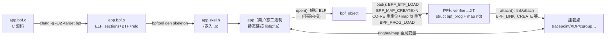

# 第7章 加载、生命周期与 libbpf

> 本章导读：写给两类人——①写过 BPF C 但想搞清"`clang -target bpf` 产出的 .o 到底怎么进了内核、map fd 怎么缝进指令、程序退出后内核里发生了什么"的工程师；②要选型前端（iproute2/bcc/libbpf）或排查加载失败的人。前置：第2章（VM 与指令集）、第4章（Maps）。读完你能：徒手画出 ELF→bpf(2)→verifier→JIT→attach 的完整加载链；按 open/load/attach 三段式组织任何 libbpf 应用；用 bpftool 内省与 pin 管理生命周期。实践层素材以 libbpf-bootstrap 官方样例为锚（本地 repos/libbpf/libbpf-bootstrap/）。

## 7.1 直觉层

**比喻：跨国快递报关。** 你的 `.bpf.o` 是一只集装箱：里面每一件货（每个 `SEC()` section 的程序、每个 `.maps` 定义的 map、license 声明、BTF 类型清单）都要被拆出来单独申报。libbpf 就是报关行——它替你拆箱、分拣、**重贴标签**（把 ELF 里的符号引用重写成真实的 map fd），然后逐件向唯一的海关窗口 `bpf(2)` 系统调用提交。海关官员是 verifier（第3章）：证明不了安全就整箱退回（`EINVAL` + log_buf 里的拒绝理由）。放行后每件货拿到一张**提货凭证 = fd**；`attach` 是把货挂上具体货架（tracepoint/网卡/cgroup）；`pin` 是把凭证登记进 bpffs 档案室（`/sys/fs/bpf/`），让货在你进程死后继续存在。

为什么需要"加载器"这个角色？因为**内核根本不认识 ELF**。`BPF_PROG_LOAD` 只接受一个 `struct bpf_insn` 指令数组（8 字节/条，`{code, dst_reg:4, src_reg:4, off:s16, imm:s32}`，小端 [id=101]）加几个属性字段；map 也不在程序里，内核只知道"第 N 条指令的 `ld_imm64` 引用了某个 map fd"。从"一份带 section 名、重定位表、BTF 的 ELF 文件"到"一串 syscall"之间的全部翻译工作，都属于用户态加载器——这是理解三代前端差异的钥匙。



本章在整条 eBPF 栈里的位置：向下衔接第2/3/4章（指令集、verifier、map 的内核侧），向上支撑第8章以后的所有挂载点专题（tracing/XDP/LSM）——**任何 eBPF 应用，无论多么复杂，用户态侧都是这条 open→load→attach 管线的变形**。

## 7.2 原理层

### 7.2.1 ELF `.o` 的解剖：section 即接口

`clang -g -O2 -target bpf` 产出的是一个普通 relocatable ELF，libbpf 与内核之间的全部契约都编码在 section 名与 BTF 里（约定由 libbpf 定义并演进 [id=100]）：

- **每个 `SEC("...")` 一个 section**：程序 section 名（`tp/syscalls/sys_enter_write`、`kprobe/`、`xdp`、`uprobe//proc/self/exe:uprobed_sub`…）同时声明了程序类型与期望的挂载点，libbpf 据此选择 prog_type/attach_type 并支持自动 attach（examples/c/uprobe.bpf.c）；
- **`SEC(".maps")`**：BTF-defined map——`struct { __uint(type,…); __uint(max_entries,…); __type(key,…); __type(value,…); }` 用 BTF 记录 map 的全部元数据，取代旧版"section 内 map 定义结构体"方案（examples/c/bootstrap.bpf.c 的 `exec_start`/`rb`）；
- **`SEC("license")`**：license 声明是内核强制的，部分能力（如 `bpf_printk` 背后的一批 helper）只对 GPL 兼容程序开放 [id=100]；
- **`.BTF` section**：`-g` 让 Clang 同时产出 DWARF 与 BTF；BTF 是 CO-RE 重定位与 map 类型描述的唯一依据，DWARF 随后被 strip 掉以缩小体积（BTF 保留）[id=100]；
- **符号表与重定位表**：程序里对 map 变量（`&exec_start`）的引用，编译成 `BPF_LD|BPF_DW|BPF_IMM`（opcode `0x18`，双字立即数加载）加一条 ELF 重定位；libbpf 在 load 阶段把它改写为"携带 map fd 的伪指令"（见 7.2.4）。

libbpf 的 open 日志直接展示了它如何按 section 解析（bootstrap 的 `-v` 输出）：
```
libbpf: elf: section(2) tp/sched/sched_process_exec, size 384, link 0, flags 6, type=1
libbpf: sec 'tp/sched/sched_process_exec': found program 'handle_exec' at insn offset 0 (0 bytes), code size 48 insns (384 bytes)
libbpf: license of bootstrap_bpf is Dual BSD/GPL
```
（来源 repos/libbpf/libbpf-bootstrap/README.md Troubleshooting 节——**排障第一步永远是看 libbpf debug 日志**。）

### 7.2.2 open → load → attach：三段式生命周期

libbpf 把 BPF 应用生命周期划成三段（libbpf.h 中 `bpf_object__open*` / `bpf_object__load` / attach API 族；digest 12 [id=144]）：

**① open（解析，不碰内核）**。`bpf_object__open("app.bpf.o")`（或 skeleton 的 `app_bpf__open()`）读 ELF、建内存对象、识别程序与 map。此时**尚未发生任何 bpf(2) 调用**——这是"参数化窗口"：改 `rodata`/`bss` 全局变量、改程序类型、设置 `bpf_object_open_opts`（`pin_root_path` 默认 `/sys/fs/bpf/`、`kconfig` 注入、自定义 BTF 路径等，见 src/libbpf.h）都在 open 与 load 之间做。

**② load（进内核，过 verifier）**。`bpf_object__load()` 对每个 map 执行 `BPF_MAP_CREATE`、把 BTF 通过 `BPF_BTF_LOAD` 灌入内核、对每个程序做 CO-RE 重定位（src/relo_core.c，对照 `/sys/kernel/btf/vmlinux` 修正字段偏移）与 map fd 指令重写，最后 `BPF_PROG_LOAD` 交给 verifier 静态验证、JIT 编译。内核侧主流程（`bpf_prog_load`：分配→attr 校验→verifier→JIT→finalize）全部在 kernel/bpf/syscall.c 分发落地 [id=267]。load 失败时 libbpf 会回传 verifier log（log_buf 太小内核甚至以 `-ENOSPC` 拒绝——src/libbpf.h kernel_log 注释明言此坑）。

**③ attach（接线，开始工作）**。多数程序类型 libbpf 能凭 SEC() 名自动 attach（skeleton 的 `__attach()` 即全自动路径 [id=100]）；不能自动的提供显式 API（如 `bpf_program__attach_uprobe_opts`）。attach 的产物是 `struct bpf_link`（见 7.2.7）。

**④ close/destroy（清理）**。`bpf_object__close()`/`app_bpf__destroy()` 关闭所有 fd；未被 pin、没有其他引用者的 map/prog/link 随引用计数归零被内核回收。

### 7.2.3 bpf(2) 五大命令族速查

`bpf(2)` 是一个"多路复用"系统调用：`syscall(__NR_bpf, cmd, &attr, sizeof(attr))`，`union bpf_attr` 按 cmd 取不同成员（**libc 不提供 `bpf()` 包装函数，必须走 `syscall()`**——这是 2018 年 Bolin 裸写加载器时踩的第一个坑 [id=101]）。全部命令号定义于 `include/uapi/linux/bpf.h` 的 `enum bpf_cmd`——这是内核与用户态的唯一 ABI 契约 [id=263]，libbpf 的 src/bpf.h/bpf.c 就是它的一对一薄封装 [id=144]。五大命令族：

| 命令族 | 代表命令 | 语义 |
|---|---|---|
| **MAP 族** | `BPF_MAP_CREATE` / `BPF_MAP_LOOKUP_ELEM` / `BPF_MAP_UPDATE_ELEM` / `BPF_MAP_DELETE_ELEM` / `BPF_MAP_GET_NEXT_KEY` / `BPF_MAP_FREEZE` / `*_BATCH` | map 的创建与键值读写、遍历、冻结只读、批量操作 |
| **PROG 族** | `BPF_PROG_LOAD` / `BPF_PROG_TEST_RUN` / `BPF_PROG_BIND_MAP` | 程序加载（insns+license+log_buf+kern_version）、用户态触发测试运行、程序与 map 绑定（如 rodata） |
| **OBJ/枚举族** | `BPF_OBJ_PIN` / `BPF_OBJ_GET` / `BPF_{PROG,MAP,BTF,LINK}_GET_NEXT_ID` / `BPF_*_GET_FD_BY_ID` / `BPF_OBJ_GET_INFO_BY_FD` | fd 钉到 bpffs/按路径取回；按 id 枚举系统内全部 BPF 对象（bpftool 的数据来源） |
| **ATTACH/LINK 族** | `BPF_PROG_ATTACH`/`BPF_PROG_DETACH`（旧式，cgroup 等）/ `BPF_LINK_CREATE` / `BPF_LINK_UPDATE` / `BPF_LINK_DETACH` / `BPF_ITER_CREATE` / `BPF_RAW_TRACEPOINT_OPEN` | 挂载/卸载；link 是"挂载关系本身"的 fd 化（可原子换程序），iter 与 raw tracepoint 专用通道 |
| **BTF/其他** | `BPF_BTF_LOAD` / `BPF_BTF_GET_FD_BY_ID` / `BPF_ENABLE_STATS` / `BPF_PROG_BIND_MAP` | BTF 灌入；打开 run_time/ns 级统计；token 等新特性 |

速记心法：**"万物皆 fd"**——map、prog、link、btf 全部以 fd 为句柄（[id=267]），`*_GET_FD_BY_ID` + `*_GET_NEXT_ID` 组合即构成 bpftool 的整个信息面。

### 7.2.4 指令重写：map fd 如何缝进程序

BPF C 里一句 `bpf_map_update_elem(&exec_start, &pid, &ts, BPF_ANY)`，经编译-加载后变成三件事，这个"缝合"过程是加载链最隐蔽的一环（以下为 BCC 时代的原始形态，libbpf 同构 [id=101]）：

1. **改写**（编译前端）：map 操作宏被展开为真实的 helper 调用，map 引用变成 `bpf_pseudo_fd(1, 3)` 形式的占位——"src=1 的伪 fd 加载"；
2. **编码**：占位落到指令流就是一条 `ld_pseudo r1, 1, 3`——字节 `18 11 00 00 03 00 00 00`：opcode `0x18`=`BPF_LD|BPF_DW|BPF_IMM`，src_reg=1 标记"imm 字段是伪 map fd"（BCC 的 DEBUG_SOURCE 反汇编实录 [id=101]）；
3. **重定位**（load 时）：加载器先 `BPF_MAP_CREATE` 拿到真 fd，再把每条 `ld_imm64` 伪指令的 imm/next-imm 替换成真 fd（并吞掉一个 dummy 槽位），内核侧 verifier 的 `resolve_pseudo_ld_immq` 阶段将其解析为 `map_ptr` 常量并做 map 类型检查 [id=269]。

libbpf 与 BCC 的差别只在第 1 步由谁做：BCC 用 Clang 前端在**运行时**改写源码，libbpf 用 ELF 重定位表在**加载时**改写指令流——后者不依赖目标机装编译器。同样机制也承载 CO-RE：`BPF_CORE_READ(task, real_parent, tgid)` 编译成记录字段偏移的重定位条目，load 时对照宿主内核 BTF 修正（src/relo_core.c）[id=144]。

### 7.2.5 三种前端世代对比

| 维度 | ① iproute2 裸加载（2014-2017 主流） | ② bcc 运行时重编译（2015-2019 主流） | ③ libbpf + CO-RE（现代正统） |
|---|---|---|---|
| 代表命令/API | `tc filter add ... bpf da obj x.o sec ingress`；`ip link set dev lo xdpgeneric obj xdp_pass_kern.o sec xdp`（xdp-tutorial basic01 实测命令） | `BPF(text=...)` + `attach_kprobe()`（Python） | `app_bpf__open_and_load()` + skeleton |
| 谁做翻译 | iproute2 内置小型 ELF loader | 目标机上的 LLVM（每次运行重编译 C→BPF） | 构建机 clang 一次编译，libbpf 加载时重定位 |
| 目标机依赖 | iproute2 | **Clang/LLVM + 全套内核头**（BCC 的 /virtual/include 内存映射机制 [id=101]） | 无（BTF 由发行版内核自带，libbpf README：Fedora 31+/RHEL 8.2+/Ubuntu 20.10/Debian 11 起内置） |
| 跨内核可移植 | 差 | 差（结构体偏移在编译时定死，换内核配置可能读错字段） | 好（CO-RE：BTF 重定位，编译一次到处跑） |
| 控制面能力 | netlink 语义内（tc/xdp），map 需 pin 到 `/sys/fs/bpf/tc/` 共享（digest 10 [id=131] 的 MPLS 例） | Python 全功能（map 像 dict 操作 [digest 08 id=99]） | C 全功能 + skeleton 全局变量 mmap |
| 体量/启动 | 小 | 重（LLVM 链接进来，bcc opensnoop 在 strace 下 **10000+ 行 syscall** vs 纯 C 版 42 行 [id=101]） | 产物 ~200KB 静态自包含二进制——Brendan Gregg"理想 BPF 工具形态"的兑现 [id=100] |
| 现状 | tc/网络运维场景仍用 | 观测工具存量巨大（bcc tools 200+），新开发已迁移；libbpf-tools 是官方移植层 | 新事实标准；Aya/libbpf-rs 等语言绑定均对齐此模型 |

注意①并未死掉：xdp-tutorial 特意让学员**手写 loader**（basic02 按程序名 `bpf_object__find_program_by_name` 加载）来理解"ip link set xdp obj 背后发生了什么"——那正是本章 7.2.2 流程的手工版。

### 7.2.6 BPF skeleton：生成物与三段式 API

skeleton 是 `bpftool gen skeleton app.bpf.o > app.skel.h` 的产物：一份**把 .o 字节数组整个嵌进去**、并按 ELF 内容生成强类型句柄的头文件（纯 libbpf 构造，内核不知情 [id=100]）。以 minimal 为例，生成物核心是：

```c
struct minimal_bpf {
    struct bpf_object_skeleton *skeleton;
    struct bpf_object *obj;
    struct { struct bpf_map *bss; } maps;      /* 按 .o 里的 map 生成 */
    struct { struct bpf_program *handle_tp; } progs;
    struct { struct bpf_link *handle_tp; } links;
    struct minimal_bpf__bss { int my_pid; } *bss;  /* 全局变量视图 */
};
/* 生成函数族：__open_opts / __open / __load / __open_and_load
 *           / __attach / __detach / __destroy */
```
（结构来源 id=100 博文贴出的生成样例；与 repos 中各 `*.skel.h` 用法一致。）

三个关键收益：①**部署零文件**——.o 嵌进二进制，只有 app 一个可执行文件；②**全局变量直读直写**——`skel->bss->my_pid = getpid()` 是对内核 mmap 区的普通内存写，**零 syscall**（bss/data/rodata 三个视图分别对应未初始化/初始化可写/只读变量 [id=100]）；③**rodata 编译期裁剪**——`const volatile` 只读变量必须在 open 与 load 之间赋值（load 后即冻结为只读，verifier 还会拒绝 BPF 侧写它），且值在验证时已知，verifier 可据此剪枝死代码；`volatile` 是防 Clang 把常量折叠掉、整个变量删除 [id=100]。skeleton 还有轻量版（light skeleton，src/gen_loader.c，免 libelf 依赖 [id=144]），主要用于受限环境。

### 7.2.7 bpf link 与 pin：生命周期语义

**默认生命周期：fd 即寿命。** map/prog/link 都是 fd [id=267]：加载器进程退出（包括崩溃）→ fd 全部关闭 → 引用计数归零 → 内核自动回收。所以"Ctrl-C 退出后 BPF 程序自动消失"是常态而非例外 [id=100]。但有两个反向通道：

**pin：跨进程持久化。** `BPF_OBJ_PIN(fd, path)` 把对象钉进 bpffs（`/sys/fs/bpf/`，需 `mount -t bpf bpf /sys/fs/bpf/`——ip/tc/testenv 会自动挂载 [repos/xdp-project/xdp-tutorial basic04]）。pin 后对象获得与文件同寿的引用：原进程死了也在；任何进程 `BPF_OBJ_GET(path)` 即可拿回 fd。三类对象级 API（src/libbpf.h）：`bpf_map__pin` / `bpf_object__pin_maps`、`bpf_object__pin_programs`、`bpf_link__pin`，外加 map 定义里的 `pinning` 属性 + open_opts 的 `pin_root_path`（默认 `/sys/fs/bpf/`）实现声明式自动 pin。典型用途：xdp-tutorial basic04 把 stats map pin 住，让 loader 与 stats 两个进程共享同一张表（重载程序时显式复用 pinned map，避免"新旧 map 各一套数据"）。

**link：挂载关系的 fd 化与 auto-detach。** attach 的返回值是 libbpf 的 `struct bpf_link`（src/libbpf_internal.h：detach/dealloc 回调 + fd + pin_path + disconnected 标志）——它是**用户态的统一抽象**，无论内核侧挂载走的是 `BPF_LINK_CREATE`（新式，挂载关系本身在内核也是一个 fd）还是 perf_event 等旧通道。价值有三：①**原子替换**——`bpf_link_update(link_fd, new_prog_fd)` 无缝换程序，挂载点永不空窗（旧式 `BPF_PROG_ATTACH` 语义按挂载点而异，替换常有竞态）；②**生命周期选项**——`bpf_link__disconnect(link)` 把 link 与你的进程"断钩"，之后 `destroy()` 只释放用户态内存不 detach，程序继续在内核挂载（配合 pin 实现守护进程交接）；③**所有权清晰**——`bpf_link__destroy()` = detach + free。老式挂载（XDP 经 `ip link set`、tc 经 netlink）不产生 link，程序由**挂载点本身**（网卡/qdisc）持有——进程死了程序还在，这正是 100.md 提醒"有些程序类型会在你进程死后继续活跃"的机制根源；排查时 `bpftool prog list` 看到的孤儿程序多来自这条路径。

## 7.3 实践层

### 7.3.1 构建流水：examples/c/Makefile 四步

libbpf-bootstrap 的 Makefile（2026-10 版，本地 repos/libbpf/libbpf-bootstrap/examples/c/Makefile）是官方钦定的标准流水：

1. **编 libbpf.a**：`make -C ../../libbpf/src BUILD_STATIC_ONLY=1 install`（依赖 libelf + zlib；pkg-config 可 `NO_PKG_CONFIG=1` 关闭）[repos/libbpf/libbpf/README.md]；
2. **编 BPF 侧**：`clang -g -O2 -target bpf -D__TARGET_ARCH_$(ARCH) -c app.bpf.c`——`-g` 产 BTF（必选），`-D__TARGET_ARCH_x86` 供 `bpf_tracing.h` 的 pt_regs 宏选架构，`CLANG_BPF_SYS_INCLUDES` 用 `-idirafter` 补架构头文件缺口（Makefile 注释详述此坑）；随后 **`bpftool gen object`** 做 BPF 静态链接（src/linker.c，2020 博文时代是 `llvm-strip -g`，如今剥离/合并都由 bpftool 完成——两代 Makefile 的主要代差）；
3. **生成 skeleton**：`bpftool gen object app.bpf.o app.tmp.bpf.o` → `bpftool gen skeleton app.bpf.o > app.skel.h`；
4. **编用户态并链接**：`cc -g -Wall app.o libbpf.a -lelf -lz -o app`。

产物即"~200KB、无运行时依赖的自包含二进制"[id=100]。环境要求：clang ≥ 11、libelf、zlib（README Building 节）；vmlinux.h 由仓内 submodule 提供（x86/aarch64 等多架构预生成，CO-RE 使其无需与本机内核版本精确匹配 [id=100]）。

### 7.3.2 样例一：minimal 逐行（21 行进内核）

**BPF 侧 minimal.bpf.c 全文骨架**：
```c
char LICENSE[] SEC("license") = "Dual BSD/GPL";
int my_pid = 0;                          /* BPF 全局变量 → bss，用户态可 mmap 直写 */
SEC("tp/syscalls/sys_enter_write")
int handle_tp(void *ctx)
{
    int pid = bpf_get_current_pid_tgid() >> 32;   /* 高 32 位是 PID(TGID) */
    if (pid != my_pid) return 0;          /* 过滤无关进程的 write() */
    bpf_printk("BPF triggered from PID %d.\n", pid);
    return 0;
}
```
要点：`my_pid` 不需要任何 map 声明——全局变量落在 `.bss`/`.data`/`.rodata` 段，load 时 libbpf 用内部 array map 承载并 mmap 给用户态 [id=100]；`bpf_printk` 输出到 `/sys/kernel/debug/tracing/trace_pipe`，仅限调试（无 BPF 调试器时代的第一排障手段，但生产禁用）[id=100]。

**用户侧 minimal.c 四步**：
```c
libbpf_set_print(libbpf_print_fn);        /* 全量 libbpf 日志→stderr（minimal 恒开 debug）*/
skel = minimal_bpf__open();               /* ① open：解析嵌入的 .o */
skel->bss->my_pid = getpid();             /* 参数化窗口：直写全局变量（零 syscall）*/
err = minimal_bpf__load(skel);            /* ② load：map 创建+重定位+verifier */
err = minimal_bpf__attach(skel);          /* ③ attach：按 SEC 名自动挂 tracepoint */
for (;;) { fprintf(stderr, "."); sleep(1); }  /* 触发源：每秒一次 write() */
cleanup: minimal_bpf__destroy(skel);      /* ④ destroy */
```
运行：`sudo ./minimal` 然后 `sudo cat /sys/kernel/debug/tracing/trace_pipe`，每秒一行 `BPF triggered from PID <pid>`（README 实测输出）。同文件三兄弟覆盖三个兼容梯度：`minimal_ns`（容器/WSL2——命名空间内 PID 与宿主真实 PID 不同，需换获取方式）、`minimal_legacy`（`#define BPF_NO_GLOBAL_DATA` 后用**单元素 ARRAY map** 模拟全局变量，支持无全局变量的老内核）、`bootstrap_legacy`（ringbuf 换 PERF_EVENT_ARRAY，兼容 <5.8，因为 BPF_MAP_TYPE_RINGBUF 是 5.8 引入的 [README]）。

### 7.3.3 样例二：uprobe 逐行（attach 的手动/自动两路）

uprobe 展示 skeleton 之外的 attach 深水区。BPF 侧（uprobe.bpf.c）：
```c
SEC("uprobe")  int BPF_KPROBE(uprobe_add, int a, int b) { … }        /* 类型待定，由用户态指定 */
SEC("uprobe//proc/self/exe:uprobed_sub") int BPF_KPROBE(uprobe_sub, …) /* 路径+符号写死→可自动 attach */
SEC("uretprobe//proc/self/exe:uprobed_sub") int BPF_KRETPROBE(uretprobe_sub, int ret) { … }
```
`BPF_KPROBE(name, args...)` 宏按寄存器约定展开 pt_regs 取参（x86 下 uprobe 与 kprobe 共用一套宏）；`BPF_KRETPROBE` 的首参是返回值。

用户侧（uprobe.c）两条路径：
```c
/* 手动：bpf_program__attach_uprobe_opts */
LIBBPF_OPTS(bpf_uprobe_opts, uprobe_opts);
uprobe_opts.func_name = "uprobed_add";   /* libbpf 自动解析符号→偏移 */
uprobe_opts.retprobe   = false;
skel->links.uprobe_add = bpf_program__attach_uprobe_opts(
        skel->progs.uprobe_add, 0 /* pid=0: 自身 */, "/proc/self/exe", 0, &uprobe_opts);
/* pid 传 -1 = 挂到所有现有及未来使用同一二进制的进程（README/代码注释实证）*/

/* 自动：SEC 里已带 path+symbol 的程序，由 __attach() 全量接线 */
err = uprobe_bpf__attach(skel);
```
两个工程细节：目标函数必须 `__attribute__((noinline)) int uprobed_add(...)` 并插入 `asm volatile("")`，防止编译器内联/合并导致符号消失（uprobe.c 注释原话："to make sure compiler doesn't inline it"）；返回值 link 存进 `skel->links.*`，destroy 时统一 detach。

### 7.3.4 ringbuf 采样循环（生产级主循环骨架）

内核侧（bootstrap.bpf.c）reserve/submit 配对是推荐姿势——先在 ringbuf 里**预留**一块可写内存、填完再提交，一次拷贝、失败可 `discard`：
```c
struct { __uint(type, BPF_MAP_TYPE_RINGBUF); __uint(max_entries, 256*1024); } rb SEC(".maps");
struct event *e = bpf_ringbuf_reserve(&rb, sizeof(*e), 0);
if (!e) return 0;                        /* 预留失败（满）→直接放弃，不阻塞内核 */
e->pid = pid;  e->ppid = BPF_CORE_READ(task, real_parent, tgid);  /* 填数据 */
bpf_ringbuf_submit(e, 0);                /* 提交后用户态立即可见 */
```
用户侧（bootstrap.c）三件套主循环：
```c
rb = ring_buffer__new(bpf_map__fd(skel->maps.rb), handle_event, NULL, NULL);
while (!exiting) {
    err = ring_buffer__poll(rb, 100 /* ms *);   /* epoll + 消费回调 */
    if (err == -EINTR) { err = 0; break; }       /* Ctrl-C 的标准处理 */
    if (err < 0) break;
}
/* cleanup: ring_buffer__free(rb); bootstrap_bpf__destroy(skel); */
```
`ring_buffer__poll`（带超时，配合 SIGINT 优雅退出）、`ring_buffer__consume`（立即消费不等待）、`ring_buffer__epoll_fd`（融入自管 epoll）是 libbpf.h 提供的三种消费姿态；回调签名 `int (void *ctx, void *data, size_t size)`，返回负值可终止轮询。ringbuf 相对 perf event array 的优势与 5.8 版本线详见第4章（Maps）与 Nakryiko ringbuf 专文（digest 08 [id=100] 文末链接）。

### 7.3.5 bpftool 速查

bpftool 是内核树自带 CLI（tools/bpf/bpftool；libbpf-bootstrap 以 submodule 内嵌）。子命令全景（digest 12 [id=153] + 实操实证）：

| 子命令 | 用途与常用形态 |
|---|---|
| `prog` | `bpftool prog list`（全系统程序）；`prog show id N`；`prog dump xlated`/`dump jited`（反汇编 BPF 指令/JIT 后本机码，排障神器 [digest 10 id=131]） |
| `map` | `map list`；`map dump name exec_start`；`map update/lookup/delete`；`map pin` |
| `link` | `link list`（谁挂在哪）；`link pin`/`detach`/`update`（link 生命周期的 CLI 面） |
| `cgroup`/`net`/`perf` | cgroup 挂载树查询；`net list`（网卡 XDP/tc 挂载状态）；perf event 查看 |
| `btf` | `btf dump file /sys/kernel/btf/vmlinux format c`（**生成 vmlinux.h 的官方命令**） |
| `gen` | `gen skeleton`/`gen object`/`gen min_core_btf`（skeleton/静态链接/BTF 瘦身，构建流水核心） |
| `struct_ops`/`iter` | struct_ops 程序管理；BPF iterator 实例化 |

三个高频组合：加载失败先 `sudo ./app -v` 看 libbpf 日志；线上排障 `bpftool prog dump jited id N | head`；`bpftool prog list` 若报 `Operation not permitted`——恭喜你撞上了 bootstrap 的 lsm 示例：它用 LSM BPF 程序封禁了 `bpf()` 系统调用本身（README 实测输出，也是 BPF 用于安全策略的自演示）。

## 7.4 深水区与坑

1. **kern_version 的 EINVAL 陷阱（kprobe 时代遗产）**：4.x 内核对 `BPF_PROG_TYPE_KPROBE` 强制 `attr->kern_version == LINUX_VERSION_CODE`，不满足直接 EINVAL——man page 示例没写这行，Bolin 靠读 kernel/bpf/syscall.c 源码才定位（v4.15 的 `if (type == BPF_PROG_TYPE_KPROBE && attr->kern_version != LINUX_VERSION_CODE) return -EINVAL;`）[id=101]。更阴的是**不能用 uname 动态计算**：Ubuntu 4.15.0-33 的 `KERNEL_VERSION(4,15,0)`=265984 ≠ 编译期 `LINUX_VERSION_CODE`=266002（发行版 backport 抬高了 sublevel）[id=101]。libbpf 自动填对；手写加载器才会踩。
2. **bpf(2) 没有 libc 包装**：必须 `syscall(__NR_bpf, BPF_PROG_LOAD, &attr, sizeof(attr))`；且传参前把 `union bpf_attr` **完整清零**（libbpf 的做法，未清零的 padding 会被 copy_from_user 校验拒绝）[id=101]。
3. **verifier log_buf 的悖论**：log buffer 只在失败后才有内容，而**buffer 太小本身会导致加载以 -ENOSPC 失败**（成功时也可能因日志过长失败）；libbpf 的策略是失败后以递增 buffer 重试 [digest 08 id=108 + src/libbpf.h 注释]。
4. **RLIMIT_MEMLOCK 的代差**：2020 年教程要求所有 BPF 应用 `setrlimit(RLIMIT_MEMLOCK, RLIM_INFINITY)` bump 上限 [id=100]；但当前 libbpf-bootstrap 的 minimal.c/bootstrap.c **已彻底删除该步骤**（对比 2020 博文与 2026 仓源码）——新内核改用 memcg 计账后 memlock 限制对多数程序不再生效。照抄旧教程会引入无用代码；反之在很老的内核上跑新样例会因没 bump 而莫名失败。
5. **vmlinux.h 不可与系统内核头混用**：类型重定义冲突几乎必现；正确姿势是 vmlinux.h + libbpf 头 + 应用自有头三件套 [id=100]。
6. **`const volatile` 少一个都不行**：少 `const` 则 verifier 不知道值（无法剪枝）、rodata 视图变 data；少 `volatile` 则 Clang 直接把变量优化删除 [id=100]。且必须在 open 与 load 之间赋值，`open_and_load` 一步到位的写法会错过窗口。
7. **uprobe 目标函数防内联**：`noinline` + `asm volatile("")` 双保险，否则符号在二进制里不存在，attach 时报符号找不到（uprobe.c 注释）。
8. **进程死了程序还在的三种残留**：老式 XDP/tc 挂载（由网卡/qdisc 持有）；pin 过的 map/link；`bpf_link__disconnect` 显式留下的 link。排查顺序：`bpftool prog list` → `bpftool link list` → `ls /sys/fs/bpf/`。
9. **pin 的时序坑**：`bpf_object__pin_maps` 会建目录并整体 pin，但重跑 loader 时若先 unpin 再 pin 会丢数据、若已 pinned 再 pin 会报 EEXIST——xdp-tutorial basic04 的 Gotchas 节专门讲"复用已 pin 的 map"（`bpf_map__set_pin_path` + open 阶段接管）。
10. **per-CPU map 尺寸要用 `/sys/devices/system/cpu/possible`** 而非 `get_nprocs_conf()`：VMware vcpu.hotadd 会让后者虚报（128 vs 实际），导致 map 创建尺寸错配 [digest 08 id=108]。
11. **容器/WSL2 里 minimal 不出输出**：pid namespace 里看到的 PID 与宿主不同——换 minimal_ns（README 明示）。
12. **verifier 报错文案代际漂移大**：主线已把 states/fixups/backtrack/liveness 从 verifier.c 拆出，5.x 时代资料对不上新源码；排障时以当前内核源码为准 [id=269]。
13. **bcc 老代码迁移**：隐式内存访问被 bcc rewriter 自动改写为 probe_read，`s390`（地址空间重叠架构）与 x86/arm 行为不同——跨架构移植 bcc 程序的经典雷 [digest 08 id=98]；官方迁移参考是 libbpf-tools（libbpf README 指定）。
14. **调试三板手**：`sudo cat trace_pipe`（printk）；`bpftool prog dump xlated/jited`（指令级）；bcc 时代的 `DEBUG_PREPROCESSOR`/`DEBUG_SOURCE`（看改写后 C 与反汇编）依然是理解"编译器到底生成了什么"的最快通道 [id=101]。

## 7.5 与其他章的关系

**承上**：第2章（VM 与指令集）给出 `struct bpf_insn` 的编码细节，本章 7.2.4 的 `ld_imm64` 重写是它的一次具体应用；第3章（Verifier）解释 load 阶段拒绝的每一类原因，本章只讲"log 如何拿到"；第4章（Maps）定义 map 类型语义，本章视角是"`BPF_MAP_CREATE` 何时被谁调用"；第5/6章的 BTF/CO-RE 与 Helpers 是 libbpf load 期重定位与程序内 helper 调用的底层依据。**启下**：第8章起的 tracing（kprobe/fentry/USDT）、XDP/tc 数据面、LSM 与项目实战章，全部以本章 open/load/attach 管线 + skeleton 为用户态骨架——后续章节出现 `skel->links.*`、ringbuf poll 循环、pin 共享 map 时不再重复解释。

## 7.6 语料索引

| id | 名称 | 本地路径 | 用了什么 |
|---|---|---|---|
| 100 | Building BPF applications with libbpf-bootstrap（Nakryiko, 2020-11） | web/md/100.md | skeleton 结构、Makefile 四步、全局变量/rodata 语义、vmlinux.h 禁忌、200KB 二进制口径 |
| 101 | How I ended up writing opensnoop in pure C（Bolin, 2018-09） | web/md/101.md | bpf_insn 编码、kern_version EINVAL、strace 实录的 attach 全流程、bpf_pseudo_fd/ld_pseudo、BCC /virtual/include |
| 144 | libbpf GitHub 镜像 | repos/libbpf/libbpf/ | README（构建/CO-RE/BTF 发行版清单）、src/bpf.h 命令族封装、src/libbpf.h 生命周期与 ringbuf/pin API、src/libbpf_internal.h 的 bpf_link、src/relo_core.c |
| 145 | libbpf-bootstrap | repos/libbpf/libbpf-bootstrap/ | README 全部样例说明、examples/c/{minimal,uprobe,bootstrap,kprobe,minimal_legacy}.{c,bpf.c} 逐行、Makefile 构建流水 |
| 107 | XDP Hands-On Tutorial | repos/xdp-project/xdp-tutorial/ | ip link set xdp 命令族、手写 loader、basic04 pinning 语义与 Gotchas |
| 263 | include/uapi/linux/bpf.h | digest 11（GitHub 镜像 raw 可读） | enum bpf_cmd 全集 = ABI 契约 |
| 267/269 | kernel/bpf/syscall.c / verifier.c | digest 11 | SYSCALL_DEFINE5 分发、prog_load 主流程、resolve_pseudo_ld_immq、fd 语义、verifier 拆分现状 |
| 153 | bpftool | digest 12（壳页；submodule 实仓在 libbpf-bootstrap/bpftool/） | 子命令体系公知定位；gen skeleton/object 由 Makefile 实证 |
| 98/99 | bcc Reference Guide / Python Tutorial | digest 08 | 三代对比中 bcc 侧证据（rewriter/ARCH 坑、map-as-dict） |
| 108 | Trail of Bits bpf_tutorials | digest 08 | log_buf 悖论、percpu map possible 口径、无 libc 包装佐证 |
| 131 | eBPF-mpls-encap-decap | repos/fzakaria/eBPF-mpls-encap-decap/（digest 10） | tc 世代 map pin /sys/fs/bpf/tc/globals、bpftool dump jited 实操 |

## 7.7 AI agent 用法

1. **"用户态加载 eBPF 程序的标准写法/骨架"** → grep `__open_and_load\|__open();` repos/libbpf/libbpf-bootstrap/examples/c/*.c，命中 minimal.c/uprobe.c 的三段式模板；再 grep `skel->rodata\|skel->bss` 拿参数化窗口写法。
2. **"bpf(2) 有哪些命令/某命令属于哪族"** → 本章 7.2.3 表 + repos/libbpf/libbpf/src/bpf.h（grep `LIBBPF_API int bpf_map_create\|bpf_prog_load\|bpf_link_create`），语义疑义回溯 include/uapi/linux/bpf.h 的 enum bpf_cmd。
3. **"加载失败 EINVAL/verifier 拒绝怎么排"** → 先 grep 本章 7.4 坑表关键词（kern_version/log_buf/memlock）；需要 verifier 深因时转第3章 + kernel/bpf/verifier.c [id=269]。
4. **"程序退出后内核里的 BPF 对象何时消失/如何常驻"** → 本章 7.2.7；实操验证命令 `bpftool link list` + `ls /sys/fs/bpf/`，复用 pinned map 的代码参照 repos/xdp-project/xdp-tutorial/basic04-pinning-maps/。
5. **"把 bcc 工具改写成 libbpf 版"** → 对照表在 7.2.5；bcc 侧重写机制证据 grep `DEBUG_PREPROCESSOR\|bpf_pseudo_fd` web/md/101.md；官方迁移参照 libbpf-tools（repos/libbpf/libbpf/README.md 指定）。
