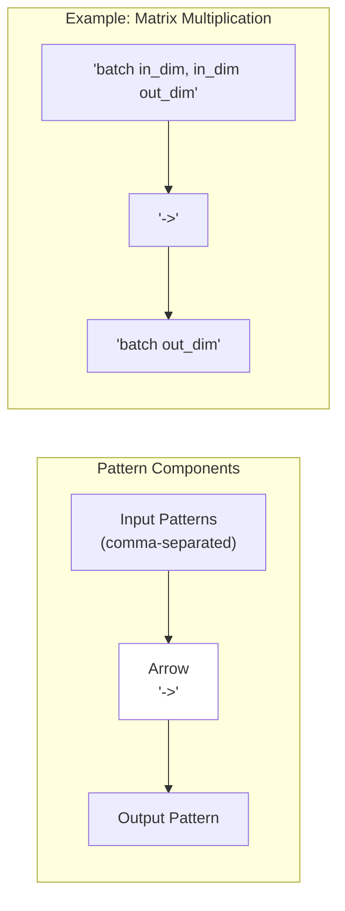
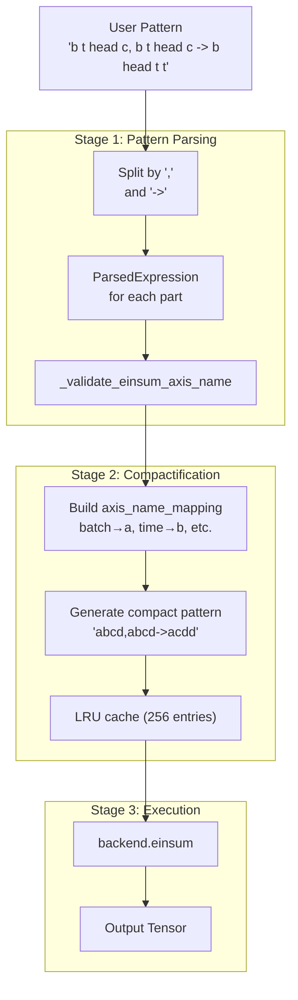
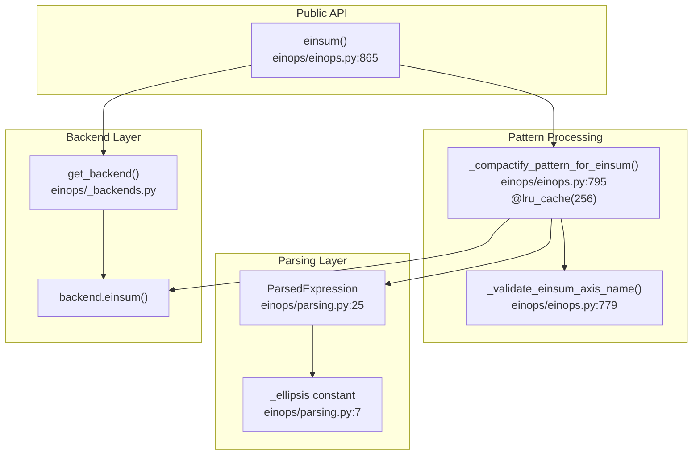
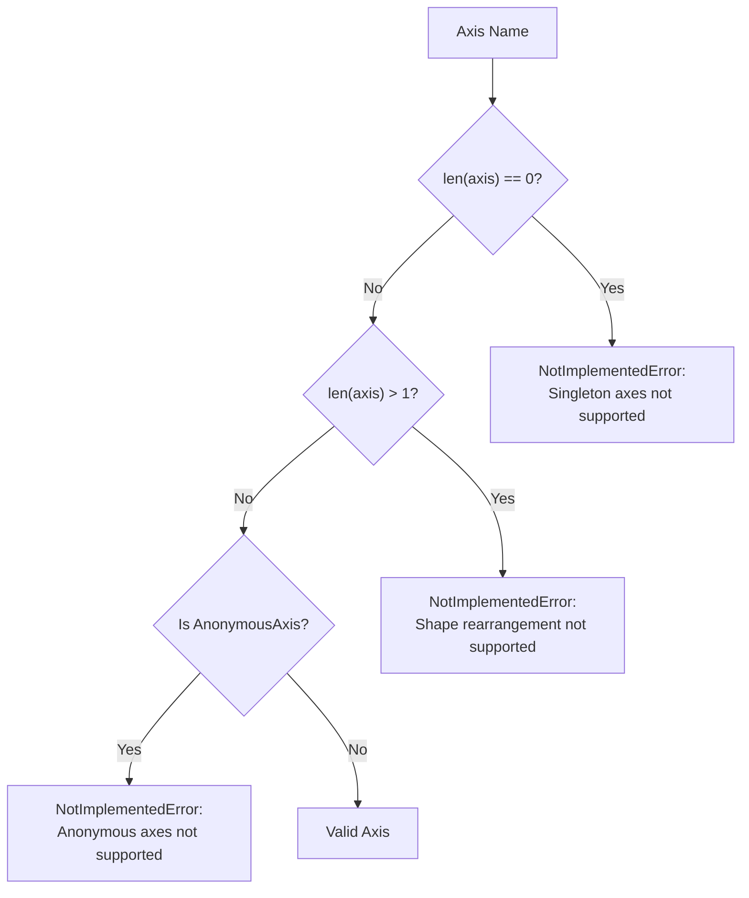
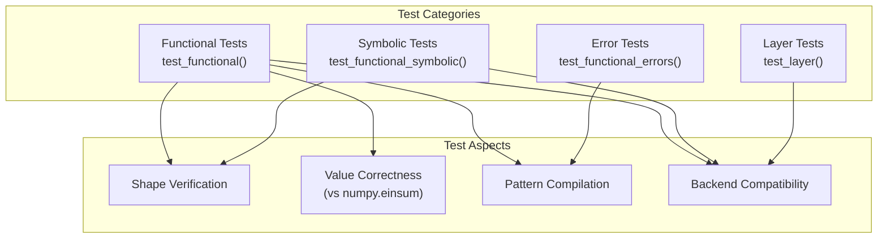

<!-- source: DeepWiki mcp.deepwiki.com · repo arogozhnikov/einops · page 2.2 einsum Operation · fetched 2026-10-21 -->

# einsum Operation

<details>
<summary>Relevant source files</summary>

The following files were used as context for generating this wiki page:

- [README.md](README.md)
- [einops/einops.py](einops/einops.py)
- [einops/parsing.py](einops/parsing.py)
- [einops/tests/run_tests.py](einops/tests/run_tests.py)
- [einops/tests/test_einsum.py](einops/tests/test_einsum.py)

</details>


This page documents the `einsum` operation in einops, which provides generalized tensor contraction with multi-letter axis names. For information about the three fundamental einops operations (rearrange, reduce, repeat), see [2.1](#2.1). For pattern syntax details applicable to all operations, see [2.4](#2.4).

## Purpose and Scope

The `einsum` operation extends standard Einstein summation notation to support multi-letter axis names, making tensor contractions more readable and self-documenting. This operation was added in einops 0.5 as a complement to the core `rearrange`, `reduce`, and `repeat` operations.

Unlike other einops operations, `einsum` focuses on tensor products and summations rather than axis rearrangement. It translates multi-letter axis names into single-letter patterns compatible with backend einsum implementations.

---

## Operation Overview

The `einsum` function performs tensor contraction (dot products with summation) using einops-style named axes. The key difference from standard einsum notation is the use of multi-letter axis names for improved readability.

**Basic signature:**
```python
einsum(*tensors, pattern: str) -> Tensor
```

**Key characteristics:**
- Tensors are passed first, pattern comes last (unlike numpy.einsum)
- Axis names can be multi-letter words (e.g., `batch`, `channel`, `head`)
- Axes not appearing on the right side are automatically summed over
- Pattern must contain `->` separator
- Supports ellipsis (`...`) for unknown dimensions

Sources: [einops/einops.py:865-939](), [README.md:130-137]()

---

## Pattern Syntax

### Supported Pattern Elements

| Element | Example | Description |
|---------|---------|-------------|
| Multi-letter names | `batch channel height` | Named axes using identifiers |
| Underscores in names | `first_tensor second_tensor` | Allowed within axis names |
| Comma separator | `a b c, c d e` | Separates different input tensors |
| Arrow operator | `->` | Required separator between inputs and output |
| Ellipsis | `... a b c` | Represents unknown number of dimensions |
| Trace (repeats) | `i i -> ` | Same axis name appearing multiple times |

### Pattern Structure Diagram



Sources: [einops/einops.py:795-846](), [einops/tests/test_einsum.py:51-166]()

---

## Pattern Processing Pipeline

The einsum operation converts multi-letter patterns to single-letter patterns through a two-stage process:



### Pattern Compactification

The `_compactify_pattern_for_einsum` function [einops/einops.py:795-846]() performs the core transformation:

1. **Parse each input pattern** using `ParsedExpression` with `allow_duplicates=True`
2. **Assign single letters** from `string.ascii_letters` (a-z, A-Z) to axis names
3. **Build compact pattern** by substituting mapped letters
4. **Validate output pattern** ensures no unknown axes appear on right side

**Mapping Process:**
```python
# Multi-letter names mapped to single letters
'batch time head channel' → 'a b c d'
'head in_dim out_dim'      → 'c e f'
```

Sources: [einops/einops.py:795-846](), [einops/einops.py:779-793]()

---

## API Reference

### Function Signature

```python
@typing.overload
def einsum(tensor: Tensor, pattern: str, ) -> Tensor: ...

@typing.overload
def einsum(tensor1: Tensor, tensor2: Tensor, pattern: str, ) -> Tensor: ...

@typing.overload
def einsum(tensor1: Tensor, tensor2: Tensor, tensor3: Tensor, pattern: str, ) -> Tensor: ...

@typing.overload
def einsum(tensor1: Tensor, tensor2: Tensor, tensor3: Tensor, tensor4: Tensor, pattern: str, ) -> Tensor: ...

def einsum(*tensors_and_pattern: Union[Tensor, str]) -> Tensor:
```

### Usage Patterns

**Matrix multiplication with batch dimension:**
```python
# Pattern: batch × in_dim, in_dim × out_dim → batch × out_dim
result = einsum(data, weights, 'batch in_dim, in_dim out_dim -> batch out_dim')
```

**Attention mechanism computation:**
```python
# Pattern: batch × t1 × head × c, batch × t2 × head × c → batch × head × t1 × t2
attention = einsum(queries, keys, 'b t1 head c, b t2 head c -> b head t1 t2')
```

**Batched dot product:**
```python
# Pattern: batch × dim, batch × dim → batch
dots = einsum(x, y, 'batch dim, batch dim -> batch')
```

**Matrix trace:**
```python
# Pattern: i × i → scalar
trace = einsum(matrix, 'i i -> ')
```

Sources: [einops/einops.py:865-927](), [README.md:133-136]()

---

## Implementation Details

### Code Entity Mapping



### Caching Strategy

The `_compactify_pattern_for_einsum` function uses `@functools.lru_cache(256)` to cache compiled patterns. This avoids re-parsing identical pattern strings across multiple calls.

**Cache key:** The pattern string itself (e.g., `"b c h w, b w -> b h"`)
**Cache value:** Compactified single-letter pattern (e.g., `"abcd,ad->ac"`)

Sources: [einops/einops.py:795]()

---

## Backend Support

The following backends support einsum operations:

| Backend | Module | Status |
|---------|--------|--------|
| NumPy | `numpy` | ✓ Supported |
| PyTorch | `torch` | ✓ Supported |
| TensorFlow | `tensorflow` | ✓ Supported |
| JAX | `jax` | ✓ Supported |
| CuPy | `cupy` | ✓ Supported |
| Paddle | `paddle` | ✓ Supported |
| OneFlow | `oneflow` | ✓ Supported |
| PyTensor | `pytensor` | ✓ Supported |
| MLX | `mlx` | ✓ Supported |

**Backend requirements:**
- Must implement `backend.einsum(pattern, *tensors)` method
- Must support standard einsum pattern syntax with single-letter axis names
- Must support ellipsis (`...`) notation

Sources: [einops/tests/test_einsum.py:184-195]()

---

## Restrictions and Limitations

### Unsupported Features

The following features available in other einops operations are **not** supported in `einsum`:

| Feature | Example | Reason |
|---------|---------|--------|
| Singleton axes | `'i () -> i'` | Not meaningful for einsum |
| Shape rearrangement | `'(a b) -> a b'` | Use `rearrange` instead |
| Anonymous axes | `'i 2 -> i'` | Conflicts with trace notation |
| Composite axes | `'(h w) c -> h w c'` | Use `rearrange` instead |

### Validation Logic



### Maximum Axes Limit

The function can handle up to 52 unique axis names (26 lowercase + 26 uppercase letters from `string.ascii_letters`). Exceeding this limit raises `RuntimeError: "Too many axes in einsum."`

Sources: [einops/einops.py:779-793](), [einops/tests/test_einsum.py:265-355]()

---

## Examples

### Basic Two-Tensor Contraction

```python
# Input shapes: (2, 3, 4, 5), (2, 5)
# Output shape: (2, 4)
result = einsum(x, y, 'b c h w, b w -> b h')
# Equivalent to: result[b, h] = sum_c sum_w x[b, c, h, w] * y[b, w]
```

### Three-Tensor Contraction

```python
# Input shapes: (2, 3, 40, 5), (2, 5), (2, 3)
# Output shape: (2, 40)
result = einsum(x, y, z, 'b c h w, b w, b c -> b h')
```

### Ellipsis for Unknown Dimensions

```python
# Input shapes: (32, 5, 2, 3, 4), (4, 5, 6)
# Output shape: (32, 5, 3, 6)
result = einsum(x, y, '... one two three, three four five -> ... two five')
```

### Trace Operation

```python
# Input shape: (5, 5)
# Output shape: ()
trace = einsum(matrix, 'i i -> ')
# Computes: sum_i matrix[i, i]
```

### Identity (No Contraction)

```python
# Input shape: (5, 4, 3, 2, 1)
# Output shape: (5, 4, 3, 2, 1)
result = einsum(tensor, '... -> ...')
# Returns tensor unchanged
```

### Attention Computation Pattern

```python
# Compute attention scores between queries and keys
# queries: (batch, time1, heads, channels)
# keys: (batch, time2, heads, channels)
# Output: (batch, heads, time1, time2)
scores = einsum(queries, keys, 'b t1 head c, b t2 head c -> b head t1 t2')
```

Sources: [einops/tests/test_einsum.py:51-166](), [README.md:133-136]()

---

## Testing

The einsum functionality is comprehensively tested across multiple dimensions:

### Test Coverage Areas



**Test matrix:**
- **Backends tested:** 10 frameworks (numpy, torch, tensorflow, jax, cupy, mlx, paddle, oneflow, pytensor, keras)
- **Pattern variations:** 16 functional test cases covering basic operations to complex ellipsis patterns
- **Error cases:** 13 error scenarios testing unsupported features
- **Layer integration:** EinMix layer tests across 4 frameworks

Sources: [einops/tests/test_einsum.py:1-357]()

---

