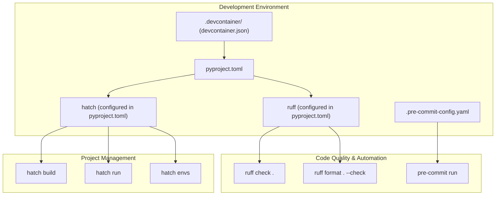
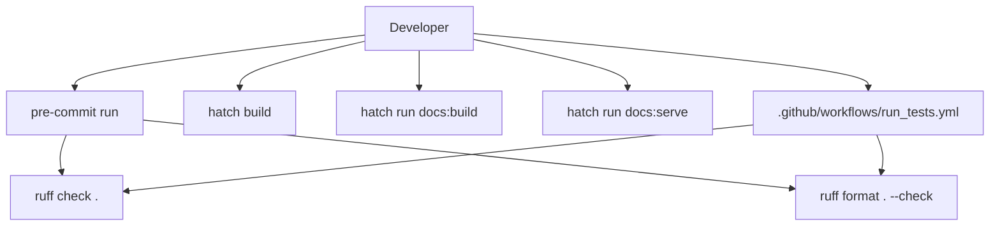

<!-- source: DeepWiki mcp.deepwiki.com · repo arogozhnikov/einops · page 6.4 Development Environment · fetched 2026-10-21 -->

# Development Environment

Relevant source files

The following files were used as context for generating this wiki page:

- [.github/workflows/run_tests.yml](.github/workflows/run_tests.yml)
- [.gitignore](.gitignore)
- [pyproject.toml](pyproject.toml)

This document describes the development environment for the einops project. It covers the tools, configuration files, and workflows that enable consistent, high-quality development both locally and in cloud-based environments (such as GitHub Codespaces). Topics include the devcontainer setup, code quality enforcement with ruff, pre-commit hooks, and project management with hatch. 

For information about the testing infrastructure, see [Testing Infrastructure](#6.1). For details on CI/CD automation, see [CI/CD Pipelines](#6.2). For documentation generation and serving, see [Documentation System](#6.3).

---

## Purpose and Scope

This page is intended for contributors and maintainers who wish to set up, maintain, or understand the local and remote development environment for einops. It explains:

- How to achieve a reproducible development environment using devcontainer and Codespaces.
- How code quality is enforced using ruff and pre-commit hooks.
- How project management and environment automation is handled with hatch.
- The relevant configuration files and their roles.

---

## Overview of Development Environment Components

The einops development environment is designed for consistency and automation across different platforms. The main components are:

- **Devcontainer**: Provides a reproducible development environment for local, remote, and Codespaces development.
- **Ruff**: Enforces code style and linting.
- **Pre-commit hooks**: Automate code quality checks before commits.
- **Hatch**: Manages project environments, builds, and scripts.
- **pyproject.toml**: Central configuration for build, environment, and tool settings.

### Diagram: "Development Environment Components and Code Entities"

**Sources:**  
[pyproject.toml:1-141]()

---

## Devcontainer and Codespaces Support

The einops repository includes a `.devcontainer/` directory (not shown in the file list above, but referenced in configuration) to support [Visual Studio Code Dev Containers](https://containers.dev) and GitHub Codespaces. This setup ensures that all contributors use a consistent environment, regardless of their local machine.

- **Purpose**: Provides a Docker-based environment with all necessary tools pre-installed.
- **Usage**: Open the repository in VS Code and select "Reopen in Container" or use GitHub Codespaces.
- **Configuration**: The devcontainer references the `pyproject.toml` for Python version and tool dependencies.

**Sources:**  
[pyproject.toml:40-42]()

---

## Code Quality: Ruff Configuration

[Ruff](https://github.com/astral-sh/ruff) is used for linting and code formatting. Its configuration is centralized in `pyproject.toml` under the `[tool.ruff]` section.

- **Linting**: Enforced via `ruff check .`
- **Formatting**: Enforced via `ruff format . --check`
- **Configuration**: 
  - Target Python version: 3.9 (`target-version = 'py39'`)
  - Line length: 120
  - Excludes notebooks and certain files from formatting and linting.
  - Selects a comprehensive set of linting rules, including error, warning, and style checks.
  - Per-file ignores for `.ipynb` files and specific rules.

**Table: Key Ruff Configuration Options**

| Option                | Value/Description                                 |
|-----------------------|---------------------------------------------------|
| `line-length`         | 120                                               |
| `target-version`      | py39                                              |
| `exclude`             | `["*.ipynb", "*Pytorch.ipynb"]`                   |
| `select`              | Multiple rule sets (E, F, W, B, I, RUF, etc.)     |
| `ignore`              | Specific rules (e.g., C408, PLW0603, PLR, etc.)   |
| `per-file-ignores`    | Custom ignores for notebooks                      |

**Ruff is run both locally and in CI to ensure code quality.**

**Sources:**  
[pyproject.toml:86-141]()  
[.github/workflows/run_tests.yml:34-36]()

---

## Pre-commit Hooks

Pre-commit hooks are configured (typically in `.pre-commit-config.yaml`, not shown above) to automate code quality checks before code is committed. These hooks usually run ruff and other tools to prevent style or lint errors from entering the codebase.

- **Purpose**: Prevents non-compliant code from being committed.
- **Integration**: Works with ruff and other tools as specified in the configuration.

**Sources:**  
[.github/workflows/run_tests.yml:34-36]()

---

## Project Management with Hatch

[Hatch](https://hatch.pypa.io) is used for environment management, building, and running project scripts. Its configuration is found in `pyproject.toml` under `[build-system]`, `[tool.hatch]`, and related sections.

- **Build Backend**: `hatchling` is specified as the build backend.
- **Versioning**: Single-source versioning from `einops/__init__.py`.
- **Environment Scripts**: 
  - Documentation build and serve scripts under `[tool.hatch.envs.docs.scripts]`.
  - PyPI deployment scripts under `[tool.hatch.envs.pypi.scripts]`.
- **Usage**: 
  - `hatch build` to build the package.
  - `hatch run docs:serve` to serve documentation locally.
  - `hatch run pypi:deploy_test` to deploy to Test PyPI.

**Table: Common Hatch Commands**

| Command                        | Description                                 |
|--------------------------------|---------------------------------------------|
| `hatch build`                  | Build the package (sdist and wheel)         |
| `hatch run docs:build`         | Build documentation                         |
| `hatch run docs:serve`         | Serve documentation locally                 |
| `hatch run pypi:deploy_test`   | Deploy to Test PyPI                         |
| `hatch run pypi:deploy`        | Deploy to PyPI                              |

**Sources:**  
[pyproject.toml:1-141]()

---

## File and Directory Structure

The following files and directories are relevant to the development environment:

| Path                        | Purpose                                                      |
|-----------------------------|--------------------------------------------------------------|
| `.devcontainer/`            | Devcontainer configuration for Codespaces/local containers   |
| `pyproject.toml`            | Central configuration for build, ruff, hatch, and metadata   |
| `.pre-commit-config.yaml`   | Pre-commit hook configuration (not shown above)              |
| `.github/workflows/`        | CI workflows, including ruff checks in `run_tests.yml`       |
| `.gitignore`                | Excludes build, cache, and environment files                 |

**Sources:**  
[pyproject.toml:1-141]()  
[.github/workflows/run_tests.yml:1-40]()  
[.gitignore:1-128]()

---

## Diagram: "Code Quality and Build Automation Flow"

**Sources:**  
[pyproject.toml:1-141]()  
[.github/workflows/run_tests.yml:34-36]()

---

## Summary

The einops development environment is designed for reproducibility, code quality, and ease of use across platforms. By leveraging devcontainer, ruff, pre-commit, and hatch, contributors can expect a consistent workflow whether developing locally or in the cloud. All major configuration is centralized in `pyproject.toml`, and automation is enforced both locally and in CI.

**Sources:**  
[pyproject.toml:1-141]()  
[.github/workflows/run_tests.yml:1-40]()  
[.gitignore:1-128]()

---

