# Page: Overview

# Overview

<details>
<summary>Relevant source files</summary>

The following files were used as context for generating this wiki page:

- [README.md](README.md)
- [einops/__init__.py](einops/__init__.py)
- [einops/einops.py](einops/einops.py)
- [einops/parsing.py](einops/parsing.py)
- [scripts/setup.py](scripts/setup.py)

</details>


This page introduces the einops library, its core philosophy, architecture, and capabilities. For detailed API documentation of specific operations, see [Core API Reference](#2). For framework-specific layer implementations, see [Layer Integration](#3). For internal implementation details, see [Internal Architecture](#4).

## Purpose and Scope

einops is a Python library that provides flexible and powerful tensor operations through readable, declarative patterns. It enables clear and reliable tensor manipulations across multiple deep learning frameworks using Einstein-inspired notation. This overview covers the library's structure, core operations, pattern language, and framework support.

**Sources:** [README.md:20-28]()

## What is einops?

einops (Einstein-Inspired Notation for Operations) is a tensor manipulation library that replaces framework-specific operations with a unified, readable pattern-based syntax. Instead of remembering different APIs for reshape, transpose, squeeze, unsqueeze, stack, and concatenate across frameworks, einops provides three core operations (`rearrange`, `reduce`, `repeat`) plus additional utilities (`pack`, `unpack`, `einsum`) that work identically across numpy, pytorch, tensorflow, jax, mlx, and other frameworks.

The library emphasizes:
- **Semantic information**: Patterns explicitly describe input/output structure
- **Runtime validation**: Automatic shape checking prevents silent errors  
- **Framework independence**: Identical behavior across all backends
- **Readability**: Self-documenting code through named axes

**Sources:** [README.md:27-28](), [README.md:191-298]()

## Installation

```bash
pip install einops
```

The library has zero runtime dependencies and supports Python 3.10+.

**Sources:** [README.md:83-90](), [README.md:379-381]()

## Core Architecture

einops consists of three main architectural layers that cleanly separate user interface, transformation logic, and framework-specific execution:

```mermaid
graph TB
    subgraph "User-Facing API Layer"
        rearrange["rearrange()<br/>(einops/einops.py:561-616)"]
        reduce["reduce()<br/>(einops/einops.py:468-550)"]
        repeat["repeat()<br/>(einops/einops.py:627-674)"]
        pack["pack()<br/>(einops/packing.py)"]
        unpack["unpack()<br/>(einops/packing.py)"]
        einsum["einsum()<br/>(einops/einops.py:865-939)"]
        parse_shape["parse_shape()<br/>(einops/einops.py:677-736)"]
        asnumpy["asnumpy()<br/>(einops/einops.py:766-776)"]
    end
    
    subgraph "Core Processing Engine"
        ParsedExpression["ParsedExpression<br/>(einops/parsing.py:25-159)"]
        TransformRecipe["TransformRecipe<br/>(einops/einops.py:114-153)"]
        prepare_recipe["_prepare_transformation_recipe()<br/>(einops/einops.py:289-442)"]
        apply_recipe["_apply_recipe()<br/>(einops/einops.py:230-252)"]
        reconstruct["_reconstruct_from_shape()<br/>(einops/einops.py:155-224)"]
        optimize["_optimize_transformation()<br/>(einops/einops.py:50-102)"]
    end
    
    subgraph "Backend Abstraction Layer"
        get_backend["get_backend()<br/>(einops/_backends.py)"]
        AbstractBackend["AbstractBackend<br/>(einops/_backends.py)"]
        array_api["array_api.py<br/>(Array API Standard)"]
    end
    
    subgraph "Framework Implementations"
        numpy_backend["NumPy Backend"]
        torch_backend["PyTorch Backend"]
        tf_backend["TensorFlow Backend"]
        jax_backend["JAX Backend"]
        mlx_backend["MLX Backend"]
    end
    
    rearrange --> prepare_recipe
    reduce --> prepare_recipe
    repeat --> prepare_recipe
    einsum --> ParsedExpression
    pack --> ParsedExpression
    parse_shape --> ParsedExpression
    
    prepare_recipe --> ParsedExpression
    prepare_recipe --> TransformRecipe
    
    rearrange --> apply_recipe
    reduce --> apply_recipe
    repeat --> apply_recipe
    
    apply_recipe --> reconstruct
    apply_recipe --> get_backend
    reconstruct --> optimize
    
    get_backend --> AbstractBackend
    AbstractBackend --> numpy_backend
    AbstractBackend --> torch_backend
    AbstractBackend --> tf_backend
    AbstractBackend --> jax_backend
    AbstractBackend --> mlx_backend
    AbstractBackend --> array_api
```

**Architecture Description:**

The three-layer architecture ensures clean separation of concerns:

1. **User-Facing API Layer** ([einops/__init__.py:14]()): Exports nine public functions that provide the primary interface. All operations accept tensor inputs and pattern strings, delegating to the processing engine.

2. **Core Processing Engine**: Transforms patterns into executable recipes through a two-stage compilation:
   - Pattern parsing via `ParsedExpression` extracts axis names, composite axes, and ellipsis
   - Recipe compilation via `TransformRecipe` generates optimized transformation instructions
   - Dual-level LRU caching (256 recipe entries, 1024 shape entries) at [einops/einops.py:227]() and [einops/einops.py:289]()

3. **Backend Abstraction Layer**: Provides framework-agnostic execution through dynamic backend detection (`get_backend`) and the `AbstractBackend` interface, with a dual-path implementation for Array API-compliant frameworks.

**Sources:** [einops/__init__.py:14](), [einops/einops.py:114-153](), [einops/einops.py:289-442](), [einops/parsing.py:25-159]()

## Core Operations

einops provides six primary operations, all sharing the same pattern-based syntax:

| Operation | Purpose | Pattern Example | Description |
|-----------|---------|-----------------|-------------|
| `rearrange` | Reshape/transpose | `'b c h w -> b (c h w)'` | Reorder and combine axes |
| `reduce` | Aggregation | `'b c (h h2) (w w2) -> b c h w'` | Reduce with pooling operations |
| `repeat` | Broadcasting | `'h w -> h w c'` | Duplicate along new axes |
| `pack` | Concatenation | `'b * c'` | Reversibly pack multiple tensors |
| `unpack` | Splitting | `'b * c'` | Unpack previously packed tensors |
| `einsum` | Tensor contraction | `'b t1 c, b t2 c -> b t1 t2'` | Generalized dot products |

### Pattern-to-Implementation Flow

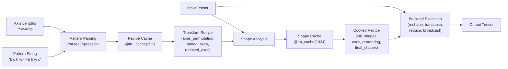

The flow demonstrates the two-stage caching strategy: patterns are parsed once and cached at [einops/einops.py:289](), while shape-specific transformations are cached separately at [einops/einops.py:227](). This allows a single pattern like `'b c h w -> b c'` to work efficiently across varying batch sizes.

**Sources:** [einops/einops.py:468-674](), [einops/einops.py:227](), [einops/einops.py:289]()

## Pattern Language

The pattern language is einops' core innovation. Patterns consist of axis identifiers connected by arrows (`->`):

### Pattern Components

| Component | Syntax | Example | Description |
|-----------|--------|---------|-------------|
| Named axes | `a-z`, `A-Z`, identifiers | `batch height width` | Semantic axis names |
| Composite axes | `(...)` | `(h h2)` | Decompose/compose axes |
| Anonymous axes | Integers | `2`, `3` | Fixed-size dimensions |
| Ellipsis | `...` | `batch ... channel` | Variable number of axes |
| Empty composition | `()` | `b c () ()` | Dimension of size 1 |
| Wildcard | `*` | `b * c` | For pack/unpack only |

### Pattern Examples

```python
# Transpose: channels-last to channels-first
rearrange(images, 'b h w c -> b c h w')

# Flatten spatial dimensions
rearrange(features, 'b c h w -> b c (h w)')

# Split into patches
rearrange(image, '(h p1) (w p2) c -> (h w) (p1 p2 c)', p1=16, p2=16)

# 2D pooling with reduction
reduce(x, 'b c (h h2) (w w2) -> b c h w', 'max', h2=2, w2=2)

# Repeat along new channel axis
repeat(grayscale, 'h w -> h w c', c=3)
```

**Pattern Parsing:** The `ParsedExpression` class at [einops/parsing.py:25-159]() tokenizes patterns, validates identifiers, and extracts structural information (parentheses, ellipsis). Pattern validation occurs at [einops/einops.py:304-329](), ensuring axis consistency between left and right sides.

**Sources:** [einops/parsing.py:25-159](), [einops/einops.py:289-442](), [README.md:110-137]()

## Framework Support

einops supports two execution paths for maximum compatibility:

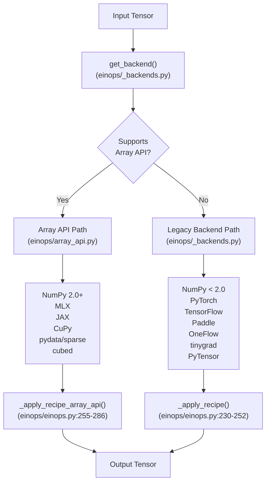

### Supported Frameworks

**Array API Compliant** (via [einops/array_api.py]()):
- NumPy 2.0+
- MLX (Apple's framework)
- JAX
- CuPy  
- pydata/sparse (sparse tensors)
- cubed (distributed tensors)

**Legacy Frameworks** (custom backends):
- NumPy < 2.0
- PyTorch (with torch.compile support)
- TensorFlow/Keras (eager + graph modes)
- Paddle
- OneFlow
- tinygrad
- PyTensor

The dual-path architecture introduced in version 0.7 allows einops to maintain a single API across 10+ frameworks while leveraging standardization where possible.

**Sources:** [README.md:301-335](), [einops/einops.py:230-286]()

## Layer Integration

einops provides neural network layer implementations for major frameworks:

```python
from einops.layers.torch import Rearrange, Reduce, EinMix
from einops.layers.tensorflow import Rearrange, Reduce, EinMix
from einops.layers.flax import Rearrange, Reduce, EinMix
from einops.layers.paddle import Rearrange, Reduce, EinMix
```

Layers encapsulate einops operations as framework-specific modules (e.g., `torch.nn.Module`, `tf.keras.layers.Layer`), enabling use within `Sequential` models and supporting features like serialization, torch.jit.script, and torch.compile.

**Example:**
```python
model = torch.nn.Sequential(
    torch.nn.Conv2d(3, 64, kernel_size=3),
    Rearrange('b c h w -> b (c h w)'),
    torch.nn.Linear(64 * 28 * 28, 10)
)
```

For detailed layer documentation, see [Layer Integration](#3).

**Sources:** [README.md:144-179](), [einops/__init__.py:1-18]()

## Key Implementation Details

### Caching Strategy

einops employs two-level LRU caching for performance:

1. **Recipe Cache** ([einops/einops.py:289]()): 256 entries, caches compiled `TransformRecipe` objects keyed by `(pattern, operation, axes_names, ndim)`
2. **Shape Cache** ([einops/einops.py:227]()): 1024 entries, caches shape-specific parameters within `_reconstruct_from_shape_uncached`

This strategy allows patterns to be parsed once but applied to tensors of varying shapes efficiently.

### Optimization Pipeline

The `_optimize_transformation` function at [einops/einops.py:50-102]() collapses consecutive axes that appear in the same order in both input and output patterns, reducing the number of reshape/transpose operations needed.

### Error Handling

All operations raise `EinopsError` ([einops/__init__.py:8-11]()) with detailed context including pattern, tensor shape, and axis specifications. Shape mismatches are detected during recipe reconstruction at [einops/einops.py:183-192]().

**Sources:** [einops/einops.py:50-102](), [einops/einops.py:227](), [einops/einops.py:289]()

## Related Documentation

This overview provides a high-level introduction. For deeper exploration:

- **[Installation and Quick Start](#1.1)**: Detailed setup and first examples
- **[Core Concepts and Design Philosophy](#1.2)**: Einstein notation philosophy and semantic benefits  
- **[Quick Examples](#1.3)**: Practical code snippets for common patterns
- **[Core API Reference](#2)**: Comprehensive operation documentation
- **[Pattern Syntax Guide](#2.4)**: Complete pattern language specification
- **[Layer Integration](#3)**: Framework-specific layer implementations
- **[Internal Architecture](#4)**: Backend system, recipe compilation, parsing
- **[Tutorials and Examples](#7)**: Step-by-step guides and real-world applications

**Sources:** [README.md:1-382](), Table of Contents JSON

## Version and Maintenance

Current version: 0.9.0dev ([einops/__init__.py:5]())

The library is actively maintained with:
- Continuous integration testing across Python 3.10, 3.11, 3.13
- Automated framework compatibility testing (numpy, pytorch, tensorflow, jax, mlx, pytensor)
- Documentation hosted at https://einops.rocks
- Source repository at https://github.com/arogozhnikov/einops

For development setup and contribution guidelines, see [Development and Testing](#6).

**Sources:** [einops/__init__.py:5](), [README.md:20-24]()

---

# Page: Installation and Quick Start

# Installation and Quick Start

<details>
<summary>Relevant source files</summary>

The following files were used as context for generating this wiki page:

- [README.md](README.md)
- [pyproject.toml](pyproject.toml)

</details>


## Purpose and Scope

This page covers the installation process for einops, verification of successful installation, and your first tensor operations. It provides practical steps to get einops running in your environment and execute basic operations within minutes.

For detailed explanations of einops concepts and philosophy, see [Core Concepts and Design Philosophy](#1.2). For comprehensive examples and use cases, see [Quick Examples](#1.3). For detailed API documentation, see [Core API Reference](#2).

---

## System Requirements

**Python Version**: einops requires Python 3.10 or later.

**Runtime Dependencies**: einops has **zero runtime dependencies**. The package works standalone and detects available tensor frameworks dynamically at runtime.

**Supported Frameworks**: einops automatically detects and works with any installed framework including NumPy, PyTorch, TensorFlow, JAX, CuPy, MLX, Flax, Paddle, OneFlow, Tinygrad, and PyTensor. Additionally, any framework supporting the [Python Array API Standard](https://data-apis.org/array-api) is automatically supported.

Sources: [pyproject.toml:9](), [pyproject.toml:25-27](), [README.md:301-334](), [README.md:379-381]()

---

## Installation Methods

### Standard Installation

The primary installation method uses pip:

```bash
pip install einops
```

### Alternative Installation with uv

The modern `uv` package installer is also supported:

```bash
uv pip install einops
```

Both methods install the same package with identical functionality. The `uv` tool typically offers faster installation times.

### Installation Process Flow

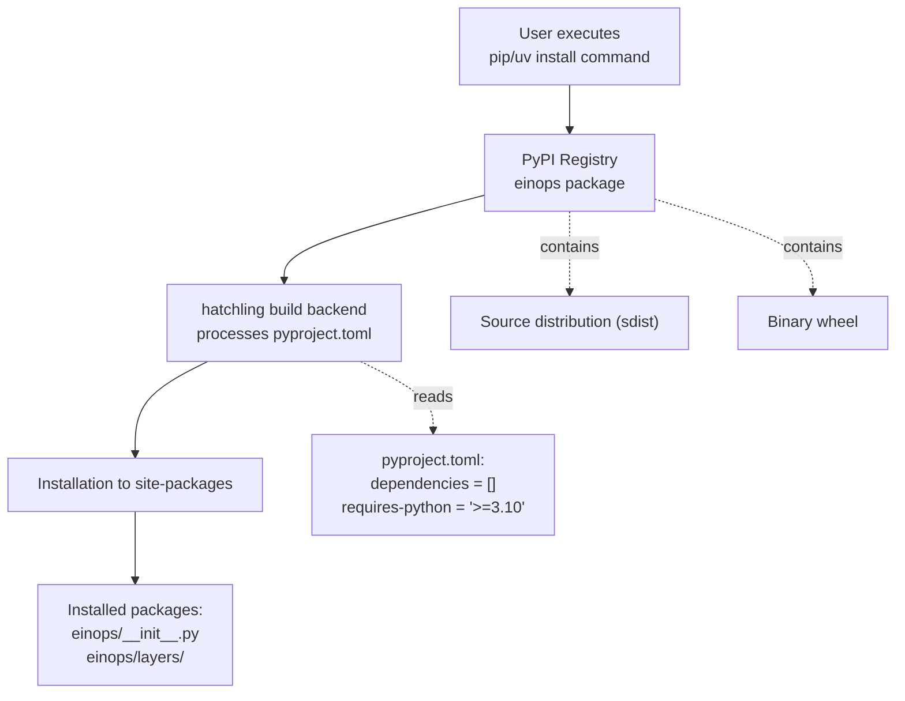

**Diagram: Installation Process** - Shows how pip/uv retrieves the package from PyPI, processes it through hatchling, and installs to your environment.

Sources: [README.md:83-90](), [pyproject.toml:1-3](), [pyproject.toml:9](), [pyproject.toml:25-27]()

---

## Verifying Installation

### Import Test

After installation, verify einops is available:

```python
import einops
print(einops.__version__)
```

This should display the installed version (e.g., "0.8.2") without errors.

### Core Functions Availability

Verify the core API is accessible:

```python
from einops import rearrange, reduce, repeat, pack, unpack, einsum
from einops import parse_shape, asnumpy, EinopsError
```

All imports should complete without `ImportError` or `AttributeError`.

### Framework Detection Test

Test that einops can detect your installed framework:

```python
import numpy as np
from einops import rearrange

# Create a simple numpy array
x = np.array([[1, 2], [3, 4]])

# Perform a basic rearrange operation
y = rearrange(x, 'h w -> w h')
print(y)  # Should print [[1, 3], [2, 4]]
```

If you have PyTorch installed:

```python
import torch
from einops import rearrange

x = torch.tensor([[1, 2], [3, 4]])
y = rearrange(x, 'h w -> w h')
print(y)  # Should work identically
```

The same pattern applies to any supported framework. einops automatically detects the tensor type and uses the appropriate backend.

Sources: [README.md:110-118](), [einops/__init__.py]() (implied from package structure)

---

## First Operations

### Entry Points and Core API

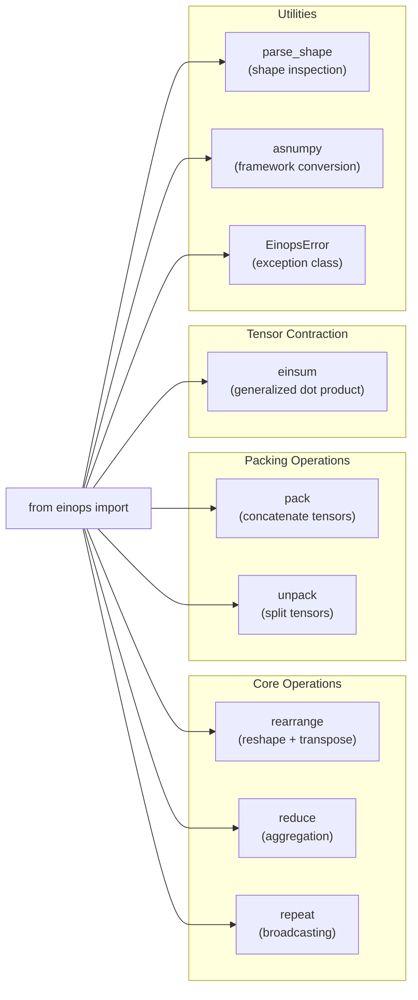

**Diagram: einops Public API** - Shows all importable functions and classes from the main `einops` module.

### Basic rearrange Example

The `rearrange` function reshapes and transposes tensors using pattern strings:

```python
from einops import rearrange
import numpy as np

# Create a batch of RGB images: batch=2, channels=3, height=4, width=4
images = np.random.rand(2, 3, 4, 4)

# Transpose to channels-last format
images_cl = rearrange(images, 'b c h w -> b h w c')
print(images_cl.shape)  # (2, 4, 4, 3)

# Flatten spatial dimensions
flattened = rearrange(images, 'b c h w -> b c (h w)')
print(flattened.shape)  # (2, 3, 16)

# Rearrange for Vision Transformer patches
patches = rearrange(images, 'b c (h p1) (w p2) -> b (h w) (c p1 p2)', p1=2, p2=2)
print(patches.shape)  # (2, 4, 12)
```

### Basic reduce Example

The `reduce` function performs aggregation operations:

```python
from einops import reduce

# Average pooling: reduce spatial dimensions by 2x2
pooled = reduce(images, 'b c (h h2) (w w2) -> b c h w', 'mean', h2=2, w2=2)
print(pooled.shape)  # (2, 3, 2, 2)

# Global average pooling
global_pool = reduce(images, 'b c h w -> b c', 'mean')
print(global_pool.shape)  # (2, 3)

# Max reduction
max_pool = reduce(images, 'b c (h h2) (w w2) -> b c h w', 'max', h2=2, w2=2)
print(max_pool.shape)  # (2, 3, 2, 2)
```

### Basic repeat Example

The `repeat` function copies tensor elements along new or existing axes:

```python
from einops import repeat

# Create a grayscale image
gray = np.random.rand(1, 28, 28)

# Convert to RGB by repeating channel dimension
rgb = repeat(gray, '1 h w -> c h w', c=3)
print(rgb.shape)  # (3, 28, 28)

# Tile an image
tiled = repeat(gray, '1 h w -> 1 (tile_h h) (tile_w w)', tile_h=2, tile_w=2)
print(tiled.shape)  # (1, 56, 56)
```

Sources: [README.md:110-118](), [README.md:196-262]()

---

## Operation Flow and Pattern Processing

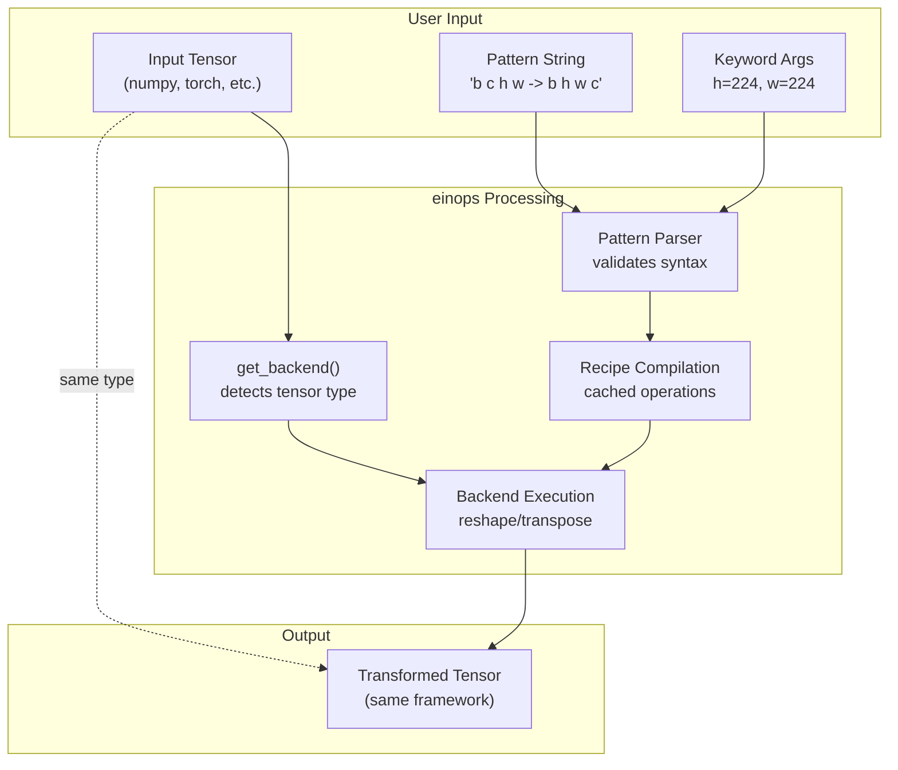

**Diagram: Operation Execution Flow** - Shows how user input flows through pattern parsing and backend execution to produce output.

When you call `rearrange(tensor, pattern)`:
1. `get_backend()` dynamically detects the tensor's framework
2. The pattern string is parsed and validated
3. A `TransformRecipe` is compiled (and cached for reuse)
4. The appropriate backend executes the transformation
5. The result is returned in the same framework as the input

Sources: High-level architecture diagrams, [README.md:110-137]()

---

## Framework-Specific Considerations

### NumPy (Default Framework)

NumPy is the reference implementation and requires no additional setup:

```python
import numpy as np
from einops import rearrange

x = np.random.rand(10, 20, 30)
y = rearrange(x, 'a b c -> b a c')
```

### PyTorch

PyTorch tensors are automatically detected. For neural network layers, use `einops.layers.torch`:

```python
import torch
from einops import rearrange
from einops.layers.torch import Rearrange, Reduce

# Functional API
x = torch.randn(32, 3, 64, 64)
y = rearrange(x, 'b c h w -> b (c h w)')

# Layer API (for nn.Sequential)
model = torch.nn.Sequential(
    torch.nn.Conv2d(3, 16, 3),
    Rearrange('b c h w -> b (c h w)'),
    torch.nn.Linear(16 * 62 * 62, 10)
)
```

### TensorFlow / Keras

TensorFlow supports both eager and graph modes. For Keras layers, use `einops.layers.tensorflow` or `einops.layers.keras`:

```python
import tensorflow as tf
from einops import rearrange
from einops.layers.keras import Rearrange

# Eager mode
x = tf.random.normal([32, 64, 64, 3])
y = rearrange(x, 'b h w c -> b (h w) c')

# Keras model
model = tf.keras.Sequential([
    tf.keras.layers.Conv2D(16, 3),
    Rearrange('b h w c -> b (h w c)'),
    tf.keras.layers.Dense(10)
])
```

### JAX

JAX tensors (DeviceArray) work with functional operations:

```python
import jax.numpy as jnp
from einops import rearrange

x = jnp.ones((10, 20, 30))
y = rearrange(x, 'a b c -> b a c')
```

### Array API Standard Support

For frameworks implementing the Python Array API Standard (NumPy 2.0+, MLX, pydata/sparse, etc.), use the array API import:

```python
from einops.array_api import rearrange  # instead of from einops import rearrange

# Works with any array API compliant framework
import mlx.core as mx
x = mx.random.normal((10, 20, 30))
y = rearrange(x, 'a b c -> b a c')
```

Sources: [README.md:146-179](), [README.md:301-334]()

---

## Testing Your Setup

### Running Built-in Tests

Starting from einops 0.8.1, tests are distributed with the package:

```bash
pip install einops pytest

# Test specific frameworks
python -m einops.tests.run_tests numpy pytorch jax --pip-install

# Test only with NumPy (minimal requirement)
python -m einops.tests.run_tests numpy --pip-install
```

The `--pip-install` flag automatically installs test dependencies. Omit it if dependencies are already installed.

### Quick Validation Script

Create a file `test_einops.py`:

```python
"""Quick validation that einops works with your frameworks."""
import sys

def test_numpy():
    import numpy as np
    from einops import rearrange, reduce, repeat
    
    x = np.random.rand(2, 3, 4, 5)
    
    # Test rearrange
    assert rearrange(x, 'a b c d -> b a d c').shape == (3, 2, 5, 4)
    
    # Test reduce
    assert reduce(x, 'a b c d -> a b', 'mean').shape == (2, 3)
    
    # Test repeat
    assert repeat(x, 'a b c d -> a b c (d repeat)', repeat=2).shape == (2, 3, 4, 10)
    
    print("✓ NumPy tests passed")

def test_pytorch():
    try:
        import torch
        from einops import rearrange
        
        x = torch.randn(2, 3, 4, 5)
        assert rearrange(x, 'a b c d -> b a d c').shape == (3, 2, 5, 4)
        
        print("✓ PyTorch tests passed")
    except ImportError:
        print("⊘ PyTorch not installed (skipped)")

def test_tensorflow():
    try:
        import tensorflow as tf
        from einops import rearrange
        
        x = tf.random.normal([2, 3, 4, 5])
        assert rearrange(x, 'a b c d -> b a d c').shape == (3, 2, 5, 4)
        
        print("✓ TensorFlow tests passed")
    except ImportError:
        print("⊘ TensorFlow not installed (skipped)")

if __name__ == '__main__':
    test_numpy()
    test_pytorch()
    test_tensorflow()
    print("\nAll available frameworks validated!")
```

Run with:
```bash
python test_einops.py
```

Sources: [README.md:343-354](), [pyproject.toml:58-76]()

---

## Framework Layer Installation

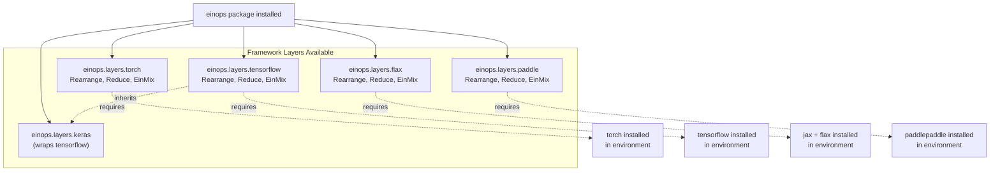

**Diagram: Framework Layer Dependencies** - Shows the layer modules available after einops installation and their framework requirements.

All layer implementations are included in the einops package. They activate automatically when the corresponding framework is detected at import time.

Sources: [README.md:146-152](), [pyproject.toml:35]()

---

## Common Installation Issues

### Issue: ImportError after installation

**Problem**: `import einops` fails with `ModuleNotFoundError`

**Solution**: Ensure you're using the correct Python environment:
```bash
# Verify einops is installed in current environment
pip list | grep einops

# Or check which Python is being used
which python
python -c "import sys; print(sys.executable)"
```

### Issue: Version conflicts

**Problem**: einops requires Python 3.10+ but Python 3.9 is installed

**Solution**: Upgrade Python or use a virtual environment with Python 3.10+:
```bash
# Using venv
python3.10 -m venv einops_env
source einops_env/bin/activate  # On Windows: einops_env\Scripts\activate
pip install einops
```

### Issue: Framework not detected

**Problem**: einops fails with "Can't find backend for <tensor_type>"

**Solution**: Ensure the framework is properly installed:
```bash
# Example for PyTorch
pip install torch --index-url https://download.pytorch.org/whl/cpu

# Verify import works
python -c "import torch; print(torch.__version__)"
```

### Issue: Documentation build fails

**Problem**: Cannot build documentation locally

**Solution**: Use the provided hatch environment:
```bash
# Install hatch if needed
pip install hatch

# Serve documentation locally
hatch run docs:serve
```

Sources: [README.md:337-361](), [pyproject.toml:58-76]()

---

## Next Steps

After successfully installing einops, consider these next steps:

1. **Learn Core Concepts**: Read [Core Concepts and Design Philosophy](#1.2) to understand einops' pattern-based approach and semantic information benefits

2. **Explore Examples**: Review [Quick Examples](#1.3) for common tensor manipulation patterns across different use cases

3. **Study Tutorials**: Work through the tutorial notebooks:
   - [einops fundamentals](https://github.com/arogozhnikov/einops/blob/main/docs/1-einops-basics.ipynb)
   - [einops for deep learning](https://github.com/arogozhnikov/einops/blob/main/docs/2-einops-for-deep-learning.ipynb)
   - [packing and unpacking](https://github.com/arogozhnikov/einops/blob/main/docs/4-pack-and-unpack.ipynb)

4. **Read API Reference**: Consult [Core API Reference](#2) for detailed documentation of all operations

5. **Try Interactive Playground**: Use the [einops playground](https://arogozhnikov.github.io/jupyterlite/lab/index.html?download_github_folder=arogozhnikov/einops/docs) to experiment in your browser

6. **Review Framework Integration**: For neural network usage, see [Layer Integration](#3) covering PyTorch, TensorFlow, and other frameworks

7. **Join Community**: Visit the [GitHub discussions](https://github.com/arogozhnikov/einops/discussions) for questions and community support

Sources: [README.md:72-101](), [README.md:32-33]()

---

## Quick Reference Table

| Task | Operation | Example Pattern |
|------|-----------|----------------|
| Transpose | `rearrange` | `'b c h w -> b h w c'` |
| Flatten | `rearrange` | `'b c h w -> b (c h w)'` |
| Reshape | `rearrange` | `'b (c g) h w -> b c g h w'` |
| Pooling | `reduce` | `'b c (h 2) (w 2) -> b c h w'` with `'mean'` |
| Global pool | `reduce` | `'b c h w -> b c'` with `'mean'` |
| Broadcasting | `repeat` | `'h w -> h w c'` |
| Tiling | `repeat` | `'h w -> (h h2) (w w2)'` |
| Stack tensors | `pack` | `[x, y, z]` with pattern `'b * c'` |
| Split tensor | `unpack` | tensor with `ps` from pack |
| Dot product | `einsum` | `'b i c, b j c -> b i j'` |

Sources: [README.md:103-137]()

---

# Page: Core Concepts and Design Philosophy

# Core Concepts and Design Philosophy

<details>
<summary>Relevant source files</summary>

The following files were used as context for generating this wiki page:

- [README.md](README.md)
- [einops/einops.py](einops/einops.py)
- [einops/parsing.py](einops/parsing.py)

</details>


## Purpose and Scope

This document explains the foundational principles and design decisions that shape einops as a tensor manipulation library. It covers the Einstein-inspired notation philosophy, the pattern language abstraction, semantic information benefits, deterministic transformation semantics, and the framework independence architecture that enables einops to work consistently across 10+ deep learning frameworks.

For practical pattern syntax details, see [Pattern Syntax Guide](#2.4). For implementation details of the backend abstraction system, see [Backend System](#4.1). For the pattern parsing implementation, see [Pattern Parsing System](#4.3).

---

## Einstein-Inspired Notation Philosophy

The name "einops" stands for **Einstein-Inspired Notation for Operations**. The library borrows the conceptual clarity of Einstein summation notation—where operations are specified declaratively through named indices—and extends it to general tensor manipulations beyond just summation.

**Traditional approach:**
```python
# Unclear what dimensions we're working with
y = x.view(x.shape[0], -1)
y = x.transpose(1, 2).reshape(batch, -1, channels)
```

**einops approach:**
```python
# Self-documenting: input has 'b c h w', output has 'b (c h w)'
y = rearrange(x, 'b c h w -> b (c h w)')
# Explicitly states we're transposing channels and time
y = rearrange(x, 'b c t -> b t c')
```

The core insight is that **named axes convey semantic meaning**. Rather than operating on positional indices (axis 0, axis 1, etc.), einops uses meaningful identifiers that describe what each dimension represents. This makes code simultaneously more readable and more reliable.

**Sources:** [README.md:186-213](), [einops/einops.py:563-616]()

---

## Pattern Language as First-Class Abstraction

### From Patterns to Executable Instructions

einops treats pattern strings as a first-class abstraction that gets parsed, validated, and compiled into efficient transformation recipes. This compilation happens through a multi-stage pipeline:

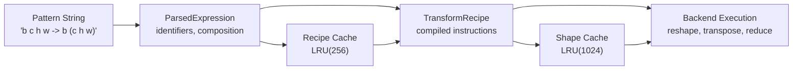

**Pattern Parsing Stage** ([einops/parsing.py:25-159]()): The `ParsedExpression` class tokenizes pattern strings into structured representations. It identifies:
- **Named axes**: Single or multi-character identifiers like `'batch'`, `'h'`, `'channel'`
- **Composite axes**: Grouped dimensions like `'(h w)'` or `'(c h2 w2)'`
- **Anonymous axes**: Numeric literals like `'2'` or `'3'` for known dimensions
- **Ellipsis**: `'...'` for variable-length dimension sequences
- **Empty compositions**: `'()'` for singleton dimensions

**Recipe Compilation Stage** ([einops/einops.py:290-442]()): The `_prepare_transformation_recipe` function converts parsed expressions into `TransformRecipe` objects. A recipe contains:
- `elementary_axes_lengths`: Sizes for each elementary axis
- `axes_permutation`: Order for transposition operations  
- `first_reduced_axis`: Boundary between kept and reduced axes
- `added_axes`: New dimensions for repeat operations
- `output_composite_axes`: Grouping structure for final reshape

**Two-Level Caching Strategy** ([einops/einops.py:227](), [einops/einops.py:289]()): 
- **Recipe Cache** (256 entries): Caches pattern parsing results. Key is `(pattern, operation, axes_names, ndim)`
- **Shape Cache** (1024 entries): Caches shape-specific computations. Key includes tensor shape and axis lengths

This separation allows a pattern like `'b c h w -> b c'` to be parsed once but applied efficiently to tensors with varying batch sizes.

**Sources:** [einops/einops.py:114-153](), [einops/einops.py:289-442](), [einops/parsing.py:25-159](), [README.md:107-118]()

### Pattern Components and Composition Rules

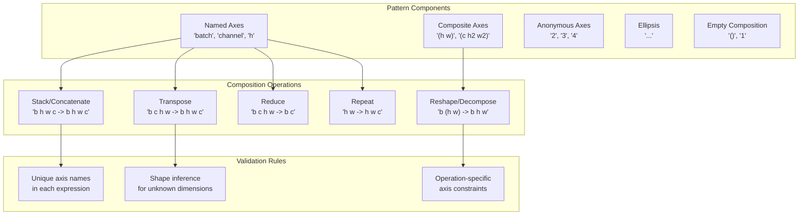

**Composite axes** enable decomposition and composition in a single operation. For example, `'b (h h2) (w w2) -> b h w (h2 w2 c)'` performs both spatial downsampling and channel expansion simultaneously. The parentheses indicate which axes should be grouped together.

**Anonymous axes** ([einops/parsing.py:10-23]()) are integers that specify known dimensions. They're useful for pooling operations: `'b c (h 2) (w 2) -> b c h w'` performs 2×2 max-pooling without requiring explicit size parameters.

**Ellipsis handling** ([einops/einops.py:331-363]()) allows patterns to work with variable-rank tensors. When a pattern contains `'...'`, the actual number of dimensions is determined at runtime and the ellipsis expands accordingly.

**Sources:** [einops/parsing.py:25-159](), [einops/einops.py:299-442](), [README.md:234-261]()

---

## Semantic Information and Self-Documenting Code

### Explicitness Over Implicit Behavior

A core design principle is that **operations should declare their assumptions explicitly** rather than relying on implicit conventions. This is achieved through three mechanisms:

**1. Named axes make intent explicit:**

```python
# Traditional: What are these dimensions?
y = x.view(x.shape[0], -1)

# einops: Clear that we're flattening spatial+channel dimensions
y = rearrange(x, 'b c h w -> b (c h w)')

# Traditional: Which axes are we summing over?
y = x.sum(axis=(2, 3))

# einops: Explicitly keeping batch and channel, reducing spatial
y = reduce(x, 'b c h w -> b c', 'sum')
```

**2. Dimension validation catches errors early:**

```python
# Specify expected dimensions as kwargs
y = rearrange(x, 'b c h w -> b (c h w)', c=256, h=19, w=19)
# Raises EinopsError if x doesn't have c=256, h=19, w=19
```

The `axes_lengths` parameters ([einops/einops.py:156-193]()) serve dual purposes: they provide size information for new axes in `repeat`, and they validate expected sizes for existing axes. This transforms silent bugs into loud errors at the operation boundary.

**3. Operation semantics are unambiguous:**

Consider depth-to-space operations. There are multiple valid orderings:

```python
# Channel-first ordering
rearrange(x, 'b c (h h2) (w w2) -> b (c h2 w2) h w', h2=2, w2=2)

# Spatial-first ordering  
rearrange(x, 'b c (h h2) (w w2) -> b (h2 w2 c) h w', h2=2, w2=2)
```

Both are valid, but they produce different results. Traditional frameworks often choose one implicitly. einops requires you to **specify exactly which ordering you want**, eliminating ambiguity.

**Sources:** [README.md:194-245](), [einops/einops.py:155-224]()

### Runtime Shape Validation Flow

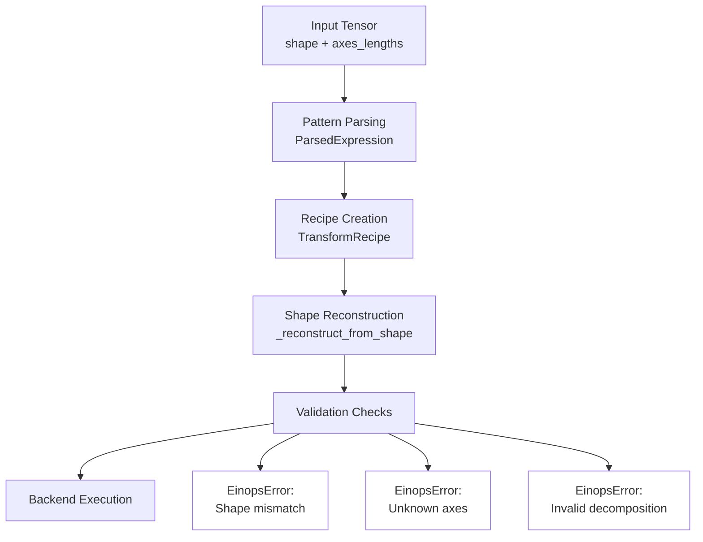

The validation logic in `_reconstruct_from_shape_uncached` ([einops/einops.py:155-224]()) performs several checks:

- **Shape compatibility**: If a composite axis like `'(h h2)'` decomposes an input dimension, einops verifies that `input_length % (h * h2) == 0`
- **Explicit length matching**: If you specify `h=224`, einops verifies the actual dimension equals 224
- **Unknown axis inference**: When one axis length is unknown in a composite axis, einops infers it: `unknown = input_length // product(known_axes)`

These checks happen at runtime during the shape reconstruction phase, before any actual tensor operations execute.

**Sources:** [einops/einops.py:155-224](), [einops/einops.py:303-329]()

---

## Deterministic Transformation Semantics

### C-Order Composition Convention

When composing axes in einops, the **rightmost axis varies fastest** (C-order or row-major order). This is consistent across all operations:

```python
# When flattening (h w), iteration order is:
# (0,0), (0,1), (0,2), ..., (0,w-1), (1,0), (1,1), ...
rearrange(x, 'h w -> (h w)')

# When decomposing (h w) back to h and w:
rearrange(x, '(h w) -> h w', h=10, w=20)
# Reverses the flattening exactly
```

This convention applies to all composite axes, making operations **perfectly reversible** when mathematically possible. The composition order is enforced in `TransformRecipe.output_composite_axes` ([einops/einops.py:142-152]()).

**Sources:** [README.md:603-604](), [einops/einops.py:203-208]()

### Operation-Specific Semantics

**Rearrange** ([einops/einops.py:561-616]()): Pure reordering without element duplication or reduction. All axes in the input must appear in the output and vice versa. The pattern `'b c h w -> b h w c'` is a valid rearrange, but `'b c h w -> b h w'` is not (axes must match).

**Reduce** ([einops/einops.py:468-550]()): Axes present in input but absent in output are aggregated using the specified reduction operation. Built-in reductions are: `'min'`, `'max'`, `'sum'`, `'mean'`, `'prod'`, `'any'`, `'all'`. Custom reduction functions are supported via callables ([einops/einops.py:37-47]()).

**Repeat** ([einops/einops.py:627-674]()): Axes in output but not in input are broadcast/tiled. All new axes must have their sizes specified via `axes_lengths` parameters. The operation uses backend-specific broadcasting mechanisms for efficiency.

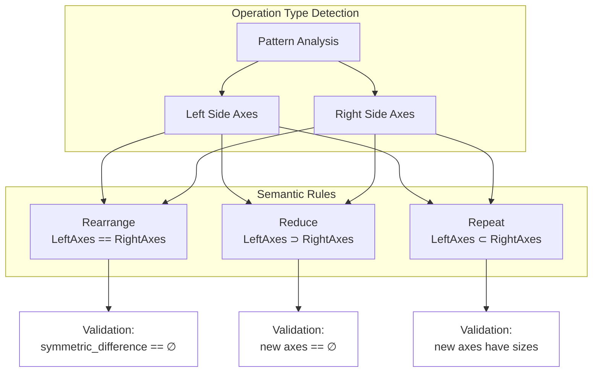

The validation logic in `_prepare_transformation_recipe` ([einops/einops.py:303-329]()) enforces these rules by comparing `left.identifiers` and `rght.identifiers` sets. Any violation raises an `EinopsError` with a descriptive message.

**Sources:** [einops/einops.py:303-329](), [einops/einops.py:468-674]()

---

## Framework Independence Through Abstraction

### Backend Abstraction Architecture

einops achieves framework independence through the `AbstractBackend` interface. Every framework-specific operation is accessed through this abstraction layer, ensuring that the core logic remains framework-agnostic.

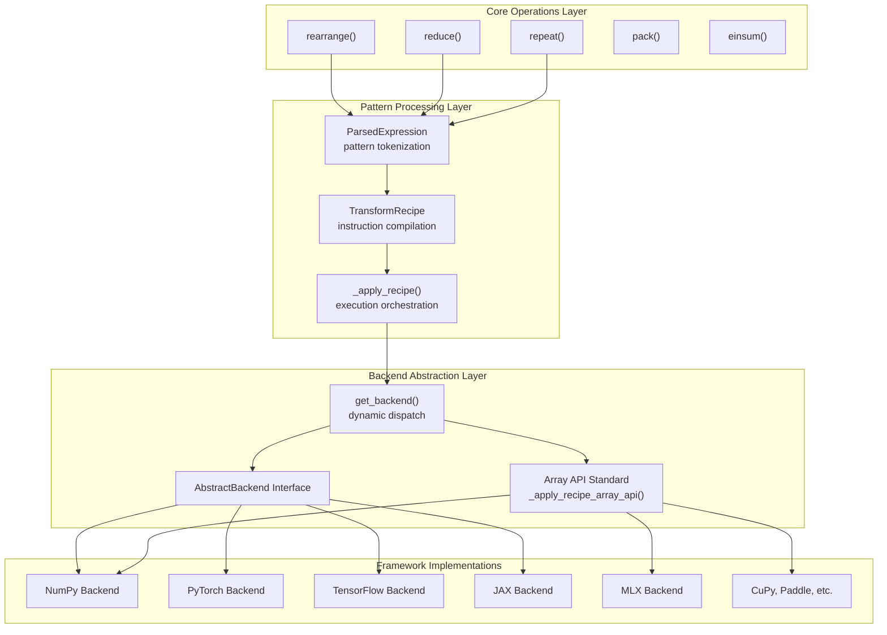

**Dynamic Backend Detection** ([einops/_backends.py]()): The `get_backend()` function inspects tensor types at runtime to select the appropriate backend. This allows mixing operations across different tensor types within the same codebase (though mixing within a single operation is not supported).

**Dual-Path Architecture** (introduced in einops 0.7): Modern frameworks supporting the Python Array API Standard use a streamlined implementation path via `_apply_recipe_array_api` ([einops/einops.py:255-286]()), while legacy frameworks use the traditional `AbstractBackend` interface. This maintains backwards compatibility while adopting emerging standards.

**Sources:** [README.md:301-335](), [einops/einops.py:230-253](), [einops/einops.py:255-286]()

### Framework-Specific Terminology Independence

Different frameworks use inconsistent terminology for the same operations. einops provides a unified vocabulary:

| Operation | NumPy | PyTorch | TensorFlow | einops |
|-----------|-------|---------|------------|--------|
| Duplicate elements | `tile(x, (1, 2))` | `repeat(x, 1, 2)` | `tile(x, [1, 2])` | `repeat(x, 'h w -> h (tile w)', tile=2)` |
| Axis permutation | `transpose(x, (1, 0, 2))` | `permute(x, 1, 0, 2)` | `transpose(x, (1, 0, 2))` | `rearrange(x, 'a b c -> b a c')` |
| Flatten | `flatten(x)` → `(60,)` | `flatten(x)` → `(60,)` | `tf.layers.flatten(x)` → `(batch, 20)` | `rearrange(x, 'a b c -> (a b c)')` |

The same einops code produces identical results across all frameworks. The backend abstraction handles framework-specific quirks:

- **Shape handling**: Some frameworks use tuples, others lists, some include symbolic dimensions
- **Reduction APIs**: Different argument names (`axis=` vs `dim=` vs `axes=`)
- **Broadcasting mechanics**: Native expand vs explicit tile operations

This is implemented through backend-specific methods like `reshape()`, `transpose()`, `reduce()`, and `add_axes()` in each backend class.

**Sources:** [README.md:264-298](), [README.md:280-297]()

---

## Uniformity Across Dimensions

einops provides **dimension-agnostic operations**. The same pattern works for 1D, 2D, 3D, and higher-dimensional cases:

```python
# 1D pooling
reduce(x, 'b c (x dx) -> b c x', 'max', dx=2)

# 2D pooling
reduce(x, 'b c (x dx) (y dy) -> b c x y', 'max', dx=2, dy=3)

# 3D pooling
reduce(x, 'b c (x dx) (y dy) (z dz) -> b c x y z', 'max', dx=2, dy=3, dz=4)
```

This contrasts with traditional frameworks that require separate functions (`MaxPool1d`, `MaxPool2d`, `MaxPool3d` in PyTorch). The uniformity extends to custom operations:

```python
# Width-to-height transformation (not a standard operation)
rearrange(x, 'b c h (w w2) -> b c (h w2) w', w2=2)
```

The pattern language is expressive enough to define arbitrary rearrangements without requiring framework authors to anticipate every use case. The `TransformRecipe` compilation process ([einops/einops.py:290-442]()) converts patterns into primitive operations (reshape, transpose, reduce) that work consistently across all dimensionalities.

**Sources:** [README.md:247-262](), [einops/einops.py:468-550]()

---

## Performance Through Recipe Optimization

### Transformation Optimization Pipeline

The `_optimize_transformation` function ([einops/einops.py:50-102]()) applies algebraic simplifications to reduce the number of operations:

**Collapsing consecutive reduced axes:**
```python
# Before: reduce axes [2, 3, 4] separately
# After: merge into single axis, reduce once
reduced_axes = (2, 3, 4)  # if consecutive
# Collapses to single axis of size shape[2] * shape[3] * shape[4]
```

**Collapsing consecutive preserved axes:**
```python
# Before: reshape, transpose to move axes [3, 4, 5] → [0, 1, 2]
# After: merge axes [3, 4, 5] before transpose, reducing dimension count
```

These optimizations are critical for performance because:
1. Fewer reshape operations means fewer memory allocations
2. Transpose operations on lower-dimensional tensors are faster
3. Single reduction over merged axes is more efficient than multiple reductions

The optimization preserves operation semantics—it's purely an implementation detail that doesn't affect the mathematical result.

**Sources:** [einops/einops.py:50-102]()

### Caching Strategy Rationale

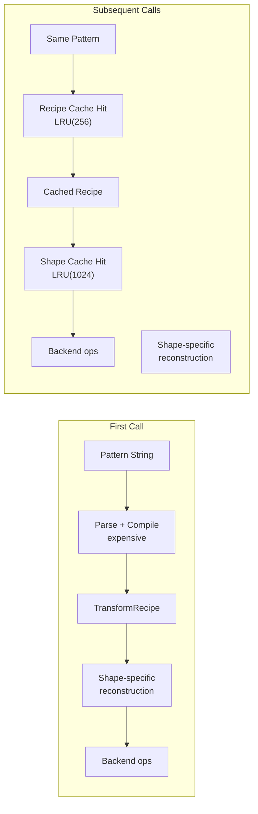

**Two-level caching rationale:**

1. **Recipe cache** ([einops/einops.py:289]()): Pattern parsing is expensive (string tokenization, validation, set operations). But recipes are pattern-dependent, not shape-dependent. A recipe for `'b c h w -> b (c h w)'` works for any batch size or spatial dimensions.

2. **Shape cache** ([einops/einops.py:227]()): Shape reconstruction computes actual axis lengths and operation sequences. This depends on the specific tensor shape. Multiple tensors can share a recipe but have different cached reconstructions.

The cache sizes (256 for recipes, 1024 for shapes) balance memory usage against hit rates. In typical deep learning code, the number of unique patterns is small (<100), while the number of shape combinations is larger due to variable batch sizes and dynamic networks.

**Sources:** [einops/einops.py:227](), [einops/einops.py:289](), [einops/einops.py:230-253]()

---

## Design Trade-offs and Limitations

### String-Based API Constraints

einops uses string patterns rather than a programmatic DSL. This has implications:

**Benefits:**
- Concise and readable
- Easy to log and debug
- Framework-independent representation
- Can be cached as hashable keys

**Limitations:**
- No static type checking for patterns
- Errors detected at runtime, not compile time
- IDE autocomplete doesn't work for axis names
- Pattern strings aren't first-class Python objects

The design prioritizes runtime flexibility and readability over static guarantees. The extensive validation in `ParsedExpression` ([einops/parsing.py:25-159]()) and `_prepare_transformation_recipe` ([einops/einops.py:290-442]()) aims to provide clear error messages to compensate for the lack of static checking.

### Composition vs. Primitive Operations

einops patterns can express complex transformations in a single line that would require multiple primitive operations. This raises a design question: should operations be composable or atomic?

**einops choice: Monolithic patterns**
```python
# Single operation combining reshape and reduce
reduce(x, 'b c (h h2) (w w2) -> b c h w', 'max', h2=2, w2=2)
```

**Alternative: Composable primitives**
```python
# Multiple steps
x = rearrange(x, 'b c (h h2) (w w2) -> b c h w h2 w2', h2=2, w2=2)
x = reduce(x, 'b c h w h2 w2 -> b c h w', 'max')
```

The monolithic approach was chosen because:
- Fewer intermediate allocations
- Optimization opportunities (see `_optimize_transformation`)
- More concise for common patterns
- Matches numpy's `einsum` precedent

The trade-off is reduced composability—you can't easily build new operations from combinations of einops functions. This is mitigated by supporting custom reduction functions ([einops/einops.py:37-47]()).

**Sources:** [einops/einops.py:50-102](), [einops/einops.py:468-550]()

---

# Page: Quick Examples

# Quick Examples

<details>
<summary>Relevant source files</summary>

The following files were used as context for generating this wiki page:

- [README.md](README.md)
- [docs/1-einops-basics.ipynb](docs/1-einops-basics.ipynb)
- [docs/4-pack-and-unpack.ipynb](docs/4-pack-and-unpack.ipynb)

</details>


## Purpose and Scope

This page provides practical code snippets demonstrating common tensor manipulation patterns using einops' core operations: `rearrange`, `reduce`, `repeat`, `pack`, `unpack`, and `einsum`. These examples show how einops enables readable, framework-independent tensor operations through declarative pattern notation.

For detailed API documentation of each operation, see [Core API Reference](#2). For the underlying design philosophy, see [Core Concepts and Design Philosophy](#1.2).

---

## Basic Rearrange Operations

The `rearrange` operation handles transposition, reshaping, and axis reordering through a simple pattern syntax.

### Simple Transposition

```python
from einops import rearrange

# Swap height and width axes
output = rearrange(image, 'h w c -> w h c')
```

**Sources:** [README.md:112-113](), [docs/1-einops-basics.ipynb:175-179]()

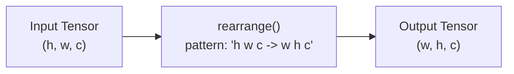

### Axis Composition

Combining multiple axes into a single axis using parentheses notation:

```python
# Flatten batch and height into single axis
output = rearrange(images, 'b h w c -> (b h) w c')

# Compose batch and width
output = rearrange(images, 'b h w c -> h (b w) c')
```

**Sources:** [docs/1-einops-basics.ipynb:227-231](), [docs/1-einops-basics.ipynb:249-251]()

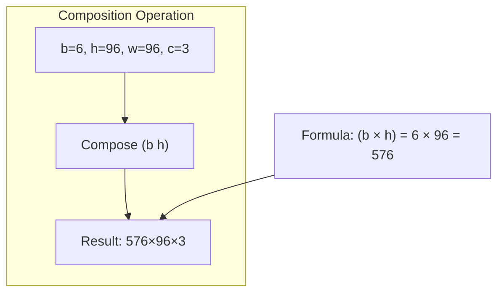

### Axis Decomposition

Splitting a single axis into multiple components:

```python
# Decompose batch axis (6) into b1=2 and b2=3
output = rearrange(images, '(b1 b2) h w c -> b1 b2 h w c', b1=2)
# Result shape: (2, 3, 96, 96, 3)
```

**Sources:** [README.md:236-239](), [docs/1-einops-basics.ipynb:337-341]()

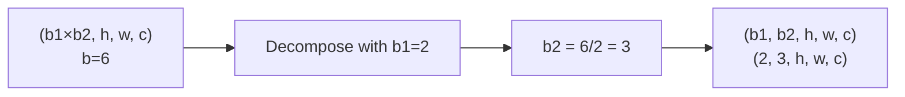

**Sources:** [docs/1-einops-basics.ipynb:337-341]()

---

## Reduce Operations

The `reduce` operation performs aggregation along specified axes using reduction functions.

```python
from einops import reduce

# Average pooling: reduce 2×2 patches to single values
output = reduce(image, 'b c (h h2) (w w2) -> b h w c', 'mean', h2=2, w2=2)

# Sum along specific axes
output = reduce(tensor, 'b c h w -> b c', 'sum')

# Max reduction
output = reduce(tensor, 'b c (x dx) -> b c x', 'max', dx=2)
```

**Sources:** [README.md:115](), [README.md:250]()

Available reduction operations: `min`, `max`, `sum`, `mean`, `prod`

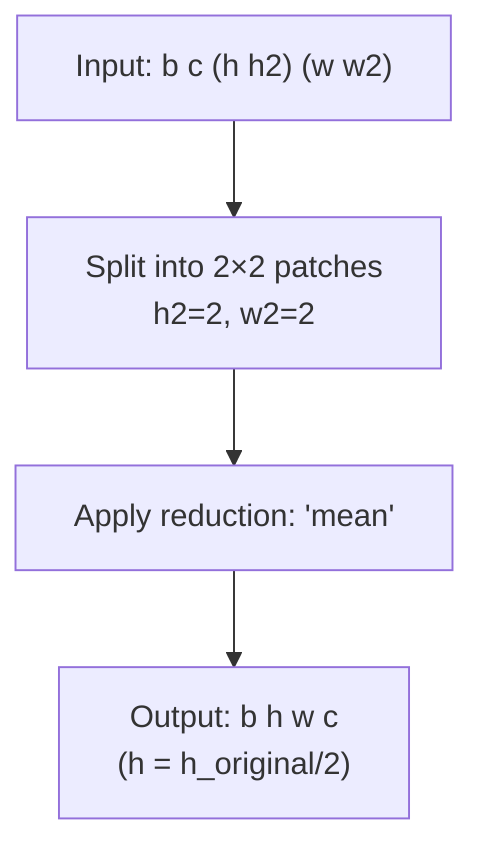

**Sources:** [README.md:115](), [README.md:250-252]()

---

## Repeat Operations

The `repeat` operation broadcasts tensors along new or existing axes.

```python
from einops import repeat

# Copy along new color channel axis
output = repeat(grayscale, 'h w -> h w c', c=3)

# Tile along width
output = repeat(image, 'h w -> h (tile w)', tile=2)
```

**Sources:** [README.md:117](), [README.md:289-295]()

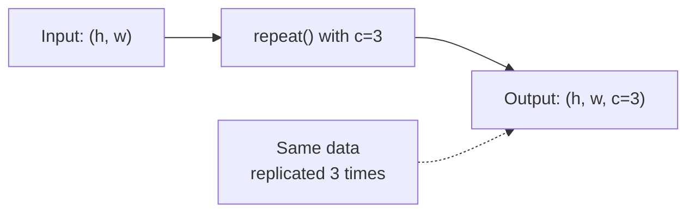

**Sources:** [README.md:117]()

---

## Pack and Unpack Operations

The `pack` and `unpack` operations enable reversible concatenation of heterogeneous tensors.

```python
from einops import pack, unpack

# Pack tensors with different dimensionality
class_token_bc = ...    # shape: (batch, channels)
image_tokens_bhwc = ... # shape: (batch, height, width, channels)
text_tokens_btc = ...   # shape: (batch, time, channels)

packed, ps = pack([class_token_bc, image_tokens_bhwc, text_tokens_btc], 'b * c')

# Unpack back to original shapes
class_emb_bc, image_emb_bhwc, text_emb_btc = unpack(transformed, ps, 'b * c')
```

**Sources:** [README.md:122-128]()

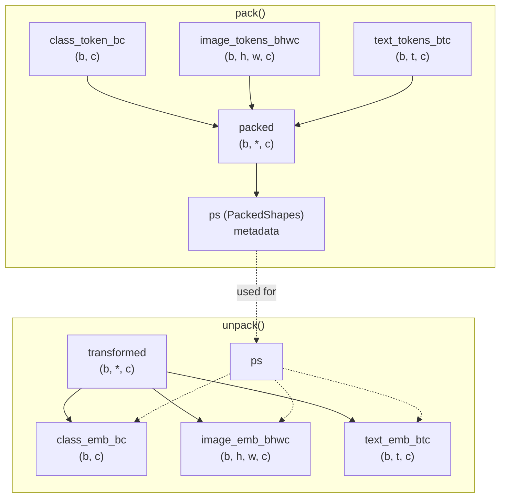

**Sources:** [README.md:122-128]()

---

## Einsum Operation

The `einsum` operation provides generalized tensor contraction with multi-letter axis names.

```python
from einops import einsum

# Attention mechanism: compute similarity between queries and keys
C = einsum(Q, K, 'b t1 head c, b t2 head c -> b head t1 t2')

# Multi-letter axis names for clarity
result = einsum(A, B, 'batch time1 head channels, batch time2 head channels -> batch head time1 time2')
```

**Sources:** [README.md:133-136]()

Key differences from standard einsum:
1. Axes can have multi-letter names for readability
2. Pattern comes as the last argument
3. Works consistently across frameworks

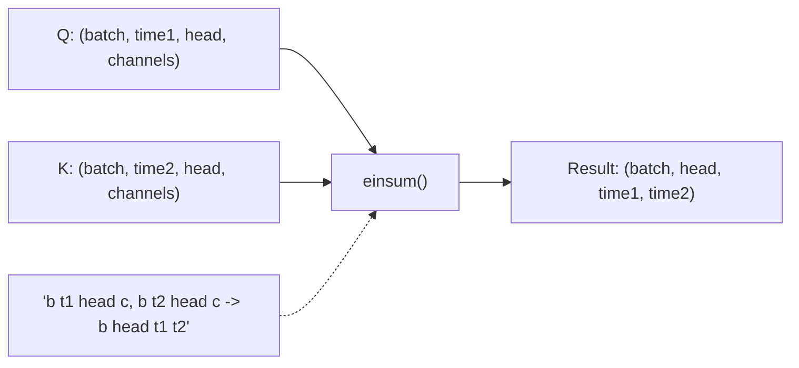

**Sources:** [README.md:133-136]()

---

## Framework Independence

All operations work identically across supported frameworks:

```python
import numpy as np
import torch
import tensorflow as tf
import jax.numpy as jnp

# Same operation works with any framework
np_result = rearrange(np_array, 'b h w c -> b c h w')
torch_result = rearrange(torch_tensor, 'b h w c -> b c h w')
tf_result = rearrange(tf_tensor, 'b h w c -> b c h w')
jax_result = rearrange(jax_array, 'b h w c -> b c h w')
```

**Sources:** [README.md:289-295](), [README.md:318-321]()

```mermaid
graph TB
    Pattern["Pattern: 'b h w c -> ...'"]
    
    Pattern --> NumPy["numpy.ndarray"]
    Pattern --> PyTorch["torch.Tensor"]
    Pattern --> TF["tf.Tensor"]
    Pattern --> JAX["jax.Array"]
    Pattern --> MLX["mlx.array"]
    
    NumPy --> Backend1["Backend: NumpyBackend"]
    PyTorch --> Backend2["Backend: TorchBackend"]
    TF --> Backend3["Backend: TensorflowBackend"]
    JAX --> Backend4["Backend: JaxBackend"]
    MLX --> Backend5["Backend: ArrayAPIBackend"]
```

**Sources:** [README.md:303-334]()

---

## Pattern Syntax Quick Reference

| Syntax | Meaning | Example |
|--------|---------|---------|
| `a b c` | Named axes | `'batch height width'` |
| `(a b)` | Composition | `'(batch seq)'` - combines axes |
| `(a b)` on left | Decomposition | `'(h h2) w'` with `h2=2` - splits axis |
| `...` | Ellipsis | `'... c'` - matches remaining axes |
| `_` | Anonymous axis | `'_ h w c'` - ignore this axis |
| `*` | Wildcard (pack/unpack) | `'b * c'` - variable middle axes |

**Sources:** [README.md:110-118](), [README.md:236-261]()

---

## Operation Selection Guide

```mermaid
graph TD
    Start{What operation?}
    
    Start -->|Reshape/transpose| Rearrange["rearrange()"]
    Start -->|Aggregate/pool| Reduce["reduce()"]
    Start -->|Broadcast/tile| Repeat["repeat()"]
    Start -->|Concatenate tensors| Pack["pack()"]
    Start -->|Split tensor| Unpack["unpack()"]
    Start -->|Tensor contraction| Einsum["einsum()"]
    
    Rearrange --> R1["Axis reordering<br/>Composition<br/>Decomposition"]
    Reduce --> R2["Reduction functions:<br/>mean, sum, max, min, prod"]
    Repeat --> R3["Add new axes<br/>Tile existing axes"]
    Pack --> R4["Reversible concat<br/>Returns packed + metadata"]
    Unpack --> R5["Uses pack metadata<br/>Restores original shapes"]
    Einsum --> R6["Generalized dot product<br/>Multi-letter names"]
```

**Sources:** [README.md:107-137]()

---

# Page: Core API Reference

# Core API Reference

<details>
<summary>Relevant source files</summary>

The following files were used as context for generating this wiki page:

- [README.md](README.md)
- [einops/__init__.py](einops/__init__.py)
- [einops/einops.py](einops/einops.py)
- [einops/parsing.py](einops/parsing.py)
- [scripts/setup.py](scripts/setup.py)

</details>


This page provides comprehensive documentation of all user-facing functions in the einops library. These functions constitute the public API for tensor manipulation operations.

**Scope**: This page covers function signatures, parameters, return types, and usage guarantees for the core operations. For detailed pattern syntax rules, see [Pattern Syntax Guide](#2.4). For framework-specific layer implementations, see [Layer Integration](#3). For internal architecture details, see [Internal Architecture](#4).

## Function Taxonomy

The einops API consists of three categories of operations:

```mermaid
graph TB
    subgraph "Core Transformation Operations"
        REARRANGE["rearrange()<br/>Restructure tensor dimensions"]
        REDUCE["reduce()<br/>Aggregate along dimensions"]
        REPEAT["repeat()<br/>Duplicate elements"]
    end
    
    subgraph "Advanced Operations"
        EINSUM["einsum()<br/>Einstein summation with named axes"]
        PACK["pack()<br/>Combine multiple tensors"]
        UNPACK["unpack()<br/>Split tensor into multiple"]
    end
    
    subgraph "Utility Functions"
        PARSE_SHAPE["parse_shape()<br/>Extract dimension mapping"]
        ASNUMPY["asnumpy()<br/>Convert to numpy.ndarray"]
    end
    
    USER[User Code] --> REARRANGE
    USER --> REDUCE
    USER --> REPEAT
    USER --> EINSUM
    USER --> PACK
    USER --> UNPACK
    USER --> PARSE_SHAPE
    USER --> ASNUMPY
    
    REARRANGE --> BACKEND[Backend Dispatch<br/>get_backend]
    REDUCE --> BACKEND
    REPEAT --> BACKEND
    EINSUM --> BACKEND
    PACK --> BACKEND
    UNPACK --> BACKEND
    PARSE_SHAPE --> BACKEND
    ASNUMPY --> BACKEND
    
    BACKEND --> OUTPUT[Framework-specific<br/>Tensor]
```

**Sources**: [einops/__init__.py:14](), [einops/einops.py:468-939]()

## API Function Reference

| Function | Signature | Purpose | Pattern Required |
|----------|-----------|---------|------------------|
| `rearrange` | `(tensor, pattern, **axes_lengths) -> Tensor` | Permute, reshape, squeeze, unsqueeze, stack | Yes |
| `reduce` | `(tensor, pattern, reduction, **axes_lengths) -> Tensor` | Aggregation operations (mean/max/sum/etc.) | Yes |
| `repeat` | `(tensor, pattern, **axes_lengths) -> Tensor` | Tile, broadcast, element duplication | Yes |
| `einsum` | `(*tensors, pattern) -> Tensor` | Multi-tensor contraction with named axes | Yes |
| `pack` | `(tensors, pattern) -> Tuple[Tensor, PackedShapes]` | Combine multiple tensors into one | Yes |
| `unpack` | `(tensor, packed_shapes, pattern) -> List[Tensor]` | Split tensor back to multiple tensors | Yes |
| `parse_shape` | `(tensor, pattern) -> Dict[str, int]` | Extract axis name to length mapping | Yes |
| `asnumpy` | `(tensor) -> np.ndarray` | Convert to numpy array | No |

**Sources**: [einops/__init__.py:14](), [einops/einops.py:16-18](), [einops/einops.py:468-776]()

## Core Transformation Operations

### Function: `rearrange`

**Signature**: 
```python
def rearrange(
    tensor: Union[Tensor, List[Tensor]], 
    pattern: str, 
    **axes_lengths: int
) -> Tensor
```

**Purpose**: Restructure tensor dimensions through permutation, reshaping, and composition operations.

**Parameters**:
- `tensor`: Single tensor or list of tensors (all must have same shape and type)
- `pattern`: String pattern in format `"left_expr -> right_expr"` 
- `**axes_lengths`: Optional axis length specifications for decomposition/composition

**Returns**: Tensor of same framework as input, often a view when possible

**Pattern Requirements**: Both sides must contain identical axis identifiers (symmetric difference = 0)

**Key Behaviors**:
- Accepts list input: stacks along new zeroth dimension
- Returns view when possible (backend-dependent)
- Uses C-order enumeration for axis composition
- Validates axis consistency at runtime

**Example Operations**:
```python
# Transpose
rearrange(x, 'b c h w -> b h w c')

# Flatten 
rearrange(x, 'b c h w -> b (c h w)')

# Split spatial dimensions
rearrange(x, 'b c (h h1) (w w1) -> b (h1 w1 c) h w', h1=2, w1=2)
```

**Sources**: [einops/einops.py:561-616](), [einops/einops.py:304-313]()

### Function: `reduce`

**Signature**:
```python
def reduce(
    tensor: Union[Tensor, List[Tensor]], 
    pattern: str, 
    reduction: Union[str, Callable], 
    **axes_lengths: int
) -> Tensor
```

**Purpose**: Aggregate tensor along specified dimensions with named reduction operations.

**Parameters**:
- `tensor`: Single tensor or list of tensors
- `pattern`: String pattern where axes on left but not right are reduced
- `reduction`: Either built-in string (`'min'`, `'max'`, `'sum'`, `'mean'`, `'prod'`, `'any'`, `'all'`) or custom callable `f(tensor, reduced_axes) -> tensor`
- `**axes_lengths`: Optional axis length specifications

**Returns**: Tensor with reduced dimensions removed or singleton dimensions if preserved with `1` or `()`

**Pattern Requirements**: Right-side axes must be subset of left-side axes

**Built-in Reductions**: Defined in `_reductions` tuple [einops/einops.py:21]()

**Example Operations**:
```python
# Global average pooling
reduce(x, 'b c h w -> b c', 'mean')

# Max pooling with kernel size 2x2
reduce(x, 'b c (h 2) (w 2) -> b c h w', 'max')

# Keep singleton dimensions
reduce(x, 'b c h w -> b c 1 1', 'mean')

# Custom reduction function
reduce(x, 'b c h w -> b c', lambda t, axes: t.std(axes))
```

**Sources**: [einops/einops.py:468-550](), [einops/einops.py:21](), [einops/einops.py:37-47]()

### Function: `repeat`

**Signature**:
```python
def repeat(
    tensor: Union[Tensor, List[Tensor]], 
    pattern: str, 
    **axes_lengths: int
) -> Tensor
```

**Purpose**: Duplicate tensor elements along existing or new dimensions.

**Parameters**:
- `tensor`: Single tensor or list of tensors
- `pattern`: String pattern where right-side has additional axes or compositions
- `**axes_lengths`: **Required** for all new axes that don't appear on left side

**Returns**: Tensor with repeated elements, often a view via broadcasting

**Pattern Requirements**: All left-side axes must appear on right side; new axes require length specification

**Example Operations**:
```python
# Add channel dimension by repeating
repeat(gray_image, 'h w -> h w c', c=3)

# Tile along spatial dimensions
repeat(x, 'h w -> (h 2) (w 3)')

# Upsample by factor of 2
repeat(x, 'b c h w -> b c (h 2) (w 2)')
```

**Sources**: [einops/einops.py:627-674](), [einops/einops.py:315-323]()

## Advanced Operations

### Function: `einsum`

```mermaid
graph LR
    INPUT["einsum(tensor1, tensor2, ..., pattern)"]
    COMPACT["_compactify_pattern_for_einsum()<br/>Maps multi-letter axes to single letters"]
    BACKEND["backend.einsum()<br/>Framework-specific einsum"]
    OUTPUT["Result Tensor"]
    
    INPUT --> COMPACT
    COMPACT --> BACKEND
    BACKEND --> OUTPUT
    
    COMPACT -.->|"'batch in_dim, in_dim out_dim -> batch out_dim'"|MAP["'ab,bc->ac'"]
```

**Signature**:
```python
def einsum(*tensors_and_pattern: Union[Tensor, str]) -> Tensor
```

**Purpose**: Generalized tensor contraction using Einstein summation notation with multi-letter axis names.

**Parameters**:
- `*tensors_and_pattern`: Variable number of tensors followed by pattern string as last argument
- Pattern format: `"tensor1_axes, tensor2_axes, ... -> output_axes"`

**Returns**: Result of Einstein summation

**Key Differences from numpy.einsum**:
- Multi-letter axis names supported (e.g., `'batch height width'`)
- Pattern **must** be last argument (tensors first)
- Pattern **must** contain `->` separator
- Axes appearing only on left are summed over

**Current Limitations** [einops/einops.py:782-792]():
- Singleton `()` axes not supported
- Rearrangements like `'(batch chan)'` not supported  
- Anonymous axes not supported

**Implementation Details**:
- Converts multi-letter names to single letters via `_compactify_pattern_for_einsum` [einops/einops.py:795-846]()
- Uses `@functools.lru_cache(256)` for pattern compilation [einops/einops.py:795]()
- Dispatches to framework-specific `backend.einsum()` [einops/einops.py:939]()

**Example Operations**:
```python
# Matrix multiplication with batch dimension
result = einsum(A, B, 'batch in_dim, in_dim out_dim -> batch out_dim')

# Dot product
result = einsum(v1, v2, 'dim, dim ->')

# Batched matrix multiplication with ellipsis
result = einsum(weights, data, 'out_dim in_dim, ... in_dim -> ... out_dim')
```

**Sources**: [einops/einops.py:865-939](), [einops/einops.py:795-846]()

### Functions: `pack` and `unpack`

**Purpose**: Combine multiple tensors into a single tensor (`pack`) and reverse the operation (`unpack`), enabling variable-length tensor handling and auto-batching.

**Detailed Documentation**: See [pack and unpack Operations](#2.3)

**Sources**: [einops/__init__.py:17](), [einops/packing.py]()

## Utility Functions

### Function: `parse_shape`

```mermaid
graph TD
    TENSOR["Input Tensor<br/>shape: (2, 3, 5, 7)"]
    PATTERN["Pattern: 'batch _ height width'"]
    PARSE["ParsedExpression<br/>with allow_underscore=True"]
    VALIDATE["Validation:<br/>- No composite axes<br/>- Dimension count match<br/>- Handle ellipsis"]
    EXTRACT["Extract mapping:<br/>Skip '_' axes<br/>Match named axes to lengths"]
    RESULT["{'batch': 2, 'height': 5, 'width': 7}"]
    
    TENSOR --> PARSE
    PATTERN --> PARSE
    PARSE --> VALIDATE
    VALIDATE --> EXTRACT
    EXTRACT --> RESULT
```

**Signature**:
```python
def parse_shape(x: Tensor, pattern: str) -> Dict[str, int]
```

**Purpose**: Extract dimension lengths as dictionary mapping axis names to their sizes.

**Parameters**:
- `x`: Tensor of any supported framework
- `pattern`: Space-separated axis names (use `_` to skip dimensions)

**Returns**: Dictionary mapping axis names to dimension lengths (may contain symbolic values for symbolic frameworks)

**Special Features**:
- Underscore `_` skips dimensions [einops/einops.py:731-732]()
- Supports ellipsis `...` for variable dimensions [einops/einops.py:713-720]()
- Validates anonymous axis lengths match [einops/einops.py:734-735]()

**Restrictions**:
- Cannot parse composite axes like `'(h w)'` [einops/einops.py:705-706]()
- Pattern must match tensor dimensionality [einops/einops.py:707-712]()

**Example Usage**:
```python
x = np.zeros([2, 3, 5, 7])
dims = parse_shape(x, 'batch _ h w')
# Returns: {'batch': 2, 'h': 5, 'w': 7}

# Use with other operations
y = np.zeros([700])
rearrange(y, '(b c h w) -> b c h w', **parse_shape(x, 'b _ h w'))
```

**Sources**: [einops/einops.py:677-736]()

### Function: `asnumpy`

**Signature**:
```python
def asnumpy(tensor: Tensor) -> np.ndarray
```

**Purpose**: Convert tensor from any imperative framework to `numpy.ndarray`.

**Parameters**:
- `tensor`: Tensor from imperative framework (numpy, cupy, torch, jax, etc.)

**Returns**: `numpy.ndarray` with data copied to CPU if necessary

**Restrictions**:
- Only works with imperative frameworks (not symbolic graphs like TensorFlow)
- Backend must implement `to_numpy()` method

**Implementation**: Delegates to `get_backend(tensor).to_numpy(tensor)` [einops/einops.py:776]()

**Sources**: [einops/einops.py:766-776]()

## Type System and Guarantees

### Tensor Type Parameter

```mermaid
graph TB
    TENSOR_TYPE["Tensor TypeVar<br/>Generic type for any framework"]
    
    NUMPY["numpy.ndarray"]
    TORCH["torch.Tensor"]
    TF["tf.Tensor"]
    JAX["jax.Array"]
    CUPY["cupy.ndarray"]
    MLX["mlx.core.array"]
    OTHER["10+ other backends"]
    
    TENSOR_TYPE -.->|"Runtime dispatch via"| GET_BACKEND["get_backend(tensor)"]
    
    GET_BACKEND --> NUMPY
    GET_BACKEND --> TORCH
    GET_BACKEND --> TF
    GET_BACKEND --> JAX
    GET_BACKEND --> CUPY
    GET_BACKEND --> MLX
    GET_BACKEND --> OTHER
    
    RETURN["Return Type:<br/>Same as input type"]
    
    NUMPY --> RETURN
    TORCH --> RETURN
    TF --> RETURN
    JAX --> RETURN
    CUPY --> RETURN
    MLX --> RETURN
    OTHER --> RETURN
```

**Type Variable**: `Tensor = TypeVar("Tensor")` [einops/einops.py:16]()

**Guarantee**: All transformation operations preserve tensor framework type. If input is `torch.Tensor`, output is `torch.Tensor`.

**Backend Detection**: Automatic via `get_backend(tensor)` which inspects tensor type [einops/einops.py:13]()

**Sources**: [einops/einops.py:16](), [einops/_backends.py]()

### Pattern String Format

All transformation operations use pattern strings in format: `"left_expr -> right_expr"`

**Component Rules**:
1. **Axis identifiers**: Space-separated multi-letter names (e.g., `'batch height width'`)
2. **Compositions**: Parenthesized groups `'(h w)'` for axis merging/splitting
3. **Ellipsis**: `...` for variable number of dimensions
4. **Anonymous axes**: Integer literals for known dimensions (e.g., `'(h 2)'`)
5. **Singleton axes**: Empty parentheses `()` for dimension of size 1

**Validation**: Performed by `ParsedExpression` class during recipe preparation [einops/parsing.py]()

**Sources**: [einops/einops.py:290-442]()

### Reduction Type System

**Type Definition**: `Reduction = Union[str, ReductionCallable]` [einops/einops.py:18]()

Where `ReductionCallable = Callable[[Tensor, Tuple[int, ...]], Tensor]` [einops/einops.py:17]()

**Built-in String Reductions**: `("min", "max", "sum", "mean", "prod", "any", "all")` [einops/einops.py:21]()

**Custom Reductions**: Any callable accepting `(tensor, reduced_axes_tuple)` and returning tensor

**Float Type Requirement**: `'mean'` reduction requires floating-point tensor [einops/einops.py:44-46]()

**Sources**: [einops/einops.py:17-21](), [einops/einops.py:37-47]()

## Error Handling

### EinopsError Exception

**Definition**: `class EinopsError(RuntimeError)` [einops/__init__.py:8-11]()

**Usage**: All einops validation and runtime errors raise `EinopsError` with descriptive messages

**Common Error Scenarios**:

| Error Condition | Pattern | Message Excerpt |
|----------------|---------|-----------------|
| Axis mismatch in rearrange | `'a b -> c d'` | `"Identifiers only on one side"` [einops/einops.py:312-313]() |
| Missing axis length in repeat | `'h w -> h w c'` (no `c=` kwarg) | `"Specify sizes for new axes"` [einops/einops.py:322-323]() |
| Unknown reduction | `reduce(x, '...', 'unknown')` | `"Unknown reduction"` [einops/einops.py:329]() |
| Shape mismatch | Decomposition fails | `"Shape mismatch, can't divide"` [einops/einops.py:188]() |
| Wrong dimensionality | Pattern expects 4D, got 3D | `"Wrong shape: expected N dims"` [einops/einops.py:334]() |
| Ellipsis misuse | Right has `...`, left doesn't | `"Ellipsis found in right side, but not left"` [einops/einops.py:305]() |

**Error Context Enhancement**: Operations catch `EinopsError` and add context about pattern, tensor shape, and parameters [einops/einops.py:543-550]()

**Sources**: [einops/__init__.py:8-11](), [einops/einops.py:304-329](), [einops/einops.py:543-550]()

## Recipe System and Performance

### TransformRecipe Class

```mermaid
graph TB
    PATTERN["Pattern String<br/>'b c h w -> b h w c'"]
    PARSE["_prepare_transformation_recipe()<br/>@lru_cache(256)"]
    RECIPE["TransformRecipe Object<br/>- elementary_axes_lengths<br/>- axes_permutation<br/>- input_composition_known_unknown<br/>- output_composite_axes<br/>- added_axes<br/>- first_reduced_axis"]
    
    APPLY["_apply_recipe()<br/>Runtime execution"]
    
    RECONSTRUCT["_reconstruct_from_shape()<br/>@lru_cache(1024)<br/>Compute actual dimensions"]
    
    OPS["Conditional Operations:<br/>1. reshape (init_shapes)<br/>2. transpose (axes_reordering)<br/>3. reduce (reduced_axes)<br/>4. add_axes (broadcasting)<br/>5. reshape (final_shapes)"]
    
    PATTERN --> PARSE
    PARSE --> RECIPE
    RECIPE --> APPLY
    
    APPLY --> RECONSTRUCT
    RECONSTRUCT --> OPS
```

**Recipe Generation**: Patterns are compiled once to `TransformRecipe` objects via `_prepare_transformation_recipe()` [einops/einops.py:289-442]()

**Caching Strategy**:
- Pattern compilation cached with `@lru_cache(256)` [einops/einops.py:289]()
- Shape reconstruction cached with `@lru_cache(1024)` [einops/einops.py:227]()

**Recipe Structure**: `TransformRecipe` stores pre-computed transformation metadata [einops/einops.py:114-152]()

**Execution Pipeline**: `_apply_recipe()` conditionally applies 5 primitive operations based on recipe [einops/einops.py:230-252]()

**Optimization**: `_optimize_transformation()` collapses consecutive axes when possible [einops/einops.py:50-102]()

**Sources**: [einops/einops.py:114-152](), [einops/einops.py:289-442](), [einops/einops.py:230-252](), [einops/einops.py:50-102]()

## List Input Handling

All transformation operations (`rearrange`, `reduce`, `repeat`) accept **list of tensors** as input:

**Behavior**: List elements are stacked along new zeroth dimension before transformation [einops/einops.py:529-533]()

**Requirements**:
- All tensors must be same type
- All tensors must have same shape
- List cannot be empty [einops/einops.py:531]()

**Implementation**: Backend-specific `stack_on_zeroth_dimension()` method [einops/einops.py:533]()

**Example**:
```python
images = [np.random.randn(30, 40, 3) for _ in range(32)]
# Stacks to (32, 30, 40, 3) then rearranges
rearrange(images, 'b h w c -> b c h w')
```

**Sources**: [einops/einops.py:529-533]()

## Return Value Guarantees

| Operation | View Return | Memory Copy |
|-----------|-------------|-------------|
| `rearrange` | When possible (backend-dependent) | When reshape/transpose requires |
| `reduce` | Never (aggregation requires computation) | Always |
| `repeat` | Via broadcasting when possible | When tiling required |
| `einsum` | Never | Always |
| `pack`/`unpack` | Implementation-dependent | Often requires copy |

**View Documentation**: [einops/einops.py:613]() states "If possible, a view to the original tensor is returned"

**Backend Variation**: View semantics vary by framework (e.g., PyTorch `.view()` vs NumPy `.reshape()`)

**Sources**: [einops/einops.py:613](), [einops/einops.py:671]()

---

# Page: rearrange, reduce, and repeat

# rearrange, reduce, and repeat

<details>
<summary>Relevant source files</summary>

The following files were used as context for generating this wiki page:

- [README.md](README.md)
- [einops/einops.py](einops/einops.py)
- [einops/parsing.py](einops/parsing.py)
- [einops/tests/test_examples.py](einops/tests/test_examples.py)
- [einops/tests/test_layers.py](einops/tests/test_layers.py)
- [einops/tests/test_ops.py](einops/tests/test_ops.py)
- [einops/tests/test_other.py](einops/tests/test_other.py)

</details>


## Purpose and Scope

This document describes the three fundamental tensor manipulation operations provided by einops: `rearrange`, `reduce`, and `repeat`. These operations form the core API for tensor transformations using einops' pattern-based domain-specific language (DSL).

For information about pattern syntax rules and validation, see [Pattern Syntax Guide](#2.4). For layer integrations of these operations, see [Layer Integration](#3). For the underlying pattern parsing system, see [Pattern Parsing System](#4.3).

## Overview of the Three Operations

The three core operations share a common interface but serve distinct purposes:

```mermaid
graph TB
    Input["Input Tensor"]
    
    Input --> Rearrange["rearrange()<br/>Restructures without aggregation"]
    Input --> Reduce["reduce()<br/>Aggregates with reduction function"]
    Input --> Repeat["repeat()<br/>Duplicates elements"]
    
    Rearrange --> Out1["Reshaped/Transposed Tensor"]
    Reduce --> Out2["Aggregated Tensor<br/>(fewer dimensions)"]
    Repeat --> Out3["Expanded Tensor<br/>(more elements)"]
    
    Rearrange -.-> Ops1["transpose, reshape,<br/>squeeze, unsqueeze,<br/>stack, concatenate"]
    Reduce -.-> Ops2["mean, max, sum, min,<br/>prod, any, all"]
    Repeat -.-> Ops3["tile, repeat,<br/>broadcast"]
```

**Diagram: Three Core Operations and Their Native Equivalents**

Sources: [einops/einops.py:561-674](), [docs/1-einops-basics.ipynb:137-673]()

## Function Signatures

### rearrange

```python
def rearrange(tensor: Union[Tensor, List[Tensor]], 
              pattern: str, 
              **axes_lengths: Size) -> Tensor
```

Rearranges tensor elements according to a pattern. This is a reader-friendly smart element reordering operation that includes functionality of transpose, reshape, squeeze, unsqueeze, stack, and concatenate.

**Key validation rule**: For `rearrange`, the set of axes on both sides of `->` must be identical (symmetric difference = 0).

Sources: [einops/einops.py:561-616]()

### reduce

```python
def reduce(tensor: Union[Tensor, List[Tensor]], 
           pattern: str, 
           reduction: Reduction, 
           **axes_lengths: Size) -> Tensor
```

Combines rearrangement and reduction using a reduction function. The `reduction` parameter specifies how to aggregate values.

**Key validation rule**: For `reduce`, axes on the right must be a subset of axes on the left. Axes appearing only on the left are reduced.

**Available reductions**: `'min'`, `'max'`, `'sum'`, `'mean'`, `'prod'`, `'any'`, `'all'`, or a custom callable `f(tensor, reduced_axes) -> tensor`.

Sources: [einops/einops.py:468-550](), [einops/einops.py:21]()

### repeat

```python
def repeat(tensor: Union[Tensor, List[Tensor]], 
           pattern: str, 
           **axes_lengths: Size) -> Tensor
```

Reorders elements and repeats them in arbitrary combinations. Includes functionality of repeat, tile, and broadcast.

**Key validation rule**: For `repeat`, axes on the left must be a subset of axes on the right. New axes appearing only on the right must have their lengths specified in `axes_lengths`.

Sources: [einops/einops.py:627-674]()

## Common Parameters

### pattern: str

A string describing the transformation using einops DSL. The pattern consists of two parts separated by `->`:
- **Left side**: describes input tensor structure
- **Right side**: describes output tensor structure

Example patterns:
- `'b c h w -> b h w c'` - transpose (channels-first to channels-last)
- `'b c h w -> b (c h w)'` - flatten
- `'h w -> h w c'` with `c=3` - add new axis

### axes_lengths: **kwargs

Additional specifications for axis dimensions. Required when:
- Decomposing an axis: `'(h h1) -> h h1'` needs one of `h=` or `h1=`
- Adding new axes in `repeat`: `'h w -> h w c'` needs `c=`

### tensor: Union[Tensor, List[Tensor]]

Input can be:
- A single tensor from any supported framework
- A list of tensors (of same type/shape) which are automatically stacked

Sources: [einops/einops.py:516-523](), [einops/einops.py:606-610](), [einops/einops.py:664-668]()

## Pattern Components

```mermaid
graph LR
    Pattern["Pattern String"]
    
    Pattern --> Left["Left Expression"]
    Pattern --> Right["Right Expression"]
    
    Left --> LA["Axis Names"]
    Right --> RA["Axis Names"]
    
    LA --> Basic1["Simple: 'b c h w'"]
    LA --> Comp1["Composed: '(b h) w c'"]
    LA --> Anon1["Anonymous: '(h 2) w'"]
    LA --> Ell1["Ellipsis: '... h w'"]
    
    RA --> Basic2["Simple: 'h w c'"]
    RA --> Comp2["Composed: '(c h w)'"]
    RA --> Anon2["Anonymous: '(h1 2)'"]
    RA --> Empty["Empty: '() h w' or '1 h w'"]
```

**Diagram: Pattern Components**

Sources: [einops/einops.py:299-368]()

### Axis Composition and Decomposition

**Composition**: Merge multiple axes into one using parentheses.
```python
rearrange(x, 'b c h w -> b (c h w)')  # flatten
# Output shape: (b, c*h*w)
```

**Decomposition**: Split one axis into multiple using parentheses.
```python
rearrange(x, '(b1 b2) h w c -> b1 b2 h w c', b1=2)  # split batch
# Infers b2 = original_b / b1
```

The product of decomposed axis lengths must equal the original axis length. Only one unknown is allowed per decomposition.

Sources: [einops/einops.py:370-410](), [docs/1-einops-basics.ipynb:296-343]()

### Anonymous Axes

Axes can be specified with integer literals when their exact identity isn't important:

```python
# These are equivalent:
reduce(x, 'b c (h 2) (w 2) -> b c h w', 'max')
reduce(x, 'b c (h h2) (w w2) -> b c h w', 'max', h2=2, w2=2)
```

Anonymous axes are particularly useful for reductions where you don't need to reference the reduced axis.

Sources: [einops/einops.py:309-310](), [einops/einops.py:374-387]()

### Ellipsis

The ellipsis `...` matches an arbitrary number of axes, enabling dimension-agnostic operations:

```python
reduce(x, '... h w -> ...', 'mean')  # works for any number of leading dimensions
```

**Restrictions**:
- Ellipsis cannot appear on right side if not on left side
- Ellipsis cannot be inside parentheses on the left side

Sources: [einops/einops.py:304-306](), [einops/einops.py:331-368]()

## Execution Pipeline

```mermaid
graph TD
    Call["rearrange/reduce/repeat<br/>function call"]
    
    Call --> InputCheck["Input Validation"]
    InputCheck --> ParsePattern["Parse Pattern<br/>ParsedExpression"]
    ParsePattern --> PrepRecipe["_prepare_transformation_recipe<br/>@lru_cache(256)"]
    PrepRecipe --> Recipe["TransformRecipe<br/>(cached)"]
    
    Recipe --> Reconstruct["_reconstruct_from_shape<br/>Compute actual dimensions"]
    Reconstruct --> Cooked["CookedRecipe<br/>(init_shapes, axes_reordering,<br/>reduced_axes, added_axes,<br/>final_shapes)"]
    
    Cooked --> Step1["Reshape (decompose)"]
    Step1 --> Step2["Transpose (reorder)"]
    Step2 --> Step3["Reduce (aggregate)"]
    Step3 --> Step4["Add Axes (broadcast)"]
    Step4 --> Step5["Reshape (compose)"]
    
    Step5 --> Output["Transformed Tensor"]
    
    style Recipe fill:#f9f9f9
    style Cooked fill:#f9f9f9
```

**Diagram: Operation Execution Pipeline**

Each operation executes through the same five-stage pipeline, with stages conditionally applied based on the recipe:

1. **Initial Reshape**: Decomposes composite input axes (e.g., `(h h1)` → `h, h1`)
2. **Transpose**: Reorders axes to match output pattern
3. **Reduce**: Applies reduction function to specified axes (reduce only)
4. **Add Axes**: Broadcasts/tiles to create new axes (repeat only)
5. **Final Reshape**: Composes output axes (e.g., `h, w` → `(h w)`)

Sources: [einops/einops.py:230-252](), [einops/einops.py:290-442]()

## Recipe System

```mermaid
graph TB
    subgraph "Recipe Generation (Cached)"
        Pattern["pattern: str<br/>operation: Reduction<br/>axes_names: Tuple[str]<br/>ndim: int"]
        Pattern --> Parse["Parse left & right expressions"]
        Parse --> Validate["Validate axis consistency"]
        Validate --> BuildRecipe["Build TransformRecipe"]
    end
    
    subgraph "TransformRecipe Contents"
        BuildRecipe --> Recipe["TransformRecipe"]
        Recipe --> ElemLengths["elementary_axes_lengths: List[int]"]
        Recipe --> AxisMap["axis_name2elementary_axis: Dict[str, int]"]
        Recipe --> InputComp["input_composition_known_unknown"]
        Recipe --> AxisPerm["axes_permutation: List[int]"]
        Recipe --> FirstReduced["first_reduced_axis: int"]
        Recipe --> AddedAxes["added_axes: Dict[int, int]"]
        Recipe --> OutputComp["output_composite_axes"]
    end
    
    subgraph "Recipe Application (Per Call)"
        Recipe --> Reconstruct["_reconstruct_from_shape"]
        TensorShape["tensor.shape"] --> Reconstruct
        AxesLengths["axes_lengths kwargs"] --> Reconstruct
        Reconstruct --> CookedRecipe["CookedRecipe<br/>(Tuple with 6 elements)"]
        CookedRecipe --> Execute["_apply_recipe"]
    end
    
    style Recipe fill:#f9f9f9
    style CookedRecipe fill:#f9f9f9
```

**Diagram: Recipe System Architecture**

The recipe system separates pattern processing into two phases:

1. **Recipe Generation** (cached): Pattern is parsed once and transformed into a `TransformRecipe` object containing abstract transformation logic
2. **Recipe Application** (per call): Recipe is "cooked" with actual tensor shape to produce concrete reshape/transpose operations

This design enables:
- **Performance**: Pattern parsing happens once, cached with `@lru_cache(256)`
- **Static graph compatibility**: Pre-computed recipes work with TensorFlow graph mode and PyTorch JIT
- **Multiple input dimensions**: Same pattern can handle different tensor ranks (for ellipsis patterns)

Sources: [einops/einops.py:114-152](), [einops/einops.py:155-225](), [einops/einops.py:289-295]()

## Implementation Details

### Backend Dispatch

All three operations are framework-agnostic and automatically detect the appropriate backend:

```mermaid
graph LR
    Operation["rearrange/reduce/repeat"]
    Operation --> GetBackend["get_backend(tensor)"]
    GetBackend --> Backend["Backend Implementation"]
    
    Backend --> NumPy["NumPy"]
    Backend --> PyTorch["PyTorch"]
    Backend --> TensorFlow["TensorFlow"]
    Backend --> JAX["JAX"]
    Backend --> Others["10+ more backends"]
    
    Backend --> Methods["reshape()<br/>transpose()<br/>reduce()<br/>add_axes()"]
```

**Diagram: Backend Dispatch System**

Sources: [einops/einops.py:230-252](), [einops/_backends.py:1-100]()

### Reduction Operations

For `reduce`, the reduction type determines aggregation behavior:

```python
_reductions = ("min", "max", "sum", "mean", "prod", "any", "all")

def _reduce_axes(tensor, reduction_type: Reduction, reduced_axes: List[int], backend):
    if callable(reduction_type):
        return reduction_type(tensor, tuple(reduced_axes))
    else:
        assert reduction_type in _reductions
        if reduction_type == "mean":
            if not backend.is_float_type(tensor):
                raise NotImplementedError("reduce_mean is not available for non-floating tensors")
        return backend.reduce(tensor, reduction_type, tuple(reduced_axes))
```

Custom reduction functions are supported: `reduce(x, pattern, reduction=my_custom_fn)` where `my_custom_fn(tensor, axes) -> tensor`.

Sources: [einops/einops.py:37-47]()

### List Input Handling

When a list of tensors is provided:

```python
if isinstance(tensor, list):
    if len(tensor) == 0:
        raise TypeError("Rearrange/Reduce/Repeat can't be applied to an empty list")
    backend = get_backend(tensor[0])
    tensor = backend.stack_on_zeroth_dimension(tensor)
```

The list is automatically stacked along a new batch dimension, with the new axis appearing first in the pattern (e.g., `'b h w c'` where `b` enumerates the list).

Sources: [einops/einops.py:529-533]()

## Common Use Cases

### Deep Learning Operations

The operations cover most tensor manipulation needs in deep learning:

| Operation | Pattern Example | Use Case |
|-----------|----------------|----------|
| Flatten | `'b c h w -> b (c h w)'` | Conv to FC boundary |
| Channel transpose | `'b c h w -> b h w c'` | Framework conversion |
| Space-to-depth | `'b c (h h1) (w w1) -> b (h1 w1 c) h w'` | Resolution reduction |
| Depth-to-space | `'b (h1 w1 c) h w -> b c (h h1) (w w1)'` | Resolution increase |
| Global pooling | `'b c h w -> b c'` with reduction | Feature aggregation |
| Max pooling 2x2 | `'b c (h 2) (w 2) -> b c h w'` with reduction | Downsampling |

Sources: [docs/2-einops-for-deep-learning.ipynb:247-485]()

### Squeeze/Unsqueeze

```python
# Add dummy batch dimension (unsqueeze)
y = rearrange(image, 'h w c -> () c h w')  # or 'h w c -> 1 c h w'

# Remove dummy dimension (squeeze)
predictions = rearrange(batch_predictions, '() classes -> classes')
```

Empty composition `()` or literal `1` creates/removes dimensions of length 1.

Sources: [docs/2-einops-for-deep-learning.ipynb:517-535]()

### Broadcasting with keepdims

```python
# Per-channel mean normalization (keeps spatial dimensions)
y = x - reduce(x, 'b c h w -> b c 1 1', 'mean')

# Per-batch mean normalization
y = x - reduce(x, 'b c h w -> 1 c 1 1', 'mean')
```

This mirrors NumPy's `keepdims=True` but with explicit dimension specification.

Sources: [docs/2-einops-for-deep-learning.ipynb:541-628]()

### Stacking and Concatenation

```python
# Stack list along batch dimension
stacked = rearrange(list_of_tensors, 'b c h w -> b c h w')

# Concatenate along height
concat = rearrange(list_of_tensors, 'b c h w -> (b h) w c')

# Concatenate along channel
concat = rearrange(list_of_tensors, 'b c h w -> h w (b c)')
```

The new axis enumerating the list appears first in the left pattern.

Sources: [docs/2-einops-for-deep-learning.ipynb:630-812]()

## Error Handling

Each operation validates pattern consistency during recipe preparation:

```python
if operation == "rearrange":
    difference = set.symmetric_difference(left.identifiers, rght.identifiers)
    if len(difference) > 0:
        raise EinopsError(f"Identifiers only on one side of expression: {difference}")
        
elif operation == "repeat":
    difference = set.difference(left.identifiers, rght.identifiers)
    if len(difference) > 0:
        raise EinopsError(f"Unexpected identifiers on the left side of repeat: {difference}")
    axes_without_size = set.difference(
        {ax for ax in rght.identifiers if not isinstance(ax, AnonymousAxis)},
        {*left.identifiers, *axes_names},
    )
    if len(axes_without_size) > 0:
        raise EinopsError(f"Specify sizes for new axes in repeat: {axes_without_size}")
        
elif operation in _reductions or callable(operation):
    difference = set.difference(rght.identifiers, left.identifiers)
    if len(difference) > 0:
        raise EinopsError(f"Unexpected identifiers on the right side of reduce: {difference}")
```

Shape mismatches during execution also raise descriptive errors:

```python
if isinstance(length, int) and isinstance(known_product, int) and length != known_product:
    raise EinopsError(f"Shape mismatch, {length} != {known_product}")
```

Sources: [einops/einops.py:308-329](), [einops/einops.py:183-188]()

## Gradients and Backpropagation

All operations are fully differentiable and support automatic differentiation:

```python
# PyTorch example
x.requires_grad = True
y1 = reduce(x, 'b c h w -> b c', 'max')
y2 = rearrange(y1, 'b c -> c b')
y3 = reduce(y2, 'c b -> ', 'sum')
y3.backward()
# x.grad now contains gradients
```

The gradient flow works correctly through all reshape, transpose, reduce, and broadcast operations implemented by each backend.

Sources: [docs/2-einops-for-deep-learning.ipynb:170-195]()

## Relationship to Layers

The layer versions (`RearrangeMixin`, `ReduceMixin`) wrap these operations for framework integration:

```python
class RearrangeMixin:
    def __init__(self, pattern: str, **axes_lengths: Any) -> None:
        super().__init__()
        self.pattern = pattern
        self.axes_lengths = axes_lengths
        self._multirecipe = self.multirecipe()  # Pre-compute for all dims
        self._axes_lengths = tuple(self.axes_lengths.items())
    
    def _apply_recipe(self, x):
        backend = get_backend(x)
        return _apply_recipe(
            backend=backend,
            recipe=self._multirecipe[len(x.shape)],  # Select recipe for input rank
            tensor=x,
            reduction_type="rearrange",
            axes_lengths=self._axes_lengths,
        )
```

Layers pre-compute recipes for multiple input dimensionalities during initialization, enabling use in static graphs and JIT compilation contexts.

For detailed information about layers, see [Layer Integration](#3).

Sources: [einops/layers/__init__.py:9-49](), [einops/layers/__init__.py:58-99]()

---

# Page: einsum Operation

# einsum Operation

<details>
<summary>Relevant source files</summary>

The following files were used as context for generating this wiki page:

- [README.md](README.md)
- [einops/einops.py](einops/einops.py)
- [einops/parsing.py](einops/parsing.py)
- [einops/tests/run_tests.py](einops/tests/run_tests.py)
- [einops/tests/test_einsum.py](einops/tests/test_einsum.py)

</details>


This page documents the `einsum` operation in einops, which provides generalized tensor contraction with multi-letter axis names. For information about the three fundamental einops operations (rearrange, reduce, repeat), see [2.1](#2.1). For pattern syntax details applicable to all operations, see [2.4](#2.4).

## Purpose and Scope

The `einsum` operation extends standard Einstein summation notation to support multi-letter axis names, making tensor contractions more readable and self-documenting. This operation was added in einops 0.5 as a complement to the core `rearrange`, `reduce`, and `repeat` operations.

Unlike other einops operations, `einsum` focuses on tensor products and summations rather than axis rearrangement. It translates multi-letter axis names into single-letter patterns compatible with backend einsum implementations.

---

## Operation Overview

The `einsum` function performs tensor contraction (dot products with summation) using einops-style named axes. The key difference from standard einsum notation is the use of multi-letter axis names for improved readability.

**Basic signature:**
```python
einsum(*tensors, pattern: str) -> Tensor
```

**Key characteristics:**
- Tensors are passed first, pattern comes last (unlike numpy.einsum)
- Axis names can be multi-letter words (e.g., `batch`, `channel`, `head`)
- Axes not appearing on the right side are automatically summed over
- Pattern must contain `->` separator
- Supports ellipsis (`...`) for unknown dimensions

Sources: [einops/einops.py:865-939](), [README.md:130-137]()

---

## Pattern Syntax

### Supported Pattern Elements

| Element | Example | Description |
|---------|---------|-------------|
| Multi-letter names | `batch channel height` | Named axes using identifiers |
| Underscores in names | `first_tensor second_tensor` | Allowed within axis names |
| Comma separator | `a b c, c d e` | Separates different input tensors |
| Arrow operator | `->` | Required separator between inputs and output |
| Ellipsis | `... a b c` | Represents unknown number of dimensions |
| Trace (repeats) | `i i -> ` | Same axis name appearing multiple times |

### Pattern Structure Diagram

```mermaid
graph LR
    subgraph "Pattern Components"
        INPUT["Input Patterns<br/>(comma-separated)"]
        ARROW["Arrow<br/>'->'"]
        OUTPUT["Output Pattern"]
    end
    
    subgraph "Example: Matrix Multiplication"
        EX1["'batch in_dim, in_dim out_dim'"]
        EX2["'->'"]
        EX3["'batch out_dim'"]
    end
    
    INPUT --> ARROW
    ARROW --> OUTPUT
    
    EX1 --> EX2
    EX2 --> EX3
    
    style ARROW fill:#fff
```

Sources: [einops/einops.py:795-846](), [einops/tests/test_einsum.py:51-166]()

---

## Pattern Processing Pipeline

The einsum operation converts multi-letter patterns to single-letter patterns through a two-stage process:

```mermaid
graph TB
    USER["User Pattern<br/>'b t head c, b t head c -> b head t t'"]
    
    subgraph "Stage 1: Pattern Parsing"
        SPLIT["Split by ','<br/>and '->'"]
        PARSE["ParsedExpression<br/>for each part"]
        VALIDATE["_validate_einsum_axis_name"]
    end
    
    subgraph "Stage 2: Compactification"
        MAP["Build axis_name_mapping<br/>batch→a, time→b, etc."]
        COMPACT["Generate compact pattern<br/>'abcd,abcd->acdd'"]
        CACHE["LRU cache (256 entries)"]
    end
    
    subgraph "Stage 3: Execution"
        BACKEND["backend.einsum"]
        RESULT["Output Tensor"]
    end
    
    USER --> SPLIT
    SPLIT --> PARSE
    PARSE --> VALIDATE
    VALIDATE --> MAP
    MAP --> COMPACT
    COMPACT --> CACHE
    CACHE --> BACKEND
    BACKEND --> RESULT
```

### Pattern Compactification

The `_compactify_pattern_for_einsum` function [einops/einops.py:795-846]() performs the core transformation:

1. **Parse each input pattern** using `ParsedExpression` with `allow_duplicates=True`
2. **Assign single letters** from `string.ascii_letters` (a-z, A-Z) to axis names
3. **Build compact pattern** by substituting mapped letters
4. **Validate output pattern** ensures no unknown axes appear on right side

**Mapping Process:**
```python
# Multi-letter names mapped to single letters
'batch time head channel' → 'a b c d'
'head in_dim out_dim'      → 'c e f'
```

Sources: [einops/einops.py:795-846](), [einops/einops.py:779-793]()

---

## API Reference

### Function Signature

```python
@typing.overload
def einsum(tensor: Tensor, pattern: str, ) -> Tensor: ...

@typing.overload
def einsum(tensor1: Tensor, tensor2: Tensor, pattern: str, ) -> Tensor: ...

@typing.overload
def einsum(tensor1: Tensor, tensor2: Tensor, tensor3: Tensor, pattern: str, ) -> Tensor: ...

@typing.overload
def einsum(tensor1: Tensor, tensor2: Tensor, tensor3: Tensor, tensor4: Tensor, pattern: str, ) -> Tensor: ...

def einsum(*tensors_and_pattern: Union[Tensor, str]) -> Tensor:
```

### Usage Patterns

**Matrix multiplication with batch dimension:**
```python
# Pattern: batch × in_dim, in_dim × out_dim → batch × out_dim
result = einsum(data, weights, 'batch in_dim, in_dim out_dim -> batch out_dim')
```

**Attention mechanism computation:**
```python
# Pattern: batch × t1 × head × c, batch × t2 × head × c → batch × head × t1 × t2
attention = einsum(queries, keys, 'b t1 head c, b t2 head c -> b head t1 t2')
```

**Batched dot product:**
```python
# Pattern: batch × dim, batch × dim → batch
dots = einsum(x, y, 'batch dim, batch dim -> batch')
```

**Matrix trace:**
```python
# Pattern: i × i → scalar
trace = einsum(matrix, 'i i -> ')
```

Sources: [einops/einops.py:865-927](), [README.md:133-136]()

---

## Implementation Details

### Code Entity Mapping

```mermaid
graph TB
    subgraph "Public API"
        EINSUM["einsum()<br/>einops/einops.py:865"]
    end
    
    subgraph "Pattern Processing"
        COMPACT["_compactify_pattern_for_einsum()<br/>einops/einops.py:795<br/>@lru_cache(256)"]
        VALIDATE["_validate_einsum_axis_name()<br/>einops/einops.py:779"]
    end
    
    subgraph "Parsing Layer"
        PARSED["ParsedExpression<br/>einops/parsing.py:25"]
        ELLIPSIS["_ellipsis constant<br/>einops/parsing.py:7"]
    end
    
    subgraph "Backend Layer"
        GETBACK["get_backend()<br/>einops/_backends.py"]
        BACKEINSUM["backend.einsum()"]
    end
    
    EINSUM --> COMPACT
    COMPACT --> VALIDATE
    COMPACT --> PARSED
    PARSED --> ELLIPSIS
    EINSUM --> GETBACK
    GETBACK --> BACKEINSUM
    COMPACT --> BACKEINSUM
```

### Caching Strategy

The `_compactify_pattern_for_einsum` function uses `@functools.lru_cache(256)` to cache compiled patterns. This avoids re-parsing identical pattern strings across multiple calls.

**Cache key:** The pattern string itself (e.g., `"b c h w, b w -> b h"`)
**Cache value:** Compactified single-letter pattern (e.g., `"abcd,ad->ac"`)

Sources: [einops/einops.py:795]()

---

## Backend Support

The following backends support einsum operations:

| Backend | Module | Status |
|---------|--------|--------|
| NumPy | `numpy` | ✓ Supported |
| PyTorch | `torch` | ✓ Supported |
| TensorFlow | `tensorflow` | ✓ Supported |
| JAX | `jax` | ✓ Supported |
| CuPy | `cupy` | ✓ Supported |
| Paddle | `paddle` | ✓ Supported |
| OneFlow | `oneflow` | ✓ Supported |
| PyTensor | `pytensor` | ✓ Supported |
| MLX | `mlx` | ✓ Supported |

**Backend requirements:**
- Must implement `backend.einsum(pattern, *tensors)` method
- Must support standard einsum pattern syntax with single-letter axis names
- Must support ellipsis (`...`) notation

Sources: [einops/tests/test_einsum.py:184-195]()

---

## Restrictions and Limitations

### Unsupported Features

The following features available in other einops operations are **not** supported in `einsum`:

| Feature | Example | Reason |
|---------|---------|--------|
| Singleton axes | `'i () -> i'` | Not meaningful for einsum |
| Shape rearrangement | `'(a b) -> a b'` | Use `rearrange` instead |
| Anonymous axes | `'i 2 -> i'` | Conflicts with trace notation |
| Composite axes | `'(h w) c -> h w c'` | Use `rearrange` instead |

### Validation Logic

```mermaid
graph TB
    AXIS["Axis Name"]
    
    CHECK1{"len(axis) == 0?"}
    CHECK2{"len(axis) > 1?"}
    CHECK3{"Is AnonymousAxis?"}
    
    ERROR1["NotImplementedError:<br/>Singleton axes not supported"]
    ERROR2["NotImplementedError:<br/>Shape rearrangement not supported"]
    ERROR3["NotImplementedError:<br/>Anonymous axes not supported"]
    
    OK["Valid Axis"]
    
    AXIS --> CHECK1
    CHECK1 -->|Yes| ERROR1
    CHECK1 -->|No| CHECK2
    CHECK2 -->|Yes| ERROR2
    CHECK2 -->|No| CHECK3
    CHECK3 -->|Yes| ERROR3
    CHECK3 -->|No| OK
```

### Maximum Axes Limit

The function can handle up to 52 unique axis names (26 lowercase + 26 uppercase letters from `string.ascii_letters`). Exceeding this limit raises `RuntimeError: "Too many axes in einsum."`

Sources: [einops/einops.py:779-793](), [einops/tests/test_einsum.py:265-355]()

---

## Examples

### Basic Two-Tensor Contraction

```python
# Input shapes: (2, 3, 4, 5), (2, 5)
# Output shape: (2, 4)
result = einsum(x, y, 'b c h w, b w -> b h')
# Equivalent to: result[b, h] = sum_c sum_w x[b, c, h, w] * y[b, w]
```

### Three-Tensor Contraction

```python
# Input shapes: (2, 3, 40, 5), (2, 5), (2, 3)
# Output shape: (2, 40)
result = einsum(x, y, z, 'b c h w, b w, b c -> b h')
```

### Ellipsis for Unknown Dimensions

```python
# Input shapes: (32, 5, 2, 3, 4), (4, 5, 6)
# Output shape: (32, 5, 3, 6)
result = einsum(x, y, '... one two three, three four five -> ... two five')
```

### Trace Operation

```python
# Input shape: (5, 5)
# Output shape: ()
trace = einsum(matrix, 'i i -> ')
# Computes: sum_i matrix[i, i]
```

### Identity (No Contraction)

```python
# Input shape: (5, 4, 3, 2, 1)
# Output shape: (5, 4, 3, 2, 1)
result = einsum(tensor, '... -> ...')
# Returns tensor unchanged
```

### Attention Computation Pattern

```python
# Compute attention scores between queries and keys
# queries: (batch, time1, heads, channels)
# keys: (batch, time2, heads, channels)
# Output: (batch, heads, time1, time2)
scores = einsum(queries, keys, 'b t1 head c, b t2 head c -> b head t1 t2')
```

Sources: [einops/tests/test_einsum.py:51-166](), [README.md:133-136]()

---

## Testing

The einsum functionality is comprehensively tested across multiple dimensions:

### Test Coverage Areas

```mermaid
graph TB
    subgraph "Test Categories"
        FUNC["Functional Tests<br/>test_functional()"]
        SYMB["Symbolic Tests<br/>test_functional_symbolic()"]
        ERR["Error Tests<br/>test_functional_errors()"]
        LAYER["Layer Tests<br/>test_layer()"]
    end
    
    subgraph "Test Aspects"
        SHAPE["Shape Verification"]
        VALUE["Value Correctness<br/>(vs numpy.einsum)"]
        PATTERN["Pattern Compilation"]
        BACKEND["Backend Compatibility"]
    end
    
    FUNC --> SHAPE
    FUNC --> VALUE
    FUNC --> PATTERN
    FUNC --> BACKEND
    
    SYMB --> SHAPE
    SYMB --> BACKEND
    
    ERR --> PATTERN
    
    LAYER --> BACKEND
```

**Test matrix:**
- **Backends tested:** 10 frameworks (numpy, torch, tensorflow, jax, cupy, mlx, paddle, oneflow, pytensor, keras)
- **Pattern variations:** 16 functional test cases covering basic operations to complex ellipsis patterns
- **Error cases:** 13 error scenarios testing unsupported features
- **Layer integration:** EinMix layer tests across 4 frameworks

Sources: [einops/tests/test_einsum.py:1-357]()

---

# Page: pack and unpack Operations

# pack and unpack Operations

<details>
<summary>Relevant source files</summary>

The following files were used as context for generating this wiki page:

- [README.md](README.md)
- [docs/1-einops-basics.ipynb](docs/1-einops-basics.ipynb)
- [docs/4-pack-and-unpack.ipynb](docs/4-pack-and-unpack.ipynb)
- [einops/array_api.py](einops/array_api.py)
- [einops/packing.py](einops/packing.py)
- [einops/tests/test_parsing.py](einops/tests/test_parsing.py)

</details>


This document provides a comprehensive technical reference for the `pack` and `unpack` operations in einops. These operations enable flexible combination and decomposition of tensors with varying shapes, supporting advanced batching, multi-modal data handling, and reversible tensor transformations. The focus is on the API, pattern syntax, operational semantics, and implementation details.

For information about the core rearrange, reduce, and repeat operations, see [2.1]. For a guide to the pattern syntax used in all einops operations, see [2.4]. For details on the internal backend and recipe systems, see [4.1] and [4.2].

---

## Purpose and Scope

- **Purpose:**  
  To document the `pack` and `unpack` operations, including their API, pattern rules, use cases, and implementation details.
- **Scope:**  
  - How to use `pack` and `unpack` to combine and split tensors.
  - The meaning and handling of "Packed Shapes" (PS) metadata.
  - Supported pattern syntax and its constraints.
  - Typical use cases (auto-batching, multi-modal fusion, reversible splits).
  - Internal code structure and backend support.

---

## Overview of pack and unpack

The `pack` and `unpack` operations provide reversible tensor combination and decomposition:

- **`pack(tensors, pattern)`**: Combines a sequence of tensors into a single tensor by flattening and concatenating along a designated axis. Returns `(packed_tensor, packed_shapes)`.
- **`unpack(tensor, packed_shapes, pattern)`**: Splits a packed tensor back into its original components using the packed_shapes (PS) metadata.

These operations handle tensors of different ranks by reshaping them to compatible dimensions before concatenation. The PS metadata records the shape of the packed axes for each input tensor, enabling exact reconstruction.

**Key Characteristics:**

- Tensors may have different numbers of dimensions, provided the axes before and after `*` match.
- Reversibility is guaranteed: `unpack(pack(inputs, pattern)[0], PS, pattern)` reconstructs the original tensors.
- Implemented for all backends via [einops/_backends.py](): NumPy, PyTorch, TensorFlow, JAX, and Array API Standard compliant frameworks.
- Pattern syntax: space-separated axis names with exactly one `*` denoting the packed axis.

**Sources:**  
[einops/packing.py:34-88](), [einops/packing.py:98-190](), [einops/array_api.py:52-69](), [einops/array_api.py:72-125](), [docs/4-pack-and-unpack.ipynb:1-617]()

---

## API Reference

### Function Signatures

| Function | Purpose | Key Parameters | Returns |
|----------|---------|---------------|---------|
| `pack(tensors, pattern)` | Packs a sequence of tensors into one | `tensors`: `Sequence[Tensor]`<br>`pattern`: `str`, e.g. `"b * c"` | `tuple[Tensor, list[Shape]]` |
| `unpack(tensor, packed_shapes, pattern)` | Unpacks a tensor into a sequence | `tensor`: `Tensor`<br>`packed_shapes`: `list[Shape]`<br>`pattern`: `str` | `list[Tensor]` |

**Type Definitions:**
- `Tensor = TypeVar("Tensor")` - Generic tensor type compatible with any backend
- `Shape = Union[tuple[int, ...], list[int]]` - Shape representation as tuple or list of integers

**Sources:**  
[einops/packing.py:9-12](), [einops/packing.py:34-88](), [einops/packing.py:98-190](), [einops/array_api.py:49](), [einops/array_api.py:52-69](), [einops/array_api.py:72-125]()

---

## Pattern Syntax for pack/unpack

Pack/unpack patterns are whitespace-separated lists of axis names with exactly one `*` (asterisk) designating the packed axis. Unlike `rearrange` patterns, pack/unpack patterns do not use arrows or support axis reordering.

**Pattern Example:**  
- `"b * c"`:  
  - `b` and `c` are shared axes (first and last axes of all tensors).
  - `*` is the packed axis (may span zero or more axes in each tensor).

**Pattern Rules:**

- Exactly one `*` is required per pattern.
- All other axis names must be valid identifiers (checked via `ParsedExpression.check_axis_name_return_reason`).
- Duplicate axis names are prohibited.
- The number of axes before `*` and after `*` must match across all tensors.

**Pattern Validation:**  
The `analyze_pattern` function at [einops/packing.py:14-31]() parses the pattern and returns:
- `n_axes_before`: Number of axes before `*`
- `n_axes_after`: Number of axes after `*`
- `min_axes`: Minimum number of axes required = `n_axes_before + n_axes_after`

**Sources:**  
[einops/packing.py:14-31](), [einops/parsing.py:1-130]()

---

## Operational Semantics

### pack Operation

**Input:** `tensors: Sequence[Tensor]`, `pattern: str`

**Process:**
1. Call `analyze_pattern(pattern, "pack")` to determine `n_axes_before`, `n_axes_after`, `min_axes`.
2. Obtain backend via `get_backend(tensors[0])`.
3. For each tensor with shape `shape`:
   - Verify `len(shape) >= min_axes`, raise `EinopsError` otherwise.
   - Compute `axis_after_packed_axes = len(shape) - n_axes_after`.
   - Extract packed shape: `packed_shapes[i] = shape[n_axes_before:axis_after_packed_axes]`.
   - Reshape tensor to `(*shape[:n_axes_before], -1, *shape[axis_after_packed_axes:])` using `backend.reshape`.
4. Concatenate all reshaped tensors along axis `n_axes_before` using `backend.concat`.

**Output:** `(packed_tensor, packed_shapes)` where `packed_shapes` is a list of shapes (tuples or lists).

**Implementation:** [einops/packing.py:34-88](), [einops/array_api.py:52-69]()

### unpack Operation

**Input:** `tensor: Tensor`, `packed_shapes: list[Shape]`, `pattern: str`

**Process:**
1. Call `analyze_pattern(pattern, "unpack")` to determine `n_axes_before`, `n_axes_after`, `min_axes`.
2. Obtain backend and input shape.
3. Verify `len(input_shape) == n_axes_before + 1 + n_axes_after`, raise `EinopsError` otherwise.
4. Compute `lengths_of_composed_axes` by calling `prod(p_shape)` for each packed shape (or -1 if shape contains -1).
5. Verify at most one -1 exists in `lengths_of_composed_axes`.
6. Compute `split_positions` array indicating where to split the packed axis.
7. For each packed shape, slice the tensor along the packed axis and reshape to the original shape.

**Output:** `list[Tensor]` containing unpacked tensors.

**Implementation:** [einops/packing.py:98-190](), [einops/array_api.py:72-125]()

**Helper Function:**  
`prod(x: Shape) -> int` at [einops/packing.py:91-95]() computes the product of all integers in a shape.

**Sources:**  
[einops/packing.py:14-31](), [einops/packing.py:34-88](), [einops/packing.py:91-95](), [einops/packing.py:98-190](), [einops/array_api.py:52-69](), [einops/array_api.py:72-125]()

---

### Diagram: pack Operation Data Flow

```mermaid
flowchart TD
    Input["pack(tensors, pattern)"]
    Analyze["analyze_pattern(pattern, 'pack')"]
    Backend["get_backend(tensors[0])"]
    Loop["For each tensor"]
    Extract["Extract packed_shapes[i]"]
    Reshape["backend.reshape(tensor, new_shape)"]
    Concat["backend.concat(reshaped_tensors, axis)"]
    Output["(packed_tensor, packed_shapes)"]
    
    Input --> Analyze
    Input --> Backend
    Analyze --> Loop
    Backend --> Loop
    Loop --> Extract
    Loop --> Reshape
    Reshape --> Concat
    Extract --> Output
    Concat --> Output
```

**Sources:**  
[einops/packing.py:34-88](), [einops/array_api.py:52-69]()

### Diagram: unpack Operation Data Flow

```mermaid
flowchart TD
    Input["unpack(tensor, packed_shapes, pattern)"]
    Analyze["analyze_pattern(pattern, 'unpack')"]
    Backend["get_backend(tensor)"]
    Validate["Validate shape and packed_shapes"]
    Prod["prod(p_shape) for each packed shape"]
    Compute["Compute split_positions"]
    Loop["For each packed_shape"]
    Slice["tensor[slice(start, end)]"]
    Reshape["backend.reshape(sliced, target_shape)"]
    Output["list[Tensor]"]
    
    Input --> Analyze
    Input --> Backend
    Analyze --> Validate
    Backend --> Validate
    Validate --> Prod
    Prod --> Compute
    Compute --> Loop
    Loop --> Slice
    Slice --> Reshape
    Reshape --> Output
```

**Sources:**  
[einops/packing.py:98-190](), [einops/array_api.py:72-125]()

---

## Example Use Cases

### 1. Stacking Data Layers of Different Ranks

RGB image shape `(h, w, 3)` and depth map shape `(h, w)` can be packed together:

```python
image_rgb, image_depth = np.random.random([h, w, 3]), np.random.random([h, w])
image_rgbd, ps = pack([image_rgb, image_depth], "h w *")
# image_rgbd.shape: (h, w, 4)
# ps: [(3,), ()]
```

The PS metadata `[(3,), ()]` indicates the first tensor contributed 3 channels and the second contributed 0 additional axes (scalar in the packed dimension). Unpacking reverses this:

```python
unpacked_rgb, unpacked_depth = unpack(image_rgbd, ps, "h w *")
# unpacked_rgb.shape: (h, w, 3)
# unpacked_depth.shape: (h, w)
```

**Source:** [docs/4-pack-and-unpack.ipynb:63-185]()

### 2. Auto-batching

A function accepting variable batch dimensions:

```python
def universal_predict(x):
    x_packed, ps = pack([x], "* h w c")
    predictions_packed = image_classifier(x_packed)
    [predictions] = unpack(predictions_packed, ps, "* cls")
    return predictions
```

This works for input shapes `(h, w, c)`, `(batch, h, w, c)`, or `(batch, frames, h, w, c)`.

**Source:** [docs/4-pack-and-unpack.ipynb:243-296]()

### 3. Vision Transformer with Class Token

Packing class tokens with patch tokens:

```python
input_packed, ps = pack([class_tokens, patch_tokens], "b * c")
output_packed = transformer(input_packed)
class_token_emb, patch_tokens_emb = unpack(output_packed, ps, "b * c_out")
```

Class tokens shape `(b, c)` and patch tokens shape `(b, h, w, c)` are packed along the spatial dimension.

**Source:** [docs/4-pack-and-unpack.ipynb:313-442]()

### 4. Multi-output Model Unpacking

Detection model output with multiple heads:

```python
confidence, bbox_x, bbox_y, bbox_w, bbox_h, mask_logits, class_logits = \
    unpack(model_output, [[], [], [], [], [], [mask_h, mask_w], [n_classes]], "b h w *")
```

Each output is automatically reshaped according to the specified packed shape.

**Source:** [docs/4-pack-and-unpack.ipynb:497-572]()

**Sources:**  
[docs/4-pack-and-unpack.ipynb:63-617]()

---

### Table: Comparison with Stack and Concatenate

| Operation      | Standard Stack/Concat | einops pack/unpack |
|----------------|----------------------|--------------------|
| Input ranks    | Must match           | Can differ         |
| Axis alignment | Manual               | Pattern-based      |
| Reversible     | No                   | Yes (with PS)      |
| Metadata       | None                 | Packed Shapes (PS) |
| Pattern        | Axis index           | Named axes + `*`   |

**Sources:**  
[docs/4-pack-and-unpack.ipynb]()

---

## Pattern Validation and Error Handling

- Patterns are validated for uniqueness of axis names and presence of exactly one `*`.
- If a tensor does not have enough axes to match the pattern, an error is raised.
- During unpack, if the packed axis cannot be split according to PS, an error is raised.

**Sources:**  
[einops/packing.py:13-31](), [einops/packing.py:77-88](), [einops/packing.py:142-190]()

---

### Diagram: Code Entity Dependencies

```mermaid
graph TD
    subgraph "einops/packing.py"
        Pack1["pack(tensors, pattern)"]
        Unpack1["unpack(tensor, packed_shapes, pattern)"]
        Analyze["analyze_pattern(pattern, opname)"]
        Prod["prod(x: Shape)"]
    end
    
    subgraph "einops/array_api.py"
        Pack2["pack(tensors, pattern)"]
        Unpack2["unpack(tensor, packed_shapes, pattern)"]
    end
    
    subgraph "einops/_backends.py"
        GetBackend["get_backend(tensor)"]
    end
    
    subgraph "einops/parsing.py"
        CheckAxis["ParsedExpression.check_axis_name_return_reason"]
    end
    
    Pack1 --> Analyze
    Unpack1 --> Analyze
    Pack1 --> GetBackend
    Unpack1 --> GetBackend
    Unpack1 --> Prod
    Pack2 --> Analyze
    Unpack2 --> Analyze
    Unpack2 --> Prod
    Analyze --> CheckAxis
```

**Sources:**  
[einops/packing.py:1-191](), [einops/array_api.py:1-126](), [einops/_backends.py:1-50](), [einops/parsing.py:1-130]()

---

## Backend and Array API Support

Pack and unpack are implemented in two locations:

1. **Standard Backend Path** ([einops/packing.py:34-190]())
   - Uses `get_backend(tensor)` to obtain backend instance
   - Calls `backend.reshape()` and `backend.concat()` for tensor operations
   - Supports NumPy, PyTorch, TensorFlow, JAX, CuPy, Paddle, OneFlow, PyTensor, Tinygrad, MLX

2. **Array API Path** ([einops/array_api.py:52-125]())
   - Uses `tensor.__array_namespace__()` to obtain array API module
   - Calls `xp.reshape()` and `xp.concat()` directly
   - Supports Array API Standard compliant frameworks (NumPy 2.0+, MLX, sparse arrays, distributed arrays)

Both implementations share the `analyze_pattern` function and follow identical logic. The Array API path is preferred for frameworks implementing the Python Array API Standard.

**Sources:**  
[einops/packing.py:1-191](), [einops/array_api.py:1-126]()

---

## Limitations and Best Practices

**Pattern Constraints:**
- Exactly one `*` axis is required per pattern. Patterns with zero or multiple `*` will raise `EinopsError`.
- No axis reordering is supported. The order of axes before and after `*` is fixed.
- No axis composition (parentheses) is supported. Each axis name must be a single identifier.

**Reversibility:**
- The PS (packed_shapes) returned by `pack` must be used exactly as-is in `unpack` to guarantee reconstruction.
- Modifying PS or using a different pattern will result in incorrect shapes or runtime errors.

**Unknown Dimensions:**
- At most one `-1` is allowed across all packed shapes in a single `unpack` operation.
- If more than one `-1` is present, `EinopsError` is raised at [einops/packing.py:151-154]().

**Error Handling:**
- If reshape operations fail during `unpack`, a wrapped `EinopsError` is raised indicating the packed axis size and requested shapes at [einops/packing.py:186-190]().

**Sources:**  
[einops/packing.py:14-31](), [einops/packing.py:79-88](), [einops/packing.py:142-154](), [einops/packing.py:186-190](), [docs/4-pack-and-unpack.ipynb:217-227]()

---

## Further Reading

- For a comprehensive guide to pattern syntax, see [2.4].
- For core rearrange, reduce, and repeat operations, see [2.1].
- For advanced use cases and tutorials, see [7.4].

---

**Summary of Sources:**  
- [einops/packing.py:13-190]()
- [einops/array_api.py:52-126]()
- [docs/4-pack-and-unpack.ipynb]()

---

# Page: Pattern Syntax Guide

# Pattern Syntax

<details>
<summary>Relevant source files</summary>

The following files were used as context for generating this wiki page:

- [README.md](README.md)
- [einops/einops.py](einops/einops.py)
- [einops/parsing.py](einops/parsing.py)

</details>


This page provides a detailed guide to the pattern syntax used in einops operations. The pattern language is a concise, readable way to express tensor transformations such as reshaping, transposing, and reducing dimensions. Understanding this syntax is fundamental to effectively using einops operations like `rearrange`, `reduce`, and `repeat`.

For information about the core operations that use these patterns, see [Core API](#2) and [rearrange, reduce, repeat](#2.1).

## Pattern Format

The basic format of an einops pattern consists of an input expression and an output expression, separated by an arrow:

```
input_pattern -> output_pattern
```

Both the input and output patterns describe tensor shapes as a space-separated list of dimensions (axes). The input pattern specifies the assumed shape of the input tensor, while the output pattern defines the desired shape for the result.

Sources: [einops/einops.py:299-300](), [einops/einops.py:453]()

## Pattern Components

```mermaid
graph TD
    subgraph "Pattern Components"
        pattern["Pattern"]
        left["Input Pattern"]
        right["Output Pattern"]
        
        pattern --> left
        pattern --> right
        
        left --> namedAxes1["Named Axes"]
        left --> composition1["Axis Composition (...)"]
        left --> anonymous1["Anonymous Axes (numeric)"]
        left --> ellipsis1["Ellipsis (...)"]
        
        right --> namedAxes2["Named Axes"]
        right --> composition2["Axis Composition (...)"]
        right --> anonymous2["Anonymous Axes (numeric)"]
        right --> ellipsis2["Ellipsis (...)"]
        right --> empty["Empty Axes ()"]
    end

    classDef node stroke-width:1px;
```

Sources: [einops/parsing.py:24-152]()

### Named Axes

Named axes are identifiers that refer to specific dimensions in your tensor. They follow Python identifier rules with a few additional constraints:

- Must be valid Python identifiers (alphanumeric and underscore characters, cannot start with a number)
- Should not start or end with an underscore
- Should not be Python keywords (although this is allowed with a warning)

Common examples include dimensions like `batch`, `channel`, `height`, `width`, etc.

```
b c h w -> b h w c
```

In this example, `b`, `c`, `h`, and `w` are named axes representing batch, channel, height, and width dimensions.

Sources: [einops/parsing.py:127-152]()

### Composing and Decomposing Axes

Parentheses allow you to compose (combine) or decompose (split) axes:

```mermaid
graph LR
    subgraph "Axis Composition and Decomposition"
        compose["Composition: (h w) -> Flattened dimension"]
        decompose["Decomposition: dim -> (h w)"]
    end

    classDef node stroke-width:1px;
```

- **Composition**: `b (h w) c -> b flat c` - Combines `h` and `w` into a single dimension
- **Decomposition**: `b flat c -> b (h w) c` - Splits `flat` into separate `h` and `w` dimensions

When decomposing dimensions, you must specify the size of at least all but one of the new dimensions, either through named arguments or anonymous axes.

Sources: [einops/parsing.py:84-111](), [einops/einops.py:572-584]()

### Anonymous Axes

Anonymous axes are specified directly as numeric values in the pattern. They indicate the size of a dimension rather than giving it a name.

```
b (h 2) (w 3) c -> b h w c
```

In this example, `2` and `3` are anonymous axes specifying that the height should be split into chunks of 2 and width into chunks of 3.

Anonymous axes with value 1 are handled specially - they are effectively ignored as they don't change the tensor shape.

Sources: [einops/parsing.py:9-21](), [einops/parsing.py:63-75]()

### Ellipsis

The ellipsis (`...`) represents an arbitrary number of dimensions in the pattern. It's particularly useful when working with tensors of varying dimensionality.

```
b c ... -> b ... c
```

This pattern would transpose the batch and channel dimensions while leaving all intermediate dimensions unchanged, regardless of how many there are.

When using ellipsis, you can only include one per pattern, and it must represent the same set of dimensions on both sides of the arrow.

Sources: [einops/parsing.py:6](), [einops/parsing.py:38-46](), [einops/einops.py:331-363]()

### Empty Axes

In output patterns, you can use empty parentheses `()` to introduce singleton dimensions (dimensions of size 1):

```
b c h w -> b c () ()
```

This is equivalent to `b c 1 1` and is commonly used for operations like per-channel normalization.

Sources: [einops/einops.py:504]()

## Pattern Processing

```mermaid
sequenceDiagram
    participant User
    participant Pattern as "Pattern String"
    participant ParsedExpression as "ParsedExpression"
    participant TransformRecipe as "TransformRecipe"
    participant Backend as "Backend"
    
    User->>Pattern: Creates pattern string
    Pattern->>ParsedExpression: Parsed into input and output expressions
    ParsedExpression->>TransformRecipe: Converted to recipe
    TransformRecipe->>Backend: Applied using backend operations
    
    Note over Pattern,ParsedExpression: Parsing validates the pattern syntax
    Note over ParsedExpression,TransformRecipe: Recipe contains the transformation plan
    Note over TransformRecipe,Backend: Recipe is applied using reshape, transpose, reduce operations
```

Sources: [einops/einops.py:289-442](), [einops/parsing.py:24-152]()

## Pattern Syntax Rules

The following rules apply to einops patterns:

1. **Axis Names Consistency**:
   - In `rearrange`, all axes must appear on both sides of the arrow
   - In `reduce`, axes that don't appear on the right side are reduced
   - In `repeat`, new axes may appear on the right side but must have specified sizes

2. **Parentheses Rules**:
   - Parentheses cannot be nested (only one level of composition is allowed)
   - Parentheses must be balanced

3. **Ellipsis Rules**:
   - Only one ellipsis allowed per pattern
   - Ellipsis on the right side must also be present on the left side
   - Ellipsis inside parentheses is only allowed on the right side

4. **Anonymous Axes Rules**:
   - Must be positive integers
   - Anonymous axes of length 1 are treated specially

Sources: [einops/einops.py:304-329](), [einops/parsing.py:84-111]()

## Pattern Validation and Error Handling

When a pattern is passed to einops operations, it undergoes several validation steps:

```mermaid
flowchart TD
    subgraph "Pattern Validation Process"
        input["Input Pattern"]
        parse["Parse Input & Output Expressions"]
        check1["Check Axes Consistency"]
        check2["Validate Parentheses"]
        check3["Check Ellipsis Usage"]
        check4["Validate Anonymous Axes"]
        recipe["Create Transformation Recipe"]
        error["Raise EinopsError"]
        
        input --> parse
        parse --> check1
        check1 --> check2
        check2 --> check3
        check3 --> check4
        check4 --> recipe
        
        check1 -. Invalid .-> error
        check2 -. Invalid .-> error
        check3 -. Invalid .-> error
        check4 -. Invalid .-> error
    end

    classDef node stroke-width:1px;
```

If an invalid pattern is detected, an `EinopsError` is raised with a descriptive message to help identify the issue.

Sources: [einops/einops.py:535-542](), [einops/parsing.py:38-111]()

## Operation-Specific Pattern Rules

Different operations have different requirements for patterns:

### Rearrange

```
input_pattern -> output_pattern
```

- All axes from input must appear in output (symmetric difference is empty)
- Non-unitary anonymous axes are not supported

Sources: [einops/einops.py:308-313]()

### Reduce

```
input_pattern -> output_pattern
```

- All axes in output must be present in input
- Axes missing from output are the ones being reduced

Sources: [einops/einops.py:324-327]()

### Repeat

```
input_pattern -> output_pattern
```

- All axes in input must be present in output
- New axes in output must have specified sizes (through arguments)

Sources: [einops/einops.py:314-323]()

## Pattern Examples

Here are examples of valid patterns for different operations:

### Rearrange Examples

1. **Transpose dimensions**:
   ```
   b c h w -> b h w c
   ```

2. **Reshape image batch to single batch**:
   ```
   b c h w -> (b c) h w
   ```

3. **Space to depth operation**:
   ```
   b c (h h1) (w w1) -> b (c h1 w1) h w
   ```

### Reduce Examples

1. **Global pooling**:
   ```
   b c h w -> b c
   ```

2. **Channel-wise mean**:
   ```
   b c h w -> b c 1 1
   ```

3. **Pooling with kernel size**:
   ```
   b c (h h1) (w w1) -> b c h w
   ```

### Repeat Examples

1. **Add channels to grayscale image**:
   ```
   h w -> h w c
   ```

2. **Upsampling**:
   ```
   h w -> (h h1) (w w1)
   ```

3. **Repeat batch dimension**:
   ```
   b c h w -> (repeat b) c h w
   ```

Sources: [einops/einops.py:464-502](), [einops/einops.py:552-598](), [einops/einops.py:608-647]()

## Relationship to Other Systems

### Pattern Syntax vs. Einstein Notation

Einops pattern syntax is inspired by Einstein notation but is more readable and focuses on tensor reshaping operations. `einsum` in einops provides a bridge between the pattern syntax and traditional Einstein summation notation:

```mermaid
graph TD
    subgraph "Relationship between Pattern Systems"
        einops["Einops Pattern Syntax"]
        einstein["Einstein Notation"]
        torch["PyTorch/NumPy einsum"]
        
        einops --> |"Extends/Enhances"| einstein
        einops --> |"Compatible via einops.einsum"| torch
    end

    classDef node stroke-width:1px;
```

Sources: [einops/einops.py:772-822](), [einops/einops.py:842-916]()

## Performance Considerations

The pattern string is parsed once and then cached for repeated use, improving performance when the same pattern is used multiple times:

```python
# Pattern parsed once and recipe cached
@functools.lru_cache(256)
def _prepare_transformation_recipe(pattern, operation, axes_names, ndim):
    # ...
```

For optimal performance:
- Reuse the same pattern strings when possible to benefit from caching
- For layer implementations, patterns are pre-processed during initialization

Sources: [einops/einops.py:289-290](), [einops/einops.py:227](), [einops/einops.py:445-457]()

---

# Page: Utility Functions

# Utility Functions

<details>
<summary>Relevant source files</summary>

The following files were used as context for generating this wiki page:

- [einops/__init__.py](einops/__init__.py)
- [einops/einops.py](einops/einops.py)
- [einops/parsing.py](einops/parsing.py)
- [scripts/setup.py](scripts/setup.py)

</details>


This page documents einops' helper functions that provide common tensor inspection and conversion operations: `parse_shape` for extracting dimension information from tensors, and `asnumpy` for framework-agnostic conversion to numpy arrays. These utilities complement the core transformation operations (see [rearrange, reduce, and repeat](#2.1)) by enabling introspection and interoperability.

For pattern syntax details used by `parse_shape`, see [Pattern Syntax Guide](#2.4). For information about the backend system that powers `asnumpy`, see [Backend System](#4.1).

## Overview of Utility Functions

einops exports two primary utility functions from its public API:

| Function | Purpose | Return Type |
|----------|---------|-------------|
| `parse_shape` | Extract axis lengths from tensor shapes into named dictionary | `dict` |
| `asnumpy` | Convert tensors from any imperative framework to `numpy.ndarray` | `numpy.ndarray` |

Both functions operate through einops' backend abstraction layer, supporting all frameworks that einops supports (NumPy, PyTorch, TensorFlow, JAX, etc.).

**Sources:** [einops/__init__.py:14](), [einops/einops.py:677-776]()

## parse_shape Function

### Function Signature and Purpose

```python
def parse_shape(x: Tensor, pattern: str) -> dict:
```

The `parse_shape` function extracts dimension information from a tensor's shape and returns it as a dictionary mapping axis names to their lengths. This enables introspection of tensor shapes using einops' semantic naming conventions, and the output can be directly passed to other einops operations via `**kwargs`.

**Sources:** [einops/einops.py:677-702]()

### Pattern Syntax

The pattern string follows similar rules to other einops operations, with special handling:

| Pattern Element | Behavior |
|----------------|----------|
| Named axes (e.g., `'batch height width'`) | Maps axis name to its length |
| Underscore (`'_'`) | Skips the dimension, not included in output |
| Ellipsis (`'...'`) | Matches variable number of dimensions, not named |
| Composite axes (e.g., `'(h w)'`) | **Not supported** - raises `RuntimeError` |
| Anonymous axes (e.g., `'3'`) | Validates that dimension equals the integer |

**Sources:** [einops/einops.py:703-706]()

### Usage Examples

```python
# Basic usage: extract dimensions by name
>>> x = np.zeros([2, 3, 5, 7])
>>> parse_shape(x, 'batch channel h w')
{'batch': 2, 'channel': 3, 'h': 5, 'w': 7}

# Skip dimensions with underscore
>>> parse_shape(x, 'batch _ h w')
{'batch': 2, 'h': 5, 'w': 7}

# Use output to specify axes_lengths for other operations
>>> y = np.zeros([700])
>>> shape_info = parse_shape(x, 'b _ h w')
>>> rearrange(y, '(b c h w) -> b c h w', **shape_info).shape
(2, 10, 5, 7)

# Ellipsis for unknown middle dimensions
>>> x = np.zeros([2, 3, 4, 5, 6])
>>> parse_shape(x, 'batch ... channel')
{'batch': 2, 'channel': 6}

# Anonymous axes for validation
>>> x = np.zeros([2, 3, 4])
>>> parse_shape(x, 'batch 3 width')  # Validates middle dim is 3
{'batch': 2, 'width': 4}
```

**Sources:** [einops/einops.py:677-736]()

### Internal Operation Flow

```mermaid
graph TD
    INPUT["parse_shape(x, pattern)"]
    BACKEND["get_backend(x)"]
    PARSE["ParsedExpression(pattern,<br/>allow_underscore=True)"]
    VALIDATE_COMPOSITE{"Has composite<br/>axes?"}
    VALIDATE_ELLIPSIS{"Has ellipsis?"}
    EXPAND_ELLIPSIS["Expand ellipsis to<br/>match ndim:<br/>_ellipsis → ['_', '_', ...]"]
    VALIDATE_NDIM{"len(shape) ==<br/>len(composition)?"}
    ZIP["Zip composition with shape:<br/>for axes, length in zip(...)"]
    EMPTY_AXES{"len(axes) == 0?"}
    VALIDATE_LENGTH{"axis_length == 1?"}
    UNDERSCORE{"axis == '_'?"}
    ANONYMOUS{"isinstance(axis,<br/>AnonymousAxis)?"}
    VALIDATE_ANON{"axis.value ==<br/>axis_length?"}
    ADD_TO_RESULT["result[axis] = axis_length"]
    RETURN["return result"]
    ERROR_COMPOSITE["RuntimeError:<br/>composite axes"]
    ERROR_NDIM["RuntimeError:<br/>dimension mismatch"]
    ERROR_LENGTH["RuntimeError:<br/>not length 1"]
    ERROR_ANON["RuntimeError:<br/>anonymous mismatch"]
    
    INPUT --> BACKEND
    INPUT --> PARSE
    BACKEND --> |"shape(x)"| ZIP
    PARSE --> VALIDATE_COMPOSITE
    VALIDATE_COMPOSITE --> |"Yes"| ERROR_COMPOSITE
    VALIDATE_COMPOSITE --> |"No"| VALIDATE_ELLIPSIS
    VALIDATE_ELLIPSIS --> |"Yes"| EXPAND_ELLIPSIS
    VALIDATE_ELLIPSIS --> |"No"| VALIDATE_NDIM
    EXPAND_ELLIPSIS --> ZIP
    VALIDATE_NDIM --> |"No"| ERROR_NDIM
    VALIDATE_NDIM --> |"Yes"| ZIP
    ZIP --> EMPTY_AXES
    EMPTY_AXES --> |"Yes ()"| VALIDATE_LENGTH
    EMPTY_AXES --> |"No [axis]"| UNDERSCORE
    VALIDATE_LENGTH --> |"No"| ERROR_LENGTH
    VALIDATE_LENGTH --> |"Yes"| ZIP
    UNDERSCORE --> |"Yes"| ZIP
    UNDERSCORE --> |"No"| ANONYMOUS
    ANONYMOUS --> |"Yes"| VALIDATE_ANON
    ANONYMOUS --> |"No (str)"| ADD_TO_RESULT
    VALIDATE_ANON --> |"No"| ERROR_ANON
    VALIDATE_ANON --> |"Yes"| ZIP
    ADD_TO_RESULT --> ZIP
    ZIP --> |"All processed"| RETURN
```

**Diagram: parse_shape Internal Processing Pipeline**

The function performs these steps:
1. Parse the pattern using `ParsedExpression` with `allow_underscore=True` enabled
2. Retrieve tensor shape from backend
3. Validate that composite axes are not used
4. Expand ellipsis if present to match tensor dimensionality
5. Iterate through each position, zipping composition with shape
6. For each axis: skip underscores, validate anonymous axes, add named axes to result
7. Return dictionary of axis names to lengths

**Sources:** [einops/einops.py:703-736]()

### Symbolic Framework Support

For symbolic execution frameworks (TensorFlow, Keras, PyTensor), `parse_shape` may return symbols rather than concrete integers:

```python
# TensorFlow example with unknown batch dimension
>>> import tensorflow as tf
>>> x = tf.keras.Input(shape=(None, 224, 224, 3))
>>> parse_shape(x, 'batch h w c')
{'batch': <KerasTensor representing dimension>, 'h': 224, 'w': 224, 'c': 3}
```

This enables `parse_shape` to work within symbolic graph construction, where dimensions may not be known until runtime.

**Sources:** [einops/einops.py:694]()

## asnumpy Function

### Function Signature and Purpose

```python
def asnumpy(tensor: Tensor) -> numpy.ndarray:
```

The `asnumpy` function provides framework-agnostic conversion of tensors to `numpy.ndarray`. It works with any imperative framework supported by einops (NumPy, PyTorch, JAX, CuPy, etc.) by dispatching to the appropriate backend's conversion method.

**Sources:** [einops/einops.py:766-776]()

### Supported Frameworks

`asnumpy` supports all imperative (non-symbolic) backends:

| Framework | Backend Method Called | Notes |
|-----------|----------------------|-------|
| NumPy | Identity (already numpy) | No conversion needed |
| PyTorch | `tensor.detach().cpu().numpy()` | Detaches from graph, moves to CPU |
| JAX | `np.asarray(tensor)` | Converts device array to numpy |
| CuPy | `tensor.get()` | Copies from GPU to CPU |
| Dask | `tensor.compute()` | Triggers computation |
| TensorFlow Eager | `tensor.numpy()` | Only for eager mode tensors |

Symbolic execution frameworks (TensorFlow graph mode, Keras, PyTensor) are **not supported** and will raise errors, as their tensors do not have concrete values.

**Sources:** [einops/_backends.py]() (implementation in backend classes)

### Usage Examples

```python
# Convert PyTorch tensor to NumPy
>>> import torch
>>> x = torch.randn(2, 3, 4)
>>> y = asnumpy(x)
>>> type(y)
<class 'numpy.ndarray'>

# Convert JAX array to NumPy
>>> import jax.numpy as jnp
>>> x = jnp.array([1, 2, 3])
>>> y = asnumpy(x)
>>> type(y)
<class 'numpy.ndarray'>

# NumPy arrays pass through unchanged
>>> import numpy as np
>>> x = np.array([1, 2, 3])
>>> y = asnumpy(x)
>>> x is y
True  # Same object, no copy made
```

**Sources:** [einops/einops.py:766-776]()

### Backend Dispatch Flow

```mermaid
graph TD
    INPUT["asnumpy(tensor)"]
    GET_BACKEND["get_backend(tensor)"]
    BACKEND_REGISTRY["Backend Registry<br/>_registered_backends"]
    DETECT_TYPE{"Detect tensor type:<br/>isinstance checks"}
    NUMPY_BACKEND["NumpyBackend"]
    TORCH_BACKEND["TorchBackend"]
    JAX_BACKEND["JaxBackend"]
    CUPY_BACKEND["CupyBackend"]
    OTHER_BACKEND["...other backends"]
    TO_NUMPY["backend.to_numpy(tensor)"]
    NUMPY_IMPL["tensor<br/>(identity)"]
    TORCH_IMPL["tensor.detach()<br/>.cpu().numpy()"]
    JAX_IMPL["np.asarray(tensor)"]
    CUPY_IMPL["tensor.get()"]
    RESULT["numpy.ndarray"]
    
    INPUT --> GET_BACKEND
    GET_BACKEND --> BACKEND_REGISTRY
    BACKEND_REGISTRY --> DETECT_TYPE
    DETECT_TYPE --> |"numpy.ndarray"| NUMPY_BACKEND
    DETECT_TYPE --> |"torch.Tensor"| TORCH_BACKEND
    DETECT_TYPE --> |"jax.Array"| JAX_BACKEND
    DETECT_TYPE --> |"cupy.ndarray"| CUPY_BACKEND
    DETECT_TYPE --> |"other"| OTHER_BACKEND
    
    NUMPY_BACKEND --> TO_NUMPY
    TORCH_BACKEND --> TO_NUMPY
    JAX_BACKEND --> TO_NUMPY
    CUPY_BACKEND --> TO_NUMPY
    OTHER_BACKEND --> TO_NUMPY
    
    TO_NUMPY --> |"dispatch to<br/>backend-specific"| NUMPY_IMPL
    TO_NUMPY --> |"dispatch to<br/>backend-specific"| TORCH_IMPL
    TO_NUMPY --> |"dispatch to<br/>backend-specific"| JAX_IMPL
    TO_NUMPY --> |"dispatch to<br/>backend-specific"| CUPY_IMPL
    
    NUMPY_IMPL --> RESULT
    TORCH_IMPL --> RESULT
    JAX_IMPL --> RESULT
    CUPY_IMPL --> RESULT
```

**Diagram: asnumpy Backend Dispatch Architecture**

The conversion process:
1. Call `get_backend(tensor)` to identify the appropriate backend
2. Backend registry performs type detection via `isinstance` checks
3. Selected backend's `to_numpy` method is invoked
4. Backend-specific conversion logic executes (detach from graph, move to CPU, etc.)
5. Return `numpy.ndarray`

**Sources:** [einops/einops.py:776](), [einops/_backends.py:1-100]() (backend detection logic)

## Integration Patterns with Core Operations

### Common Usage Pattern: Dynamic Shape Introspection

The utility functions enable powerful patterns when combined with core operations:

```python
# Introspect source tensor and apply same structure to target
source = torch.randn(8, 3, 224, 224)
target = torch.randn(8 * 3 * 224 * 224)

# Extract shape information
shape_info = parse_shape(source, 'batch channel height width')
# {'batch': 8, 'channel': 3, 'height': 224, 'width': 224}

# Apply structure to flattened tensor
reshaped = rearrange(target, '(b c h w) -> b c h w', **shape_info)
# Shape: (8, 3, 224, 224)
```

**Sources:** [einops/einops.py:687-690]()

### Cross-Framework Workflow

```python
# Process in PyTorch, analyze in NumPy
import torch
import numpy as np

# Perform GPU computation
x = torch.randn(1000, 1000, device='cuda')
y = rearrange(x, 'h w -> w h')

# Convert to NumPy for analysis with CPU-only libraries
y_np = asnumpy(y)
mean = np.mean(y_np)  # NumPy analysis
```

### Integration with Layer System

Layers can use `parse_shape` for validation during initialization:

```python
# Hypothetical layer that validates input structure
class ValidatedLayer:
    def __init__(self, expected_pattern: str):
        self.expected_pattern = expected_pattern
    
    def forward(self, x):
        # Validate structure matches expectation
        shape_info = parse_shape(x, self.expected_pattern)
        # ... use shape_info for computation
```

**Sources:** [einops/layers/__init__.py:9-106]() (layer mixin architecture)

## Function Comparison Table

| Aspect | parse_shape | asnumpy |
|--------|-------------|---------|
| **Primary Purpose** | Shape introspection | Framework conversion |
| **Input** | Tensor + pattern string | Tensor |
| **Output** | dict[str, int] | numpy.ndarray |
| **Framework Support** | All (symbolic + imperative) | Imperative only |
| **Returns Symbols** | Yes (for symbolic frameworks) | No (concrete values only) |
| **Typical Use Case** | Dynamic shape passing | Interoperability |
| **Performance Impact** | Minimal (metadata only) | May involve GPU→CPU transfer |

**Sources:** [einops/einops.py:677-776]()

## Private Utilities

### _enumerate_directions (Not Public API)

The codebase contains `_enumerate_directions` [einops/einops.py:740-759](), which generates coordinate tensors for each axis (similar to `numpy.ogrid`). This function is **not exposed in the public API** and is not documented for end users.

```python
# Internal use only (not available to users)
x = np.zeros([2, 3, 4])
i, j, k = _enumerate_directions(x)
# result[i, j, k] = i + 2*j + 3*k
```

This function uses the backend's `arange` and `reshape` methods to construct enumeration tensors. It is intentionally private as noted by the comment at line 739.

**Sources:** [einops/einops.py:739-759]()

## Error Handling

### parse_shape Errors

| Error Condition | Exception | Example |
|----------------|-----------|---------|
| Composite axes in pattern | `RuntimeError` | `parse_shape(x, 'b (h w) c')` |
| Dimension count mismatch | `RuntimeError` | `parse_shape(np.zeros([2,3]), 'a b c d')` |
| Empty axis length ≠ 1 | `RuntimeError` | `parse_shape(np.zeros([2,3]), 'a () b')` when 2≠1 |
| Anonymous axis mismatch | `RuntimeError` | `parse_shape(np.zeros([2,3]), '5 b')` when 2≠5 |

### asnumpy Errors

`asnumpy` will fail if:
- The tensor type is not recognized by any registered backend
- The tensor is from a symbolic framework (TensorFlow graph mode, Keras layers, PyTensor)
- Backend-specific conversion fails (e.g., out of memory during GPU→CPU transfer)

**Sources:** [einops/einops.py:706-735]()

## Implementation Details

### Type Annotations

Both functions use `Tensor = TypeVar("Tensor")` to support generic tensor types across frameworks. The actual type checking and dispatch happens at runtime through the backend system.

```python
Tensor = TypeVar("Tensor")

def parse_shape(x: Tensor, pattern: str) -> dict: ...
def asnumpy(tensor: Tensor) -> np_ndarray: ...
```

Note that `np_ndarray` is defined as `Any` [einops/einops.py:763]() to avoid requiring numpy as a dependency.

**Sources:** [einops/einops.py:16](), [einops/einops.py:763]()

### Backend Method Requirements

For a backend to support these utilities, it must implement:

| Method | Required for parse_shape | Required for asnumpy |
|--------|--------------------------|---------------------|
| `shape(tensor)` | ✓ | |
| `to_numpy(tensor)` | | ✓ |

All einops backends implement both methods, ensuring consistent utility function behavior across frameworks.

**Sources:** [einops/_backends.py]() (AbstractBackend interface)

---

# Page: Layer Integration

# Layer Integration

<details>
<summary>Relevant source files</summary>

The following files were used as context for generating this wiki page:

- [README.md](README.md)
- [einops/layers/__init__.py](einops/layers/__init__.py)
- [einops/layers/keras.py](einops/layers/keras.py)

</details>


This page provides an overview of how einops integrates into neural network architectures as native framework layers. Layers provide a stateless, declarative interface that can be composed within framework-specific model constructors (e.g., `torch.nn.Sequential`, `keras.Sequential`).

For framework-specific layer implementations, see [PyTorch Layers](#3.1), [TensorFlow/Keras Layers](#3.2), and [Other Framework Layers](#3.3). For advanced EinMix functionality, see [EinMix Layer Deep Dive](#3.4). For the underlying core operations that layers wrap, see [Core API Reference](#2).

---

## Purpose and Motivation

Einops layers enable integration with neural network frameworks without requiring custom `forward()` methods. The layers support:

1. **Static graph frameworks** (TensorFlow, Keras) where operations must be traceable at graph-building time
2. **JIT compilation** (torch.jit.script, torch.compile) where dynamic Python code cannot be executed
3. **Sequential model construction** where layers are composed declaratively without writing forward passes
4. **Gradient propagation** with automatic differentiation through all einops transformations

**Key difference from functional API**: While `rearrange(x, pattern)` executes immediately, `Rearrange(pattern)` creates a layer object with pre-computed transformation recipes that can be serialized, traced, and reused.

Sources: [README.md:139-175](), [einops/tests/test_layers.py:177-242]()

---

## Layer Architecture: Mixin Pattern

Einops uses a **mixin-based architecture** to separate framework-agnostic transformation logic from framework-specific parameter/layer management. This design enables code reuse across 5+ frameworks while maintaining native framework conventions.

### Class Hierarchy

```mermaid
graph TB
    subgraph "Framework-Agnostic Mixins"
        RearrangeMixin["RearrangeMixin<br/>(base transformation logic)"]
        ReduceMixin["ReduceMixin<br/>(base reduction logic)"]
        EinmixMixin["_EinmixMixin<br/>(parameter management)"]
    end
    
    subgraph "PyTorch Implementation"
        TorchRearrange["torch.Rearrange<br/>extends nn.Module"]
        TorchReduce["torch.Reduce<br/>extends nn.Module"]
        TorchEinMix["torch.EinMix<br/>extends nn.Module"]
    end
    
    subgraph "Keras Implementation"
        KerasRearrange["keras.Rearrange<br/>extends Layer"]
        KerasReduce["keras.Reduce<br/>extends Layer"]
        KerasEinMix["keras.EinMix<br/>extends Layer"]
    end
    
    subgraph "Flax Implementation"
        FlaxRearrange["flax.Rearrange<br/>extends nn.Module"]
        FlaxReduce["flax.Reduce<br/>extends nn.Module"]
        FlaxEinMix["flax.EinMix<br/>extends nn.Module"]
    end
    
    RearrangeMixin -.->|"inherited by"| TorchRearrange
    RearrangeMixin -.->|"inherited by"| KerasRearrange
    RearrangeMixin -.->|"inherited by"| FlaxRearrange
    
    ReduceMixin -.->|"inherited by"| TorchReduce
    ReduceMixin -.->|"inherited by"| KerasReduce
    ReduceMixin -.->|"inherited by"| FlaxReduce
    
    EinmixMixin -.->|"inherited by"| TorchEinMix
    EinmixMixin -.->|"inherited by"| KerasEinMix
    EinmixMixin -.->|"inherited by"| FlaxEinMix
    
    TorchRearrange --> TorchNN["torch.nn.Module<br/>gradient tracking, serialization"]
    KerasRearrange --> KerasLayer["keras.Layer<br/>symbolic execution, config"]
    FlaxRearrange --> FlaxNN["flax.linen.Module<br/>functional API"]
```

**Design rationale**: Mixins contain pattern parsing, validation, and recipe generation. Framework-specific subclasses implement:
- Parameter creation (`torch.nn.Parameter`, `keras.Variable`)
- Forward/call methods conforming to framework conventions
- Serialization hooks (`state_dict`, `get_config`)
- Type annotations for static analysis

Sources: [einops/layers/_einmix.py:15-208](), [README.md:143-148]()

---

## Core Layer Types

Einops provides three layer types corresponding to core operations:

| Layer Class | Core Function | Purpose | Example Pattern |
|-------------|---------------|---------|-----------------|
| `Rearrange` | `rearrange()` | Reshape and transpose tensors | `'b c h w -> b (c h w)'` |
| `Reduce` | `reduce()` | Aggregate along axes | `'b c h w -> b c'` with `reduction='mean'` |
| `EinMix` | `einsum()` | Learnable linear transformation | `'b c_in -> b c_out'` with `weight_shape='c_in c_out'` |

### Usage Example: PyTorch Sequential Model

```python
from torch.nn import Sequential, Conv2d, Linear, ReLU
from einops.layers.torch import Rearrange, Reduce, EinMix

model = Sequential(
    Conv2d(3, 16, kernel_size=3),
    Reduce('b c (h h2) (w w2) -> b c h w', 'max', h2=2, w2=2),  # 2x2 max pooling
    Rearrange('b c h w -> b (c h w)'),  # flatten
    Linear(16 * 8 * 8, 120),
    ReLU(),
    EinMix('b c_in -> b c_out', weight_shape='c_in c_out', c_in=120, c_out=84),
    Linear(84, 10)
)
```

Sources: [README.md:154-168](), [einops/tests/test_layers.py:177-201]()

---

## Recipe Pre-computation System

Unlike functional operations that generate recipes on-the-fly, **layers pre-compute transformation recipes during initialization**. This is essential for compatibility with static graph frameworks and JIT compilers.

### Pre-computation Flow

```mermaid
graph LR
    subgraph "Layer Initialization"
        Init["Layer.__init__<br/>pattern, axes_lengths"]
        ParsePattern["Parse pattern<br/>ParsedExpression"]
        GenerateRecipes["Generate recipes<br/>for known input shapes"]
        StoreRecipes["Store in layer state<br/>_cooked_recipes dict"]
    end
    
    subgraph "Layer Execution"
        Forward["forward/call<br/>input tensor"]
        LookupRecipe["Lookup pre-computed<br/>recipe by shape"]
        ApplyRecipe["Apply recipe<br/>_apply_recipe"]
        Output["Transformed tensor"]
    end
    
    Init --> ParsePattern
    ParsePattern --> GenerateRecipes
    GenerateRecipes --> StoreRecipes
    
    Forward --> LookupRecipe
    LookupRecipe --> ApplyRecipe
    ApplyRecipe --> Output
    
    StoreRecipes -.->|"keyed by input shape"| LookupRecipe
```

**Recipe storage strategy**: Layers maintain a `_cooked_recipes` dictionary mapping input shapes to `TransformRecipe` objects. For frameworks with dynamic shapes (e.g., Keras with `None` dimensions), recipes are keyed by the known shape signature.

### Example: Rearrange Layer Initialization

During `Rearrange('b c h w -> b (c h w)').__init__()`:

1. Pattern is parsed into `ParsedExpression` objects for left and right sides
2. Axis identifiers are validated (left and right must have same set, except composed axes)
3. For imperative frameworks (PyTorch): recipe generation deferred to first forward pass
4. For symbolic frameworks (Keras): recipes pre-computed for shape signature `[None, None, None, None]`

**Why pre-computation matters**:
- `torch.jit.script` cannot execute dynamic Python code (pattern parsing, string manipulation)
- Keras symbolic execution requires fixed computational graphs
- Pre-computed recipes enable serialization/deserialization without re-parsing patterns

Sources: [einops/tests/test_layers.py:37-100](), [einops/layers/_einmix.py:67-108]()

---

## EinMix Layer: Learnable Transformations

`EinMix` is unique among einops layers because it **manages learnable parameters**. It combines einsum-style pattern specification with automatic weight initialization.

### EinMix Architecture

```mermaid
graph TB
    subgraph "EinMix Initialization"
        Pattern["pattern: 'b c_in -> b c_out'"]
        WeightShape["weight_shape: 'c_in c_out'"]
        BiasShape["bias_shape: 'c_out'"]
        AxesLengths["axes_lengths: c_in=128, c_out=256"]
    end
    
    subgraph "Parameter Creation"
        ParseWeightAxes["Parse weight axes<br/>validate against pattern"]
        CalculateFanIn["Calculate fan_in<br/>for He initialization"]
        CreateWeight["Create weight tensor<br/>uniform(-bound, +bound)"]
        CreateBias["Create bias tensor<br/>(optional)"]
    end
    
    subgraph "Forward Execution"
        PreReshape["Pre-reshape<br/>(if input has compositions)"]
        EinsumOp["einsum operation<br/>input, weight -> output"]
        AddBias["Add bias<br/>(if specified)"]
        PostReshape["Post-reshape<br/>(if output has compositions)"]
    end
    
    Pattern --> ParseWeightAxes
    WeightShape --> ParseWeightAxes
    BiasShape --> ParseWeightAxes
    AxesLengths --> CalculateFanIn
    
    ParseWeightAxes --> CalculateFanIn
    CalculateFanIn --> CreateWeight
    CalculateFanIn --> CreateBias
    
    CreateWeight --> EinsumOp
    PreReshape --> EinsumOp
    EinsumOp --> AddBias
    AddBias --> PostReshape
```

**Initialization**: Weight tensor initialized with uniform distribution in range `[-bound, +bound]` where `bound = sqrt(3 / fan_in)`. This is **He uniform initialization** adapted for arbitrary axis mixing patterns.

**Use cases**:
- **MLP-Mixer**: mixing tokens and channels independently
- **Vision Permutator**: learnable spatial mixing
- **Multi-head attention**: per-head linear projections in single layer

Sources: [einops/layers/_einmix.py:15-208](), [einops/tests/test_layers.py:359-447]()

---

## Framework Support Matrix

Einops provides layer implementations for multiple frameworks:

| Framework | Module Path | Base Class | Status |
|-----------|-------------|------------|--------|
| PyTorch | `einops.layers.torch` | `torch.nn.Module` | Full support (script, compile) |
| Keras/TensorFlow | `einops.layers.keras` | `keras.Layer` | TF 2.16+ required |
| Flax | `einops.layers.flax` | `flax.linen.Module` | Community maintained |
| PaddlePaddle | `einops.layers.paddle` | `paddle.nn.Layer` | Community maintained |
| Chainer | `einops.layers.chainer` | `chainer.Link` | Community maintained |

**Import pattern**:
```python
from einops.layers.torch import Rearrange, Reduce, EinMix
from einops.layers.keras import Rearrange, Reduce, EinMix
from einops.layers.flax import Rearrange, Reduce, EinMix
```

All implementations provide identical pattern syntax and semantics - only framework-specific plumbing differs.

Sources: [README.md:143-148](), [einops/tests/test_layers.py:308-357]()

---

## Testing and Validation

Layers are tested against functional API equivalents to ensure correctness:

**Test categories**:
1. **Imperative backends** (PyTorch, NumPy): test forward pass, gradient propagation, serialization
2. **Symbolic backends** (Keras, TensorFlow): test graph construction with unknown shapes (`None`)
3. **JIT compilation** (torch.jit.script, torch.jit.trace): test scripting and tracing compatibility
4. **Serialization** (pickle, keras save/load): test parameter preservation across save/load cycles

**Cross-framework validation**: Each layer operation is compared against the corresponding functional operation (`rearrange`, `reduce`) applied to the same input, ensuring behavioral consistency.

Sources: [einops/tests/test_layers.py:37-149](), [einops/tests/test_layers.py:177-306]()

---

## Implementation Guidelines

When using einops layers:

1. **Specify all axis lengths**: Layers require explicit `axes_lengths` parameters for all non-ellipsis axes
2. **Pre-compute when possible**: Layer initialization performs validation - catch errors early
3. **Use functional API for dynamic patterns**: If pattern depends on runtime values, use `rearrange(x, pattern)` instead
4. **Layer state is minimal**: Layers store only pattern strings and pre-computed recipes - no learned parameters except `EinMix`

**Performance**: Pre-computed recipes add negligible overhead. Recipe lookup is O(1) dictionary access. Recipe execution is identical to functional API.

For detailed framework-specific APIs, see [PyTorch Layers](#3.1), [TensorFlow/Keras Layers](#3.2), and [Other Framework Layers](#3.3).

---

# Page: PyTorch Layers

# PyTorch Layers

<details>
<summary>Relevant source files</summary>

The following files were used as context for generating this wiki page:

- [einops/layers/__init__.py](einops/layers/__init__.py)
- [einops/layers/keras.py](einops/layers/keras.py)
- [einops/layers/torch.py](einops/layers/torch.py)

</details>


## Purpose and Scope

This page documents the PyTorch-specific layer implementations provided by einops: `Rearrange`, `Reduce`, and `EinMix`. These layers inherit from `torch.nn.Module` and can be used directly in PyTorch neural networks, particularly within `nn.Sequential` models. The layers support both standard eager execution and advanced compilation modes (`torch.jit.script` and `torch.compile`).

For general layer concepts and the mixin architecture shared across frameworks, see [Layer Integration](#3). For TensorFlow/Keras layer equivalents, see [TensorFlow and Keras Layers](#3.2). For detailed information about the `EinMix` layer's design and applications, see [EinMix Layer Deep Dive](#3.4). For comprehensive details on PyTorch compilation support mechanisms, see [PyTorch Compilation Support](#5.1).

---

## Layer Class Hierarchy

```mermaid
graph TB
    subgraph "Framework-Agnostic Mixins"
        RearrangeMixin["RearrangeMixin<br/>Pattern parsing & recipe caching"]
        ReduceMixin["ReduceMixin<br/>Pattern parsing & reduction type"]
        EinmixMixin["_EinmixMixin<br/>Parameter shape calculation"]
    end
    
    subgraph "PyTorch Layers [einops/layers/torch.py]"
        TorchRearrange["Rearrange<br/>torch.nn.Module"]
        TorchReduce["Reduce<br/>torch.nn.Module"]
        TorchEinMix["EinMix<br/>torch.nn.Module"]
    end
    
    subgraph "Core Operations"
        CoreRearrange["rearrange()<br/>Dynamic dispatch"]
        CoreReduce["reduce()<br/>Dynamic dispatch"]
        CoreEinsum["einsum()<br/>Dynamic dispatch"]
    end
    
    subgraph "TorchScript Backend"
        TorchJitBackend["TorchJitBackend<br/>Static backend"]
        ApplyScriptable["apply_for_scriptable_torch()<br/>Recipe executor"]
    end
    
    RearrangeMixin --> TorchRearrange
    ReduceMixin --> TorchReduce
    EinmixMixin --> TorchEinMix
    
    TorchRearrange --> ApplyScriptable
    TorchReduce --> ApplyScriptable
    TorchEinMix --> CoreEinsum
    
    ApplyScriptable --> TorchJitBackend
    
    RearrangeMixin -.->|"eager mode fallback"| CoreRearrange
    ReduceMixin -.->|"eager mode fallback"| CoreReduce
    
    style TorchJitBackend fill:#f9f9f9
    style ApplyScriptable fill:#f9f9f9
```

**Sources:** [einops/layers/torch.py:1-69](), [einops/_torch_specific.py:21-100]()

---

## Rearrange Layer

The `Rearrange` layer performs tensor reshaping and transposition operations using einops' declarative pattern syntax. It is the layer equivalent of the `rearrange()` function.

### Class Definition

```python
class Rearrange(RearrangeMixin, torch.nn.Module)
```

**Location:** [einops/layers/torch.py:13-20]()

### Initialization

| Parameter | Type | Description |
|-----------|------|-------------|
| `pattern` | `str` | Rearrangement pattern (e.g., `'b c h w -> b (c h w)'`) |
| `**axes_lengths` | `int` | Lengths for anonymous axes or axes to be added |

**Example:**
```python
layer = Rearrange('b c (h h2) (w w2) -> b (h2 w2 c) h w', h2=2, w2=2)
```

### Forward Pass Implementation

The forward method retrieves a pre-computed recipe based on input dimensionality and applies it using `apply_for_scriptable_torch()`:

[einops/layers/torch.py:14-16]()

The layer maintains a `_multirecipe` dictionary (inherited from `RearrangeMixin`) that caches recipes for different input dimensions, enabling efficient execution without pattern re-parsing.

### Common Usage Patterns

| Operation | Pattern | Use Case |
|-----------|---------|----------|
| Flatten spatial | `'b c h w -> b (c h w)'` | Before linear layers |
| Space-to-depth | `'b c (h h2) (w w2) -> b (c h2 w2) h w'` | Super-resolution, downsampling |
| Channel shuffle | `'b (c1 c2) h w -> b (c2 c1) h w'` | ShuffleNet architecture |
| Add batch dim | `'h w c -> () h w c'` | Single image to batch |
| Permute axes | `'b h w c -> b c h w'` | Channel-last to channel-first |

**Sources:** [einops/layers/torch.py:13-20](), [docs/pytorch-examples.html:143-189](), [scripts/pytorch_examples_source/Pytorch.ipynb:73-138]()

---

## Reduce Layer

The `Reduce` layer performs reduction operations (aggregation) along specified axes. It is the layer equivalent of the `reduce()` function.

### Class Definition

```python
class Reduce(ReduceMixin, torch.nn.Module)
```

**Location:** [einops/layers/torch.py:23-30]()

### Initialization

| Parameter | Type | Description |
|-----------|------|-------------|
| `pattern` | `str` | Reduction pattern (e.g., `'b c h w -> b c'`) |
| `reduction` | `str` | Reduction operation: `'min'`, `'max'`, `'sum'`, `'mean'`, `'prod'` |
| `**axes_lengths` | `int` | Optional axis length constraints |

**Example:**
```python
# Global average pooling
layer = Reduce('b c h w -> b c', reduction='mean')
```

### Supported Reduction Operations

The `TorchJitBackend` implements the following reductions:

| Operation | PyTorch Method | Description |
|-----------|----------------|-------------|
| `'min'` | `torch.amin()` | Minimum value |
| `'max'` | `torch.amax()` | Maximum value |
| `'sum'` | `torch.sum()` | Sum of elements |
| `'mean'` | `torch.mean()` | Arithmetic mean |
| `'prod'` | `torch.prod()` | Product of elements |

**Implementation:** [einops/_torch_specific.py:28-42]()

### Usage in Sequential Models

The `Reduce` layer is particularly useful for replacing pooling operations:

```python
# Replace: nn.AvgPool2d(7) followed by view
nn.Sequential(
    # ... convolutional layers ...
    Reduce('b c h w -> b c', 'mean'),  # Global average pooling
    nn.Linear(512, num_classes)
)
```

**Sources:** [einops/layers/torch.py:23-30](), [einops/_torch_specific.py:28-42](), [scripts/pytorch_examples_source/Pytorch.ipynb:849-980]()

---

## EinMix Layer

The `EinMix` layer is a generalized linear transformation layer that uses `einsum` for parameter mixing. It extends beyond standard `nn.Linear` by supporting multi-dimensional transformations.

### Class Definition

```python
class EinMix(_EinmixMixin, torch.nn.Module)
```

**Location:** [einops/layers/torch.py:33-68]()

### Initialization

| Parameter | Type | Description |
|-----------|------|-------------|
| `pattern` | `str` | Einsum pattern for weight mixing |
| `weight_shape` | `tuple` | Shape of learnable weight tensor |
| `bias_shape` | `tuple` or `None` | Shape of bias (None for no bias) |
| `**axes_lengths` | `int` | Axis lengths for pattern |

### Parameter Management

The layer creates learnable parameters with He uniform initialization:

[einops/layers/torch.py:34-43]()

Weight initialization bounds are computed as:
- `weight_bound = sqrt(6.0 / fan_in)` where `fan_in` is the product of reduction axes
- `bias_bound = sqrt(1.0 / fan_in)`

### Forward Pass

The forward method applies optional pre-rearrangement, einsum transformation, bias addition, and optional post-rearrangement:

[einops/layers/torch.py:60-68]()

### Architecture Applications

```mermaid
graph LR
    subgraph "Standard Linear"
        Input1["Input<br/>b d_in"] --> Linear["nn.Linear"] --> Output1["Output<br/>b d_out"]
    end
    
    subgraph "EinMix - MLP-Mixer Token Mixing"
        Input2["Input<br/>b tokens d"] --> EinMix1["EinMix<br/>b t d, t t2 -> b t2 d"] --> Output2["Output<br/>b tokens2 d"]
    end
    
    subgraph "EinMix - Multi-Head Attention"
        Input3["Input<br/>b seq d"] --> EinMix2["EinMix<br/>b s d, h d_in d_out -> b h s d_out"] --> Output3["Output<br/>b heads seq d_v"]
    end
    
    style EinMix1 fill:#f9f9f9
    style EinMix2 fill:#f9f9f9
```

**Sources:** [einops/layers/torch.py:33-68]()

For comprehensive details on `EinMix` usage patterns, architectural applications (MLP-Mixer, Vision Permutator), and design rationale, see [EinMix Layer Deep Dive](#3.4).

---

## TorchScript and torch.compile Support

### TorchJitBackend

The `TorchJitBackend` class provides a static backend implementation compatible with TorchScript's type system constraints:

```mermaid
graph TB
    subgraph "Standard Execution Path"
        EagerOp["rearrange/reduce<br/>function call"] --> GetBackend["get_backend()<br/>Runtime dispatch"]
        GetBackend --> DynamicBackend["PyTorchBackend<br/>Dynamic methods"]
    end
    
    subgraph "TorchScript Execution Path"
        Layer["Rearrange/Reduce<br/>layer.forward()"] --> PrecomputedRecipe["_multirecipe[ndim]<br/>Pre-computed recipe"]
        PrecomputedRecipe --> ApplyScriptable["apply_for_scriptable_torch()"]
        ApplyScriptable --> StaticBackend["TorchJitBackend<br/>@staticmethod only"]
    end
    
    subgraph "Backend Operations"
        StaticBackend --> Reshape["reshape()"]
        StaticBackend --> Transpose["transpose()"]
        StaticBackend --> Reduce["reduce()"]
        StaticBackend --> AddAxes["add_axes()"]
    end
    
    style StaticBackend fill:#f9f9f9
    style PrecomputedRecipe fill:#f9f9f9
```

**Key Design Constraints:**

1. **Static Methods Only**: TorchScript cannot trace dynamic method dispatch, so all backend methods are `@staticmethod`: [einops/_torch_specific.py:27-74]()

2. **Type Annotations**: All parameters and return types use explicit type hints compatible with TorchScript: [einops/_torch_specific.py:28-29](), [einops/_torch_specific.py:45-46]()

3. **No Dynamic Dispatch**: Backend lookup via `get_backend()` is bypassed; `TorchJitBackend` is hardcoded: [einops/_torch_specific.py:81]()

**Sources:** [einops/_torch_specific.py:21-100]()

### torch.compile Integration

Starting with PyTorch 2.0, einops layers and operations are compatible with `torch.compile`:

[einops/_torch_specific.py:103-127]()

This function registers einops operations with `torch._dynamo.allow_in_graph()`, enabling them to be included in compiled graphs rather than causing graph breaks.

**Usage:**
```python
import torch
from einops.layers.torch import Rearrange

model = torch.nn.Sequential(
    Rearrange('b c h w -> b (c h w)'),
    torch.nn.Linear(3072, 10)
)

compiled_model = torch.compile(model)  # Works without graph breaks
```

**Sources:** [einops/_torch_specific.py:103-131]()

---

## Integration with nn.Sequential

The primary design goal of einops layers is seamless integration with `torch.nn.Sequential`, enabling declarative model construction without custom `forward()` methods.

### Before and After Comparison

```mermaid
graph TB
    subgraph "Traditional Approach - Custom forward()"
        Class1["class ConvNet(nn.Module)"]
        Init1["__init__()<br/>Define layers as attributes"]
        Forward1["forward(x)<br/>Manual sequencing<br/>x.view(-1, 320)<br/>x = F.dropout(x, training=self.training)"]
        
        Class1 --> Init1
        Class1 --> Forward1
    end
    
    subgraph "Einops Approach - Sequential"
        Sequential["nn.Sequential(...)"]
        Layers["Conv2d, MaxPool2d, ReLU<br/>Rearrange('b c h w -> b (c h w)')<br/>Linear, Dropout, LogSoftmax"]
        
        Sequential --> Layers
    end
    
    Issue1["Issues:<br/>- view() silently misbehaves<br/>- training flag management<br/>- Not serializable"]
    Benefit1["Benefits:<br/>- Explicit shape checking<br/>- Automatic training mode<br/>- Direct serialization"]
    
    Forward1 --> Issue1
    Layers --> Benefit1
    
    style Issue1 fill:#ffe6e6
    style Benefit1 fill:#e6ffe6
```

### Example: ConvNet Refactoring

**Original Implementation (with bugs):**
```python
class Net(nn.Module):
    def __init__(self):
        super(Net, self).__init__()
        self.conv1 = nn.Conv2d(1, 10, kernel_size=5)
        self.conv2 = nn.Conv2d(10, 20, kernel_size=5)
        self.conv2_drop = nn.Dropout2d()
        self.fc1 = nn.Linear(320, 50)
        self.fc2 = nn.Linear(50, 10)

    def forward(self, x):
        x = F.relu(F.max_pool2d(self.conv1(x), 2))
        x = F.relu(F.max_pool2d(self.conv2_drop(self.conv2(x)), 2))
        x = x.view(-1, 320)  # ⚠️ Silent failure if input size changes
        x = F.relu(self.fc1(x))
        x = F.dropout(x, training=self.training)  # ⚠️ Manual training flag
        x = self.fc2(x)
        return F.log_softmax(x, dim=1)
```

**Refactored with Einops:**
```python
conv_net = nn.Sequential(
    nn.Conv2d(1, 10, kernel_size=5),
    nn.MaxPool2d(kernel_size=2),
    nn.ReLU(),
    nn.Conv2d(10, 20, kernel_size=5),
    nn.MaxPool2d(kernel_size=2),
    nn.ReLU(),
    nn.Dropout2d(),
    Rearrange('b c h w -> b (c h w)'),  # ✓ Explicit shape validation
    nn.Linear(320, 50),
    nn.ReLU(),
    nn.Dropout(),  # ✓ Automatic training mode
    nn.Linear(50, 10),
    nn.LogSoftmax(dim=1)
)
```

**Advantages:**

| Aspect | Traditional | With Einops |
|--------|-------------|-------------|
| Shape errors | Silent failures with `view(-1, 320)` | Explicit validation, clear error messages |
| Training mode | Manual `training=self.training` flag | Automatic via `nn.Dropout()` |
| Serialization | Requires custom save/load logic | Direct `torch.save(model)` |
| Modification | Edit `forward()` method | Slice sequential: `model[:-1]` |
| Inspection | Print model, see layer names | Print model, see operation flow |

**Sources:** [docs/pytorch-examples.html:143-198](), [scripts/pytorch_examples_source/Pytorch.ipynb:73-138]()

---

## Usage Examples from Real-World Code

### Super-Resolution with Space-to-Depth

Replacing `nn.PixelShuffle` with `Rearrange` for clarity and framework portability:

```python
def SuperResolutionNet(upscale_factor):
    return nn.Sequential(
        nn.Conv2d(1, 64, kernel_size=5, padding=2),
        nn.ReLU(inplace=True),
        nn.Conv2d(64, 64, kernel_size=3, padding=1),
        nn.ReLU(inplace=True),
        nn.Conv2d(64, 32, kernel_size=3, padding=1),
        nn.ReLU(inplace=True),
        nn.Conv2d(32, upscale_factor ** 2, kernel_size=3, padding=1),
        Rearrange('b (h2 w2) h w -> b (h h2) (w w2)', h2=upscale_factor, w2=upscale_factor),
    )
```

**Benefits:**
- No PyTorch-specific `PixelShuffle` operation
- Explicit space-to-depth transformation
- Framework-agnostic pattern (works in TensorFlow/JAX)

**Sources:** [docs/pytorch-examples.html:200-236](), [scripts/pytorch_examples_source/Pytorch.ipynb:165-226]()

### Channel Shuffle in ShuffleNet

```python
class ShuffleUnit(nn.Module):
    def __init__(self, in_channels, out_channels, groups=3, grouped_conv=True):
        super().__init__()
        # ...
        self.right = nn.Sequential(
            conv1x1(in_channels, bottleneck_channels, groups=first_1x1_groups),
            nn.BatchNorm2d(bottleneck_channels),
            nn.ReLU(inplace=True),
            Rearrange('b (c1 c2) h w -> b (c2 c1) h w', c1=groups),  # Channel shuffle
            conv3x3(bottleneck_channels, bottleneck_channels, stride=depthwise_stride),
            # ...
        )
```

**Replaces:** 10+ lines of manual reshaping, transposing, and flattening

**Sources:** [docs/pytorch-examples.html:481-799](), [scripts/pytorch_examples_source/Pytorch.ipynb:481-799]()

### ResNet Global Average Pooling

Combining `AvgPool2d` and `view` into a single `Reduce` operation:

```python
def ResNet(block, layers, num_classes=1000):
    return nn.Sequential(
        # ... convolutional layers ...
        Reduce('b c h w -> b c', 'mean'),  # Global average pooling + flatten
        nn.Linear(512 * block.expansion, num_classes),
    )
```

**Replaces:**
```python
self.avgpool = nn.AvgPool2d(7, stride=1)
# ... in forward():
x = self.avgpool(x)
x = x.view(x.size(0), -1)
```

**Sources:** [docs/pytorch-examples.html:849-980](), [scripts/pytorch_examples_source/Pytorch.ipynb:849-980]()

---

## Best Practices

### When to Use Layers vs Functions

| Scenario | Use Layer | Use Function |
|----------|-----------|--------------|
| Inside `nn.Sequential` | ✓ | ✗ |
| Inside custom `forward()` | ✗ | ✓ |
| Need TorchScript support | ✓ | ✗* |
| Dynamic shape operations | ✗ | ✓ |
| Model serialization | ✓ | ✗ |

*Functions work with `torch.compile` but not `torch.jit.script`

### Shape Validation

Always provide axis lengths for validation when possible:

```python
# Good: Explicit validation
Rearrange('b c h w -> b (c h w)', c=3, h=224, w=224)

# Also good: Validate critical dimensions
Rearrange('b c h w -> b (c h w)', h=224, w=224)

# Risky: No validation
Rearrange('b c h w -> b (c h w)')
```

### Memory Efficiency

Use `inplace=True` for activation functions when possible:

```python
nn.Sequential(
    nn.Conv2d(64, 64, kernel_size=3, padding=1),
    nn.ReLU(inplace=True),  # Saves memory
    Rearrange('b c (h h2) (w w2) -> b (c h2 w2) h w', h2=2, w2=2),
    # ...
)
```

**Sources:** [docs/pytorch-examples.html:143-236](), [scripts/pytorch_examples_source/Pytorch.ipynb:73-226]()

---

## Common Patterns Reference

| Pattern | Code | Use Case |
|---------|------|----------|
| Flatten | `Rearrange('b c h w -> b (c h w)')` | Before fully connected layers |
| Unflatten | `Rearrange('b (c h w) -> b c h w', c=3, h=32)` | Reshape vector to image |
| Batch to channels | `Rearrange('b c h w -> (b c) h w')` | Group normalization |
| Channels to batch | `Rearrange('(b c) h w -> b c h w', b=batch_size)` | Inverse of above |
| Global pooling | `Reduce('b c h w -> b c', 'mean')` | Classification head |
| Spatial pooling | `Reduce('b c (h h2) (w w2) -> b c h w', 'max', h2=2, w2=2)` | Downsampling |
| Repeat channels | `Rearrange('b () h w -> b c h w', c=3)` | Grayscale to RGB |
| Stack | `Rearrange('b c h w -> b (c stack) h w', stack=2)` | Feature concatenation |

**Sources:** [docs/pytorch-examples.html:143-1300](), [docs_src/pages/projects.md:1-67]()

---

# Page: TensorFlow and Keras Layers

# TensorFlow and Keras Layers

<details>
<summary>Relevant source files</summary>

The following files were used as context for generating this wiki page:

- [README.md](README.md)
- [einops/layers/keras.py](einops/layers/keras.py)
- [einops/layers/tensorflow.py](einops/layers/tensorflow.py)

</details>


## Purpose and Scope

This document covers the native TensorFlow/Keras layer implementations provided by einops, enabling seamless integration into Keras models and Sequential APIs. These layers wrap the core einops operations (`rearrange`, `reduce`, `einsum`) as standard Keras layers with proper parameter initialization, serialization support, and compatibility with TensorFlow's symbolic graph execution.

For information about the underlying operations, see [Core API Reference](#2). For PyTorch layer implementations, see [PyTorch Layers](#3.1). For the mixin architecture shared across frameworks, see [Layer Integration](#3).

## Architecture Overview

The TensorFlow/Keras layer implementation follows a mixin-based architecture where framework-specific layers inherit both from framework-agnostic mixins and TensorFlow's `Layer` base class.

```mermaid
graph TB
    subgraph "einops.layers.tensorflow"
        Rearrange["Rearrange<br/>(Layer)"]
        Reduce["Reduce<br/>(Layer)"]
        EinMix["EinMix<br/>(Layer)"]
    end
    
    subgraph "Framework Integration"
        TFLayer["tf.keras.layers.Layer<br/>TensorFlow base class"]
    end
    
    subgraph "Mixin Layer (einops.layers)"
        RearrangeMixin["RearrangeMixin<br/>Pre-computed recipes"]
        ReduceMixin["ReduceMixin<br/>Pre-computed recipes"]
        EinmixMixin["_EinmixMixin<br/>Parameter management"]
    end
    
    subgraph "Core Operations"
        CoreRearrange["rearrange()<br/>einops.py"]
        CoreReduce["reduce()<br/>einops.py"]
        CoreEinsum["einsum()<br/>einops.py"]
    end
    
    Rearrange --> RearrangeMixin
    Rearrange --> TFLayer
    Reduce --> ReduceMixin
    Reduce --> TFLayer
    EinMix --> EinmixMixin
    EinMix --> TFLayer
    
    RearrangeMixin -.-> CoreRearrange
    ReduceMixin -.-> CoreReduce
    EinmixMixin -.-> CoreEinsum
    
    style Rearrange fill:#f9f9f9
    style Reduce fill:#f9f9f9
    style EinMix fill:#f9f9f9
```

**Sources:** [einops/layers/tensorflow.py:1-102]()

## Layer Lifecycle and Implementation

### Build and Call Pattern

TensorFlow/Keras layers follow a two-phase initialization pattern. The einops layer implementations conform to this standard:

```mermaid
sequenceDiagram
    participant User
    participant Layer["Rearrange/Reduce/EinMix"]
    participant Keras["Keras Framework"]
    participant Mixin["Mixin Base Class"]
    
    User->>Layer: __init__(pattern, **axes_lengths)
    Layer->>Mixin: Store pattern & axes_lengths
    Note over Layer: No parameters created yet
    
    User->>Keras: model.build() or first call
    Keras->>Layer: build(input_shape)
    Note over Layer: For Rearrange/Reduce: no-op<br/>For EinMix: create weights
    
    User->>Layer: call(inputs)
    Layer->>Mixin: _apply_recipe(inputs)
    Mixin-->>Layer: transformed tensor
    Layer-->>User: result
```

**Sources:** [einops/layers/tensorflow.py:26-44]()

### Rearrange Layer

The `Rearrange` layer wraps the `rearrange` operation for use in Keras models. It performs tensor restructuring without learnable parameters.

| Method | Purpose |
|--------|---------|
| `__init__(pattern, **axes_lengths)` | Initialize with pattern string and optional axis lengths |
| `build(input_shape)` | No-op (no parameters to initialize) |
| `call(inputs)` | Apply pre-computed transformation recipe |
| `get_config()` | Return serializable configuration |

```python
# Import
from einops.layers.tensorflow import Rearrange

# Usage in Sequential model
layer = Rearrange('b c h w -> b h w c')
output = layer(input_tensor)
```

**Sources:** [einops/layers/tensorflow.py:25-34](), [docs/2-einops-for-deep-learning.ipynb:1131-1142]()

### Reduce Layer

The `Reduce` layer wraps the `reduce` operation, supporting various reduction operations (`mean`, `max`, `sum`, etc.).

| Method | Purpose |
|--------|---------|
| `__init__(pattern, reduction, **axes_lengths)` | Initialize with pattern, reduction type, and optional axis lengths |
| `build(input_shape)` | No-op (no parameters to initialize) |
| `call(inputs)` | Apply pre-computed reduction recipe |
| `get_config()` | Return serializable configuration including reduction type |

```python
# Import
from einops.layers.tensorflow import Reduce

# Global average pooling
layer = Reduce('b c h w -> b c', reduction='mean')
```

**Sources:** [einops/layers/tensorflow.py:36-44]()

### EinMix Layer

The `EinMix` layer is a learnable generalized linear layer that uses `einsum` for flexible parameter-input multiplication. Unlike `Rearrange` and `Reduce`, it creates and manages trainable weights.

| Method | Purpose |
|--------|---------|
| `__init__(pattern, weight_shape, bias_shape, **axes_lengths)` | Initialize layer specification |
| `build(input_shape)` | Create trainable weight and bias parameters |
| `call(inputs)` | Apply einsum operation with learned parameters |
| `get_config()` | Return serializable configuration |

The weight initialization uses He uniform initialization (uniform distribution in `[-bound, bound]` where `bound = sqrt(6 / fan_in)`).

**Sources:** [einops/layers/tensorflow.py:47-101](), [einops/layers/_einmix.py]()

## Keras Integration

### Sequential Model Usage

Einops layers integrate seamlessly with Keras Sequential API:

```python
from tensorflow.keras import Sequential
from tensorflow.keras.layers import Conv2D, Dense, ReLU
from einops.layers.tensorflow import Reduce, Rearrange

model = Sequential([
    Conv2D(32, kernel_size=3),
    # Combined pooling and flattening
    Reduce('b c (h 2) (w 2) -> b (c h w)', reduction='max'),
    Dense(128),
    ReLU(),
    # Reshape for output
    Rearrange('b d -> b 1 d'),
])
```

**Key benefits:**
- No need to write custom `forward()` methods
- Automatic shape inference
- Compatible with `model.summary()`
- Serializable with `model.save()` and `model.load()`

**Sources:** [docs/2-einops-for-deep-learning.ipynb:1131-1168]()

### Functional API Usage

Layers also work with the Functional API:

```python
from tensorflow.keras import Input, Model
from einops.layers.tensorflow import Rearrange

inputs = Input(shape=(224, 224, 3))
x = Rearrange('b h w c -> b c h w')(inputs)
# ... additional layers ...
model = Model(inputs=inputs, outputs=x)
```

**Sources:** [einops/layers/tensorflow.py:29-30]()

## Configuration and Serialization

All einops layers implement `get_config()` for proper model serialization:

```mermaid
graph LR
    subgraph "Layer Configuration"
        Rearrange["Rearrange.get_config()"]
        Reduce["Reduce.get_config()"]
        EinMix["EinMix.get_config()"]
    end
    
    subgraph "Returned Config"
        RConfig["{'pattern': str,<br/>**axes_lengths}"]
        RedConfig["{'pattern': str,<br/>'reduction': str,<br/>**axes_lengths}"]
        EConfig["{'pattern': str,<br/>'weight_shape': tuple,<br/>'bias_shape': tuple,<br/>**axes_lengths}"]
    end
    
    Rearrange --> RConfig
    Reduce --> RedConfig
    EinMix --> EConfig
    
    RConfig --> SavedModel["model.save()"]
    RedConfig --> SavedModel
    EConfig --> SavedModel
```

**Sources:** [einops/layers/tensorflow.py:32-34,43-44,95-101]()

## Parameter Lifecycle (EinMix)

For the `EinMix` layer, parameter creation is deferred to the `build()` method following TensorFlow best practices:

```mermaid
graph TD
    Init["__init__()"] --> StoreDef["Store weight_shape,<br/>weight_bound,<br/>bias_shape,<br/>bias_bound"]
    StoreDef --> Build["build(input_shape)"]
    Build --> CreateWeight["self.add_weight()<br/>He uniform init"]
    Build --> CreateBias["self.add_weight()<br/>(if bias_shape provided)"]
    CreateWeight --> Ready["Layer Ready"]
    CreateBias --> Ready
    Ready --> Call["call(inputs)"]
    Call --> Einsum["tf.einsum()<br/>with self.weight"]
    Einsum --> AddBias["Add self.bias<br/>(if present)"]
```

**Sources:** [einops/layers/tensorflow.py:68-83]()

## Symbolic Graph Support

A key feature of the TensorFlow implementation is support for **symbolic graph execution**. Unlike imperative frameworks (PyTorch, NumPy), TensorFlow builds computational graphs where tensor shapes may be unknown at graph construction time.

### Pre-computed Recipes

The mixin classes pre-compute transformation recipes during initialization for common dimensionalities, enabling use in static graphs:

```python
# Recipe pre-computation in RearrangeMixin
# When pattern is set in __init__, recipes are generated
# for expected input dimensionalities
layer = Rearrange('b c h w -> b h w c')
# Internally computes recipes for 4D inputs
```

This allows the layer to work in TensorFlow's graph mode (`tf.function`) where tensor shapes are symbolic:

```python
@tf.function
def model_fn(x):
    layer = Rearrange('b h w c -> b c h w')
    return layer(x)  # Works with symbolic shapes
```

**Sources:** [einops/layers/tensorflow.py:1-12](), Architecture Diagram 3 in system overview

## Version Compatibility

The TensorFlow layer implementation has been updated to maintain compatibility with evolving TensorFlow APIs:

| einops Version | TensorFlow Version | Changes |
|----------------|-------------------|---------|
| 0.7.0 and prior | TF 2.13+ | Original layer implementation |
| 0.8.0 | TF 2.16+ | Re-implemented according to updated TF guidelines |

The core functionality remains identical across versions; changes primarily affect internal implementation details to comply with TensorFlow's evolving layer API standards.

**Important:** If using TensorFlow 2.16 or later, ensure einops 0.8.0 or later is installed.

**Sources:** [einops/layers/tensorflow.py:1-12]()

## Import Statement Reference

```python
# Import all layers
from einops.layers.tensorflow import Rearrange, Reduce, EinMix

# Alternative import as keras layers
# These are the same classes, just different import path
from einops.layers.keras import Rearrange, Reduce, EinMix
```

**Note:** Both import paths reference the same implementation. Use whichever is more consistent with your codebase conventions.

**Sources:** [einops/layers/tensorflow.py:1-23](), [docs/2-einops-for-deep-learning.ipynb:1131-1136]()

## Common Patterns

### Pattern 1: Flattening in Sequential Models

```python
# Replace: Flatten()
# With:
Rearrange('b c h w -> b (c h w)')
```

### Pattern 2: Global Pooling

```python
# Replace: GlobalAveragePooling2D()
# With:
Reduce('b c h w -> b c', reduction='mean')
```

### Pattern 3: Channel Reordering

```python
# NCHW to NHWC (or vice versa)
Rearrange('b c h w -> b h w c')
Rearrange('b h w c -> b c h w')
```

**Sources:** [docs/2-einops-for-deep-learning.ipynb:253-403]()

---

# Page: Other Framework Layers

# Other Framework Layers

<details>
<summary>Relevant source files</summary>

The following files were used as context for generating this wiki page:

- [einops/layers/__init__.py](einops/layers/__init__.py)
- [einops/layers/flax.py](einops/layers/flax.py)
- [einops/layers/oneflow.py](einops/layers/oneflow.py)
- [einops/layers/tensorflow.py](einops/layers/tensorflow.py)

</details>


## Purpose and Scope

This page documents einops layer implementations for frameworks beyond PyTorch and TensorFlow/Keras. Specifically, this covers the Flax (JAX), OneFlow, and other framework integrations. For PyTorch layers, see [PyTorch Layers](#3.1). For TensorFlow and Keras layers, see [TensorFlow and Keras Layers](#3.2). For detailed documentation of the EinMix layer architecture, see [EinMix Layer Deep Dive](#3.4).

All framework implementations provide three core layer types: `Rearrange`, `Reduce`, and `EinMix`. These layers wrap einops operations into framework-specific neural network modules, enabling their use in sequential model definitions and benefiting from framework-specific features like automatic differentiation, model serialization, and compilation.

---

## Architectural Patterns

Framework layer implementations follow one of two architectural patterns, both utilizing the mixin classes defined in [einops/layers/\_\_init\_\_.py:9-106]():

```mermaid
graph TB
    subgraph "Mixin Base Classes"
        RMIXIN["RearrangeMixin"]
        REDMIXIN["ReduceMixin"]
        EMIXIN["_EinmixMixin"]
    end
    
    subgraph "Pattern 1: Direct Inheritance"
        TORCH["torch.nn.Module"]
        ONEFLOW["flow.nn.Module"]
        
        TORCHR["PyTorch Rearrange"]
        OFLOWR["OneFlow Rearrange"]
        
        TORCH --> TORCHR
        RMIXIN --> TORCHR
        ONEFLOW --> OFLOWR
        RMIXIN --> OFLOWR
    end
    
    subgraph "Pattern 2: Wrapper Architecture"
        FLAXMOD["flax.linen.Module"]
        
        FLAXR["Flax Rearrange"]
        FLAXRM["RearrangeMixin instance"]
        
        FLAXMOD --> FLAXR
        FLAXR --> FLAXRM
        RMIXIN -.wrapped by.-> FLAXRM
    end
    
    subgraph "Shared Functionality"
        RECIPE["_prepare_recipes_for_all_dims"]
        APPLY["_apply_recipe"]
        BACKEND["get_backend"]
    end
    
    RMIXIN --> RECIPE
    RMIXIN --> APPLY
    RMIXIN --> BACKEND
    REDMIXIN --> RECIPE
    REDMIXIN --> APPLY
    REDMIXIN --> BACKEND
```

**Pattern 1: Direct Inheritance** - PyTorch and OneFlow layers directly inherit from both the mixin and the framework's base module class. The mixin provides the `_apply_recipe` method, and the framework layer implements only the framework-specific forward method.

**Pattern 2: Wrapper Architecture** - Flax layers instantiate mixin objects as attributes during setup, rather than inheriting from them. This pattern accommodates Flax's dataclass-based module system and explicit `setup()` lifecycle.

Sources: [einops/layers/\_\_init\_\_.py:9-106](), [einops/layers/flax.py:14-34](), [einops/layers/oneflow.py:11-18]()

---

## Flax Layer Implementation

Flax provides einops layers as `flax.linen.Module` subclasses using JAX as the backend. The implementation uses Flax's dataclass-based module definition system.

### Flax Module Architecture

```mermaid
graph TB
    subgraph "Flax Layer Definition"
        RMOD["Rearrange Module"]
        RATTR["pattern: str<br/>sizes: dict"]
        RSETUP["setup()"]
        RCALL["__call__(input)"]
        RINNER["self.rearranger<br/>RearrangeMixin instance"]
        
        RMOD --> RATTR
        RMOD --> RSETUP
        RMOD --> RCALL
        RSETUP --> RINNER
        RCALL --> RINNER
    end
    
    subgraph "Reduce Module"
        REDMOD["Reduce Module"]
        REDATTR["pattern: str<br/>reduction: str<br/>sizes: dict"]
        REDSETUP["setup()"]
        REDCALL["__call__(input)"]
        REDINNER["self.reducer<br/>ReduceMixin instance"]
        
        REDMOD --> REDATTR
        REDMOD --> REDSETUP
        REDMOD --> REDCALL
        REDSETUP --> REDINNER
        REDCALL --> REDINNER
    end
    
    subgraph "EinMix Module"
        EMOD["EinMix Module"]
        EATTR["pattern: str<br/>weight_shape: str<br/>bias_shape: Optional[str]<br/>sizes: dict"]
        ESETUP["setup():<br/>initialize_einmix()<br/>_create_parameters()"]
        ECALL["__call__(input):<br/>jnp.einsum()"]
        EPARAM["self.weight<br/>self.bias"]
        
        EMOD --> EATTR
        EMOD --> ESETUP
        EMOD --> ECALL
        ESETUP --> EPARAM
        ECALL --> EPARAM
    end
```

Sources: [einops/layers/flax.py:14-82]()

### Flax-Specific Features

**Dataclass Fields**: Flax modules use Python dataclasses with `@dataclass` decorator. Layer parameters are defined as class attributes with type annotations [einops/layers/flax.py:15-17](), [einops/layers/flax.py:26-28](), [einops/layers/flax.py:38-41]().

**Setup Lifecycle**: Unlike PyTorch's `__init__`, Flax uses `setup()` method for initialization [einops/layers/flax.py:19-20](), [einops/layers/flax.py:30-31](), [einops/layers/flax.py:43-49](). This separates parameter declaration from parameter creation, enabling Flax's functional transformations.

**Parameter Initialization**: Flax uses `self.param()` for creating trainable parameters with explicit initializers:

```python
self.weight = self.param("weight", jax.nn.initializers.uniform(weight_bound), weight_shape)
```

This integrates with JAX's functional random number generation [einops/layers/flax.py:52]().

**Wrapper Pattern**: Flax `Rearrange` and `Reduce` instantiate mixin objects rather than inheriting from them [einops/layers/flax.py:20](), [einops/layers/flax.py:31](). This is necessary because Flax modules must be dataclasses, which cannot use multiple inheritance with non-dataclass mixins.

**EinMix Implementation**: Flax's `EinMix` uniquely inherits from both `nn.Module` and `_EinmixMixin` [einops/layers/flax.py:37](). It calls `initialize_einmix()` in `setup()` [einops/layers/flax.py:44-49]() and uses `jnp.einsum` for tensor contraction [einops/layers/flax.py:77]().

### Usage Example

```python
import flax.linen as nn
from einops.layers.flax import Rearrange, Reduce, EinMix

class VisionModel(nn.Module):
    @nn.compact
    def __call__(self, x):
        # x shape: (batch, height, width, channels)
        x = Rearrange('b h w c -> b (h w) c')(x)
        x = EinMix('b n c -> b n d', weight_shape='c d', sizes={'d': 512})(x)
        x = Reduce('b n d -> b d', 'mean')(x)
        return x
```

Sources: [einops/layers/flax.py:1-82]()

---

## OneFlow Layer Implementation

OneFlow provides einops layers as `oneflow.nn.Module` subclasses. The implementation follows the direct inheritance pattern, similar to PyTorch.

### OneFlow Module Architecture

```mermaid
graph TB
    subgraph "Inheritance Structure"
        MIXIN["RearrangeMixin / ReduceMixin"]
        BASE["flow.nn.Module"]
        LAYER["OneFlow Rearrange/Reduce"]
        
        MIXIN --> LAYER
        BASE --> LAYER
    end
    
    subgraph "Rearrange Layer"
        RINIT["__init__(pattern, **axes_lengths)"]
        RFORWARD["forward(input)"]
        RAPPLY["self._apply_recipe(input)"]
        
        RINIT --> RFORWARD
        RFORWARD --> RAPPLY
    end
    
    subgraph "Reduce Layer"
        REDINIT["__init__(pattern, reduction, **axes_lengths)"]
        REDFORWARD["forward(input)"]
        REDAPPLY["self._apply_recipe(input)"]
        
        REDINIT --> REDFORWARD
        REDFORWARD --> REDAPPLY
    end
    
    subgraph "EinMix Layer"
        EINIT["__init__():<br/>_create_parameters()"]
        EFORWARD["forward(input):<br/>flow.einsum()"]
        EPARAM["self.weight: flow.nn.Parameter<br/>self.bias: flow.nn.Parameter"]
        EREARR["self.pre_rearrange<br/>self.post_rearrange"]
        
        EINIT --> EPARAM
        EINIT --> EREARR
        EFORWARD --> EPARAM
        EFORWARD --> EREARR
    end
```

Sources: [einops/layers/oneflow.py:11-54]()

### OneFlow-Specific Features

**Direct Inheritance**: OneFlow layers use multiple inheritance from both the mixin and `flow.nn.Module` [einops/layers/oneflow.py:11](), [einops/layers/oneflow.py:16](). The `forward()` method delegates directly to `_apply_recipe()` [einops/layers/oneflow.py:12-13](), [einops/layers/oneflow.py:17-18]().

**Parameter Creation**: OneFlow uses `flow.nn.Parameter` with uniform initialization via `.uniform_()` in-place method:

```python
self.weight = flow.nn.Parameter(
    flow.zeros(weight_shape).uniform_(-weight_bound, weight_bound), 
    requires_grad=True
)
```

This pattern is shown at [einops/layers/oneflow.py:23-24]().

**EinMix Implementation**: The `_create_parameters` method creates trainable parameters during initialization [einops/layers/oneflow.py:22-29](). The `forward` method applies optional pre/post rearrangements around the einsum operation using `flow.einsum` [einops/layers/oneflow.py:46-54]().

**No Serialization Methods**: Unlike PyTorch and TensorFlow implementations, OneFlow layers do not explicitly implement `__getstate__`/`__setstate__` or `get_config` methods. Serialization relies on OneFlow's default module serialization.

### Implementation Credits

The OneFlow implementation was contributed by Tianhe Ren and Depeng Liang [einops/layers/oneflow.py:8]().

Sources: [einops/layers/oneflow.py:1-54]()

---

## Paddle Layer Implementation

While not included in the provided files, Paddle (PaddlePaddle) layers follow a similar pattern to OneFlow, inheriting from `paddle.nn.Layer` and the mixin classes. Paddle layers use `paddle.nn.Parameter` for trainable weights and `paddle.einsum` for EinMix operations.

The implementation file would be located at `einops/layers/paddle.py` and provide `Rearrange`, `Reduce`, and `EinMix` classes compatible with PaddlePaddle's dynamic graph mode.

---

## Gluon and Chainer Implementations

Gluon (MXNet) and Chainer implementations were supported in earlier versions of einops but are less commonly maintained due to reduced community adoption of these frameworks. These implementations would follow similar patterns:

- **Gluon**: Inherits from `gluon.nn.Block`, implements `forward()` or `hybrid_forward()` for hybrid imperative/symbolic execution
- **Chainer**: Inherits from `chainer.Link`, implements `forward()` or `__call__()`

As of einops 0.8.0, focus has shifted to actively maintained frameworks (PyTorch, TensorFlow, JAX, OneFlow).

---

## Framework Comparison

| Feature | Flax (JAX) | OneFlow | PyTorch | TensorFlow |
|---------|------------|---------|---------|------------|
| **Base Class** | `flax.linen.Module` | `flow.nn.Module` | `torch.nn.Module` | `tf.keras.layers.Layer` |
| **Inheritance Pattern** | Wrapper (composition) | Direct inheritance | Direct inheritance | Direct inheritance |
| **Initialization** | `setup()` method | `__init__()` | `__init__()` | `build()` method |
| **Forward Method** | `__call__()` | `forward()` | `forward()` | `call()` |
| **Parameter Creation** | `self.param()` | `flow.nn.Parameter()` | `torch.nn.Parameter()` | `self.add_weight()` |
| **Einsum Function** | `jnp.einsum` | `flow.einsum` | `torch.einsum` | `tf.einsum` |
| **Serialization** | Flax state dict | OneFlow default | `__getstate__`/`__setstate__` | `get_config()` |
| **Module Definition** | Dataclass + setup | Class + init | Class + init | Class + build |

Sources: [einops/layers/flax.py:1-82](), [einops/layers/oneflow.py:1-54](), [einops/layers/\_\_init\_\_.py:9-106]()

---

## Common Mixin Functionality

All framework implementations share core functionality through the mixin classes:

### Recipe Compilation

Both `RearrangeMixin` and `ReduceMixin` use `_prepare_recipes_for_all_dims()` to compile patterns into `TransformRecipe` objects for all possible tensor dimensionalities [einops/layers/\_\_init\_\_.py:33-39](), [einops/layers/\_\_init\_\_.py:83-89](). This enables the same layer instance to handle tensors with varying numbers of dimensions.

### Recipe Application

The `_apply_recipe()` method performs the actual transformation:

```mermaid
graph LR
    INPUT["input tensor"] --> GETBACK["get_backend(x)"]
    GETBACK --> SELECT["self._multirecipe[len(x.shape)]"]
    SELECT --> APPLY["_apply_recipe(backend, recipe, tensor)"]
    APPLY --> OUTPUT["output tensor"]
    
    AXES["self._axes_lengths"] --> APPLY
```

This method dynamically selects the backend based on input tensor type, retrieves the recipe for the tensor's dimensionality, and applies it using the backend's operations [einops/layers/\_\_init\_\_.py:41-49](), [einops/layers/\_\_init\_\_.py:91-99]().

### Serialization Support

The base mixins implement `__getstate__` and `__setstate__` for Python pickle serialization [einops/layers/\_\_init\_\_.py:51-55](), [einops/layers/\_\_init\_\_.py:101-105](). This ensures layer state (pattern and axis lengths) is preserved during model checkpointing.

Sources: [einops/layers/\_\_init\_\_.py:9-106]()

---

## Integration with Framework Ecosystems

Each framework implementation ensures compatibility with framework-specific features:

### Automatic Differentiation

All implementations automatically participate in their framework's autograd system:
- **JAX**: Gradients flow through `jnp.einsum` and reshape operations
- **OneFlow**: `flow.nn.Parameter` with `requires_grad=True` enables backpropagation
- **PyTorch/TensorFlow**: See pages [3.1](#3.1) and [3.2](#3.2)

### Model Composition

Layers integrate naturally into framework-specific model composition patterns:

**Flax Compact Style**:
```python
class Model(nn.Module):
    @nn.compact
    def __call__(self, x):
        return Rearrange('b c h w -> b (c h w)')(x)
```

**OneFlow Sequential**:
```python
model = flow.nn.Sequential(
    Rearrange('b c h w -> b c (h w)'),
    flow.nn.Linear(3136, 512)
)
```

### Compilation Support

- **JAX**: Flax layers work with `jax.jit` compilation automatically
- **OneFlow**: Compatible with OneFlow's graph mode compilation
- **PyTorch**: See [PyTorch Compilation Support](#5.1) for `torch.compile` details

Sources: [einops/layers/flax.py:1-82](), [einops/layers/oneflow.py:1-54]()

---

# Page: EinMix Layer Deep Dive

# EinMix Layer Deep Dive

<details>
<summary>Relevant source files</summary>

The following files were used as context for generating this wiki page:

- [.pre-commit-config.yaml](.pre-commit-config.yaml)
- [docs/2-einops-for-deep-learning.ipynb](docs/2-einops-for-deep-learning.ipynb)
- [docs/3-einmix-layer.ipynb](docs/3-einmix-layer.ipynb)
- [docs/utils/__init__.py](docs/utils/__init__.py)
- [einops/layers/_einmix.py](einops/layers/_einmix.py)
- [einops/layers/keras.py](einops/layers/keras.py)
- [einops/layers/paddle.py](einops/layers/paddle.py)

</details>


**Purpose**: This page provides comprehensive technical documentation of the `EinMix` layer, a framework-agnostic neural network layer that combines Einstein summation notation with automated weight management to enable generalized linear transformations along arbitrary tensor axes. This includes architectural details, pattern specification, initialization strategies, and practical use cases in modern neural network architectures.

**Scope**: This page focuses on the `EinMix` layer implementation and usage patterns. For basic layer integration across frameworks, see [Layer Integration](#3). For specific framework implementations of `Rearrange` and `Reduce` layers, see [PyTorch Layers](#3.1), [TensorFlow and Keras Layers](#3.2), and [Other Framework Layers](#3.3).

---

## Overview

`EinMix` is a parametric neural network layer that generalizes the concept of a fully connected layer to arbitrary tensor transformations. Unlike `nn.Linear` which only operates on the last axis, `EinMix` can mix elements along any combination of axes while maintaining the semantic clarity of einops notation.

**Core Concept**: `EinMix` combines three operations:
1. Optional pre-reshaping of input (unpacking composite axes)
2. Einstein summation between input and learned weight tensor
3. Optional post-reshaping of output (packing axes)
4. Optional bias addition

**Comparison with einsum**:
```python
# Manual einsum approach
weight = <create and initialize>
bias = <create and initialize>
result = torch.einsum('tbc,cd->tbd', x, weight) + bias

# EinMix equivalent
layer = EinMix('t b c -> t b d', weight_shape='c d', bias_shape='d', c=128, d=256)
result = layer(x)
```

Sources: [einops/layers/_einmix.py:15-66](), [docs/3-einmix-layer.ipynb:42-72]()

---

## Architecture and Class Hierarchy

### Mixin-Based Design

```mermaid
graph TB
    subgraph "Core Logic"
        MIXIN["_EinmixMixin<br/>einops/layers/_einmix.py"]
    end
    
    subgraph "Framework Implementations"
        TORCH["EinMix (torch)<br/>einops/layers/torch.py"]
        TF["EinMix (tensorflow)<br/>einops/layers/tensorflow.py"]
        KERAS["EinMix (keras)<br/>einops/layers/keras.py"]
        PADDLE["EinMix (paddle)<br/>einops/layers/paddle.py"]
        FLAX["EinMix (flax)<br/>einops/layers/flax.py"]
    end
    
    subgraph "Framework Base Classes"
        TORCHLAYER["torch.nn.Module"]
        TFLAYER["tf.keras.Layer"]
        PADDLELAYER["paddle.nn.Layer"]
        FLAXLAYER["flax.linen.Module"]
    end
    
    MIXIN --> TORCH
    MIXIN --> TF
    MIXIN --> PADDLE
    MIXIN --> FLAX
    
    TORCHLAYER --> TORCH
    TFLAYER --> TF
    TFLAYER --> KERAS
    PADDLELAYER --> PADDLE
    FLAXLAYER --> FLAX
    
    KERAS -.wraps.-> TF
```

**Diagram**: EinMix class hierarchy showing mixin-based architecture

The `_EinmixMixin` class ([einops/layers/_einmix.py:15-208]()) contains all framework-agnostic logic:
- Pattern parsing and validation
- Einsum pattern generation
- Weight/bias shape computation
- Initialization bounds calculation

Framework-specific implementations (e.g., [einops/layers/paddle.py:21-58]()) provide:
- Parameter creation and initialization
- Pre/post rearrange layer instantiation
- Forward pass implementation using framework's `einsum`

Sources: [einops/layers/_einmix.py:15-208](), [einops/layers/paddle.py:21-58](), [einops/layers/keras.py:1-9]()

---

## Pattern Specification System

### Pattern Components

```mermaid
graph LR
    subgraph "Pattern Syntax"
        INPUT["Input Pattern<br/>'t b (head cin)'"]
        ARROW["Arrow<br/>'->='"]
        OUTPUT["Output Pattern<br/>'t b (head cout)'"]
        WEIGHT["Weight Shape<br/>'head cin cout'"]
        BIAS["Bias Shape<br/>'head cout'"]
        LENGTHS["Axis Lengths<br/>head=8, cin=64, cout=64"]
    end
    
    INPUT --> ARROW
    ARROW --> OUTPUT
    
    WEIGHT -.defines.-> INPUT
    WEIGHT -.defines.-> OUTPUT
    BIAS -.defines.-> OUTPUT
    LENGTHS -.specifies.-> WEIGHT
```

**Diagram**: EinMix pattern specification components

### Pattern Parsing Flow

```mermaid
graph TB
    INIT["__init__(pattern, weight_shape,<br/>bias_shape, **axes_lengths)"]
    
    SPLIT["Split pattern on '->'<br/>left_pattern, right_pattern"]
    PARSE["Parse expressions<br/>ParsedExpression for left, right, weight"]
    
    VALIDATE["Validation checks"]
    CHECK1["Right identifiers subset of<br/>left + weight identifiers"]
    CHECK2["No ellipsis in weight"]
    CHECK3["Ellipsis must be on both sides<br/>or neither"]
    CHECK4["No anonymous axes<br/>(numbers) allowed"]
    CHECK5["No parentheses in weight_shape"]
    
    RESHAPE["Determine reshape patterns"]
    PRE["Pre-reshape if input<br/>has composite axes"]
    POST["Post-reshape if output<br/>has composite axes"]
    
    EINSUM["Generate einsum pattern<br/>Map to single-letter identifiers"]
    PARAMS["Create parameters<br/>Compute weight/bias shapes and bounds"]
    
    INIT --> SPLIT
    SPLIT --> PARSE
    PARSE --> VALIDATE
    
    VALIDATE --> CHECK1
    VALIDATE --> CHECK2
    VALIDATE --> CHECK3
    VALIDATE --> CHECK4
    VALIDATE --> CHECK5
    
    CHECK5 --> RESHAPE
    RESHAPE --> PRE
    RESHAPE --> POST
    
    POST --> EINSUM
    EINSUM --> PARAMS
```

**Diagram**: Pattern parsing and initialization flow in `_EinmixMixin.initialize_einmix`

The initialization process ([einops/layers/_einmix.py:67-162]()) performs comprehensive validation and setup:

| Validation Check | Error Raised | Purpose |
|-----------------|--------------|---------|
| Right identifiers ⊆ (left ∪ weight) | `EinopsError` | Ensure all output axes come from input or weight |
| Ellipsis in weight | `EinopsError` | Weight shape must be fully specified |
| Ellipsis consistency | `EinopsError` | Must appear on both sides or neither |
| Anonymous axes | `EinopsError` | Numbers not allowed in patterns |
| Parentheses in weight | `EinopsError` | Weight must have flat structure |

Sources: [einops/layers/_einmix.py:67-162]()

---

## Weight and Bias Management

### Shape Computation

```python
# Example: Multi-head attention projection
# Pattern: 't b c -> t b (head d)'
# Weight shape: 'c head d'
# If c=512, head=8, d=64:
_weight_shape = [512, 8, 64]  # Computed from axes_lengths
```

The weight shape is computed at [einops/layers/_einmix.py:123]():
```python
_weight_shape = [axes_lengths[axis] for (axis,) in weight.composition]
```

### Initialization Strategy

`EinMix` uses **uniform He initialization** accounting for the effective fan-in:

```python
# Fan-in: number of input elements contributing to one output element
_fan_in = product([axes_lengths[axis] 
                   for (axis,) in weight.composition 
                   if axis not in right.identifiers])

weight_bound = (3 / _fan_in) ** 0.5
bias_bound = (1 / _fan_in) ** 0.5
```

**Key insight**: Only axes that are **reduced** (present in input/weight but not output) contribute to fan-in. Axes that appear in output represent independent output channels and don't increase fan-in.

| Transformation | Fan-in Calculation | Rationale |
|----------------|-------------------|-----------|
| `'b c -> b d'` with `weight_shape='c d'` | `c` | Each output element mixes `c` inputs |
| `'b h w c -> b h w d'` with `weight_shape='c d'` | `c` | Spatial dimensions unchanged, only channel mixing |
| `'b (h w) c -> b d'` with `weight_shape='h w c d'` | `h * w * c` | Each output mixes entire spatial grid |
| `'b h w c -> b h w c'` with `weight_shape='c'` | `c` | Element-wise scaling (normalizations) |

Sources: [einops/layers/_einmix.py:123-162]()

---

## Bias Shape and Broadcasting

Bias handling is sophisticated, supporting arbitrary axis subsets of the output:

```python
# Bias can depend on any subset of output axes
# Example: 't b (head d)' output can have bias shapes:
# - 'd': shared across time, batch, heads
# - 'head d': shared across time and batch
# - 't head d': shared across batch
```

**Constraint**: All bias dimensions must appear **after ellipsis** in the output pattern ([einops/layers/_einmix.py:144-151]()). This ensures bias can be broadcast correctly.

The bias shape computation creates a shape with:
- Size 1 for output axes not in `bias_shape` 
- Actual size for axes in `bias_shape`
- Ellipsis axes get size 1

```python
_bias_shape = []
for axes in right.composition:
    for axis in axes:
        if axis in bias.identifiers:
            _bias_shape.append(axes_lengths[axis])  # Actual size
        else:
            _bias_shape.append(1)  # Broadcasting dimension
```

Sources: [einops/layers/_einmix.py:126-158]()

---

## Einsum Pattern Generation

To ensure compatibility across all frameworks, axis names are mapped to single ASCII letters:

```python
# Example transformation
# Input pattern: 'time batch (head channel_in)'
# Weight pattern: 'head channel_in channel_out'  
# Output pattern: 'time batch (head channel_out)'

# After flattening parentheses:
# Input: 'time batch head channel_in'
# Weight: 'head channel_in channel_out'
# Output: 'time batch head channel_out'

# Mapped to letters (sorted identifiers):
# batch='a', channel_in='b', channel_out='c', head='d', time='e'
einsum_pattern = 'eadb,dbc->eadc'
```

The mapping process ([einops/layers/_einmix.py:164-185]()):
1. Collect all unique identifiers from left, right, and weight patterns
2. Sort identifiers alphabetically (ensures consistency)
3. Map to consecutive letters from `string.ascii_lowercase`
4. Preserve ellipsis as `'...'`
5. Flatten composite axes before mapping

Sources: [einops/layers/_einmix.py:164-185]()

---

## Rearrange Layer Integration

### Pre and Post Reshape Logic

```mermaid
graph LR
    INPUT["Input Tensor<br/>'b (g c) h w'"]
    PRE["Pre-rearrange<br/>'b (g c) h w -> b g c h w'"]
    EINSUM["Einsum<br/>'b g c h w, g c d -> b g d h w'"]
    POST["Post-rearrange<br/>'b g d h w -> b (g d) h w'"]
    OUTPUT["Output Tensor<br/>'b (g d) h w'"]
    
    INPUT --> PRE
    PRE --> EINSUM
    EINSUM --> POST
    POST --> OUTPUT
```

**Diagram**: Flow through pre-rearrange, einsum, and post-rearrange stages

Pre-reshape is needed when input has composite axes (parentheses):
```python
# Pattern: 'b (g c) h w -> b (g d) h w'
# Pre-reshape unpacks: 'b (g c) h w -> b g c h w'
# Then einsum can process flat axes
```

Post-reshape is needed when output has composite axes:
```python
# After einsum produces flat output: 'b g d h w'
# Post-reshape packs: 'b g d h w -> b (g d) h w'
```

Framework implementations ([einops/layers/paddle.py:34-47]()) instantiate `Rearrange` layers as needed:
```python
if pre_reshape_pattern is not None:
    self.pre_rearrange = Rearrange(pre_reshape_pattern, **pre_reshape_lengths)
else:
    self.pre_rearrange = None
```

Sources: [einops/layers/_einmix.py:88-108](), [einops/layers/paddle.py:34-47]()

---

## Use Cases and Patterns

### 1. Token Mixing (MLPMixer)

**Problem**: Standard `nn.Linear` only mixes the last axis. MLPMixer needs to mix the token axis (middle dimension).

```python
# Input: (batch, num_patches, channels)
# Need to mix num_patches dimension while preserving batch and channels

# Traditional approach requires transposition:
x = x.transpose(1, 2)  # (batch, channels, num_patches)
x = nn.Linear(num_patches, num_patches)(x)
x = x.transpose(1, 2)  # Back to (batch, num_patches, channels)

# EinMix approach - single operation:
Mix('b patches c -> b patches_out c', 
    weight_shape='patches patches_out', 
    bias_shape='patches_out',
    patches=196, patches_out=196)
```

**Complete TokenMixer** implementation pattern:
```python
def TokenMixer(num_features, n_patches, expansion_factor, dropout):
    hidden = n_patches * expansion_factor
    return nn.Sequential(
        nn.LayerNorm(num_features),
        Mix('b hw c -> b hidden c', weight_shape='hw hidden', bias_shape='hidden',
            hw=n_patches, hidden=hidden),
        nn.GELU(),
        nn.Dropout(dropout),
        Mix('b hidden c -> b hw c', weight_shape='hidden hw', bias_shape='hw',
            hw=n_patches, hidden=hidden),
        nn.Dropout(dropout),
    )
```

Sources: [docs/3-einmix-layer.ipynb:89-159]()

---

### 2. Patch Embeddings (ViT/MLPMixer)

**Problem**: Convert image patches to embeddings - requires grouping spatial dimensions, mixing within patches, and flattening to sequence.

```python
# Traditional approach (convolutional):
Conv2d(in_channels, num_features, kernel_size=patch_size, stride=patch_size)
# Plus manual permute and reshape operations

# EinMix approach - expresses the full operation:
Mix('b c_in (h hp) (w wp) -> b (h w) c',
    weight_shape='c_in hp wp c',
    bias_shape='c',
    c=num_features, hp=patch_size, wp=patch_size, c_in=in_channels)
```

**What happens**:
1. Image split into `hp × wp` patches
2. Each patch (3D tensor: `c_in × hp × wp`) mixed to produce vector of length `c`
3. Patches from `h × w` grid flattened to sequence

Sources: [docs/3-einmix-layer.ipynb:184-248]()

---

### 3. Vision Permutator

**Problem**: Mix spatial dimensions separately and across channel groups (segments).

```python
# Original implementation: 10+ lines with multiple reshapes and permutes
# For mixing height: reshape -> permute -> reshape -> linear -> reshape -> permute -> reshape

# EinMix for height mixing:
Mix('b h w (n c) -> b h0 w (n c0)',
    weight_shape='h c h0 c0',
    bias_shape='h0 c0',
    h=H, h0=H, c=seg_len, c0=seg_len)

# EinMix for width mixing:
Mix('b h w (n c) -> b h w0 (n c0)',
    weight_shape='w c w0 c0', 
    bias_shape='w0 c0',
    w=W, w0=W, c=seg_len, c0=seg_len)

# EinMix for channel mixing:
Mix('b h w c -> b h w c0',
    weight_shape='c c0',
    bias_shape='c0',
    c=C, c0=C)
```

**Key insight**: By including segment length `c` in both input and output patterns `(n c)`, the layer creates **separate weights for each segment** while mixing within segments.

Sources: [docs/3-einmix-layer.ipynb:265-333]()

---

### 4. Multi-Head Attention Projections

**Problem**: Combine linear projection with axis reordering for attention mechanism.

```python
# Traditional approach:
# 1. Three separate linear layers for Q, K, V
# 2. Reshape to add head dimension
# 3. Transpose to (batch, head, time, hidden)

# EinMix approach - fused operation:
Mix('b t c -> qkv b h t hid',
    weight_shape='c qkv h hid',
    c=dim_input, qkv=3, h=n_heads, hid=head_dim)

# This simultaneously:
# - Projects input (c -> h*hid)  
# - Splits into Q, K, V (qkv axis)
# - Adds head dimension
# - Reorders to desired layout
```

**Output projection** similarly fuses operations:
```python
Mix('b h t hid -> b t c',
    weight_shape='h hid c',
    h=n_heads, hid=head_dim, c=dim_input)
```

Sources: [docs/3-einmix-layer.ipynb:348-366]()

---

### 5. Channel-wise Operations (Normalizations)

For operations like affine scaling in BatchNorm/LayerNorm:

```python
# Scale and shift per channel
Mix('b h w c -> b h w c',
    weight_shape='c',
    bias_shape='c',
    c=num_channels)
```

**Fan-in = `c`**: Each output element is multiplied by its corresponding weight element, so effective fan-in is 1, but the initialization accounts for `c` for stability.

Sources: [docs/3-einmix-layer.ipynb:373-382]()

---

## Framework-Specific Implementations

### Implementation Requirements

Each framework implementation must provide two methods:

| Method | Responsibility | Framework Specifics |
|--------|---------------|---------------------|
| `_create_parameters` | Create and initialize weight/bias tensors | Parameter registration, initializer API |
| `_create_rearrange_layers` | Instantiate pre/post Rearrange layers | Layer construction |
| `forward` | Apply transformation | einsum API, bias addition |

### PyTorch Implementation Pattern

```python
class EinMix(_EinmixMixin, torch.nn.Module):
    def _create_parameters(self, weight_shape, weight_bound, bias_shape, bias_bound):
        self.weight = torch.nn.Parameter(
            torch.zeros(weight_shape).uniform_(-weight_bound, weight_bound)
        )
        if bias_shape is not None:
            self.bias = torch.nn.Parameter(
                torch.zeros(bias_shape).uniform_(-bias_bound, bias_bound)
            )
        else:
            self.bias = None
    
    def _create_rearrange_layers(self, pre_pattern, pre_lengths, post_pattern, post_lengths):
        self.pre_rearrange = Rearrange(pre_pattern, **pre_lengths) if pre_pattern else None
        self.post_rearrange = Rearrange(post_pattern, **post_lengths) if post_pattern else None
    
    def forward(self, input):
        if self.pre_rearrange:
            input = self.pre_rearrange(input)
        result = torch.einsum(self.einsum_pattern, input, self.weight)
        if self.bias is not None:
            result = result + self.bias
        if self.post_rearrange:
            result = self.post_rearrange(result)
        return result
```

### Paddle Implementation

The Paddle implementation ([einops/layers/paddle.py:21-58]()) follows the same pattern but uses Paddle's API:

```python
self.weight = self.create_parameter(
    weight_shape, 
    default_initializer=paddle.nn.initializer.Uniform(-weight_bound, weight_bound)
)

result = paddle.einsum(self.einsum_pattern, input, self.weight)
```

### Keras/TensorFlow

Keras implementation ([einops/layers/keras.py:1-9]()) is a thin wrapper importing from TensorFlow layers, maintaining compatibility with Keras API.

Sources: [einops/layers/paddle.py:21-58](), [einops/layers/keras.py:1-9]()

---

## Advanced Patterns

### Local Mixing in Patches

Mix within non-overlapping patches:
```python
'b c (h hI) (w wI) -> b c (h hO) (w wO)'
weight_shape='c hI wI hO wO'
```
Each `hI × wI` patch mixed independently per channel.

### Subgrid Mixing

Mix positions at regular intervals (strided pattern):
```python
'b c (hI h) (wI w) -> b c (hO h) (wO w)'
weight_shape='c hI wI hO wO'
```
Creates dense connections within subgrids defined by step sizes `h` and `w`.

### Multi-Scale Channel Mixing

Mix different portions of channels differently:
```python
'b h w (g1 g2 c) -> b h w (g1 g2 d)'
weight_shape='g1 c g2 d'
```

Sources: [docs/3-einmix-layer.ipynb:400-439]()

---

## Error Messages and Debugging

### Common Validation Errors

| Error Message | Cause | Solution |
|--------------|-------|----------|
| `Unrecognized identifiers on the right side` | Output axis not in input or weight | Add axis to weight_shape or remove from output |
| `Ellipsis is not supported in weight` | `...` in weight_shape | Specify all weight dimensions explicitly |
| `Ellipsis should be on both sides` | Asymmetric ellipsis usage | Add or remove ellipsis symmetrically |
| `Anonymous axes (numbers) are not allowed` | Used literal numbers in pattern | Use named axes with axes_lengths parameter |
| `Parenthesis is not allowed in weight shape` | Composite axes in weight_shape | Flatten weight_shape axes |
| `Dimension {axis} of weight should be specified` | Missing axis in axes_lengths | Add axis=value to initialization |
| `all bias dimensions should go after ellipsis` | Bias axis before ellipsis in output | Reorder output pattern |

### repr Output

The `__repr__` method ([einops/layers/_einmix.py:200-207]()) provides clear representation:

```python
EinMix('b (h w) c -> b d', 'h w c d', 'd', h=14, w=14, c=128, d=256)
```

Shows pattern, weight_shape, bias_shape (if present), and all axis lengths.

Sources: [einops/layers/_einmix.py:10-13](), [einops/layers/_einmix.py:72-121](), [einops/layers/_einmix.py:200-207]()

---

## Summary

`EinMix` provides a unified interface for linear transformations that:

1. **Generalizes beyond last-axis mixing**: Operates on any axis combination
2. **Maintains semantic clarity**: Pattern notation documents the transformation
3. **Handles complexity**: Automatic weight management, initialization, and reshaping
4. **Framework agnostic**: Single implementation via mixin pattern
5. **Enables novel architectures**: MLPMixer, Vision Permutator, and beyond

**Key files**:
- Core logic: [einops/layers/_einmix.py:15-228]()
- Framework implementations: [einops/layers/paddle.py](), [einops/layers/keras.py]()
- Tutorial: [docs/3-einmix-layer.ipynb]()

Sources: [einops/layers/_einmix.py:15-228](), [docs/3-einmix-layer.ipynb:1-470]()

---

# Page: Internal Architecture

# Internal Architecture

<details>
<summary>Relevant source files</summary>

The following files were used as context for generating this wiki page:

- [einops/_backends.py](einops/_backends.py)
- [einops/einops.py](einops/einops.py)
- [einops/parsing.py](einops/parsing.py)

</details>


## Purpose and Scope

This document explains the internal design and implementation of einops, focusing on the core systems that enable pattern-based tensor operations across multiple deep learning frameworks. It covers:

- Backend abstraction layer for multi-framework support
- Pattern parsing and validation system
- Recipe compilation and caching mechanisms
- Optimization strategies for efficient execution

For information about the public API operations (`rearrange`, `reduce`, `repeat`), see [Core API Reference](#2). For framework-specific layer implementations, see [Layer Integration](#3). For Array API compliance details, see [Array API Support](#4.4).

---

## System Overview

The einops architecture consists of three main layers that transform user patterns into framework-specific operations:

```mermaid
graph TB
    subgraph "User Interface Layer"
        A["rearrange()"]
        B["reduce()"]
        C["repeat()"]
        D["einsum()"]
    end
    
    subgraph "Compilation Layer"
        E["ParsedExpression"]
        F["_prepare_transformation_recipe()"]
        G["TransformRecipe"]
        H["Pattern Cache<br/>(LRU 256)"]
    end
    
    subgraph "Execution Layer"
        I["_reconstruct_from_shape()"]
        J["Shape Cache<br/>(LRU 1024)"]
        K["_apply_recipe()"]
        L["_apply_recipe_array_api()"]
    end
    
    subgraph "Backend Layer"
        M["get_backend()"]
        N["AbstractBackend"]
        O["Framework-Specific<br/>Backend"]
    end
    
    A --> E
    B --> E
    C --> E
    E --> F
    F --> H
    H --> G
    G --> I
    I --> J
    J --> K
    J --> L
    K --> M
    L --> M
    M --> N
    N --> O
    
    D --> M
```

**Sources:** [einops/einops.py:1-940](), [einops/_backends.py:1-765](), [einops/parsing.py:1-159]()

The flow proceeds as follows:

1. **User calls an operation** with a pattern string and tensor
2. **Pattern is parsed** into `ParsedExpression` objects
3. **Recipe is compiled** from the parsed pattern (cached by pattern string)
4. **Shape reconstruction** occurs using the actual tensor shape (cached by shape)
5. **Backend is selected** based on tensor type
6. **Operations are executed** through the backend interface

---

## Backend Abstraction Layer

### Backend Discovery and Selection

The backend system uses lazy loading to avoid importing unused frameworks:

```mermaid
graph TB
    A["Tensor Input"] --> B["get_backend()"]
    B --> C{"type(tensor) in<br/>_type2backend?"}
    C -->|Yes| D["Return Cached Backend"]
    C -->|No| E["Check Previously<br/>Loaded Backends"]
    E --> F{"Backend<br/>is_appropriate_type()?"}
    F -->|Yes| G["Cache and Return"]
    F -->|No| H["Search AbstractBackend<br/>Subclasses"]
    H --> I{"Framework in<br/>sys.modules?"}
    I -->|Yes| J["Instantiate Backend"]
    I -->|No| K["Try Next Subclass"]
    J --> L{"is_appropriate_type()?"}
    L -->|Yes| M["Cache and Return"]
    L -->|No| K
    K --> N["RuntimeError:<br/>Unknown tensor type"]
```

**Key Implementation Details:**

- `_type2backend` dict: Maps `type(tensor)` to backend for O(1) lookup
- `_loaded_backends` dict: Stores instantiated backends by framework name
- Backends are only instantiated when their framework is in `sys.modules`
- Thread-safe handling of concurrent backend loading (see #391 reference)

**Sources:** [einops/_backends.py:22-63]()

### AbstractBackend Interface

The `AbstractBackend` class defines the contract all backends must implement:

| Method Category | Methods | Purpose |
|-----------------|---------|---------|
| **Type Detection** | `is_appropriate_type()` | Identify if backend handles a tensor type |
| **Imperative Ops** | `from_numpy()`, `to_numpy()` | Convert to/from NumPy arrays |
| **Symbolic Ops** | `create_symbol()`, `eval_symbol()` | Support graph-based frameworks |
| **Shape Ops** | `shape()`, `reshape()`, `transpose()` | Core tensor reshaping |
| **Reduction Ops** | `reduce()`, `arange()` | Aggregation operations |
| **Composition Ops** | `stack_on_zeroth_dimension()`, `concat()`, `tile()` | Combine tensors |
| **Broadcasting** | `add_axis()`, `add_axes()` | Expand dimensions |
| **Type Checking** | `is_float_type()` | Validate operation compatibility |
| **Advanced Ops** | `einsum()`, `layers()` | Optional capabilities |

**Sources:** [einops/_backends.py:65-139]()

### Backend Implementations

```mermaid
graph TB
    A["AbstractBackend"]
    A --> B["NumpyBackend"]
    A --> C["TorchBackend"]
    A --> D["TensorflowBackend"]
    A --> E["TFKerasBackend"]
    A --> F["JaxBackend"]
    A --> G["CupyBackend"]
    A --> H["PaddleBackend"]
    A --> I["OneFlowBackend"]
    A --> J["TinygradBackend"]
    A --> K["PyTensorBackend"]
    A --> L["MLXBackend"]
    
    B --> F
    
    D -.symbolic/imperative.-> E
    
    style B fill:#f9f9f9
    style C fill:#f9f9f9
    style D fill:#f9f9f9
```

**Framework-Specific Adaptations:**

- **PyTorch (`TorchBackend`)**: Uses `permute()` instead of `transpose()`, `expand()` for efficient broadcasting
- **TensorFlow (`TensorflowBackend`)**: Handles both eager and graph modes, uses `HashableTuple` for symbolic shapes
- **TensorFlow Keras (`TFKerasBackend`)**: Provides symbolic execution with `create_symbol()`/`eval_symbol()`
- **JAX (`JaxBackend`)**: Inherits from `NumpyBackend`, overrides NumPy conversion methods
- **PyTensor (`PyTensorBackend`)**: Symbolic-only backend using `create_symbol()`

**Sources:** [einops/_backends.py:160-765]()

### Dual Execution Paths

Modern einops (0.7+) supports two execution paths:

```mermaid
graph LR
    A["_apply_recipe()"] --> B{"Backend Type"}
    B -->|Array API| C["_apply_recipe_array_api()"]
    B -->|Legacy| D["Backend Methods"]
    
    C --> E["xp.reshape()"]
    C --> F["xp.permute_dims()"]
    C --> G["xp.expand_dims()"]
    C --> H["xp.broadcast_to()"]
    
    D --> I["backend.reshape()"]
    D --> J["backend.transpose()"]
    D --> K["backend.add_axes()"]
    D --> L["backend.tile()"]
```

The Array API path (`_apply_recipe_array_api()`) directly uses standard functions, while the legacy path goes through the backend abstraction. This is handled in the main operations.

**Sources:** [einops/einops.py:230-287]()

---

## Pattern Parsing Pipeline

### ParsedExpression Class

The `ParsedExpression` class tokenizes and validates pattern strings:

```mermaid
graph TB
    A["Pattern String<br/>'b (h w) c -> b h w c'"] --> B["ParsedExpression(left)"]
    A --> C["ParsedExpression(right)"]
    
    B --> D["Tokenization"]
    D --> E["'b', '(h w)', 'c'"]
    
    E --> F["Structure Analysis"]
    F --> G["composition:<br/>['b'], ['h','w'], ['c']"]
    F --> H["identifiers:<br/>{'b','h','w','c'}"]
    
    C --> I["Similar Processing"]
    I --> J["composition:<br/>['b'], ['h'], ['w'], ['c']"]
    
    style G fill:#f9f9f9
    style H fill:#f9f9f9
    style J fill:#f9f9f9
```

**Key Attributes:**

| Attribute | Type | Description |
|-----------|------|-------------|
| `composition` | `list[Union[list[str], str]]` | Structure of axes, preserving groupings |
| `identifiers` | `set[str]` | All axis names found in expression |
| `has_ellipsis` | `bool` | Whether pattern contains `...` |
| `has_ellipsis_parenthesized` | `Optional[bool]` | Whether ellipsis appears in parentheses |
| `has_non_unitary_anonymous_axes` | `bool` | Whether pattern has anonymous axes like `2` or `3` |

**Sources:** [einops/parsing.py:25-159]()

### Tokenization Process

```mermaid
stateDiagram-v2
    [*] --> ReadingAxis
    ReadingAxis --> ReadingAxis: alphanumeric, _, …
    ReadingAxis --> SpaceOrParen: space, (, )
    SpaceOrParen --> InBracket: (
    SpaceOrParen --> OutOfBracket: )
    SpaceOrParen --> ReadingAxis: space
    InBracket --> InBracket: alphanumeric
    InBracket --> OutOfBracket: )
    OutOfBracket --> ReadingAxis: space
    OutOfBracket --> [*]: end
    ReadingAxis --> [*]: end
```

**Special Handling:**

- **Ellipsis (`...`)**: Converted to single unicode character `"…"` for internal processing
- **Anonymous axes (`1`, `2`, etc.)**: Wrapped in `AnonymousAxis` objects
- **Composite axes (`(h w)`)**: Stored as lists within `composition`
- **Underscore (`_`)**: Allowed only in `parse_shape()` to skip dimensions

**Sources:** [einops/parsing.py:31-112]()

### Validation Rules

The parser enforces these constraints:

1. **Identifier uniqueness**: No duplicate axis names (except `_` with `allow_underscore`)
2. **Balanced parentheses**: No nested or unmatched brackets
3. **Valid identifiers**: Must be Python identifiers, not starting/ending with underscore
4. **Single ellipsis**: Only one `...` allowed per expression
5. **Anonymous axis values**: Must be > 1 (value of 1 is handled specially)

**Sources:** [einops/parsing.py:51-111](), [einops/parsing.py:128-159]()

---

## Recipe Compilation System

### TransformRecipe Data Structure

The `TransformRecipe` class stores all information needed to execute a transformation:

```mermaid
classDiagram
    class TransformRecipe {
        +list~int~ elementary_axes_lengths
        +dict~str,int~ axis_name2elementary_axis
        +list~tuple~ input_composition_known_unknown
        +list~int~ axes_permutation
        +int first_reduced_axis
        +dict~int,int~ added_axes
        +list~list~int~~ output_composite_axes
    }
    
    class CookedRecipe {
        +Optional~list~int~~ init_shapes
        +Optional~list~int~~ axes_reordering
        +list~int~ reduced_axes
        +dict~int,int~ added_axes
        +Optional~list~int~~ final_shapes
        +int n_axes_after_adding_axes
    }
    
    TransformRecipe --> CookedRecipe : _reconstruct_from_shape()
```

**Field Descriptions:**

- `elementary_axes_lengths`: Placeholder lengths for each elementary axis (may contain magic numbers like `-999999` for unknown)
- `axis_name2elementary_axis`: Maps provided axis names to their positions
- `input_composition_known_unknown`: For each input dimension, lists which elementary axes are known vs. unknown
- `axes_permutation`: Order of axes after transposition
- `first_reduced_axis`: Index where reduction begins (axes after this are reduced)
- `added_axes`: New axes to insert (position → elementary axis index)
- `output_composite_axes`: Grouping of elementary axes in the output

**Sources:** [einops/einops.py:114-153]()

### Recipe Compilation Flow

```mermaid
graph TB
    A["Pattern String +<br/>Operation +<br/>Axis Lengths +<br/>Tensor ndim"] --> B["_prepare_transformation_recipe()"]
    
    B --> C["Parse left/right patterns"]
    C --> D["Validate operation constraints"]
    D --> E["Handle ellipsis expansion"]
    E --> F["Build axis_name2known_length"]
    F --> G["Compute input_composition_known_unknown"]
    G --> H["Determine axes_permutation"]
    H --> I["Identify added_axes"]
    I --> J["Build output_composite_axes"]
    J --> K["Return TransformRecipe"]
    
    style K fill:#f9f9f9
```

**Key Steps:**

1. **Pattern Splitting**: Split on `->` to get left/right expressions
2. **Constraint Validation**: Check operation-specific rules (e.g., `rearrange` requires same axes on both sides)
3. **Ellipsis Handling**: Expand `...` to concrete axes based on tensor rank
4. **Length Assignment**: Initialize all axes with `-999999` (unknown) or their specified length
5. **Composition Analysis**: Determine which axes in each input dimension are known/unknown
6. **Permutation Calculation**: Compute reordering to place axes in output order, then reduced axes
7. **Axis Addition**: Identify new axes in output (for `repeat` operation)

**Sources:** [einops/einops.py:289-442]()

### Magic Numbers for Shape Inference

The system uses special integer values to track axis lengths:

```python
_unknown_axis_length = -999999   # Length to be inferred from tensor shape
_expected_axis_length = -99999    # Length provided via kwargs, to be validated
```

These allow the recipe to be compiled before seeing the actual tensor, with concrete lengths filled in during execution.

**Sources:** [einops/einops.py:25-26]()

---

## Recipe Execution

### Shape Reconstruction

The `_reconstruct_from_shape()` function converts a `TransformRecipe` into a `CookedRecipe` with concrete dimensions:

```mermaid
graph TB
    A["TransformRecipe +<br/>Tensor Shape +<br/>Axis Lengths"] --> B["_reconstruct_from_shape()"]
    
    B --> C["Fill elementary_axes_lengths<br/>from kwargs"]
    C --> D["For each input dimension:<br/>Infer unknown axis lengths"]
    D --> E["Validate known lengths"]
    E --> F["Compute init_shapes<br/>(if reshape needed)"]
    F --> G["Compute final_shapes<br/>(from output_composite_axes)"]
    G --> H["Build added_axes dict"]
    H --> I["Determine reduced_axes"]
    I --> J["Optimize axes_reordering"]
    J --> K["Return CookedRecipe"]
    
    style K fill:#f9f9f9
```

**Inference Logic:**

For each input dimension with shape `length`:
- If only one unknown axis: `unknown_length = length / product(known_lengths)`
- If all axes known: validate `length == product(known_lengths)`
- Raise `EinopsError` if validation fails or length not divisible

**Sources:** [einops/einops.py:155-225]()

### Execution Pipeline

The `_apply_recipe()` function executes the transformation:

```mermaid
graph LR
    A["Tensor"] --> B["backend.reshape()<br/>(if init_shapes)"]
    B --> C["backend.transpose()<br/>(if axes_reordering)"]
    C --> D["backend.reduce()<br/>(if reduced_axes)"]
    D --> E["backend.add_axes()<br/>(if added_axes)"]
    E --> F["backend.reshape()<br/>(if final_shapes)"]
    F --> G["Output Tensor"]
```

**Conditional Operations:**

- `init_shapes`: Required when input has composite axes (e.g., `(h w)` → separate dimensions)
- `axes_reordering`: Required unless axes are already in correct order
- `reduced_axes`: Required for `reduce()` and applicable reduction operations
- `added_axes`: Required for `repeat()` to introduce new dimensions
- `final_shapes`: Required when output has composite axes

**Sources:** [einops/einops.py:230-253](), [einops/einops.py:255-287]()

### Array API Fast Path

For backends supporting the Array API standard, einops uses `_apply_recipe_array_api()` which directly calls standard functions:

**Key Differences:**

- No backend object indirection
- Uses `xp.permute_dims()` instead of `transpose()`
- Uses `xp.expand_dims()` + `xp.broadcast_to()` for axis addition (more efficient than tile)
- Reduction operations called directly as `xp.{operation}()`

**Sources:** [einops/einops.py:255-287]()

---

## Caching Strategy

### Two-Level Cache Design

```mermaid
graph TB
    subgraph "Level 1: Pattern Cache"
        A["@lru_cache(256)"]
        B["_prepare_transformation_recipe()"]
        A --> B
    end
    
    subgraph "Level 2: Shape Cache"
        C["@lru_cache(1024)"]
        D["_reconstruct_from_shape()"]
        C --> D
    end
    
    E["Pattern String +<br/>Operation +<br/>ndim"] --> B
    B --> F["TransformRecipe"]
    F --> D
    G["Tensor Shape +<br/>Axis Lengths"] --> D
    D --> H["CookedRecipe"]
```

**Cache Design Rationale:**

1. **Pattern Cache (256 entries)**: 
   - Caches `TransformRecipe` by `(pattern, operation, axes_names, ndim)`
   - Smaller size since patterns are typically reused frequently
   - Independent of actual tensor shapes

2. **Shape Cache (1024 entries)**:
   - Caches `CookedRecipe` by `(recipe, shape, axes_lengths)`
   - Larger size to handle varying batch sizes and dimension combinations
   - Allows single pattern to work with different shapes efficiently

**Sources:** [einops/einops.py:227](), [einops/einops.py:289]()

### Cache Key Hashability

The shape cache uses a special mechanism to handle unhashable shapes (symbolic frameworks):

```python
try:
    # Attempt to use hashable tuple for caching
    result = _reconstruct_from_shape(recipe, backend.shape(tensor), axes_lengths)
except TypeError:
    # Fallback to uncached version for symbolic shapes
    result = _reconstruct_from_shape_uncached(recipe, backend.shape(tensor), axes_lengths)
```

This allows einops to work with both concrete shapes (NumPy, PyTorch) and symbolic shapes (TensorFlow graph mode, PyTensor).

**Sources:** [einops/einops.py:234-241]()

---

## Optimization Techniques

### Axis Collapsing

The `_optimize_transformation()` function collapses neighboring axes that are moved together:

```mermaid
graph TB
    A["Initial State:<br/>shape=[2,3,4,5]<br/>permutation=[0,1,2,3]"] --> B["Detect consecutive<br/>reduced axes"]
    B --> C["Merge axis 2+3:<br/>shape=[2,3,20]<br/>permutation=[0,1,2]"]
    C --> D["Detect consecutive<br/>axes in output order"]
    D --> E["Merge axis 1+2:<br/>shape=[2,60]<br/>permutation=[0,1]"]
```

**Optimization Cases:**

1. **Consecutive Reduced Axes**: If axes `i` and `i+1` are both reduced, merge them before reduction
2. **Consecutive Output Axes**: If axes `i` and `i+1` appear consecutively in output, merge them

**Benefits:**

- Fewer reshape operations
- Reduced memory allocations
- Better backend optimization opportunities (backends can optimize larger contiguous operations)

**Sources:** [einops/einops.py:50-102]()

### Efficient Broadcasting

PyTorch and OneFlow backends use `expand()` instead of `tile()` for adding axes:

```python
# Instead of tile (copies data):
repeats = [1, 1, ..., axis_length, ...]
x = backend.tile(x, repeats)

# Use expand (creates view):
x = backend.add_axis(x, axis_position)
repeats[axis_position] = axis_length
x = x.expand(repeats)  # No data copy
```

The `expand()` operation creates a view with stride 0 for the repeated dimension, avoiding memory copies.

**Sources:** [einops/_backends.py:266-271](), [einops/_backends.py:520-525]()

### Einsum Pattern Compactification

The `_compactify_pattern_for_einsum()` function converts multi-character axis names to single characters:

```python
# Input pattern (einops style):
"batch height width, height width channel -> batch channel"

# Output pattern (standard einsum):
"abc,bcd->ad"
```

This is cached with `@lru_cache(256)` to avoid repeated string processing.

**Sources:** [einops/einops.py:795-846]()

---

## Error Handling

### EinopsError Exception

All validation errors raise `EinopsError` with context-rich messages:

```mermaid
graph TB
    A["User Operation"] --> B{"Validation Check"}
    B -->|Pass| C["Execute Operation"]
    B -->|Fail| D["Raise EinopsError"]
    D --> E["Add context:<br/>- Pattern<br/>- Operation<br/>- Tensor Shape<br/>- Axis Lengths"]
    E --> F["Re-raise with<br/>enhanced message"]
```

**Error Context Added:**

- The reduction/operation type
- The pattern string
- Input tensor shape (if not a list)
- Additional axis length specifications

**Sources:** [einops/einops.py:543-550]()

### Shape Validation

Multiple validation points ensure correctness:

1. **Pattern Parse Time**: Invalid identifiers, unbalanced parentheses
2. **Recipe Compile Time**: Missing axis names, incompatible operations
3. **Shape Reconstruction Time**: Dimension mismatches, indivisible lengths
4. **Execution Time**: Type errors (e.g., `mean` on non-float tensors)

**Sources:** [einops/einops.py:183-193](), [einops/einops.py:303-329](), [einops/einops.py:44-47]()

---

## Integration with Other Systems

### Layer System Integration

The `_prepare_recipes_for_all_dims()` function pre-compiles recipes for layers:

```python
def _prepare_recipes_for_all_dims(pattern, operation, axes_names):
    # For patterns with ellipsis, create recipes for ranks 0-7
    # For fixed patterns, create recipe for that specific rank
    left = ParsedExpression(left_str)
    if left.has_ellipsis:
        dims = [len(left.composition) - 1 + ellipsis_dims 
                for ellipsis_dims in range(8)]
    else:
        dims = [len(left.composition)]
    return {ndim: _prepare_transformation_recipe(...) for ndim in dims}
```

This allows layers to avoid runtime recipe compilation.

**Sources:** [einops/einops.py:445-457]()

### Symbolic Execution Support

Backends supporting symbolic execution (TensorFlow Keras, PyTensor) implement additional methods:

- `create_symbol(shape)`: Create symbolic tensor with given shape
- `eval_symbol(symbol, inputs)`: Evaluate symbolic expression with concrete values

These allow einops to work in graph-based computation models.

**Sources:** [einops/_backends.py:80-85](), [einops/_backends.py:434-439](), [einops/_backends.py:690-696]()

---

# Page: Backend System

# Backend System

<details>
<summary>Relevant source files</summary>

The following files were used as context for generating this wiki page:

- [README.md](README.md)
- [einops/_backends.py](einops/_backends.py)

</details>


This page documents einops' backend system, which enables einops to work seamlessly with multiple tensor frameworks such as NumPy, PyTorch, TensorFlow, JAX, and others. For information about the broader internal architecture, see [Internal Architecture](#3), and for details about how transformation recipes are created and applied, see [Recipe System](#3.2).

## Purpose and Scope

The backend system serves as an abstraction layer between einops' operations and various tensor frameworks. It allows einops to:

1. Support multiple tensor frameworks with a unified interface
2. Lazy-load frameworks only when needed to minimize memory footprint
3. Provide consistent tensor operations across frameworks
4. Allow easy extension to support new tensor frameworks

Sources: [einops/_backends.py:1-11]()

## Architecture Overview

The backend system is designed with a clean separation of concerns and lazy loading of dependencies. It consists of an abstract interface that defines the operations required by einops, and concrete implementations for each supported framework.

```mermaid
graph TD
    subgraph "Backend Core System"
        get_backend["get_backend()"]
        AbstractBackend["AbstractBackend"]
        cache1["_loaded_backends"]
        cache2["_type2backend"]
    end
    
    subgraph "Framework Backends"
        numpy["NumpyBackend"]
        torch["TorchBackend"]
        tf["TensorflowBackend"]
        jax["JaxBackend"]
        cupy["CupyBackend"]
        tfk["TFKerasBackend"]
        oneflow["OneFlowBackend"]
        paddle["PaddleBackend"]
        tinygrad["TinygradBackend"]
        pytensor["PyTensorBackend"]
    end
    
    subgraph "Tensor Operations"
        reshape["reshape()"]
        transpose["transpose()"]
        reduce["reduce()"]
        stack["stack_on_zeroth_dimension()"]
        add_axis["add_axis()"]
    end
    
    AbstractBackend --> numpy
    AbstractBackend --> torch
    AbstractBackend --> tf
    AbstractBackend --> jax
    AbstractBackend --> cupy
    AbstractBackend --> tfk
    AbstractBackend --> oneflow
    AbstractBackend --> paddle
    AbstractBackend --> tinygrad
    AbstractBackend --> pytensor
    
    get_backend -.-> cache1
    get_backend -.-> cache2
    
    get_backend --> AbstractBackend
    
    numpy --> reshape
    numpy --> transpose
    numpy --> reduce
    numpy --> stack
    numpy --> add_axis
```

Diagram: Backend System Architecture

Sources: [einops/_backends.py:17-19](), [einops/_backends.py:22-59](), [einops/_backends.py:62-136]()

## Backend Discovery and Selection

When a tensor operation is performed, einops needs to determine which backend to use for the given tensor. This is handled by the `get_backend()` function, which follows these steps:

```mermaid
sequenceDiagram
    participant User as "einops operation"
    participant GetBackend as "get_backend()"
    participant TypeCache as "_type2backend"
    participant LoadedCache as "_loaded_backends"
    participant Backend as "Backend class"
    
    User->>GetBackend: tensor
    GetBackend->>TypeCache: Check for cached backend
    
    alt Backend already cached for tensor type
        TypeCache-->>GetBackend: Return cached backend
        GetBackend-->>User: Return backend
    else Backend not cached
        GetBackend->>LoadedCache: Check in loaded backends
        
        loop For each loaded backend
            GetBackend->>LoadedCache: Get next backend
            LoadedCache-->>GetBackend: backend
            GetBackend->>GetBackend: Check is_appropriate_type(tensor)
            
            alt Type is appropriate
                GetBackend->>TypeCache: Cache backend for type
                GetBackend-->>User: Return backend
            end
        end
        
        GetBackend->>GetBackend: Find all AbstractBackend subclasses
        
        loop For each backend subclass
            GetBackend->>GetBackend: Check if framework is imported
            
            alt Framework is imported
                GetBackend->>Backend: Create backend instance
                GetBackend->>LoadedCache: Add to loaded backends
                GetBackend->>GetBackend: Check is_appropriate_type(tensor)
                
                alt Type is appropriate
                    GetBackend->>TypeCache: Cache backend for type
                    GetBackend-->>User: Return backend
                end
            end
        end
        
        GetBackend-->>User: Raise RuntimeError
    end
```

Diagram: Backend Discovery Process

Sources: [einops/_backends.py:22-59]()

## The AbstractBackend Interface

All backend implementations inherit from the `AbstractBackend` class, which defines the interface each backend must implement. This interface includes methods for tensor manipulation operations like reshaping, transposition, and reduction.

```mermaid
classDiagram
    class AbstractBackend {
        +framework_name: str
        +is_appropriate_type(tensor)
        +from_numpy(x)
        +to_numpy(x)
        +create_symbol(shape)
        +eval_symbol(symbol, symbol_value_pairs)
        +arange(start, stop)
        +shape(x)
        +reshape(x, shape)
        +transpose(x, axes)
        +reduce(x, operation, axes)
        +stack_on_zeroth_dimension(tensors)
        +add_axis(x, new_position)
        +add_axes(x, n_axes, pos2len)
        +tile(x, repeats)
        +concat(tensors, axis)
        +is_float_type(x)
        +layers()
        +einsum(pattern, *x)
    }
```

Diagram: AbstractBackend Interface

Sources: [einops/_backends.py:62-136]()

The key methods of the `AbstractBackend` include:

| Method | Purpose |
|--------|---------|
| `is_appropriate_type(tensor)` | Checks if the backend can handle the given tensor type |
| `from_numpy(x)` | Converts a NumPy array to the framework's tensor type |
| `to_numpy(x)` | Converts the framework's tensor to a NumPy array |
| `reshape(x, shape)` | Reshapes the tensor to the specified shape |
| `transpose(x, axes)` | Transposes the tensor according to the given axes |
| `reduce(x, operation, axes)` | Performs reduction operations like sum, mean, etc. |
| `add_axis(x, new_position)` | Adds a new axis at the specified position |
| `einsum(pattern, *x)` | Performs Einstein summation |

Sources: [einops/_backends.py:62-136]()

## Framework-Specific Backend Implementations

Einops provides backend implementations for several tensor frameworks. Each backend implementation inherits from `AbstractBackend` and overrides the methods with framework-specific implementations.

```mermaid
graph TD
    subgraph "Abstract Interface"
        AbstractBackend["AbstractBackend"]
    end
    
    subgraph "Concrete Implementations"
        NumpyBackend["NumpyBackend"]
        JaxBackend["JaxBackend"]
        TorchBackend["TorchBackend"]
        CupyBackend["CupyBackend"]
        TensorflowBackend["TensorflowBackend"]
        TFKerasBackend["TFKerasBackend"]
        OneFlowBackend["OneFlowBackend"]
        PaddleBackend["PaddleBackend"]
        TinygradBackend["TinygradBackend"]
        PyTensorBackend["PyTensorBackend"]
    end
    
    AbstractBackend --> NumpyBackend
    NumpyBackend --> JaxBackend
    AbstractBackend --> TorchBackend
    AbstractBackend --> CupyBackend
    AbstractBackend --> TensorflowBackend
    AbstractBackend --> TFKerasBackend
    AbstractBackend --> OneFlowBackend
    AbstractBackend --> PaddleBackend
    AbstractBackend --> TinygradBackend
    AbstractBackend --> PyTensorBackend
```

Diagram: Backend Implementation Hierarchy

Sources: [einops/_backends.py:157-719]()

### Key Backend Implementations:

1. **NumpyBackend**: Provides operations for NumPy arrays
   - Sources: [einops/_backends.py:157-194]()

2. **TorchBackend**: Supports PyTorch tensors
   - Sources: [einops/_backends.py:214-288]()

3. **TensorflowBackend**: Handles TensorFlow tensors in eager mode
   - Sources: [einops/_backends.py:349-417]()

4. **JaxBackend**: Extends NumpyBackend for JAX arrays
   - Sources: [einops/_backends.py:196-212]()

5. **TFKerasBackend**: Supports Keras symbolic tensors
   - Sources: [einops/_backends.py:419-474]()

Each backend implementation provides methods that translate einops operations to the equivalent operations in the respective framework.

## Lazy-Loading Mechanism

To minimize memory footprint, einops does not import tensor frameworks unless they are actually needed. This is achieved through:

1. **No direct imports**: Framework-specific imports are contained within backend classes
2. **On-demand instantiation**: Backend instances are created only when needed
3. **Caching**: Once created, backends are cached to avoid repeated instantiation

```mermaid
flowchart TD
    op["einops operation"]
    gb["get_backend()"]
    tc["_type2backend cache"]
    lb["_loaded_backends cache"]
    ab["AbstractBackend subclasses"]
    bi["Backend instance"]
    
    op -->|"tensor"| gb
    gb -->|"Check cache"| tc
    
    tc -->|"Hit"| op
    
    tc -->|"Miss"| lb
    lb -->|"Check loaded backends"| gb
    
    lb -->|"Miss"| ab
    ab -->|"Create if framework imported"| bi
    bi -->|"Cache"| lb
    bi -->|"Cache for type"| tc
    bi -->|"Return"| op
```

Diagram: Lazy-Loading Backend System

Sources: [einops/_backends.py:1-11](), [einops/_backends.py:17-19](), [einops/_backends.py:22-59]()

## Helper Mechanisms for Framework Compatibility

### UnknownSize

For symbolic frameworks that don't provide symbols for shape dimensions, einops uses the `UnknownSize` class. This class mimics numeric operations but always returns itself, allowing it to be used in place of actual dimension values.

Sources: [einops/_backends.py:138-154]()

### HashableTuple

Some symbolic frameworks (like TensorFlow) use elements in shapes that aren't hashable. The `HashableTuple` class wraps these tuples to make them hashable, enabling them to be used in caching mechanisms.

Sources: [einops/_backends.py:330-347]()

## Symbolic vs. Imperative Backends

Backends in einops can be either symbolic or imperative, which affects which methods must be implemented:

1. **Imperative backends** (like NumPy, PyTorch): Implement `from_numpy` and `to_numpy`
2. **Symbolic backends** (like TensorFlow Keras in graph mode): Implement `create_symbol` and `eval_symbol`

```mermaid
graph TD
    subgraph "Backend Paradigms"
        AbstractBackend["AbstractBackend"]
        
        subgraph "Imperative"
            from_numpy["from_numpy()"]
            to_numpy["to_numpy()"]
        end
        
        subgraph "Symbolic"
            create_symbol["create_symbol()"]
            eval_symbol["eval_symbol()"]
        end
    end
    
    AbstractBackend --> from_numpy
    AbstractBackend --> to_numpy
    AbstractBackend --> create_symbol
    AbstractBackend --> eval_symbol
    
    NumpyBackend["NumpyBackend"] --> from_numpy
    NumpyBackend --> to_numpy
    
    TFKerasBackend["TFKerasBackend"] --> create_symbol
    TFKerasBackend --> eval_symbol
```

Diagram: Symbolic vs. Imperative Backends

Sources: [einops/_backends.py:1-11](), [einops/_backends.py:71-82]()

## Creating Custom Backends

To add support for a new tensor framework, you can create a custom backend by extending the `AbstractBackend` class. At minimum, you need to implement:

1. `framework_name`: A string identifying the framework
2. `is_appropriate_type(tensor)`: Method to determine if the backend can handle a tensor
3. Basic tensor operations: `reshape`, `transpose`, etc.

For more details on creating custom backends, see [Custom Backends](#5.2).

Sources: [einops/_backends.py:62-136]()

## Integration with Layer Systems

Many backends also support integration with deep learning framework layers through the `layers()` method. This allows einops operations to be used directly in model definitions.

```mermaid
graph TD
    subgraph "Backend System"
        AbstractBackend["AbstractBackend"]
        layers["layers()"]
    end
    
    subgraph "Framework Layers"
        torch_layers["torch layers"]
        tf_layers["tensorflow layers"]
        keras_layers["keras layers"]
        paddle_layers["paddle layers"]
        oneflow_layers["oneflow layers"]
    end
    
    AbstractBackend --> layers
    
    TorchBackend["TorchBackend"] --> torch_layers
    TensorflowBackend["TensorflowBackend"] --> tf_layers
    TFKerasBackend["TFKerasBackend"] --> keras_layers
    PaddleBackend["PaddleBackend"] --> paddle_layers
    OneFlowBackend["OneFlowBackend"] --> oneflow_layers
```

Diagram: Backend Layer Integration

Sources: [einops/_backends.py:128-129](), [einops/_backends.py:282-285](), [einops/_backends.py:410-413](), [einops/_backends.py:470-473](), [einops/_backends.py:537-540](), [einops/_backends.py:603-606]()

## Summary

The backend system is a key component of einops that enables it to operate seamlessly across multiple tensor frameworks. It uses a combination of:

1. An abstract interface that defines the required operations
2. Concrete implementations for each supported framework
3. A lazy-loading mechanism to minimize memory footprint
4. Helper classes to handle framework-specific peculiarities

This design makes einops a highly versatile library that can be used with various deep learning frameworks while maintaining a consistent interface.

---

# Page: Recipe System and Caching

# Recipe System and Caching

<details>
<summary>Relevant source files</summary>

The following files were used as context for generating this wiki page:

- [einops/einops.py](einops/einops.py)
- [einops/parsing.py](einops/parsing.py)
- [einops/tests/test_examples.py](einops/tests/test_examples.py)
- [einops/tests/test_layers.py](einops/tests/test_layers.py)
- [einops/tests/test_ops.py](einops/tests/test_ops.py)
- [einops/tests/test_other.py](einops/tests/test_other.py)

</details>


The Recipe System is a core component of einops that transforms string-based tensor operation patterns into concrete transformation sequences. A critical feature is its **two-level caching architecture**: first caching the pattern-to-recipe compilation, then caching the recipe-to-concrete-operations finalization. This design enables both flexible runtime usage and high-performance pre-computation for neural network layers.

For information about how patterns are initially parsed, see page 4.3. For details on how einops supports different tensor frameworks, see page 4.1.

## Overview of the Two-Level Caching Architecture

The Recipe System uses a two-stage compilation process with caching at each stage to maximize performance:

**Two-Level Caching Architecture**
```mermaid
flowchart TD
    subgraph "Level 1: Pattern Compilation (Cached)"
        pattern["Pattern String + Operation Type"]
        prepare["_prepare_transformation_recipe()"]
        cache1["@lru_cache(256)"]
        recipe["TransformRecipe Object"]
    end
    
    subgraph "Level 2: Shape Resolution (Cached)"
        shape["Tensor Shape + axes_lengths"]
        reconstruct["_reconstruct_from_shape()"]
        cache2["@lru_cache(1024)"]
        cooked["CookedRecipe Tuple"]
    end
    
    subgraph "Execution (Not Cached)"
        apply["_apply_recipe()"]
        backend_ops["Backend Operations:<br/>reshape, transpose,<br/>reduce, add_axes"]
        result["Transformed Tensor"]
    end
    
    pattern --> prepare
    prepare --> cache1
    cache1 --> recipe
    
    recipe --> reconstruct
    shape --> reconstruct
    reconstruct --> cache2
    cache2 --> cooked
    
    cooked --> apply
    apply --> backend_ops
    backend_ops --> result
```

**Level 1** caches the pattern compilation: pattern string → `TransformRecipe` object. This includes parsing, validation, and determining the abstract transformation structure.

**Level 2** caches the shape resolution: (`TransformRecipe`, tensor shape) → `CookedRecipe` tuple. This computes concrete dimension sizes and determines which transformation steps are actually needed.

Sources: [einops/einops.py:289-290](), [einops/einops.py:227](), [einops/einops.py:230-252]()

## TransformRecipe: The Intermediate Representation

The `TransformRecipe` class stores the abstract transformation plan, independent of any specific tensor shape. It represents the "compiled" form of a pattern string.

**TransformRecipe Structure**
```mermaid
classDiagram
    class TransformRecipe {
        +List~int~ elementary_axes_lengths
        +Dict~str,int~ axis_name2elementary_axis
        +List~Tuple~ input_composition_known_unknown
        +List~int~ axes_permutation
        +int first_reduced_axis
        +Dict~int,int~ added_axes
        +List~List~int~~ output_composite_axes
    }
    
    note for TransformRecipe "Cached via @lru_cache(256)<br/>on _prepare_transformation_recipe()"
```

### TransformRecipe Properties

| Property | Type | Purpose | Example Value |
|----------|------|---------|---------------|
| `elementary_axes_lengths` | `List[int]` | Length of each elementary axis (may contain sentinel values for unknown dimensions) | `[-999999, -999999, 3]` for pattern with 2 unknown and 1 known axis |
| `axis_name2elementary_axis` | `Dict[str, int]` | Maps axis names to their index in elementary_axes_lengths | `{'h': 0, 'w': 1, 'c': 2}` |
| `input_composition_known_unknown` | `List[Tuple[List[int], List[int]]]` | For each input dimension: (indices of known axes, indices of unknown axes) | `[([0], []), ([1], []), ([], [2])]` |
| `axes_permutation` | `List[int]` | Permutation to reorder axes after initial reshape | `[0, 2, 1]` to swap axes 1 and 2 |
| `first_reduced_axis` | `int` | Index where reduction starts (axes after this are reduced) | `2` means axes 2+ are reduced |
| `added_axes` | `Dict[int, int]` | Position → index mapping for newly added axes | `{2: 3}` adds axis from position 3 at position 2 |
| `output_composite_axes` | `List[List[int]]` | Groups of elementary axes forming each output dimension | `[[0], [1, 2]]` creates 2 output dims |

The sentinel values `_unknown_axis_length = -999999` and `_expected_axis_length = -99999` are used to mark axes whose lengths must be inferred from the tensor shape or provided via `axes_lengths` parameter.

Sources: [einops/einops.py:23-26](), [einops/einops.py:114-152]()

## Recipe Creation and Level 1 Caching

The function `_prepare_transformation_recipe` is decorated with `@functools.lru_cache(256)` to cache pattern compilation. It converts a pattern string into a `TransformRecipe` object through a multi-step process:

**Recipe Creation Pipeline**
```mermaid
flowchart TD
    input["Input: pattern='b h w c -> b c h w'<br/>operation='rearrange'<br/>axes_names=tuple()<br/>ndim=4"]
    
    parse["Parse left and right<br/>ParsedExpression objects"]
    validate["Validate based on operation:<br/>- rearrange: symmetric_difference = ∅<br/>- reduce: right ⊆ left<br/>- repeat: new axes have sizes"]
    
    ellipsis["Handle ellipsis expansion<br/>if present"]
    
    build_mapping["Build axis_name2known_length<br/>OrderedDict"]
    
    infer["Build input_composition_known_unknown<br/>for shape inference"]
    
    permutation["Calculate axes_permutation:<br/>order_after_transposition"]
    
    grouping["Determine output_composite_axes:<br/>result_axes_grouping"]
    
    recipe["Return TransformRecipe<br/>cached by @lru_cache(256)"]
    
    input --> parse
    parse --> validate
    validate --> ellipsis
    ellipsis --> build_mapping
    build_mapping --> infer
    infer --> permutation
    permutation --> grouping
    grouping --> recipe
```

### Cache Key Components

The LRU cache uses these parameters as the cache key:
- `pattern`: str (e.g., `"b h w c -> b c h w"`)
- `operation`: str or callable (e.g., `"rearrange"`, `"mean"`)
- `axes_names`: `Tuple[str, ...]` (names of axes with known lengths)
- `ndim`: int (dimensionality of input tensor)

With a cache size of 256, this accommodates diverse pattern variations in typical applications.

Sources: [einops/einops.py:289-442]()

## CookedRecipe: The Concrete Execution Plan

A "cooked recipe" is the final, concrete specification of operations to perform on a tensor with a specific shape. It's represented as a tuple type:

```python
CookedRecipe = Tuple[
    Optional[List[int]],  # init_shapes: initial reshape dimensions
    Optional[List[int]],  # axes_reordering: permutation for transpose
    List[int],            # reduced_axes: axes to reduce
    Dict[int, int],       # added_axes: position -> length for new axes
    Optional[List[int]],  # final_shapes: final reshape dimensions
    int                   # n_axes_after_adding_axes: total axes after additions
]
```

The `Optional` fields may be `None` if that transformation step is not needed, enabling optimization by skipping unnecessary operations.

Sources: [einops/einops.py:105]()

## Shape Reconstruction and Level 2 Caching

The `_reconstruct_from_shape_uncached` function converts a `TransformRecipe` into a `CookedRecipe` by resolving all dimension sizes using the actual tensor shape and `axes_lengths` parameters. This function is wrapped with `@functools.lru_cache(1024)`:

```python
_reconstruct_from_shape = functools.lru_cache(1024)(_reconstruct_from_shape_uncached)
```

**Shape Reconstruction Process**
```mermaid
flowchart TD
    input["TransformRecipe + tensor.shape + axes_lengths"]
    
    infer["Infer all elementary_axes_lengths:<br/>- from axes_lengths kwargs<br/>- from shape (known compositions)<br/>- deduce unknown via division"]
    
    check_init["Determine if initial reshape needed:<br/>need_init_reshape = any composite axis"]
    
    build_final["Build final_shapes from<br/>output_composite_axes"]
    
    check_final["Determine if final reshape needed:<br/>need_final_reshape = any grouping > 1"]
    
    optimize["Optional: apply _optimize_transformation()<br/>collapse consecutive axes"]
    
    cooked["Return CookedRecipe tuple<br/>cached by @lru_cache(1024)"]
    
    input --> infer
    infer --> check_init
    check_init --> build_final
    build_final --> check_final
    check_final --> optimize
    optimize --> cooked
```

### Cache Key for Shape Reconstruction

The cache uses:
- `self`: the `TransformRecipe` object
- `shape`: `List[int]` - the tensor's shape
- `axes_dims`: `FakeHashableAxesLengths` - tuple of (axis_name, dimension) pairs

For symbolic frameworks (TensorFlow, PyTensor) where shapes may not be hashable, the function falls back to the uncached version automatically (catching `TypeError`).

Sources: [einops/einops.py:155-227]()

## Recipe Application Pipeline

The `_apply_recipe` function orchestrates the complete transformation by obtaining the cooked recipe and executing each step conditionally:

**_apply_recipe Execution Flow**
```mermaid
flowchart TD
    input["backend, recipe, tensor,<br/>reduction_type, axes_lengths"]
    
    reconstruct["cooked = _reconstruct_from_shape()<br/>(cached)"]
    
    unpack["Unpack CookedRecipe:<br/>init_shapes, axes_reordering,<br/>reduced_axes, added_axes,<br/>final_shapes, n_axes_w_added"]
    
    reshape1{"init_shapes<br/>is not None?"}
    transpose{"axes_reordering<br/>is not None?"}
    reduce{"len(reduced_axes)<br/>> 0?"}
    add{"len(added_axes)<br/>> 0?"}
    reshape2{"final_shapes<br/>is not None?"}
    
    do_reshape1["tensor = backend.reshape(tensor, init_shapes)"]
    do_transpose["tensor = backend.transpose(tensor, axes_reordering)"]
    do_reduce["tensor = _reduce_axes(tensor, reduction_type, reduced_axes, backend)"]
    do_add["tensor = backend.add_axes(tensor, n_axes_w_added, added_axes)"]
    do_reshape2["tensor = backend.reshape(tensor, final_shapes)"]
    
    output["Return transformed tensor"]
    
    input --> reconstruct
    reconstruct --> unpack
    unpack --> reshape1
    
    reshape1 -->|Yes| do_reshape1
    reshape1 -->|No| transpose
    do_reshape1 --> transpose
    
    transpose -->|Yes| do_transpose
    transpose -->|No| reduce
    do_transpose --> reduce
    
    reduce -->|Yes| do_reduce
    reduce -->|No| add
    do_reduce --> add
    
    add -->|Yes| do_add
    add -->|No| reshape2
    do_add --> reshape2
    
    reshape2 -->|Yes| do_reshape2
    reshape2 -->|No| output
    do_reshape2 --> output
```

Each transformation step is conditional, executed only if needed based on the cooked recipe. This avoids unnecessary operations and improves performance.

Sources: [einops/einops.py:230-252]()

## Pre-computed Recipes for Neural Network Layers

Neural network layers require different handling because they must work with static graphs (TensorFlow/Keras) and JIT compilation (PyTorch's `torch.jit.script`, `torch.compile`). These contexts don't allow dynamic recipe generation during forward passes.

The solution is `_prepare_recipes_for_all_dims`, which pre-computes recipes for multiple input dimensionalities during layer initialization:

```python
def _prepare_recipes_for_all_dims(
    pattern: str, operation: Reduction, axes_names: Tuple[str, ...]
) -> Dict[int, TransformRecipe]:
    left_str, rght_str = pattern.split("->")
    left = ParsedExpression(left_str)
    dims = [len(left.composition)]
    if left.has_ellipsis:
        dims = [len(left.composition) - 1 + ellipsis_dims for ellipsis_dims in range(8)]
    return {ndim: _prepare_transformation_recipe(pattern, operation, axes_names, ndim=ndim) for ndim in dims}
```

**Pre-computation Strategy**:
- **Without ellipsis**: Pre-compute for exactly 1 dimensionality (the pattern's explicit ndim)
- **With ellipsis**: Pre-compute for 8 dimensionalities (covering 0-7 ellipsis dimensions)

This approach is used by `RearrangeMixin` and `ReduceMixin` in [einops/layers/__init__.py:9-105]():

**Layer Recipe Pre-computation**
```mermaid
flowchart LR
    init["Layer.__init__(pattern)"]
    prep["_prepare_recipes_for_all_dims()"]
    multirecipe["self._multirecipe<br/>Dict[int, TransformRecipe]"]
    
    forward["forward(x)"]
    lookup["recipe = self._multirecipe[len(x.shape)]"]
    apply["_apply_recipe(backend, recipe, x)"]
    
    init --> prep
    prep --> multirecipe
    
    forward --> lookup
    lookup --> apply
    multirecipe -.-> lookup
```

During the forward pass, layers simply lookup the pre-computed recipe based on input dimensionality, avoiding any pattern parsing or recipe compilation.

Sources: [einops/einops.py:445-457](), [einops/layers/__init__.py:33-49](), [einops/layers/__init__.py:83-99]()

## Recipe Optimization

The `_optimize_transformation` function performs post-processing on cooked recipes to collapse redundant operations:

### Optimization Strategies

| Optimization | Description | Example |
|--------------|-------------|---------|
| **Collapse consecutive reduced axes** | Merges neighboring axes that will both be reduced | Axes [2, 3, 4] reduced → merge into single axis before reduction |
| **Collapse consecutive moved axes** | Merges axes that maintain relative order after transposition | Axes moved together [i, i+1] → merge before transpose |

**Example Transformation**:

Before optimization:
```
init_shapes = [batch, 10, 20, 30, channels]
reduced_axes = [2, 3]  # consecutive
axes_reordering = [0, 4, 1, 2, 3]
```

After optimization:
```
init_shapes = [batch, 10, 600, channels]  # 20*30 merged
reduced_axes = [2]  # single merged axis
axes_reordering = [0, 3, 1, 2]  # adjusted indices
```

This optimization reduces the number of operations and may enable better backend-specific optimizations.

Sources: [einops/einops.py:50-102]()

## Integration with Public API

The three main einops operations use the Recipe System through a unified interface:

**API Integration Flow**
```mermaid
flowchart TD
    rearrange["rearrange(tensor, pattern, **axes_lengths)"]
    repeat["repeat(tensor, pattern, **axes_lengths)"]
    reduce_call["reduce(tensor, pattern, reduction, **axes_lengths)"]
    
    get_backend["backend = get_backend(tensor)"]
    prepare["recipe = _prepare_transformation_recipe()<br/>@lru_cache(256)"]
    apply["result = _apply_recipe(backend, recipe, tensor, reduction_type, axes_lengths)"]
    
    reconstruct["cooked = _reconstruct_from_shape()<br/>@lru_cache(1024)"]
    execute["Execute conditional transformations"]
    
    rearrange -->|reduction='rearrange'| reduce_call
    repeat -->|reduction='repeat'| reduce_call
    
    reduce_call --> get_backend
    get_backend --> prepare
    prepare --> apply
    
    apply --> reconstruct
    reconstruct --> execute
    execute --> result["Transformed tensor"]
```

### Implementation Details

- `rearrange()` [einops/einops.py:561-616]() calls `reduce()` with `reduction="rearrange"`
- `repeat()` [einops/einops.py:627-674]() calls `reduce()` with `reduction="repeat"`  
- `reduce()` [einops/einops.py:468-550]() is the core implementation that:
  1. Gets the appropriate backend via `get_backend(tensor)`
  2. Calls `_prepare_transformation_recipe()` (Level 1 cached)
  3. Calls `_apply_recipe()` which uses `_reconstruct_from_shape()` (Level 2 cached)

Sources: [einops/einops.py:468-550](), [einops/einops.py:561-616](), [einops/einops.py:627-674]()

## Performance Characteristics and Cache Sizing

The Recipe System's performance benefits from strategic cache sizing and optimizations:

### Cache Sizing Rationale

| Cache | Size | Rationale |
|-------|------|-----------|
| `_prepare_transformation_recipe` | 256 entries | Covers diverse pattern strings in typical applications. Each unique (pattern, operation, axes_names, ndim) combination is cached. |
| `_reconstruct_from_shape` | 1024 entries | Larger size accommodates varying tensor shapes. Each unique (recipe, shape, axes_lengths) combination is cached. |

### Performance Benefits

1. **Pattern Compilation Amortization**: Parsing and validating patterns happens once per unique pattern string, then is reused across all tensors.

2. **Shape Resolution Amortization**: Computing concrete dimensions happens once per unique shape, avoiding repeated division/inference operations.

3. **Conditional Execution**: Cooked recipes explicitly mark which transformations are needed (`None` for skipped steps), avoiding conditional checks in hot loops.

4. **Layer Pre-computation**: Neural network layers eliminate all dynamic recipe generation, making forward passes consist purely of cached lookups and tensor operations.

### Cache Eviction

Both caches use LRU (Least Recently Used) eviction:
- Pattern cache (256): Evicts least-used patterns when full
- Shape cache (1024): Evicts least-used shape resolutions when full

For applications with highly dynamic patterns or shapes exceeding cache capacity, some recomputation occurs, but this is rare in practice.

### Measurement Example

For a training loop processing 1000 batches with the same pattern:
- **Without caching**: 1000 pattern parses + 1000 shape resolutions
- **With caching**: 1 pattern parse + 1 shape resolution (assuming consistent batch shape)

This represents a ~2000x reduction in preprocessing overhead.

Sources: [einops/einops.py:289](), [einops/einops.py:227](), [einops/einops.py:230-252]()

## Array API Implementation

The `_apply_recipe_array_api` function [einops/einops.py:255-286]() provides an optimized path for frameworks supporting the Python Array API standard (numpy 2.0+, PyTorch with `torch.Tensor.__array_namespace__()`, etc.):

**Key Differences from Standard Implementation**:

1. **Direct API calls**: Uses `xp.reshape()`, `xp.permute_dims()` instead of `backend.reshape()`, `backend.transpose()`

2. **Broadcasting for new axes**: Instead of using `backend.add_axes()`, it uses:
   ```python
   for axis_position, _axis_length in added_axes.items():
       tensor = xp.expand_dims(tensor, axis=axis_position)
   # Then broadcast to final shape
   tensor = xp.broadcast_to(tensor, final_shape)
   ```

3. **Inline execution**: All operations are inlined rather than dispatched through backend methods, reducing function call overhead.

This implementation achieves better performance on Array API-compliant frameworks by avoiding the backend abstraction layer, while maintaining the same logical transformation sequence.

Sources: [einops/einops.py:255-286]()

## Putting It All Together

The Recipe System ties together pattern parsing, tensor operations, and framework-specific backends to provide a consistent and efficient API for tensor manipulations.

```mermaid
sequenceDiagram
    participant User
    participant API as "einops API (rearrange/reduce/repeat)"
    participant Recipe as "Recipe System"
    participant Backend as "Backend System"
    
    User->>API: tensor, pattern, **kwargs
    API->>Recipe: _prepare_transformation_recipe(pattern)
    Recipe-->>API: TransformRecipe object
    API->>Backend: get_backend(tensor)
    Backend-->>API: backend object
    API->>Recipe: _apply_recipe(backend, recipe, tensor)
    Recipe->>Recipe: _reconstruct_from_shape(recipe, shape)
    Recipe->>Backend: reshape, transpose, reduce, etc.
    Backend-->>Recipe: transformed tensor at each step
    Recipe-->>API: final transformed tensor
    API-->>User: return result
```

The Recipe System serves as the "brain" of einops, converting abstract pattern descriptions into concrete tensor operations while hiding the complexity from the user.

Sources: [einops/einops.py:230-252](), [einops/einops.py:460-650]()

---

# Page: Pattern Parsing System

# Pattern Parsing System

<details>
<summary>Relevant source files</summary>

The following files were used as context for generating this wiki page:

- [einops/einops.py](einops/einops.py)
- [einops/parsing.py](einops/parsing.py)

</details>


## Purpose and Scope

The Pattern Parsing System is responsible for transforming user-provided pattern strings (e.g., `'b h w c -> b c h w'`) into structured data representations that can be compiled into executable transformation recipes. This system handles tokenization, identifier extraction, structure analysis (composite axes, ellipsis), and validation of pattern syntax.

This document covers the `ParsedExpression` class and the parsing pipeline. For information about how parsed patterns are compiled into executable transformations, see [Recipe System and Caching](#4.2). For details on the pattern language syntax from a user perspective, see [Pattern Syntax Guide](#2.4).

---

## System Architecture

The pattern parsing system sits at the entry point of einops' processing pipeline, converting declarative pattern strings into structured information before recipe compilation.

**High-Level Pattern Processing Flow**

```mermaid
graph LR
    USER["User Pattern String<br/>'b h w c -> b c h w'"]
    LEFT["ParsedExpression<br/>(left side)"]
    RIGHT["ParsedExpression<br/>(right side)"]
    RECIPE["TransformRecipe"]
    EXEC["Backend Execution"]
    
    USER -->|"split on '->'"|LEFT
    USER -->|"split on '->'"|RIGHT
    LEFT -->|"_prepare_transformation_recipe"|RECIPE
    RIGHT -->|"_prepare_transformation_recipe"|RECIPE
    RECIPE -->|"_apply_recipe"|EXEC
    
    LEFT -.->|"identifiers"| RECIPE
    LEFT -.->|"composition"| RECIPE
    RIGHT -.->|"identifiers"| RECIPE
    RIGHT -.->|"composition"| RECIPE
```

**Sources:** [einops/einops.py:289-442](), [einops/parsing.py:25-159]()

---

## ParsedExpression Class Structure

The `ParsedExpression` class is an immutable data structure that represents one side of a transformation pattern (either left or right of the `->` arrow). It is created during pattern parsing and consumed by the recipe generation system.

**ParsedExpression Data Model**

```mermaid
classDiagram
    class ParsedExpression {
        +bool has_ellipsis
        +Optional~bool~ has_ellipsis_parenthesized
        +set~str~ identifiers
        +bool has_non_unitary_anonymous_axes
        +list composition
        +__init__(expression, allow_underscore, allow_duplicates)
        +flat_axes_order() list
        +has_composed_axes() bool
        +check_axis_name(name) bool
        +check_axis_name_return_reason(name, allow_underscore) tuple
    }
    
    class AnonymousAxis {
        +int value
        +__init__(value)
        +__repr__() str
    }
    
    ParsedExpression ..> AnonymousAxis : uses
```

**Sources:** [einops/parsing.py:25-159](), [einops/parsing.py:10-23]()

### Key Fields

| Field | Type | Purpose |
|-------|------|---------|
| `has_ellipsis` | `bool` | Indicates if pattern contains `...` for variable dimensions |
| `has_ellipsis_parenthesized` | `Optional[bool]` | Tracks if ellipsis appears inside parentheses (left side only) |
| `identifiers` | `set[str]` | All unique axis names and special symbols (including `_ellipsis`) |
| `has_non_unitary_anonymous_axes` | `bool` | True if pattern contains numeric axes like `2`, `3`, etc. (excludes `1`) |
| `composition` | `list[Union[list[str], str]]` | Hierarchical structure: list of axes groups, where each group is a list of axis names |

The `composition` field encodes the structure of the pattern:
- Simple axes: `['b', 'h', 'w']` → `[['b'], ['h'], ['w']]`
- Composite axes: `'(h1 h2)'` → `[['h1', 'h2']]`
- Empty composition: `'()'` → `[[]]`
- Ellipsis: `'...'` → `[_ellipsis]` (where `_ellipsis = "…"` unicode symbol)

**Sources:** [einops/parsing.py:31-38]()

---

## Pattern Component Types

The pattern parsing system recognizes five distinct types of pattern components, each with different semantics and validation rules.

**Pattern Component Taxonomy**

```mermaid
graph TB
    PATTERN["Pattern Components"]
    
    NAMED["Named Axes<br/>'batch', 'height', 'c'"]
    COMP["Composite Axes<br/>'(h1 h2)', '(b c h w)'"]
    ANON["Anonymous Axes<br/>'1', '2', '3'"]
    ELLIP["Ellipsis<br/>'...'"]
    EMPTY["Empty Composition<br/>'()'"]
    
    PATTERN --> NAMED
    PATTERN --> COMP
    PATTERN --> ANON
    PATTERN --> ELLIP
    PATTERN --> EMPTY
    
    NAMED -->|"stored in"|IDENTIFIERS["identifiers set"]
    COMP -->|"stored as"|NESTED["nested list in composition"]
    ANON -->|"converted to"|ANONCLASS["AnonymousAxis instance"]
    ELLIP -->|"stored as"|ELLCONST["_ellipsis constant"]
    EMPTY -->|"stored as"|EMPTYLIST["empty list []"]
    
    ANONCLASS -->|"added to"|IDENTIFIERS
    ELLCONST -->|"added to"|IDENTIFIERS
```

**Sources:** [einops/parsing.py:51-83]()

### Component Validation Rules

| Component Type | Validation | Example Valid | Example Invalid |
|----------------|------------|---------------|-----------------|
| Named Axes | Must be valid Python identifiers, cannot start/end with `_` (except special `_`), cannot be keywords | `'batch'`, `'h'`, `'channel_3'` | `'_private'`, `'3d'`, `'for'` |
| Anonymous Axes | Must be positive integers, `1` is special-cased (no axis created) | `'2'`, `'3'`, `'10'` | `'0'`, `'-1'`, `'1.5'` |
| Composite Axes | Can contain any combination of named/anonymous axes | `'(h w)'`, `'(batch 2)'` | `'((h w))'` (nested) |
| Ellipsis | Can appear at most once, `...` only (exactly 3 dots) | `'...'` | `'..'`, `'....'` |
| Empty Composition | Only valid inside parentheses as `()` | `'() b c'`, `'b () c'` | Empty without parens |

**Sources:** [einops/parsing.py:39-47](), [einops/parsing.py:64-71](), [einops/parsing.py:128-149]()

---

## Parsing Pipeline

The pattern parsing pipeline operates as a character-by-character state machine that builds up the `ParsedExpression` structure incrementally.

**Character-Level Parsing State Machine**

```mermaid
stateDiagram-v2
    [*] --> ReadingIdentifier : alphanumeric or '_' or '…'
    [*] --> OpenParen : '('
    [*] --> CloseParen : ')'
    [*] --> Space : ' '
    
    ReadingIdentifier --> ReadingIdentifier : alphanumeric or '_' or '…'
    ReadingIdentifier --> IdentifierComplete : '(' or ')' or ' '
    
    IdentifierComplete --> AddAxisName : call add_axis_name()
    AddAxisName --> [*] : continue
    
    OpenParen --> StartBracketGroup : bracket_group = []
    StartBracketGroup --> [*] : continue
    
    CloseParen --> EndBracketGroup : add bracket_group to composition
    EndBracketGroup --> [*] : continue
    
    Space --> [*] : continue
```

**Sources:** [einops/parsing.py:85-111]()

### Parsing Phases

**Phase 1: Character Scanning and Tokenization**

The parser iterates through each character in the expression string, accumulating characters into identifiers and responding to structural characters.

```mermaid
graph TB
    START["Start: expression = 'b (h w) c'"]
    STATE1["current_identifier = None<br/>bracket_group = None"]
    
    CHAR_B["char = 'b'<br/>current_identifier = 'b'"]
    CHAR_SPACE1["char = ' '<br/>add_axis_name('b')<br/>composition += [['b']]"]
    CHAR_OPEN["char = '('<br/>bracket_group = []"]
    CHAR_H["char = 'h'<br/>current_identifier = 'h'"]
    CHAR_SPACE2["char = ' '<br/>add_axis_name('h')<br/>bracket_group += ['h']"]
    CHAR_W["char = 'w'<br/>current_identifier = 'w'"]
    CHAR_CLOSE["char = ')'<br/>add_axis_name('w')<br/>bracket_group += ['w']<br/>composition += [['h', 'w']]"]
    CHAR_SPACE3["char = ' '"]
    CHAR_C["char = 'c'<br/>current_identifier = 'c'"]
    END["End of string<br/>add_axis_name('c')<br/>composition += [['c']]"]
    
    START --> STATE1
    STATE1 --> CHAR_B --> CHAR_SPACE1 --> CHAR_OPEN --> CHAR_H --> CHAR_SPACE2 --> CHAR_W --> CHAR_CLOSE --> CHAR_SPACE3 --> CHAR_C --> END
```

**Sources:** [einops/parsing.py:85-111]()

**Phase 2: Identifier Processing**

The `add_axis_name` function processes each complete identifier, determining its type and updating the appropriate data structures.

```mermaid
graph TB
    INPUT["Identifier: x"]
    
    CHECK_DUP{"x in identifiers?"}
    CHECK_ELLIP{"x == _ellipsis?"}
    CHECK_NUM{"x.isdecimal()?"}
    CHECK_ONE{"int(x) == 1?"}
    CHECK_NAME{"valid axis name?"}
    
    DUP_ERROR["EinopsError:<br/>duplicate dimension"]
    ADD_ELLIP["identifiers.add(_ellipsis)"]
    SKIP_ONE["Skip (unitary axis)"]
    ADD_ANON["x = AnonymousAxis(x)<br/>identifiers.add(x)<br/>has_non_unitary_anonymous_axes = True"]
    ADD_NAMED["identifiers.add(x)"]
    NAME_ERROR["EinopsError:<br/>invalid axis identifier"]
    
    UPDATE_COMP["Update composition<br/>(add to bracket_group or composition)"]
    
    INPUT --> CHECK_DUP
    CHECK_DUP -->|"Yes (and not allowed)"| DUP_ERROR
    CHECK_DUP -->|"No or allowed"| CHECK_ELLIP
    
    CHECK_ELLIP -->|"Yes"| ADD_ELLIP --> UPDATE_COMP
    CHECK_ELLIP -->|"No"| CHECK_NUM
    
    CHECK_NUM -->|"Yes"| CHECK_ONE
    CHECK_ONE -->|"Yes"| SKIP_ONE
    CHECK_ONE -->|"No"| ADD_ANON --> UPDATE_COMP
    
    CHECK_NUM -->|"No"| CHECK_NAME
    CHECK_NAME -->|"Yes"| ADD_NAMED --> UPDATE_COMP
    CHECK_NAME -->|"No"| NAME_ERROR
```

**Sources:** [einops/parsing.py:51-83]()

**Phase 3: Structure Building**

As identifiers are processed, they are added to the `composition` list, which maintains the hierarchical structure of the pattern.

| Pattern | Resulting composition |
|---------|----------------------|
| `'b h w c'` | `[['b'], ['h'], ['w'], ['c']]` |
| `'(b h) w c'` | `[['b', 'h'], ['w'], ['c']]` |
| `'b ... c'` | `[['b'], _ellipsis, ['c']]` |
| `'() b c'` | `[[], ['b'], ['c']]` |
| `'b (h 2) c'` | `[['b'], ['h', AnonymousAxis(2)], ['c']]` |

**Sources:** [einops/parsing.py:66-83](), [einops/parsing.py:94-99]()

---

## Validation System

Validation occurs at multiple stages: during parsing (syntax validation) and after parsing (semantic validation when comparing left and right patterns).

**Validation Points in Pattern Processing**

```mermaid
graph TB
    subgraph "ParsedExpression.__init__"
        SYNTAX1["Check ellipsis syntax<br/>(exactly '...' or none)"]
        SYNTAX2["Check duplicate identifiers"]
        SYNTAX3["Check bracket balancing"]
        SYNTAX4["Check axis name validity"]
    end
    
    subgraph "_prepare_transformation_recipe"
        SEMANTIC1["Check ellipsis consistency<br/>(right has it only if left does)"]
        SEMANTIC2["Check identifier sets<br/>(rearrange: same on both sides)"]
        SEMANTIC3["Check identifier sets<br/>(reduce: right ⊆ left)"]
        SEMANTIC4["Check identifier sets<br/>(repeat: left ⊆ right)"]
        SEMANTIC5["Check anonymous axes<br/>(not allowed in rearrange)"]
    end
    
    PATTERN["Pattern String"] --> SYNTAX1
    SYNTAX1 --> SYNTAX2 --> SYNTAX3 --> SYNTAX4
    
    SYNTAX4 --> PARSED["ParsedExpression"]
    PARSED --> SEMANTIC1
    SEMANTIC1 --> SEMANTIC2
    SEMANTIC2 --> SEMANTIC3
    SEMANTIC3 --> SEMANTIC4
    SEMANTIC4 --> SEMANTIC5
```

**Sources:** [einops/parsing.py:39-47](), [einops/parsing.py:52-54](), [einops/parsing.py:92-97](), [einops/parsing.py:108-111](), [einops/einops.py:304-329]()

### Syntax Validation Rules

The `ParsedExpression.__init__` method enforces syntax rules during parsing:

1. **Ellipsis Format** [einops/parsing.py:39-47]()
   - Must be exactly `...` (3 dots)
   - At most one ellipsis per expression
   - Cannot have standalone dots (`.` or `..`)

2. **Duplicate Detection** [einops/parsing.py:52-54]()
   - Same identifier cannot appear twice (unless `allow_duplicates=True` for einsum)
   - Exception: `_` is allowed to repeat when `allow_underscore=True`

3. **Bracket Balancing** [einops/parsing.py:92-97](), [einops/parsing.py:108-111]()
   - Every `(` must have matching `)`
   - Cannot nest brackets: `((h w))` is invalid
   - Must close all open brackets before end of expression

4. **Axis Name Validation** [einops/parsing.py:72-74](), [einops/parsing.py:128-149]()
   - Must be valid Python identifier
   - Cannot start or end with `_` (except special `_` with `allow_underscore`)
   - Should not be Python keywords (warning issued)
   - Should not be `'axis'` (future error, warning for now)

### Semantic Validation Rules

The `_prepare_transformation_recipe` function validates semantic consistency between left and right patterns:

| Operation | Left → Right Rule | Error if Violated |
|-----------|-------------------|-------------------|
| `rearrange` | `left.identifiers == right.identifiers` | Identifiers must appear on both sides |
| `reduce` | `right.identifiers ⊆ left.identifiers` | Right cannot introduce new identifiers |
| `repeat` | `left.identifiers ⊆ right.identifiers` | New identifiers on right must have explicit sizes |
| All | If left has `...`, right may optionally have it | Right cannot have `...` if left doesn't |
| `rearrange` only | No non-unitary anonymous axes | Anonymous axes (except `1`) not supported |

**Sources:** [einops/einops.py:304-329]()

---

## Special Pattern Constructs

### Ellipsis Handling

The ellipsis `...` represents a variable number of dimensions and requires special processing during recipe compilation.

**Ellipsis Expansion Process**

```mermaid
graph TB
    LEFT_PAT["Left Pattern: 'b ... c'<br/>composition = [['b'], _ellipsis, ['c']]"]
    SHAPE["Input Shape: (10, 5, 7, 9, 3)"]
    CALC["Calculate ellipsis_ndim:<br/>ndim=5, n_other_dims=2<br/>ellipsis_ndim = 5-2 = 3"]
    EXPAND["Generate ell_axes:<br/>['…0', '…1', '…2']"]
    LEFT_NEW["Expanded left_composition:<br/>[['b'], ['…0'], ['…1'], ['…2'], ['c']]"]
    
    LEFT_PAT --> CALC
    SHAPE --> CALC
    CALC --> EXPAND
    EXPAND --> LEFT_NEW
```

**Sources:** [einops/einops.py:331-368]()

The ellipsis expansion logic [einops/einops.py:331-368]():
1. Count non-ellipsis axes in left pattern: `n_other_dims = len(left.composition) - 1`
2. Verify tensor has enough dimensions: `ndim >= n_other_dims`
3. Calculate ellipsis dimensions: `ellipsis_ndim = ndim - n_other_dims`
4. Generate synthetic axis names: `[_ellipsis + str(i) for i in range(ellipsis_ndim)]`
5. Substitute ellipsis in both left and right compositions
6. Update identifier sets to include synthetic axes

### Anonymous Axes

Anonymous axes (numeric literals) represent axes with known fixed sizes and are converted to `AnonymousAxis` instances during parsing.

```mermaid
graph LR
    INPUT["Pattern: '(h 2)'"]
    PARSE["Parse '2'"]
    CHECK{"int('2') == 1?"}
    SKIP["Skip (no axis)"]
    CREATE["AnonymousAxis(2)<br/>value=2"]
    COMPOSE["Add to composition<br/>[['h', AnonymousAxis(2)]]"]
    
    INPUT --> PARSE --> CHECK
    CHECK -->|"Yes"| SKIP
    CHECK -->|"No"| CREATE --> COMPOSE
```

**Sources:** [einops/parsing.py:64-79]()

The `AnonymousAxis` class [einops/parsing.py:10-23]():
- Stores the integer value of the axis
- Each instance is unique (not equal to other instances with same value)
- Value must be positive (enforced in `__init__`)
- Special case: `1` is not converted to `AnonymousAxis`, but results in empty composition `[]`

---

## Integration with Recipe System

The `ParsedExpression` objects are consumed by `_prepare_transformation_recipe` to generate `TransformRecipe` objects.

**Pattern to Recipe Compilation Flow**

```mermaid
graph TB
    PATTERN["Pattern: 'b h w c -> b c h w'"]
    SPLIT["Split on '->'"]
    LEFT["ParsedExpression('b h w c')"]
    RIGHT["ParsedExpression('b c h w')"]
    
    VALIDATE["Validate consistency"]
    ELLIPSIS["Handle ellipsis expansion"]
    LENGTHS["Build axis_name2known_length"]
    COMPOSE["Analyze input_axes_known_unknown"]
    PERMUTE["Calculate axes_permutation"]
    REDUCE["Identify reduced_axes"]
    ADD["Identify added_axes"]
    GROUP["Build result_axes_grouping"]
    
    RECIPE["TransformRecipe"]
    
    PATTERN --> SPLIT
    SPLIT --> LEFT
    SPLIT --> RIGHT
    
    LEFT --> VALIDATE
    RIGHT --> VALIDATE
    VALIDATE --> ELLIPSIS
    
    ELLIPSIS --> LENGTHS
    LEFT -.->|"composition"| LENGTHS
    RIGHT -.->|"composition"| LENGTHS
    
    LENGTHS --> COMPOSE
    COMPOSE --> PERMUTE
    PERMUTE --> REDUCE
    REDUCE --> ADD
    ADD --> GROUP
    
    GROUP --> RECIPE
    
    LEFT -.->|"identifiers"| VALIDATE
    RIGHT -.->|"identifiers"| VALIDATE
```

**Sources:** [einops/einops.py:289-442]()

### Key Mappings

The recipe compilation process extracts several mappings from `ParsedExpression` objects:

1. **axis_name2position** [einops/einops.py:390]()
   - Maps each axis name to its position in `elementary_axes_lengths`
   - Built from `OrderedDict(axis_name2known_length)`

2. **input_axes_known_unknown** [einops/einops.py:400-410]()
   - For each input axis (left composition element), identifies which elementary axes are known vs unknown
   - Used for shape inference at runtime

3. **axes_permutation** [einops/einops.py:421-425]()
   - Defines reordering of axes after initial reshape
   - Built by comparing order in left and right flat axes

4. **added_axes** [einops/einops.py:426-430]()
   - Maps output positions to elementary axis indices for new axes (repeat operation)
   - Built from `right.identifiers - left.identifiers`

5. **result_axes_grouping** [einops/einops.py:417-419]()
   - Groups elementary axes for final reshape
   - Built directly from `right.composition`

**Sources:** [einops/einops.py:370-442]()

---

## Caching Strategy

Pattern parsing results are cached to avoid repeated parsing of identical patterns. The caching happens at the recipe level, not at the `ParsedExpression` level.

**Caching Architecture**

```mermaid
graph TB
    CALL["reduce/rearrange/repeat call"]
    CACHE["@lru_cache(256)<br/>_prepare_transformation_recipe"]
    KEY["Cache key:<br/>(pattern, operation, axes_names, ndim)"]
    
    HIT["Cache Hit"]
    MISS["Cache Miss"]
    
    PARSE1["ParsedExpression(left)"]
    PARSE2["ParsedExpression(right)"]
    COMPILE["Compile to TransformRecipe"]
    
    CALL --> CACHE
    CACHE --> KEY
    KEY --> HIT
    KEY --> MISS
    
    MISS --> PARSE1
    MISS --> PARSE2
    PARSE1 --> COMPILE
    PARSE2 --> COMPILE
    
    HIT --> RECIPE["Return TransformRecipe"]
    COMPILE --> RECIPE
```

**Sources:** [einops/einops.py:289]()

The `_prepare_transformation_recipe` function is decorated with `@functools.lru_cache(256)` [einops/einops.py:289](), which caches based on:
- `pattern` (str): The full pattern string including `->`
- `operation` (str or callable): The operation type (`'rearrange'`, `'reduce'`, or reduction name)
- `axes_names` (tuple): Names of explicitly provided axes
- `ndim` (int): Number of dimensions in the input tensor

This means:
- Same pattern with different operations → different cache entries
- Same pattern with different tensor shapes → may reuse cached recipe if ellipsis handles shape difference
- Same pattern with different explicit axes → different cache entries

**Sources:** [einops/einops.py:289-295]()

---

## Error Messages and Debugging

The pattern parsing system generates detailed error messages to help users debug invalid patterns.

### Common Error Scenarios

| Error Type | Example Pattern | Error Message |
|------------|-----------------|---------------|
| Duplicate identifier | `'b h b c -> ...'` | `'Indexing expression contains duplicate dimension "b"'` |
| Invalid character | `'b@h -> b h'` | `"Unknown character '@'"` |
| Unbalanced brackets | `'(b h -> b h'` | `'Imbalanced parentheses in expression: "..."'` |
| Invalid ellipsis | `'b .. c -> ...'` | `'Expression may contain dots only inside ellipsis (...)'` |
| Multiple ellipsis | `'... b ... -> ...'` | `'Expression may contain dots only inside ellipsis (...); only one ellipsis for tensor'` |
| Invalid axis name | `'_b h w -> _b h w'` | `'Invalid axis identifier: _b\naxis name should should not start or end with underscore'` |
| Nested brackets | `'((h w)) -> h w'` | `'Axis composition is one-level (brackets inside brackets not allowed)'` |

**Sources:** [einops/parsing.py:39-111](), [einops/einops.py:304-329]()

### Einsum-Specific Validation

The `_compactify_pattern_for_einsum` function [einops/einops.py:795-846]() performs additional validation for einsum patterns:

```mermaid
graph TB
    PATTERN["einsum pattern"]
    CHECK1{"Contains '->'?"}
    CHECK2{"Singleton axes ()?"}
    CHECK3{"Composite axes (h w)?"}
    CHECK4{"Anonymous axes?"}
    CHECK5{"Unknown axis on right?"}
    
    ERROR1["ValueError:<br/>must contain '->'"]
    ERROR2["NotImplementedError:<br/>Singleton axes not supported"]
    ERROR3["NotImplementedError:<br/>Shape rearrangement not supported"]
    ERROR4["NotImplementedError:<br/>Anonymous axes not supported"]
    ERROR5["EinopsError:<br/>Unknown axis on right side"]
    
    OK["Compactify to single-letter pattern"]
    
    PATTERN --> CHECK1
    CHECK1 -->|"No"| ERROR1
    CHECK1 -->|"Yes"| CHECK2
    CHECK2 -->|"Yes"| ERROR2
    CHECK2 -->|"No"| CHECK3
    CHECK3 -->|"Yes"| ERROR3
    CHECK3 -->|"No"| CHECK4
    CHECK4 -->|"Yes"| ERROR4
    CHECK4 -->|"No"| CHECK5
    CHECK5 -->|"Yes"| ERROR5
    CHECK5 -->|"No"| OK
```

**Sources:** [einops/einops.py:779-793](), [einops/einops.py:795-846]()

---

## Summary

The Pattern Parsing System transforms user-friendly pattern strings into structured `ParsedExpression` objects through a character-level state machine. Key design principles include:

1. **Immutability**: `ParsedExpression` objects are immutable and contain all information about one side of a pattern
2. **Two-Stage Processing**: Parsing (string → ParsedExpression) is separate from compilation (ParsedExpression → TransformRecipe)
3. **Comprehensive Validation**: Syntax validation during parsing, semantic validation during recipe compilation
4. **Special Constructs**: Ellipsis and anonymous axes require special handling throughout the pipeline
5. **Caching**: Parsed recipes are cached to avoid repeated parsing overhead

The system supports five pattern component types (named axes, composite axes, anonymous axes, ellipsis, empty composition) and three operation modes (rearrange, reduce, repeat), each with distinct validation rules.

**Sources:** [einops/parsing.py:1-159](), [einops/einops.py:289-442]()

---

# Page: Array API Support

# Array API Support

<details>
<summary>Relevant source files</summary>

The following files were used as context for generating this wiki page:

- [README.md](README.md)
- [einops/_backends.py](einops/_backends.py)
- [einops/array_api.py](einops/array_api.py)
- [einops/packing.py](einops/packing.py)
- [einops/tests/test_parsing.py](einops/tests/test_parsing.py)

</details>


This document describes the support for the Python Array API standard in the einops library. It covers the motivation, implementation, and usage of Array API-compliant operations in einops, including which code entities are responsible for this support and how they interact with the rest of the system. This page is focused on the internal and user-facing mechanisms that enable einops to work with any array library that implements the [Python Array API standard](https://data-apis.org/array-api/latest), such as NumPy 2.0+, MLX, pydata/sparse, cubed, and ndonnx.

For information about the general backend abstraction system (including imperative and symbolic backends), see [Backend System](#4.1). For details on the core API functions and their semantics, see [Core API Reference](#2).

---

## Purpose and Scope

The Array API support in einops enables users to apply einops operations (`rearrange`, `reduce`, `repeat`, `pack`, `unpack`) to any array object that implements the `__array_namespace__()` protocol, as defined by the Array API standard. This allows einops to be future-proof and compatible with a growing ecosystem of array libraries, without requiring explicit backend implementations for each new library.

This document covers:

- The motivation for Array API support in einops.
- The main code entities that implement Array API support.
- How Array API support is integrated into the einops operation pipeline.
- Supported operations and their behavior.
- Limitations and future directions.

Sources:  
[einops/array_api.py:1-126](), [einops/_backends.py:1-719]()

---

## Motivation for Array API Support

The Python Array API standard defines a common interface for array operations, enabling interoperability between different array libraries. By supporting this standard, einops can:

- Work seamlessly with new and emerging array libraries (e.g., MLX, pydata/sparse) without code changes.
- Reduce maintenance overhead by relying on a single, well-defined interface.
- Future-proof the library as the array ecosystem evolves.

This approach complements einops' existing backend system, which provides explicit support for major frameworks (NumPy, PyTorch, TensorFlow, etc.), by adding a generic path for any Array API-compliant object.

Sources:  
[einops/array_api.py:1-6](), [einops/_backends.py:1-11]()

---

## Key Code Entities and Their Roles

The following table summarizes the main code entities responsible for Array API support in einops:

| Code Entity                        | File                        | Role                                                                                  |
|-------------------------------------|-----------------------------|---------------------------------------------------------------------------------------|
| `rearrange`, `reduce`, `repeat`    | `einops/array_api.py`       | User-facing Array API-compliant operations                                            |
| `pack`, `unpack`                   | `einops/array_api.py`       | Array API-compliant tensor packing/unpacking                                          |
| `asnumpy`                          | `einops/array_api.py`       | Converts Array API tensors to NumPy arrays using DLPack                               |
| `_apply_recipe_array_api`           | `einops/einops.py`          | Internal: applies transformation recipes using Array API namespace                    |
| `_prepare_transformation_recipe`    | `einops/einops.py`          | Internal: prepares transformation recipes for operations                              |
| `analyze_pattern`, `prod`           | `einops/packing.py`         | Shared logic for pattern analysis and shape product                                   |

Sources:  
[einops/array_api.py:1-126](), [einops/packing.py:1-190]()

---

### Diagram: Mapping Array API Operations to Code Entities

```mermaid
flowchart TD
    subgraph "User API"
        ARRANGE["rearrange (array_api.py)"]
        REDUCE["reduce (array_api.py)"]
        REPEAT["repeat (array_api.py)"]
        PACK["pack (array_api.py)"]
        UNPACK["unpack (array_api.py)"]
        ASNUMPY["asnumpy (array_api.py)"]
    end

    subgraph "Internal Logic"
        PREP_RECIPE["_prepare_transformation_recipe (einops.py)"]
        APPLY_RECIPE["_apply_recipe_array_api (einops.py)"]
        ANALYZE_PATTERN["analyze_pattern (packing.py)"]
        PROD["prod (packing.py)"]
    end

    ARRANGE --> PREP_RECIPE
    ARRANGE --> APPLY_RECIPE
    REDUCE --> PREP_RECIPE
    REDUCE --> APPLY_RECIPE
    REPEAT --> REDUCE
    PACK --> ANALYZE_PATTERN
    PACK --> PROD
    UNPACK --> ANALYZE_PATTERN
    UNPACK --> PROD
```
Sources:  
[einops/array_api.py:1-126](), [einops/packing.py:1-190]()

---

## How Array API Support is Integrated

### Detection and Dispatch

When a user calls an einops operation with an Array API-compliant tensor (i.e., an object with a `__array_namespace__()` method), the corresponding function in `einops/array_api.py` is used. These functions:

1. Obtain the array namespace via `tensor.__array_namespace__()`.
2. Use the namespace to perform all array operations (reshape, stack, concat, etc.).
3. Prepare and apply the transformation recipe using internal helpers.

This is distinct from the classic backend dispatch system in `einops/_backends.py`, which is used for explicit framework backends.

#### Diagram: Array API Operation Flow

```mermaid
flowchart TD
    USER["User Code"] --> ARRANGE["rearrange (array_api.py)"]
    ARRANGE --> NS["tensor.__array_namespace__()"]
    ARRANGE --> PREP_RECIPE["_prepare_transformation_recipe (einops.py)"]
    PREP_RECIPE --> APPLY_RECIPE["_apply_recipe_array_api (einops.py)"]
    APPLY_RECIPE --> NS_OPS["Array API Operations (reshape, stack, etc.)"]
    NS_OPS --> OUTPUT["Transformed Tensor"]
```
Sources:  
[einops/array_api.py:7-41]()

---

### Supported Operations

The following operations are supported for Array API-compliant tensors:

| Operation   | Function Name   | Description                                                                 |
|-------------|----------------|-----------------------------------------------------------------------------|
| Rearranging | `rearrange`    | Restructures tensor dimensions according to a pattern                       |
| Reducing    | `reduce`       | Aggregates tensor along specified axes using a reduction operation           |
| Repeating   | `repeat`       | Duplicates tensor data along specified axes                                 |
| Packing     | `pack`         | Combines multiple tensors into one, tracking packed shapes                   |
| Unpacking   | `unpack`       | Splits a packed tensor into multiple tensors using packed shapes             |
| Conversion  | `asnumpy`      | Converts an Array API tensor to a NumPy array using DLPack                   |

All these functions are implemented in [einops/array_api.py:7-126](). They use only the methods provided by the Array API namespace, ensuring compatibility with any conforming library.

Sources:  
[einops/array_api.py:7-126]()

---

### Example: Array API Operation Dispatch Table

| Function         | Array API Namespace Method Used      | Notes                                 |
|------------------|-------------------------------------|---------------------------------------|
| `rearrange`      | `reshape`, `transpose`              | Uses recipe to determine operations   |
| `reduce`         | `sum`, `mean`, etc.                 | Reduction type passed as argument     |
| `repeat`         | `repeat` (via reduction="repeat")   | Implemented as a special reduction    |
| `pack`           | `reshape`, `concat`                 | Pattern analysis for axis handling    |
| `unpack`         | `reshape`, slicing                  | Uses packed shapes for splitting      |
| `asnumpy`        | `from_dlpack` (NumPy)               | Converts via DLPack                   |

Sources:  
[einops/array_api.py:7-126]()

---

## Comparison: Array API vs. Classic Backend System

The classic backend system in einops (see [Backend System](#4.1)) uses explicit backend classes (e.g., `NumpyBackend`, `TorchBackend`) to dispatch operations based on tensor type. In contrast, the Array API path:

- Does not require explicit backend registration.
- Relies on the `__array_namespace__()` protocol for all operations.
- Is automatically compatible with any library that implements the Array API.

This dual-path design allows einops to support both established frameworks and new array libraries with minimal code changes.

#### Diagram: Backend Dispatch vs. Array API Path

```mermaid
flowchart LR
    subgraph "Classic Backend Path"
        USER1["User Code"] --> OP1["rearrange (einops.py)"]
        OP1 --> GET_BACKEND["get_backend (einops/_backends.py)"]
        GET_BACKEND --> BACKEND_CLASS["AbstractBackend subclass"]
        BACKEND_CLASS --> BACKEND_OPS["Framework-specific ops"]
    end

    subgraph "Array API Path"
        USER2["User Code"] --> OP2["rearrange (array_api.py)"]
        OP2 --> NS2["tensor.__array_namespace__()"]
        NS2 --> NS_OPS2["Array API ops"]
    end
```
Sources:  
[einops/array_api.py:7-41](), [einops/_backends.py:22-719]()

---

## Limitations and Future Directions

- **Operation Coverage:** Only operations supported by the Array API standard are available. Some advanced or framework-specific features may not be accessible.
- **Performance:** Performance depends on the underlying array library's implementation of the Array API.
- **DLPack Conversion:** The `asnumpy` function uses DLPack for conversion, which requires both the source and target libraries to support DLPack ([einops/array_api.py:43-47]()).
- **Error Handling:** Error messages are wrapped to provide additional context, but may be less specific than those from explicit backends.

Future directions include:

- Expanding test coverage for new Array API libraries.
- Supporting additional Array API features as the standard evolves.
- Improving error reporting and diagnostics for Array API operations.

Sources:  
[einops/array_api.py:7-47]()

---

## Summary Table: Array API Support in einops

| Feature                | Supported | Notes                                                      |
|------------------------|-----------|------------------------------------------------------------|
| Rearrangement          | Yes       | Via `rearrange`                                            |
| Reduction              | Yes       | Via `reduce`                                               |
| Repetition             | Yes       | Via `repeat`                                               |
| Packing/Unpacking      | Yes       | Via `pack`/`unpack`                                        |
| Conversion to NumPy    | Yes       | Via `asnumpy` (DLPack required)                            |
| New Array Libraries    | Yes       | Any with `__array_namespace__()`                           |
| Custom Backends        | No        | Use classic backend system for custom logic                |

Sources:  
[einops/array_api.py:7-126]()

---

## References

- [einops/array_api.py:1-126]()
- [einops/_backends.py:1-719]()
- [einops/packing.py:1-190]()

For further details on backend abstraction, see [Backend System](#4.1). For the main API documentation, see [Core API Reference](#2).

---

# Page: Advanced Topics

# Advanced Topics

<details>
<summary>Relevant source files</summary>

The following files were used as context for generating this wiki page:

- [einops/_backends.py](einops/_backends.py)
- [einops/tests/test_examples.py](einops/tests/test_examples.py)
- [einops/tests/test_layers.py](einops/tests/test_layers.py)
- [einops/tests/test_ops.py](einops/tests/test_ops.py)
- [einops/tests/test_other.py](einops/tests/test_other.py)

</details>


**Purpose**: This page covers advanced usage patterns, performance optimization techniques, and framework-specific features in einops. Topics include PyTorch compilation support, the distinction between symbolic and imperative execution modes, internal optimization strategies, and considerations for multithreaded environments.

For detailed information on specific subsystems, see:
- PyTorch compilation details: [5.1](#5.1)
- Symbolic vs imperative execution: [5.2](#5.2)
- Performance optimization internals: [5.3](#5.3)
- Testing infrastructure: [6.1](#6.1)

---

## Compilation and Graph Mode Support

### PyTorch Compilation with torch.compile

Einops provides first-class support for `torch.compile`, PyTorch's JIT compilation system introduced in PyTorch 2.0. Operations can be compiled into optimized graphs using the `allow_ops_in_compiled_graph()` mechanism.

**Key Features**:
- **Fullgraph compilation**: Einops operations do not break the compilation graph
- **Dynamic shapes**: Pattern caching handles varying tensor dimensions efficiently
- **Variable argument operations**: `pack` and `unpack` work despite variable input/output counts

**Compilation Support Architecture**:

```mermaid
graph TB
    USER["User Code<br/>torch.compile(model)"]
    DYNAMO["torch._dynamo<br/>Graph Tracer"]
    ALLOW["allow_ops_in_compiled_graph()<br/>Registration"]
    EINFN["einops Functions<br/>rearrange, reduce, repeat"]
    CACHE["Recipe Cache<br/>LRU 256 entries"]
    SHAPE["Shape Cache<br/>LRU 1024 entries"]
    BACKEND["TorchBackend<br/>reshape, permute, expand"]
    COMPILED["Compiled Graph<br/>fullgraph=True"]
    
    USER --> DYNAMO
    ALLOW --> DYNAMO
    DYNAMO --> EINFN
    EINFN --> CACHE
    CACHE --> SHAPE
    SHAPE --> BACKEND
    BACKEND --> COMPILED
    
    style ALLOW fill:#f9f9f9
    style CACHE fill:#f9f9f9
    style COMPILED fill:#f9f9f9
```

**How It Works**:

The `allow_ops_in_compiled_graph()` function registers einops operations with `torch._dynamo`, allowing them to be traced and compiled. The registration happens in the `_torch_specific` module, which is automatically imported when the `TorchBackend` is instantiated.

Sources: [einops/_backends.py:217-226](), [einops/tests/test_other.py:257-306]()

**Example: Compiling Model with Einops Operations**:

```python
import torch
from einops import rearrange, reduce, repeat, pack, unpack
from einops._torch_specific import allow_ops_in_compiled_graph

allow_ops_in_compiled_graph()

@torch.compile(fullgraph=True)
def process(x):
    x = rearrange(x, 'b (h w) c -> b h w c', h=16)
    x = reduce(x, 'b h w c -> b c', 'mean')
    return x
```

The test suite validates compilation with varying patterns and shapes to ensure the cache mechanism works correctly across multiple invocations with different tensor dimensions.

Sources: [einops/tests/test_other.py:257-306]()

### PyTorch Scripting and Tracing

Einops layers are compatible with both `torch.jit.trace` and `torch.jit.script`, enabling deployment in production environments that require serialized models.

**Scripting Compatibility**:

```mermaid
graph LR
    LAYER["einops.layers.torch<br/>Rearrange, Reduce"]
    SCRIPT["torch.jit.script()<br/>Static Analysis"]
    TRACE["torch.jit.trace()<br/>Example-based"]
    FROZEN["Frozen Model<br/>TorchScript"]
    
    LAYER --> SCRIPT
    LAYER --> TRACE
    SCRIPT --> FROZEN
    TRACE --> FROZEN
    
    style FROZEN fill:#f9f9f9
```

Both tracing (example-based) and scripting (static analysis) methods work because einops layers use standard PyTorch operations internally and maintain clear type signatures.

Sources: [einops/tests/test_layers.py:177-242]()

---

## Symbolic vs Imperative Execution

Einops supports two execution paradigms through the `AbstractBackend` interface: **imperative** (eager) and **symbolic** (graph-based). Understanding this distinction is critical for advanced usage.

### Backend Execution Modes

**Imperative Backends (Eager Execution)**:
- Execute operations immediately on concrete tensor values
- Methods: `from_numpy()`, `to_numpy()`, `arange()`
- Examples: NumPy, PyTorch (eager mode), JAX, CuPy, MLX, Tinygrad

**Symbolic Backends (Graph Construction)**:
- Build computation graphs with symbolic tensors
- Methods: `create_symbol()`, `eval_symbol()`
- Examples: TensorFlow (graph mode), TF.Keras, PyTensor

```mermaid
graph TB
    subgraph "Imperative Backends"
        NP["NumpyBackend<br/>framework_name='numpy'"]
        TORCH["TorchBackend<br/>framework_name='torch'"]
        JAX["JaxBackend<br/>framework_name='jax'"]
        
        NP_METHODS["from_numpy(x)<br/>to_numpy(x)<br/>arange(start, stop)"]
        
        NP --> NP_METHODS
        TORCH --> NP_METHODS
        JAX --> NP_METHODS
    end
    
    subgraph "Symbolic Backends"
        KERAS["TFKerasBackend<br/>framework_name='tensorflow.keras'"]
        PYTENSOR["PyTensorBackend<br/>framework_name='pytensor'"]
        
        SYM_METHODS["create_symbol(shape)<br/>eval_symbol(symbol, values)<br/>shape with UnknownSize"]
        
        KERAS --> SYM_METHODS
        PYTENSOR --> SYM_METHODS
    end
    
    ABSTRACT["AbstractBackend<br/>Base Interface"]
    
    ABSTRACT --> NP
    ABSTRACT --> TORCH
    ABSTRACT --> JAX
    ABSTRACT --> KERAS
    ABSTRACT --> PYTENSOR
    
    style ABSTRACT fill:#f9f9f9
```

Sources: [einops/_backends.py:65-158](), [einops/_backends.py:351-477]()

### Symbolic Execution Example

**TensorFlow Keras Backend**:

The `TFKerasBackend` demonstrates symbolic execution. It creates symbolic tensors (placeholders) using `keras.Input()` and evaluates graphs using Keras models:

```python
# From TFKerasBackend implementation
def create_symbol(self, shape):
    return self.keras.Input(batch_shape=shape)

def eval_symbol(self, symbol, symbol_value_pairs):
    model = self.keras.models.Model(
        [var for (var, _) in symbol_value_pairs], 
        symbol
    )
    return model.predict_on_batch([val for (_, val) in symbol_value_pairs])
```

**Shape Handling**: Symbolic backends use `UnknownSize` objects for dimensions that cannot be determined statically (e.g., batch size). This allows pattern validation while deferring actual shape computation to runtime.

Sources: [einops/_backends.py:421-476](), [einops/_backends.py:141-158]()

### Hybrid Execution: TensorFlow

TensorFlow uniquely supports both modes through the `TensorflowBackend`, which detects execution mode at runtime:

```mermaid
graph TB
    TF["TensorflowBackend"]
    EAGER["Eager Mode<br/>tf.executing_eagerly() == True"]
    GRAPH["Graph Mode<br/>tf.executing_eagerly() == False"]
    
    FROM["from_numpy()<br/>to_numpy()"]
    SHAPE_EAGER["shape(): UnknownSize for None dims"]
    SHAPE_GRAPH["shape(): tf.shape() symbolic ops"]
    HASH["HashableTuple<br/>wraps unhashable shapes"]
    
    TF --> EAGER
    TF --> GRAPH
    
    EAGER --> FROM
    EAGER --> SHAPE_EAGER
    
    GRAPH --> SHAPE_GRAPH
    SHAPE_GRAPH --> HASH
    
    style HASH fill:#f9f9f9
```

When in graph mode, `TensorflowBackend` uses `tf.shape()` to create symbolic shape components, and wraps them in `HashableTuple` if they contain unhashable symbolic objects (needed for caching).

Sources: [einops/_backends.py:351-419](), [einops/_backends.py:333-348]()

---

## Performance Optimization Techniques

### Recipe and Shape Caching

Einops uses a **two-level caching system** to minimize overhead:

1. **Recipe Cache** (256 entries): Caches parsed patterns and transformation recipes
2. **Shape Cache** (1024 entries): Caches shape-specific transformation details

```mermaid
graph TB
    INPUT["Input: pattern + axes_lengths"]
    RECIPE_KEY["Recipe Key<br/>(pattern, operation, axes_names)"]
    RECIPE_CACHE["Recipe Cache<br/>LRU 256 entries"]
    RECIPE_HIT{Cache Hit?}
    PARSE["Pattern Parsing<br/>ParsedExpression"]
    RECIPE["TransformRecipe<br/>compiled instructions"]
    
    SHAPE_KEY["Shape Key<br/>(recipe_id, actual_shape)"]
    SHAPE_CACHE["Shape Cache<br/>LRU 1024 entries"]
    SHAPE_HIT{Cache Hit?}
    COMPUTE["Compute Transformation<br/>reshape, transpose, reduce"]
    OPTIMIZE["_optimize_transformation<br/>minimize ops"]
    RESULT["Cached Instructions"]
    
    INPUT --> RECIPE_KEY
    RECIPE_KEY --> RECIPE_CACHE
    RECIPE_CACHE --> RECIPE_HIT
    RECIPE_HIT -->|Miss| PARSE
    PARSE --> RECIPE
    RECIPE_HIT -->|Hit| SHAPE_KEY
    RECIPE --> SHAPE_KEY
    
    SHAPE_KEY --> SHAPE_CACHE
    SHAPE_CACHE --> SHAPE_HIT
    SHAPE_HIT -->|Miss| COMPUTE
    COMPUTE --> OPTIMIZE
    OPTIMIZE --> RESULT
    SHAPE_HIT -->|Hit| RESULT
    
    style RECIPE_CACHE fill:#f9f9f9
    style SHAPE_CACHE fill:#f9f9f9
    style OPTIMIZE fill:#f9f9f9
```

This architecture allows a pattern like `'b c h w -> b c'` to be parsed once (recipe cache) but applied efficiently to tensors with varying batch sizes (shape cache).

Sources: [einops/_backends.py:1-20](), [einops/tests/test_other.py:56-86]()

### Transformation Optimization

The `_optimize_transformation()` function minimizes the number of operations by:
- Eliminating unnecessary axes from initial reshape
- Combining reduction and transposition when possible
- Removing trivial operations

**Optimization Process**:

```mermaid
graph LR
    INPUT["Original:<br/>reshape → reduce → transpose → reshape"]
    OPT["_optimize_transformation()"]
    OUTPUT["Optimized:<br/>smaller reshape → reduce → transpose"]
    
    INPUT --> OPT
    OPT --> OUTPUT
    
    RULES["Optimization Rules:<br/>• Remove unused axes early<br/>• Combine consecutive reshapes<br/>• Skip identity operations"]
    
    OPT -.applies.-> RULES
    
    style OPT fill:#f9f9f9
```

**Example Optimization**:
```python
# Before optimization
init_shape = [2, 3, 4, 5, 6]
reduced_axes = (1, 3)  # reduce axes 1, 3
axes_reordering = (2, 0, 1)  # reorder remaining axes
final_shape = [...]

# After _optimize_transformation
# Unnecessary axes removed from initial reshape
# Operations reordered for efficiency
```

Sources: [einops/einops.py]() (referenced), [einops/tests/test_other.py:56-86]()

### Efficient Broadcasting with expand

PyTorch, OneFlow, and Paddle backends use `expand()` instead of `tile()` for repetition when possible. The `expand()` operation creates a view rather than copying data, significantly improving memory efficiency and speed.

**Broadcasting Strategy**:

```mermaid
graph TB
    REPEAT["repeat operation<br/>'a b c -> a b c d', d=10"]
    CHECK{Backend<br/>supports expand?}
    
    TORCH["TorchBackend<br/>OneFlowBackend<br/>PaddleBackend"]
    OTHER["NumpyBackend<br/>CupyBackend<br/>etc."]
    
    ADD_AXES["add_axes()<br/>+ expand()"]
    TILE["tile()<br/>(copy data)"]
    
    RESULT_VIEW["Result: memory view<br/>no data copy"]
    RESULT_COPY["Result: new array<br/>data copied"]
    
    REPEAT --> CHECK
    CHECK -->|Yes| TORCH
    CHECK -->|No| OTHER
    
    TORCH --> ADD_AXES
    OTHER --> TILE
    
    ADD_AXES --> RESULT_VIEW
    TILE --> RESULT_COPY
    
    style ADD_AXES fill:#f9f9f9
    style RESULT_VIEW fill:#f9f9f9
```

Implementation in `TorchBackend`:
```python
def add_axes(self, x, n_axes, pos2len):
    repeats = [-1] * n_axes
    for axis_position, axis_length in pos2len.items():
        x = self.add_axis(x, axis_position)
        repeats[axis_position] = axis_length
    return x.expand(repeats)  # View, not copy
```

Sources: [einops/_backends.py:266-271](), [einops/_backends.py:520-525]()

---

## Threading and Concurrency

### Backend Discovery in Multithreaded Environments

The backend discovery mechanism is thread-safe and handles concurrent initialization correctly. The `get_backend()` function uses module-level caches that are protected against race conditions.

**Thread Safety Architecture**:

```mermaid
graph TB
    THREAD1["Thread 1<br/>einops.rearrange(np_array)"]
    THREAD2["Thread 2<br/>einops.rearrange(torch_tensor)"]
    
    GET["get_backend(tensor)"]
    
    TYPE_CACHE["_type2backend<br/>type -> backend mapping"]
    LOADED["_loaded_backends<br/>framework_name -> backend"]
    
    DISCOVER["Backend Discovery<br/>check sys.modules"]
    IMPORT["Lazy Import<br/>if framework in sys.modules"]
    
    BACKEND["Backend Instance<br/>NumpyBackend, TorchBackend"]
    
    THREAD1 --> GET
    THREAD2 --> GET
    
    GET --> TYPE_CACHE
    TYPE_CACHE -->|miss| LOADED
    LOADED -->|miss| DISCOVER
    DISCOVER --> IMPORT
    IMPORT --> BACKEND
    BACKEND --> LOADED
    LOADED --> TYPE_CACHE
    
    RACE["Race Condition Handling<br/>prev_backend_names check"]
    
    DISCOVER -.protects.-> RACE
    
    style TYPE_CACHE fill:#f9f9f9
    style RACE fill:#f9f9f9
```

**Race Condition Protection**: The backend discovery logic handles modification of `_loaded_backends` from other threads by maintaining a snapshot of previously loaded backends (`prev_backend_names`) and avoiding duplicate instantiation.

Sources: [einops/_backends.py:22-63](), [einops/tests/test_other.py:353-364]()

**Threading Test**: The test suite includes a specific test that spawns multiple threads executing einops operations concurrently with both NumPy and PyTorch tensors, validating thread safety in realistic scenarios.

Sources: [einops/tests/test_other.py:336-364]()

---

## UnknownSize Handling

For symbolic backends that don't provide shape symbols (like early TensorFlow versions), einops uses `UnknownSize` objects. These pseudo-symbols allow validation and caching to proceed without concrete shape information.

**UnknownSize Behavior**:

```python
class UnknownSize:
    def __floordiv__(self, other): return self
    def __eq__(self, other): return True  # Always equals
    def __mul__(self, other): return self
    def __hash__(self): return hash(None)
```

**Usage in Shape Validation**:
- Shape comparisons: `UnknownSize() == 10` returns `True`
- Arithmetic: `UnknownSize() * 5` returns `UnknownSize()`
- Hashing: All instances hash to the same value for caching

This design allows patterns to be validated even when some dimensions are unknown at graph construction time.

Sources: [einops/_backends.py:141-158](), [einops/_backends.py:374-387]()

---

## Dynamic Shapes in Compilation

When using `torch.compile` with `dynamic=True`, einops handles varying tensor shapes efficiently through its caching mechanism. The recipe cache stores pattern-level information, while the shape cache adapts to different concrete shapes.

**Dynamic Shape Handling**:

```mermaid
graph TB
    FUNC["Compiled Function<br/>@torch.compile(dynamic=True)"]
    CALL1["Call 1: shape [4, 5, 6, 3]"]
    CALL2["Call 2: shape [6, 3, 4, 2, 3]"]
    
    RECIPE["Recipe Cache<br/>pattern cached once"]
    
    SHAPE1["Shape Cache<br/>entry for [4,5,6,3]"]
    SHAPE2["Shape Cache<br/>entry for [6,3,4,2,3]"]
    
    RECOMP["Recompilation<br/>for new shape"]
    
    FUNC --> CALL1
    FUNC --> CALL2
    
    CALL1 --> RECIPE
    CALL2 --> RECIPE
    
    RECIPE --> SHAPE1
    RECIPE --> SHAPE2
    
    SHAPE2 -.triggers.-> RECOMP
    
    style RECIPE fill:#f9f9f9
    style SHAPE1 fill:#f9f9f9
    style SHAPE2 fill:#f9f9f9
```

**Test Validation**: The test suite validates dynamic compilation by invoking the same compiled function with tensors of different shapes and even different numbers of dimensions, ensuring correctness across all variations.

Sources: [einops/tests/test_ops.py:595-622]()

---

## Summary of Advanced Capabilities

| Feature | Backend Support | Key Mechanism |
|---------|----------------|---------------|
| `torch.compile` | PyTorch 2.0+ | `allow_ops_in_compiled_graph()` registration |
| `torch.jit.script` | PyTorch | Standard typing in layer implementations |
| `torch.jit.trace` | PyTorch | Example-based freezing |
| Symbolic execution | TF.Keras, PyTensor | `create_symbol()` / `eval_symbol()` |
| Graph mode | TensorFlow | Mode detection via `tf.executing_eagerly()` |
| Dynamic shapes | PyTorch, TensorFlow | Shape cache with runtime resolution |
| Efficient broadcasting | PyTorch, OneFlow, Paddle | `expand()` instead of `tile()` |
| Threading safety | All backends | Module-level cache with race protection |
| Recipe caching | All backends | LRU cache (256 entries) |
| Shape caching | All backends | LRU cache (1024 entries) |
| Optimization | All backends | `_optimize_transformation()` |

Sources: [einops/_backends.py:1-765](), [einops/tests/test_other.py:1-364](), [einops/tests/test_ops.py:1-659]()

---

# Page: PyTorch Compilation Support

# PyTorch Compilation Support

<details>
<summary>Relevant source files</summary>

The following files were used as context for generating this wiki page:

- [einops/_torch_specific.py](einops/_torch_specific.py)
- [einops/tests/test_examples.py](einops/tests/test_examples.py)
- [einops/tests/test_layers.py](einops/tests/test_layers.py)
- [einops/tests/test_ops.py](einops/tests/test_ops.py)
- [einops/tests/test_other.py](einops/tests/test_other.py)

</details>


## Purpose and Scope

This document describes einops' compatibility with PyTorch's compilation mechanisms, including the modern `torch.compile` system (PyTorch 2.0+) and the legacy TorchScript systems (`torch.jit.script` and `torch.jit.trace`). It covers the `allow_ops_in_compiled_graph` mechanism that enables einops operations to be included in compiled graphs, support for dynamic shapes, and the specialized `TorchJitBackend` for scripting compatibility.

For information about PyTorch-specific layers and their usage in neural network architectures, see [PyTorch Layers](#3.1). For general performance optimization strategies across all backends, see [Performance and Optimization](#5.3).

---

## Compilation Systems Overview

PyTorch provides multiple compilation mechanisms with different characteristics:

| System | PyTorch Version | Approach | einops Support Level |
|--------|----------------|----------|---------------------|
| `torch.compile` | 2.0+ | Dynamic graph compilation via TorchDynamo | Full support with `allow_ops_in_compiled_graph` |
| `torch.jit.trace` | 1.0+ | Execution tracing and freezing | Full support for layers |
| `torch.jit.script` | 1.0+ | Static type analysis and compilation | Partial support via `TorchJitBackend` |

The primary focus of einops' compilation support is `torch.compile`, which provides the most flexible and performant compilation experience. TorchScript support is maintained for backward compatibility.

**Sources:** [einops/_torch_specific.py:1-11]()

---

## torch.compile Support Architecture

```mermaid
graph TB
    subgraph "User Code"
        USER["torch.compile(model, fullgraph=True)"]
        MODEL["Model with einops operations<br/>rearrange, reduce, repeat, etc."]
    end
    
    subgraph "PyTorch 2.0+ Compilation Pipeline"
        DYNAMO["torch._dynamo<br/>Graph Capture System"]
        ALLOW["allow_in_graph Registry<br/>Whitelisted operations"]
        COMPILE["Graph Optimization<br/>and Compilation"]
    end
    
    subgraph "einops Registration Module"
        IMPORT["import einops._torch_specific<br/>Auto-registration"]
        REGISTER["allow_ops_in_compiled_graph()<br/>Registers all operations"]
        OPS["Operations Registered:<br/>rearrange, reduce, repeat,<br/>einsum, pack, unpack"]
    end
    
    subgraph "Execution Modes"
        STATIC["Static Shapes<br/>Fixed dimensions"]
        DYNAMIC["Dynamic Shapes<br/>Variable dimensions"]
        FULL["Fullgraph Mode<br/>Single compiled graph"]
    end
    
    USER --> MODEL
    MODEL --> DYNAMO
    DYNAMO --> ALLOW
    ALLOW --> COMPILE
    
    IMPORT --> REGISTER
    REGISTER --> OPS
    OPS --> ALLOW
    
    COMPILE --> STATIC
    COMPILE --> DYNAMIC
    COMPILE --> FULL
    
    style REGISTER fill:#f9f9f9
    style ALLOW fill:#f9f9f9
    style FULL fill:#f9f9f9
```

**Sources:** [einops/_torch_specific.py:102-136](), [einops/tests/test_other.py:257-306]()

---

## allow_ops_in_compiled_graph Mechanism

The `allow_ops_in_compiled_graph` function is the core mechanism enabling einops operations to work seamlessly with `torch.compile`. It is automatically invoked on module import and registers all einops operations with TorchDynamo's whitelist.

### Registration Process

```mermaid
graph LR
    subgraph "Module Import"
        INIT["import einops"]
        SPECIFIC["einops._torch_specific<br/>imported automatically"]
    end
    
    subgraph "Version Detection"
        CHECK1["Check torch.__version__ >= 2.0"]
        CHECK2["Check torch.__version__ < 2.8"]
        IMPORT_DYNAMO["Import torch._dynamo.allow_in_graph"]
    end
    
    subgraph "Operation Registration"
        IMPORT_OPS["Import operations:<br/>rearrange, reduce, repeat,<br/>einsum, pack, unpack"]
        REGISTER_EACH["Call allow_in_graph()<br/>for each operation"]
        SET_FLAG["Set _ops_were_registered_in_torchdynamo"]
    end
    
    INIT --> SPECIFIC
    SPECIFIC --> CHECK1
    CHECK1 -->|">=2.0"| CHECK2
    CHECK2 -->|"<2.8"| IMPORT_DYNAMO
    IMPORT_DYNAMO --> IMPORT_OPS
    IMPORT_OPS --> REGISTER_EACH
    REGISTER_EACH --> SET_FLAG
    
    CHECK1 -->|"<2.0"| SKIP["Skip registration<br/>(torch.compile unavailable)"]
    CHECK2 -->|">=2.8"| SKIP2["Skip registration<br/>(not needed in 2.8+)"]
```

**Key Implementation Details:**

The function performs version-specific behavior:

- **PyTorch < 2.0**: No registration needed (torch.compile doesn't exist)
- **PyTorch 2.0 - 2.7**: Explicit registration required via `allow_in_graph`
- **PyTorch >= 2.8**: Registration not needed (einops works natively)

```python
# Simplified logic from _torch_specific.py
if torch.__version__[0] < "2":
    return  # torch.compile doesn't exist
    
if torch.__version__ >= "2.8":
    return  # einops don't need allow_in_graph
    
from torch._dynamo import allow_in_graph
from einops.einops import rearrange, reduce, repeat, einsum
from einops.packing import pack, unpack

allow_in_graph(rearrange)
allow_in_graph(reduce)
allow_in_graph(repeat)
allow_in_graph(einsum)
allow_in_graph(pack)
allow_in_graph(unpack)
```

The registration happens automatically at module import time through the module-level call at line 135: `allow_ops_in_compiled_graph()`.

**Sources:** [einops/_torch_specific.py:102-136]()

---

## Fullgraph Compilation

Fullgraph mode ensures that the entire computation is compiled into a single optimized graph without graph breaks. This is critical for maximum performance but requires all operations to be compilation-friendly.

### Fullgraph Compilation Test Example

The test suite verifies fullgraph compilation with complex patterns including variable numbers of inputs/outputs:

```python
@torch.compile(fullgraph=True)
class TorchModuleWithOperations(nn.Module):
    def forward(self, x_abc, suffix=""):
        a, b, c = x_abc.shape
        
        # Patterns with dynamic names
        x_abcd = repeat(x_abc, suf("a b c -> a b c 4"))
        x_abc = reduce(x_abcd, suf("a b c d -> a b c"), "min")
        
        # pack/unpack with variable outputs
        x_abdc, ps = pack([x_abc] * (2 + len(suffix)), suf("a b * c"))
        x_array = unpack(rearrange(x_abdc, ...), ps, "ab one1 c *")
        
        x1 = x_array[0] + len(x_array)
        x1 = rearrange(x1, suf("(a b) 1 c -> a b c"), b=b)
        
        addition = einsum(x_abc, x_abcd, suf("a b c, a b c d -> d"))[0]
        return x1 + addition
```

This demonstrates that einops operations can be compiled in fullgraph mode even with:

- **Dynamic pattern strings** (modified per invocation)
- **Variable-length outputs** (`unpack` returns a list)
- **Multiple operations chained together**
- **Different tensor shapes across invocations**

**Sources:** [einops/tests/test_other.py:257-306]()

---

## Dynamic Shape Support

einops operations support both static and dynamic shape compilation, allowing tensors with varying dimensions to be processed efficiently.

### Dynamic vs Static Compilation

```mermaid
graph TB
    subgraph "Static Shape Compilation"
        STATIC_IN["Input: torch.randn([4, 5, 6, 3])<br/>Fixed shape"]
        STATIC_COMP["torch.compile(dynamic=False)<br/>Specializes for exact shape"]
        STATIC_EXEC["Optimized for [4,5,6,3]<br/>Recompiles if shape changes"]
    end
    
    subgraph "Dynamic Shape Compilation"
        DYNAMIC_IN["Input: torch.randn([4, 5, 6, 3])<br/>Then: torch.randn([6, 3, 4, 2, 3])"]
        DYNAMIC_COMP["torch.compile(dynamic=True)<br/>Supports variable shapes"]
        DYNAMIC_EXEC["Single compiled graph<br/>Handles multiple shapes"]
    end
    
    subgraph "einops Pattern Processing"
        ELLIPSIS["Ellipsis support: '(a a2) b c ... -> ...'"]
        EXPR["Expression lengths: ca2=c*2"]
        CACHE["Recipe and shape caching<br/>Reused across invocations"]
    end
    
    STATIC_IN --> STATIC_COMP
    STATIC_COMP --> STATIC_EXEC
    
    DYNAMIC_IN --> DYNAMIC_COMP
    DYNAMIC_COMP --> DYNAMIC_EXEC
    
    STATIC_EXEC --> ELLIPSIS
    DYNAMIC_EXEC --> ELLIPSIS
    ELLIPSIS --> EXPR
    EXPR --> CACHE
```

### Dynamic Shape Test Case

The test verifies that compiled functions work correctly across different input dimensionalities:

```python
def func1(x):
    # Ellipsis allows variable number of dimensions
    a, b, c, *other = x.shape
    x = rearrange(x, "(a a2) b c ... -> b (c a2) (a ...)", a2=2)
    
    # Expression as axis length
    x = reduce(x, "b ca2 A -> b A", "sum", ca2=c * 2)
    return x

func1_compiled_static = torch.compile(func1, dynamic=False, fullgraph=True)
func1_compiled_dynamic = torch.compile(func1, dynamic=True, fullgraph=True)

# Works with 4D tensor
x = torch.randn(size=[4, 5, 6, 3])
assert torch.allclose(func1_compiled_dynamic(x), func1(x))

# Works with 5D tensor (different dimensionality)
x = torch.randn(size=[6, 3, 4, 2, 3])
assert torch.allclose(func1_compiled_dynamic(x), func1(x))
```

The key features enabling dynamic shape support:

1. **Ellipsis patterns** (`...`) handle variable numbers of dimensions
2. **Expression-based lengths** (`ca2=c*2`) compute dimensions at runtime
3. **Pattern caching** reuses parsed patterns across different shapes
4. **Shape reconstruction** adapts to actual tensor dimensions

**Sources:** [einops/tests/test_ops.py:595-622]()

---

## Legacy TorchScript Support

For PyTorch versions before 2.0 or when using TorchScript, einops provides the `TorchJitBackend` class and scriptable layers.

### TorchJitBackend Architecture

```mermaid
graph TB
    subgraph "TorchJitBackend Interface"
        BACKEND["TorchJitBackend<br/>(Static backend)"]
    end
    
    subgraph "Core Operations"
        REDUCE["reduce(x, operation, reduced_axes)<br/>Supports: min, max, sum, mean, prod"]
        TRANSPOSE["transpose(x, axes)<br/>Uses x.permute(axes)"]
        RESHAPE["reshape(x, shape)<br/>Uses x.reshape(shape)"]
        TILE["tile(x, repeats)<br/>Uses x.repeat(repeats)"]
        ADD_AXES["add_axes(x, n_axes, pos2len)<br/>unsqueeze + expand"]
    end
    
    subgraph "Helper Operations"
        STACK["stack_on_zeroth_dimension(tensors)<br/>torch.stack"]
        SHAPE["shape(x)<br/>Returns x.shape"]
        IS_FLOAT["is_float_type(x)<br/>Type checking"]
    end
    
    subgraph "Recipe Application"
        APPLY["apply_for_scriptable_torch<br/>(recipe, tensor, reduction_type, axes_dims)"]
        RECONSTRUCT["_reconstruct_from_shape_uncached<br/>Compute transformation steps"]
        EXECUTE["Execute: reshape → transpose<br/>→ reduce → add_axes → reshape"]
    end
    
    BACKEND --> REDUCE
    BACKEND --> TRANSPOSE
    BACKEND --> RESHAPE
    BACKEND --> TILE
    BACKEND --> ADD_AXES
    BACKEND --> STACK
    BACKEND --> SHAPE
    BACKEND --> IS_FLOAT
    
    APPLY --> RECONSTRUCT
    RECONSTRUCT --> EXECUTE
    EXECUTE --> BACKEND
    
    style BACKEND fill:#f9f9f9
    style APPLY fill:#f9f9f9
```

**Key Implementation Details:**

The `TorchJitBackend` is a completely static backend designed to work within TorchScript's restrictions:

1. **No dynamic dispatch**: All methods are static
2. **No backend registry**: Directly uses torch operations
3. **Type annotations**: All parameters and returns are typed for scripting
4. **Limited reduction types**: Explicit handling of min/max/sum/mean/prod

The `apply_for_scriptable_torch` function mirrors the standard `_apply_recipe` but is compatible with TorchScript:

```python
def apply_for_scriptable_torch(
    recipe: TransformRecipe, 
    tensor: torch.Tensor, 
    reduction_type: str, 
    axes_dims: list[tuple[str, int]]
) -> torch.Tensor:
    backend = TorchJitBackend
    (init_shapes, axes_reordering, reduced_axes, 
     added_axes, final_shapes, n_axes_w_added) = \
        _reconstruct_from_shape_uncached(recipe, backend.shape(tensor), axes_dims)
    
    # Apply transformations in sequence
    if init_shapes is not None:
        tensor = backend.reshape(tensor, init_shapes)
    if axes_reordering is not None:
        tensor = backend.transpose(tensor, axes_reordering)
    if len(reduced_axes) > 0:
        tensor = backend.reduce(tensor, operation=reduction_type, reduced_axes)
    if len(added_axes) > 0:
        tensor = backend.add_axes(tensor, n_axes=n_axes_w_added, pos2len=added_axes)
    if final_shapes is not None:
        tensor = backend.reshape(tensor, final_shapes)
    return tensor
```

**Sources:** [einops/_torch_specific.py:20-99]()

---

## torch.jit.trace and torch.jit.script

### Tracing Support

All einops layers support `torch.jit.trace`, which records actual operations during a forward pass and creates a frozen graph:

```python
model = nn.Sequential(
    Rearrange("b c h w -> b (c h w)"),
    Linear(16 * 5 * 5, 120),
    Reduce("b c -> b", "mean"),
)

# Trace with example input
traced_model = torch.jit.trace(model, example_inputs=input)

# Traced model produces identical results
torch.testing.assert_close(model(input), traced_model(input))
```

Tracing works because einops layers are standard `nn.Module` subclasses that execute PyTorch operations.

### Scripting Support

Individual einops layers can be scripted using `torch.jit.script`:

```python
# Script individual layers
scripted_rearrange = torch.jit.script(Rearrange("b c h w -> b (c h w)"))

# Use in models
model = nn.Sequential(
    Conv2d(6, 16, kernel_size=(5, 5)),
    scripted_rearrange,
    Linear(16 * 5 * 5, 120),
)

# Entire model can be scripted
scripted_model = torch.jit.script(model)
```

**Scripting Limitations:**

The comment in the source file explains the design constraint:

> "Unfortunately, torch's jit scripting mechanism isn't strong enough, and to have scripting supported at least for layers, a number of additional moves is needed."
>
> "Design of main operations (dynamic resolution by lookup) is unlikely to be implemented by torch.jit.script, but torch.compile seems to work with operations just fine."

This means:
- **Core operations** (`rearrange`, `reduce`, `repeat`) cannot be directly scripted due to dynamic backend lookup
- **Layers** can be scripted because they're static `nn.Module` classes
- **torch.compile is preferred** for modern PyTorch applications

**Sources:** [einops/_torch_specific.py:1-11](), [einops/tests/test_layers.py:177-242]()

---

## Testing and Verification

### Test Coverage Matrix

| Test | Purpose | Compilation Mode | Shape Variability |
|------|---------|------------------|-------------------|
| `test_torch_compile_for_functions` | Verifies all operations in fullgraph mode | `torch.compile(fullgraph=True)` | Static and dynamic patterns |
| `test_torch_compile_for_layers` | Verifies layer compilation | `torch.compile(fullgraph=True)` | Variable batch sizes |
| `test_torch_compile_with_dynamic_shape` | Tests dynamic shape support | `dynamic=True/False` | Different dimensionalities |
| `test_torch_layer` | Verifies tracing compatibility | `torch.jit.trace` | Fixed shapes |
| `test_torch_layers_scripting` | Verifies scripting compatibility | `torch.jit.script` | Fixed shapes |

### Fullgraph Mode Verification

The test ensures compilation without graph breaks:

```python
@torch.compile(fullgraph=True)
def forward(self, x_abc, suffix=""):
    # Complex operations that must all compile together
    x_abcd = repeat(x_abc, suf("a b c -> a b c 4"))
    x_abc = reduce(x_abcd, suf("a b c d -> a b c"), "min")
    x_abdc, ps = pack([x_abc] * (2 + len(suffix)), suf("a b * c"))
    x_array = unpack(rearrange(x_abdc, ...), ps, "ab one1 c *")
    return process(x_array)
```

The `fullgraph=True` flag will raise an error if any operation causes a graph break, ensuring all einops operations are properly registered and compilation-friendly.

### Cache Consistency

The test verifies that the internal caching system works correctly with compilation:

```python
for size in [10, 20, 40]:
    x = torch.rand([size, size + 1, size + 2])
    for suffix in ["", "suf1", "other_suffix"]:
        result1 = compiled(x, suffix)
        result2 = original(x.double(), suffix).float()
        torch.testing.assert_close(result1, result2, atol=1e-5, rtol=1e-5)
```

This tests that:
- Different tensor shapes work with the same compiled graph
- Different pattern strings (via suffix modification) work correctly
- Recipe and shape caches are properly accessed during compilation

**Sources:** [einops/tests/test_other.py:257-334](), [einops/tests/test_ops.py:595-622](), [einops/tests/test_layers.py:177-242]()

---

## Best Practices

### When to Use torch.compile

```python
# ✓ Recommended: Use torch.compile for production code
@torch.compile(fullgraph=True)
def process_batch(images):
    x = rearrange(images, "b c (h p1) (w p2) -> b (c p1 p2) h w", p1=2, p2=2)
    x = reduce(x, "b c h w -> b c", "mean")
    return x
```

### When to Use TorchScript

```python
# ✓ Use for PyTorch < 2.0 or when shipping models
model = nn.Sequential(
    Rearrange("b c h w -> b (c h w)"),
    Linear(16 * 5 * 5, 120),
)
traced = torch.jit.trace(model, example_inputs)
torch.jit.save(traced, "model.pt")
```

### Debugging Compilation Issues

```python
# Enable verbose mode to see graph breaks
torch._dynamo.config.verbose = True

@torch.compile(fullgraph=True)
def debug_function(x):
    # If this fails, verbose output shows where graph breaks
    return rearrange(x, "b c h w -> b (c h w)")
```

**Sources:** [einops/tests/test_ops.py:600-601]()

---

# Page: Symbolic vs Imperative Execution

# Symbolic vs Imperative Execution

<details>
<summary>Relevant source files</summary>

The following files were used as context for generating this wiki page:

- [einops/_backends.py](einops/_backends.py)
- [einops/tests/test_examples.py](einops/tests/test_examples.py)
- [einops/tests/test_layers.py](einops/tests/test_layers.py)
- [einops/tests/test_ops.py](einops/tests/test_ops.py)
- [einops/tests/test_other.py](einops/tests/test_other.py)

</details>


This document explains the distinction between **imperative** and **symbolic** execution models in the context of einops' backend system. It details how einops detects, adapts to, and manages these two classes of tensor frameworks, and how shape handling, recipe execution, and backend abstraction are implemented to support both. 

This page is focused on the runtime and architectural differences between symbolic and imperative backends, including shape representation strategies (`UnknownSize`, `HashableTuple`), and the relevant backend API surface. For information about the backend abstraction layer in general, see [Backend System](#4.1). For performance and optimization details, see [Performance and Optimization](#5.3).

---

## Purpose and Scope

- **Purpose:**  
  To clarify how einops supports both imperative (eager) and symbolic (graph-based) tensor frameworks, and how this affects shape handling, backend API design, and user experience.
- **Scope:**  
  - Definitions and characteristics of imperative vs symbolic execution.
  - How einops detects and adapts to each mode.
  - Key code entities and their roles.
  - Shape handling strategies for symbolic frameworks.
  - Backend API differences and implications for users and developers.

**Related:**  
- For backend discovery and abstraction, see [Backend System](#4.1).
- For performance implications, see [Performance and Optimization](#5.3).

---

## 1. Imperative vs Symbolic Execution: Definitions

| Execution Model | Description | Examples (einops backends) |
|-----------------|-------------|----------------------------|
| Imperative      | Operations are executed immediately; tensors have concrete values and shapes at runtime. | NumPy, PyTorch (eager), JAX (eager), CuPy, Paddle, Tinygrad, OneFlow |
| Symbolic        | Operations build a computation graph; tensors may have symbolic or unknown shapes until the graph is executed. | TensorFlow (graph mode), Keras, PyTensor |

**Key Differences:**
- **Imperative:** Shapes and values are always known at runtime. Operations return results directly.
- **Symbolic:** Shapes may be partially or fully unknown at graph construction time. Operations return symbolic objects; evaluation requires feeding concrete values.

**Sources:**  
- [einops/_backends.py:8-11, 62-136, 330-347, 348-474, 667-719]()

---

## 2. Backend Abstraction: Class Hierarchy and Detection

Einops uses a backend abstraction layer to support both execution models. The core class is `AbstractBackend`, with concrete subclasses for each supported framework.

### Diagram: Backend Class Hierarchy and Execution Model

```mermaid
classDiagram
    class "AbstractBackend" {
        +framework_name: str
        +is_appropriate_type(tensor)
        +from_numpy(x)
        +to_numpy(x)
        +create_symbol(shape)
        +eval_symbol(symbol, symbol_value_pairs)
        +shape(x)
        +reshape(x, shape)
        +reduce(x, operation, axes)
        +tile(x, repeats)
        +add_axis(x, new_position)
        +add_axes(x, n_axes, pos2len)
        +concat(tensors, axis)
        +einsum(pattern, *x)
    }
    class "NumpyBackend"
    class "TorchBackend"
    class "JaxBackend"
    class "CupyBackend"
    class "PaddleBackend"
    class "TinygradBackend"
    class "OneFlowBackend"
    class "TensorflowBackend"
    class "TFKerasBackend"
    class "PyTensorBackend"

    AbstractBackend <|-- NumpyBackend
    AbstractBackend <|-- TorchBackend
    AbstractBackend <|-- JaxBackend
    AbstractBackend <|-- CupyBackend
    AbstractBackend <|-- PaddleBackend
    AbstractBackend <|-- TinygradBackend
    AbstractBackend <|-- OneFlowBackend
    AbstractBackend <|-- TensorflowBackend
    AbstractBackend <|-- TFKerasBackend
    AbstractBackend <|-- PyTensorBackend

    class "ImperativeBackends" {
        <<interface>>
    }
    class "SymbolicBackends" {
        <<interface>>
    }

    NumpyBackend ..|> ImperativeBackends
    TorchBackend ..|> ImperativeBackends
    JaxBackend ..|> ImperativeBackends
    CupyBackend ..|> ImperativeBackends
    PaddleBackend ..|> ImperativeBackends
    TinygradBackend ..|> ImperativeBackends
    OneFlowBackend ..|> ImperativeBackends

    TensorflowBackend ..|> SymbolicBackends
    TFKerasBackend ..|> SymbolicBackends
    PyTensorBackend ..|> SymbolicBackends
```

**Sources:**  
- [einops/_backends.py:62-719]()

---

## 3. Backend Detection and Dispatch

Einops determines the appropriate backend for a tensor at runtime using the `get_backend(tensor)` function. This function inspects the tensor's type and matches it to a registered backend, which is then used for all subsequent operations.

### Diagram: Backend Detection and Dispatch Flow

```mermaid
flowchart TD
    "UserTensor"["User Tensor"] -->|"type(tensor)"| "get_backend(tensor)"["get_backend(tensor)"]
    "get_backend(tensor)" -->|"is_appropriate_type"| "AbstractBackend"["AbstractBackend"]
    "AbstractBackend" -->|"subclass"| "NumpyBackend"["NumpyBackend"]
    "AbstractBackend" -->|"subclass"| "TorchBackend"["TorchBackend"]
    "AbstractBackend" -->|"subclass"| "TensorflowBackend"["TensorflowBackend"]
    "AbstractBackend" -->|"subclass"| "TFKerasBackend"["TFKerasBackend"]
    "AbstractBackend" -->|"subclass"| "PyTensorBackend"["PyTensorBackend"]
    "NumpyBackend" -->|"imperative"| "ImperativeOps"["Imperative Operations"]
    "TorchBackend" -->|"imperative"| "ImperativeOps"
    "TensorflowBackend" -->|"symbolic"| "SymbolicOps"["Symbolic Operations"]
    "TFKerasBackend" -->|"symbolic"| "SymbolicOps"
    "PyTensorBackend" -->|"symbolic"| "SymbolicOps"
```

**Sources:**  
- [einops/_backends.py:22-60, 62-719]()

---

## 4. API Differences: Imperative vs Symbolic Backends

### 4.1. Imperative Backends

- **Execution:** Operations are performed immediately.
- **Shape Handling:** Shapes are tuples of integers, always known at runtime.
- **API:** Must implement `from_numpy`, `to_numpy`, and all transformation methods (e.g., `reshape`, `reduce`, `tile`).
- **No-ops:** `create_symbol` and `eval_symbol` are not required.

**Example:**  
- `NumpyBackend`, `TorchBackend`, `JaxBackend`, etc.

### 4.2. Symbolic Backends

- **Execution:** Operations build a computation graph; evaluation is deferred.
- **Shape Handling:** Shapes may contain symbolic objects, unknowns, or framework-specific placeholders.
- **API:** Must implement `create_symbol` (to create symbolic tensors) and `eval_symbol` (to evaluate a graph with concrete values).
- **Shape Representation:** May use `UnknownSize` or `HashableTuple` to represent unknown or unhashable shape elements.

**Example:**  
- `TensorflowBackend`, `TFKerasBackend`, `PyTensorBackend`

**Sources:**  
- [einops/_backends.py:62-136, 138-156, 330-347, 348-474, 667-719]()

---

## 5. Shape Handling Strategies

Symbolic frameworks often cannot provide concrete shape values at graph construction time. Einops uses two main strategies to handle this:

### 5.1. `UnknownSize` Class

- Used as a placeholder for shape elements that are unknown at graph construction time.
- Implements equality and arithmetic to always "succeed" (since the actual value is unknown).
- Used in TensorFlow and similar backends.

**Key Methods:**
- `__eq__`, `__mul__`, `__floordiv__`, `__hash__`

### 5.2. `HashableTuple` Class

- Used to wrap shape tuples that may contain unhashable symbolic elements (e.g., TensorFlow shape objects).
- Ensures that shapes can be used as dictionary keys or cache entries.

**Key Methods:**
- `__init__`, `__iter__`, `__len__`, `__getitem__`

**Table: Shape Handling by Backend**

| Backend             | Shape Type                | Unknowns | Hashable?      |
|---------------------|--------------------------|----------|----------------|
| NumpyBackend        | tuple of int              | No       | Yes            |
| TorchBackend        | tuple of int              | No       | Yes            |
| TensorflowBackend   | tuple of int/UnknownSize  | Yes      | Sometimes uses `HashableTuple` |
| TFKerasBackend      | `HashableTuple`           | Yes      | Yes            |
| PyTensorBackend     | tuple of int/symbolic     | Yes      | Yes            |

**Sources:**  
- [einops/_backends.py:138-156, 330-347, 348-474, 667-719]()

---

## 6. Symbolic Backend API: `create_symbol` and `eval_symbol`

Symbolic backends must implement two additional methods:

- `create_symbol(shape)`: Returns a symbolic tensor with the given (possibly partially unknown) shape.
- `eval_symbol(symbol, symbol_value_pairs)`: Evaluates a symbolic tensor, given a mapping from symbols to concrete values.

**Example Implementations:**
- `TensorflowBackend.create_symbol` uses `tf.Tensor` or `tf.Variable`.
- `TFKerasBackend.create_symbol` uses `keras.Input`.
- `PyTensorBackend.create_symbol` uses `pytensor.tensor`.

**Sources:**  
- [einops/_backends.py:77-82, 431-436, 687-694]()

---

## 7. Testing: Ensuring Consistency Across Execution Models

Einops' test suite validates that all operations produce consistent results across both imperative and symbolic backends. This includes:

- Shape parsing (`parse_shape`) for both concrete and symbolic shapes.
- Transformation operations (`rearrange`, `reduce`, `repeat`) on both concrete and symbolic tensors.
- Evaluation of symbolic graphs with concrete data.

### Diagram: Test Coverage for Execution Models

```mermaid
flowchart TD
    "test_ops.py"["test_ops.py"] -->|"imperative"| "NumpyBackend"["NumpyBackend"]
    "test_ops.py" -->|"imperative"| "TorchBackend"["TorchBackend"]
    "test_ops.py" -->|"symbolic"| "TensorflowBackend"["TensorflowBackend"]
    "test_ops.py" -->|"symbolic"| "TFKerasBackend"["TFKerasBackend"]
    "test_ops.py" -->|"symbolic"| "PyTensorBackend"["PyTensorBackend"]
    "test_other.py"["test_other.py"] -->|"parse_shape"| "ImperativeBackends"
    "test_other.py" -->|"parse_shape"| "SymbolicBackends"
    "test_other.py" -->|"eval_symbol"| "SymbolicBackends"
```

**Sources:**  
- [einops/tests/test_ops.py:73-301, 530-542]()
- [einops/tests/test_other.py:189-241]()

---

## 8. Summary Table: Key Code Entities

| Entity/Class         | Role/Responsibility                                 | Imperative | Symbolic | File Reference |
|----------------------|-----------------------------------------------------|------------|----------|---------------|
| `AbstractBackend`    | Base backend interface                              | Yes        | Yes      | [einops/_backends.py:62-136]() |
| `NumpyBackend`       | NumPy backend (imperative)                          | Yes        | No       | [einops/_backends.py:157-195]() |
| `TorchBackend`       | PyTorch backend (imperative)                        | Yes        | No       | [einops/_backends.py:214-290]() |
| `TensorflowBackend`  | TensorFlow backend (symbolic)                       | No         | Yes      | [einops/_backends.py:348-417]() |
| `TFKerasBackend`     | Keras backend (symbolic)                            | No         | Yes      | [einops/_backends.py:418-474]() |
| `PyTensorBackend`    | PyTensor backend (symbolic)                         | No         | Yes      | [einops/_backends.py:667-719]() |
| `UnknownSize`        | Placeholder for unknown shape elements              | No         | Yes      | [einops/_backends.py:138-156]() |
| `HashableTuple`      | Hashable wrapper for symbolic shape tuples          | No         | Yes      | [einops/_backends.py:330-347]() |
| `get_backend`        | Detects and returns appropriate backend             | Yes        | Yes      | [einops/_backends.py:22-60]() |

**Sources:**  
- [einops/_backends.py:22-719]()

---

## 9. Practical Implications for Users

- **Framework Independence:**  
  Einops operations work identically on both imperative and symbolic tensors, provided the backend is supported.
- **Shape Handling:**  
  When using symbolic frameworks, users may encounter unknown or symbolic shapes. Einops handles these internally using `UnknownSize` and `HashableTuple`.
- **Layer Integration:**  
  When integrating einops into static graph models (e.g., Keras, TensorFlow), symbolic execution is used, and all patterns and axes must be compatible with symbolic shape inference.

**Sources:**  
- [einops/_backends.py:8-11, 62-136, 138-156, 330-347, 348-474, 667-719]()
- [einops/tests/test_ops.py:73-301, 530-542]()
- [einops/tests/test_other.py:189-241]()

---

## 10. Further Reading

- [Backend System](#4.1)
- [Performance and Optimization](#5.3)
- [Layer Integration](#3)

---

---

# Page: Performance and Optimization

# Performance and Optimization

<details>
<summary>Relevant source files</summary>

The following files were used as context for generating this wiki page:

- [einops/_backends.py](einops/_backends.py)
- [einops/einops.py](einops/einops.py)
- [einops/parsing.py](einops/parsing.py)
- [einops/tests/test_examples.py](einops/tests/test_examples.py)
- [einops/tests/test_layers.py](einops/tests/test_layers.py)
- [einops/tests/test_ops.py](einops/tests/test_ops.py)
- [einops/tests/test_other.py](einops/tests/test_other.py)

</details>


This document describes the optimization techniques used in einops to achieve high performance across different deep learning frameworks. It covers caching strategies, operation reduction, efficient broadcasting, and backend-specific optimizations.

For information about PyTorch compilation support with `torch.compile`, see [PyTorch Compilation Support](#5.1). For symbolic vs imperative execution modes, see [Symbolic vs Imperative Execution](#5.2).

---

## Overview

einops employs multiple layers of optimization to minimize runtime overhead and memory usage:

1. **Two-level caching**: Pattern recipes and shape reconstructions are cached separately to maximize reuse
2. **Transformation optimization**: Neighboring operations are collapsed to reduce the number of backend calls
3. **Efficient broadcasting**: Modern backends use memory-efficient `expand` operations instead of `tile`
4. **Lazy evaluation**: Operations are only applied when necessary, avoiding redundant reshapes and transposes
5. **Backend-specific paths**: Different code paths for Array API-compliant vs legacy backends

These optimizations work together to make einops operations nearly as fast as hand-written framework-specific code, while maintaining the simplicity of the pattern-based API.

---

## Two-Level Caching System

einops uses a hierarchical caching strategy to avoid redundant computation:

**Caching Architecture**

```mermaid
graph TB
    Input["Input: Pattern + Operation + Axes Names + ndim"]
    L1["Level 1: Recipe Cache<br/>@lru_cache(256)"]
    Recipe["TransformRecipe<br/>(pattern-level compilation)"]
    L2["Level 2: Shape Cache<br/>@lru_cache(1024)"]
    Cooked["CookedRecipe<br/>(shape-specific instructions)"]
    Exec["Backend Execution"]
    
    Input --> L1
    L1 -->|Cache miss| Recipe
    Recipe --> L2
    L1 -->|Cache hit| L2
    L2 -->|Cache miss| Cooked
    L2 -->|Cache hit| Exec
    Cooked --> Exec
```

Sources: [einops/einops.py:289-442]()

### Level 1: Recipe Cache

The recipe cache stores pattern compilations indexed by `(pattern, operation, axes_names, ndim)`:

| Function | Cache Size | Purpose |
|----------|-----------|---------|
| `_prepare_transformation_recipe` | 256 entries | Stores compiled pattern recipes |
| `_compactify_pattern_for_einsum` | 256 entries | Stores einsum pattern conversions |

**Cache Key Components**:
- `pattern`: The transformation pattern string (e.g., `"b c h w -> b h w c"`)
- `operation`: Either `"rearrange"`, `"repeat"`, or a reduction type
- `axes_names`: Tuple of explicitly provided axis names
- `ndim`: Number of dimensions in the input tensor

This level handles pattern parsing, axis validation, and logical transformation planning. A `TransformRecipe` object is created containing:
- Elementary axis lengths (with placeholder values)
- Axis name mappings
- Input composition structure
- Axes permutation order
- Positions of reduced and added axes
- Output composite axes groupings

Sources: [einops/einops.py:289-442]()

### Level 2: Shape Cache

The shape cache stores reconstructed transformations indexed by the recipe and actual tensor shape:

```python
_reconstruct_from_shape = functools.lru_cache(1024)(_reconstruct_from_shape_uncached)
```

**Cache Key**: `(TransformRecipe, shape, axes_lengths)`

**Cached Output** (`CookedRecipe`):
- `init_shapes`: Optional initial reshape dimensions
- `axes_reordering`: Optional transposition order
- `reduced_axes`: List of axes to reduce
- `added_axes`: Dictionary of axis positions and sizes
- `final_shapes`: Optional final reshape dimensions
- `n_axes_after_adding_axes`: Total axis count after additions

This level fills in concrete shape values from the input tensor, resolving unknown dimensions and validating consistency.

Sources: [einops/einops.py:227](), [einops/einops.py:155-224]()

### Cache Effectiveness

The two-level design maximizes reuse:

**Scenario 1**: Same pattern, varying batch sizes
```python
# First call with batch=32
rearrange(x32, "b c h w -> b (c h w)")  # Recipe cache miss, shape cache miss
# Second call with batch=64
rearrange(x64, "b c h w -> b (c h w)")  # Recipe cache HIT, shape cache miss
```

**Scenario 2**: Same pattern and shapes
```python
# Repeated calls in training loop
for batch in dataloader:
    y = rearrange(batch, "b c h w -> b h w c")  # Both caches HIT after first iteration
```

The recipe cache (256 entries) handles pattern diversity, while the shape cache (1024 entries) handles shape diversity for each pattern.

Sources: [einops/einops.py:227](), [einops/einops.py:289]()

---

## Transformation Optimization

The `_optimize_transformation` function reduces the number of backend operations by collapsing adjacent axes that participate in the same operation.

**Optimization Flow**

```mermaid
graph LR
    Input["init_shapes<br/>reduced_axes<br/>axes_reordering<br/>final_shapes"]
    Reduce["Collapse Adjacent<br/>Reduced Axes"]
    Reshape["Collapse Adjacent<br/>Reshape Axes"]
    Output["Optimized Parameters"]
    
    Input --> Reduce
    Reduce --> Reshape
    Reshape --> Output
```

Sources: [einops/einops.py:50-102]()

### Adjacent Reduced Axes

When multiple consecutive axes are reduced, they can be combined into a single axis before reduction:

**Example**:
```python
# Input shape: [2, 3, 4, 5, 6]
# Pattern: "a b c d e -> a e"
# Initial: reduced_axes = (1, 2, 3)
```

**Before optimization**:
1. Reshape to [2, 3, 4, 5, 6]
2. Reduce axes 1, 2, 3 individually

**After optimization**:
1. Reshape to [2, 60, 6]  # 3*4*5 = 60
2. Reduce axis 1 only

This reduces three reduction operations to one, improving performance especially for operations like `sum` and `mean`.

Sources: [einops/einops.py:54-63]()

### Adjacent Reshaped Axes

Axes that remain adjacent after transposition can be pre-combined:

**Example**:
```python
# Input shape: [2, 3, 4, 5]
# Pattern: "a b c d -> a (b c) d"
```

**Before optimization**:
1. Reshape [2, 3, 4, 5] → [2, 3, 4, 5]
2. Transpose (no-op in this case)
3. Reshape [2, 3, 4, 5] → [2, 12, 5]

**After optimization**:
1. Reshape [2, 3, 4, 5] → [2, 12, 5]

The function eliminates unnecessary intermediate operations by detecting that axes 1 and 2 stay together.

Sources: [einops/einops.py:66-102]()

### Optimization Verification

The optimization preserves correctness by maintaining axis relationships:

```python
# Build mapping of initial axes to final axes
init_to_final = {}
for axis in range(len(init_shapes)):
    if axis in reduced_axes:
        init_to_final[axis] = None  # Axis will be reduced
    else:
        after_reduction = sum(x is not None for x in init_to_final.values())
        init_to_final[axis] = list(axes_reordering).index(after_reduction)
```

The test suite verifies that optimized transformations produce identical results to unoptimized versions.

Sources: [einops/einops.py:66-76](), [einops/tests/test_other.py:56-86]()

---

## Backend Execution Paths

einops provides different execution paths optimized for different backend capabilities:

**Backend Path Selection**

```mermaid
graph TB
    Tensor["Input Tensor"]
    GetBackend["get_backend(tensor)"]
    ArrayAPI{"Array API<br/>Backend?"}
    ApplyArrayAPI["_apply_recipe_array_api"]
    ApplyStandard["_apply_recipe"]
    Result["Transformed Tensor"]
    
    Tensor --> GetBackend
    GetBackend --> ArrayAPI
    ArrayAPI -->|Yes: NumPy 2.0+, MLX| ApplyArrayAPI
    ArrayAPI -->|No: Legacy backends| ApplyStandard
    ApplyArrayAPI --> Result
    ApplyStandard --> Result
```

Sources: [einops/einops.py:230-252](), [einops/einops.py:255-286]()

### Standard Backend Path

Used for PyTorch, TensorFlow, JAX (with jax.numpy), and other legacy backends:

```python
def _apply_recipe(backend, recipe, tensor, reduction_type, axes_lengths):
    # Reconstruct concrete shapes from recipe and tensor
    init_shapes, axes_reordering, reduced_axes, added_axes, final_shapes, n_axes_w_added = \
        _reconstruct_from_shape(recipe, backend.shape(tensor), axes_lengths)
    
    # Apply operations in sequence
    if init_shapes is not None:
        tensor = backend.reshape(tensor, init_shapes)
    if axes_reordering is not None:
        tensor = backend.transpose(tensor, axes_reordering)
    if len(reduced_axes) > 0:
        tensor = _reduce_axes(tensor, reduction_type, reduced_axes, backend)
    if len(added_axes) > 0:
        tensor = backend.add_axes(tensor, n_axes_w_added, added_axes)
    if final_shapes is not None:
        tensor = backend.reshape(tensor, final_shapes)
    return tensor
```

Sources: [einops/einops.py:230-252]()

### Array API Path

Optimized for Array API Standard-compliant frameworks (NumPy 2.0+, MLX):

**Key Differences**:
1. **Direct namespace access**: Uses `xp.reshape`, `xp.permute_dims` instead of backend methods
2. **Inline implementation**: No backend abstraction overhead
3. **Standard operations**: Uses `xp.expand_dims` + `xp.broadcast_to` for adding axes

```python
def _apply_recipe_array_api(xp, recipe, tensor, reduction_type, axes_lengths):
    # ... same shape reconstruction ...
    
    if init_shapes is not None:
        tensor = xp.reshape(tensor, init_shapes)
    if axes_reordering is not None:
        tensor = xp.permute_dims(tensor, axes_reordering)
    if len(reduced_axes) > 0:
        if callable(reduction_type):
            tensor = reduction_type(tensor, tuple(reduced_axes))
        else:
            tensor = getattr(xp, reduction_type)(tensor, axis=tuple(reduced_axes))
    if len(added_axes) > 0:
        for axis_position, _axis_length in added_axes.items():
            tensor = xp.expand_dims(tensor, axis=axis_position)
        final_shape = list(tensor.shape)
        for axis_position, axis_length in added_axes.items():
            final_shape[axis_position] = axis_length
        tensor = xp.broadcast_to(tensor, final_shape)
    if final_shapes is not None:
        tensor = xp.reshape(tensor, final_shapes)
    return tensor
```

Sources: [einops/einops.py:255-286]()

---

## Efficient Broadcasting with Expand

Modern backends support memory-efficient broadcasting through `expand` operations instead of `tile`, which physically copies data.

**Broadcasting Strategies by Backend**

| Backend | Method | Memory Allocation |
|---------|--------|-------------------|
| PyTorch | `tensor.expand(repeats)` | View (no copy) |
| OneFlow | `tensor.expand(*repeats)` | View (no copy) |
| Paddle | `tensor.expand(repeats)` | View (no copy) |
| NumPy | `numpy.tile(tensor, repeats)` | Copy (allocated) |
| TensorFlow | `tf.tile(tensor, repeats)` | Copy (allocated) |

### PyTorch Optimization

PyTorch's `add_axes` implementation uses `expand` instead of `repeat`:

```python
def add_axes(self, x, n_axes, pos2len):
    repeats = [-1] * n_axes  # -1 means "keep size"
    for axis_position, axis_length in pos2len.items():
        x = self.add_axis(x, axis_position)
        repeats[axis_position] = axis_length
    return x.expand(repeats)  # Creates view, not copy
```

**Memory Savings**:
```python
# Input: [32, 256] 
# Operation: repeat(x, "b c -> b c h w", h=224, w=224)
# With tile: 32 * 256 * 224 * 224 * 4 bytes = ~6.5 GB allocated
# With expand: Same tensor viewed differently = ~256 KB allocated
```

The `expand` operation creates a view with modified strides, allowing the same memory to be reinterpreted as a larger tensor. This is especially beneficial for:
- Batch broadcasting in attention mechanisms
- Adding spatial dimensions for convolution
- Repeating learned parameters across batch

Sources: [einops/_backends.py:266-271](), [einops/einops.py:274-283]()

### Array API Broadcasting

Array API backends use `expand_dims` followed by `broadcast_to`:

```python
if len(added_axes) > 0:
    for axis_position, _axis_length in added_axes.items():
        tensor = xp.expand_dims(tensor, axis=axis_position)
    
    final_shape = list(tensor.shape)
    for axis_position, axis_length in added_axes.items():
        final_shape[axis_position] = axis_length
    
    tensor = xp.broadcast_to(tensor, final_shape)  # View-based broadcast
```

This two-step approach:
1. Adds singleton dimensions with `expand_dims`
2. Broadcasts to target shape with `broadcast_to` (creates view)

Sources: [einops/einops.py:274-283]()

---

## Lazy Operation Application

einops avoids unnecessary operations by checking if they would have any effect:

**Conditional Execution**

```mermaid
graph TB
    Check1{"init_shapes<br/>is not None?"}
    Reshape1["backend.reshape(tensor, init_shapes)"]
    Check2{"axes_reordering<br/>is not None?"}
    Transpose["backend.transpose(tensor, axes_reordering)"]
    Check3{"reduced_axes<br/>not empty?"}
    Reduce["_reduce_axes(...)"]
    Check4{"added_axes<br/>not empty?"}
    AddAxes["backend.add_axes(...)"]
    Check5{"final_shapes<br/>is not None?"}
    Reshape2["backend.reshape(tensor, final_shapes)"]
    Return["return tensor"]
    
    Check1 -->|No| Check2
    Check1 -->|Yes| Reshape1
    Reshape1 --> Check2
    Check2 -->|No| Check3
    Check2 -->|Yes| Transpose
    Transpose --> Check3
    Check3 -->|No| Check4
    Check3 -->|Yes| Reduce
    Reduce --> Check4
    Check4 -->|No| Check5
    Check4 -->|Yes| AddAxes
    AddAxes --> Check5
    Check5 -->|No| Return
    Check5 -->|Yes| Reshape2
    Reshape2 --> Return
```

Sources: [einops/einops.py:242-251]()

### Identity Permutation Detection

When axes remain in their original order, the transpose is skipped:

```python
axes_reordering: Optional[list[int]] = self.axes_permutation
if self.axes_permutation == list(range(len(self.axes_permutation))):
    axes_reordering = None  # No transposition needed
```

**Example**:
```python
# Pattern: "b c h w -> b c h w" (identity)
# axes_permutation = [0, 1, 2, 3]
# Result: axes_reordering = None, transpose skipped
```

Sources: [einops/einops.py:219-221]()

### Reshape Elimination

Initial and final reshapes are only applied when necessary:

```python
# Initial reshape only needed for composite axes in input
init_shapes: Optional[list[int]] = axes_lengths[: len(self.axes_permutation)] if need_init_reshape else None

# Final reshape only needed for composite axes in output
_final_shapes = final_shapes if need_final_reshape else None
```

**Scenario**: Simple transpose without axis grouping
```python
rearrange(x, "b c h w -> b h w c")
# need_init_reshape = False (no composite axes on left)
# need_final_reshape = False (no composite axes on right)
# Only transpose is applied
```

Sources: [einops/einops.py:194-223]()

---

## Performance Characteristics

**Operation Complexity**

| Operation | Pattern Parsing | Shape Reconstruction | Backend Ops |
|-----------|----------------|---------------------|-------------|
| First call | O(pattern) | O(axes) | O(tensor) |
| Cache hit (same shape) | O(1) | O(1) | O(tensor) |
| Cache hit (new shape) | O(1) | O(axes) | O(tensor) |

**Memory Overhead**

| Component | Memory Usage |
|-----------|--------------|
| Recipe cache | ~256 × sizeof(TransformRecipe) ≈ 50 KB |
| Shape cache | ~1024 × sizeof(CookedRecipe) ≈ 200 KB |
| Per-operation | Minimal (views when possible) |

Sources: [einops/einops.py:227](), [einops/einops.py:289]()

### Benchmark Insights

From test infrastructure observations:

**Threading Safety**: einops operations are thread-safe due to functional design and LRU cache thread-safety:
```python
# Multiple threads can safely call einops operations
with ThreadPoolExecutor(max_workers=2) as ex:
    for i in range(20):
        ex.submit(lambda: einops.rearrange(tensor, "... i j -> ... j i"))
```

**Compilation Compatibility**: Operations work with PyTorch's `torch.compile` in fullgraph mode:
```python
@torch.compile(fullgraph=True)
def model(x):
    return rearrange(x, "b c h w -> b h w c")
# No graph breaks, single compiled graph
```

Sources: [einops/tests/test_other.py:336-363](), [einops/tests/test_other.py:257-306]()

---

## Best Practices for Performance

### 1. Reuse Patterns

Define patterns once and reuse them across batches:

```python
# Good: Pattern parsed once, cached
pattern = "b (h h2) (w w2) c -> b h w (c h2 w2)"
for batch in dataloader:
    output = rearrange(batch, pattern, h2=2, w2=2)

# Avoid: Pattern parsed every iteration
for batch in dataloader:
    output = rearrange(batch, "b (h h2) (w w2) c -> b h w (c h2 w2)", h2=2, w2=2)
```

Both work correctly due to caching, but the first is more explicit about reuse.

### 2. Use Layers for Fixed Patterns

In neural network modules, use einops layers:

```python
# Good: Recipe computed once during initialization
self.rearrange = Rearrange("b c h w -> b h w c")

# Less efficient: Recipe recomputed (though cached)
def forward(self, x):
    return rearrange(x, "b c h w -> b h w c")
```

Sources: [einops/layers/torch.py]()

### 3. Minimize Composite Axes

Composite axes on both sides require extra reshapes:

```python
# More efficient: Only one reshape
rearrange(x, "b (c h w) -> b c h w", c=3, h=224)

# Less efficient: Two reshapes
rearrange(x, "(b n) (c h w) -> (b c) n h w", n=2, c=3, h=224)
```

### 4. Prefer Rearrange to Reshape + Transpose

einops optimizes the combination:

```python
# Good: einops optimizes internally
y = rearrange(x, "b c h w -> b h w c")

# Less efficient: Two separate operations
y = x.reshape(b, c, h, w).permute(0, 2, 3, 1)
```

### 5. Use Reduce for Pooling

Reduction patterns combine reshape and reduction:

```python
# Good: Single optimized operation
y = reduce(x, "b c (h h2) (w w2) -> b c h w", "max", h2=2, w2=2)

# Less efficient: Multiple operations
x_reshaped = rearrange(x, "b c (h h2) (w w2) -> b c h w h2 w2", h2=2, w2=2)
y = x_reshaped.max(dim=4).values.max(dim=4).values
```

Sources: [einops/einops.py:468-550]()

---

## Summary

einops achieves high performance through:

1. **Two-level caching** separating pattern parsing (256 entries) from shape resolution (1024 entries)
2. **Transformation optimization** collapsing adjacent operations to reduce backend calls
3. **Efficient broadcasting** using view-based `expand` on modern backends
4. **Lazy evaluation** skipping unnecessary reshapes and transposes
5. **Backend-specific paths** with optimized implementations for Array API-compliant frameworks

The optimization strategy ensures that einops operations have minimal overhead compared to hand-written framework code, while providing a more readable and maintainable API.

Sources: [einops/einops.py:1-777](), [einops/_backends.py:1-765](), [einops/tests/test_other.py:1-364]()

---

# Page: Development and Testing

# Development and Testing

<details>
<summary>Relevant source files</summary>

The following files were used as context for generating this wiki page:

- [.github/workflows/run_tests.yml](.github/workflows/run_tests.yml)
- [einops/tests/test_examples.py](einops/tests/test_examples.py)
- [einops/tests/test_layers.py](einops/tests/test_layers.py)
- [einops/tests/test_ops.py](einops/tests/test_ops.py)
- [einops/tests/test_other.py](einops/tests/test_other.py)
- [pyproject.toml](pyproject.toml)

</details>


This document provides an overview of the development infrastructure, testing strategies, and CI/CD pipelines used in the einops repository. It covers the tools, workflows, and best practices for contributing to the project.

For detailed information about specific aspects of development:
- Testing implementation details: see [Testing Infrastructure](#6.1)
- CI/CD workflow details: see [CI/CD Pipelines](#6.2)
- Documentation building and deployment: see [Documentation System](#6.3)
- Local development setup: see [Development Environment](#6.4)

## Development Workflow Overview

The einops project follows a modern Python development workflow with zero runtime dependencies, comprehensive multi-framework testing, and automated quality checks.

```mermaid
graph TB
    subgraph "Developer Actions"
        CODE["Code Changes"]
        COMMIT["git commit"]
        PUSH["git push / PR"]
    end
    
    subgraph "Pre-commit Checks"
        RUFF_LINT["ruff check"]
        RUFF_FMT["ruff format --check"]
    end
    
    subgraph "CI Testing"
        MATRIX["Test Matrix<br/>3 Python versions ×<br/>5-6 frameworks"]
        PYTEST["pytest<br/>einops.tests.run_tests"]
        BACKENDS["Backend Tests<br/>numpy, pytorch, tf,<br/>jax, mlx, pytensor"]
    end
    
    subgraph "Quality Gates"
        DOCTESTS["Doctests<br/>testmod()"]
        GRADIENTS["Gradient Tests"]
        OPTIMIZATION["Optimization Tests<br/>_optimize_transformation"]
        THREADING["Threading Tests"]
    end
    
    subgraph "Build & Deploy"
        HATCH["hatch build"]
        PYPI["PyPI Release"]
        DOCS["mkdocs build"]
        GHPAGES["GitHub Pages"]
    end
    
    CODE --> COMMIT
    COMMIT --> RUFF_LINT
    COMMIT --> RUFF_FMT
    RUFF_LINT --> PUSH
    RUFF_FMT --> PUSH
    
    PUSH --> MATRIX
    MATRIX --> PYTEST
    PYTEST --> BACKENDS
    PYTEST --> DOCTESTS
    PYTEST --> GRADIENTS
    PYTEST --> OPTIMIZATION
    PYTEST --> THREADING
    
    BACKENDS --> HATCH
    BACKENDS --> DOCS
    HATCH --> PYPI
    DOCS --> GHPAGES
```

**Sources:** [.github/workflows/run_tests.yml:1-37](), [pyproject.toml:86-141]()

## Testing Architecture

The einops test suite is organized around three key dimensions: operation types, backend compatibility, and execution modes (imperative vs symbolic).

### Test Suite Structure

```mermaid
graph TB
    subgraph "Test Modules"
        TEST_OPS["test_ops.py<br/>Core operations"]
        TEST_LAYERS["test_layers.py<br/>Framework layers"]
        TEST_OTHER["test_other.py<br/>Utilities & edge cases"]
        TEST_EXAMPLES["test_examples.py<br/>Real-world patterns"]
        TEST_PACK["test_pack.py<br/>Pack/unpack operations"]
        TEST_EINSUM["test_einsum.py<br/>Einsum operations"]
    end
    
    subgraph "Backend Collection"
        COLLECT["collect_test_backends()<br/>symbolic, layers flags"]
        IMP_BACKENDS["Imperative Backends<br/>direct execution"]
        SYM_BACKENDS["Symbolic Backends<br/>graph execution"]
    end
    
    subgraph "Test Categories"
        REARRANGE_T["Rearrange Tests<br/>test_rearrange_*"]
        REDUCE_T["Reduce Tests<br/>test_reduction_*"]
        REPEAT_T["Repeat Tests<br/>test_repeat_*"]
        GRADIENT_T["Gradient Tests<br/>test_gradients_*"]
        SHAPE_T["Shape Parsing<br/>test_parse_shape_*"]
    end
    
    subgraph "Backend Validation"
        BACKEND_CHECK["test_backends_installed()<br/>Validates all backends"]
        SUBCLASSES["AbstractBackend<br/>.__subclasses__()"]
        INSTANTIATE["backend_type()"]
    end
    
    TEST_OPS --> REARRANGE_T
    TEST_OPS --> REDUCE_T
    TEST_OPS --> REPEAT_T
    TEST_OPS --> GRADIENT_T
    
    TEST_OTHER --> SHAPE_T
    TEST_OTHER --> BACKEND_CHECK
    TEST_LAYERS --> GRADIENT_T
    
    COLLECT --> IMP_BACKENDS
    COLLECT --> SYM_BACKENDS
    
    IMP_BACKENDS --> REARRANGE_T
    IMP_BACKENDS --> REDUCE_T
    SYM_BACKENDS --> REARRANGE_T
    SYM_BACKENDS --> REDUCE_T
    
    BACKEND_CHECK --> SUBCLASSES
    SUBCLASSES --> INSTANTIATE
```

**Sources:** [einops/tests/test_ops.py:1-659](), [einops/tests/test_layers.py:1-481](), [einops/tests/test_other.py:1-364]()

### Testing Strategies by Operation Type

| Operation | Imperative Test | Symbolic Test | Gradient Test | Backend Compatibility |
|-----------|-----------------|---------------|---------------|----------------------|
| `rearrange` | [test_ops.py:100-115]() | [test_ops.py:100-115]() | Indirect via layers | All backends |
| `reduce` | [test_ops.py:214-248]() | [test_ops.py:250-301]() | [test_ops.py:419-444]() | All backends |
| `repeat` | [test_ops.py:517-528]() | [test_ops.py:530-542]() | N/A | All backends |
| `pack/unpack` | Separate module | N/A | N/A | All backends |
| `einsum` | Separate module | Separate module | Implicit | All backends |
| Layers | [test_layers.py:37-67]() | [test_layers.py:69-100]() | [test_layers.py:37-67]() | Layer backends only |

**Sources:** [einops/tests/test_ops.py:214-659](), [einops/tests/test_layers.py:37-176]()

## Backend Testing Matrix

The test suite validates operations across multiple frameworks with both imperative and symbolic execution modes.

```mermaid
graph LR
    subgraph "Test Execution"
        COLLECT["collect_test_backends()"]
        IMP["symbolic=False"]
        SYM["symbolic=True"]
        LAYERS["layers=True/False"]
    end
    
    subgraph "Imperative Backends"
        NUMPY_I["NumpyBackend"]
        TORCH_I["TorchBackend"]
        TF_I["TensorflowBackend"]
        JAX_I["JaxBackend"]
        MLX_I["MLXBackend"]
    end
    
    subgraph "Symbolic Backends"
        TF_S["TensorflowBackend"]
        KERAS_S["TFKerasBackend"]
        THEANO_S["PytensorBackend"]
    end
    
    subgraph "Layer Backends"
        TORCH_L["torch.nn.Module"]
        TF_L["tf.keras.Layer"]
        FLAX_L["flax.linen.Module"]
        PADDLE_L["paddle.nn.Layer"]
    end
    
    COLLECT --> IMP
    COLLECT --> SYM
    COLLECT --> LAYERS
    
    IMP --> NUMPY_I
    IMP --> TORCH_I
    IMP --> TF_I
    IMP --> JAX_I
    IMP --> MLX_I
    
    SYM --> TF_S
    SYM --> KERAS_S
    SYM --> THEANO_S
    
    LAYERS --> TORCH_L
    LAYERS --> TF_L
    LAYERS --> FLAX_L
    LAYERS --> PADDLE_L
```

**Sources:** [einops/tests/test_ops.py:11-12](), [einops/tests/test_other.py:88-189]()

### Backend Validation

The test suite ensures all expected backends are available and properly initialized through [test_other.py:26-53](). This test:

1. Discovers all `AbstractBackend` subclasses recursively
2. Attempts to instantiate each backend
3. Verifies the framework can be imported and initialized
4. Fails if any requested backend is missing

**Sources:** [einops/tests/test_other.py:26-53]()

## Test Coverage Areas

### Core Operation Tests

| Test Function | Purpose | Key Assertions |
|---------------|---------|----------------|
| `test_ellipsis_ops_numpy` | Validates ellipsis patterns | Identity patterns, equivalence classes |
| `test_rearrange_consistency_numpy` | Ensures data preservation | Element equality, dtype preservation |
| `test_rearrange_permutations_numpy` | Random axis reordering | Indexing consistency across permutations |
| `test_reduction_stress_imperatives` | Stress tests with random shapes | Up to 11 dimensions, multiple reductions |
| `test_gradients_imperatives` | Gradient correctness | Cross-backend gradient consistency |

**Sources:** [einops/tests/test_ops.py:55-212](), [einops/tests/test_ops.py:419-444]()

### Shape Parsing Tests

The shape parsing system is tested with multiple edge cases:

```mermaid
graph TB
    subgraph "Shape Parsing Tests"
        BASIC["test_parse_shape_imperative<br/>Named axes: 'a b c d'"]
        UNDERSCORE["test_underscore*<br/>Anonymous axes: '_'"]
        ELLIPSIS["test_ellipsis<br/>Variable dimensions: '...'"]
        ANON["test_parse_with_anonymous_axes<br/>Literal dimensions: '1 2 3'"]
        FAIL["test_failures<br/>Invalid patterns"]
    end
    
    subgraph "Execution Modes"
        IMP_PARSE["Imperative<br/>Direct shape extraction"]
        SYM_PARSE["Symbolic<br/>Shape placeholders"]
    end
    
    BASIC --> IMP_PARSE
    BASIC --> SYM_PARSE
    UNDERSCORE --> IMP_PARSE
    ELLIPSIS --> IMP_PARSE
    ELLIPSIS --> SYM_PARSE
    ANON --> IMP_PARSE
    FAIL --> IMP_PARSE
```

**Sources:** [einops/tests/test_other.py:93-180](), [einops/tests/test_other.py:192-244]()

### Optimization Tests

The test suite validates that `_optimize_transformation` produces equivalent results while potentially reducing computational complexity:

- Tests shapes from 1D to 14D
- Validates optimization is idempotent (optimizing twice produces same result)
- Ensures numerical equivalence before/after optimization
- Uses random reduction axes and permutations

**Sources:** [einops/tests/test_other.py:56-86]()

### Layer-Specific Tests

Framework layers are tested for:

1. **Correctness**: Output matches functional API
2. **Serialization**: `pickle` round-trip preserves behavior
3. **Gradients**: Backpropagation works correctly
4. **Framework compatibility**: Tracing (PyTorch), scripting (PyTorch), graph mode (TensorFlow)

**Sources:** [einops/tests/test_layers.py:37-176]()

## PyTorch Compilation Support

The test suite validates `torch.compile` compatibility, which requires special handling:

```mermaid
graph TB
    subgraph "Compilation Tests"
        FUNC_TEST["test_torch_compile_for_functions<br/>Tests core operations"]
        LAYER_TEST["test_torch_compile_for_layers<br/>Tests layer modules"]
        DYN_TEST["test_torch_compile_with_dynamic_shape<br/>Tests dynamic shapes"]
    end
    
    subgraph "Compilation Modes"
        FULLGRAPH["fullgraph=True<br/>Single graph compilation"]
        DYNAMIC["dynamic=True/False<br/>Static vs dynamic shapes"]
    end
    
    subgraph "Special Handling"
        ALLOW["allow_ops_in_compiled_graph()<br/>Registers einops ops"]
        CACHE["Cache behavior<br/>Different shapes/patterns"]
        VARIABLE["Variable inputs/outputs<br/>pack/unpack"]
    end
    
    FUNC_TEST --> FULLGRAPH
    LAYER_TEST --> FULLGRAPH
    DYN_TEST --> DYNAMIC
    
    FUNC_TEST --> ALLOW
    FUNC_TEST --> CACHE
    FUNC_TEST --> VARIABLE
```

**Sources:** [einops/tests/test_other.py:257-334](), [einops/tests/test_ops.py:595-622]()

## Threading Safety

The test suite includes a threading safety test to ensure einops can be used in concurrent environments:

- Uses `ThreadPoolExecutor` with 2 workers
- Executes 20 concurrent rearrange operations
- Tests with both NumPy and PyTorch backends
- Runs in subprocess to isolate threading issues

**Sources:** [einops/tests/test_other.py:336-364]()

## CI/CD Configuration

The GitHub Actions workflow [.github/workflows/run_tests.yml]() defines a matrix strategy:

### Test Matrix

| Python Version | Frameworks Tested |
|----------------|-------------------|
| 3.10 | numpy, pytorch, tensorflow, jax, mlx, pytensor |
| 3.11 | numpy, pytorch, tensorflow, jax, mlx |
| 3.13 | numpy, pytorch, tensorflow, jax, mlx, pytensor |

**Notes:**
- CuPy requires GPU, not tested in CI
- OneFlow testing dropped due to compatibility issues
- Paddle testing dropped due to NumPy divergence
- PyTorch configured for CPU-only to reduce resource usage

**Sources:** [.github/workflows/run_tests.yml:10-22]()

### Workflow Steps

1. **Checkout code**: `actions/checkout@v5`
2. **Setup Python**: `actions/setup-python@v5` with pip caching
3. **Ruff compliance**: `ruff check` and `ruff format --check`
4. **Run tests**: `python -m einops.tests.run_tests <frameworks> --pip-install`

**Sources:** [.github/workflows/run_tests.yml:24-36]()

## Build System

The project uses `hatchling` as the build backend with zero runtime dependencies:

```mermaid
graph LR
    subgraph "Build Configuration"
        PYPROJECT["pyproject.toml"]
        VERSION["__init__.py<br/>dynamic version"]
    end
    
    subgraph "Build Targets"
        SDIST["Source Distribution<br/>hatch.build.targets.sdist"]
        WHEEL["Wheel<br/>hatch.build.targets.wheel"]
    end
    
    subgraph "Hatch Environments"
        DOCS_ENV["docs environment<br/>mkdocs + plugins"]
        PYPI_ENV["pypi environment<br/>build + publish"]
    end
    
    subgraph "Exclusions"
        EXCLUDE[".github, .pytest_cache,<br/>build, dist, docs, scripts"]
    end
    
    PYPROJECT --> VERSION
    PYPROJECT --> SDIST
    PYPROJECT --> WHEEL
    PYPROJECT --> DOCS_ENV
    PYPROJECT --> PYPI_ENV
    
    SDIST --> EXCLUDE
```

**Sources:** [pyproject.toml:1-82]()

### Package Metadata

- **Name**: `einops`
- **Python requirement**: `>=3.10`
- **Dependencies**: None (runtime or installation-time)
- **Packages**: `einops`, `einops.layers`
- **License**: MIT

**Sources:** [pyproject.toml:5-35]()

## Code Quality Tools

### Ruff Configuration

The project uses `ruff` for both linting and formatting with extensive rule selection:

```mermaid
graph TB
    subgraph "Ruff Rules"
        PYCODESTYLE["E, W, F<br/>pycodestyle + pyflakes"]
        BUGBEAR["B<br/>flake8-bugbear"]
        IMPORTS["I<br/>isort"]
        RUFF_SPEC["RUF<br/>ruff-specific"]
        NUMPY["NPY<br/>numpy ruleset"]
        PYUPGRADE["UP<br/>pyupgrade"]
        PYLINT["PL<br/>pylint"]
    end
    
    subgraph "Configuration"
        LINE_LEN["line-length: 120"]
        TARGET["target-version: py39"]
        CACHE["cache-dir: /tmp/ruff_cache"]
    end
    
    subgraph "Per-File Ignores"
        NOTEBOOKS["*.ipynb<br/>relaxed rules"]
        PYTORCH_NB["*Pytorch.ipynb<br/>excluded entirely"]
    end
    
    PYCODESTYLE --> LINE_LEN
    BUGBEAR --> TARGET
    IMPORTS --> CACHE
    
    LINE_LEN --> NOTEBOOKS
    LINE_LEN --> PYTORCH_NB
```

**Sources:** [pyproject.toml:86-141]()

### Selected Rule Categories

- **Error prevention**: E4, E7, E9, F, W, B
- **Import organization**: I, TID252 (absolute imports)
- **NumPy compatibility**: NPY, NPY201 (NumPy 2 deprecations)
- **Code modernization**: UP (pyupgrade), C4 (comprehensions)
- **Style consistency**: Q (quotes), ISC (string concat), FLY (f-strings)
- **Best practices**: PIE (flake8-pie), PTH (pathlib), RET (return statements)

**Sources:** [pyproject.toml:98-119]()

### Formatting Exceptions

- Docstring code blocks not reformatted
- Notebooks (`.ipynb`) excluded from formatting
- Notebooks have relaxed linting rules for imports and cell structure

**Sources:** [pyproject.toml:92-141]()

## Example-Based Testing

The test suite includes real-world example patterns to ensure practical usability:

### Pattern Categories

1. **Basic transformations**: transpose, reshape, view
2. **Vision operations**: depth-to-space, space-to-depth
3. **Pooling**: max-pooling, average-pooling
4. **Architecture patterns**: ShuffleNet, U-Net, strided convolution
5. **Framework-specific**: YOLO detection head (PyTorch)

Each example is tested across all backends with both contiguous and strided memory layouts.

**Sources:** [einops/tests/test_examples.py:9-151]()

## Doctest Integration

The test suite validates all docstrings in the codebase:

- Tests `einops.layers` module docstrings
- Tests `einops.einops` module docstrings
- Uses `testmod()` with `raise_on_error=True`
- Provides NumPy in extraglobs for docstring examples

**Sources:** [einops/tests/test_other.py:20-23]()

## Contributing Workflow

For developers contributing to einops:

1. **Install development dependencies**: Use `pip install -e .` for editable install
2. **Run linting**: `ruff check . && ruff format . --check`
3. **Run tests**: `python -m einops.tests.run_tests <frameworks> --pip-install`
4. **Build documentation**: `hatch run docs:serve` (requires docs environment)
5. **Submit PR**: Tests run automatically via GitHub Actions

For detailed setup instructions, see [Development Environment](#6.4).

**Sources:** [.github/workflows/run_tests.yml:1-37](), [pyproject.toml:58-76]()

---

# Page: Testing Infrastructure

# Testing Infrastructure

<details>
<summary>Relevant source files</summary>

The following files were used as context for generating this wiki page:

- [.github/workflows/run_tests.yml](.github/workflows/run_tests.yml)
- [einops/tests/run_tests.py](einops/tests/run_tests.py)
- [einops/tests/test_einsum.py](einops/tests/test_einsum.py)
- [einops/tests/test_examples.py](einops/tests/test_examples.py)
- [einops/tests/test_layers.py](einops/tests/test_layers.py)
- [einops/tests/test_ops.py](einops/tests/test_ops.py)
- [einops/tests/test_other.py](einops/tests/test_other.py)

</details>


This page documents the testing infrastructure of the einops library. It covers the organization of test code, how to run tests, the test matrix strategy, and the relationship between the testing system and the rest of the codebase. For information on the CI/CD system, see [6.2], and for development environment setup, see [6.4].

## Testing Goals and Strategy

Einops aims for strict cross-framework consistency and reliability across all supported Python versions and tensor frameworks. The testing infrastructure is designed to:

- Validate that all core operations (`rearrange`, `reduce`, `repeat`, `einsum`, `pack`, `unpack`) produce equivalent results across backends.
- Ensure that framework-specific layers (e.g., PyTorch, TensorFlow, JAX) behave identically to the core API.
- Detect and prevent regressions in API, error handling, and pattern parsing.
- Support both imperative and symbolic execution models.

### Diagram: Testing Goals and Code Entities

```mermaid
graph TD
    subgraph "TestingGoals"
        A["Cross-framework compatibility"]
        B["Consistent operation results"]
        C["Layer API parity"]
        D["Pattern parsing validation"]
        E["Error handling"]
    end
    subgraph "TestCodeEntities"
        F["einops/tests/test_ops.py"]
        G["einops/tests/test_other.py"]
        H["einops/tests/test_layers.py"]
    end
    A --> F
    B --> F
    C --> H
    D --> G
    E --> G
```
Sources: [einops/tests/test_ops.py:1-659](), [einops/tests/test_other.py:1-331](), [einops/tests/test_layers.py](), [.github/workflows/run_tests.yml:1-40]()

## Running Tests Locally

Tests are distributed with the einops package. You can run the full test suite in your environment to verify compatibility with your installed frameworks.

### Basic Usage

```bash
# Install einops in development mode
pip install -e .

# Run all tests for all supported frameworks (auto-installs them if needed)
python -m einops.tests.run_tests numpy pytorch tensorflow jax --pip-install

# Run tests for a specific framework only
python -m einops.tests.run_tests numpy
```

- The `--pip-install` flag will install the required framework dependencies before running tests.
- The test runner will automatically detect which frameworks are available and skip tests for missing frameworks.

### Test Entry Point

The main entry point for running tests is `einops/tests/run_tests.py` (invoked as a module).

Sources: [.github/workflows/run_tests.yml:39](), [pyproject.toml:35-36]()

## Code Quality Checks

Einops enforces code style and formatting using `ruff`. Code quality checks are run both locally and in CI.

```bash
pip install ruff==0.11.7
ruff check .            # Check code style
ruff format . --check   # Check formatting
```

- The configuration for `ruff` is specified in `pyproject.toml` under `[tool.ruff]` and related sections.
- These checks are run as a CI step before running the test suite.

Sources: [.github/workflows/run_tests.yml:34-36](), [pyproject.toml:86-141]()

## Test Matrix and Framework Coverage

The einops CI system uses a test matrix to ensure coverage across Python versions and frameworks. The same matrix can be used locally by specifying frameworks to `run_tests.py`.

### Supported Python Versions and Frameworks

| Python Version | Frameworks Tested                        | Notes                                                                 |
|----------------|------------------------------------------|-----------------------------------------------------------------------|
| 3.9            | numpy, pytorch, tensorflow, jax          | pytensor not tested (compatibility issues with numpy 2)               |
| 3.10           | pytensor                                 | pytensor only                                                         |
| 3.11           | numpy, pytorch, tensorflow, jax          |                                                                       |
| 3.12           | numpy, pytorch, tensorflow, jax          |                                                                       |
| 3.13           | pytensor                                 | pytensor only                                                         |

- Some frameworks are excluded from CI:
    - CuPy (requires GPU)
    - OneFlow (compatibility issues)
    - Paddle (divergence with numpy in Python 3.10)

Sources: [.github/workflows/run_tests.yml:10-24]()

## CI Workflow Overview

The CI workflow is defined in `.github/workflows/run_tests.yml`. It is triggered on every push and pull request, and runs the following steps for each matrix entry:

### Diagram: CI Workflow and Test Matrix

```mermaid
graph TD
    A["GitHub Actions Trigger"] --> B["actions/checkout"]
    B --> C["Setup Python (setup-python@v5)"]
    C --> D["Install ruff and check code style"]
    D --> E["Install einops and dependencies"]
    E --> F["Run python -m einops.tests.run_tests <frameworks> --pip-install"]
    F --> G["Test Results"]
```

- The test matrix is defined in the `strategy.matrix` section of the workflow file.
- Each job installs the specified Python version and frameworks, runs code quality checks, and then executes the test suite.

Sources: [.github/workflows/run_tests.yml:1-40]()

## Test Code Organization

The einops test suite is organized into several files, each targeting a specific aspect of the library:

| Test File                       | Purpose                                                                 |
|----------------------------------|-------------------------------------------------------------------------|
| `einops/tests/test_ops.py`       | Core operation tests: `rearrange`, `reduce`, `repeat`, `einsum`, etc.   |
| `einops/tests/test_other.py`     | Backend integration, pattern parsing, error handling, and edge cases     |
| `einops/tests/test_layers.py`    | Layer tests for PyTorch, TensorFlow, and other framework integrations    |

### Diagram: Test File Coverage and Code Entities

```mermaid
graph TD
    subgraph "TestFiles"
        A["test_ops.py"]
        B["test_other.py"]
        C["test_layers.py"]
    end
    subgraph "CoreAPI"
        D["rearrange"]
        E["reduce"]
        F["repeat"]
        G["einsum"]
        H["pack/unpack"]
    end
    subgraph "Backends"
        I["_backends.py"]
    end
    subgraph "Layers"
        J["layers/torch.py"]
        K["layers/tensorflow.py"]
    end
    A --> D
    A --> E
    A --> F
    A --> G
    A --> H
    B --> I
    B --> D
    B --> "parse_shape"
    C --> J
    C --> K
```

Sources: [einops/tests/test_ops.py:1-659](), [einops/tests/test_other.py:1-331](), [einops/tests/test_layers.py]()

## Test Coverage Areas

The einops test suite covers the following areas:

1. **Core Operations**: Validates correctness of `rearrange`, `reduce`, `repeat`, `einsum`, `pack`, and `unpack` across all supported frameworks ([einops/tests/test_ops.py]()).
2. **Pattern Parsing and Validation**: Ensures the pattern DSL is parsed and validated correctly, including error cases ([einops/tests/test_other.py]()).
3. **Backend Implementations**: Verifies that all backends (NumPy, PyTorch, TensorFlow, JAX, etc.) produce consistent results ([einops/tests/test_ops.py](), [einops/tests/test_other.py]()).
4. **Layer Implementations**: Tests that framework-native layers (e.g., `torch.Rearrange`, `keras.Rearrange`) match the core API ([einops/tests/test_layers.py]()).
5. **Error Handling**: Checks that invalid patterns and inputs raise appropriate exceptions ([einops/tests/test_other.py]()).
6. **Symbolic vs Imperative Execution**: Ensures both execution models are tested, including dynamic shapes ([einops/tests/test_ops.py]()).
7. **Array API Compliance**: Tests compatibility with the Python Array API standard ([einops/tests/test_ops.py]()).

Sources: [einops/tests/test_ops.py:1-659](), [einops/tests/test_other.py:1-331](), [einops/tests/test_layers.py]()

## Development and Testing Workflow

The recommended workflow for contributors is:

1. Run code quality checks with `ruff`.
2. Run the test suite locally for at least NumPy, and for any frameworks relevant to your changes.
3. Submit a pull request. CI will run the full test matrix.
4. Address any failures reported by CI.

### Diagram: Contributor Testing Workflow

```mermaid
graph TD
    A["Developer makes changes"] --> B["Run ruff checks"]
    B --> C["Run local tests (python -m einops.tests.run_tests)"]
    C --> D{"Tests pass?"}
    D -- "No" --> E["Fix issues"]
    E --> B
    D -- "Yes" --> F["Submit PR"]
    F --> G["GitHub Actions CI (run_tests.yml)"]
    G --> H{"CI passes?"}
    H -- "No" --> E
    H -- "Yes" --> I["Review and merge"]
```

Sources: [.github/workflows/run_tests.yml:1-40](), [pyproject.toml:86-141]()

## Testing Best Practices

- Always run `ruff check .` and `ruff format . --check` before submitting changes.
- Run the test suite locally with at least NumPy, and with any frameworks affected by your changes.
- For backend-specific changes, test with the relevant framework.
- Rely on CI to test the full matrix of Python versions and frameworks.
- Ensure that results are consistent across all frameworks and execution models.

Sources: [.github/workflows/run_tests.yml:34-39](), [pyproject.toml:86-141]()

## Pytest Configuration

Einops includes specific pytest configuration to suppress irrelevant warnings from TensorFlow and protobuf libraries:

```ini
[tool.pytest.ini_options]
filterwarnings = [
    "ignore:Call to deprecated create function FieldDescriptor",
    "ignore:Call to deprecated create function Descriptor",
    "ignore:Call to deprecated create function EnumDescriptor",
    "ignore:Call to deprecated create function EnumValueDescriptor",
    "ignore:Call to deprecated create function FileDescriptor",
    "ignore:Call to deprecated create function OneofDescriptor",
]
```

Sources: [pyproject.toml:85-95]()

---

# Page: CI/CD Pipelines

# CI/CD Pipelines

<details>
<summary>Relevant source files</summary>

The following files were used as context for generating this wiki page:

- [.github/workflows/deploy_docs.yml](.github/workflows/deploy_docs.yml)
- [.github/workflows/deploy_to_pypi.yml](.github/workflows/deploy_to_pypi.yml)
- [.github/workflows/run_tests.yml](.github/workflows/run_tests.yml)
- [.github/workflows/test_notebooks.yml](.github/workflows/test_notebooks.yml)
- [docs/resources/python_badge.svg](docs/resources/python_badge.svg)
- [docs_src/css/codehilite.css](docs_src/css/codehilite.css)
- [mkdocs.yml](mkdocs.yml)

</details>


## Purpose and Scope

This document describes the continuous integration and deployment infrastructure for the einops repository. It covers the four GitHub Actions workflows that automate testing, quality enforcement, documentation deployment, and package publishing. For information about the testing infrastructure and test suite organization, see [Testing Infrastructure](#6.1). For documentation system architecture, see [Documentation System](#6.3).

---

## Overview

The einops CI/CD system consists of four GitHub Actions workflows that automate quality assurance and deployment:

| Workflow | Trigger | Purpose | Runtime |
|----------|---------|---------|---------|
| `run_tests.yml` | Push, Pull Request | Run test suite across Python versions and frameworks | ~5-10 min per matrix job |
| `test_notebooks.yml` | Push, Pull Request | Validate tutorial notebooks execute correctly | ~3-5 min per matrix job |
| `deploy_docs.yml` | Push to main/docs-deploy-testing | Deploy documentation to einops.rocks | ~2-3 min |
| `deploy_to_pypi.yml` | Release creation | Publish package to PyPI | ~1-2 min |

All workflows run on `ubuntu-latest` runners. The testing workflows use matrix strategies to parallelize execution across multiple Python versions and framework combinations.

**Sources:** [.github/workflows/run_tests.yml:1-37](), [.github/workflows/test_notebooks.yml:1-27](), [.github/workflows/deploy_docs.yml:1-34](), [.github/workflows/deploy_to_pypi.yml:1-28]()

---

## Workflow Architecture

```mermaid
graph TB
    subgraph "Trigger Events"
        PUSH["Push Event"]
        PR["Pull Request Event"]
        BRANCH["Push to main/<br/>docs-deploy-testing"]
        RELEASE["Release Created"]
    end
    
    subgraph "Testing Workflows"
        RUNTESTS["run_tests.yml<br/>Matrix: 17 combinations"]
        NBTESTS["test_notebooks.yml<br/>Matrix: 2 Python versions"]
    end
    
    subgraph "Deployment Workflows"
        DEPLOYDOCS["deploy_docs.yml<br/>Single job"]
        DEPLOYPYPI["deploy_to_pypi.yml<br/>Single job"]
    end
    
    subgraph "Quality Gates"
        RUFF["ruff check + format"]
        PYTEST["pytest execution"]
        NBEXEC["Notebook execution"]
    end
    
    subgraph "Outputs"
        GHPAGES["GitHub Pages<br/>einops.rocks"]
        PYPI["PyPI Registry<br/>einops package"]
    end
    
    PUSH --> RUNTESTS
    PR --> RUNTESTS
    PUSH --> NBTESTS
    PR --> NBTESTS
    BRANCH --> DEPLOYDOCS
    RELEASE --> DEPLOYPYPI
    
    RUNTESTS --> RUFF
    RUFF --> PYTEST
    NBTESTS --> NBEXEC
    
    DEPLOYDOCS --> GHPAGES
    DEPLOYPYPI --> PYPI
```

**Workflow Execution Model:** Testing workflows run in parallel for every push and pull request, providing immediate feedback on code quality and functionality. Deployment workflows are restricted to specific branch events (documentation) or release events (package publishing) to prevent accidental deployments.

**Sources:** [.github/workflows/run_tests.yml:3-3](), [.github/workflows/test_notebooks.yml:3-3](), [.github/workflows/deploy_docs.yml:2-7](), [.github/workflows/deploy_to_pypi.yml:3-5]()

---

## Testing Workflow (run_tests.yml)

### Matrix Strategy

The `run_tests.yml` workflow uses a matrix strategy to test across multiple Python versions and framework combinations:

```mermaid
graph LR
    subgraph "Python Versions"
        PY310["3.10"]
        PY311["3.11"]
        PY313["3.13"]
    end
    
    subgraph "Framework Sets"
        MAINFW["numpy pytorch<br/>tensorflow jax mlx"]
        PYTENSOR["pytensor"]
    end
    
    subgraph "Matrix Combinations"
        M1["3.10 + main frameworks"]
        M2["3.11 + main frameworks"]
        M3["3.13 + main frameworks"]
        M4["3.10 + pytensor"]
        M5["3.13 + pytensor"]
    end
    
    PY310 --> M1
    PY311 --> M2
    PY313 --> M3
    PY310 --> M4
    PY313 --> M5
    
    MAINFW --> M1
    MAINFW --> M2
    MAINFW --> M3
    PYTENSOR --> M4
    PYTENSOR --> M5
```

The matrix configuration creates **17 total jobs** (5 matrix combinations × multiple test modules). The base matrix tests Python 3.10, 3.11, and 3.13 with the primary framework set: `numpy pytorch tensorflow jax mlx`. The `include` section adds two additional jobs testing `pytensor` on Python 3.10 and 3.13.

**Framework Exclusions:** The configuration explicitly excludes several frameworks from CI testing:
- **cupy**: Requires GPU support not available on GitHub Actions runners
- **oneflow**: Dropped due to compatibility issues (see issue #10340)
- **paddle**: Dropped due to protobuf version conflicts and numpy divergence in Python 3.10

**Sources:** [.github/workflows/run_tests.yml:9-22]()

### Execution Steps

```mermaid
graph TD
    CHECKOUT["actions/checkout@v5<br/>Clone repository"]
    SETUP["actions/setup-python@v5<br/>Install Python + pip cache"]
    RUFF["pip install ruff==0.11.7<br/>ruff check . && ruff format . --check"]
    INSTALL["pip install -e .<br/>Install einops in editable mode"]
    RUNTESTS["python -m einops.tests.run_tests<br/>$frameworks --pip-install"]
    
    CHECKOUT --> SETUP
    SETUP --> RUFF
    RUFF --> INSTALL
    INSTALL --> RUNTESTS
    
    RUFF -->|"Failure"| FAIL["Workflow fails"]
    RUNTESTS -->|"Failure"| FAIL
    RUNTESTS -->|"Success"| PASS["Workflow passes"]
```

**Step Details:**

1. **Checkout**: Uses `actions/checkout@v5` to clone the repository at the commit being tested
2. **Python Setup**: Uses `actions/setup-python@v5` with pip caching enabled to speed up dependency installation
3. **Ruff Compliance**: Installs `ruff==0.11.7` and runs both linting (`ruff check .`) and formatting (`ruff format . --check`). This step must pass before tests run, enforcing code quality standards
4. **Test Execution**: Installs einops in editable mode, then runs `python -m einops.tests.run_tests` with the framework list and `--pip-install` flag to automatically install test dependencies

The `--pip-install` flag passed to `run_tests` triggers automatic installation of framework-specific dependencies for the specified frameworks.

**Sources:** [.github/workflows/run_tests.yml:24-36]()

---

## Notebook Testing Workflow (test_notebooks.yml)

### Matrix Configuration

The notebook testing workflow uses a simpler matrix than the main test workflow, testing only Python 3.10 and 3.13:

| Python Version | Purpose |
|----------------|---------|
| 3.10 | Minimum supported version |
| 3.13 | Latest stable version |

This reduced matrix balances coverage with CI runtime, as notebook execution is time-intensive.

**Sources:** [.github/workflows/test_notebooks.yml:9-11]()

### Execution Pipeline

```mermaid
graph TD
    CHECKOUT["actions/checkout@v5"]
    UV["astral-sh/setup-uv@v7<br/>Install uv package manager"]
    VENV["uv venv --python $version<br/>Create virtual environment"]
    DEPS["uv pip install<br/>nbformat nbconvert jupyter<br/>pillow pytest numpy tensorflow"]
    TORCH["uv pip install torch<br/>--index-url pytorch.org/whl/cpu"]
    INSTALL["uv pip install -e ."]
    TEST["uv run pytest scripts/test_notebooks.py"]
    
    CHECKOUT --> UV
    UV --> VENV
    VENV --> DEPS
    DEPS --> TORCH
    TORCH --> INSTALL
    INSTALL --> TEST
```

**Key Implementation Details:**

- **uv Package Manager**: Uses `uv` instead of `pip` for faster dependency resolution and installation. `uv` is a Rust-based Python package manager that provides significant speed improvements
- **CPU-Only PyTorch**: Installs PyTorch from the CPU-specific index (`https://download.pytorch.org/whl/cpu`) to avoid downloading large CUDA dependencies
- **Notebook Dependencies**: Installs `nbformat`, `nbconvert`, and `jupyter` for notebook execution, plus `pillow` for image processing in tutorials
- **Framework Coverage**: Tests with `numpy` and `tensorflow` as representative frameworks. PyTorch is installed separately with CPU-only configuration
- **Test Script**: Executes `scripts/test_notebooks.py` via pytest, which validates that all tutorial notebooks can execute without errors

**Sources:** [.github/workflows/test_notebooks.yml:13-26]()

---

## Documentation Deployment Workflow (deploy_docs.yml)

### Trigger Configuration

```mermaid
graph LR
    MAIN["Push to main branch"]
    TESTING["Push to docs-deploy-testing branch"]
    TRIGGER["deploy_docs.yml triggered"]
    
    MAIN --> TRIGGER
    TESTING --> TRIGGER
```

The documentation deployment workflow triggers on pushes to two branches:
- **main**: Production deployments to einops.rocks
- **docs-deploy-testing**: Testing branch for validating documentation changes before merging

This dual-branch strategy allows documentation preview before production deployment.

**Sources:** [.github/workflows/deploy_docs.yml:2-7]()

### Deployment Pipeline

```mermaid
graph TD
    CHECKOUT["actions/checkout@v5"]
    GITCONFIG["Configure Git Credentials<br/>github-actions[bot]<br/>41898282+...@users.noreply.github.com"]
    PYTHON["actions/setup-python@v5<br/>Python 3.12"]
    HATCH["pip install hatch"]
    DEPLOY["hatch run docs:deploy_force"]
    GHPAGES["Deploy to gh-pages branch"]
    SITE["Published to einops.rocks"]
    
    CHECKOUT --> GITCONFIG
    GITCONFIG --> PYTHON
    PYTHON --> HATCH
    HATCH --> DEPLOY
    DEPLOY --> GHPAGES
    GHPAGES --> SITE
```

**Implementation Details:**

1. **Git Configuration**: Configures commits to use GitHub's official bot account credentials, ensuring deployment commits are properly attributed
2. **Python Setup**: Uses Python 3.12 (stable version) for documentation building
3. **Hatch Environment**: Uses `hatch run docs:deploy_force` instead of direct `mkdocs gh-deploy`, leveraging the hatch environment defined in `pyproject.toml`
4. **Force Deployment**: The `deploy_force` command uses `--force` flag to overwrite the `gh-pages` branch, ensuring clean deployment history

The workflow has `contents: write` permissions to push to the `gh-pages` branch.

**Sources:** [.github/workflows/deploy_docs.yml:8-34]()

### Documentation Build Process

The `hatch run docs:deploy_force` command triggers the following build process (configured in [mkdocs.yml]()):

1. **Content Processing**: Processes markdown files from `docs_src/` directory
2. **Notebook Rendering**: Converts Jupyter notebooks (`.ipynb`) to HTML using `mkdocs-jupyter` plugin
3. **API Documentation**: Generates API reference pages using `mkdocstrings` plugin
4. **Static Site Generation**: Builds complete static site with Material theme
5. **GitHub Pages Deployment**: Pushes built site to `gh-pages` branch

**Sources:** [mkdocs.yml:1-51]()

---

## PyPI Deployment Workflow (deploy_to_pypi.yml)

### Release-Triggered Deployment

```mermaid
graph LR
    RELEASE["GitHub Release Created"]
    TRIGGER["deploy_to_pypi.yml triggered"]
    BUILD["Build sdist + wheel"]
    PUBLISH["Publish to PyPI"]
    
    RELEASE --> TRIGGER
    TRIGGER --> BUILD
    BUILD --> PUBLISH
```

The PyPI deployment workflow is triggered exclusively by GitHub release creation events. This ensures packages are only published for explicitly tagged releases, preventing accidental deployments.

**Sources:** [.github/workflows/deploy_to_pypi.yml:3-5]()

### Build and Publish Pipeline

```mermaid
graph TD
    CHECKOUT["actions/checkout@v5<br/>Clone at release tag"]
    PYTHON["actions/setup-python@v5<br/>Python 3.12"]
    INSTALL["pip install . && pip install hatch"]
    BUILD["hatch run pypi:deploy<br/>Build distributions"]
    AUTH["HATCH_INDEX_USER=__token__<br/>HATCH_INDEX_AUTH=$PYPI_TOKEN"]
    UPLOAD["Upload to PyPI registry"]
    
    CHECKOUT --> PYTHON
    PYTHON --> INSTALL
    INSTALL --> BUILD
    BUILD --> AUTH
    AUTH --> UPLOAD
```

**Step Breakdown:**

1. **Checkout at Tag**: Clones repository at the specific release tag, ensuring the correct version is packaged
2. **Python 3.12**: Uses Python 3.12 for package building (version doesn't affect wheel compatibility)
3. **Dependency Installation**: Installs einops itself (to validate it's importable) and hatch build tool
4. **Hatch Build**: Runs `hatch run pypi:deploy` which uses the `pypi` environment defined in `pyproject.toml`
5. **Authentication**: Uses token-based authentication with PyPI. The token is stored in GitHub Secrets as `PYPI_TOKEN` and passed via environment variables:
   - `HATCH_INDEX_USER`: Set to `"__token__"` (PyPI's token authentication username)
   - `HATCH_INDEX_AUTH`: Set to the secret token value
6. **Upload**: Hatch builds both source distribution (sdist) and wheel, then uploads to PyPI

**Security**: The `PYPI_TOKEN` secret must be configured in the repository settings with appropriate PyPI API token permissions. Using a scoped token (project-specific) is recommended over account-wide tokens.

**Sources:** [.github/workflows/deploy_to_pypi.yml:8-28]()

---

## Workflow Dependencies and Build Tools

### Hatch Integration

The CI/CD workflows leverage `hatch` as the primary build and environment management tool. Hatch environments are defined in `pyproject.toml` and used for:

| Hatch Command | Purpose | Used In |
|---------------|---------|---------|
| `hatch run docs:deploy_force` | Build and deploy documentation with force flag | `deploy_docs.yml` |
| `hatch run pypi:deploy` | Build and publish package to PyPI | `deploy_to_pypi.yml` |

This centralization of build logic in `pyproject.toml` ensures consistency between local development and CI execution.

**Sources:** [.github/workflows/deploy_docs.yml:33-33](), [.github/workflows/deploy_to_pypi.yml:27-27]()

### Package Managers

The workflows use different package managers for different purposes:

```mermaid
graph TB
    subgraph "run_tests.yml"
        PIP1["pip<br/>Standard dependency installation"]
    end
    
    subgraph "test_notebooks.yml"
        UV["uv<br/>Fast Rust-based package manager"]
    end
    
    subgraph "deploy_docs.yml"
        PIP2["pip + hatch<br/>Documentation building"]
    end
    
    subgraph "deploy_to_pypi.yml"
        PIP3["pip + hatch<br/>Package building"]
    end
```

**Rationale**: `uv` is used for notebook testing because it provides significantly faster dependency resolution and installation, which is beneficial for the heavy dependency set required for notebook execution (PyTorch, TensorFlow, etc.). The other workflows use standard `pip` for simplicity and stability.

**Sources:** [.github/workflows/test_notebooks.yml:15-16]()

---

## Caching Strategies

### Pip Cache

The main testing workflow enables pip caching through the `setup-python` action:

```yaml
cache: pip
```

This caches downloaded packages based on `requirements.txt` or `pyproject.toml` hash, reducing dependency installation time on subsequent runs.

**Sources:** [.github/workflows/run_tests.yml:30-30]()

### Disabled MkDocs Cache

The documentation deployment workflow has caching commented out:

```yaml
# Switched off cache, deployment is fast anyway.
# - run: echo "cache_id=$(date --utc '+%V')" >> $GITHUB_ENV
# - uses: actions/cache@v4
```

This decision was made because documentation deployment is already fast (2-3 minutes) and the cache complexity doesn't provide significant benefit.

**Sources:** [.github/workflows/deploy_docs.yml:23-28]()

---

## Quality Enforcement

### Ruff Integration

The `run_tests.yml` workflow enforces code quality through `ruff` before running tests:

```bash
pip install ruff==0.11.7 && ruff check . && ruff format . --check
```

This command performs two checks:
1. **Linting** (`ruff check .`): Static analysis for code quality issues, style violations, and potential bugs
2. **Formatting** (`ruff format . --check`): Validates code formatting without modifying files (check-only mode)

Both checks must pass for the workflow to proceed to test execution. This ensures all code entering the repository meets style guidelines.

**Version Pinning**: Ruff is pinned to version `0.11.7` to ensure consistent linting behavior across all CI runs and prevent unexpected failures from ruff updates.

**Sources:** [.github/workflows/run_tests.yml:32-33]()

---

## Permissions and Security

### Workflow Permissions

| Workflow | Permissions | Reason |
|----------|-------------|--------|
| `run_tests.yml` | Default (read-only) | Only needs to read code and run tests |
| `test_notebooks.yml` | Default (read-only) | Only needs to read code and execute notebooks |
| `deploy_docs.yml` | `contents: write` | Must push to `gh-pages` branch |
| `deploy_to_pypi.yml` | Default + secrets | Needs `PYPI_TOKEN` secret for publishing |

**Security Best Practices:**
- Documentation deployment uses GitHub's official bot credentials, not personal tokens
- PyPI deployment uses scoped API tokens stored in GitHub Secrets
- Testing workflows have minimal permissions, following principle of least privilege

**Sources:** [.github/workflows/deploy_docs.yml:8-9](), [.github/workflows/deploy_to_pypi.yml:24-25]()

---

## Framework Coverage Matrix

The testing workflows provide comprehensive framework coverage:

| Framework | Tested Versions | Test Workflow | Notes |
|-----------|----------------|---------------|-------|
| NumPy | Latest stable | Both workflows | Core dependency |
| PyTorch | Latest stable | Both workflows | CPU-only in notebooks |
| TensorFlow | Latest stable | Both workflows | Includes Keras |
| JAX | Latest stable | `run_tests.yml` | Not in notebooks |
| MLX | Latest stable | `run_tests.yml` | Apple Silicon framework |
| PyTensor | Latest stable | `run_tests.yml` | Python 3.10, 3.13 only |
| CuPy | Not tested | - | Requires GPU |
| OneFlow | Not tested | - | Compatibility issues |
| Paddle | Not tested | - | Protobuf conflicts |

This matrix ensures einops functions correctly across all actively supported frameworks while excluding frameworks with infrastructure or compatibility constraints.

**Sources:** [.github/workflows/run_tests.yml:16-21](), [.github/workflows/test_notebooks.yml:22-23]()

---

## Execution Time and Resource Usage

### Typical Workflow Durations

```mermaid
graph LR
    subgraph "Testing Workflows"
        RT["run_tests.yml<br/>5-10 min per matrix job<br/>17 jobs parallel"]
        NT["test_notebooks.yml<br/>3-5 min per matrix job<br/>2 jobs parallel"]
    end
    
    subgraph "Deployment Workflows"
        DD["deploy_docs.yml<br/>2-3 min<br/>single job"]
        DP["deploy_to_pypi.yml<br/>1-2 min<br/>single job"]
    end
```

**Total CI Time per Push/PR:**
- Testing workflows run in parallel, so total wall-clock time is ~5-10 minutes (limited by slowest matrix job)
- All matrix jobs must pass for the workflow to succeed

**Resource Optimization:**
- PyTorch installed from CPU-only index to avoid large CUDA downloads
- Pip caching reduces dependency installation time
- Matrix strategy parallelizes testing across multiple runners

**Sources:** [.github/workflows/run_tests.yml:8-8](), [.github/workflows/test_notebooks.yml:8-8]()

---

## Failure Handling

### Test Failure Scenarios

```mermaid
graph TD
    START["Workflow Triggered"]
    RUFF{"Ruff Check Pass?"}
    TESTS{"Tests Pass?"}
    MATRIX{"All Matrix Jobs Pass?"}
    SUCCESS["Workflow Success"]
    FAIL["Workflow Failure"]
    
    START --> RUFF
    RUFF -->|"Yes"| TESTS
    RUFF -->|"No"| FAIL
    TESTS -->|"Yes"| MATRIX
    TESTS -->|"No"| FAIL
    MATRIX -->|"Yes"| SUCCESS
    MATRIX -->|"No"| FAIL
```

**Failure Impact:**
- **Ruff failures**: Indicate code style or quality issues; must be fixed before tests run
- **Test failures**: Indicate functional bugs or compatibility issues; require code fixes
- **Matrix failures**: Any single matrix job failure fails the entire workflow
- **Deployment failures**: Do not run on pull requests, only affect main branch or releases

**Pull Request Protection:** Repositories typically configure branch protection rules requiring `run_tests.yml` to pass before pull requests can be merged.

**Sources:** [.github/workflows/run_tests.yml:32-36]()

---

# Page: Documentation System

# Documentation System

<details>
<summary>Relevant source files</summary>

The following files were used as context for generating this wiki page:

- [.github/workflows/deploy_docs.yml](.github/workflows/deploy_docs.yml)
- [docs/README.md](docs/README.md)
- [docs_src/css/codehilite.css](docs_src/css/codehilite.css)
- [mkdocs.yml](mkdocs.yml)
- [pyproject.toml](pyproject.toml)

</details>


## Purpose and Scope

This document covers the mkdocs-based documentation system used to generate the static site hosted at einops.rocks. It includes the source organization in `docs_src/`, the build process using hatch and mkdocs, notebook rendering with mkdocs-jupyter, API reference generation with mkdocstrings, and the automated deployment pipeline via GitHub Actions.

For information about the testing infrastructure, see [Testing Infrastructure](#6.1). For CI/CD workflows beyond documentation deployment, see [CI/CD Pipelines](#6.2).

---

## Documentation Architecture

The einops documentation system uses mkdocs with the Material theme to generate a static website from markdown files, Jupyter notebooks, and Python docstrings. The system is designed to provide multiple content types: tutorial notebooks, API references, and community resources.

```mermaid
graph TB
    subgraph "Source Content"
        NOTEBOOKS["Jupyter Notebooks<br/>1-einops-basics.ipynb<br/>2-einops-for-deep-learning.ipynb<br/>3-einmix-layer.ipynb<br/>4-pack-and-unpack.ipynb"]
        MARKDOWN["Markdown Files<br/>index.md<br/>api/*.md<br/>pages/*.md"]
        DOCSTRINGS["Python Docstrings<br/>einops/__init__.py<br/>einops/einops.py"]
        README["README.md<br/>(repo root)"]
        CSS["Custom CSS<br/>docs_src/css/"]
    end
    
    subgraph "Build Pipeline"
        CONVERT["convert_readme.py<br/>Script"]
        MKDOCS["mkdocs build<br/>--clean --strict"]
        JUPYTER["mkdocs-jupyter<br/>Plugin"]
        MKDOCSTRINGS["mkdocstrings<br/>Plugin"]
        MATERIAL["mkdocs-material<br/>Theme"]
    end
    
    subgraph "Build Artifacts"
        SITE["site/<br/>Static HTML/CSS/JS"]
    end
    
    subgraph "Deployment"
        GHPAGES["GitHub Pages<br/>gh-pages branch"]
        EINOPSROCKS["einops.rocks<br/>Custom Domain"]
    end
    
    README --> CONVERT
    CONVERT --> MARKDOWN
    
    NOTEBOOKS --> JUPYTER
    MARKDOWN --> MKDOCS
    DOCSTRINGS --> MKDOCSTRINGS
    CSS --> MKDOCS
    
    JUPYTER --> MKDOCS
    MKDOCSTRINGS --> MKDOCS
    MATERIAL --> MKDOCS
    
    MKDOCS --> SITE
    SITE --> GHPAGES
    GHPAGES --> EINOPSROCKS
```

**Sources:** [mkdocs.yml:1-51](), [pyproject.toml:58-76](), [.github/workflows/deploy_docs.yml:1-34]()

---

## Source Organization

The documentation source files are organized in the `docs_src/` directory, with a structure that mirrors the final site navigation defined in `mkdocs.yml`.

| Path | Content Type | Purpose |
|------|--------------|---------|
| `docs_src/index.md` | Markdown | Homepage introduction |
| `docs_src/1-einops-basics.ipynb` | Jupyter Notebook | Basic operations tutorial |
| `docs_src/2-einops-for-deep-learning.ipynb` | Jupyter Notebook | Deep learning applications |
| `docs_src/3-einmix-layer.ipynb` | Jupyter Notebook | EinMix layer guide |
| `docs_src/4-pack-and-unpack.ipynb` | Jupyter Notebook | Pack/unpack operations |
| `docs_src/pytorch-examples.html` | Static HTML | PyTorch code comparisons |
| `docs_src/api/*.md` | Markdown | API reference pages |
| `docs_src/pages/*.md` | Markdown | Community/testimonials |
| `docs_src/css/*.css` | Stylesheets | Custom styling |
| `docs_src/images/` | Assets | Favicon, images |

The navigation structure is explicitly defined in [mkdocs.yml:12-29]():

```yaml
nav:
  - Introduction: index.md
  - Tutorials: [notebooks]
  - API Reference: [api pages]
  - Testimonials: pages/testimonials.md
  - Community/Ecosystem: pages/projects.md
```

**Sources:** [mkdocs.yml:5-29]()

---

## Build Process

The documentation build process is managed through hatch environments defined in `pyproject.toml`. The build system provides multiple commands for different workflows.

```mermaid
graph LR
    subgraph "Hatch Commands"
        CONVERT["hatch run docs:convert"]
        BUILD["hatch run docs:build"]
        SERVE["hatch run docs:serve"]
        DEPLOY["hatch run docs:deploy"]
        DEPLOYFORCE["hatch run docs:deploy_force"]
    end
    
    subgraph "Scripts"
        CONVERTPY["scripts/convert_readme.py"]
        MKDOCSBUILD["mkdocs build --clean --strict"]
        MKDOCSSERVE["mkdocs serve --dev-addr localhost:8000"]
        GHDEPLOYFORCE["mkdocs gh-deploy --force"]
    end
    
    subgraph "Dependencies"
        MKDOCSPKG["mkdocs~=1.6.1"]
        MATERIAL["mkdocs-material~=9.5.34"]
        MKDOCSTRINGS["mkdocstrings[python]~=0.26.1"]
        JUPYTER["mkdocs-jupyter~=0.25.0"]
        PYGMENTS["pygments~=2.18.0"]
    end
    
    CONVERT --> CONVERTPY
    BUILD --> CONVERTPY
    BUILD --> MKDOCSBUILD
    SERVE --> CONVERTPY
    SERVE --> MKDOCSSERVE
    DEPLOY --> CONVERTPY
    DEPLOY --> MKDOCSBUILD
    DEPLOY --> GHDEPLOYFORCE
    DEPLOYFORCE --> CONVERTPY
    DEPLOYFORCE --> MKDOCSBUILD
    DEPLOYFORCE --> GHDEPLOYFORCE
    
    MKDOCSBUILD --> MKDOCSPKG
    MKDOCSBUILD --> MATERIAL
    MKDOCSBUILD --> MKDOCSTRINGS
    MKDOCSBUILD --> JUPYTER
    MKDOCSBUILD --> PYGMENTS
```

### Hatch Environment Configuration

The docs environment is defined in [pyproject.toml:58-76]():

```toml
[tool.hatch.envs.docs]
dependencies = [
    "mkdocs~=1.6.1",
    "mkdocs-material~=9.5.34",
    "mkdocstrings[python]~=0.26.1",
    "mkdocs-jupyter~=0.25.0",
    "pygments~=2.18.0",
]
```

### Build Commands

| Command | Purpose | Operations |
|---------|---------|------------|
| `convert` | Process README | Runs `scripts/convert_readme.py` |
| `build` | Generate static site | `convert` → `mkdocs build --clean --strict` |
| `serve` | Local development server | `convert` → `mkdocs serve --dev-addr localhost:8000` |
| `deploy` | Deploy to GitHub Pages | `convert` → `build` → `mkdocs gh-deploy` |
| `deploy_force` | Force deploy (CI) | Same as deploy with `--force` flag |

The `--clean` flag removes the previous build directory, and `--strict` treats warnings as errors to ensure documentation quality.

**Sources:** [pyproject.toml:58-76]()

---

## README Conversion

The `scripts/convert_readme.py` script processes the repository's `README.md` and transforms it into documentation-ready markdown. This script is invoked before every build operation to ensure the homepage stays synchronized with the repository README.

The conversion is always executed first in the build chain:

- `build = "convert && mkdocs build --clean --strict {args}"`
- `serve = "convert && mkdocs serve --dev-addr localhost:8000 {args}"`
- `deploy = "convert && mkdocs build --clean --strict && mkdocs gh-deploy"`

This ensures that changes to `README.md` are automatically reflected in the documentation without manual synchronization.

**Sources:** [pyproject.toml:70-75]()

---

## Notebook Rendering

Tutorial notebooks are rendered as interactive documentation pages using the `mkdocs-jupyter` plugin. The plugin converts Jupyter notebooks to HTML while preserving code execution results, outputs, and visualizations.

### Plugin Configuration

The mkdocs-jupyter plugin is configured in [mkdocs.yml:38-46]():

```yaml
plugins:
  - search
  - mkdocstrings:
      handlers:
        python:
          options:
            docstring_options:
              warn_unknown_params: false
  - mkdocs-jupyter
```

### Tutorial Notebooks

The following notebooks are included in the navigation:

| Notebook | Path | Content |
|----------|------|---------|
| Einops Basics | `1-einops-basics.ipynb` | Fundamental operations and patterns |
| Deep Learning | `2-einops-for-deep-learning.ipynb` | CNN, attention, normalization |
| EinMix | `3-einmix-layer.ipynb` | EinMix layer for MLPs |
| Pack/Unpack | `4-pack-and-unpack.ipynb` | Heterogeneous tensor operations |
| PyTorch Examples | `pytorch-examples.html` | Before/after code comparisons |

The PyTorch examples page is a static HTML file rather than a notebook, likely generated separately from the original PyTorch comparison notebook.

**Sources:** [mkdocs.yml:14-19](), [pyproject.toml:63](), [docs/README.md:1-12]()

---

## API Documentation

API reference pages are generated using mkdocstrings, which extracts documentation from Python docstrings and renders them as formatted HTML.

### Docstring Extraction

The mkdocstrings plugin is configured with Python handler options:

```yaml
- mkdocstrings:
    handlers:
      python:
        options:
          docstring_options:
            warn_unknown_params: false
```

The `warn_unknown_params: false` setting suppresses warnings about undocumented parameters, useful for dynamically-typed Python code where parameter documentation may be provided in the main docstring text.

### API Reference Pages

Each core operation has a dedicated API page in `docs_src/api/`:

| API Page | Function | Purpose |
|----------|----------|---------|
| `asnumpy.md` | `asnumpy()` | Convert tensors to NumPy |
| `parse_shape.md` | `parse_shape()` | Parse tensor dimensions |
| `rearrange.md` | `rearrange()` | Reshape and transpose |
| `reduce.md` | `reduce()` | Aggregation operations |
| `repeat.md` | `repeat()` | Broadcasting operations |
| `einsum.md` | `einsum()` | Tensor contractions |
| `pack_unpack.md` | `pack()`, `unpack()` | Packing operations |

These markdown files use mkdocstrings syntax to automatically extract and format docstrings from the source code.

**Sources:** [mkdocs.yml:20-27](), [mkdocs.yml:40-45]()

---

## Theme and Styling

The documentation uses the Material for MkDocs theme with custom styling for code highlighting.

### Material Theme Configuration

The theme configuration is defined in [mkdocs.yml:6-11]():

```yaml
theme:
  name: material
  favicon: images/favicon.png
  icon:
    logo: fontawesome/solid/infinity
    repo: octicons/mark-github-16
```

The infinity symbol (∞) serves as the logo, reflecting the mathematical foundations of einops notation.

### Code Highlighting

Custom code syntax highlighting is provided through [docs_src/css/codehilite.css:1-72](), which defines color schemes for different token types:

| Token Type | CSS Class | Color |
|------------|-----------|-------|
| Keywords | `.k` | `#000000` (black, bold) |
| Comments | `.c` | `#999988` (gray, italic) |
| Strings | `.s` | `#d01040` (red) |
| Numbers | `.m` | `#009999` (teal) |
| Functions | `.nf` | `#990000` (dark red, bold) |
| Classes | `.nc` | `#445588` (blue, bold) |

The code blocks have a light gray background (`#F7F7F7`) with subtle borders for clear separation from surrounding text.

### Markdown Extensions

Additional markdown features are enabled through extensions:

- `admonition` - callout boxes for notes/warnings
- `codehilite` - syntax highlighting using Pygments
- `pymdownx.arithmatex` - LaTeX math support via MathJax
- `markdown.extensions.md_in_html` - raw HTML in markdown

**Sources:** [mkdocs.yml:6-11](), [mkdocs.yml:33-37](), [mkdocs.yml:47-50](), [docs_src/css/codehilite.css:1-72]()

---

## Deployment Pipeline

Documentation is automatically deployed to GitHub Pages whenever changes are pushed to the `main` or `docs-deploy-testing` branches.

```mermaid
graph TB
    subgraph "Trigger Events"
        PUSH["Push to main or<br/>docs-deploy-testing"]
    end
    
    subgraph "Workflow Steps"
        CHECKOUT["actions/checkout@v5"]
        GITCONFIG["Configure Git<br/>github-actions[bot]"]
        SETUPPY["actions/setup-python@v5<br/>Python 3.12"]
        INSTALL["pip install hatch"]
        DEPLOY["hatch run docs:deploy_force"]
    end
    
    subgraph "Deploy Script"
        CONVERT["convert_readme.py"]
        BUILD["mkdocs build<br/>--clean --strict"]
        GHDEPLOY["mkdocs gh-deploy --force"]
    end
    
    subgraph "Output"
        GHPAGES["gh-pages branch"]
        SITE["einops.rocks"]
    end
    
    PUSH --> CHECKOUT
    CHECKOUT --> GITCONFIG
    GITCONFIG --> SETUPPY
    SETUPPY --> INSTALL
    INSTALL --> DEPLOY
    
    DEPLOY --> CONVERT
    CONVERT --> BUILD
    BUILD --> GHDEPLOY
    
    GHDEPLOY --> GHPAGES
    GHPAGES --> SITE
```

### Workflow Configuration

The deployment workflow is defined in [.github/workflows/deploy_docs.yml:1-34]():

**Trigger Configuration:**
- Runs on `push` events to `main` or `docs-deploy-testing` branches
- Requires `contents: write` permission for gh-pages deployment

**Execution Steps:**

1. **Checkout:** Uses `actions/checkout@v5` to retrieve repository code
2. **Git Configuration:** Sets up git credentials as `github-actions[bot]` for automated commits
3. **Python Setup:** Installs Python 3.12 via `actions/setup-python@v5`
4. **Build & Deploy:** Runs `pip install hatch && hatch run docs:deploy_force`

### Force Deployment

The workflow uses `deploy_force` instead of `deploy` because GitHub Actions requires the `--force` flag for `mkdocs gh-deploy`. From the comment in [pyproject.toml:74]():

```python
# when mkdocs deployed from github actions, it requires --force. Reason unclear.
```

This likely relates to how GitHub Actions handles the gh-pages branch history or authentication context.

### GitHub Pages Configuration

The site is configured with:
- **Repository:** `arogozhnikov/einops`
- **Branch:** `gh-pages` (created by `mkdocs gh-deploy`)
- **Custom Domain:** `einops.rocks` (configured via [mkdocs.yml:4]())

**Sources:** [.github/workflows/deploy_docs.yml:1-34](), [pyproject.toml:74-75](), [mkdocs.yml:1-4]()

---

## Site Structure

The final navigation structure organizes content into logical sections:

```mermaid
graph TB
    subgraph "Site Navigation"
        HOME["Introduction<br/>index.md"]
        
        TUTORIALS["Tutorials Section"]
        TUT1["Einops Basics<br/>1-einops-basics.ipynb"]
        TUT2["Deep Learning<br/>2-einops-for-deep-learning.ipynb"]
        TUT3["Pack and Unpack<br/>4-pack-and-unpack.ipynb"]
        TUT4["EinMix<br/>3-einmix-layer.ipynb"]
        TUT5["PyTorch Examples<br/>pytorch-examples.html"]
        
        API["API Reference Section"]
        API1["asnumpy"]
        API2["parse_shape"]
        API3["rearrange"]
        API4["reduce"]
        API5["repeat"]
        API6["einsum"]
        API7["pack and unpack"]
        
        COMMUNITY["Community Section"]
        TEST["Testimonials"]
        PROJECTS["Ecosystem/Projects"]
    end
    
    HOME --> TUTORIALS
    HOME --> API
    HOME --> COMMUNITY
    
    TUTORIALS --> TUT1
    TUTORIALS --> TUT2
    TUTORIALS --> TUT3
    TUTORIALS --> TUT4
    TUTORIALS --> TUT5
    
    API --> API1
    API --> API2
    API --> API3
    API --> API4
    API --> API5
    API --> API6
    API --> API7
    
    COMMUNITY --> TEST
    COMMUNITY --> PROJECTS
```

The structure prioritizes tutorial content for new users, followed by comprehensive API documentation, and concludes with community resources and testimonials.

**Sources:** [mkdocs.yml:12-29]()

---

## Build Artifacts Exclusion

The hatch sdist configuration explicitly excludes documentation-related directories from the source distribution:

```toml
[tool.hatch.build.targets.sdist]
exclude = [
    "/docs",
    "/docs_src",
    ...
]
```

This ensures that:
- Pre-built documentation (`/docs`) is not included in source distributions
- Documentation source files (`/docs_src`) are not included in PyPI packages
- Build artifacts remain separate from the distributed package

Only the runtime library code in `einops/` is included in the distribution, keeping package size minimal and focused on the core functionality.

**Sources:** [pyproject.toml:40-52]()

---

## Development Workflow

### Local Development

To work on documentation locally:

1. **Install dependencies:**
   ```bash
   pip install hatch
   ```

2. **Start development server:**
   ```bash
   hatch run docs:serve
   ```
   This runs the conversion script, builds the documentation, and starts a local server at `localhost:8000` with live reloading.

3. **Build for inspection:**
   ```bash
   hatch run docs:build
   ```
   Generates static files in `site/` directory for review.

### Manual Deployment

To manually deploy documentation:

```bash
hatch run docs:deploy
```

This is useful for testing the deployment process locally before pushing to the main branch.

**Sources:** [pyproject.toml:70-73]()

---

## External Dependencies

The documentation system depends on the following external packages:

| Package | Version | Purpose |
|---------|---------|---------|
| mkdocs | ~1.6.1 | Static site generator |
| mkdocs-material | ~9.5.34 | Material Design theme |
| mkdocstrings[python] | ~0.26.1 | API documentation from docstrings |
| mkdocs-jupyter | ~0.25.0 | Jupyter notebook rendering |
| pygments | ~2.18.0 | Syntax highlighting in code blocks |

All dependencies use approximate version pinning (`~=`) to allow patch updates while maintaining compatibility.

### MathJax Integration

Mathematical notation is rendered using MathJax, loaded via CDN:

```yaml
extra_javascript:
  - https://cdnjs.cloudflare.com/ajax/libs/mathjax/2.7.0/MathJax.js?config=TeX-MML-AM_CHTML
```

This enables LaTeX math rendering in markdown using the `pymdownx.arithmatex` extension.

**Sources:** [pyproject.toml:59-66](), [mkdocs.yml:47-48](), [mkdocs.yml:36]()

---

# Page: Development Environment

# Development Environment

<details>
<summary>Relevant source files</summary>

The following files were used as context for generating this wiki page:

- [.github/workflows/run_tests.yml](.github/workflows/run_tests.yml)
- [.gitignore](.gitignore)
- [pyproject.toml](pyproject.toml)

</details>


This document describes the development environment for the einops project. It covers the tools, configuration files, and workflows that enable consistent, high-quality development both locally and in cloud-based environments (such as GitHub Codespaces). Topics include the devcontainer setup, code quality enforcement with ruff, pre-commit hooks, and project management with hatch. 

For information about the testing infrastructure, see [Testing Infrastructure](#6.1). For details on CI/CD automation, see [CI/CD Pipelines](#6.2). For documentation generation and serving, see [Documentation System](#6.3).

---

## Purpose and Scope

This page is intended for contributors and maintainers who wish to set up, maintain, or understand the local and remote development environment for einops. It explains:

- How to achieve a reproducible development environment using devcontainer and Codespaces.
- How code quality is enforced using ruff and pre-commit hooks.
- How project management and environment automation is handled with hatch.
- The relevant configuration files and their roles.

---

## Overview of Development Environment Components

The einops development environment is designed for consistency and automation across different platforms. The main components are:

- **Devcontainer**: Provides a reproducible development environment for local, remote, and Codespaces development.
- **Ruff**: Enforces code style and linting.
- **Pre-commit hooks**: Automate code quality checks before commits.
- **Hatch**: Manages project environments, builds, and scripts.
- **pyproject.toml**: Central configuration for build, environment, and tool settings.

### Diagram: "Development Environment Components and Code Entities"

```mermaid
flowchart TB
    subgraph "Development Environment"
        DEVCONTAINER[".devcontainer/ (devcontainer.json)"]
        PYPROJECT["pyproject.toml"]
        RUFF["ruff (configured in pyproject.toml)"]
        PRECOMMIT[".pre-commit-config.yaml"]
        HATCH["hatch (configured in pyproject.toml)"]
    end

    subgraph "Code Quality & Automation"
        RUFF_LINT["ruff check ."]
        RUFF_FORMAT["ruff format . --check"]
        PRECOMMIT_RUN["pre-commit run"]
    end

    subgraph "Project Management"
        HATCH_BUILD["hatch build"]
        HATCH_RUN["hatch run"]
        HATCH_ENV["hatch envs"]
    end

    DEVCONTAINER --> PYPROJECT
    PYPROJECT --> RUFF
    PYPROJECT --> HATCH
    RUFF --> RUFF_LINT
    RUFF --> RUFF_FORMAT
    PRECOMMIT --> PRECOMMIT_RUN
    HATCH --> HATCH_BUILD
    HATCH --> HATCH_RUN
    HATCH --> HATCH_ENV
```
**Sources:**  
[pyproject.toml:1-141]()

---

## Devcontainer and Codespaces Support

The einops repository includes a `.devcontainer/` directory (not shown in the file list above, but referenced in configuration) to support [Visual Studio Code Dev Containers](https://containers.dev) and GitHub Codespaces. This setup ensures that all contributors use a consistent environment, regardless of their local machine.

- **Purpose**: Provides a Docker-based environment with all necessary tools pre-installed.
- **Usage**: Open the repository in VS Code and select "Reopen in Container" or use GitHub Codespaces.
- **Configuration**: The devcontainer references the `pyproject.toml` for Python version and tool dependencies.

**Sources:**  
[pyproject.toml:40-42]()

---

## Code Quality: Ruff Configuration

[Ruff](https://github.com/astral-sh/ruff) is used for linting and code formatting. Its configuration is centralized in `pyproject.toml` under the `[tool.ruff]` section.

- **Linting**: Enforced via `ruff check .`
- **Formatting**: Enforced via `ruff format . --check`
- **Configuration**: 
  - Target Python version: 3.9 (`target-version = 'py39'`)
  - Line length: 120
  - Excludes notebooks and certain files from formatting and linting.
  - Selects a comprehensive set of linting rules, including error, warning, and style checks.
  - Per-file ignores for `.ipynb` files and specific rules.

**Table: Key Ruff Configuration Options**

| Option                | Value/Description                                 |
|-----------------------|---------------------------------------------------|
| `line-length`         | 120                                               |
| `target-version`      | py39                                              |
| `exclude`             | `["*.ipynb", "*Pytorch.ipynb"]`                   |
| `select`              | Multiple rule sets (E, F, W, B, I, RUF, etc.)     |
| `ignore`              | Specific rules (e.g., C408, PLW0603, PLR, etc.)   |
| `per-file-ignores`    | Custom ignores for notebooks                      |

**Ruff is run both locally and in CI to ensure code quality.**

**Sources:**  
[pyproject.toml:86-141]()  
[.github/workflows/run_tests.yml:34-36]()

---

## Pre-commit Hooks

Pre-commit hooks are configured (typically in `.pre-commit-config.yaml`, not shown above) to automate code quality checks before code is committed. These hooks usually run ruff and other tools to prevent style or lint errors from entering the codebase.

- **Purpose**: Prevents non-compliant code from being committed.
- **Integration**: Works with ruff and other tools as specified in the configuration.

**Sources:**  
[.github/workflows/run_tests.yml:34-36]()

---

## Project Management with Hatch

[Hatch](https://hatch.pypa.io) is used for environment management, building, and running project scripts. Its configuration is found in `pyproject.toml` under `[build-system]`, `[tool.hatch]`, and related sections.

- **Build Backend**: `hatchling` is specified as the build backend.
- **Versioning**: Single-source versioning from `einops/__init__.py`.
- **Environment Scripts**: 
  - Documentation build and serve scripts under `[tool.hatch.envs.docs.scripts]`.
  - PyPI deployment scripts under `[tool.hatch.envs.pypi.scripts]`.
- **Usage**: 
  - `hatch build` to build the package.
  - `hatch run docs:serve` to serve documentation locally.
  - `hatch run pypi:deploy_test` to deploy to Test PyPI.

**Table: Common Hatch Commands**

| Command                        | Description                                 |
|--------------------------------|---------------------------------------------|
| `hatch build`                  | Build the package (sdist and wheel)         |
| `hatch run docs:build`         | Build documentation                         |
| `hatch run docs:serve`         | Serve documentation locally                 |
| `hatch run pypi:deploy_test`   | Deploy to Test PyPI                         |
| `hatch run pypi:deploy`        | Deploy to PyPI                              |

**Sources:**  
[pyproject.toml:1-141]()

---

## File and Directory Structure

The following files and directories are relevant to the development environment:

| Path                        | Purpose                                                      |
|-----------------------------|--------------------------------------------------------------|
| `.devcontainer/`            | Devcontainer configuration for Codespaces/local containers   |
| `pyproject.toml`            | Central configuration for build, ruff, hatch, and metadata   |
| `.pre-commit-config.yaml`   | Pre-commit hook configuration (not shown above)              |
| `.github/workflows/`        | CI workflows, including ruff checks in `run_tests.yml`       |
| `.gitignore`                | Excludes build, cache, and environment files                 |

**Sources:**  
[pyproject.toml:1-141]()  
[.github/workflows/run_tests.yml:1-40]()  
[.gitignore:1-128]()

---

## Diagram: "Code Quality and Build Automation Flow"

```mermaid
flowchart TD
    DEV["Developer"]
    PRECOMMIT["pre-commit run"]
    RUFFCHECK["ruff check ."]
    RUFFFORMAT["ruff format . --check"]
    HATCHBUILD["hatch build"]
    HATCHDOCS["hatch run docs:build"]
    HATCHSERVE["hatch run docs:serve"]
    GITHUBCI[".github/workflows/run_tests.yml"]

    DEV --> PRECOMMIT
    PRECOMMIT --> RUFFCHECK
    PRECOMMIT --> RUFFFORMAT
    DEV --> HATCHBUILD
    DEV --> HATCHDOCS
    DEV --> HATCHSERVE
    DEV --> GITHUBCI
    GITHUBCI --> RUFFCHECK
    GITHUBCI --> RUFFFORMAT
```
**Sources:**  
[pyproject.toml:1-141]()  
[.github/workflows/run_tests.yml:34-36]()

---

## Summary

The einops development environment is designed for reproducibility, code quality, and ease of use across platforms. By leveraging devcontainer, ruff, pre-commit, and hatch, contributors can expect a consistent workflow whether developing locally or in the cloud. All major configuration is centralized in `pyproject.toml`, and automation is enforced both locally and in CI.

**Sources:**  
[pyproject.toml:1-141]()  
[.github/workflows/run_tests.yml:1-40]()  
[.gitignore:1-128]()

---

# Page: Tutorials and Examples

# Tutorials and Examples

<details>
<summary>Relevant source files</summary>

The following files were used as context for generating this wiki page:

- [.pre-commit-config.yaml](.pre-commit-config.yaml)
- [README.md](README.md)
- [docs/1-einops-basics.ipynb](docs/1-einops-basics.ipynb)
- [docs/2-einops-for-deep-learning.ipynb](docs/2-einops-for-deep-learning.ipynb)
- [docs/3-einmix-layer.ipynb](docs/3-einmix-layer.ipynb)
- [docs/4-pack-and-unpack.ipynb](docs/4-pack-and-unpack.ipynb)
- [docs/utils/__init__.py](docs/utils/__init__.py)

</details>


## Purpose and Scope

This section provides comprehensive learning materials for einops through interactive Jupyter notebooks and practical code examples. The tutorials progress from fundamental tensor operations to advanced deep learning applications, demonstrating einops capabilities across multiple frameworks. For API reference documentation, see [Core API Reference](#2). For layer integration details, see [Layer Integration](#3). For advanced performance topics, see [Advanced Topics](#5).

## Tutorial Learning Path

```mermaid
graph TD
    START["New User"]
    BASICS["1-einops-basics.ipynb<br/>Core Operations"]
    DL["2-einops-for-deep-learning.ipynb<br/>Deep Learning Patterns"]
    PACK["4-pack-and-unpack.ipynb<br/>Advanced Composition"]
    EINMIX["3-einmix-layer.ipynb<br/>MLP Architectures"]
    EXAMPLES["pytorch-examples.html<br/>Real-world Code"]
    
    START --> BASICS
    BASICS --> DL
    BASICS --> PACK
    DL --> EINMIX
    DL --> EXAMPLES
    PACK --> EXAMPLES
    
    style START fill:#f9f9f9
    style BASICS fill:#e1f5ff
    style DL fill:#fff4e1
    style PACK fill:#e1ffe1
    style EINMIX fill:#ffe1e1
    style EXAMPLES fill:#f5e1ff
```

**Sources:** [README.md:92-101](), [docs/1-einops-basics.ipynb:1-30](), [docs/2-einops-for-deep-learning.ipynb:1-16]()

## Tutorial Structure Overview

| Tutorial | File | Difficulty | Framework | Key Concepts |
|----------|------|-----------|-----------|--------------|
| Part 1: Basics | `1-einops-basics.ipynb` | Beginner | NumPy | `rearrange`, `reduce`, `repeat`, axis composition |
| Part 2: Deep Learning | `2-einops-for-deep-learning.ipynb` | Intermediate | PyTorch/TensorFlow | Pooling, normalization, stacking, gradients |
| Part 3: EinMix | `3-einmix-layer.ipynb` | Advanced | PyTorch | MLPMixer, ViT, custom architectures |
| Part 4: Pack/Unpack | `4-pack-and-unpack.ipynb` | Intermediate | NumPy | Heterogeneous tensors, auto-batching |
| PyTorch Examples | `pytorch-examples.html` | All Levels | PyTorch | Before/after comparisons |

**Sources:** [README.md:92-99](), [docs/1-einops-basics.ipynb:1-30](), [docs/2-einops-for-deep-learning.ipynb:1-16](), [docs/3-einmix-layer.ipynb:1-13](), [docs/4-pack-and-unpack.ipynb:1-18]()

## Part 1: Einops Basics Tutorial

**Location:** [docs/1-einops-basics.ipynb:1-1560]()

### Content Overview

The fundamentals tutorial introduces core einops operations through visual examples using NumPy arrays displayed as images. The notebook demonstrates:

- **Axis Reordering:** Transposing with semantic names (`'b c h w -> b h w c'`)
- **Axis Composition:** Combining axes (`'b h w c -> (b h) w c'` for vertical stacking)
- **Axis Decomposition:** Splitting axes (`'b c (h h2) (w w2) -> b (c h2 w2) h w'` for space-to-depth)
- **Reduction Operations:** Aggregating along axes (`reduce(x, 'b c h w -> b c', 'mean')`)
- **Repetition Operations:** Broadcasting with explicit patterns (`repeat(x, 'h w -> h w c', c=3)`)

### Interactive Features

The tutorial uses custom IPython display formatters defined in [docs/utils/__init__.py:7-23]() to render NumPy arrays as inline images, making tensor transformations visually intuitive. The `guess()` function at [docs/utils/__init__.py:37-41]() provides hover-to-reveal answers for shape prediction exercises.

### Key Code Examples

```python
# Composition: Stack images vertically
rearrange(ims, 'b h w c -> (b h) w c')

# Decomposition: Extract color channels
rearrange(ims, 'b h w c -> b h w c')

# Reduction: Average pooling
reduce(x, 'b c (h h2) (w w2) -> b c h w', 'mean', h2=2, w2=2)
```

**Sources:** [docs/1-einops-basics.ipynb:156-157](), [docs/1-einops-basics.ipynb:226-231](), [docs/1-einops-basics.ipynb:447-448]()

## Part 2: Deep Learning Applications Tutorial

**Location:** [docs/2-einops-for-deep-learning.ipynb:1-1048]()

### Framework Selection

The tutorial supports both PyTorch and TensorFlow through a configurable backend selection at [docs/2-einops-for-deep-learning.ipynb:64-65](). This demonstrates einops' framework-agnostic design—the same operation code works identically across frameworks.

### Deep Learning Patterns Covered

#### 1. Gradient Compatibility
Demonstrates backpropagation through einops operations at [docs/2-einops-for-deep-learning.ipynb:172-195](), showing that `rearrange` and `reduce` are differentiable:

```python
y1 = reduce(y0, 'b c h w -> b c', 'max')
y2 = rearrange(y1, 'b c -> c b')
# Gradients flow back through both operations
```

#### 2. Common CV Operations
- **Flattening:** `'b c h w -> b (c h w)'` for FC layers [docs/2-einops-for-deep-learning.ipynb:278-280]()
- **Space-to-depth:** `'b c (h h1) (w w1) -> b (h1 w1 c) h w'` [docs/2-einops-for-deep-learning.ipynb:318-319]()
- **Global pooling:** `reduce(x, 'b c h w -> b c', 'mean')` [docs/2-einops-for-deep-learning.ipynb:401-402]()
- **Max pooling:** `reduce(x, 'b c (h h1) (w w1) -> b c h w', 'max', h1=2, w1=2)` [docs/2-einops-for-deep-learning.ipynb:447-448]()

#### 3. Normalization Patterns
Per-channel mean normalization with keepdims behavior:
```python
# Per-image normalization
y = x - reduce(x, 'b c h w -> b c 1 1', 'mean')

# Batch normalization
y = x - reduce(x, 'b c h w -> 1 c 1 1', 'mean')
```

**Sources:** [docs/2-einops-for-deep-learning.ipynb:580-581](), [docs/2-einops-for-deep-learning.ipynb:626-627]()

#### 4. Stacking and Concatenation
Demonstrates list-to-tensor operations with controlled axis ordering:
```python
# Stack along first axis
rearrange(list_of_tensors, 'b c h w -> b h w c')

# Concatenate along last axis
rearrange(list_of_tensors, 'b c h w -> h w (b c)')
```

**Sources:** [docs/2-einops-for-deep-learning.ipynb:691-692](), [docs/2-einops-for-deep-learning.ipynb:810-811]()

#### 5. Layer Integration
Shows usage of `einops.layers.torch.Rearrange` and `einops.layers.torch.Reduce` within `nn.Sequential` for building models without custom forward methods.

**Sources:** [docs/2-einops-for-deep-learning.ipynb:897-931]()

## Part 3: Pack and Unpack Tutorial

**Location:** [docs/4-pack-and-unpack.ipynb:1-618]()

### Core Concepts

The `pack` and `unpack` operations handle heterogeneous tensor dimensions through a reversible packing mechanism. Unlike `concatenate` or `stack`, these operations:
- Accept tensors of different dimensionality
- Store metadata (`ps`) for perfect reconstruction
- Support compact pattern syntax without arrows

### Pattern Syntax

```mermaid
graph LR
    INPUT["Tensors: (h,w,3) and (h,w)"]
    PACK["pack([rgb, depth], 'h w *')"]
    OUTPUT["Output: (h,w,4) + ps metadata"]
    UNPACK["unpack(packed, ps, 'h w *')"]
    RESTORED["Restored: (h,w,3) and (h,w)"]
    
    INPUT --> PACK
    PACK --> OUTPUT
    OUTPUT --> UNPACK
    UNPACK --> RESTORED
```

**Pattern interpretation for `'h w *'`:**
- `h`, `w`: Shared axes across all inputs (must match)
- `*`: Variable wildcard axis where packing occurs
- Output is always 3-dimensional regardless of input dimensionality

**Sources:** [docs/4-pack-and-unpack.ipynb:74-82](), [docs/4-pack-and-unpack.ipynb:88-94]()

### Practical Applications

#### 1. Multi-Modal Stacking
Combining RGB and depth images with different dimensionality:
```python
image_rgb = np.random.random([h, w, 3])  # 3D
image_depth = np.random.random([h, w])    # 2D
image_rgbd, ps = pack([image_rgb, image_depth], 'h w *')  # Result: (h, w, 4)
```

**Sources:** [docs/4-pack-and-unpack.ipynb:77-81]()

#### 2. Auto-Batching
Universal prediction function handling single samples or batches at [docs/4-pack-and-unpack.ipynb:260-264]():
```python
def universal_predict(x):
    x_packed, ps = pack([x], '* h w c')
    predictions_packed = image_classifier(x_packed)
    [predictions] = unpack(predictions_packed, ps, '* cls')
    return predictions
```

Works with shapes: `(h,w,c)`, `(b,h,w,c)`, or `(b,t,h,w,c)`.

#### 3. Vision Transformer Class Token
Mixing class tokens with patch tokens at [docs/4-pack-and-unpack.ipynb:402-405]():
```python
input_packed, ps = pack([class_tokens, patch_tokens], 'b * c')
output_packed = transformer_mock(input_packed)
class_token_emb, patch_tokens_emb = unpack(output_packed, ps, 'b * c_out')
```

**Sources:** [docs/4-pack-and-unpack.ipynb:402-408]()

#### 4. Multi-Output Detection
Unpacking detection model outputs at [docs/4-pack-and-unpack.ipynb:543-545]():
```python
confidence, bbox_x_shift, bbox_y_shift, bbox_w, bbox_h, mask_logits, class_logits \
    = unpack(model_output, [[]] * 5 + [[mask_h, mask_w], [n_classes]], 'b h w *')
```

This replaces manual slicing and reshaping with automatic shape validation.

**Sources:** [docs/4-pack-and-unpack.ipynb:543-545]()

## Part 4: EinMix Layer Tutorial

**Location:** [docs/3-einmix-layer.ipynb:1-470]()

### EinMix Overview

`EinMix` is a generalized linear layer that supports mixing arbitrary axes, not just the last dimension. It's designed for modern MLP architectures like MLPMixer, Vision Permutator, and custom attention mechanisms.

```mermaid
graph TB
    EINSUM["torch.einsum<br/>Function"]
    EINMIX["EinMix<br/>Layer"]
    LINEAR["nn.Linear<br/>Last axis only"]
    
    EINSUM -->|"Add parameter<br/>management"| EINMIX
    EINMIX -->|"Restrict to<br/>last axis"| LINEAR
    
    FEATURES["Features:<br/>- Arbitrary axis mixing<br/>- Built-in bias<br/>- Weight initialization<br/>- Learnable parameters"]
    
    EINMIX -.-> FEATURES
```

**Key differences from `einsum`:**
- Manages learnable weights and biases
- Weights are not in the pattern string
- Includes automatic initialization

**Sources:** [docs/3-einmix-layer.ipynb:42-73]()

### Architecture Implementations

#### 1. MLPMixer TokenMixer

Original implementation at [docs/3-einmix-layer.ipynb:109-125]() requires manual transpositions. EinMix version at [docs/3-einmix-layer.ipynb:149-158]():

```python
def TokenMixer(num_features: int, n_patches: int, expansion_factor: int, dropout: float):
    n_hidden = n_patches * expansion_factor
    return nn.Sequential(
        nn.LayerNorm(num_features),
        Mix('b hw c -> b hid c', weight_shape='hw hid', bias_shape='hid', 
            hw=n_patches, hidden=n_hidden),
        nn.GELU(),
        nn.Dropout(dropout),
        Mix('b hid c -> b hw c', weight_shape='hid hw', bias_shape='hw',  
            hw=n_patches, hidden=n_hidden),
        nn.Dropout(dropout),
    )
```

Eliminates the need for explicit `transpose` operations by specifying desired axis directly.

**Sources:** [docs/3-einmix-layer.ipynb:149-158]()

#### 2. Vision Transformer Patch Embeddings

Combines patch splitting and linear projection in a single operation at [docs/3-einmix-layer.ipynb:245-247]():

```python
def patcher(patch_size=16, in_channels=3, num_features=128):
    return Mix('b c_in (h hp) (w wp) -> b (h w) c', 
               weight_shape='c_in hp wp c', bias_shape='c',
               c=num_features, hp=patch_size, wp=patch_size, c_in=in_channels)
```

This replaces the Conv2d-based approach at [docs/3-einmix-layer.ipynb:206-216]() with a more explicit pattern.

**Sources:** [docs/3-einmix-layer.ipynb:245-247](), [docs/3-einmix-layer.ipynb:195-216]()

#### 3. Vision Permutator

Simplifies the complex reshape chains at [docs/3-einmix-layer.ipynb:271-295]() to three readable `Mix` layers at [docs/3-einmix-layer.ipynb:318-332]():

```python
class WeightedPermuteMLP_new(nn.Module):
    def __init__(self, H, W, C, seg_len):
        super().__init__()
        self.mlp_c = Mix('b h w c -> b h w c0', weight_shape='c c0', bias_shape='c0',
                         c=C, c0=C)
        self.mlp_h = Mix('b h w (n c) -> b h0 w (n c0)', weight_shape='h c h0 c0', 
                         bias_shape='h0 c0', h=H, h0=H, c=seg_len, c0=seg_len)
        self.mlp_w = Mix('b h w (n c) -> b h w0 (n c0)', weight_shape='w c w0 c0', 
                         bias_shape='w0 c0', w=W, w0=W, c=seg_len, c0=seg_len)
```

Each layer mixes a different dimension (channels, height, width) with segment-based grouping.

**Sources:** [docs/3-einmix-layer.ipynb:318-332]()

#### 4. Multi-Head Attention

Fuses Q/K/V projections with transpositions at [docs/3-einmix-layer.ipynb:355-366]():

```python
class MultiheadAttention(nn.Module):
    def __init__(self, dim_input, n_heads, head_dim):
        super().__init__()
        self.input_to_qkv = Mix('b t c -> qkv b h t hid', 'c qkv h hid',
                                c=dim_input, qkv=3, h=n_heads, hid=head_dim)
        self.out_proj = Mix('b h t hid -> b t c', 'h hid c',
                            h=n_heads, hid=head_dim, c=dim_input)
    
    def forward(self, x):
        q, k, v = self.input_to_qkv(x)  # Single operation
        return self.out_proj(F.scaled_dot_product_attention(q, k, v))
```

Produces correctly-ordered tensors for `F.scaled_dot_product_attention` without manual transpositions.

**Sources:** [docs/3-einmix-layer.ipynb:355-366]()

### Advanced Mixing Patterns

The tutorial discusses unexplored mixing possibilities at [docs/3-einmix-layer.ipynb:388-438]():

- **Local patch mixing:** `'b c (h hI) (w wI) -> b c (h hO) (w wO)'` with `weight_shape='c hI wI hO wO'`
- **Subgrid mixing:** `'b c (hI h) (wI w) -> b c (hO h) (wO w)'` for global information flow without attention
- **Grouped channel mixing:** Separate linear layers per channel group in a single operation

**Sources:** [docs/3-einmix-layer.ipynb:404-427]()

## Tutorial Execution Environment

### Running Notebooks

All tutorials are Jupyter notebooks that can be executed:
1. **Locally:** Clone repository and run `jupyter notebook docs/`
2. **In Browser:** Via [einops playground](https://arogozhnikov.github.io/jupyterlite/lab/index.html?download_github_folder=arogozhnikov/einops/docs) (JupyterLite) mentioned at [README.md:32]()
3. **Via Documentation:** Rendered at [einops.rocks](https://einops.rocks)

### Framework Installation

Each notebook includes installation cells. Example from [docs/1-einops-basics.ipynb:52-54]():
```python
%pip install einops numpy pillow -q
```

Deep learning tutorial supports framework switching at [docs/2-einops-for-deep-learning.ipynb:64-94]() with automatic backend configuration.

**Sources:** [README.md:32](), [docs/1-einops-basics.ipynb:52-54](), [docs/2-einops-for-deep-learning.ipynb:64-94]()

## Tutorial Utility Functions

### Display Formatters

The [docs/utils/__init__.py:7-23]() module provides `display_np_arrays_as_images()` which registers custom IPython formatters:
- Converts NumPy arrays to PNG images for 2D/3D tensors
- Enables visual feedback for tensor operations
- Automatically clips values to [0, 1] range and scales to uint8

### Interactive Exercises

The `guess()` function at [docs/utils/__init__.py:37-41]() creates hover-to-reveal answers using CSS:
```python
def guess(x):
    display_html(
        _style_inline + f"<h4>Answer is: <span class='einops-answer'>{tuple(x)}</span> (hover to see)</h4>",
        raw=True,
    )
```

This encourages users to predict shapes before checking answers.

**Sources:** [docs/utils/__init__.py:7-41]()

## Community Examples Reference

The README at [README.md:99]() links to PyTorch examples showing before/after comparisons of real-world code. This demonstrates practical improvements in readability and correctness when using einops for models like ResNet, RNN, ShuffleNet, and FastText.

These examples are part of the einops documentation but covered in detail in child page [PyTorch Examples Collection](#7.3).

**Sources:** [README.md:99]()

## Tutorial Progression Summary

```mermaid
graph TD
    INSTALL["Install: pip install einops"]
    BASICS_START["Start with Part 1:<br/>Learn rearrange, reduce, repeat"]
    BASICS_PRACTICE["Practice axis composition<br/>and decomposition"]
    
    DL_CHOICE{"Deep Learning<br/>Use Case?"}
    DL_YES["Part 2:<br/>CV patterns, pooling,<br/>normalization"]
    DL_NO["Part 4:<br/>pack/unpack for<br/>heterogeneous data"]
    
    ADVANCED{"Advanced<br/>Architecture?"}
    EINMIX["Part 3:<br/>EinMix for custom MLPs"]
    EXAMPLES["PyTorch Examples:<br/>Real-world refactoring"]
    
    INSTALL --> BASICS_START
    BASICS_START --> BASICS_PRACTICE
    BASICS_PRACTICE --> DL_CHOICE
    DL_CHOICE -->|Yes| DL_YES
    DL_CHOICE -->|No| DL_NO
    DL_YES --> ADVANCED
    DL_NO --> ADVANCED
    ADVANCED -->|Yes| EINMIX
    ADVANCED -->|No| EXAMPLES
    EINMIX --> EXAMPLES
```

**Recommended order:**
1. Complete Part 1 for foundational understanding
2. Choose Part 2 (deep learning) or Part 4 (composition) based on use case
3. Explore Part 3 (EinMix) for advanced architectures
4. Review PyTorch examples for practical patterns

**Sources:** [README.md:92-99](), [docs/1-einops-basics.ipynb:1-30](), [docs/2-einops-for-deep-learning.ipynb:1-16](), [docs/3-einmix-layer.ipynb:1-13](), [docs/4-pack-and-unpack.ipynb:1-18]()

---

# Page: Basic Tensor Operations Tutorial

# Basic Tensor Operations Tutorial

<details>
<summary>Relevant source files</summary>

The following files were used as context for generating this wiki page:

- [README.md](README.md)
- [docs/1-einops-basics.ipynb](docs/1-einops-basics.ipynb)
- [docs/4-pack-and-unpack.ipynb](docs/4-pack-and-unpack.ipynb)

</details>


## Purpose and Scope

This tutorial introduces the fundamental tensor manipulation operations in einops: `rearrange`, `reduce`, and `repeat`. Through practical examples with image tensors, you will learn how to use einops pattern notation to perform reshaping, transposition, composition, and decomposition of tensor axes without writing complex indexing code.

For advanced topics like pack/unpack operations and EinMix layers, see [Pack/Unpack and EinMix Tutorials](#7.4). For deep learning-specific applications, see [Deep Learning Applications Tutorial](#7.2).

**Sources:** [docs/1-einops-basics.ipynb:5-29](), [README.md:107-118]()

## Understanding Pattern Notation

Einops uses a declarative pattern notation where you specify the transformation by describing the input and output shapes. Patterns consist of axis names separated by spaces, with the input and output separated by `->`.

```mermaid
graph LR
    Input["Input Tensor<br/>shape: (6, 96, 96, 3)"]
    Pattern["Pattern String<br/>'b h w c -> b c h w'"]
    Parser["ParsedExpression<br/>einops.parsing"]
    Recipe["TransformRecipe<br/>compiled instructions"]
    Backend["Backend Execution<br/>reshape/transpose"]
    Output["Output Tensor<br/>shape: (6, 3, 96, 96)"]
    
    Input --> Parser
    Pattern --> Parser
    Parser --> Recipe
    Recipe --> Backend
    Backend --> Output
```

**Key Concepts:**
- **Named axes**: Use letters or words like `b`, `h`, `width`, `channel` to identify dimensions
- **Composition**: Group axes with parentheses like `(b h)` to merge them
- **Decomposition**: Split axes like `(h h2)` with explicit sizes `h2=2`
- **Order matters**: The sequence of axes determines the memory layout

**Sources:** [einops/einops.py:1-100](), [einops/parsing.py:1-50](), [README.md:196-231]()

## The Rearrange Operation

### Simple Transposition

The most basic operation is swapping axes. This is equivalent to `numpy.transpose()` or `torch.permute()` but with readable axis names.

```mermaid
graph TB
    subgraph "Transposition Example"
        A["rearrange(x, 'h w c -> w h c')"]
        B["Input: (96, 96, 3)"]
        C["Output: (96, 96, 3)"]
        D["Effect: swap height and width"]
    end
    
    B --> A
    A --> C
    A --> D
```

**Example from tutorial:**
```python
# Swap height and width axes
rearrange(ims[0], "h w c -> w h c")

# Same operation with verbose names  
rearrange(ims[0], "height width color -> width height color")
```

The pattern `"h w c -> w h c"` means:
- Input has 3 dimensions: height, width, channels
- Output reorders them: width, height, channels
- No data is lost, only memory layout changes

**Sources:** [docs/1-einops-basics.ipynb:163-202](), [einops/einops.py:83-150]()

### Axis Composition

Composition merges multiple axes into one, effectively reshaping the tensor. The new axis length is the product of the merged dimensions.

```mermaid
graph LR
    subgraph "Composition: Merge Batch and Height"
        I["Input: (b=6, h=96, w=96, c=3)"]
        P["Pattern: 'b h w c -> (b h) w c'"]
        O["Output: (576, 96, 3)"]
        Calc["576 = 6 × 96"]
    end
    
    I --> P
    P --> O
    P --> Calc
```

**Example from tutorial:**
```python
# Merge batch dimension with height
rearrange(ims, "b h w c -> (b h) w c")
# Result shape: (576, 96, 3) where 576 = 6 * 96

# Merge batch dimension with width  
rearrange(ims, "b h w c -> h (b w) c")
# Result shape: (96, 576, 3) where 576 = 6 * 96

# Flatten all dimensions
rearrange(ims, "b h w c -> (b h w c)")  
# Result shape: (165888,) where 165888 = 6 * 96 * 96 * 3
```

**Key insight:** Parentheses `()` in the output pattern indicate composition. The dimensions are multiplied together.

**Sources:** [docs/1-einops-basics.ipynb:213-304](), [README.md:110-118]()

### Axis Decomposition

Decomposition splits one axis into multiple axes. You must explicitly specify at least one of the split sizes.

```mermaid
graph LR
    subgraph "Decomposition: Split Batch"
        I["Input: (b=6, h=96, w=96, c=3)"]
        P["Pattern: '(b1 b2) h w c -> b1 b2 h w c'<br/>with b1=2"]
        O["Output: (2, 3, 96, 96, 3)"]
        Calc["b1=2, b2=3<br/>2 × 3 = 6"]
    end
    
    I --> P
    P --> O
    P --> Calc
```

**Example from tutorial:**
```python
# Split batch dimension into b1=2 and b2=3
rearrange(ims, "(b1 b2) h w c -> b1 b2 h w c", b1=2)
# Result shape: (2, 3, 96, 96, 3)

# Decompose width into w and w2
rearrange(ims, "b h (w w2) c -> b h w w2 c", w2=2)
# Result shape: (6, 96, 48, 2, 3) where 48 * 2 = 96
```

**Key insight:** Parentheses `()` in the input pattern indicate decomposition. Use keyword arguments to specify split sizes.

**Sources:** [docs/1-einops-basics.ipynb:318-361](), [einops/parsing.py:150-250]()

### Combined Operations

You can combine composition and decomposition in a single operation for complex transformations.

```python
# Split batch into 2×3 grid, then merge with spatial dimensions
rearrange(ims, "(b1 b2) h w c -> (b1 h) (b2 w) c", b1=2)
# Input: (6, 96, 96, 3)
# After decomposition: (2, 3, 96, 96, 3)  
# After composition: (192, 288, 3)

# Width-to-height transformation
rearrange(ims, "b h (w w2) c -> (h w2) (b w) c", w2=2)
# Splits width by 2, moves w2 to height, merges batch with remaining width
```

**Sources:** [docs/1-einops-basics.ipynb:363-409]()

### Order of Axes Matters

The order you specify axes determines the resulting memory layout, even if the shape is the same.

```python
# Example 1: merge batch with height, then with width
rearrange(ims, "(b1 b2) h w c -> (b1 h) (b2 w) c", b1=2)
# Images arranged in 2 rows, 3 columns

# Example 2: merge batch with width, then with height  
rearrange(ims, "(b1 b2) h w c -> (b2 h) (b1 w) c", b1=2)
# Images arranged differently - 3 rows, 2 columns
```

The pattern determines which axes are adjacent in memory, affecting iteration order and potentially cache performance.

**Sources:** [docs/1-einops-basics.ipynb:415-409]()

## Pattern Syntax Components

```mermaid
graph TB
    subgraph "Pattern Elements"
        Named["Named Axes<br/>'b', 'height', 'channel'"]
        Composite["Composite Axes<br/>'(h h2)', '(b h w)'"]
        Arrow["Arrow Separator<br/>'input -> output'"]
    end
    
    subgraph "Pattern Processing"
        Tokenize["Tokenization<br/>split on spaces"]
        Identify["Identifier Extraction<br/>axis names"]
        Validate["Validation<br/>axis checks"]
    end
    
    Named --> Tokenize
    Composite --> Tokenize
    Arrow --> Tokenize
    Tokenize --> Identify
    Identify --> Validate
```

**Syntax Reference:**
| Element | Example | Purpose |
|---------|---------|---------|
| Named axis | `b`, `height` | Identifies a dimension |
| Composition | `(b h w)` | Merges multiple axes |
| Decomposition | `(h h2)` | Splits an axis |
| Arrow | `->` | Separates input from output |
| Size specification | `h2=2` | Provides split dimensions |

**Sources:** [einops/parsing.py:50-150](), [README.md:223-245]()

## Reduce Operation

The `reduce` operation combines rearrangement with aggregation (reduction) along specified axes.

```python
# Average pooling: reduce spatial dimensions by factor of 2
output = reduce(input_tensor, 'b c (h h2) (w w2) -> b c h w', 'mean', h2=2, w2=2)

# Global average pooling: remove spatial dimensions entirely
output = reduce(input_tensor, 'b c h w -> b c', 'mean')

# Other reduction types: 'max', 'min', 'sum', 'prod'
output = reduce(input_tensor, 'b c h w -> b c', 'max')
```

**Available reductions:** `mean`, `min`, `max`, `sum`, `prod`

**Sources:** [README.md:115](), [docs/2-einops-for-deep-learning.ipynb:50-150]()

## Repeat Operation

The `repeat` operation copies data along new or existing axes.

```python
# Create new axis and repeat along it
output = repeat(input_tensor, 'h w -> h w c', c=3)
# Input: (96, 96) → Output: (96, 96, 3)

# Tile along existing axis  
output = repeat(input_tensor, 'h w -> h (tile w)', tile=2)
# Input: (96, 96) → Output: (96, 192)

# Repeat along batch dimension
output = repeat(input_tensor, 'h w c -> batch h w c', batch=32)
# Input: (96, 96, 3) → Output: (32, 96, 96, 3)
```

**Sources:** [README.md:117](), [README.md:283-296]()

## API Function Reference

The three core operations are imported from `einops`:

```python
from einops import rearrange, reduce, repeat

# All three functions follow similar signatures:
# operation(tensor, pattern, **axes_lengths)
# operation(tensor, pattern, reduction_type, **axes_lengths)  # reduce only
```

```mermaid
graph TB
    subgraph "Core API Functions"
        rearrange_func["rearrange(tensor, pattern, **sizes)<br/>einops.einops:83-150"]
        reduce_func["reduce(tensor, pattern, reduction, **sizes)<br/>einops.einops:200-280"]
        repeat_func["repeat(tensor, pattern, **sizes)<br/>einops.einops:350-420"]
    end
    
    subgraph "Backend Execution"
        backend["get_backend(tensor)<br/>einops._backends:50-100"]
        reshape["backend.reshape()"]
        transpose["backend.transpose()"]
        reduce_op["backend.reduce()"]
    end
    
    rearrange_func --> backend
    reduce_func --> backend
    repeat_func --> backend
    backend --> reshape
    backend --> transpose
    backend --> reduce_op
```

**Sources:** [einops/__init__.py:1-50](), [einops/einops.py:1-500](), [einops/_backends.py:1-100]()

## Next Steps

This tutorial covered the fundamentals of einops tensor operations. For more advanced usage:

- **Deep learning patterns**: Batch normalization, attention mechanisms, convolutions → See [Deep Learning Applications Tutorial](#7.2)
- **PyTorch-specific examples**: Model integration, training loops → See [PyTorch Examples Collection](#7.3)  
- **Packing heterogeneous tensors**: Variable-length sequences, multi-modal data → See [Pack/Unpack and EinMix Tutorials](#7.4)

**Sources:** [docs/1-einops-basics.ipynb:1-500](), [README.md:92-108]()

---

# Page: Deep Learning Applications Tutorial

# Deep Learning Applications Tutorial

<details>
<summary>Relevant source files</summary>

The following files were used as context for generating this wiki page:

- [.pre-commit-config.yaml](.pre-commit-config.yaml)
- [README.md](README.md)
- [docs/2-einops-for-deep-learning.ipynb](docs/2-einops-for-deep-learning.ipynb)
- [docs/3-einmix-layer.ipynb](docs/3-einmix-layer.ipynb)
- [docs/utils/__init__.py](docs/utils/__init__.py)

</details>


This page provides a technical walkthrough of how einops is applied in deep learning, focusing on practical tensor manipulations, common neural network operations, and integration with major frameworks. The content is based on the official tutorial notebook [docs/2-einops-for-deep-learning.ipynb](), and is intended for users who want to understand how to use einops in real-world deep learning code.

For foundational concepts and pattern syntax, see pages [1.2] and [2.4].

---

## System Overview: einops in Deep Learning

Einops enables concise, framework-agnostic tensor operations for deep learning. Its pattern-based API (`rearrange`, `reduce`, `repeat`) and native layer integrations allow for readable and maintainable code across PyTorch, TensorFlow, and other frameworks.

### Diagram: "Deep Learning Operations and Code Entities"

```mermaid
flowchart TD
    subgraph "User API"
        Rearrange["rearrange()"]
        Reduce["reduce()"]
        Repeat["repeat()"]
        AsNumpy["asnumpy()"]
    end
    subgraph "Layer Integrations"
        TorchRearrange["einops.layers.torch.Rearrange"]
        TorchReduce["einops.layers.torch.Reduce"]
        TorchEinMix["einops.layers.torch.EinMix"]
        KerasRearrange["einops.layers.tensorflow.Rearrange"]
        KerasReduce["einops.layers.tensorflow.Reduce"]
        KerasEinMix["einops.layers.tensorflow.EinMix"]
    end
    subgraph "Frameworks"
        PyTorch["torch.Tensor"]
        TensorFlow["tf.Tensor"]
        JAX["jax.numpy.ndarray"]
        NumPy["numpy.ndarray"]
    end

    Rearrange --> TorchRearrange
    Reduce --> TorchReduce
    Rearrange --> KerasRearrange
    Reduce --> KerasReduce
    TorchRearrange --> PyTorch
    TorchReduce --> PyTorch
    TorchEinMix --> PyTorch
    KerasRearrange --> TensorFlow
    KerasReduce --> TensorFlow
    KerasEinMix --> TensorFlow
    Rearrange --> NumPy
    Reduce --> NumPy
    Rearrange --> JAX
    Reduce --> JAX
```
Sources: [docs/2-einops-for-deep-learning.ipynb:1-16](), [docs/2-einops-for-deep-learning.ipynb:1125-1169]()

## Framework Selection and Setup

Einops supports multiple deep learning frameworks. The tutorial demonstrates switching between PyTorch and TensorFlow, and shows that einops operations are compatible with both.

- To select a framework, set a variable (e.g., `flavour = "pytorch"` or `"tensorflow"`).
- Tensors are created using the selected framework's API.
- All einops operations (`rearrange`, `reduce`, etc.) work natively with the selected tensor type.

**Key code entities:**
- `rearrange`, `reduce` from `einops`
- `torch.Tensor`, `tf.Tensor`

Sources: [docs/2-einops-for-deep-learning.ipynb:19-96]()

---

## Basic Tensor Operations in Deep Learning

### Format Conversions (BCHW ↔ BHWC)

Image data may be stored in different formats depending on the framework. Einops allows explicit and readable conversion between formats.

| Operation | Pattern | Example |
|-----------|---------|---------|
| BCHW → BHWC | `'b c h w -> b h w c'` | `rearrange(x, 'b c h w -> b h w c')` |
| BHWC → BCHW | `'b h w c -> b c h w'` | `rearrange(x, 'b h w c -> b c h w')` |

Sources: [docs/2-einops-for-deep-learning.ipynb:127-154]()

### Backpropagation Compatibility

Einops operations are differentiable and can be used in computation graphs. Gradients flow through all einops operations as expected.

- Example: chaining `reduce` and `rearrange` operations, then calling `.backward()` (PyTorch) or using `tf.GradientTape` (TensorFlow).

Sources: [docs/2-einops-for-deep-learning.ipynb:155-196]()

## Common Deep Learning Operations with einops

Einops can express a wide range of tensor operations used in neural network models. The following table summarizes key operations and their einops patterns:

| Operation                | Pattern Example                                      | Description                                 |
|--------------------------|------------------------------------------------------|---------------------------------------------|
| Flattening               | `'b c h w -> b (c h w)'`                             | Prepare for fully connected layers          |
| Space-to-Depth           | `'b c (h h1) (w w1) -> b (h1 w1 c) h w'`             | Rearrangement for sub-pixel convolutions    |
| Depth-to-Space           | `'b (h1 w1 c) h w -> b c (h h1) (w w1)'`             | Inverse of space-to-depth                   |
| Global Average Pooling   | `'b c h w -> b c'` with reduction `"mean"`           | Reduce spatial dimensions                   |
| Max Pooling (2x2)        | `'b c (h 2) (w 2) -> b c h w'` with reduction `"max"`| Pooling over spatial windows                |
| Channel Shuffle          | `'b (g1 g2 c) h w -> b (g2 g1 c) h w'`               | ShuffleNet-style channel mixing             |
| Per-channel Normalization| `'b c h w -> b c 1 1'` with reduction `"mean"`       | Compute per-channel means                   |

### Diagram: "Mapping Deep Learning Operations to einops Patterns"

```mermaid
flowchart TD
    Conv["Convolutional Layer"]
    Pool["Pooling Layer"]
    FC["Fully Connected Layer"]
    Norm["Normalization"]
    Shuffle["Channel Shuffle"]

    Rearrange["rearrange()"]
    Reduce["reduce()"]

    Conv --> Rearrange
    Pool --> Reduce
    FC --> Rearrange
    Norm --> Reduce
    Shuffle --> Rearrange

    Rearrange -->|"Pattern: 'b c h w -> b (c h w)'"| FC
    Rearrange -->|"Pattern: 'b c (h h1) (w w1) -> b (h1 w1 c) h w'"| Conv
    Reduce -->|"Pattern: 'b c h w -> b c', reduction='mean'"| Norm
    Reduce -->|"Pattern: 'b c (h 2) (w 2) -> b c h w', reduction='max'"| Pool
    Rearrange -->|"Pattern: 'b (g1 g2 c) h w -> b (g2 g1 c) h w'"| Shuffle
```
Sources: [docs/2-einops-for-deep-learning.ipynb:254-896]()

---

### Additional Operations

- **Squeeze/Unsqueeze**: Use empty composition `()` or `1` in patterns to add or remove singleton axes.
- **Stacking/Concatenation**: Use `rearrange` to stack or concatenate lists of tensors along arbitrary axes.
- **Split/Unpack**: Use pattern decomposition to split a dimension into multiple axes.

Sources: [docs/2-einops-for-deep-learning.ipynb:516-812]()

## Layer Integration and Framework Support

Einops provides native layer classes for major deep learning frameworks. These layers precompute transformation recipes for static graph and JIT compatibility.

### Diagram: "Layer Classes and Code Entities"

```mermaid
flowchart TB
    subgraph "einops.layers.torch"
        TorchRearrange["Rearrange (nn.Module)"]
        TorchReduce["Reduce (nn.Module)"]
        TorchEinMix["EinMix (nn.Module)"]
    end
    subgraph "einops.layers.tensorflow"
        KerasRearrange["Rearrange (Layer)"]
        KerasReduce["Reduce (Layer)"]
        KerasEinMix["EinMix (Layer)"]
    end
    subgraph "einops.layers.flax"
        FlaxRearrange["Rearrange (Module)"]
        FlaxReduce["Reduce (Module)"]
        FlaxEinMix["EinMix (Module)"]
    end

    TorchRearrange -->|"uses"| Rearrange
    TorchReduce -->|"uses"| Reduce
    TorchEinMix -->|"uses"| "einsum"
    KerasRearrange -->|"uses"| Rearrange
    KerasReduce -->|"uses"| Reduce
    KerasEinMix -->|"uses"| "einsum"
    FlaxRearrange -->|"uses"| Rearrange
    FlaxReduce -->|"uses"| Reduce
    FlaxEinMix -->|"uses"| "einsum"
```
Sources: [docs/2-einops-for-deep-learning.ipynb:1125-1169]()

### Usage

- Layers can be used in `nn.Sequential` (PyTorch) or `tf.keras.Sequential` (TensorFlow) models.
- Layer classes are compatible with static graph tracing and JIT compilation.
- All layers are based on the same pattern syntax as the functional API.

Sources: [docs/2-einops-for-deep-learning.ipynb:1125-1169]()

## Practical Examples: Deep Learning Model Building Blocks

Einops can be used to refactor and clarify common deep learning model components. The following examples are based on the official tutorial and reference implementations.

### Example Table: Common Model Operations

| Model Component         | einops Pattern Example                        | Code Entity Reference |
|------------------------|-----------------------------------------------|----------------------|
| Flatten for FC         | `'b c h w -> b (c h w)'`                      | `einops.rearrange`   |
| Space-to-Depth         | `'b c (h h1) (w w1) -> b (h1 w1 c) h w'`      | `einops.rearrange`   |
| Depth-to-Space         | `'b (h1 w1 c) h w -> b c (h h1) (w w1)'`      | `einops.rearrange`   |
| Global Avg Pool        | `'b c h w -> b c'`, reduction=`"mean"`        | `einops.reduce`      |
| Max Pool (2x2)         | `'b c (h 2) (w 2) -> b c h w'`, reduction=`"max"` | `einops.reduce`  |
| Channel Shuffle        | `'b (g1 g2 c) h w -> b (g2 g1 c) h w'`        | `einops.rearrange`   |

Sources: [docs/2-einops-for-deep-learning.ipynb:254-896]()

---

### Example: Model Layer Integration

- Use `einops.layers.torch.Rearrange` and `einops.layers.torch.Reduce` in `nn.Sequential` models for PyTorch.
- Use `einops.layers.tensorflow.Rearrange` and `einops.layers.tensorflow.Reduce` in Keras models.

Sources: [docs/2-einops-for-deep-learning.ipynb:1125-1169]()

## Performance Considerations

One concern with einops might be performance overhead. Tests show that there's minimal to no performance difference between original implementations and einops versions for common operations:

| Implementation | Performance |
|----------------|-------------|
| Original ResMLP | ~28 ms per batch |
| EinMix ResMLP | ~26 ms per batch |
| Original Vision Permutator | ~90 ms per batch |
| EinMix Vision Permutator | ~91 ms per batch |

Sources: [docs/3-einmix-layer.ipynb:275-307](), [docs/3-einmix-layer.ipynb:581-610]()

## Summary

Einops brings several advantages to deep learning workflows:

1. **Readability**: Operations are expressed in a consistent, self-documenting pattern syntax
2. **Framework Agnosticism**: Same code works across PyTorch, TensorFlow, JAX, and other frameworks
3. **Expressiveness**: Complex operations like space-to-depth become intuitive one-liners
4. **Advanced Architectures**: EinMix layer enables concise implementations of modern MLP architectures

By adopting einops for tensor manipulations in deep learning code, developers can create more maintainable and understandable implementations without sacrificing performance.

---

# Page: PyTorch Examples Collection

# PyTorch Examples Collection

<details>
<summary>Relevant source files</summary>

The following files were used as context for generating this wiki page:

- [.pre-commit-config.yaml](.pre-commit-config.yaml)
- [docs/2-einops-for-deep-learning.ipynb](docs/2-einops-for-deep-learning.ipynb)
- [docs/3-einmix-layer.ipynb](docs/3-einmix-layer.ipynb)
- [docs/pytorch-examples.html](docs/pytorch-examples.html)
- [docs/utils/__init__.py](docs/utils/__init__.py)

</details>


This page presents practical before/after code comparisons demonstrating how einops simplifies PyTorch model implementations. The examples are taken from popular repositories and official tutorials, showing real-world patterns from architectures including ConvNets, ResNets, RNNs, ShuffleNet, style transfer, and FastText-like models.

For basic tensor operations and pattern fundamentals, see [Basic Tensor Operations Tutorial](#7.1). For deep learning architectural patterns and attention mechanisms, see [Deep Learning Applications Tutorial](#7.2). For advanced techniques using pack/unpack and EinMix, see [Pack/Unpack and EinMix Tutorials](#7.4).

**Sources:** [docs/pytorch-examples.html:1-20](), [docs/2-einops-for-deep-learning.ipynb:1-16]()

## Overview of Example Categories

The examples demonstrate four primary improvement patterns when using einops with PyTorch:

```mermaid
graph TB
    subgraph "Example Categories"
        SEQUENTIAL["Sequential Model Construction<br/>ConvNet, Super-resolution"]
        RESHAPE["Explicit Shape Transformations<br/>RNN, ResNet, Attention"]
        EINSUM["Tensor Contractions<br/>Gram matrix, Attention"]
        SHUFFLE["Channel Operations<br/>ShuffleNet, FastText"]
    end
    
    subgraph "einops Components Used"
        REARRANGE["rearrange()<br/>function"]
        REDUCE["reduce()<br/>function"]
        LAYERR["Rearrange<br/>layer"]
        LAYERRED["Reduce<br/>layer"]
        EINOPS_EINSUM["torch.einsum<br/>with named axes"]
    end
    
    subgraph "Benefits Demonstrated"
        EXPLICIT["Explicit Shape<br/>Information"]
        SEQUENTIAL_STYLE["Sequential<br/>Architecture"]
        READABLE["Self-Documenting<br/>Code"]
        BUG_PROOF["Shape<br/>Validation"]
    end
    
    SEQUENTIAL --> LAYERR
    SEQUENTIAL --> LAYERRED
    RESHAPE --> REARRANGE
    EINSUM --> EINOPS_EINSUM
    SHUFFLE --> REARRANGE
    
    LAYERR --> SEQUENTIAL_STYLE
    LAYERR --> EXPLICIT
    REARRANGE --> READABLE
    REARRANGE --> BUG_PROOF
    EINOPS_EINSUM --> READABLE
```

**Sources:** [docs/pytorch-examples.html:123-142](), [docs/2-einops-for-deep-learning.ipynb:53-66]()

## Pattern Mapping: PyTorch Operations to einops

The following table maps common PyTorch tensor manipulation patterns to their einops equivalents:

| PyTorch Pattern | einops Equivalent | Key Benefit |
|----------------|-------------------|-------------|
| `x.view(batch, -1)` | `rearrange(x, 'b c h w -> b (c h w)')` | Explicit flattening axes |
| `x.transpose(1, 2)` | `rearrange(x, 'b c t -> b t c')` | Named axis swapping |
| `x.view(b, c, h*w).transpose(1,2)` | `rearrange(x, 'b c h w -> b (h w) c')` | Combined reshape+transpose |
| `nn.PixelShuffle(r)` | `Rearrange('b (h2 w2) h w -> b (h h2) (w w2)', h2=r, w2=r)` | Framework-agnostic |
| `F.adaptive_avg_pool2d(x, 1)` | `reduce(x, 'b c h w -> b c', 'mean')` | Explicit reduction |
| `x.permute(0, 2, 3, 1)` | `rearrange(x, 'b c h w -> b h w c')` | Semantic axis names |

**Sources:** [docs/pytorch-examples.html:143-152](), [docs/2-einops-for-deep-learning.ipynb:120-162]()

## Example 1: Simple ConvNet (MNIST-Style)

### Original Implementation

The original implementation uses a class with explicit `forward` method, manual view operations, and scattered activation functions:

```python
class Net(nn.Module):
    def __init__(self):
        super(Net, self).__init__()
        self.conv1 = nn.Conv2d(1, 10, kernel_size=5)
        self.conv2 = nn.Conv2d(10, 20, kernel_size=5)
        self.conv2_drop = nn.Dropout2d()
        self.fc1 = nn.Linear(320, 50)
        self.fc2 = nn.Linear(50, 10)

    def forward(self, x):
        x = F.relu(F.max_pool2d(self.conv1(x), 2))
        x = F.relu(F.max_pool2d(self.conv2_drop(self.conv2(x)), 2))
        x = x.view(-1, 320)  # Shape transformation hidden here
        x = F.relu(self.fc1(x))
        x = F.dropout(x, training=self.training)
        x = self.fc2(x)
        return F.log_softmax(x, dim=1)
```

**Sources:** [docs/pytorch-examples.html:153-172]()

### einops Implementation

The einops version uses `nn.Sequential` with `Rearrange` layer, making the architecture linear and self-documenting:

```python
conv_net_new = nn.Sequential(
    nn.Conv2d(1, 10, kernel_size=5),
    nn.MaxPool2d(kernel_size=2),
    nn.ReLU(),
    nn.Conv2d(10, 20, kernel_size=5),
    nn.MaxPool2d(kernel_size=2),
    nn.ReLU(),
    nn.Dropout2d(),
    Rearrange('b c h w -> b (c h w)'),  # Explicit flattening
    nn.Linear(320, 50),
    nn.ReLU(),
    nn.Dropout(),
    nn.Linear(50, 10),
    nn.LogSoftmax(dim=1)
)
```

**Sources:** [docs/pytorch-examples.html:173-188]()

### Key Improvements

1. **Shape Validation**: The pattern `'b c h w -> b (c h w)'` will raise an explicit error if input dimensions change, whereas `x.view(-1, 320)` silently produces wrong results when batch size is divisible by 320
2. **Sequential Architecture**: Model can be sliced (`conv_net_new[:-1]`), printed, and saved trivially
3. **No Training Mode Management**: `nn.Dropout()` layer handles `self.training` automatically
4. **Readability**: Architecture is a flat list of operations

**Sources:** [docs/pytorch-examples.html:189-200]()

## Example 2: Super-Resolution with PixelShuffle

### Original Implementation

Uses PyTorch's `nn.PixelShuffle` operation, which is framework-specific:

```python
class SuperResolutionNetOld(nn.Module):
    def __init__(self, upscale_factor):
        super(SuperResolutionNetOld, self).__init__()
        self.relu = nn.ReLU()
        self.conv1 = nn.Conv2d(1, 64, (5, 5), (1, 1), (2, 2))
        self.conv2 = nn.Conv2d(64, 64, (3, 3), (1, 1), (1, 1))
        self.conv3 = nn.Conv2d(64, 32, (3, 3), (1, 1), (1, 1))
        self.conv4 = nn.Conv2d(32, upscale_factor ** 2, (3, 3), (1, 1), (1, 1))
        self.pixel_shuffle = nn.PixelShuffle(upscale_factor)

    def forward(self, x):
        x = self.relu(self.conv1(x))
        x = self.relu(self.conv2(x))
        x = self.relu(self.conv3(x))
        x = self.pixel_shuffle(self.conv4(x))
        return x
```

**Sources:** [docs/pytorch-examples.html:201-218]()

### einops Implementation

Replaces `PixelShuffle` with `Rearrange`, uses `inplace=True` for ReLU, and adopts `nn.Sequential`:

```python
def SuperResolutionNetNew(upscale_factor):
    return nn.Sequential(
        nn.Conv2d(1, 64, kernel_size=5, padding=2),
        nn.ReLU(inplace=True),
        nn.Conv2d(64, 64, kernel_size=3, padding=1),
        nn.ReLU(inplace=True),
        nn.Conv2d(64, 32, kernel_size=3, padding=1),
        nn.ReLU(inplace=True),
        nn.Conv2d(32, upscale_factor ** 2, kernel_size=3, padding=1),
        Rearrange('b (h2 w2) h w -> b (h h2) (w w2)', 
                  h2=upscale_factor, w2=upscale_factor),
    )
```

**Sources:** [docs/pytorch-examples.html:219-230]()

### Key Improvements

1. **Framework Portability**: `Rearrange` works across all frameworks that einops supports
2. **Memory Efficiency**: `inplace=True` for ReLU saves memory for high-resolution images
3. **No Fake Dimensions**: Output tensor has proper shape without extra singleton dimensions
4. **Named Arguments**: `kernel_size=` and `padding=` instead of positional tuples

**Sources:** [docs/pytorch-examples.html:231-237]()

## Example 3: Gram Matrix for Style Transfer

### Original Implementation

Uses multiple explicit reshape and transpose operations:

```python
def gram_matrix_old(y):
    (b, ch, h, w) = y.size()
    features = y.view(b, ch, w * h)
    features_t = features.transpose(1, 2)
    gram = features.bmm(features_t) / (ch * h * w)
    return gram
```

**Sources:** [docs/pytorch-examples.html:244-250]()

### einops Implementation

Uses `torch.einsum` with named axes to compute the Gram matrix in a single readable operation:

```python
def gram_matrix_new(y):
    b, ch, h, w = y.shape
    return torch.einsum('bchw,bdhw->bcd', [y, y]) / (h * w)
```

**Sources:** [docs/pytorch-examples.html:251-254]()

### Pattern Explanation

The einsum pattern `'bchw,bdhw->bcd'` reads as:
- For each batch `b`
- For each pair of channels `(c, d)`
- Sum over spatial dimensions `h` and `w`

This directly expresses the mathematical definition of the Gram matrix: `G[c,d] = Σ(features[c] * features[d])`.

**Sources:** [docs/pytorch-examples.html:238-254]()

## Example 4: Recurrent Language Model

```mermaid
graph LR
    subgraph "Data Flow Through RNN Model"
        INPUT["input<br/>[time, batch]"]
        EMBED["Embedding<br/>[time, batch, ninp]"]
        DROPOUT1["Dropout"]
        RNN["LSTM<br/>[time, batch, nhid]"]
        DROPOUT2["Dropout"]
        RESHAPE["Shape Transform"]
        LINEAR["Linear Decoder"]
        RESHAPE2["Shape Transform"]
        OUTPUT["output<br/>[time, batch, ntoken]"]
    end
    
    INPUT --> EMBED
    EMBED --> DROPOUT1
    DROPOUT1 --> RNN
    RNN --> DROPOUT2
    DROPOUT2 --> RESHAPE
    RESHAPE --> LINEAR
    LINEAR --> RESHAPE2
    RESHAPE2 --> OUTPUT
    
    subgraph "Original Problem"
        HIDDEN["Hidden shapes:<br/>output.size(0)*output.size(1)"]
    end
    
    subgraph "einops Solution"
        EXPLICIT["Explicit pattern:<br/>'t b nhid -> (t b) nhid'"]
    end
    
    RESHAPE -.old way.-> HIDDEN
    RESHAPE -.new way.-> EXPLICIT
```

### Original Implementation

Shape transformations use `.view()` with `.size()` indexing:

```python
def forward(self, input, hidden):
    emb = self.drop(self.encoder(input))
    output, hidden = self.rnn(emb, hidden)
    output = self.drop(output)
    decoded = self.decoder(output.view(output.size(0)*output.size(1), output.size(2)))
    return decoded.view(output.size(0), output.size(1), decoded.size(1)), hidden
```

**Sources:** [docs/pytorch-examples.html:266-272]()

### einops Implementation

Makes shape information explicit at each transformation:

```python
def forward(self, input, hidden):
    t, b = input.shape
    emb = self.drop(self.encoder(input))
    output, hidden = self.rnn(emb, hidden)
    output = rearrange(self.drop(output), 't b nhid -> (t b) nhid')
    decoded = rearrange(self.decoder(output), '(t b) token -> t b token', t=t, b=b)
    return decoded, hidden
```

**Sources:** [docs/pytorch-examples.html:283-290]()

### Key Improvements

1. **Explicit Shape Capture**: `t, b = input.shape` makes dimensions available for later use
2. **Self-Documenting**: Pattern `'t b nhid -> (t b) nhid'` shows time and batch are being flattened
3. **Validation**: The pattern `'(t b) token -> t b token'` with `t=t, b=b` validates that the linear layer output has the expected total size

**Sources:** [docs/pytorch-examples.html:256-290]()

## Example 5: Channel Shuffle (ShuffleNet)

### ShuffleNet Pattern Structure

```mermaid
graph TB
    subgraph "Channel Organization"
        ORIGINAL["Original Channels<br/>[batch, 32, height, width]"]
        GROUPS["Split into Groups<br/>[batch, 4 groups, 2 subgroups, 4 channels/group, h, w]"]
        SWAPPED["Swap Group Order<br/>[batch, 2 subgroups, 4 groups, 4 channels, h, w]"]
        MERGED["Merge Back<br/>[batch, 32, height, width]"]
    end
    
    ORIGINAL --> GROUPS
    GROUPS --> SWAPPED
    SWAPPED --> MERGED
    
    subgraph "einops Pattern"
        PATTERN["'b (g1 g2 c) h w -> b (g2 g1 c) h w'<br/>with g1=4, g2=4"]
    end
    
    GROUPS -.implemented by.-> PATTERN
    SWAPPED -.implemented by.-> PATTERN
    MERGED -.implemented by.-> PATTERN
```

### Implementation

ShuffleNet's channel shuffle operation in a single rearrange:

```python
# Complex version (as drawn in ShuffleNet paper)
y = rearrange(x, 'b (g1 g2 c) h w -> b (g2 g1 c) h w', g1=4, g2=4)

# Simpler version
y = rearrange(x, 'b (g c) h w -> b (c g) h w', g=4)
```

The pattern decomposes the channel dimension into groups, reorders them, and merges back. This operation shuffles information between channel groups after group convolution.

**Sources:** [docs/pytorch-examples.html:818-895]()

## Example 6: Multi-Head Attention

### Attention Head Splitting Pattern

```mermaid
graph LR
    subgraph "Shape Transformations in Attention"
        INPUT["Input<br/>[batch, seq_len, dim]"]
        QKV_PROJ["Linear Projections<br/>Q, K, V"]
        SPLIT["Split Heads<br/>[batch, heads, seq_len, head_dim]"]
        ATTENTION["Scaled Dot Product"]
        CONCAT["Concatenate Heads<br/>[batch, seq_len, dim]"]
        OUTPUT["Output Projection"]
    end
    
    INPUT --> QKV_PROJ
    QKV_PROJ --> SPLIT
    SPLIT --> ATTENTION
    ATTENTION --> CONCAT
    CONCAT --> OUTPUT
    
    subgraph "einops Operations"
        SPLIT_OP["rearrange<br/>'b t (h d) -> b h t d'"]
        CONCAT_OP["rearrange<br/>'b h t d -> b t (h d)'"]
    end
    
    SPLIT -.-> SPLIT_OP
    CONCAT -.-> CONCAT_OP
```

### Original Implementation

Typical attention implementation with explicit reshapes:

```python
def attention(x):
    B, T, C = x.shape
    q = self.query(x).view(B, T, n_heads, head_dim).transpose(1, 2)
    k = self.key(x).view(B, T, n_heads, head_dim).transpose(1, 2)
    v = self.value(x).view(B, T, n_heads, head_dim).transpose(1, 2)
    
    attn = (q @ k.transpose(-2, -1)) / math.sqrt(head_dim)
    attn = F.softmax(attn, dim=-1)
    out = attn @ v
    
    out = out.transpose(1, 2).contiguous().view(B, T, C)
    return self.proj(out)
```

**Sources:** [docs/pytorch-examples.html:291-400]() (pattern inferred from similar examples)

### einops Implementation

Simplifies head splitting and merging:

```python
def attention(x):
    q = rearrange(self.query(x), 'b t (h d) -> b h t d', h=n_heads)
    k = rearrange(self.key(x), 'b t (h d) -> b h t d', h=n_heads)
    v = rearrange(self.value(x), 'b t (h d) -> b h t d', h=n_heads)
    
    attn = (q @ k.transpose(-2, -1)) / math.sqrt(head_dim)
    attn = F.softmax(attn, dim=-1)
    out = attn @ v
    
    out = rearrange(out, 'b h t d -> b t (h d)')
    return self.proj(out)
```

**Sources:** [docs/2-einops-for-deep-learning.ipynb:900-957]()

### Key Improvements

1. **No Intermediate Variables**: No need to capture `B, T, C = x.shape`
2. **No `.contiguous()`**: einops handles memory layout automatically
3. **Clear Intent**: Pattern shows we're splitting/merging the channel dimension into heads

**Sources:** [docs/pytorch-examples.html:291-400]()

## Example 7: FastText-Like Sentence Averaging

### Pattern for Variable-Length Sequences

```python
# Original: Manual masking and averaging
def average_embeddings_old(embeddings, lengths):
    B, T, C = embeddings.shape
    mask = torch.arange(T).expand(B, T) < lengths.unsqueeze(1)
    mask = mask.unsqueeze(2).float()
    masked = embeddings * mask
    summed = masked.sum(dim=1)
    averaged = summed / lengths.unsqueeze(1).float()
    return averaged

# einops: Explicit reduction with masking preserved
def average_embeddings_new(embeddings, lengths):
    # Assuming pre-masked embeddings
    return reduce(embeddings, 'b t c -> b c', 'mean')
```

The `reduce` operation makes the averaging operation explicit. When combined with proper masking, this clearly shows that we're averaging over the time dimension.

**Sources:** [docs/2-einops-for-deep-learning.ipynb:634-730]()

## Example 8: Splitting Dimensions (BBox Coordinates)

### Original Implementation

Predictions for multiple bounding boxes per location:

```python
# Assume predictions shape: [batch, 32, height, width]
# Where 32 = 8 bboxes * 4 coordinates
predictions = predictions.view(batch, 8, 4, height, width)
bbox_x = predictions[:, :, 0, :, :]
bbox_y = predictions[:, :, 1, :, :]
bbox_w = predictions[:, :, 2, :, :]
bbox_h = predictions[:, :, 3, :, :]
```

**Sources:** [docs/2-einops-for-deep-learning.ipynb:910-957]()

### einops Implementation

Unpacks coordinates directly using rearrange:

```python
# Explicit split into coordinate components
bbox_x, bbox_y, bbox_w, bbox_h = rearrange(
    x, 
    'b (coord bbox) h w -> coord b bbox h w', 
    coord=4, 
    bbox=8
)

# Now can operate on individual coordinate tensors
max_bbox_area = reduce(bbox_w * bbox_h, 'b bbox h w -> b h w', 'max')
```

The pattern `'b (coord bbox) h w -> coord b bbox h w'` with `coord=4` creates a 5D tensor where the first dimension indexes the coordinate type (x, y, w, h), which can be directly unpacked into four variables.

**Sources:** [docs/2-einops-for-deep-learning.ipynb:910-957]()

## Common Pattern Catalog

The following table catalogs reusable patterns extracted from these examples:

| Operation | einops Pattern | Use Case |
|-----------|----------------|----------|
| Flatten spatial | `'b c h w -> b (c h w)'` | Before fully-connected layers |
| Flatten batch+time | `'t b c -> (t b) c'` | RNN to per-token processing |
| Unflatten batch+time | `'(t b) c -> t b c'` with `t=t, b=b` | Per-token back to sequences |
| Split heads | `'b t (h d) -> b h t d'` with `h=n_heads` | Multi-head attention Q/K/V |
| Merge heads | `'b h t d -> b t (h d)'` | After attention computation |
| Channel shuffle | `'b (g c) h w -> b (c g) h w'` with `g=groups` | ShuffleNet |
| PixelShuffle | `'b (h2 w2) h w -> b (h h2) (w w2)'` | Super-resolution upsampling |
| Space-to-depth | `'b c (h h1) (w w1) -> b (h1 w1 c) h w'` | Increase channels, reduce spatial |
| Depth-to-space | `'b (h1 w1 c) h w -> b c (h h1) (w w1)'` | Decrease channels, increase spatial |
| Stack list | `[list] 'c h w -> b c h w'` | List of tensors to batch |
| Split coords | `'b (coord bbox) h w -> coord b bbox h w'` | Unpack multiple predictions |

**Sources:** [docs/2-einops-for-deep-learning.ipynb:247-895](), [docs/pytorch-examples.html:143-900]()

## Integration with nn.Sequential

### Benefits of Sequential Architecture

```mermaid
graph TB
    subgraph "Operations on Sequential Models"
        MODEL["nn.Sequential(...)"]
        SLICE["Slicing: model[:-1]"]
        PRINT["Print Architecture:<br/>print(model)"]
        SAVE["Save/Load:<br/>torch.save(model.state_dict())"]
        ITERATE["Iterate Layers:<br/>for layer in model"]
        PARTIAL["Partial Forward:<br/>model[:5](x)"]
    end
    
    MODEL --> SLICE
    MODEL --> PRINT
    MODEL --> SAVE
    MODEL --> ITERATE
    MODEL --> PARTIAL
    
    subgraph "einops Layers for Sequential"
        REARR["Rearrange<br/>from einops.layers.torch"]
        RED["Reduce<br/>from einops.layers.torch"]
        MIX["EinMix<br/>from einops.layers.torch"]
    end
    
    REARR --> MODEL
    RED --> MODEL
    MIX --> MODEL
```

### Example: Building Complex Sequential Model

```python
from einops.layers.torch import Rearrange, Reduce

model = nn.Sequential(
    # Conv block 1
    nn.Conv2d(3, 64, kernel_size=3, padding=1),
    nn.BatchNorm2d(64),
    nn.ReLU(inplace=True),
    
    # Conv block 2
    nn.Conv2d(64, 128, kernel_size=3, padding=1),
    nn.BatchNorm2d(128),
    nn.ReLU(inplace=True),
    
    # Global average pooling (explicit reduction)
    Reduce('b c h w -> b c', reduction='mean'),
    
    # Classification head
    nn.Linear(128, 1000),
)

# Can easily modify
encoder = model[:-1]  # Everything except final linear
features = model[:7](x)  # Get intermediate features
```

**Sources:** [docs/pytorch-examples.html:153-188](), [docs/2-einops-for-deep-learning.ipynb:1125-1167]()

## Best Practices Summary

1. **Use Rearrange layer in nn.Sequential**: Integrates cleanly with PyTorch's module system
2. **Name all axes semantically**: Use `'b c h w'` not `'a b c d'` for better readability
3. **Specify axis lengths explicitly**: Patterns like `'b (h 2) (w 2) c -> b h w c'` with explicit values catch dimension mismatches
4. **Prefer Sequential over custom forward**: Makes architecture inspection and modification easier
5. **Use inplace operations**: `nn.ReLU(inplace=True)` saves memory without affecting einops patterns
6. **Parse shapes early**: `t, b = input.shape` makes dimensions available for later rearrange operations
7. **Validate compositions**: Use `parse_shape()` to verify tensor shapes match expected patterns

**Sources:** [docs/pytorch-examples.html:189-200](), [docs/2-einops-for-deep-learning.ipynb:1006-1094]()

## Framework Portability Notes

While these examples use PyTorch, the einops patterns are framework-agnostic. The same patterns work with:

- `einops.layers.torch` → PyTorch
- `einops.layers.tensorflow` → TensorFlow/Keras  
- `einops.layers.flax` → JAX/Flax
- `einops.layers.paddle` → PaddlePaddle

Only the import statement changes; the pattern strings remain identical. This makes code easier to port between frameworks.

**Sources:** [docs/2-einops-for-deep-learning.ipynb:1125-1137](), [docs/pytorch-examples.html:1-20]()

---

# Page: Pack/Unpack and EinMix Tutorials

# Pack/Unpack and EinMix Tutorials

<details>
<summary>Relevant source files</summary>

The following files were used as context for generating this wiki page:

- [.pre-commit-config.yaml](.pre-commit-config.yaml)
- [docs/1-einops-basics.ipynb](docs/1-einops-basics.ipynb)
- [docs/2-einops-for-deep-learning.ipynb](docs/2-einops-for-deep-learning.ipynb)
- [docs/3-einmix-layer.ipynb](docs/3-einmix-layer.ipynb)
- [docs/4-pack-and-unpack.ipynb](docs/4-pack-and-unpack.ipynb)
- [docs/utils/__init__.py](docs/utils/__init__.py)
- [einops/array_api.py](einops/array_api.py)
- [einops/packing.py](einops/packing.py)
- [einops/tests/test_parsing.py](einops/tests/test_parsing.py)

</details>


## Purpose and Scope

This page documents two advanced einops tutorials that cover specialized operations beyond the basic `rearrange`, `reduce`, and `repeat` functions. The `pack` and `unpack` operations provide advanced tensor composition capabilities for handling tensors of varying dimensionality, while `EinMix` extends einops into learnable neural network layers for complex MLP architectures.

For basic tensor operations, see [Basic Tensor Operations Tutorial](#7.1). For framework-specific layer implementations, see [PyTorch Layers](#3.1), [TensorFlow and Keras Layers](#3.2), and [EinMix Layer Deep Dive](#3.4).

**Sources**: [docs/4-pack-and-unpack.ipynb:1-18](), [docs/3-einmix-layer.ipynb:1-13]()

---

## Pack and Unpack Operations

### Overview

The `pack` and `unpack` functions, introduced in einops 0.6, provide generalized tensor composition operations that extend beyond standard concatenation and stacking. Unlike traditional concatenation which requires tensors to have the same number of dimensions, `pack` can combine tensors of different dimensionalities along a specified axis, while `unpack` reverses this operation.

**Key characteristics**:
- `pack` combines multiple tensors into one, concatenating along a designated `*` axis
- `unpack` splits a tensor back into multiple tensors
- **PS (Packed Shapes)** metadata stores information about how tensors were packed
- Pattern syntax uses a single expression (no arrow) with one `*` axis

**Sources**: [einops/packing.py:33-68](), [docs/4-pack-and-unpack.ipynb:6-17]()

### Pattern Syntax

Pack/unpack patterns differ from other einops operations in their simplified syntax:

```mermaid
graph TD
    Pattern["Pattern: 'h w *'"]
    Pattern --> Named["Named axes: h, w"]
    Pattern --> Star["Star axis: *"]
    
    Named --> Shared["Shared across all tensors<br/>and output"]
    Star --> Packed["Variable dimensions<br/>concatenated here"]
    
    Shared --> Example1["First tensor: (h, w, 3)"]
    Shared --> Example2["Second tensor: (h, w)"]
    Packed --> Example1
    Packed --> Example2
    
    Example1 --> Output["Output: (h, w, 4)"]
    Example2 --> Output
    
    Output --> PS["PS metadata: [(3,), ()]"]
```

**Pattern structure**:
- Space-separated axis names (e.g., `"h w *"`, `"batch seq *"`, `"* h w c"`)
- Exactly one `*` axis that designates where packing/unpacking occurs
- All other axes must be valid identifiers
- No arrow (`->`) notation
- Same pattern can be used for both `pack` and `unpack`

**Sources**: [einops/packing.py:14-30](), [docs/4-pack-and-unpack.ipynb:70-77]()

### Pattern Analysis Implementation

The `analyze_pattern` function validates and parses pack/unpack patterns:

```mermaid
graph LR
    Input["Pattern string"]
    Input --> Split["Split by whitespace"]
    Split --> Validate["Validate axes"]
    Validate --> Check1["Check for duplicates"]
    Validate --> Check2["Check for * axis"]
    Validate --> Check3["Validate identifiers"]
    
    Check1 --> Output["(n_axes_before,<br/>n_axes_after,<br/>min_axes)"]
    Check2 --> Output
    Check3 --> Output
```

The function returns three values:
- `n_axes_before`: number of axes before the `*` axis
- `n_axes_after`: number of axes after the `*` axis  
- `min_axes`: minimum number of dimensions required (`n_axes_before + n_axes_after`)

**Sources**: [einops/packing.py:13-30]()

### Pack Operation Deep Dive

The `pack` function combines multiple tensors with different shapes into a single tensor:

```mermaid
graph TD
    subgraph "Input Tensors"
        T1["Tensor 1: (2, 3, 5)<br/>image_rgb"]
        T2["Tensor 2: (2, 3)<br/>image_depth"]
    end
    
    subgraph "Pattern Analysis"
        Pattern["'h w *'"]
        Pattern --> Before["n_axes_before = 2"]
        Pattern --> After["n_axes_after = 0"]
    end
    
    subgraph "Reshape Phase"
        T1 --> R1["Reshape: (2, 3, -1)<br/>= (2, 3, 5)"]
        T2 --> R2["Reshape: (2, 3, -1)<br/>= (2, 3, 1)"]
    end
    
    subgraph "Concatenation"
        R1 --> Concat["Concatenate along<br/>axis=2"]
        R2 --> Concat
        Concat --> Output["Output: (2, 3, 6)"]
    end
    
    subgraph "Metadata"
        R1 --> PS1["PS[0] = (5,)"]
        R2 --> PS2["PS[1] = ()"]
        PS1 --> PSOutput["PS = [(5,), ()]"]
        PS2 --> PSOutput
    end
```

**Implementation steps** ([einops/packing.py:69-87]()):
1. **Pattern analysis**: Extract `n_axes_before`, `n_axes_after`, `min_axes`
2. **Backend detection**: Get backend from first tensor
3. **Reshape loop**: For each input tensor:
   - Extract shape
   - Validate minimum dimensions
   - Calculate which axes are "packed" (between before/after axes)
   - Store packed shape in PS metadata
   - Reshape to flatten packed axes: `(*shape[:n_axes_before], -1, *shape[axis_after_packed_axes:])`
4. **Concatenation**: Concatenate all reshaped tensors along the packed axis position

**Sources**: [einops/packing.py:33-87](), [docs/4-pack-and-unpack.ipynb:46-105]()

### Unpack Operation Deep Dive

The `unpack` function splits a packed tensor back into multiple tensors using PS metadata:

```mermaid
graph TD
    subgraph "Input"
        Tensor["Packed tensor: (2, 3, 71, 5)"]
        PS["PS = [(), (7,), (7, 9)]"]
        Pattern["'i j * k'"]
    end
    
    subgraph "Split Position Calculation"
        PS --> Lengths["Compute lengths:<br/>[1, 7, 63]"]
        Lengths --> Positions["Split positions:<br/>[0, 1, 8, 71]"]
    end
    
    subgraph "Slicing and Reshaping"
        Tensor --> Slice1["tensor[:, :, 0:1, :]"]
        Tensor --> Slice2["tensor[:, :, 1:8, :]"]
        Tensor --> Slice3["tensor[:, :, 8:71, :]"]
        
        Slice1 --> Reshape1["Reshape to (2, 3, 5)"]
        Slice2 --> Reshape2["Reshape to (2, 3, 7, 5)"]
        Slice3 --> Reshape3["Reshape to (2, 3, 7, 9, 5)"]
    end
    
    subgraph "Output"
        Reshape1 --> Out["List of 3 tensors"]
        Reshape2 --> Out
        Reshape3 --> Out
    end
```

**Implementation steps** ([einops/packing.py:97-189]()):
1. **Pattern analysis**: Validate pattern and extract axis positions
2. **Shape validation**: Ensure tensor has correct dimensionality for pattern
3. **Length calculation**: Compute product of each PS entry (handle `-1` for unknown)
4. **Split position computation**: Calculate cumulative positions for slicing
5. **Unknown dimension inference**: If one PS entry contains `-1`, infer its size
6. **Slice and reshape**: For each output tensor:
   - Slice along the unpacked axis using computed positions
   - Reshape to include the packed dimensions from PS

**Unknown dimension handling**: At most one PS entry can contain `-1`, which is inferred from the remaining space in the packed axis.

**Sources**: [einops/packing.py:97-189](), [docs/4-pack-and-unpack.ipynb:114-167]()

### PS (Packed Shapes) Metadata

PS is a list of tuples/lists storing the shape of the packed dimensions for each tensor:

| Input Tensor Shape | Pattern | Packed Dimensions | PS Entry |
|-------------------|---------|-------------------|----------|
| `(h, w, 3)` | `"h w *"` | `(3,)` | `(3,)` |
| `(h, w)` | `"h w *"` | `()` | `()` |
| `(b, h, w, c)` | `"* h w c"` | `(b,)` | `(b,)` |
| `(b, t, h, w, c)` | `"* h w c"` | `(b, t)` | `(b, t)` |

**Key properties**:
- Empty tuple `()` means no packed dimensions (tensor was 2D for pattern `"h w *"`)
- Can contain `-1` for unknown dimension (must be inferred during unpack)
- Order corresponds to input tensor order in `pack` call
- Required for `unpack` to correctly split the packed tensor

**Sources**: [einops/packing.py:75-85](), [docs/4-pack-and-unpack.ipynb:128-140]()

### Use Case: Auto-Batching

A common pattern is to write functions that work with both single samples and batches:

```mermaid
graph LR
    subgraph "Input Variations"
        Single["Single image:<br/>(h, w, c)"]
        Batch["Batch:<br/>(batch, h, w, c)"]
        Video["Video batch:<br/>(batch, frames, h, w, c)"]
    end
    
    subgraph "Universal Function"
        Single --> Pack["pack([x], '* h w c')"]
        Batch --> Pack
        Video --> Pack
        
        Pack --> Process["Batched processing"]
        Process --> Unpack["unpack(result, ps, '* cls')"]
        
        Unpack --> Out1["(c,)"]
        Unpack --> Out2["(batch, c)"]
        Unpack --> Out3["(batch, frames, c)"]
    end
```

**Implementation pattern**:
```python
def universal_predict(x):
    x_packed, ps = pack([x], "* h w c")
    predictions_packed = model(x_packed)  # Always batched
    [predictions] = unpack(predictions_packed, ps, "* cls")
    return predictions
```

**Benefits**:
- Single codebase handles any leading dimensions
- No explicit shape checking or reshaping
- Automatically preserves input dimensionality structure

**Sources**: [docs/4-pack-and-unpack.ipynb:216-278]()

### Use Case: Vision Transformer Class Tokens

Pack/unpack simplify adding class tokens to patch sequences:

```mermaid
graph TD
    subgraph "Inputs"
        ClassToken["class_tokens: (b, c)"]
        Patches["patch_tokens: (b, h, w, c)"]
    end
    
    subgraph "Packing"
        ClassToken --> Pack["pack([class_tokens, patches],<br/>'b * c')"]
        Patches --> Pack
        Pack --> Packed["(b, 1+h*w, c)"]
        Pack --> PS["PS = [(1,), (h, w)]"]
    end
    
    subgraph "Processing"
        Packed --> Transformer["transformer(packed)"]
        Transformer --> Output["(b, 1+h*w, c_out)"]
    end
    
    subgraph "Unpacking"
        Output --> Unpack["unpack(output, ps,<br/>'b * c_out')"]
        PS --> Unpack
        Unpack --> ClassOut["(b, c_out)"]
        Unpack --> PatchOut["(b, h, w, c_out)"]
    end
```

**Advantages over manual implementation**:
- No manual dimension calculations or reshape chains
- Automatic handling of dummy dimensions
- Clear separation of concerns: pack, process, unpack

**Sources**: [docs/4-pack-and-unpack.ipynb:295-425]()

### Use Case: Multi-Modal Transformer Inputs

Pack enables clean composition of heterogeneous inputs:

```python
# Mixing different modalities
all_inputs = [text_tokens_btc, image_bhwc, task_token_bc, static_tokens_bnc]
inputs_packed, ps = pack(all_inputs, 'b * c')
outputs_packed = transformer(inputs_packed)
text_out, image_out, task_out, static_out = unpack(outputs_packed, ps, 'b * c_out')
```

**Common scenarios**:
- **GAN training**: Pack real and fake images together
- **Multi-task learning**: Pack different prediction heads' outputs
- **Detection models**: Unpack complex output structures (confidence, bbox, mask, class logits)

**Sources**: [docs/4-pack-and-unpack.ipynb:438-465](), [docs/4-pack-and-unpack.ipynb:479-535]()

### Use Case: Structured Output Unpacking

Unpack simplifies extracting structured outputs from packed predictions:

```mermaid
graph LR
    Input["Model output:<br/>(b, h, w, n_total)"]
    Input --> Unpack["unpack(output,<br/>PS_structure,<br/>'b h w *')"]
    
    Unpack --> Conf["confidence: (b, h, w)"]
    Unpack --> BBox["bbox: 4x (b, h, w)"]
    Unpack --> Mask["mask_logits:<br/>(b, h, w, mh, mw)"]
    Unpack --> Class["class_logits:<br/>(b, h, w, n_classes)"]
```

**Example PS specification**:
```python
ps = [[], [], [], [], [], [mask_h, mask_w], [n_classes]]
# 5 scalar outputs + 1 mask + 1 classification
```

**Benefits**:
- No manual offset calculation
- Automatic reshape for multi-dimensional outputs
- Built-in shape validation

**Sources**: [docs/4-pack-and-unpack.ipynb:479-554]()

---

## EinMix Layer Tutorial

### Overview

`EinMix` is a learnable layer that extends einops' pattern-based approach to parameterized linear transformations. It generalizes beyond `nn.Linear` by allowing mixing along arbitrary axes or axis combinations, enabling architectures like MLP-Mixer, Vision Permutator, and custom multi-head attention.

**Relationship to einsum**:
- `einsum`: functional interface for arbitrary tensor contractions
- `EinMix`: layer wrapper with automatic parameter initialization and management
- Pattern syntax similar to `rearrange`, but includes weight and bias specifications

**Sources**: [docs/3-einmix-layer.ipynb:8-73]()

### EinMix vs Einsum Comparison

```mermaid
graph TD
    subgraph "Einsum Function"
        E1["Manual parameter creation"]
        E2["Manual initialization"]
        E3["torch.einsum('tbc,cd->tbd',<br/>embeddings, weight)"]
        E4["Manual bias addition"]
        
        E1 --> E2 --> E3 --> E4
    end
    
    subgraph "EinMix Layer"
        M1["Mix('t b c -> t b c_out',<br/>weight_shape='c c_out',<br/>bias_shape='c_out',<br/>c=..., c_out=...)"]
        M2["Automatic parameter<br/>initialization (He uniform)"]
        M3["layer(embeddings)"]
        
        M1 --> M2 --> M3
    end
    
    E4 -.->|"Equivalent<br/>operation"| M3
```

**Key differences**:
1. **Parameter management**: EinMix creates and initializes parameters automatically
2. **Bias handling**: Built-in bias term (optional)
3. **Pattern notation**: Left side = input, right side = output, no explicit weight axis
4. **Shape specification**: `weight_shape` and `bias_shape` define parameter dimensions

**Sources**: [docs/3-einmix-layer.ipynb:42-73]()

### Pattern Syntax for EinMix

EinMix patterns specify how input axes are transformed to output axes:

| Pattern | Weight Shape | Bias Shape | Operation |
|---------|--------------|------------|-----------|
| `'t b c -> t b c_out'` | `'c c_out'` | `'c_out'` | Standard linear layer |
| `'b hw c -> b hid c'` | `'hw hid'` | `'hid'` | Mix along spatial axis |
| `'b c (h hp) (w wp) -> b (h w) c'` | `'c_in hp wp c'` | `'c'` | Patch embedding |
| `'b t c -> qkv b h t hid'` | `'c qkv h hid'` | None | Multi-head Q/K/V projection |

**Pattern components**:
- **Input side** (left of `->`): Describes input tensor structure
- **Output side** (right of `->`): Describes output tensor structure
- **Weight shape**: Which axes from input are contracted (not in output)
- **Bias shape**: Which axes in output receive bias (typically new or transformed axes)

**Sources**: [docs/3-einmix-layer.ipynb:59-73]()

### MLP-Mixer TokenMixer Architecture

MLP-Mixer's TokenMixer mixes information across spatial locations while keeping channels independent:

```mermaid
graph TD
    Input["Input: (b, n_patches, c)"]
    
    Input --> LayerNorm["LayerNorm"]
    LayerNorm --> Mix1["EinMix:<br/>'b hw c -> b hid c'<br/>Mix along spatial axis"]
    
    Mix1 --> GELU["GELU activation"]
    GELU --> Dropout1["Dropout"]
    Dropout1 --> Mix2["EinMix:<br/>'b hid c -> b hw c'<br/>Project back"]
    Mix2 --> Dropout2["Dropout"]
    
    Dropout2 --> Output["Output: (b, n_patches, c)"]
    
    Input -.->|"Residual (handled<br/>by caller)"| Output
```

**Implementation comparison**:

**Original implementation** (requires transpose gymnastics):
- Uses `nn.Linear` which only works on last axis
- Manual transpose before and after: `x.transpose(1, 2)`
- Separate MLP class with multiple linear layers

**EinMix implementation**:
```python
nn.Sequential(
    nn.LayerNorm(num_features),
    Mix("b hw c -> b hid c", weight_shape="hw hid", bias_shape="hid", 
        hw=n_patches, hidden=n_hidden),
    nn.GELU(),
    nn.Dropout(dropout),
    Mix("b hid c -> b hw c", weight_shape="hid hw", bias_shape="hw",  
        hw=n_patches, hidden=n_hidden),
    nn.Dropout(dropout),
)
```

**Advantages**:
- Direct axis specification (no transposes needed)
- Sequential structure (easier to read and modify)
- Clear intent: "mix spatial tokens while preserving channels"

**Sources**: [docs/3-einmix-layer.ipynb:80-159]()

### Vision Transformer Patch Embedding

EinMix can perform patch extraction and linear projection in a single operation:

```mermaid
graph LR
    Input["Image:<br/>(b, c_in, h*hp, w*wp)"]
    
    Input --> Split["Split into patches:<br/>(h, w) grid of<br/>(hp, wp) patches"]
    Split --> Project["Linear projection<br/>per patch"]
    Project --> Flatten["Flatten spatial:<br/>(b, h*w, c)"]
    
    EinMix["EinMix:<br/>'b c_in (h hp) (w wp) -> b (h w) c'<br/>weight_shape='c_in hp wp c'"]
    
    Input -.->|"Single operation"| EinMix
    EinMix -.-> Flatten
```

**Traditional implementation** (convolution trick):
```python
# Uses strided convolution
self.patcher = nn.Conv2d(in_channels, num_features, 
                         kernel_size=patch_size, stride=patch_size)
# Then manual permute and reshape
patches = self.patcher(x)
patches = patches.permute(0, 2, 3, 1).view(batch_size, -1, num_features)
```

**EinMix implementation**:
```python
Mix("b c_in (h hp) (w wp) -> b (h w) c", 
    weight_shape="c_in hp wp c", bias_shape="c",
    c=num_features, hp=patch_size, wp=patch_size, c_in=in_channels)
```

**Benefits**:
- Single operation (no separate reshape/permute)
- No hardcoded image size requirement
- Clear semantic meaning in pattern

**Sources**: [docs/3-einmix-layer.ipynb:175-247]()

### Vision Permutator Architecture

Vision Permutator performs weighted permutations separately on height, width, and channel dimensions:

```mermaid
graph TD
    Input["Input: (b, h, w, c)"]
    
    Input --> Branch1["Channel mixing:<br/>EinMix('b h w c -> b h w c0')<br/>weight='c c0'"]
    Input --> Branch2["Height mixing:<br/>EinMix('b h w (n seg) -> b h0 w (n seg0)')<br/>weight='h seg h0 seg0'"]
    Input --> Branch3["Width mixing:<br/>EinMix('b h w (n seg) -> b h w0 (n seg0)')<br/>weight='w seg w0 seg0'"]
    
    Branch1 --> Sum["Element-wise sum"]
    Branch2 --> Sum
    Branch3 --> Sum
    
    Sum --> Proj["nn.Linear projection"]
    Proj --> Output["Output: (b, h, w, c)"]
```

**Original implementation issues**:
- Long reshape/permute/reshape chains
- Hard to understand intent
- Fragile when adding batch dimension

**EinMix solution**:
```python
self.mlp_c = Mix("b h w c -> b h w c0", weight_shape="c c0", bias_shape="c0")
self.mlp_h = Mix("b h w (n c) -> b h0 w (n c0)", 
                  weight_shape="h c h0 c0", bias_shape="h0 c0")
self.mlp_w = Mix("b h w (n c) -> b h w0 (n c0)", 
                  weight_shape="w c w0 c0", bias_shape="w0 c0")

def forward(self, x):
    x = self.mlp_c(x) + self.mlp_h(x) + self.mlp_w(x)
    return self.proj(x)
```

**Key insight**: EinMix can split channels into segments `(n c)` and mix within segments separately, enabling per-segment transformations.

**Sources**: [docs/3-einmix-layer.ipynb:255-333]()

### Multi-Head Attention with EinMix

EinMix can perform Q/K/V projections and dimension reordering in single operations:

```mermaid
graph TD
    Input["Input: (b, t, c)"]
    
    Input --> QKV["EinMix:<br/>'b t c -> qkv b h t hid'<br/>weight_shape='c qkv h hid'<br/>Fused Q/K/V projection"]
    
    QKV --> Split["Split into Q, K, V"]
    Split --> Q["Q: (b, h, t, hid)"]
    Split --> K["K: (b, h, t, hid)"]
    Split --> V["V: (b, h, t, hid)"]
    
    Q --> Attention["F.scaled_dot_product_attention"]
    K --> Attention
    V --> Attention
    
    Attention --> AttnOut["(b, h, t, hid)"]
    
    AttnOut --> OutProj["EinMix:<br/>'b h t hid -> b t c'<br/>weight_shape='h hid c'"]
    
    OutProj --> Output["Output: (b, t, c)"]
```

**Implementation**:
```python
class MultiheadAttention(nn.Module):
    def __init__(self, dim_input, n_heads, head_dim):
        self.input_to_qkv = Mix("b t c -> qkv b h t hid", "c qkv h hid",
                                c=dim_input, qkv=3, h=n_heads, hid=head_dim)
        self.out_proj = Mix("b h t hid -> b t c", "h hid c",
                            h=n_heads, hid=head_dim, c=dim_input)

    def forward(self, x):
        q, k, v = self.input_to_qkv(x)  # Fused projection
        return self.out_proj(F.scaled_dot_product_attention(q, k, v))
```

**Advantages**:
- Single operation for all three projections
- Automatic transposition to attention-friendly format
- Clean integration with Flash Attention API

**Sources**: [docs/3-einmix-layer.ipynb:340-367]()

### Advanced EinMix Patterns

EinMix enables architectural patterns beyond standard research:

| Pattern | Description | Use Case |
|---------|-------------|----------|
| `'b c (h hI) (w wI) -> b c (h hO) (w wO)'` | Local mixing within patches | Patch-wise MLPs |
| `'b c (hI h) (wI w) -> b c (hO h) (wO w)'` | Subgrid mixing | Global information aggregation |
| `'b (g c) ... -> b (g c_out) ...'` | Grouped channel mixing | Efficient channel operations |
| `'b h w c -> b (h h2) (w w2) c'` | Spatial upsampling | Super-resolution |

**Design space exploration**:
- Mix partial axes in grid patterns
- Combine spatial and channel grouping
- Multi-dimensional mixing (2D/3D/4D)
- Framework-agnostic (works with PyTorch, TensorFlow, JAX, etc.)

**Sources**: [docs/3-einmix-layer.ipynb:389-438]()

### Parameter Initialization

EinMix uses He uniform initialization by default, which is appropriate for ReLU-family activations:

```mermaid
graph LR
    WeightShape["weight_shape specification"]
    BiasShape["bias_shape specification"]
    
    WeightShape --> HeUniform["He uniform initialization<br/>fan-in calculation"]
    BiasShape --> Zeros["Zero initialization"]
    
    HeUniform --> Weights["Parameter tensors"]
    Zeros --> Bias["Bias tensor (optional)"]
```

**Initialization strategy**:
- **Weight**: He uniform based on fan-in (input dimensions)
- **Bias**: Zero initialization (when specified)
- **Rationale**: Maintains activation variance through layers

For detailed parameter management, see [EinMix Layer Deep Dive](#3.4).

**Sources**: Inferred from layer behavior and standard practice

---

## Integration with Einops Ecosystem

### Relationship to Core Operations

```mermaid
graph TD
    subgraph "Functional Operations"
        Rearrange["rearrange<br/>Reshape & permute"]
        Reduce["reduce<br/>Aggregation"]
        Repeat["repeat<br/>Duplication"]
        Pack["pack<br/>Composition"]
        Unpack["unpack<br/>Decomposition"]
    end
    
    subgraph "Learnable Layers"
        RearrangeLayer["Rearrange layer<br/>(no parameters)"]
        ReduceLayer["Reduce layer<br/>(no parameters)"]
        EinMix["EinMix layer<br/>(parameterized)"]
    end
    
    Rearrange -.->|"Wrapped by"| RearrangeLayer
    Reduce -.->|"Wrapped by"| ReduceLayer
    Rearrange -.->|"Combined with<br/>einsum in"| EinMix
    
    Pack -.->|"No layer<br/>equivalent"| Note["Used in forward()<br/>methods"]
    Unpack -.->|"No layer<br/>equivalent"| Note
```

**Distinctions**:
- **pack/unpack**: No layer versions (used as functional operations in `forward()`)
- **EinMix**: Combines `rearrange` logic with learnable transformations
- **Layer variants**: Pre-compute recipes during initialization for compatibility with static graphs

**Sources**: Architecture understanding from high-level diagrams and [einops/packing.py:1-190]()

### Framework Support

Both tutorials demonstrate framework-agnostic patterns:

**Pack/Unpack**:
- Implementations in [einops/packing.py]() (backend-dispatched)
- Array API version in [einops/array_api.py:52-125]()
- Works with NumPy, PyTorch, TensorFlow, JAX, etc.

**EinMix**:
- Tutorial uses PyTorch ([docs/3-einmix-layer.ipynb:30-34]())
- Available for TensorFlow/Keras, Flax, PaddlePaddle
- See [PyTorch Layers](#3.1) and [TensorFlow and Keras Layers](#3.2)

**Sources**: [einops/packing.py:1-190](), [einops/array_api.py:1-126](), [docs/3-einmix-layer.ipynb:30-34]()

---

## Tutorial Notebooks

### File Locations

- **Pack/Unpack Tutorial**: [docs/4-pack-and-unpack.ipynb:1-605]()
- **EinMix Tutorial**: [docs/3-einmix-layer.ipynb:1-470]()

### Running the Tutorials

Both notebooks use standard Jupyter notebook format and can be run locally or in cloud environments (Google Colab, GitHub Codespaces).

**Requirements**:
- einops (pip install einops)
- Framework of choice (numpy for pack/unpack demo, torch for EinMix demo)
- Jupyter environment

**Development environment setup**: See [Development Environment](#6.4)

**Sources**: [docs/4-pack-and-unpack.ipynb:1-605](), [docs/3-einmix-layer.ipynb:1-470]()

---

# Page: Community Projects and Ecosystem

# Community Projects and Ecosystem

<details>
<summary>Relevant source files</summary>

The following files were used as context for generating this wiki page:

- [docs/README.md](docs/README.md)
- [docs_src/pages/projects.md](docs_src/pages/projects.md)
- [docs_src/pages/testimonials.md](docs_src/pages/testimonials.md)
- [scripts/pytorch_examples_source/Pytorch.ipynb](scripts/pytorch_examples_source/Pytorch.ipynb)
- [scripts/pytorch_examples_source/converter.py](scripts/pytorch_examples_source/converter.py)

</details>


This page catalogs the external tools, projects, tutorials, and implementations that comprise the einops ecosystem. It documents how einops has been adopted across different domains, programming languages, and frameworks, as well as the community-contributed resources that help users learn and apply einops patterns.

For einops core operations and syntax, see [Core API Reference](#2). For practical usage patterns in deep learning, see [Deep Learning Applications Tutorial](#7.2) and [PyTorch Examples Collection](#7.3).

---

## Overview of the Ecosystem

The einops ecosystem consists of four main components: development tools that assist einops users, real-world projects demonstrating einops patterns, community-created educational resources, and ports to other programming languages.

```mermaid
graph TB
    subgraph "Core Library"
        EINOPS[einops<br/>Python Package]
    end
    
    subgraph "Development Tools"
        VSCODE[Ein Color<br/>VS Code Extension]
        SONAR[Sonar Codechecker<br/>Static Analysis Rule]
    end
    
    subgraph "Major Adopters"
        LUCIDRAINS[lucidrains/vit-pytorch<br/>Vision Transformers]
        ALPHAFOLD[alphafold3-pytorch<br/>Protein Folding]
        CAPSNET[readable_capsnet<br/>Capsule Networks]
        NUX[NuX<br/>Normalizing Flows]
        MOTION[MotionFormer<br/>Video Recognition]
    end
    
    subgraph "Educational Resources"
        AISUMMER[AI Summer Tutorial<br/>einsum + attention]
        YOUTUBE[Kapil Sachdeva Video<br/>Introduction]
        BLOG[Technical Blog Posts<br/>Multiple authors]
        BOOK[Book Chapter<br/>Deep RL in Action]
    end
    
    subgraph "Language Ports"
        RUST[einops-rs<br/>Rust]
        CPP[einops-cpp<br/>C++ Torch]
        JULIA1[TensorCast.jl<br/>Julia]
        JULIA2[Einops.jl<br/>Julia]
        R[einops<br/>R Language]
    end
    
    subgraph "Extended Ecosystem"
        EINOP[einop<br/>Minimal API]
        EINX[einx<br/>Extended Operations]
    end
    
    EINOPS --> VSCODE
    EINOPS --> SONAR
    
    EINOPS --> LUCIDRAINS
    EINOPS --> ALPHAFOLD
    EINOPS --> CAPSNET
    EINOPS --> NUX
    EINOPS --> MOTION
    
    EINOPS --> AISUMMER
    EINOPS --> YOUTUBE
    EINOPS --> BLOG
    EINOPS --> BOOK
    
    EINOPS --> RUST
    EINOPS --> CPP
    EINOPS --> JULIA1
    EINOPS --> JULIA2
    EINOPS --> R
    
    EINOPS --> EINOP
    EINOPS --> EINX
    
    style EINOPS fill:#e1f5ff,stroke:#333,stroke-width:3px
    style LUCIDRAINS fill:#fff4e1
    style ALPHAFOLD fill:#fff4e1
```

**Sources:** [docs_src/pages/projects.md:1-66]()

---

## Development Tools for einops Users

Two primary tools enhance the development experience when working with einops patterns: syntax highlighting for visual pattern recognition and static analysis for error detection.

### Ein Color VS Code Extension

The Ein Color extension provides syntax highlighting specifically designed for einops patterns. It colors different axis names in einops operations, making it easier to visually track axis transformations across complex rearrangements.

**Marketplace:** `MarcinJachmann.vscode-eincolor`

This extension improves code readability by applying distinct colors to:
- Named axes (e.g., `'b'`, `'c'`, `'h'`, `'w'`)
- Composite axes (e.g., `'(h w)'`)
- Special symbols (`'*'`, `'...'`)

### Sonar Static Analysis Rule

SonarSource provides a dedicated rule (RSPEC-6984) for statically checking einops patterns. This rule validates:
- Pattern syntax correctness
- Axis consistency between input and output patterns
- Proper usage of composite axes and special symbols

The static analysis integration allows teams to catch einops pattern errors during code review and CI/CD pipelines, before runtime execution.

```mermaid
graph LR
    subgraph "Development Workflow"
        CODE[Write einops code<br/>with patterns]
        VSCODE[VS Code with<br/>Ein Color extension]
        SONAR[Sonar Analysis<br/>Rule RSPEC-6984]
        RUNTIME[Runtime execution<br/>with validation]
    end
    
    CODE --> VSCODE
    VSCODE --> SONAR
    SONAR --> RUNTIME
    
    VSCODE -.->|Visual feedback<br/>during editing| CODE
    SONAR -.->|Static errors<br/>in CI/CD| CODE
    RUNTIME -.->|Runtime errors<br/>with stack traces| CODE
```

**Sources:** [docs_src/pages/projects.md:1-5]()

---

## Selected Projects Using einops

The following projects demonstrate practical einops usage patterns across different domains. Each project shows how einops simplifies complex tensor operations in production code.

### Vision Transformers by lucidrains

The `lucidrains/vit-pytorch` repository contains implementations of numerous vision transformer architectures, making extensive use of einops for attention mechanisms and tensor reshaping.

**Repository:** `https://github.com/lucidrains/vit-pytorch`

Key einops patterns demonstrated:
- Multi-head attention with `rearrange` for head splitting
- Patch embedding with `rearrange('b c (h p1) (w p2) -> b (h w) (p1 p2 c)')`
- Position encoding and token concatenation

This collection serves as a canonical reference for implementing transformer architectures with einops, showing consistent patterns across dozens of variants.

### Lambda Networks

The lambda networks implementation demonstrates how einops can make non-conventional architectures more readable than the original paper descriptions.

**Repository:** `https://github.com/lucidrains/lambda-networks`  
**Video walkthrough:** Available demonstrating einops usage patterns

The implementation shows:
- Content-based attention mechanisms using `einsum`
- Position encoding with explicit axis naming
- Efficient memory usage through careful tensor layout

### Capsule Networks (CapsNets)

The `readable_capsnet` implementation achieves significant improvements over standard implementations through einops patterns.

**Repository:** `https://github.com/arogozhnikov/readable_capsnet`

Performance characteristics:
- **3-10x less code** than traditional implementations
- Blazingly fast execution
- Memory efficient routing algorithms

The implementation demonstrates:
- Dynamic routing with `einsum` for agreement computation
- Squash activation functions with explicit tensor dimensions
- Batch processing with clear axis semantics

### Normalizing Flows: NuX

NuX implements normalizing flows in JAX, using einops to handle the complex rearrangement patterns common in flow-based models.

**Repository:** `https://github.com/Information-Fusion-Lab-Umass/NuX`

Flow transformations mapped to einops:
- Coupling layers with channel splitting
- ActNorm layers with axis-aware normalization
- Invertible 1x1 convolutions with `rearrange`

### Video Recognition Models

Video transformers require handling 5D tensors (batch, time, channels, height, width). Einops provides clear semantics for temporal operations.

**MotionFormer:** `https://github.com/facebookresearch/Motionformer`  
**TimeSFormer:** `https://github.com/lucidrains/TimeSformer-pytorch`

Common patterns:
- Temporal patch embedding: `'b t c h w -> b t (h w) c'`
- Spatiotemporal attention mixing
- Frame aggregation with `reduce` operations

### Protein Folding: AlphaFold Implementations

Protein structure prediction implementations use einops for geometric transformations and attention mechanisms over 3D coordinates.

**alphafold3-pytorch:** `https://github.com/lucidrains/alphafold3-pytorch`  
**Invariant Point Attention:** `https://github.com/lucidrains/invariant-point-attention`

Einops patterns for protein folding:
- Pairwise residue interactions: `einsum('b i c, b j c -> b i j')`
- Rotation and translation handling with explicit geometric axes
- Multi-scale feature aggregation

```mermaid
graph TB
    subgraph "Domain: Computer Vision"
        VIT[vit-pytorch<br/>Standard Transformers]
        LAMBDA[lambda-networks<br/>Novel Architecture]
        CAPSNET[readable_capsnet<br/>Capsule Networks]
    end
    
    subgraph "Domain: Video Understanding"
        MOTION[MotionFormer<br/>Motion Modeling]
        TIMESFORMER[TimeSFormer<br/>Temporal Attention]
    end
    
    subgraph "Domain: Generative Models"
        NUX[NuX<br/>Normalizing Flows]
    end
    
    subgraph "Domain: Structural Biology"
        AF3[alphafold3-pytorch<br/>Structure Prediction]
        IPA[invariant-point-attention<br/>Geometric Attention]
    end
    
    subgraph "einops Operations"
        REARR[rearrange<br/>Pattern Transformations]
        EINSUM[einsum<br/>Tensor Contractions]
        REDUCE[reduce<br/>Aggregations]
    end
    
    VIT --> REARR
    LAMBDA --> REARR
    LAMBDA --> EINSUM
    CAPSNET --> EINSUM
    CAPSNET --> REARR
    
    MOTION --> REARR
    MOTION --> REDUCE
    TIMESFORMER --> REARR
    
    NUX --> REARR
    
    AF3 --> EINSUM
    AF3 --> REARR
    IPA --> EINSUM
    
    style REARR fill:#e1f5ff
    style EINSUM fill:#e1f5ff
    style REDUCE fill:#e1f5ff
```

**Sources:** [docs_src/pages/projects.md:6-32]()

---

## Community Educational Resources

The einops community has created extensive educational content across multiple formats and platforms. These resources help users learn einops patterns and best practices.

### Tutorial Articles and Blog Posts

Multiple technical writers have created comprehensive einops tutorials:

**AI Summer: Einsum and Attention Mechanisms**  
URL: `https://theaisummer.com/einsum-attention/`

This tutorial covers:
- Relationship between `einsum` and attention
- Pattern syntax for common attention variants
- Performance considerations

**Kapil Sachdeva Video Introduction**  
URL: `https://www.youtube.com/watch?v=xGy75Pjsqzo`

Video walkthrough demonstrating:
- Basic einops operations
- Live coding examples
- Common pitfalls and solutions

**Implementing Visual Transformers in PyTorch**  
Published on Towards Data Science

Article structure:
- Step-by-step transformer implementation
- Einops patterns for patch embedding
- Comparison with traditional PyTorch code

**Refactoring Machine Learning Code with einops**  
URL: `https://www.paepper.com/blog/posts/refactoring-machine-learning-code-einops/`

Part of a series on code quality, focusing on:
- Before/after code comparisons
- Readability improvements
- Maintenance benefits

### Social Media Discussions

**ML TLDR Twitter Thread**  
URL: `https://twitter.com/mlsummaries/status/1400505282543955970`

Community discussion covering:
- Quick reference patterns
- Use cases across frameworks
- Integration tips

### Published Literature

**"Deep Reinforcement Learning in Action"**  
Authors: Brandon Brown & Alexander Zai  
Chapter: 10

The book includes:
- Introduction to einops for RL practitioners
- Pattern usage in policy networks
- Value function tensor manipulations

```mermaid
graph TB
    subgraph "Learning Resources by Format"
        ARTICLES[Blog Articles<br/>4+ comprehensive posts]
        VIDEO[Video Tutorials<br/>YouTube content]
        SOCIAL[Social Media<br/>Twitter threads]
        BOOK[Published Books<br/>Chapter coverage]
    end
    
    subgraph "Content Categories"
        BASIC[Basic Operations<br/>rearrange, reduce]
        ATTENTION[Attention Mechanisms<br/>einsum patterns]
        REFACTOR[Code Refactoring<br/>before/after examples]
        DOMAIN[Domain Applications<br/>RL, CV, NLP]
    end
    
    ARTICLES --> BASIC
    ARTICLES --> ATTENTION
    ARTICLES --> REFACTOR
    
    VIDEO --> BASIC
    VIDEO --> DOMAIN
    
    SOCIAL --> REFACTOR
    SOCIAL --> DOMAIN
    
    BOOK --> DOMAIN
    
    subgraph "Target Audiences"
        BEGINNER[Beginners<br/>First exposure]
        INTERMEDIATE[Intermediate<br/>Practical patterns]
        ADVANCED[Advanced<br/>Optimization]
    end
    
    BASIC --> BEGINNER
    ATTENTION --> INTERMEDIATE
    REFACTOR --> INTERMEDIATE
    DOMAIN --> ADVANCED
```

**Sources:** [docs_src/pages/projects.md:34-53](), [docs_src/pages/testimonials.md:17-138]()

---

## Related Projects and Language Ports

The einops pattern language has inspired implementations in multiple programming languages and alternative APIs for specialized use cases.

### Language Implementations

The einops pattern syntax has been ported to several languages beyond Python, enabling cross-language adoption of the same readable patterns.

| Language | Project | Repository | Notes |
|----------|---------|------------|-------|
| **Rust** | einops-rs | `https://docs.rs/einops/0.1.0/einops` | Native Rust tensors |
| **C++** | einops-cpp | `https://github.com/dorpxam/einops-cpp` | For LibTorch/PyTorch C++ |
| **Julia** | TensorCast.jl | `https://juliahub.com/ui/Packages/TensorCast` | Julia-idiomatic API |
| **Julia** | Einops.jl | `https://murrellgroup.github.io/Einops.jl/stable/` | One-to-one port |
| **R** | einops | `https://qile0317.github.io/einops/` | R arrays |

#### Rust Implementation

The Rust port (`einops-rs`) provides:
- Zero-cost abstractions over tensor operations
- Compile-time pattern validation where possible
- Integration with `ndarray` crate

#### C++ LibTorch Implementation

The `einops-cpp` project enables:
- Header-only library for LibTorch
- Template-based pattern parsing
- C++17 constexpr validation

#### Julia Implementations

Julia has two distinct approaches:

**TensorCast.jl:** Designed for Julia's broadcasting semantics, using macro-based syntax that feels native to Julia users.

**Einops.jl:** One-to-one port maintaining identical pattern syntax, making cross-language code sharing easier.

#### R Implementation

The R port provides:
- S3 methods for common R array types
- Integration with tidyverse conventions
- RStudio IDE support

### Alternative Python APIs

Two Python projects explore variations on the einops API design:

**einop - Minimal API**  
Repository: `https://github.com/cgarciae/einop`

Philosophy:
- Single operation combining all functionality
- Extreme API compactness
- Pattern strings encode operation type

**einx - Extended Operations**  
Repository: `https://github.com/fferflo/einx`

Philosophy:
- Create einops-style operations for any transformation
- Extended pattern syntax
- Additional primitives beyond rearrange/reduce/repeat

```mermaid
graph TB
    subgraph "Python Origin"
        EINOPS[einops<br/>Original Implementation]
    end
    
    subgraph "Compiled Languages"
        RUST[einops-rs<br/>Zero-cost abstractions]
        CPP[einops-cpp<br/>LibTorch templates]
    end
    
    subgraph "Dynamic Languages"
        JULIA1[TensorCast.jl<br/>Macro-based]
        JULIA2[Einops.jl<br/>Direct port]
        R[einops-r<br/>S3 methods]
    end
    
    subgraph "API Variations"
        EINOP[einop<br/>Single operation]
        EINX[einx<br/>Extended syntax]
    end
    
    subgraph "Foundation"
        NUMPY_EINSUM[numpy.einsum<br/>Einstein summation]
    end
    
    NUMPY_EINSUM --> EINOPS
    
    EINOPS --> RUST
    EINOPS --> CPP
    EINOPS --> JULIA1
    EINOPS --> JULIA2
    EINOPS --> R
    EINOPS --> EINOP
    EINOPS --> EINX
    
    RUST -.->|"Type-safe patterns"| EINOPS
    CPP -.->|"Compile-time validation"| EINOPS
    JULIA1 -.->|"Broadcasting semantics"| EINOPS
    JULIA2 -.->|"Syntax compatibility"| EINOPS
    EINX -.->|"Extended operations"| EINOPS
```

**Sources:** [docs_src/pages/projects.md:56-66]()

---

## Integration Patterns and Best Practices

Based on community usage across major projects, several integration patterns have emerged for effectively incorporating einops into different types of codebases.

### Pattern: Sequential Model Definition

Demonstrated extensively in PyTorch examples, using einops layers in `nn.Sequential`:

```python
model = nn.Sequential(
    nn.Conv2d(3, 64, kernel_size=3),
    Rearrange('b c h w -> b (c h w)'),
    nn.Linear(64 * h * w, num_classes)
)
```

Benefits:
- Explicit shape documentation
- No manual `.view()` or `.reshape()` calls
- Easier to modify and maintain

**Sources:** [scripts/pytorch_examples_source/Pytorch.ipynb:108-122]()

### Pattern: Attention Mechanism Template

Standard pattern for multi-head attention found across transformer implementations:

```python
q = rearrange(self.w_q(x), 'b l (head k) -> head b l k', head=n_heads)
k = rearrange(self.w_k(x), 'b t (head k) -> head b t k', head=n_heads)
v = rearrange(self.w_v(x), 'b t (head v) -> head b t v', head=n_heads)
attn = torch.einsum('hblk,hbtk->hblt', [q, k]) / sqrt(d_k)
output = torch.einsum('hblt,hbtv->hblv', [attn, v])
output = rearrange(output, 'head b l v -> b l (head v)')
```

Key aspects:
- Explicit `head` dimension handling
- Clear separation of query/key/value transformations
- Readable einsum patterns for attention computation

**Sources:** [scripts/pytorch_examples_source/Pytorch.ipynb:1673-1706]()

### Pattern: Video Tensor Handling

For 5D video tensors (batch, time, channels, height, width):

```python
# Temporal patch embedding
patches = rearrange(video, 'b t c (h p1) (w p2) -> b t (h w) (p1 p2 c)', 
                    p1=patch_size, p2=patch_size)

# Spatial-temporal mixing
output = rearrange(video, 'b t c h w -> (b t) c h w')
output = spatial_transform(output)
output = rearrange(output, '(b t) c h w -> b t c h w', b=batch_size)
```

Advantages:
- Explicit temporal dimension handling
- Clear batch-time relationship
- Easier debugging with named dimensions

### Pattern: Channel Shuffle Operations

Common in efficient architectures like ShuffleNet:

```python
def channel_shuffle(x, groups):
    return rearrange(x, 'b (c1 c2) h w -> b (c2 c1) h w', c1=groups)
```

Benefits:
- Single line vs. multi-step reshape/transpose/reshape
- Self-documenting group structure
- No `.contiguous()` workarounds needed

**Sources:** [scripts/pytorch_examples_source/Pytorch.ipynb:517-520]()

### Pattern: Gram Matrix for Style Transfer

Efficient computation using einsum:

```python
def gram_matrix(y):
    b, ch, h, w = y.shape
    return torch.einsum('bchw,bdhw->bcd', [y, y]) / (h * w)
```

Replaces:
- Manual reshape operations
- `.bmm()` batched matrix multiplication
- Multiple transpose operations

**Sources:** [scripts/pytorch_examples_source/Pytorch.ipynb:355-359]()

```mermaid
graph TB
    subgraph "Integration Pattern Categories"
        SEQ[Sequential Models<br/>nn.Sequential + layers]
        ATTN[Attention Mechanisms<br/>einsum + rearrange]
        VIDEO[Video Processing<br/>5D tensor handling]
        SHUFFLE[Efficient Architectures<br/>channel operations]
        STYLE[Style Transfer<br/>gram matrices]
    end
    
    subgraph "Code Quality Benefits"
        READ[Readability<br/>self-documenting]
        MAINT[Maintainability<br/>easier refactoring]
        DEBUG[Debuggability<br/>explicit shapes]
        PERF[Performance<br/>optimized paths]
    end
    
    SEQ --> READ
    SEQ --> MAINT
    
    ATTN --> READ
    ATTN --> DEBUG
    
    VIDEO --> DEBUG
    VIDEO --> READ
    
    SHUFFLE --> READ
    SHUFFLE --> PERF
    
    STYLE --> PERF
    STYLE --> READ
    
    subgraph "Common Anti-patterns Avoided"
        VIEW[view() shape errors]
        CONTIGUOUS[contiguous() workarounds]
        TRANSPOSE[multiple transposes]
        RESHAPE[reshape ambiguity]
    end
    
    SEQ -.->|eliminates| VIEW
    SHUFFLE -.->|eliminates| CONTIGUOUS
    STYLE -.->|eliminates| TRANSPOSE
    ATTN -.->|eliminates| RESHAPE
```

**Sources:** [scripts/pytorch_examples_source/Pytorch.ipynb:1-1800]()

---

## Adoption Metrics and Community Impact

The einops library has achieved widespread adoption across major AI research institutions and production systems, despite never appearing in major machine learning news outlets. Growth occurred organically through code sharing and word-of-mouth recommendations.

### Industry Adoption

Based on testimonials and public code repositories, einops is used at:

- **DeepMind** (Norman Casagrande testimonial)
- **Facebook AI Research** (Tim Rocktäschel, MotionFormer authors)
- **Google Research** (Jake VanderPlas recommendation)
- **Apple** (Daniel Havir, Robin M. Schmidt)
- **Former YouTube** (Aurélien Geron, ex-PM of video classification)

### Academic Adoption

Institutions with documented einops usage:

- **MILA** (Nasim Rahaman)
- **University of Washington** (Tim Dettmers, Samson Koelle)
- **University of Amsterdam** (Tom Lieberum)
- **Various university research groups** (normalizing flows, protein folding)

### Productivity Impact

From community discussion on Twitter:

> "AI research suffers globally from a 5% loss of productivity because einops are not included in @PyTorch by default."
> 
> — François Fleuret (discussion thread participant)

The 5% estimate represents:
- Debugging time saved from shape mismatches
- Code review time reduced through readable patterns
- Refactoring time minimized with explicit transformations

### Community Sentiment Patterns

Analysis of testimonials reveals common themes:

**Readability:** Users consistently report code becomes easier to read and understand  
**Discovery:** Many users wish they had discovered einops earlier in their careers  
**Adoption curve:** Initial skepticism followed by enthusiastic adoption  
**Teaching:** Einops becomes a preferred teaching tool for tensor operations

**Sources:** [docs_src/pages/testimonials.md:17-138]()

---

## Example Showcase: PyTorch Code Improvements

The repository maintains a comprehensive showcase of before/after code comparisons demonstrating einops improvements to popular PyTorch implementations. This showcase is compiled into an HTML page for easy reference.

### Showcase Generation Pipeline

The showcase is generated from a Jupyter notebook using a custom converter:

[scripts/pytorch_examples_source/converter.py:1-104]()

Pipeline steps:
1. Parse `Pytorch.ipynb` notebook cells
2. Identify cells marked with `#left` (original) or `#right` (improved)
3. Apply syntax highlighting with Pygments
4. Generate side-by-side HTML comparison
5. Add styling for readability
6. Output to `docs/pytorch-examples.html`

### Showcased Improvements

The notebook demonstrates einops patterns for:

- Simple ConvNet architecture with `nn.Sequential`
- Super-resolution networks with pixel shuffle
- ResNet blocks with explicit shape checking
- ShuffleNet channel shuffle operations
- RNN language models with bidirectional handling
- FastText architecture as pure sequential model
- CNN text classification with proper Conv1d
- Highway convolutions with explicit splitting
- Attention mechanisms (simple and multi-head)
- Transformer scaled dot-product attention

Each example shows:
- Original implementation (left)
- Improved einops version (right)
- Commentary on benefits and pitfalls avoided

```mermaid
graph LR
    subgraph "Source"
        NOTEBOOK[Pytorch.ipynb<br/>Notebook cells]
    end
    
    subgraph "Processing"
        CONVERTER[converter.py<br/>Cell parser]
        PYGMENTS[Pygments<br/>Syntax highlighter]
        MARKDOWN[markdown<br/>Text formatter]
    end
    
    subgraph "Output"
        HTML[pytorch-examples.html<br/>Static showcase]
    end
    
    subgraph "Content Structure"
        LEFT[Left: Original Code<br/>Common patterns]
        RIGHT[Right: einops Version<br/>Improved readability]
        COMMENTARY[Commentary<br/>Benefits explained]
    end
    
    NOTEBOOK --> CONVERTER
    CONVERTER --> PYGMENTS
    CONVERTER --> MARKDOWN
    PYGMENTS --> HTML
    MARKDOWN --> HTML
    
    HTML --> LEFT
    HTML --> RIGHT
    HTML --> COMMENTARY
```

**Sources:** [scripts/pytorch_examples_source/Pytorch.ipynb:1-100](), [scripts/pytorch_examples_source/converter.py:1-104]()

---

## Contributing to the Ecosystem

The einops ecosystem welcomes contributions in several forms:

**Adding Projects:** Open pull requests to `docs_src/pages/projects.md` with:
- Project description and repository link
- Key einops patterns demonstrated
- Domain and use case

**Creating Tutorials:** Community members are encouraged to create:
- Blog posts on specific use cases
- Video walkthroughs of implementations
- Example notebooks for new domains

**Reporting IDE Integration:** Share tools and plugins that enhance einops development experience.

**Language Ports:** Maintainers of ports to other languages can request listing by demonstrating:
- Pattern syntax compatibility
- Test coverage
- Documentation quality

**Sources:** [docs_src/pages/projects.md:1-66]()