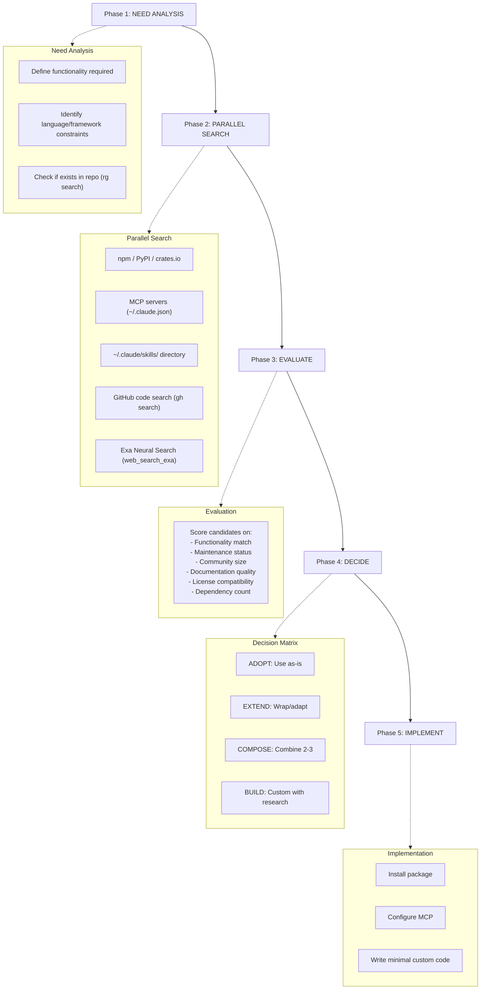
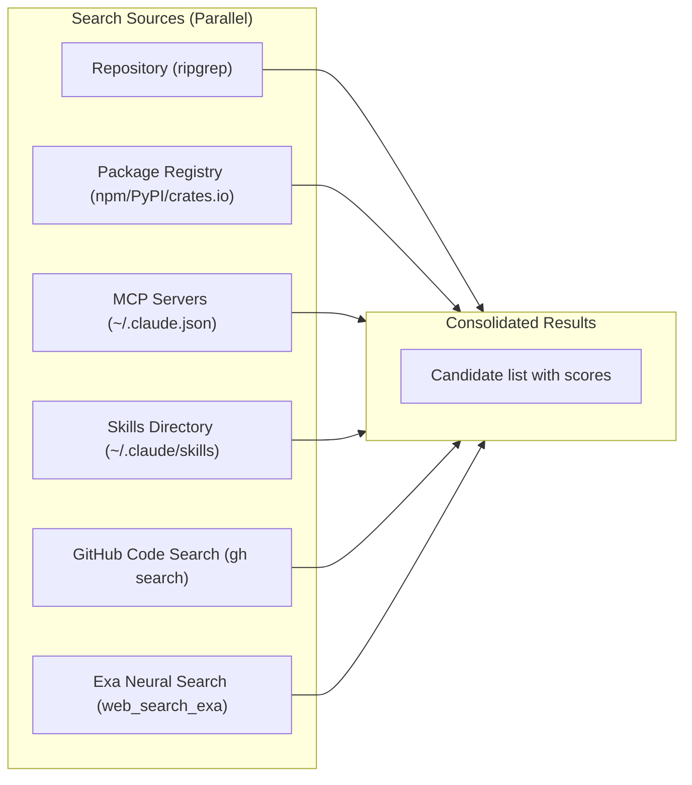
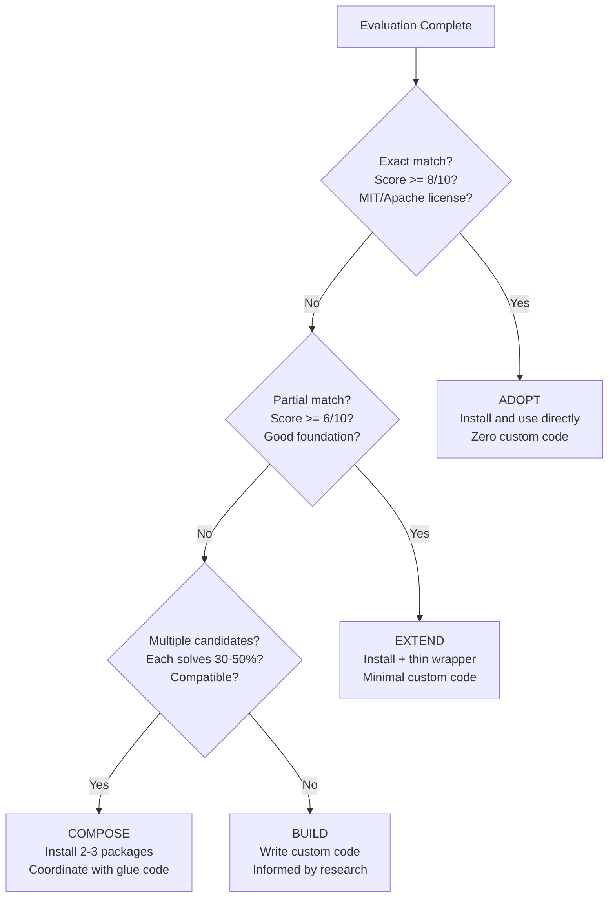

<!-- source: DeepWiki mcp.deepwiki.com · repo affaan-m/everything-claude-code · page 10.2 Search-First Workflow · fetched 2026-10-26 -->

# Search-First Workflow

<details>
<summary>Relevant source files</summary>

The following files were used as context for generating this wiki page:

- [.agents/skills/crosspost/SKILL.md](.agents/skills/crosspost/SKILL.md)
- [.agents/skills/exa-search/SKILL.md](.agents/skills/exa-search/SKILL.md)
- [.agents/skills/x-api/SKILL.md](.agents/skills/x-api/SKILL.md)
- [CONTRIBUTING.md](CONTRIBUTING.md)
- [agents/docs-lookup.md](agents/docs-lookup.md)
- [docs/SKILL-DEVELOPMENT-GUIDE.md](docs/SKILL-DEVELOPMENT-GUIDE.md)
- [docs/examples/project-guidelines-template.md](docs/examples/project-guidelines-template.md)
- [docs/skill-adaptation-policy.md](docs/skill-adaptation-policy.md)
- [rules/common/code-review.md](rules/common/code-review.md)
- [rules/common/development-workflow.md](rules/common/development-workflow.md)
- [scripts/lib/orchestration-session.js](scripts/lib/orchestration-session.js)
- [scripts/lib/tmux-worktree-orchestrator.js](scripts/lib/tmux-worktree-orchestrator.js)
- [scripts/orchestrate-codex-worker.sh](scripts/orchestrate-codex-worker.sh)
- [scripts/orchestrate-worktrees.js](scripts/orchestrate-worktrees.js)
- [scripts/orchestration-status.js](scripts/orchestration-status.js)
- [skills/crosspost/SKILL.md](skills/crosspost/SKILL.md)
- [skills/dmux-workflows/SKILL.md](skills/dmux-workflows/SKILL.md)
- [skills/exa-search/SKILL.md](skills/exa-search/SKILL.md)
- [skills/fal-ai-media/SKILL.md](skills/fal-ai-media/SKILL.md)
- [skills/search-first/SKILL.md](skills/search-first/SKILL.md)
- [skills/x-api/SKILL.md](skills/x-api/SKILL.md)
- [tests/lib/orchestration-session.test.js](tests/lib/orchestration-session.test.js)
- [tests/lib/tmux-worktree-orchestrator.test.js](tests/lib/tmux-worktree-orchestrator.test.js)

</details>


This document describes the **search-first** workflow, a research-before-coding methodology that systematically searches for existing tools, libraries, and patterns before writing custom code. This workflow is implemented as a skill that can be invoked inline or by delegating to a researcher agent.

---

## Overview

The search-first workflow addresses the "reinventing the wheel" problem by enforcing a structured research phase before any implementation. It searches across package registries (npm, PyPI, crates.io), MCP servers, Claude Code skills, GitHub repositories, and web resources to identify existing solutions that can be adopted, extended, composed, or used as references.

**Key Benefits:**
- Reduces custom code by 40-60% through adoption of battle-tested libraries [skills/search-first/SKILL.md:133-135]().
- Identifies integration points (MCP servers) before implementation [skills/search-first/SKILL.md:66-66]().
- Discovers reference architectures and design patterns [skills/search-first/SKILL.md:119-119]().
- Avoids dependency bloat through informed evaluation [skills/search-first/SKILL.md:161-161]().

Sources: [skills/search-first/SKILL.md:1-162](), [rules/common/development-workflow.md:9-16]()

---

## Trigger Conditions

Activate the search-first workflow when:

| Scenario | Example |
|----------|---------|
| Starting a new feature | "Add authentication", "Add payment processing" [skills/search-first/SKILL.md:14-14]() |
| Adding a dependency | "We need an HTTP client with retries" [skills/search-first/SKILL.md:15-15]() |
| Creating utilities/helpers | "Write a function to parse markdown frontmatter" [skills/search-first/SKILL.md:17-17]() |
| Integration requirements | "Connect to the database", "Add analytics" [skills/search-first/SKILL.md:101-102]() |
| About to write code | Any time you're about to implement something non-trivial [skills/search-first/SKILL.md:16-16]() |

The workflow is **mandatory** before any new implementation [rules/common/development-workflow.md:9-9](). It should be triggered before Phase 1 (Architecture Review) in the planner agent's process [skills/search-first/SKILL.md:110-110]().

Sources: [skills/search-first/SKILL.md:11-18](), [rules/common/development-workflow.md:9-14]()

---

## The Five-Phase Process

The search-first workflow consists of five sequential phases that progress from problem definition to implementation.



**Figure 1: Five-Phase Search-First Process**

Sources: [skills/search-first/SKILL.md:19-47](), [rules/common/development-workflow.md:9-16]()

---

## Phase 1: Need Analysis

Before searching, explicitly define the requirement and constraints.

**Actions:**
1. **Define functionality**: What specific problem needs to be solved? [skills/search-first/SKILL.md:24-24]()
2. **Identify constraints**: Language (TypeScript, Python, Go, Rust), framework (React, Django, Spring Boot), and license requirements [skills/search-first/SKILL.md:25-25]().
3. **Check repository first**: Run `rg` (ripgrep) through the codebase to verify the functionality doesn't already exist [skills/search-first/SKILL.md:64-64]().

Sources: [skills/search-first/SKILL.md:22-25](), [skills/search-first/SKILL.md:60-68]()

---

## Phase 2: Parallel Search

Execute searches across multiple sources simultaneously. The **researcher** agent (invoked via `Task`) handles this phase when using Full Mode.

### Search Sources and Priority



**Figure 2: Parallel Search Architecture**

### Search Tools and Commands

| Platform | Command / Tool | Purpose |
|----------|---------|---------|
| Repository | `rg` | Find internal implementations [skills/search-first/SKILL.md:64-64]() |
| Package Registries | `npm search` / `pip search` | Find external libraries [skills/search-first/SKILL.md:29-30]() |
| MCP Servers | `~/.claude.json` | Check for existing tool integrations [skills/search-first/SKILL.md:66-66]() |
| Skills | `~/.claude/skills/` | Check for internal workflow guidance [skills/search-first/SKILL.md:67-67]() |
| GitHub | `gh search code` | Find open-source patterns/templates [rules/common/development-workflow.md:10-10]() |
| Web Research | `web_search_exa` | Neural search for docs and news [skills/exa-search/SKILL.md:35-40]() |
| Code Research | `get_code_context_exa` | Extract snippets from web [skills/exa-search/SKILL.md:55-60]() |

Sources: [skills/search-first/SKILL.md:27-31](), [rules/common/development-workflow.md:10-14](), [skills/exa-search/SKILL.md:35-60]()

---

## Phase 3: Evaluate

Score each candidate based on a weighted matrix of technical and community health factors [skills/search-first/SKILL.md:34-35]().

### Evaluation Criteria

| Criterion | Weight | Questions to Ask |
|-----------|--------|------------------|
| **Functionality** | High | Does it solve the exact problem? What's missing? |
| **Maintenance** | High | Last commit? Open issues? Release cadence? |
| **Community** | Medium | Downloads? GitHub stars? Active discussions? |
| **Documentation** | Medium | API docs? Examples? Migration guides? |
| **License** | High | MIT/Apache (preferred)? GPL? [skills/search-first/SKILL.md:53-53]() |
| **Dependencies** | Medium | How many? Are they maintained? Bundle size? |

Sources: [skills/search-first/SKILL.md:33-36](), [rules/common/development-workflow.md:13-15]()

---

## Phase 4: Decision Matrix

Based on evaluation scores and functionality match, choose one of four paths [skills/search-first/SKILL.md:49-56]().



**Figure 3: Decision Matrix Flowchart**

### Decision Paths

| Path | Condition | Action |
|------|-----------|--------|
| **ADOPT** | Exact match, well-maintained, MIT/Apache | Install and use directly [skills/search-first/SKILL.md:53-53]() |
| **EXTEND** | Partial match, good foundation | Install + write thin wrapper [skills/search-first/SKILL.md:54-54]() |
| **COMPOSE** | Multiple weak matches | Combine 2-3 small packages [skills/search-first/SKILL.md:55-55]() |
| **BUILD** | Nothing suitable found | Write custom, but informed by research [skills/search-first/SKILL.md:56-56]() |

Sources: [skills/search-first/SKILL.md:49-56](), [skills/search-first/SKILL.md:37-42]()

---

## Researcher Agent Integration

For non-trivial functionality, the search-first workflow is delegated to a general-purpose subagent configured as a researcher [skills/search-first/SKILL.md:72-74]().

### Researcher Invocation Pattern

The main agent uses the `Task` tool to spin up the researcher with a specific research prompt [skills/search-first/SKILL.md:75-83]().

```markdown
Task(subagent_type="general-purpose", prompt="
  Research existing tools for: [DESCRIPTION]
  Language/framework: [LANG]
  Constraints: [ANY]

  Search: npm/PyPI, MCP servers, Claude Code skills, GitHub
  Return: Structured comparison with recommendation
")
```

### Deep Research with Exa
When standard searches fail, the researcher uses the `exa-search` skill to perform neural research [skills/exa-search/SKILL.md:1-10]().
- **web_search_exa**: Broad discovery of current information [skills/exa-search/SKILL.md:35-40]().
- **get_code_context_exa**: Targeted retrieval of API patterns and snippets [skills/exa-search/SKILL.md:55-60]().
- **deep_researcher_start**: Asynchronous, multi-step AI synthesis for complex topics [skills/exa-search/SKILL.md:121-126]().

Sources: [skills/search-first/SKILL.md:70-83](), [skills/exa-search/SKILL.md:1-130]()

---

## Anti-Patterns

- **Jumping to code**: Writing a utility without checking if one exists [skills/search-first/SKILL.md:158-158]().
- **Ignoring MCP**: Not checking if an MCP server already provides the capability [skills/search-first/SKILL.md:159-159]().
- **Over-customizing**: Wrapping a library so heavily it loses its benefits [skills/search-first/SKILL.md:160-160]().
- **Dependency bloat**: Installing a massive package for one small feature [skills/search-first/SKILL.md:161-161]().

Sources: [skills/search-first/SKILL.md:156-162]()

---

