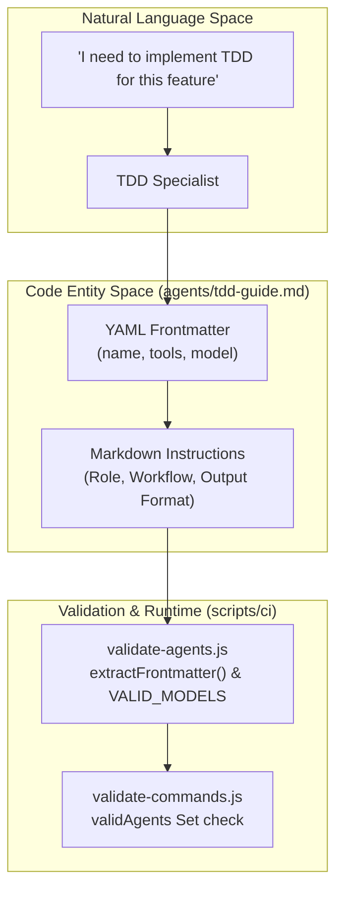
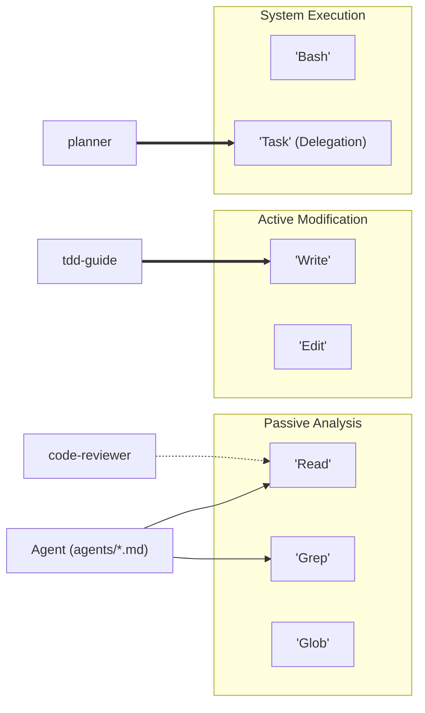

<!-- source: DeepWiki mcp.deepwiki.com · repo affaan-m/everything-claude-code · page 15.1 Contributing Agents · fetched 2026-10-26 -->

# Contributing Agents

Relevant source files

The following files were used as context for generating this wiki page:

- [CONTRIBUTING.md](CONTRIBUTING.md)
- [agents/docs-lookup.md](agents/docs-lookup.md)
- [commands/plan.md](commands/plan.md)
- [commands/prp-commit.md](commands/prp-commit.md)
- [commands/prp-plan.md](commands/prp-plan.md)
- [commands/prp-pr.md](commands/prp-pr.md)
- [commands/prp-prd.md](commands/prp-prd.md)
- [commands/python-review.md](commands/python-review.md)
- [docs/SKILL-DEVELOPMENT-GUIDE.md](docs/SKILL-DEVELOPMENT-GUIDE.md)
- [docs/SKILL-PLACEMENT-POLICY.md](docs/SKILL-PLACEMENT-POLICY.md)
- [docs/examples/project-guidelines-template.md](docs/examples/project-guidelines-template.md)
- [docs/skill-adaptation-policy.md](docs/skill-adaptation-policy.md)
- [rules/common/code-review.md](rules/common/code-review.md)
- [rules/common/development-workflow.md](rules/common/development-workflow.md)
- [schemas/provenance.schema.json](schemas/provenance.schema.json)
- [scripts/ci/validate-agents.js](scripts/ci/validate-agents.js)
- [scripts/ci/validate-commands.js](scripts/ci/validate-commands.js)
- [scripts/ci/validate-install-manifests.js](scripts/ci/validate-install-manifests.js)
- [scripts/ci/validate-skills.js](scripts/ci/validate-skills.js)
- [skills/hexagonal-architecture/SKILL.md](skills/hexagonal-architecture/SKILL.md)
- [skills/search-first/SKILL.md](skills/search-first/SKILL.md)
- [tests/commands/plan-command.test.js](tests/commands/plan-command.test.js)

This document explains how to create and contribute new agents to the Everything Claude Code (ECC) system. Agents are specialized assistants invoked via the `Task` tool [CONTRIBUTING.md:186](). They handle specific domains through delegation, each with bounded contexts, specific model selections, and restricted tool permissions.

---

## Agent Architecture

Agents are defined as Markdown files within the `agents/` directory [CONTRIBUTING.md:191](). They utilize a combination of YAML frontmatter for configuration and Markdown for behavioral instructions [CONTRIBUTING.md:197-202]().

### Agent Entity Mapping

The following diagram illustrates how a user's natural language intent is mapped to specific code entities and validated within the ECC ecosystem.

**Diagram: Agent Entity Mapping**

**Sources:** [CONTRIBUTING.md:186-202](), [scripts/ci/validate-agents.js:9-15](), [scripts/ci/validate-commands.js:75-83]()

---

## YAML Frontmatter Structure

The frontmatter defines the metadata and execution environment for the agent. The `validate-agents.js` script enforces these requirements [scripts/ci/validate-agents.js:10-11]().

| Field | Required | Description | Allowed Values |
|-------|----------|-------------|----------------|
| `name` | Yes | Lowercase, hyphenated identifier | e.g., `code-reviewer` [CONTRIBUTING.md:239]() |
| `description` | Yes | Specific purpose used for auto-invocation | Detailed string [CONTRIBUTING.md:240]() |
| `tools` | Yes | List of allowed tools for the agent | `Read, Write, Edit, Bash, Grep, Glob, WebFetch, Task`, or MCP tools [CONTRIBUTING.md:241]() |
| `model` | Yes | Complexity level/Model ID | `haiku`, `sonnet`, `opus` [scripts/ci/validate-agents.js:11]() |

### Model Selection Guidelines
*   **`haiku`**: Used for simple, high-speed tasks [CONTRIBUTING.md:242]().
*   **`sonnet`**: The standard for coding and implementation tasks [CONTRIBUTING.md:242]().
*   **`opus`**: Reserved for extremely complex reasoning or high-stakes analysis [CONTRIBUTING.md:242]().

**Sources:** [CONTRIBUTING.md:237-242](), [scripts/ci/validate-agents.js:10-11]()

---

## Instruction Format & Workflow

The Markdown body provides the "brain" of the agent. It must be structured to ensure predictable behavior and should follow clear responsibility boundaries [CONTRIBUTING.md:204-210]().

### Recommended Sections
1.  **Role Definition**: Clear statement of the agent's identity and what it does NOT do [CONTRIBUTING.md:204-210]().
2.  **Workflow Steps**: A phased approach (e.g., Step 1: Understand, Step 2: Execute, Step 3: Verify) [CONTRIBUTING.md:212-221]().
3.  **Output Format**: Explicit definition of what the agent returns to the user [CONTRIBUTING.md:223-225]().
4.  **Examples**: Concrete scenarios showing Input, Action, and Output [CONTRIBUTING.md:227-233]().

### Tool Permission Flow

Agents follow the principle of least privilege. The system maps these permissions through the `tools` array in the frontmatter [scripts/ci/validate-agents.js:10]().

**Diagram: Agent Tool Permission Flow**

**Sources:** [CONTRIBUTING.md:197-202](), [CONTRIBUTING.md:241](), [scripts/ci/validate-agents.js:10-11]()

---

## Validation & CI Integration

New agents are subject to automated validation to ensure they meet the repository standards.

### Validation Logic
The `validate-agents.js` script performs the following checks:
1.  **Frontmatter Extraction**: Parses the YAML block using `extractFrontmatter()` and strips BOM if present [scripts/ci/validate-agents.js:13-31]().
2.  **Required Fields**: Ensures `model` and `tools` are present and non-empty [scripts/ci/validate-agents.js:60-65]().
3.  **Model Whitelist**: Validates that the model is one of `haiku`, `sonnet`, or `opus` [scripts/ci/validate-agents.js:68-71]().

### Cross-Reference Validation
The `validate-commands.js` script ensures that any slash commands referencing agents (e.g., in workflow diagrams or descriptive text) point to valid files in the `agents/` directory [scripts/ci/validate-commands.js:75-83](). It also checks agent name references specifically within workflow diagrams (e.g., `planner -> tdd-guide`) [scripts/ci/validate-commands.js:164-174]().

**Sources:** [scripts/ci/validate-agents.js:1-82](), [scripts/ci/validate-commands.js:75-174]()

---

## Contribution Checklist

Before submitting a new agent via Pull Request, ensure it meets the following technical standards:

*   [ ] **File Location**: Placed in `agents/your-agent-name.md` [CONTRIBUTING.md:191]().
*   [ ] **Naming**: Filename is lowercase with hyphens [CONTRIBUTING.md:239]().
*   [ ] **Specific Description**: The `description` field clearly explains *when* Claude should invoke it to assist the `Task` tool [CONTRIBUTING.md:199]().
*   [ ] **Model Accuracy**: Uses `sonnet` for coding or `haiku` for simple tasks [CONTRIBUTING.md:242]().
*   [ ] **Tool Scoping**: Only includes necessary tools in the `tools` array to preserve context window [CONTRIBUTING.md:241]().
*   [ ] **Validation**: Pass local validation by running the CI scripts [scripts/ci/validate-agents.js:1-82]().
*   [ ] **Boundaries**: Explicitly defines what the agent **DOES NOT** do to prevent scope creep [CONTRIBUTING.md:210]().

**Sources:** [CONTRIBUTING.md:184-242](), [scripts/ci/validate-agents.js:1-82](), [scripts/ci/validate-commands.js:1-189]()

---

