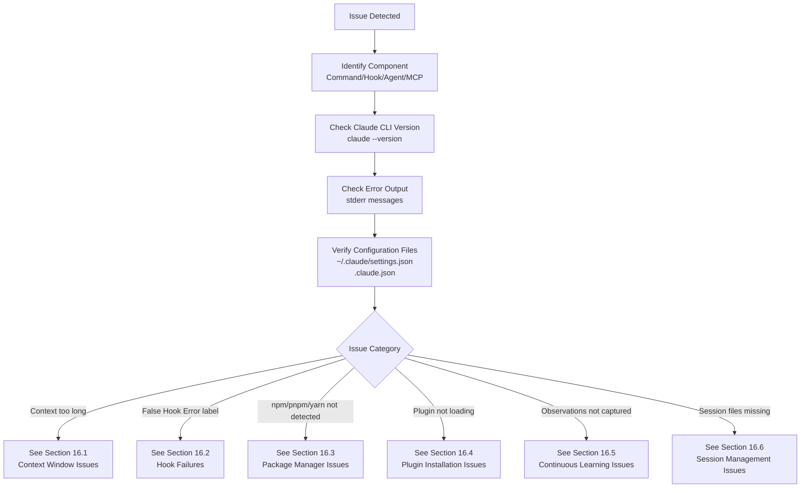
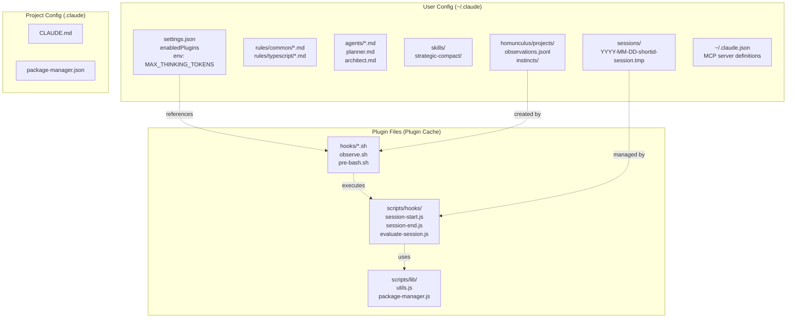
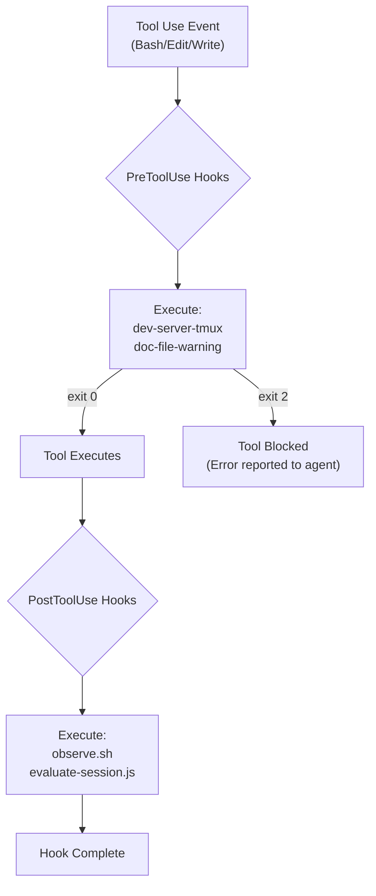

<!-- source: DeepWiki mcp.deepwiki.com · repo affaan-m/everything-claude-code · page 16 Troubleshooting · fetched 2026-10-26 -->

# Troubleshooting

Relevant source files

The following files were used as context for generating this wiki page:

- [TROUBLESHOOTING.md](TROUBLESHOOTING.md)
- [docs/TROUBLESHOOTING.md](docs/TROUBLESHOOTING.md)
- [docs/hook-bug-workarounds.md](docs/hook-bug-workarounds.md)
- [docs/token-optimization.md](docs/token-optimization.md)
- [tests/docs/mcp-management-docs.test.js](tests/docs/mcp-management-docs.test.js)

## Purpose and Scope

This page provides a systematic approach to diagnosing and resolving common issues in the Everything Claude Code (ECC) system. It covers general diagnostic techniques, error pattern recognition, and directs users to specialized troubleshooting guides for specific issue categories.

For detailed solutions to specific problems, see:
- Context window and MCP-related issues: [Context Window Issues](#16.1)
- Hook execution and script errors: [Hook Failures](#16.2)
- Package manager configuration: [Package Manager Issues](#16.3)
- Plugin marketplace and installation: [Plugin Installation Issues](#16.4)
- Continuous learning and instinct generation: [Continuous Learning Issues](#16.5)
- Session management and persistence: [Session Management Issues](#16.6)

For general configuration guidance, see [Configuration Guide](#9).

Sources: [TROUBLESHOOTING.md:1-13](), [docs/TROUBLESHOOTING.md:1-7]()

---

## General Diagnostic Approach

When encountering issues with ECC, follow this systematic troubleshooting workflow to isolate the component:

Sources: [TROUBLESHOOTING.md:17-21](), [docs/TROUBLESHOOTING.md:9-11](), [TROUBLESHOOTING.md:272-274]()

---

## Component Location Map

Troubleshooting requires knowing where ECC entities reside. This map bridges the "Natural Language Space" (user intent) to the "Code Entity Space" (files and functions):

Sources: [TROUBLESHOOTING.md:55-62](), [TROUBLESHOOTING.md:98-105](), [docs/token-optimization.md:13-23]()

---

## Diagnostic Commands and Tools

Use these commands to verify the state of your ECC installation:

| Command | Purpose | Expected Output |
|---------|---------|-----------------|
| `claude --version` | Check CLI version | `Claude Code CLI v2.x.x` |
| `ecc doctor` | Audit system health | Report on missing files/configs |
| `ecc repair` | Attempt auto-fix | Restoration of plugin files |
| `ecc status` | State store health check | SQLite persistence status |
| `/mcp` | Check active MCP servers | List of tools and context cost |
| `/cost` | Check token spending | Current session token usage |
| `which node python3` | Verify dependencies | Paths to system binaries |

Sources: [TROUBLESHOOTING.md:146-155](), [TROUBLESHOOTING.md:253-255](), [docs/token-optimization.md:68-72](), [docs/token-optimization.md:99-100]()

---

## Hook Execution Flow and Failure Points

ECC relies on hooks for quality and learning. Upstream bugs in Claude Code can sometimes cause false "Hook Error" labels even when scripts exit correctly.

**Common Hook Fixes:**
- **Consume Stdin:** Always use `input=$(cat)` at the start of shell hooks to prevent pipe errors [docs/TROUBLESHOOTING.md:15-16](), [docs/hook-bug-workarounds.md:25-28]().
- **Exit Codes:** Use `0` to allow, `2` to block. Other non-zero codes are treated as errors [docs/TROUBLESHOOTING.md:18-19](), [docs/hook-bug-workarounds.md:28-34]().
- **Quiet Stdout:** Keep `stdout` quiet for simple hooks; send diagnostics to `stderr` [docs/TROUBLESHOOTING.md:16-17](), [docs/hook-bug-workarounds.md:26-27]().

Sources: [docs/TROUBLESHOOTING.md:9-28](), [TROUBLESHOOTING.md:178-180](), [docs/hook-bug-workarounds.md:21-34]()

---

## Error Pattern Recognition

### Context and Performance Issues
- **Symptom:** "Context too long" or repeated `529 Overloaded` responses [TROUBLESHOOTING.md:21](), [docs/TROUBLESHOOTING.md:58-60]().
- **Cause:** Large file uploads, high `MAX_THINKING_TOKENS`, or too many enabled MCP servers [docs/token-optimization.md:30-31](), [docs/token-optimization.md:97-98]().
- **Solution:** Lower `MAX_THINKING_TOKENS` to `10000`, use `CLAUDE_CODE_SUBAGENT_MODEL=haiku`, and keep active MCP servers under 10 [docs/token-optimization.md:13-32](), [docs/token-optimization.md:97-98]().

### Hook Failures
- **Symptom:** "Hook Error" label in transcript or hooks not firing [docs/TROUBLESHOOTING.md:11](), [TROUBLESHOOTING.md:163]().
- **Cause:** Changes to `settings.json` not hot-reloading or script permission issues [docs/TROUBLESHOOTING.md:49-51](), [TROUBLESHOOTING.md:140-143]().
- **Solution:** Restart the Claude Code session after editing hooks. Run `chmod +x` on scripts in the plugin cache [docs/TROUBLESHOOTING.md:55-56](), [TROUBLESHOOTING.md:149-151]().

### Continuous Learning Issues
- **Symptom:** Agent doesn't remember previous project observations [TROUBLESHOOTING.md:46]().
- **Cause:** Project detection failure or corrupted `observations.jsonl` [TROUBLESHOOTING.md:48-51]().
- **Solution:** Verify the project hash in `~/.claude/homunculus/projects.json` and check that `observe` hooks are registered in `settings.json` [TROUBLESHOOTING.md:58-81]().

Sources: [TROUBLESHOOTING.md:19-28](), [docs/TROUBLESHOOTING.md:58-68](), [docs/token-optimization.md:9-23](), [docs/hook-bug-workarounds.md:52-57]()

---

## Quick Diagnostic Checklist

Before opening an issue, verify these prerequisites:

- [ ] **Claude CLI Version:** Ensure `claude --version` is 2.0 or higher [TROUBLESHOOTING.md:272-274]().
- [ ] **Dependency Check:** Verify `node`, `python3`, and `git` are in your `PATH` [TROUBLESHOOTING.md:146-148]().
- [ ] **Plugin Health:** Run `ecc doctor` to check for missing components [TROUBLESHOOTING.md:254]().
- [ ] **MCP Discipline:** Ensure fewer than 10 MCP servers are enabled to save context [docs/token-optimization.md:97-98]().
- [ ] **Stdin Handling:** Ensure custom hooks consume `stdin` to avoid upstream pipe errors [docs/TROUBLESHOOTING.md:15-16](), [docs/hook-bug-workarounds.md:25-26]().

Sources: [TROUBLESHOOTING.md:253-255](), [docs/TROUBLESHOOTING.md:15-19](), [docs/token-optimization.md:97-98](), [docs/hook-bug-workarounds.md:19-34]()

---

