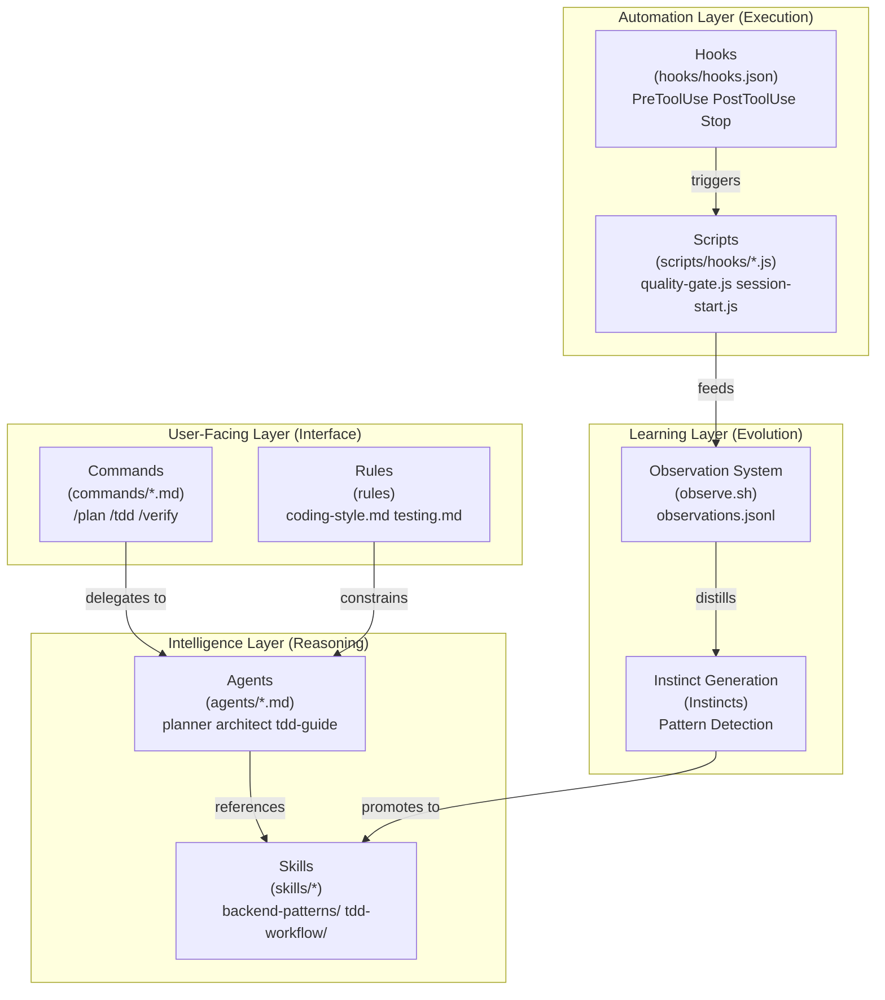
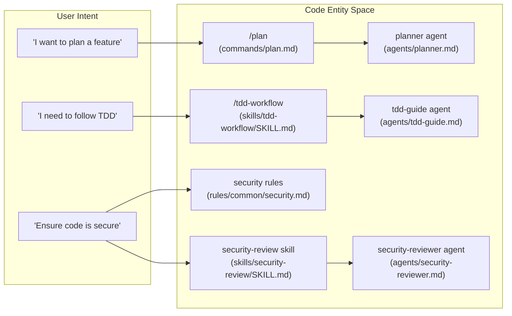
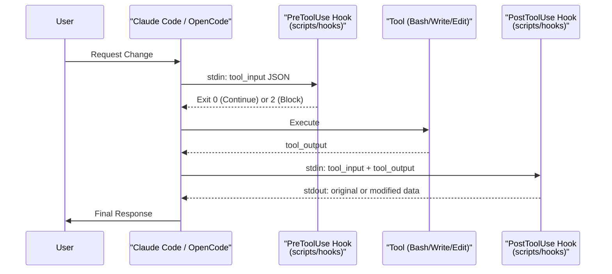

<!-- source: DeepWiki mcp.deepwiki.com · repo affaan-m/everything-claude-code · page 3 Core Concepts · fetched 2026-10-26 -->

# Core Concepts

Relevant source files

The following files were used as context for generating this wiki page:

- [.agents/plugins/marketplace.json](.agents/plugins/marketplace.json)
- [.claude-plugin/PLUGIN_SCHEMA_NOTES.md](.claude-plugin/PLUGIN_SCHEMA_NOTES.md)
- [.claude-plugin/README.md](.claude-plugin/README.md)
- [.claude-plugin/marketplace.json](.claude-plugin/marketplace.json)
- [.claude-plugin/plugin.json](.claude-plugin/plugin.json)
- [.codex-plugin/README.md](.codex-plugin/README.md)
- [.codex-plugin/plugin.json](.codex-plugin/plugin.json)
- [.mcp.json](.mcp.json)
- [AGENTS.md](AGENTS.md)
- [README.md](README.md)
- [README.zh-CN.md](README.zh-CN.md)
- [WORKING-CONTEXT.md](WORKING-CONTEXT.md)
- [agent.yaml](agent.yaml)
- [commands/auto-update.md](commands/auto-update.md)
- [commands/jira.md](commands/jira.md)
- [docs/zh-CN/AGENTS.md](docs/zh-CN/AGENTS.md)
- [docs/zh-CN/README.md](docs/zh-CN/README.md)
- [manifests/install-modules.json](manifests/install-modules.json)
- [schemas/package-manager.schema.json](schemas/package-manager.schema.json)
- [schemas/plugin.schema.json](schemas/plugin.schema.json)
- [scripts/auto-update.js](scripts/auto-update.js)
- [skills/jira-integration/SKILL.md](skills/jira-integration/SKILL.md)
- [tests/ci/agent-yaml-surface.test.js](tests/ci/agent-yaml-surface.test.js)
- [tests/plugin-manifest.test.js](tests/plugin-manifest.test.js)
- [tests/scripts/auto-update.test.js](tests/scripts/auto-update.test.js)

This document introduces the fundamental architecture of Everything Claude Code (ECC). It provides a high-level overview of how agents, skills, commands, rules, hooks, and MCPs work together to create a multi-layered development workflow system optimized for AI agent harnesses like Claude Code, Cursor, and OpenCode.

For detailed information about specific component types, see the following child pages:
- [Plugin Architecture](#3.1) — Plugin structure and marketplace distribution.
- [Agents](#3.2) — Specialized subagents and task delegation.
- [Skills](#3.3) — Workflow definitions and domain knowledge.
- [Commands](#3.4) — Slash commands for quick execution.
- [Rules](#3.5) — Hierarchical guidelines and constraints.
- [Hooks](#3.6) — Event-driven automation and lifecycle phases.
- [MCPs (Model Context Protocol)](#3.7) — External service integrations.

---

## Component Types

ECC organizes its capabilities into seven primary component types, each serving a distinct role in the development lifecycle. As of version 2.0.0-rc.1, the catalog truth includes 48 agents, 182 skills, and 68 legacy command shims. [README.md:92-93](), [WORKING-CONTEXT.md:12-13]()

| Component | Location | Purpose | Invocation Method |
|-----------|----------|---------|-------------------|
| **Agents** | `agents/*.md` | Specialized subagents with specific tool permissions for delegated tasks | Via command delegation or direct invocation |
| **Skills** | `skills/*/` | Reusable workflow definitions and domain knowledge | Auto-loaded by context or referenced by agents |
| **Commands** | `commands/*.md` | Slash commands for quick workflow execution | User types `/command-name` |
| **Rules** | `rules/` | Always-follow guidelines (Common + Language-specific) | Auto-loaded in every session |
| **Hooks** | `hooks/` | Event-driven scripts triggered by tool use or lifecycle events | Automatic on event triggers |
| **MCPs** | `mcp-configs/` | External service integrations (GitHub, Postgres, etc.) | Tool calls from the LLM |
| **Instincts** | `instincts/` | Project-scoped patterns learned from session observations | Auto-loaded for project context |

**Sources:** [README.md:92-93](), [WORKING-CONTEXT.md:13](), [AGENTS.md:15-45](), [.claude-plugin/plugin.json:25-27](), [manifests/install-modules.json:3-226]()

---

## The Layered Architecture

ECC operates across four distinct layers, bridging high-level user intent to low-level system execution and continuous improvement.

### Architectural Flow Diagram

**Sources:** [README.md:74-80](), [AGENTS.md:48-57](), [manifests/install-modules.json:198-219](), [WORKING-CONTEXT.md:38-44]()

---

## Component Discovery and Loading

The system identifies components through a combination of explicit manifests and directory conventions. The selective install architecture uses `install-plan.js` and `install-apply.js` to manage these components via a SQLite state store. [README.md:101-104]()

### Mapping Natural Language to Code Entities
The following diagram illustrates how user-facing concepts map to specific code entities and file paths within the ECC structure.

**Sources:** [AGENTS.md:17-44](), [manifests/install-modules.json:236-254](), [.claude-plugin/plugin.json:2-28](), [agent.yaml:145-213]()

---

## Hook Lifecycle and Data Flow

Hooks are the "glue" of the system, intercepting tool inputs and outputs to enforce quality and persist state. Claude Code v2.1+ automatically loads `hooks/hooks.json` by convention. [.claude-plugin/PLUGIN_SCHEMA_NOTES.md:103-110]()

### Tool Execution Sequence

**Sources:** [manifests/install-modules.json:63-81](), [.claude-plugin/PLUGIN_SCHEMA_NOTES.md:103-121]()

---

## File Organization and Priority

ECC follows a strict directory convention that allows for project-specific overrides and selective installation of modules.

### Directory Structure
- `agents/`: Specialized subagents (48 available). [README.md:92](), [WORKING-CONTEXT.md:13]()
- `skills/`: Workflow definitions and domain knowledge (182 available). [README.md:92](), [WORKING-CONTEXT.md:13]()
- `commands/`: Slash-command library and shims (68 available). [README.md:92](), [WORKING-CONTEXT.md:13]()
- `hooks/`: Trigger-based automations and configurations. [manifests/install-modules.json:63-81]()
- `rules/`: Always-follow guidelines (Common + 12 language ecosystems). [README.md:101-102]()
- `scripts/`: Cross-platform Node.js utilities for installation and runtime. [manifests/install-modules.json:68-69]()

### Configuration Priority
ECC resolves settings and package managers in a specific order:
1. **Environment Variables**: `CLAUDE_PACKAGE_MANAGER`. [README.zh-CN.md:189]()
2. **Project Configuration**: `.claude/package-manager.json`. [README.zh-CN.md:190]()
3. **Local Manifests**: `package.json` fields or lock files. [README.zh-CN.md:191-192]()
4. **Global Configuration**: `~/.claude/package-manager.json`. [README.zh-CN.md:193]()

**Sources:** [README.md:92-104](), [AGENTS.md:146-157](), [manifests/install-modules.json:3-226]()

---

## Summary of Interactions

The power of ECC lies in the interaction between these components:
- **Commands** trigger **Agents** or **Skills**.
- **Agents** follow **Rules** and delegate to other agents for specialized tasks (e.g., `planner` delegating to `architect`). [AGENTS.md:48-55]()
- **Hooks** monitor **Tools** used by Agents to enforce quality gates and safety. [.claude-plugin/PLUGIN_SCHEMA_NOTES.md:103-110]()
- **Continuous Learning** (v2) extracts **Instincts** from session observations, which are then promoted to **Skills**. [WORKING-CONTEXT.md:38-44]()

For detailed implementation details, proceed to the child pages: [Plugin Architecture](#3.1), [Agents](#3.2), [Skills](#3.3), [Commands](#3.4), [Rules](#3.5), [Hooks](#3.6), and [MCPs (Model Context Protocol)](#3.7).

---

