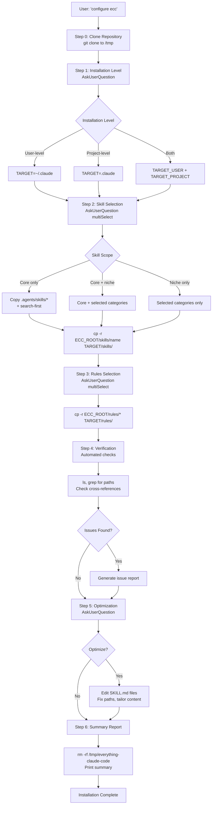
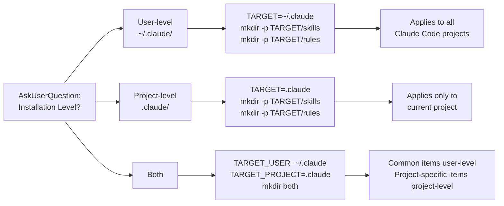

<!-- source: DeepWiki mcp.deepwiki.com · repo affaan-m/everything-claude-code · page 4.5 Interactive Configuration Wizard · fetched 2026-10-26 -->

# Interactive Configuration Wizard

<details>
<summary>Relevant source files</summary>

The following files were used as context for generating this wiki page:

- [docs/ja-JP/README.md](docs/ja-JP/README.md)
- [docs/ja-JP/skills/configure-ecc/SKILL.md](docs/ja-JP/skills/configure-ecc/SKILL.md)
- [docs/ko-KR/README.md](docs/ko-KR/README.md)
- [docs/pt-BR/README.md](docs/pt-BR/README.md)
- [docs/tr/README.md](docs/tr/README.md)
- [docs/zh-CN/skills/configure-ecc/SKILL.md](docs/zh-CN/skills/configure-ecc/SKILL.md)
- [docs/zh-TW/README.md](docs/zh-TW/README.md)
- [skills/configure-ecc/SKILL.md](skills/configure-ecc/SKILL.md)
- [tests/docs/configure-ecc-install-paths.test.js](tests/docs/configure-ecc-install-paths.test.js)
- [tests/docs/install-identifiers.test.js](tests/docs/install-identifiers.test.js)

</details>


This document covers the `configure-ecc` skill, which provides an interactive, step-by-step installation wizard for Everything Claude Code components. The wizard guides users through selective installation of skills and rules using `AskUserQuestion` prompts, verifies correctness, and offers optimization of installed files.

For marketplace-based plugin installation, see [Plugin Installation](). For manual git-based installation, see [Manual Installation](). For package manager setup specifically, see [Package Manager Configuration]().

---

## Overview

The interactive configuration wizard is implemented as a skill located at [skills/configure-ecc/SKILL.md:1-340](). Unlike automated installation methods, this wizard provides fine-grained control over which components to install and where to install them. It was introduced in v1.4.0 to simplify multi-language rule architecture management [docs/ja-JP/README.md:76-80]().

**When to activate:**
- User says "configure ecc", "install ecc", "setup everything claude code", or similar [skills/configure-ecc/SKILL.md:13-16]().
- User wants to selectively install skills or rules from this project [skills/configure-ecc/SKILL.md:14-14]().
- User wants to verify or fix an existing ECC installation [skills/configure-ecc/SKILL.md:15-15]().
- User wants to optimize installed skills or rules for their project [skills/configure-ecc/SKILL.md:16-16]().

**Prerequisites:**

The `configure-ecc` skill must be accessible to Claude Code before activation. Two ways to bootstrap:

| Method | Command | Details |
|--------|---------|---------|
| Via Plugin | `/plugin install everything-claude-code@everything-claude-code` | The plugin loads this skill automatically [skills/configure-ecc/SKILL.md:21-22](). |
| Manual Bootstrap | Copy single skill to `~/.claude/skills/configure-ecc/SKILL.md` | Then activate by saying "configure ecc" [skills/configure-ecc/SKILL.md:22-22](). |

Sources: [skills/configure-ecc/SKILL.md:1-24](), [docs/ja-JP/README.md:76-80]()

---

## Wizard Architecture

The wizard implements a multi-phase installation pipeline with interactive decision points at each phase. It bridges the gap between the raw source code and the user's specific environment.

**Wizard Flow Diagram**



**Key architectural features:**

1. **Temporary staging**: Source repository is cloned to `/tmp/everything-claude-code` to ensure a clean source for copy operations [skills/configure-ecc/SKILL.md:26-35]().
2. **Interactive branching**: Uses the `AskUserQuestion` tool to determine installation paths and component subsets [skills/configure-ecc/SKILL.md:41-51]().
3. **Verification pass**: Automated checks run after installation to detect broken path references or missing dependencies [skills/configure-ecc/SKILL.md:244-273]().
4. **In-place optimization**: Only modifies files in the `TARGET/` directory, never the source repository [skills/configure-ecc/SKILL.md:304-304]().

Sources: [skills/configure-ecc/SKILL.md:1-340]()

---

## Installation Level Selection

The wizard first determines the scope of the installation using a single-select question.

**Installation Level Decision Tree**



**Implementation:**

The wizard presents three options [skills/configure-ecc/SKILL.md:43-51]():

| Option | Target Directory | Scope | Use Case |
|--------|-----------------|-------|----------|
| `User-level (~/.claude)` | `~/.claude/` | Global | Applies to all Claude Code projects for that user [skills/configure-ecc/SKILL.md:48-48](). |
| `Project-level (.claude)` | `.claude/` | Local | Applies only to the current project directory [skills/configure-ecc/SKILL.md:49-49](). |
| `Both` | Hybrid | Mixed | Common items global, project-specific items local [skills/configure-ecc/SKILL.md:50-50](). |

After selection, the wizard ensures the directory structure exists [skills/configure-ecc/SKILL.md:59-61]():

```bash
mkdir -p $TARGET/skills $TARGET/rules
```

Sources: [skills/configure-ecc/SKILL.md:41-62]()

---

## Skill Selection & Installation

The skill selection phase implements a two-tier filtering system: scope selection followed by category/individual selection.

### Scope Selection

The core bundle includes [skills/configure-ecc/SKILL.md:67-79]():
- `.agents/skills/*` - All agent-embedded skills.
- `skills/search-first/` - Research-before-coding workflow.
- Core workflows: TDD, E2E, evals, and verification.
- Quality tools: Security review, strategic compaction.
- Cross-functional Anthropic skills: `article-writing`, `content-engine`, `market-research`, `frontend-slides`.

### Category Selection

The wizard presents skills organized into 8 selectable category groups plus an "All skills" option [skills/configure-ecc/SKILL.md:83-102]():

| Category | Description |
|----------|-------------|
| Framework & Language | Django, Laravel, Spring Boot, Go, Python, Java, Frontend, Backend patterns [skills/configure-ecc/SKILL.md:90-90]() |
| Database | PostgreSQL, ClickHouse, JPA/Hibernate patterns [skills/configure-ecc/SKILL.md:91-91]() |
| Workflow & Quality | TDD, verification, learning, security review, compaction [skills/configure-ecc/SKILL.md:92-92]() |
| Research & APIs | Deep research, Exa search, Claude API patterns [skills/configure-ecc/SKILL.md:93-93]() |
| Social & Content Distribution | X/Twitter API, crossposting alongside content-engine [skills/configure-ecc/SKILL.md:94-94]() |
| Media Generation | fal.ai image/video/audio alongside VideoDB [skills/configure-ecc/SKILL.md:95-95]() |
| Orchestration | dmux multi-agent workflows [skills/configure-ecc/SKILL.md:96-96]() |

### Individual Skill Confirmation

For each selected category, the user can confirm or deselect specific skills [skills/configure-ecc/SKILL.md:100-106](). For example, the **Framework & Language** category contains 21 skills including `backend-patterns`, `django-patterns`, `laravel-patterns`, and `springboot-patterns` [skills/configure-ecc/SKILL.md:104-128]().

### Installation Execution

For each selected skill, the wizard copies the entire skill directory using defensive path handling to strip trailing slashes [skills/configure-ecc/SKILL.md:212-216]():

```bash
cp -R "${src%/}" "$TARGET/skills/$(basename "${src%/}")"
```

Sources: [skills/configure-ecc/SKILL.md:65-220](), [tests/docs/configure-ecc-install-paths.test.js:50-61]()

---

## Rules Selection & Installation

Rules are organized into common (language-agnostic) and language-specific sets.

**Rules selection options** [skills/configure-ecc/SKILL.md:224-233]():

| Rule Set | Description |
|----------|-------------|
| Common rules | Language-agnostic principles: coding style, git workflow, testing, security [skills/configure-ecc/SKILL.md:229-229]() |
| TypeScript/JavaScript | TS/JS patterns, hooks, Playwright testing [skills/configure-ecc/SKILL.md:230-230]() |
| Python | Python patterns, pytest, black/ruff formatting [skills/configure-ecc/SKILL.md:231-231]() |
| Go | Go patterns, table-driven tests, gofmt/staticcheck [skills/configure-ecc/SKILL.md:232-232]() |

**Installation behavior:**

Rules are installed as flat files into `$TARGET/rules/` [skills/configure-ecc/SKILL.md:238-245](). This is a critical step because Claude Code does not automatically distribute rules via plugins [docs/ja-JP/README.md:118-119]().

**Dependency warning:**

If a user selects language-specific rules without common rules, the wizard prompts [skills/configure-ecc/SKILL.md:247-250]():

> "Language-specific rules extend the common rules. Installing without common rules may result in incomplete coverage. Install common rules too?"

Sources: [skills/configure-ecc/SKILL.md:222-250](), [docs/ja-JP/README.md:118-131]()

---

## Verification Phase

After installation, the wizard runs automated checks to detect configuration issues and broken references [skills/configure-ecc/SKILL.md:253-286]().

### Path Reference Scanning

The verification scans for three types of path references [skills/configure-ecc/SKILL.md:266-273]():

1. **User-level paths**: Checks for hardcoded `~/.claude/` paths in the installed target [skills/configure-ecc/SKILL.md:267-267]().
2. **Relative common paths**: Checks for `../common/` references in rules [skills/configure-ecc/SKILL.md:270-270]().
3. **Skill cross-references**: Checks for internal skill-to-skill links [skills/configure-ecc/SKILL.md:273-273]().

### Cross-Reference Validation

The wizard checks specific dependency relationships [skills/configure-ecc/SKILL.md:280-284]():
- `django-tdd` → `django-patterns` [skills/configure-ecc/SKILL.md:281-281]()
- `springboot-tdd` → `springboot-patterns` [skills/configure-ecc/SKILL.md:282-282]()
- `continuous-learning-v2` → `~/.claude/homunculus/` directory [skills/configure-ecc/SKILL.md:284-284]()

Sources: [skills/configure-ecc/SKILL.md:253-286]()

---

## Optimization Phase

The optimization phase allows users to tailor installed files to their project's tech stack and preferences [skills/configure-ecc/SKILL.md:288-319]().

### Skill Optimization

The wizard performs these steps when optimizing skills [skills/configure-ecc/SKILL.md:302-308]():

1. **Read each installed SKILL.md** from the target directory.
2. **Ask about tech stack** (e.g., "React + TypeScript", "Django + PostgreSQL").
3. **Suggest section removals** for irrelevant frameworks or patterns.
4. **Edit SKILL.md in-place** at `$TARGET/` (never at `$ECC_ROOT/`).
5. **Fix path issues** identified in the verification phase.

### Rules Optimization

For rules optimization, the wizard collects preferences such as test coverage targets (default 80%), formatting tools, and git conventions [skills/configure-ecc/SKILL.md:309-317]().

**Critical constraint:** The wizard only modifies files in the installation target (`$TARGET/`), never in the source ECC repository (`$ECC_ROOT/`) [skills/configure-ecc/SKILL.md:318-318]().

Sources: [skills/configure-ecc/SKILL.md:288-319]()

---

## Summary Report & Cleanup

The final phase cleans up temporary files and generates an installation summary [skills/configure-ecc/SKILL.md:321-340]().

### Cleanup

The wizard removes the cloned repository from `/tmp` [skills/configure-ecc/SKILL.md:325-329]():

```bash
rm -rf /tmp/everything-claude-code
```

### Summary Report Structure

The report includes [skills/configure-ecc/SKILL.md:331-339]():
- **Installation Target**: Level (user/project) and path [skills/configure-ecc/SKILL.md:335-337]().
- **Skills Installed**: List of installed skills [skills/configure-ecc/SKILL.md:339-340]().
- **Rules Installed**: List of rule sets [skills/configure-ecc/SKILL.md:339-340]().
- **Verification Results**: Count of issues found and fixed.
- **Optimizations Applied**: Summary of changes made.

Sources: [skills/configure-ecc/SKILL.md:321-340]()

---

