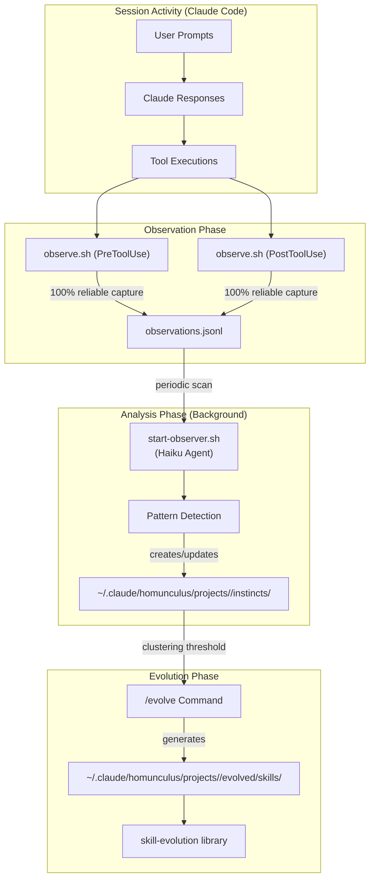
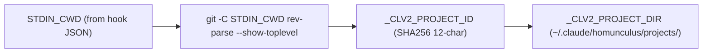
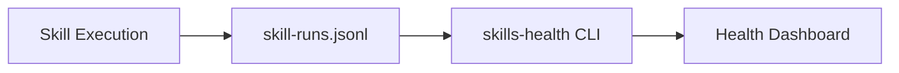

<!-- source: DeepWiki mcp.deepwiki.com · repo affaan-m/everything-claude-code · page 8 Continuous Learning System · fetched 2026-10-26 -->

# Continuous Learning System

Relevant source files

The following files were used as context for generating this wiki page:

- [.gitignore](.gitignore)
- [docs/ja-JP/skills/continuous-learning-v2/SKILL.md](docs/ja-JP/skills/continuous-learning-v2/SKILL.md)
- [docs/ko-KR/skills/continuous-learning-v2/SKILL.md](docs/ko-KR/skills/continuous-learning-v2/SKILL.md)
- [docs/tr/skills/continuous-learning-v2/SKILL.md](docs/tr/skills/continuous-learning-v2/SKILL.md)
- [docs/zh-CN/skills/continuous-learning-v2/SKILL.md](docs/zh-CN/skills/continuous-learning-v2/SKILL.md)
- [docs/zh-TW/skills/continuous-learning-v2/SKILL.md](docs/zh-TW/skills/continuous-learning-v2/SKILL.md)
- [scripts/hooks/session-end-marker.js](scripts/hooks/session-end-marker.js)
- [scripts/lib/observer-sessions.js](scripts/lib/observer-sessions.js)
- [skills/continuous-learning-v2/SKILL.md](skills/continuous-learning-v2/SKILL.md)
- [skills/continuous-learning-v2/agents/observer-loop.sh](skills/continuous-learning-v2/agents/observer-loop.sh)
- [skills/continuous-learning-v2/agents/session-guardian.sh](skills/continuous-learning-v2/agents/session-guardian.sh)
- [skills/continuous-learning-v2/agents/start-observer.sh](skills/continuous-learning-v2/agents/start-observer.sh)
- [skills/continuous-learning-v2/hooks/observe.sh](skills/continuous-learning-v2/hooks/observe.sh)
- [skills/continuous-learning-v2/scripts/detect-project.sh](skills/continuous-learning-v2/scripts/detect-project.sh)
- [skills/strategic-compact/SKILL.md](skills/strategic-compact/SKILL.md)
- [tests/docs/continuous-learning-v2-docs.test.js](tests/docs/continuous-learning-v2-docs.test.js)
- [tests/hooks/observe-subdirectory-detection.test.js](tests/hooks/observe-subdirectory-detection.test.js)
- [tests/hooks/observer-memory.test.js](tests/hooks/observer-memory.test.js)

## Purpose and Scope

The Continuous Learning System (v2.1) is an autonomous architecture that transforms interactive Claude Code sessions into reusable knowledge structures. It captures tool usage, identifies recurring patterns (instincts), and evolves them into formal skills, commands, and agents.

For detailed implementation guides, see:
- v2 Architecture Overview: [Continuous Learning v2 Architecture](#8.1)
- Observation Hook: [Observation System](#8.2)
- Background Daemon: [Observer Agent & Pattern Detection](#8.3)
- Instinct Management: [Instinct Structure & Management](#8.4)
- Evolution Pipeline: [Evolution Pipeline](#8.5)
- Project Scoping: [Project-Scoped Learning](#8.6)
- Skill Creation: [Skill Creator Integration](#8.7)
- Session Evaluation: [Evaluation System](#8.8)
- Health & Versioning: [Skill Evolution & Health Tracking](#8.9)

## System Architecture Overview

The system operates as a parallel pipeline that observes session activity and generates reusable artifacts. It uses deterministic hook-based observation and a project-scoped storage architecture.

**Diagram: Continuous Learning Lifecycle**

The system captures 100% of tool usage via hooks, which are then analyzed by a background Haiku-based observer to build atomic instincts.

Sources: [skills/continuous-learning-v2/SKILL.md:82-124](), [skills/continuous-learning-v2/hooks/observe.sh:1-12](), [skills/continuous-learning-v2/agents/start-observer.sh:1-15]()

## Observation System

### Hook-Based Capture
The system uses `observe.sh`, registered as both a `PreToolUse` and `PostToolUse` hook, to capture tool inputs and outputs [skills/continuous-learning-v2/hooks/observe.sh:15-16](). It includes a 5-layer guard system to prevent observing automated subagent sessions (detected via `agent_id`) or its own observer loop [skills/continuous-learning-v2/hooks/observe.sh:133-162]().

### Project Detection
Observations are project-scoped using `detect-project.sh`. It identifies the project context by hashing the `git remote get-url origin` (for portability) or the repo root path [skills/continuous-learning-v2/scripts/detect-project.sh:88-115]().

**Diagram: Project ID Generation and Storage Mapping**

Sources: [skills/continuous-learning-v2/hooks/observe.sh:94-108](), [skills/continuous-learning-v2/scripts/detect-project.sh:52-79]()

## Analysis and Instincts

### Observer Agent
The `start-observer.sh` script launches a background loop (`observer-loop.sh`) that periodically invokes Claude Haiku to analyze recent observations [skills/continuous-learning-v2/agents/start-observer.sh:199-212](). To prevent memory explosion and high token costs, it uses tail-based sampling (default: last 500 lines) via `tail -n "$MAX_ANALYSIS_LINES"` [skills/continuous-learning-v2/agents/observer-loop.sh:138-142]().

### Instinct Structure
Instincts are stored as YAML-frontmatter markdown files. They track confidence scores (0.3 to 0.85) based on frequency: 3-5 occurrences (0.5), 6-10 (0.7), 11+ (0.85) [skills/continuous-learning-v2/agents/observer-loop.sh:159-170]().

| Field | Purpose |
|-------|---------|
| `id` | Unique kebab-case identifier (e.g., `prefer-functional-style`) |
| `trigger` | Natural language condition for activation |
| `confidence` | Weighted score based on frequency (0.3 - 0.85) |
| `domain` | Category (e.g., `code-style`, `testing`, `workflow`) |
| `scope` | `project` (default) or `global` |

Sources: [skills/continuous-learning-v2/agents/observer-loop.sh:151-192](), [skills/continuous-learning-v2/SKILL.md:51-78]()

## Evolution and Health

### The Evolution Pipeline
The `/evolve` command triggers the clustering of related instincts into full skills, commands, or agents [skills/continuous-learning-v2/SKILL.md:186](). This transforms atomic observations into high-level workflow definitions stored in the project's `evolved/` directory [skills/continuous-learning-v2/scripts/detect-project.sh:146-152]().

### Memory & Performance Guardrails
The system implements a re-entrancy guard (`ANALYZING` flag) and a cooldown throttle (`ANALYSIS_COOLDOWN`, default 60s) to prevent runaway parallel Claude analysis processes [skills/continuous-learning-v2/agents/observer-loop.sh:13-16](), [tests/hooks/observer-memory.test.js:91-111]().

**Diagram: Skill Health Monitoring Flow**

Sources: [skills/continuous-learning-v2/agents/observer-loop.sh:13-16](), [tests/hooks/observer-memory.test.js:119-134]()

## Summary of Learning Commands

| Command | System Component | Purpose |
|---------|------------------|---------|
| `/instinct-status` | Instinct Management | Show learned instincts (project + global) |
| `/instinct-export` | Instinct Management | Export instincts to a portable file |
| `/evolve` | Evolution Pipeline | Cluster related instincts into skills/commands |
| `/promote` | Scope Management | Promote project instincts to global scope |
| `/projects` | Project Registry | List known projects and instinct counts |

Sources: [skills/continuous-learning-v2/SKILL.md:184-190](), [skills/continuous-learning-v2/scripts/detect-project.sh:158-180]()

---

