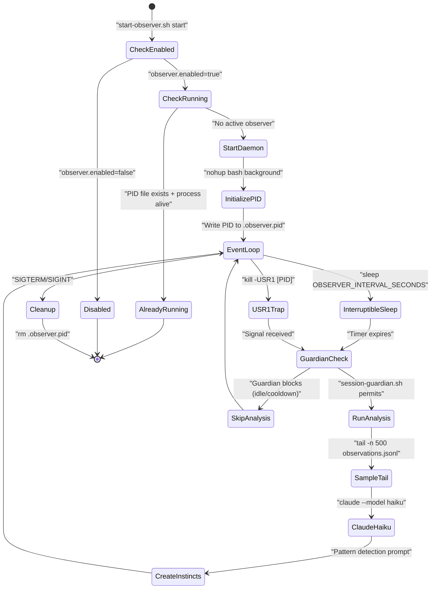
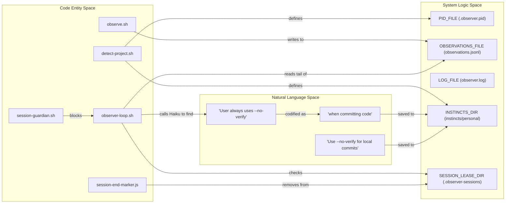

<!-- source: DeepWiki mcp.deepwiki.com · repo affaan-m/everything-claude-code · page 8.3 Observer Agent & Pattern Detection · fetched 2026-10-26 -->

# Observer Agent & Pattern Detection

Relevant source files

The following files were used as context for generating this wiki page:

- [.gitignore](.gitignore)
- [scripts/hooks/session-end-marker.js](scripts/hooks/session-end-marker.js)
- [scripts/lib/observer-sessions.js](scripts/lib/observer-sessions.js)
- [skills/continuous-learning-v2/agents/observer-loop.sh](skills/continuous-learning-v2/agents/observer-loop.sh)
- [skills/continuous-learning-v2/agents/session-guardian.sh](skills/continuous-learning-v2/agents/session-guardian.sh)
- [skills/continuous-learning-v2/agents/start-observer.sh](skills/continuous-learning-v2/agents/start-observer.sh)
- [skills/continuous-learning-v2/hooks/observe.sh](skills/continuous-learning-v2/hooks/observe.sh)
- [skills/continuous-learning-v2/scripts/detect-project.sh](skills/continuous-learning-v2/scripts/detect-project.sh)
- [skills/strategic-compact/SKILL.md](skills/strategic-compact/SKILL.md)
- [tests/hooks/observe-subdirectory-detection.test.js](tests/hooks/observe-subdirectory-detection.test.js)
- [tests/hooks/observer-memory.test.js](tests/hooks/observer-memory.test.js)

This page documents the background observer daemon that analyzes captured observations to detect patterns and generate instincts. The observer operates asynchronously, using Claude Haiku for cost-efficient pattern analysis, and includes sophisticated safety guards to prevent resource exhaustion.

For observation capture and storage, see **8.2 Observation System**. For instinct structure and management, see **8.4 Instinct Structure & Management**.

---

## Purpose and Architecture

The observer agent is a background process that continuously monitors project-scoped observation files and triggers pattern analysis when thresholds are reached. It operates independently of the main Claude Code session to avoid blocking interactive workflows or polluting the user's terminal.

**Key Responsibilities:**
- Monitor `observations.jsonl` for new tool use events [skills/continuous-learning-v2/agents/observer-loop.sh:109-113]().
- Trigger analysis when the minimum observation threshold is reached [skills/continuous-learning-v2/agents/observer-loop.sh:113-116]().
- Invoke Claude Haiku with specialized pattern detection prompts [skills/continuous-learning-v2/agents/observer-loop.sh:152-192]().
- Create or update instinct files based on detected patterns [skills/continuous-learning-v2/agents/observer-loop.sh:156-160]().
- Implement memory and resource safety via tail-sampling and re-entrancy guards [skills/continuous-learning-v2/agents/observer-loop.sh:4-16]().

**Sources:** [skills/continuous-learning-v2/agents/observer-loop.sh:1-16](), [skills/continuous-learning-v2/agents/start-observer.sh:1-9]()

---

## Observer Daemon Lifecycle

The lifecycle is managed by `start-observer.sh`, which launches the `observer-loop.sh` background process.

**Observer Process State Machine**

**Daemon Start Sequence:**
1. **Configuration Check**: Reads `config.json` to verify `observer.enabled` is `true` [skills/continuous-learning-v2/agents/start-observer.sh:172-176]().
2. **Project Detection**: Sources `detect-project.sh` to determine `PROJECT_ID`, `PROJECT_NAME`, and `PROJECT_DIR` [skills/continuous-learning-v2/agents/start-observer.sh:31]().
3. **PID File Check**: Verifies no existing observer is running for the specific project [skills/continuous-learning-v2/agents/start-observer.sh:179-186]().
4. **Background Launch**: Starts `observer-loop.sh` using `nohup`, passing essential environment variables including `PROJECT_ID` and `PROJECT_DIR` [skills/continuous-learning-v2/agents/start-observer.sh:199-212]().
5. **Prompt Guard**: Checks the log for confirmation prompts to "fail closed" if Claude requires permission, using `CLV2_OBSERVER_PROMPT_PATTERN` [skills/continuous-learning-v2/agents/start-observer.sh:218-223]().

**Sources:** [skills/continuous-learning-v2/agents/start-observer.sh:1-225](), [skills/continuous-learning-v2/agents/observer-loop.sh:1-25](), [skills/continuous-learning-v2/scripts/detect-project.sh:49-50]()

---

## Pattern Detection & Safety Guards

The observer system implements several layers of safety to prevent "infinite loops" where the agent observes its own analysis, and to prevent memory explosion.

### Memory & Performance Guards (Issue #521)
To prevent memory explosion and runaway processes, the observer implements:
- **Tail-based Sampling**: Only the last 500 lines (configurable via `ECC_OBSERVER_MAX_ANALYSIS_LINES`) of the observation file are sent to the LLM [skills/continuous-learning-v2/agents/observer-loop.sh:138-142]().
- **Re-entrancy Guard**: An `ANALYZING` flag prevents a second analysis from starting if one is already in progress [skills/continuous-learning-v2/agents/observer-loop.sh:13]().
- **Cooldown Throttle**: A minimum interval (default 60s) between analyses is enforced via `ANALYSIS_COOLDOWN` [skills/continuous-learning-v2/agents/observer-loop.sh:16]().

### The Session Guardian
Before spawning a Claude session, the loop invokes `session-guardian.sh` which enforces:
1. **Time Windows**: Skips cycles outside active hours (default 08:00 - 23:00) [skills/continuous-learning-v2/agents/session-guardian.sh:31-52]().
2. **Idle Detection**: Skips cycles if the user has been idle for more than 30 minutes (uses `ioreg` on macOS, `xprintidle` on Linux, or PowerShell on Windows) [skills/continuous-learning-v2/agents/session-guardian.sh:103-148]().
3. **Project Cooldown**: Uses a file-based lock (`.observer-last-run.log.lock`) to ensure the same project isn't analyzed too frequently [skills/continuous-learning-v2/agents/session-guardian.sh:54-101]().

### Active Session Leases
The observer tracks active human sessions via a lease system. `observer-loop.sh` will self-terminate if idle and no active session leases exist [skills/continuous-learning-v2/agents/observer-loop.sh:70-84](). Leases are managed by `session-end-marker.js` which removes the lease when a session ends [scripts/hooks/session-end-marker.js:31-33]().

**Sources:** [skills/continuous-learning-v2/agents/observer-loop.sh:4-16](), [skills/continuous-learning-v2/agents/session-guardian.sh:1-151](), [tests/hooks/observer-memory.test.js:1-11](), [scripts/hooks/session-end-marker.js:1-49]()

---

## Claude Haiku Analysis Logic

The observer uses Claude Haiku via the `claude` CLI. It identifies patterns based on tool use history and creates instincts in the `instincts/personal/` directory.

### Pattern Detection Criteria
The prompt provided to Haiku [skills/continuous-learning-v2/agents/observer-loop.sh:152-192]() instructs it to:
- Identify patterns with **3+ occurrences**.
- Detect **user corrections**, **error resolutions**, **repeated workflows**, and **tool preferences**.
- Calculate **confidence scores** based on frequency:
    - 3-5 times: 0.5
    - 6-10 times: 0.7
    - 11+ times: 0.85

### Scope Resolution
Haiku must decide if a pattern is project-specific or global:
- **Project Scope**: Follow Django REST framework conventions, use React functional components [skills/continuous-learning-v2/agents/observer-loop.sh:191]().
- **Global Scope**: Universal patterns like "always validate user input" or "prefer explicit error handling" [skills/continuous-learning-v2/agents/observer-loop.sh:190]().

### Code Space to System Space Mapping
The following diagram illustrates how internal code variables and functions map to the resulting system entities.

**Entity Association Diagram**

**Sources:** [skills/continuous-learning-v2/agents/observer-loop.sh:130-170](), [skills/continuous-learning-v2/scripts/detect-project.sh:144-152](), [skills/continuous-learning-v2/agents/session-guardian.sh:60-64](), [scripts/lib/observer-sessions.js:88-90]()

---

## Signal Handling (USR1)

The `observe.sh` hook triggers the observer immediately after tool completion using the `USR1` signal, provided a throttle threshold is met.

| Component | Logic | File Reference |
|-----------|-------|----------------|
| **Throttle** | Signals every 20 observations by default (`ECC_OBSERVER_SIGNAL_EVERY_N`) | [tests/hooks/observer-memory.test.js:74-77]() |
| **Hook Signal** | `kill -USR1 $observer_pid` | [tests/hooks/observer-memory.test.js:71]() |
| **Loop Trap** | `trap on_usr1 USR1` sets `USR1_FIRED=1` and interrupts sleep | [skills/continuous-learning-v2/agents/observer-loop.sh:28]() |
| **Re-entrancy** | If `ANALYZING=1`, the signal is logged and ignored | [tests/hooks/observer-memory.test.js:96-100]() |

**Sources:** [skills/continuous-learning-v2/agents/observer-loop.sh:1-28](), [tests/hooks/observer-memory.test.js:55-100]()

---

## Thresholds & Configuration

The observer's behavior is governed by `config.json` and several environment variables.

| Setting | Default | Description |
|---------|---------|-------------|
| `run_interval_minutes` | 5 | Periodic interval for analysis if no signals are received [skills/continuous-learning-v2/agents/start-observer.sh:88](). |
| `min_observations_to_analyze` | 20 | Minimum lines in `observations.jsonl` before analysis starts [skills/continuous-learning-v2/agents/start-observer.sh:89](). |
| `ECC_OBSERVER_MAX_ANALYSIS_LINES` | 500 | Max lines sampled from the end of the observation file [skills/continuous-learning-v2/agents/observer-loop.sh:138](). |
| `ECC_OBSERVER_IDLE_TIMEOUT_SECONDS` | 1800 | Time (30m) after which the observer exits if no active sessions remain [skills/continuous-learning-v2/agents/observer-loop.sh:17](). |
| `ANALYSIS_COOLDOWN` | 60 | Minimum seconds between triggered analyses [skills/continuous-learning-v2/agents/observer-loop.sh:16](). |

**Sources:** [skills/continuous-learning-v2/agents/start-observer.sh:76-107](), [skills/continuous-learning-v2/agents/observer-loop.sh:16-142]()

---

