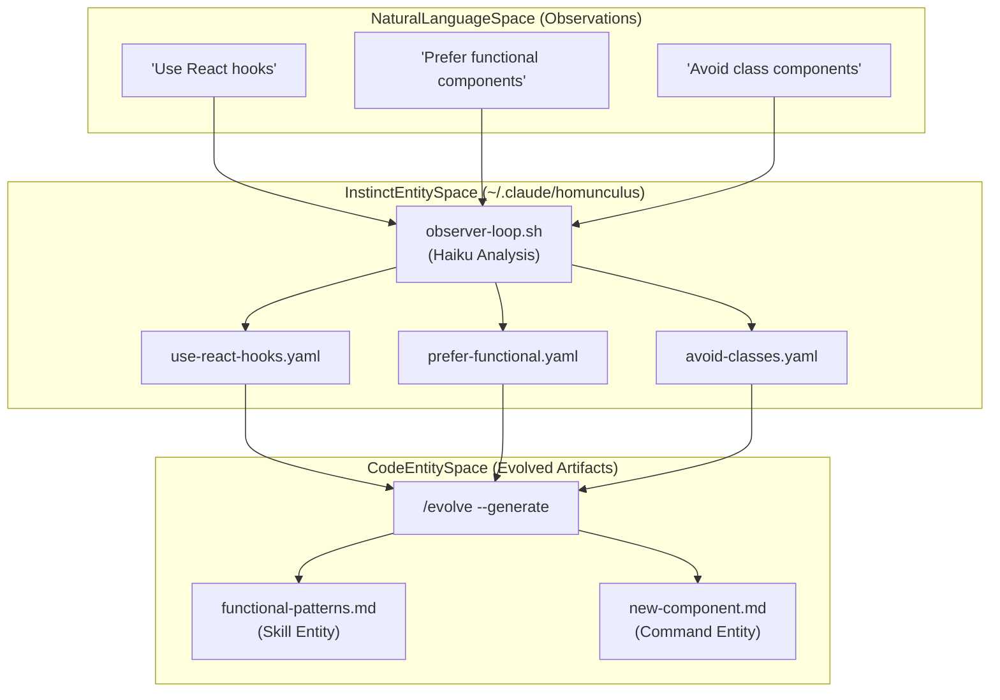
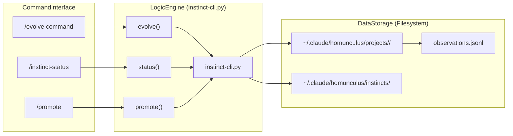

<!-- source: DeepWiki mcp.deepwiki.com · repo affaan-m/everything-claude-code · page 8.5 Evolution Pipeline · fetched 2026-10-26 -->

# Evolution Pipeline

Relevant source files

The following files were used as context for generating this wiki page:

- [commands/evolve.md](commands/evolve.md)
- [commands/instinct-export.md](commands/instinct-export.md)
- [commands/instinct-import.md](commands/instinct-import.md)
- [commands/instinct-status.md](commands/instinct-status.md)
- [commands/skill-create.md](commands/skill-create.md)
- [docs/ja-JP/skills/continuous-learning-v2/SKILL.md](docs/ja-JP/skills/continuous-learning-v2/SKILL.md)
- [docs/ko-KR/skills/continuous-learning-v2/SKILL.md](docs/ko-KR/skills/continuous-learning-v2/SKILL.md)
- [docs/tr/skills/continuous-learning-v2/SKILL.md](docs/tr/skills/continuous-learning-v2/SKILL.md)
- [docs/zh-CN/skills/continuous-learning-v2/SKILL.md](docs/zh-CN/skills/continuous-learning-v2/SKILL.md)
- [docs/zh-TW/skills/continuous-learning-v2/SKILL.md](docs/zh-TW/skills/continuous-learning-v2/SKILL.md)
- [skills/continuous-learning-v2/SKILL.md](skills/continuous-learning-v2/SKILL.md)
- [tests/docs/continuous-learning-v2-docs.test.js](tests/docs/continuous-learning-v2-docs.test.js)

The Evolution Pipeline transforms atomic instincts into higher-level constructs through clustering and pattern analysis. When related instincts reach a critical mass (default: 3+), the `/evolve` command groups them and generates commands, skills, or agents based on their characteristics.

## Overview

The evolution pipeline operates as a clustering and synthesis system that converts low-level learned behaviors (instincts) into reusable, shareable artifacts. This allows patterns observed across multiple sessions to coalesce into formal plugin components.

**Key concepts:**
- **Clustering**: Groups instincts by domain, trigger patterns, and action sequences [commands/evolve.md:23-27]().
- **Evolution types**: Determines whether to create a command, skill, or agent based on user-invocation vs. auto-triggering [commands/evolve.md:37-75]().
- **Project Scoping**: Prioritizes project-specific instincts over global fallbacks during analysis [commands/evolve.md:79-81]().
- **Promotion**: Moves project-scoped instincts to global scope when seen in 2+ projects [skills/continuous-learning-v2/SKILL.md:32]().

Sources: [commands/evolve.md:23-27](), [commands/evolve.md:79-86](), [skills/continuous-learning-v2/SKILL.md:32]()

## Evolution Architecture

### Natural Language to Code Entity Space

The pipeline bridges the gap between unstructured observations and structured code entities by clustering YAML-based instincts and synthesizing Markdown-based skills and commands.

**Diagram: Observation to Evolved Artifact Flow**

Sources: [commands/evolve.md:31-33](), [skills/continuous-learning-v2/SKILL.md:82-124]()

### Invocation and Script Execution

The evolution logic is centralized in a Python-based CLI (`instinct-cli.py`) that manages the transition from project-scoped data to global artifacts.

**Diagram: Execution Hierarchy**

The `/evolve` command executes through the Python CLI:
- Primary path: `${CLAUDE_PLUGIN_ROOT}/skills/continuous-learning-v2/scripts/instinct-cli.py evolve` [commands/evolve.md:11-14]().
- Fallback path: `python3 ~/.claude/skills/continuous-learning-v2/scripts/instinct-cli.py evolve` [commands/evolve.md:17-20]().

Sources: [commands/evolve.md:11-20](), [skills/continuous-learning-v2/SKILL.md:202-209]()

## Evolution Types and Decision Criteria

### Command Evolution (User-Invoked)
Commands are generated when instincts describe actions a user explicitly requests.
- **Criteria**: Triggers like "when user asks to..." or "when creating a new X" [commands/evolve.md:37-41]().
- **Output**: Creates a command file (e.g., `/new-table`) that follows a repeatable sequence [commands/evolve.md:43-48]().

### Skill Evolution (Auto-Triggered)
Skills are generated for behaviors that should happen automatically.
- **Criteria**: Pattern-matching triggers, error handling responses, or code style enforcement [commands/evolve.md:50-54]().
- **Example**: Clustering "prefer-functional" and "use-immutable" into a `functional-patterns` skill [commands/evolve.md:56-61]().

### Agent Evolution (Complex Workflows)
Agents are created for multi-step processes benefiting from isolation.
- **Criteria**: Debugging workflows, refactoring sequences, or research tasks [commands/evolve.md:63-67]().
- **Example**: A sequence of "check logs" → "isolate component" → "reproduce" → "verify" evolves into a **debugger** agent [commands/evolve.md:69-75]().

Sources: [commands/evolve.md:37-75]()

## Evolution Logic and Generation

### Clustering and Generation Process
The `/evolve` command performs the following steps:
1. **Context Detection**: Identifies the current project using git remote URL hashing or repo path fallback [skills/continuous-learning-v2/SKILL.md:126-135]().
2. **Precedence Handling**: Reads project and global instincts, where project instincts take precedence on ID conflicts [commands/evolve.md:80]().
3. **Clustering**: Groups instincts by trigger/domain patterns [commands/evolve.md:81]().
4. **Candidate Identification**:
   - **Skill**: Trigger clusters with 2+ instincts [commands/evolve.md:83]().
   - **Command**: High-confidence workflow instincts [commands/evolve.md:84]().
   - **Agent**: Larger clusters with high confidence [commands/evolve.md:85]().
5. **Generation**: If `--generate` is passed, writes files to the project's `evolved/` directory or the global fallback [commands/evolve.md:87-89]().

Sources: [commands/evolve.md:79-89](), [skills/continuous-learning-v2/SKILL.md:126-135]()

### Generated Artifact Structure

| Entity Type | Frontmatter Key | Destination Path |
| :--- | :--- | :--- |
| **Command** | `command: /name` | `evolved/commands/` [commands/evolve.md:88]() |
| **Skill** | `name: identifier` | `evolved/skills/` [commands/evolve.md:88]() |
| **Agent** | `model: sonnet/haiku` | `evolved/agents/` [commands/evolve.md:88]() |

Every evolved artifact includes an `evolved_from` list in its frontmatter, citing the source instinct IDs [commands/evolve.md:132-135](), [commands/evolve.md:152-155](), [commands/evolve.md:169-172]().

Sources: [commands/evolve.md:124-178]()

## Project Scoping and Global Promotion

### Project Detection and Directory Structure
The pipeline relies on project detection to scope instincts. It uses the git remote URL hash (portable) or the repo root path (machine-specific) to generate a 12-character project ID [skills/continuous-learning-v2/SKILL.md:131-135](). Project-specific evolution directories are located at:
- `~/.claude/homunculus/projects/<project-id>/evolved/` [commands/evolve.md:88]()

### Global Promotion via /promote
The `/promote` command moves project-specific instincts to the global scope [skills/continuous-learning-v2/SKILL.md:207]().
- **Criteria**: The system identifies promotion candidates when an instinct is observed in 2+ projects [skills/continuous-learning-v2/SKILL.md:32]().
- **Confidence**: High confidence instincts (>=80%) are prioritized for analysis [commands/evolve.md:100]().
- **Global Storage**: Global instincts are stored in `~/.claude/homunculus/instincts/personal/` [skills/continuous-learning-v2/SKILL.md:110]().

Sources: [skills/continuous-learning-v2/SKILL.md:32](), [skills/continuous-learning-v2/SKILL.md:110-135](), [commands/evolve.md:86-100]()

---

