# Page: Overview

# Overview

<details>
<summary>Relevant source files</summary>

The following files were used as context for generating this wiki page:

- [.agents/plugins/marketplace.json](.agents/plugins/marketplace.json)
- [.claude-plugin/PLUGIN_SCHEMA_NOTES.md](.claude-plugin/PLUGIN_SCHEMA_NOTES.md)
- [.claude-plugin/README.md](.claude-plugin/README.md)
- [.claude-plugin/marketplace.json](.claude-plugin/marketplace.json)
- [.claude-plugin/plugin.json](.claude-plugin/plugin.json)
- [.codex-plugin/README.md](.codex-plugin/README.md)
- [.codex-plugin/plugin.json](.codex-plugin/plugin.json)
- [.mcp.json](.mcp.json)
- [AGENTS.md](AGENTS.md)
- [README.md](README.md)
- [README.zh-CN.md](README.zh-CN.md)
- [WORKING-CONTEXT.md](WORKING-CONTEXT.md)
- [agent.yaml](agent.yaml)
- [commands/auto-update.md](commands/auto-update.md)
- [commands/jira.md](commands/jira.md)
- [docs/zh-CN/AGENTS.md](docs/zh-CN/AGENTS.md)
- [docs/zh-CN/README.md](docs/zh-CN/README.md)
- [manifests/install-modules.json](manifests/install-modules.json)
- [schemas/package-manager.schema.json](schemas/package-manager.schema.json)
- [schemas/plugin.schema.json](schemas/plugin.schema.json)
- [scripts/auto-update.js](scripts/auto-update.js)
- [skills/jira-integration/SKILL.md](skills/jira-integration/SKILL.md)
- [tests/ci/agent-yaml-surface.test.js](tests/ci/agent-yaml-surface.test.js)
- [tests/plugin-manifest.test.js](tests/plugin-manifest.test.js)
- [tests/scripts/auto-update.test.js](tests/scripts/auto-update.test.js)

</details>


Everything Claude Code (ECC) is a comprehensive performance optimization and enhancement system for Claude Code and compatible AI agent harnesses. It provides a production-ready suite of agents, skills, commands, rules, hooks, and MCP configurations designed to optimize token usage, enforce code quality, persist memory across sessions, and enable autonomous workflows [[README.md:3-37]]().

The system originated from an Anthropic hackathon-winning entry and has been battle-tested over 10+ months of intensive daily use building real-world products [[README.md:20-37]](). ECC is explicitly framed as an agent harness performance system rather than a simple configuration pack [[README.md:35-37]]().

---

## Origins and Maturity

ECC was developed to bridge the gap between raw AI agent capabilities and production engineering requirements. As of v2.0.0-rc.1, the system has evolved into a mature framework supporting 12+ language ecosystems [[README.md:85-103]]().

### System Statistics
- **48 Specialized Agents**: Domain-specific delegation for planning, architecture, and language-specific reviews [[AGENTS.md:3-3]](), [[WORKING-CONTEXT.md:13-13]]().
- **182 Skills**: Workflow definitions spanning frameworks, databases, and business operations [[AGENTS.md:3-3]](), [[WORKING-CONTEXT.md:13-13]]().
- **68 Legacy Commands**: Slash-entry compatibility shims for rapid execution [[AGENTS.md:3-3]](), [[WORKING-CONTEXT.md:13-13]]().
- **8 Hook Event Types**: Lifecycle triggers including `PreToolUse`, `PostToolUse`, `SessionStart`, `SessionEnd`, `Stop`, and `PreCompact` [[README.md:72-79]]().
- **12 Language Ecosystems**: Rules and reviewers for TypeScript, Python, Go, Java, PHP, Perl, Kotlin, C++, Rust, and Swift [[README.md:97-102]]().
- **Cross-Platform Support**: Native integration for Claude Code, Cursor, OpenCode, Codex, Gemini, and Antigravity [[README.md:39-41]]().

**Sources:** [[README.md:1-103]](), [[AGENTS.md:1-45]](), [[WORKING-CONTEXT.md:1-21]]()

---

## System Architecture Overview

ECC operates as a modular middleware layer between the AI agent harness and the underlying filesystem/tools. It uses a manifest-driven installation pipeline to target different environments [[README.md:96-97]]().

### Component Interaction Diagram

This diagram maps the relationship between high-level system concepts and the specific code entities that implement them.

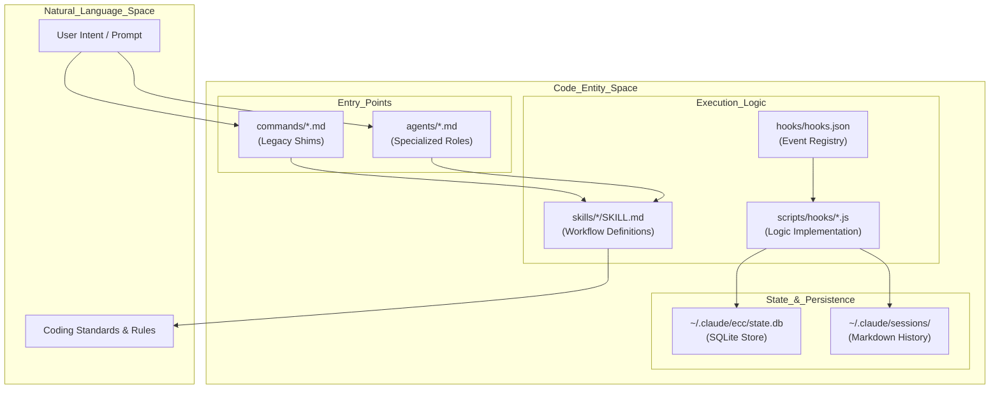

**Sources:** [[AGENTS.md:15-45]](), [[.claude-plugin/plugin.json:1-28]](), [[manifests/install-modules.json:1-108]]()

---

## Core Component Types

### Specialized Agents
Agents are defined in `agents/*.md` with YAML frontmatter specifying model configurations (Haiku/Sonnet/Opus) and tool permissions [[AGENTS.md:15-45]](). They are discovered automatically by convention and do not need explicit declaration in the plugin manifest [[.claude-plugin/PLUGIN_SCHEMA_NOTES.md:58-74]]().

| Agent | Purpose | When to Use |
|-------|---------|-------------|
| `planner` | Implementation planning | Complex features, refactoring [[AGENTS.md:19-19]]() |
| `architect` | System design and scalability | Architectural decisions [[AGENTS.md:20-20]]() |
| `tdd-guide` | Test-driven development | New features, bug fixes [[AGENTS.md:21-21]]() |
| `security-reviewer` | Vulnerability detection | Before commits, sensitive code [[AGENTS.md:23-23]]() |
| `harness-optimizer` | Harness config tuning | Reliability, cost, throughput [[AGENTS.md:40-40]]() |
| `loop-operator` | Autonomous loop execution | Run loops safely, monitor stalls [[AGENTS.md:39-39]]() |

**Sources:** [[AGENTS.md:15-60]](), [[.claude-plugin/PLUGIN_SCHEMA_NOTES.md:58-74]]()

### Workflow Skills
Skills in `skills/` are the canonical workflow surface [[AGENTS.md:119-122]](). They use a structured Markdown format to provide "evidence-based" guidance to the agent.

- **Framework Skills**: `nestjs-patterns`, `django-patterns`, `laravel-patterns`, `springboot-patterns` [[manifests/install-modules.json:114-152]]().
- **Quality Skills**: `plankton-code-quality`, `verification-loop`, `strategic-compact` [[manifests/install-modules.json:201-218]]().
- **Learning Skills**: `continuous-learning-v2` (Instinct-based learning) [[manifests/install-modules.json:208-208]]().

**Sources:** [[manifests/install-modules.json:110-234]](), [[AGENTS.md:119-124]]()

### Hook System
Hooks provide automated quality gates and memory management. They are registered in `hooks/hooks.json` and are auto-loaded by convention in Claude Code v2.1+ [[.claude-plugin/PLUGIN_SCHEMA_NOTES.md:98-132]]().

- **Quality Gates**: `PostToolUse` hooks for linting, type-checking, and formatting [[README.md:75-77]]().
- **Memory Management**: `SessionStart` and `Stop` hooks for extracting summaries and maintaining context continuity [[README.md:75-75]]().

**Sources:** [[README.md:72-79]](), [[manifests/install-modules.json:63-81]](), [[.claude-plugin/PLUGIN_SCHEMA_NOTES.md:98-132]]()

---

## Cross-Platform Infrastructure

ECC is designed to be platform-agnostic, providing specific adapters and manifests for different IDEs and CLIs [[README.md:39-41]]().

### Platform Target Resolution

The system uses `install-modules.json` to map components to specific harness targets such as `claude`, `cursor`, `opencode`, and `codex` [[manifests/install-modules.json:11-16]]().

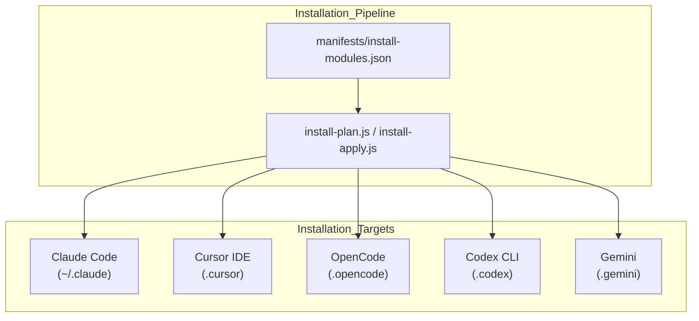

**Sources:** [[manifests/install-modules.json:1-108]](), [[README.md:94-103]]()

### Package Manager Cascade
The system handles environment-specific tooling via a priority-based detection cascade [[README.zh-CN.md:185-194]]().

1. **Environment**: `CLAUDE_PACKAGE_MANAGER` [[README.zh-CN.md:189-189]]()
2. **Project**: `.claude/package-manager.json` [[README.zh-CN.md:190-190]]()
3. **Manifest**: `package.json` `packageManager` field [[README.zh-CN.md:191-191]]()
4. **Lockfiles**: Detection from `yarn.lock`, `pnpm-lock.yaml`, etc. [[README.zh-CN.md:192-192]]()

**Sources:** [[README.zh-CN.md:185-205]](), [[manifests/install-modules.json:83-94]]()

---

## ECC 2.0 (Alpha)
The project includes a next-generation Rust-based control plane in the `ecc2/` directory [[README.md:96-96]](). This prototype provides a terminal UI (TUI) for orchestrating agent sessions and exposes commands such as `dashboard`, `start`, `sessions`, `status`, and `resume` [[README.md:96-96]]().

**Sources:** [[README.md:89-98]](), [[WORKING-CONTEXT.md:16-16]]()

---

## Quality Assurance
ECC maintains a high bar for its own codebase:
- **Test Suite**: Comprehensive validation including manifest checks (`tests/plugin-manifest.test.js`) and version consistency across 12+ locations [[tests/plugin-manifest.test.js:1-180]]().
- **State Persistence**: Uses a SQLite state store to track installations and component health [[README.md:104-104]]().

**Sources:** [[README.md:94-106]](), [[WORKING-CONTEXT.md:12-13]](), [[tests/plugin-manifest.test.js:1-180]]()

---

# Page: Getting Started

# Getting Started

<details>
<summary>Relevant source files</summary>

The following files were used as context for generating this wiki page:

- [AGENTS.md](AGENTS.md)
- [README.md](README.md)
- [README.zh-CN.md](README.zh-CN.md)
- [WORKING-CONTEXT.md](WORKING-CONTEXT.md)
- [agent.yaml](agent.yaml)
- [commands/auto-update.md](commands/auto-update.md)
- [commands/jira.md](commands/jira.md)
- [docs/ja-JP/README.md](docs/ja-JP/README.md)
- [docs/ja-JP/skills/configure-ecc/SKILL.md](docs/ja-JP/skills/configure-ecc/SKILL.md)
- [docs/ko-KR/README.md](docs/ko-KR/README.md)
- [docs/pt-BR/README.md](docs/pt-BR/README.md)
- [docs/tr/README.md](docs/tr/README.md)
- [docs/zh-CN/AGENTS.md](docs/zh-CN/AGENTS.md)
- [docs/zh-CN/README.md](docs/zh-CN/README.md)
- [docs/zh-CN/skills/configure-ecc/SKILL.md](docs/zh-CN/skills/configure-ecc/SKILL.md)
- [docs/zh-TW/README.md](docs/zh-TW/README.md)
- [manifests/install-modules.json](manifests/install-modules.json)
- [scripts/auto-update.js](scripts/auto-update.js)
- [skills/configure-ecc/SKILL.md](skills/configure-ecc/SKILL.md)
- [skills/jira-integration/SKILL.md](skills/jira-integration/SKILL.md)
- [tests/ci/agent-yaml-surface.test.js](tests/ci/agent-yaml-surface.test.js)
- [tests/docs/configure-ecc-install-paths.test.js](tests/docs/configure-ecc-install-paths.test.js)
- [tests/docs/install-identifiers.test.js](tests/docs/install-identifiers.test.js)
- [tests/scripts/auto-update.test.js](tests/scripts/auto-update.test.js)

</details>


This page documents the installation process, verification steps, and initial usage of the Everything Claude Code (ECC) system. ECC is a performance optimization system for AI agent harnesses, evolved from an Anthropic hackathon winner into a production-ready suite of agents, skills, hooks, and rules [README.md:3-37]().

The system is designed to work across **Claude Code**, **Codex**, **Cursor**, **OpenCode**, and **Gemini** [README.md:39-41]().

---

## Installation Methods

ECC supports multiple installation paths. For most users, the **Marketplace** or the **Selective Install** system (v1.9.0+) is recommended.

### Option 1: Marketplace & Wizard (Recommended)

The interactive `configure-ecc` skill provides a guided setup with merge/overwrite detection, making it the safest path for first-time users [skills/configure-ecc/SKILL.md:1-16]().

**Marketplace Installation Flow:**

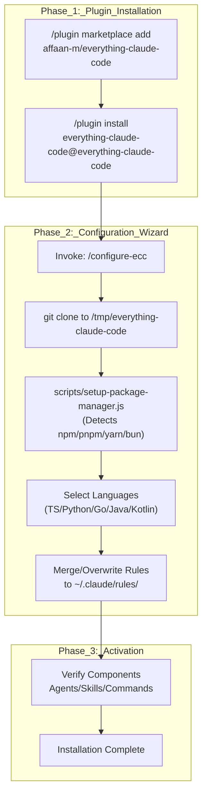

**Essential Commands:**

```bash
# 1. Add the marketplace source
/plugin marketplace add https://github.com/affaan-m/everything-claude-code [README.zh-CN.md:102]()

# 2. Install the plugin (using the canonical slug)
/plugin install everything-claude-code@everything-claude-code [README.zh-CN.md:105]()

# 3. Run the configuration wizard
/configure-ecc [skills/configure-ecc/SKILL.md:13]()
```

**Rules Installation (Mandatory Manual Step):**
Claude Code plugins cannot automatically distribute files to the `~/.claude/rules/` directory due to platform limitations. You must manually install the language-specific rules [README.zh-CN.md:112-114]().

```bash
# Clone the repository to access rule files
git clone https://github.com/affaan-m/everything-claude-code.git [README.zh-CN.md:119-120]()

# Use the install script for your platform
./install.sh --profile full  # macOS/Linux [README.zh-CN.md:132]()
.\install.ps1 --profile full # Windows [README.zh-CN.md:144]()
```

**Sources:** [README.md:85-104](), [README.zh-CN.md:96-148](), [skills/configure-ecc/SKILL.md:1-230](), [WORKING-CONTEXT.md:14]()

### Option 2: Selective Install System (v1.9.0+)

The manifest-driven install pipeline allows for targeted component installation using profiles like `core`, `developer`, or `full` [README.md:101-102](). It uses `manifests/install-modules.json` to define the dependencies and paths for 48 agents and 182 skills [README.md:92-93]().

**Profile Selection:**

| Profile | Purpose | Included Modules |
|---------|---------|------------------|
| `core` | Minimal baseline | `rules-core`, `agents-core`, `commands-core`, `hooks-runtime` [manifests/install-modules.json:4-81]() |
| `developer` | Standard engineering | `core` + `framework-language`, `database`, `workflow-quality` [manifests/install-modules.json:111-234]() |
| `full` | Complete suite | All classified modules including `security`, `research`, `media` [manifests/install-modules.json:236-256]() |

**Execution:**
The `install.sh` (macOS/Linux) and `install.ps1` (Windows) wrappers delegate to the Node-based installer runtime [README.zh-CN.md:132-145]().

```bash
# Install specific language rules targeting Cursor
./install.sh --target cursor typescript [README.zh-CN.md:130]()

# Perform a dry-run to see planned operations
./install.sh --dry-run --profile full [README.md:97]()
```

**Sources:** [manifests/install-modules.json:1-256](), [README.md:95-104](), [README.zh-CN.md:116-148]()

---

## Installation Verification

Verify that the ECC components are correctly recognized by your harness.

**Verification Checklist:**

| Check | Command | Expected Result |
|-------|---------|-----------------|
| **Plugin Status** | `/plugin list` | `everything-claude-code@everything-claude-code` is enabled [README.zh-CN.md:160]() |
| **Commands** | Type `/everything-claude-code:` | Autocomplete shows `/everything-claude-code:plan`, etc. [README.zh-CN.md:154]() |
| **Agents** | `/everything-claude-code:plan "test"` | Response identifies as `planner` agent [AGENTS.md:19]() |
| **PM Detection** | `/setup-pm` | Shows detected package manager (npm/pnpm/yarn/bun) [README.zh-CN.md:185-194]() |
| **Rules** | `ls ~/.claude/rules` | Directory contains `common/` and language folders [README.zh-CN.md:127-130]() |

**Component to Code Mapping:**

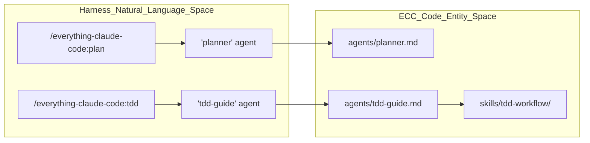

**Sources:** [README.zh-CN.md:154-167](), [AGENTS.md:15-45](), [manifests/install-modules.json:23-42]()

---

## First Commands to Try

ECC treats `skills/` as the canonical workflow surface [WORKING-CONTEXT.md:121](). Use these commands to trigger optimized agent behaviors.

### 1. Feature Planning (`/plan`)
Invokes the **planner** agent [AGENTS.md:19](). This agent creates detailed implementation plans, identifying dependencies and breaking tasks into phases [AGENTS.md:109]().

```bash
/everything-claude-code:plan "Add user authentication to the API"
```

### 2. Test-Driven Development (`/tdd`)
Invokes the **tdd-guide** agent [AGENTS.md:21](). It follows the mandatory RED-GREEN-REFACTOR cycle [AGENTS.md:100-103]().

```bash
/everything-claude-code:tdd "Implement the login controller"
```

### 3. Code Review (`/code-review`)
Invokes the **code-reviewer** agent [AGENTS.md:22](). It checks for code quality, maintainability, and adheres to the **Immutability (CRITICAL)** principle [AGENTS.md:77]().

```bash
/everything-claude-code:code-review
```

### 4. Security Scanning (`/security-scan`)
Invokes the **security-reviewer** agent [AGENTS.md:23](). It checks for hardcoded secrets, SQL injection, and XSS vulnerabilities before any commit [AGENTS.md:61-73]().

```bash
/everything-claude-code:security-scan
```

**Sources:** [AGENTS.md:15-118](), [README.zh-CN.md:154-163](), [manifests/install-modules.json:198-219]()

---

## Configuration Basics

### Package Manager Detection
The system uses a priority cascade to detect your preferred tool [README.zh-CN.md:187-194]():
1.  **Env Var:** `CLAUDE_PACKAGE_MANAGER` [README.zh-CN.md:189]()
2.  **Project Config:** `.claude/package-manager.json` [README.zh-CN.md:190]()
3.  **package.json:** `packageManager` field [README.zh-CN.md:191]()
4.  **Lock Files:** Detection from `package-lock.json`, `yarn.lock`, etc. [README.zh-CN.md:192]()
5.  **Global Config:** `~/.claude/package-manager.json` [README.zh-CN.md:193]()

### Hook Runtime Control
You can adjust hook behavior using environment variables [docs/zh-CN/README.md:109]():
*   **ECC_HOOK_PROFILE**: Set to `minimal`, `standard`, or `strict` [docs/zh-CN/README.md:109]().
*   **ECC_DISABLED_HOOKS**: A comma-separated list of hook IDs to skip [docs/zh-CN/README.md:109]().

### ECC 2.0 (Alpha)
The next-generation Rust control plane is available in the `ecc2/` directory [README.md:96](). It provides a TUI dashboard and advanced session management [README.md:96]().

```bash
# Build and run the alpha dashboard (requires Rust)
cd ecc2
cargo run -- dashboard
```

**Sources:** [README.md:96](), [README.zh-CN.md:185-210](), [docs/zh-CN/README.md:105-113]()

---

# Page: Core Concepts

# Core Concepts

<details>
<summary>Relevant source files</summary>

The following files were used as context for generating this wiki page:

- [.agents/plugins/marketplace.json](.agents/plugins/marketplace.json)
- [.claude-plugin/PLUGIN_SCHEMA_NOTES.md](.claude-plugin/PLUGIN_SCHEMA_NOTES.md)
- [.claude-plugin/README.md](.claude-plugin/README.md)
- [.claude-plugin/marketplace.json](.claude-plugin/marketplace.json)
- [.claude-plugin/plugin.json](.claude-plugin/plugin.json)
- [.codex-plugin/README.md](.codex-plugin/README.md)
- [.codex-plugin/plugin.json](.codex-plugin/plugin.json)
- [.mcp.json](.mcp.json)
- [AGENTS.md](AGENTS.md)
- [README.md](README.md)
- [README.zh-CN.md](README.zh-CN.md)
- [WORKING-CONTEXT.md](WORKING-CONTEXT.md)
- [agent.yaml](agent.yaml)
- [commands/auto-update.md](commands/auto-update.md)
- [commands/jira.md](commands/jira.md)
- [docs/zh-CN/AGENTS.md](docs/zh-CN/AGENTS.md)
- [docs/zh-CN/README.md](docs/zh-CN/README.md)
- [manifests/install-modules.json](manifests/install-modules.json)
- [schemas/package-manager.schema.json](schemas/package-manager.schema.json)
- [schemas/plugin.schema.json](schemas/plugin.schema.json)
- [scripts/auto-update.js](scripts/auto-update.js)
- [skills/jira-integration/SKILL.md](skills/jira-integration/SKILL.md)
- [tests/ci/agent-yaml-surface.test.js](tests/ci/agent-yaml-surface.test.js)
- [tests/plugin-manifest.test.js](tests/plugin-manifest.test.js)
- [tests/scripts/auto-update.test.js](tests/scripts/auto-update.test.js)

</details>


This document introduces the fundamental architecture of Everything Claude Code (ECC). It provides a high-level overview of how agents, skills, commands, rules, hooks, and MCPs work together to create a multi-layered development workflow system optimized for AI agent harnesses like Claude Code, Cursor, and OpenCode.

For detailed information about specific component types, see the following child pages:
- [Plugin Architecture](#3.1) — Plugin structure and marketplace distribution.
- [Agents](#3.2) — Specialized subagents and task delegation.
- [Skills](#3.3) — Workflow definitions and domain knowledge.
- [Commands](#3.4) — Slash commands for quick execution.
- [Rules](#3.5) — Hierarchical guidelines and constraints.
- [Hooks](#3.6) — Event-driven automation and lifecycle phases.
- [MCPs (Model Context Protocol)](#3.7) — External service integrations.

---

## Component Types

ECC organizes its capabilities into seven primary component types, each serving a distinct role in the development lifecycle. As of version 2.0.0-rc.1, the catalog truth includes 48 agents, 182 skills, and 68 legacy command shims. [README.md:92-93](), [WORKING-CONTEXT.md:12-13]()

| Component | Location | Purpose | Invocation Method |
|-----------|----------|---------|-------------------|
| **Agents** | `agents/*.md` | Specialized subagents with specific tool permissions for delegated tasks | Via command delegation or direct invocation |
| **Skills** | `skills/*/` | Reusable workflow definitions and domain knowledge | Auto-loaded by context or referenced by agents |
| **Commands** | `commands/*.md` | Slash commands for quick workflow execution | User types `/command-name` |
| **Rules** | `rules/` | Always-follow guidelines (Common + Language-specific) | Auto-loaded in every session |
| **Hooks** | `hooks/` | Event-driven scripts triggered by tool use or lifecycle events | Automatic on event triggers |
| **MCPs** | `mcp-configs/` | External service integrations (GitHub, Postgres, etc.) | Tool calls from the LLM |
| **Instincts** | `instincts/` | Project-scoped patterns learned from session observations | Auto-loaded for project context |

**Sources:** [README.md:92-93](), [WORKING-CONTEXT.md:13](), [AGENTS.md:15-45](), [.claude-plugin/plugin.json:25-27](), [manifests/install-modules.json:3-226]()

---

## The Layered Architecture

ECC operates across four distinct layers, bridging high-level user intent to low-level system execution and continuous improvement.

### Architectural Flow Diagram
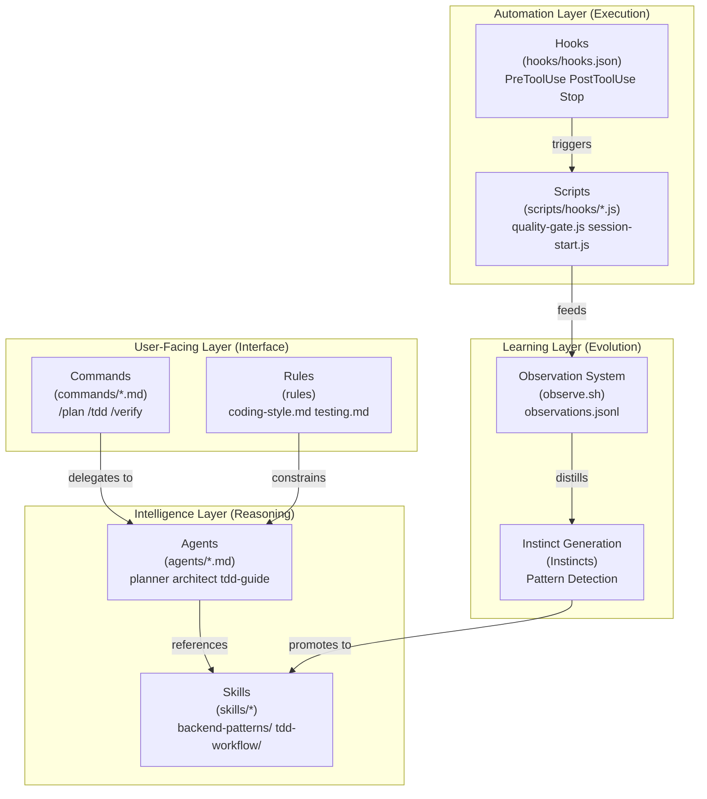

**Sources:** [README.md:74-80](), [AGENTS.md:48-57](), [manifests/install-modules.json:198-219](), [WORKING-CONTEXT.md:38-44]()

---

## Component Discovery and Loading

The system identifies components through a combination of explicit manifests and directory conventions. The selective install architecture uses `install-plan.js` and `install-apply.js` to manage these components via a SQLite state store. [README.md:101-104]()

### Mapping Natural Language to Code Entities
The following diagram illustrates how user-facing concepts map to specific code entities and file paths within the ECC structure.

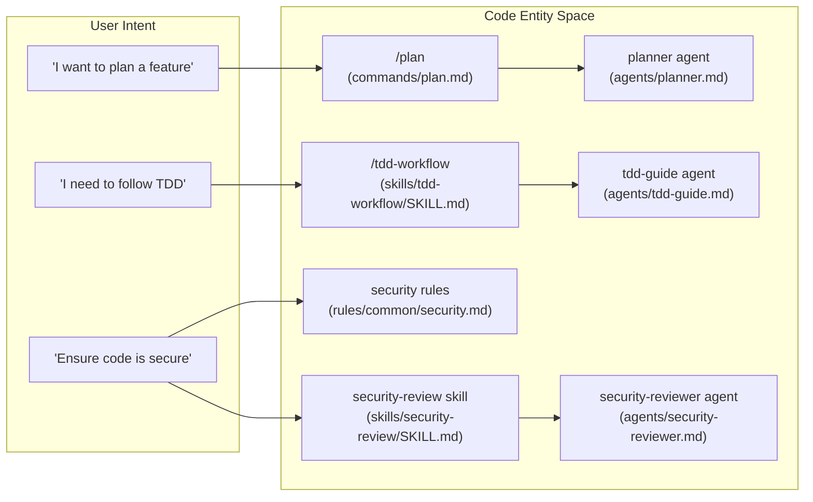

**Sources:** [AGENTS.md:17-44](), [manifests/install-modules.json:236-254](), [.claude-plugin/plugin.json:2-28](), [agent.yaml:145-213]()

---

## Hook Lifecycle and Data Flow

Hooks are the "glue" of the system, intercepting tool inputs and outputs to enforce quality and persist state. Claude Code v2.1+ automatically loads `hooks/hooks.json` by convention. [.claude-plugin/PLUGIN_SCHEMA_NOTES.md:103-110]()

### Tool Execution Sequence
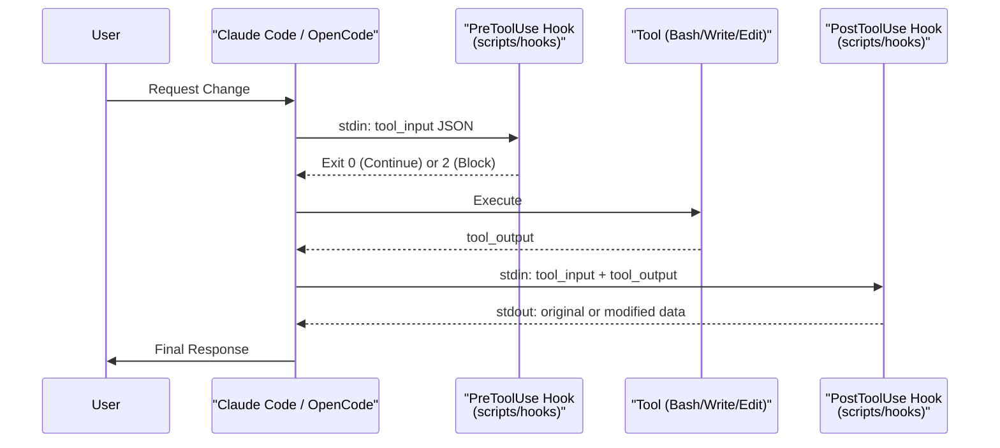

**Sources:** [manifests/install-modules.json:63-81](), [.claude-plugin/PLUGIN_SCHEMA_NOTES.md:103-121]()

---

## File Organization and Priority

ECC follows a strict directory convention that allows for project-specific overrides and selective installation of modules.

### Directory Structure
- `agents/`: Specialized subagents (48 available). [README.md:92](), [WORKING-CONTEXT.md:13]()
- `skills/`: Workflow definitions and domain knowledge (182 available). [README.md:92](), [WORKING-CONTEXT.md:13]()
- `commands/`: Slash-command library and shims (68 available). [README.md:92](), [WORKING-CONTEXT.md:13]()
- `hooks/`: Trigger-based automations and configurations. [manifests/install-modules.json:63-81]()
- `rules/`: Always-follow guidelines (Common + 12 language ecosystems). [README.md:101-102]()
- `scripts/`: Cross-platform Node.js utilities for installation and runtime. [manifests/install-modules.json:68-69]()

### Configuration Priority
ECC resolves settings and package managers in a specific order:
1. **Environment Variables**: `CLAUDE_PACKAGE_MANAGER`. [README.zh-CN.md:189]()
2. **Project Configuration**: `.claude/package-manager.json`. [README.zh-CN.md:190]()
3. **Local Manifests**: `package.json` fields or lock files. [README.zh-CN.md:191-192]()
4. **Global Configuration**: `~/.claude/package-manager.json`. [README.zh-CN.md:193]()

**Sources:** [README.md:92-104](), [AGENTS.md:146-157](), [manifests/install-modules.json:3-226]()

---

## Summary of Interactions

The power of ECC lies in the interaction between these components:
- **Commands** trigger **Agents** or **Skills**.
- **Agents** follow **Rules** and delegate to other agents for specialized tasks (e.g., `planner` delegating to `architect`). [AGENTS.md:48-55]()
- **Hooks** monitor **Tools** used by Agents to enforce quality gates and safety. [.claude-plugin/PLUGIN_SCHEMA_NOTES.md:103-110]()
- **Continuous Learning** (v2) extracts **Instincts** from session observations, which are then promoted to **Skills**. [WORKING-CONTEXT.md:38-44]()

For detailed implementation details, proceed to the child pages: [Plugin Architecture](#3.1), [Agents](#3.2), [Skills](#3.3), [Commands](#3.4), [Rules](#3.5), [Hooks](#3.6), and [MCPs (Model Context Protocol)](#3.7).

---

# Page: Plugin Architecture

# Plugin Architecture

<details>
<summary>Relevant source files</summary>

The following files were used as context for generating this wiki page:

- [.agents/plugins/marketplace.json](.agents/plugins/marketplace.json)
- [.claude-plugin/PLUGIN_SCHEMA_NOTES.md](.claude-plugin/PLUGIN_SCHEMA_NOTES.md)
- [.claude-plugin/README.md](.claude-plugin/README.md)
- [.claude-plugin/marketplace.json](.claude-plugin/marketplace.json)
- [.claude-plugin/plugin.json](.claude-plugin/plugin.json)
- [.codex-plugin/README.md](.codex-plugin/README.md)
- [.codex-plugin/plugin.json](.codex-plugin/plugin.json)
- [.mcp.json](.mcp.json)
- [AGENTS.md](AGENTS.md)
- [README.md](README.md)
- [README.zh-CN.md](README.zh-CN.md)
- [WORKING-CONTEXT.md](WORKING-CONTEXT.md)
- [agent.yaml](agent.yaml)
- [commands/auto-update.md](commands/auto-update.md)
- [commands/jira.md](commands/jira.md)
- [docs/zh-CN/AGENTS.md](docs/zh-CN/AGENTS.md)
- [docs/zh-CN/README.md](docs/zh-CN/README.md)
- [manifests/install-modules.json](manifests/install-modules.json)
- [schemas/package-manager.schema.json](schemas/package-manager.schema.json)
- [schemas/plugin.schema.json](schemas/plugin.schema.json)
- [scripts/auto-update.js](scripts/auto-update.js)
- [skills/jira-integration/SKILL.md](skills/jira-integration/SKILL.md)
- [tests/ci/agent-yaml-surface.test.js](tests/ci/agent-yaml-surface.test.js)
- [tests/plugin-manifest.test.js](tests/plugin-manifest.test.js)
- [tests/scripts/auto-update.test.js](tests/scripts/auto-update.test.js)

</details>


## Overview

Everything Claude Code (ECC) is a production-ready AI agent performance optimization system distributed as a multi-platform plugin. It provides a structured package of components including 48 specialized agents, 182 skills, and 68 legacy command shims evolved through continuous real-world use [.claude-plugin/plugin.json:1-4](). The architecture enables distribution via the Claude Code marketplace, Codex, OpenCode, and manual integration, ensuring high-level performance across diverse engineering workflows [.claude-plugin/marketplace.json:10-15]().

This page details the plugin's structural organization, manifest specifications, and the component-based distribution model.

Sources: [.claude-plugin/plugin.json:1-28](), [.claude-plugin/marketplace.json:1-47](), [WORKING-CONTEXT.md:12-14]()

## Plugin Directory Structure

The ECC repository is organized into directories that map to specific component types, supported by specialized manifests for different AI harnesses.

```text
everything-claude-code/
├── .claude-plugin/          # Claude Code plugin metadata
│   ├── plugin.json          # Main manifest (skills, commands)
│   ├── marketplace.json     # Marketplace catalog entry
│   └── PLUGIN_SCHEMA_NOTES.md # Enforced validator constraints
├── .codex-plugin/           # Codex native plugin metadata
│   └── plugin.json          # Codex manifest (skills, MCP ref)
├── .opencode/               # OpenCode specific integration
├── agents/                  # Specialized subagents (Markdown)
├── skills/                  # Domain workflows (SKILL.md format)
├── commands/                # Slash command shims (Markdown)
├── rules/                   # Guidelines (Manual/Selective install)
├── hooks/                   # Event-driven automation logic
└── .mcp.json                # Model Context Protocol server configs
```

Sources: [.claude-plugin/plugin.json:25-27](), [.claude-plugin/marketplace.json:1-47](), [AGENTS.md:147-157](), [.claude-plugin/PLUGIN_SCHEMA_NOTES.md:1-216]()

## Plugin Manifests

ECC maintains multiple manifests to ensure strict compatibility across different AI execution environments.

### Claude Code Manifest (`plugin.json`)

The manifest at `.claude-plugin/plugin.json` is the entry point for the Claude Code CLI. Unlike previous versions, it strictly avoids an explicit `agents` or `hooks` field to prevent validation errors and duplicate loading, as modern versions of Claude Code (v2.1+) discover these by convention [.claude-plugin/PLUGIN_SCHEMA_NOTES.md:58-74](), [.claude-plugin/PLUGIN_SCHEMA_NOTES.md:98-131]().

**Title: Claude Plugin Component Resolution**
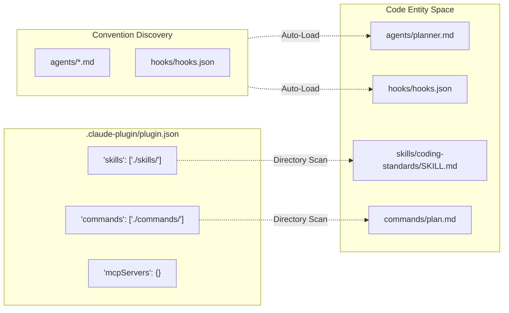

The manifest follows a strict schema where `commands` and `skills` must be arrays [.claude-plugin/PLUGIN_SCHEMA_NOTES.md:44-56](). It also includes an explicit empty `mcpServers` object to prevent the overlong tool name error that occurs when Claude auto-discovers root `.mcp.json` files during plugin installation [.claude-plugin/PLUGIN_SCHEMA_NOTES.md:136-153]().

Sources: [.claude-plugin/plugin.json:1-28](), [.claude-plugin/PLUGIN_SCHEMA_NOTES.md:1-216](), [tests/plugin-manifest.test.js:1-180]()

## Marketplace Distribution

The plugin is distributed via a self-hosted marketplace configuration in `.claude-plugin/marketplace.json`. This allows users to add the repository as a source, providing access to the full catalog of 48 agents and 182 skills [.claude-plugin/marketplace.json:10-15]().

**Title: Marketplace Installation Data Flow**
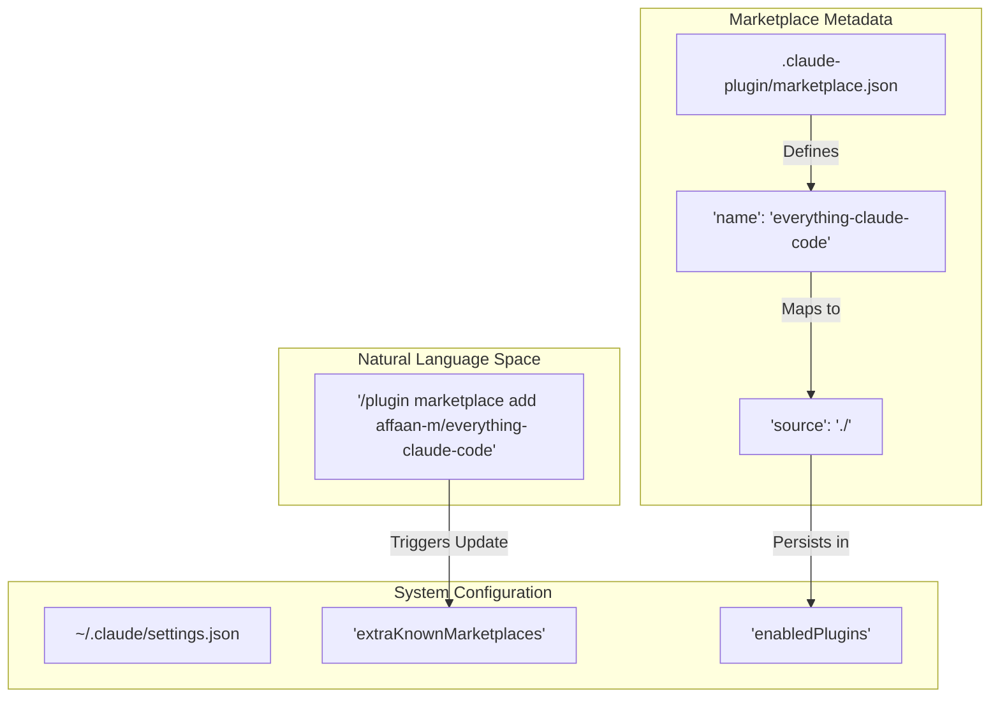

Sources: [.claude-plugin/marketplace.json:1-47](), [README.zh-CN.md:100-106]()

## Component Organization

### Specialized Agents
Agents are defined as Markdown files in the `agents/` directory. While not explicitly listed in the `plugin.json` manifest to avoid validator rejection, they are authoritative in the repository and exported to `agent.yaml` for broader ecosystem compatibility [agent.yaml:1-11](). The system provides 48 agents including `planner`, `architect`, `tdd-guide`, and various language-specific reviewers [AGENTS.md:15-45]().

### Skills & Workflows
Skills are stored in the `skills/` directory, with each skill containing a `SKILL.md` file. The system includes 182 skills, categorized into modules such as `rules-core`, `framework-language`, and `workflow-quality` [manifests/install-modules.json:1-234]().

* **Workflow Quality**: Includes `continuous-learning-v2`, `tdd-workflow`, and `verification-loop` [manifests/install-modules.json:201-218]().
* **Security**: Includes `security-scan`, `defi-amm-security`, and `hipaa-compliance` [manifests/install-modules.json:236-253]().

### Legacy Command Shims
The `commands/` directory contains 68 slash-command shims (e.g., `/plan`, `/review-pr`) that provide a compatibility layer for users accustomed to legacy CLI patterns [AGENTS.md:145-213]().

Sources: [AGENTS.md:1-166](), [agent.yaml:1-222](), [manifests/install-modules.json:1-260](), [.claude-plugin/plugin.json:26-27]()

---

# Page: Agents

# Agents

<details>
<summary>Relevant source files</summary>

The following files were used as context for generating this wiki page:

- [AGENTS.md](AGENTS.md)
- [README.md](README.md)
- [README.zh-CN.md](README.zh-CN.md)
- [WORKING-CONTEXT.md](WORKING-CONTEXT.md)
- [agent.yaml](agent.yaml)
- [agents/architect.md](agents/architect.md)
- [agents/build-error-resolver.md](agents/build-error-resolver.md)
- [agents/code-reviewer.md](agents/code-reviewer.md)
- [agents/database-reviewer.md](agents/database-reviewer.md)
- [agents/doc-updater.md](agents/doc-updater.md)
- [agents/e2e-runner.md](agents/e2e-runner.md)
- [agents/planner.md](agents/planner.md)
- [agents/python-reviewer.md](agents/python-reviewer.md)
- [agents/security-reviewer.md](agents/security-reviewer.md)
- [commands/auto-update.md](commands/auto-update.md)
- [commands/jira.md](commands/jira.md)
- [docs/zh-CN/AGENTS.md](docs/zh-CN/AGENTS.md)
- [docs/zh-CN/README.md](docs/zh-CN/README.md)
- [examples/django-api-CLAUDE.md](examples/django-api-CLAUDE.md)
- [examples/saas-nextjs-CLAUDE.md](examples/saas-nextjs-CLAUDE.md)
- [manifests/install-modules.json](manifests/install-modules.json)
- [scripts/auto-update.js](scripts/auto-update.js)
- [scripts/setup-package-manager.js](scripts/setup-package-manager.js)
- [skills/cpp-testing/SKILL.md](skills/cpp-testing/SKILL.md)
- [skills/e2e-testing/SKILL.md](skills/e2e-testing/SKILL.md)
- [skills/jira-integration/SKILL.md](skills/jira-integration/SKILL.md)
- [skills/postgres-patterns/SKILL.md](skills/postgres-patterns/SKILL.md)
- [tests/ci/agent-yaml-surface.test.js](tests/ci/agent-yaml-surface.test.js)
- [tests/scripts/auto-update.test.js](tests/scripts/auto-update.test.js)

</details>


**Purpose:** This page defines what agents are in the Everything Claude Code (ECC) system, their YAML structure, model and tool configurations, delegation patterns, and orchestration strategies. Agents are the primary specialized actors that execute domain-specific tasks within the ECC ecosystem.

---

## What Are Agents?

Agents are **specialized subprocesses** that handle delegated tasks with limited scope. The main Claude Code instance (the "orchestrator") delegates specific responsibilities to agents, each configured with restricted tool permissions, specific models, and focused instructions. This "Agent-First" principle [AGENTS.md:9-9]() ensures that domain tasks are handled by specialized logic rather than a generic prompt.

ECC provides a catalog of **47 specialized agents** [WORKING-CONTEXT.md:13-13]() (up to 48 in recent manifests [AGENTS.md:3-3]()) designed for production-ready AI coding workflows.

**Key characteristics:**

- **Focused scope** — Each agent handles one type of task (planning, code review, security analysis, etc.) [AGENTS.md:17-44]().
- **Separate context** — Agents run in isolated processes with their own context windows to prevent "author bias" during reviews.
- **Tool restrictions** — Agents have explicit `tools` permissions defined in their frontmatter [agents/database-reviewer.md:4-4]().
- **Model routing** — Different agents use different models (Haiku/Sonnet/Opus) based on task complexity [agents/database-reviewer.md:5-5]().
- **Stateless execution** — Agents receive input, perform work, return output, then exit.

**Diagram: Agent Role in ECC Architecture**

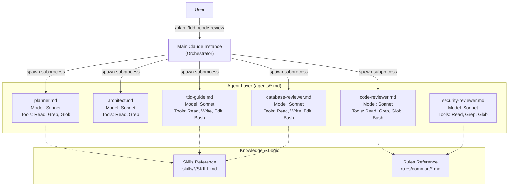
Sources: [AGENTS.md:1-58](), [agents/database-reviewer.md:1-6](), [manifests/install-modules.json:23-43](), [WORKING-CONTEXT.md:13-13]()

---

## Agent File Structure

Agents are Markdown files with YAML frontmatter stored in the `agents/` directory [manifests/install-modules.json:27-28]().

**Diagram: Agent File Anatomy**

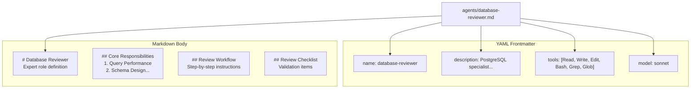

**Frontmatter fields:**

| Field | Type | Required | Purpose |
|-------|------|----------|---------|
| `name` | string | Yes | Unique identifier (kebab-case) [agents/database-reviewer.md:2-2]() |
| `description` | string | Yes | Single-line summary shown in agent lists [agents/database-reviewer.md:3-3]() |
| `tools` | string[] | Yes | Allowed tool names (Read, Write, Edit, Bash, Grep, Glob) [agents/database-reviewer.md:4-4]() |
| `model` | string | No | Preferred model (haiku, sonnet) [agents/database-reviewer.md:5-5]() |

Sources: [agents/database-reviewer.md:1-6](), [agents/doc-updater.md:1-6](), [agents/e2e-runner.md:1-6](), [agent.yaml:1-10]()

---

## Model Configuration

ECC routes tasks to specific models based on the reasoning depth required for the agent's role. The global `agent.yaml` prefers `claude-opus-4-6` with `claude-sonnet-4-6` as a fallback [agent.yaml:7-10]().

| Model | Use Case | Agents |
|-------|-----------|----------|
| **haiku** | Fast exploration, simple updates, documentation syncing, and pattern detection. | `doc-updater` [agents/doc-updater.md:5-5](), `observer` [README.md:102-102]() |
| **sonnet** | Standard coding, complex logic, multi-file reviews, and database optimization. | `database-reviewer` [agents/database-reviewer.md:5-5](), `e2e-runner` [agents/e2e-runner.md:5-5](), `tdd-guide` [AGENTS.md:21-21]() |
| **opus** | High-sensitivity architectural decisions and complex remediation. | `architect` [AGENTS.md:20-20](), `plankton` (subprocess routing) [README.md:118-118]() |

**Context Window Strategy:**
Agents are instructed to avoid the last 20% of the context window for large refactorings to maintain performance and reliability [AGENTS.md:141-141]().

Sources: [AGENTS.md:140-142](), [agents/doc-updater.md:5-5](), [agents/database-reviewer.md:5-5](), [agent.yaml:7-10]()

---

## Tool Permissions

Agents declare allowed tools to create security boundaries. This prevents a "Reviewer" agent from accidentally modifying code, maintaining the integrity of the review process.

**Common Tool Sets:**

- **Read-Only/Analysis:** `["Read", "Grep", "Glob"]` (e.g., initial planning or documentation lookup).
- **Review & Verification:** `["Read", "Bash", "Grep", "Glob"]` (e.g., `code-reviewer` uses `Bash` to run tests but not `Edit` to change code).
- **Implementation:** `["Read", "Write", "Edit", "Bash", "Grep", "Glob"]` (e.g., `database-reviewer` [agents/database-reviewer.md:4-4](), `e2e-runner` [agents/e2e-runner.md:4-4]()).

Sources: [agents/database-reviewer.md:4-4](), [agents/e2e-runner.md:4-4](), [agents/doc-updater.md:4-4]()

---

## Agent Orchestration & Delegation

The ECC system uses an **Agent-First** approach where the orchestrator delegates tasks proactively without waiting for user prompts [AGENTS.md:48-48]().

### Proactive Invocation Patterns
- **Complex feature requests** → `planner` [AGENTS.md:49-49]()
- **Code just written/modified** → `code-reviewer` [AGENTS.md:50-50]()
- **Bug fix or new feature** → `tdd-guide` [AGENTS.md:51-51]()
- **Architectural decision** → `architect` [AGENTS.md:52-52]()
- **Security-sensitive code** → `security-reviewer` [AGENTS.md:53-53]()
- **Autonomous loops** → `loop-operator` [AGENTS.md:54-54]()

### Parallel Execution
ECC emphasizes **parallel execution** for independent operations. Instead of waiting for one agent to finish, multiple agents (e.g., a security reviewer and a performance reviewer) can be launched simultaneously [AGENTS.md:57-57]().

**Diagram: Sequential vs. Parallel Delegation**

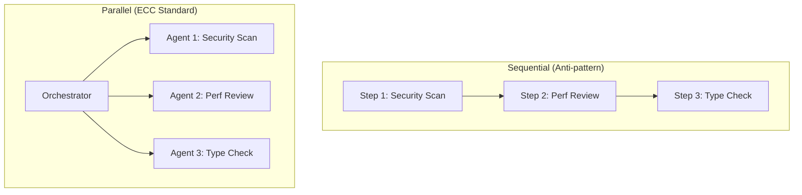
Sources: [AGENTS.md:46-57](), [README.md:78-78]()

---

## Available Agents Reference

ECC includes 48 specialized agents [AGENTS.md:3-3](). Below are key agents and their specific roles.

| Agent | Purpose | When to Use |
|-------|---------|-------------|
| `planner` | Implementation planning for complex features [AGENTS.md:19-19]() | Complex features, refactoring |
| `tdd-guide` | Enforces RED → GREEN → REFACTOR loop [AGENTS.md:21-21]() | New features, bug fixes |
| `database-reviewer` | PostgreSQL query optimization and schema design [agents/database-reviewer.md:14-18]() | Writing SQL, creating migrations |
| `e2e-runner` | End-to-end Playwright testing [agents/e2e-runner.md:14-19]() | Critical user flows |
| `doc-updater` | Documentation and codemaps maintenance [agents/doc-updater.md:14-18]() | Updating docs |
| `build-error-resolver` | Analyzes and fixes build/type errors [AGENTS.md:24-24]() | When build fails |
| `security-reviewer` | Vulnerability detection (SQLi, XSS, CSRF) [AGENTS.md:23-23]() | Before commits, sensitive code |
| `loop-operator` | Autonomous loop execution and monitoring [AGENTS.md:39-39]() | Safe loop running, intervention |
| `harness-optimizer` | Tuning harness configuration for cost/reliability [AGENTS.md:40-40]() | Performance/cost tuning |
| `typescript-reviewer` | Specialized TypeScript/JS code review [AGENTS.md:44-44]() | TS/JS projects |
| `pytorch-build-resolver` | Fixes PyTorch/CUDA/training errors [AGENTS.md:43-43]() | ML/PyTorch projects |

Sources: [AGENTS.md:15-45](), [agents/database-reviewer.md:1-20](), [agents/e2e-runner.md:1-20](), [agents/doc-updater.md:1-20](), [WORKING-CONTEXT.md:13-13]()

---

## Development Workflow with Agents

The standard ECC workflow integrates agents at every phase of the lifecycle [AGENTS.md:108-118]():

1. **Plan:** Use `planner` to identify dependencies and risks, breaking the task into phases [AGENTS.md:109-109]().
2. **TDD:** Use `tdd-guide` to write tests first (RED), implement (GREEN), and refactor (IMPROVE) [AGENTS.md:110-110]().
3. **Review:** Use `code-reviewer` immediately after modification to address issues [AGENTS.md:111-111]().
4. **Capture:** Store knowledge in project docs or auto-memory [AGENTS.md:112-116]().
5. **Commit:** Use conventional commits and draft comprehensive PR summaries [AGENTS.md:117-117]().

**Success Metrics for Agents:**
- All tests pass with **80%+ coverage** [AGENTS.md:93-93]().
- No security vulnerabilities (no hardcoded secrets, validated inputs) [AGENTS.md:61-69]().
- Code quality checklist met (small functions <50 lines, focused files <800 lines) [AGENTS.md:85-90]().

Sources: [AGENTS.md:61-118](), [AGENTS.md:159-166]()

---

# Page: Skills

# Skills

<details>
<summary>Relevant source files</summary>

The following files were used as context for generating this wiki page:

- [CONTRIBUTING.md](CONTRIBUTING.md)
- [agents/docs-lookup.md](agents/docs-lookup.md)
- [docs/SKILL-DEVELOPMENT-GUIDE.md](docs/SKILL-DEVELOPMENT-GUIDE.md)
- [docs/examples/project-guidelines-template.md](docs/examples/project-guidelines-template.md)
- [docs/skill-adaptation-policy.md](docs/skill-adaptation-policy.md)
- [examples/user-CLAUDE.md](examples/user-CLAUDE.md)
- [rules/common/code-review.md](rules/common/code-review.md)
- [rules/common/development-workflow.md](rules/common/development-workflow.md)
- [skills/backend-patterns/SKILL.md](skills/backend-patterns/SKILL.md)
- [skills/clickhouse-io/SKILL.md](skills/clickhouse-io/SKILL.md)
- [skills/coding-standards/SKILL.md](skills/coding-standards/SKILL.md)
- [skills/continuous-learning/SKILL.md](skills/continuous-learning/SKILL.md)
- [skills/django-verification/SKILL.md](skills/django-verification/SKILL.md)
- [skills/eval-harness/SKILL.md](skills/eval-harness/SKILL.md)
- [skills/frontend-patterns/SKILL.md](skills/frontend-patterns/SKILL.md)
- [skills/iterative-retrieval/SKILL.md](skills/iterative-retrieval/SKILL.md)
- [skills/search-first/SKILL.md](skills/search-first/SKILL.md)

</details>


This page defines skills as workflow definitions in the Everything Claude Code (ECC) system, their markdown structure with YAML frontmatter, and how agents and commands invoke them. For quick-execution prompts, see [Commands](3.4). For always-follow guidelines, see [Rules](3.5). For how agents delegate to skills, see [Agents](3.2).

---

## Overview

Skills are **knowledge modules** that Claude Code loads based on context [docs/SKILL-DEVELOPMENT-GUIDE.md:20-22](). They provide:
*   **Domain expertise**: Framework patterns, language idioms, and best practices [docs/SKILL-DEVELOPMENT-GUIDE.md:24-24]().
*   **Workflow definitions**: Step-by-step processes for common tasks (e.g., TDD, research) [docs/SKILL-DEVELOPMENT-GUIDE.md:25-25]().
*   **Reference material**: Code snippets, checklists, and decision trees [docs/SKILL-DEVELOPMENT-GUIDE.md:26-26]().

Unlike **agents** (specialized sub-assistants) which are explicitly delegated to via the `Task` tool, or **commands** which are user-invoked, skills are passive knowledge that Claude references automatically when relevant context is detected [docs/SKILL-DEVELOPMENT-GUIDE.md:29-37]().

**Sources:** [docs/SKILL-DEVELOPMENT-GUIDE.md:20-37](), [CONTRIBUTING.md:74-76]()

---

## File Structure and Format

### Skill File Anatomy

Every skill is contained within its own directory and defined by a mandatory `SKILL.md` file [docs/SKILL-DEVELOPMENT-GUIDE.md:53-58]().

```markdown
---
name: skill-name
description: Brief description for auto-activation
origin: ECC
version: 1.0.0
---

# Skill Title

## When to Activate
Describe scenarios where Claude should use this skill. Critical for auto-activation.

## Core Concepts
Explain key patterns and guidelines.

## Code Examples
Practical, copy-pasteable, and well-commented code.

## Anti-Patterns
Show what NOT to do with concrete examples.

## Best Practices
Actionable guidelines and common pitfalls.

## Related Skills
Link to complementary skills (e.g., `related-skill-1`).
```

**Sources:** [CONTRIBUTING.md:91-135](), [docs/SKILL-DEVELOPMENT-GUIDE.md:66-105]()

### Directory Organization

Skills are organized within the `skills/` directory [docs/SKILL-DEVELOPMENT-GUIDE.md:53-56](). Optional subdirectories like `examples/` or `references/` can be included for additional context [docs/SKILL-DEVELOPMENT-GUIDE.md:59-64]().

```
skills/
└── your-skill-name/
    ├── SKILL.md           # Required: Main skill definition
    ├── examples/          # Optional: Code examples
    └── references/        # Optional: External references
```

**Sources:** [docs/SKILL-DEVELOPMENT-GUIDE.md:53-64](), [CONTRIBUTING.md:83-90]()

---

## Frontmatter Schema

The YAML frontmatter is used by the ECC system to index and activate skills during sessions.

| Field | Required | Description | Example |
|-------|----------|-------------|---------|
| `name` | Yes | Lowercase, hyphenated identifier | `tdd-workflow` |
| `description` | Yes | One-line summary used for auto-activation | `Test-driven development process` |
| `origin` | No | Source identifier (ECC, community, etc.) | `ECC` |
| `version` | No | Skill version for tracking updates | `2.1.0` |

**Sources:** [docs/SKILL-DEVELOPMENT-GUIDE.md:107-115](), [skills/search-first/SKILL.md:1-5]()

---

## Skill Space to Code Entity Mapping

**Diagram: Skill Activation and Execution Flow**

This diagram maps the natural language intent to the specific code entities and files involved in skill resolution within the ECC architecture.

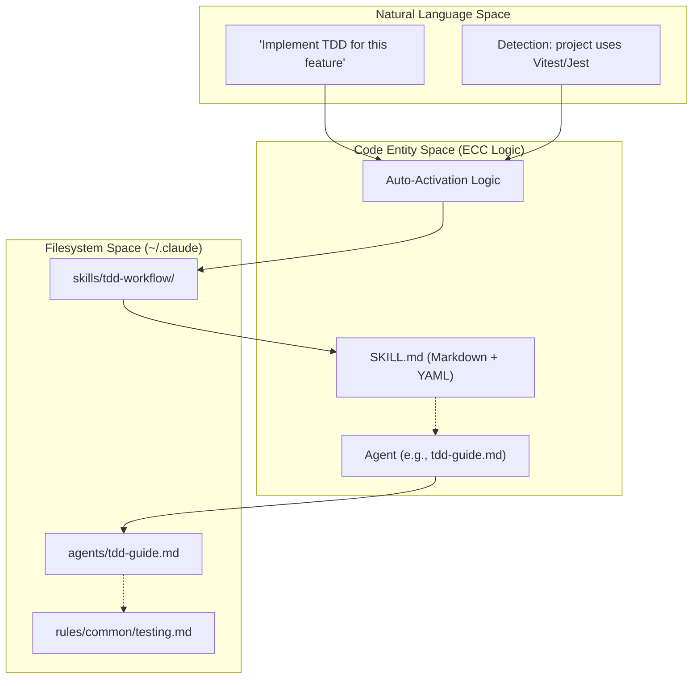

**Sources:** [docs/SKILL-DEVELOPMENT-GUIDE.md:31-48](), [CONTRIBUTING.md:184-202](), [examples/user-CLAUDE.md:25-58]()

---

## Skill Categories

Skills are categorized to maintain focus and actionability. Effective skills avoid being too broad to ensure the model retrieves high-density relevant information [docs/SKILL-DEVELOPMENT-GUIDE.md:121-131]().

| Category | Purpose | Examples |
|----------|---------|----------|
| **Language Standards** | Idioms and naming conventions | `python-patterns`, `typescript-standards` |
| **Framework Patterns** | Framework-specific conventions | `django-patterns`, `nextjs-patterns` |
| **Workflow** | Step-by-step development processes | `tdd-workflow`, `search-first` |
| **Domain Knowledge** | Specialized expertise | `security-review`, `api-design` |
| **Tool Integration** | Specific tool/library usage | `eval-harness`, `docker-patterns` |

**Sources:** [CONTRIBUTING.md:136-145](), [docs/SKILL-DEVELOPMENT-GUIDE.md:197-300]()

---

## Specialized Skill: Continuous Learning

A core feature of ECC is the ability to evolve session patterns into codified skills. This bridges the gap between raw session data and reusable knowledge through an automated pipeline.

**Diagram: Continuous Learning v1 Flow**

This diagram illustrates how the `evaluate-session.sh` script, triggered by the `Stop` hook, extracts patterns into the filesystem [skills/continuous-learning/SKILL.md:23-30]().

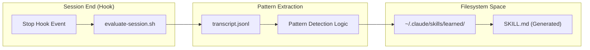

**Sources:** [skills/continuous-learning/SKILL.md:23-30, 66-82](), [docs/SKILL-DEVELOPMENT-GUIDE.md:46-46]()

### Key Learning Components
*   **Session Evaluation**: Checks if a session has sufficient length (default: 10+ messages) before attempting extraction [skills/continuous-learning/SKILL.md:27-27, 37-37]().
*   **Pattern Types**: Extracts specific categories like `error_resolution`, `workarounds`, and `project_specific` conventions [skills/continuous-learning/SKILL.md:56-64]().
*   **v1 vs v2**: v1 uses a `Stop` hook for batch extraction at session end, while v2 (instinct-based) uses `PreToolUse`/`PostToolUse` hooks for more granular observation [skills/continuous-learning/SKILL.md:21-21, 105-110]().

**Sources:** [skills/continuous-learning/SKILL.md:1-123]()

---

## Comparison: Skills vs. Other Components

| Component | Purpose | Activation |
|-----------|---------|------------|
| **Skill** | Knowledge repository | Context-based (automatic) |
| **Agent** | Task executor | Explicit delegation (`Task` tool) |
| **Command** | User action | User-invoked (`/command`) |
| **Rule** | Always-on guidelines | Always active (global/project) |
| **Hook** | Automation | Event-triggered |

**Sources:** [docs/SKILL-DEVELOPMENT-GUIDE.md:39-48](), [examples/user-CLAUDE.md:12-22]()

---

## References

*   **Skill Development Guide**: [docs/SKILL-DEVELOPMENT-GUIDE.md]()
*   **Search-First Workflow**: [skills/search-first/SKILL.md]()
*   **Coding Standards**: [skills/coding-standards/SKILL.md]()
*   **Eval Harness**: [skills/eval-harness/SKILL.md]()
*   **Continuous Learning**: [skills/continuous-learning/SKILL.md]()

**Sources:** [docs/SKILL-DEVELOPMENT-GUIDE.md:1-17](), [skills/search-first/SKILL.md:1-5](), [skills/coding-standards/SKILL.md:1-5]()

---

# Page: Commands

# Commands

<details>
<summary>Relevant source files</summary>

The following files were used as context for generating this wiki page:

- [AGENTS.md](AGENTS.md)
- [README.md](README.md)
- [README.zh-CN.md](README.zh-CN.md)
- [WORKING-CONTEXT.md](WORKING-CONTEXT.md)
- [agent.yaml](agent.yaml)
- [commands/auto-update.md](commands/auto-update.md)
- [commands/jira.md](commands/jira.md)
- [commands/plan.md](commands/plan.md)
- [commands/prp-commit.md](commands/prp-commit.md)
- [commands/prp-plan.md](commands/prp-plan.md)
- [commands/prp-pr.md](commands/prp-pr.md)
- [commands/prp-prd.md](commands/prp-prd.md)
- [commands/python-review.md](commands/python-review.md)
- [docs/SKILL-PLACEMENT-POLICY.md](docs/SKILL-PLACEMENT-POLICY.md)
- [docs/zh-CN/AGENTS.md](docs/zh-CN/AGENTS.md)
- [docs/zh-CN/README.md](docs/zh-CN/README.md)
- [manifests/install-modules.json](manifests/install-modules.json)
- [schemas/provenance.schema.json](schemas/provenance.schema.json)
- [scripts/auto-update.js](scripts/auto-update.js)
- [scripts/ci/validate-agents.js](scripts/ci/validate-agents.js)
- [scripts/ci/validate-commands.js](scripts/ci/validate-commands.js)
- [scripts/ci/validate-install-manifests.js](scripts/ci/validate-install-manifests.js)
- [scripts/ci/validate-skills.js](scripts/ci/validate-skills.js)
- [skills/hexagonal-architecture/SKILL.md](skills/hexagonal-architecture/SKILL.md)
- [skills/jira-integration/SKILL.md](skills/jira-integration/SKILL.md)
- [tests/ci/agent-yaml-surface.test.js](tests/ci/agent-yaml-surface.test.js)
- [tests/commands/plan-command.test.js](tests/commands/plan-command.test.js)
- [tests/scripts/auto-update.test.js](tests/scripts/auto-update.test.js)

</details>


Commands are slash-invoked prompts that provide quick access to common workflows. They serve as entry points to structured tasks, often delegating to specialized agents or invoking skill workflows.

For information about agents that commands delegate to, see **3.2 Agents**. For details on skill workflows that commands invoke, see **3.3 Skills**. For hook-based automation that runs alongside command execution, see **3.6 Hooks**.

---

## Purpose and Scope

Commands fulfill three primary roles in the ECC system:

1.  **Quick Execution Prompts** — Pre-written prompts for common tasks like `/plan` [[commands/plan.md:1-7]]() or `/save-session` [[agent.yaml:206]]().
2.  **Agent Delegation Entry Points** — Commands that spawn specialized subagents for focused work. For example, `/plan` invokes the `planner` agent [[commands/plan.md:113-114]]() and `/python-review` invokes the `python-reviewer` agent [[AGENTS.md:36]]().
3.  **Skill Workflow Triggers** — Many commands serve as "shims" or entry points to deeper Skill definitions. For instance, `/plan` integrates with the `tdd-workflow` skill [[commands/plan.md:108-111]]() and `/pm2` manages multi-service workflows [[README.zh-CN.md:139]]().

Commands exist in the middle layer of the ECC architecture: users interact with commands, commands orchestrate agents and skills, and hooks enforce quality gates during command execution.

---

## Command Architecture

### File-Based Storage

Commands are stored as markdown files in the `commands/` directory. Each command file defines a prompt template that Claude Code executes when the user invokes the corresponding slash command. As of version 2.0.0-rc.1, the system supports 68 legacy command shims and 79 catalog commands [[README.md:93]]() [[WORKING-CONTEXT.md:13]]().

```text
commands/
├── plan.md             # /plan command (Standard)
├── python-review.md    # /python-review (Agent shim)
├── prp-pr.md           # /prp-pr (GitHub PR automation)
├── prp-plan.md         # /prp-plan (Deep planning)
├── auto-update.md      # /auto-update (Self-update)
└── jira.md             # /jira (Integration shim)
```

**Sources:** [[commands/plan.md:1-5]](), [[commands/python-review.md:1-5]](), [[commands/prp-pr.md:1-5]](), [[agent.yaml:145-213]]()

### Command Structure

Commands follow a markdown format, including YAML frontmatter for metadata and standard variables for user input. The CI suite validates these files for proper delimiters and syntax [[scripts/ci/validate-commands.js:15-60]]().

```markdown
---
description: Restate requirements, assess risks, and create step-by-step implementation plan.
---

# Command Title

Detailed instructions for Claude Code to execute.
$ARGUMENTS
```

The command name is derived directly from the filename (e.g., `prp-pr.md` becomes `/prp-pr`).

**Sources:** [[commands/plan.md:1-3]](), [[scripts/ci/validate-commands.js:15-60]](), [[scripts/ci/validate-commands.js:73]]()

---

## Command Categories

### 1. Planning & Analysis
| Command | Purpose | Logic |
| :--- | :--- | :--- |
| `/plan` | Restate requirements and assess risks | Standard implementation planning [[commands/plan.md:1-16]]() |
| `/prp-plan` | Artifact-producing planning | PRD integration and pattern extraction [[commands/plan.md:112]]() |
| `/harness-audit`| Audit harness scoring | Reliability and cost analysis [[README.zh-CN.md:110]]() |

### 2. Specialized Review & Build
| Command | Purpose | Reference |
| :--- | :--- | :--- |
| `/python-review`| Python-specific code review | Delegates to `python-reviewer` [[AGENTS.md:36]]() |
| `/rust-build`   | Fix Rust build errors | Delegates to `rust-build-resolver` [[AGENTS.md:42]]() |
| `/cpp-test`     | C++ testing workflow | Domain-specific test execution [[agent.yaml:153]]() |

### 3. Workflow & Orchestration
| Command | Purpose | Reference |
| :--- | :--- | :--- |
| `/multi-plan`   | Multi-service planning | Requires `ccg-workflow` runtime [[README.zh-CN.md:169]]() |
| `/loop-start`   | Autonomous loop execution | Managed by `loop-operator` agent [[AGENTS.md:39]]() |
| `/prp-pr`       | Automated GitHub PR creation | Uses `gh` CLI and PR templates [[commands/prp-pr.md:7-12]]() |

---

## Technical Implementation Details

### Bridge: Natural Language to Code Entity
Commands translate user intent into specific agent invocations, skill triggers, or platform scripts.

**Command Execution Logic**
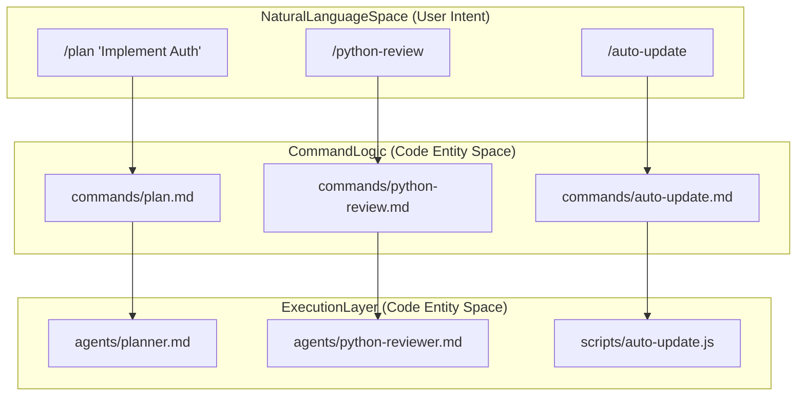

**Sources:** [[commands/plan.md:121]](), [[AGENTS.md:36]](), [[commands/auto-update.md:1-5]](), [[scripts/auto-update.js:10-16]]()

### Multi-Agent Orchestration Flow
Advanced commands like `/multi-plan` or `/loop-start` utilize external runtimes or specialized agents to handle complex state.

**Autonomous Loop Data Flow**
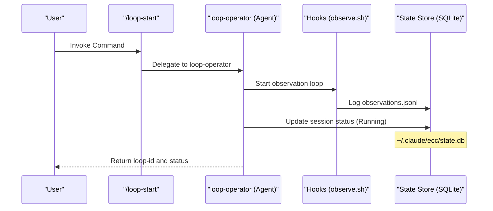

**Sources:** [[AGENTS.md:39-40]](), [[README.md:104-105]](), [[README.zh-CN.md:110-111]]()

---

## Validation & Quality Assurance

ECC includes a validation suite to ensure commands remain functional and correctly referenced.

*   **validate-commands.js**: A CI script that checks that markdown files are non-empty, have valid YAML frontmatter, and maintain correct cross-references to agents and skills [[scripts/ci/validate-commands.js:2-5]]().
*   **Frontmatter Parsing**: The system strictly validates YAML delimiters (`---`) and ensures fields like `description` are present and properly quoted if they contain special characters [[scripts/ci/validate-commands.js:15-60]]().
*   **Cross-Reference Verification**: The validator builds a set of valid command, agent, and skill names and verifies that any reference (e.g., `` `/build-fix` `` or `agents/planner.md`) exists in the repository [[scripts/ci/validate-commands.js:72-175]]().

**Sources:** [[scripts/ci/validate-commands.js:1-189]](), [[scripts/ci/validate-agents.js:10-11]]()

---

# Page: Rules

# Rules

<details>
<summary>Relevant source files</summary>

The following files were used as context for generating this wiki page:

- [.agents/skills/bun-runtime/agents/openai.yaml](.agents/skills/bun-runtime/agents/openai.yaml)
- [.agents/skills/documentation-lookup/agents/openai.yaml](.agents/skills/documentation-lookup/agents/openai.yaml)
- [.agents/skills/nextjs-turbopack/agents/openai.yaml](.agents/skills/nextjs-turbopack/agents/openai.yaml)
- [.cursor/hooks/after-file-edit.js](.cursor/hooks/after-file-edit.js)
- [install.ps1](install.ps1)
- [install.sh](install.sh)
- [rules/README.md](rules/README.md)
- [rules/common/agents.md](rules/common/agents.md)
- [rules/common/coding-style.md](rules/common/coding-style.md)
- [rules/common/git-workflow.md](rules/common/git-workflow.md)
- [rules/common/hooks.md](rules/common/hooks.md)
- [rules/common/patterns.md](rules/common/patterns.md)
- [rules/common/security.md](rules/common/security.md)
- [rules/common/testing.md](rules/common/testing.md)
- [rules/web/coding-style.md](rules/web/coding-style.md)
- [rules/web/design-quality.md](rules/web/design-quality.md)
- [rules/web/hooks.md](rules/web/hooks.md)
- [rules/web/patterns.md](rules/web/patterns.md)
- [rules/web/performance.md](rules/web/performance.md)

</details>


Rules are always-follow guidelines that constrain Claude Code's behavior across all sessions. They form a declarative specification layer that operates above individual prompts, enforcing project-specific patterns, coding standards, security requirements, and workflow conventions without requiring explicit reminders in every interaction.

For detailed listings of available rules and their contents, see [Rules Reference](#5.4). For information about dynamic system prompt injection and context management techniques, see [Memory & Context Preservation](#11.3).

---

## What Rules Are

Rules are Markdown files stored in the `rules/` directory that Claude Code loads at the start of every session. Unlike skills (which are invoked explicitly) or commands (which run on demand), rules are **always active** — they establish the baseline constraints and preferences that guide all agent behavior.

**Core Characteristics:**

| Property | Behavior |
|----------|----------|
| **Scope** | Universal — applies to all operations in a session |
| **Invocation** | Automatic — loaded at session start without user action |
| **Priority** | Higher authority than user messages; Language-specific overrides common [rules/README.md:94-96]() |
| **Persistence** | Session-scoped — reloaded for each new `claude` invocation |
| **Mutability** | Read-only — agents cannot modify rule files |

**Example rule statements:**

```markdown
# From coding-style.md
- ALWAYS create new objects, NEVER mutate existing ones [rules/common/coding-style.md:3-5]()
- Rationale: Immutable data prevents hidden side effects [rules/common/coding-style.md:13-13]()

# From testing.md
- Minimum Test Coverage: 80% [rules/common/testing.md:3-3]()
- Write test first (RED) -> Implementation (GREEN) [rules/common/testing.md:12-19]()

# From git-workflow.md
- Use standard types: feat, fix, refactor, docs, test, chore, perf, ci [rules/common/git-workflow.md:10-10]()
```

Sources: [rules/README.md:70-71](), [rules/common/coding-style.md:3-13](), [rules/common/testing.md:3-19](), [rules/common/git-workflow.md:10-10]()

---

## Hierarchical Structure

Rules are organized into a two-tier hierarchy: **common rules** (language-agnostic) and **language-specific rules** (ecosystem conventions).

### Directory Organization

```
rules/
├── common/                   # Universal principles (always install) [rules/README.md:8-16]()
│   ├── coding-style.md       # Immutability, KISS, DRY, YAGNI [rules/common/coding-style.md:1-34]()
│   ├── git-workflow.md       # Commit format, PR analysis [rules/common/git-workflow.md:1-20]()
│   ├── testing.md            # 80% Coverage, TDD, AAA pattern [rules/common/testing.md:1-58]()
│   ├── performance.md        # Resource optimization
│   ├── patterns.md           # Design patterns
│   ├── hooks.md              # Hook usage
│   ├── agents.md             # Agent delegation rules [rules/common/agents.md:1-51]()
│   └── security.md           # Mandatory security checks
├── typescript/               # TypeScript/JavaScript specific [rules/README.md:17-17]()
├── python/                   # Python specific [rules/README.md:18-18]()
├── golang/                   # Go specific [rules/README.md:19-19]()
├── web/                      # Web and frontend specific [rules/README.md:20-20]()
├── swift/                    # Swift specific [rules/README.md:21-21]()
└── php/                      # PHP specific [rules/README.md:22-22]()
```

**Design Rationale:**

- **Common rules** contain universal principles without language-specific code examples [rules/README.md:25-25]().
- **Language directories** extend the common rules with framework-specific patterns, tools, and code examples [rules/README.md:26-26]().
- **Specificity Precedence**: When language-specific rules and common rules conflict, language-specific rules take precedence (specific overrides general) [rules/README.md:94-100]().

Sources: [rules/README.md:4-27](), [rules/README.md:94-100](), [rules/common/coding-style.md:1-34](), [rules/common/testing.md:1-58]()

---

## Installation and Data Flow

Rules must be installed manually due to platform limitations. They are typically placed in `~/.claude/rules/` (User-level) or `.claude/rules/` (Project-level).

### Rule Installation Flow

The following diagram bridges the Natural Language rules to the Code Entity space by showing how the `install.sh` script (and its underlying `scripts/install-apply.js` logic) populates the system.

**Rule Deployment Architecture**

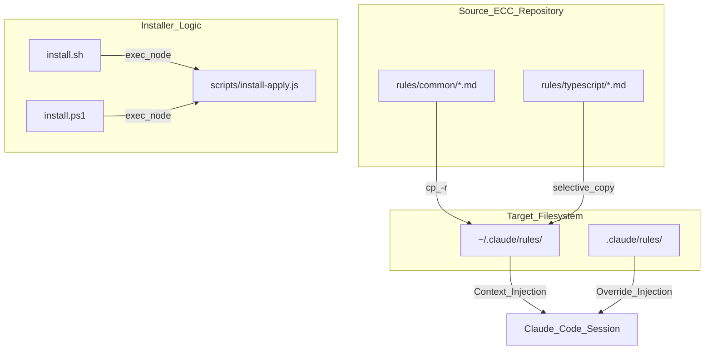

### Installation Methods

**Option 1: Install Script (Recommended)**
The `install.sh` (Bash) and `install.ps1` (PowerShell) wrappers resolve the package root and delegate to the Node-based installer `scripts/install-apply.js` [install.sh:32-32](), [install.ps1:52-52]().

```bash
# Install common + specific language rules
./install.sh typescript python
```

**Option 2: Manual Installation**
Users must copy entire directories rather than flattening files to maintain relative references like `../common/` used by language-specific files [rules/README.md:45-51]().

```bash
cp -r rules/common ~/.claude/rules/common
cp -r rules/typescript ~/.claude/rules/typescript
```

Sources: [install.sh:1-32](), [install.ps1:1-53](), [rules/README.md:30-43](), [rules/README.md:45-63]()

---

## How Rules Constrain Behavior

Rules act as the "constitution" for the agent. They are not just documentation; they are active constraints injected into the system prompt.

### Workflow Constraints: Git & Agents

The rules mandate specific sequences and behaviors for core operations:

1.  **Git Workflow**: Mandatory commit message formats (feat, fix, refactor, etc.) and PR analysis using `git diff [base-branch]...HEAD` [rules/common/git-workflow.md:3-19]().
2.  **Agent Delegation**: Mandatory use of specific agents for specific tasks, such as `planner` for complex features and `tdd-guide` for new features [rules/common/agents.md:20-27]().
3.  **Parallelism**: Agents are instructed to use parallel Task execution for independent operations (e.g., launching security analysis and performance review simultaneously) [rules/common/agents.md:30-41]().

### Technical Implementation: Rule to Code Association

This diagram maps natural language rules found in the `rules/` directory to the specific agents and configuration files defined in the codebase that enforce them.

**Constraint Enforcement Mapping**

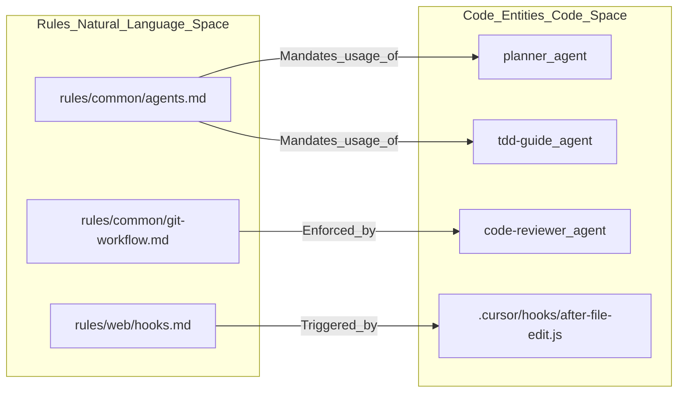

Sources: [rules/common/agents.md:7-18](), [rules/common/git-workflow.md:10-10](), [rules/web/hooks.md:1-25](), [.cursor/hooks/after-file-edit.js:13-16]()

---

## Rules vs. Skills

It is critical to distinguish between Rules (what to follow) and Skills (how to perform).

| Feature | Rules (`rules/`) | Skills (`skills/`) |
| :--- | :--- | :--- |
| **Nature** | Standards, conventions, and checklists [rules/README.md:70-71]() | Deep, actionable reference material [rules/README.md:71-72]() |
| **Precedence** | Language-specific overrides common [rules/README.md:94-96]() | Context-dependent |
| **Example** | "80% test coverage" [rules/common/testing.md:3-3]() | `nextjs-turbopack` workflow [skills/nextjs-turbopack/agents/openai.yaml:1-8]() |
| **Relationship** | Rules tell you *what* to do | Skills tell you *how* to do it [rules/README.md:73-73]() |

Sources: [rules/README.md:68-74](), [rules/README.md:94-100](), [.agents/skills/nextjs-turbopack/agents/openai.yaml:1-8]()

---

## Agent Orchestration Rules

The `rules/common/agents.md` file defines the catalog of available agents and the logic for their invocation.

**Available Agents Catalog:**
Located in `~/.claude/agents/`, these include `planner`, `architect`, `tdd-guide`, `code-reviewer`, `security-reviewer`, and specialized ones like `rust-reviewer` [rules/common/agents.md:5-19]().

**Immediate Agent Usage Triggers:**
*   **Complex feature requests**: Use `planner` agent [rules/common/agents.md:23-23]().
*   **Code just written/modified**: Use `code-reviewer` agent [rules/common/agents.md:24-24]().
*   **Bug fix or new feature**: Use `tdd-guide` agent [rules/common/agents.md:25-25]().
*   **Architectural decision**: Use `architect` agent [rules/common/agents.md:26-26]().

**Execution Strategy:**
*   **Parallelism**: ALWAYS use parallel Task execution for independent operations [rules/common/agents.md:30-38]().
*   **Multi-Perspective Analysis**: For complex problems, use split role sub-agents such as "Security expert" or "Consistency reviewer" [rules/common/agents.md:43-51]().

Sources: [rules/common/agents.md:1-51]()

---

# Page: Hooks

# Hooks

<details>
<summary>Relevant source files</summary>

The following files were used as context for generating this wiki page:

- [.opencode/commands/harness-audit.md](.opencode/commands/harness-audit.md)
- [commands/harness-audit.md](commands/harness-audit.md)
- [commands/loop-start.md](commands/loop-start.md)
- [commands/model-route.md](commands/model-route.md)
- [commands/quality-gate.md](commands/quality-gate.md)
- [hooks/README.md](hooks/README.md)
- [hooks/hooks.json](hooks/hooks.json)
- [scripts/harness-audit.js](scripts/harness-audit.js)
- [scripts/hooks/desktop-notify.js](scripts/hooks/desktop-notify.js)
- [scripts/hooks/gateguard-fact-force.js](scripts/hooks/gateguard-fact-force.js)
- [scripts/hooks/session-end.js](scripts/hooks/session-end.js)
- [scripts/hooks/session-start.js](scripts/hooks/session-start.js)
- [scripts/hooks/suggest-compact.js](scripts/hooks/suggest-compact.js)
- [scripts/lib/package-manager.js](scripts/lib/package-manager.js)
- [scripts/lib/session-aliases.js](scripts/lib/session-aliases.js)
- [scripts/lib/session-manager.js](scripts/lib/session-manager.js)
- [scripts/lib/utils.js](scripts/lib/utils.js)
- [skills/gateguard/SKILL.md](skills/gateguard/SKILL.md)
- [tests/ci/validators.test.js](tests/ci/validators.test.js)
- [tests/hooks/gateguard-fact-force.test.js](tests/hooks/gateguard-fact-force.test.js)
- [tests/hooks/hooks.test.js](tests/hooks/hooks.test.js)
- [tests/integration/hooks.test.js](tests/integration/hooks.test.js)
- [tests/lib/package-manager.test.js](tests/lib/package-manager.test.js)
- [tests/lib/session-aliases.test.js](tests/lib/session-aliases.test.js)
- [tests/lib/session-manager.test.js](tests/lib/session-manager.test.js)
- [tests/lib/utils.test.js](tests/lib/utils.test.js)
- [tests/scripts/harness-audit.test.js](tests/scripts/harness-audit.test.js)

</details>


## Purpose and Scope

This page introduces **hooks** as event-driven automation in the Everything Claude Code (ECC) system. Hooks are executable scripts that fire automatically at specific lifecycle points—before or after tool execution, at session boundaries, or during context compaction—to enforce quality standards, prevent errors, and automate repetitive tasks. Unlike **Skills** (which are invoked probabilistically by the Agent) or **Rules** (which are natural language constraints), hooks run **deterministically** based on the system's execution state [hooks/README.md:3-5]().

---

## What Are Hooks?

Hooks are the "guardrails" of ECC. They receive tool inputs via `stdin`, process them, and can either allow the operation to proceed, provide a warning to the user/agent via `stderr`, or block the operation entirely by exiting with a specific code [hooks/README.md:11-15]().

**Key characteristics:**

| Property | Technical Implementation |
|----------|-------------|
| **Deterministic** | Triggered 100% of the time by the underlying engine [hooks/README.md:3-5](). |
| **Input Protocol** | Receive a JSON payload on `stdin` containing tool context [tests/integration/hooks.test.js:71-73](). |
| **Output Protocol** | Must echo the original JSON to `stdout` to maintain the tool chain [hooks/README.md:132-134](). |
| **Control Flow** | Can block execution using Exit Code `2` (PreToolUse only) [hooks/README.md:139-140](). |
| **Async Support** | Can run in the background with configurable timeouts [hooks/hooks.json:44-45](). |

---

## Hook Lifecycle & Event Flow

The ECC system hooks into the Claude Code lifecycle at several distinct phases. The following diagram maps the Natural Language intent (User Request) to the Code Entities (Hook Scripts) that manage the flow.

### Event Flow Architecture

```mermaid
graph TD
    User["User Request"] --> CC["Claude Code Engine"]
    CC --> SStart["Event: SessionStart"]
    SStart --> SStartScript["session-start.js"]
    
    CC --> PickTool["Agent Picks Tool (e.g., Bash, Write)"]
    PickTool --> PreTool["Event: PreToolUse"]
    
    subgraph "Pre-Execution Gate"
        PreTool --> PreBash["pre-bash-dispatcher.js"]
        PreTool --> DocWarn["doc-file-warning.js"]
        PreTool --> SugCompact["suggest-compact.js"]
        PreTool --> GateGuard["gateguard-fact-force.js"]
        PreTool --> ObservePre["observe-runner.js"]
    end
    
    PreBash -->|Exit 0| Exec["Tool Execution"]
    PreBash -->|Exit 2| Blocked["Execution Blocked"]
    
    Exec --> PostTool["Event: PostToolUse"]
    
    subgraph "Post-Execution Quality"
        PostTool --> Format["Prettier / Format"]
        PostTool --> Typecheck["TypeScript Check"]
        PostTool --> ObservePost["observe-runner.js (async)"]
    end
    
    PostTool --> Stop["Event: Stop"]
    Stop --> SEnd["session-end.js"]
    Stop --> DesktopNotify["desktop-notify.js"]
    
    CC --> Compact["Event: PreCompact"]
    Compact --> PCompactScript["suggest-compact.js"]

    Sources: ["hooks/hooks.json:4-140", "hooks/README.md:7-15", "scripts/hooks/session-start.js:1-10", "scripts/hooks/session-end.js:1-10", "scripts/hooks/gateguard-fact-force.js:1-21"]
```

### Hook Lifecycle Phases

| Phase | Description | Key Code Entities |
|-------|-------------|-------------------|
| **SessionStart** | Fires when a new terminal session begins. Bootstraps context, loads previous summaries, and reports learned skills. | `session-start.js` [scripts/hooks/session-start.js:1-10](), `plugin-hook-bootstrap.js` [hooks/hooks.json:10]() |
| **PreToolUse** | Fires *before* a tool runs. Can block (Exit 2) or warn. Includes fact-forcing gates. | `pre-bash-dispatcher.js`, `gateguard-fact-force.js`, `doc-file-warning.js` [hooks/hooks.json:4-129]() |
| **PostToolUse** | Fires *after* a tool completes. Used for auditing, quality, and background observation. | `format`, `typecheck`, `observe-runner.js` [hooks/README.md:46-56](), [hooks/hooks.json:43-50]() |
| **Stop** | Fires after the Agent finishes a response. Extracts summaries from `transcript.jsonl`. | `session-end.js` [scripts/hooks/session-end.js:1-10](), `desktop-notify.js` [hooks/README.md:60-68]() |
| **PreCompact** | Fires before context window summarization to suggest logical checkpoints. | `suggest-compact.js` [hooks/README.md:15](), [hooks/hooks.json:32-33]() |
| **SessionEnd** | Fires when the session is closed. | `SessionEnd` event [hooks/README.md:69]() |

---

## Quality Enforcement Patterns

Hooks serve as the primary mechanism for "Invisible Quality Control." They operate in three main modes:

### 1. Blocking & Validation (PreToolUse)
These hooks validate the *intent* of the agent before execution. 
*   **Fact-Forcing Gate**: `gateguard-fact-force.js` forces the agent to investigate (list importers, API schemas) before editing files, creating awareness of potential side effects [scripts/hooks/gateguard-fact-force.js:5-14]().
*   **Safety**: `pre-bash-dispatcher.js` consolidates preflight checks for quality, tmux, and push guards [hooks/hooks.json:10-14]().
*   **Governance**: `governance-capture.js` captures secrets and policy violations before they are written to disk [hooks/hooks.json:56-61]().

### 2. Auto-Remediation & Formatting (PostToolUse)
ECC provides hooks to ensure code remains clean and valid after modifications.
*   **Formatting**: Hooks can trigger auto-formatters like Prettier after file edits [hooks/README.md:54]().
*   **Type Safety**: Runs `tsc --noEmit` after editing `.ts` files to catch regressions immediately [hooks/README.md:55]().

### 3. Context & Memory Management
*   **Session Continuity**: `session-start.js` selects the best matching previous session based on worktree and project name, injecting context into the new session [scripts/hooks/session-start.js:159-184]().
*   **Transcript Summarization**: `session-end.js` parses the `transcript.jsonl` to extract user messages, tools used, and files modified, saving them to `*-session.tmp` files [scripts/hooks/session-end.js:40-111]().
*   **Strategic Compaction**: `suggest-compact.js` monitors tool call counts and suggests manual `/compact` at logical intervals to preserve context quality [hooks/hooks.json:32-36]().

---

## Implementation Details

### Data Flow Protocol
All hooks must adhere to a specific I/O contract. They receive JSON on `stdin` and must output the same JSON to `stdout`.

```mermaid
sequenceDiagram
    participant CC as "Claude Code"
    participant H as "Hook (Node/Shell Script)"
    participant SM as "session-manager.js"

    CC->>H: stdin: JSON {tool_name, tool_input, transcript_path, ...}
    Note over H: JSON.parse(stdinData) [scripts/hooks/session-end.js:185-190]
    H->>SM: writeSessionContent(path, content) [tests/lib/session-manager.test.js:194]
    H->>CC: stderr: "[Hook] Warning message" [hooks/README.md:127]
    H->>CC: stdout: original rawInput JSON [hooks/README.md:132-133]
    H->>CC: exit(0) or exit(2)

    Sources: ["scripts/hooks/session-end.js:113-134", "tests/integration/hooks.test.js:43-91", "scripts/lib/session-manager.js:12"]
```

### Critical Implementation Logic

*   **Bootstrap Pattern**: Hooks use `plugin-hook-bootstrap.js` to resolve the `CLAUDE_PLUGIN_ROOT` and ensure dependencies are available regardless of the installation path [hooks/hooks.json:10-11]().
*   **State Management**: Hooks like `gateguard-fact-force.js` maintain persistent state in `~/.gateguard` to track which files have already passed the "investigation gate" within a session [scripts/hooks/gateguard-fact-force.js:29-42]().
*   **Session Identification**: ECC derives a `shortId` from the transcript UUID to uniquely identify sessions and avoid collisions when multiple instances are running [scripts/hooks/session-end.js:202-209]().

### Testing Infrastructure
Hooks are validated using integration tests that simulate the Claude Code execution environment.
*   **`runHookWithInput`**: A helper function in `tests/integration/hooks.test.js` that spawns the hook process, writes JSON to `stdin`, and captures `stdout`/`stderr` [tests/integration/hooks.test.js:50-91]().
*   **`runHookCommand`**: Validates the exact command strings defined in `hooks.json`, including inline Node.js scripts and environment variable interpolation [tests/integration/hooks.test.js:109-156]().
*   **Unit Tests**: Scripts in `tests/hooks/` and `tests/lib/` validate the underlying logic for session parsing, path normalization, and package manager detection [tests/hooks/hooks.test.js:1-112](), [tests/lib/session-manager.test.js:48-90]().

Sources: [hooks/hooks.json:1-70](), [hooks/README.md:1-160](), [tests/integration/hooks.test.js:1-200](), [scripts/hooks/session-start.js:12-55](), [scripts/hooks/gateguard-fact-force.js:106-126]()

---

# Page: MCPs (Model Context Protocol)

# MCPs (Model Context Protocol)

<details>
<summary>Relevant source files</summary>

The following files were used as context for generating this wiki page:

- [.agents/plugins/marketplace.json](.agents/plugins/marketplace.json)
- [.claude-plugin/PLUGIN_SCHEMA_NOTES.md](.claude-plugin/PLUGIN_SCHEMA_NOTES.md)
- [.claude-plugin/README.md](.claude-plugin/README.md)
- [.claude-plugin/marketplace.json](.claude-plugin/marketplace.json)
- [.claude-plugin/plugin.json](.claude-plugin/plugin.json)
- [.codex-plugin/README.md](.codex-plugin/README.md)
- [.codex-plugin/plugin.json](.codex-plugin/plugin.json)
- [.mcp.json](.mcp.json)
- [mcp-configs/mcp-servers.json](mcp-configs/mcp-servers.json)
- [schemas/package-manager.schema.json](schemas/package-manager.schema.json)
- [schemas/plugin.schema.json](schemas/plugin.schema.json)
- [scripts/hooks/insaits-security-monitor.py](scripts/hooks/insaits-security-monitor.py)
- [scripts/hooks/insaits-security-wrapper.js](scripts/hooks/insaits-security-wrapper.js)
- [skills/laravel-plugin-discovery/SKILL.md](skills/laravel-plugin-discovery/SKILL.md)
- [tests/hooks/insaits-security-monitor.test.js](tests/hooks/insaits-security-monitor.test.js)
- [tests/hooks/insaits-security-wrapper.test.js](tests/hooks/insaits-security-wrapper.test.js)
- [tests/hooks/plugin-hook-bootstrap.test.js](tests/hooks/plugin-hook-bootstrap.test.js)
- [tests/hooks/test_insaits_security_monitor.py](tests/hooks/test_insaits_security_monitor.py)
- [tests/plugin-manifest.test.js](tests/plugin-manifest.test.js)

</details>


## Purpose and Scope

This page explains MCPs (Model Context Protocol) in the context of Everything Claude Code (ECC). MCP servers act as external service integrations that extend Claude's capabilities by providing a standardized way to expose tools, resources, and prompts to the model. This section details the technical implementation, the configuration schema, and the critical relationship between MCP usage and context window management.

---

## What Are MCPs?

MCPs are **prompt-driven wrappers around external services** that allow Claude to interact with APIs, databases, and local filesystems through natural language. Instead of writing custom integration code for every service, the Model Context Protocol provides a universal interface where an MCP server describes its available tools to the Claude client.

**Key Technical Distinction**: MCPs are not simple API clients. They are stateful or stateless external processes that translate LLM tool calls into service-specific actions.

### Implementation Patterns

| Pattern | Description | Example File/Tool |
|---------|-------------|-------------------|
| **Stdio** | Server runs as a local subprocess; communication via JSON-RPC over stdin/stdout. | `jira`, `github`, `memory`, `filesystem` [mcp-configs/mcp-servers.json:3-106]() |
| **HTTP/SSE** | Server runs remotely or locally as a web service; communication via Server-Sent Events. | `vercel`, `laraplugins`, `browser-use`, `devfleet` [mcp-configs/mcp-servers.json:49-149]() |
| **Python Local** | Server runs as a local Python module, often for testing or specialized logic. | `evalview` [mcp-configs/mcp-servers.json:161-168]() |

**Sources:** [mcp-configs/mcp-servers.json:1-176]()

---

## MCP Architecture and Data Flow

The following diagram illustrates how the Claude Code harness interacts with MCP servers to bridge the gap between natural language requests and external code execution.

### Data Flow: Natural Language to Code Entity Space

```mermaid
graph TB
    subgraph "Natural Language Space"
        UserReq["User: 'Find a healthy Laravel auth package'"]
        Agent["Agent: architect / researcher"]
    end

    subgraph "Claude Code Entity Space"
        McpConfig["mcp-servers.json<br/>(Server Definitions)"]
        SkillDef["laravel-plugin-discovery<br/>(SKILL.md)"]
        McpClient["MCP Protocol Client"]
    end

    subgraph "External Execution Space"
        LaraPluginsSrv["laraplugins (HTTP/SSE)"]
        Context7Srv["context7 (npx @upstash/context7-mcp)"]
        GithubSrv["github (npx @modelcontextprotocol/server-github)"]
    end

    UserReq --> Agent
    Agent -->|"Consults"| SkillDef
    SkillDef -->|"Uses Tools"| McpClient
    McpClient -->|"Resolves"| McpConfig
    McpClient -->|"HTTP Request"| LaraPluginsSrv
    McpClient -->|"Spawn npx"| Context7Srv
    McpClient -->|"Spawn npx"| GithubSrv

    style McpConfig border-style:dashed
    style SkillDef border-style:dashed
    style McpClient border-style:dashed
```

**Implementation Details:**
- **Server Discovery**: Servers are defined in a central configuration file [mcp-configs/mcp-servers.json:1-169]().
- **Tool Mapping**: Skills like `laravel-plugin-discovery` map natural language intent to specific MCP tools like `SearchPluginTool` [skills/laravel-plugin-discovery/SKILL.md:36-46]().
- **Multi-Runtime Support**: ECC supports MCPs written in Node.js (`npx`), Python (`python3`), Rust (`uvx`), and native HTTP [mcp-configs/mcp-servers.json:4, 40, 85, 147, 162]().
- **Tool Registration**: MCP servers use SDK functions like `server.tool()` or `registerTool()` to expose capabilities to the model.

**Sources:** [mcp-configs/mcp-servers.json:1-176](), [skills/laravel-plugin-discovery/SKILL.md:1-230]()

---

## Context Window Impact: The 200k to 70k Problem

A critical technical constraint in ECC is the "Context Window Degradation" caused by MCP bloat. Each enabled MCP server injects its tool definitions, schemas, and descriptions into the system prompt.

### Context Consumption Metrics

| Configuration State | Tokens Consumed (Approx) | Remaining Context (Sonnet 3.5) |
|---------------------|--------------------------|--------------------------------|
| Baseline (No MCPs)  | ~2k (System Prompt)      | ~198k                          |
| 5-10 MCPs Enabled   | ~30k - 50k               | ~150k                          |
| 30+ MCPs Enabled    | ~130k+                   | **<70k (Critical)**            |

**Optimization Strategy:**
ECC enforces a discipline of having many servers *configured* but few *enabled* simultaneously. The `ECC_DISABLED_MCPS` environment variable or `disabledMcpServers` in project configuration is used to prune the toolset [mcp-configs/mcp-servers.json:173-174]().

**Sources:** [mcp-configs/mcp-servers.json:170-176]()

---

## Key MCP Servers in ECC

The ECC repository provides a pre-configured library of battle-tested MCP servers.

### Integration Reference Table

| Server Name | Implementation / Command | Primary Purpose |
|-------------|-------------------------|-----------------|
| `github` | `npx @modelcontextprotocol/server-github` | PRs, issues, and repo management [mcp-configs/mcp-servers.json:13-20]() |
| `context7` | `npx @upstash/context7-mcp@latest` | Live documentation lookup for libraries [mcp-configs/mcp-servers.json:92-96]() |
| `devfleet` | `http://localhost:18801/mcp` | Multi-agent orchestration in worktrees [mcp-configs/mcp-servers.json:136-140]() |
| `evalview` | `python3 -m evalview mcp serve` | AI agent regression testing and snapshots [mcp-configs/mcp-servers.json:161-168]() |
| `laraplugins` | `https://laraplugins.io/mcp/plugins` | Laravel package discovery and health checks [mcp-configs/mcp-servers.json:146-150]() |
| `sequential-thinking` | `npx @modelcontextprotocol/server-sequential-thinking` | Chain-of-thought reasoning extension [mcp-configs/mcp-servers.json:44-48]() |
| `token-optimizer` | `npx token-optimizer-mcp` | 95%+ context reduction via deduplication [mcp-configs/mcp-servers.json:141-145]() |

### Case Study: Laravel Plugin Discovery

The `laravel-plugin-discovery` skill demonstrates how MCP tools are integrated into a workflow:
1. **Requirement**: Requires the `laraplugins` MCP server [skills/laravel-plugin-discovery/SKILL.md:19-28]().
2. **Tool Use**: Utilizes `SearchPluginTool` to find packages by keyword, health score, and version compatibility [skills/laravel-plugin-discovery/SKILL.md:36-46]().
3. **Deep Dive**: Uses `GetPluginDetailsTool` to fetch detailed metrics, readme content, and risk scores [skills/laravel-plugin-discovery/SKILL.md:48-55]().
4. **Decision Logic**: Recommends `Healthy` packages for production projects based on the health score returned by the MCP [skills/laravel-plugin-discovery/SKILL.md:144-153]().

**Sources:** [skills/laravel-plugin-discovery/SKILL.md:1-230](), [mcp-configs/mcp-servers.json:146-150]()

---

## Multi-Agent Orchestration via DevFleet

The `devfleet` MCP server represents an advanced use case where one Claude instance orchestrates a "swarm" of other agents.

### Orchestration Sequence Diagram

```mermaid
sequenceDiagram
    participant User
    participant MainAgent as Claude (Main)
    participant DevFleet as DevFleet MCP Server
    participant SubAgent as Claude (Worktree Agent)

    User->>MainAgent: "Implement feature X across services"
    MainAgent->>DevFleet: dispatch_parallel_agents()
    DevFleet->>SubAgent: Spawn in isolated git worktree
    SubAgent-->>DevFleet: Mission Complete (Auto-merge)
    DevFleet-->>MainAgent: get_structured_report()
    MainAgent->>User: Final Summary
```

**Key DevFleet Tools:**
- **Dispatch**: Parallelizes Claude Code agents in isolated worktrees [mcp-configs/mcp-servers.json:139]().
- **Reporting**: Provides structured reports on mission progress and results [mcp-configs/mcp-servers.json:139]().

**Sources:** [mcp-configs/mcp-servers.json:136-140]()

---

## Platform Support and Manifests

MCP configuration is handled differently across platforms supported by ECC:

- **Claude Code**: Uses `~/.claude.json` for server definitions [mcp-configs/mcp-servers.json:171](). The plugin manifest explicitly opts out of auto-bundling MCPs to avoid overlong tool names in OpenAI-compatible gateways [.claude-plugin/plugin.json:25](), [.claude-plugin/PLUGIN_SCHEMA_NOTES.md:136-153]().
- **Codex**: Requires an `.mcp.json` file at the plugin root for native installs.
- **Cursor**: Supports MCP environment interpolation but lacks native hook support for automated validation.

**Sources:** [.claude-plugin/plugin.json:1-28](), [.claude-plugin/PLUGIN_SCHEMA_NOTES.md:1-216](), [mcp-configs/mcp-servers.json:170-176]()

---

# Page: Installation & Setup

# Installation & Setup

<details>
<summary>Relevant source files</summary>

The following files were used as context for generating this wiki page:

- [AGENTS.md](AGENTS.md)
- [README.md](README.md)
- [README.zh-CN.md](README.zh-CN.md)
- [WORKING-CONTEXT.md](WORKING-CONTEXT.md)
- [agent.yaml](agent.yaml)
- [commands/auto-update.md](commands/auto-update.md)
- [commands/jira.md](commands/jira.md)
- [docs/SELECTIVE-INSTALL-ARCHITECTURE.md](docs/SELECTIVE-INSTALL-ARCHITECTURE.md)
- [docs/zh-CN/AGENTS.md](docs/zh-CN/AGENTS.md)
- [docs/zh-CN/README.md](docs/zh-CN/README.md)
- [manifests/install-modules.json](manifests/install-modules.json)
- [scripts/auto-update.js](scripts/auto-update.js)
- [scripts/install-apply.js](scripts/install-apply.js)
- [scripts/lib/cursor-agent-names.js](scripts/lib/cursor-agent-names.js)
- [scripts/lib/install-executor.js](scripts/lib/install-executor.js)
- [scripts/lib/install-targets/claude-home.js](scripts/lib/install-targets/claude-home.js)
- [scripts/lib/install-targets/cursor-project.js](scripts/lib/install-targets/cursor-project.js)
- [scripts/lib/install-targets/helpers.js](scripts/lib/install-targets/helpers.js)
- [scripts/lib/install/apply.js](scripts/lib/install/apply.js)
- [skills/jira-integration/SKILL.md](skills/jira-integration/SKILL.md)
- [tests/ci/agent-yaml-surface.test.js](tests/ci/agent-yaml-surface.test.js)
- [tests/lib/install-executor.test.js](tests/lib/install-executor.test.js)
- [tests/lib/install-targets.test.js](tests/lib/install-targets.test.js)
- [tests/lib/selective-install.test.js](tests/lib/selective-install.test.js)
- [tests/scripts/auto-update.test.js](tests/scripts/auto-update.test.js)
- [tests/scripts/install-apply.test.js](tests/scripts/install-apply.test.js)
- [tests/scripts/install-readme-clarity.test.js](tests/scripts/install-readme-clarity.test.js)

</details>


This page provides a comprehensive guide to installing the Everything Claude Code (ECC) system. ECC supports multiple installation pathways—ranging from the automated plugin marketplace to a sophisticated selective-install CLI—to accommodate different environments like Claude Code, Cursor, OpenCode, and more.

For details on post-installation settings, see [Configuration Guide](#9). For resolving setup errors, see [Troubleshooting](#16).

---

## Installation Methods Overview

ECC can be installed through several methods depending on your target environment and required level of granularity. The system has evolved into a performance optimization framework for AI agent harnesses, supporting over 12 language ecosystems [README.md:14-22]().

### Comparison of Methods

| Method | Best For | Complexity | Target Platforms |
|:---|:---|:---|:---|
| **Plugin Marketplace** | Most users, automatic updates | Low | Claude Code |
| **ECC CLI (`ecc`)** | Selective modules, profiles | Medium | Claude, Cursor, Antigravity, Codex, OpenCode, CodeBuddy, Trae |
| **NPM Package** | Automation, CI/CD | Low | All |
| **Manual / Git** | Development, heavy customization | High | All |

### Installation Logic & Entity Mapping

The following diagram bridges high-level installation concepts to the underlying code entities that manage the process, specifically highlighting the manifest-driven architecture used by the `install-apply.js` runtime [scripts/install-apply.js:10-18]().

**Installer System Architecture**
```mermaid
graph TD
    User["User/CI"] -- "ecc install --profile core" --> ECC_JS["scripts/ecc.js"]
    ECC_JS -- "delegates to" --> APPLY_JS["scripts/install-apply.js"]
    
    subgraph "Logic Space"
        APPLY_JS -- "parses args" --> REQ["scripts/lib/install/request.js"]
        APPLY_JS -- "creates plan" --> RUNTIME["scripts/lib/install/runtime.js"]
        RUNTIME -- "executes" --> EXEC["scripts/lib/install-executor.js"]
    end

    subgraph "Entity Space (Manifests)"
        MODS["manifests/install-modules.json"]
        PROFS["manifests/install-profiles.json"]
        COMPS["manifests/install-components.json"]
    end

    RUNTIME -- "reads" --> MODS
    RUNTIME -- "reads" --> PROFS
    RUNTIME -- "reads" --> COMPS

    EXEC -- "writes to" --> TARGET["Target (~/.claude/ or .cursor)"]
    EXEC -- "records state" --> STATE["~/.claude/ecc/install-state.json"]

    style ECC_JS stroke-width:2px
    style APPLY_JS stroke-width:2px
    style MODS stroke-dasharray: 5 5
```
Sources: [scripts/install-apply.js:111-138](), [tests/scripts/install-apply.test.js:106-111](), [manifests/install-modules.json:1-10]()

---

## Automated Installation (NPM & CLI)

The recommended way to install ECC is via the global NPM package `ecc-universal`. The `ecc` command-line interface uses a manifest-driven pipeline with `install-apply.js` for targeted component installation [scripts/install-apply.js:24-42]().

```bash
# 1. Install the global package
npm install -g ecc-universal

# 2. Run a standard installation for your primary language
ecc install typescript
```

The `ecc` CLI manages the installation lifecycle, including `plan`, `apply`, `doctor`, `repair`, and `uninstall`. It tracks the installation state in `install-state.json`, enabling incremental updates and drift detection [tests/scripts/install-apply.test.js:106-111]().

For details on the command-line interface, see [Selective Install System](#4.6).

Sources: [README.md:10](), [scripts/install-apply.js:1-53](), [tests/scripts/install-apply.test.js:88-124]()

---

## Plugin Marketplace Installation

For users of the native Claude Code CLI, ECC is available as a first-class plugin.

1. **Add the Marketplace Source:**
   `/plugin marketplace add https://github.com/affaan-m/everything-claude-code`
2. **Install the Plugin:**
   `/plugin install everything-claude-code@everything-claude-code`

**Note:** Due to platform limitations, rules must be installed separately as Claude Code plugins cannot automatically distribute the `rules/` directory to `~/.claude/rules/` [README.zh-CN.md:112-117]().

For details, see [Plugin Installation](#4.1) and [Rules Installation](#4.4).

Sources: [README.zh-CN.md:100-108](), [README.zh-CN.md:112-117]()

---

## Manual Installation

Manual installation involves cloning the repository and using the cross-platform entrypoints. ECC provides `install.sh` for Unix-like systems and `install.ps1` for Windows [README.zh-CN.md:119-146]().

```bash
git clone https://github.com/affaan-m/everything-claude-code.git
cd everything-claude-code

# Unix/macOS
./install.sh typescript python

# Windows (PowerShell)
.\install.ps1 typescript
```

The installer supports various targets including `claude`, `cursor`, `antigravity`, `codex`, `gemini`, and `opencode` [scripts/install-apply.js:29-33](), [tests/lib/install-targets.test.js:36-46]().

For details, see [Manual Installation](#4.2).

Sources: [README.zh-CN.md:119-146](), [scripts/install-apply.js:1-53](), [tests/lib/install-targets.test.js:36-46]()

---

## Rules Installation & Language Support

Rules are organized into a common layer plus language-specific directories [manifests/install-modules.json:5-21](). This hierarchy ensures that universal principles are always present, while specific tech stacks can provide tailored overrides. ECC covers language ecosystems including TypeScript, Python, Go, Java, Kotlin, and Rust [AGENTS.md:17-45]().

**Rule Extension Hierarchy**
```mermaid
graph TD
    Common["rules/common/"] -->|Extended By| TS["rules/typescript/"]
    Common -->|Extended By| PY["rules/python/"]
    Common -->|Extended By| GO["rules/golang/"]
    Common -->|Extended By| JAVA["rules/java/"]
    Common -->|Extended By| RUST["rules/rust/"]
    
    subgraph "File Entities"
        STYLE["coding-style.md"]
        TEST["testing.md"]
        SEC["security.md"]
    end
    
    TS -- "references" --> STYLE
    TS -- "references" --> TEST
```

**Important:** When installing manually for the plugin path, users are advised to copy the `rules/` directory to `~/.claude/rules/ecc/` to avoid naming conflicts [tests/scripts/install-readme-clarity.test.js:136-138]().

For details on rule priority and adding new languages, see [Rules Installation](#4.4).

Sources: [manifests/install-modules.json:5-21](), [AGENTS.md:17-45](), [tests/scripts/install-readme-clarity.test.js:136-138]()

---

## Initial Configuration

After files are deployed, ECC requires minimal configuration to align with your project's environment.

### Package Manager Setup
ECC uses a priority cascade to detect your package manager (npm, yarn, pnpm, or bun). It checks environment variables (`CLAUDE_PACKAGE_MANAGER`), project configs (`.claude/package-manager.json`), and lockfiles [README.zh-CN.md:185-195]().

For details, see [Package Manager Configuration](#4.3).

### Interactive Wizard
For a guided setup that helps you select specific skills (from over 180 available) and agents, use the interactive configuration wizard skill `configure-ecc` [manifests/install-modules.json:205]().

For details, see [Interactive Configuration Wizard](#4.5).

Sources: [README.zh-CN.md:185-195](), [manifests/install-modules.json:111-153](), [manifests/install-modules.json:205]()

---

## Verification

To verify your installation and check for configuration drift, use the `doctor` command:

```bash
ecc doctor
```

This command inspects the installation state against your local filesystem [tests/scripts/install-readme-clarity.test.js:64-66](). You can also use `list-installed` to view the currently tracked modules and components [tests/scripts/install-readme-clarity.test.js:60-62]().

Sources: [tests/scripts/install-readme-clarity.test.js:60-66](), [scripts/install-apply.js:94-96]()

---

# Page: Plugin Installation

# Plugin Installation

<details>
<summary>Relevant source files</summary>

The following files were used as context for generating this wiki page:

- [.agents/plugins/marketplace.json](.agents/plugins/marketplace.json)
- [.claude-plugin/PLUGIN_SCHEMA_NOTES.md](.claude-plugin/PLUGIN_SCHEMA_NOTES.md)
- [.claude-plugin/README.md](.claude-plugin/README.md)
- [.claude-plugin/marketplace.json](.claude-plugin/marketplace.json)
- [.claude-plugin/plugin.json](.claude-plugin/plugin.json)
- [.codex-plugin/README.md](.codex-plugin/README.md)
- [.codex-plugin/plugin.json](.codex-plugin/plugin.json)
- [.mcp.json](.mcp.json)
- [AGENTS.md](AGENTS.md)
- [README.md](README.md)
- [README.zh-CN.md](README.zh-CN.md)
- [WORKING-CONTEXT.md](WORKING-CONTEXT.md)
- [agent.yaml](agent.yaml)
- [commands/auto-update.md](commands/auto-update.md)
- [commands/jira.md](commands/jira.md)
- [docs/zh-CN/AGENTS.md](docs/zh-CN/AGENTS.md)
- [docs/zh-CN/README.md](docs/zh-CN/README.md)
- [manifests/install-modules.json](manifests/install-modules.json)
- [schemas/package-manager.schema.json](schemas/package-manager.schema.json)
- [schemas/plugin.schema.json](schemas/plugin.schema.json)
- [scripts/auto-update.js](scripts/auto-update.js)
- [skills/jira-integration/SKILL.md](skills/jira-integration/SKILL.md)
- [tests/ci/agent-yaml-surface.test.js](tests/ci/agent-yaml-surface.test.js)
- [tests/plugin-manifest.test.js](tests/plugin-manifest.test.js)
- [tests/scripts/auto-update.test.js](tests/scripts/auto-update.test.js)

</details>


This page covers installing Everything Claude Code (ECC) via the Claude Code plugin marketplace. This is the recommended installation method as it provides automatic component installation and updates through Claude Code's native plugin system.

For manual installation (git clone and copy), see **4.2 Manual Installation**. For rules installation (required after plugin install), see **4.4 Rules Installation**. For package manager configuration, see **4.3 Package Manager Configuration**.

---

## Overview

The plugin installation method uses Claude Code's marketplace system to install agents, skills, commands, and hooks automatically. The marketplace identifies plugins by their repository structure and distributes them as namespaced components within Claude Code.

As of version `2.0.0-rc.1`, the public plugin slug is `ecc`, though legacy `everything-claude-code` paths remain supported for compatibility [[WORKING-CONTEXT.md:12-14](), [.claude-plugin/plugin.json:2-3]()].

**What gets installed automatically:**
- **48 specialized agents** discovered by convention in the `agents/` directory [[README.md:92](), [.claude-plugin/PLUGIN_SCHEMA_NOTES.md:70-74]()].
- **182 skills** from the `./skills/` directory [[.claude-plugin/plugin.json:26](), [README.md:92]()].
- **68 legacy command shims** from the `./commands/` directory [[.claude-plugin/plugin.json:27](), [README.md:92]()].
- **Automated Hooks** defined in `hooks/hooks.json` which are loaded automatically by convention in Claude Code v2.1+ [[.claude-plugin/PLUGIN_SCHEMA_NOTES.md:104-107]()].

**What requires manual installation:**
- **Rules** — Claude Code platform limitations prevent rules distribution via plugins; these must be placed in `~/.claude/rules/` manually or via the installation script [[README.zh-CN.md:112-116]()].

**Sources:** [[README.md:89-98](), [.claude-plugin/plugin.json:1-28](), [.claude-plugin/PLUGIN_SCHEMA_NOTES.md:1-216]()]

---

## Installation Flow

### Step 1: Add Marketplace Source

The marketplace source tells Claude Code where to find the plugin catalog. Add the ECC marketplace:

```bash
# Add the marketplace
/plugin marketplace add https://github.com/affaan-m/everything-claude-code
```

This registers the GitHub repository as a known marketplace. The manifest at `.claude-plugin/marketplace.json` defines the marketplace metadata, including the owner and the list of available plugins [[.claude-plugin/marketplace.json:1-10]()].

**Diagram: Marketplace Registration (Code Entity Space)**

```mermaid
graph LR
    User["User executes<br/>'/plugin marketplace add'"]
    CLI["Claude Code CLI"]
    Settings["~/.claude/settings.json"]
    GH["GitHub Repo: affaan-m/everything-claude-code"]
    MarketplaceFile[".claude-plugin/marketplace.json"]
    
    User --> CLI
    CLI --> Settings
    Settings --> GH
    GH --> MarketplaceFile
    
    MarketplaceFile --> |"defines name: 'everything-claude-code'"| Settings
    MarketplaceFile --> |"defines plugins[]"| Settings
```

**Sources:** [[.claude-plugin/marketplace.json:1-47](), [README.zh-CN.md:101-102]()]

---

### Step 2: Install Plugin

Once the marketplace is registered, install the plugin using the canonical identifier:

```bash
# Install the plugin
/plugin install everything-claude-code@everything-claude-code
```

> **Note:** While the slug is `ecc`, the installation uses the normalized identifier `everything-claude-code@everything-claude-code` to ensure consistency across marketplace entries, install commands, and documentation [[README.zh-CN.md:108]()].

**Sources:** [[.claude-plugin/plugin.json:2](), [.claude-plugin/marketplace.json:12](), [README.zh-CN.md:105-108]()]

---

## Plugin Structure and Component Distribution

The plugin system reads component paths from `.claude-plugin/plugin.json`. Unlike previous versions, `agents` and `hooks` are no longer explicitly declared in the manifest to avoid validation errors and duplication; they are discovered by convention [[.claude-plugin/PLUGIN_SCHEMA_NOTES.md:60-74, 98-111]()].

**Diagram: Plugin Component Distribution (System to Code Association)**

```mermaid
graph TB
    subgraph "Everything Claude Code Repository"
        Manifest[".claude-plugin/plugin.json"]
        Marketplace[".claude-plugin/marketplace.json"]
        MCPConfig[".mcp.json"]
        
        AgentFiles["agents/*.md<br/>(48 agents)"]
        SkillDir["skills/<br/>(182 skills)"]
        CommandDir["commands/<br/>(68 shims)"]
        HookConfig["hooks/hooks.json"]
        RulesDir["rules/"]
    end
    
    subgraph "Claude Code Runtime (~/.claude)"
        InstalledAgents["agents/"]
        InstalledSkills["skills/"]
        InstalledCommands["commands/"]
        InstalledHooks["hooks/"]
        ActiveMCPs["~/.claude.json"]
    end
    
    AgentFiles -.-> |"Auto-discovered by convention"| InstalledAgents
    
    Manifest --> |"defines skills array ['./skills/']"| InstalledSkills
    SkillDir -.-> |"copied recursively"| InstalledSkills
    
    Manifest --> |"defines commands array ['./commands/']"| InstalledCommands
    CommandDir -.-> |"copied recursively"| InstalledCommands
    
    HookConfig -.-> |"Auto-loaded (v2.1+)"| InstalledHooks
    
    MCPConfig --> |"Manual setup recommended"| ActiveMCPs
    RulesDir -.-> |"MANUAL INSTALL REQUIRED"| RulesDir
```

**Sources:** [[.claude-plugin/plugin.json:26-27](), [.claude-plugin/PLUGIN_SCHEMA_NOTES.md:60-111](), [README.md:92-93]()]

---

## Component Namespacing

Plugin-installed commands use a namespaced format to avoid collisions with native Claude Code commands.

| Install Method | Command Format | Example |
| :--- | :--- | :--- |
| **Plugin Install** | `/everything-claude-code:<command>` | `/everything-claude-code:plan "Add auth"` |
| **Manual Install** | `/<command>` | `/plan "Add auth"` |

**Verification Command:**
To see all components currently recognized by the ECC plugin, use:
```bash
/plugin list everything-claude-code@everything-claude-code
```

**Sources:** [[README.zh-CN.md:153-161](), [.claude-plugin/plugin.json:2]()]

---

## MCP Server Integration

The plugin root contains a `.mcp.json` file for Codex and manual setups. However, for Claude Code plugin installs, ECC explicitly opts out of automatic MCP bundling by providing an empty `mcpServers` object in the manifest [[.claude-plugin/PLUGIN_SCHEMA_NOTES.md:136-152]()].

This prevents issues where strict gateways reject tool names that exceed 64 characters (e.g., `mcp__plugin_everything-claude-code_...`). Users should configure MCP servers manually from `mcp-configs/` [[.claude-plugin/PLUGIN_SCHEMA_NOTES.md:149-152]()].

**Sources:** [[.claude-plugin/PLUGIN_SCHEMA_NOTES.md:136-152](), [.claude-plugin/plugin.json:25]()]

---

## Mandatory Rules Installation

Claude Code plugins **cannot distribute rules** to the `~/.claude/rules/` directory due to platform security constraints [[README.zh-CN.md:112-114]()].

To install rules after the plugin is active:
1.  Clone the repository: `git clone https://github.com/affaan-m/everything-claude-code.git` [[README.zh-CN.md:119-120]()].
2.  Manually copy the required language directories to `~/.claude/rules/` [[README.zh-CN.md:126-129]()].
3.  Alternatively, use the `configure-ecc` skill for guided setup: `/everything-claude-code:configure-ecc` [[README.zh-CN.md:138]()].

**Sources:** [[README.zh-CN.md:110-148](), [manifests/install-modules.json:5-21]()]

---

## Verification Steps

1.  **Verify Plugin Components:** Ensure the 48 agents and associated commands are listed.
    `/plugin list everything-claude-code@everything-claude-code`
2.  **Test a Command:** Verify the dispatcher works.
    `/everything-claude-code:plan "Verify ECC installation"`
3.  **Check Rules:** Confirm rules files exist in the global directory.
    `ls ~/.claude/rules/`

**Sources:** [[README.zh-CN.md:153-161](), [AGENTS.md:1-5]()].

---

## Troubleshooting

| Issue | Cause | Fix |
| :--- | :--- | :--- |
| **"Invalid input" during install** | Manifest contains `agents` or `hooks` field. | Ensure `.claude-plugin/plugin.json` follows convention-based loading [[.claude-plugin/PLUGIN_SCHEMA_NOTES.md:60-68]()]. |
| **"Duplicate hooks file detected"** | `hooks/hooks.json` explicitly declared in manifest. | Remove explicit `hooks` field from `plugin.json` [[.claude-plugin/PLUGIN_SCHEMA_NOTES.md:104-111]()]. |
| **Commands not found** | Using short names instead of namespace. | Use `/everything-claude-code:<command>` for plugin installs [[README.zh-CN.md:153-154]()]. |
| **Rules not active** | Plugin cannot install rules automatically. | Manually copy `rules/` or run `install.sh` [[README.zh-CN.md:112-116]()]. |

**Sources:** [[.claude-plugin/PLUGIN_SCHEMA_NOTES.md:1-216](), [README.zh-CN.md:153-161]()]

---

# Page: Manual Installation

# Manual Installation

<details>
<summary>Relevant source files</summary>

The following files were used as context for generating this wiki page:

- [.cursor/hooks/after-file-edit.js](.cursor/hooks/after-file-edit.js)
- [AGENTS.md](AGENTS.md)
- [README.md](README.md)
- [README.zh-CN.md](README.zh-CN.md)
- [WORKING-CONTEXT.md](WORKING-CONTEXT.md)
- [agent.yaml](agent.yaml)
- [commands/auto-update.md](commands/auto-update.md)
- [commands/jira.md](commands/jira.md)
- [docs/zh-CN/AGENTS.md](docs/zh-CN/AGENTS.md)
- [docs/zh-CN/README.md](docs/zh-CN/README.md)
- [install.ps1](install.ps1)
- [install.sh](install.sh)
- [manifests/install-modules.json](manifests/install-modules.json)
- [rules/README.md](rules/README.md)
- [rules/web/coding-style.md](rules/web/coding-style.md)
- [rules/web/design-quality.md](rules/web/design-quality.md)
- [rules/web/hooks.md](rules/web/hooks.md)
- [rules/web/patterns.md](rules/web/patterns.md)
- [rules/web/performance.md](rules/web/performance.md)
- [scripts/auto-update.js](scripts/auto-update.js)
- [skills/jira-integration/SKILL.md](skills/jira-integration/SKILL.md)
- [tests/ci/agent-yaml-surface.test.js](tests/ci/agent-yaml-surface.test.js)
- [tests/scripts/auto-update.test.js](tests/scripts/auto-update.test.js)

</details>


This document covers manual installation of Everything Claude Code (ECC) components via `git clone` and direct file copying. This method provides complete control over component selection and is essential for platforms where the plugin marketplace is unavailable or for developers who wish to selectively include agents, skills, or rules based on a specific tech stack.

For plugin marketplace installation, see [Plugin Installation](#4.1). For language-specific rules setup details, see [Rules Installation](#4.4). For guided interactive setup, see [Interactive Configuration Wizard](#4.5). For package manager configuration, see [Package Manager Configuration](#4.3).

---

## Installation Overview

Manual installation involves three stages:

1.  **Clone** — Clone the repository to your local machine.
2.  **Copy** — Selectively copy components to `~/.claude/` (global) or `.claude/` (project-specific).
3.  **Configure** — Register hooks and MCP servers in configuration files.

Two approaches are available:

| Approach | Control | Complexity | Best For |
| :--- | :--- | :--- | :--- |
| **Full Manual Copy** | Complete | High | Users who want exact component selection and custom paths. |
| **Semi-Automated (`install.sh`)** | Moderate | Low | Users who want a guided shell script with language targeting. |

---

## Prerequisites

Before beginning manual installation:

| Requirement | Verification Command | Minimum Version |
| :--- | :--- | :--- |
| Git | `git --version` | Any modern version |
| Claude Code CLI | `claude --version` | v2.1.0+ |
| Shell | `bash --version` or `pwsh --version` | Bash 4.0+ or PowerShell 7+ |
| Node.js (for hooks) | `node --version` | v18+ |

The ECC system includes a legacy shell entrypoint `install.sh` that delegates to a Node-based installer runtime `scripts/install-apply.js` [install.sh:1-32]().

---

## Component Distribution Map

The following diagram illustrates how entities from the source repository are mapped to the local system during a manual installation.

### Source to Entity Mapping
```mermaid
graph TD
    subgraph "Natural Language Space (Source Repo)"
        SR["everything-claude-code repo"]
        A_Src["'Specialized Agents'"]
        C_Src["'Slash Commands'"]
        S_Src["'Workflow Skills'"]
        R_Src["'Coding Rules'"]
        H_Src["'Automation Hooks'"]
    end

    subgraph "Code Entity Space (Local System)"
        A_Code["agents/*.md"]
        C_Code["commands/*.md"]
        S_Code["skills/*/SKILL.md"]
        R_Code["rules/common/ & rules/lang/"]
        H_Code["hooks/hooks.json & scripts/hooks/*.js"]
    end

    subgraph "Installation Targets"
        Global["~/.claude/"]
        Project[".claude/"]
        Settings["~/.claude/settings.json"]
    end

    SR --> A_Src & C_Src & S_Src & R_Src & H_Src
    A_Src -.-> A_Code
    C_Src -.-> C_Code
    S_Src -.-> S_Code
    R_Src -.-> R_Code
    H_Src -.-> H_Code

    A_Code --> Global
    C_Code --> Global
    S_Code --> Global
    R_Code --> Global & Project
    H_Code --> Settings
```
**Sources:** [rules/README.md:1-22](), [manifests/install-modules.json:1-109](), [AGENTS.md:148-157]()

---

## Method 1: Full Manual Copy

### Step 1: Clone Repository

```bash
# Clone the repository
git clone https://github.com/affaan-m/everything-claude-code.git
cd everything-claude-code

# Verify directory structure
ls -F
# agents/ commands/ skills/ rules/ hooks/ scripts/ manifests/
```

### Step 2: Copy Core Components

#### Rules
Rules must be copied while maintaining their directory structure to preserve relative references [rules/README.md:45-51](). **Important:** Do NOT flatten the directory structure with `/*` as language-specific files (e.g., `testing.md`) will overwrite common counterparts and break relative links [rules/README.md:47-51]().

```bash
# Install common rules (required)
mkdir -p ~/.claude/rules/common
cp -r rules/common/ ~/.claude/rules/common/

# Install language-specific rules (e.g., TypeScript)
mkdir -p ~/.claude/rules/typescript
cp -r rules/typescript/ ~/.claude/rules/typescript/
```
**Sources:** [rules/README.md:53-66]()

#### Agents, Skills, and Commands
While the plugin system handles these automatically, manual installation requires copying them to the global `~/.claude/` directory.

```bash
# Copy agents
cp -r agents/ ~/.claude/agents/

# Copy skills
cp -r skills/ ~/.claude/skills/

# Copy commands
cp -r commands/ ~/.claude/commands/
```
**Sources:** [AGENTS.md:148-157](), [manifests/install-modules.json:23-61]()

---

## Method 2: Semi-Automated with install.sh

The `install.sh` script (and `install.ps1` for Windows) acts as a wrapper that resolves the repository root, installs Node dependencies if missing, and delegates to the Node-based installer runtime `scripts/install-apply.js` [install.sh:9-32](), [install.ps1:10-54]().

### Logic Flow for install-apply.js
```mermaid
graph TD
    Start["Invoke install.sh [lang]"]
    Resolve["Resolve Repo Root<br/>(install.sh:9-15)"]
    Deps["Check node_modules<br/>(install.sh:18-21)"]
    Delegate["exec node scripts/install-apply.js"]
    
    subgraph "install-apply.js Execution"
        Args["parseInstallArgs()"]
        Request["normalizeInstallRequest()"]
        Runtime["createInstallPlanFromRequest()"]
        Executor["applyInstallPlan()"]
    end

    Start --> Resolve --> Deps --> Delegate --> Args --> Request --> Runtime --> Executor
```
**Sources:** [install.sh:1-32](), [install.ps1:1-54](), [scripts/install-apply.js:32-53]()

### Command Options

The installer supports several targets and modes defined in the CLI argument parsing logic:

| Option | Description |
| :--- | :--- |
| `--target <id>` | Target platform: `claude`, `cursor`, `antigravity`, `codex`, `opencode`, `gemini`, `codebuddy` [manifests/install-modules.json:96-104]() |
| `--profile <name>`| Install a specific profile (e.g., `full`, `developer`, `security`) |
| `--modules <ids>` | Install specific module IDs (e.g., `rules-core`, `hooks-runtime`) [manifests/install-modules.json:3-82]() |
| `--dry-run` | Show the install plan without copying files [tests/scripts/auto-update.test.js:97-103]() |
| `--json` | Emit machine-readable plan/result JSON [tests/scripts/auto-update.test.js:98-104]() |

**Sources:** [scripts/install-apply.js:32-53](), [manifests/install-modules.json:1-109]()

### Basic Usage

```bash
# Install common rules plus TypeScript support
./install.sh typescript

# Install multiple languages at once
./install.sh typescript python golang

# Install using a specific profile (e.g., full suite)
./install.sh --profile full
```
**Sources:** [rules/README.md:30-43](), [README.zh-CN.md:132-133]()

---

## Verification and Post-Install

After installation, the installer writes an `install-state.json` file to track applied operations and enable future updates [tests/scripts/auto-update.test.js:45-52]().

### Post-Install Directory Structure
```text
~/.claude/
├── agents/            # 48 specialized sub-agents [AGENTS.md:149]()
├── commands/          # 68 slash commands [AGENTS.md:151]()
├── skills/            # 182 workflow skills [AGENTS.md:150]()
├── hooks/             # Trigger-based automation [AGENTS.md:152]()
└── rules/             # Layered rules
    ├── common/        # Agnostic principles [rules/README.md:8-16]()
    └── [language]/    # Language-specific overrides [rules/README.md:17-22]()
```

### Windows Support
On Windows, `install.ps1` handles path resolution and symlink following before invoking Node [install.ps1:10-32](). If running via MSYS2 or Git Bash, `install.sh` uses `cygpath` to convert POSIX paths to Windows-native paths for the Node.js binary [install.sh:26-30]().

**Sources:** [install.sh:26-30](), [install.ps1:10-54]()

---

# Page: Package Manager Configuration

# Package Manager Configuration

<details>
<summary>Relevant source files</summary>

The following files were used as context for generating this wiki page:

- [.yarnrc.yml](.yarnrc.yml)
- [commands/loop-status.md](commands/loop-status.md)
- [package-lock.json](package-lock.json)
- [package.json](package.json)
- [scripts/build-opencode.js](scripts/build-opencode.js)
- [scripts/consult.js](scripts/consult.js)
- [scripts/ecc.js](scripts/ecc.js)
- [scripts/hooks/session-end.js](scripts/hooks/session-end.js)
- [scripts/hooks/session-start.js](scripts/hooks/session-start.js)
- [scripts/hooks/suggest-compact.js](scripts/hooks/suggest-compact.js)
- [scripts/lib/package-manager.js](scripts/lib/package-manager.js)
- [scripts/lib/session-aliases.js](scripts/lib/session-aliases.js)
- [scripts/lib/session-manager.js](scripts/lib/session-manager.js)
- [scripts/lib/utils.js](scripts/lib/utils.js)
- [scripts/loop-status.js](scripts/loop-status.js)
- [tests/ci/validators.test.js](tests/ci/validators.test.js)
- [tests/hooks/hooks.test.js](tests/hooks/hooks.test.js)
- [tests/integration/hooks.test.js](tests/integration/hooks.test.js)
- [tests/lib/package-manager.test.js](tests/lib/package-manager.test.js)
- [tests/lib/session-aliases.test.js](tests/lib/session-aliases.test.js)
- [tests/lib/session-manager.test.js](tests/lib/session-manager.test.js)
- [tests/lib/utils.test.js](tests/lib/utils.test.js)
- [tests/scripts/consult.test.js](tests/scripts/consult.test.js)
- [tests/scripts/ecc.test.js](tests/scripts/ecc.test.js)
- [tests/scripts/loop-status.test.js](tests/scripts/loop-status.test.js)
- [tests/scripts/npm-publish-surface.test.js](tests/scripts/npm-publish-surface.test.js)
- [yarn.lock](yarn.lock)

</details>


This document covers the package manager detection and configuration system used by the everything-claude-code (ECC) plugin. The system automatically detects and uses the preferred package manager (npm, pnpm, yarn, or bun) across different environments to ensure that tool executions (like formatting, linting, or testing) remain consistent with the project's ecosystem.

## Purpose and Scope

The package manager configuration system handles the diversity of JavaScript environments. It ensures that when Claude Code or an ECC hook needs to run a command (e.g., `npm install` vs `pnpm install`), it uses the correct binary and lockfile logic.

Key features include:
- **Automatic detection** from lock files, `package.json`, and environment variables [scripts/lib/package-manager.js:163-236]().
- **Priority-based selection** to respect user and project-level overrides [scripts/lib/package-manager.js:57]().
- **Command Abstraction** providing unified access to `install`, `run`, and `exec` commands regardless of the underlying manager [scripts/lib/package-manager.js:13-54]().
- **Resource Protection** avoiding expensive child process spawns in hot paths (like session startup hooks) to prevent plugin freezes [scripts/lib/package-manager.js:131-134]().

Sources: [scripts/lib/package-manager.js:1-6](), [scripts/lib/package-manager.js:13-54](), [scripts/lib/package-manager.js:131-134](), [scripts/lib/package-manager.js:225-230]()

## Detection Priority Cascade

The system follows a strict priority order to determine which package manager to use for the current project. This logic is primarily implemented in the `getPackageManager()` function [scripts/lib/package-manager.js:163-236]().

### Detection Logic Flow

Title: "Package Manager Detection Logic Flow"
```mermaid
graph TD
    "Start"["getPackageManager()"] --> "Env"["1. Env Var:<br/>CLAUDE_PACKAGE_MANAGER"]
    "Env" -- "Found" --> "Result"["Return PM Config"]
    "Env" -- "Not Found" --> "ProjConfig"["2. Project Config:<br/>.claude/package-manager.json"]
    
    "ProjConfig" -- "Found" --> "Result"
    "ProjConfig" -- "Not Found" --> "PkgJson"["3. package.json:<br/>packageManager field"]
    
    "PkgJson" -- "Found" --> "Result"
    "PkgJson" -- "Not Found" --> "LockFile"["4. Lock File Detection:<br/>(pnpm > bun > yarn > npm)"]
    
    "LockFile" -- "Found" --> "Result"
    "LockFile" -- "Not Found" --> "GlobalConfig"["5. Global Config:<br/>~/.claude/package-manager.json"]
    
    "GlobalConfig" -- "Found" --> "Result"
    "GlobalConfig" -- "Not Found" --> "Default"["6. Default Fallback:<br/>npm"]
    
    "Default" --> "Result"
```

| Priority | Source | Description |
| :--- | :--- | :--- |
| 1 | **Environment Variable** | Checks `process.env.CLAUDE_PACKAGE_MANAGER` [scripts/lib/package-manager.js:167-174](). |
| 2 | **Project Config** | Reads `.claude/package-manager.json` within the project directory [scripts/lib/package-manager.js:177-192](). |
| 3 | **package.json** | Parses the `packageManager` field (e.g., `"pnpm@8.6.0"`) [scripts/lib/package-manager.js:107-126](). |
| 4 | **Lock Files** | Checks for `pnpm-lock.yaml`, `bun.lockb`, `yarn.lock`, or `package-lock.json` [scripts/lib/package-manager.js:92-102](). |
| 5 | **Global Config** | Reads `~/.claude/package-manager.json` [scripts/lib/package-manager.js:215-221](). |
| 6 | **Default** | Defaults to `npm` to avoid spawning processes during critical hook execution [scripts/lib/package-manager.js:231-235](). |

Sources: [scripts/lib/package-manager.js:57](), [scripts/lib/package-manager.js:92-102](), [scripts/lib/package-manager.js:107-126](), [scripts/lib/package-manager.js:163-236]()

## Supported Package Managers

The `PACKAGE_MANAGERS` constant defines the command mapping for each supported tool [scripts/lib/package-manager.js:13-54]().

| Manager | Lock File | Install | Run | Exec (npx equivalent) |
| :--- | :--- | :--- | :--- | :--- |
| **npm** | `package-lock.json` | `npm install` | `npm run` | `npx` |
| **pnpm** | `pnpm-lock.yaml` | `pnpm install` | `pnpm` | `pnpm dlx` |
| **yarn** | `yarn.lock` | `yarn` | `yarn` | `yarn dlx` |
| **bun** | `bun.lockb` | `bun install` | `bun run` | `bunx` |

Sources: [scripts/lib/package-manager.js:13-54]()

## Configuration Methods

### The /setup-pm Command
The `/setup-pm` command allows users to interactively configure their preferences. It invokes the `setup-package-manager.js` script to persist settings to either the global or project-specific configuration files [scripts/setup-package-manager.js:1-20]().

### Global Configuration
Global preferences are stored in the user's home directory.
- **File Path**: `~/.claude/package-manager.json` [scripts/lib/package-manager.js:60-62]()
- **Function**: `setPreferredPackageManager(pmName)` updates this file [scripts/lib/package-manager.js:241-255]().

### Project Configuration
Project-specific overrides allow teams to enforce a specific manager.
- **File Path**: `<project-root>/.claude/package-manager.json` [scripts/lib/package-manager.js:177]()
- **Behavior**: This file takes precedence over the user's global settings but can be overridden by the environment variable [scripts/lib/package-manager.js:177-192]().

## Technical Implementation

### Data Flow and Code Entities

The following diagram illustrates how the package manager logic bridges the gap between the natural language intent (setting a preference) and the underlying file system/code entities.

Title: "Natural Language to Code Entity Mapping"
```mermaid
graph LR
    subgraph "Natural_Language_UI_Space"
        "Command"["/setup-pm"]
        "EnvVar"["CLAUDE_PACKAGE_MANAGER=pnpm"]
    end

    subgraph "Code_Entity_Space"
        "GPM"["getPackageManager()"]
        "DFL"["detectFromLockFile()"]
        "DPJ"["detectFromPackageJson()"]
        "SPPM"["setPreferredPackageManager()"]
        "PM_MAP"["PACKAGE_MANAGERS"]
    end

    subgraph "Storage_System_Space"
        "GlobalJSON"["~/.claude/package-manager.json"]
        "ProjectJSON"[".claude/package-manager.json"]
        "LockFiles"["pnpm-lock.yaml, etc."]
        "Binaries"["/usr/bin/pnpm, etc."]
    end

    "Command" --> "SPPM"
    "EnvVar" --> "GPM"
    "SPPM" --> "GlobalJSON"
    "GPM" --> "ProjectJSON"
    "GPM" --> "GlobalJSON"
    "GPM" --> "DFL"
    "GPM" --> "DPJ"
    "DFL" --> "LockFiles"
    "DPJ" --> "ProjectJSON"
    "GPM" --> "PM_MAP"
    "PM_MAP" --> "Binaries"
```

Sources: [scripts/lib/package-manager.js:13-54](), [scripts/lib/package-manager.js:163-236](), [scripts/lib/package-manager.js:241-255]()

### Key Functions Reference

#### `getPackageManager(options)`
The primary entry point. It checks sources in the cascade order. It accepts a `projectDir` option (defaulting to `process.cwd()`) to scope the detection [scripts/lib/package-manager.js:163-164]().

#### `detectFromLockFile(projectDir)`
Iterates through the `DETECTION_PRIORITY` array (`pnpm`, `bun`, `yarn`, `npm`) and checks if the corresponding `lockFile` exists on disk [scripts/lib/package-manager.js:92-102]().

#### `getAvailablePackageManagers()`
Used for diagnostic purposes. It verifies if the binary is in the system PATH [scripts/lib/package-manager.js:136-146](). 

**Caution**: This function should be avoided in performance-critical paths like `SessionStart` hooks to prevent plugin latency [scripts/lib/package-manager.js:131-134]().

#### `loadConfig()` / `saveConfig(config)`
Internal helpers that manage the reading and writing of the global `package-manager.json` file located in the Claude config directory [scripts/lib/package-manager.js:67-87]().

Sources: [scripts/lib/package-manager.js:67-102](), [scripts/lib/package-manager.js:136-146](), [scripts/lib/package-manager.js:163-236]()

## Integration with Hooks

The package manager configuration is utilized by hooks to ensure quality gates use the correct environment.

Title: "Hook Integration with Package Manager Logic"
```mermaid
graph TD
    subgraph "Code_Entity_Space"
        "PSH"["session-start.js"]
        "GPM"["getPackageManager()"]
        "DPT"["detectProjectType()"]
    end

    subgraph "System_Tools"
        "NPM"["npm"]
        "PNPM"["pnpm"]
        "BUN"["bun"]
    end

    "PSH" --> "GPM"
    "PSH" --> "DPT"
    "GPM" --> "NPM"
    "GPM" --> "PNPM"
    "GPM" --> "BUN"
```

- **`session-start.js`**: Imports `getPackageManager` to determine environment details at the start of a session and provide relevant context to Claude [scripts/hooks/session-start.js:23-25]().
- **`project-detect.js`**: Works alongside the package manager system to identify project types (e.g., React, Node, Fullstack) based on dependencies found in the detected package manager's manifest [scripts/lib/project-detect.js:27-35]().

Sources: [scripts/hooks/session-start.js:23-25](), [scripts/lib/package-manager.js:163-236](), [scripts/lib/project-detect.js:27-35]()

---

# Page: Rules Installation

# Rules Installation

<details>
<summary>Relevant source files</summary>

The following files were used as context for generating this wiki page:

- [.cursor/hooks/after-file-edit.js](.cursor/hooks/after-file-edit.js)
- [docs/ja-JP/README.md](docs/ja-JP/README.md)
- [docs/ja-JP/skills/configure-ecc/SKILL.md](docs/ja-JP/skills/configure-ecc/SKILL.md)
- [docs/ko-KR/README.md](docs/ko-KR/README.md)
- [docs/pt-BR/README.md](docs/pt-BR/README.md)
- [docs/tr/README.md](docs/tr/README.md)
- [docs/zh-CN/skills/configure-ecc/SKILL.md](docs/zh-CN/skills/configure-ecc/SKILL.md)
- [docs/zh-TW/README.md](docs/zh-TW/README.md)
- [install.ps1](install.ps1)
- [install.sh](install.sh)
- [rules/README.md](rules/README.md)
- [rules/web/coding-style.md](rules/web/coding-style.md)
- [rules/web/design-quality.md](rules/web/design-quality.md)
- [rules/web/hooks.md](rules/web/hooks.md)
- [rules/web/patterns.md](rules/web/patterns.md)
- [rules/web/performance.md](rules/web/performance.md)
- [skills/configure-ecc/SKILL.md](skills/configure-ecc/SKILL.md)
- [tests/docs/configure-ecc-install-paths.test.js](tests/docs/configure-ecc-install-paths.test.js)
- [tests/docs/install-identifiers.test.js](tests/docs/install-identifiers.test.js)

</details>


This page explains the manual rules installation requirement (due to platform limitations), language-specific rule selection, and the `install.sh` script with language targeting.

## Platform Limitation & Manual Requirement

Claude Code plugins **cannot distribute rules automatically**. This is a platform limitation: while the plugin system can distribute agents, skills, commands, and hooks via `.claude-plugin/plugin.json`, the `rules` directory must be installed manually by users to either `~/.claude/rules/` (global) or `.claude/rules/` (project-specific). [rules/README.md:45-51](), [docs/ja-JP/README.md:116-120]()

The `configure-ecc` skill provides an interactive way to handle this by guiding the user through the selection of an `INSTALL_LEVEL` (User-level, Project-level, or Both) and then executing the necessary `cp` operations. [skills/configure-ecc/SKILL.md:41-61]()

---

## Rules Directory Structure

Rules are organized into a **common** layer and **language-specific** directories.

### Implementation Hierarchy

1.  **`rules/common/`**: Contains language-agnostic principles (e.g., Git workflow, TDD philosophy, security). These are intended to be installed for every project. [rules/README.md:8-16](), [rules/README.md:25-25]()
2.  **`rules/<language>/`**: Extends common rules with framework-specific patterns, tools, and code examples. Each file in these directories explicitly references its common counterpart using relative paths like `../common/xxx.md`. [rules/README.md:17-23](), [rules/README.md:26-26](), [rules/README.md:86-89]()

### File Organization

| Directory | Purpose | Key Files |
| :--- | :--- | :--- |
| `common/` | Universal Standards | `coding-style.md`, `testing.md`, `git-workflow.md`, `agents.md`, `security.md`, `hooks.md` |
| `typescript/` | TS/JS Standards | `coding-style.md`, `patterns.md`, `hooks.md` |
| `python/` | Python Standards | `coding-style.md`, `testing.md`, `security.md` |
| `php/` | PHP Standards | `coding-style.md`, `patterns.md`, `hooks.md` |
| `golang/` | Go Standards | `coding-style.md`, `testing.md`, `patterns.md` |
| `web/` | Web/Frontend | `design-quality.md`, `performance.md`, `patterns.md` |
| `swift/` | Swift/iOS | `coding-style.md`, `testing.md`, `patterns.md` |

**Sources:** [rules/README.md:4-23](), [rules/README.md:99-100](), [docs/ja-JP/README.md:200-210]()

---

## Installation via `install.sh`

The `install.sh` (Unix) script is the recommended entrypoint for installing rules from a git clone. It acts as a wrapper that resolves the repository root and delegates execution to the Node-based installer runtime.

### Execution Flow

The script resolves the `SCRIPT_DIR` to find the repository root (supporting symlinked npm bins) and ensures `node_modules` are installed before invoking `scripts/install-apply.js`. [install.sh:9-32]()

```mermaid
graph TD
    subgraph "Shell Entrypoint (install.sh)"
        A["Invoke ./install.sh [args]"] --> B["Resolve SCRIPT_PATH via readlink"]
        B --> C["Identify SCRIPT_DIR (Repo Root)"]
        C --> D["Check for node_modules"]
        D -- "Missing" --> E["npm install --no-audit"]
        D -- "Present" --> F["exec node scripts/install-apply.js"]
        E --> F
    end

    subgraph "Installer Logic (install-apply.js)"
        F --> G["Parse Language Args (e.g., 'typescript', 'python')"]
        G --> H["Copy rules/common/ to TARGET/rules/"]
        H --> I["For each <lang> in args: Copy rules/<lang>/ to TARGET/rules/"]
    end
```

**Sources:** [install.sh:1-32](), [rules/README.md:30-43](), [docs/ko-KR/README.md:130-133]()

---

## Language-Specific Rule Selection

Users select rules based on their project's tech stack. Language-specific rules are designed to **override** common rules when conflicts occur (specific overrides general). [rules/README.md:94-96]()

### Precedence Example: Immutability
*   `common/coding-style.md`: Recommends immutability as a default principle.
*   `golang/coding-style.md`: Overrides this for pointer receivers, which are idiomatic in Go for struct mutation. [rules/README.md:103-104]()

### Interactive Selection (`configure-ecc`)
The `configure-ecc` skill uses `AskUserQuestion` to allow users to multi-select rule sets (Common, TypeScript, Python, Go). If a user selects a language but skips Common, the skill triggers a warning about incomplete coverage. [skills/configure-ecc/SKILL.md:227-234](), [docs/ja-JP/skills/configure-ecc/SKILL.md:177-179]()

### Installation Commands
```bash
# Install common + TypeScript rules
./install.sh typescript

# Install common + multiple languages
./install.sh python golang
```
**Sources:** [rules/README.md:32-43](), [docs/ko-KR/README.md:131-133]()

---

## Manual Installation Safety

If not using the script or the `configure-ecc` skill, users must copy entire directories rather than flattening files.

### Why Flattening Fails
Language-specific directories contain files with the same names as those in `common/`. Flattening them into a single directory causes:
1.  **Overwriting**: Language-specific files overwrite the universal common rules. [rules/README.md:48-50]()
2.  **Broken References**: Language files use relative paths (e.g., `../common/coding-style.md`) to extend their counterparts. Flattening breaks these links. [rules/README.md:50-51]()

### Manual Copy Commands
```bash
# Correct Manual Approach (Preserve directory structure)
cp -r rules/common ~/.claude/rules/common
cp -r rules/typescript ~/.claude/rules/typescript
```
**Sources:** [rules/README.md:53-64]()

---

## Rules vs. Skills in Installation

During installation, it is important to distinguish between these two entities:
*   **Rules**: Define "What" to do (standards, conventions, and checklists like "80% test coverage"). They are "always-follow" guidelines. [rules/README.md:70-71]()
*   **Skills**: Define "How" to do it (actionable workflows, deep reference material like `python-patterns`). They are task-specific. [rules/README.md:71-72]()

### Extension Pattern
Language rules often reference skills. For example, a rule file might point to relevant skills to provide the implementation "How-to". [rules/README.md:73-74](), [rules/README.md:90-90]()

```mermaid
classDiagram
    class CommonRule {
        +String fileName
        +String principle
    }
    class LanguageRule {
        +String langName
        +extends(CommonRule)
        +references(Skill)
    }
    class Skill {
        +String name
        +String description
        +invoke(Agent)
    }
    class Agent {
        +String name
        +String role
    }
    LanguageRule --|> CommonRule : "Extends via ../common/"
    LanguageRule ..> Skill : "References for implementation details"
    Skill ..> Agent : "Provides tools for"
```

**Sources:** [rules/README.md:25-26](), [rules/README.md:73-74](), [skills/configure-ecc/SKILL.md:2-3](), [docs/ja-JP/skills/configure-ecc/SKILL.md:2-3]()

---

# Page: Interactive Configuration Wizard

# Interactive Configuration Wizard

<details>
<summary>Relevant source files</summary>

The following files were used as context for generating this wiki page:

- [docs/ja-JP/README.md](docs/ja-JP/README.md)
- [docs/ja-JP/skills/configure-ecc/SKILL.md](docs/ja-JP/skills/configure-ecc/SKILL.md)
- [docs/ko-KR/README.md](docs/ko-KR/README.md)
- [docs/pt-BR/README.md](docs/pt-BR/README.md)
- [docs/tr/README.md](docs/tr/README.md)
- [docs/zh-CN/skills/configure-ecc/SKILL.md](docs/zh-CN/skills/configure-ecc/SKILL.md)
- [docs/zh-TW/README.md](docs/zh-TW/README.md)
- [skills/configure-ecc/SKILL.md](skills/configure-ecc/SKILL.md)
- [tests/docs/configure-ecc-install-paths.test.js](tests/docs/configure-ecc-install-paths.test.js)
- [tests/docs/install-identifiers.test.js](tests/docs/install-identifiers.test.js)

</details>


This document covers the `configure-ecc` skill, which provides an interactive, step-by-step installation wizard for Everything Claude Code components. The wizard guides users through selective installation of skills and rules using `AskUserQuestion` prompts, verifies correctness, and offers optimization of installed files.

For marketplace-based plugin installation, see [Plugin Installation](). For manual git-based installation, see [Manual Installation](). For package manager setup specifically, see [Package Manager Configuration]().

---

## Overview

The interactive configuration wizard is implemented as a skill located at [skills/configure-ecc/SKILL.md:1-340](). Unlike automated installation methods, this wizard provides fine-grained control over which components to install and where to install them. It was introduced in v1.4.0 to simplify multi-language rule architecture management [docs/ja-JP/README.md:76-80]().

**When to activate:**
- User says "configure ecc", "install ecc", "setup everything claude code", or similar [skills/configure-ecc/SKILL.md:13-16]().
- User wants to selectively install skills or rules from this project [skills/configure-ecc/SKILL.md:14-14]().
- User wants to verify or fix an existing ECC installation [skills/configure-ecc/SKILL.md:15-15]().
- User wants to optimize installed skills or rules for their project [skills/configure-ecc/SKILL.md:16-16]().

**Prerequisites:**

The `configure-ecc` skill must be accessible to Claude Code before activation. Two ways to bootstrap:

| Method | Command | Details |
|--------|---------|---------|
| Via Plugin | `/plugin install everything-claude-code@everything-claude-code` | The plugin loads this skill automatically [skills/configure-ecc/SKILL.md:21-22](). |
| Manual Bootstrap | Copy single skill to `~/.claude/skills/configure-ecc/SKILL.md` | Then activate by saying "configure ecc" [skills/configure-ecc/SKILL.md:22-22](). |

Sources: [skills/configure-ecc/SKILL.md:1-24](), [docs/ja-JP/README.md:76-80]()

---

## Wizard Architecture

The wizard implements a multi-phase installation pipeline with interactive decision points at each phase. It bridges the gap between the raw source code and the user's specific environment.

**Wizard Flow Diagram**

```mermaid
flowchart TD
    Start["User: 'configure ecc'"] --> Step0["Step 0: Clone Repository<br/>git clone to /tmp"]
    
    Step0 --> Step1["Step 1: Installation Level<br/>AskUserQuestion"]
    Step1 --> Choice1{Installation Level}
    Choice1 -->|"User-level"| Target1["TARGET=~/.claude"]
    Choice1 -->|"Project-level"| Target2["TARGET=.claude"]
    Choice1 -->|"Both"| Target3["TARGET_USER + TARGET_PROJECT"]
    
    Target1 & Target2 & Target3 --> Step2["Step 2: Skill Selection<br/>AskUserQuestion multiSelect"]
    
    Step2 --> Scope{Skill Scope}
    Scope -->|"Core only"| Core["Copy .agents/skills/*<br/>+ search-first"]
    Scope -->|"Core + niche"| CoreNiche["Core + selected categories"]
    Scope -->|"Niche only"| Niche["Selected categories only"]
    
    Core & CoreNiche & Niche --> SkillCopy["cp -r ECC_ROOT/skills/name TARGET/skills/"]
    
    SkillCopy --> Step3["Step 3: Rules Selection<br/>AskUserQuestion multiSelect"]
    
    Step3 --> Rules["cp -r ECC_ROOT/rules/* TARGET/rules/"]
    
    Rules --> Step4["Step 4: Verification<br/>Automated checks"]
    
    Step4 --> Verify["ls, grep for paths<br/>Check cross-references"]
    
    Verify --> Issues{Issues Found?}
    Issues -->|"Yes"| Report["Generate issue report"]
    Issues -->|"No"| Step5["Step 5: Optimization<br/>AskUserQuestion"]
    Report --> Step5
    
    Step5 --> Optimize{Optimize?}
    Optimize -->|"Yes"| Edit["Edit SKILL.md files<br/>Fix paths, tailor content"]
    Optimize -->|"No"| Step6["Step 6: Summary Report"]
    Edit --> Step6
    
    Step6 --> Cleanup["rm -rf /tmp/everything-claude-code<br/>Print summary"]
    
    Cleanup --> End["Installation Complete"]
```

**Key architectural features:**

1. **Temporary staging**: Source repository is cloned to `/tmp/everything-claude-code` to ensure a clean source for copy operations [skills/configure-ecc/SKILL.md:26-35]().
2. **Interactive branching**: Uses the `AskUserQuestion` tool to determine installation paths and component subsets [skills/configure-ecc/SKILL.md:41-51]().
3. **Verification pass**: Automated checks run after installation to detect broken path references or missing dependencies [skills/configure-ecc/SKILL.md:244-273]().
4. **In-place optimization**: Only modifies files in the `TARGET/` directory, never the source repository [skills/configure-ecc/SKILL.md:304-304]().

Sources: [skills/configure-ecc/SKILL.md:1-340]()

---

## Installation Level Selection

The wizard first determines the scope of the installation using a single-select question.

**Installation Level Decision Tree**

```mermaid
flowchart LR
    Q["AskUserQuestion:<br/>Installation Level?"]
    
    Q --> U["User-level<br/>~/.claude/"]
    Q --> P["Project-level<br/>.claude/"]
    Q --> B["Both"]
    
    U --> UA["TARGET=~/.claude<br/>mkdir -p TARGET/skills<br/>mkdir -p TARGET/rules"]
    P --> PA["TARGET=.claude<br/>mkdir -p TARGET/skills<br/>mkdir -p TARGET/rules"]
    B --> BA["TARGET_USER=~/.claude<br/>TARGET_PROJECT=.claude<br/>mkdir both"]
    
    UA --> Effect1["Applies to all<br/>Claude Code projects"]
    PA --> Effect2["Applies only to<br/>current project"]
    BA --> Effect3["Common items user-level<br/>Project-specific items project-level"]
```

**Implementation:**

The wizard presents three options [skills/configure-ecc/SKILL.md:43-51]():

| Option | Target Directory | Scope | Use Case |
|--------|-----------------|-------|----------|
| `User-level (~/.claude)` | `~/.claude/` | Global | Applies to all Claude Code projects for that user [skills/configure-ecc/SKILL.md:48-48](). |
| `Project-level (.claude)` | `.claude/` | Local | Applies only to the current project directory [skills/configure-ecc/SKILL.md:49-49](). |
| `Both` | Hybrid | Mixed | Common items global, project-specific items local [skills/configure-ecc/SKILL.md:50-50](). |

After selection, the wizard ensures the directory structure exists [skills/configure-ecc/SKILL.md:59-61]():

```bash
mkdir -p $TARGET/skills $TARGET/rules
```

Sources: [skills/configure-ecc/SKILL.md:41-62]()

---

## Skill Selection & Installation

The skill selection phase implements a two-tier filtering system: scope selection followed by category/individual selection.

### Scope Selection

The core bundle includes [skills/configure-ecc/SKILL.md:67-79]():
- `.agents/skills/*` - All agent-embedded skills.
- `skills/search-first/` - Research-before-coding workflow.
- Core workflows: TDD, E2E, evals, and verification.
- Quality tools: Security review, strategic compaction.
- Cross-functional Anthropic skills: `article-writing`, `content-engine`, `market-research`, `frontend-slides`.

### Category Selection

The wizard presents skills organized into 8 selectable category groups plus an "All skills" option [skills/configure-ecc/SKILL.md:83-102]():

| Category | Description |
|----------|-------------|
| Framework & Language | Django, Laravel, Spring Boot, Go, Python, Java, Frontend, Backend patterns [skills/configure-ecc/SKILL.md:90-90]() |
| Database | PostgreSQL, ClickHouse, JPA/Hibernate patterns [skills/configure-ecc/SKILL.md:91-91]() |
| Workflow & Quality | TDD, verification, learning, security review, compaction [skills/configure-ecc/SKILL.md:92-92]() |
| Research & APIs | Deep research, Exa search, Claude API patterns [skills/configure-ecc/SKILL.md:93-93]() |
| Social & Content Distribution | X/Twitter API, crossposting alongside content-engine [skills/configure-ecc/SKILL.md:94-94]() |
| Media Generation | fal.ai image/video/audio alongside VideoDB [skills/configure-ecc/SKILL.md:95-95]() |
| Orchestration | dmux multi-agent workflows [skills/configure-ecc/SKILL.md:96-96]() |

### Individual Skill Confirmation

For each selected category, the user can confirm or deselect specific skills [skills/configure-ecc/SKILL.md:100-106](). For example, the **Framework & Language** category contains 21 skills including `backend-patterns`, `django-patterns`, `laravel-patterns`, and `springboot-patterns` [skills/configure-ecc/SKILL.md:104-128]().

### Installation Execution

For each selected skill, the wizard copies the entire skill directory using defensive path handling to strip trailing slashes [skills/configure-ecc/SKILL.md:212-216]():

```bash
cp -R "${src%/}" "$TARGET/skills/$(basename "${src%/}")"
```

Sources: [skills/configure-ecc/SKILL.md:65-220](), [tests/docs/configure-ecc-install-paths.test.js:50-61]()

---

## Rules Selection & Installation

Rules are organized into common (language-agnostic) and language-specific sets.

**Rules selection options** [skills/configure-ecc/SKILL.md:224-233]():

| Rule Set | Description |
|----------|-------------|
| Common rules | Language-agnostic principles: coding style, git workflow, testing, security [skills/configure-ecc/SKILL.md:229-229]() |
| TypeScript/JavaScript | TS/JS patterns, hooks, Playwright testing [skills/configure-ecc/SKILL.md:230-230]() |
| Python | Python patterns, pytest, black/ruff formatting [skills/configure-ecc/SKILL.md:231-231]() |
| Go | Go patterns, table-driven tests, gofmt/staticcheck [skills/configure-ecc/SKILL.md:232-232]() |

**Installation behavior:**

Rules are installed as flat files into `$TARGET/rules/` [skills/configure-ecc/SKILL.md:238-245](). This is a critical step because Claude Code does not automatically distribute rules via plugins [docs/ja-JP/README.md:118-119]().

**Dependency warning:**

If a user selects language-specific rules without common rules, the wizard prompts [skills/configure-ecc/SKILL.md:247-250]():

> "Language-specific rules extend the common rules. Installing without common rules may result in incomplete coverage. Install common rules too?"

Sources: [skills/configure-ecc/SKILL.md:222-250](), [docs/ja-JP/README.md:118-131]()

---

## Verification Phase

After installation, the wizard runs automated checks to detect configuration issues and broken references [skills/configure-ecc/SKILL.md:253-286]().

### Path Reference Scanning

The verification scans for three types of path references [skills/configure-ecc/SKILL.md:266-273]():

1. **User-level paths**: Checks for hardcoded `~/.claude/` paths in the installed target [skills/configure-ecc/SKILL.md:267-267]().
2. **Relative common paths**: Checks for `../common/` references in rules [skills/configure-ecc/SKILL.md:270-270]().
3. **Skill cross-references**: Checks for internal skill-to-skill links [skills/configure-ecc/SKILL.md:273-273]().

### Cross-Reference Validation

The wizard checks specific dependency relationships [skills/configure-ecc/SKILL.md:280-284]():
- `django-tdd` → `django-patterns` [skills/configure-ecc/SKILL.md:281-281]()
- `springboot-tdd` → `springboot-patterns` [skills/configure-ecc/SKILL.md:282-282]()
- `continuous-learning-v2` → `~/.claude/homunculus/` directory [skills/configure-ecc/SKILL.md:284-284]()

Sources: [skills/configure-ecc/SKILL.md:253-286]()

---

## Optimization Phase

The optimization phase allows users to tailor installed files to their project's tech stack and preferences [skills/configure-ecc/SKILL.md:288-319]().

### Skill Optimization

The wizard performs these steps when optimizing skills [skills/configure-ecc/SKILL.md:302-308]():

1. **Read each installed SKILL.md** from the target directory.
2. **Ask about tech stack** (e.g., "React + TypeScript", "Django + PostgreSQL").
3. **Suggest section removals** for irrelevant frameworks or patterns.
4. **Edit SKILL.md in-place** at `$TARGET/` (never at `$ECC_ROOT/`).
5. **Fix path issues** identified in the verification phase.

### Rules Optimization

For rules optimization, the wizard collects preferences such as test coverage targets (default 80%), formatting tools, and git conventions [skills/configure-ecc/SKILL.md:309-317]().

**Critical constraint:** The wizard only modifies files in the installation target (`$TARGET/`), never in the source ECC repository (`$ECC_ROOT/`) [skills/configure-ecc/SKILL.md:318-318]().

Sources: [skills/configure-ecc/SKILL.md:288-319]()

---

## Summary Report & Cleanup

The final phase cleans up temporary files and generates an installation summary [skills/configure-ecc/SKILL.md:321-340]().

### Cleanup

The wizard removes the cloned repository from `/tmp` [skills/configure-ecc/SKILL.md:325-329]():

```bash
rm -rf /tmp/everything-claude-code
```

### Summary Report Structure

The report includes [skills/configure-ecc/SKILL.md:331-339]():
- **Installation Target**: Level (user/project) and path [skills/configure-ecc/SKILL.md:335-337]().
- **Skills Installed**: List of installed skills [skills/configure-ecc/SKILL.md:339-340]().
- **Rules Installed**: List of rule sets [skills/configure-ecc/SKILL.md:339-340]().
- **Verification Results**: Count of issues found and fixed.
- **Optimizations Applied**: Summary of changes made.

Sources: [skills/configure-ecc/SKILL.md:321-340]()

---

# Page: Selective Install System

# Selective Install System

<details>
<summary>Relevant source files</summary>

The following files were used as context for generating this wiki page:

- [.gemini/GEMINI.md](.gemini/GEMINI.md)
- [docs/SELECTIVE-INSTALL-ARCHITECTURE.md](docs/SELECTIVE-INSTALL-ARCHITECTURE.md)
- [manifests/install-components.json](manifests/install-components.json)
- [manifests/install-profiles.json](manifests/install-profiles.json)
- [schemas/ecc-install-config.schema.json](schemas/ecc-install-config.schema.json)
- [schemas/install-components.schema.json](schemas/install-components.schema.json)
- [schemas/install-modules.schema.json](schemas/install-modules.schema.json)
- [scripts/doctor.js](scripts/doctor.js)
- [scripts/install-apply.js](scripts/install-apply.js)
- [scripts/lib/cursor-agent-names.js](scripts/lib/cursor-agent-names.js)
- [scripts/lib/install-executor.js](scripts/lib/install-executor.js)
- [scripts/lib/install-lifecycle.js](scripts/lib/install-lifecycle.js)
- [scripts/lib/install-manifests.js](scripts/lib/install-manifests.js)
- [scripts/lib/install-state.js](scripts/lib/install-state.js)
- [scripts/lib/install-targets/antigravity-project.js](scripts/lib/install-targets/antigravity-project.js)
- [scripts/lib/install-targets/claude-home.js](scripts/lib/install-targets/claude-home.js)
- [scripts/lib/install-targets/cursor-project.js](scripts/lib/install-targets/cursor-project.js)
- [scripts/lib/install-targets/gemini-project.js](scripts/lib/install-targets/gemini-project.js)
- [scripts/lib/install-targets/helpers.js](scripts/lib/install-targets/helpers.js)
- [scripts/lib/install-targets/registry.js](scripts/lib/install-targets/registry.js)
- [scripts/lib/install/apply.js](scripts/lib/install/apply.js)
- [scripts/list-installed.js](scripts/list-installed.js)
- [scripts/repair.js](scripts/repair.js)
- [scripts/sessions-cli.js](scripts/sessions-cli.js)
- [scripts/status.js](scripts/status.js)
- [scripts/uninstall.js](scripts/uninstall.js)
- [tests/lib/install-executor.test.js](tests/lib/install-executor.test.js)
- [tests/lib/install-lifecycle.test.js](tests/lib/install-lifecycle.test.js)
- [tests/lib/install-manifests.test.js](tests/lib/install-manifests.test.js)
- [tests/lib/install-state.test.js](tests/lib/install-state.test.js)
- [tests/lib/install-targets.test.js](tests/lib/install-targets.test.js)
- [tests/lib/selective-install.test.js](tests/lib/selective-install.test.js)
- [tests/scripts/install-apply.test.js](tests/scripts/install-apply.test.js)
- [tests/scripts/install-readme-clarity.test.js](tests/scripts/install-readme-clarity.test.js)
- [tests/scripts/repair.test.js](tests/scripts/repair.test.js)
- [tests/scripts/uninstall.test.js](tests/scripts/uninstall.test.js)

</details>


The Selective Install System is the core mechanism used by the `ecc` CLI to provision Everything Claude Code (ECC) components into various AI development environments. It provides a manifest-driven approach to resolving dependencies, applying profiles, and targeting specific platforms like Claude Code, Cursor, or Antigravity.

## Overview and Manifests

The system is governed by three primary JSON manifests located in the `manifests/` directory. These manifests define the granularity of the installation, from individual file paths to high-level user profiles.

| Manifest | Purpose | Key Entity |
| :--- | :--- | :--- |
| `install-modules.json` | Defines atomic units of functionality, their file paths, and target compatibility. | `Module` [scripts/lib/install-manifests.js:205-214]() |
| `install-components.json` | Groups modules into logical features (e.g., `lang:typescript`, `capability:security`). | `Component` [manifests/install-components.json:3-230]() |
| `install-profiles.json` | High-level presets that bundle multiple modules for specific use cases. | `Profile` [scripts/lib/install-manifests.js:198-202]() |

### Module Resolution Logic
Modules are the building blocks of the system. Each module defines its `kind` (e.g., rules, agents, skills), the source `paths` it manages, and which `targets` it can be installed into [scripts/lib/install-manifests.js:205-214](). The `resolveInstallPlan` function processes these manifests to determine the final set of files to be deployed based on user input, handling dependency expansion and target-specific skips [scripts/lib/install-manifests.js:104-157]().

**Sources:** [scripts/lib/install-manifests.js:154-194](), [manifests/install-components.json:1-230](), [tests/lib/install-manifests.test.js:54-81]()

## Installation Profiles

Profiles allow users to install curated sets of ECC functionality without manually selecting dozens of modules. Profiles are defined in `install-profiles.json` and resolved by the `listInstallProfiles` function [scripts/lib/install-manifests.js:196-203]().

*   **`core`**: Minimal baseline with rules, agents, and commands [scripts/lib/install-manifests.js:16-24]().
*   **`developer`**: The default engineering profile, adding framework-language skills.
*   **`security`**: Focuses on security-specific guidance and review agents [manifests/install-components.json:125-131]().
*   **`research`**: Optimized for investigation, synthesis, and publishing workflows [manifests/install-components.json:133-139]().
*   **`full`**: Installs every classified module in the ECC repository [tests/lib/install-manifests.test.js:64-64]().

**Sources:** [scripts/lib/install-manifests.js:16-38](), [tests/lib/install-manifests.test.js:61-65](), [manifests/install-components.json:117-179]()

## Install Targets and Adapters

The system uses a "Target Adapter" pattern to handle structural differences between AI tools. Each adapter defines where files should be placed and how they should be named.

### Supported Targets
1.  **`claude`**: Targets the Anthropic Claude Code CLI. Installs into `~/.claude/` [scripts/lib/install-targets/helpers.js:6-6]().
2.  **`cursor`**: Targets the Cursor IDE. Installs into `.cursor/` and renames rules to `.mdc` [scripts/lib/install-targets/cursor-project.js:11-27]().
3.  **`antigravity`**: Targets the Antigravity agent harness. Installs into `.agent/` [tests/scripts/install-apply.test.js:174-175]().
4.  **`codex` / `opencode`**: Specialized targets for Codex CLI and OpenCode environments [scripts/lib/install-targets/registry.js:4-7]().
5.  **`gemini`**: Targets Gemini CLI, installing into `.gemini/` [scripts/lib/install-targets/registry.js:6-6]().
6.  **`codebuddy`**: Targets CodeBuddy IDE, installing into `.codebuddy/` [scripts/lib/install-targets/registry.js:3-3]().

### Data Flow: Target Resolution
The following diagram illustrates how the `ecc` CLI resolves a request into a platform-specific installation plan.

**Target Resolution Flow**
```mermaid
graph TD
    subgraph "Natural Language Space"
        User["User Input: 'ecc install --target cursor --profile developer'"]
    end

    subgraph "Code Entity Space"
        CLI["scripts/ecc.js:runCommand"]
        Registry["scripts/lib/install-targets/registry.js:getInstallTargetAdapter"]
        Planner["scripts/lib/install-manifests.js:resolveInstallPlan"]
        Adapter["scripts/lib/install-targets/cursor-project.js"]
        Scaffold["scripts/lib/install-targets/registry.js:planInstallTargetScaffold"]
        
        User --> CLI
        CLI --> Registry
        Registry --> Adapter
        Adapter --> Scaffold
        Scaffold --> Planner
        Planner --> Plan["Resolved Install Plan"]
    end
```
**Sources:** [scripts/ecc.js:148-186](), [scripts/lib/install-targets/registry.js:23-31](), [scripts/lib/install-manifests.js:4-15](), [scripts/lib/install-targets/cursor-project.js:21-27]()

## CLI Command Reference

The `ecc` CLI acts as a central orchestrator for installation and lifecycle management [scripts/ecc.js:7-52]().

### Primary Commands
*   **`ecc install`**: Executes the installation. It supports a "Legacy Compatibility" mode (e.g., `ecc typescript`) which automatically selects `framework-language` [scripts/ecc.js:131-146]().
*   **`ecc plan`**: Previews what would be installed. It lists resolved modules and operations without modifying the filesystem [scripts/ecc.js:12-15]().
*   **`ecc catalog`**: Discovers install profiles and component IDs [scripts/catalog.js:1-10]().
*   **`ecc doctor`**: Diagnoses the current installation by checking for missing or drifted files [scripts/doctor.js:1-10]().
*   **`ecc repair`**: Restores files that `doctor` identified as drifted or missing [scripts/repair.js:1-10]().
*   **`ecc status`**: Queries the ECC SQLite state store status summary [scripts/status.js:1-10]().
*   **`ecc sessions`**: Lists or inspects ECC sessions from the SQLite state store [scripts/sessions-cli.js:1-10]().
*   **`ecc uninstall`**: Removes all ECC-managed files recorded in the install state [scripts/uninstall.js:1-10]().

### Dry-Run Mode
The system supports a `--dry-run` flag. When enabled, the system generates the full `install-state` and operation list but skips filesystem writes [tests/scripts/install-apply.test.js:76-76]().

**Sources:** [scripts/ecc.js:54-65](), [tests/scripts/ecc.test.js:64-103](), [scripts/lib/install/apply.js:124-157]()

## Implementation Details

### Install State Persistence
The system maintains an `ecc-install-state.json` (or target-specific variant) within the target's root directory. This file tracks the original request, resolution details, and every file operation performed [scripts/lib/install/apply.js:151-151]().

### Scaffold Strategies
The `planInstallTargetScaffold` function [scripts/lib/install-targets/registry.js:33-64]() determines how files are copied:
*   **`flatten-copy`**: Flattens nested directory structures into a single folder, used for Cursor and Antigravity rules to avoid collisions. For example, `rules/common/coding-style.md` becomes `rules/common-coding-style.mdc` for Cursor [scripts/lib/install-targets/helpers.js:184-224]().
*   **`preserve-relative-path`**: Maintains the original directory hierarchy, used for scripts and hooks [scripts/lib/install-targets/helpers.js:82-102]().

### MCP and Hook Configuration
For the `claude` target, the installer resolves placeholders like `${CLAUDE_PLUGIN_ROOT}` in `hooks.json` [scripts/lib/install/apply.js:56-79](). It also filters MCP configurations based on the `ECC_DISABLED_MCPS` environment variable during the application phase, specifically handling `merge-json` operations for `mcp.json` files [scripts/lib/install/apply.js:125-143]().

### System Architecture Diagram
The relationship between the CLI, manifest resolution, and filesystem adapters is shown below.

**Selective Install Architecture**
```mermaid
graph LR
    subgraph "CLI Layer"
        ECC["scripts/ecc.js"]
        Apply["scripts/lib/install/apply.js"]
        Request["scripts/lib/install/request.js"]
    end

    subgraph "Logic Layer"
        Manifests["scripts/lib/install-manifests.js"]
        Targets["scripts/lib/install-targets/registry.js"]
        Executor["scripts/lib/install-executor.js"]
    end

    subgraph "Target Adapters"
        Claude["scripts/lib/install-targets/claude-home.js"]
        Cursor["scripts/lib/install-targets/cursor-project.js"]
        AntiG["scripts/lib/install-targets/antigravity-project.js"]
    end

    subgraph "State Management"
        State["scripts/lib/install-state.js"]
        Helpers["scripts/lib/install-targets/helpers.js"]
    end

    ECC --> Apply
    Apply --> Request
    Apply --> Manifests
    Apply --> Targets
    Targets --> Claude
    Targets --> Cursor
    Targets --> AntiG
    Apply --> State
    Targets --> Helpers
```
**Sources:** [scripts/ecc.js:148-186](), [scripts/lib/install/apply.js:118-170](), [scripts/lib/install-targets/registry.js:1-17](), [scripts/lib/install-manifests.js:4-15]()

---

# Page: Component Reference

# Component Reference

<details>
<summary>Relevant source files</summary>

The following files were used as context for generating this wiki page:

- [AGENTS.md](AGENTS.md)
- [README.md](README.md)
- [README.zh-CN.md](README.zh-CN.md)
- [WORKING-CONTEXT.md](WORKING-CONTEXT.md)
- [agent.yaml](agent.yaml)
- [agents/architect.md](agents/architect.md)
- [agents/build-error-resolver.md](agents/build-error-resolver.md)
- [agents/code-reviewer.md](agents/code-reviewer.md)
- [agents/database-reviewer.md](agents/database-reviewer.md)
- [agents/doc-updater.md](agents/doc-updater.md)
- [agents/e2e-runner.md](agents/e2e-runner.md)
- [agents/planner.md](agents/planner.md)
- [agents/python-reviewer.md](agents/python-reviewer.md)
- [agents/security-reviewer.md](agents/security-reviewer.md)
- [commands/auto-update.md](commands/auto-update.md)
- [commands/jira.md](commands/jira.md)
- [docs/zh-CN/AGENTS.md](docs/zh-CN/AGENTS.md)
- [docs/zh-CN/README.md](docs/zh-CN/README.md)
- [examples/django-api-CLAUDE.md](examples/django-api-CLAUDE.md)
- [examples/saas-nextjs-CLAUDE.md](examples/saas-nextjs-CLAUDE.md)
- [manifests/install-modules.json](manifests/install-modules.json)
- [scripts/auto-update.js](scripts/auto-update.js)
- [scripts/setup-package-manager.js](scripts/setup-package-manager.js)
- [skills/cpp-testing/SKILL.md](skills/cpp-testing/SKILL.md)
- [skills/e2e-testing/SKILL.md](skills/e2e-testing/SKILL.md)
- [skills/jira-integration/SKILL.md](skills/jira-integration/SKILL.md)
- [skills/postgres-patterns/SKILL.md](skills/postgres-patterns/SKILL.md)
- [tests/ci/agent-yaml-surface.test.js](tests/ci/agent-yaml-surface.test.js)
- [tests/scripts/auto-update.test.js](tests/scripts/auto-update.test.js)

</details>


This page provides a comprehensive reference for all components in the Everything Claude Code (ECC) system. Components are the building blocks that extend AI agent capabilities: **agents** (specialized subagents), **skills** (workflow definitions), **commands** (slash commands), and **rules** (always-follow guidelines).

As of version `2.0.0-rc.1`, the system has evolved into a production-ready optimization layer for AI agent harnesses, featuring **48 agents**, **182 skills**, and **68 legacy command shims** [[README.md:92-93]]() [[WORKING-CONTEXT.md:13]]().

For detailed documentation of specific components, see:
- Agent specifications and configurations: [Agent Reference](#5.1)
- Skill workflow definitions: [Skills Reference](#5.2)
- Command usage and examples: [Command Reference](#5.3)
- Rules structure and guidelines: [Rules Reference](#5.4)

For information about how components are installed and distributed, see [Installation & Setup](#4). For component interaction patterns, see [Development Workflows](#10).

---

## Component Architecture

The ECC system organizes components into four primary types. The architecture is "Agent-First," prioritizing the delegation of domain-specific tasks to specialized subagents [[AGENTS.md:9]]().

**Component Type Hierarchy**

```mermaid
graph TB
    User["User Interaction"]
    
    subgraph "Direct Invocation"
        Commands["Commands<br/>commands/*.md<br/>68 legacy shims"]
        Agents["Agents<br/>agents/*.md<br/>48 specialized subagents"]
    end
    
    subgraph "Workflow Definitions"
        Skills["Skills<br/>skills/*/SKILL.md<br/>182 workflow patterns"]
    end
    
    subgraph "Constraint Layer"
        Rules["Rules<br/>rules/common/<br/>Always-follow guidelines"]
    end
    
    subgraph "Event System"
        Hooks["Hooks<br/>hooks/hooks.json<br/>Event-driven automation"]
    end
    
    User --> Commands
    User --> Agents
    
    Commands --> Skills
    Agents --> Skills
    
    Skills --> Rules
    Agents --> Rules
    Commands --> Rules
    
    Hooks -.-> Agents
    Hooks -.-> Skills
    
    style Commands fill:none
    style Agents fill:none
    style Skills fill:none
    style Rules fill:none
    style Hooks fill:none
```

Sources: [[AGENTS.md:7-13]](), [[README.md:92-93]](), [[WORKING-CONTEXT.md:13]]()

---

## Component Organization

### File System Mapping

Components are distributed across the repository and mapped to specific installation targets. ECC supports multiple platforms including Claude Code, Cursor, OpenCode, and Codex [[README.md:39-41]]().

| Component Type | Repository Location | Installation Target | Count (v2.0.0-rc.1) |
|---------------|-------------------|-------------------|-------|
| **Agents** | `agents/*.md` | `~/.claude/agents/` | 48 |
| **Skills** | `skills/*/SKILL.md` | `~/.claude/skills/` | 182 |
| **Commands** | `commands/*.md` | `~/.claude/commands/` | 68 |
| **Rules** | `rules/common/`, `rules/{lang}/` | `~/.claude/rules/` | 12 ecosystems |
| **Hooks** | `hooks/hooks.json` | `~/.claude/hooks.json` | 8 event types |
| **Hook Scripts** | `scripts/hooks/*.js` | Executed by hooks | 20+ scripts |

**Component Distribution Flow**

```mermaid
graph LR
    Repo["Repository<br/>github.com/affaan-m/<br/>everything-claude-code"]
    
    Plugin["Plugin System<br/>.claude-plugin/plugin.json"]
    Manual["Manual Install<br/>install.sh / ecc CLI"]
    
    UserAgents["~/.claude/agents/"]
    UserSkills["~/.claude/skills/"]
    UserCommands["~/.claude/commands/"]
    UserRules["~/.claude/rules/"]
    
    ProjectClaude[".claude/<br/>Project overrides"]
    
    Repo --> Plugin
    Repo --> Manual
    
    Plugin --> UserAgents
    Plugin --> UserSkills
    Plugin --> UserCommands
    Manual --> UserRules
    
    UserAgents -.->|can override| ProjectClaude
    UserSkills -.->|can override| ProjectClaude
    UserRules -.->|can override| ProjectClaude
```

Sources: [[AGENTS.md:148-157]](), [[manifests/install-modules.json:4-109]](), [[agent.yaml:1-144]]()

---

## Component Taxonomy

### Agents by Function

Agents are specialized subagents that handle delegated tasks. Each agent is defined in a Markdown file with a YAML frontmatter specifying its configuration (e.g., `agents/database-reviewer.md`) [[agents/database-reviewer.md:1-6]]().

| Category | Examples | Primary Model |
|----------|----------|--------------|
| **Planning & Architecture** | `planner`, `architect` | Opus |
| **Development** | `tdd-guide`, `build-error-resolver`, `pytorch-build-resolver` | Sonnet |
| **Quality & Security** | `code-reviewer`, `security-reviewer`, `typescript-reviewer` | Opus/Sonnet |
| **Autonomous Ops** | `loop-operator`, `harness-optimizer` | Sonnet |
| **Language-Specific** | `rust-reviewer`, `go-reviewer`, `java-reviewer`, `kotlin-reviewer` | Sonnet/Opus |

**Agent Definition Example**
Agents like `database-reviewer` specify tools like `Read`, `Write`, and `Bash` to perform specialized audits [[agents/database-reviewer.md:4]]().

Sources: [[AGENTS.md:15-44]](), [[agents/database-reviewer.md:1-6]]()

### Skills by Domain

Skills are the canonical workflow surface in ECC [[AGENTS.md:121]](). They are organized into modules for selective installation via the `install-modules.json` manifest [[manifests/install-modules.json:110-266]]().

| Category | Examples |
|----------|----------|
| **Framework & Language** | `nestjs-patterns`, `cpp-testing`, `dart-flutter-patterns` |
| **Database** | `postgres-patterns`, `clickhouse-io`, `jpa-patterns` |
| **Workflow & Quality** | `tdd-workflow`, `verification-loop`, `plankton-code-quality` |
| **Learning & Automation** | `continuous-learning-v2`, `autonomous-loops`, `skill-stocktake` |
| **Security** | `security-scan`, `defi-amm-security`, `hipaa-compliance` |
| **Operational** | `google-workspace-ops`, `customer-billing-ops`, `project-flow-ops` |

Sources: [[AGENTS.md:121]](), [[README.md:92-95]](), [[manifests/install-modules.json:110-266]]()

### Commands by Workflow Phase

Commands serve as legacy slash-entry compatibility shims that invoke agents and skills [[AGENTS.md:123]]().

**Development Lifecycle Command Map**

```mermaid
graph TD
    Start["Feature Start"]
    
    Research["Research Phase<br/>/search-first<br/>/docs-lookup"]
    Plan["Planning Phase<br/>/plan<br/>/multi-plan"]
    Implement["Implementation Phase<br/>/tdd<br/>/multi-execute"]
    Review["Review Phase<br/>/code-review<br/>/security-scan"]
    Verify["Verification Phase<br/>/verify<br/>/checkpoint<br/>/harness-audit"]
    Learning["Learning Phase<br/>/learn<br/>/skill-create<br/>/evolve"]
    
    Start --> Research
    Research --> Plan
    Plan --> Implement
    Implement --> Review
    Review --> Verify
    Verify --> Learning
    
    Verify -.->|failures| Implement
    Learning -.->|new skills| Plan
```

| Phase | Key Commands | Primary Agent |
|-------|--------------|---------------|
| **Planning** | `/plan`, `/multi-plan` | `planner` |
| **Implementation** | `/tdd`, `/multi-execute`, `/multi-backend` | `tdd-guide` |
| **Review** | `/code-review`, `/security-scan`, `/typescript-review` | `code-reviewer` |
| **Verification** | `/verify`, `/checkpoint`, `/harness-audit` | `build-error-resolver` |
| **Learning** | `/skill-create`, `/evolve`, `/instinct-status` | `loop-operator` |

Sources: [[AGENTS.md:46-55]](), [[README.md:92-95]](), [[agent.yaml:145-213]]()

### Rules Hierarchy

Rules are always-follow guidelines organized by language and common principles [[manifests/install-modules.json:5-21]]().

| Scope | Location | Purpose |
|-------|----------|---------|
| **Common** | `rules/common/` | Language-agnostic principles (TDD, Security, Immutability) [[AGENTS.md:7-13]]() |
| **TypeScript** | `rules/typescript/` | TS/JS patterns and ESM/CJS standards [[AGENTS.md:44]]() |
| **Java/Kotlin** | `rules/java/`, `rules/kotlin/` | JVM standards, Maven/Gradle, and Coroutines [[AGENTS.md:33-38]]() |
| **Rust/Go** | `rules/rust/`, `rules/golang/` | Concurrency patterns and idiomatic safety [[AGENTS.md:31-43]]() |

Sources: [[AGENTS.md:153]](), [[README.md:101-102]](), [[manifests/install-modules.json:5-21]]()

---

## Component Discovery and Loading

**Runtime Component Resolution**

```mermaid
graph TB
    SessionStart["SessionStart Hook<br/>scripts/hooks/session-start.js"]
    
    DetectPM["package-manager.js<br/>Identify preferred PM"]
    DetectProj["project-detect.js<br/>Identify language/framework"]
    LoadAgents["Load agents/<br/>Filter by tools/model"]
    LoadSkills["Load skills/<br/>Match to project type"]
    LoadRules["Load rules/<br/>common + language-specific"]
    
    Context["Session Context<br/>Available components"]
    
    SessionStart --> DetectPM
    DetectPM --> DetectProj
    DetectProj --> LoadAgents
    DetectProj --> LoadSkills
    DetectProj --> LoadRules
    LoadAgents --> Context
    LoadSkills --> Context
    LoadRules --> Context
```

Sources: [[README.md:185-194]](), [[scripts/setup-package-manager.js:15-23]](), [[WORKING-CONTEXT.md:92-105]]()

---

## Component Validation

All components are validated in CI to ensure structural integrity and metadata accuracy.

| Validator | Target | Checks |
|-----------|--------|--------|
| `validate-agents.js` | `agents/*.md` | YAML frontmatter, model IDs, tool permissions |
| `validate-skills.js` | `skills/*/SKILL.md` | Frontmatter, evidence sections, path resolution |
| `validate-commands.js` | `commands/*.md` | Markdown format, usage examples, agent shims |
| `agent-yaml-surface.test.js` | `agent.yaml` | Syncs documentation counts with file system [[tests/ci/agent-yaml-surface.test.js:1-10]]() |

Sources: [[WORKING-CONTEXT.md:13]](), [[WORKING-CONTEXT.md:95-97]](), [[tests/ci/agent-yaml-surface.test.js:1-10]]()

---

For detailed documentation of individual components, navigate to the appropriate sub-page:
- [Agent Reference](#5.1) — All 48 agents with tools, models, and purposes
- [Skills Reference](#5.2) — All 182 skills organized by category
- [Command Reference](#5.3) — All 68 legacy commands with usage examples
- [Rules Reference](#5.4) — Common and language-specific rules documentation

---

# Page: Agent Reference

# Agent Reference

<details>
<summary>Relevant source files</summary>

The following files were used as context for generating this wiki page:

- [agents/architect.md](agents/architect.md)
- [agents/build-error-resolver.md](agents/build-error-resolver.md)
- [agents/code-reviewer.md](agents/code-reviewer.md)
- [agents/database-reviewer.md](agents/database-reviewer.md)
- [agents/doc-updater.md](agents/doc-updater.md)
- [agents/e2e-runner.md](agents/e2e-runner.md)
- [agents/go-build-resolver.md](agents/go-build-resolver.md)
- [agents/go-reviewer.md](agents/go-reviewer.md)
- [agents/kotlin-reviewer.md](agents/kotlin-reviewer.md)
- [agents/planner.md](agents/planner.md)
- [agents/python-reviewer.md](agents/python-reviewer.md)
- [agents/refactor-cleaner.md](agents/refactor-cleaner.md)
- [agents/security-reviewer.md](agents/security-reviewer.md)
- [agents/tdd-guide.md](agents/tdd-guide.md)
- [commands/go-build.md](commands/go-build.md)
- [commands/go-review.md](commands/go-review.md)
- [commands/go-test.md](commands/go-test.md)
- [commands/gradle-build.md](commands/gradle-build.md)
- [examples/django-api-CLAUDE.md](examples/django-api-CLAUDE.md)
- [examples/saas-nextjs-CLAUDE.md](examples/saas-nextjs-CLAUDE.md)
- [rules/kotlin/coding-style.md](rules/kotlin/coding-style.md)
- [rules/kotlin/patterns.md](rules/kotlin/patterns.md)
- [rules/kotlin/security.md](rules/kotlin/security.md)
- [rules/kotlin/testing.md](rules/kotlin/testing.md)
- [scripts/setup-package-manager.js](scripts/setup-package-manager.js)
- [skills/android-clean-architecture/SKILL.md](skills/android-clean-architecture/SKILL.md)
- [skills/compose-multiplatform-patterns/SKILL.md](skills/compose-multiplatform-patterns/SKILL.md)
- [skills/cpp-testing/SKILL.md](skills/cpp-testing/SKILL.md)
- [skills/e2e-testing/SKILL.md](skills/e2e-testing/SKILL.md)
- [skills/golang-patterns/SKILL.md](skills/golang-patterns/SKILL.md)
- [skills/golang-testing/SKILL.md](skills/golang-testing/SKILL.md)
- [skills/kotlin-coroutines-flows/SKILL.md](skills/kotlin-coroutines-flows/SKILL.md)
- [skills/postgres-patterns/SKILL.md](skills/postgres-patterns/SKILL.md)

</details>


This page provides a comprehensive reference for all agents in the Everything Claude Code (ECC) system. Agents are specialized subagents that handle delegated tasks with constrained scope, specific tool permissions, and model configurations optimized for their workload.

---

## What Are Agents?

Agents in ECC are Markdown files containing YAML frontmatter, typically stored in the `agents/` directory. Each agent is a "domain specialist" designed to be used proactively by the main orchestrator or via slash commands.

**Core Agent Characteristics:**
- **Constrained Scope**: Focused on a specific task type (e.g., `tdd-guide` for testing, `database-reviewer` for SQL optimization). [agents/tdd-guide.md:2-3](), [agents/database-reviewer.md:2-3]()
- **Tool Permissions**: Explicit allow-list of tools (e.g., `Read`, `Write`, `Edit`, `Bash`, `Grep`, `Glob`). [agents/doc-updater.md:4](), [agents/code-reviewer.md:4]()
- **Model Configuration**: Defaults to `sonnet` for reasoning and surgical fixes, or `haiku` for high-speed documentation and analysis tasks. [agents/doc-updater.md:5](), [agents/code-reviewer.md:5]()
- **System Prompt**: Detailed instructions in the Markdown body defining the agent's persona, diagnostic commands, and quality checklists. [agents/e2e-runner.md:8-10](), [agents/database-reviewer.md:10-20]()

**Sources:** [agents/database-reviewer.md:1-6](), [agents/doc-updater.md:1-6](), [agents/tdd-guide.md:1-6](), [agents/code-reviewer.md:1-6](), [agents/e2e-runner.md:1-6]()

---

## Agent Architecture & Data Flow

The following diagram illustrates how an agent definition in the "Code Entity Space" (the `.md` files) translates into an active execution unit in the "Natural Language Space" (the conversation).

**Agent Execution Pipeline**

```mermaid
graph TD
    subgraph "CodeEntitySpace (Filesystem)"
        MD["agents/*.md"]
        YAML["YAML Frontmatter<br/>(name, tools, model)"]
        Body["System Instructions<br/>(Markdown Prompt)"]
    end

    subgraph "ECC_Orchestration (Logic)"
        V_Agents["scripts/ci/validate-agents.js"]
        Loader["Agent Loader<br/>(YAML Parser)"]
    end

    subgraph "NaturalLanguageSpace (Runtime)"
        Orchestrator["Main Claude Orchestrator"]
        TaskTool["Task Tool Delegation"]
        Subagent["Specialized Subagent Instance"]
    end

    MD --> YAML
    MD --> Body
    YAML --> V_Agents
    V_Agents --> Loader
    Orchestrator -- "Delegates via" --> TaskTool
    TaskTool -- "Initializes" --> Loader
    Loader -- "Spawns" --> Subagent
    Subagent -- "Uses Allowed" --> Tools["Read/Write/Bash Tools"]

    style MD stroke-width:2px
    style Subagent stroke-width:2px
```

**Sources:** [scripts/ci/validate-agents.js:9-12](), [agents/e2e-runner.md:1-6](), [agents/database-reviewer.md:1-6](), [agents/doc-updater.md:1-6]()

---

## Agent YAML Configuration Reference

All agents follow a standardized frontmatter schema, validated by CI scripts. [scripts/ci/validate-agents.js:10-11]()

```yaml
---
name: agent-identifier      # kebab-case name used for invocation
description: purpose string # Used by the main agent to decide when to delegate
tools: ["Read", "Bash"]     # Allowed Claude Code tools
model: sonnet               # haiku | sonnet | opus
---
```

### Tool Permission Patterns
- **Analyst (Read-Only)**: `["Read", "Grep", "Glob", "Bash"]` — Used for reviews where no code changes should occur, such as `code-reviewer` or `go-reviewer`. [agents/code-reviewer.md:4](), [agents/go-reviewer.md:4]()
- **Implementer (Write)**: `["Read", "Write", "Edit", "Grep", "Glob"]` — Used for documentation updates or specific file edits. [agents/doc-updater.md:4]()
- **Operator (Full)**: `["Read", "Write", "Edit", "Bash", "Grep", "Glob"]` — Used by agents that must run build systems or test runners, like `database-reviewer`, `e2e-runner`, or `go-build-resolver`. [agents/database-reviewer.md:4](), [agents/e2e-runner.md:4](), [agents/go-build-resolver.md:4]()

**Sources:** [agents/database-reviewer.md:1-6](), [agents/e2e-runner.md:1-6](), [agents/doc-updater.md:1-6](), [agents/go-reviewer.md:1-6](), [agents/go-build-resolver.md:1-6]()

---

## Core Agents Reference

The system includes specialized agents for different phases of the software development lifecycle and specific language ecosystems.

### Planning & Architecture

| Agent | Model | Primary Tools | Purpose |
|-------|-------|---------------|---------|
| `planner` | `sonnet` | Read, Grep, Glob | Implementation planning, breaking features into phases. [agents/planner.md:1-6]() |
| `architect` | `sonnet` | Read, Grep, Glob | System design and high-level tech decisions. [agents/architect.md:1-6]() |
| `doc-updater` | `haiku` | Read, Write, Edit | Updates READMEs and codemaps (docs/CODEMAPS/*). [agents/doc-updater.md:1-6]() |

### Quality & Testing

| Agent | Model | Primary Tools | Purpose |
|-------|-------|---------------|---------|
| `tdd-guide` | `sonnet` | Full Access | Enforces RED → GREEN → REFACTOR workflow. [agents/tdd-guide.md:18-35]() |
| `code-reviewer` | `sonnet` | Read, Grep, Glob | Reviews code for quality, security, and React/Node patterns. [agents/code-reviewer.md:1-6]() |
| `database-reviewer`| `sonnet` | Full Access | PostgreSQL specialist for query optimization and RLS. [agents/database-reviewer.md:1-6]() |
| `e2e-runner` | `sonnet` | Full Access | Manages Playwright/Agent Browser E2E journeys. [agents/e2e-runner.md:1-10]() |
| `security-reviewer` | `sonnet` | Read, Grep, Glob | Focused on vulnerabilities like SQLi, XSS, and path traversal. [agents/security-reviewer.md:1-6]() |

### Language & Build Specialists

| Agent | Model | Primary Tools | Purpose |
|-------|-------|---------------|---------|
| `go-reviewer` | `sonnet` | Read, Grep, Glob | Expert Go reviewer for idiomatic code and concurrency. [agents/go-reviewer.md:1-6]() |
| `go-build-resolver`| `sonnet` | Full Access | Surgical resolution of Go compilation and `go vet` errors. [agents/go-build-resolver.md:1-6]() |
| `kotlin-reviewer` | `sonnet` | Read, Grep, Glob | Expert Kotlin/KMP reviewer for Coroutines and Compose. [agents/kotlin-reviewer.md:1-6]() |
| `python-reviewer` | `sonnet` | Read, Grep, Glob | Expert Python reviewer for PEP8, async, and type hinting. [agents/python-reviewer.md:1-6]() |
| `build-error-resolver`| `sonnet` | Full Access | General specialist for diagnosing and fixing build/type failures. [agents/build-error-resolver.md:1-6]() |

**Sources:** [agents/database-reviewer.md:1-6](), [agents/doc-updater.md:1-6](), [agents/tdd-guide.md:1-6](), [agents/go-reviewer.md:1-6](), [agents/go-build-resolver.md:1-6](), [agents/kotlin-reviewer.md:1-6]()

---

## Agent-Specific Workflows

### Test-Driven Development (`tdd-guide`)
This agent enforces a strict "tests-before-code" methodology to ensure 80%+ coverage. [agents/tdd-guide.md:3-14]()
- **Workflow**: Red (Write failing test) → Green (Minimal implementation) → Refactor (Improve code). [agents/tdd-guide.md:18-35]()
- **Go Specifics**: Leverages `/go-test` to enforce table-driven test patterns and coverage checks. [commands/go-test.md:9-16]()

### Database Reviewer (`database-reviewer`)
Specializes in PostgreSQL and Supabase patterns. [agents/database-reviewer.md:10]()
- **Diagnostics**: Uses `pg_stat_statements` to find slow queries and `EXPLAIN ANALYZE` for plan analysis. [agents/database-reviewer.md:21-28]()
- **Security**: Enforces Row Level Security (RLS) with indexed policy columns and least privilege. [agents/database-reviewer.md:43-48]()

### Documentation Specialist (`doc-updater`)
Focused on keeping architectural maps and READMEs current. [agents/doc-updater.md:10]()
- **Codemaps**: Generates structural documentation under `docs/CODEMAPS/` using AST analysis. [agents/doc-updater.md:28-50]()
- **Tools**: Utilizes `scripts/codemaps/generate.ts` and `madge` for dependency mapping. [agents/doc-updater.md:22-24]()

### Go Build Resolver (`go-build-resolver`)
Focused on surgical fixes for Go projects. [agents/go-build-resolver.md:10]()
- **Workflow**: Runs `go build`, `go vet`, and `staticcheck` to parse error messages before applying minimal changes. [agents/go-build-resolver.md:21-31]()
- **Module Troubleshooting**: Uses `go mod why` and `go mod tidy` to resolve dependency conflicts. [agents/go-build-resolver.md:61-66]()

**Sources:** [agents/tdd-guide.md:18-41](), [agents/database-reviewer.md:12-19](), [agents/go-build-resolver.md:33-42](), [commands/go-test.md:27-34]()

---

## Agent Invocation & Tool Usage

The following diagram maps how the high-level Agent personas interact with specific CLI tools and libraries within the codebase.

**Natural Language to Code Entity Mapping**

```mermaid
graph LR
    subgraph "Natural Language Persona"
        DBR["database-reviewer"]
        TDD["tdd-guide"]
        GBR["go-build-resolver"]
        E2E["e2e-runner"]
    end

    subgraph "Code Entity Space (Tools & Scripts)"
        PSQL["psql / EXPLAIN ANALYZE"]
        GOTEST["go test -cover"]
        GOMOD["go mod tidy / verify"]
        ABR["agent-browser / playwright"]
        PM["scripts/lib/package-manager.js"]
    end

    DBR -- "invokes" --> PSQL
    TDD -- "invokes" --> GOTEST
    TDD -- "resolves via" --> PM
    GBR -- "invokes" --> GOMOD
    E2E -- "invokes" --> ABR

    style DBR stroke-dasharray: 5 5
    style TDD stroke-dasharray: 5 5
    style GBR stroke-dasharray: 5 5
    style E2E stroke-dasharray: 5 5
```

**Sources:** [agents/database-reviewer.md:23-28](), [commands/go-test.md:217-232](), [agents/go-build-resolver.md:24-31](), [agents/e2e-runner.md:25-36](), [scripts/lib/package-manager.js:15-23]()

---

# Page: Skills Reference

# Skills Reference

<details>
<summary>Relevant source files</summary>

The following files were used as context for generating this wiki page:

- [examples/user-CLAUDE.md](examples/user-CLAUDE.md)
- [skills/agent-eval/SKILL.md](skills/agent-eval/SKILL.md)
- [skills/autonomous-loops/SKILL.md](skills/autonomous-loops/SKILL.md)
- [skills/backend-patterns/SKILL.md](skills/backend-patterns/SKILL.md)
- [skills/clickhouse-io/SKILL.md](skills/clickhouse-io/SKILL.md)
- [skills/coding-standards/SKILL.md](skills/coding-standards/SKILL.md)
- [skills/continuous-learning/SKILL.md](skills/continuous-learning/SKILL.md)
- [skills/django-verification/SKILL.md](skills/django-verification/SKILL.md)
- [skills/eval-harness/SKILL.md](skills/eval-harness/SKILL.md)
- [skills/frontend-patterns/SKILL.md](skills/frontend-patterns/SKILL.md)
- [skills/iterative-retrieval/SKILL.md](skills/iterative-retrieval/SKILL.md)
- [skills/plankton-code-quality/SKILL.md](skills/plankton-code-quality/SKILL.md)
- [skills/security-review/SKILL.md](skills/security-review/SKILL.md)
- [skills/tdd-workflow/SKILL.md](skills/tdd-workflow/SKILL.md)

</details>


This page provides a comprehensive reference for all skills available in the Everything Claude Code (ECC) system. Skills are codified workflow definitions and domain knowledge packages that guide Claude through specific development patterns, coding standards, and technical implementations.

## Skill Architecture

Skills are implemented as Markdown files with YAML frontmatter. This structure allows them to be both human-readable and machine-parseable by the ECC system.

### Skill Metadata (Frontmatter)
Each skill contains a header that defines its identity and scope:
- `name`: Unique identifier for the skill. [skills/tdd-workflow/SKILL.md:2]()
- `description`: Brief summary used by agents to determine relevance. [skills/continuous-learning/SKILL.md:2-3]()
- `origin`: Indicates the source (e.g., ECC, Community). [skills/tdd-workflow/SKILL.md:4]()
- `tools`: (Optional) Lists specific tools required by the skill. [skills/eval-harness/SKILL.md:5]()

### Technical Implementation & Data Flow
Skills bridge the gap between "Natural Language Space" (user intent) and "Code Entity Space" (tool execution). When an agent is invoked, the ECC system injects the relevant `SKILL.md` content into the system prompt.

#### Skill-to-Code Mapping (TDD Workflow)
The following diagram illustrates how the `tdd-workflow` skill maps high-level TDD concepts to specific terminal commands and code states.

```mermaid
graph TD
    subgraph "NaturalLanguageSpace" ["Natural Language Space (User Intent)"]
        UI["'Implement a new feature using TDD'"]
    end

    subgraph "ECCSkill" ["ECC Skill: tdd-workflow"]
        direction TB
        S_TDD["File: skills/tdd-workflow/SKILL.md"]
        STEP_RED["Step 3: Run Tests (RED)"]
        STEP_GREEN["Step 5: Run Tests (GREEN)"]
        STEP_REF["Step 6: Refactor"]
    end

    subgraph "CodeEntitySpace" ["Code Entity Space (Execution)"]
        CMD_TEST["Command: npm test"]
        CMD_COV["Command: npm run test:coverage"]
        STATE_RED["State: Runtime/Compile RED"]
        STATE_GREEN["State: GREEN Validation"]
        STATE_GIT["Git: Checkpoint Commit"]
    end

    UI --> S_TDD
    S_TDD --> STEP_RED
    STEP_RED --> CMD_TEST
    CMD_TEST --> STATE_RED
    STATE_RED --> STATE_GIT
    STATE_GIT --> STEP_GREEN
    STEP_GREEN --> CMD_TEST
    CMD_TEST --> STATE_GREEN
    STATE_GREEN --> STEP_REF
    STEP_REF --> CMD_COV
```
**Sources:** [skills/tdd-workflow/SKILL.md:7-171]()

---

## Framework & Language Skills

These skills provide specialized knowledge for specific runtimes, languages, and frameworks.

### Code Quality & Standards
- **Coding Standards**: Baseline conventions for naming (verb-noun patterns), immutability (always use spread operator), and error handling. [skills/coding-standards/SKILL.md:7-135]()
- **Plankton Code Quality**: A three-phase architecture for write-time enforcement. Phase 1 (Auto-format) fixes 40-50% of issues silently; Phase 3 (Delegate) spawns Claude subprocesses (Haiku/Sonnet/Opus) to fix complex violations. [skills/plankton-code-quality/SKILL.md:20-43]()
- **Frontend Patterns**: Modern patterns for React and Next.js, including Composition, Compound Components, and Custom Hooks (e.g., `useDebounce`). [skills/frontend-patterns/SKILL.md:7-235]()

### Specialized Patterns
- **Backend Patterns**: Covers Repository and Service layer patterns, N+1 prevention via batch fetching, and Transaction patterns using SQL RPCs. [skills/backend-patterns/SKILL.md:21-204]()
- **Iterative Retrieval**: A 4-phase loop (Dispatch, Evaluate, Refine, Loop) to progressively gather relevant codebase context for subagents. [skills/iterative-retrieval/SKILL.md:31-141]()
- **Autonomous Loops**: Patterns for running Claude Code autonomously, including Sequential Pipelines (`claude -p`), NanoClaw REPL, and the Infinite Agentic Loop. [skills/autonomous-loops/SKILL.md:25-169]()

**Sources:** [skills/coding-standards/SKILL.md:7-15](), [skills/plankton-code-quality/SKILL.md:7-11](), [skills/frontend-patterns/SKILL.md:7-19](), [skills/iterative-retrieval/SKILL.md:31-49]()

---

## Database & Quality Skills

### Quality Enforcement
- **TDD Workflow**: Enforces an 80%+ coverage requirement and strict RED-GREEN-REFACTOR cycles. It mandates Git checkpoints (e.g., `test: add reproducer` for RED). [skills/tdd-workflow/SKILL.md:24-62]()
- **Eval Harness**: Implements Eval-Driven Development (EDD). It tracks `pass@k` (reliability) and `pass^k` (stability) metrics using code-based or model-based graders. [skills/eval-harness/SKILL.md:20-105]()
- **Agent Eval**: A lightweight CLI tool for comparing coding agents (Claude Code vs Aider) head-to-head on reproducible tasks using Git worktrees. [skills/agent-eval/SKILL.md:8-58]()

### Implementation & Verification
- **Database Patterns**: Optimizes queries by selecting only needed columns and using transactions to ensure data integrity. [skills/backend-patterns/SKILL.md:129-183]()
- **Django Verification**: A comprehensive 12-phase loop covering migrations, security scans (`bandit`, `safety`), and deployment readiness checks. [skills/django-verification/SKILL.md:7-272]()

**Sources:** [skills/tdd-workflow/SKILL.md:24-30](), [skills/eval-harness/SKILL.md:8-27](), [skills/agent-eval/SKILL.md:8-10](), [skills/django-verification/SKILL.md:7-18]()

---

## Workflow & Continuous Learning

ECC features systems for turning session activity into permanent knowledge and managing long-running tasks.

### Continuous Learning
The learning system extracts reusable patterns from Claude Code sessions to save as learned skills.

- **Continuous Learning v1**: A legacy Stop-hook based extraction flow that evaluates sessions based on length (default 10+ messages) and pattern detection. [skills/continuous-learning/SKILL.md:23-30]()
- **Continuous Learning v2 (Reference)**: A more sophisticated approach using atomic "instincts" with confidence scoring (0.3-0.9) and background observer agents (Haiku). [skills/continuous-learning/SKILL.md:99-123]()

**Diagram: Learning Data Flow (v1)**
```mermaid
graph TD
    subgraph "SessionExecution" ["Session Execution"]
        TRANSCRIPT["transcript.jsonl"]
    end

    subgraph "StopHook" ["Stop Hook: evaluate-session.sh"]
        direction TB
        EVAL["Step 1: Session Evaluation (Length > 10)"]
        DETECT["Step 2: Pattern Detection"]
        EXTRACT["Step 3: Skill Extraction"]
    end

    subgraph "KnowledgeStore" ["Knowledge Store"]
        LEARNED["Dir: ~/.claude/skills/learned/"]
    end

    TRANSCRIPT --> EVAL
    EVAL --> DETECT
    DETECT --> EXTRACT
    EXTRACT --> LEARNED
```
**Sources:** [skills/continuous-learning/SKILL.md:23-30]()

---

## Business & Content Skills

### Management & Documentation
- **Doc Updater**: Agent-led skill for keeping project documentation in sync with code changes. [examples/user-CLAUDE.md:56-56]()
- **Core Philosophy**: Global user-level rules enforcing "Agent-First" delegation, "Plan Before Execute," and "Security-First" principles. [examples/user-CLAUDE.md:12-22]()

### Specialized Analysis
- **Security Reviewer**: Specialist agent/skill for vulnerability analysis and secret management enforcement. [examples/user-CLAUDE.md:52-52]()
- **Build Error Resolver**: Automated workflow for identifying and fixing compilation or runtime environment errors. [examples/user-CLAUDE.md:53-53]()

**Sources:** [examples/user-CLAUDE.md:12-58]()

---

# Page: Command Reference

# Command Reference

<details>
<summary>Relevant source files</summary>

The following files were used as context for generating this wiki page:

- [commands/build-fix.md](commands/build-fix.md)
- [commands/multi-backend.md](commands/multi-backend.md)
- [commands/multi-execute.md](commands/multi-execute.md)
- [commands/multi-frontend.md](commands/multi-frontend.md)
- [commands/multi-plan.md](commands/multi-plan.md)
- [commands/multi-workflow.md](commands/multi-workflow.md)
- [commands/plan.md](commands/plan.md)
- [commands/pm2.md](commands/pm2.md)
- [commands/prp-commit.md](commands/prp-commit.md)
- [commands/prp-plan.md](commands/prp-plan.md)
- [commands/prp-pr.md](commands/prp-pr.md)
- [commands/prp-prd.md](commands/prp-prd.md)
- [commands/python-review.md](commands/python-review.md)
- [commands/refactor-clean.md](commands/refactor-clean.md)
- [commands/test-coverage.md](commands/test-coverage.md)
- [commands/update-codemaps.md](commands/update-codemaps.md)
- [commands/update-docs.md](commands/update-docs.md)
- [docs/SKILL-PLACEMENT-POLICY.md](docs/SKILL-PLACEMENT-POLICY.md)
- [docs/ja-JP/commands/multi-backend.md](docs/ja-JP/commands/multi-backend.md)
- [docs/ja-JP/commands/multi-execute.md](docs/ja-JP/commands/multi-execute.md)
- [docs/ja-JP/commands/multi-frontend.md](docs/ja-JP/commands/multi-frontend.md)
- [docs/ja-JP/commands/multi-plan.md](docs/ja-JP/commands/multi-plan.md)
- [docs/ja-JP/commands/multi-workflow.md](docs/ja-JP/commands/multi-workflow.md)
- [examples/rust-api-CLAUDE.md](examples/rust-api-CLAUDE.md)
- [schemas/provenance.schema.json](schemas/provenance.schema.json)
- [scripts/ci/validate-agents.js](scripts/ci/validate-agents.js)
- [scripts/ci/validate-commands.js](scripts/ci/validate-commands.js)
- [scripts/ci/validate-install-manifests.js](scripts/ci/validate-install-manifests.js)
- [scripts/ci/validate-skills.js](scripts/ci/validate-skills.js)
- [skills/hexagonal-architecture/SKILL.md](skills/hexagonal-architecture/SKILL.md)
- [skills/nutrient-document-processing/SKILL.md](skills/nutrient-document-processing/SKILL.md)
- [tests/commands/plan-command.test.js](tests/commands/plan-command.test.js)

</details>


This page provides a complete reference for all slash commands available in Everything Claude Code (ECC). Commands are executable prompts that trigger specific workflows, agents, or skills. They provide quick access to common development tasks without requiring full prompt composition.

For detailed information about the agents invoked by these commands, see [Agent Reference](5.1). For the underlying skills and workflows, see [Skills Reference](5.2).

---

## Command Categories

ECC provides 30+ commands organized into the following categories:

| Category | Purpose | Key Commands |
|----------|---------|--------------|
| **Planning & Execution** | Multi-model collaborative workflows | `/ccg:plan`, `/ccg:execute`, `/workflow`, `/plan` |
| **Session Management** | Context persistence and history | `/save-session`, `/resume-session`, `/sessions` |
| **Development & Quality** | TDD, verification, and orchestration | `/tdd`, `/verify`, `/build-fix`, `/checkpoint`, `/eval` |
| **Continuous Learning** | Instinct and skill evolution | `/instinct-status`, `/evolve`, `/skill-health`, `/skill-create` |
| **Service Management** | Process monitoring and lifecycle | `/pm2`, `/pm2-logs`, `/pm2-status` |
| **Specialized Skills** | Document and data processing | `/nutrient-document-processing` |

---

## Command Flow Architecture

The diagram below illustrates the data flow from a user's slash command input to the final tool execution, highlighting the interaction between the `session-manager.js` and the command markdown files.

**Command Execution Logic**
```mermaid
flowchart TD
    User["User types /command"] --> Parser["Claude Code Parser"]
    Parser --> CmdFile["commands/{name}.md"]
    
    subgraph "ECC Logic Space"
        CmdFile --> EnvVars["$ARGUMENTS & $PWD"]
        EnvVars --> Agent["Agent Delegation<br/>(planner/architect/etc)"]
        Agent --> SessionAPI["session-manager.js<br/>API Calls"]
    end
    
    subgraph "Persistence Layer"
        SessionAPI --> SessionFile["~/.claude/session-data/<br/>YYYY-MM-DD-id-session.tmp"]
        SessionAPI --> AliasAPI["session-aliases.js"]
    end
    
    subgraph "Execution & Hooks"
        Agent --> ToolCall["Tool Use<br/>(Bash/Write/Edit)"]
        ToolCall --> PreHook["PreToolUse Hook<br/>(observe.sh)"]
        PreHook --> PostHook["PostToolUse Hook<br/>(format/typecheck)"]
    end
```
**Sources:** [commands/save-session.md:37-46](), [commands/sessions.md:31-34](), [commands/resume-session.md:28-48]()

---

## Core Planning & Development

### `/plan`
**Purpose:** Restate requirements, assess risks, and create a step-by-step implementation plan.
**Implementation:** This command runs inline by default to maintain compatibility with plugin installs that lack agent files [commands/plan.md:9-10](). It defines a fallback mechanism if the `planner` subagent is unavailable [commands/plan.md:116-118]().
**Guardrails:** Includes a critical "Confirmation Gate"—it will NOT write code until the user explicitly confirms with "yes" or "proceed" [commands/plan.md:97-98]().

### `/build-fix`
**Purpose:** Detects the project build system and incrementally fixes errors.
**Workflow:** 
1. **Detection**: Scans for `package.json`, `tsconfig.json`, `Cargo.toml`, `go.mod`, etc., to determine the build command [commands/build-fix.md:9-21]().
2. **Fix Loop**: Groups errors by file and fixes them one-by-one using the `Edit` tool, re-verifying after each change [commands/build-fix.md:30-38]().
3. **Safety**: Stops if a fix introduces more errors or if the same error persists after 3 attempts [commands/build-fix.md:42-45]().

**Sources:** [commands/plan.md:1-122](), [commands/build-fix.md:1-67](), [tests/commands/plan-command.test.js:31-54]()

---

## Multi-Model Collaborative Commands

ECC implements a "Code Sovereignty" protocol where external models (Codex/Gemini) generate prototypes, but Claude performs all filesystem writes [commands/multi-execute.md:12-13]().

### `/ccg:plan` (Multi-Plan)
**Purpose:** Context retrieval + Dual-model analysis to generate a step-by-step plan.
**Process:**
1. **Prompt Enhancement**: Uses `mcp__ace-tool__enhance_prompt` if available [commands/multi-plan.md:74-81]().
2. **Parallel Analysis**: Dispatches tasks to Codex (Backend authority) and Gemini (Frontend authority) using `run_in_background: true` [commands/multi-plan.md:125-139]().
3. **Synthesis**: Claude integrates consensus and resolves divergence into a final implementation plan with pseudo-code [commands/multi-plan.md:164-182]().

### `/ccg:execute` (Multi-Execute)
**Purpose:** Implements a plan by acquiring prototypes from specialized models and refactoring them for production.
**Workflow:**
- **Phase 3 (Prototype)**: Routes UI tasks to Gemini (`frontend.md`) and Logic tasks to Codex (`architect.md`) [commands/multi-execute.md:174-192]().
- **Refactoring**: Claude treats external diffs as "dirty prototypes" and refactors them to production-grade code [commands/multi-execute.md:13]().

### `/workflow` (Multi-Workflow)
**Purpose:** Orchestrates a 6-phase lifecycle: Research → Ideation → Plan → Execute → Optimize → Review [commands/multi-workflow.md:3]().
**Collaborative Roles**:
- **Codex**: Backend logic authority [commands/multi-workflow.md:26]().
- **Gemini**: Frontend expert [commands/multi-workflow.md:27]().
- **Claude**: Orchestrator, planning, and delivery [commands/multi-workflow.md:28]().

**Sources:** [commands/multi-plan.md:1-195](), [commands/multi-execute.md:1-200](), [commands/multi-workflow.md:1-175]()

---

## Continuous Learning & Quality

### `/skill-health`
**Purpose:** Displays a health dashboard for the skill portfolio [commands/skill-health.md:9]().
**Implementation:** Runs `skills-health.js --dashboard`. It includes panels for success rate sparklines, failure pattern clustering, and version history [commands/skill-health.md:15-55]().
**Data Flow:** Reads `skill-runs.jsonl` and `instincts.jsonl` to calculate metrics via `scripts/lib/skill-evolution/health.js`.

### `/prp-pr`
**Purpose:** Automates the creation of GitHub Pull Requests.
**Workflow:** 
1. **Validation**: Checks for clean working directory and existing commits ahead of the base branch [commands/prp-pr.md:19-35]().
2. **Discovery**: Searches for PR templates in `.github/` or `docs/` [commands/prp-pr.md:40-51]().
3. **Creation**: Pushes the branch and uses the `gh` CLI to create the PR with an auto-generated body based on commit analysis [commands/prp-pr.md:85-142]().

**Sources:** [commands/skill-health.md:1-55](), [commands/prp-pr.md:1-185]()

---

## Service Management & Special Skills

### `/pm2`
**Purpose:** Auto-analyzes project and generates PM2 service commands for Node.js, Python, and Go [commands/pm2.md:1-4]().
**Service Detection:** Scans for `vite.config.*`, `next.config.*`, `go.mod`, etc. [commands/pm2.md:19-27]().
**Output:** Generates `ecosystem.config.cjs` and command wrappers in `.claude/commands/` (e.g., `/pm2-all`, `/pm2-logs`) [commands/pm2.md:33-52]().

### `/nutrient-document-processing`
**Purpose:** High-level wrapper for the Nutrient DWS API [skills/nutrient-document-processing/SKILL.md:3]().
**Capabilities:** Convert (DOCX/HTML to PDF), OCR, Redact PII, and Sign documents [skills/nutrient-document-processing/SKILL.md:25-132]().
**Execution:** Uses `curl` multipart POST requests to `https://api.nutrient.io/build` with an `instructions` JSON field [skills/nutrient-document-processing/SKILL.md:11-21]().

**Sources:** [commands/pm2.md:1-273](), [skills/nutrient-document-processing/SKILL.md:1-166]()

---

## Validation Infrastructure

The ECC repository includes CI scripts to ensure command files remain valid and consistent.

**Command Validation Logic**
```mermaid
flowchart TD
    Validator["validate-commands.js"] --> Dir["/commands/*.md"]
    Dir --> FM["Validate Frontmatter<br/>(description, argument-hint)"]
    Dir --> Refs["Check Cross-References"]
    Refs --> Cmds["Valid /commands?"]
    Refs --> Agnts["Valid agents/*.md?"]
    Refs --> Skls["Valid skills/*/?"]
    FM --> Errors["Report Errors & Exit Code"]
```
**Sources:** [scripts/ci/validate-commands.js:1-189](), [scripts/ci/validate-agents.js:1-82]()

---

# Page: Rules Reference

# Rules Reference

<details>
<summary>Relevant source files</summary>

The following files were used as context for generating this wiki page:

- [.agents/skills/bun-runtime/agents/openai.yaml](.agents/skills/bun-runtime/agents/openai.yaml)
- [.agents/skills/documentation-lookup/agents/openai.yaml](.agents/skills/documentation-lookup/agents/openai.yaml)
- [.agents/skills/nextjs-turbopack/agents/openai.yaml](.agents/skills/nextjs-turbopack/agents/openai.yaml)
- [agents/kotlin-reviewer.md](agents/kotlin-reviewer.md)
- [commands/gradle-build.md](commands/gradle-build.md)
- [rules/common/agents.md](rules/common/agents.md)
- [rules/common/coding-style.md](rules/common/coding-style.md)
- [rules/common/git-workflow.md](rules/common/git-workflow.md)
- [rules/common/hooks.md](rules/common/hooks.md)
- [rules/common/patterns.md](rules/common/patterns.md)
- [rules/common/security.md](rules/common/security.md)
- [rules/common/testing.md](rules/common/testing.md)
- [rules/golang/coding-style.md](rules/golang/coding-style.md)
- [rules/golang/hooks.md](rules/golang/hooks.md)
- [rules/golang/patterns.md](rules/golang/patterns.md)
- [rules/golang/security.md](rules/golang/security.md)
- [rules/golang/testing.md](rules/golang/testing.md)
- [rules/kotlin/coding-style.md](rules/kotlin/coding-style.md)
- [rules/kotlin/patterns.md](rules/kotlin/patterns.md)
- [rules/kotlin/security.md](rules/kotlin/security.md)
- [rules/kotlin/testing.md](rules/kotlin/testing.md)
- [rules/python/coding-style.md](rules/python/coding-style.md)
- [rules/python/hooks.md](rules/python/hooks.md)
- [rules/python/patterns.md](rules/python/patterns.md)
- [rules/python/security.md](rules/python/security.md)
- [rules/python/testing.md](rules/python/testing.md)
- [rules/typescript/coding-style.md](rules/typescript/coding-style.md)
- [skills/android-clean-architecture/SKILL.md](skills/android-clean-architecture/SKILL.md)
- [skills/compose-multiplatform-patterns/SKILL.md](skills/compose-multiplatform-patterns/SKILL.md)
- [skills/kotlin-coroutines-flows/SKILL.md](skills/kotlin-coroutines-flows/SKILL.md)

</details>


## Purpose and Scope

This page documents the rules system in Everything Claude Code (ECC) — the "always-follow" guidelines that constrain Claude's behavior across all sessions. Rules are markdown files loaded automatically by Claude Code that define coding standards, workflows, security requirements, and best practices. These rules serve as the "guardrails" for the system, ensuring that agents like `planner` or `code-reviewer` adhere to project-specific and language-specific standards.

For information about skills (workflow definitions), see [3.3 Skills](). For commands that execute specific tasks, see [3.4 Commands]().

---

## Rules System Architecture

### How Rules Work

Rules are markdown files stored in `~/.claude/rules/` (user-level) or `.claude/rules/` (project-level) that Claude Code loads on every session start. Unlike skills which are invoked explicitly, rules apply continuously throughout the session.

**Title: Rules Architecture and Data Flow**
```mermaid
graph TB
    subgraph "Rules_Storage"
        UserRules["~/.claude/rules/\n(user-level)"]
        ProjectRules[".claude/rules/\n(project-level)"]
    end
    
    subgraph "Rules_Organization"
        Common["rules/common/\nLanguage-agnostic principles"]
        ZH["rules/zh/\nChinese translations"]
        TypeScript["rules/typescript/\nTS/JS specific"]
        Kotlin["rules/kotlin/\nKotlin/Android/KMP"]
        Golang["rules/golang/\nGo specific"]
    end
    
    subgraph "Claude_Code_Session"
        SessionStart["Session Start"]
        RulesLoader["Rules Loader"]
        SystemPrompt["System Prompt Context"]
        AgentExecution["Agent Execution (e.g. planner)"]
    end
    
    UserRules --> RulesLoader
    ProjectRules --> RulesLoader
    
    Common --> UserRules
    ZH --> UserRules
    TypeScript --> UserRules
    Kotlin --> UserRules
    Golang --> UserRules
    
    SessionStart --> RulesLoader
    RulesLoader --> SystemPrompt
    SystemPrompt --> AgentExecution
```

**Rules Loading Priority**
Rules are matched against file paths using glob patterns defined in the frontmatter. For example, Kotlin rules target `**/*.kt` and `**/*.kts` [rules/kotlin/patterns.md:2-5](). TypeScript rules target `.ts`, `.tsx`, `.js`, and `.jsx` [rules/typescript/coding-style.md:2-7](). When language-specific rules conflict with common rules, the language-specific rule takes precedence.

Sources: [rules/kotlin/patterns.md:1-5](), [rules/typescript/coding-style.md:1-7](), [rules/common/coding-style.md:1-7]()

---

## Common Rules

Common rules apply regardless of programming language. These establish universal principles for all Claude Code sessions.

| Rule File | Purpose | Key Constraints |
|-----------|---------|----------------|
| `coding-style.md` | Code organization and style | Immutability (CRITICAL), file size limits (800 lines max), KISS/DRY/YAGNI principles [rules/common/coding-style.md:3-34]() |
| `git-workflow.md` | Git and version control | Conventional commits, PR process, attribution disabled [rules/common/git-workflow.md:3-12]() |
| `testing.md` | Test requirements | TDD workflow (RED/GREEN/IMPROVE), 80%+ coverage mandate, AAA pattern [rules/common/testing.md:1-47]() |
| `agents.md` | Agent orchestration | Parallel task execution, multi-perspective analysis [rules/common/agents.md:28-51]() |
| `patterns.md` | Design patterns | Repository pattern, DTOs, abstraction layers |
| `security.md` | Security requirements | Input validation, secrets handling, dependency auditing |

### Development Workflow Integration

The ECC system mandates a structured approach to agent usage. For complex feature requests, the `planner` agent is used first [rules/common/agents.md:23](). After writing code, the `code-reviewer` agent is invoked [rules/common/agents.md:24]().

**Title: Agent Orchestration Workflow (Natural Language to Code)**
```mermaid
graph TD
    Request["User Request"]
    Planner["1. Plan First\n(planner)"]
    TDD["2. TDD Approach\n(tdd-guide)"]
    Review["3. Code Review\n(code-reviewer)"]
    Security["4. Security Analysis\n(security-reviewer)"]
    Commit["5. Commit\n(git-workflow.md)"]
    
    Request --> Planner
    Planner --> TDD
    TDD --> Review
    Review --> Security
    Security --> Commit

    subgraph "Code_Entities"
        AgentPlanner["agents/planner.md"]
        AgentTDD["agents/tdd-guide.md"]
        AgentReviewer["agents/code-reviewer.md"]
        AgentSecurity["agents/security-reviewer.md"]
    end

    Planner -.-> AgentPlanner
    TDD -.-> AgentTDD
    Review -.-> AgentReviewer
    Security -.-> AgentSecurity
```

Sources: [rules/common/agents.md:7-27](), [rules/common/git-workflow.md:1-25](), [rules/common/coding-style.md:1-91](), [rules/common/testing.md:1-58]()

---

## Language-Specific Rules

Language-specific rules extend common rules with idioms and framework-specific patterns.

### Kotlin Rules
Located in `rules/kotlin/`. These focus heavily on **Structured Concurrency** and **Compose Multiplatform**.

*   **Patterns**: Prefers constructor injection (Koin/Hilt), ViewModel with single state objects, and the `expect`/`actual` pattern for Kotlin Multiplatform (KMP) [rules/kotlin/patterns.md:10-109]().
*   **Coroutines**: Mandates `viewModelScope` and prohibits `GlobalScope` [rules/kotlin/patterns.md:111-115](). Long-running loops must use `ensureActive()` for cooperative cancellation [skills/kotlin-coroutines-flows/SKILL.md:191-197]().
*   **Testing**: Mandates `kotlin.test` for KMP and **Turbine** for Flow verification [rules/kotlin/testing.md:10-32](). Prefers fakes over mocks [rules/kotlin/testing.md:35-53]().
*   **Reviewer**: The `kotlin-reviewer` agent (Sonnet model) enforces these rules, specifically checking for `GlobalScope` usage, mutable state inside StateFlow, and unstable Compose parameters [agents/kotlin-reviewer.md:58-93]().

### TypeScript/JavaScript Rules
Located in `rules/typescript/`.

*   **Coding Style**: Mandates explicit types for public APIs and prohibits the use of `any` [rules/typescript/coding-style.md:12-77]().
*   **Validation**: Recommends **Zod** for schema-based input validation and type inference [rules/typescript/coding-style.md:178-194]().
*   **Immutability**: Requires the spread operator for updates to maintain state integrity [rules/typescript/coding-style.md:116-139]().

### Golang Rules
Located in `rules/golang/`.

*   **Testing**: Extends common testing rules with Go-specific table-driven tests and benchmark patterns [rules/golang/testing.md:1-10]().
*   **Hooks**: Implements Go-specific hooks for `go fmt`, `go vet`, and `staticcheck` [rules/golang/hooks.md:1-10]().

**Title: Rule Extension Hierarchy**
```mermaid
graph TB
    CommonPatterns["rules/common/patterns.md"]
    CommonTesting["rules/common/testing.md"]
    CommonCoding["rules/common/coding-style.md"]

    subgraph "Kotlin_Specialization"
        KotPatterns["rules/kotlin/patterns.md"]
        KotTesting["rules/kotlin/testing.md"]
        KotStyle["rules/kotlin/coding-style.md"]
    end

    subgraph "TS_Specialization"
        TSStyle["rules/typescript/coding-style.md"]
    end

    CommonPatterns -- "Extended by" --> KotPatterns
    CommonTesting -- "Extended by" --> KotTesting
    CommonCoding -- "Extended by" --> KotStyle
    CommonCoding -- "Extended by" --> TSStyle
```

Sources: [rules/kotlin/patterns.md:8-9](), [rules/kotlin/testing.md:8-108](), [rules/typescript/coding-style.md:10-194](), [agents/kotlin-reviewer.md:12-156]()

---

## Rules Installation

### Manual Installation Requirement
Claude Code plugins cannot distribute rules automatically due to platform limitations. Rules must be installed manually to `~/.claude/rules/`.

### Installation via `install.sh`
The repository includes an `install.sh` script that automates the copying of common and language-specific rules.

```bash
# Install common + Kotlin + TypeScript rules
./install.sh kotlin typescript
```

### Installation via `configure-ecc` Skill
The `configure-ecc` skill provides an interactive wizard to select and install rules for specific stacks.

---

## Rules vs. Skills vs. Commands

| Component | Nature | Activation | Scope |
|-----------|--------|------------|-------|
| **Rules** | Constraint | Automatic (Always-on) | Global/Project-wide |
| **Skills** | Methodology | Agent Invocation | Task-specific |
| **Commands** | Execution | User Triggered (`/`) | Immediate action |

### Example: Kotlin Coroutines
1.  **Rule**: `rules/kotlin/patterns.md` mandates using `viewModelScope` over `GlobalScope` [rules/kotlin/patterns.md:111-115]().
2.  **Skill**: `kotlin-coroutines-flows` provides deep implementation patterns for `StateFlow`, `SharedFlow`, and structured concurrency [skills/kotlin-coroutines-flows/SKILL.md:19-167]().
3.  **Agent**: `kotlin-reviewer` flags any violations of the scope rules, such as missing `withContext` for IO [agents/kotlin-reviewer.md:58-66]().

Sources: [rules/kotlin/patterns.md:111-115](), [skills/kotlin-coroutines-flows/SKILL.md:2-3](), [agents/kotlin-reviewer.md:12-15]()

---

# Page: Hooks System

# Hooks System

<details>
<summary>Relevant source files</summary>

The following files were used as context for generating this wiki page:

- [.opencode/commands/harness-audit.md](.opencode/commands/harness-audit.md)
- [commands/harness-audit.md](commands/harness-audit.md)
- [commands/loop-start.md](commands/loop-start.md)
- [commands/model-route.md](commands/model-route.md)
- [commands/quality-gate.md](commands/quality-gate.md)
- [hooks/README.md](hooks/README.md)
- [hooks/hooks.json](hooks/hooks.json)
- [scripts/harness-audit.js](scripts/harness-audit.js)
- [scripts/hooks/desktop-notify.js](scripts/hooks/desktop-notify.js)
- [scripts/hooks/gateguard-fact-force.js](scripts/hooks/gateguard-fact-force.js)
- [scripts/hooks/session-end.js](scripts/hooks/session-end.js)
- [scripts/hooks/session-start.js](scripts/hooks/session-start.js)
- [scripts/hooks/suggest-compact.js](scripts/hooks/suggest-compact.js)
- [scripts/lib/package-manager.js](scripts/lib/package-manager.js)
- [scripts/lib/session-aliases.js](scripts/lib/session-aliases.js)
- [scripts/lib/session-manager.js](scripts/lib/session-manager.js)
- [scripts/lib/utils.js](scripts/lib/utils.js)
- [skills/gateguard/SKILL.md](skills/gateguard/SKILL.md)
- [tests/ci/validators.test.js](tests/ci/validators.test.js)
- [tests/hooks/gateguard-fact-force.test.js](tests/hooks/gateguard-fact-force.test.js)
- [tests/hooks/hooks.test.js](tests/hooks/hooks.test.js)
- [tests/integration/hooks.test.js](tests/integration/hooks.test.js)
- [tests/lib/package-manager.test.js](tests/lib/package-manager.test.js)
- [tests/lib/session-aliases.test.js](tests/lib/session-aliases.test.js)
- [tests/lib/session-manager.test.js](tests/lib/session-manager.test.js)
- [tests/lib/utils.test.js](tests/lib/utils.test.js)
- [tests/scripts/harness-audit.test.js](tests/scripts/harness-audit.test.js)

</details>


## Purpose and Scope

This document provides a deep dive into the architecture of the hooks system in Everything Claude Code (ECC). Hooks are event-driven automation points that intercept the Claude Code tool execution lifecycle to provide validation, quality enforcement, observation, and context management.

For detailed information on specific hook categories and technical details, see the following child pages:
- **[Hook Lifecycle & Event Flow](#6.1)** — Detailed execution model, stdin/stdout/stderr protocol, and exit code definitions.
- **[PreToolUse Hooks](#6.2)** — Documentation on blocking/validation hooks like `doc-file-warning`, `git-push-warning`, and `suggest-compact`.
- **[PostToolUse Hooks](#6.3)** — Quality enforcement patterns including `format`, `typecheck`, and `console-warn`.
- **[Session & Context Hooks](#6.4)** — Lifecycle hooks for memory persistence (`SessionStart`, `SessionEnd`) and context management (`PreCompact`).
- **[Hook Testing Infrastructure](#6.5)** — The testing framework, including `runHookWithInput` and integration test suites.
- **[Creating Custom Hooks](#6.6)** — Step-by-step guide for developing new hooks, JSON parsing, and registration in `hooks.json`.

---

## System Architecture

Hooks are executable scripts (Node.js or Bash) registered in `hooks/hooks.json` [hooks/hooks.json:1-70]() that run at specific lifecycle phases. They allow ECC to extend Claude Code's behavior through a standard JSON-in/JSON-out protocol. The system uses a `plugin-hook-bootstrap.js` to ensure the correct environment and `CLAUDE_PLUGIN_ROOT` are set before execution [hooks/hooks.json:10-11]().

### Core Responsibilities
1.  **Validation & Blocking**: Hooks can abort risky operations by exiting with code `2`. For example, the consolidated `pre-bash-dispatcher.js` handles security and quality checks for Bash commands [hooks/hooks.json:13-15]().
2.  **Quality Enforcement**: Hooks ensure code remains compliant. The `gateguard-fact-force.js` hook forces investigation before destructive actions [scripts/hooks/gateguard-fact-force.js:5-14]().
3.  **Observation**: The `observe-runner.js` hook captures tool use for the Continuous Learning System [hooks/hooks.json:43-50]().
4.  **Context Management**: `SessionStart` hooks load previous session context, project detection, and package manager selection [scripts/hooks/session-start.js:7-10]().
5.  **State Persistence**: `SessionEnd` (Stop hook) extracts summaries from transcripts to maintain cross-session continuity [scripts/hooks/session-end.js:7-10]().

**Sources:** [hooks/hooks.json:1-70](), [scripts/hooks/session-start.js:1-10](), [scripts/hooks/session-end.js:1-10](), [scripts/hooks/gateguard-fact-force.js:1-21]()

---

## Hook Event Types

The system supports several distinct event phases, allowing for precise intervention at different stages of the agent's "thought" and "action" loop.

| Event Type | When It Fires | Can Block? | Typical Use Cases |
| :--- | :--- | :--- | :--- |
| **SessionStart** | At session initialization | No | Load context, prune expired sessions, detect project type [scripts/hooks/session-start.js:119-160]() |
| **PreToolUse** | Before a tool executes | **Yes** (exit 2) | Fact-forcing investigation, doc-file warnings, governance capture [scripts/hooks/gateguard-fact-force.js:140-155]() |
| **PostToolUse** | After a tool completes | No | Linting, formatting, learning from observations [hooks/hooks.json:115-130]() |
| **Stop** | After each Claude response | No | Desktop notifications, session summary extraction [scripts/hooks/session-end.js:125-134]() |
| **PreCompact** | Before context compaction | No | Save critical state to prevent memory loss during context shrinking [hooks/hooks.json:145-155]() |
| **SessionEnd** | At session termination | No | Final cleanup and state finalization [hooks/hooks.json:156-165]() |

**Sources:** [hooks/hooks.json:1-165](), [scripts/hooks/session-start.js:7-10](), [scripts/hooks/session-end.js:7-10]()

---

## Hook Execution Protocol

Hooks communicate via a standard protocol. Claude Code pipes the tool context to the hook's `stdin` [scripts/hooks/session-end.js:113-115](), and the hook may emit modified context or additional instructions via `stdout`.

### Execution Flow & Entity Mapping

This diagram maps the high-level execution flow to the specific code entities involved in processing hook inputs and outputs.

```mermaid
sequenceDiagram
    participant CC as "Claude Code"
    participant B as "plugin-hook-bootstrap.js"
    participant H as "Hook Script<br/>(e.g., gateguard-fact-force.js)"
    participant U as "scripts/lib/utils.js"

    CC->>B: stdin: JSON Payload<br/>{"tool_name": "Edit", "tool_input": {...}}
    B->>H: Execute via node -e wrapper [hooks/hooks.json:10]
    Note over H: Read stdin (max 1MB)<br/>[scripts/hooks/session-end.js:114-124]
    
    H->>U: getProjectName() / readFile()<br/>[scripts/hooks/session-end.js:20-27]
    H->>H: validate/process logic
    
    alt PreToolUse Blocking (Permission Deny)
        H->>CC: stdout: JSON with permissionDecision: "deny"<br/>[scripts/hooks/gateguard-fact-force.js:151-154]
        H->>CC: exit: 0 (Handled via protocol)
        Note over CC: Tool execution aborted
    else Normal Execution
        H->>CC: stdout: Pass-through or Modified JSON
        H->>CC: exit: 0
    end
```

**Sources:** [scripts/hooks/session-end.js:113-134](), [scripts/hooks/gateguard-fact-force.js:140-155](), [hooks/hooks.json:1-30]()

---

## Configuration & Profile Management

Hooks are registered in `hooks/hooks.json`. ECC uses a profile system (`minimal`, `standard`, `strict`) controlled via the `ECC_HOOK_PROFILE` environment variable to determine which hooks should execute [scripts/hooks/gateguard-fact-force.js:72-73](). Many hooks use a `run-with-flags.js` wrapper to respect these profile settings [hooks/hooks.json:21, 32, 43]().

### Hook Component Mapping
This diagram bridges high-level hook categories to their specific implementation files in the codebase.

```mermaid
graph LR
    subgraph "Claude Lifecycle Events"
        Start["SessionStart"]
        Pre["PreToolUse"]
        Stop["Stop"]
    end

    subgraph "ECC Implementation (scripts/hooks)"
        H_Start["session-start.js"]
        H_End["session-end.js"]
        H_Gate["gateguard-fact-force.js"]
        H_Comp["suggest-compact.js"]
    end

    subgraph "Logic & Utilities"
        U_Mgr["lib/session-manager.js"]
        U_Util["lib/utils.js"]
        U_Proj["lib/project-detect.js"]
    end

    Start --> H_Start
    Pre --> H_Gate
    Pre --> H_Comp
    Stop --> H_End
    
    H_Start --> U_Proj
    H_Start --> U_Util
    H_End --> U_Util
    H_Comp --> U_Util
```

**Sources:** [hooks/hooks.json:1-65](), [scripts/hooks/session-start.js:12-27](), [scripts/hooks/session-end.js:14-27]()

---

## Testing Infrastructure

Reliability is maintained through an extensive testing framework that simulates Claude Code's invocation environment.

- **`runHookWithInput`**: A helper in `tests/integration/hooks.test.js` [tests/integration/hooks.test.js:50-92]() that spawns a hook process and feeds it JSON via `stdin`.
- **`runHookCommand`**: Validates the exact command strings defined in `hooks.json`, supporting both inline Node.js scripts and shell wrappers [tests/integration/hooks.test.js:109-217]().
- **Validators**: CI scripts like `validate-hooks.js` check for schema compliance and syntax errors in the `hooks.json` registry [tests/ci/validators.test.js:1-15]().
- **Unit Tests**: Scripts like `tests/hooks/hooks.test.js` provide deep coverage for hook logic and utility functions [tests/hooks/hooks.test.js:1-112]().

**Sources:** [tests/integration/hooks.test.js:50-217](), [tests/hooks/hooks.test.js:1-112](), [tests/ci/validators.test.js:1-15]()

---

# Page: Hook Lifecycle & Event Flow

# Hook Lifecycle & Event Flow

<details>
<summary>Relevant source files</summary>

The following files were used as context for generating this wiki page:

- [.opencode/commands/harness-audit.md](.opencode/commands/harness-audit.md)
- [commands/harness-audit.md](commands/harness-audit.md)
- [commands/loop-start.md](commands/loop-start.md)
- [commands/model-route.md](commands/model-route.md)
- [commands/quality-gate.md](commands/quality-gate.md)
- [hooks/README.md](hooks/README.md)
- [hooks/hooks.json](hooks/hooks.json)
- [schemas/hooks.schema.json](schemas/hooks.schema.json)
- [scripts/ci/catalog.js](scripts/ci/catalog.js)
- [scripts/ci/validate-hooks.js](scripts/ci/validate-hooks.js)
- [scripts/harness-audit.js](scripts/harness-audit.js)
- [scripts/hooks/desktop-notify.js](scripts/hooks/desktop-notify.js)
- [scripts/hooks/gateguard-fact-force.js](scripts/hooks/gateguard-fact-force.js)
- [skills/gateguard/SKILL.md](skills/gateguard/SKILL.md)
- [tests/ci/catalog.test.js](tests/ci/catalog.test.js)
- [tests/hooks/gateguard-fact-force.test.js](tests/hooks/gateguard-fact-force.test.js)
- [tests/run-all.js](tests/run-all.js)
- [tests/scripts/harness-audit.test.js](tests/scripts/harness-audit.test.js)

</details>


This document explains the complete lifecycle of hooks in the Everything Claude Code (ECC) plugin, detailing the event points where hooks execute, the order of execution, stdin/stdout/stderr protocol, and integration with the Claude Code runtime.

## Hook Event Points

The ECC plugin leverages the Claude Code hook system to inject logic at specific lifecycle boundaries. These events are defined in the central configuration file [hooks/hooks.json:1-210](). The schema for these hooks is strictly validated to ensure compatibility with the Claude Code runtime [schemas/hooks.schema.json:158-176](), [scripts/ci/validate-hooks.js:13-32]().

| Event | Fires When | Primary Use Cases |
|-------|------------|-------------------|
| `SessionStart` | A new Claude Code session begins. | Load previous context, detect package manager, and initialize project-scoped state [hooks/hooks.json:173-186](), [hooks/README.md:62](). |
| `PreToolUse` | Before a tool (Bash, Edit, etc.) executes. | Validation, blocking, safety reminders (GateGuard), and capturing observations [hooks/hooks.json:4-130](), [hooks/README.md:11](). |
| `PostToolUse` | After a tool completes execution. | Audit logging, quality gates, and post-processing (e.g., formatting) [hooks/hooks.json:187-210](), [hooks/README.md:12](). |
| `Stop` | Claude finishes a response cycle. | Desktop notifications, session state persistence, and pattern extraction [hooks/hooks.json:148-172](), [hooks/README.md:64-68](). |
| `PreCompact` | Before context window compaction. | Saving critical state to avoid context loss during summarization [hooks/hooks.json:131-143](), [hooks/README.md:15](). |
| `SessionEnd` | The session is explicitly terminated. | Final cleanup and lifecycle logging [hooks/README.md:69](). |

Sources: [hooks/hooks.json:1-210](), [hooks/README.md:3-16](), [hooks/README.md:35-70](), [schemas/hooks.schema.json:158-176](), [scripts/ci/validate-hooks.js:13-32]()

---

## Execution Flow & Protocol

### Hook Pipeline Sequence

The following diagram illustrates the flow from a user request to tool execution, highlighting where hooks intercept the process.

```mermaid
sequenceDiagram
    participant C as "Claude Code"
    participant H as "ECC Hook System"
    participant T as "Tool (Bash/Edit/etc)"

    Note over C, T: User sends request
    C->>H: Fire PreToolUse (stdin: JSON)
    alt Hook returns exit 2
        H-->>C: Blocked (stderr message)
    else Hook returns exit 0
        H-->>C: Continue (stdout: original JSON)
        C->>T: Execute Tool
        T-->>C: Tool Output
        C->>H: Fire PostToolUse (stdin: JSON + output)
        H-->>C: Pass-through (stdout: original JSON)
    end
    Note over C, T: Response sent to User
    C->>H: Fire Stop Hook (e.g. desktop-notify.js)
```

Sources: [hooks/README.md:7-15](), [hooks/hooks.json:4-130](), [scripts/hooks/desktop-notify.js:154-168]()

### Stdin/Stdout/Stderr Protocol

Hooks communicate with the main Claude Code process using standard I/O streams and exit codes. This protocol ensures that tools can be validated or blocked based on specific logic like the GateGuard fact-forcing mechanism [scripts/hooks/gateguard-fact-force.js:1-21]().

1.  **Stdin**: Receives a JSON payload containing `tool_name`, `tool_input`, and (for PostToolUse) `tool_output` [hooks/README.md:143-158]().
2.  **Stdout**: **Must** output the original JSON received on stdin to allow the pipeline to continue. If the hook intends to allow the tool, it echoes the input [scripts/hooks/desktop-notify.js:166](), [hooks/README.md:133]().
3.  **Stderr**: Used to display warnings or messages to the user. These appear in the Claude Code interface prefixed with `[Hook]`. This is the primary channel for GateGuard to demand facts [scripts/hooks/gateguard-fact-force.js:213-220](), [hooks/README.md:127-128]().
4.  **Exit Codes**:
    *   `0`: Success. Continue execution [hooks/README.md:138]().
    *   `2`: **Block**. Only valid for `PreToolUse`. Prevents the tool from running and reports the stderr message as the reason [hooks/README.md:139]().

Sources: [hooks/README.md:109-140](), [scripts/hooks/gateguard-fact-force.js:1-220](), [scripts/hooks/desktop-notify.js:154-168]()

---

## Technical Implementation: The Wrapper Pattern

ECC uses a "wrapper" pattern via `run-with-flags.js` to manage complex hook logic, enforcing environment-based policies and profile filtering.

### Code Entity Association

This diagram bridges the conceptual hook phases to the specific scripts and classes implemented in the codebase.

```mermaid
flowchart TB
    subgraph CLI_Space["Claude Code CLI"]
        Settings["hooks.json"]
        Env["ECC_HOOK_PROFILE"]
    end

    subgraph Hook_Logic["Code Entities (scripts/hooks)"]
        RWF["run-with-flags.js"]
        PBD["pre-bash-dispatcher.js"]
        GG["gateguard-fact-force.js"]
        DN["desktop-notify.js"]
        OBS["observe-runner.js"]
    end

    subgraph Lib_Space["Utility Library (scripts/lib)"]
        UTILS["utils.js"]
    end

    Settings -- "Defines" --> RWF
    Env -- "Filters" --> RWF
    RWF -- "Executes" --> PBD
    RWF -- "Executes" --> GG
    RWF -- "Executes" --> DN
    RWF -- "Executes" --> OBS
    PBD -- "Uses" --> UTILS
    DN -- "Uses" --> UTILS
```

Sources: [hooks/hooks.json:10, 21, 32, 43, 56](), [scripts/hooks/desktop-notify.js:18-19](), [scripts/hooks/gateguard-fact-force.js:23-27](), [scripts/hooks/observe-runner.js:1-10]()

### Flag-Based Execution (`run-with-flags.js`)
Most hooks in `hooks.json` are invoked via `run-with-flags.js`. This utility provides:
*   **Profile Filtering**: Hooks can be categorized as `minimal`, `standard`, or `strict` via `ECC_HOOK_PROFILE` [hooks/README.md:95-107]().
*   **Disabling**: Specific hooks can be skipped using the `ECC_DISABLED_HOOKS` environment variable [hooks/README.md:99-100]().
*   **Path Resolution**: It dynamically resolves `${CLAUDE_PLUGIN_ROOT}` to locate script files across different installation methods using a complex inline bootstrap script [hooks/hooks.json:10, 21]().

Sources: [hooks/hooks.json:10-60](), [hooks/README.md:91-107]()

---

## Blocking vs. Async Hooks

### Blocking Hooks (PreToolUse)
PreToolUse hooks are synchronous by default. They are used for "Guardrails" that must validate input before execution.
*   **GateGuard**: The `gateguard-fact-force.js` hook blocks the first attempt to edit a file or run destructive commands, forcing the model to provide evidence of investigation [scripts/hooks/gateguard-fact-force.js:5-15](), [skills/gateguard/SKILL.md:24-32]().
*   **State Persistence**: GateGuard uses a local state directory (typically `~/.gateguard`) to track which files have already been "investigated" within a session to avoid redundant blocking [scripts/hooks/gateguard-fact-force.js:29-41]().

### Async Hooks
For operations that are heavy but don't need to block the user (like background observations), the `async` flag is used in `hooks.json`.
*   **Continuous Learning**: The `observe-runner.js` hook for continuous learning runs with `"async": true` and a `timeout` of 10 seconds [hooks/hooks.json:44-45]().
*   **Behavior**: Claude Code spawns the hook and immediately continues to the next step without waiting for the hook's completion [hooks/README.md:160-173](), [schemas/hooks.schema.json:37-40]().

Sources: [hooks/hooks.json:44-45](), [scripts/hooks/gateguard-fact-force.js:1-41](), [skills/gateguard/SKILL.md:7-32](), [hooks/README.md:160-174](), [schemas/hooks.schema.json:37-45]()

---

## Matcher Logic

Hooks are not fired for every single tool call; they use a `matcher` to filter relevant events based on the tool being invoked.

| Matcher Type | Example | Implementation Detail |
|--------------|---------|-----------------------|
| **Tool Name** | `Bash`, `Write` | Fires only when that specific tool is invoked [hooks/hooks.json:6, 17](). |
| **Combined** | `Edit\|Write`, `Bash\|Write\|Edit\|MultiEdit` | Uses a pipe-delimited string to match multiple tools [hooks/hooks.json:28, 52, 64](). |
| **Wildcard** | `*` | Fires for every tool or event in that category (e.g., all `Stop` events) [hooks/hooks.json:39, 146, 158](). |

The validation script `validate-hooks.js` ensures that certain events (like `Stop` or `Notification`) do not incorrectly require a matcher [scripts/ci/validate-hooks.js:34]().

Sources: [hooks/hooks.json:6, 17, 28, 39, 52, 64, 146, 158](), [scripts/ci/validate-hooks.js:34, 160-202]()

---

# Page: PreToolUse Hooks

# PreToolUse Hooks

<details>
<summary>Relevant source files</summary>

The following files were used as context for generating this wiki page:

- [.cursor/hooks/adapter.js](.cursor/hooks/adapter.js)
- [.cursor/hooks/after-shell-execution.js](.cursor/hooks/after-shell-execution.js)
- [.cursor/hooks/before-shell-execution.js](.cursor/hooks/before-shell-execution.js)
- [.cursor/hooks/session-end.js](.cursor/hooks/session-end.js)
- [.cursor/hooks/session-start.js](.cursor/hooks/session-start.js)
- [.cursor/hooks/stop.js](.cursor/hooks/stop.js)
- [.opencode/commands/harness-audit.md](.opencode/commands/harness-audit.md)
- [commands/harness-audit.md](commands/harness-audit.md)
- [commands/loop-start.md](commands/loop-start.md)
- [commands/model-route.md](commands/model-route.md)
- [commands/projects.md](commands/projects.md)
- [commands/promote.md](commands/promote.md)
- [commands/quality-gate.md](commands/quality-gate.md)
- [hooks/README.md](hooks/README.md)
- [hooks/hooks.json](hooks/hooks.json)
- [scripts/harness-audit.js](scripts/harness-audit.js)
- [scripts/hooks/desktop-notify.js](scripts/hooks/desktop-notify.js)
- [scripts/hooks/doc-file-warning.js](scripts/hooks/doc-file-warning.js)
- [scripts/hooks/gateguard-fact-force.js](scripts/hooks/gateguard-fact-force.js)
- [scripts/hooks/pre-bash-dev-server-block.js](scripts/hooks/pre-bash-dev-server-block.js)
- [scripts/hooks/run-with-flags-shell.sh](scripts/hooks/run-with-flags-shell.sh)
- [scripts/lib/project-detect.js](scripts/lib/project-detect.js)
- [scripts/lib/shell-split.js](scripts/lib/shell-split.js)
- [skills/continuous-learning-v2/agents/observer.md](skills/continuous-learning-v2/agents/observer.md)
- [skills/continuous-learning-v2/config.json](skills/continuous-learning-v2/config.json)
- [skills/continuous-learning-v2/scripts/instinct-cli.py](skills/continuous-learning-v2/scripts/instinct-cli.py)
- [skills/continuous-learning-v2/scripts/test_parse_instinct.py](skills/continuous-learning-v2/scripts/test_parse_instinct.py)
- [skills/gateguard/SKILL.md](skills/gateguard/SKILL.md)
- [tests/hooks/doc-file-warning.test.js](tests/hooks/doc-file-warning.test.js)
- [tests/hooks/gateguard-fact-force.test.js](tests/hooks/gateguard-fact-force.test.js)
- [tests/lib/project-detect.test.js](tests/lib/project-detect.test.js)
- [tests/lib/shell-split.test.js](tests/lib/shell-split.test.js)
- [tests/scripts/harness-audit.test.js](tests/scripts/harness-audit.test.js)

</details>


PreToolUse hooks are event-driven automations that execute **before** Claude invokes a tool (such as `Read`, `Write`, `Edit`, or `Bash`). These hooks provide validation, blocking, and reminder functionality to prevent errors, enforce best practices, and maintain workflow discipline by intercepting the tool call before it reaches the operating system.

For general hook concepts and the complete hook lifecycle, see [6.1 Hook Lifecycle & Event Flow](). For creating custom PreToolUse hooks, see [6.6 Creating Custom Hooks]().

## Overview

PreToolUse hooks intercept tool invocations, enabling four primary technical use cases:

1.  **Blocking**: Terminate the tool execution if specific safety or architectural constraints are violated (e.g., `pre-bash-dev-server-block.js` or `governance-capture.js`). [hooks/hooks.json:52-62](), [scripts/hooks/pre-bash-dev-server-block.js:175-181]()
2.  **Validation**: Inspect tool inputs (like file paths in `doc-file-warning.js`) to ensure they align with project standards. [scripts/hooks/doc-file-warning.js:27-41]()
3.  **Fact-Forcing**: Demand concrete investigation before allowing destructive or complex actions (e.g., `gateguard-fact-force.js`). [scripts/hooks/gateguard-fact-force.js:3-9]()
4.  **Reminders/Suggestions**: Inject warnings or advice into the `stderr` stream without stopping the tool (e.g., `suggest-compact.js`). [hooks/hooks.json:28-37]()

The hook receives the tool invocation details via `stdin` as a JSON object and must either pass that JSON to `stdout` to allow execution or exit with a status of `2` to block it.

Sources: [scripts/hooks/doc-file-warning.js:1-12](), [scripts/hooks/gateguard-fact-force.js:1-15](), [hooks/hooks.json:4-15]()

## Hook Execution Flow

The following diagram illustrates how a PreToolUse hook intercepts a tool call to validate inputs before execution.

### Tool Interception Architecture
```mermaid
sequenceDiagram
    participant Claude as "Claude Agent"
    participant Engine as "Claude Code Engine"
    participant Hook as "PreToolUse Hook<br/>(e.g. gateguard-fact-force.js)"
    participant Tool as "Actual Tool Execution<br/>(e.g. Edit)"
    
    Claude->>Engine: "Call tool: Edit { file_path: 'app.js' }"
    Engine->>Hook: "Pipe JSON input to stdin"
    Note over Hook: "parse JSON input"
    Note over Hook: "run(inputOrRaw)"
    
    alt "Gate Denies (Blocking/Fact-Forcing)"
        Note right of Hook: "Exit Code 0 with 'deny' decision"
        Hook-->>Engine: "JSON { hookSpecificOutput: { permissionDecision: 'deny' } }"
        Engine-->>Claude: "Error: Fact-Forcing Gate triggered. Please investigate..."
    else "Gate Passes (Allowing)"
        Hook->>Engine: "write original JSON to stdout"
        Hook-->>Engine: "exit(0)"
        Engine->>Tool: "Execute Edit 'app.js'"
        Tool-->>Claude: "Tool Output"
    end
```

Sources: [scripts/hooks/gateguard-fact-force.js:128-153](), [tests/hooks/gateguard-fact-force.test.js:129-144](), [hooks/hooks.json:1-15]()

## Core PreToolUse Hooks

### 1. GateGuard Fact-Force (`gateguard-fact-force.js`)
This is the most advanced PreToolUse hook in the system. It measurably improves output quality (+2.25 points) by forcing Claude to investigate before editing files or running destructive commands.

*   **Logic**: Instead of asking "Are you sure?", it demands concrete facts: importers, public APIs, and data schemas. [scripts/hooks/gateguard-fact-force.js:3-9]()
*   **State Management**: It maintains per-session state in `~/.gateguard` (or `GATEGUARD_STATE_DIR`) to track which files have been "cleared" for editing. [scripts/hooks/gateguard-fact-force.js:29-31]()
*   **Three-Stage Gate**:
    1.  **DENY**: Blocks the first `Edit`/`Write`/`Bash` attempt. [skills/gateguard/SKILL.md:27-27]()
    2.  **FORCE**: Instructs the model on exactly which facts to gather (e.g., "List ALL files that import this file"). [skills/gateguard/SKILL.md:55-55]()
    3.  **ALLOW**: Permits retry once the file is marked as `checked` in the state file. [scripts/hooks/gateguard-fact-force.js:202-209]()
*   **Destructive Bash**: Specifically triggers on commands like `rm -rf`, `git reset --hard`, or `drop table`. [scripts/hooks/gateguard-fact-force.js:45-45]()

Sources: [scripts/hooks/gateguard-fact-force.js:1-21](), [skills/gateguard/SKILL.md:1-89](), [tests/hooks/gateguard-fact-force.test.js:134-155]()

### 2. Documentation File Warning (`doc-file-warning.js`)
Prevents documentation fragmentation by warning when Claude creates ad-hoc files (like `NOTES.md`) outside of structured directories.

*   **Denylist**: Flags filenames like `NOTES`, `TODO`, `SCRATCH`, `TEMP`, `DRAFT`, `BRAINSTORM`, `SPIKE`, `DEBUG`, and `WIP`. [scripts/hooks/doc-file-warning.js:21-22]()
*   **Structured Directories**: Ad-hoc names are permitted if they reside in `docs/`, `.claude/`, `commands/`, `skills/`, etc. [scripts/hooks/doc-file-warning.js:25-25]()
*   **Behavior**: Non-blocking. It prints a warning to `stderr` but allows the tool to proceed by writing the original data to `stdout`. [scripts/hooks/doc-file-warning.js:85-90]()

Sources: [scripts/hooks/doc-file-warning.js:21-41](), [tests/hooks/doc-file-warning.test.js:126-146]()

### 3. Dev Server Tmux Block (`pre-bash-dev-server-block.js`)
Enforces that development servers (e.g., `npm run dev`) are executed within a `tmux` session to ensure logs are persistent and accessible.

*   **Command Detection**: Detects `npm`, `pnpm`, `yarn`, `bun`, and `npx` followed by the `dev` command. [scripts/hooks/pre-bash-dev-server-block.js:8-15]()
*   **Blocking Logic**: If a dev command is detected and is NOT wrapped in a `tmux` launcher, the hook exits with code `2`. [scripts/hooks/pre-bash-dev-server-block.js:175-180]()
*   **Platform Support**: This hook is skipped on Windows. [scripts/hooks/pre-bash-dev-server-block.js:162-162]()

Sources: [scripts/hooks/pre-bash-dev-server-block.js:160-181]()

### 4. Continuous Learning Observation (`observe-runner.js`)
Captures tool use observations to feed the Continuous Learning v2 pipeline.

*   **Implementation**: Executes for every tool call (`matcher: "*"`) to build a comprehensive log. [hooks/hooks.json:39-50]()
*   **Project Scoping**: Uses `detect-project.sh` logic (implemented in Python for the CLI) to isolate observations by project ID. [skills/continuous-learning-v2/scripts/instinct-cli.py:128-153]()

Sources: [hooks/hooks.json:39-50](), [skills/continuous-learning-v2/scripts/instinct-cli.py:41-50](), [scripts/lib/project-detect.js:17-83]()

## Implementation Details

### Hook Input Schema
PreToolUse hooks receive a structured JSON object representing the intended tool call.

| Field | Type | Description |
| :--- | :--- | :--- |
| `tool_name` | `string` | The tool being called (e.g., `Bash`, `Write`, `Edit`, `Read`) |
| `tool_input` | `object` | Tool-specific arguments (e.g., `command`, `file_path`, `content`) |

Sources: [scripts/hooks/doc-file-warning.js:56-56](), [scripts/hooks/gateguard-fact-force.js:79-87]()

### PreToolUse Logic Mapping
The following diagram maps validation logic to the specific code entities that handle them.

```mermaid
graph TD
    subgraph "Validation Logic"
        A["Is first Edit?"] -->|Yes| B["Force Fact Gathering"]
        C["Is Dev Server?"] -->|Yes| D["Is in Tmux?"]
        E["Is Ad-hoc Doc?"] -->|Yes| F["Check Directory"]
    end

    subgraph "Code Entities"
        B -- "isChecked(key)" --> G["gateguard-fact-force.js"]
        D -- "tmuxLauncher.test()" --> H["pre-bash-dev-server-block.js"]
        F -- "isSuspiciousDocPath()" --> I["doc-file-warning.js"]
    end

    G --> J["State: ~/.gateguard/state-*.json"]
    H --> K["Exit Code 2 (Block)"]
    I --> L["Stderr Warning"]
```

Sources: [scripts/hooks/gateguard-fact-force.js:98-104](), [scripts/hooks/pre-bash-dev-server-block.js:164-175](), [scripts/hooks/doc-file-warning.js:27-41]()

## Summary of PreToolUse Hooks

| Hook Name | Tool Matcher | Core Function | Blocking? |
| :--- | :--- | :--- | :--- |
| `gateguard-fact-force` | `Edit, Write, Bash` | Forces investigation before action | Yes (Deny decision) |
| `doc-file-warning` | `Write` | Warns against ad-hoc doc files | No (Exit 0) |
| `dev-server-block` | `Bash` | Forces dev servers into tmux | Yes (Exit 2) |
| `observe` | `*` | Logs tool usage for learning | No (Async) |
| `suggest-compact` | `Edit, Write` | Suggests session compaction | No (Exit 0) |
| `governance-capture` | `Bash, Write, Edit` | Captures secrets/policy violations | No (Exit 0) |

Sources: [scripts/hooks/doc-file-warning.js:1-12](), [scripts/hooks/gateguard-fact-force.js:1-15](), [hooks/hooks.json:27-37](), [hooks/hooks.json:51-62](), [skills/gateguard/SKILL.md:24-30]()

---

# Page: PostToolUse Hooks

# PostToolUse Hooks

<details>
<summary>Relevant source files</summary>

The following files were used as context for generating this wiki page:

- [.claude/package-manager.json](.claude/package-manager.json)
- [.opencode/commands/harness-audit.md](.opencode/commands/harness-audit.md)
- [agents/performance-optimizer.md](agents/performance-optimizer.md)
- [commands/harness-audit.md](commands/harness-audit.md)
- [commands/loop-start.md](commands/loop-start.md)
- [commands/model-route.md](commands/model-route.md)
- [commands/quality-gate.md](commands/quality-gate.md)
- [commands/setup-pm.md](commands/setup-pm.md)
- [hooks/README.md](hooks/README.md)
- [hooks/hooks.json](hooks/hooks.json)
- [scripts/harness-audit.js](scripts/harness-audit.js)
- [scripts/hooks/auto-tmux-dev.js](scripts/hooks/auto-tmux-dev.js)
- [scripts/hooks/bash-hook-dispatcher.js](scripts/hooks/bash-hook-dispatcher.js)
- [scripts/hooks/check-console-log.js](scripts/hooks/check-console-log.js)
- [scripts/hooks/desktop-notify.js](scripts/hooks/desktop-notify.js)
- [scripts/hooks/evaluate-session.js](scripts/hooks/evaluate-session.js)
- [scripts/hooks/gateguard-fact-force.js](scripts/hooks/gateguard-fact-force.js)
- [scripts/hooks/post-bash-build-complete.js](scripts/hooks/post-bash-build-complete.js)
- [scripts/hooks/post-bash-command-log.js](scripts/hooks/post-bash-command-log.js)
- [scripts/hooks/post-bash-dispatcher.js](scripts/hooks/post-bash-dispatcher.js)
- [scripts/hooks/post-bash-pr-created.js](scripts/hooks/post-bash-pr-created.js)
- [scripts/hooks/post-edit-console-warn.js](scripts/hooks/post-edit-console-warn.js)
- [scripts/hooks/post-edit-format.js](scripts/hooks/post-edit-format.js)
- [scripts/hooks/post-edit-typecheck.js](scripts/hooks/post-edit-typecheck.js)
- [scripts/hooks/pre-bash-commit-quality.js](scripts/hooks/pre-bash-commit-quality.js)
- [scripts/hooks/pre-bash-dispatcher.js](scripts/hooks/pre-bash-dispatcher.js)
- [scripts/hooks/pre-bash-git-push-reminder.js](scripts/hooks/pre-bash-git-push-reminder.js)
- [scripts/hooks/pre-bash-tmux-reminder.js](scripts/hooks/pre-bash-tmux-reminder.js)
- [scripts/hooks/pre-compact.js](scripts/hooks/pre-compact.js)
- [skills/gateguard/SKILL.md](skills/gateguard/SKILL.md)
- [skills/git-workflow/SKILL.md](skills/git-workflow/SKILL.md)
- [tests/hooks/gateguard-fact-force.test.js](tests/hooks/gateguard-fact-force.test.js)
- [tests/hooks/pre-bash-commit-quality.test.js](tests/hooks/pre-bash-commit-quality.test.js)
- [tests/scripts/harness-audit.test.js](tests/scripts/harness-audit.test.js)

</details>


This page documents all PostToolUse hooks in the ECC system, which run **after** tool execution completes to enforce code quality, capture observations, and provide informational feedback. PostToolUse hooks are advisory only and cannot block operations.

For hooks that run **before** tools execute, see [PreToolUse Hooks](). For session lifecycle hooks, see [Session & Context Hooks](). For the complete hook execution model, see [Hook Lifecycle & Event Flow]().

---

## Purpose and Characteristics

PostToolUse hooks fire immediately after a tool (Edit, Write, Read, Bash) completes execution. They receive both the tool's input parameters and output results, enabling:

- **Quality enforcement**: Auto-formatting, type checking, linting.
- **Warning generation**: Console.log detection, style violations.
- **Observation capture**: Continuous learning data collection.
- **Informational logging**: PR URLs, build status, command suggestions.

**Key Properties:**

| Property | Value | Rationale |
|----------|-------|-----------|
| **Exit code** | Always 0 | Cannot block completed operations. [scripts/hooks/post-edit-format.js:105-105]() |
| **Execution order** | Sequential by matcher priority | Predictable warning/fix order. |
| **Async support** | Yes | Long-running analysis without blocking. [hooks/hooks.json:44-44]() |
| **Stdin format** | JSON with `tool_input` + `tool_output` | Complete context for analysis. [scripts/hooks/post-edit-format.js:39-40]() |
| **Stderr output** | Warnings/info for user | Main agent can see but doesn't halt. [scripts/hooks/post-edit-typecheck.js:82-86]() |

Sources: [scripts/hooks/post-edit-format.js:104-106](), [scripts/hooks/post-edit-typecheck.js:94-96](), [scripts/hooks/post-edit-console-warn.js:52-54](), [hooks/hooks.json:44-45]()

---

## Hook Execution Flow

```mermaid
sequenceDiagram
    participant Tool as "Tool Execution"
    participant Matcher as "Hook Matcher"
    participant Format as "post-edit-format.js"
    participant Type as "post-edit-typecheck.js"
    participant Console as "post-edit-console-warn.js"
    participant Observe as "evaluate-session.js (Stop)"
    participant Agent as "Main Agent"

    Tool->>Tool: "Edit src/auth.ts" completes
    Tool->>Matcher: "tool_input + tool_output"
    
    Matcher->>Format: "matcher: Edit"
    Format->>Format: "detectFormatter()"
    Format->>Format: "spawnSync(formatter, args)"
    Format-->>Matcher: "exit 0 (formatted)"
    
    Matcher->>Type: "matcher: Edit .ts file"
    Type->>Type: "Find nearest tsconfig.json"
    Type->>Type: "npx tsc --noEmit"
    Type-->>Matcher: "stderr: [Hook] TypeScript errors"
    
    Matcher->>Console: "matcher: Edit .ts file"
    Console->>Console: "Scan for console.log"
    Console-->>Matcher: "stderr: [Hook] WARNING: console.log"
    
    Note over Observe: "Stop Hook Phase"
    Observe->>Observe: "evaluate-session.js"
    Observe->>Observe: "Count user messages"
    
    Matcher->>Agent: "All hooks complete"
    Note over Agent: "Sees stderr warnings"
```

**Flow Characteristics:**

1. **Sequential execution**: Hooks run in order for matching matcher.
2. **Accumulated stderr**: All warnings collected and shown to agent. [scripts/hooks/post-edit-typecheck.js:82-86]()
3. **Auto-fix then warn**: Format hook fixes issues, typecheck warns about remaining issues. [scripts/hooks/post-edit-format.js:52-54]()
4. **Non-blocking**: Agent receives response immediately after sync hooks complete. [scripts/hooks/post-edit-format.js:79-81]()

Sources: [scripts/hooks/post-edit-format.js:37-88](), [scripts/hooks/post-edit-typecheck.js:27-96](), [scripts/hooks/post-edit-console-warn.js:25-54]()

---

## Stdin JSON Protocol

PostToolUse hooks receive JSON on stdin with both input and output. 

```json
{
  "tool_name": "Edit",
  "tool_input": {
    "file_path": "src/auth.ts",
    "instructions": "Add validation"
  },
  "tool_output": {
    "output": "Successfully edited src/auth.ts",
    "status": "success"
  }
}
```

**Input parsing pattern** (all hooks follow this):

```javascript
let data = '';
process.stdin.on('data', chunk => {
  if (data.length < MAX_STDIN) {
    data += chunk.substring(0, MAX_STDIN - data.length);
  }
});

process.stdin.on('end', () => {
  try {
    const input = JSON.parse(data);
    // ... logic ...
  } catch { /* pass through */ }
  process.stdout.write(data);
  process.exit(0);
});
```

Sources: [scripts/hooks/post-edit-format.js:91-107](), [scripts/hooks/post-edit-typecheck.js:16-27](), [scripts/hooks/post-edit-console-warn.js:14-25]()

---

## PostToolUse Hook Registry

### Code Entity Mapping

```mermaid
graph TB
    subgraph "Logic Entities"
        FormatScript["post-edit-format.js"]
        TypeScript["post-edit-typecheck.js"]
        ConsoleScript["post-edit-console-warn.js"]
        EvalSession["evaluate-session.js"]
        QualityGate["quality-gate.js"]
        PRLogger["post-bash-pr-created.js"]
    end
    
    subgraph "Core Functions"
        DetectFmt["detectFormatter()"]
        ResolveBin["resolveFormatterBin()"]
        FindRoot["findProjectRoot()"]
        RunMain["run() / main()"]
    end
    
    subgraph "External Tools"
        Biome["biome check --write"]
        Prettier["prettier --write"]
        TSC["tsc --noEmit"]
        Ruff["ruff format"]
        GH["gh pr create"]
    end
    
    FormatScript --> RunMain
    QualityGate --> RunMain
    
    RunMain --> FindRoot
    RunMain --> DetectFmt
    RunMain --> ResolveBin
    
    ResolveBin --> Biome
    ResolveBin --> Prettier
    TypeScript --> TSC
    QualityGate --> Ruff
    PRLogger --> GH
```

Sources: [scripts/hooks/post-edit-format.js:37-55](), [scripts/hooks/post-edit-typecheck.js:54-55](), [scripts/hooks/quality-gate.js:135-149](), [scripts/lib/resolve-formatter.js:58-116](), [hooks/README.md:50-50]()

---

## Hook 1: post-edit-format.js

**Purpose:** Auto-format JavaScript/TypeScript files after Edit tool use using project's configured formatter (Biome or Prettier). [scripts/hooks/post-edit-format.js:3-9]()

### Detection Logic

The hook uses `detectFormatter` to check for `biome.json` or Prettier configs. Biome takes priority. It then resolves the binary via `resolveFormatterBin`, preferring local `node_modules/.bin` to avoid `npx` overhead. [scripts/hooks/post-edit-format.js:46-54]()

| Formatter | Primary Command | Target Extensions |
|-----------|-----------------|-------------------|
| **Biome** | `check --write` | `.ts`, `.tsx`, `.js`, `.jsx` [scripts/hooks/post-edit-format.js:52-54]() |
| **Prettier**| `--write`      | `.ts`, `.tsx`, `.js`, `.jsx` [scripts/hooks/post-edit-format.js:54-54]() |

Sources: [scripts/hooks/post-edit-format.js:52-54](), [scripts/hooks/post-edit-format.js:56-67](), [scripts/lib/resolve-formatter.js:77-116]()

---

## Hook 2: post-edit-typecheck.js

**Purpose:** Run TypeScript type checking after editing `.ts`/`.tsx` files, reporting only errors in the edited file. [scripts/hooks/post-edit-typecheck.js:3-9]()

### Type Checking Flow

1. **Resolve Path**: Converts relative `file_path` to absolute. [scripts/hooks/post-edit-typecheck.js:33-33]()
2. **Find Config**: Walks up directories to find `tsconfig.json` (max 20 levels). [scripts/hooks/post-edit-typecheck.js:39-49]()
3. **Execute**: Runs `tsc --noEmit --pretty false` using `npx.cmd` on Windows or `npx` on Unix. [scripts/hooks/post-edit-typecheck.js:54-55]()
4. **Filter**: Captures output and filters lines containing the `filePath`, `resolvedPath`, or `relPath`. [scripts/hooks/post-edit-typecheck.js:63-79]()

Sources: [scripts/hooks/post-edit-typecheck.js:33-49](), [scripts/hooks/post-edit-typecheck.js:54-79]()

---

## Hook 3: post-edit-console-warn.js

**Purpose:** Warn about `console.log` statements in edited files to help remove debug statements before committing. [scripts/hooks/post-edit-console-warn.js:3-9]()

### Implementation

It reads the file content after the tool edit and scans for the `console.log` regex. If found, it prints the first 5 matches to `stderr`. [scripts/hooks/post-edit-console-warn.js:31-46]()

```javascript
lines.forEach((line, idx) => {
  if (/console\.log/.test(line)) {
    matches.push((idx + 1) + ': ' + line.trim());
  }
});
```

Sources: [scripts/hooks/post-edit-console-warn.js:31-40]()

---

## Hook 4: evaluate-session.js (Stop Hook)

**Purpose:** Evaluates Claude Code sessions for extractable patterns and reusable skills at the end of a session. [scripts/hooks/evaluate-session.js:3-7]()

### Logic and Thresholds

- **Trigger**: Runs on the `Stop` hook event. [scripts/hooks/evaluate-session.js:11-11]()
- **Threshold**: Only evaluates sessions with a minimum number of user messages (default 10, configurable in `config.json`). [scripts/hooks/evaluate-session.js:60-68]()
- **Data Source**: Reads the `transcript_path` provided via stdin JSON. [scripts/hooks/evaluate-session.js:48-49]()

Sources: [scripts/hooks/evaluate-session.js:44-93]()

---

## Hook 5: quality-gate.js

**Purpose:** Runs lightweight quality checks after file edits, supporting Biome, Prettier, Go, and Python. [scripts/hooks/quality-gate.js:3-13]()

### Language Support

- **JS/TS**: Skipped if Biome is used (handled by `post-edit-format.js`), otherwise runs Prettier. [scripts/hooks/quality-gate.js:73-100]()
- **JSON/MD**: Runs Biome or Prettier. [scripts/hooks/quality-gate.js:79-100]()
- **Go**: Runs `gofmt -w` (if `ECC_QUALITY_GATE_FIX=true`) or `gofmt -l`. [scripts/hooks/quality-gate.js:106-121]()
- **Python**: Runs `ruff format` or `ruff format --check`. [scripts/hooks/quality-gate.js:123-131]()

Sources: [scripts/hooks/quality-gate.js:69-132]()

---

## Hook 6: post-bash-pr-created.js

**Purpose:** Logs PR URL and review command after a successful `gh pr create` execution. [hooks/README.md:50-50]()

### Implementation Pattern

This hook matches the `Bash` tool and triggers when the command matches the GitHub CLI PR creation pattern. It extracts the PR URL from the `tool_output` and provides a convenient review command for the developer.

Sources: [hooks/README.md:50-50](), [hooks/hooks.json:422-430]()

---

## Common Implementation Patterns

### Cross-Platform Command Execution

Hooks use `spawnSync` or `execFileSync` with platform-specific binary shims (e.g., `npx.cmd` on Windows) and safe environment handling. [scripts/hooks/post-edit-typecheck.js:54-54]()

```javascript
const npxBin = process.platform === "win32" ? "npx.cmd" : "npx";
execFileSync(npxBin, ["tsc", "--noEmit", "--pretty", "false"], {
  cwd: dir,
  timeout: 30000,
});
```

Sources: [scripts/hooks/post-edit-typecheck.js:54-60](), [scripts/hooks/post-edit-format.js:56-67]()

### Error Handling Guidelines

All PostToolUse hooks follow the "Fail Silently" principle to ensure the main agent's workflow is never blocked by a hook failure. [scripts/hooks/post-edit-format.js:17-17]()

1. **Try-Catch Blocks**: Wrap logic to prevent crashes on malformed JSON or missing files. [scripts/hooks/post-edit-format.js:38-38]()
2. **Exit Code 0**: Always exit with 0, even if errors occur, to avoid blocking Claude Code. [scripts/hooks/post-edit-format.js:105-105]()
3. **Stdout Passthrough**: Always write the original stdin data back to stdout to maintain the tool result chain. [scripts/hooks/post-edit-format.js:104-104]()

Sources: [scripts/hooks/post-edit-format.js:83-87](), [scripts/hooks/post-edit-typecheck.js:90-96](), [scripts/hooks/post-edit-console-warn.js:48-54]()

---

# Page: Session & Context Hooks

# Session & Context Hooks

<details>
<summary>Relevant source files</summary>

The following files were used as context for generating this wiki page:

- [.claude/package-manager.json](.claude/package-manager.json)
- [commands/setup-pm.md](commands/setup-pm.md)
- [scripts/hooks/check-console-log.js](scripts/hooks/check-console-log.js)
- [scripts/hooks/evaluate-session.js](scripts/hooks/evaluate-session.js)
- [scripts/hooks/post-edit-console-warn.js](scripts/hooks/post-edit-console-warn.js)
- [scripts/hooks/post-edit-format.js](scripts/hooks/post-edit-format.js)
- [scripts/hooks/post-edit-typecheck.js](scripts/hooks/post-edit-typecheck.js)
- [scripts/hooks/pre-compact.js](scripts/hooks/pre-compact.js)
- [scripts/hooks/session-end.js](scripts/hooks/session-end.js)
- [scripts/hooks/session-start.js](scripts/hooks/session-start.js)
- [scripts/hooks/suggest-compact.js](scripts/hooks/suggest-compact.js)
- [scripts/lib/package-manager.js](scripts/lib/package-manager.js)
- [scripts/lib/session-aliases.js](scripts/lib/session-aliases.js)
- [scripts/lib/session-manager.js](scripts/lib/session-manager.js)
- [scripts/lib/utils.js](scripts/lib/utils.js)
- [tests/ci/validators.test.js](tests/ci/validators.test.js)
- [tests/hooks/hooks.test.js](tests/hooks/hooks.test.js)
- [tests/integration/hooks.test.js](tests/integration/hooks.test.js)
- [tests/lib/package-manager.test.js](tests/lib/package-manager.test.js)
- [tests/lib/session-aliases.test.js](tests/lib/session-aliases.test.js)
- [tests/lib/session-manager.test.js](tests/lib/session-manager.test.js)
- [tests/lib/utils.test.js](tests/lib/utils.test.js)

</details>


This page documents Session & Context Hooks, which manage the lifecycle of Claude Code sessions and preserve context during compaction. These hooks handle session initialization, cleanup, state persistence, and context window management. Session & Context Hooks fire at distinct lifecycle events: `SessionStart` (at session beginning), `Stop` (after each response), `SessionEnd` (at session termination), and `PreCompact` (before context compaction).

For hooks that fire during tool execution, see [6.2 PreToolUse Hooks]() and [6.3 PostToolUse Hooks](). For the complete hook lifecycle, see [6.1 Hook Lifecycle & Event Flow]().

## Overview

Session & Context Hooks enable four critical capabilities:

| Hook Type | Trigger Point | Primary Purpose | Blocking Behavior |
|-----------|--------------|-----------------|-------------------|
| `SessionStart` | Session initialization | Load context, detect environment | Non-blocking |
| `Stop` | After each assistant response | Post-response validation | Non-blocking |
| `SessionEnd` | Session termination | Persist state, evaluate patterns | Non-blocking |
| `PreCompact` | Before context compaction | Save critical state | Non-blocking |

Sources: [scripts/hooks/session-end.js:1-10](), [scripts/hooks/session-start.js:1-10](), [scripts/hooks/evaluate-session.js:1-13]()

## Session Hook Lifecycle

The complete lifecycle showing when each session and context hook executes:

Title: Session and Context Hook Lifecycle
```mermaid
sequenceDiagram
    participant User
    participant Claude
    participant SessionStart as "session-start.js"
    participant Stop as "check-console-log.js"
    participant PreCompact as "pre-compact.js"
    participant SessionEnd as "session-end.js"
    participant Evaluator as "evaluate-session.js"
    
    User->>Claude: "Start new session"
    Claude->>SessionStart: "Trigger SessionStart"
    SessionStart->>SessionStart: "Load context &<br/>Detect package manager"
    SessionStart-->>Claude: "Session info (stderr)"
    
    loop Each response
        User->>Claude: "User message"
        Claude->>Claude: "Generate response"
        Claude->>Stop: "Trigger Stop"
        Stop->>Stop: "Scan modified files<br/>for console.log"
        Stop-->>Claude: "Warnings (stderr)"
    end
    
    alt Manual compaction triggered
        Claude->>PreCompact: "Trigger PreCompact"
        PreCompact->>PreCompact: "Save state to<br/>compaction-log.txt"
        PreCompact-->>Claude: "State preserved"
        Claude->>Claude: "Compact context"
    end
    
    User->>Claude: "End session"
    Claude->>SessionEnd: "Trigger SessionEnd"
    SessionEnd->>SessionEnd: "Extract summary from<br/>transcript.jsonl"
    SessionEnd-->>Claude: "Session persisted"
    Claude->>Evaluator: "Trigger SessionEnd (2)"
    Evaluator->>Evaluator: "Check min_session_length<br/>for learning"
```

Sources: [scripts/hooks/session-end.js:7-10](), [scripts/hooks/session-start.js:7-10](), [scripts/hooks/evaluate-session.js:1-13](), [scripts/hooks/check-console-log.js:4-14]()

## SessionStart Hook

The `SessionStart` hook executes when a new Claude Code session initializes. It loads persisted context from previous sessions and detects the project's package manager configuration.

### Implementation Details

The `SessionStart` phase triggers `session-start.js`. This script performs the following:

1.  **Environment Detection**: Uses `getPackageManager()` to identify if the project uses `npm`, `pnpm`, `yarn`, or `bun` [scripts/hooks/session-start.js:25](). It prioritizes lock files (`package-lock.json`, `pnpm-lock.yaml`, etc.) [scripts/lib/package-manager.js:98-145]().
2.  **Session Selection**: Uses `selectMatchingSession()` to find the best previous session based on `Worktree` (exact path match) or `Project` name [scripts/hooks/session-start.js:155-208](). It normalizes paths to handle symlinks and case-sensitivity [scripts/hooks/session-start.js:48-54]().
3.  **Context Loading**: Reads the selected `*-session.tmp` file from `~/.claude/session-data/` and emits it via `stdout` to Claude's context [scripts/hooks/session-start.js:7-10](). Context size is capped by `ECC_SESSION_START_MAX_CHARS` (default 8000) [scripts/hooks/session-start.js:97-103]().
4.  **Alias Discovery**: Lists available session aliases via `listAliases()` to inform the user of saved context points [scripts/hooks/session-start.js:26]().
5.  **Retention Management**: Prunes expired sessions older than `ECC_SESSION_RETENTION_DAYS` (default 30) using `pruneExpiredSessions()` [scripts/hooks/session-start.js:119-157]().

Sources: [scripts/hooks/session-start.js:25-208](), [scripts/lib/package-manager.js:98-145](), [scripts/lib/utils.js:45-47]()

## Stop Hook

The `Stop` hook executes after each assistant response completes. It performs lightweight validation checks on modified files.

### check-console-log.js Implementation

This hook scans files modified during the current turn to ensure debug statements aren't accidentally committed.

Title: Stop Hook File Validation Flow
```mermaid
flowchart TD
    Stop["Stop Event Fired"]
    ReadStdin["Read stdin (JSON)"]
    IsGit{"isGitRepo()?"}
    GetFiles["getGitModifiedFiles()"]
    Filter["Filter .ts, .js files"]
    Check["readFile() & search 'console.log'"]
    Warn["log(WARNING) to stderr"]
    Stdout["Write original JSON to stdout"]
    
    Stop --> ReadStdin
    ReadStdin --> IsGit
    IsGit -- "Yes" --> GetFiles
    IsGit -- "No" --> Stdout
    GetFiles --> Filter
    Filter --> Check
    Check -- "Found" --> Warn
    Check -- "Not Found" --> Stdout
    Warn --> Stdout
```

Sources: [scripts/hooks/check-console-log.js:40-71](), [scripts/lib/utils.js:121-125]()

| Code Entity | File Path | Role |
| :--- | :--- | :--- |
| `getGitRepoName` | [scripts/lib/utils.js:121-125]() | Retrieves the name of the current git repository |
| `EXCLUDED_PATTERNS` | [scripts/hooks/check-console-log.js:20-27]() | RegEx list to skip tests and config files |
| `readFile` | [scripts/lib/utils.js:250]() | Utility to read file content for string matching |

## SessionEnd Hooks

The `SessionEnd` hooks execute when a session terminates. These are critical for the **Continuous Learning System**.

### Hook 1: session-end.js (Persistence)

This hook extracts a meaningful summary from the session transcript (`transcript.jsonl`) and updates a session file for cross-session continuity.

*   **Summary Extraction**: Parses JSONL lines to collect `userMessages`, `toolsUsed`, and `filesModified` [scripts/hooks/session-end.js:40-111](). It handles both direct content and nested `message.content` blocks found in Claude Code JSONL formats [scripts/hooks/session-end.js:56-66]().
*   **Metadata Management**: Captures current git branch and worktree path via `getSessionMetadata()` [scripts/hooks/session-end.js:136-144]().
*   **Header Merging**: Updates the session file header with `Last Updated` timestamps and project metadata using `mergeSessionHeader()` [scripts/hooks/session-end.js:169-179]().

Sources: [scripts/hooks/session-end.js:7-10, 40-111, 136-144, 169-179]()

### Hook 2: evaluate-session.js (Continuous Learning)

Analyzes the session to determine if it contains reusable patterns worth promoting to "learned skills".

*   **Threshold Check**: Only evaluates sessions longer than `min_session_length` (default: 10 user messages) [scripts/hooks/evaluate-session.js:60-93]().
*   **Transcript Parsing**: Calculates session depth by counting occurrences of `"type": "user"` in the transcript [scripts/hooks/evaluate-session.js:87-93]().
*   **Signaling**: Logs to stderr to inform the user that the session is being evaluated for extractable patterns [scripts/hooks/evaluate-session.js:96-98]().

Sources: [scripts/hooks/evaluate-session.js:44-100]()

## PreCompact Hook

The `PreCompact` hook executes immediately before Claude Code performs context window compaction.

### pre-compact.js Implementation

When the context window is full, Claude summarizes previous turns. `pre-compact.js` ensures a permanent record of the state exists before this lossy summarization.

1.  **Logging**: Appends a timestamped entry to `~/.claude/session-data/compaction-log.txt` [scripts/hooks/pre-compact.js:23-31]().
2.  **Session Annotation**: Finds the active `*-session.tmp` file and inserts a marker: `**[Compaction occurred at HH:MM:SS]**` [scripts/hooks/pre-compact.js:33-39]().

Sources: [scripts/hooks/pre-compact.js:11-48]()

## Summary of Context Management Entities

Title: Context Management Code Map
```mermaid
classDiagram
    class Utils {
        +getSessionsDir()
        +getProjectName()
        +readFile(path)
        +getSessionIdShort()
    }
    class SessionManager {
        +parseSessionFilename(filename)
        +getSessionContent(sessionPath)
        +parseSessionMetadata(content)
    }
    class SessionEndHook {
        +extractSessionSummary(transcriptPath)
        +mergeSessionHeader(content, metadata)
    }
    class SessionStartHook {
        +selectMatchingSession(sessions, cwd)
        +dedupeRecentSessions(searchDirs)
    }
    
    SessionEndHook ..> Utils : uses
    SessionStartHook ..> Utils : uses
    SessionStartHook ..> SessionManager : uses
    SessionEndHook ..> SessionManager : uses
```

Sources: [scripts/lib/utils.js:45-47, 130-134, 175-182](), [scripts/lib/session-manager.js:34-61, 216-218, 225-235](), [scripts/hooks/session-end.js:40-111](), [scripts/hooks/session-start.js:155-208]()

---

# Page: Hook Testing Infrastructure

# Hook Testing Infrastructure

<details>
<summary>Relevant source files</summary>

The following files were used as context for generating this wiki page:

- [schemas/hooks.schema.json](schemas/hooks.schema.json)
- [scripts/ci/catalog.js](scripts/ci/catalog.js)
- [scripts/ci/validate-hooks.js](scripts/ci/validate-hooks.js)
- [scripts/hooks/session-end.js](scripts/hooks/session-end.js)
- [scripts/hooks/session-start.js](scripts/hooks/session-start.js)
- [scripts/hooks/suggest-compact.js](scripts/hooks/suggest-compact.js)
- [scripts/lib/package-manager.js](scripts/lib/package-manager.js)
- [scripts/lib/session-aliases.js](scripts/lib/session-aliases.js)
- [scripts/lib/session-manager.js](scripts/lib/session-manager.js)
- [scripts/lib/utils.js](scripts/lib/utils.js)
- [tests/ci/catalog.test.js](tests/ci/catalog.test.js)
- [tests/ci/validators.test.js](tests/ci/validators.test.js)
- [tests/hooks/hooks.test.js](tests/hooks/hooks.test.js)
- [tests/integration/hooks.test.js](tests/integration/hooks.test.js)
- [tests/lib/package-manager.test.js](tests/lib/package-manager.test.js)
- [tests/lib/session-aliases.test.js](tests/lib/session-aliases.test.js)
- [tests/lib/session-manager.test.js](tests/lib/session-manager.test.js)
- [tests/lib/utils.test.js](tests/lib/utils.test.js)
- [tests/run-all.js](tests/run-all.js)

</details>


This document covers the test suite for hook scripts, including test helpers, test categories, and the validation infrastructure used to ensure hook reliability across platforms. For information about the hook lifecycle and event flow, see [Hook Lifecycle & Event Flow](). For guidance on creating custom hooks, see [Creating Custom Hooks]().

## Overview

The hook testing infrastructure provides a comprehensive framework for validating hook behavior in realistic scenarios. It tests input/output handling, exit codes, error recovery, timeout enforcement, and `hooks.json` schema validation. The suite functions as a standalone integration test that simulates Claude Code's hook invocation protocol by feeding JSON payloads into `stdin` and capturing `stdout`/`stderr`.

**Sources:** [tests/hooks/hooks.test.js:1-11](), [tests/integration/hooks.test.js:1-7](), [scripts/ci/validate-hooks.js:1-10]()

---

## Test Infrastructure Components

### Test Orchestration

The project uses a centralized test runner, `tests/run-all.js`, which discovers and executes all test files matching the `tests/**/*.test.js` glob [tests/run-all.js:14-15](). It captures output and aggregates results into a unified report.

| Component | Role |
|-----------|------|
| `tests/run-all.js` | Main orchestrator; spawns node processes for each test file [tests/run-all.js:76-79](). |
| `scripts/ci/validate-hooks.js` | Validates `hooks.json` against schema and rules [scripts/ci/validate-hooks.js:141-153](). |
| `tests/hooks/hooks.test.js` | Provides low-level utility tests for path normalization and shell script execution [tests/hooks/hooks.test.js:15-79](). |

**Sources:** [tests/run-all.js:14-44](), [tests/hooks/hooks.test.js:102-152]()

### Hook Simulation Helpers

#### runHookWithInput

The primary hook simulation function in `tests/integration/hooks.test.js` mimics the host's hook invocation:

```javascript
function runHookWithInput(scriptPath, input = {}, env = {}, timeoutMs = 10000)
```

**Key behaviors:**
- Spawns a node process for the hook script [tests/integration/hooks.test.js:52-55]().
- Writes JSON input to `stdin` and closes the stream [tests/integration/hooks.test.js:72-75]().
- Handles `EPIPE` or `EOF` (on Windows) errors gracefully if the hook exits before reading all input [tests/integration/hooks.test.js:65-69]().
- Enforces timeouts using `SIGKILL` to prevent hanging tests [tests/integration/hooks.test.js:77-80]().

**Sources:** [tests/integration/hooks.test.js:49-91]()

#### runHookCommand

Specialized helper for testing hook commands exactly as they are declared in `hooks.json`, supporting environment variable interpolation and shell wrappers:

```javascript
function runHookCommand(command, input = {}, env = {}, timeoutMs = 10000)
```

**Behavior:**
- Resolves environment variables like `${CLAUDE_PLUGIN_ROOT}` using regex [tests/integration/hooks.test.js:153-156]().
- Detects if the command requires a shell wrapper (`bash` on Unix, `cmd` on Windows) [tests/integration/hooks.test.js:161-162]().
- Manages platform-specific shell arguments (`/d /s /c` for Windows vs `-lc` for Linux) [tests/integration/hooks.test.js:162]().
- Supports direct node spawning for `node -e` inline scripts [tests/integration/hooks.test.js:178-180]().

**Sources:** [tests/integration/hooks.test.js:109-217]()

---

## Validation Infrastructure

The `scripts/ci/validate-hooks.js` script ensures that all hook registrations are syntactically and structurally sound before they are deployed.

### hooks.json Schema Validation
The validator uses `Ajv` to compile and check `hooks/hooks.json` against the formal schema [scripts/ci/validate-hooks.js:142-146]().

**Schema Requirements:**
- **Event Types**: Must be one of the supported events (e.g., `PreToolUse`, `PostToolUse`, `SessionStart`, `SessionEnd`, `Stop`, `PreCompact`) [scripts/ci/validate-hooks.js:13-32]().
- **Hook Types**: Supports `command`, `http`, `prompt`, or `agent` [scripts/ci/validate-hooks.js:33]().
- **Matchers**: Required for events like `PreToolUse` but excluded for global events like `Stop` [scripts/ci/validate-hooks.js:34]().

### Inline JavaScript Validation
For hooks using the `command` type with `node -e`, the validator extracts the script and uses the `vm` module to check for syntax errors [scripts/ci/validate-hooks.js:75-84]().

**Sources:** [scripts/ci/validate-hooks.js:50-125](), [schemas/hooks.schema.json:1-10]()

---

## Test Architecture

The following diagram bridges the Natural Language test concepts to the Code Entities responsible for them.

```mermaid
graph TB
    subgraph "Natural Language Space"
        InputHandling["Input Validation"]
        LifeCycle["Lifecycle Events"]
        SchemaSafety["Schema Integrity"]
        PathNormalization["Cross-Platform Paths"]
    end

    subgraph "Code Entity Space"
        Runner["tests/run-all.js"]
        Validator["scripts/ci/validate-hooks.js"]
        HookJSON["hooks/hooks.json"]
        PathUtils["tests/hooks/hooks.test.js"]
        Integration["tests/integration/hooks.test.js"]
        
        InputHandling --- runHookWithInput["runHookWithInput()"]
        LifeCycle --- Runner
        SchemaSafety --- Validator
        PathNormalization --- toBashPath["toBashPath() / fromBashPath()"]
        
        Validator --> HookJSON
        runHookWithInput --- Integration
        toBashPath --- PathUtils
    end
```

**Sources:** [tests/run-all.js:1-10](), [scripts/ci/validate-hooks.js:9-12](), [tests/hooks/hooks.test.js:15-58](), [tests/integration/hooks.test.js:49-50]()

---

## Test Categories

### Hook Input Format Handling
Tests hook resilience to various `stdin` inputs:
- **Empty stdin**: Hooks should handle empty input gracefully [tests/integration/hooks.test.js:72-74]().
- **Valid tool_input**: Integration tests verify hooks correctly extract properties like `tool_name` and `tool_input` from the JSON payload [tests/integration/hooks.test.js:43-50]().

### Session Persistence Tests
Specific tests for `SessionStart` and `SessionEnd` hooks verify context preservation:
- **Context Injection**: Verifies `SessionStart` emits the correct `additionalContext` payload to `stdout` [tests/hooks/hooks.test.js:93-99]().
- **Payload Structure**: Ensures the `hookSpecificOutput` contains the correct `hookEventName` [tests/integration/hooks.test.js:94-100]().
- **Transcript Parsing**: `SessionEnd` tests verify that `extractSessionSummary` correctly parses JSONL transcript files [scripts/hooks/session-end.js:40-111]().

**Sources:** [tests/hooks/hooks.test.js:93-99](), [tests/integration/hooks.test.js:94-100](), [scripts/hooks/session-end.js:40-111]()

---

## Data Flow: Hook Testing

This diagram illustrates how data flows from the test runner into a hook and how side effects are captured.

```mermaid
sequenceDiagram
    participant T as TestRunner (tests/run-all.js)
    participant V as Validator (validate-hooks.js)
    participant H as Hook Script (scripts/hooks/*.js)
    participant J as hooks.json

    T->>V: node validate-hooks.js
    V->>J: read & parse (Ajv)
    V-->>T: Validated (Exit 0)
    
    T->>H: runHookWithInput({ "tool_name": "Bash" })
    activate H
    H->>H: JSON.parse(stdin)
    H-->>T: { "code": 0, "stdout": "{...}", "stderr": "" }
    deactivate H
```

**Sources:** [tests/run-all.js:76-86](), [scripts/ci/validate-hooks.js:156-202](), [tests/integration/hooks.test.js:49-91]()

---

## Running Tests

Tests are run using standard Node.js to minimize dependencies.

```bash
# Run all tests (Logic + Integration)
node tests/run-all.js

# Run component validation only
node scripts/ci/validate-hooks.js

# Run specific hook logic tests
node tests/hooks/hooks.test.js

# Run integration tests
node tests/integration/hooks.test.js
```

**Sources:** [tests/run-all.js:1-6](), [tests/hooks/hooks.test.js:1-5](), [tests/integration/hooks.test.js:1-7]()

---

# Page: Creating Custom Hooks

# Creating Custom Hooks

<details>
<summary>Relevant source files</summary>

The following files were used as context for generating this wiki page:

- [.opencode/commands/harness-audit.md](.opencode/commands/harness-audit.md)
- [CONTRIBUTING.md](CONTRIBUTING.md)
- [agents/docs-lookup.md](agents/docs-lookup.md)
- [commands/harness-audit.md](commands/harness-audit.md)
- [commands/loop-start.md](commands/loop-start.md)
- [commands/model-route.md](commands/model-route.md)
- [commands/quality-gate.md](commands/quality-gate.md)
- [docs/SKILL-DEVELOPMENT-GUIDE.md](docs/SKILL-DEVELOPMENT-GUIDE.md)
- [docs/examples/project-guidelines-template.md](docs/examples/project-guidelines-template.md)
- [docs/skill-adaptation-policy.md](docs/skill-adaptation-policy.md)
- [hooks/README.md](hooks/README.md)
- [hooks/hooks.json](hooks/hooks.json)
- [rules/common/code-review.md](rules/common/code-review.md)
- [rules/common/development-workflow.md](rules/common/development-workflow.md)
- [scripts/harness-audit.js](scripts/harness-audit.js)
- [scripts/hooks/desktop-notify.js](scripts/hooks/desktop-notify.js)
- [scripts/hooks/gateguard-fact-force.js](scripts/hooks/gateguard-fact-force.js)
- [skills/gateguard/SKILL.md](skills/gateguard/SKILL.md)
- [skills/search-first/SKILL.md](skills/search-first/SKILL.md)
- [tests/hooks/gateguard-fact-force.test.js](tests/hooks/gateguard-fact-force.test.js)
- [tests/scripts/harness-audit.test.js](tests/scripts/harness-audit.test.js)

</details>


This document provides a technical guide for implementing custom hooks in the Everything Claude Code (ECC) system. Hooks are event-driven automations that intercept tool execution events to enforce code quality, catch mistakes early, and automate repetitive checks.

---

## Hook Input/Output Protocol

### Stdin JSON Format

Hooks receive JSON input via `stdin` containing the tool invocation details. The structure varies depending on the hook lifecycle phase.

```typescript
interface HookInput {
  tool_name?: string;         // "Bash", "Edit", "Write", "Read", etc.
  tool_input?: {
    command?: string;         // Bash: the command being run
    file_path?: string;       // Edit/Write/Read: target file
    old_string?: string;      // Edit: text being replaced
    new_string?: string;      // Edit: replacement text
    content?: string;         // Write: file content
  };
  tool_output?: {             // PostToolUse only
    output?: string;          // Command/tool output
  };
  transcript_path?: string;   // SessionEnd/Stop hooks: path to JSONL transcript
  last_assistant_message?: string; // Stop hooks: text content of response
}
```

*   **PreToolUse hooks**: Receive `tool_name` and `tool_input` before the tool has executed [hooks/README.md:11-11](), [hooks/hooks.json:4-130]().
*   **PostToolUse hooks**: Receive all fields including `tool_output` to analyze results [hooks/README.md:12-12](), [hooks/hooks.json:157-234]().
*   **SessionEnd / Stop hooks**: Often receive `transcript_path` or `last_assistant_message` for analysis [hooks/README.md:65-66](), [scripts/hooks/desktop-notify.js:121-122]().

**Sources:** [hooks/README.md:7-15](), [hooks/hooks.json:1-234](), [scripts/hooks/desktop-notify.js:119-123](), [hooks/README.md:153-167]()

### Output Protocol

Custom hooks must follow a strict I/O protocol to remain compatible with the Claude Code harness.

Title: "Hook Execution Data Flow (Natural Language to Code Entity Space)"
```mermaid
flowchart LR
    stdin["stdin<br/>(JSON input)"] --> hook["Hook Script<br/>(e.g. gateguard-fact-force.js)"]
    hook --> stdout["stdout<br/>(JSON payload)"]
    hook --> stderr["stderr<br/>(console.error/log)"]
    hook --> exitcode["Exit Code<br/>(process.exit)"]
    
    stdout --> claude["Claude Code Pipeline"]
    stderr --> user["User Interface / CLI Stderr"]
    exitcode --> decision{"Exit code?"}
    decision -->|0| allow["Continue Execution"]
    decision -->|2| block["Block Tool (PreToolUse)"]
```

**Rules:**
1.  **stdout**: Hooks must output valid JSON to `stdout`. Typically, they echo the original `stdin` data (JSON passthrough) [hooks/README.md:141-143]().
2.  **stderr**: Write human-readable messages or warnings here. These are displayed to the user and Claude [hooks/README.md:135-136]().
3.  **Exit code 0**: Success. Execution proceeds.
4.  **Exit code 2**: Block tool execution (Valid for `PreToolUse` only) [hooks/README.md:148-148]().
5.  **Other non-zero**: Logged as an error but does not block execution [hooks/README.md:149-149]().

**Sources:** [hooks/README.md:119-150](), [scripts/hooks/desktop-notify.js:153-168](), [scripts/hooks/gateguard-fact-force.js:237-240]()

---

## Creating a Hook Script

### Example: Node.js Hook Template

Hooks are typically implemented in Node.js. The following template demonstrates the standard "Read-Process-Write" loop used in ECC scripts like `desktop-notify.js`.

```javascript
// my-hook.js
const MAX_STDIN = 1024 * 1024;
let stdinData = '';
process.stdin.setEncoding('utf8');

process.stdin.on('data', chunk => {
  if (stdinData.length < MAX_STDIN) {
    stdinData += chunk;
  }
});

process.stdin.on('end', () => {
  try {
    const input = JSON.parse(stdinData);
    const toolName = input.tool_name;
    const toolInput = input.tool_input;

    // Logic: Warn if using 'rm' in Bash
    if (toolName === 'Bash' && toolInput.command?.includes('rm ')) {
      process.stderr.write('[Hook] Warning: Destructive command detected\n');
    }

    // Logic: Block execution (PreToolUse only)
    // if (isForbidden) process.exit(2);

  } catch (e) {
    // Fail-open on parse errors
  }

  // Pass-through original data to stdout
  process.stdout.write(stdinData);
});
```

**Sources:** [hooks/README.md:123-144](), [scripts/hooks/desktop-notify.js:153-168](), [scripts/hooks/gateguard-fact-force.js:237-240]()

---

## Hook Registration in `hooks.json`

Custom hooks must be registered in the `hooks/hooks.json` file.

### Registration Schema

Title: "hooks.json Configuration Architecture"
```mermaid
graph TB
    hooksjson["hooks/hooks.json"] --> events["Hook Events"]
    
    events --> preToolUse["PreToolUse"]
    events --> postToolUse["PostToolUse"]
    events --> lifecycle["SessionStart / Stop / PreCompact"]
    
    preToolUse --> matcherEntry["Matcher Entry"]
    matcherEntry --> matcher["matcher: 'Bash|Write|Edit'"]
    matcherEntry --> hooksArray["hooks: []"]
    
    hooksArray --> hookObject["Hook Object"]
    hookObject --> typeField["type: 'command'"]
    hookObject --> commandField["command: 'node scripts/hooks/my-hook.js'"]
    hookObject --> asyncField["async: true (background)"]
    hookObject --> timeoutField["timeout: 10 (seconds)"]
```

**Sources:** [hooks/hooks.json:1-70](), [hooks/README.md:173-183]()

### Registration Example

```json
{
  "hooks": {
    "PreToolUse": [
      {
        "matcher": "Bash",
        "hooks": [
          {
            "type": "command",
            "command": "node \"${CLAUDE_PLUGIN_ROOT}/scripts/hooks/my-custom-hook.js\"",
            "timeout": 10
          }
        ],
        "description": "Custom check for bash commands",
        "id": "pre:bash:custom-check"
      }
    ]
  }
}
```

**Matcher patterns:**
*   `"Bash"`, `"Write"`, `"Edit"`, `"MultiEdit"`: Match specific tools [hooks/hooks.json:6, 17, 28, 52]().
*   `"Edit|Write"`: Pipe-separated matching for multiple tools [hooks/hooks.json:32]().
*   `"*"`: Matches all tools/events for that lifecycle phase [hooks/hooks.json:39]().

**Sources:** [hooks/hooks.json:4-158]()

---

## Async Hooks and Timeouts

Hooks that perform heavy analysis or background tasks should be configured as `async` to avoid blocking the main interaction loop.

```json
{
  "type": "command",
  "command": "node my-slow-hook.js",
  "async": true,
  "timeout": 30
}
```

*   **`async: true`**: Runs the hook in the background. Background hooks cannot block tool execution [hooks/README.md:175-182](), [hooks/hooks.json:44]().
*   **`timeout`**: Maximum duration in seconds before the hook process is killed [hooks/hooks.json:45, 57]().

**Sources:** [hooks/README.md:169-183](), [hooks/hooks.json:43-50]()

---

## Error Handling and Validation

### Fail-Open Pattern
Most ECC hooks use a "fail-open" strategy: if the hook script encounters an internal error or fails to parse input, it logs the error to `stderr` and continues to avoid breaking the user's session [scripts/hooks/desktop-notify.js:144-146]().

### State Persistence
Advanced hooks like `gateguard-fact-force.js` maintain per-session state to avoid redundant prompts. They use a state directory (often `~/.gateguard`) and atomic writes via temporary files to ensure data integrity [scripts/hooks/gateguard-fact-force.js:30-31, 171-187]().

### Testing Infrastructure
ECC provides testing infrastructure for hooks, typically using `spawnSync` to execute the hook with mock JSON input and verifying the exit code and output [tests/hooks/gateguard-fact-force.test.js:60-86]().

```javascript
// Example test case for a custom hook
const result = spawnSync('node', ['scripts/hooks/my-hook.js'], {
    input: JSON.stringify({ tool_name: 'Bash', tool_input: { command: 'ls' } }),
    encoding: 'utf8'
});
assert.strictEqual(result.status, 0);
```

**Sources:** [scripts/hooks/gateguard-fact-force.js:106-200](), [tests/hooks/gateguard-fact-force.test.js:1-86]()

---

## Summary of Hook Exit Codes

| Exit Code | Meaning | Context |
| :--- | :--- | :--- |
| `0` | Success / Allow | Tool execution proceeds normally. |
| `2` | Block Tool | **PreToolUse only**. Prevents the tool from running. |
| `Non-zero` | Error | Logged to stderr; tool proceeds unless it was code 2 in PreToolUse. |

**Sources:** [hooks/README.md:146-150](), [tests/hooks/gateguard-fact-force.test.js:148-148]()

---

# Page: Session Management System

# Session Management System

<details>
<summary>Relevant source files</summary>

The following files were used as context for generating this wiki page:

- [commands/resume-session.md](commands/resume-session.md)
- [commands/save-session.md](commands/save-session.md)
- [scripts/hooks/config-protection.js](scripts/hooks/config-protection.js)
- [scripts/hooks/governance-capture.js](scripts/hooks/governance-capture.js)
- [scripts/hooks/session-end.js](scripts/hooks/session-end.js)
- [scripts/hooks/session-start.js](scripts/hooks/session-start.js)
- [scripts/hooks/suggest-compact.js](scripts/hooks/suggest-compact.js)
- [scripts/lib/agent-compress.js](scripts/lib/agent-compress.js)
- [scripts/lib/inspection.js](scripts/lib/inspection.js)
- [scripts/lib/package-manager.js](scripts/lib/package-manager.js)
- [scripts/lib/session-aliases.js](scripts/lib/session-aliases.js)
- [scripts/lib/session-manager.js](scripts/lib/session-manager.js)
- [scripts/lib/utils.js](scripts/lib/utils.js)
- [tests/ci/validators.test.js](tests/ci/validators.test.js)
- [tests/hooks/governance-capture.test.js](tests/hooks/governance-capture.test.js)
- [tests/hooks/hooks.test.js](tests/hooks/hooks.test.js)
- [tests/integration/hooks.test.js](tests/integration/hooks.test.js)
- [tests/lib/agent-compress.test.js](tests/lib/agent-compress.test.js)
- [tests/lib/inspection.test.js](tests/lib/inspection.test.js)
- [tests/lib/package-manager.test.js](tests/lib/package-manager.test.js)
- [tests/lib/session-aliases.test.js](tests/lib/session-aliases.test.js)
- [tests/lib/session-manager.test.js](tests/lib/session-manager.test.js)
- [tests/lib/utils.test.js](tests/lib/utils.test.js)

</details>


## Purpose and Scope

The session management system provides persistent memory across independent Claude Code invocations through markdown-formatted session files. It handles session CRUD operations, human-readable aliases, metadata extraction, and strategic compaction recommendations. This architecture enables autonomous loops where each `claude -p` invocation can access historical context without relying on the underlying Claude instance's memory.

For information about session hooks integration, see [Session & Context Hooks](#6.4). For session-aliases.json format details, see [Session Aliases System](#7.3).

---

## Session Storage Architecture

### Session File Format and Naming Convention

Session files are stored as markdown in a canonical `session-data` directory with fallback support for legacy paths [scripts/lib/utils.js:16-17](). The system uses a standardized naming convention [scripts/lib/session-manager.js:5-9]():

```
YYYY-MM-DD-session.tmp              (legacy format, no ID)
YYYY-MM-DD-<short-id>-session.tmp   (modern format, short-id is sanitized)
```

**Naming Convention Components:**

| Component | Format | Validation | Example |
|-----------|--------|------------|---------|
| Year | `YYYY` | 4-digit year | `2026` |
| Month | `MM` | 01-12, calendar-accurate | `02` |
| Day | `DD` | 01-31, calendar-accurate with month validation | `01` |
| Short ID | `[a-zA-Z0-9_][a-zA-Z0-9_-]*` | Alphanumeric, underscores, hyphens | `a1b2c3d4` |
| Extension | `.tmp` | Fixed | `.tmp` |

The `parseSessionFilename()` function validates calendar accuracy by rejecting impossible dates like Feb 31 or Apr 31 using JavaScript's `Date` constructor rollover detection [scripts/lib/session-manager.js:34-61]().

### Session Filename Parsing Flow

Title: Session Filename Parsing and Validation Flow
```mermaid
graph LR
    subgraph "Filename Components"
        [DateNode] ["Date<br/>YYYY-MM-DD"]
        [IdNode] ["Short ID<br/>(optional)<br/>alphanumeric"]
        [SuffixNode] ["session.tmp"]
    end
    
    subgraph "Validation Logic [session-manager.js]"
        [DateCheck] ["parseSessionFilename()<br/>- Month: 1-12<br/>- Day: 1-31<br/>- Date rollover check"]
        [IdCheck] ["Regex Match:<br/>- [a-zA-Z0-9_][a-zA-Z0-9_-]*"]
    end
    
    subgraph "Parsed Metadata Entity"
        [ParsedDate] ["date: '2026-02-01'"]
        [ParsedId] ["shortId: 'a1b2c3d4'<br/>or 'no-id'"]
        [ParsedTime] ["datetime: Date object"]
    end
    
    [DateNode] --> [DateCheck]
    [IdNode] --> [IdCheck]
    [DateCheck] --> [ParsedDate]
    [IdCheck] --> [ParsedId]
    [ParsedDate] --> [ParsedTime]
```
**Sources:** [scripts/lib/session-manager.js:27-61](), [tests/lib/session-manager.test.js:51-88]()

---

## Session Manager API

The `session-manager.js` module provides the core API for session CRUD operations, metadata parsing, and candidate resolution.

### Core API Functions

Title: Session Manager API Entity Map
```mermaid
graph TB
    subgraph "Parsing & Metadata [session-manager.js]"
        [ParseFilename] ["parseSessionFilename(filename)<br/>→ {shortId, date, datetime, filename}"]
        [ParseMeta] ["parseSessionMetadata(content)<br/>→ {title, project, branch, worktree, ...}"]
        [GetStats] ["getSessionStats(content)<br/>→ {totalItems, completedItems, lineCount}"]
    end
    
    subgraph "Resolution & Search"
        [GetCandidates] ["getSessionCandidates(options)<br/>→ sessionRecord[]"]
        [GetMatches] ["getMatchingSessionCandidates(id)<br/>→ sessionRecord[]"]
    end
    
    subgraph "I/O Operations"
        [GetContent] ["getSessionContent(path)<br/>→ string | null"]
        [WriteContent] ["writeSessionContent(path, content)<br/>→ boolean"]
    end
    
    subgraph "Storage Utilities [utils.js]"
        [GetSessionsDir] ["getSessionsDir()<br/>→ ~/.claude/session-data/"]
        [GetSearchDirs] ["getSessionSearchDirs()<br/>→ [canonical, legacy]"]
    end
    
    [GetCandidates] --> [GetSearchDirs]
    [GetMatches] --> [GetSearchDirs]
    [GetContent] --> [GetSessionsDir]
```
**Sources:** [scripts/lib/session-manager.js:1-240](), [scripts/lib/utils.js:41-57]()

### Session Metadata Extraction

The `parseSessionMetadata()` function extracts structured data from markdown session files using regex patterns [scripts/lib/session-manager.js:225-270]():

| Field | Extraction Logic | Source File |
|-------|------------------|-------------|
| `title` | First H1 heading (`^#\s+(.+)$`) | [scripts/lib/session-manager.js:227]() |
| `project` | `**Project:**` header field | [scripts/lib/session-manager.js:231]() |
| `worktree` | `**Worktree:**` header field | [scripts/lib/session-manager.js:233]() |
| `completed` | List items under `### Completed` | [scripts/lib/session-manager.js:235]() |
| `context` | Fenced code block under `### Context to Load` | [scripts/lib/session-manager.js:238]() |

**Sources:** [scripts/lib/session-manager.js:225-270](), [tests/lib/session-manager.test.js:92-130]()

---

## Session Aliases System

The aliases system provides human-readable names for sessions, stored in `~/.claude/session-aliases.json` [scripts/lib/session-aliases.js:17-19]().

### Alias Resolution and Validation

Title: Session Alias Resolution and Validation
```mermaid
graph TB
    subgraph "Validation [session-aliases.js]"
        [Input] ["Input: alias string"]
        [ValidateChars] ["Check: /^[a-zA-Z0-9_-]+$/"]
        [ValidateReserved] ["Check: reserved names<br/>(list, help, delete, create, set)"]
    end
    
    subgraph "Storage [session-aliases.json]"
        [LoadFile] ["loadAliases()"]
        [AliasesObj] ["aliases: { 'my-task': { sessionPath, title } }"]
    end
    
    subgraph "Resolution Result"
        [Found] ["Return AliasData:<br/>{ alias, sessionPath, title }"]
        [NotFound] ["Return: null"]
    end
    
    [Input] --> [ValidateChars]
    [ValidateChars] --> [ValidateReserved]
    [ValidateReserved] --> [LoadFile]
    [LoadFile] --> [AliasesObj]
    [AliasesObj] -->|exists| [Found]
    [AliasesObj] -->|not exists| [NotFound]
```
**Sources:** [scripts/lib/session-aliases.js:158-179](), [tests/lib/session-aliases.test.js:104-134]()

---

## Session Lifecycle and Persistence

Session hooks bridge context across independent Claude invocations by loading previous session content and saving session summaries.

### Persistence Logic

1.  **Session Start:** `session-start.js` searches for recent sessions (last 7 days) [scripts/hooks/session-start.js:57](). It prioritizes sessions matching the current working directory (`Worktree`) or project name via `selectMatchingSession` [scripts/hooks/session-start.js:185-208]().
2.  **Session End:** `session-end.js` extracts a summary from the session transcript (`transcript.jsonl`), including user messages, tools used, and files modified [scripts/hooks/session-end.js:39-110]().
3.  **Persistence:** Summaries are updated in the session file using markers (`<!-- ECC:SUMMARY:START -->`) to ensure continuity [scripts/hooks/session-end.js:28-29]().
4.  **Pruning:** The system automatically prunes expired sessions based on the `ECC_SESSION_RETENTION_DAYS` environment variable (defaulting to 30 days) [scripts/hooks/session-start.js:85-90](), [scripts/hooks/session-start.js:119-157]().

**Sources:** [scripts/hooks/session-start.js:1-208](), [scripts/hooks/session-end.js:1-230]()

---

## Child Pages
- [Session Files & Format](#7.1) — Document session file naming convention (YYYY-MM-DD-shortid-session.tmp), markdown structure, metadata sections, and legacy format support.
- [Session Manager API](#7.2) — Document session-manager.js API including parseSessionFilename, getSessionById, getAllSessions, writeSessionContent, and pagination.
- [Session Aliases System](#7.3) — Document session-aliases.js API including setAlias, resolveAlias, listAliases, deleteAlias, renameAlias, and cleanup operations.
- [Session Lifecycle & Persistence](#7.4) — Explain session-start.js and session-end.js hook behavior, summary extraction from transcript.jsonl, and cross-session memory bridge.
- [Strategic Compaction](#7.5) — Document suggest-compact.js behavior, tool call tracking, threshold system, and manual compaction recommendations.
- [Session Adapters](#7.6) — Document the session adapter registry (claude-history, dmux-tmux adapters), the canonical session snapshot format, structured target resolution, and the session-inspect CLI for emitting unified session views across harness types.

---

# Page: Session Files & Format

# Session Files & Format

<details>
<summary>Relevant source files</summary>

The following files were used as context for generating this wiki page:

- [scripts/hooks/session-end.js](scripts/hooks/session-end.js)
- [scripts/hooks/session-start.js](scripts/hooks/session-start.js)
- [scripts/hooks/suggest-compact.js](scripts/hooks/suggest-compact.js)
- [scripts/lib/package-manager.js](scripts/lib/package-manager.js)
- [scripts/lib/session-aliases.js](scripts/lib/session-aliases.js)
- [scripts/lib/session-manager.js](scripts/lib/session-manager.js)
- [scripts/lib/utils.js](scripts/lib/utils.js)
- [tests/ci/validators.test.js](tests/ci/validators.test.js)
- [tests/hooks/hooks.test.js](tests/hooks/hooks.test.js)
- [tests/integration/hooks.test.js](tests/integration/hooks.test.js)
- [tests/lib/package-manager.test.js](tests/lib/package-manager.test.js)
- [tests/lib/session-aliases.test.js](tests/lib/session-aliases.test.js)
- [tests/lib/session-manager.test.js](tests/lib/session-manager.test.js)
- [tests/lib/utils.test.js](tests/lib/utils.test.js)

</details>


This document describes the file naming convention, markdown structure, and metadata format used by session files in Everything Claude Code (ECC). Session files persist conversation state and project context across independent Claude Code invocations, enabling cross-session memory and continuity.

---

## File Naming Convention

Session files follow a strict naming convention with date validation and optional session identification. They are stored primarily in the `~/.claude/session-data/` directory [scripts/lib/utils.js:45-47](), with legacy read compatibility for the older `~/.claude/sessions/` path [scripts/lib/utils.js:52-54]().

### Format Specification

```
YYYY-MM-DD-shortid-session.tmp
```

**Components:**
- `YYYY-MM-DD`: ISO 8601 date (validated for calendar correctness).
- `shortid`: Optional identifier (letters, digits, underscores, and hyphens) [scripts/lib/session-manager.js:21-27]().
- Extension: `.tmp`.

**Examples:**
- New format: `2026-02-01-a1b2c3d4-session.tmp` [tests/lib/session-manager.test.js:51-57]()
- Legacy format: `2026-01-17-session.tmp` (no short ID) [scripts/lib/session-manager.js:50](), [tests/lib/session-manager.test.js:59-64]()

**Sources:** [scripts/lib/session-manager.js:21-27](), [scripts/lib/utils.js:45-61](), [tests/lib/session-manager.test.js:51-64]()

### Short ID Specification

The `shortid` is typically derived from the `CLAUDE_SESSION_ID` environment variable, or sanitized from the project name.

Title: Session ID Resolution Flow
```mermaid
graph LR
    "EnvVar[CLAUDE_SESSION_ID env variable]" --> "Extract[utils.getSessionIdShort() Extract last 8 chars]"
    "Extract[utils.getSessionIdShort() Extract last 8 chars]" --> "Sanitize[utils.sanitizeSessionId()]"
    "Sanitize[utils.sanitizeSessionId()]" --> "Validate[SESSION_FILENAME_REGEX]"
    "Validate[SESSION_FILENAME_REGEX]" -->|Valid| "ShortID[shortid field]"
    "Validate[SESSION_FILENAME_REGEX]" -->|Invalid/Missing| "Fallback[Fallback: project-name / 'default']"
```

**Implementation Details:**
- `utils.getSessionIdShort()`: Returns the last 8 characters of the session ID, falling back to a sanitized project name or 'default' [scripts/lib/utils.js:175-182]().
- `utils.sanitizeSessionId(raw)`: Replaces invalid characters with hyphens and collapses runs. It also handles Windows reserved names (e.g., `CON`, `PRN`) by appending a hash suffix [scripts/lib/utils.js:146-169]().
- `SESSION_FILENAME_REGEX`: `/^(\d{4}-\d{2}-\d{2})(?:-([a-zA-Z0-9_][a-zA-Z0-9_-]*))?-session\.tmp$/` [scripts/lib/session-manager.js:27]().

**Sources:** [scripts/lib/utils.js:146-182](), [scripts/lib/session-manager.js:27-61]()

### Date Validation

The `parseSessionFilename` function performs deep calendar validation to ensure the date is physically possible [scripts/lib/session-manager.js:34-61]().

| Validation | Rule |
|------------|------|
| Month range | 1-12 [scripts/lib/session-manager.js:43](). |
| Day range | 1-31 [scripts/lib/session-manager.js:43](). |
| Roundtrip Check | Rejects impossible dates like Feb 31 by checking if `Date` constructor rolls the month [scripts/lib/session-manager.js:46-47](). |

**Sources:** [scripts/lib/session-manager.js:34-61](), [tests/lib/session-manager.test.js:72-75]()

---

## Session File Structure

Session files are Markdown documents containing metadata blocks and specific sections for task tracking and context.

### Markdown Template

```markdown
# Session Title

**Date:** 2026-02-01
**Started:** 10:30
**Last Updated:** 14:45
**Project:** everything-claude-code
**Branch:** main
**Worktree:** /path/to/worktree

### Completed
- [x] Task 1
- [x] Task 2

### In Progress
- [ ] Task 3

### Notes for Next Session
Free-form notes here.

### Context to Load
```
src/main.ts
tests/lib/session-manager.test.js
```
```

**Sources:** [scripts/lib/session-manager.js:225-313](), [tests/lib/session-manager.test.js:92-130]()

---

## Metadata Extraction

The `parseSessionMetadata(content)` function uses Regular Expressions to transform Markdown into a structured JavaScript object [scripts/lib/session-manager.js:225-313]().

### Field Mapping

| Metadata Key | Extraction Logic | Code Pointer |
|--------------|------------------|--------------|
| `title` | First H1 heading (`# Title`) | [scripts/lib/session-manager.js:243-246]() |
| `project` | `**Project:** value` | [scripts/lib/session-manager.js:267-270]() |
| `completed` | Items matching `- [x] text` in `### Completed` | [scripts/lib/session-manager.js:283-289]() |
| `context` | Content within code block in `### Context to Load` | [scripts/lib/session-manager.js:307-310]() |

### Code Entity Mapping

Title: Markdown to Metadata Object Mapping
```mermaid
graph TB
    subgraph "Natural Language Space (Markdown)"
        "MD[# Session Title<br/>**Project:** ECC<br/>### Completed<br/>- [x] Done]"
    end

    subgraph "Code Entity Space (session-manager.js)"
        "Parser[parseSessionMetadata(content)]"
        "RegexTitle[/^#\s+(.+)$/m]"
        "RegexProject[/\*\*Project:\*\*\s*(.+)$/m]"
        "RegexTask[/- \[x\]\s*(.+)/g]"
    end

    subgraph "Data Structure"
        "Result[metadata object<br/>{ title: '...', project: '...', completed: [...] }]"
    end

    "MD[# Session Title<br/>**Project:** ECC<br/>### Completed<br/>- [x] Done]" --> "Parser[parseSessionMetadata(content)]"
    "Parser[parseSessionMetadata(content)]" --> "RegexTitle[/^#\s+(.+)$/m]"
    "Parser[parseSessionMetadata(content)]" --> "RegexProject[/\*\*Project:\*\*\s*(.+)$/m]"
    "Parser[parseSessionMetadata(content)]" --> "RegexTask[/- \[x\]\s*(.+)/g]"
    "RegexTitle[/^#\s+(.+)$/m]" --> "Result[metadata object<br/>{ title: '...', project: '...', completed: [...] }]"
    "RegexProject[/\*\*Project:\*\*\s*(.+)$/m]" --> "Result[metadata object<br/>{ title: '...', project: '...', completed: [...] }]"
    "RegexTask[/- \[x\]\s*(.+)/g]" --> "Result[metadata object<br/>{ title: '...', project: '...', completed: [...] }]"
```

**Sources:** [scripts/lib/session-manager.js:225-313](), [tests/lib/session-manager.test.js:92-130]()

---

## Session Statistics

The `getSessionStats(sessionPathOrContent)` function calculates health and progress metrics for a session [scripts/lib/session-manager.js:322-345]().

### Statistics Schema
- `totalItems`: Sum of completed and in-progress tasks [scripts/lib/session-manager.js:338]().
- `completedItems`: Count of checked tasks [scripts/lib/session-manager.js:339]().
- `lineCount`: Total lines in the session file [scripts/lib/session-manager.js:341]().
- `hasNotes`: Boolean indicating if notes section is non-empty [scripts/lib/session-manager.js:342]().

**Sources:** [scripts/lib/session-manager.js:322-345](), [tests/lib/session-manager.test.js:154-169]()

---

## Session Aliases

To avoid dealing with long filenames, the system supports a JSON-based alias registry located at `~/.claude/session-aliases.json` [scripts/lib/session-aliases.js:17-19]().

### Alias Format
Aliases are stored in a versioned JSON structure [scripts/lib/session-aliases.js:22-36]().

```json
{
  "version": "1.0",
  "aliases": {
    "my-feature": {
      "sessionPath": "/absolute/path/to/session.tmp",
      "createdAt": "ISO-TIMESTAMP",
      "updatedAt": "ISO-TIMESTAMP",
      "title": "Optional Title"
    }
  }
}
```

### Alias Management Diagram

Title: Alias Persistence Flow
```mermaid
graph TD
    "CLI[Slash Command / Alias API]"
    "SetAlias[session-aliases.js: setAlias(name, path)]"
    "Load[session-aliases.js: loadAliases()]"
    "Save[session-aliases.js: saveAliases(data)]"
    "Atomic[Atomic Write: .tmp -> .bak -> rename]"
    "Storage[session-aliases.json]"

    "CLI[Slash Command / Alias API]" --> "SetAlias[session-aliases.js: setAlias(name, path)]"
    "SetAlias[session-aliases.js: setAlias(name, path)]" --> "Load[session-aliases.js: loadAliases()]"
    "Load[session-aliases.js: loadAliases()]" --> "Storage[session-aliases.json]"
    "SetAlias[session-aliases.js: setAlias(name, path)]" --> "Save[session-aliases.js: saveAliases(data)]"
    "Save[session-aliases.js: saveAliases(data)]" --> "Atomic[Atomic Write: .tmp -> .bak -> rename]"
    "Atomic[Atomic Write: .tmp -> .bak -> rename]" --> "Storage[session-aliases.json]"
```

**Implementation Details:**
- **Atomic Writes:** Uses a `.tmp` file and `.bak` backup during `fs.renameSync` to prevent corruption [scripts/lib/session-aliases.js:88-151]().
- **Validation:** Alias names must match `^[a-zA-Z0-9_-]+$` and cannot exceed 128 characters [scripts/lib/session-aliases.js:188-206]().
- **Reserved Names:** Names like `list`, `help`, and `delete` are forbidden [scripts/lib/session-aliases.js:208-211]().

**Sources:** [scripts/lib/session-aliases.js:88-151](), [scripts/lib/session-aliases.js:188-211](), [tests/lib/session-aliases.test.js:89-133]()

---

## Lifecycle & Automation

Session files are automatically updated at the end of every Claude Code interaction and loaded at the start of new sessions.

### Session Start (Loading)
The `session-start.js` hook attempts to find the most relevant session for the current working directory. It prioritizes sessions with a matching `**Worktree:**` header (normalized for case-insensitivity via `normalizePath`), followed by a matching `**Project:**` name, and finally falls back to the most recently modified session [scripts/hooks/session-start.js:185-210](). It also prunes expired sessions based on `ECC_SESSION_RETENTION_DAYS` (default 30) [scripts/hooks/session-start.js:85-90](), [scripts/hooks/session-start.js:119-157]().

### Session End (Summary Extraction)
The `session-end.js` hook extracts summaries from the `transcript.jsonl` provided by Claude Code via `stdin` [scripts/hooks/session-end.js:112-126](). It parses user messages (first 200 characters), tools used, and files modified (specifically via `Edit` or `Write` tools) to update the session's Markdown content [scripts/hooks/session-end.js:39-110](). The shortId is derived from the transcript UUID to ensure unique mapping [scripts/hooks/session-end.js:202-206]().

**Sources:** [scripts/hooks/session-start.js:119-210](), [scripts/hooks/session-end.js:39-126](), [scripts/hooks/session-end.js:202-206]()

---

# Page: Session Manager API

# Session Manager API

<details>
<summary>Relevant source files</summary>

The following files were used as context for generating this wiki page:

- [scripts/hooks/session-end.js](scripts/hooks/session-end.js)
- [scripts/hooks/session-start.js](scripts/hooks/session-start.js)
- [scripts/hooks/suggest-compact.js](scripts/hooks/suggest-compact.js)
- [scripts/lib/package-manager.js](scripts/lib/package-manager.js)
- [scripts/lib/session-aliases.js](scripts/lib/session-aliases.js)
- [scripts/lib/session-manager.js](scripts/lib/session-manager.js)
- [scripts/lib/utils.js](scripts/lib/utils.js)
- [tests/ci/validators.test.js](tests/ci/validators.test.js)
- [tests/hooks/hooks.test.js](tests/hooks/hooks.test.js)
- [tests/integration/hooks.test.js](tests/integration/hooks.test.js)
- [tests/lib/package-manager.test.js](tests/lib/package-manager.test.js)
- [tests/lib/session-aliases.test.js](tests/lib/session-aliases.test.js)
- [tests/lib/session-manager.test.js](tests/lib/session-manager.test.js)
- [tests/lib/utils.test.js](tests/lib/utils.test.js)

</details>


## Purpose and Scope

The Session Manager API provides core CRUD operations for Claude Code sessions stored in `~/.claude/session-data/` (canonical) and `~/.claude/sessions/` (legacy). This library handles session file parsing, metadata extraction, content reading/writing, and session listing with pagination and filtering. It serves as the data access layer for session lifecycle hooks like `session-start.js` and `session-end.js`.

**Sources:** [scripts/lib/session-manager.js:1-10](), [scripts/lib/session-manager.js:14-19]()

---

## Session Manager Architecture

The following diagram illustrates the relationship between the high-level API functions and the underlying file system storage, including the multi-directory search strategy.

Title: Session Management Architecture
```mermaid
graph TB
    subgraph "Entry Points [scripts/lib/session-manager.js]"
        getSessionCandidates["getSessionCandidates(options)"]
        getMatchingSessionCandidates["getMatchingSessionCandidates(id)"]
        getSessionContent["getSessionContent(path)"]
        writeSessionContent["writeSessionContent(path, content)"]
    end
    
    subgraph "Core Parsing Logic"
        parseSessionFilename["parseSessionFilename(filename)<br/>Regex: SESSION_FILENAME_REGEX"]
        parseSessionMetadata["parseSessionMetadata(content)<br/>Extracts: project, branch, worktree"]
        getSessionStats["getSessionStats(content)<br/>Computes: totalItems, lineCount"]
    end
    
    subgraph "Filesystem Helpers [scripts/lib/utils.js]"
        getSessionSearchDirs["getSessionSearchDirs()"]
        readFile["readFile(path)"]
        writeFile["writeFile(path, content)"]
    end
    
    subgraph "Storage Hierarchy"
        Canonical["~/.claude/session-data/"]
        Legacy["~/.claude/sessions/"]
    end
    
    getSessionCandidates --> getSessionSearchDirs
    getSessionCandidates --> parseSessionFilename
    getMatchingSessionCandidates --> parseSessionFilename
    getSessionContent --> readFile
    writeSessionContent --> writeFile
    
    parseSessionFilename -.-> Canonical
    parseSessionFilename -.-> Legacy
```

**Sources:** [scripts/lib/session-manager.js:1-240](), [scripts/lib/utils.js:41-57]()

---

## Filename Parsing

### `parseSessionFilename(filename)`

Parses session filenames to extract metadata. It uses `SESSION_FILENAME_REGEX` to identify the date and optional short ID.

**Supported formats:**
- **Old format:** `2026-01-17-session.tmp` (returns `shortId: 'no-id'`) [scripts/lib/session-manager.js:50-50]()
- **New format:** `2026-02-01-a1b2c3d4-session.tmp` [scripts/lib/session-manager.js:24-27]()
- **Worktree format:** `2026-02-01-frontend-worktree-1-session.tmp` [scripts/lib/session-manager.js:25-26]()

**Validation rules:**
- Date must be `YYYY-MM-DD` format. [scripts/lib/session-manager.js:36-39]()
- Month must be 01-12 and Day 01-31. [scripts/lib/session-manager.js:43-43]()
- Validates calendar accuracy (e.g., rejects Feb 31) by checking if the `Date` object month roundtrips correctly. [scripts/lib/session-manager.js:46-47]()

**Returns:** `{ filename, shortId, date, datetime }` or `null` if invalid. [scripts/lib/session-manager.js:52-60]()

**Sources:** [scripts/lib/session-manager.js:27-61](), [tests/lib/session-manager.test.js:51-88]()

---

## Content Operations

### `getSessionContent(sessionPath)`
Reads session markdown content from disk using the `readFile` utility. [scripts/lib/session-manager.js:216-218]()

### `writeSessionContent(sessionPath, content)`
Writes content to a session file. It utilizes `fs.writeFileSync` to persist data. [scripts/lib/session-manager.js:371-379]()

### `appendSessionContent(sessionPath, content)`
Appends content to an existing session file, used for incremental updates during session execution. [scripts/lib/session-manager.js:387-395]()

**Sources:** [scripts/lib/session-manager.js:212-218](), [scripts/lib/session-manager.js:371-395]()

---

## Metadata Extraction

### `parseSessionMetadata(content)`

Extracts structured metadata from session markdown content using regex patterns. It initializes a metadata object with default null/empty values. [scripts/lib/session-manager.js:225-236]()

| Metadata Field | Extraction Source | Regex Pattern / Logic |
| :--- | :--- | :--- |
| `title` | First `#` heading | `/^#\s+(.+)$/m` [scripts/lib/session-manager.js:241-244]() |
| `project` | `**Project:**` field | `/\*\*Project:\*\*\s*(.+)$/m` [scripts/lib/session-manager.js:256-259]() |
| `branch` | `**Branch:**` field | `/\*\*Branch:\*\*\s*(.+)$/m` [scripts/lib/session-manager.js:262-265]() |
| `worktree` | `**Worktree:**` field | `/\*\*Worktree:\*\*\s*(.+)$/m` [scripts/lib/session-manager.js:268-271]() |
| `completed` | `### Completed` section | Matches `- [x]` items [scripts/lib/session-manager.js:281-287]() |
| `inProgress` | `### In Progress` section | Matches `- [ ]` items [scripts/lib/session-manager.js:290-296]() |

**Sources:** [scripts/lib/session-manager.js:221-311](), [tests/lib/session-manager.test.js:92-130]()

---

### `getSessionStats(sessionPathOrContent)`

Calculates session statistics. It includes a heuristic to determine if the input is a file path or raw content to avoid redundant disk reads. [scripts/lib/session-manager.js:325-331]()

**Heuristic for Path Detection:**
- Input ends with `.tmp`.
- Input contains no newlines.
- Input starts with `/` or a Windows drive letter. [scripts/lib/session-manager.js:325-328]()

**Returns:**
```javascript
{
  totalItems: 3,       // Sum of completed and in-progress
  completedItems: 2,   // Count of checked tasks
  inProgressItems: 1,  // Count of unchecked tasks
  lineCount: 15        // Total lines in content
}
```
**Sources:** [scripts/lib/session-manager.js:320-343](), [tests/lib/session-manager.test.js:154-183]()

---

## Session Retrieval and Search

### `getSessionCandidates(options)`

Lists all sessions across canonical and legacy directories with filtering.

**Options:**
- `date`: Filter by specific date (YYYY-MM-DD). [scripts/lib/session-manager.js:74-74]()
- `search`: Substring search within the short ID. [scripts/lib/session-manager.js:75-75]()

**Implementation Detail:**
1. Iterates through directories provided by `getSessionSearchDirs()`. [scripts/lib/session-manager.js:80-80]()
2. Filters files by extension (`.tmp`) and matching criteria. [scripts/lib/session-manager.js:94-101]()
3. Deduplicates sessions by filename (preferring canonical over legacy). [scripts/lib/session-manager.js:124-133]()
4. Sorts by modification time (newest first). [scripts/lib/session-manager.js:135-135]()

**Sources:** [scripts/lib/session-manager.js:72-137](), [scripts/lib/utils.js:55-57]()

---

### `getMatchingSessionCandidates(normalizedSessionId)`

Retrieves sessions matching a specific identifier. It supports matching by short ID prefix, full filename, or filename without extension. [scripts/lib/session-manager.js:158-165]()

**Search Logic:**
1. Scans all session search directories. [scripts/lib/session-manager.js:171-171]()
2. Uses `sessionMatchesId` helper to validate candidates. [scripts/lib/session-manager.js:188-188]()
3. Builds session records including filesystem stats (size, mtime). [scripts/lib/session-manager.js:197-197]()

**Sources:** [scripts/lib/session-manager.js:158-209](), [tests/lib/session-manager.test.js:428-480]()

---

## Data Flow: Session Selection

The following diagram maps the natural language "resume last session" request to the code entities that resolve the best match based on the current project and worktree.

Title: Session Selection Data Flow
```mermaid
sequenceDiagram
    participant Hook as "session-start.js"
    participant SM as "session-manager.js"
    participant U as "utils.js"
    participant FS as "File System"

    Hook->>U: getSessionSearchDirs()
    U-->>Hook: ["~/.claude/session-data", "~/.claude/sessions"]
    Hook->>Hook: dedupeRecentSessions()
    
    Note over Hook: Finds all *-session.tmp files
    
    Hook->>Hook: selectMatchingSession(sessions, cwd, project)
    
    loop For each Session
        Hook->>U: readFile(sessionPath)
        U->>FS: readFileSync()
        FS-->>U: Content with **Worktree**
        U-->>Hook: Content string
        
        alt Worktree matches process.cwd()
            Note over Hook: High Priority Match
        else Project name matches
            Note over Hook: Medium Priority Match
        end
    end
    
    Hook-->>Hook: Returns best session match
```

**Sources:** [scripts/hooks/session-start.js:155-208](), [scripts/lib/utils.js:55-57](), [scripts/lib/session-manager.js:158-165]()

---

## Session Utilities

| Function | Purpose | Implementation Detail |
| :--- | :--- | :--- |
| `getSessionTitle(path)` | Returns session title | Extracts `#` heading or returns "Untitled Session". [scripts/lib/session-manager.js:349-354]() |
| `getSessionSize(path)` | Human-readable size | Formats bytes into KB/MB using `Math.log`. [scripts/lib/session-manager.js:360-373]() |
| `sessionExists(path)` | Existence check | Uses `fs.existsSync` and `fs.statSync`. [scripts/lib/session-manager.js:420-423]() |
| `deleteSession(path)` | File removal | Uses `fs.unlinkSync` with error logging. [scripts/lib/session-manager.js:402-413]() |

**Sources:** [scripts/lib/session-manager.js:349-423](), [tests/lib/session-manager.test.js:222-329]()

---

# Page: Session Aliases System

# Session Aliases System

<details>
<summary>Relevant source files</summary>

The following files were used as context for generating this wiki page:

- [scripts/hooks/session-end.js](scripts/hooks/session-end.js)
- [scripts/hooks/session-start.js](scripts/hooks/session-start.js)
- [scripts/hooks/suggest-compact.js](scripts/hooks/suggest-compact.js)
- [scripts/lib/package-manager.js](scripts/lib/package-manager.js)
- [scripts/lib/session-aliases.js](scripts/lib/session-aliases.js)
- [scripts/lib/session-manager.js](scripts/lib/session-manager.js)
- [scripts/lib/utils.js](scripts/lib/utils.js)
- [tests/ci/validators.test.js](tests/ci/validators.test.js)
- [tests/hooks/hooks.test.js](tests/hooks/hooks.test.js)
- [tests/integration/hooks.test.js](tests/integration/hooks.test.js)
- [tests/lib/package-manager.test.js](tests/lib/package-manager.test.js)
- [tests/lib/session-aliases.test.js](tests/lib/session-aliases.test.js)
- [tests/lib/session-manager.test.js](tests/lib/session-manager.test.js)
- [tests/lib/utils.test.js](tests/lib/utils.test.js)

</details>


**Purpose:** The Session Aliases System provides human-readable names for session files in Claude Code. Instead of referencing sessions by long IDs like `2026-02-01-a1b2c3d4-session.tmp`, users can create memorable aliases like `auth-refactor` or `api-migration`. This system manages the alias storage file (`~/.claude/session-aliases.json`), validates alias names, ensures atomic writes with backup/restore, and integrates with the Session Manager for session lookups. [scripts/lib/session-aliases.js:1-4]()

For session file management operations (CRUD, pagination, metadata extraction), see [Session Manager API (7.2)](). For session persistence and cross-session continuity, see [Session Lifecycle & Persistence (7.4)]().

---

## Storage Architecture

The alias system stores all aliases in a single JSON file at `~/.claude/session-aliases.json` with a versioned schema. [scripts/lib/session-aliases.js:17-22]()

### Alias File Structure

Title: Session Alias Data Model
```mermaid
graph TB
    AliasFile["session-aliases.json"]
    Version["version: '1.0'"]
    Aliases["aliases: {}"]
    Metadata["metadata: {}"]
    
    AliasFile --> Version
    AliasFile --> Aliases
    AliasFile --> Metadata
    
    Aliases --> Entry1["alias-name-1"]
    Aliases --> Entry2["alias-name-2"]
    
    Entry1 --> SessionPath1["sessionPath: '/path/to/session'"]
    Entry1 --> CreatedAt1["createdAt: ISO timestamp"]
    Entry1 --> UpdatedAt1["updatedAt: ISO timestamp"]
    Entry1 --> Title1["title: 'Optional Title'"]
    
    Metadata --> TotalCount["totalCount: number"]
    Metadata --> LastUpdated["lastUpdated: ISO timestamp"]
```

**Sources:** [scripts/lib/session-aliases.js:27-36](), [scripts/lib/session-aliases.js:69-74](), [scripts/lib/session-aliases.js:95-98]()

### File Location

| Path | Description |
|------|-------------|
| `~/.claude/session-aliases.json` | Main alias storage file |
| `~/.claude/session-aliases.json.tmp` | Temporary file for atomic writes |
| `~/.claude/session-aliases.json.bak` | Backup created during save operations |

**Sources:** [scripts/lib/session-aliases.js:17-19](), [scripts/lib/session-aliases.js:90-91]()

---

## Alias Structure

Each alias entry contains the following fields:

| Field | Type | Description |
|-------|------|-------------|
| `sessionPath` | `string` | Full path to the session file |
| `createdAt` | `string` | ISO 8601 timestamp when alias was created |
| `updatedAt` | `string` | ISO 8601 timestamp of last update |
| `title` | `string \| null` | Optional human-readable title |

**Sources:** [scripts/lib/session-aliases.js:173-178](), [scripts/lib/session-aliases.js:217-222]()

---

## CRUD Operations

### Create/Update Alias: `setAlias()`

Title: setAlias Function Flow
```mermaid
sequenceDiagram
    participant Caller
    participant setAlias
    participant Validation
    participant loadAliases
    participant saveAliases
    
    Caller->>setAlias: setAlias(alias, sessionPath, title)
    setAlias->>Validation: Validate alias name
    
    alt Invalid name
        Validation-->>setAlias: Error (empty, invalid chars, reserved, too long)
        setAlias-->>Caller: {success: false, error}
    end
    
    alt Invalid session path
        Validation-->>setAlias: Error (empty, non-string)
        setAlias-->>Caller: {success: false, error}
    end
    
    setAlias->>loadAliases: Load current aliases
    loadAliases-->>setAlias: aliases data
    
    alt Alias exists
        Note over setAlias: Update existing (preserve createdAt)
    else New alias
        Note over setAlias: Create new (set createdAt)
    end
    
    setAlias->>saveAliases: Save updated aliases
    
    alt Save success
        saveAliases-->>setAlias: true
        setAlias-->>Caller: {success: true, isNew, alias, sessionPath, title}
    else Save failed
        saveAliases-->>setAlias: false
        setAlias-->>Caller: {success: false, error}
    end
```

**Sources:** [scripts/lib/session-aliases.js:188-235]()

### Read Alias: `resolveAlias()`

Title: resolveAlias Logic
```mermaid
graph LR
    Input["alias name"] --> Validate["Validate format<br/>(alphanumeric, dash, underscore)"]
    Validate -->|Invalid| Null["return null"]
    Validate -->|Valid| Load["loadAliases()"]
    Load --> Lookup["data.aliases[alias]"]
    Lookup -->|Not found| Null2["return null"]
    Lookup -->|Found| Return["return {<br/>alias, sessionPath,<br/>createdAt, title<br/>}"]
```

**Sources:** [scripts/lib/session-aliases.js:158-179]()

### List Aliases: `listAliases()`

The `listAliases()` function supports filtering and pagination: [scripts/lib/session-aliases.js:244-245]()

| Option | Type | Description |
|--------|------|-------------|
| `search` | `string` | Filter by partial name or title match (case-insensitive) |
| `limit` | `number` | Maximum number of results to return |

**Sort Order:** Aliases are sorted by `updatedAt` (most recent first), falling back to `createdAt` if `updatedAt` is missing. [scripts/lib/session-aliases.js:257-257]()

**Sources:** [scripts/lib/session-aliases.js:244-274]()

---

## Validation Rules

### Alias Name Constraints

Title: Alias Name Validation
```mermaid
graph TB
    Input["Alias name input"]
    
    Input --> Check1["Non-empty?"]
    Check1 -->|No| Fail1["Error: 'Alias name cannot be empty'"]
    
    Check1 -->|Yes| Check2["Length ≤ 128?"]
    Check2 -->|No| Fail2["Error: 'Cannot exceed 128 characters'"]
    
    Check2 -->|Yes| Check3["Matches /^[a-zA-Z0-9_-]+$/?"]
    Check3 -->|No| Fail3["Error: 'Must contain only letters,<br/>numbers, dashes, underscores'"]
    
    Check3 -->|Yes| Check4["Not reserved?<br/>(list, help, remove,<br/>delete, create, set)"]
    Check4 -->|Reserved| Fail4["Error: 'Reserved alias name'"]
    
    Check4 -->|Not reserved| Success["Valid alias name"]
```

**Reserved Names:** `list`, `help`, `remove`, `delete`, `create`, `set`. [scripts/lib/session-aliases.js:208-211]()

**Sources:** [scripts/lib/session-aliases.js:189-211](), [scripts/lib/session-aliases.js:162-164]()

### Session Path Validation

| Rule | Error Message |
|------|---------------|
| Non-empty string | "Session path cannot be empty" |
| Type is `string` | "Session path cannot be empty" |
| Not whitespace-only | "Session path cannot be empty" |

**Sources:** [scripts/lib/session-aliases.js:195-197](), [tests/lib/session-aliases.test.js:136-140]()

---

## Atomic Write Strategy

The alias system uses atomic writes with backup/restore to prevent data corruption. [scripts/lib/session-aliases.js:88-151]()

### Write Process

Title: saveAliases Atomic Write Sequence
```mermaid
sequenceDiagram
    participant saveAliases
    participant Temp["session-aliases.json.tmp"]
    participant Backup["session-aliases.json.bak"]
    participant Target["session-aliases.json"]
    
    saveAliases->>saveAliases: Update metadata<br/>(totalCount, lastUpdated)
    saveAliases->>saveAliases: JSON.stringify(aliases)
    
    alt Target file exists
        saveAliases->>Backup: Copy target → backup
    end
    
    saveAliases->>Temp: Write content to temp file
    
    alt Windows platform
        Note over saveAliases,Target: Windows: rename fails with EEXIST
        saveAliases->>Target: Unlink existing file
        saveAliases->>Target: Rename temp → target
    else Unix/macOS
        Note over saveAliases,Target: Unix: rename atomically replaces
        saveAliases->>Target: Rename temp → target
    end
    
    alt Write successful
        saveAliases->>Backup: Remove backup file
    else Write failed
        saveAliases->>Backup: Copy backup → target (restore)
        saveAliases->>Temp: Remove temp file (cleanup)
    end
```

**Platform Differences:**
- **Windows:** `fs.renameSync()` fails with `EEXIST` if destination exists. Target file must be deleted before rename. [scripts/lib/session-aliases.js:116-118]()
- **Unix/macOS:** `rename(2)` atomically replaces the destination file. No pre-delete needed. [scripts/lib/session-aliases.js:114-115]()

**Sources:** [scripts/lib/session-aliases.js:88-151]()

### Error Recovery

Title: saveAliases Recovery Logic
```mermaid
graph TB
    Start["Save operation fails"]
    
    Start --> CheckBackup["Backup file exists?"]
    CheckBackup -->|Yes| Restore["Copy backup → target"]
    CheckBackup -->|No| Log1["Log error"]
    
    Restore -->|Success| Log2["Log: 'Restored from backup'"]
    Restore -->|Fail| Log3["Log: 'Failed to restore backup'"]
    
    Log1 --> Cleanup
    Log2 --> Cleanup
    Log3 --> Cleanup
    
    Cleanup["Clean up temp file<br/>(best effort)"]
    Cleanup --> Return["return false"]
```

**Sources:** [scripts/lib/session-aliases.js:127-149]()

---

## Integration with Session Manager

The alias system integrates with the Session Manager to enable alias-based session lookups.

### Session Resolution Flow

Title: Mapping Aliases to Session Entities
```mermaid
graph TB
    UserInput["User provides session identifier"]
    
    UserInput --> ResolveAlias["resolveSessionAlias(aliasOrId)"]
    ResolveAlias --> TryAlias["Try resolveAlias(aliasOrId)"]
    
    TryAlias -->|Found| ReturnPath["Return alias.sessionPath"]
    TryAlias -->|Not found| ReturnInput["Return aliasOrId as-is<br/>(might be direct session path)"]
    
    ReturnPath --> SessionMgr["Session Manager lookup"]
    ReturnInput --> SessionMgr
    
    SessionMgr --> GetById["getSessionById(resolvedPath)"]
    GetById --> LoadSession["Load session file and metadata"]
```

**Sources:** [scripts/lib/session-aliases.js:365-374](), [scripts/lib/session-manager.js:279-332]()

---

## Cleanup Operations

### Stale Alias Detection

The `cleanupAliases()` function removes aliases pointing to non-existent sessions. [scripts/lib/session-aliases.js:434-460]()

Title: cleanupAliases Process
```mermaid
sequenceDiagram
    participant Caller
    participant cleanupAliases
    participant sessionExists["sessionExists(path)<br/>(callback)"]
    participant saveAliases
    
    Caller->>cleanupAliases: cleanupAliases(sessionExists)
    
    alt sessionExists not a function
        cleanupAliases-->>Caller: {totalChecked: 0, removed: 0, error}
    end
    
    cleanupAliases->>cleanupAliases: loadAliases()
    
    loop For each alias entry
        cleanupAliases->>sessionExists: Check if session exists
        
        alt Session does not exist
            Note over cleanupAliases: Mark for removal
        else Session exists
            Note over cleanupAliases: Keep alias
        end
    end
    
    cleanupAliases->>cleanupAliases: Delete marked aliases
    cleanupAliases->>saveAliases: Save updated aliases
    cleanupAliases-->>Caller: {success, totalChecked,<br/>removed, removedAliases}
```

**Callback Function:** The `sessionExists` callback receives a session path and returns `true` if the session exists, `false` otherwise. This allows the caller to define custom existence checks. [scripts/lib/session-aliases.js:434-440]()

**Sources:** [scripts/lib/session-aliases.js:434-460]()

---

## API Reference

### Core Functions

| Function | Parameters | Returns | Description |
|----------|-----------|---------|-------------|
| `getAliasesPath()` | - | `string` | Path to alias storage file [scripts/lib/session-aliases.js:17-19]() |
| `loadAliases()` | - | `object` | Load aliases from file with validation [scripts/lib/session-aliases.js:42-81]() |
| `saveAliases(aliases)` | `object` | `boolean` | Atomic save with backup [scripts/lib/session-aliases.js:88-151]() |
| `setAlias(alias, sessionPath, title)` | `string, string, string?` | `{success, isNew, alias, sessionPath, title}` | Create or update alias [scripts/lib/session-aliases.js:188-235]() |
| `resolveAlias(alias)` | `string` | `object \| null` | Get alias data or null [scripts/lib/session-aliases.js:158-179]() |
| `listAliases(options)` | `{search?, limit?}` | `Array<object>` | List aliases with filtering [scripts/lib/session-aliases.js:244-274]() |
| `deleteAlias(alias)` | `string` | `{success, alias, deletedSessionPath}` | Delete alias [scripts/lib/session-aliases.js:382-405]() |
| `renameAlias(oldAlias, newAlias)` | `string, string` | `{success, oldAlias, newAlias, sessionPath}` | Rename alias [scripts/lib/session-aliases.js:308-358]() |
| `updateAliasTitle(alias, title)` | `string, string \| null` | `{success, alias, title}` | Update alias title [scripts/lib/session-aliases.js:281-300]() |
| `resolveSessionAlias(aliasOrId)` | `string` | `string \| null` | Resolve alias to session path [scripts/lib/session-aliases.js:365-374]() |
| `getAliasesForSession(sessionPath)` | `string` | `Array<object>` | Get all aliases for session [scripts/lib/session-aliases.js:412-427]() |
| `cleanupAliases(sessionExists)` | `Function` | `object` | Remove stale aliases [scripts/lib/session-aliases.js:434-460]() |

---

## Error Handling

### Common Error Scenarios

Title: Session Alias Error Handling
```mermaid
graph TB
    CorruptJSON["Corrupted alias file<br/>(invalid JSON)"]
    MissingField["Missing aliases field<br/>in loaded data"]
    InvalidCallback["Non-function sessionExists<br/>in cleanupAliases"]
    SaveFail["Save operation fails<br/>(permission denied, disk full)"]
    
    CorruptJSON --> Reset1["Return default structure<br/>(empty aliases)"]
    MissingField --> Reset2["Return default structure<br/>(empty aliases)"]
    InvalidCallback --> Error1["Return error object<br/>(totalChecked: 0)"]
    SaveFail --> Restore["Restore from backup<br/>(if exists)"]
    
    Reset1 --> Log1["Log warning"]
    Reset2 --> Log2["Log warning"]
    Restore --> Log3["Log error + restore status"]
```

**Defensive Behaviors:**
- **File corruption:** Returns default structure instead of throwing. [scripts/lib/session-aliases.js:77-80]()
- **Missing fields:** Adds missing fields on load. [scripts/lib/session-aliases.js:63-74]()
- **Save failures:** Attempts backup restoration. [scripts/lib/session-aliases.js:127-148]()
- **Invalid input:** Returns error objects with descriptive messages. [scripts/lib/session-aliases.js:190-211]()

**Sources:** [scripts/lib/session-aliases.js:54-80](), [scripts/lib/session-aliases.js:127-148](), [scripts/lib/session-aliases.js:435-437]()

---

## Testing Coverage

The test suite in `tests/lib/session-aliases.test.js` covers the following scenarios:

| Test Category | Coverage |
|---------------|----------|
| **loadAliases** | Empty file, corrupted JSON, invalid structure [tests/lib/session-aliases.test.js:60-85]() |
| **setAlias** | Create new, update existing, validation rules [tests/lib/session-aliases.test.js:90-146]() |
| **resolveAlias** | Existing alias, non-existent, invalid input [tests/lib/session-aliases.test.js:151-175]() |
| **listAliases** | Sort by recency, search filtering [tests/lib/session-aliases.test.js:180-202]() |
| **deleteAlias** | Existing alias, non-existent [tests/lib/session-aliases.test.js:207-220]() |
| **renameAlias** | Valid rename, existing target, non-existent source [tests/lib/session-aliases.test.js:225-243]() |

**Sources:** [tests/lib/session-aliases.test.js:1-243]()

---

# Page: Session Lifecycle & Persistence

# Session Lifecycle & Persistence

<details>
<summary>Relevant source files</summary>

The following files were used as context for generating this wiki page:

- [scripts/hooks/session-end.js](scripts/hooks/session-end.js)
- [scripts/hooks/session-start.js](scripts/hooks/session-start.js)
- [scripts/hooks/suggest-compact.js](scripts/hooks/suggest-compact.js)
- [scripts/lib/package-manager.js](scripts/lib/package-manager.js)
- [scripts/lib/session-aliases.js](scripts/lib/session-aliases.js)
- [scripts/lib/session-manager.js](scripts/lib/session-manager.js)
- [scripts/lib/utils.js](scripts/lib/utils.js)
- [tests/ci/validators.test.js](tests/ci/validators.test.js)
- [tests/hooks/hooks.test.js](tests/hooks/hooks.test.js)
- [tests/integration/hooks.test.js](tests/integration/hooks.test.js)
- [tests/lib/package-manager.test.js](tests/lib/package-manager.test.js)
- [tests/lib/session-aliases.test.js](tests/lib/session-aliases.test.js)
- [tests/lib/session-manager.test.js](tests/lib/session-manager.test.js)
- [tests/lib/utils.test.js](tests/lib/utils.test.js)

</details>


This page documents how session state is persisted across independent Claude Code invocations through the `session-start.js` and `session-end.js` hooks. These hooks create a "memory bridge" that allows Claude to maintain context even though each `claude` invocation has no inherent memory of prior sessions.

---

## Session Lifecycle Overview

The session lifecycle consists of three phases: initialization (`SessionStart` hook), active work, and persistence (`Stop` hook). Each phase runs at specific Claude Code hook points and performs distinct responsibilities.

### Lifecycle Sequence

```mermaid
sequenceDiagram
    participant User
    participant CC as "Claude Code CLI"
    participant SSH as "session-start.js"
    participant FS as "~/.claude/session-data/<br/>YYYY-MM-DD-shortid-session.tmp"
    participant Claude as "Claude Instance"
    participant SEH as "session-end.js"
    participant Transcript as "transcript.jsonl"

    User->>CC: "claude"
    CC->>SSH: "SessionStart hook"
    SSH->>FS: "findFiles(sessionsDir, '*-session.tmp', {maxAge: 7})"
    FS-->>SSH: "recentSessions (sorted by mtime)"
    SSH->>SSH: "selectMatchingSession(recentSessions, cwd, project)"
    SSH->>FS: "readFile(matchedSession.path)"
    FS-->>SSH: "session content (markdown)"
    SSH->>Claude: "output('Previous session summary:\n' + content)"
    SSH->>CC: "exit 0"

    Note over User,Claude: User interacts with Claude<br/>Tools execute, transcript grows

    User->>CC: "Exit session"
    CC->>SEH: "Stop hook (Session End)"
    CC->>SEH: "stdin JSON: { 'transcript_path': '...' }"
    SEH->>Transcript: "readFile(transcriptPath)"
    Transcript-->>SEH: "JSONL lines"
    SEH->>SEH: "extractSessionSummary(transcriptPath)"
    SEH->>SEH: "buildSessionHeader() & mergeSessionHeader()"
    SEH->>FS: "writeFile(sessionFile, updatedContent)"
    SEH->>CC: "exit 0"
```

Sources: [scripts/hooks/session-start.js:1-155](), [scripts/hooks/session-end.js:1-225]()

---

## SessionStart Hook: Context Injection

The `session-start.js` hook fires when a new Claude session initializes. Its primary responsibility is to inject the most recent relevant session's summary into Claude's context via a JSON payload on `stdout` [scripts/hooks/session-start.js:7-10]().

### Session Selection Logic
Unlike simple recency-based selection, `session-start.js` uses a prioritized matching strategy in `selectMatchingSession()` to find the most relevant context for the current directory [scripts/hooks/session-start.js:185-240]().

1.  **Exact Worktree Match**: Highest priority. Matches the `**Worktree:**` header in the session file to `normalizePath(cwd)` [scripts/hooks/session-start.js:207-210]().
2.  **Project Name Match**: Matches the `**Project:**` header to the current project name from `getProjectName()` [scripts/hooks/session-start.js:213-222]().
3.  **Recency Fallback**: Selects the most recently modified readable session file from the last 7 days [scripts/hooks/session-start.js:225-228]().

### Execution Flow

```mermaid
flowchart TD
    Start["SessionStart Hook Triggered"]
    EnsureDirs["ensureDir(sessionsDir)<br/>ensureDir(learnedDir)"]
    FindRecent["dedupeRecentSessions()<br/>findFiles(maxAge: 7)"]
    SelectMatch["selectMatchingSession()<br/>(Worktree > Project > Recent)"]
    CheckResult{"Match Found?"}
    ReadContent["content = stripAnsi(result.content)"]
    InjectContext["output JSON payload with<br/>additionalContext: content"]
    ReportAliases["listAliases()<br/>log(aliasNames)"]
    Exit["exit(0)"]

    Start --> EnsureDirs
    EnsureDirs --> FindRecent
    FindRecent --> SelectMatch
    SelectMatch --> CheckResult
    CheckResult -->|Yes| ReadContent
    CheckResult -->|No| ReportAliases
    ReadContent --> InjectContext
    InjectContext --> ReportAliases
    ReportAliases --> Exit
```

Sources: [scripts/hooks/session-start.js:185-240](), [scripts/lib/utils.js:175-182]()

---

## SessionEnd Hook: Summary Extraction

The `session-end.js` hook (mapped to the `Stop` event) extracts a summary from the `transcript.jsonl` file provided by Claude Code via `stdin` JSON [scripts/hooks/session-end.js:113-127]().

### Transcript Parsing Logic
The `extractSessionSummary(transcriptPath)` function performs a linear scan of the JSONL transcript to extract:
1.  **User Messages**: Captures the last 10 user messages, truncated to 200 characters each. It supports both standard `content` and nested `message.content` formats [scripts/hooks/session-end.js:55-67]().
2.  **Tools Used**: A unique `Set` of all tool names invoked, limited to the first 20 [scripts/hooks/session-end.js:70-72]().
3.  **Files Modified**: Specifically tracks files passed to `Edit` or `Write` tools, limited to the first 30 [scripts/hooks/session-end.js:73-77]().

### Summary Extraction Data Flow

```mermaid
flowchart LR
    subgraph "Code Entities (scripts/hooks/session-end.js)"
        Transcript["transcript.jsonl"]
        Parser["extractSessionSummary()"]
        Metadata["getSessionMetadata()"]
        HeaderBuilder["buildSessionHeader()"]
    end

    subgraph "Natural Language Space"
        Tasks["User Tasks (Last 10)"]
        Files["Files Modified"]
        Tools["Tools Utilized"]
    end

    Transcript --> Parser
    Parser --> Tasks
    Parser --> Files
    Parser --> Tools
    Metadata --> HeaderBuilder
    HeaderBuilder --> FinalMD["Markdown Session File (.tmp)"]
    Tasks & Files & Tools --> FinalMD
```

Sources: [scripts/hooks/session-end.js:40-111](), [scripts/hooks/session-end.js:136-167]()

---

## Session Persistence Logic

The persistence mechanism ensures that headers (Date, Started, Project, Branch, Worktree) are maintained or updated correctly during a session.

### Filename Structure
Sessions are stored in `~/.claude/session-data/` using the format: `YYYY-MM-DD-<short-id>-session.tmp` [scripts/lib/session-manager.js:5-9]().
- The `short-id` is derived from the `CLAUDE_SESSION_ID` environment variable (last 8 characters) or a sanitized project name [scripts/lib/utils.js:175-182]().
- `session-end.js` derives the `shortId` from the transcript UUID to prevent subprocesses from overwriting parent session files [scripts/hooks/session-end.js:202-209]().

### Header Merging
The `mergeSessionHeader()` function is used when updating an existing session file. It splits the content at the `---` separator, rebuilds the header with the current `Last Updated` time and Git branch via `buildSessionHeader()`, and re-attaches the body [scripts/hooks/session-end.js:151-179]().

### Session Cleanup
`session-start.js` includes a pruning mechanism `pruneExpiredSessions()` that removes session files older than a configurable retention period, controlled by `ECC_SESSION_RETENTION_DAYS` (default 30 days) [scripts/hooks/session-start.js:119-157]().

Sources: [scripts/hooks/session-end.js:151-179](), [scripts/lib/session-manager.js:21-61](), [scripts/lib/utils.js:175-182](), [scripts/hooks/session-start.js:85-90]()

---

## Continuous Learning Integration

Session persistence also bridges the Continuous Learning System by providing context and tracking progress.

### Project Context Resolution
`session-start.js` calls `resolveProjectContext()` from `observer-sessions.js` to link the current session to existing project-scoped learning data [scripts/hooks/session-start.js:24]().

### Instinct Injection
The hook injects learned "instincts" into the session start context if they meet the `INSTINCT_CONFIDENCE_THRESHOLD` (0.7), allowing Claude to immediately apply project-specific patterns [scripts/hooks/session-start.js:31-33]().

```mermaid
flowchart TD
    subgraph "Session Runtime"
        ToolUse["Tool Execution"]
        S_End["session-end.js"]
        S_Tmp["YYYY-MM-DD-shortid-session.tmp"]
    end

    subgraph "Continuous Learning"
        SSH["session-start.js"]
        ProjCtx["resolveProjectContext()"]
        Instincts["Learned Instincts"]
    end

    ToolUse --> S_End
    S_End --> S_Tmp
    S_Tmp --> SSH
    SSH --> ProjCtx
    ProjCtx --> Instincts
    Instincts --> SSH
```

Sources: [scripts/hooks/session-start.js:24-34](), [scripts/hooks/session-end.js:202-215]()

---

## Summary of Session Metadata Fields

| Field | Source | Purpose |
| :--- | :--- | :--- |
| **Date** | `getDateString()` | Primary sorting key for session discovery [scripts/lib/utils.js:100-106](). |
| **Started** | `getTimeString()` | Initial timestamp of the session creation [scripts/lib/utils.js:109-116](). |
| **Last Updated** | `getTimeString()` | Updated on every `Stop` hook execution [scripts/hooks/session-end.js:161](). |
| **Project** | `getProjectName()` | Scopes the session to a specific codebase for matching [scripts/lib/utils.js:130-134](). |
| **Branch** | `git rev-parse` | Provides context on the specific feature/fix branch [scripts/hooks/session-end.js:137](). |
| **Worktree** | `process.cwd()` | Absolute path to the local repository for exact matching [scripts/hooks/session-end.js:142](). |

Sources: [scripts/hooks/session-end.js:136-167](), [scripts/lib/utils.js:100-134]()

---

# Page: Strategic Compaction

# Strategic Compaction

<details>
<summary>Relevant source files</summary>

The following files were used as context for generating this wiki page:

- [scripts/hooks/session-end.js](scripts/hooks/session-end.js)
- [scripts/hooks/session-start.js](scripts/hooks/session-start.js)
- [scripts/hooks/suggest-compact.js](scripts/hooks/suggest-compact.js)
- [scripts/lib/package-manager.js](scripts/lib/package-manager.js)
- [scripts/lib/session-aliases.js](scripts/lib/session-aliases.js)
- [scripts/lib/session-manager.js](scripts/lib/session-manager.js)
- [scripts/lib/utils.js](scripts/lib/utils.js)
- [scripts/skill-create-output.js](scripts/skill-create-output.js)
- [tests/ci/validators.test.js](tests/ci/validators.test.js)
- [tests/hooks/evaluate-session.test.js](tests/hooks/evaluate-session.test.js)
- [tests/hooks/hooks.test.js](tests/hooks/hooks.test.js)
- [tests/hooks/suggest-compact.test.js](tests/hooks/suggest-compact.test.js)
- [tests/integration/hooks.test.js](tests/integration/hooks.test.js)
- [tests/lib/package-manager.test.js](tests/lib/package-manager.test.js)
- [tests/lib/session-aliases.test.js](tests/lib/session-aliases.test.js)
- [tests/lib/session-manager.test.js](tests/lib/session-manager.test.js)
- [tests/lib/utils.test.js](tests/lib/utils.test.js)
- [tests/scripts/setup-package-manager.test.js](tests/scripts/setup-package-manager.test.js)
- [tests/scripts/skill-create-output.test.js](tests/scripts/skill-create-output.test.js)

</details>


This document describes the strategic compaction system implemented in `suggest-compact.js`, which tracks tool call counts and recommends manual compaction at logical intervals. This is part of the session management system's optimization layer, designed to maintain context quality without arbitrary interruptions.

For information about the PreCompact hook that runs when compaction occurs, see [6.4 Session & Context Hooks](). For general session persistence mechanisms, see [7.4 Session Lifecycle & Persistence]().

---

## Purpose & Philosophy

The strategic compaction system advocates **manual compaction at logical checkpoints** rather than automatic compaction at arbitrary points. The core philosophy:

- **Auto-compact happens mid-task**: Automatic compaction triggers at fixed message counts, often disrupting active work.
- **Context preservation**: Manual compaction allows you to compact after exploration phases, before execution phases.
- **Milestone-based**: Compact after completing a feature, before starting the next one.
- **Strategic timing**: Preserve the most relevant context by choosing when to reset.

The system **suggests** compaction opportunities but never forces them, leaving the decision to the user.

**Sources:** [scripts/hooks/suggest-compact.js:1-14]()

---

## Architecture Overview

Strategic compaction operates as a `PreToolUse` hook that maintains a persistent counter in the system's temporary directory.

**Strategic Compaction Data Flow**
```mermaid
graph TB
    subgraph "Claude_Code_Lifecycle"
        Start["Session Start"]
        Tools["Tool Executions<br/>(Edit, Write, Read, Bash)"]
        Hook["PreToolUse Hook<br/>(suggest-compact.js)"]
        End["Session End"]
    end
    
    subgraph "Counter_Persistence"
        CounterFile["Counter File<br/>getTempDir()/claude-tool-count-{sessionId}"]
        Read["fs.openSync('a+')<br/>Read current count"]
        Increment["count = parsed + 1"]
        Write["ftruncateSync(0)<br/>writeSync(count)"]
    end
    
    subgraph "Threshold_Logic"
        Check1{"count == threshold<br/>(default: 50)"}
        Check2{"count > threshold<br/>&& (count-threshold) % 25 == 0"}
        Suggest1["log: 'consider /compact<br/>if transitioning phases'"]
        Suggest2["log: 'good checkpoint<br/>for /compact'"]
    end
    
    Start --> Tools
    Tools --> Hook
    Hook --> CounterFile
    CounterFile --> Read
    Read --> Increment
    Increment --> Write
    Write --> Check1
    Check1 -->|Yes| Suggest1
    Check1 -->|No| Check2
    Check2 -->|Yes| Suggest2
    Check2 -->|No| Tools
    Suggest1 --> Tools
    Suggest2 --> Tools
    Tools -->|Loop| Hook
    Tools -->|Done| End
```

**Counter File Path Resolution:**
- Session ID: `process.env.CLAUDE_SESSION_ID || 'default'` [scripts/hooks/suggest-compact.js:28]()
- File path: `path.join(getTempDir(), \`claude-tool-count-\${sessionId}\`)` [scripts/hooks/suggest-compact.js:23-26]()
- Temp directory varies by platform (from `os.tmpdir()`) [scripts/lib/utils.js:73-75]()

**Sources:** [scripts/hooks/suggest-compact.js:17-75](), [scripts/lib/utils.js:73-75]()

---

## Counter File Mechanics

### File Location & Naming

| Component | Implementation | Example |
|-----------|---------------|---------|
| Base directory | `getTempDir()` (from `os.tmpdir()`) | `/tmp` (Linux/macOS) [scripts/lib/utils.js:75]() |
| Session ID source | `process.env.CLAUDE_SESSION_ID` | `test-session-abc12345` [scripts/hooks/suggest-compact.js:28]() |
| Fallback ID | `'default'` | When `CLAUDE_SESSION_ID` is unset [scripts/hooks/suggest-compact.js:28]() |
| Filename pattern | `claude-tool-count-${sessionId}` | `claude-tool-count-abc12345` [scripts/hooks/suggest-compact.js:23]() |

**Sources:** [scripts/hooks/suggest-compact.js:23-33](), [scripts/lib/utils.js:73-75]()

### Read-Increment-Write Cycle

The counter follows an atomic file descriptor pattern to reduce race conditions during high-frequency tool calls.

**Counter Atomic Update Sequence**
```mermaid
stateDiagram-v2
    [*] --> OpenFile: "fs.openSync(counterFile, 'a+')"
    OpenFile --> ReadCurrent: "fs.readSync(fd, buf, 0, 64, 0)"
    ReadCurrent --> ParseValue: "parseInt(buf.toString().trim(), 10)"
    ParseValue --> ValidateRange: "Check if 0 < parsed <= 1,000,000"
    ValidateRange --> IncrementValid: "count = parsed + 1"
    ValidateRange --> ResetInvalid: "count = 1 (if invalid/corrupted)"
    IncrementValid --> Truncate: "fs.ftruncateSync(fd, 0)"
    ResetInvalid --> Truncate
    Truncate --> WriteNew: "fs.writeSync(fd, String(count), 0)"
    WriteNew --> CloseFile: "fs.closeSync(fd)"
    CloseFile --> [*]
```

**Race Condition Mitigation:**
- Uses `fs.openSync()` with `'a+'` mode (open for appending, create if not exists) [scripts/hooks/suggest-compact.js:40]().
- Single file descriptor for read → truncate → write sequence [scripts/hooks/suggest-compact.js:41-62]().
- Fallback to `writeFile()` if file descriptor operations fail [scripts/hooks/suggest-compact.js:62]().

**Value Validation:**
- Valid range: `0 < count <= 1,000,000` [scripts/hooks/suggest-compact.js:44-51]().
- Protects against corrupted files with extremely large integers.
- Resets to `1` if parsed value is `NaN`, non-finite, or out of range.

**Sources:** [scripts/hooks/suggest-compact.js:35-62]()

---

## Threshold & Interval System

### Initial Threshold

The system allows users to define a custom threshold via environment variables, defaulting to 50 calls.

**Threshold Resolution Logic**
```mermaid
flowchart LR
    EnvVar["COMPACT_THRESHOLD<br/>environment variable"]
    Default["Default: 50"]
    Parse["parseInt(value, 10)"]
    Validate{"isFinite && > 0<br/>&& <= 10,000"}
    
    EnvVar --> Parse
    Parse --> Validate
    Validate -->|Pass| UseValue["threshold = parsed"]
    Validate -->|Fail| UseDefault["threshold = 50"]
    Default -->|Not set| UseDefault
```

**Threshold Configuration:**

| Configuration | Value Range | Default | Validation |
|---------------|-------------|---------|------------|
| `COMPACT_THRESHOLD` | 1 - 10,000 | 50 | Must be finite, positive, <= 10,000 [scripts/hooks/suggest-compact.js:30-33]() |
| Invalid values | Any other | Falls back to 50 | Includes `NaN`, negative, zero, > 10,000 |

**First Suggestion:**
- Triggers when `count === threshold` (exact match) [scripts/hooks/suggest-compact.js:64]().
- Message: `"${threshold} tool calls reached - consider /compact if transitioning phases"` [scripts/hooks/suggest-compact.js:66]().

**Sources:** [scripts/hooks/suggest-compact.js:30-33](), [scripts/hooks/suggest-compact.js:64-67]()

### Interval Suggestions

After the initial threshold, the system suggests compaction at **regular 25-call intervals**.

**Calculation:**
`if (count > threshold && (count - threshold) % 25 === 0)` [scripts/hooks/suggest-compact.js:69]()

**Example Progression (threshold = 50):**

| Tool Calls | Suggestion? | Message |
|------------|-------------|---------|
| 50 | ✅ Yes | "50 tool calls reached - consider /compact if transitioning phases" |
| 75 | ✅ Yes | "75 tool calls - good checkpoint for /compact if context is stale" |
| 100 | ✅ Yes | "100 tool calls - good checkpoint for /compact if context is stale" |

**Sources:** [scripts/hooks/suggest-compact.js:69-72]()

---

## Hook Integration

The `suggest-compact.js` script is registered as a **PreToolUse hook** in the plugin configuration.

**Hook Execution Sequence**
```mermaid
sequenceDiagram
    participant User
    participant Claude
    participant HookEngine as "Hook Engine"
    participant SuggestCompact as "suggest-compact.js"
    participant Counter as "Counter File"
    
    User->>Claude: Invoke tool (Edit/Write/Read/Bash)
    Claude->>HookEngine: PreToolUse event
    HookEngine->>SuggestCompact: Execute hook
    SuggestCompact->>Counter: Read current count
    Counter-->>SuggestCompact: Return count (e.g., 49)
    SuggestCompact->>Counter: Write count + 1 (50)
    SuggestCompact->>SuggestCompact: Check if count == 50
    SuggestCompact->>Claude: log() to stderr (if threshold)
    SuggestCompact-->>HookEngine: Exit 0 (always allow)
    HookEngine->>Claude: Continue tool execution
    Claude->>User: Tool result + suggestion (if any)
```

**Exit Code Behavior:**
- Always exits with `0` (never blocks tool execution) [scripts/hooks/suggest-compact.js:75]().
- Unlike validation hooks (e.g., `doc-file-warning.js`), this is purely advisory.
- Logs to `stderr` for user visibility but doesn't modify stdin/stdout data flow.

**Sources:** [scripts/hooks/suggest-compact.js:75](), [scripts/hooks/suggest-compact.js:14-15]()

---

## Edge Cases & Error Handling

### Corrupted Counter Files

If the counter file contains non-numeric or invalid data, the system attempts to recover gracefully.

**Validation Logic:**
1. Must be finite number (rejects `NaN`, `Infinity`) [scripts/hooks/suggest-compact.js:44]().
2. Must be positive (rejects `<= 0`) [scripts/hooks/suggest-compact.js:44]().
3. Must be reasonable (rejects `> 1,000,000`) [scripts/hooks/suggest-compact.js:44]().
4. Resets to `1` if any rule fails [scripts/hooks/suggest-compact.js:49]().

**Sources:** [scripts/hooks/suggest-compact.js:43-51]()

### File Descriptor Failures

The system wraps file operations in a try-catch block to prevent hook crashes from affecting the main agent workflow.

```javascript
try {
  const fd = fs.openSync(counterFile, 'a+');
  // ... operations ...
} catch {
  // Fallback: use simple writeFile if fd operations fail
  writeFile(counterFile, String(count));
}
```

**Sources:** [scripts/hooks/suggest-compact.js:40-62]()

---

## Testing Infrastructure

The strategic compaction system has comprehensive test coverage in `tests/hooks/suggest-compact.test.js`, ensuring threshold logic and interval calculations are accurate across platforms.

**Test Coverage Summary:**
- **Basic execution**: Ensures the hook exits 0 and allows tools [tests/hooks/suggest-compact.test.js:146-148]().
- **Atomic updates**: Validates tracking across multiple calls using the `runScript` helper [tests/hooks/suggest-compact.test.js:128-152]().
- **Environment isolation**: Tests use `createTestDir` to ensure side-effect free execution [tests/hooks/suggest-compact.test.js:178-180]().

**Sources:** [tests/hooks/suggest-compact.test.js:128-180]()

---

# Page: Session Adapters

# Session Adapters

<details>
<summary>Relevant source files</summary>

The following files were used as context for generating this wiki page:

- [commands/sessions.md](commands/sessions.md)
- [commands/skill-health.md](commands/skill-health.md)
- [docs/SESSION-ADAPTER-CONTRACT.md](docs/SESSION-ADAPTER-CONTRACT.md)
- [scripts/lib/resolve-ecc-root.js](scripts/lib/resolve-ecc-root.js)
- [scripts/lib/session-adapters/canonical-session.js](scripts/lib/session-adapters/canonical-session.js)
- [scripts/lib/session-adapters/claude-history.js](scripts/lib/session-adapters/claude-history.js)
- [scripts/lib/session-adapters/dmux-tmux.js](scripts/lib/session-adapters/dmux-tmux.js)
- [scripts/lib/session-adapters/registry.js](scripts/lib/session-adapters/registry.js)
- [scripts/session-inspect.js](scripts/session-inspect.js)
- [tests/hooks/detect-project-worktree.test.js](tests/hooks/detect-project-worktree.test.js)
- [tests/lib/command-plugin-root.test.js](tests/lib/command-plugin-root.test.js)
- [tests/lib/resolve-ecc-root.test.js](tests/lib/resolve-ecc-root.test.js)
- [tests/lib/session-adapters.test.js](tests/lib/session-adapters.test.js)
- [tests/scripts/session-inspect.test.js](tests/scripts/session-inspect.test.js)

</details>


The Session Adapter system provides a unified interface for inspecting and snapshotting AI agent sessions across different execution environments. Whether a session is a standard local Claude Code history file or a complex, multi-worker `dmux` orchestration running in `tmux` with multiple git worktrees, the adapter layer normalizes this data into a **Canonical Session Snapshot**.

## Overview

ECC supports diverse "harnesses" for running Claude. The Session Adapter registry allows tools like the `session-inspect` CLI to treat these disparate data sources as a single unified entity.

Key components include:
*   **Adapter Registry**: Routes a target string (e.g., `claude:latest` or a path to a `plan.json`) to the correct handler [scripts/lib/session-adapters/registry.js:6-12]().
*   **Canonical Format**: A strict JSON schema (`ecc.session.v1`) that represents workers, their intent, runtime state, and outputs [scripts/lib/session-adapters/canonical-session.js:7-8]().
*   **Persistence Layer**: Automatically records snapshots to a temporary recording directory for historical analysis and state tracking [scripts/lib/session-adapters/canonical-session.js:142-147]().

### System Architecture

The following diagram illustrates how the `AdapterRegistry` bridges the gap between the physical storage of sessions and the unified API used by the CLI and other ECC components.

**Session Resolution and Normalization Flow**
```mermaid
graph TD
    subgraph "Natural Language Space"
        UserTarget["User Target String<br/>'claude:latest' or 'my-plan.json'"]
    end

    subgraph "Code Entity Space: scripts/lib/session-adapters/"
        Registry["registry.js<br/>createAdapterRegistry()"]
        ClaudeAdapter["claude-history.js<br/>createClaudeHistoryAdapter()"]
        DmuxAdapter["dmux-tmux.js<br/>createDmuxTmuxAdapter()"]
        Canonical["canonical-session.js<br/>validateCanonicalSnapshot()"]
    end

    subgraph "Storage Space"
        HistoryFiles["~/.claude/sessions/*.tmp"]
        OrchPlans[".claude/orchestration/*.json"]
    end

    UserTarget --> Registry
    Registry -- "select()" --> ClaudeAdapter
    Registry -- "select()" --> DmuxAdapter
    
    ClaudeAdapter -- "open()" --> HistoryFiles
    DmuxAdapter -- "open()" --> OrchPlans
    
    ClaudeAdapter -- "getSnapshot()" --> Canonical
    DmuxAdapter -- "getSnapshot()" --> Canonical
    
    Canonical -- "persist()" --> Snapshot[".json Snapshot"]
```
Sources: [scripts/lib/session-adapters/registry.js:78-115](), [scripts/lib/session-adapters/claude-history.js:114-154](), [scripts/lib/session-adapters/dmux-tmux.js:43-84]()

---

## The Adapter Registry

The `AdapterRegistry` is the central entry point for session inspection. It manages a list of registered adapters and provides methods to resolve targets to specific adapter instances.

### Target Resolution
The registry uses `normalizeStructuredTarget` to handle both raw strings and structured objects. It supports explicit type-hinting via the `adapterId` or `type` fields to bypass auto-detection [scripts/lib/session-adapters/registry.js:45-76]().

| Target Type | Example Value | Resolved Adapter |
| :--- | :--- | :--- |
| `claude-history` | `latest` or `short-id` | `claude-history` |
| `claude-alias` | `my-feature-session` | `claude-history` |
| `session-file` | `./2026-01-01-abc.tmp` | `claude-history` |
| `plan` | `./my-plan.json` | `dmux-tmux` |
| `session` | `orchestration-session-name` | `dmux-tmux` |

Sources: [scripts/lib/session-adapters/registry.js:6-12](), [scripts/lib/session-adapters/claude-history.js:10-22](), [scripts/lib/session-adapters/dmux-tmux.js:29-41]()

---

## Supported Adapters

### Claude History Adapter (`claude-history`)
This adapter interfaces with the standard Claude Code session management system. It leverages `session-manager.js` and `session-aliases.js` to locate and parse `.tmp` session files [scripts/lib/session-adapters/claude-history.js:6-8]().

*   **Logic**: It detects targets prefixed with `claude:`, `history:`, or raw `.tmp` file paths [scripts/lib/session-adapters/claude-history.js:15-20]().
*   **Resolution**: Uses `resolveSessionRecord` to handle aliases and the `latest` keyword [scripts/lib/session-adapters/claude-history.js:57-112]().
*   **Normalization**: It maps markdown-based session metadata (Branch, Worktree, etc.) into the canonical worker format using `normalizeClaudeHistorySession` [scripts/lib/session-adapters/claude-history.js:139-140]().

### Dmux Tmux Adapter (`dmux-tmux`)
This adapter handles "orchestrated" sessions created via `scripts/orchestrate-worktrees.js`. These sessions involve multiple agents running in parallel across different tmux panes [scripts/lib/session-adapters/dmux-tmux.js:6-7]().

*   **Logic**: It detects `.json` plan files via `isPlanFileTarget` or directories within `.claude/orchestration/` via `isSessionNameTarget` [scripts/lib/session-adapters/dmux-tmux.js:9-27]().
*   **Worker Aggregation**: It collects real-time status from tmux panes, including active PIDs, current commands, and handoff files (`task.md`, `status.md`, `handoff.md`) [tests/lib/session-adapters.test.js:63-113]().

---

## Canonical Session Format

All adapters must emit a snapshot adhering to the `ecc.session.v1` schema. This ensures that downstream consumers can process data without knowing the source harness [scripts/lib/session-adapters/canonical-session.js:7]().

### Snapshot Structure

| Field | Type | Description |
| :--- | :--- | :--- |
| `schemaVersion` | `string` | Always `ecc.session.v1` [scripts/lib/session-adapters/canonical-session.js:7]() |
| `adapterId` | `string` | The ID of the adapter that generated the snapshot (e.g., `dmux-tmux`) [docs/SESSION-ADAPTER-CONTRACT.md:90]() |
| `session.id` | `string` | Unique identifier (e.g., short ID or orchestration name) [docs/SESSION-ADAPTER-CONTRACT.md:99]() |
| `session.kind` | `string` | `history` (Claude) or `orchestrated` (Dmux) [docs/SESSION-ADAPTER-CONTRACT.md:100]() |
| `session.state` | `string` | `active`, `completed`, `failed`, `idle`, or `missing` [docs/SESSION-ADAPTER-CONTRACT.md:179-183]() |
| `workers` | `Array` | List of worker objects containing `intent`, `runtime`, and `outputs` [docs/SESSION-ADAPTER-CONTRACT.md:111-122]() |
| `aggregates` | `Object` | Summary counts of worker states and health [docs/SESSION-ADAPTER-CONTRACT.md:147-154]() |

Sources: [scripts/lib/session-adapters/canonical-session.js:156-214](), [docs/SESSION-ADAPTER-CONTRACT.md:22-81]()

### Worker Health and State
The system includes logic to derive worker health based on process status and file updates:
*   **Health Derivation**: `deriveWorkerHealth` marks workers as `healthy`, `degraded`, `stale`, or `unknown` based on state and the `STALE_THRESHOLD_MS` (5 minutes) [scripts/lib/session-adapters/canonical-session.js:63-90]().
*   **Session State**: `deriveDmuxSessionState` aggregates worker states to determine if the overall session is `completed`, `failed`, or `active` [scripts/lib/session-adapters/canonical-session.js:126-154]().

---

## Session Inspection CLI

The `session-inspect.js` script is the primary tool for emitting unified session views. It supports inspecting both active sessions and skill health patterns [scripts/session-inspect.js:13-37]().

### Command Usage
```bash
# Inspect the most recent Claude session
node scripts/session-inspect.js claude:latest

# Inspect a specific orchestration plan
node scripts/session-inspect.js .claude/plan/workflow.json

# Use an explicit target type for routing
node scripts/session-inspect.js latest --target-type claude-history

# Write the snapshot to a JSON file
node scripts/session-inspect.js claude:a1b2c3d4 --write /tmp/session.json
```
Sources: [scripts/session-inspect.js:13-37](), [tests/scripts/session-inspect.test.js:82-114](), [tests/scripts/session-inspect.test.js:141-167]()

### Implementation Detail
The CLI initializes the `AdapterRegistry`, resolves the target, and calls `getSnapshot()`. If the `--write` flag is provided, it serializes the result to disk; otherwise, it emits the JSON to `stdout` [scripts/session-inspect.js:100-136]().

**CLI to Adapter Mapping**
```mermaid
graph LR
    subgraph "CLI Layer: scripts/"
        Inspect["session-inspect.js<br/>main()"]
    end

    subgraph "Library Layer: scripts/lib/session-adapters/"
        Reg["registry.js<br/>inspectSessionTarget()"]
        Can["canonical-session.js<br/>persistCanonicalSnapshot()"]
        Claude["claude-history.js<br/>createClaudeHistoryAdapter()"]
        Dmux["dmux-tmux.js<br/>createDmuxTmuxAdapter()"]
    end

    Inspect -- "calls" --> Reg
    Reg -- "selects" --> Claude
    Reg -- "selects" --> Dmux
    Claude -- "persists" --> Can
    Dmux -- "persists" --> Can
```
Sources: [scripts/session-inspect.js:120-127](), [scripts/lib/session-adapters/registry.js:117-120](), [scripts/lib/session-adapters/claude-history.js:142-147](), [scripts/lib/session-adapters/dmux-tmux.js:72-77]()

---

## Skill Loop Integration

The `session-inspect` tool also serves as the interface for the ECC Continuous Learning system's skill improvement loop [scripts/session-inspect.js:66-98]().

*   **`skills:health`**: Aggregates skill failure/success patterns from `observations.jsonl` using `buildSkillHealthReport` [scripts/session-inspect.js:73-77]().
*   **`skills:amendify`**: Proposes a `SKILL.md` patch from failure evidence using `proposeSkillAmendment` [scripts/session-inspect.js:79-85]().
*   **`skills:evaluate`**: Compares baseline vs amended skill outcomes using `buildSkillEvaluationScaffold` [scripts/session-inspect.js:87-95]().

Sources: [scripts/session-inspect.js:13-37](), [tests/scripts/session-inspect.test.js:169-210]()

---

# Page: Continuous Learning System

# Continuous Learning System

<details>
<summary>Relevant source files</summary>

The following files were used as context for generating this wiki page:

- [.gitignore](.gitignore)
- [docs/ja-JP/skills/continuous-learning-v2/SKILL.md](docs/ja-JP/skills/continuous-learning-v2/SKILL.md)
- [docs/ko-KR/skills/continuous-learning-v2/SKILL.md](docs/ko-KR/skills/continuous-learning-v2/SKILL.md)
- [docs/tr/skills/continuous-learning-v2/SKILL.md](docs/tr/skills/continuous-learning-v2/SKILL.md)
- [docs/zh-CN/skills/continuous-learning-v2/SKILL.md](docs/zh-CN/skills/continuous-learning-v2/SKILL.md)
- [docs/zh-TW/skills/continuous-learning-v2/SKILL.md](docs/zh-TW/skills/continuous-learning-v2/SKILL.md)
- [scripts/hooks/session-end-marker.js](scripts/hooks/session-end-marker.js)
- [scripts/lib/observer-sessions.js](scripts/lib/observer-sessions.js)
- [skills/continuous-learning-v2/SKILL.md](skills/continuous-learning-v2/SKILL.md)
- [skills/continuous-learning-v2/agents/observer-loop.sh](skills/continuous-learning-v2/agents/observer-loop.sh)
- [skills/continuous-learning-v2/agents/session-guardian.sh](skills/continuous-learning-v2/agents/session-guardian.sh)
- [skills/continuous-learning-v2/agents/start-observer.sh](skills/continuous-learning-v2/agents/start-observer.sh)
- [skills/continuous-learning-v2/hooks/observe.sh](skills/continuous-learning-v2/hooks/observe.sh)
- [skills/continuous-learning-v2/scripts/detect-project.sh](skills/continuous-learning-v2/scripts/detect-project.sh)
- [skills/strategic-compact/SKILL.md](skills/strategic-compact/SKILL.md)
- [tests/docs/continuous-learning-v2-docs.test.js](tests/docs/continuous-learning-v2-docs.test.js)
- [tests/hooks/observe-subdirectory-detection.test.js](tests/hooks/observe-subdirectory-detection.test.js)
- [tests/hooks/observer-memory.test.js](tests/hooks/observer-memory.test.js)

</details>


## Purpose and Scope

The Continuous Learning System (v2.1) is an autonomous architecture that transforms interactive Claude Code sessions into reusable knowledge structures. It captures tool usage, identifies recurring patterns (instincts), and evolves them into formal skills, commands, and agents.

For detailed implementation guides, see:
- v2 Architecture Overview: [Continuous Learning v2 Architecture](#8.1)
- Observation Hook: [Observation System](#8.2)
- Background Daemon: [Observer Agent & Pattern Detection](#8.3)
- Instinct Management: [Instinct Structure & Management](#8.4)
- Evolution Pipeline: [Evolution Pipeline](#8.5)
- Project Scoping: [Project-Scoped Learning](#8.6)
- Skill Creation: [Skill Creator Integration](#8.7)
- Session Evaluation: [Evaluation System](#8.8)
- Health & Versioning: [Skill Evolution & Health Tracking](#8.9)

## System Architecture Overview

The system operates as a parallel pipeline that observes session activity and generates reusable artifacts. It uses deterministic hook-based observation and a project-scoped storage architecture.

```mermaid
graph TB
    subgraph "Session Activity (Claude Code)"
        USER["User Prompts"]
        CLAUDE["Claude Responses"]
        TOOLS["Tool Executions"]
    end
    
    subgraph "Observation Phase"
        PRE_HOOK["observe.sh (PreToolUse)"]
        POST_HOOK["observe.sh (PostToolUse)"]
        OBS_LOG["observations.jsonl"]
    end
    
    subgraph "Analysis Phase (Background)"
        OBSERVER["start-observer.sh<br/>(Haiku Agent)"]
        DETECT["Pattern Detection"]
        INSTINCTS["~/.claude/homunculus/projects/<id>/instincts/"]
    end
    
    subgraph "Evolution Phase"
        EVOLVE["/evolve Command"]
        SKILLS["~/.claude/homunculus/projects/<id>/evolved/skills/"]
        HEALTH["skill-evolution library"]
    end
    
    USER --> CLAUDE
    CLAUDE --> TOOLS
    TOOLS --> PRE_HOOK
    TOOLS --> POST_HOOK
    
    PRE_HOOK -->|"100% reliable capture"| OBS_LOG
    POST_HOOK -->|"100% reliable capture"| OBS_LOG
    
    OBS_LOG -->|"periodic scan"| OBSERVER
    OBSERVER --> DETECT
    DETECT -->|"creates/updates"| INSTINCTS
    
    INSTINCTS -->|"clustering threshold"| EVOLVE
    EVOLVE -->|"generates"| SKILLS
    SKILLS --> HEALTH
```

**Diagram: Continuous Learning Lifecycle**

The system captures 100% of tool usage via hooks, which are then analyzed by a background Haiku-based observer to build atomic instincts.

Sources: [skills/continuous-learning-v2/SKILL.md:82-124](), [skills/continuous-learning-v2/hooks/observe.sh:1-12](), [skills/continuous-learning-v2/agents/start-observer.sh:1-15]()

## Observation System

### Hook-Based Capture
The system uses `observe.sh`, registered as both a `PreToolUse` and `PostToolUse` hook, to capture tool inputs and outputs [skills/continuous-learning-v2/hooks/observe.sh:15-16](). It includes a 5-layer guard system to prevent observing automated subagent sessions (detected via `agent_id`) or its own observer loop [skills/continuous-learning-v2/hooks/observe.sh:133-162]().

### Project Detection
Observations are project-scoped using `detect-project.sh`. It identifies the project context by hashing the `git remote get-url origin` (for portability) or the repo root path [skills/continuous-learning-v2/scripts/detect-project.sh:88-115]().

```mermaid
graph LR
    CWD["STDIN_CWD (from hook JSON)"]
    GIT["git -C STDIN_CWD rev-parse --show-toplevel"]
    HASH["_CLV2_PROJECT_ID (SHA256 12-char)"]
    PROJ_DIR["_CLV2_PROJECT_DIR (~/.claude/homunculus/projects/<id>)"]
    
    CWD --> GIT
    GIT --> HASH
    HASH --> PROJ_DIR
```

**Diagram: Project ID Generation and Storage Mapping**

Sources: [skills/continuous-learning-v2/hooks/observe.sh:94-108](), [skills/continuous-learning-v2/scripts/detect-project.sh:52-79]()

## Analysis and Instincts

### Observer Agent
The `start-observer.sh` script launches a background loop (`observer-loop.sh`) that periodically invokes Claude Haiku to analyze recent observations [skills/continuous-learning-v2/agents/start-observer.sh:199-212](). To prevent memory explosion and high token costs, it uses tail-based sampling (default: last 500 lines) via `tail -n "$MAX_ANALYSIS_LINES"` [skills/continuous-learning-v2/agents/observer-loop.sh:138-142]().

### Instinct Structure
Instincts are stored as YAML-frontmatter markdown files. They track confidence scores (0.3 to 0.85) based on frequency: 3-5 occurrences (0.5), 6-10 (0.7), 11+ (0.85) [skills/continuous-learning-v2/agents/observer-loop.sh:159-170]().

| Field | Purpose |
|-------|---------|
| `id` | Unique kebab-case identifier (e.g., `prefer-functional-style`) |
| `trigger` | Natural language condition for activation |
| `confidence` | Weighted score based on frequency (0.3 - 0.85) |
| `domain` | Category (e.g., `code-style`, `testing`, `workflow`) |
| `scope` | `project` (default) or `global` |

Sources: [skills/continuous-learning-v2/agents/observer-loop.sh:151-192](), [skills/continuous-learning-v2/SKILL.md:51-78]()

## Evolution and Health

### The Evolution Pipeline
The `/evolve` command triggers the clustering of related instincts into full skills, commands, or agents [skills/continuous-learning-v2/SKILL.md:186](). This transforms atomic observations into high-level workflow definitions stored in the project's `evolved/` directory [skills/continuous-learning-v2/scripts/detect-project.sh:146-152]().

### Memory & Performance Guardrails
The system implements a re-entrancy guard (`ANALYZING` flag) and a cooldown throttle (`ANALYSIS_COOLDOWN`, default 60s) to prevent runaway parallel Claude analysis processes [skills/continuous-learning-v2/agents/observer-loop.sh:13-16](), [tests/hooks/observer-memory.test.js:91-111]().

```mermaid
graph LR
    RUN["Skill Execution"]
    LOG["skill-runs.jsonl"]
    HEALTH["skills-health CLI"]
    REPORT["Health Dashboard"]
    
    RUN --> LOG
    LOG --> HEALTH
    HEALTH --> REPORT
```

**Diagram: Skill Health Monitoring Flow**

Sources: [skills/continuous-learning-v2/agents/observer-loop.sh:13-16](), [tests/hooks/observer-memory.test.js:119-134]()

## Summary of Learning Commands

| Command | System Component | Purpose |
|---------|------------------|---------|
| `/instinct-status` | Instinct Management | Show learned instincts (project + global) |
| `/instinct-export` | Instinct Management | Export instincts to a portable file |
| `/evolve` | Evolution Pipeline | Cluster related instincts into skills/commands |
| `/promote` | Scope Management | Promote project instincts to global scope |
| `/projects` | Project Registry | List known projects and instinct counts |

Sources: [skills/continuous-learning-v2/SKILL.md:184-190](), [skills/continuous-learning-v2/scripts/detect-project.sh:158-180]()

---

# Page: Continuous Learning v2 Architecture

# Continuous Learning v2 Architecture

<details>
<summary>Relevant source files</summary>

The following files were used as context for generating this wiki page:

- [.gitignore](.gitignore)
- [docs/ja-JP/skills/continuous-learning-v2/SKILL.md](docs/ja-JP/skills/continuous-learning-v2/SKILL.md)
- [docs/ko-KR/skills/continuous-learning-v2/SKILL.md](docs/ko-KR/skills/continuous-learning-v2/SKILL.md)
- [docs/tr/skills/continuous-learning-v2/SKILL.md](docs/tr/skills/continuous-learning-v2/SKILL.md)
- [docs/zh-CN/skills/continuous-learning-v2/SKILL.md](docs/zh-CN/skills/continuous-learning-v2/SKILL.md)
- [docs/zh-TW/skills/continuous-learning-v2/SKILL.md](docs/zh-TW/skills/continuous-learning-v2/SKILL.md)
- [scripts/hooks/session-end-marker.js](scripts/hooks/session-end-marker.js)
- [scripts/lib/observer-sessions.js](scripts/lib/observer-sessions.js)
- [skills/continuous-learning-v2/SKILL.md](skills/continuous-learning-v2/SKILL.md)
- [skills/continuous-learning-v2/agents/observer-loop.sh](skills/continuous-learning-v2/agents/observer-loop.sh)
- [skills/continuous-learning-v2/agents/session-guardian.sh](skills/continuous-learning-v2/agents/session-guardian.sh)
- [skills/continuous-learning-v2/agents/start-observer.sh](skills/continuous-learning-v2/agents/start-observer.sh)
- [skills/continuous-learning-v2/hooks/observe.sh](skills/continuous-learning-v2/hooks/observe.sh)
- [skills/continuous-learning-v2/scripts/detect-project.sh](skills/continuous-learning-v2/scripts/detect-project.sh)
- [skills/strategic-compact/SKILL.md](skills/strategic-compact/SKILL.md)
- [tests/docs/continuous-learning-v2-docs.test.js](tests/docs/continuous-learning-v2-docs.test.js)
- [tests/hooks/observe-subdirectory-detection.test.js](tests/hooks/observe-subdirectory-detection.test.js)
- [tests/hooks/observer-memory.test.js](tests/hooks/observer-memory.test.js)

</details>


## Purpose and Scope

This page documents the architecture of the Continuous Learning v2 system, an instinct-based learning framework that observes Claude Code sessions via hooks, detects patterns through background analysis, and codifies learned behaviors as atomic "instincts" with confidence scoring. Version 2.1 introduces project-scoped learning to prevent cross-project contamination by isolating observations and instincts based on project identity. [skills/continuous-learning-v2/SKILL.md:1-14]()

The system bridges the "Natural Language Space" (user intent and model reasoning) with the "Code Entity Space" (tool calls, file edits, and project structures) by capturing the relationship between prompts and their resulting code changes. [skills/continuous-learning-v2/hooks/observe.sh:2-9]()

---

## System Overview

The architecture transitions from unreliable session-end summaries to deterministic, hook-based observation. Every tool execution is captured, analyzed by a background daemon, and converted into structured YAML/Markdown "instincts." [skills/continuous-learning-v2/SKILL.md:36-46]()

| Component | Role | Implementation Entity |
|-----------|------|-----------------------|
| **Observer Hook** | Event Capture | `observe.sh` |
| **Project Detector** | Context Isolation | `detect-project.sh` |
| **Observer Daemon** | Pattern Analysis | `observer-loop.sh` |
| **Session Guardian** | Resource Management | `session-guardian.sh` |
| **Instinct Store** | Knowledge Persistence | `~/.claude/homunculus/projects/` |

**Sources:** [skills/continuous-learning-v2/SKILL.md:36-46](), [skills/continuous-learning-v2/agents/start-observer.sh:25-45]()

---

## Five-Phase Pipeline Architecture

### System Data Flow: From Tool Use to Instinct

This diagram maps the flow from the Claude Code execution environment to the persisted instinct files.

```mermaid
graph TB
    subgraph "Phase 1: Observation (Hook Space)"
        CC_Tool["Claude Code Tool Call"]
        ObserveHook["observe.sh (Pre/Post)"]
        DetectProj["detect-project.sh"]
        ObsFile["observations.jsonl"]
    end
    
    subgraph "Phase 2: Analysis (Daemon Space)"
        ObserverLoop["observer-loop.sh"]
        Guardian["session-guardian.sh"]
        ClaudeHaiku["Claude Haiku (Pattern Detection)"]
    end
    
    subgraph "Phase 3: Codification (Entity Space)"
        InstinctYAML["Instinct YAML/MD"]
        PersonalDir["instincts/personal/"]
    end
    
    subgraph "Phase 4: Evolution (Command Space)"
        EvolveCmd["/evolve"]
        PromoteCmd["/promote"]
        EvolvedSkills["evolved/skills/"]
    end
    
    subgraph "Phase 5: Usage (Context Space)"
        AgentContext["Agent System Prompt"]
    end
    
    CC_Tool --> ObserveHook
    ObserveHook --> DetectProj
    DetectProj --> ObsFile
    
    ObsFile --> ObserverLoop
    ObserverLoop --> Guardian
    Guardian -->|Proceed| ClaudeHaiku
    
    ClaudeHaiku --> InstinctYAML
    InstinctYAML --> PersonalDir
    
    PersonalDir --> EvolveCmd
    PersonalDir --> PromoteCmd
    EvolveCmd --> EvolvedSkills
    
    PersonalDir --> AgentContext
    EvolvedSkills --> AgentContext
```

**Sources:** [skills/continuous-learning-v2/SKILL.md:82-124](), [skills/continuous-learning-v2/agents/observer-loop.sh:108-192]()

---

## Phase 1: Observation

### Hook Execution and Project Detection
The `observe.sh` hook is triggered by Claude Code's `PreToolUse` and `PostToolUse` events [skills/continuous-learning-v2/hooks/observe.sh:15-16](). It performs lightweight project detection to ensure observations are stored in the correct project directory. It includes multi-layer guards (Layers 1-5) to prevent "self-observation" (where the observer observes its own analysis sessions) or capturing automated tool sessions [skills/continuous-learning-v2/hooks/observe.sh:133-162]().

```mermaid
sequenceDiagram
    participant CC as "Claude Code"
    participant Hook as "observe.sh"
    participant DP as "detect-project.sh"
    participant Obs as "observations.jsonl"
    participant Loop as "observer-loop.sh"
    
    CC->>Hook: stdin (JSON payload)
    Hook->>Hook: resolve_python_cmd()
    Hook->>Hook: Layer 1-5 Guards (Skip automated sessions)
    Hook->>DP: source detect-project.sh
    DP->>DP: _clv2_detect_project()
    Note over DP: Hashing Git Remote/Path
    DP-->>Hook: Export PROJECT_ID, PROJECT_DIR
    Hook->>Obs: Append JSONL record
    Hook->>Loop: kill -USR1 (Signal Data)
```

**Key Implementation Details:**
- **Throttling:** To prevent signaling storms, `observe.sh` uses a signal counter file (`.observer-signal-counter`) and only signals the daemon every `ECC_OBSERVER_SIGNAL_EVERY_N` (default 20) observations [tests/hooks/observer-memory.test.js:62-77]().
- **Project Hashing:** `detect-project.sh` generates a 12-character SHA256 hash of the git remote URL (or local path) to uniquely identify the project [skills/continuous-learning-v2/scripts/detect-project.sh:111-115]().
- **Subdirectory Resolution:** If `cwd` is provided in stdin, `observe.sh` resolves it to the repo root so observations attach to the project instead of a nested path [skills/continuous-learning-v2/hooks/observe.sh:94-108]().

**Sources:** [skills/continuous-learning-v2/hooks/observe.sh:15-163](), [skills/continuous-learning-v2/scripts/detect-project.sh:52-115](), [tests/hooks/observer-memory.test.js:55-84]()

---

## Phase 2: Analysis

### The Observer Loop and Session Guardian
The `observer-loop.sh` is a background process that analyzes the `observations.jsonl` file. It incorporates a "Session Guardian" and sampling techniques to prevent resource contention [skills/continuous-learning-v2/agents/observer-loop.sh:131-134]().

| Guard Type | Implementation | Purpose |
|------------|----------------|---------|
| **Re-entrancy** | `ANALYZING` flag | Prevents multiple Claude processes from overlapping [skills/continuous-learning-v2/agents/observer-loop.sh:93-111](). |
| **Cooldown** | `ANALYSIS_COOLDOWN` | Minimum seconds between analyses (default 60s) [skills/continuous-learning-v2/agents/observer-loop.sh:14-16](). |
| **Sampling** | `tail -n 500` | Only analyzes the most recent 500 lines to prevent context bloat [skills/continuous-learning-v2/agents/observer-loop.sh:138-142](). |
| **Guardian** | `session-guardian.sh` | Gates cycles based on active hours and idle detection [skills/continuous-learning-v2/agents/observer-loop.sh:131-134](). |

**Sources:** [skills/continuous-learning-v2/agents/observer-loop.sh:11-150](), [tests/hooks/observer-memory.test.js:91-161]()

---

## Phase 3: Codification

### Instinct Structure
Pattern detection results in "Instincts"—atomic units of learned behavior. These are stored in `~/.claude/homunculus/projects/<project_id>/instincts/personal/` [skills/continuous-learning-v2/agents/start-observer.sh:48]().

**Instinct Schema:** [skills/continuous-learning-v2/SKILL.md:51-61]()
- **id**: Kebab-case identifier.
- **trigger**: Natural language condition (e.g., "when writing React components").
- **confidence**: Score from 0.3 to 0.85 based on frequency.
- **domain**: One of `code-style`, `testing`, `git`, `debugging`, `workflow`, `file-patterns`.
- **scope**: `project` (default) or `global`.
- **Evidence**: Tracks observations, patterns, and dates [skills/continuous-learning-v2/agents/observer-loop.sh:177-180]().

**Sources:** [skills/continuous-learning-v2/SKILL.md:48-79](), [skills/continuous-learning-v2/agents/observer-loop.sh:152-192]()

---

## Phase 4: Evolution and Usage

### Knowledge Lifecycle
Instincts move from project-specific observations to global skills through two primary mechanisms:

1.  **Promotion (`/promote`)**: Project-scoped instincts are moved to global scope when the pattern is verified as universal [skills/continuous-learning-v2/SKILL.md:201]().
2.  **Evolution (`/evolve`)**: Related instincts are clustered by domain and similarity to generate full `SKILL.md` files or specialized agents [skills/continuous-learning-v2/SKILL.md:115-122]().

### Agent Context Integration
When an ECC agent starts, the system injects relevant instincts into the prompt based on the current project ID. Project detection uses a registry file at `~/.claude/homunculus/projects.json` to map IDs to human-readable names [skills/continuous-learning-v2/scripts/detect-project.sh:24-25]().

**Sources:** [skills/continuous-learning-v2/SKILL.md:105-124](), [skills/continuous-learning-v2/scripts/detect-project.sh:158-185]()

---

# Page: Observation System

# Observation System

<details>
<summary>Relevant source files</summary>

The following files were used as context for generating this wiki page:

- [.gitignore](.gitignore)
- [scripts/hooks/session-end-marker.js](scripts/hooks/session-end-marker.js)
- [scripts/lib/observer-sessions.js](scripts/lib/observer-sessions.js)
- [skills/continuous-learning-v2/agents/observer-loop.sh](skills/continuous-learning-v2/agents/observer-loop.sh)
- [skills/continuous-learning-v2/agents/session-guardian.sh](skills/continuous-learning-v2/agents/session-guardian.sh)
- [skills/continuous-learning-v2/agents/start-observer.sh](skills/continuous-learning-v2/agents/start-observer.sh)
- [skills/continuous-learning-v2/hooks/observe.sh](skills/continuous-learning-v2/hooks/observe.sh)
- [skills/continuous-learning-v2/scripts/detect-project.sh](skills/continuous-learning-v2/scripts/detect-project.sh)
- [skills/strategic-compact/SKILL.md](skills/strategic-compact/SKILL.md)
- [tests/hooks/observe-subdirectory-detection.test.js](tests/hooks/observe-subdirectory-detection.test.js)
- [tests/hooks/observer-memory.test.js](tests/hooks/observer-memory.test.js)

</details>


The Observation System is the data capture layer of the Continuous Learning v2 architecture. It captures tool use events (`Edit`, `Write`, `Read`, `Bash`) as they occur during Claude Code sessions and writes them to project-scoped JSONL files for subsequent analysis by the Observer Agent.

This document covers the `observe.sh` hook implementation, project detection integration, `observations.jsonl` format, archival strategy, and USR1 signaling.

---

## Hook Registration and Execution

The observation hook is implemented as a shell script that integrates with the Claude Code lifecycle. It executes on both `PreToolUse` and `PostToolUse` events to capture the full context of tool invocations.

### Hook Configuration Structure

The hook is typically registered via the plugin's `hooks.json` or manually in `~/.claude/settings.json`:

```json
{
  "PreToolUse": [{
    "matcher": "*",
    "hooks": [{
      "type": "command",
      "command": "~/.claude/skills/continuous-learning-v2/hooks/observe.sh pre"
    }]
  }],
  "PostToolUse": [{
    "matcher": "*",
    "hooks": [{
      "type": "command",
      "command": "~/.claude/skills/continuous-learning-v2/hooks/observe.sh post"
    }]
  }]
}
```

The script receives the hook phase (`pre` or `post`) as the first command-line argument [skills/continuous-learning-v2/hooks/observe.sh:15-16]().

**Execution Model:**
- **PreToolUse**: Captures `tool_start` events, recording the intended tool and its input parameters [skills/continuous-learning-v2/hooks/observe.sh:172-205]().
- **PostToolUse**: Captures `tool_complete` events, including the tool's output or response [skills/continuous-learning-v2/hooks/observe.sh:172-205]().
- **Stdin Protocol**: Claude Code passes hook data as JSON via stdin, which is captured into `INPUT_JSON` [skills/continuous-learning-v2/hooks/observe.sh:22-23]().
- **Non-Blocking**: The script is designed to fail closed or exit early (e.g., if no Python is found) to ensure the main Claude session is never blocked [skills/continuous-learning-v2/hooks/observe.sh:76-80]().

**Sources:** [skills/continuous-learning-v2/hooks/observe.sh:1-80]()

---

## Project Detection Integration

The system utilizes project-scoped storage to enable per-project learning. Observations are written to directories specific to the project's identity, preventing cross-contamination of "instincts" between unrelated codebases.

### Project Detection Flow

```mermaid
flowchart TD
    StdinRead["Read JSON from stdin"]
    ExtractCwd["Extract 'cwd' field via Python<br/>observe.sh:94"]
    CheckGit["Check if 'cwd' is in Git Repo<br/>observe.sh:106"]
    SetEnv["Set CLAUDE_PROJECT_DIR<br/>to Git Root"]
    SourceDetect["Source detect-project.sh"]
    
    subgraph "detect-project.sh Logic"
        GetRemote["Get git remote origin URL"]
        HashID["Generate SHA256 Hash (12 chars)<br/>_clv2_detect_project"]
        CreateDirs["Create PROJECT_DIR structure<br/>under ~/.claude/homunculus/projects/"]
    end

    StdinRead --> ExtractCwd
    ExtractCwd --> CheckGit
    CheckGit -->|In Repo| SetEnv
    CheckGit -->|Not In Repo| SourceDetect
    SetEnv --> SourceDetect
    SourceDetect --> GetRemote
    GetRemote --> HashID
    HashID --> CreateDirs
```

**Detection Priority:**
1. **Stdin CWD**: The script extracts the `cwd` from the tool invocation JSON [skills/continuous-learning-v2/hooks/observe.sh:91-102]().
2. **Git Root Resolution**: If the `cwd` is a subdirectory, it resolves to the repository root using `git rev-parse --show-toplevel` [skills/continuous-learning-v2/hooks/observe.sh:105-108]().
3. **Portable Identity**: `detect-project.sh` prefers hashing the git remote URL (stripped of credentials) over the local path to ensure project identity persists across different machines [skills/continuous-learning-v2/scripts/detect-project.sh:88-115]().

**Sources:** [skills/continuous-learning-v2/hooks/observe.sh:87-108](), [skills/continuous-learning-v2/scripts/detect-project.sh:52-156](), [tests/hooks/observe-subdirectory-detection.test.js:130-140]()

---

## Observation Capture Process

The capture process transforms the raw Claude Code hook payload into a normalized format suitable for the `observer-loop.sh` analysis.

### Normalized Observation Record
The Python parser within `observe.sh` extracts and truncates data to prevent memory explosion. Records are stored in `observations.jsonl` within the `PROJECT_DIR` [skills/continuous-learning-v2/hooks/observe.sh:180]().

| Field | Description | Source / Logic |
|-------|-------------|----------------|
| `timestamp` | ISO 8601 UTC | Generated at capture time |
| `event` | `tool_start` / `tool_complete` | Derived from `HOOK_PHASE` [skills/continuous-learning-v2/hooks/observe.sh:172]() |
| `tool` | Tool name | Extracted from JSON payload |
| `input` | Truncated input | Max 5000 chars [skills/continuous-learning-v2/hooks/observe.sh:188]() |
| `output` | Truncated output | Max 5000 chars [skills/continuous-learning-v2/hooks/observe.sh:193]() |
| `session` | Claude Session ID | Extracted from JSON payload |

### Archival and Purge Strategy
To manage disk usage:
- **Size Limit**: If `observations.jsonl` exceeds 10MB, it is archived [skills/continuous-learning-v2/hooks/observe.sh:181]().
- **Time-based Purge**: Files in `observations.archive/` older than 30 days are automatically deleted [skills/continuous-learning-v2/hooks/observe.sh:185-188]().
- **Activity Tracking**: The system touches `.observer-last-activity` on every observation to prevent premature idle shutdown [skills/continuous-learning-v2/hooks/observe.sh:220]().

**Sources:** [skills/continuous-learning-v2/hooks/observe.sh:180-220]()

---

## Observer Signaling via USR1

`observe.sh` acts as the trigger for the background `observer-loop.sh`. It uses Unix signals to wake the observer for immediate processing.

### Throttled Signaling
To avoid overwhelming the system with signals during rapid tool use, `observe.sh` implements a counter-based throttle. It only sends `SIGUSR1` every 20 observations (configurable via `ECC_OBSERVER_SIGNAL_EVERY_N`) [tests/hooks/observer-memory.test.js:76]().

```mermaid
sequenceDiagram
    participant C as "Claude Code"
    participant H as "observe.sh"
    participant F as ".observer-signal-counter"
    participant L as "observer-loop.sh"
    
    C->>H: "Tool Use (PostToolUse)"
    H->>H: "Append observation to JSONL"
    H->>F: "Increment Counter"
    F-->>H: "Counter Value"
    alt "Counter >= 20"
        H->>L: "kill -USR1 [PID]"
        H->>F: "Reset Counter"
        L->>L: "on_usr1() (Trap Handler)"
        L->>L: "ANALYZING=1"
        L->>L: "analyze_observations()"
    end
```

### Re-entrancy and Cooldown
The `observer-loop.sh` daemon protects itself using:
- **ANALYZING Guard**: Skips signals if an analysis is already in progress [skills/continuous-learning-v2/agents/observer-loop.sh:13]().
- **Cooldown**: Enforces a minimum of 60 seconds (default) between analysis runs [skills/continuous-learning-v2/agents/observer-loop.sh:16]().
- **Tail-based Sampling**: When analysis is triggered, the observer only reads the last 500 lines (default) of `observations.jsonl` to prevent context window overflow [skills/continuous-learning-v2/agents/observer-loop.sh:138-142]().

**Sources:** [skills/continuous-learning-v2/agents/observer-loop.sh:11-142](), [tests/hooks/observer-memory.test.js:55-125]()

---

## Automated Session Guards

The system must avoid "observing itself" or other automated processes, which could lead to infinite loops or low-quality data.

- **Entrypoint Filtering**: Only sessions originating from `cli`, `sdk-ts`, or `claude-desktop` are observed [skills/continuous-learning-v2/hooks/observe.sh:137-140]().
- **Agent ID Guard**: If the payload contains an `agent_id`, it is identified as a subagent (automated) and skipped [skills/continuous-learning-v2/hooks/observe.sh:149-150]().
- **Path Exclusion**: Directories like `observer-sessions` or `.claude-mem` are ignored [skills/continuous-learning-v2/hooks/observe.sh:153-162]().
- **Hook Profile**: If `ECC_HOOK_PROFILE` is set to `minimal`, observations are suppressed [skills/continuous-learning-v2/hooks/observe.sh:143]().
- **Idle Timeout**: The observer loop will self-terminate if idle for 30 minutes without active session leases [skills/continuous-learning-v2/agents/observer-loop.sh:70-84]().

**Sources:** [skills/continuous-learning-v2/hooks/observe.sh:128-162](), [skills/continuous-learning-v2/agents/observer-loop.sh:70-84]()

---

## Session Lifecycle and Cleanup

The system tracks active sessions using a lease mechanism to manage the background observer's lifecycle.

```mermaid
flowchart LR
    Start["Session Start"]
    End["Session End"]
    LeaseDir["PROJECT_DIR/.observer-sessions/"]
    Observer["observer-loop.sh"]

    Start -->|"writeSessionLease()"| LeaseDir
    End -->|"removeSessionLease()"| LeaseDir
    LeaseDir -->|"listSessionLeases() == 0"| Stop["stopObserverForContext()"]
    Stop --> Observer
```

- **Lease Creation**: When a session starts, a JSON file is created in `.observer-sessions/` containing the session ID and PID [scripts/lib/observer-sessions.js:102-116]().
- **Lease Removal**: The `session-end-marker.js` hook removes the lease file upon session termination [scripts/hooks/session-end-marker.js:32]().
- **Automatic Shutdown**: If no lease files remain, `session-end-marker.js` sends a `SIGTERM` to the project's observer process [scripts/hooks/session-end-marker.js:35-43]().

**Sources:** [scripts/lib/observer-sessions.js:88-163](), [scripts/hooks/session-end-marker.js:21-49]()

---

# Page: Observer Agent & Pattern Detection

# Observer Agent & Pattern Detection

<details>
<summary>Relevant source files</summary>

The following files were used as context for generating this wiki page:

- [.gitignore](.gitignore)
- [scripts/hooks/session-end-marker.js](scripts/hooks/session-end-marker.js)
- [scripts/lib/observer-sessions.js](scripts/lib/observer-sessions.js)
- [skills/continuous-learning-v2/agents/observer-loop.sh](skills/continuous-learning-v2/agents/observer-loop.sh)
- [skills/continuous-learning-v2/agents/session-guardian.sh](skills/continuous-learning-v2/agents/session-guardian.sh)
- [skills/continuous-learning-v2/agents/start-observer.sh](skills/continuous-learning-v2/agents/start-observer.sh)
- [skills/continuous-learning-v2/hooks/observe.sh](skills/continuous-learning-v2/hooks/observe.sh)
- [skills/continuous-learning-v2/scripts/detect-project.sh](skills/continuous-learning-v2/scripts/detect-project.sh)
- [skills/strategic-compact/SKILL.md](skills/strategic-compact/SKILL.md)
- [tests/hooks/observe-subdirectory-detection.test.js](tests/hooks/observe-subdirectory-detection.test.js)
- [tests/hooks/observer-memory.test.js](tests/hooks/observer-memory.test.js)

</details>


This page documents the background observer daemon that analyzes captured observations to detect patterns and generate instincts. The observer operates asynchronously, using Claude Haiku for cost-efficient pattern analysis, and includes sophisticated safety guards to prevent resource exhaustion.

For observation capture and storage, see **8.2 Observation System**. For instinct structure and management, see **8.4 Instinct Structure & Management**.

---

## Purpose and Architecture

The observer agent is a background process that continuously monitors project-scoped observation files and triggers pattern analysis when thresholds are reached. It operates independently of the main Claude Code session to avoid blocking interactive workflows or polluting the user's terminal.

**Key Responsibilities:**
- Monitor `observations.jsonl` for new tool use events [skills/continuous-learning-v2/agents/observer-loop.sh:109-113]().
- Trigger analysis when the minimum observation threshold is reached [skills/continuous-learning-v2/agents/observer-loop.sh:113-116]().
- Invoke Claude Haiku with specialized pattern detection prompts [skills/continuous-learning-v2/agents/observer-loop.sh:152-192]().
- Create or update instinct files based on detected patterns [skills/continuous-learning-v2/agents/observer-loop.sh:156-160]().
- Implement memory and resource safety via tail-sampling and re-entrancy guards [skills/continuous-learning-v2/agents/observer-loop.sh:4-16]().

**Sources:** [skills/continuous-learning-v2/agents/observer-loop.sh:1-16](), [skills/continuous-learning-v2/agents/start-observer.sh:1-9]()

---

## Observer Daemon Lifecycle

The lifecycle is managed by `start-observer.sh`, which launches the `observer-loop.sh` background process.

**Observer Process State Machine**
```mermaid
stateDiagram-v2
    [*] --> CheckEnabled: "start-observer.sh start"
    CheckEnabled --> CheckRunning: "observer.enabled=true"
    CheckEnabled --> Disabled: "observer.enabled=false"
    CheckRunning --> AlreadyRunning: "PID file exists + process alive"
    CheckRunning --> StartDaemon: "No active observer"
    
    StartDaemon --> InitializePID: "nohup bash background"
    InitializePID --> EventLoop: "Write PID to .observer.pid"
    
    EventLoop --> InterruptibleSleep: "sleep OBSERVER_INTERVAL_SECONDS"
    EventLoop --> USR1Trap: "kill -USR1 [PID]"
    
    InterruptibleSleep --> GuardianCheck: "Timer expires"
    USR1Trap --> GuardianCheck: "Signal received"
    
    GuardianCheck --> RunAnalysis: "session-guardian.sh permits"
    GuardianCheck --> SkipAnalysis: "Guardian blocks (idle/cooldown)"
    
    RunAnalysis --> SampleTail: "tail -n 500 observations.jsonl"
    SampleTail --> ClaudeHaiku: "claude --model haiku"
    ClaudeHaiku --> CreateInstincts: "Pattern detection prompt"
    CreateInstincts --> EventLoop
    
    SkipAnalysis --> EventLoop
    AlreadyRunning --> [*]
    Disabled --> [*]
    
    EventLoop --> Cleanup: "SIGTERM/SIGINT"
    Cleanup --> [*]: "rm .observer.pid"
```

**Daemon Start Sequence:**
1. **Configuration Check**: Reads `config.json` to verify `observer.enabled` is `true` [skills/continuous-learning-v2/agents/start-observer.sh:172-176]().
2. **Project Detection**: Sources `detect-project.sh` to determine `PROJECT_ID`, `PROJECT_NAME`, and `PROJECT_DIR` [skills/continuous-learning-v2/agents/start-observer.sh:31]().
3. **PID File Check**: Verifies no existing observer is running for the specific project [skills/continuous-learning-v2/agents/start-observer.sh:179-186]().
4. **Background Launch**: Starts `observer-loop.sh` using `nohup`, passing essential environment variables including `PROJECT_ID` and `PROJECT_DIR` [skills/continuous-learning-v2/agents/start-observer.sh:199-212]().
5. **Prompt Guard**: Checks the log for confirmation prompts to "fail closed" if Claude requires permission, using `CLV2_OBSERVER_PROMPT_PATTERN` [skills/continuous-learning-v2/agents/start-observer.sh:218-223]().

**Sources:** [skills/continuous-learning-v2/agents/start-observer.sh:1-225](), [skills/continuous-learning-v2/agents/observer-loop.sh:1-25](), [skills/continuous-learning-v2/scripts/detect-project.sh:49-50]()

---

## Pattern Detection & Safety Guards

The observer system implements several layers of safety to prevent "infinite loops" where the agent observes its own analysis, and to prevent memory explosion.

### Memory & Performance Guards (Issue #521)
To prevent memory explosion and runaway processes, the observer implements:
- **Tail-based Sampling**: Only the last 500 lines (configurable via `ECC_OBSERVER_MAX_ANALYSIS_LINES`) of the observation file are sent to the LLM [skills/continuous-learning-v2/agents/observer-loop.sh:138-142]().
- **Re-entrancy Guard**: An `ANALYZING` flag prevents a second analysis from starting if one is already in progress [skills/continuous-learning-v2/agents/observer-loop.sh:13]().
- **Cooldown Throttle**: A minimum interval (default 60s) between analyses is enforced via `ANALYSIS_COOLDOWN` [skills/continuous-learning-v2/agents/observer-loop.sh:16]().

### The Session Guardian
Before spawning a Claude session, the loop invokes `session-guardian.sh` which enforces:
1. **Time Windows**: Skips cycles outside active hours (default 08:00 - 23:00) [skills/continuous-learning-v2/agents/session-guardian.sh:31-52]().
2. **Idle Detection**: Skips cycles if the user has been idle for more than 30 minutes (uses `ioreg` on macOS, `xprintidle` on Linux, or PowerShell on Windows) [skills/continuous-learning-v2/agents/session-guardian.sh:103-148]().
3. **Project Cooldown**: Uses a file-based lock (`.observer-last-run.log.lock`) to ensure the same project isn't analyzed too frequently [skills/continuous-learning-v2/agents/session-guardian.sh:54-101]().

### Active Session Leases
The observer tracks active human sessions via a lease system. `observer-loop.sh` will self-terminate if idle and no active session leases exist [skills/continuous-learning-v2/agents/observer-loop.sh:70-84](). Leases are managed by `session-end-marker.js` which removes the lease when a session ends [scripts/hooks/session-end-marker.js:31-33]().

**Sources:** [skills/continuous-learning-v2/agents/observer-loop.sh:4-16](), [skills/continuous-learning-v2/agents/session-guardian.sh:1-151](), [tests/hooks/observer-memory.test.js:1-11](), [scripts/hooks/session-end-marker.js:1-49]()

---

## Claude Haiku Analysis Logic

The observer uses Claude Haiku via the `claude` CLI. It identifies patterns based on tool use history and creates instincts in the `instincts/personal/` directory.

### Pattern Detection Criteria
The prompt provided to Haiku [skills/continuous-learning-v2/agents/observer-loop.sh:152-192]() instructs it to:
- Identify patterns with **3+ occurrences**.
- Detect **user corrections**, **error resolutions**, **repeated workflows**, and **tool preferences**.
- Calculate **confidence scores** based on frequency:
    - 3-5 times: 0.5
    - 6-10 times: 0.7
    - 11+ times: 0.85

### Scope Resolution
Haiku must decide if a pattern is project-specific or global:
- **Project Scope**: Follow Django REST framework conventions, use React functional components [skills/continuous-learning-v2/agents/observer-loop.sh:191]().
- **Global Scope**: Universal patterns like "always validate user input" or "prefer explicit error handling" [skills/continuous-learning-v2/agents/observer-loop.sh:190]().

### Code Space to System Space Mapping
The following diagram illustrates how internal code variables and functions map to the resulting system entities.

**Entity Association Diagram**
```mermaid
graph LR
    subgraph "Code Entity Space"
        Loop["observer-loop.sh"]
        Detect["detect-project.sh"]
        Guardian["session-guardian.sh"]
        ObserveHook["observe.sh"]
        EndMarker["session-end-marker.js"]
    end

    subgraph "System Logic Space"
        PID["PID_FILE (.observer.pid)"]
        OBS["OBSERVATIONS_FILE (observations.jsonl)"]
        LOG["LOG_FILE (observer.log)"]
        INST["INSTINCTS_DIR (instincts/personal)"]
        LEASE["SESSION_LEASE_DIR (.observer-sessions)"]
    end

    subgraph "Natural Language Space"
        Pattern["'User always uses --no-verify'"]
        Trigger["'when committing code'"]
        Action["'Use --no-verify for local commits'"]
    end

    ObserveHook -->|"writes to"| OBS
    Detect -->|"defines"| PID
    Detect -->|"defines"| INST
    Guardian -->|"blocks"| Loop
    Loop -->|"reads tail of"| OBS
    Loop -->|"checks"| LEASE
    EndMarker -->|"removes from"| LEASE
    Loop -->|"calls Haiku to find"| Pattern
    Pattern -->|"codified as"| Trigger
    Trigger -->|"saved to"| INST
    Action -->|"saved to"| INST
```

**Sources:** [skills/continuous-learning-v2/agents/observer-loop.sh:130-170](), [skills/continuous-learning-v2/scripts/detect-project.sh:144-152](), [skills/continuous-learning-v2/agents/session-guardian.sh:60-64](), [scripts/lib/observer-sessions.js:88-90]()

---

## Signal Handling (USR1)

The `observe.sh` hook triggers the observer immediately after tool completion using the `USR1` signal, provided a throttle threshold is met.

| Component | Logic | File Reference |
|-----------|-------|----------------|
| **Throttle** | Signals every 20 observations by default (`ECC_OBSERVER_SIGNAL_EVERY_N`) | [tests/hooks/observer-memory.test.js:74-77]() |
| **Hook Signal** | `kill -USR1 $observer_pid` | [tests/hooks/observer-memory.test.js:71]() |
| **Loop Trap** | `trap on_usr1 USR1` sets `USR1_FIRED=1` and interrupts sleep | [skills/continuous-learning-v2/agents/observer-loop.sh:28]() |
| **Re-entrancy** | If `ANALYZING=1`, the signal is logged and ignored | [tests/hooks/observer-memory.test.js:96-100]() |

**Sources:** [skills/continuous-learning-v2/agents/observer-loop.sh:1-28](), [tests/hooks/observer-memory.test.js:55-100]()

---

## Thresholds & Configuration

The observer's behavior is governed by `config.json` and several environment variables.

| Setting | Default | Description |
|---------|---------|-------------|
| `run_interval_minutes` | 5 | Periodic interval for analysis if no signals are received [skills/continuous-learning-v2/agents/start-observer.sh:88](). |
| `min_observations_to_analyze` | 20 | Minimum lines in `observations.jsonl` before analysis starts [skills/continuous-learning-v2/agents/start-observer.sh:89](). |
| `ECC_OBSERVER_MAX_ANALYSIS_LINES` | 500 | Max lines sampled from the end of the observation file [skills/continuous-learning-v2/agents/observer-loop.sh:138](). |
| `ECC_OBSERVER_IDLE_TIMEOUT_SECONDS` | 1800 | Time (30m) after which the observer exits if no active sessions remain [skills/continuous-learning-v2/agents/observer-loop.sh:17](). |
| `ANALYSIS_COOLDOWN` | 60 | Minimum seconds between triggered analyses [skills/continuous-learning-v2/agents/observer-loop.sh:16](). |

**Sources:** [skills/continuous-learning-v2/agents/start-observer.sh:76-107](), [skills/continuous-learning-v2/agents/observer-loop.sh:16-142]()

---

# Page: Instinct Structure & Management

# Instinct Structure & Management

<details>
<summary>Relevant source files</summary>

The following files were used as context for generating this wiki page:

- [.gitignore](.gitignore)
- [commands/evolve.md](commands/evolve.md)
- [commands/instinct-export.md](commands/instinct-export.md)
- [commands/instinct-import.md](commands/instinct-import.md)
- [commands/instinct-status.md](commands/instinct-status.md)
- [commands/skill-create.md](commands/skill-create.md)
- [scripts/hooks/session-end-marker.js](scripts/hooks/session-end-marker.js)
- [scripts/lib/observer-sessions.js](scripts/lib/observer-sessions.js)
- [skills/continuous-learning-v2/agents/observer-loop.sh](skills/continuous-learning-v2/agents/observer-loop.sh)
- [skills/continuous-learning-v2/agents/session-guardian.sh](skills/continuous-learning-v2/agents/session-guardian.sh)
- [skills/continuous-learning-v2/agents/start-observer.sh](skills/continuous-learning-v2/agents/start-observer.sh)
- [skills/continuous-learning-v2/hooks/observe.sh](skills/continuous-learning-v2/hooks/observe.sh)
- [skills/continuous-learning-v2/scripts/detect-project.sh](skills/continuous-learning-v2/scripts/detect-project.sh)
- [skills/strategic-compact/SKILL.md](skills/strategic-compact/SKILL.md)
- [tests/hooks/observe-subdirectory-detection.test.js](tests/hooks/observe-subdirectory-detection.test.js)
- [tests/hooks/observer-memory.test.js](tests/hooks/observer-memory.test.js)

</details>


This page documents the structure of instinct files in the continuous learning v2.1 system, their metadata format, confidence scoring mechanism, project scoping rules, storage architecture, and the commands used to manage instincts throughout their lifecycle.

For the overall continuous learning architecture, see [8.1 Continuous Learning v2 Architecture](). For how instincts are created from observations, see [8.3 Observer Agent & Pattern Detection](). For how instincts evolve into skills/commands, see [8.5 Evolution Pipeline]().

---

## Instinct File Format

Instincts are stored as markdown files with YAML frontmatter or standalone YAML files. Each instinct is an atomic learned behavior with a single trigger and action [skills/continuous-learning-v2/SKILL.md:73-74]().

### YAML Frontmatter Structure

The frontmatter defines the metadata used by the `instinct-cli.py` for filtering and clustering [skills/continuous-learning-v2/scripts/instinct-cli.py:101-112]().

```yaml
---
id: prefer-functional-style
trigger: "when writing new functions"
confidence: 0.7
domain: "code-style"
source: "session-observation"
scope: project
project_id: "a1b2c3d4e5f6"
project_name: "my-react-app"
---
```

| Field | Type | Required | Description |
|-------|------|----------|-------------|
| `id` | string | Yes | Kebab-case unique identifier [skills/continuous-learning-v2/scripts/instinct-cli.py:101-112]() |
| `trigger` | string | Yes | Condition that activates the instinct [skills/continuous-learning-v2/SKILL.md:54-54]() |
| `confidence` | float | Yes | 0.3-0.85 weighted score [skills/continuous-learning-v2/agents/observer-loop.sh:164-164]() |
| `domain` | string | Yes | Category (e.g., `code-style`, `testing`, `git`) [skills/continuous-learning-v2/SKILL.md:56-56]() |
| `source` | string | Yes | Origin (usually `session-observation`) [skills/continuous-learning-v2/SKILL.md:57-57]() |
| `scope` | string | Yes | `project` or `global` [skills/continuous-learning-v2/SKILL.md:58-58]() |
| `project_id` | string | Conditional | 12-char hash for project-scoped instincts [skills/continuous-learning-v2/SKILL.md:59-59]() |

**Sources:** [skills/continuous-learning-v2/SKILL.md:51-61](), [skills/continuous-learning-v2/agents/observer-loop.sh:159-170](), [skills/continuous-learning-v2/scripts/instinct-cli.py:101-181]()

---

### Markdown Content Structure

The markdown body contains two required sections that define the instinct's behavior and justification [skills/continuous-learning-v2/SKILL.md:63-71]().

```markdown
# Title

## Action
<what to do, one clear sentence>

## Evidence
- Observed N times in session <id>
- Pattern: <description>
- Last observed: <date>
```

- **Action**: A single-sentence directive describing the behavior [skills/continuous-learning-v2/SKILL.md:65-66]().
- **Evidence**: Bulleted logs provided by the `observer-loop.sh` during generation [skills/continuous-learning-v2/agents/observer-loop.sh:177-180]().

**Sources:** [skills/continuous-learning-v2/SKILL.md:63-71](), [skills/continuous-learning-v2/agents/observer-loop.sh:172-181]()

---

## Instinct Metadata Model

**Diagram: Instinct Metadata Structure**

```mermaid
graph TB
    subgraph "InstinctFile[.yaml or .md]"
        FM["YAML Frontmatter"]
        Body["Markdown Body"]
    end
    
    subgraph "FrontmatterFields"
        ID["id: kebab-case-name"]
        Trigger["trigger: when condition"]
        Conf["confidence: 0.3-0.85"]
        Domain["domain: category"]
        Source["source: origin"]
        Scope["scope: project|global"]
        ProjID["project_id: hash (if project)"]
        ProjName["project_name: name (if project)"]
    end
    
    subgraph "BodySections"
        Title["# Title"]
        Action["## Action<br/>(single directive)"]
        Evidence["## Evidence<br/>(observations)"]
    end
    
    FM --> ID
    FM --> Trigger
    FM --> Conf
    FM --> Domain
    FM --> Source
    FM --> Scope
    FM --> ProjID
    FM --> ProjName
    
    Body --> Title
    Body --> Action
    Body --> Evidence
    
    Scope -.->|if project| ProjID
    Scope -.->|if project| ProjName
```

**Sources:** [skills/continuous-learning-v2/scripts/instinct-cli.py:101-112](), [skills/continuous-learning-v2/SKILL.md:51-71](), [skills/continuous-learning-v2/agents/observer-loop.sh:159-181]()

---

## Storage Architecture

### Directory Structure

The system manages instincts across global and project-specific directories under `~/.claude/homunculus/` [skills/continuous-learning-v2/SKILL.md:105-113](). Project-scoped directories are initialized by `detect-project.sh` [skills/continuous-learning-v2/scripts/detect-project.sh:146-152]().

**Diagram: Instinct Storage Hierarchy**

```mermaid
graph TB
    Home["HOMUNCULUS_DIR<br/>(~/.claude/homunculus)"]
    
    Global["Global Instincts"]
    Projects["PROJECTS_DIR<br/>(projects)"]
    
    GlobalPersonal["GLOBAL_PERSONAL_DIR<br/>(instincts/personal)"]
    
    Project1["Project ID Hash<br/>(e.g. a1b2c3d4e5f6)"]
    
    Proj1Instincts["instincts/"]
    Proj1Personal["personal/"]
    Proj1Inherited["inherited/"]
    
    Registry["REGISTRY_FILE<br/>(projects.json)"]
    
    Home --> Global
    Home --> Projects
    Home --> Registry
    
    Global --> GlobalPersonal
    
    Projects --> Project1
    
    Project1 --> Proj1Instincts
    Proj1Instincts --> Proj1Personal
    Proj1Instincts --> Proj1Inherited
```

### Storage Paths

| Scope | Source | Path |
|-------|--------|------|
| Global | Auto-learned | `~/.claude/homunculus/instincts/personal/` [skills/continuous-learning-v2/SKILL.md:110-110]() |
| Project | Auto-learned | `~/.claude/homunculus/projects/<hash>/instincts/personal/` [skills/continuous-learning-v2/scripts/detect-project.sh:147-147]() |
| Project | Inherited | `~/.claude/homunculus/projects/<hash>/instincts/inherited/` [skills/continuous-learning-v2/scripts/detect-project.sh:148-148]() |

**Sources:** [skills/continuous-learning-v2/SKILL.md:105-113](), [skills/continuous-learning-v2/scripts/detect-project.sh:141-152]()

---

## Confidence Scoring System

Confidence in an instinct is weighted based on frequency of observation [skills/continuous-learning-v2/agents/observer-loop.sh:164-164]().

| Confidence | Threshold | Frequency |
|------------|-----------|-----------|
| 0.5 | Tentative | 3-5 times observed [skills/continuous-learning-v2/agents/observer-loop.sh:164-164]() |
| 0.7 | Strong | 6-10 times observed [skills/continuous-learning-v2/agents/observer-loop.sh:164-164]() |
| 0.85 | Near Certain | 11+ times observed [skills/continuous-learning-v2/agents/observer-loop.sh:164-164]() |

The `/evolve` command filters for high-confidence instincts (typically >= 80%) when suggesting new skills or agents [commands/evolve.md:100-100]().

**Sources:** [skills/continuous-learning-v2/agents/observer-loop.sh:164-164](), [commands/evolve.md:100-100]()

---

## Scope Decision System

### Scope Types

1. **Project scope** (`scope: project`): Default for new instincts. Isolated to specific repositories via the `PROJECT_ID` hash [skills/continuous-learning-v2/scripts/detect-project.sh:141-144]().
2. **Global scope** (`scope: global`): Universal patterns shared across all projects, such as input validation or error handling [skills/continuous-learning-v2/agents/observer-loop.sh:189-191]().

### Scope Precedence
When clustering instincts for evolution, the system reads both project and global instincts. Project-scoped instincts take precedence if ID conflicts occur [commands/evolve.md:80-80]().

**Sources:** [skills/continuous-learning-v2/scripts/detect-project.sh:141-144](), [skills/continuous-learning-v2/agents/observer-loop.sh:189-192](), [commands/evolve.md:79-81]()

---

## Instinct Management Commands

Instinct management is performed via slash commands that interface with the `instinct-cli.py` utility [commands/instinct-status.md:13-17]().

| Command | Implementation Path | Purpose |
|---------|---------------------|---------|
| `/instinct-status` | `scripts/instinct-cli.py status` | Show learned instincts for current project + global [commands/instinct-status.md:1-4](). |
| `/instinct-import` | `scripts/instinct-cli.py import` | Import instinct libraries [skills/continuous-learning-v2/SKILL.md:206-206](). |
| `/instinct-export` | `scripts/instinct-cli.py export` | Export current instinct library [skills/continuous-learning-v2/SKILL.md:205-205](). |
| `/evolve` | `scripts/instinct-cli.py evolve` | Cluster related instincts into Skills/Commands/Agents [commands/evolve.md:23-26](). |

**Diagram: instinct-cli.py Internal Flow**

```mermaid
sequenceDiagram
    participant C as "Claude Code"
    participant CLI as "instinct-cli.py"
    participant P as "detect-project.sh"
    participant S as "Storage"
    
    C->>CLI: "execute command (e.g. status)"
    CLI->>P: "identify project root/ID"
    P-->>CLI: "project_hash (e.g. a1b2c3d4)"
    CLI->>S: "load_all_instincts(project_hash)"
    S-->>CLI: "list of instinct YAML/MD"
    CLI->>C: "formatted status output"
```

**Sources:** [commands/instinct-status.md:13-17](), [commands/evolve.md:11-21](), [skills/continuous-learning-v2/scripts/detect-project.sh:141-144]()

---

## Evolution Pipeline

The evolution process transforms atomic instincts into complex components [commands/evolve.md:23-26]().

### Evolution Targets

| Target | Criteria | Example |
|--------|----------|---------|
| **Command** | User-invoked repeatable sequences [commands/evolve.md:37-41](). | `/new-table` cluster [commands/evolve.md:43-48](). |
| **Skill** | Auto-triggered behaviors or code style enforcement [commands/evolve.md:50-53](). | `functional-patterns` skill [commands/evolve.md:56-61](). |
| **Agent** | Complex processes requiring isolation and multi-step depth [commands/evolve.md:63-67](). | `debugger` agent [commands/evolve.md:69-75](). |

If the `--generate` flag is used, the system writes the evolved markdown files to the project's `evolved/` directory [commands/evolve.md:87-89]().

**Sources:** [commands/evolve.md:35-90](), [commands/evolve.md:120-123]()

---

## Project Registry

The system maintains a mapping of project IDs to human-readable names and paths in `~/.claude/homunculus/projects.json` [skills/continuous-learning-v2/scripts/detect-project.sh:24-24](). This is updated atomically via Python to prevent corruption [skills/continuous-learning-v2/scripts/detect-project.sh:189-199]().

**Project Detection Logic**:
1. **`CLAUDE_PROJECT_DIR`**: Manual override [skills/continuous-learning-v2/scripts/detect-project.sh:58-62]().
2. **Git Remote URL**: Hashed (SHA256, first 12 chars) to create a portable project ID [skills/continuous-learning-v2/scripts/detect-project.sh:111-115]().
3. **Git Toplevel**: Machine-specific fallback [skills/continuous-learning-v2/scripts/detect-project.sh:65-70]().
4. **Global Fallback**: Used if no project context is detected [skills/continuous-learning-v2/scripts/detect-project.sh:73-78]().

**Sources:** [skills/continuous-learning-v2/scripts/detect-project.sh:52-156](), [skills/continuous-learning-v2/scripts/detect-project.sh:189-199]()

---

# Page: Evolution Pipeline

# Evolution Pipeline

<details>
<summary>Relevant source files</summary>

The following files were used as context for generating this wiki page:

- [commands/evolve.md](commands/evolve.md)
- [commands/instinct-export.md](commands/instinct-export.md)
- [commands/instinct-import.md](commands/instinct-import.md)
- [commands/instinct-status.md](commands/instinct-status.md)
- [commands/skill-create.md](commands/skill-create.md)
- [docs/ja-JP/skills/continuous-learning-v2/SKILL.md](docs/ja-JP/skills/continuous-learning-v2/SKILL.md)
- [docs/ko-KR/skills/continuous-learning-v2/SKILL.md](docs/ko-KR/skills/continuous-learning-v2/SKILL.md)
- [docs/tr/skills/continuous-learning-v2/SKILL.md](docs/tr/skills/continuous-learning-v2/SKILL.md)
- [docs/zh-CN/skills/continuous-learning-v2/SKILL.md](docs/zh-CN/skills/continuous-learning-v2/SKILL.md)
- [docs/zh-TW/skills/continuous-learning-v2/SKILL.md](docs/zh-TW/skills/continuous-learning-v2/SKILL.md)
- [skills/continuous-learning-v2/SKILL.md](skills/continuous-learning-v2/SKILL.md)
- [tests/docs/continuous-learning-v2-docs.test.js](tests/docs/continuous-learning-v2-docs.test.js)

</details>


The Evolution Pipeline transforms atomic instincts into higher-level constructs through clustering and pattern analysis. When related instincts reach a critical mass (default: 3+), the `/evolve` command groups them and generates commands, skills, or agents based on their characteristics.

## Overview

The evolution pipeline operates as a clustering and synthesis system that converts low-level learned behaviors (instincts) into reusable, shareable artifacts. This allows patterns observed across multiple sessions to coalesce into formal plugin components.

**Key concepts:**
- **Clustering**: Groups instincts by domain, trigger patterns, and action sequences [commands/evolve.md:23-27]().
- **Evolution types**: Determines whether to create a command, skill, or agent based on user-invocation vs. auto-triggering [commands/evolve.md:37-75]().
- **Project Scoping**: Prioritizes project-specific instincts over global fallbacks during analysis [commands/evolve.md:79-81]().
- **Promotion**: Moves project-scoped instincts to global scope when seen in 2+ projects [skills/continuous-learning-v2/SKILL.md:32]().

Sources: [commands/evolve.md:23-27](), [commands/evolve.md:79-86](), [skills/continuous-learning-v2/SKILL.md:32]()

## Evolution Architecture

### Natural Language to Code Entity Space

The pipeline bridges the gap between unstructured observations and structured code entities by clustering YAML-based instincts and synthesizing Markdown-based skills and commands.

**Diagram: Observation to Evolved Artifact Flow**
```mermaid
graph TD
    subgraph "NaturalLanguageSpace (Observations)"
        OBS1["'Use React hooks'"]
        OBS2["'Prefer functional components'"]
        OBS3["'Avoid class components'"]
    end

    subgraph "InstinctEntitySpace (~/.claude/homunculus)"
        direction LR
        I1["observer-loop.sh<br/>(Haiku Analysis)"]
        I2["use-react-hooks.yaml"]
        I3["prefer-functional.yaml"]
        I4["avoid-classes.yaml"]
    end

    subgraph "CodeEntitySpace (Evolved Artifacts)"
        direction TB
        E1["/evolve --generate"]
        E2["functional-patterns.md<br/>(Skill Entity)"]
        E3["new-component.md<br/>(Command Entity)"]
    end

    OBS1 & OBS2 & OBS3 --> I1
    I1 --> I2 & I3 & I4
    I2 & I3 & I4 --> E1
    E1 --> E2 & E3
```
Sources: [commands/evolve.md:31-33](), [skills/continuous-learning-v2/SKILL.md:82-124]()

### Invocation and Script Execution

The evolution logic is centralized in a Python-based CLI (`instinct-cli.py`) that manages the transition from project-scoped data to global artifacts.

**Diagram: Execution Hierarchy**
```mermaid
graph LR
    subgraph "CommandInterface"
        USER["/evolve command"]
        STATUS["/instinct-status"]
        PROMOTE["/promote"]
    end
    
    subgraph "LogicEngine (instinct-cli.py)"
        CLI["instinct-cli.py"]
        EV_FUNC["evolve()"]
        ST_FUNC["status()"]
        PR_FUNC["promote()"]
    end
    
    subgraph "DataStorage (Filesystem)"
        PROJ_DIR["~/.claude/homunculus/projects/<id>/"]
        GLOB_DIR["~/.claude/homunculus/instincts/"]
        OBS_FILE["observations.jsonl"]
    end
    
    USER --> EV_FUNC
    STATUS --> ST_FUNC
    PROMOTE --> PR_FUNC
    EV_FUNC & ST_FUNC & PR_FUNC --> CLI
    CLI --> PROJ_DIR
    CLI --> GLOB_DIR
    PROJ_DIR --> OBS_FILE
```
The `/evolve` command executes through the Python CLI:
- Primary path: `${CLAUDE_PLUGIN_ROOT}/skills/continuous-learning-v2/scripts/instinct-cli.py evolve` [commands/evolve.md:11-14]().
- Fallback path: `python3 ~/.claude/skills/continuous-learning-v2/scripts/instinct-cli.py evolve` [commands/evolve.md:17-20]().

Sources: [commands/evolve.md:11-20](), [skills/continuous-learning-v2/SKILL.md:202-209]()

## Evolution Types and Decision Criteria

### Command Evolution (User-Invoked)
Commands are generated when instincts describe actions a user explicitly requests.
- **Criteria**: Triggers like "when user asks to..." or "when creating a new X" [commands/evolve.md:37-41]().
- **Output**: Creates a command file (e.g., `/new-table`) that follows a repeatable sequence [commands/evolve.md:43-48]().

### Skill Evolution (Auto-Triggered)
Skills are generated for behaviors that should happen automatically.
- **Criteria**: Pattern-matching triggers, error handling responses, or code style enforcement [commands/evolve.md:50-54]().
- **Example**: Clustering "prefer-functional" and "use-immutable" into a `functional-patterns` skill [commands/evolve.md:56-61]().

### Agent Evolution (Complex Workflows)
Agents are created for multi-step processes benefiting from isolation.
- **Criteria**: Debugging workflows, refactoring sequences, or research tasks [commands/evolve.md:63-67]().
- **Example**: A sequence of "check logs" → "isolate component" → "reproduce" → "verify" evolves into a **debugger** agent [commands/evolve.md:69-75]().

Sources: [commands/evolve.md:37-75]()

## Evolution Logic and Generation

### Clustering and Generation Process
The `/evolve` command performs the following steps:
1. **Context Detection**: Identifies the current project using git remote URL hashing or repo path fallback [skills/continuous-learning-v2/SKILL.md:126-135]().
2. **Precedence Handling**: Reads project and global instincts, where project instincts take precedence on ID conflicts [commands/evolve.md:80]().
3. **Clustering**: Groups instincts by trigger/domain patterns [commands/evolve.md:81]().
4. **Candidate Identification**:
   - **Skill**: Trigger clusters with 2+ instincts [commands/evolve.md:83]().
   - **Command**: High-confidence workflow instincts [commands/evolve.md:84]().
   - **Agent**: Larger clusters with high confidence [commands/evolve.md:85]().
5. **Generation**: If `--generate` is passed, writes files to the project's `evolved/` directory or the global fallback [commands/evolve.md:87-89]().

Sources: [commands/evolve.md:79-89](), [skills/continuous-learning-v2/SKILL.md:126-135]()

### Generated Artifact Structure

| Entity Type | Frontmatter Key | Destination Path |
| :--- | :--- | :--- |
| **Command** | `command: /name` | `evolved/commands/` [commands/evolve.md:88]() |
| **Skill** | `name: identifier` | `evolved/skills/` [commands/evolve.md:88]() |
| **Agent** | `model: sonnet/haiku` | `evolved/agents/` [commands/evolve.md:88]() |

Every evolved artifact includes an `evolved_from` list in its frontmatter, citing the source instinct IDs [commands/evolve.md:132-135](), [commands/evolve.md:152-155](), [commands/evolve.md:169-172]().

Sources: [commands/evolve.md:124-178]()

## Project Scoping and Global Promotion

### Project Detection and Directory Structure
The pipeline relies on project detection to scope instincts. It uses the git remote URL hash (portable) or the repo root path (machine-specific) to generate a 12-character project ID [skills/continuous-learning-v2/SKILL.md:131-135](). Project-specific evolution directories are located at:
- `~/.claude/homunculus/projects/<project-id>/evolved/` [commands/evolve.md:88]()

### Global Promotion via /promote
The `/promote` command moves project-specific instincts to the global scope [skills/continuous-learning-v2/SKILL.md:207]().
- **Criteria**: The system identifies promotion candidates when an instinct is observed in 2+ projects [skills/continuous-learning-v2/SKILL.md:32]().
- **Confidence**: High confidence instincts (>=80%) are prioritized for analysis [commands/evolve.md:100]().
- **Global Storage**: Global instincts are stored in `~/.claude/homunculus/instincts/personal/` [skills/continuous-learning-v2/SKILL.md:110]().

Sources: [skills/continuous-learning-v2/SKILL.md:32](), [skills/continuous-learning-v2/SKILL.md:110-135](), [commands/evolve.md:86-100]()

---

# Page: Project-Scoped Learning

# Project-Scoped Learning

<details>
<summary>Relevant source files</summary>

The following files were used as context for generating this wiki page:

- [.gitignore](.gitignore)
- [commands/projects.md](commands/projects.md)
- [commands/promote.md](commands/promote.md)
- [scripts/hooks/doc-file-warning.js](scripts/hooks/doc-file-warning.js)
- [scripts/hooks/session-end-marker.js](scripts/hooks/session-end-marker.js)
- [scripts/lib/observer-sessions.js](scripts/lib/observer-sessions.js)
- [scripts/lib/project-detect.js](scripts/lib/project-detect.js)
- [skills/continuous-learning-v2/agents/observer-loop.sh](skills/continuous-learning-v2/agents/observer-loop.sh)
- [skills/continuous-learning-v2/agents/observer.md](skills/continuous-learning-v2/agents/observer.md)
- [skills/continuous-learning-v2/agents/session-guardian.sh](skills/continuous-learning-v2/agents/session-guardian.sh)
- [skills/continuous-learning-v2/agents/start-observer.sh](skills/continuous-learning-v2/agents/start-observer.sh)
- [skills/continuous-learning-v2/config.json](skills/continuous-learning-v2/config.json)
- [skills/continuous-learning-v2/hooks/observe.sh](skills/continuous-learning-v2/hooks/observe.sh)
- [skills/continuous-learning-v2/scripts/detect-project.sh](skills/continuous-learning-v2/scripts/detect-project.sh)
- [skills/continuous-learning-v2/scripts/instinct-cli.py](skills/continuous-learning-v2/scripts/instinct-cli.py)
- [skills/continuous-learning-v2/scripts/test_parse_instinct.py](skills/continuous-learning-v2/scripts/test_parse_instinct.py)
- [skills/strategic-compact/SKILL.md](skills/strategic-compact/SKILL.md)
- [tests/hooks/doc-file-warning.test.js](tests/hooks/doc-file-warning.test.js)
- [tests/hooks/observe-subdirectory-detection.test.js](tests/hooks/observe-subdirectory-detection.test.js)
- [tests/hooks/observer-memory.test.js](tests/hooks/observer-memory.test.js)
- [tests/lib/project-detect.test.js](tests/lib/project-detect.test.js)

</details>


This document explains how the continuous learning system isolates observations, instincts, and analysis by project context. Project scoping enables per-project learning patterns while maintaining a global knowledge base for universal patterns.

For the overall continuous learning architecture, see [8.1 Continuous Learning v2 Architecture](). For instinct structure and management, see [8.4 Instinct Structure & Management](). For the evolution pipeline that promotes project instincts to global scope, see [8.5 Evolution Pipeline]().

---

## Purpose and Benefits

Project-scoped learning solves the problem of conflicting conventions across codebases. A pattern learned in a Django REST framework project (e.g., "use ViewSets with routers") should not apply to an Express.js project. Project scoping provides:

- **Isolation**: Observations from different projects are stored separately in project-specific directories [skills/continuous-learning-v2/hooks/observe.sh:7-8]().
- **Context**: Instincts include project metadata (`project_id`, `project_name`) to anchor them to their origin [skills/continuous-learning-v2/agents/observer-loop.sh:168-169]().
- **Precision**: Pattern detection analyzes project-specific behavior logs rather than a mixed global stream [skills/continuous-learning-v2/agents/observer-loop.sh:118-119]().
- **Promotion**: Universal patterns can be promoted to global scope via the `/promote` command [skills/continuous-learning-v2/scripts/instinct-cli.py:13]().

The system maintains both project-scoped storage under `~/.claude/homunculus/projects/` and global fallback storage under `~/.claude/homunculus/` [skills/continuous-learning-v2/scripts/detect-project.sh:22-23]().

**Sources:** [skills/continuous-learning-v2/hooks/observe.sh:7-8](), [skills/continuous-learning-v2/agents/observer-loop.sh:118-169](), [skills/continuous-learning-v2/scripts/instinct-cli.py:13](), [skills/continuous-learning-v2/scripts/detect-project.sh:22-23]()

---

## Project Detection System

### Detection Flow

The `detect-project.sh` script (and its Python equivalent in `instinct-cli.py`) runs at the start of observation hooks and observer agents to establish project identity. It sets environment variables that subsequent scripts use to locate storage.

**Project Identity Mapping (Code to System)**
```mermaid
flowchart TD
    Start["Hook/Agent Entry"]
    CheckEnv["Check CLAUDE_PROJECT_DIR env"]
    CheckStdin["Extract STDIN_CWD from Hook JSON"]
    CheckGit["Run git rev-parse --show-toplevel"]
    Fallback["Fallback to global"]
    
    subgraph "detect-project.sh Logic"
    ResolveRoot["Identify _CLV2_PROJECT_ROOT"]
    GetRemote["Get git remote get-url origin"]
    HashProcess["Python hashlib.sha256(hash_input)"]
    Registry["_clv2_update_project_registry"]
    end

    Start --> CheckEnv
    CheckEnv -- "Not Set" --> CheckStdin
    CheckStdin -- "Not Found" --> CheckGit
    CheckGit -- "Not Git" --> Fallback
    
    CheckEnv -- "Set" --> ResolveRoot
    CheckStdin -- "Found" --> ResolveRoot
    CheckGit -- "Success" --> ResolveRoot
    Fallback --> ResolveRoot
    
    ResolveRoot --> GetRemote
    GetRemote --> HashProcess
    HashProcess --> Registry
    Registry --> Finalize["Set PROJECT_ID (12 chars)"]
```
**Sources:** [skills/continuous-learning-v2/scripts/detect-project.sh:52-156](), [skills/continuous-learning-v2/hooks/observe.sh:94-108](), [skills/continuous-learning-v2/scripts/instinct-cli.py:128-181]()

### Environment Variables Set

The following variables are exported by `detect-project.sh` for use in the learning pipeline:

| Variable | Description | Source Logic |
|----------|-------------|--------------|
| `PROJECT_ROOT` | Absolute path to the detected project base (e.g., git repo root). | [skills/continuous-learning-v2/scripts/detect-project.sh:143]() |
| `PROJECT_ID` | 12-character SHA256 hash of the git remote URL or path. | [skills/continuous-learning-v2/scripts/detect-project.sh:141]() |
| `PROJECT_NAME` | Basename of the `PROJECT_ROOT` directory. | [skills/continuous-learning-v2/scripts/detect-project.sh:142]() |
| `PROJECT_DIR` | Absolute path to the scoped storage directory under `~/.claude/homunculus/projects/`. | [skills/continuous-learning-v2/scripts/detect-project.sh:144]() |

**Sources:** [skills/continuous-learning-v2/scripts/detect-project.sh:141-144]()

### Priority Cascade

Project detection follows this priority order:

1. **`CLAUDE_PROJECT_DIR` environment variable**: Explicit override [skills/continuous-learning-v2/scripts/detect-project.sh:59]().
2. **`cwd` field from hook stdin JSON**: Extracted from the `INPUT_JSON` passed by Claude Code to hooks, resolved to git root if applicable [skills/continuous-learning-v2/hooks/observe.sh:94-108]().
3. **Git repository root**: Primary detection method using `git rev-parse --show-toplevel` [skills/continuous-learning-v2/scripts/detect-project.sh:66]().
4. **"global" fallback**: Used if no project context is detected, pointing to the base homunculus directory [skills/continuous-learning-v2/scripts/detect-project.sh:73-77]().

**Sources:** [skills/continuous-learning-v2/scripts/detect-project.sh:59-77](), [skills/continuous-learning-v2/hooks/observe.sh:94-108]()

---

## Storage Architecture

### Directory Structure

Project-specific data is stored in a hashed subdirectory to ensure isolation. The `_clv2_detect_project` function ensures this structure exists upon detection, including directories for personal instincts, inherited instincts, and evolved components [skills/continuous-learning-v2/scripts/detect-project.sh:147-152]().

**Homunculus Storage Layout**
```mermaid
graph TD
    H["~/.claude/homunculus/"]
    P["projects/"]
    Reg["projects.json (Registry)"]
    
    subgraph "Project Scoped (e.g., a1b2c3d4e5f6)"
    PD["PROJECT_DIR"]
    Obs["observations.jsonl"]
    Inst["instincts/personal/"]
    Arch["observations.archive/"]
    Pid[".observer.pid"]
    Log["observer.log"]
    Tmp[".observer-tmp/"]
    Evo["evolved/skills/"]
    end
    
    H --> P
    H --> Reg
    P --> PD
    PD --> Obs
    PD --> Inst
    PD --> Arch
    PD --> Pid
    PD --> Log
    PD --> Tmp
    PD --> Evo
```
**Sources:** [skills/continuous-learning-v2/scripts/detect-project.sh:144-152](), [skills/continuous-learning-v2/agents/start-observer.sh:45-48](), [skills/continuous-learning-v2/agents/observer-loop.sh:139-141]()

### Key Data Entities

| Entity | Path (relative to `PROJECT_DIR`) | Purpose |
|--------|----------------------------------|---------|
| **Observations** | `observations.jsonl` | Append-only log of tool use events for the specific project [skills/continuous-learning-v2/hooks/observe.sh:180](). |
| **Instincts** | `instincts/personal/` | Markdown files containing learned patterns generated by the observer [skills/continuous-learning-v2/agents/start-observer.sh:48](). |
| **Project Registry** | `~/.claude/homunculus/projects.json` | JSON mapping of `PROJECT_ID` to metadata (root, name, remote) [skills/continuous-learning-v2/scripts/detect-project.sh:24](). |
| **State Guard** | `.observer.pid` | Lock file containing the PID of the project's background observer [skills/continuous-learning-v2/agents/start-observer.sh:45](). |

**Sources:** [skills/continuous-learning-v2/scripts/detect-project.sh:24](), [skills/continuous-learning-v2/hooks/observe.sh:180](), [skills/continuous-learning-v2/agents/start-observer.sh:45-48]()

---

## Project Context in Observations

### Observation Format

Every observation written by `observe.sh` captures the project context. The script parses the incoming hook JSON using a Python subprocess to map fields like `tool_name`, `tool_input`, and `session_id` [skills/continuous-learning-v2/hooks/observe.sh:190-202]().

The `observe.sh` script attaches the `PROJECT_ID` and `PROJECT_NAME` derived from `detect-project.sh` to every entry to ensure downstream analysis remains scoped [skills/continuous-learning-v2/hooks/observe.sh:173-175]().

**Sources:** [skills/continuous-learning-v2/hooks/observe.sh:173-202]()

---

## Project Context in Instincts

### YAML Frontmatter

The `observer-loop.sh` uses a prompt that mandates specific YAML frontmatter for every generated instinct. This metadata includes the `project_id` and `scope` to prevent cross-contamination [skills/continuous-learning-v2/agents/observer-loop.sh:161-170]().

```yaml
---
id: kebab-case-name
trigger: when <specific condition>
confidence: <0.3-0.85 based on frequency>
domain: <domain-type>
source: session-observation
scope: project
project_id: ${PROJECT_ID}
project_name: ${PROJECT_NAME}
---
```

### Scope Decision Logic

The system distinguishes between project-specific conventions and universal best practices. The observer is instructed to set `scope: global` if a pattern is universally applicable [skills/continuous-learning-v2/agents/observer-loop.sh:189-191]().

| Pattern Type | Scope | Storage Location |
|--------------|-------|------------------|
| **Framework Style** | `project` | `PROJECT_DIR/instincts/personal/` |
| **Local File Patterns** | `project` | `PROJECT_DIR/instincts/personal/` |
| **Security Best Practices** | `global` | `~/.claude/homunculus/instincts/personal/` |
| **General Workflow** | `global` | `~/.claude/homunculus/instincts/personal/` |

**Sources:** [skills/continuous-learning-v2/agents/observer-loop.sh:189-191](), [skills/continuous-learning-v2/scripts/instinct-cli.py:46-48]()

---

## Multi-Project Observer Management

### Independent Daemons

Each project has its own background observer loop. This is managed by `start-observer.sh`, which uses project-scoped PID files to track status [skills/continuous-learning-v2/agents/start-observer.sh:45]().

- **Start**: `start-observer.sh start` launches `observer-loop.sh` using `nohup` with project-specific environment variables [skills/continuous-learning-v2/agents/start-observer.sh:199-212]().
- **Status**: `start-observer.sh status` checks if the PID in `PROJECT_DIR/.observer.pid` is active and reports project-specific stats [skills/continuous-learning-v2/agents/start-observer.sh:148-168]().
- **Stop**: `start-observer.sh stop` kills the process identified in the PID file [skills/continuous-learning-v2/agents/start-observer.sh:55-73]().

**Sources:** [skills/continuous-learning-v2/agents/start-observer.sh:45-212]()

### Signal Routing and Throttling

To prevent high CPU usage and memory explosion when multiple projects are active, the system implements several guards:

1. **Re-entrancy Guard**: The `ANALYZING` variable in `observer-loop.sh` prevents multiple analyses from running concurrently for the same project [skills/continuous-learning-v2/agents/observer-loop.sh:13, 91-100]().
2. **Cooldown**: `ANALYSIS_COOLDOWN` (default 60s) prevents rapid re-triggering via `USR1` signals [skills/continuous-learning-v2/agents/observer-loop.sh:16, 119-128]().
3. **Tail-based Sampling**: Only the last `MAX_ANALYSIS_LINES` (default 500) are analyzed to keep payloads manageable [skills/continuous-learning-v2/agents/observer-loop.sh:138-142]().
4. **Signal Throttling**: `observe.sh` only signals the observer daemon every `SIGNAL_EVERY_N` observations (default 20) using a `.observer-signal-counter` file [tests/hooks/observer-memory.test.js:57-77]().

**Sources:** [skills/continuous-learning-v2/agents/observer-loop.sh:13-142](), [tests/hooks/observer-memory.test.js:57-160]()

---

## Global Fallback and Promotion

### Global Fallback

If `detect-project.sh` cannot identify a git repository or project root, it sets `PROJECT_ID` to `"global"` and `PROJECT_DIR` to the root `~/.claude/homunculus/` directory [skills/continuous-learning-v2/scripts/detect-project.sh:73-77](). This ensures learning still occurs even in ad-hoc environments.

### Promotion Pipeline

The `promote` command in `instinct-cli.py` facilitates moving instincts from project scope to global scope.

1. **Criteria**: It identifies patterns appearing in multiple projects (`PROMOTE_MIN_PROJECTS = 2`) with high confidence scores [skills/continuous-learning-v2/scripts/instinct-cli.py:53-54]().
2. **Registry**: Uses `projects.json` to scan all known projects for candidate instincts [skills/continuous-learning-v2/scripts/instinct-cli.py:43, 197]().
3. **Execution**: Updates the YAML frontmatter to `scope: global` and moves the file to the global personal directory [skills/continuous-learning-v2/scripts/instinct-cli.py:47, 13]().

**Sources:** [skills/continuous-learning-v2/scripts/detect-project.sh:73-77](), [skills/continuous-learning-v2/scripts/instinct-cli.py:13-197]()

---

# Page: Skill Creator Integration

# Skill Creator Integration

<details>
<summary>Relevant source files</summary>

The following files were used as context for generating this wiki page:

- [commands/evolve.md](commands/evolve.md)
- [commands/instinct-export.md](commands/instinct-export.md)
- [commands/instinct-import.md](commands/instinct-import.md)
- [commands/instinct-status.md](commands/instinct-status.md)
- [commands/skill-create.md](commands/skill-create.md)
- [scripts/skill-create-output.js](scripts/skill-create-output.js)
- [tests/hooks/evaluate-session.test.js](tests/hooks/evaluate-session.test.js)
- [tests/hooks/suggest-compact.test.js](tests/hooks/suggest-compact.test.js)
- [tests/scripts/setup-package-manager.test.js](tests/scripts/setup-package-manager.test.js)
- [tests/scripts/skill-create-output.test.js](tests/scripts/skill-create-output.test.js)

</details>


The Skill Creator system analyzes git repository history to automatically extract coding patterns and generate Skills and Instincts. Skill Creator operates in two modes: a GitHub App for remote repositories and a local command (`/skill-create`) for analyzing local git history. Both modes integrate with the Continuous Learning System by generating instincts that can be imported via `/instinct-import` and later evolved into high-level constructs.

---

## System Architecture

The Skill Creator system utilizes a specialized output formatter and git analysis logic to bridge the gap between raw version control history and actionable AI instructions.

### Data Flow Overview

Title: Skill Creator Data Flow
```mermaid
graph TB
    subgraph "InputSources"
        GITHUB_REPO["GitHub Repository<br/>(via ecc.tools GitHub App)"]
        LOCAL_REPO["Local Git Repository<br/>(via /skill-create)"]
    end
    
    subgraph "AnalysisEngine"
        GIT_PARSER["Git History Parser<br/>git log analysis"]
        PATTERN_DETECTOR["Pattern Detector<br/>- Commit conventions<br/>- File co-changes<br/>- Workflow sequences"]
    end
    
    subgraph "OutputGeneration"
        SKILL_GEN["SKILL.md Generator<br/>Markdown documentation"]
        INSTINCT_GEN["Instinct Generator<br/>YAML format"]
        UI_FORMATTER["SkillCreateOutput<br/>scripts/skill-create-output.js"]
    end
    
    subgraph "IntegrationPoints"
        SKILL_FILE["skills/{repo}-patterns/<br/>SKILL.md"]
        INSTINCT_FILE["instincts/inherited/<br/>{repo}-instincts.yaml"]
        IMPORT_CMD["/instinct-import command"]
    end
    
    GITHUB_REPO --> GIT_PARSER
    LOCAL_REPO --> GIT_PARSER
    
    GIT_PARSER --> PATTERN_DETECTOR
    PATTERN_DETECTOR --> SKILL_GEN
    PATTERN_DETECTOR --> INSTINCT_GEN
    
    SKILL_GEN --> SKILL_FILE
    INSTINCT_GEN --> INSTINCT_FILE
    PATTERN_DETECTOR --> UI_FORMATTER
    
    INSTINCT_FILE --> IMPORT_CMD
```

**Sources:** [commands/skill-create.md:1-175](), [scripts/skill-create-output.js:81-86]()

---

## Local Command Mode

The `/skill-create` command provides local git analysis without external dependencies. It uses standard git tools to inspect the history of the current working directory.

### Command Interface

| Flag | Purpose | Default |
| :--- | :--- | :--- |
| `--commits N` | Analyze last N commits | 200 |
| `--output PATH` | Output directory for generated files | `./.claude/skills` |
| `--instincts` | Also generate instincts for the learning system | false |

**Sources:** [commands/skill-create.md:4-18]()

### Git Analysis Pipeline

The analyzer executes specific git commands to extract structural and behavioral data:

```bash
# 1. Extract recent commits with file changes for sequence analysis
git log --oneline -n 200 --name-only --pretty=format:"%H|%s|%ad" --date=short

# 2. Calculate file change frequency to identify core modules
git log --oneline -n 200 --name-only | grep -v "^$" | sort | uniq -c | sort -rn | head -20

# 3. Analyze commit message patterns for convention detection
git log --oneline -n 200 | cut -d' ' -f2- | head -50
```

**Sources:** [commands/skill-create.md:32-39]()

---

## Output Formatter (`SkillCreateOutput`)

The `SkillCreateOutput` class in `scripts/skill-create-output.js` provides a high-fidelity terminal UI for the analysis results. It is designed to be zero-dependency, implementing its own internal styling and box-drawing logic.

### UI Implementation Details

The class uses a `CHALK` object for ANSI styling and a `BOX` constant for consistent borders.

Title: SkillCreateOutput Class Structure
```mermaid
classDiagram
    class SkillCreateOutput {
        +string repoName
        +number width
        +header()
        +analysisResults(data)
        +patterns(patterns)
        +instincts(instincts)
        +output(skillPath, instinctPath)
        +nextSteps()
        -progressBar(confidence)
    }
    
    SkillCreateOutput ..> BOX : uses
    SkillCreateOutput ..> chalk : uses

    style SkillCreateOutput stroke-width:2px
```

**Sources:** [scripts/skill-create-output.js:1-174](), [tests/scripts/skill-create-output.test.js:59-68]()

### Key Methods

*   **`analysisResults(data)`**: Renders a summary box containing commit counts, time ranges, and contributor metrics. [scripts/skill-create-output.js:112-120]()
*   **`patterns(patterns)`**: Displays discovered patterns with a visual `progressBar` (using `█` and `░` characters) indicating detection confidence. [scripts/skill-create-output.js:122-136]()
*   **`instincts(instincts)`**: Renders a summary of generated instincts and their associated confidence scores. [scripts/skill-create-output.js:138-143]()
*   **`progressBar(percent, width)`**: Internal helper that clamps confidence values between 0 and 100 to prevent `RangeError` during string repetition. [scripts/skill-create-output.js:55-60](), [tests/scripts/skill-create-output.test.js:185-192]()

---

## Pattern Detection Methods

The analyzer identifies five primary pattern types by correlating git history with filesystem structure:

| Pattern Type | Detection Method | Example Output |
| :--- | :--- | :--- |
| **Commit conventions** | Regex on commit messages | `feat:`, `fix:`, `chore:` prefix usage |
| **File co-changes** | Statistical correlation | "Files X and Y always change together" |
| **Workflow sequences** | Temporal file change patterns | "Migration → Schema → Types" sequence |
| **Architecture** | Directory structure analysis | Service layer in `services/` vs `logic/` |
| **Testing patterns** | Test file location/naming | `__tests__/` vs `.test.ts` conventions |

**Sources:** [commands/skill-create.md:44-52]()

---

## Integration with Continuous Learning

The Skill Creator serves as a major ingestion point for the Continuous Learning v2 system.

### Instinct Generation

When the `--instincts` flag is used, the system generates YAML files compatible with the `instinct-import` command. These instincts include:
*   **Trigger**: The context in which the pattern applies (e.g., "when writing a commit message"). [commands/skill-create.md:89-89]()
*   **Confidence**: A score based on how consistently the pattern appeared in the analyzed commits. [commands/skill-create.md:90-90]()
*   **Evidence**: A summary of the git history that justifies the pattern. [commands/skill-create.md:100-103]()

### Import and Evolution

Title: Skill Creation to Evolution Lifecycle
```mermaid
sequenceDiagram
    participant User
    participant SC as "/skill-create --instincts"
    participant II as "/instinct-import"
    participant IS as "/instinct-status"
    participant EV as "/evolve"

    User->>SC: Run local analysis
    SC-->>User: Generate {repo}-instincts.yaml
    User->>II: Import generated file
    II->>II: Save to inherited/ directory
    User->>IS: Check learned patterns
    User->>EV: Cluster instincts into Skills/Agents
```

1.  **Ingestion**: The user runs `/instinct-import` on the generated file. [commands/instinct-import.md:28-32]()
2.  **Tracking**: The system marks these as `source: inherited` to distinguish them from locally observed patterns. [commands/instinct-import.md:87-87]()
3.  **Evolution**: The `/evolve` command can then cluster these inherited instincts with local observations to create comprehensive global skills. [commands/evolve.md:1-33]()

**Sources:** [commands/skill-create.md:166-171](), [commands/evolve.md:1-5](), [commands/instinct-import.md:1-5]()

---

## GitHub App Mode (`ecc.tools`)

The `ecc.tools` GitHub App (formerly Skill Creator) provides cloud-based repository analysis for remote repositories.

### Usage Pattern
1.  Install the app on a GitHub repository. [commands/skill-create.md:162-162]()
2.  Trigger analysis via a comment (e.g., `/skill-creator analyze`). [commands/skill-create.md:164-164]()
3.  The app analyzes the full history (supporting 10,000+ commits). [commands/skill-create.md:160-160]()
4.  The app opens a Pull Request with generated `SKILL.md` and instinct files. [commands/skill-create.md:165-165]()

**Sources:** [commands/skill-create.md:158-165](), [scripts/skill-create-output.js:171-171]()

---

# Page: Evaluation System

# Evaluation System

<details>
<summary>Relevant source files</summary>

The following files were used as context for generating this wiki page:

- [.claude/package-manager.json](.claude/package-manager.json)
- [commands/setup-pm.md](commands/setup-pm.md)
- [scripts/hooks/check-console-log.js](scripts/hooks/check-console-log.js)
- [scripts/hooks/evaluate-session.js](scripts/hooks/evaluate-session.js)
- [scripts/hooks/post-edit-console-warn.js](scripts/hooks/post-edit-console-warn.js)
- [scripts/hooks/post-edit-format.js](scripts/hooks/post-edit-format.js)
- [scripts/hooks/post-edit-typecheck.js](scripts/hooks/post-edit-typecheck.js)
- [scripts/hooks/pre-compact.js](scripts/hooks/pre-compact.js)
- [scripts/skill-create-output.js](scripts/skill-create-output.js)
- [tests/hooks/evaluate-session.test.js](tests/hooks/evaluate-session.test.js)
- [tests/hooks/suggest-compact.test.js](tests/hooks/suggest-compact.test.js)
- [tests/scripts/setup-package-manager.test.js](tests/scripts/setup-package-manager.test.js)
- [tests/scripts/skill-create-output.test.js](tests/scripts/skill-create-output.test.js)

</details>


The Evaluation System determines whether a Claude Code session contains sufficient interaction to warrant pattern extraction and instinct generation. It runs on the `Stop` hook to analyze session transcripts and applies a configurable message count threshold to filter out trivial sessions. This system serves as the entry point for the continuous learning pipeline, preventing noise from short sessions while capturing meaningful interactions for analysis.

For information about the pattern detection and instinct generation that follows evaluation, see [8.3. Observer Agent & Pattern Detection](). For session persistence and summary extraction, see [7.4. Session Lifecycle & Persistence]().

---

## System Architecture

The Evaluation System operates as a lightweight gatekeeper between session completion and the continuous learning analysis pipeline. It reads session transcript metadata, applies threshold criteria, and signals whether deeper analysis should occur.

### Evaluation Data Flow

```mermaid
graph TB
    subgraph "Session_End_Flow"
        Stop["Stop Hook Triggered"]
        SessionEnd["session-end.js<br/>Extract summary"]
        Evaluate["evaluate-session.js<br/>Check threshold"]
    end
    
    subgraph "Input_Sources"
        Stdin["stdin JSON<br/>transcript_path"]
        EnvVar["CLAUDE_TRANSCRIPT_PATH<br/>fallback env var"]
        Transcript["transcript.jsonl<br/>JSONL session log"]
    end
    
    subgraph "Configuration"
        Config["config.json<br/>min_session_length<br/>learned_skills_path"]
        Defaults["Default Values<br/>min=10, path=~/.claude/skills/learned"]
    end
    
    subgraph "Evaluation_Logic"
        Count["countInFile<br/>Regex: type colon user"]
        Compare{"messageCount >= minSessionLength"}
        Skip["Log: too short<br/>exit 0"]
        Signal["Log: evaluate for patterns<br/>exit 0"]
    end
    
    subgraph "Next_Phase"
        Observer["Observer Agent<br/>Pattern Detection"]
    end
    
    Stop --> SessionEnd
    Stop --> Evaluate
    
    Stdin --> Evaluate
    EnvVar -.-> Evaluate
    Evaluate --> Transcript
    
    Config -.-> Evaluate
    Defaults -.-> Evaluate
    
    Transcript --> Count
    Count --> Compare
    Compare -->|No| Skip
    Compare -->|Yes| Signal
    
    Signal -.-> Observer
```

**Sources:** [scripts/hooks/evaluate-session.js:1-101]()

---

## Hook Execution Context

The Evaluation System runs on the **Stop hook**, which fires once per session after all responses complete. This design choice minimizes latency compared to per-message hooks like `UserPromptSubmit`.

### Stop Hook vs UserPromptSubmit

| Aspect | Stop Hook | UserPromptSubmit Hook |
|--------|-----------|----------------------|
| **Trigger frequency** | Once per session | Every user message |
| **Latency impact** | None (post-session) | Adds delay per message |
| **Use case** | Session-level analysis | Real-time validation |
| **Resource cost** | Low (single execution) | High (N executions) |

The Stop hook receives a JSON payload via stdin containing `transcript_path`, which points to the session's JSONL transcript file [scripts/hooks/evaluate-session.js:25-53](). If JSON parsing fails, the system falls back to the `CLAUDE_TRANSCRIPT_PATH` environment variable for backward compatibility [scripts/hooks/evaluate-session.js:51-53]().

**Sources:** [scripts/hooks/evaluate-session.js:10-13](), [scripts/hooks/evaluate-session.js:25-53]()

---

## Session Length Threshold

The core evaluation criterion is the **message count threshold**, which defaults to 10 user messages [scripts/hooks/evaluate-session.js:60-60](). Sessions below this threshold are considered too short for meaningful pattern extraction.

### Threshold Logic

```mermaid
flowchart TD
    Start["evaluate-session.js<br/>main function"]
    LoadConfig["Load config.json<br/>min_session_length"]
    GetTranscript["Read transcript_path<br/>from stdin/env"]
    
    CheckExists{"Transcript<br/>exists?"}
    
    CountMessages["countInFile<br/>regex: type colon user"]
    
    CheckThreshold{"messageCount >= minSessionLength"}
    
    LogShort["log: Session too short<br/>N messages, skipping"]
    LogEvaluate["log: Session has N messages<br/>evaluate for extractable patterns"]
    LogPath["log: Save learned skills to path"]
    
    Exit["exit 0"]
    
    Start --> LoadConfig
    LoadConfig --> GetTranscript
    GetTranscript --> CheckExists
    CheckExists -->|No| Exit
    CheckExists -->|Yes| CountMessages
    CountMessages --> CheckThreshold
    CheckThreshold -->|No| LogShort
    CheckThreshold -->|Yes| LogEvaluate
    LogShort --> Exit
    LogEvaluate --> LogPath
    LogPath --> Exit
```

The `countInFile` utility function uses a regex pattern `/"type"\s*:\s*"user"/g` to count user messages in the JSONL transcript [scripts/hooks/evaluate-session.js:87-87](). The regex includes optional whitespace (`\s*`) around the colon to handle both minified and pretty-printed JSON formats.

**Sources:** [scripts/hooks/evaluate-session.js:86-98]()

---

## Configuration System

The Evaluation System reads configuration from `skills/continuous-learning/config.json`, which defines threshold and output path parameters [scripts/hooks/evaluate-session.js:56-57]().

### Configuration Schema

| Parameter | Type | Default | Description |
|-----------|------|---------|-------------|
| `min_session_length` | `number` | `10` | Minimum user messages required for evaluation |
| `learned_skills_path` | `string` | `~/.claude/skills/learned` | Directory for generated skills (supports `~` expansion) |

### Configuration Loading Priority

```mermaid
flowchart LR
    Try["Try parse config.json"]
    Success["Use config values"]
    Fail["Parse error catch"]
    Defaults["Use hardcoded defaults<br/>min=10, path=getLearnedSkillsDir"]
    LogError["log: Failed to parse config"]
    
    Try -->|Valid JSON| Success
    Try -->|Invalid JSON| Fail
    Fail --> LogError
    LogError --> Defaults
    Try -.-> Defaults
```

The system falls back to defaults if the config file is missing or contains invalid JSON [scripts/hooks/evaluate-session.js:64-77](). The `learned_skills_path` supports tilde (`~`) expansion, which is replaced with `os.homedir()` at runtime [scripts/hooks/evaluate-session.js:70-73]().

**Sources:** [scripts/hooks/evaluate-session.js:56-77]()

---

## Transcript Analysis Implementation

The transcript counting logic bridges the evaluation system to the raw session data stored in JSONL format.

### JSONL Transcript Format

Each line in the transcript is a JSON object representing a message exchange. The `evaluate-session.js` hook specifically looks for entries where the `type` is `user`.

```json
{"type":"user","content":"Add authentication to the API"}
{"type":"assistant","content":"I'll help add authentication..."}
{"type":"user","content":"Use JWT tokens"}
```

The `countInFile` utility function performs a regex scan without full JSON parsing, making it efficient for large transcripts [scripts/hooks/evaluate-session.js:87-87](). Assistant messages (`"type":"assistant"`) are intentionally ignored, as the evaluation criterion measures user interaction depth, not total conversation length.

**Sources:** [scripts/hooks/evaluate-session.js:86-87]()

---

## Input Protocol

The Evaluation System implements the standard Claude Code hook stdin/stdout protocol with specific handling for the Stop hook payload.

### Stdin JSON Structure

```json
{
  "transcript_path": "/Users/user/.claude/sessions/transcript-abc123.jsonl"
}
```

### Input Parsing with Fallback

```mermaid
sequenceDiagram
    participant Hook as evaluate-session.js
    participant Stdin as stdin stream
    participant Env as Environment Variables
    
    Hook->>Stdin: Read up to 1MB
    Stdin->>Hook: JSON string
    
    Hook->>Hook: JSON.parse(stdinData)
    
    alt Parse Success
        Hook->>Hook: transcriptPath = input.transcript_path
    else Parse Failure
        Hook->>Env: Check CLAUDE_TRANSCRIPT_PATH
        Env->>Hook: Environment value or null
        Hook->>Hook: transcriptPath = env var
    end
    
    Hook->>Hook: Continue with transcriptPath
```

The system reads stdin in chunks up to a 1MB limit (`MAX_STDIN = 1024 * 1024`) to prevent memory exhaustion on malformed input [scripts/hooks/evaluate-session.js:26-35](). If stdin contains invalid JSON, the system falls back to the `CLAUDE_TRANSCRIPT_PATH` environment variable [scripts/hooks/evaluate-session.js:51-53]().

**Sources:** [scripts/hooks/evaluate-session.js:26-53]()

---

## Evaluation Outcomes

The Evaluation System has two possible outcomes, both of which exit with code 0 (non-blocking) [scripts/hooks/evaluate-session.js:99-99]():

### Outcome 1: Session Too Short

When `messageCount < minSessionLength`:
`[ContinuousLearning] Session too short (9 messages), skipping` [scripts/hooks/evaluate-session.js:91-91]().

The session is discarded without further processing. This prevents the Observer Agent from wasting resources on trivial interactions.

### Outcome 2: Session Eligible for Analysis

When `messageCount >= minSessionLength`:
`[ContinuousLearning] Session has 15 messages - evaluate for extractable patterns` [scripts/hooks/evaluate-session.js:96-96]().

This signals that the session contains sufficient interaction for pattern extraction. The logs include the target directory for generated skills [scripts/hooks/evaluate-session.js:97-97]().

### Exit Code Behavior

| Scenario | Exit Code | Stdout | Stderr |
|----------|-----------|--------|--------|
| Threshold not met | 0 | Empty | Log message |
| Threshold met | 0 | Empty | Log messages |
| Transcript missing | 0 | Empty | None |
| Config parse error | 0 | Empty | Log error |
| Invalid stdin | 0 | Empty | Error message |

All scenarios exit with code 0 to avoid blocking the Stop hook chain [scripts/hooks/evaluate-session.js:38-42]().

**Sources:** [scripts/hooks/evaluate-session.js:88-99]()

---

# Page: Skill Evolution & Health Tracking

# Skill Evolution & Health Tracking

<details>
<summary>Relevant source files</summary>

The following files were used as context for generating this wiki page:

- [scripts/lib/skill-evolution/dashboard.js](scripts/lib/skill-evolution/dashboard.js)
- [scripts/lib/skill-evolution/health.js](scripts/lib/skill-evolution/health.js)
- [scripts/lib/skill-evolution/index.js](scripts/lib/skill-evolution/index.js)
- [scripts/lib/skill-evolution/provenance.js](scripts/lib/skill-evolution/provenance.js)
- [scripts/lib/skill-evolution/tracker.js](scripts/lib/skill-evolution/tracker.js)
- [scripts/lib/skill-evolution/versioning.js](scripts/lib/skill-evolution/versioning.js)
- [scripts/skills-health.js](scripts/skills-health.js)
- [tests/lib/skill-dashboard.test.js](tests/lib/skill-dashboard.test.js)
- [tests/lib/skill-evolution.test.js](tests/lib/skill-evolution.test.js)

</details>


The Skill Evolution system provides the infrastructure for tracking the lifecycle, performance, and reliability of skills within Everything Claude Code (ECC). It transitions skills from static markdown files into versioned, measurable entities with tracked success rates and automated improvement pipelines.

## Overview & Provenance

Skills in ECC are categorized by their **provenance**, which determines how they are managed and whether they require metadata tracking. The system distinguishes between curated library skills and those learned or imported during active sessions.

### Skill Types
| Type | Identifier | Description | Location |
| :--- | :--- | :--- | :--- |
| **Curated** | `curated` | High-quality, battle-tested skills bundled with the ECC core. | `skills/` in repo root |
| **Learned** | `learned` | Skills generated by the Continuous Learning system from user patterns. | `~/.claude/skills/learned` |
| **Imported** | `imported` | Skills brought in from external sources or other projects. | `~/.claude/skills/imported` |

The `provenance.js` library handles the classification and metadata validation for these types [[scripts/lib/skill-evolution/provenance.js:10-15]](). Learned and imported skills require a `.provenance.json` file to track their origin, author, and confidence scores [[scripts/lib/skill-evolution/provenance.js:80-83]]().

### Provenance Data Flow
The following diagram illustrates how the `classifySkillPath` function determines skill types based on directory roots.

Title: Skill Provenance Resolution
```mermaid
graph TD
    subgraph "Natural Language Space"
        UserSkill["User's Custom Skill"]
        CoreSkill["Official ECC Skill"]
    end

    subgraph "Code Entity Space"
        direction TB
        classifySkillPath["classifySkillPath() in provenance.js"]
        getSkillRoots["getSkillRoots() in provenance.js"]
        
        RepoRoot["repoRoot/skills/"]
        HomeLearned["~/.claude/skills/learned/"]
        HomeImported["~/.claude/skills/imported/"]

        ProvenanceFile[".provenance.json"]
    end

    UserSkill --> classifySkillPath
    CoreSkill --> classifySkillPath
    classifySkillPath --> getSkillRoots
    getSkillRoots --> RepoRoot
    getSkillRoots --> HomeLearned
    getSkillRoots --> HomeImported

    HomeLearned -.-> ProvenanceFile
    HomeImported -.-> ProvenanceFile
```
Sources: [[scripts/lib/skill-evolution/provenance.js:50-78]](), [[scripts/lib/skill-evolution/provenance.js:85-87]]()

---

## Skill Run Tracking

Every time a skill is invoked, its execution is logged to a persistent store. This data forms the basis for health analytics and success rate calculations.

### Data Schema (`skill-runs.jsonl`)
Execution records are stored in a newline-delimited JSON format at `~/.claude/state/skill-runs.jsonl` [[scripts/lib/skill-evolution/tracker.js:21-22]](). Each record includes:
* **skill_id**: Unique identifier of the skill [[scripts/lib/skill-evolution/tracker.js:74]]().
* **skill_version**: The specific version (e.g., `v2`) active during the run [[scripts/lib/skill-evolution/tracker.js:75]]().
* **outcome**: One of `success`, `failure`, or `partial` [[scripts/lib/skill-evolution/tracker.js:9]]().
* **user_feedback**: Optional explicit feedback (`accepted`, `corrected`, `rejected`) [[scripts/lib/skill-evolution/tracker.js:10]]().
* **Metadata**: `tokens_used`, `duration_ms`, and `recorded_at` timestamp [[scripts/lib/skill-evolution/tracker.js:79-83]]().

### Implementation
The `tracker.js` library provides `recordSkillExecution()` to append new runs. It supports a fallback mechanism: it attempts to use the SQLite `stateStore` if available, otherwise it appends to the flat `.jsonl` file [[scripts/lib/skill-evolution/tracker.js:105-129]]().

Sources: [[scripts/lib/skill-evolution/tracker.js:37-84]](), [[scripts/lib/skill-evolution/tracker.js:105-129]]()

---

## Versioning & Evolution Logs

Skills support internal versioning and a "shadow" directory structure for tracking changes over time.

### Directory Structure
Each skill directory can contain two hidden subdirectories for lifecycle management [[scripts/lib/skill-evolution/versioning.js:8-14]]():
1.  `.versions/`: Stores snapshots of the `SKILL.md` file (e.g., `v1.md`, `v2.md`) [[scripts/lib/skill-evolution/versioning.js:164]]().
2.  `.evolution/`: Contains append-only logs for the skill's development [[scripts/lib/skill-evolution/versioning.js:46-49]]():
    *   `observations.jsonl`: Raw patterns detected during usage.
    *   `inspections.jsonl`: Results of automated skill reviews.
    *   `amendments.jsonl`: Proposed and applied changes to the skill text.

### Versioning Logic
The `versioning.js` library provides `createVersion()` to snapshot the current state and `rollbackTo()` to revert a skill to a previous version [[scripts/lib/skill-evolution/versioning.js:158-183]](), [[scripts/lib/skill-evolution/versioning.js:185-221]]().

Sources: [[scripts/lib/skill-evolution/versioning.js:8-14]](), [[scripts/lib/skill-evolution/versioning.js:58-78]](), [[scripts/lib/skill-evolution/versioning.js:129-133]]()

---

## Health Reports & Analytics

The health system analyzes the `skill-runs.jsonl` data to detect performance trends and "declining" skills.

### Health Metrics
The `collectSkillHealth()` function calculates several key indicators [[scripts/lib/skill-evolution/health.js:145-211]]():
*   **Success Rate (7d vs 30d)**: Compares recent performance against a long-term baseline [[scripts/lib/skill-evolution/health.js:184-187]]().
*   **Failure Trend**: Categorized as `stable`, `improving`, or `worsening`. A skill is marked as `declining` if its 7-day success rate drops below the 30-day rate by more than the `warn-threshold` (default 10%) [[scripts/lib/skill-evolution/health.js:97-112]]().
*   **Pending Amendments**: Counts open proposals in `.evolution/amendments.jsonl` [[scripts/lib/skill-evolution/health.js:114-128]]().

### Health Logic Diagram
Title: Health Analysis & Success Rate Calculation
```mermaid
graph LR
    subgraph "Data Sources"
        RunsFile["skill-runs.jsonl"]
        EvolLog["amendments.jsonl"]
    end

    subgraph "Logic: health.js"
        collectSkillHealth["collectSkillHealth()"]
        calcRate["calculateSuccessRate()"]
        getTrend["getFailureTrend()"]
    end

    subgraph "Output"
        Report["Health Report (JSON/Text)"]
        Declining["Declining Skills List"]
    end

    RunsFile --> collectSkillHealth
    EvolLog --> collectSkillHealth
    collectSkillHealth --> calcRate
    calcRate --> getTrend
    getTrend --> Report
    getTrend -->|delta < -threshold| Declining
```
Sources: [[scripts/lib/skill-evolution/health.js:80-87]](), [[scripts/lib/skill-evolution/health.js:97-112]](), [[scripts/lib/skill-evolution/health.js:145-168]]()

---

## Interfaces: CLI & Commands

Users interact with the health system via the `skills-health.js` CLI and the `/skill-health` slash command.

### `skills-health.js` CLI
This utility provides raw and visual health data [[scripts/skills-health.js:7-23]]().
*   `--json`: Emits machine-readable health data [[scripts/skills-health.js:12]]().
*   `--dashboard`: Renders a rich terminal UI with charts [[scripts/skills-health.js:19]]().
*   `--panel <name>`: Filters for a specific panel (success-rate, failures, amendments, versions) [[scripts/skills-health.js:20]]().
*   `--warn-threshold <n>`: Adjusts sensitivity for declining skill detection (default: 0.1) [[scripts/skills-health.js:21]]().

### `/skill-health` Dashboard
The command triggers a multi-panel view using `renderDashboard()` [[scripts/skills-health.js:120]](). The dashboard implementation in `dashboard.js` uses sophisticated Unicode-based visualization [[scripts/lib/skill-evolution/dashboard.js:8-10]]():
1.  **Success Rate (30d)**: Sparkline charts showing daily success percentages using Unicode block characters `\u2581` through `\u2588` [[scripts/lib/skill-evolution/dashboard.js:8]](), [[tests/lib/skill-dashboard.test.js:79-84]]().
2.  **Failure Patterns**: Clusters failure reasons into a horizontal bar chart using `horizontalBar()` to identify common friction points [[scripts/lib/skill-evolution/dashboard.js:30-38]](), [[scripts/lib/skill-evolution/dashboard.js:174-220]]().
3.  **Pending Amendments**: Lists skills awaiting evolution review by scanning the `amendments.jsonl` logs [[scripts/lib/skill-evolution/dashboard.js:222-250]]().
4.  **Version History**: Timeline of skill snapshots rendered via `renderVersionPanel()` [[scripts/lib/skill-evolution/dashboard.js:252-280]]().

### Dashboard Visualization Primitives
The system uses custom rendering primitives for the TUI dashboard:
*   `sparkline(values)`: Maps a sequence of floats (0.0 to 1.0) to Unicode blocks [[scripts/lib/skill-evolution/dashboard.js:14-28]]().
*   `horizontalBar(value, max, width)`: Renders a proportional bar using `\u2588` (fill) and `\u2591` (empty) [[scripts/lib/skill-evolution/dashboard.js:30-38]]().
*   `panelBox(title, lines, width)`: Draws a boxed container using box-drawing characters [[scripts/lib/skill-evolution/dashboard.js:40-54]]().

Title: Dashboard Component Mapping
```mermaid
graph TD
    subgraph "Natural Language Dashboard"
        Dashboard["Skill Health Dashboard"]
        SparkChart["Success Sparkline"]
        FailBar["Failure Pattern Bar"]
    end

    subgraph "Code Entity: dashboard.js"
        renderDashboard["renderDashboard()"]
        sparkline["sparkline()"]
        horizontalBar["horizontalBar()"]
        panelBox["panelBox()"]
        bucketByDay["bucketByDay()"]
    end

    Dashboard --> renderDashboard
    renderDashboard --> panelBox
    panelBox --> SparkChart
    panelBox --> FailBar
    
    SparkChart -.-> sparkline
    FailBar -.-> horizontalBar
    renderDashboard --> bucketByDay
```
Sources: [[scripts/lib/skill-evolution/dashboard.js:14-54]](), [[scripts/lib/skill-evolution/dashboard.js:56-86]](), [[scripts/lib/skill-evolution/dashboard.js:125-172]]()

Sources: [[scripts/skills-health.js:11-23]](), [[scripts/lib/skill-evolution/dashboard.js:8-54]](), [[tests/lib/skill-dashboard.test.js:79-104]]()

---

# Page: Configuration Guide

# Configuration Guide

<details>
<summary>Relevant source files</summary>

The following files were used as context for generating this wiki page:

- [.claude/rules/node.md](.claude/rules/node.md)
- [AGENTS.md](AGENTS.md)
- [COMMANDS-QUICK-REF.md](COMMANDS-QUICK-REF.md)
- [EVALUATION.md](EVALUATION.md)
- [README.md](README.md)
- [README.zh-CN.md](README.zh-CN.md)
- [REPO-ASSESSMENT.md](REPO-ASSESSMENT.md)
- [WORKING-CONTEXT.md](WORKING-CONTEXT.md)
- [agent.yaml](agent.yaml)
- [commands/auto-update.md](commands/auto-update.md)
- [commands/jira.md](commands/jira.md)
- [docs/zh-CN/AGENTS.md](docs/zh-CN/AGENTS.md)
- [docs/zh-CN/README.md](docs/zh-CN/README.md)
- [manifests/install-modules.json](manifests/install-modules.json)
- [scripts/auto-update.js](scripts/auto-update.js)
- [skills/jira-integration/SKILL.md](skills/jira-integration/SKILL.md)
- [tests/ci/agent-yaml-surface.test.js](tests/ci/agent-yaml-surface.test.js)
- [tests/scripts/auto-update.test.js](tests/scripts/auto-update.test.js)

</details>


This page documents the configuration system for Everything Claude Code (ECC), including directory structure, settings files, package manager detection, MCP configuration, and project-specific overrides. ECC uses a multi-layered configuration approach where global user settings are merged with or overridden by project-level definitions.

---

## Directory Structure

ECC uses a multi-layered directory hierarchy with user-level (`~/.claude/`) and project-level (`.claude/`) configurations. The system is designed to be portable across different AI agent harnesses like Claude Code, Cursor, and OpenCode.

### Directory Hierarchy Diagram

```mermaid
graph TB
    subgraph ["User-Level: ~/.claude/"]
        UserConfig["settings.json"]
        UserMCP["~/.claude.json<br/>(MCP servers)"]
        UserSessions["sessions/<br/>(session files)"]
        UserSkills["skills/<br/>(workflow definitions)"]
        UserAgents["agents/<br/>(subagent definitions)"]
        UserCommands["commands/<br/>(slash commands)"]
        UserRules["rules/<br/>(always-follow guidelines)"]
        UserLearned["skills/learned/<br/>(generated skills)"]
        UserInstincts["homunculus/<br/>(learned patterns)"]
        UserPM["package-manager.json<br/>(global PM preference)"]
        UserState["ecc/state.db<br/>(SQLite State Store)"]
    end
    
    subgraph ["Project-Level: .claude/"]
        ProjSettings[".claude/settings.json<br/>(project overrides)"]
        ProjPM[".claude/package-manager.json<br/>(project PM)"]
        ProjRules[".claude/rules/<br/>(project-specific rules)"]
        ProjContexts[".claude/contexts/<br/>(dev.md, research.md)"]
    end
    
    subgraph ["Plugin System"]
        PluginManifest[".claude-plugin/plugin.json"]
        PluginMarketplace[".claude-plugin/marketplace.json"]
    end
    
    UserConfig -->|merged with| ProjSettings
    UserPM -->|overridden by| ProjPM
    UserRules -->|augmented by| ProjRules
    PluginManifest -->|references| UserSkills
    PluginManifest -->|references| UserAgents
    PluginManifest -->|references| UserCommands
```

**Sources:** [README.md:224-235](), [README.zh-CN.md:224-235](), [manifests/install-modules.json:83-108](), [WORKING-CONTEXT.md:146-157](), [docs/zh-CN/AGENTS.md:148-157]()

For a detailed breakdown of each directory's role and specific file patterns, see [Directory Structure](#9.1).

---

## Settings Configuration

The primary configuration file is `~/.claude/settings.json`, which governs hook behavior, plugin activation, and marketplace sources.

### settings.json Structure Diagram

```mermaid
graph LR
    subgraph ["settings.json Schema"]
        Root["settings.json"]
        Hooks["hooks: {}<br/>(event-driven automations)"]
        DisabledMCP["disabledMcpServers: []<br/>(per-project MCP blacklist)"]
        EnabledPlugins["enabledPlugins: {}<br/>(plugin activation map)"]
        Marketplaces["extraKnownMarketplaces: {}<br/>(marketplace sources)"]
    end
    
    Root --> Hooks
    Root --> DisabledMCP
    Root --> EnabledPlugins
    Root --> Marketplaces
    
    Hooks -->|auto-loaded| HooksJson["hooks/hooks.json"]
    DisabledMCP -->|overrides| UserMCP["~/.claude.json"]
    EnabledPlugins -->|activates| PluginComp["Plugin components"]
    Marketplaces -->|adds| GitHubSrc["GitHub repos"]
```

**Sources:** [README.zh-CN.md:172-204](), [README.md:87-103](), [WORKING-CONTEXT.md:39-46](), [manifests/install-modules.json:63-81]()

For details on schema properties and hook registration, see [Settings Configuration](#9.2).

---

## Context Window Management

MCP servers consume significant context window space by injecting tool descriptions. Excessive MCPs can degrade the effective context window from 200k tokens down to ~70k, leading to performance issues in large refactorings.

### Context Optimization Strategies

| Strategy | Implementation | Purpose |
|----------|----------------|---------|
| **MCP Discipline** | 5-10 enabled MCPs | Prevent tool definition bloat |
| **Selective Install** | `install-plan.js` | Install only required modules |
| **Modular Files** | Coding Style Rule | Keep files under 800 lines |
| **mgrep** | `mgrep` tool | Targeted codebase searching |
| **Strategic Compaction**| `strategic-compact` | Manage session history bloat |

**Sources:** [AGENTS.md:79-79](), [AGENTS.md:141-142](), [README.md:74-80](), [README.zh-CN.md:72-78](), [manifests/install-modules.json:216-216]()

For optimization strategies and detailed token management, see [Context Window Management](#9.3).

---

## MCP Server Configuration

MCP (Model Context Protocol) servers are configured in `~/.claude.json`. This file defines the external tools available to Claude, such as GitHub, Supabase, or local filesystem tools.

### MCP Configuration Mapping

```mermaid
graph TD
    subgraph ["Code Entity Space"]
        MCPConfig["~/.claude.json"]
        GitHubMCP["@modelcontextprotocol/server-github"]
        SupabaseMCP["@supabase/mcp-server-supabase"]
        McpPatterns["skills/mcp-server-patterns"]
        JiraMCP["mcp-atlassian"]
    end

    subgraph ["Natural Language Space"]
        UserReq["'Search my GitHub repos'"]
        SystemCap["Capability: External Data Access"]
    end

    UserReq --> SystemCap
    SystemCap --> MCPConfig
    MCPConfig --> GitHubMCP
    MCPConfig --> SupabaseMCP
    MCPConfig --> JiraMCP
    McpPatterns -->|guides| MCPConfig
```

**Sources:** [README.md:37-39](), [manifests/install-modules.json:142-142](), [skills/jira-integration/SKILL.md:30-45](), [commands/jira.md:82-84]()

For server definitions and API key setup, see [MCP Server Configuration](#9.4).

---

## Continuous Learning Configuration

Continuous Learning v2 is governed by a `config.json` structure that controls the observation daemon and the evolution of "instincts" into "skills."

### Learning Pipeline Entities

| Setting | Code Reference | Purpose |
|---------|----------------|---------|
| `observer.enabled` | `observer.enabled` | Toggles the background analysis daemon |
| `interval` | `run_interval_minutes` | Frequency of pattern detection loops |
| `threshold` | `min_observations_to_analyze` | Minimum data points before analysis |
| `path` | `learned_skills_path` | Target for evolved `.md` skills |
| `evolution` | `/evolve` command | Trigger for instinct-to-skill conversion |

**Sources:** [README.md:76-76](), [README.zh-CN.md:147-147](), [WORKING-CONTEXT.md:38-46](), [manifests/install-modules.json:207-208]()

For details on the evolution pipeline and instinct management, see [Continuous Learning Configuration](#9.5).

---

## Project-Specific Configuration

ECC supports project-level overrides through a `.claude/` directory. This allows for specific package manager settings and "Context Modes" (named markdown files that shift agent behavior).

### Project Override Logic

```mermaid
graph LR
    subgraph ["Global (~/.claude)"]
        GlobalPM["package-manager.json"]
        GlobalRules["rules/common/"]
    end

    subgraph ["Project (.claude)"]
        ProjPM[".claude/package-manager.json"]
        ProjRules[".claude/rules/"]
        ProjContexts["contexts/dev.md"]
    end

    GlobalPM -->|Overridden by| ProjPM
    GlobalRules -->|Augmented by| ProjRules
    ProjContexts -->|Shifts| AgentBehavior["Agent Instructions"]
```

**Sources:** [README.zh-CN.md:176-204](), [README.md:180-184](), [AGENTS.md:112-116]()

For details on project-scoped rules and detection, see [Project-Specific Configuration](#9.6).

---

## State Store & SQLite Persistence

ECC maintains a persistent state store in SQLite at `~/.claude/ecc/state.db`. This database tracks session metadata, skill performance, and governance events across different platforms.

### State Store Schema Entities

```mermaid
graph TD
    subgraph ["SQLite: state.db"]
        SessionTable["session<br/>(id, alias, path, metadata)"]
        SkillRunTable["skillRun<br/>(id, skill_id, status, duration)"]
        DecisionTable["decision<br/>(id, agent_id, reasoning, outcome)"]
        GovernanceTable["governanceEvent<br/>(id, hook_id, action)"]
        InstallState["installState<br/>(module_id, version, target)"]
    end

    SessionTable --- SkillRunTable
    SkillRunTable --- DecisionTable
    GovernanceTable --- InstallState
```

**Sources:** [README.md:96-101](), [WORKING-CONTEXT.md:12-16](), [manifests/install-modules.json:1-3](), [docs/zh-CN/README.md:89-89](), [tests/scripts/auto-update.test.js:17-20]()

For database schema details and CLI usage, see [State Store & SQLite Persistence](#9.7).

---

# Page: Directory Structure

# Directory Structure

<details>
<summary>Relevant source files</summary>

The following files were used as context for generating this wiki page:

- [.claude/commands/add-language-rules.md](.claude/commands/add-language-rules.md)
- [.claude/commands/database-migration.md](.claude/commands/database-migration.md)
- [.claude/commands/feature-development.md](.claude/commands/feature-development.md)
- [.claude/ecc-tools.json](.claude/ecc-tools.json)
- [.claude/enterprise/controls.md](.claude/enterprise/controls.md)
- [.claude/homunculus/instincts/inherited/everything-claude-code-instincts.yaml](.claude/homunculus/instincts/inherited/everything-claude-code-instincts.yaml)
- [.claude/identity.json](.claude/identity.json)
- [.claude/research/everything-claude-code-research-playbook.md](.claude/research/everything-claude-code-research-playbook.md)
- [.claude/rules/everything-claude-code-guardrails.md](.claude/rules/everything-claude-code-guardrails.md)
- [.claude/skills/everything-claude-code/SKILL.md](.claude/skills/everything-claude-code/SKILL.md)
- [AGENTS.md](AGENTS.md)
- [README.md](README.md)
- [README.zh-CN.md](README.zh-CN.md)
- [WORKING-CONTEXT.md](WORKING-CONTEXT.md)
- [agent.yaml](agent.yaml)
- [commands/auto-update.md](commands/auto-update.md)
- [commands/jira.md](commands/jira.md)
- [docs/zh-CN/AGENTS.md](docs/zh-CN/AGENTS.md)
- [docs/zh-CN/README.md](docs/zh-CN/README.md)
- [manifests/install-modules.json](manifests/install-modules.json)
- [scripts/auto-update.js](scripts/auto-update.js)
- [skills/jira-integration/SKILL.md](skills/jira-integration/SKILL.md)
- [tests/ci/agent-yaml-surface.test.js](tests/ci/agent-yaml-surface.test.js)
- [tests/scripts/auto-update.test.js](tests/scripts/auto-update.test.js)

</details>


## Purpose

This document describes the filesystem layout used by Everything Claude Code (ECC), including user-global directories (`~/.claude/`), project-specific directories (`.claude/`), and the core repository hierarchy. ECC uses a dual-directory model to separate global user preferences from project-specific configuration, ensuring persistent memory across projects while allowing for per-project overrides.

---

## Two-Tier Directory Architecture

ECC operates on a cascading configuration model where settings are resolved in a specific priority: environment variables > project-level config > global config.

| Scope | Location | Purpose | Management |
|-------|----------|---------|------------|
| **Global** | `~/.claude/` | User preferences, learned skills, and all session history. | Persistent across all projects; created via `ensureDir()` [scripts/lib/utils.js:83-95](). |
| **Project** | `.claude/` | Project-specific overrides (e.g., package manager, rules). | Located in the project root; version-controlled or ignored per-project. |
| **Plugin** | `.claude-plugin/` | Metadata for marketplace distribution and harness registration. | Located within the ECC repository or installed plugin cache. |

**Sources:** [scripts/lib/utils.js:25-42](), [scripts/lib/package-manager.js:149-236](), [WORKING-CONTEXT.md:13-14]()

---

## Global Directory Structure (`~/.claude/`)

The global directory is the primary state store for ECC. It houses session data, learned instincts, and user-level configuration.

### Visualizing Global Entity Space

The following diagram maps high-level system concepts to the specific directory and file entities used in the implementation.

Title: Global Entity Space Mapping
```mermaid
graph TB
    subgraph "GlobalRoot [~/.claude/]"
        SessionsDir["session-data/"]
        LegacySessionsDir["sessions/"]
        SkillsDir["skills/"]
        HomunculusDir["homunculus/"]
        ECCStoreDir["ecc/"]
        ConfigFiles["Configuration Files"]
    end

    subgraph "SessionManagement [session-manager.js]"
        SessionsDir --> SessionFiles["*-[short-id]-session.tmp"]
        LegacySessionsDir --> LegacyFiles["YYYY-MM-DD-session.tmp"]
        ECCStoreDir --> SQLiteDB["state.db (SQLite Store)"]
    end

    subgraph "ContinuousLearning [Homunculus System]"
        SkillsDir --> Learned["learned/*.md (Skills)"]
        HomunculusDir --> Projects["projects/<project-hash>/"]
        Projects --> Obs["observations.jsonl"]
        Projects --> Instincts["instincts/*.md"]
    end

    subgraph "Environment [package-manager.js]"
        ConfigFiles --> PMConfig["package-manager.json"]
        ConfigFiles --> Aliases["session-aliases.json"]
    end
```
**Sources:** [scripts/lib/utils.js:12-68](), [scripts/lib/session-manager.js:1-9](), [scripts/lib/session-aliases.js:17-19](), [README.md:104-106]()

### Key Global Components

| Component | Path | Role |
|-----------|------|------|
| **Sessions** | `session-data/` | Stores active and archived session transcripts [scripts/lib/session-manager.js:72-137](). |
| **SQLite Store** | `ecc/state.db` | Persists installation state, skill runs, and governance events [README.md:104-106](). |
| **Homunculus** | `homunculus/` | The core of the continuous learning system, containing project-specific observations [README.md:80-82](). |
| **Learned Skills** | `skills/learned/` | Workflow patterns extracted from session analysis [scripts/lib/utils.js:64-68](). |

**Sources:** [scripts/lib/utils.js:12-68](), [scripts/lib/session-manager.js:21-61](), [README.md:104-106]()

---

## Project Directory Structure (`.claude/`)

Project-specific directories allow developers to tailor ECC behavior to a specific codebase without affecting global settings.

| File/Directory | Purpose |
|------|---------|
| `package-manager.json` | Overrides the detected package manager for the current project [scripts/lib/package-manager.js:177-192](). |
| `skills/` | Contains project-scoped skills, such as `everything-claude-code/SKILL.md` [.claude/skills/everything-claude-code/SKILL.md:1-4](). |
| `commands/` | Project-specific slash command scaffolds, e.g., `feature-development.md` [.claude/commands/feature-development.md:1-5](). |
| `rules/` | Guardrails and coding standards specific to the repository [.claude/rules/everything-claude-code-guardrails.md:1-3](). |
| `identity.json` | Metadata identifying the project for the Homunculus system [.claude/identity.json:1-5](). |

### Package Manager Priority Cascade
ECC determines which package manager to use (npm, pnpm, yarn, bun) via `getPackageManager()` [scripts/lib/package-manager.js:149-236]():
1. **Env Var**: `CLAUDE_PACKAGE_MANAGER`.
2. **Project Config**: `.claude/package-manager.json`.
3. **Manifest**: `package.json` `packageManager` field [scripts/lib/package-manager.js:107-126]().
4. **Lock Files**: Detection of `pnpm-lock.yaml`, `bun.lockb`, etc [scripts/lib/package-manager.js:57-58]().
5. **Global Config**: `~/.claude/package-manager.json`.

**Sources:** [scripts/lib/package-manager.js:92-126](), [scripts/lib/package-manager.js:163-236](), [README.zh-CN.md:185-195]()

---

## Repository & Plugin Structure

The ECC repository is organized to support multiple AI harnesses (Claude Code, Cursor, Codex, OpenCode).

### Cross-Harness Mapping

ECC uses a "root-first" strategy: changes are made in the repository root and mirrored to harness-specific directories via the selective install system.

Title: Cross-Harness Target Resolution
```mermaid
graph LR
    Root["ECC Source Root"]
    
    subgraph "ClaudeCode [Native]"
        ClaudeDir[".claude/"]
        RulesDir["rules/"]
    end

    subgraph "CursorIDE"
        CursorDir[".cursor/"]
    end

    subgraph "CodexCLI"
        CodexDir[".codex/"]
        CodexAgents[".agents/"]
    end

    subgraph "OpenCode"
        OpenCodeDir[".opencode/"]
    end

    Root -- "Selective Install" --> ClaudeDir
    Root -- "Mirror" --> CursorDir
    Root -- "Mirror" --> CodexDir
    Root -- "Mirror" --> CodexAgents
    Root -- "Mirror" --> OpenCodeDir
```
**Sources:** [manifests/install-modules.json:1-109](), [tests/ci/agent-yaml-surface.test.js:10-15](), [.claude/homunculus/instincts/inherited/everything-claude-code-instincts.yaml:113-118]()

### Core Repository Layout

| Directory | Content |
|-----------|---------|
| `agents/` | YAML definitions for 48+ specialized agents [AGENTS.md:15-45](). |
| `skills/` | Markdown-based workflow definitions (182+ skills) [AGENTS.md:3](). |
| `commands/` | Slash command shims and documentation [AGENTS.md:3](). |
| `hooks/` | Configuration for event-driven automation (`hooks.json`) [AGENTS.md:152](). |
| `rules/` | Hierarchical coding standards (Common + Language-specific) [README.zh-CN.md:140-143](). |
| `scripts/` | Node.js implementation of hooks, installers, and utilities [scripts/lib/utils.js:1-4](). |
| `manifests/` | JSON files defining install modules and profiles [manifests/install-modules.json:1-5](). |

**Sources:** [AGENTS.md:1-45](), [manifests/install-modules.json:1-109](), [README.zh-CN.md:140-157]()

---

## Path Resolution Utilities

The `utils.js` library provides a unified API for interacting with the ECC directory structure across platforms.

| Function | Returns | Implementation |
|----------|---------|----------------|
| `getHomeDir()` | User's home directory | Detects `HOME` or `USERPROFILE` [scripts/lib/utils.js:27-33](). |
| `getClaudeDir()` | `~/.claude/` | Joins home with `.claude` [scripts/lib/utils.js:38-40](). |
| `getSessionsDir()` | `~/.claude/session-data/` | Canonical session storage path [scripts/lib/utils.js:45-47](). |
| `getECCStatePath()`| `~/.claude/ecc/state.db` | Path to the SQLite persistence layer [scripts/lib/utils.js:52-54](). |

**Sources:** [scripts/lib/utils.js:25-75](), [scripts/lib/session-manager.js:1-225]()

---

# Page: Settings Configuration

# Settings Configuration

<details>
<summary>Relevant source files</summary>

The following files were used as context for generating this wiki page:

- [.agents/plugins/marketplace.json](.agents/plugins/marketplace.json)
- [.claude-plugin/PLUGIN_SCHEMA_NOTES.md](.claude-plugin/PLUGIN_SCHEMA_NOTES.md)
- [.claude-plugin/README.md](.claude-plugin/README.md)
- [.claude-plugin/marketplace.json](.claude-plugin/marketplace.json)
- [.claude-plugin/plugin.json](.claude-plugin/plugin.json)
- [.codex-plugin/README.md](.codex-plugin/README.md)
- [.codex-plugin/plugin.json](.codex-plugin/plugin.json)
- [.mcp.json](.mcp.json)
- [AGENTS.md](AGENTS.md)
- [README.md](README.md)
- [README.zh-CN.md](README.zh-CN.md)
- [WORKING-CONTEXT.md](WORKING-CONTEXT.md)
- [agent.yaml](agent.yaml)
- [commands/auto-update.md](commands/auto-update.md)
- [commands/jira.md](commands/jira.md)
- [docs/zh-CN/AGENTS.md](docs/zh-CN/AGENTS.md)
- [docs/zh-CN/README.md](docs/zh-CN/README.md)
- [manifests/install-modules.json](manifests/install-modules.json)
- [schemas/package-manager.schema.json](schemas/package-manager.schema.json)
- [schemas/plugin.schema.json](schemas/plugin.schema.json)
- [scripts/auto-update.js](scripts/auto-update.js)
- [skills/jira-integration/SKILL.md](skills/jira-integration/SKILL.md)
- [tests/ci/agent-yaml-surface.test.js](tests/ci/agent-yaml-surface.test.js)
- [tests/plugin-manifest.test.js](tests/plugin-manifest.test.js)
- [tests/scripts/auto-update.test.js](tests/scripts/auto-update.test.js)

</details>


## Purpose and Scope

This page documents the structure and configuration options for `settings.json`, the primary user-level configuration file for Claude Code. This file controls plugin marketplaces, plugin enablement, and global hooks configuration. It also covers the interaction between user-level settings and project-specific overrides, including MCP server management and the continuous learning configuration.

ECC (Everything Claude Code) extends these native configuration patterns with its own manifest-driven installation and state management system.

---

## File Location and Structure

The `settings.json` file is located at `~/.claude/settings.json` and serves as the **user-level configuration** that applies to all Claude Code sessions unless overridden at the project level.

### Settings File Hierarchy

```mermaid
graph TB
    USER["~/.claude/settings.json<br/>(User-level config)"]
    PROJECT[".claude/config.json<br/>(Project-level config)"]
    MERGED["Merged Runtime Config"]
    
    USER -->|"base configuration"| MERGED
    PROJECT -->|"overrides user config"| MERGED
    
    subgraph "User Config Scope"
        MARKETS["extraKnownMarketplaces"]
        PLUGINS["enabledPlugins"]
        HOOKS_USER["hooks (global)"]
    end
    
    subgraph "Project Config Scope"
        DISABLED["disabledMcpServers"]
        HOOKS_PROJECT["hooks (project-specific)"]
        PM["packageManager"]
    end
    
    USER -.contains.-> MARKETS
    USER -.contains.-> PLUGINS
    USER -.contains.-> HOOKS_USER
    
    PROJECT -.contains.-> DISABLED
    PROJECT -.contains.-> HOOKS_PROJECT
    PROJECT -.contains.-> PM
```

**Sources:** [README.md:185-195](), [.claude-plugin/plugin.json:1-28](), [manifests/install-modules.json:83-109]()

---

## Schema Validation

Claude Code validates `settings.json` against a JSON schema. ECC enforces version consistency across all its configuration files (including `plugin.json` and `agent.yaml`) to ensure compatibility with the current release.

| Config File | Schema/Reference | Validation Rule |
|-------------|------------------|-----------------|
| `settings.json` | `claude-code-settings.json` | Native Claude Code validation |
| `plugin.json` | `PLUGIN_SCHEMA_NOTES.md` | Array-only fields, no `agents` or `hooks` [PLUGIN_SCHEMA_NOTES.md:44-60]() |
| `agent.yaml` | `spec_version: "0.1.0"` | Semver pattern matching [tests/plugin-manifest.test.js:130-135]() |

**Sources:** [.claude-plugin/PLUGIN_SCHEMA_NOTES.md:1-40](), [tests/plugin-manifest.test.js:37-107]()

---

## Plugin Marketplace Configuration

### `extraKnownMarketplaces` Structure

The `extraKnownMarketplaces` field defines custom plugin marketplaces. ECC is distributed via a marketplace definition that points to the GitHub repository.

```json
{
  "extraKnownMarketplaces": {
    "everything-claude-code": {
      "source": {
        "source": "github",
        "repo": "affaan-m/everything-claude-code"
      }
    }
  }
}
```

**Sources:** [README.md:100-106](), [.claude-plugin/marketplace.json:1-10]()

---

## Plugin Enablement

### `enabledPlugins` Structure

The `enabledPlugins` field controls which installed plugins are active. The canonical name for the ECC plugin is `everything-claude-code@everything-claude-code`.

```json
{
  "enabledPlugins": {
    "everything-claude-code@everything-claude-code": true
  }
}
```

**Sources:** [README.md:108-114](), [.claude-plugin/plugin.json:1-4]()

---

## MCP Server Management

### `disabledMcpServers` Configuration

The `disabledMcpServers` field controls which MCP servers are disabled on a per-project basis. This is critical for preserving the context window, as each enabled MCP server adds its tool definitions to the prompt. ECC includes an explicit opt-out in its `plugin.json` to prevent auto-loading overlong tool names from the root `.mcp.json`.

```json
{
  "mcpServers": {}
}
```

### Context Window Preservation Strategy

The system warns against keeping more than 10 MCPs enabled simultaneously to avoid the "200k to 70k" context degradation problem.

| Strategy | Implementation |
|----------|----------------|
| **Global Config** | Defined in `~/.claude.json` |
| **Project Disable** | Use `disabledMcpServers` in project config |
| **Opt-out** | `mcpServers: {}` in `plugin.json` prevents auto-discovery [.claude-plugin/PLUGIN_SCHEMA_NOTES.md:140-152]() |

**Sources:** [.claude-plugin/PLUGIN_SCHEMA_NOTES.md:136-152](), [AGENTS.md:139-142]()

---

## Hooks Configuration

### Hook Execution Lifecycle

ECC hooks are event-driven automations. Unlike early versions of Claude Code, v2.1+ automatically loads `hooks/hooks.json` from installed plugins. Explicitly declaring this file in `plugin.json` is an anti-pattern that causes duplicate errors.

```mermaid
graph LR
    subgraph "ECC Hook Loading"
        DIR["hooks/"] --> FILE["hooks.json"]
        FILE --> LOAD["Auto-loaded by Claude Code v2.1+"]
    end
    
    subgraph "Native Configuration"
        MAN["plugin.json"] -- "DO NOT ADD" --> HOOK_FIELD["'hooks' field"]
    end
```

**Sources:** [.claude-plugin/PLUGIN_SCHEMA_NOTES.md:98-129]()

### Runtime Hook Controls

ECC provides environment variables to control hook behavior dynamically without requiring manual edits to `settings.json`.

| Variable | Values | Description |
|----------|--------|-------------|
| `ECC_HOOK_PROFILE` | `minimal`, `standard`, `strict` | Sets the enforcement level. |
| `ECC_DISABLED_HOOKS` | Comma-separated IDs | Disables specific hooks by their `id`. |

**Sources:** [docs/zh-CN/README.md:108-110]()

---

## Configuration Precedence

When multiple configuration sources exist, they are resolved in the following order (highest priority first):

1. **Environment Variables**: Overrides all file-based settings (e.g., `CLAUDE_PACKAGE_MANAGER`).
2. **Project-level settings**: `.claude/package-manager.json` or `.claude/config.json`.
3. **Package Manifests**: `package.json` fields (like `packageManager`).
4. **Lock Files**: Automatic detection from `package-lock.json`, `yarn.lock`, etc.
5. **User-level settings**: `~/.claude/settings.json` or `~/.claude/package-manager.json`.

**Sources:** [README.md:185-195](), [manifests/install-modules.json:83-109]()

---

# Page: Context Window Management

# Context Window Management

<details>
<summary>Relevant source files</summary>

The following files were used as context for generating this wiki page:

- [docs/TROUBLESHOOTING.md](docs/TROUBLESHOOTING.md)
- [docs/hook-bug-workarounds.md](docs/hook-bug-workarounds.md)
- [docs/token-optimization.md](docs/token-optimization.md)
- [skills/token-budget-advisor/SKILL.md](skills/token-budget-advisor/SKILL.md)
- [tests/docs/mcp-management-docs.test.js](tests/docs/mcp-management-docs.test.js)

</details>


This document explains the technical strategies used by Everything Claude Code (ECC) to manage and preserve Claude's available context window. It addresses the **200k → 70k** context degradation problem caused by Model Context Protocol (MCP) bloat and provides a framework for token budget optimization through skills, model selection, and strategic compaction.

---

## The Context Window Problem

Claude Code sessions start with a baseline of approximately 200,000 tokens. However, the available context window degrades significantly as more Model Context Protocol (MCP) servers and tools are enabled. A session can shrink to 70,000 tokens or less when 15+ MCP servers are active, as each server injects tool definitions and schemas into the system prompt.

### Context Degradation Pattern

```mermaid
graph TB
    subgraph "Baseline_Context_Window"
        BASE["200k tokens available<br/>No MCPs loaded"]
    end
    
    subgraph "Progressive_Degradation"
        FEW["150k-180k tokens<br/>5-8 MCPs enabled<br/>40-60 tools"]
        MODERATE["120k-150k tokens<br/>10-12 MCPs enabled<br/>60-80 tools"]
        MANY["70k-100k tokens<br/>15+ MCPs enabled<br/>80-120 tools"]
    end
    
    BASE -->|"Load MCPs"| FEW
    FEW -->|"Add more MCPs"| MODERATE
    MODERATE -->|"Enable all MCPs"| MANY
    
    MANY -.->|"Compaction triggered earlier<br/>More frequent context loss"| COMPACT["PreCompact Hook fires<br/>Critical state may be lost"]
```

**Sources:** [docs/token-optimization.md:95-98](), [docs/TROUBLESHOOTING.md:67-67]()

### Measured Impact of MCP Bloat

| MCPs Enabled | Tools Active | Available Context | Effective Reduction |
|--------------|--------------|-------------------|---------------------|
| 0-3          | 0-20         | 180k-200k         | 0-10%               |
| 5-8          | 40-60        | 150k-180k         | 10-25%              |
| 10-12        | 60-80        | 120k-150k         | 25-40%              |
| 15+          | 80-120       | 70k-100k          | 50-65%              |

**Sources:** [docs/token-optimization.md:97-97](), [docs/TROUBLESHOOTING.md:67-67]()

---

## MCP Discipline: The 20-30/5-10 Rule

To maintain context health, ECC enforces "MCP Discipline" to keep tool-definition pressure low. This is managed through a distinction between configuration and active runtime enablement.

- **20-30 MCPs configured** in `~/.claude.json` (The global library).
- **5-10 MCPs enabled** per project (The active working set).
- **<80 tools active** across all enabled servers.

### Configuration vs. Runtime Enablement
ECC distinguishes between configuration filters and live toggles. `ECC_DISABLED_MCPS` is used as an install/sync filter for generating configurations, while the `/mcp` command is used for live runtime changes [docs/token-optimization.md:104-104](), [tests/docs/mcp-management-docs.test.js:59-59]().

```mermaid
graph TB
    subgraph "Natural_Language_Space"
        CMD["'/mcp' command"]
        SYNC["'ecc-install' sync"]
    end

    subgraph "Code_Entity_Space"
        GLOBAL_CONFIG["'~/.claude.json'<br/>mcpServers storage"]
        ENV_FILTER["'ECC_DISABLED_MCPS'<br/>Environment variable"]
        CLAUDE_RUNTIME["Claude Code Runtime"]
    end

    CMD -->|"Toggles live state"| CLAUDE_RUNTIME
    CLAUDE_RUNTIME -->|"Persists choice to"| GLOBAL_CONFIG
    SYNC -->|"Reads filter from"| ENV_FILTER
    ENV_FILTER -->|"Filters output for"| GLOBAL_CONFIG
```

**Sources:** [docs/token-optimization.md:100-104](), [tests/docs/mcp-management-docs.test.js:30-49]()

---

## Token Budget Advisor (TBA)

The `token-budget-advisor` skill allows users to explicitly control response depth to save tokens. It intercepts the flow to offer a choice between 25%, 50%, 75%, and 100% depth **before** Claude generates a long response [skills/token-budget-advisor/SKILL.md:19-21]().

### TBA Implementation Heuristics

The skill uses heuristic estimation rather than a real tokenizer to calculate budget [skills/token-budget-advisor/SKILL.md:108-110]():
- **Prose:** `words × 1.3` [skills/token-budget-advisor/SKILL.md:40-40]()
- **Code-heavy:** `chars / 4` [skills/token-budget-advisor/SKILL.md:41-41]()

### Response Depth Levels

| Depth Level | Multiplier | Content Included |
|-------------|------------|------------------|
| **25% Essential** | `min + (max-min) * 0.25` | Direct answer, key conclusion only [skills/token-budget-advisor/SKILL.md:90-90]() |
| **50% Moderate** | `min + (max-min) * 0.50` | Answer + context + 1 example [skills/token-budget-advisor/SKILL.md:91-91]() |
| **75% Detailed** | `min + (max-min) * 0.75` | Multiple examples, pros/cons, alternatives [skills/token-budget-advisor/SKILL.md:92-92]() |
| **100% Exhaustive**| `max` | Full analysis, all code, all perspectives [skills/token-budget-advisor/SKILL.md:93-93]() |

**Sources:** [skills/token-budget-advisor/SKILL.md:81-93]()

---

## Model Selection & Thinking Limits

Optimizing the context window also involves selecting the right model and limiting "Extended Thinking" output tokens.

### Recommended Configuration (`~/.claude/settings.json`)
```json
{
  "model": "sonnet",
  "env": {
    "MAX_THINKING_TOKENS": "10000",
    "CLAUDE_CODE_SUBAGENT_MODEL": "haiku"
  }
}
```
**Sources:** [docs/token-optimization.md:13-23]()

### Model Escalation Strategy
1. **Haiku:** Lowest cost. Used for subagent exploration and file reading via `CLAUDE_CODE_SUBAGENT_MODEL` [docs/token-optimization.md:50-50]().
2. **Sonnet:** Medium cost. Default for 80% of coding tasks [docs/token-optimization.md:29-29]().
3. **Opus:** Highest cost. Reserved for complex architecture and multi-step reasoning using `/model opus` [docs/token-optimization.md:52-52]().

Reducing `MAX_THINKING_TOKENS` from the default 31,999 to 10,000 cuts hidden context costs by approximately 70% [docs/token-optimization.md:30-30]().

---

## Semantic Optimization via mgrep

`mgrep` is a semantic search tool used to reduce context consumption. Standard search operations often return excessive lines of code that bloat the context window. `mgrep` provides ranked matches, significantly reducing the tokens required for codebase navigation.

### Search Efficiency Comparison

```mermaid
graph TB
    subgraph "Natural_Language_Space"
        REQ["'Find where user auth is handled'"]
    end

    subgraph "Code_Entity_Space"
        GREP["ripgrep --context 5 'auth'"]
        MGREP["mgrep 'user authentication logic'"]
    end

    subgraph "Context_Window_Result"
        G_OUT["20+ matches<br/>~5,000 tokens consumed"]
        M_OUT["3 semantic matches<br/>~800 tokens consumed"]
    end

    REQ --> GREP
    REQ --> MGREP
    GREP --> G_OUT
    MGREP --> M_OUT
```

**Sources:** [docs/token-optimization.md:50-60](), [docs/token-optimization.md:91-91]()

---

## Strategic Compaction

ECC utilizes "Strategic Compaction" to prevent auto-compaction from firing at inconvenient times (like mid-debugging).

### Compaction Workflow

```mermaid
graph LR
    SESSION["Active Session"]
    TOOL_LIMIT["Tool Threshold Reached"]
    STRAT_SKILL["'strategic-compact' Skill Suggestion"]
    MANUAL_CMD["User runs /compact"]
    COMPACTED["Compacted Session"]

    SESSION --> TOOL_LIMIT
    TOOL_LIMIT --> STRAT_SKILL
    STRAT_SKILL --> MANUAL_CMD
    MANUAL_CMD --> COMPACTED
```

**Sources:** [docs/token-optimization.md:74-88](), [docs/TROUBLESHOOTING.md:29-38]()

### Best Practices for Compaction
- **Compact After:** Exploration, completing a milestone, or debugging [docs/token-optimization.md:79-82]().
- **Do NOT Compact During:** Active debugging or multi-file refactoring [docs/token-optimization.md:84-87]().
- **Override Issues:** Users should be cautious with `CLAUDE_AUTOCOMPACT_PCT_OVERRIDE`. In some builds, lowering this value causes compaction to trigger *earlier* rather than later [docs/token-optimization.md:35-35](), [docs/TROUBLESHOOTING.md:31-31]().

**Sources:** [docs/token-optimization.md:1-138](), [skills/token-budget-advisor/SKILL.md:1-134](), [docs/TROUBLESHOOTING.md:1-76](), [tests/docs/mcp-management-docs.test.js:1-78]()

---

# Page: MCP Server Configuration

# MCP Server Configuration

<details>
<summary>Relevant source files</summary>

The following files were used as context for generating this wiki page:

- [.agents/plugins/marketplace.json](.agents/plugins/marketplace.json)
- [.claude-plugin/PLUGIN_SCHEMA_NOTES.md](.claude-plugin/PLUGIN_SCHEMA_NOTES.md)
- [.claude-plugin/README.md](.claude-plugin/README.md)
- [.claude-plugin/marketplace.json](.claude-plugin/marketplace.json)
- [.claude-plugin/plugin.json](.claude-plugin/plugin.json)
- [.codex-plugin/README.md](.codex-plugin/README.md)
- [.codex-plugin/plugin.json](.codex-plugin/plugin.json)
- [.mcp.json](.mcp.json)
- [mcp-configs/mcp-servers.json](mcp-configs/mcp-servers.json)
- [schemas/package-manager.schema.json](schemas/package-manager.schema.json)
- [schemas/plugin.schema.json](schemas/plugin.schema.json)
- [scripts/hooks/insaits-security-monitor.py](scripts/hooks/insaits-security-monitor.py)
- [scripts/hooks/insaits-security-wrapper.js](scripts/hooks/insaits-security-wrapper.js)
- [skills/laravel-plugin-discovery/SKILL.md](skills/laravel-plugin-discovery/SKILL.md)
- [tests/hooks/insaits-security-monitor.test.js](tests/hooks/insaits-security-monitor.test.js)
- [tests/hooks/insaits-security-wrapper.test.js](tests/hooks/insaits-security-wrapper.test.js)
- [tests/hooks/plugin-hook-bootstrap.test.js](tests/hooks/plugin-hook-bootstrap.test.js)
- [tests/hooks/test_insaits_security_monitor.py](tests/hooks/test_insaits_security_monitor.py)
- [tests/plugin-manifest.test.js](tests/plugin-manifest.test.js)

</details>


This page documents the configuration of MCP (Model Context Protocol) servers in Everything Claude Code (ECC), including the `~/.claude.json` configuration structure, API key management, and recommended MCP discipline to preserve context window capacity.

For information about what MCPs are and their role in the system, see [MCPs (Model Context Protocol)](). For information about context window degradation caused by MCP servers, see [Context Window Management]().

---

## Configuration File Locations

MCP servers are configured through two primary locations:

| Configuration Level | File Path | Purpose |
|-------------------|-----------|---------|
| **User-level** | `~/.claude.json` | Global MCP servers available to all projects |
| **Project-level** | `.claude/settings.json` | Project-specific MCP overrides and disabled servers |

The user-level configuration defines which MCP servers are installed. The project-level configuration controls which servers are enabled for a specific project. [mcp-configs/mcp-servers.json:171-173]()

**Configuration Hierarchy Diagram**

```mermaid
graph TB
    UserConfig["~/.claude.json<br/>User-level MCP definitions"]
    ProjectConfig[".claude/settings.json<br/>Project-level overrides"]
    ClaudeProcess["Claude Code Process"]
    
    UserConfig -->|"defines mcpServers"| ClaudeProcess
    ProjectConfig -->|"disabledMcpServers array"| ClaudeProcess
    
    ClaudeProcess -->|"loads enabled MCPs"| ActiveMCPs["Active MCP Servers<br/>(user - project.disabled)"]
    ActiveMCPs -->|"expose tools"| ContextWindow["Context Window<br/>200k → 70k with many tools"]
```

Sources: [mcp-configs/mcp-servers.json:171-175]()

---

## MCP Server Types

MCP servers come in two primary transport types, configured differently in `~/.claude.json`:

### Command-Based MCP Servers

Command-based servers are spawned as child processes via `npx`, `python3`, `uvx`, or direct command execution. These typically use `stdio` for communication. [mcp-configs/mcp-servers.json:3-5](), [mcp-configs/mcp-servers.json:162-163]()

**Structure:**
```json
{
  "mcpServers": {
    "server-name": {
      "command": "npx",
      "args": ["-y", "@package/name", "--option", "value"],
      "env": {
        "API_KEY": "your-key-here"
      }
    }
  }
}
```

**Example: GitHub MCP**
```json
{
  "github": {
    "command": "npx",
    "args": ["-y", "@modelcontextprotocol/server-github"],
    "env": {
      "GITHUB_PERSONAL_ACCESS_TOKEN": "YOUR_GITHUB_PAT_HERE"
    }
  }
}
```
Sources: [mcp-configs/mcp-servers.json:13-20]()

### HTTP-Based MCP Servers

HTTP-based servers connect to remote endpoints via URLs. [mcp-configs/mcp-servers.json:49-53]()

**Structure:**
```json
{
  "mcpServers": {
    "server-name": {
      "type": "http",
      "url": "https://mcp.example.com/mcp",
      "headers": {
        "Authorization": "Bearer key"
      }
    }
  }
}
```

**Example: Vercel MCP**
```json
{
  "vercel": {
    "type": "http",
    "url": "https://mcp.vercel.com"
  }
}
```
Sources: [mcp-configs/mcp-servers.json:49-53]()

**MCP Server Type Comparison**

```mermaid
graph LR
    subgraph "Command-Based MCPs"
        CMD_Config["JSON config with<br/>command + args"]
        CMD_Process["spawned child process<br/>stdio transport"]
        CMD_Tools["tools via stdin/stdout"]
    end
    
    subgraph "HTTP-Based MCPs"
        HTTP_Config["JSON config with<br/>type: http + url"]
        HTTP_Request["HTTP requests<br/>to remote endpoint"]
        HTTP_Tools["tools via HTTP API"]
    end
    
    CMD_Config --> CMD_Process --> CMD_Tools
    HTTP_Config --> HTTP_Request --> HTTP_Tools
```

Sources: [mcp-configs/mcp-servers.json:3-10](), [mcp-configs/mcp-servers.json:49-53]()

---

## Common MCP Servers Reference

The ECC repository includes a reference configuration at `mcp-configs/mcp-servers.json` with over 25 battle-tested MCP servers. [mcp-configs/mcp-servers.json:1-169]()

### Version Control & Documentation

| MCP Server | Type | Package/URL | Key Required |
|-----------|------|---------|--------------|
| **github** | command | `@modelcontextprotocol/server-github` | `GITHUB_PERSONAL_ACCESS_TOKEN` |
| **context7** | command | `@upstash/context7-mcp` | None (Live docs lookup) |
| **confluence** | command | `confluence-mcp-server` | `CONFLUENCE_API_TOKEN` |
| **laraplugins** | http | `https://laraplugins.io/mcp/plugins` | None (Laravel discovery) |

Sources: [mcp-configs/mcp-servers.json:13-20](), [mcp-configs/mcp-servers.json:92-96](), [mcp-configs/mcp-servers.json:146-150](), [mcp-configs/mcp-servers.json:151-160]()

### Specialized & AI Tools

| MCP Server | Type | Package/URL | Key Required |
|-----------|------|---------|--------------|
| **devfleet** | http | `http://localhost:18801/mcp` | Multi-agent orchestration |
| **token-optimizer** | command | `token-optimizer-mcp` | 95%+ context reduction |
| **sequential-thinking** | command | `@modelcontextprotocol/server-sequential-thinking` | Chain-of-thought |
| **evalview** | command | `evalview` (Python) | Regression testing |

Sources: [mcp-configs/mcp-servers.json:136-140](), [mcp-configs/mcp-servers.json:141-145](), [mcp-configs/mcp-servers.json:44-48](), [mcp-configs/mcp-servers.json:161-168]()

**MCP Server Ecosystem Diagram**

```mermaid
graph TB
    ClaudeCode["Claude Code CLI"]
    
    subgraph "Orchestration"
        DevFleet["devfleet<br/>Multi-agent dispatch"]
    end
    
    subgraph "Documentation"
        Context7["context7<br/>Live doc lookup"]
        LaraPlugins["laraplugins<br/>Laravel discovery"]
    end
    
    subgraph "Infrastructure"
        Vercel["vercel<br/>Deployments"]
        Railway["railway<br/>Infrastructure"]
    end
    
    subgraph "Utilities"
        TokenOpt["token-optimizer<br/>Context reduction"]
        Sequential["sequential-thinking<br/>Reasoning"]
        EvalView["evalview<br/>Regression testing"]
    end
    
    ClaudeCode --> DevFleet
    ClaudeCode --> Context7
    ClaudeCode --> LaraPlugins
    ClaudeCode --> Vercel
    ClaudeCode --> Railway
    ClaudeCode --> TokenOpt
    ClaudeCode --> Sequential
    ClaudeCode --> EvalView
```

Sources: [mcp-configs/mcp-servers.json:1-169](), [skills/laravel-plugin-discovery/SKILL.md:21-30]()

---

## API Key Management

### Placeholder Replacement Pattern

The reference configuration at `mcp-configs/mcp-servers.json` contains placeholder keys that must be replaced with real credentials in your local `~/.claude.json`. [mcp-configs/mcp-servers.json:172-173]()

**Common Placeholders:**

| Placeholder | Real Key Format | Service |
|------------|----------------|---------|
| `YOUR_GITHUB_PAT_HERE` | `ghp_...` | GitHub Personal Access Token |
| `YOUR_FIRECRAWL_KEY_HERE` | `fc-...` | Firecrawl API Key |
| `YOUR_EXA_API_KEY_HERE` | UUID/Hash | Exa Web Search Key |
| `YOUR_FAL_KEY_HERE` | `key_...` | fal.ai Key |
| `YOUR_BROWSERBASE_KEY_HERE` | Hash | Browserbase API Key |

Sources: [mcp-configs/mcp-servers.json:17](), [mcp-configs/mcp-servers.json:25](), [mcp-configs/mcp-servers.json:88](), [mcp-configs/mcp-servers.json:116](), [mcp-configs/mcp-servers.json:124]()

---

## MCP Discipline: Recommended Limits

### The Context Window Problem

Each MCP tool description consumes tokens from the 200k context window. With too many MCP servers enabled, the effective context window can degrade significantly (e.g., from 200k down to 70k). [mcp-configs/mcp-servers.json:174-175]()

**Critical Rule from Production Use:**
> Keep under 10 MCPs enabled to preserve context window. [mcp-configs/mcp-servers.json:174-175]()

**Context Window Impact Diagram**

```mermaid
graph LR
    Base["Base Context Window<br/>200,000 tokens"]
    
    Few["5 MCPs Enabled<br/>~30 tools<br/>Minimal token cost"]
    Moderate["10 MCPs Enabled<br/>~60 tools<br/>Preserved context"]
    Many["20+ MCPs Enabled<br/>~120+ tools<br/>Severe context bloat"]
    
    Base -->|"Healthy"| Few
    Base -->|"Threshold"| Moderate
    Base -->|"Warning"| Many
    
    Few -->|"~195k effective"| FewResult["Fast & Capable"]
    Moderate -->|"~180k effective"| ModResult["Balanced"]
    Many -->|"~70k effective"| ManyResult["Degraded Reasoning"]
```

Sources: [mcp-configs/mcp-servers.json:174-175]()

---

## Per-Project MCP Configuration

Project-specific MCP control is managed through `.claude/settings.json` in the project root. This allows different projects to enable only the MCP servers they need. [mcp-configs/mcp-servers.json:173-174]()

### Configuration Structure

**.claude/settings.json:**
```json
{
  "disabledMcpServers": [
    "railway",
    "firecrawl",
    "clickhouse"
  ]
}
```

The `disabledMcpServers` array lists MCP server names (matching keys in `~/.claude.json`) that should be disabled for this specific project. [mcp-configs/mcp-servers.json:173-174]()

**Project-Specific MCP Resolution Diagram**

```mermaid
graph TB
    UserMCPs["~/.claude.json<br/>mcpServers: [github, vercel, memory, exa, fal]"]
    ProjectSettings[".claude/settings.json<br/>disabledMcpServers: [fal, exa]"]
    
    Resolution["MCP Resolution Process"]
    
    UserMCPs --> Resolution
    ProjectSettings --> Resolution
    
    Resolution --> Active["Active MCPs: [github, vercel, memory]"]
    Resolution --> Disabled["Disabled MCPs: [exa, fal]"]
    
    Active --> ContextWindow["Context Window<br/>Reduced tool count"]
    Disabled -.-> NoImpact["No context impact"]
```

Sources: [mcp-configs/mcp-servers.json:173-174]()

---

## Integration with Specialized Agents & Skills

ECC provides high-level skills that act as wrappers for MCP tools.

### Laravel Plugin Discovery
The `laravel-plugin-discovery` skill utilizes the `laraplugins` MCP to evaluate package health and compatibility. [skills/laravel-plugin-discovery/SKILL.md:21-30]()

**Key Tools:** [skills/laravel-plugin-discovery/SKILL.md:32-48]()
- `SearchPluginTool`: Search by keyword and health.
- `GetPluginDetailsTool`: Fetch metrics and readme content.

### Implementation Patterns
MCP servers can be configured globally in `~/.claude.json` but toggled per-project. [mcp-configs/mcp-servers.json:171-175]()

**Agent-to-MCP Association Diagram**

```mermaid
graph LR
    Skill_Laravel["Skill: laravel-plugin-discovery"]
    Agent_Reasoning["Agent: sequential-thinking"]
    
    MCP_Lara["MCP: laraplugins<br/>(Remote HTTP)"]
    MCP_Sequential["MCP: sequential-thinking<br/>(Local Command)"]
    
    Skill_Laravel -->|"calls"| MCP_Lara
    Agent_Reasoning -->|"calls"| MCP_Sequential
```

Sources: [skills/laravel-plugin-discovery/SKILL.md:32-53](), [mcp-configs/mcp-servers.json:44-48]()

---

## Summary of Best Practices

1. **Lazy Loading**: Define many servers in `~/.claude.json`, but use `disabledMcpServers` in project settings to keep active counts low. [mcp-configs/mcp-servers.json:173-175]()
2. **Security**: Replace placeholders like `YOUR_GITHUB_PAT_HERE` with real keys in your private config; never commit these keys. [mcp-configs/mcp-servers.json:171-173]()
3. **Environment Variable Overrides**: Use `ECC_DISABLED_MCPS` during install/sync to disable bundled MCPs. [mcp-configs/mcp-servers.json:173-174]()

Sources: [mcp-configs/mcp-servers.json:171-175]()

---

# Page: Continuous Learning Configuration

# Continuous Learning Configuration

<details>
<summary>Relevant source files</summary>

The following files were used as context for generating this wiki page:

- [.gitignore](.gitignore)
- [commands/projects.md](commands/projects.md)
- [commands/promote.md](commands/promote.md)
- [scripts/hooks/doc-file-warning.js](scripts/hooks/doc-file-warning.js)
- [scripts/hooks/session-end-marker.js](scripts/hooks/session-end-marker.js)
- [scripts/lib/observer-sessions.js](scripts/lib/observer-sessions.js)
- [scripts/lib/project-detect.js](scripts/lib/project-detect.js)
- [skills/continuous-learning-v2/agents/observer-loop.sh](skills/continuous-learning-v2/agents/observer-loop.sh)
- [skills/continuous-learning-v2/agents/observer.md](skills/continuous-learning-v2/agents/observer.md)
- [skills/continuous-learning-v2/agents/session-guardian.sh](skills/continuous-learning-v2/agents/session-guardian.sh)
- [skills/continuous-learning-v2/agents/start-observer.sh](skills/continuous-learning-v2/agents/start-observer.sh)
- [skills/continuous-learning-v2/config.json](skills/continuous-learning-v2/config.json)
- [skills/continuous-learning-v2/hooks/observe.sh](skills/continuous-learning-v2/hooks/observe.sh)
- [skills/continuous-learning-v2/scripts/detect-project.sh](skills/continuous-learning-v2/scripts/detect-project.sh)
- [skills/continuous-learning-v2/scripts/instinct-cli.py](skills/continuous-learning-v2/scripts/instinct-cli.py)
- [skills/continuous-learning-v2/scripts/test_parse_instinct.py](skills/continuous-learning-v2/scripts/test_parse_instinct.py)
- [skills/strategic-compact/SKILL.md](skills/strategic-compact/SKILL.md)
- [tests/hooks/doc-file-warning.test.js](tests/hooks/doc-file-warning.test.js)
- [tests/hooks/observe-subdirectory-detection.test.js](tests/hooks/observe-subdirectory-detection.test.js)
- [tests/hooks/observer-memory.test.js](tests/hooks/observer-memory.test.js)
- [tests/lib/project-detect.test.js](tests/lib/project-detect.test.js)

</details>


## Purpose and Scope

This page documents the configuration parameters for the Continuous Learning v2 system, specifically focusing on the `config.json` structure, project-scoped path resolution, and the environment variables that govern the observation and analysis lifecycle. It covers how the system manages project detection, analysis intervals, and the safety guards that prevent runaway resource consumption through signal throttling and tail-based sampling.

For the overall architecture of the continuous learning system, see [8.1. Continuous Learning v2 Architecture](). For the background analysis daemon implementation, see [8.3. Observer Agent & Pattern Detection]().

---

## Configuration File Location

The continuous learning system uses a primary JSON configuration file located within the skill directory:

```text
~/.claude/skills/continuous-learning-v2/config.json
```

This file is read by the `start-observer.sh` launcher to initialize the background analysis loop [skills/continuous-learning-v2/agents/start-observer.sh:38-43](). The system can also override this location using the `CLV2_CONFIG` environment variable [skills/continuous-learning-v2/hooks/observe.sh:124-126]().

**Sources:** [skills/continuous-learning-v2/agents/start-observer.sh:39-43](), [skills/continuous-learning-v2/hooks/observe.sh:124-126]()

---

## Configuration File Structure

### Complete Schema

The `config.json` file follows a versioned structure to allow for future schema evolution [skills/continuous-learning-v2/config.json:1-8]().

```json
{
  "version": "2.1",
  "observer": {
    "enabled": false,
    "run_interval_minutes": 5,
    "min_observations_to_analyze": 20
  }
}
```

**Sources:** [skills/continuous-learning-v2/config.json:1-8]()

---

## Observer Configuration Options

### `observer.enabled`

**Type:** Boolean  
**Default:** `false`  

This is the primary master switch for the analysis phase. If set to `false`, the `start-observer.sh` script will refuse to spawn the background `observer-loop.sh` process [skills/continuous-learning-v2/agents/start-observer.sh:172-176](). This prevents unexpected API costs from Claude Haiku analysis.

**Sources:** [skills/continuous-learning-v2/agents/start-observer.sh:78,172-176]()

### `observer.run_interval_minutes`

**Type:** Integer (minutes)  
**Default:** `5`  

Defines the sleep duration for the `observer-loop.sh` background process. This value is read from `config.json` [skills/continuous-learning-v2/agents/start-observer.sh:88](), converted to seconds, and passed to the `sleep` command within the loop.

**Conversion Logic:**
```bash
OBSERVER_INTERVAL_SECONDS=$((OBSERVER_INTERVAL_MINUTES * 60))
```

**Sources:** [skills/continuous-learning-v2/agents/start-observer.sh:76,108]()

### `observer.min_observations_to_analyze`

**Type:** Integer (line count)  
**Default:** `20`  

The minimum number of tool-use events (lines in `observations.jsonl`) required before the observer triggers an LLM analysis session [skills/continuous-learning-v2/agents/observer-loop.sh:114-116](). This ensures that the system has enough data to detect meaningful patterns before spending tokens.

**Sources:** [skills/continuous-learning-v2/agents/start-observer.sh:77,89,101-102](), [skills/continuous-learning-v2/agents/observer-loop.sh:114-116]()

---

## Environment Variables and Runtime Guards

In addition to `config.json`, the system respects several environment variables and file-based guards to control behavior in specialized environments.

### Observation Guards

The `observe.sh` hook uses several layers of guards to prevent self-observation loops or capturing automated sessions [skills/continuous-learning-v2/hooks/observe.sh:128-162]():

| Variable / File | Purpose |
|-----------------|---------|
| `~/.claude/homunculus/disabled` | If this file exists, all observation capture is skipped globally [skills/continuous-learning-v2/hooks/observe.sh:121-123](). |
| `CLAUDE_CODE_ENTRYPOINT` | Must be `cli`, `sdk-ts`, or `claude-desktop`. Other values cause the hook to exit [skills/continuous-learning-v2/hooks/observe.sh:137-140](). |
| `ECC_HOOK_PROFILE` | If set to `minimal`, observation capture is suppressed [skills/continuous-learning-v2/hooks/observe.sh:143](). |
| `ECC_SKIP_OBSERVE` | Set to `1` by internal agents to prevent observing their own actions [skills/continuous-learning-v2/hooks/observe.sh:146](). |
| `ECC_OBSERVE_SKIP_PATHS` | Comma-separated list of path substrings to ignore (default: `observer-sessions,.claude-mem`) [skills/continuous-learning-v2/hooks/observe.sh:153-162](). |

**Sources:** [skills/continuous-learning-v2/hooks/observe.sh:121-162]()

### Analysis Throttling (Memory Protection)

To prevent memory explosion and runaway processes (Fix #521), the following variables control the `observer-loop.sh` and `observe.sh`:

| Variable | Default | Purpose |
|----------|---------|---------|
| `ECC_OBSERVER_ANALYSIS_COOLDOWN` | `60` | Minimum seconds between analysis runs, even if signaled by `USR1` [skills/continuous-learning-v2/agents/observer-loop.sh:16](). |
| `ECC_OBSERVER_MAX_ANALYSIS_LINES` | `500` | Limits the number of lines read from `observations.jsonl` via `tail` [skills/continuous-learning-v2/agents/observer-loop.sh:138](). |
| `ECC_OBSERVER_SIGNAL_EVERY_N` | `20` | `observe.sh` only signals the daemon every N observations using a counter file [tests/hooks/observer-memory.test.js:76](). |
| `ECC_OBSERVER_IDLE_TIMEOUT_SECONDS` | `1800` | Time before the observer exits if no active sessions are detected [skills/continuous-learning-v2/agents/observer-loop.sh:17](). |

**Sources:** [skills/continuous-learning-v2/agents/observer-loop.sh:16-17,138](), [tests/hooks/observer-memory.test.js:76,138,159]()

---

## Configuration Data Flow

The following diagram illustrates how configuration is resolved from the static `config.json` into the active `observer-loop.sh` process.

**Diagram: Configuration Resolution and Process Spawning**

```mermaid
flowchart TD
    subgraph "Static_Configuration"
        C["config.json"]
    end

    subgraph "Launcher_start-observer.sh"
        P["Python_Config_Parser"]
        V["Validation_&_Defaults"]
        D["detect-project.sh"]
    end

    subgraph "Daemon_observer-loop.sh"
        L["Background_Loop"]
        G["session-guardian.sh"]
        A["analyze_observations_function"]
        T["Tail_Sampling"]
    end

    C --> P
    P --> V
    V -->|"OBSERVER_INTERVAL_SECONDS"| L
    V -->|"MIN_OBSERVATIONS"| L
    D -->|"PROJECT_DIR"| L
    L --> G
    G -->|"Gate: Active Hours / Cooldown"| A
    A -->|"MAX_ANALYSIS_LINES"| T
```

**Sources:** [skills/continuous-learning-v2/agents/start-observer.sh:75-108](), [skills/continuous-learning-v2/agents/observer-loop.sh:131-144](), [skills/continuous-learning-v2/scripts/detect-project.sh:52-156]()

---

## Project-Scoped Storage Configuration

While `config.json` is global, the learning data is strictly project-scoped based on the `PROJECT_ID` (a SHA256 hash of the git remote or local path) [skills/continuous-learning-v2/scripts/detect-project.sh:105-115]().

| Entity | Path Pattern |
|--------|--------------|
| **Observations** | `~/.claude/homunculus/projects/{PROJECT_ID}/observations.jsonl` [skills/continuous-learning-v2/agents/start-observer.sh:47]() |
| **Log File** | `~/.claude/homunculus/projects/{PROJECT_ID}/observer.log` [skills/continuous-learning-v2/agents/start-observer.sh:46]() |
| **PID File** | `~/.claude/homunculus/projects/{PROJECT_ID}/.observer.pid` [skills/continuous-learning-v2/agents/start-observer.sh:45]() |
| **Instincts** | `~/.claude/homunculus/projects/{PROJECT_ID}/instincts/personal/` [skills/continuous-learning-v2/agents/start-observer.sh:48]() |
| **Activity Marker** | `~/.claude/homunculus/projects/{PROJECT_ID}/.observer-last-activity` [tests/hooks/observer-memory.test.js:81]() |
| **Signal Counter** | `~/.claude/homunculus/projects/{PROJECT_ID}/.observer-signal-counter` [tests/hooks/observer-memory.test.js:64]() |

**Sources:** [skills/continuous-learning-v2/agents/start-observer.sh:45-48](), [skills/continuous-learning-v2/scripts/detect-project.sh:22-24,144](), [tests/hooks/observer-memory.test.js:64,81]()

---

## System Interaction Diagram

This diagram maps the relationship between the configuration files, the shell scripts, and the Python-based management utilities.

**Diagram: Configuration and Entity Mapping**

```mermaid
graph LR
    subgraph "Natural_Language_Space"
        Instinct["Instinct_YAML_MD_File"]
        Skill["Learned_Skill_MD_File"]
    end

    subgraph "Code_Entity_Space"
        Config["config.json"]
        StartScript["start-observer.sh"]
        LoopScript["observer-loop.sh"]
        DetectScript["detect-project.sh"]
        CLI["instinct-cli.py"]
        ObserveHook["observe.sh"]
    end

    Config -.->|"Parsed_by"| StartScript
    StartScript -->|"Executes"| LoopScript
    LoopScript -->|"Sources"| DetectScript
    ObserveHook -->|"Signals_USR1"| LoopScript
    DetectScript -->|"Defines"| PROJECT_DIR["PROJECT_DIR_variable"]
    PROJECT_DIR -->|"Scopes"| Instinct
    CLI -->|"Manages"| Instinct
    CLI -->|"Evolves_into"| Skill
```

**Sources:** [skills/continuous-learning-v2/agents/start-observer.sh:25-33](), [skills/continuous-learning-v2/scripts/instinct-cli.py:41-50,128-184](), [skills/continuous-learning-v2/scripts/detect-project.sh:7-14](), [tests/hooks/observer-memory.test.js:71]()

---

## Summary of Fallback Behavior

If `config.json` is missing or contains invalid values, the system defaults to a conservative state [skills/continuous-learning-v2/agents/start-observer.sh:91-96]():

| Parameter | Default | Fallback Logic |
|-----------|---------|----------------|
| `enabled` | `false` | Defaults to `false` if the Python parser fails or field is missing [skills/continuous-learning-v2/agents/start-observer.sh:96](). |
| `run_interval_minutes` | `5` | Reverts to `5` if the value is not a positive integer [skills/continuous-learning-v2/agents/start-observer.sh:94](). |
| `min_observations_to_analyze` | `20` | Reverts to `20` if the value is not a positive integer [skills/continuous-learning-v2/agents/start-observer.sh:95](). |

**Sources:** [skills/continuous-learning-v2/agents/start-observer.sh:91-96]()

---

# Page: Project-Specific Configuration

# Project-Specific Configuration

<details>
<summary>Relevant source files</summary>

The following files were used as context for generating this wiki page:

- [.claude/commands/add-language-rules.md](.claude/commands/add-language-rules.md)
- [.claude/commands/database-migration.md](.claude/commands/database-migration.md)
- [.claude/commands/feature-development.md](.claude/commands/feature-development.md)
- [.claude/ecc-tools.json](.claude/ecc-tools.json)
- [.claude/enterprise/controls.md](.claude/enterprise/controls.md)
- [.claude/homunculus/instincts/inherited/everything-claude-code-instincts.yaml](.claude/homunculus/instincts/inherited/everything-claude-code-instincts.yaml)
- [.claude/identity.json](.claude/identity.json)
- [.claude/research/everything-claude-code-research-playbook.md](.claude/research/everything-claude-code-research-playbook.md)
- [.claude/rules/everything-claude-code-guardrails.md](.claude/rules/everything-claude-code-guardrails.md)
- [.claude/rules/node.md](.claude/rules/node.md)
- [.claude/skills/everything-claude-code/SKILL.md](.claude/skills/everything-claude-code/SKILL.md)
- [COMMANDS-QUICK-REF.md](COMMANDS-QUICK-REF.md)
- [EVALUATION.md](EVALUATION.md)
- [REPO-ASSESSMENT.md](REPO-ASSESSMENT.md)

</details>


## Purpose and Scope

This document covers configuration specific to individual projects using the `.claude/` directory and project-level configuration files. Project-specific configuration allows you to override user-level defaults, define project-specific workflows, and optimize context window usage on a per-project basis. It also documents the use of the `contexts/` directory for named context modes like `dev.md`, `research.md`, and `review.md`.

For user-level configuration (applies to all projects), see [Settings Configuration](9.2). For general directory structure, see [Directory Structure](9.1). For MCP server configuration patterns, see [MCP Server Configuration](9.4).

---

## Configuration File Hierarchy

Project-specific configuration follows a precedence hierarchy where project-level settings override user-level defaults. This is implemented via the configuration loading logic in the utility libraries and specialized managers.

| Configuration Type | User-Level Location | Project-Level Location | Precedence |
|-------------------|---------------------|------------------------|------------|
| Rules | `~/.claude/rules/` | `.claude/rules/` | Project overrides user |
| Agents | `~/.claude/agents/` | `.claude/agents/` | Project extends user |
| Commands | `~/.claude/commands/` | `.claude/commands/` | Project extends user |
| Skills | `~/.claude/skills/` | `.claude/skills/` | Project extends user |
| Package Manager | `~/.claude/package-manager.json` | `.claude/package-manager.json` | Project overrides user |
| Named Contexts | N/A | `.claude/research/` or `contexts/` | Explicitly loaded |

Sources: [.claude/rules/node.md:1-4](), [.claude/skills/everything-claude-code/SKILL.md:260-265](), [.claude/homunculus/instincts/inherited/everything-claude-code-instincts.yaml:115-118]()

---

## Project Directory Structure

```mermaid
graph TB
    subgraph "Project_Root"
        CLAUDE_MD["CLAUDE.md<br/>(Standard entry point)"]
        CLAUDE_DIR[".claude/<br/>(Project configuration directory)"]
        CONTEXTS_DIR["contexts/<br/>(Named context modes)"]
    end
    
    subgraph "Project_Claude_Directory_Contents"
        RULES_DIR[".claude/rules/<br/>(Modular rules)"]
        COMMANDS_DIR[".claude/commands/<br/>(Project-specific slash commands)"]
        INSTINCTS_DIR[".claude/homunculus/instincts/<br/>(Project-scoped learning)"]
        PKG_MGR[".claude/package-manager.json<br/>(Package manager override)"]
    end
    
    subgraph "Context_Modes"
        RESEARCH_PB[".claude/research/everything-claude-code-research-playbook.md"]
        IDENTITY[".claude/identity.json"]
        CONTROLS[".claude/enterprise/controls.md"]
    end
    
    CLAUDE_DIR --> RULES_DIR
    CLAUDE_DIR --> COMMANDS_DIR
    CLAUDE_DIR --> INSTINCTS_DIR
    CLAUDE_DIR --> PKG_MGR
    CLAUDE_DIR --> RESEARCH_PB
    CLAUDE_DIR --> IDENTITY
    CLAUDE_DIR --> CONTROLS
```

**Diagram: Project-Level Configuration Structure**

The `.claude/` directory is the primary container for project-specific settings. In the `everything-claude-code` repository itself, this directory contains specialized guardrails, enterprise controls, and identity metadata [.claude/identity.json:1-14]().

Sources: [.claude/identity.json:1-14](), [.claude/enterprise/controls.md:1-15](), [.claude/research/everything-claude-code-research-playbook.md:1-10]()

---

## Package Manager Configuration

Projects can override global settings to ensure the AI uses the correct toolchain. This is critical for projects with mixed lockfiles or specific runtime requirements.

### Detection and Setup
The `/setup-pm` command allows for interactive or automated configuration of `npm`, `pnpm`, `yarn`, or `bun` [COMMANDS-QUICK-REF.md:143]().

### ECC Internal Stack Example
For the ECC project itself, the stack is strictly defined in the project rules:
*   **Runtime**: Node.js >=18 (Plain CommonJS) [.claude/rules/node.md:7]()
*   **Test Runner**: `node tests/run-all.js` [.claude/rules/node.md:8]()
*   **Linter**: ESLint (flat config) [.claude/rules/node.md:9]()

Sources: [COMMANDS-QUICK-REF.md:143](), [.claude/rules/node.md:7-11]()

---

## Project-Scoped Rules and Guardrails

Project-specific rules are stored in `.claude/rules/` and allow for fine-grained control over agent behavior within a specific codebase.

### Rule Categories
As seen in the ECC's own project rules [.claude/rules/node.md:1-48](), rules typically cover:
*   **File Conventions**: Dictating directory structure (e.g., `scripts/` for utilities, `tests/` for mirrors) and naming patterns (lowercase with hyphens) [.claude/rules/node.md:13-18]().
*   **Code Style**: Enforcing language constraints (e.g., CommonJS only, no TypeScript, prefer `const`) [.claude/rules/node.md:20-24]().
*   **Hook Development**: Specific protocols for hooks, such as requiring `exit 0` on non-critical errors and using the `run-with-flags.js` wrapper [.claude/rules/node.md:25-34]().
*   **Testing Requirements**: Mandatory execution of `node tests/run-all.js` before committing [.claude/rules/node.md:36-40]().

### Automated Guardrails
The system can generate a `guardrails.md` file from repository history to enforce detected patterns like `camelCase` file naming and `relative` imports [.claude/rules/everything-claude-code-guardrails.md:1-20]().

Sources: [.claude/rules/node.md:13-40](), [.claude/rules/everything-claude-code-guardrails.md:1-20]()

---

## Named Context Modes and Playbooks

Named contexts allow projects to define specific "modes" that shift agent behavior. These are often implemented as Markdown playbooks or specialized commands.

### Research Playbook
The `everything-claude-code-research-playbook.md` defines a specific flow for documentation-heavy tasks:
1.  Inspect local code and docs first [.claude/research/everything-claude-code-research-playbook.md:13]().
2.  Browse only for unstable or external facts [.claude/research/everything-claude-code-research-playbook.md:14]().
3.  Summarize findings with file paths and commands [.claude/research/everything-claude-code-research-playbook.md:15]().

### Workflow Commands
Projects can define project-specific slash commands to scaffold common workflows:
*   **/database-migration**: Steps for schema changes and migration files [.claude/commands/database-migration.md:1-32]().
*   **/feature-development**: Standard implementation sequence including tests and documentation [.claude/commands/feature-development.md:1-32]().

```mermaid
graph LR
    subgraph "Natural_Language_Intent"
        UserAction["User types slash command"]
    end
    
    subgraph "Code_Entity_Space"
        DB_MIG[".claude/commands/database-migration.md"]
        FEAT_DEV[".claude/commands/feature-development.md"]
        RES_PB[".claude/research/everything-claude-code-research-playbook.md"]
    end
    
    UserAction --> DB_MIG
    UserAction --> FEAT_DEV
    UserAction --> RES_PB
    
    DB_MIG -.-> Action1["Update schema.*"]
    FEAT_DEV -.-> Action2["Add tests for feature"]
    RES_PB -.-> Action3["Inspect local docs first"]
```

**Diagram: Mapping User Commands to Project-Specific Workflow Entities**

Sources: [.claude/research/everything-claude-code-research-playbook.md:1-15](), [.claude/commands/database-migration.md:1-32](), [.claude/commands/feature-development.md:1-32]()

---

## Project-Scoped Learning (Instincts)

ECC uses a "Homunculus" system to store project-specific learned behaviors called instincts. These are stored in `.claude/homunculus/instincts/`.

### Instinct Structure
Instincts capture patterns like commit message conventions or file naming preferences:
*   **Trigger**: The condition under which the instinct applies (e.g., "when making a commit") [.claude/homunculus/instincts/inherited/everything-claude-code-instincts.yaml:6]().
*   **Confidence**: A score (0.0 to 1.0) indicating the reliability of the pattern [.claude/homunculus/instincts/inherited/everything-claude-code-instincts.yaml:7]().
*   **Evidence**: Observations from the repository history that support the instinct [.claude/homunculus/instincts/inherited/everything-claude-code-instincts.yaml:19-22]().

### Management Commands
*   **/instinct-status**: View all project and global instincts [COMMANDS-QUICK-REF.md:96]().
*   **/instinct-import**: Import curated instincts from a file [.claude/homunculus/instincts/inherited/everything-claude-code-instincts.yaml:2]().
*   **/promote**: Elevate a project-scoped instinct to global scope [COMMANDS-QUICK-REF.md:95]().

Sources: [.claude/homunculus/instincts/inherited/everything-claude-code-instincts.yaml:1-162](), [COMMANDS-QUICK-REF.md:90-101]()

---

## Enterprise and Governance Controls

For professional environments, the `.claude/enterprise/controls.md` file provides baseline governance:
*   **Approval Expectations**: Requiring explicit reviewer acknowledgement for security-sensitive changes [.claude/enterprise/controls.md:13]().
*   **Audit Suppressions**: Requiring reasons and narrow matchers for any audit bypasses [.claude/enterprise/controls.md:14]().
*   **Skill Review**: Mandating review of AI-generated skills before team-wide rollout [.claude/enterprise/controls.md:15]().

Sources: [.claude/enterprise/controls.md:1-15]()

---

# Page: State Store & SQLite Persistence

# State Store & SQLite Persistence

<details>
<summary>Relevant source files</summary>

The following files were used as context for generating this wiki page:

- [schemas/state-store.schema.json](schemas/state-store.schema.json)
- [scripts/doctor.js](scripts/doctor.js)
- [scripts/lib/install-lifecycle.js](scripts/lib/install-lifecycle.js)
- [scripts/lib/state-store/index.js](scripts/lib/state-store/index.js)
- [scripts/lib/state-store/migrations.js](scripts/lib/state-store/migrations.js)
- [scripts/lib/state-store/queries.js](scripts/lib/state-store/queries.js)
- [scripts/lib/state-store/schema.js](scripts/lib/state-store/schema.js)
- [scripts/list-installed.js](scripts/list-installed.js)
- [scripts/repair.js](scripts/repair.js)
- [scripts/sessions-cli.js](scripts/sessions-cli.js)
- [scripts/status.js](scripts/status.js)
- [scripts/uninstall.js](scripts/uninstall.js)
- [tests/lib/state-store.test.js](tests/lib/state-store.test.js)

</details>


The Everything Claude Code (ECC) state store provides a centralized, persistent repository for tracking the lifecycle of sessions, skill executions, installation health, and governance events. The system utilizes a SQLite database (~/.claude/ecc/state.db) managed via the `sql.js` library to maintain a structured audit trail of agent activity and environment configuration.

## Overview & Database Location

The ECC state store is the primary persistence layer for cross-session metadata. Unlike temporary session files, the state store is designed for long-term querying and health monitoring.

*   **Database Path:** The default path is `~/.claude/ecc/state.db` [scripts/lib/state-store/index.js:12-24]().
*   **Implementation:** It uses `sql.js` with a wrapper to provide a `better-sqlite3` compatible API, including support for transactions and synchronous disk writes via `fs.writeFileSync` [scripts/lib/state-store/index.js:34-139]().

### Data Flow Architecture

The following diagram illustrates how the `createStateStore` API bridges the gap between raw SQLite storage and the CLI tools used by developers.

**ECC Persistence & Query Architecture**
```mermaid
graph TD
    subgraph "NaturalLanguageSpace"
        UserQuery["'Show me my recent sessions'"]
        SystemHealth["'Is my install drifting?'"]
    end

    subgraph "CodeEntitySpace"
        StatusJS["scripts/status.js"]
        SessionsCLI["scripts/sessions-cli.js"]
        StateStore["createStateStore (scripts/lib/state-store/index.js)"]
        QueryAPI["createQueryApi (scripts/lib/state-store/queries.js)"]
        SQLiteDB["state.db"]
        Migrations["applyMigrations (scripts/lib/state-store/migrations.js)"]
    end

    UserQuery --> SessionsCLI
    SystemHealth --> StatusJS
    
    StatusJS -->|calls| StateStore
    SessionsCLI -->|calls| StateStore
    
    StateStore -->|initializes| Migrations
    StateStore -->|exposes| QueryAPI
    
    QueryAPI -->|SQL| SQLiteDB
    Migrations -->|DDL| SQLiteDB
```
Sources: [scripts/lib/state-store/index.js:164-185](), [scripts/status.js:141-154](), [scripts/sessions-cli.js:136-151]()

## Schema Entities

The database schema is defined in `migrations.js` and validated against a JSON schema to ensure data integrity [scripts/lib/state-store/migrations.js:3-108](), [schemas/state-store.schema.json:1-44]().

| Entity | Table Name | Purpose |
| :--- | :--- | :--- |
| **Session** | `sessions` | Tracks session lifecycle, harness type (Claude/Cursor), and repo root [scripts/lib/state-store/migrations.js:10-19](). |
| **Skill Run** | `skill_runs` | Records outcomes, token usage, and duration for every skill invocation [scripts/lib/state-store/migrations.js:26-39](). |
| **Skill Version** | `skill_versions` | Tracks skill content hashes and promotion/rollback history [scripts/lib/state-store/migrations.js:48-56](). |
| **Decision** | `decisions` | Logs architectural choices and their rationales [scripts/lib/state-store/migrations.js:61-72](). |
| **Install State** | `install_state` | Tracks installed modules, operations, and source versions per target [scripts/lib/state-store/migrations.js:79-88](). |
| **Governance Event** | `governance_events` | Records security policy reviews and resolutions [scripts/lib/state-store/migrations.js:93-102](). |

Sources: [scripts/lib/state-store/migrations.js:3-108](), [schemas/state-store.schema.json:45-300]()

## State Store API (`createStateStore`)

The `createStateStore` function is the primary entry point for interacting with the database. It handles initialization, migration application, and exports the Query API [scripts/lib/state-store/index.js:164-185]().

### Key API Methods
- `upsertSession(session)`: Inserts or updates session metadata and state snapshots [scripts/lib/state-store/queries.js:304-324]().
- `insertSkillRun(run)`: Logs a completed skill execution with outcome classification (success/failure) [scripts/lib/state-store/queries.js:338-358]().
- `getStatus(options)`: A high-level aggregator used by `ecc status` to summarize active sessions, skill success rates, and installation health [scripts/lib/state-store/queries.js:512-536]().
- `getSessionDetail(id)`: Retrieves a unified view of a session including its associated workers, skill runs, and decisions [scripts/lib/state-store/queries.js:459-491]().

Sources: [scripts/lib/state-store/index.js:164-185](), [scripts/lib/state-store/queries.js:304-536]()

## CLI Tools for State Inspection

### `ecc status`
The `status.js` script provides a dashboard view of the ECC environment. It queries the state store to report:
- **Active Sessions:** List of running sessions and their repo roots [scripts/status.js:47-60]().
- **Skill Performance:** Success/failure statistics for recent skill runs [scripts/status.js:62-83]().
- **Install Health:** Status of recorded installations across targets [scripts/status.js:85-104]().

### `ecc sessions`
The `sessions-cli.js` script allows for deep inspection of historical data:
- **List View:** Shows a paginated list of all recorded sessions [scripts/sessions-cli.js:50-67]().
- **Detail View:** When provided with a `<session-id>`, it displays full worker state, skill execution history, and logged decisions [scripts/sessions-cli.js:111-125]().

Sources: [scripts/status.js:1-178](), [scripts/sessions-cli.js:1-179]()

## Installation Lifecycle & Persistence

ECC manages installation state to detect "drift" (unauthorized changes or missing files). The `install-state` table stores the original `install-modules.json` resolution and the specific file operations performed [scripts/lib/state-store/migrations.js:79-88]().

**Install Health & Repair Flow**
```mermaid
graph TD
    subgraph "NaturalLanguageSpace"
        UserAction["'Repair my install'"]
        DoctorCheck["'Check for drift'"]
    end

    subgraph "CodeEntitySpace"
        DoctorJS["scripts/doctor.js"]
        RepairJS["scripts/repair.js"]
        LifecycleJS["scripts/lib/install-lifecycle.js"]
        StateStore["scripts/lib/state-store/index.js"]
        SQLiteDB["state.db (install_state table)"]
    end

    UserAction --> RepairJS
    DoctorCheck --> DoctorJS
    
    DoctorJS -->|calls| LifecycleJS
    RepairJS -->|calls| LifecycleJS
    
    LifecycleJS -->|queries| StateStore
    StateStore -->|reads| SQLiteDB
    
    LifecycleJS -->|compares_to| FileSystem["Local Filesystem"]
```
Sources: [scripts/doctor.js:83-110](), [scripts/repair.js:69-96](), [scripts/lib/install-lifecycle.js:4-13]()

### Lifecycle Commands
- **`ecc doctor`**: Diagnoses drift by comparing the `install_state` table against the current filesystem [scripts/doctor.js:9-13]().
- **`ecc repair`**: Re-executes missing or modified operations recorded in the state store to restore integrity [scripts/repair.js:9-13]().
- **`ecc uninstall`**: Uses the `install_state` table to identify and safely remove only the files ECC is responsible for [scripts/uninstall.js:9-13]().

Sources: [scripts/doctor.js:1-112](), [scripts/repair.js:1-99](), [scripts/uninstall.js:1-98]()

---

# Page: Development Workflows

# Development Workflows

<details>
<summary>Relevant source files</summary>

The following files were used as context for generating this wiki page:

- [AGENTS.md](AGENTS.md)
- [CONTRIBUTING.md](CONTRIBUTING.md)
- [README.md](README.md)
- [README.zh-CN.md](README.zh-CN.md)
- [WORKING-CONTEXT.md](WORKING-CONTEXT.md)
- [agent.yaml](agent.yaml)
- [agents/docs-lookup.md](agents/docs-lookup.md)
- [commands/auto-update.md](commands/auto-update.md)
- [commands/jira.md](commands/jira.md)
- [docs/SKILL-DEVELOPMENT-GUIDE.md](docs/SKILL-DEVELOPMENT-GUIDE.md)
- [docs/examples/project-guidelines-template.md](docs/examples/project-guidelines-template.md)
- [docs/skill-adaptation-policy.md](docs/skill-adaptation-policy.md)
- [docs/zh-CN/AGENTS.md](docs/zh-CN/AGENTS.md)
- [docs/zh-CN/README.md](docs/zh-CN/README.md)
- [manifests/install-modules.json](manifests/install-modules.json)
- [rules/common/code-review.md](rules/common/code-review.md)
- [rules/common/development-workflow.md](rules/common/development-workflow.md)
- [scripts/auto-update.js](scripts/auto-update.js)
- [skills/jira-integration/SKILL.md](skills/jira-integration/SKILL.md)
- [skills/search-first/SKILL.md](skills/search-first/SKILL.md)
- [tests/ci/agent-yaml-surface.test.js](tests/ci/agent-yaml-surface.test.js)
- [tests/scripts/auto-update.test.js](tests/scripts/auto-update.test.js)

</details>


## Purpose and Scope

This page documents end-to-end development workflows using ECC components. A **workflow** is a structured sequence of steps combining agents, skills, commands, and hooks to accomplish a complete development task—from initial research through implementation to verification and commit.

ECC provides a production-ready system of 47 specialized agents, 181 skills, and 79 commands evolved over 10+ months of intensive daily use [WORKING-CONTEXT.md:13](). This page provides an overview of workflow types and orchestration patterns. For detailed implementation of specific workflows, see:

- [Complete Feature Development](#10.1) — Full implementation: Research & Reuse → Plan First → TDD → Code Review → Commit & Push.
- [Search-First Workflow](#10.2) — Research-first skill: need analysis, parallel search, and evaluation.
- [Test-Driven Development Workflow](#10.3) — TDD workflow using `tdd-guide` agent: RED → GREEN → IMPROVE.
- [Code Review & Security Workflow](#10.4) — `code-reviewer` and `security-reviewer` agent usage and security scanning.
- [Checkpoint & Verification Workflow](#10.5) — `/checkpoint` and `/verify` command pipelines for state management.
- [Eval-Driven Development Workflow](#10.6) — `/eval` command for capability and regression testing.
- [Autonomous Loop Patterns](#10.7) — Unattended execution patterns: Sequential Pipelines and NanoClaw REPL.

Sources: [AGENTS.md:3-5](), [WORKING-CONTEXT.md:12-14](), [README.md:35-37]()

---

## Workflow Categories

ECC workflows are categorized by their operational domain and level of automation [manifests/install-modules.json:198-234]():

| Category | Purpose | Key Components | Automation Level |
|----------|---------|----------------|------------------|
| **Feature Development** | Implement new features from planning to commit | `planner`, `tdd-guide`, `code-reviewer` | Interactive |
| **Search-First** | Find existing solutions before coding | `docs-lookup` agent, `search-first` skill | Interactive |
| **TDD** | Write tests first, implement to pass | `tdd-guide` agent, `tdd-workflow` skill | Interactive |
| **Code Review & Security** | Quality gates and vulnerability scanning | `code-reviewer`, `security-reviewer` | On-demand |
| **Verification Loops** | Continuous or checkpoint-based validation | `verification-loop` skill, `/checkpoint`, `/verify` | Mixed |
| **Autonomous Loops** | Unattended execution via `loop-operator` | `loop-operator`, NanoClaw v2 | Fully automated |

Sources: [AGENTS.md:17-45](), [manifests/install-modules.json:198-234](), [README.md:87-91]()

---

## The Standard Feature Development Pipeline

### Complete Workflow Architecture

The canonical feature development workflow integrates research, planning, TDD, review, and verification phases [AGENTS.md:107-118](). It mandates research and reuse before any new implementation [rules/common/development-workflow.md:9-15]().

```mermaid
graph TB
    Start["User Request:<br/>Add feature X"]
    
    subgraph "Phase 0: Research & Reuse"
        GHSearch["GitHub Code Search<br/>(gh search)"]
        PkgSearch["Package Registry Search<br/>(npm, PyPI, etc)"]
        MCPSearch["MCP & Skills Search<br/>(~/.claude.json)"]
        Decision{"Solution<br/>Found?"}
    end
    
    subgraph "Phase 1: Plan First"
        PlanAgent["planner agent<br/>(agents/planner.md)"]
        PlanDocs["Generate:<br/>PRD, architecture,<br/>task_list"]
    end
    
    subgraph "Phase 2: TDD Approach"
        TDDAgent["tdd-guide agent<br/>(agents/tdd-guide.md)"]
        RED["Write Failing Tests<br/>(RED)"]
        GREEN["Implement to Pass<br/>(GREEN)"]
        REFACTOR["Refactor Code<br/>(IMPROVE)"]
    end
    
    subgraph "Phase 3: Code Review"
        ReviewAgent["code-reviewer agent<br/>(agents/code-reviewer.md)"]
        SecurityAgent["security-reviewer agent<br/>(agents/security-reviewer.md)"]
        Issues["Address CRITICAL issues"]
    end
    
    subgraph "Phase 4: Verification"
        VerifyCmd["/verify command"]
        BuildCheck["Build → Type Check"]
        LintCheck["Lint → Test"]
    end
    
    subgraph "Phase 5: Commit & Push"
        CommitMsg["Conventional Commit"]
        Push["git push"]
    end
    
    Start --> GHSearch
    Start --> PkgSearch
    Start --> MCPSearch
    GHSearch --> Decision
    PkgSearch --> Decision
    MCPSearch --> Decision
    
    Decision -->|"Adopt/Extend"| End["Use Existing Solution"]
    Decision -->|"Build Custom"| PlanAgent
    
    PlanAgent --> PlanDocs
    PlanDocs --> TDDAgent
    
    TDDAgent --> RED
    RED --> GREEN
    GREEN --> REFACTOR
    
    REFACTOR --> ReviewAgent
    ReviewAgent --> SecurityAgent
    SecurityAgent --> Issues
    
    Issues --> VerifyCmd
    VerifyCmd --> BuildCheck
    BuildCheck --> LintCheck
    
    LintCheck --> CommitMsg
    CommitMsg --> Push
    Push --> End
```

Sources: [AGENTS.md:107-118](), [rules/common/development-workflow.md:9-15](), [AGENTS.md:17-45]()

### Phase-Specific Tools

Each phase utilizes specific agents and skills from the ECC catalog [AGENTS.md:17-45]():

| Phase | Commands | Agents | Skills |
|-------|----------|--------|--------|
| **Research** | `/docs-lookup` | `docs-lookup` | `documentation-lookup` |
| **Planning** | `/plan` | `planner`, `architect` | — |
| **TDD** | `/tdd` | `tdd-guide` | `tdd-workflow` |
| **Review** | `/code-review` | `code-reviewer` | `security-review` |
| **Verification** | `/verify`, `/checkpoint` | `build-error-resolver` | `verification-loop` |
| **Autonomous** | `/loop-start` | `loop-operator` | `continuous-learning-v2` |

Sources: [AGENTS.md:17-45](), [README.md:101-102](), [manifests/install-modules.json:198-234]()

---

## Workflow Selection Guide

### Decision Matrix

The following logic helps determine the appropriate workflow for a given task:

```mermaid
flowchart TD
    Start{"What are you<br/>building?"}
    
    New["New feature"]
    Fix["Bug fix"]
    Research["Research"]
    Quality["Quality"]
    
    Start --> New
    Start --> Fix
    Start --> Research
    Start --> Quality
    
    New --> SearchFirst{"Likely existing<br/>solutions?"}
    SearchFirst -->|Yes| SearchWorkflow["Search-First Workflow<br/>(skills/search-first)"]
    SearchFirst -->|No| FeatureWorkflow["Complete Feature Dev<br/>(AGENTS.md:107-118)"]
    
    Fix --> Tests{"Have<br/>tests?"}
    Tests -->|No| TDDWorkflow["TDD Workflow<br/>(skills/tdd-workflow)"]
    Tests -->|Yes| BuildFix["Build Fixer<br/>(agents/build-error-resolver)"]
    
    Research --> ExternalInfo{"Need external<br/>data?"}
    ExternalInfo -->|Yes| DocLookup["docs-lookup agent<br/>(agents/docs-lookup.md)"]
    ExternalInfo -->|No| LocalSearch["Grep / Glob / Search"]
    
    Quality --> QualityType{"Focus?"}
    QualityType --> Security["Security audit"]
    QualityType --> Clean["Code Cleanup"]
    
    Security --> SecurityWorkflow["Security Review<br/>(skills/security-review)"]
    Clean --> RefactorWorkflow["Refactor Cleaner<br/>(agents/refactor-cleaner)"]
```

Sources: [AGENTS.md:17-45](), [AGENTS.md:107-118](), [docs/SKILL-DEVELOPMENT-GUIDE.md:123-131]()

---

## Workflow Orchestration Patterns

### Interactive vs Autonomous Execution

ECC workflows operate in two primary modes:

1.  **Interactive Mode**: The user invokes commands (e.g., `/plan`) or skills manually, reviewing output and providing feedback at each step [AGENTS.md:107-118]().
2.  **Autonomous Mode**: Managed by the `loop-operator` agent and `/loop-start` command, this mode executes multi-step pipelines unattended, monitoring for stalls or errors [AGENTS.md:39-40]().

Sources: [AGENTS.md:39-40](), [AGENTS.md:49-54]()

### Hook-Driven Automation

Workflows integrate with the ECC hooks system to enforce quality gates automatically during tool use [manifests/install-modules.json:63-81]():

```mermaid
sequenceDiagram
    participant User
    participant Workflow as "Workflow Step"
    participant PreHook as "PreToolUse Hooks"
    participant Tool as "Tool Execution"
    participant PostHook as "PostToolUse Hooks"
    
    User->>Workflow: Execute workflow step (e.g., /tdd)
    Workflow->>Tool: Edit file
    
    Tool->>PreHook: doc-file-warning.js
    PreHook-->>Tool: Allow (exit 0) or Block (exit 2)
    
    Tool->>Tool: Execute file edit
    
    Tool->>PostHook: format.js / typecheck.js
    PostHook->>PostHook: Validate Quality
    PostHook-->>Workflow: Report Success/Errors
    
    Workflow->>User: Step complete
```

Sources: [README.md:99-101](), [manifests/install-modules.json:63-81]()

---

## Agent Delegation in Workflows

### Workflow-to-Agent Mapping

Workflows delegate specialized tasks to focused agents defined in the `agents/` directory [AGENTS.md:17-45]():

| Phase | Agent | Purpose | Target Model |
|-------|-------|---------|--------------|
| Planning | `planner` | Implementation planning | Sonnet [AGENTS.md:49]() |
| Architecture | `architect` | System design and scalability | Sonnet [AGENTS.md:52]() |
| TDD | `tdd-guide` | Test-driven development | Sonnet [AGENTS.md:51]() |
| Review | `code-reviewer` | Quality and maintainability | Sonnet [AGENTS.md:50]() |
| Security | `security-reviewer` | Vulnerability detection | Sonnet [AGENTS.md:53]() |
| Build Fix | `build-error-resolver` | Fix build/type errors | Haiku [AGENTS.md:24]() |

Sources: [AGENTS.md:17-45](), [AGENTS.md:49-55]()

### Context and Performance

ECC optimizes context usage by following strict thresholds. Large refactoring or multi-file features should avoid the last 20% of the context window to prevent performance degradation [AGENTS.md:141]().

---

## Quality Gates and Verification

Workflows incorporate quality gates at logical intervals to ensure project health:

1.  **Mandatory TDD**: 80%+ test coverage is required for all new implementations [AGENTS.md:10-93](), [rules/common/development-workflow.md:28]().
2.  **Security-First**: No hardcoded secrets and full input validation before any commit [AGENTS.md:11-61]().
3.  **Continuous Learning**: Patterns extracted from successful sessions are codified into reusable skills via the `continuous-learning-v2` workflow [manifests/install-modules.json:208]().
4.  **Verification Loops**: Systematic execution of build, type-check, lint, and test suites via the `/verify` command [manifests/install-modules.json:218]().

Sources: [AGENTS.md:10-11](), [AGENTS.md:61-93](), [manifests/install-modules.json:198-234](), [rules/common/development-workflow.md:23-28]()

---

# Page: Complete Feature Development

# Complete Feature Development

<details>
<summary>Relevant source files</summary>

The following files were used as context for generating this wiki page:

- [CONTRIBUTING.md](CONTRIBUTING.md)
- [agents/docs-lookup.md](agents/docs-lookup.md)
- [commands/plan.md](commands/plan.md)
- [commands/prp-commit.md](commands/prp-commit.md)
- [commands/prp-plan.md](commands/prp-plan.md)
- [commands/prp-pr.md](commands/prp-pr.md)
- [commands/prp-prd.md](commands/prp-prd.md)
- [commands/python-review.md](commands/python-review.md)
- [docs/SKILL-DEVELOPMENT-GUIDE.md](docs/SKILL-DEVELOPMENT-GUIDE.md)
- [docs/SKILL-PLACEMENT-POLICY.md](docs/SKILL-PLACEMENT-POLICY.md)
- [docs/examples/project-guidelines-template.md](docs/examples/project-guidelines-template.md)
- [docs/skill-adaptation-policy.md](docs/skill-adaptation-policy.md)
- [rules/common/code-review.md](rules/common/code-review.md)
- [rules/common/development-workflow.md](rules/common/development-workflow.md)
- [schemas/provenance.schema.json](schemas/provenance.schema.json)
- [scripts/ci/validate-agents.js](scripts/ci/validate-agents.js)
- [scripts/ci/validate-commands.js](scripts/ci/validate-commands.js)
- [scripts/ci/validate-install-manifests.js](scripts/ci/validate-install-manifests.js)
- [scripts/ci/validate-skills.js](scripts/ci/validate-skills.js)
- [skills/hexagonal-architecture/SKILL.md](skills/hexagonal-architecture/SKILL.md)
- [skills/search-first/SKILL.md](skills/search-first/SKILL.md)
- [tests/commands/plan-command.test.js](tests/commands/plan-command.test.js)

</details>


## Purpose and Scope

This page documents the end-to-end workflow for developing production-ready features using Everything Claude Code (ECC). It defines a structured pipeline that moves from initial discovery to verified implementation: **Research & Reuse → Plan First → TDD → Code Review → Commit & Push**. This process is designed to minimize technical debt, prevent "reinventing the wheel," and enforce quality gates at every stage of the lifecycle [rules/common/development-workflow.md:1-6]().

---

## Workflow Overview

The feature implementation workflow is a battle-tested pipeline that extends standard git operations with rigorous pre-coding phases [rules/common/development-workflow.md:7-38]().

Title: Feature Development Pipeline
```mermaid
graph TD
    subgraph "Phase 0: Discovery"
        ["search-first (skills/search-first/SKILL.md)"]
    end

    subgraph "Phase 1: Strategy"
        ["/plan (commands/plan.md)"]
        ["planner (agents/planner.md)"]
    end

    subgraph "Phase 2: Execution"
        ["tdd-workflow (CONTRIBUTING.md:179-179)"]
        ["tdd-guide (agents/tdd-guide.md)"]
    end

    subgraph "Phase 3: Validation"
        ["/code-review (rules/common/code-review.md)"]
        ["code-reviewer (agents/code-reviewer.md)"]
    end

    subgraph "Phase 4: Persistence"
        ["/prp-commit (commands/prp-commit.md)"]
        ["/prp-pr (commands/prp-pr.md)"]
    end

    ["search-first (skills/search-first/SKILL.md)"] --> ["/plan (commands/plan.md)"]
    ["/plan (commands/plan.md)"] --> ["planner (agents/planner.md)"]
    ["planner (agents/planner.md)"] --> ["tdd-workflow (CONTRIBUTING.md:179-179)"]
    ["tdd-workflow (CONTRIBUTING.md:179-179)"] --> ["tdd-guide (agents/tdd-guide.md)"]
    ["tdd-guide (agents/tdd-guide.md)"] --> ["/code-review (rules/common/code-review.md)"]
    ["/code-review (rules/common/code-review.md)"] --> ["code-reviewer (agents/code-reviewer.md)"]
    ["code-reviewer (agents/code-reviewer.md)"] --> ["/prp-commit (commands/prp-commit.md)"]
    ["/prp-commit (commands/prp-commit.md)"] --> ["/prp-pr (commands/prp-pr.md)"]
```

**Sources:** [rules/common/development-workflow.md:7-38](), [commands/plan.md:105-112](), [CONTRIBUTING.md:179-179]()

---

## Phase 0: Research & Reuse

Before writing any new code, ECC mandates a "search-first" approach to identify existing solutions, libraries, or internal patterns that can be adopted or ported [rules/common/development-workflow.md:9-15]().

### The Search-First Logic
This phase is systematized by the `search-first` skill, which follows a specific decision matrix to avoid dependency bloat while maximizing reuse [skills/search-first/SKILL.md:19-47]().

| Signal | Action |
|--------|--------|
| Exact match, well-maintained, MIT/Apache | **Adopt** — install and use directly [skills/search-first/SKILL.md:53-53]() |
| Partial match, good foundation | **Extend** — install + write thin wrapper [skills/search-first/SKILL.md:54-54]() |
| Multiple weak matches | **Compose** — combine 2-3 small packages [skills/search-first/SKILL.md:55-55]() |
| Nothing suitable found | **Build** — write custom, but informed by research [skills/search-first/SKILL.md:56-56]() |

**Sources:** [rules/common/development-workflow.md:9-15](), [skills/search-first/SKILL.md:49-56]()

---

## Phase 1: Plan First

The `/plan` command (or the `planner` agent) is used to create a comprehensive implementation strategy before any code is written [commands/plan.md:1-10]().

### Planning Requirements
The plan must include:
1.  **Requirements Restatement:** Clarify what needs to be built [commands/plan.md:13-13]().
2.  **Risk Identification:** Surface potential issues and blockers [commands/plan.md:14-14]().
3.  **Step Plan:** Break down implementation into actionable phases [commands/plan.md:15-15]().
4.  **Confirmation Gate:** The assistant MUST receive user approval before proceeding [commands/plan.md:16-16]().

**Sources:** [commands/plan.md:11-17](), [rules/common/development-workflow.md:17-21]()

---

## Phase 2: TDD Approach

ECC enforces a strict Test-Driven Development (TDD) cycle using the `tdd-guide` agent [rules/common/development-workflow.md:23-24]().

### The RED-GREEN-IMPROVE Cycle
1.  **RED:** Write tests first [rules/common/development-workflow.md:25-25]().
2.  **GREEN:** Implement to pass tests [rules/common/development-workflow.md:26-26]().
3.  **IMPROVE:** Refactor code while maintaining verification [rules/common/development-workflow.md:27-27]().

### Coverage Requirements
New features should aim for **80%+ test coverage** to ensure long-term stability [rules/common/development-workflow.md:28-28]().

**Sources:** [rules/common/development-workflow.md:23-29](), [CONTRIBUTING.md:179-179]()

---

## Phase 3: Code Review

Immediately following implementation, the `code-reviewer` agent performs a quality audit [rules/common/development-workflow.md:30-31]().

### Review Specialization
Depending on the technology stack, specialized reviewers or commands may be invoked:
*   **python-reviewer**: For comprehensive Python-specific review including PEP 8 and type hints [commands/python-review.md:1-7]().
*   **security-reviewer**: Mandatory for sensitive code (auth, database queries, input handling) [rules/common/code-review.md:39-50]().
*   **Language-specific reviewers**: `go-reviewer`, `rust-reviewer`, `typescript-reviewer` [rules/common/code-review.md:62-72]().

### Severity Levels
Issues are categorized to determine merge readiness:
*   **CRITICAL**: Security vulnerability or data loss risk (**BLOCK**) [rules/common/code-review.md:55-55]().
*   **HIGH**: Bug or significant quality issue (**WARN**) [rules/common/code-review.md:56-56]().

**Sources:** [rules/common/code-review.md:51-72](), [commands/python-review.md:27-54]()

---

## Phase 4: Commit & Push

The final stage persists verified changes using the PRP (Pull Request Process) series of commands [commands/prp-pr.md:8-8]().

### Workflow Steps
1.  **Commit**: Use `/prp-commit` to create detailed, conventional commit messages [rules/common/development-workflow.md:35-38]().
2.  **PR Creation**: Use `/prp-pr` to analyze changes, discover templates, and push to GitHub [commands/prp-pr.md:1-6]().
3.  **Verification**: Confirm CI checks and linked artifacts before merging [commands/prp-pr.md:146-154]().

**Sources:** [rules/common/development-workflow.md:35-38](), [commands/prp-pr.md:1-174]()

---

## Data Flow: From Intent to Entity

This diagram bridges natural language intent to specific code entities within the ECC ecosystem.

Title: Intent to Code Entity Mapping
```mermaid
graph LR
    subgraph "Natural Language Space"
        ["'I need to research X'"]
        ["'Create a plan for Y'"]
        ["'Implement Z with tests'"]
        ["'Review my Python code'"]
    end

    subgraph "Code Entity Space"
        ["search-first (skills/search-first/SKILL.md)"]
        ["/plan (commands/plan.md)"]
        ["tdd-guide (agents/tdd-guide.md)"]
        ["python-review (commands/python-review.md)"]
        ["code-reviewer (agents/code-reviewer.md)"]
    end

    ["'I need to research X'"] --> ["search-first (skills/search-first/SKILL.md)"]
    ["'Create a plan for Y'"] --> ["/plan (commands/plan.md)"]
    ["'Implement Z with tests'"] --> ["tdd-guide (agents/tdd-guide.md)"]
    ["'Review my Python code'"] --> ["python-review (commands/python-review.md)"]

    ["python-review (commands/python-review.md)"] -.->|Invokes| ["python-reviewer (agents/python-reviewer.md)"]
    ["/plan (commands/plan.md)"] -.->|Optionally delegates to| ["planner (agents/planner.md)"]
```

**Sources:** [skills/search-first/SKILL.md:1-5](), [commands/plan.md:114-122](), [commands/python-review.md:203-207]()

---

## System Interaction: Feature Implementation

This diagram illustrates the sequential interaction between the user and ECC components during a feature lifecycle.

Title: Feature Lifecycle Interaction
```mermaid
sequenceDiagram
    participant U as User
    participant S as "search-first skill"
    participant P as "/plan command"
    participant T as "tdd-guide agent"
    participant R as "code-reviewer agent"
    participant G as "/prp-pr command"

    U->>S: "Is there a library for dead link checking?"
    S-->>U: Recommendation: Adopt textlint-rule-no-dead-link
    U->>P: "/plan Add link checker to CI"
    P-->>U: Phases: 1. Install, 2. Config, 3. CI Integration. Proceed?
    U->>P: "yes"
    U->>T: "Implement Phase 1 & 2 using TDD"
    loop TDD Cycle
        T->>T: Write Test (RED)
        T->>T: Implement (GREEN)
        T->>T: Refactor (IMPROVE)
    end
    T-->>U: Implementation complete
    U->>R: "/code-review"
    R-->>U: PASS: No critical issues found
    U->>G: "/prp-pr"
    G->>G: Analyze commits & files
    G-->>U: PR #123 created: "feat: add link checker"
```

**Sources:** [skills/search-first/SKILL.md:129-137](), [commands/plan.md:38-95](), [rules/common/development-workflow.md:7-38](), [commands/prp-pr.md:155-174]()

---

# Page: Search-First Workflow

# Search-First Workflow

<details>
<summary>Relevant source files</summary>

The following files were used as context for generating this wiki page:

- [.agents/skills/crosspost/SKILL.md](.agents/skills/crosspost/SKILL.md)
- [.agents/skills/exa-search/SKILL.md](.agents/skills/exa-search/SKILL.md)
- [.agents/skills/x-api/SKILL.md](.agents/skills/x-api/SKILL.md)
- [CONTRIBUTING.md](CONTRIBUTING.md)
- [agents/docs-lookup.md](agents/docs-lookup.md)
- [docs/SKILL-DEVELOPMENT-GUIDE.md](docs/SKILL-DEVELOPMENT-GUIDE.md)
- [docs/examples/project-guidelines-template.md](docs/examples/project-guidelines-template.md)
- [docs/skill-adaptation-policy.md](docs/skill-adaptation-policy.md)
- [rules/common/code-review.md](rules/common/code-review.md)
- [rules/common/development-workflow.md](rules/common/development-workflow.md)
- [scripts/lib/orchestration-session.js](scripts/lib/orchestration-session.js)
- [scripts/lib/tmux-worktree-orchestrator.js](scripts/lib/tmux-worktree-orchestrator.js)
- [scripts/orchestrate-codex-worker.sh](scripts/orchestrate-codex-worker.sh)
- [scripts/orchestrate-worktrees.js](scripts/orchestrate-worktrees.js)
- [scripts/orchestration-status.js](scripts/orchestration-status.js)
- [skills/crosspost/SKILL.md](skills/crosspost/SKILL.md)
- [skills/dmux-workflows/SKILL.md](skills/dmux-workflows/SKILL.md)
- [skills/exa-search/SKILL.md](skills/exa-search/SKILL.md)
- [skills/fal-ai-media/SKILL.md](skills/fal-ai-media/SKILL.md)
- [skills/search-first/SKILL.md](skills/search-first/SKILL.md)
- [skills/x-api/SKILL.md](skills/x-api/SKILL.md)
- [tests/lib/orchestration-session.test.js](tests/lib/orchestration-session.test.js)
- [tests/lib/tmux-worktree-orchestrator.test.js](tests/lib/tmux-worktree-orchestrator.test.js)

</details>


This document describes the **search-first** workflow, a research-before-coding methodology that systematically searches for existing tools, libraries, and patterns before writing custom code. This workflow is implemented as a skill that can be invoked inline or by delegating to a researcher agent.

---

## Overview

The search-first workflow addresses the "reinventing the wheel" problem by enforcing a structured research phase before any implementation. It searches across package registries (npm, PyPI, crates.io), MCP servers, Claude Code skills, GitHub repositories, and web resources to identify existing solutions that can be adopted, extended, composed, or used as references.

**Key Benefits:**
- Reduces custom code by 40-60% through adoption of battle-tested libraries [skills/search-first/SKILL.md:133-135]().
- Identifies integration points (MCP servers) before implementation [skills/search-first/SKILL.md:66-66]().
- Discovers reference architectures and design patterns [skills/search-first/SKILL.md:119-119]().
- Avoids dependency bloat through informed evaluation [skills/search-first/SKILL.md:161-161]().

Sources: [skills/search-first/SKILL.md:1-162](), [rules/common/development-workflow.md:9-16]()

---

## Trigger Conditions

Activate the search-first workflow when:

| Scenario | Example |
|----------|---------|
| Starting a new feature | "Add authentication", "Add payment processing" [skills/search-first/SKILL.md:14-14]() |
| Adding a dependency | "We need an HTTP client with retries" [skills/search-first/SKILL.md:15-15]() |
| Creating utilities/helpers | "Write a function to parse markdown frontmatter" [skills/search-first/SKILL.md:17-17]() |
| Integration requirements | "Connect to the database", "Add analytics" [skills/search-first/SKILL.md:101-102]() |
| About to write code | Any time you're about to implement something non-trivial [skills/search-first/SKILL.md:16-16]() |

The workflow is **mandatory** before any new implementation [rules/common/development-workflow.md:9-9](). It should be triggered before Phase 1 (Architecture Review) in the planner agent's process [skills/search-first/SKILL.md:110-110]().

Sources: [skills/search-first/SKILL.md:11-18](), [rules/common/development-workflow.md:9-14]()

---

## The Five-Phase Process

The search-first workflow consists of five sequential phases that progress from problem definition to implementation.

```mermaid
graph TB
    Phase1["Phase 1: NEED ANALYSIS"]
    Phase2["Phase 2: PARALLEL SEARCH"]
    Phase3["Phase 3: EVALUATE"]
    Phase4["Phase 4: DECIDE"]
    Phase5["Phase 5: IMPLEMENT"]
    
    Phase1 --> Phase2
    Phase2 --> Phase3
    Phase3 --> Phase4
    Phase4 --> Phase5
    
    subgraph Need["Need Analysis"]
        DefineFunc["Define functionality required"]
        IdentConstraints["Identify language/framework constraints"]
        CheckRepo["Check if exists in repo (rg search)"]
    end
    
    subgraph Search["Parallel Search"]
        NPM["npm / PyPI / crates.io"]
        MCP["MCP servers (~/.claude.json)"]
        Skills["~/.claude/skills/ directory"]
        GitHub["GitHub code search (gh search)"]
        Exa["Exa Neural Search (web_search_exa)"]
    end
    
    subgraph Eval["Evaluation"]
        Score["Score candidates on:
        - Functionality match
        - Maintenance status
        - Community size
        - Documentation quality
        - License compatibility
        - Dependency count"]
    end
    
    subgraph Decide["Decision Matrix"]
        Adopt["ADOPT: Use as-is"]
        Extend["EXTEND: Wrap/adapt"]
        Compose["COMPOSE: Combine 2-3"]
        Build["BUILD: Custom with research"]
    end
    
    subgraph Implement["Implementation"]
        Install["Install package"]
        ConfigMCP["Configure MCP"]
        WriteCode["Write minimal custom code"]
    end
    
    Phase1 -.-> Need
    Phase2 -.-> Search
    Phase3 -.-> Eval
    Phase4 -.-> Decide
    Phase5 -.-> Implement
```

**Figure 1: Five-Phase Search-First Process**

Sources: [skills/search-first/SKILL.md:19-47](), [rules/common/development-workflow.md:9-16]()

---

## Phase 1: Need Analysis

Before searching, explicitly define the requirement and constraints.

**Actions:**
1. **Define functionality**: What specific problem needs to be solved? [skills/search-first/SKILL.md:24-24]()
2. **Identify constraints**: Language (TypeScript, Python, Go, Rust), framework (React, Django, Spring Boot), and license requirements [skills/search-first/SKILL.md:25-25]().
3. **Check repository first**: Run `rg` (ripgrep) through the codebase to verify the functionality doesn't already exist [skills/search-first/SKILL.md:64-64]().

Sources: [skills/search-first/SKILL.md:22-25](), [skills/search-first/SKILL.md:60-68]()

---

## Phase 2: Parallel Search

Execute searches across multiple sources simultaneously. The **researcher** agent (invoked via `Task`) handles this phase when using Full Mode.

### Search Sources and Priority

```mermaid
graph LR
    subgraph Sources["Search Sources (Parallel)"]
        Repo["Repository (ripgrep)"]
        Registry["Package Registry (npm/PyPI/crates.io)"]
        MCPServers["MCP Servers (~/.claude.json)"]
        SkillsDir["Skills Directory (~/.claude/skills)"]
        GitHubCode["GitHub Code Search (gh search)"]
        ExaSearch["Exa Neural Search (web_search_exa)"]
    end
    
    subgraph Results["Consolidated Results"]
        Candidates["Candidate list with scores"]
    end
    
    Repo --> Results
    Registry --> Results
    MCPServers --> Results
    SkillsDir --> Results
    GitHubCode --> Results
    ExaSearch --> Results
```

**Figure 2: Parallel Search Architecture**

### Search Tools and Commands

| Platform | Command / Tool | Purpose |
|----------|---------|---------|
| Repository | `rg` | Find internal implementations [skills/search-first/SKILL.md:64-64]() |
| Package Registries | `npm search` / `pip search` | Find external libraries [skills/search-first/SKILL.md:29-30]() |
| MCP Servers | `~/.claude.json` | Check for existing tool integrations [skills/search-first/SKILL.md:66-66]() |
| Skills | `~/.claude/skills/` | Check for internal workflow guidance [skills/search-first/SKILL.md:67-67]() |
| GitHub | `gh search code` | Find open-source patterns/templates [rules/common/development-workflow.md:10-10]() |
| Web Research | `web_search_exa` | Neural search for docs and news [skills/exa-search/SKILL.md:35-40]() |
| Code Research | `get_code_context_exa` | Extract snippets from web [skills/exa-search/SKILL.md:55-60]() |

Sources: [skills/search-first/SKILL.md:27-31](), [rules/common/development-workflow.md:10-14](), [skills/exa-search/SKILL.md:35-60]()

---

## Phase 3: Evaluate

Score each candidate based on a weighted matrix of technical and community health factors [skills/search-first/SKILL.md:34-35]().

### Evaluation Criteria

| Criterion | Weight | Questions to Ask |
|-----------|--------|------------------|
| **Functionality** | High | Does it solve the exact problem? What's missing? |
| **Maintenance** | High | Last commit? Open issues? Release cadence? |
| **Community** | Medium | Downloads? GitHub stars? Active discussions? |
| **Documentation** | Medium | API docs? Examples? Migration guides? |
| **License** | High | MIT/Apache (preferred)? GPL? [skills/search-first/SKILL.md:53-53]() |
| **Dependencies** | Medium | How many? Are they maintained? Bundle size? |

Sources: [skills/search-first/SKILL.md:33-36](), [rules/common/development-workflow.md:13-15]()

---

## Phase 4: Decision Matrix

Based on evaluation scores and functionality match, choose one of four paths [skills/search-first/SKILL.md:49-56]().

```mermaid
graph TD
    Start["Evaluation Complete"]
    
    ExactMatch{"Exact match?
    Score >= 8/10?
    MIT/Apache license?"}
    
    PartialMatch{"Partial match?
    Score >= 6/10?
    Good foundation?"}
    
    MultipleWeak{"Multiple candidates?
    Each solves 30-50%?
    Compatible?"}
    
    Adopt["ADOPT
    Install and use directly
    Zero custom code"]
    
    Extend["EXTEND
    Install + thin wrapper
    Minimal custom code"]
    
    Compose["COMPOSE
    Install 2-3 packages
    Coordinate with glue code"]
    
    Build["BUILD
    Write custom code
    Informed by research"]
    
    Start --> ExactMatch
    ExactMatch -->|Yes| Adopt
    ExactMatch -->|No| PartialMatch
    
    PartialMatch -->|Yes| Extend
    PartialMatch -->|No| MultipleWeak
    
    MultipleWeak -->|Yes| Compose
    MultipleWeak -->|No| Build
```

**Figure 3: Decision Matrix Flowchart**

### Decision Paths

| Path | Condition | Action |
|------|-----------|--------|
| **ADOPT** | Exact match, well-maintained, MIT/Apache | Install and use directly [skills/search-first/SKILL.md:53-53]() |
| **EXTEND** | Partial match, good foundation | Install + write thin wrapper [skills/search-first/SKILL.md:54-54]() |
| **COMPOSE** | Multiple weak matches | Combine 2-3 small packages [skills/search-first/SKILL.md:55-55]() |
| **BUILD** | Nothing suitable found | Write custom, but informed by research [skills/search-first/SKILL.md:56-56]() |

Sources: [skills/search-first/SKILL.md:49-56](), [skills/search-first/SKILL.md:37-42]()

---

## Researcher Agent Integration

For non-trivial functionality, the search-first workflow is delegated to a general-purpose subagent configured as a researcher [skills/search-first/SKILL.md:72-74]().

### Researcher Invocation Pattern

The main agent uses the `Task` tool to spin up the researcher with a specific research prompt [skills/search-first/SKILL.md:75-83]().

```markdown
Task(subagent_type="general-purpose", prompt="
  Research existing tools for: [DESCRIPTION]
  Language/framework: [LANG]
  Constraints: [ANY]

  Search: npm/PyPI, MCP servers, Claude Code skills, GitHub
  Return: Structured comparison with recommendation
")
```

### Deep Research with Exa
When standard searches fail, the researcher uses the `exa-search` skill to perform neural research [skills/exa-search/SKILL.md:1-10]().
- **web_search_exa**: Broad discovery of current information [skills/exa-search/SKILL.md:35-40]().
- **get_code_context_exa**: Targeted retrieval of API patterns and snippets [skills/exa-search/SKILL.md:55-60]().
- **deep_researcher_start**: Asynchronous, multi-step AI synthesis for complex topics [skills/exa-search/SKILL.md:121-126]().

Sources: [skills/search-first/SKILL.md:70-83](), [skills/exa-search/SKILL.md:1-130]()

---

## Anti-Patterns

- **Jumping to code**: Writing a utility without checking if one exists [skills/search-first/SKILL.md:158-158]().
- **Ignoring MCP**: Not checking if an MCP server already provides the capability [skills/search-first/SKILL.md:159-159]().
- **Over-customizing**: Wrapping a library so heavily it loses its benefits [skills/search-first/SKILL.md:160-160]().
- **Dependency bloat**: Installing a massive package for one small feature [skills/search-first/SKILL.md:161-161]().

Sources: [skills/search-first/SKILL.md:156-162]()

---

# Page: Test-Driven Development Workflow

# Test-Driven Development Workflow

<details>
<summary>Relevant source files</summary>

The following files were used as context for generating this wiki page:

- [agents/go-build-resolver.md](agents/go-build-resolver.md)
- [agents/go-reviewer.md](agents/go-reviewer.md)
- [agents/refactor-cleaner.md](agents/refactor-cleaner.md)
- [agents/tdd-guide.md](agents/tdd-guide.md)
- [commands/go-build.md](commands/go-build.md)
- [commands/go-review.md](commands/go-review.md)
- [commands/go-test.md](commands/go-test.md)
- [skills/golang-patterns/SKILL.md](skills/golang-patterns/SKILL.md)
- [skills/golang-testing/SKILL.md](skills/golang-testing/SKILL.md)
- [skills/security-review/SKILL.md](skills/security-review/SKILL.md)
- [skills/tdd-workflow/SKILL.md](skills/tdd-workflow/SKILL.md)

</details>


This page documents the Test-Driven Development (TDD) workflow implementation in Everything Claude Code (ECC), specifically focusing on the `tdd-workflow` skill, the `tdd-guide` agent, and language-specific implementations like the Go TDD command. The workflow enforces a strict RED-GREEN-IMPROVE cycle with mandatory coverage and checkpoint requirements.

---

## Overview

The TDD workflow in ECC is a high-discipline process that mandates writing tests before any production code is modified. It is primarily driven by the `tdd-workflow` skill [[skills/tdd-workflow/SKILL.md:1-5]]() and the `tdd-guide` agent [[agents/tdd-guide.md:1-6]](). The workflow is designed to ensure 80%+ test coverage across unit, integration, and E2E layers [[skills/tdd-workflow/SKILL.md:24-29]](). Specialists like the `tdd-guide` agent are trained to catch edge cases—such as null/undefined inputs, race conditions, and boundary values—before implementation begins [[agents/tdd-guide.md:50-60]]().

**Sources**: [[skills/tdd-workflow/SKILL.md:1-5]](), [[agents/tdd-guide.md:1-60]]()

---

## The TDD Cycle: RED-GREEN-IMPROVE

The core methodology follows a three-phase iterative loop. Each phase has specific entry and exit criteria, including mandatory validation steps and git checkpoints [[skills/tdd-workflow/SKILL.md:63-165]]().

### 1. RED (Write Failing Test)
*   **Goal**: Define the requirement through a test that fails for the *intended* reason [[skills/tdd-workflow/SKILL.md:103-115]]().
*   **Validation**: A test is only considered RED if it is compiled and executed, resulting in a failure caused by missing logic or a bug, not unrelated syntax errors or broken setup [[skills/tdd-workflow/SKILL.md:113-118]]().
*   **Checkpoint**: Create a git commit (e.g., `test: add reproducer for <feature or bug>`) immediately after the RED state is validated on the active branch [[skills/tdd-workflow/SKILL.md:120-124]]().

### 2. GREEN (Pass Test)
*   **Goal**: Implement the minimal amount of code necessary to make the failing test pass [[skills/tdd-workflow/SKILL.md:126-128]]().
*   **Validation**: Rerun the same relevant test target to confirm the previously failing test is now GREEN [[skills/tdd-workflow/SKILL.md:144-145]]().
*   **Checkpoint**: Create a git commit (e.g., `fix: <feature or bug>`) after GREEN is confirmed [[skills/tdd-workflow/SKILL.md:148-152]]().

### 3. IMPROVE (Refactor)
*   **Goal**: Enhance code quality (readability, performance, naming) without changing behavior [[skills/tdd-workflow/SKILL.md:154-159]]().
*   **Validation**: Ensure all tests remain GREEN after refactoring [[skills/tdd-workflow/SKILL.md:161]](). Specialized agents like `refactor-cleaner` may be used here to remove dead code identified by tools like `knip` or `ts-prune` [[agents/refactor-cleaner.md:1-26]]().
*   **Checkpoint**: Create a final commit (e.g., `refactor: clean up after <feature or bug> implementation`) [[skills/tdd-workflow/SKILL.md:162-164]]().

**Sources**: [[skills/tdd-workflow/SKILL.md:97-165]](), [[agents/tdd-guide.md:18-35]](), [[agents/refactor-cleaner.md:1-26]]()

---

## Data Flow and Code Entity Mapping

The following diagrams bridge the natural language TDD requirements to the specific code entities and tools used in the ECC implementation.

### TDD Execution Flow
```mermaid
graph TD
    subgraph "Natural Language Space"
        REQ["User Requirement"]
        JOURNEY["User Journey<br/>'As a [role]...'"]
    end

    subgraph "Code Entity Space"
        SKILL["skills/tdd-workflow/SKILL.md"]
        AGENT["agents/tdd-guide.md"]
        GO_CMD["commands/go-test.md"]
        TEST_FILE["*_test.go / *.test.ts"]
    end

    subgraph "Tool Space"
        NPM["npm test"]
        GO_TEST["go test -cover"]
        GIT["git commit --checkpoint"]
    end

    REQ --> JOURNEY
    JOURNEY --> AGENT
    AGENT -->|"Delegates to"| SKILL
    AGENT -->|"Uses for Go"| GO_CMD
    SKILL -->|"1. Writes"| TEST_FILE
    TEST_FILE -->|"2. Validates RED"| NPM
    TEST_FILE -->|"2. Validates RED"| GO_TEST
    NPM -->|"3. Checkpoint"| GIT
    GO_TEST -->|"3. Checkpoint"| GIT
    SKILL -->|"4. Implements"| TEST_FILE
    TEST_FILE -->|"5. Validates GREEN"| NPM
    TEST_FILE -->|"5. Validates GREEN"| GO_TEST
```

**Sources**: [[skills/tdd-workflow/SKILL.md:63-145]](), [[agents/tdd-guide.md:1-40]](), [[commands/go-test.md:1-17]]()

---

## Language-Specific Implementations

ECC provides specialized TDD paths for different ecosystems, notably Go and TypeScript/JavaScript.

### Go TDD Workflow (`/go-test`)
The `/go-test` command enforces idiomatic Go testing patterns, such as table-driven tests and subtests [[commands/go-test.md:174-193]]().
1.  **Define Signatures**: Scaffold function signatures that `panic("not implemented")` [[commands/go-test.md:46-55]]().
2.  **Table-Driven Tests**: Write comprehensive test cases in a `TestXxx` function using a struct slice [[commands/go-test.md:67-101]]().
3.  **Coverage**: Use `go test -cover` to target 80% (general) to 100% (critical logic) coverage [[commands/go-test.md:218-242]]().

### TypeScript/Node.js TDD
Follows standard patterns using Jest, Vitest, or Playwright [[skills/tdd-workflow/SKILL.md:174-204]]().
*   **Unit**: Individual functions/utilities [[skills/tdd-workflow/SKILL.md:32-37]]().
*   **Integration**: API endpoints and service interactions [[skills/tdd-workflow/SKILL.md:38-43]]().
*   **E2E**: Critical user flows using Playwright browser automation [[skills/tdd-workflow/SKILL.md:44-49]]().

**Sources**: [[commands/go-test.md:1-242]](), [[skills/tdd-workflow/SKILL.md:30-49]](), [[skills/golang-testing/SKILL.md:1-100]]()

---

## Git Checkpoint System

The `tdd-workflow` skill emphasizes "checkpoint evidence" to ensure the AI agent does not skip steps. It requires that checkpoints be reachable from the current `HEAD` on the active branch [[skills/tdd-workflow/SKILL.md:51-56]]().

```mermaid
sequenceDiagram
    participant A as Agent (tdd-guide)
    participant G as Git Repository
    participant T as Test Runner (NPM/Go)

    Note over A: RED Phase
    A->+T: Run new failing test
    T-->>-A: FAIL (RED)
    A->>G: git commit -m "test: add reproducer..."

    Note over A: GREEN Phase
    A->>A: Implement minimal code
    A->+T: Rerun test
    T-->>-A: PASS (GREEN)
    A->>G: git commit -m "fix: implementation..."

    Note over A: IMPROVE Phase
    A->>A: Refactor code
    A->+T: Final test run
    T-->>-A: PASS
    A->>G: git commit -m "refactor: cleanup..."
```

**Sources**: [[skills/tdd-workflow/SKILL.md:50-62]](), [[skills/tdd-workflow/SKILL.md:120-165]]()

---

## Integration with Feature Development

TDD is typically part of a broader orchestration flow involving multiple specialized agents and commands.

1.  **Implementation**: Use the `tdd-workflow` skill or `/go-test` command to build the feature [[skills/tdd-workflow/SKILL.md:1-5]](), [[commands/go-test.md:1-17]]().
2.  **Build Resolution**: If TDD implementation causes compilation errors (especially in Go), invoke the `go-build-resolver` agent via `/go-build` for surgical fixes [[agents/go-build-resolver.md:8-18]](), [[commands/go-build.md:1-15]]().
3.  **Security Review**: Use the `security-review` skill when handling sensitive data or auth to verify against the security checklist [[skills/security-review/SKILL.md:1-21]]().
4.  **Final Review**: Use specialized reviewers like `go-reviewer` (via `/go-review`) to ensure idiomatic patterns and concurrency safety before merging [[agents/go-reviewer.md:1-45]](), [[commands/go-review.md:1-16]]().

**Sources**: [[commands/go-build.md:1-15]](), [[skills/security-review/SKILL.md:1-21]](), [[agents/go-reviewer.md:1-45]](), [[commands/go-review.md:1-16]]()

---

# Page: Code Review & Security Workflow

# Code Review & Security Workflow

<details>
<summary>Relevant source files</summary>

The following files were used as context for generating this wiki page:

- [agents/architect.md](agents/architect.md)
- [agents/build-error-resolver.md](agents/build-error-resolver.md)
- [agents/code-reviewer.md](agents/code-reviewer.md)
- [agents/database-reviewer.md](agents/database-reviewer.md)
- [agents/doc-updater.md](agents/doc-updater.md)
- [agents/e2e-runner.md](agents/e2e-runner.md)
- [agents/gan-generator.md](agents/gan-generator.md)
- [agents/planner.md](agents/planner.md)
- [agents/python-reviewer.md](agents/python-reviewer.md)
- [agents/security-reviewer.md](agents/security-reviewer.md)
- [commands/code-review.md](commands/code-review.md)
- [commands/prp-implement.md](commands/prp-implement.md)
- [docs/zh-CN/skills/browser-qa/SKILL.md](docs/zh-CN/skills/browser-qa/SKILL.md)
- [examples/django-api-CLAUDE.md](examples/django-api-CLAUDE.md)
- [examples/saas-nextjs-CLAUDE.md](examples/saas-nextjs-CLAUDE.md)
- [scripts/gan-harness.sh](scripts/gan-harness.sh)
- [scripts/setup-package-manager.js](scripts/setup-package-manager.js)
- [skills/cpp-testing/SKILL.md](skills/cpp-testing/SKILL.md)
- [skills/e2e-testing/SKILL.md](skills/e2e-testing/SKILL.md)
- [skills/gan-style-harness/SKILL.md](skills/gan-style-harness/SKILL.md)
- [skills/postgres-patterns/SKILL.md](skills/postgres-patterns/SKILL.md)

</details>


This page documents code-reviewer and security-reviewer agent usage, issue prioritization, and security scanning workflows within Everything Claude Code (ECC). It covers manual review invocation, automated quality enforcement, and integration with development pipelines.

For continuous verification and testing workflows, see [Checkpoint & Verification Workflow](10.5). For write-time quality enforcement hooks, see [Hook Testing Infrastructure](6.5) and [PostToolUse Hooks](6.3).

---

## Overview

ECC provides a multi-layered code review and security system with four enforcement levels:

1.  **Write-time enforcement** — PostToolUse hooks (format, typecheck, lint) warn on quality issues immediately after file edits.
2.  **Manual review agents** — Dedicated subagents (`code-reviewer`, `security-reviewer`, `database-reviewer`) perform deep analysis on demand.
3.  **CI/CD Pipeline Integration** — Automated validation of agents, hooks, and security audits via GitHub Actions.
4.  **Specialized Validation Loops** — Surgical fix loops for build errors and TDD enforcement.

The system distinguishes between **blocking quality gates** (hooks or commands that prevent problematic operations) and **advisory feedback** (warnings that guide but don't block).

Sources: [agents/code-reviewer.md:1-6](), [commands/code-review.md:1-10](), [agents/security-reviewer.md:1-6]()

---

## Core Components

### Review Agents

ECC includes specialized review agents with distinct scopes and model configurations:

| Agent | Model | Tools | Purpose |
| :--- | :--- | :--- | :--- |
| `code-reviewer` | sonnet | Read, Grep, Glob, Bash | General quality, security, and maintainability review. [agents/code-reviewer.md:1-6]() |
| `security-reviewer` | sonnet | Read, Write, Edit, Bash, Grep, Glob | Deep security audits, vulnerability detection, and remediation. [agents/security-reviewer.md:1-6]() |
| `database-reviewer`| sonnet | Read, Write, Edit, Bash, Grep, Glob | PostgreSQL optimization, RLS security, and schema design. [agents/database-reviewer.md:1-6]() |
| `build-error-resolver`| sonnet | Read, Write, Edit, Bash, Grep, Glob | Surgical resolution of TypeScript and build failures. [agents/build-error-resolver.md:1-6]() |
| `doc-updater` | haiku | Read, Write, Edit, Bash, Grep, Glob | Maintains codemaps and ensures documentation matches code reality. [agents/doc-updater.md:1-6]() |

Sources: [agents/code-reviewer.md:1-6](), [agents/security-reviewer.md:1-6](), [agents/database-reviewer.md:1-6](), [agents/build-error-resolver.md:1-6](), [agents/doc-updater.md:1-6]()

### Review & Quality Commands

| Command | Primary Agent | When to Use |
| :--- | :--- | :--- |
| `/code-review` | `code-reviewer` | Review local uncommitted changes or GitHub PRs. [commands/code-review.md:1-10]() |
| `/prp-implement` | N/A | Execute plans with rigorous validation loops (type-check, lint, test, build). [commands/prp-implement.md:1-15]() |
| `/setup-pm` | N/A | Configure and verify package manager consistency. [scripts/setup-package-manager.js:1-13]() |

Sources: [commands/code-review.md:1-10](), [commands/prp-implement.md:1-15](), [scripts/setup-package-manager.js:1-13]()

---

## Code Review Architecture

```mermaid
graph TB
    subgraph "Local Enforcement (Developer Machine)"
        EditEvent["File Edit/Write"]
        Hooks["PostToolUse Hooks<br/>(format, typecheck, lint)"]
        ManualReview["Manual Review Commands<br/>(/code-review, /prp-implement)"]
    end
    
    subgraph "Agentic Logic (Sonnet/Opus)"
        CodeReviewer["code-reviewer agent<br/>(Quality, Security)"]
        SecurityReviewer["security-reviewer agent<br/>(Vuln Detection)"]
        DBReviewer["database-reviewer agent<br/>(PostgreSQL/RLS)"]
        BuildResolver["build-error-resolver agent<br/>(Surgical Fixes)"]
    end

    subgraph "External Integration"
        GitHub["GitHub PR Review<br/>(gh pr review)"]
        Artifacts[".claude/PRPs/reviews/<br/>(Review Artifacts)"]
    end
    
    subgraph "Outputs & Actions"
        PR_Decision["Approve / Request Changes / Block"]
        ValidationResults["Validation Reports<br/>(Pass/Fail)"]
        SurgicalFix["[FIXED] commits<br/>(Minimal Changes)"]
    end
    
    EditEvent --> Hooks
    ManualReview --> CodeReviewer
    ManualReview --> SecurityReviewer
    ManualReview --> DBReviewer
    
    CodeReviewer --> GitHub
    GitHub --> PR_Decision
    CodeReviewer --> Artifacts
    
    BuildResolver --> SurgicalFix
    DBReviewer --> SurgicalFix
    ManualReview --> ValidationResults
```

**Diagram: ECC Quality and Security Pipeline**

The system operates at distinct intervention points:
1.  **Immediate feedback** via hooks (formatting, type errors) — runs transparently during edits.
2.  **Specialized Manual Review** via `/code-review`. This command can operate in **Local Review Mode** (uncommitted changes) or **PR Review Mode** (fetching diffs via `gh pr diff`). [commands/code-review.md:24-117]()
3.  **Validation Loops** for build errors using `build-error-resolver`, which targets minimal lines changed (< 5%) to reach a green state. [agents/build-error-resolver.md:97-103]()
4.  **Implementation Gating** via `/prp-implement`, which enforces a 5-level validation pipeline (Static Analysis, Unit Tests, Build, Integration, Edge Cases). [commands/prp-implement.md:132-205]()

Sources: [commands/code-review.md:24-117](), [agents/build-error-resolver.md:97-103](), [commands/prp-implement.md:132-205]()

---

## Review Workflow Patterns

### Pattern 1: Security-First Review

The `code-reviewer` and `security-reviewer` agents apply a strict hierarchy of concerns [agents/code-reviewer.md:31-61]:

1.  **CRITICAL - Security**: Flags hardcoded credentials, SQL injection, XSS vulnerabilities, path traversal, and authentication bypasses. [agents/code-reviewer.md:32-44]()
2.  **CRITICAL - Database Security**: The `database-reviewer` specifically enforces Row Level Security (RLS) on multi-tenant tables and validates RLS policy column indexing. [agents/database-reviewer.md:43-48]()
3.  **HIGH - Quality**: Detects large functions (>50 lines), deep nesting (>4 levels), missing error handling, and mutation patterns. [agents/code-reviewer.md:62-72]()
4.  **Confidence Filtering**: Agents are instructed to only report issues they are >80% confident about to minimize noise. [agents/code-reviewer.md:20-29]()

Sources: [agents/code-reviewer.md:31-72](), [agents/database-reviewer.md:43-48]()

### Pattern 2: PR Review & Decision Logic

The `/code-review` command implements a multi-phase PR review logic [commands/code-review.md:76-244]:

```mermaid
sequenceDiagram
    participant Agent as code-reviewer
    participant GH as GitHub CLI (gh)
    participant Local as Local Env
    
    Agent->>GH: gh pr diff <NUMBER>
    Agent->>Local: Read CLAUDE.md & Rules
    Agent->>Local: Run Validation (npm test/build)
    
    Note over Agent: Phase 5: DECIDE
    alt Zero CRITICAL/HIGH issues + Validation Pass
        Agent->>GH: gh pr review --approve
    else HIGH issues or Validation Fail
        Agent->>GH: gh pr review --request-changes
    else CRITICAL issues found
        Agent->>GH: gh pr review --comment (BLOCK)
    end
```

**Diagram: PR Review Decision Logic**

*   **Validation**: Detects project type (Node, Rust, Go, Python) and runs corresponding build/test commands. [commands/code-review.md:138-172]()
*   **Artifacts**: Generates a markdown report at `.claude/PRPs/reviews/pr-<NUMBER>-review.md`. [commands/code-review.md:189-230]()

Sources: [commands/code-review.md:76-244](), [commands/code-review.md:138-172]()

---

## Database Security & Optimization

The `database-reviewer` agent focuses on PostgreSQL and Supabase best practices [agents/database-reviewer.md:10-20]:

*   **Query Performance**: Enforces `EXPLAIN ANALYZE` on complex queries and checks for Seq Scans on large tables. [agents/database-reviewer.md:32-37]()
*   **Schema Constraints**: Mandates `bigint` for IDs, `timestamptz` for timestamps, and foreign key indexing. [agents/database-reviewer.md:38-42, 51]()
*   **Concurrency**: Recommends `FOR UPDATE SKIP LOCKED` for queues and consistent lock ordering to prevent deadlocks. [agents/database-reviewer.md:54, 58]()

Sources: [agents/database-reviewer.md:10-58]()

---

## Build Error Resolution Loop

The `build-error-resolver` agent provides a surgical loop for fixing compilation issues [agents/build-error-resolver.md:30-43]:

1.  **Diagnose**: Runs `npx tsc --noEmit --pretty` to categorize type inference, imports, and config errors. [agents/build-error-resolver.md:32-36]()
2.  **Surgical Fix**: Applies minimal changes (e.g., adding type annotations, null checks `?.`, or fixing imports). [agents/build-error-resolver.md:37-43, 44-56]()
3.  **Verify**: Re-runs the build and verifies `npx tsc --noEmit` exits with code 0. [agents/build-error-resolver.md:97-103]()
4.  **Constraint**: Explicitly forbidden from refactoring, changing architecture, or adding features. [agents/build-error-resolver.md:67-74]()

Sources: [agents/build-error-resolver.md:30-103]()

---

## References

| Component | File Path |
| :--- | :--- |
| Code Reviewer Agent | [agents/code-reviewer.md]() |
| Security Reviewer Agent | [agents/security-reviewer.md]() |
| Database Reviewer Agent | [agents/database-reviewer.md]() |
| Build Error Resolver | [agents/build-error-resolver.md]() |
| Code Review Command | [commands/code-review.md]() |
| PRP Implementation | [commands/prp-implement.md]() |
| Package Manager Setup | [scripts/setup-package-manager.js]() |

Sources: [agents/code-reviewer.md:1-6](), [agents/security-reviewer.md:1-6](), [agents/database-reviewer.md:1-6](), [agents/build-error-resolver.md:1-6](), [commands/code-review.md:1-4](), [commands/prp-implement.md:1-4](), [scripts/setup-package-manager.js:1-13]()

---

# Page: Checkpoint & Verification Workflow

# Checkpoint & Verification Workflow

<details>
<summary>Relevant source files</summary>

The following files were used as context for generating this wiki page:

- [AGENTS.md](AGENTS.md)
- [README.md](README.md)
- [README.zh-CN.md](README.zh-CN.md)
- [WORKING-CONTEXT.md](WORKING-CONTEXT.md)
- [agent.yaml](agent.yaml)
- [commands/auto-update.md](commands/auto-update.md)
- [commands/jira.md](commands/jira.md)
- [commands/plan.md](commands/plan.md)
- [commands/prp-commit.md](commands/prp-commit.md)
- [commands/prp-plan.md](commands/prp-plan.md)
- [commands/prp-pr.md](commands/prp-pr.md)
- [commands/prp-prd.md](commands/prp-prd.md)
- [commands/python-review.md](commands/python-review.md)
- [docs/SKILL-PLACEMENT-POLICY.md](docs/SKILL-PLACEMENT-POLICY.md)
- [docs/zh-CN/AGENTS.md](docs/zh-CN/AGENTS.md)
- [docs/zh-CN/README.md](docs/zh-CN/README.md)
- [manifests/install-modules.json](manifests/install-modules.json)
- [schemas/provenance.schema.json](schemas/provenance.schema.json)
- [scripts/auto-update.js](scripts/auto-update.js)
- [scripts/ci/validate-agents.js](scripts/ci/validate-agents.js)
- [scripts/ci/validate-commands.js](scripts/ci/validate-commands.js)
- [scripts/ci/validate-install-manifests.js](scripts/ci/validate-install-manifests.js)
- [scripts/ci/validate-skills.js](scripts/ci/validate-skills.js)
- [skills/hexagonal-architecture/SKILL.md](skills/hexagonal-architecture/SKILL.md)
- [skills/jira-integration/SKILL.md](skills/jira-integration/SKILL.md)
- [tests/ci/agent-yaml-surface.test.js](tests/ci/agent-yaml-surface.test.js)
- [tests/commands/plan-command.test.js](tests/commands/plan-command.test.js)
- [tests/scripts/auto-update.test.js](tests/scripts/auto-update.test.js)

</details>


This document covers the checkpoint and verification system for managing development state and ensuring code quality. The checkpoint system provides named snapshots of project state, while the verification pipeline runs comprehensive quality checks. Together, they enable systematic validation of development progress and safe rollback points.

For eval-driven development workflow using pass@N metrics, see [10.6 Eval-Driven Development Workflow](). For code review integration, see [10.4 Code Review & Security Workflow](). For session-level quality enforcement, see [6.4 Session & Context Hooks]().

**Sources:** [commands/verify.md:1-24](), [commands/build-fix.md:1-63]()

---

## Checkpoint System Architecture

The checkpoint system manages named snapshots of project state stored in `.claude/checkpoints.log`. Each checkpoint records a timestamp, name, and git SHA, enabling comparison of code quality metrics across development milestones. The `/checkpoint` command is registered in the system's core command manifest [agent.yaml:149-149]().

### Checkpoint Storage Format

**Checkpoint Log Entry Structure**

```
YYYY-MM-DD-HH:MM | checkpoint-name | git-sha
```

The checkpoint log is appended to `.claude/checkpoints.log` with each `create` operation. The system maintains a rolling window of the last 5 checkpoints when the `clear` operation is invoked.

**Sources:** [commands/checkpoint.md:15-19](), [commands/checkpoint.md:74-74](), [agent.yaml:149-149]()

---

### Checkpoint State Machine

**Checkpoint Lifecycle Diagram**

```mermaid
stateDiagram-v2
    [*] --> "Create" : "/checkpoint create"
    "Create" --> "VerifyQuick" : "Run /verify quick"
    "VerifyQuick" --> "GitCommit" : "State clean"
    "VerifyQuick" --> [*] : "State dirty (abort)"
    "GitCommit" --> "LogEntry" : "git stash or commit"
    "LogEntry" --> [*] : "Append to .claude/checkpoints.log"
    
    [*] --> "Verify" : "/checkpoint verify"
    "Verify" --> "ReadLog" : "Load checkpoint entry"
    "ReadLog" --> "Compare" : "Extract git SHA"
    "Compare" --> "DiffAnalysis" : "Files changed"
    "Compare" --> "TestComparison" : "Test pass rate"
    "Compare" --> "CoverageComparison" : "Coverage delta"
    "DiffAnalysis" --> "Report"
    "TestComparison" --> "Report"
    "CoverageComparison" --> "Report"
    "Report" --> [*] : "Display comparison"
    
    [*] --> "List" : "/checkpoint list"
    "List" --> "ReadAllEntries" : "Parse .claude/checkpoints.log"
    "ReadAllEntries" --> "StatusCheck" : "Compare to current HEAD"
    "StatusCheck" --> "Display" : "Show table"
    "Display" --> [*]
    
    [*] --> "Clear" : "/checkpoint clear"
    "Clear" --> "KeepLast5" : "Retain recent entries"
    "KeepLast5" --> [*] : "Truncate log"
```

**Sources:** [commands/checkpoint.md:9-19](), [commands/checkpoint.md:24-43](), [commands/checkpoint.md:45-51](), [commands/checkpoint.md:70-74]()

---

## Verification Pipeline

The `/verify` command executes a six-stage pipeline that validates code quality in a strict order. Each stage must pass before proceeding to the next, providing early failure detection. Note that `/verify` is a legacy shim that delegates to the `verification-loop` skill [manifests/install-modules.json:218-218]().

**Sources:** [commands/verify.md:1-24](), [manifests/install-modules.json:218-218]()

### Verification Execution Order

**Verification Pipeline Stages**

```mermaid
graph TD
    "User"["User invokes /verify"] --> "Skill"["verification-loop skill"]
    "Skill" --> "BuildCheck"["1. Build Check<br/>Run project build command"]
    "BuildCheck" -->|Fail| "StopBuild"["Report errors<br/>STOP pipeline"]
    "BuildCheck" -->|Pass| "TypeCheck"["2. Type Check<br/>TypeScript/type checker"]
    "TypeCheck" --> "LintCheck"["3. Lint Check<br/>Run linter"]
    "LintCheck" --> "TestSuite"["4. Test Suite<br/>Run all tests + coverage"]
    "TestSuite" --> "ConsoleAudit"["5. Console.log Audit<br/>Search source for console.log"]
    "ConsoleAudit" --> "GitStatus"["6. Git Status<br/>Show uncommitted changes"]
    "GitStatus" --> "Report"["Generate verification report"]
    "Report" --> "PassFail"{"Overall<br/>status"}
    "PassFail" -->|Pass| "ReadyPR"["Ready for PR: YES"]
    "PassFail" -->|Fail| "NotReady"["Ready for PR: NO<br/>List critical issues"]
    
    "StopBuild" --> "End"["End"]
    "ReadyPR" --> "End"
    "NotReady" --> "End"
```

**Sources:** [commands/verify.md:7-24](), [commands/build-fix.md:5-18]()

---

### Build System Detection

The pipeline automatically detects the project's build system to execute the correct commands during verification. The logic for this detection is primarily implemented in `build-error-resolver` [AGENTS.md:24-24]() and used by the `/build-fix` command [agent.yaml:148-148]().

| Indicator | Build Command |
|-----------|---------------|
| `package.json` | `npm run build` or `pnpm build` |
| `tsconfig.json` | `npx tsc --noEmit` |
| `Cargo.toml` | `cargo build 2>&1` |
| `go.mod` | `go build ./...` |
| `pyproject.toml` | `mypy .` |
| `pom.xml` | `mvn compile` |

**Sources:** [commands/build-fix.md:5-18](), [AGENTS.md:24-24]()

---

## Checkpoint Operations

### Create Operation

The `create` operation establishes a named checkpoint after verifying current state is clean.

**Checkpoint Creation Workflow**

| Step | Action | Command/File |
|------|--------|--------------|
| 1 | Pre-verify | `/verify quick` |
| 2 | Git snapshot | `git stash` or `git commit` |
| 3 | Log entry | Append to `.claude/checkpoints.log` |
| 4 | Report | Confirm checkpoint created |

**Log Entry Format:**
```bash
echo "$(date +%Y-%m-%d-%H:%M) | $CHECKPOINT_NAME | $(git rev-parse --short HEAD)" >> .claude/checkpoints.log
```

**Sources:** [commands/checkpoint.md:9-21]()

---

### Verify Operation

The `verify` operation compares current project state against a named checkpoint.

**Checkpoint Comparison Metrics**

```mermaid
graph LR
    "CheckpointSHA"["Checkpoint Git SHA"] --> "GitDiff"["git diff SHA..HEAD"]
    "GitDiff" --> "FilesChanged"["Files Added/Modified"]
    
    "CheckpointSHA" --> "TestBaseline"["Historical Test Results"]
    "CurrentTests"["Current Test Results"] --> "TestComparison"["Test Delta"]
    "TestBaseline" --> "TestComparison"
    
    "CheckpointSHA" --> "CoverageBaseline"["Historical Coverage"]
    "CurrentCoverage"["Current Coverage"] --> "CoverageComparison"["Coverage Delta"]
    "CoverageBaseline" --> "CoverageComparison"
    
    "FilesChanged" --> "Report"["Comparison Report"]
    "TestComparison" --> "Report"
    "CoverageComparison" --> "Report"
    
    "Report" --> "Output"["CHECKPOINT COMPARISON: name<br/>Files changed: X<br/>Tests: +Y/-Z<br/>Coverage: +X%/-Y%<br/>Build: PASS/FAIL"]
```

**Sources:** [commands/checkpoint.md:24-42]()

---

## Verification Modes

The `/verify` command supports four execution modes via the `$ARGUMENTS` parameter, delegating to the `verification-loop` skill.

### Mode Comparison Table

| Mode | Stages Executed | Use Case |
|------|----------------|----------|
| `quick` | Build + Types only | Rapid iteration feedback |
| `full` | All 6 stages | Default comprehensive check |
| `pre-commit` | Build, Types, Lint, Console Audit, Git Status | Before committing changes |
| `pre-pr` | All 6 stages + Security scan | Before creating pull request |

**Sources:** [commands/verify.md:20-24]()

---

### Mode Selection Diagram

```mermaid
flowchart TD
    "User"["Developer invokes /verify"] --> "ModeArg"{"Check $ARGUMENTS"}
    
    "ModeArg" -->|"quick"| "Quick"["Execute:<br/>1. Build<br/>2. Types"]
    "ModeArg" -->|"pre-commit"| "PreCommit"["Execute:<br/>1. Build<br/>2. Types<br/>3. Lint<br/>5. Console Audit<br/>6. Git Status"]
    "ModeArg" -->|"pre-pr"| "PrePR"["Execute:<br/>All 6 stages<br/>+ Security scan"]
    "ModeArg" -->|"full" or empty| "Full"["Execute:<br/>All 6 stages"]
    
    "Quick" --> "QuickReport"["Quick validation report"]
    "PreCommit" --> "CommitReport"["Pre-commit report"]
    "PrePR" --> "PRReport"["PR readiness report"]
    "Full" --> "FullReport"["Full verification report"]
```

**Sources:** [commands/verify.md:20-24]()

---

## Integration with Orchestration

When using advanced workflows like `multi-workflow` [agent.yaml:186-186]() or autonomous loops via `loop-operator` [AGENTS.md:39-39](), verification is run between agent handoffs to ensure state integrity.

**Parallel Verification Pattern:**

```markdown
### Parallel Phase
Run simultaneously:
- code-reviewer (quality)
- security-reviewer (security)
- architect (design)

### Merge Results
Combine outputs into single report
```

For external tmux-pane workers with separate git worktrees, the system uses the `tmux-worktree-orchestrator.js` logic to execute plans and manage worktree swarms.

**Sources:** [AGENTS.md:39-39](), [agent.yaml:186-186](), [manifests/install-modules.json:198-234]()

---

## Practical Workflow Examples

### Example: Build-Fix Loop

The `/build-fix` command [agent.yaml:148-148]() implements a specialized verification loop focused on resolving errors incrementally using the `build-error-resolver` agent [AGENTS.md:24-24]().

1. **Detect Build System**: Identify tools like `npm`, `cargo`, or `go`. [commands/build-fix.md:5-18]()
2. **Parse Errors**: Group errors by file path and sort by dependency order. [commands/build-fix.md:19-24]()
3. **Fix Loop**:
    - Read file context (10 lines around error). [commands/build-fix.md:30-30]()
    - Apply minimal edit. [commands/build-fix.md:32-32]()
    - Re-run build to verify the fix. [commands/build-fix.md:33-33]()
4. **Guardrails**: Stop if a fix introduces more errors or the same error persists after 3 attempts. [commands/build-fix.md:36-42]()

**Sources:** [commands/build-fix.md:5-42](), [AGENTS.md:24-24](), [agent.yaml:148-148]()

---

## State Persistence

### Checkpoint Log Structure

The `.claude/checkpoints.log` file persists checkpoint history in a simple line-delimited format.

**File Path:** `.claude/checkpoints.log`

**Parsing Algorithm:**
1. Split line on ` | ` delimiter.
2. Extract timestamp (field 0), name (field 1), and git SHA (field 2).
3. Compare SHA to `git rev-parse HEAD` for status.

**Sources:** [commands/checkpoint.md:15-19](), [commands/checkpoint.md:45-51]()

---

# Page: Eval-Driven Development Workflow

# Eval-Driven Development Workflow

<details>
<summary>Relevant source files</summary>

The following files were used as context for generating this wiki page:

- [AGENTS.md](AGENTS.md)
- [README.md](README.md)
- [README.zh-CN.md](README.zh-CN.md)
- [WORKING-CONTEXT.md](WORKING-CONTEXT.md)
- [agent.yaml](agent.yaml)
- [commands/auto-update.md](commands/auto-update.md)
- [commands/jira.md](commands/jira.md)
- [docs/zh-CN/AGENTS.md](docs/zh-CN/AGENTS.md)
- [docs/zh-CN/README.md](docs/zh-CN/README.md)
- [examples/user-CLAUDE.md](examples/user-CLAUDE.md)
- [manifests/install-modules.json](manifests/install-modules.json)
- [scripts/auto-update.js](scripts/auto-update.js)
- [skills/backend-patterns/SKILL.md](skills/backend-patterns/SKILL.md)
- [skills/clickhouse-io/SKILL.md](skills/clickhouse-io/SKILL.md)
- [skills/coding-standards/SKILL.md](skills/coding-standards/SKILL.md)
- [skills/continuous-learning/SKILL.md](skills/continuous-learning/SKILL.md)
- [skills/django-verification/SKILL.md](skills/django-verification/SKILL.md)
- [skills/eval-harness/SKILL.md](skills/eval-harness/SKILL.md)
- [skills/frontend-patterns/SKILL.md](skills/frontend-patterns/SKILL.md)
- [skills/iterative-retrieval/SKILL.md](skills/iterative-retrieval/SKILL.md)
- [skills/jira-integration/SKILL.md](skills/jira-integration/SKILL.md)
- [tests/ci/agent-yaml-surface.test.js](tests/ci/agent-yaml-surface.test.js)
- [tests/scripts/auto-update.test.js](tests/scripts/auto-update.test.js)

</details>


## Purpose and Scope

This document describes the eval-driven development (EDD) workflow, a formal evaluation framework for AI agent sessions within Everything Claude Code (ECC). EDD establishes objective pass/fail criteria before implementation begins and tracks progress against these criteria throughout development. The workflow centers on the `eval-harness` skill and the `/eval` command, which manages capability evals (new functionality), regression evals (existing functionality preservation), and reliability metrics like `pass@k` [manifests/install-modules.json:201-211]().

For general TDD practices, see [Test-Driven Development Workflow](10.3). For code quality verification, see [Code Review & Security Workflow](10.4). For progress tracking, see [Checkpoint & Verification Workflow](10.5).

## Workflow Overview

The eval-driven development workflow follows a four-phase cycle that treats evals as the "unit tests of AI development."

Title: Eval-Driven Development Lifecycle
```mermaid
graph TB
    DEFINE["Phase 1: Define Evals<br/>/eval define feature-name<br/>Create .claude/evals/feature-name.md"]
    IMPLEMENT["Phase 2: Implementation<br/>Write code to pass evals"]
    CHECK["Phase 3: Check Progress<br/>/eval check feature-name<br/>Verify via Graders"]
    REPORT["Phase 4: Ship Decision<br/>/eval report feature-name<br/>SHIP / NEEDS WORK"]
    
    DEFINE -->|"Define criteria first"| IMPLEMENT
    IMPLEMENT -->|"Periodic verification"| CHECK
    CHECK -->|"Not ready"| IMPLEMENT
    CHECK -->|"Ready"| REPORT
    REPORT -->|"NEEDS WORK"| IMPLEMENT
    REPORT -->|"SHIP IT"| MERGE["Merge to main"]
    
    subgraph "Capability Evals"
        CAP1["New functionality"]
        CAP2["pass@3 > 90%"]
    end
    
    subgraph "Regression Evals"
        REG1["Existing behavior"]
        REG2["pass^3 = 100%"]
    end
    
    DEFINE -.defines.-> CAP1
    DEFINE -.defines.-> REG1
    CHECK -.measures.-> CAP2
    CHECK -.measures.-> REG2
```
Sources: [README.md:81-82](), [manifests/install-modules.json:201-211](), [AGENTS.md:100-103]()

## Eval Types

### Capability Evals
Capability evals test if the agent can perform a task it previously could not. They measure reliability across multiple attempts using `pass@k` metrics.

| Metric | Requirement | Meaning |
|--------|-------------|---------|
| `pass@1` | Informational | Success on the first attempt. |
| `pass@3` | **>= 90%** | Practical reliability under controlled retries. |

### Regression Evals
Regression evals ensure changes do not break existing functionality. These require a higher bar for stability.

| Metric | Requirement | Meaning |
|--------|-------------|---------|
| `pass^3` | **100%** | Stability test: all 3 consecutive trials must succeed. |

Sources: [README.md:81-82](), [AGENTS.md:91-94](), [AGENTS.md:100-103]()

## Grader Implementation

The ECC system supports four distinct grader types to evaluate task completion within the `eval-harness` skill [manifests/install-modules.json:211-211]().

### 1. Code-Based Grader
Deterministic checks using shell commands or test runners. This is the preferred grader type.
*   **Examples**: `grep` for patterns, `npm test` for logic, or build validation [AGENTS.md:143-144]().

### 2. Rule Grader
Enforces constraints via ECC rules (e.g., naming conventions, immutability) found in `rules/common/coding-style.md` [skills/coding-standards/SKILL.md:15-15]().

### 3. Model-Based Grader
Uses an LLM (typically Claude 3.5 Sonnet or Opus) as a judge to evaluate open-ended outputs against a rubric [agent.yaml:7-10]().
*   **Criteria**: Problem resolution, structure, and adherence to `coding-standards` [skills/coding-standards/SKILL.md:1-5]().

### 4. Human Grader
Manual adjudication for ambiguous outputs. Human review is recommended for security-critical paths as defined in the Security Guidelines [AGENTS.md:59-73]().

Sources: [manifests/install-modules.json:211-211](), [AGENTS.md:75-81](), [skills/coding-standards/SKILL.md:1-15]()

## Command Interface

The `/eval` command delegates to the `eval-harness` skill and associated agents [agent.yaml:145-213]().

| Command | Intent | Action |
|---------|--------|--------|
| `/eval define <name>` | **Define** | Creates definition at `.claude/evals/<name>.md`. |
| `/eval check <name>` | **Check** | Runs current evals and records status. |
| `/eval report <name>` | **Report** | Generates full report with `pass@k` metrics. |
| `/eval list` | **List** | Lists all defined evals in the project. |

Sources: [agent.yaml:145-213](), [manifests/install-modules.json:201-211]()

## Data Flow and Storage

Evals are stored as first-class artifacts within the project directory to ensure persistence across sessions.

Title: Eval System Code Entities and Data Flow
```mermaid
graph LR
    USER["User Command"]
    AGENT["Agent (e.g. planner/tdd-guide)"]
    SKILL["skills/eval-harness/SKILL.md"]
    
    subgraph "Project Artifacts"
        DEF[".claude/evals/feature.md"]
        LOG[".claude/evals/feature.log"]
        BASE[".claude/evals/baseline.json"]
    end
    
    USER -->|"/eval check"| AGENT
    AGENT -->| "Invoke Skill" | SKILL
    SKILL -->| "Read Definition" | DEF
    SKILL -->| "Run Graders" | LOG
    SKILL -->| "Compare Baselines" | BASE
    SKILL -->| "Generate Report" | USER
```
Sources: [AGENTS.md:15-45](), [manifests/install-modules.json:201-211](), [agent.yaml:145-213]()

### File Structure
*   **`.claude/evals/<feature>.md`**: Contains the eval definition and criteria.
*   **`.claude/evals/<feature>.log`**: Stores the run history and evidence.
*   **`.claude/evals/baseline.json`**: Stores regression baselines for comparison.

Sources: [WORKING-CONTEXT.md:34-39](), [manifests/install-modules.json:201-211]()

## Metrics Calculation and Decisions

### Pass@k Guidance
*   **pass@1**: Direct reliability indicator.
*   **pass@3**: Practical reliability (used for Capability Evals).
*   **pass^3**: Strict stability (used for Regression Evals).

### Decision Matrix
The final report concludes with a status based on the following logic:
1.  **SHIP**: Capability `pass@3 >= 90%` AND Regression `pass^3 = 100%`.
2.  **NEEDS WORK**: Thresholds not met; requires further implementation or refactoring.
3.  **BLOCKED**: Graders are failing due to environmental issues (e.g., build errors) [AGENTS.md:143-144]().

Sources: [README.md:81-82](), [AGENTS.md:91-105]()

## Best Practices

1.  **Define BEFORE coding**: Forces clear thinking about success criteria [AGENTS.md:13-13]().
2.  **Deterministic Graders**: Use code-based graders (unit tests) over model-based graders whenever possible [AGENTS.md:91-94]().
3.  **Human Review for Security**: Never fully automate security-critical evaluations [AGENTS.md:59-60]().
4.  **Immutability**: Ensure graders do not mutate the state they are checking [AGENTS.md:77-77]().

Sources: [AGENTS.md:7-14](), [AGENTS.md:59-73](), [AGENTS.md:77-77]()

---

# Page: Autonomous Loop Patterns

# Autonomous Loop Patterns

<details>
<summary>Relevant source files</summary>

The following files were used as context for generating this wiki page:

- [.yarnrc.yml](.yarnrc.yml)
- [commands/loop-status.md](commands/loop-status.md)
- [package-lock.json](package-lock.json)
- [package.json](package.json)
- [scripts/build-opencode.js](scripts/build-opencode.js)
- [scripts/consult.js](scripts/consult.js)
- [scripts/ecc.js](scripts/ecc.js)
- [scripts/loop-status.js](scripts/loop-status.js)
- [skills/agent-eval/SKILL.md](skills/agent-eval/SKILL.md)
- [skills/autonomous-loops/SKILL.md](skills/autonomous-loops/SKILL.md)
- [skills/plankton-code-quality/SKILL.md](skills/plankton-code-quality/SKILL.md)
- [tests/scripts/consult.test.js](tests/scripts/consult.test.js)
- [tests/scripts/ecc.test.js](tests/scripts/ecc.test.js)
- [tests/scripts/loop-status.test.js](tests/scripts/loop-status.test.js)
- [tests/scripts/npm-publish-surface.test.js](tests/scripts/npm-publish-surface.test.js)
- [yarn.lock](yarn.lock)

</details>


## Purpose and Scope

This page documents patterns and architectures for running Claude Code autonomously in loops—from simple sequential `claude -p` pipelines to sophisticated multi-model collaborative workflows and RFC-driven DAG orchestration systems. These patterns enable unattended development workflows that run without human intervention across multiple iterations.

For session management and memory persistence that enables cross-iteration context, see [7. Session Management System](). For hook-based automation that supports these loops, see [6. Hooks System](). For multi-model planning and execution protocols used in these loops, see `commands/multi-plan.md` and `commands/multi-execute.md`.

---

## Pattern Overview

Autonomous loop patterns exist on a spectrum from simple to complex. The choice depends on whether you need parallel execution, dependency management, quality gates, and context persistence across iterations.

**Pattern Comparison Matrix**

| Pattern | Complexity | Parallelism | Context Bridge | CI Integration | Use Case |
|---------|-----------|-------------|----------------|----------------|----------|
| Sequential Pipeline | Low | No | Filesystem | Excellent | Daily dev tasks, scripted workflows |
| NanoClaw REPL | Low | No | Session file | Poor | Interactive persistent sessions |
| Infinite Agentic Loop | Medium | Yes | Spec + directory | Fair | Content generation, spec-driven work |
| Continuous Claude PR Loop | Medium | Via worktrees | SHARED_TASK_NOTES.md | Excellent | Multi-day iterative projects |
| Multi-Model Workflow | Medium | Yes | Session IDs | Good | Structured frontend/backend splits |
| Ralphinho DAG | High | Yes | Coordination Files | Good | Large features with dependencies |

Sources: [skills/autonomous-loops/SKILL.md:25-37](), [skills/dmux-workflows/SKILL.md:131-138]()

---

## Sequential Pipeline Pattern

### Architecture

The simplest autonomous loop. Chain multiple `claude -p` invocations together in a shell script. Each invocation gets a fresh context window and operates on the filesystem state left by the previous step.

**Sequential Pipeline Execution Flow**

```mermaid
flowchart TD
    "Start"["Start Pipeline"] --> "Step1"["claude -p 'Implement feature'"]
    "Step1" --> "FS1"["Filesystem State:\nCode + Tests"]
    "FS1" --> "Step2"["claude -p 'De-sloppify'"]
    "Step2" --> "FS2"["Filesystem State:\nCleaned Code"]
    "FS2" --> "Step3"["claude -p 'Run verify'"]
    "Step3" --> "Decision"{"Build/Test\nPass?"}
    "Decision" -->|No| "Exit1"["Exit 1\n(set -e)"]
    "Decision" -->|Yes| "Step4"["claude -p 'Commit'"]
    "Step4" --> "Done"["Pipeline Complete"]
```

Sources: [skills/autonomous-loops/SKILL.md:40-67]()

### Key Design Principles

*   **Context Isolation**: Each `claude -p` call starts with an empty context window. No conversation history is preserved between steps. Context is bridged through filesystem state and git commits [skills/autonomous-loops/SKILL.md:69-72]().
*   **Exit Code Propagation**: Use `set -e` to stop the pipeline on first failure. Each `claude -p` invocation returns exit code 0 on success [skills/autonomous-loops/SKILL.md:74-74]().
*   **Order Dependency**: Steps execute sequentially. Each builds on the filesystem state left by the previous [skills/autonomous-loops/SKILL.md:72-72]().
*   **Cleanup Passes**: Instead of complex negative constraints, use a dedicated "De-sloppify" pass to remove unnecessary type tests or defensive checks [skills/autonomous-loops/SKILL.md:59-61]().

Sources: [skills/autonomous-loops/SKILL.md:69-75]()

---

## NanoClaw REPL Pattern

### Architecture

NanoClaw (v2) is a barebones agent REPL that wraps `claude -p` with session management. It maintains conversation history across invocations using a Markdown file in `~/.claude/claw/` as the database [skills/autonomous-loops/SKILL.md:109-127]().

**NanoClaw Session Management Flow**

```mermaid
flowchart LR
    "Input"["User Input"] --> "Load"["Load Session:\n~/.claude/claw/{session}.md"]
    "Load" --> "History"["buildPrompt():\nHistory + New Message"]
    "History" --> "Claude"["claude -p\n(via spawnSync)"]
    "Claude" --> "Append"["appendTurn():\nAppend Response"]
    "Append" --> "Prompt"["Next User Input"]
    "Prompt" --> "Load"
```

Sources: [skills/autonomous-loops/SKILL.md:109-127]()

---

## Multi-Model Collaborative Loop

### Architecture

A structured workflow that uses Claude as an orchestrator for specialized external models like Codex (backend) and Gemini (frontend) [skills/dmux-workflows/SKILL.md:82-90]().

**Multi-Model Orchestration and Code Mapping**

```mermaid
flowchart TB
    subgraph "NaturalLanguageSpace" ["Natural Language Space"]
        "UserTask"["/workflow <task>"]
        "PlanDoc"["Implementation Plan"]
        "Review"["Audit Report"]
    end

    subgraph "CodeEntitySpace" ["Code Entity Space"]
        "Dmux"["dmux-workflows"]
        "Orchestrator"["scripts/orchestrate-worktrees.js"]
        "LibOrch"["scripts/lib/tmux-worktree-orchestrator.js"]
        "ExaSearch"["skills/exa-search/SKILL.md"]
    end

    "UserTask" --> "Dmux"
    "Dmux" -- "uses" --> "Orchestrator"
    "Orchestrator" -- "calls" --> "LibOrch"
    "LibOrch" -- "researches via" --> "ExaSearch"
    "LibOrch" --> "PlanDoc"
    "PlanDoc" --> "Review"
```

Sources: [skills/dmux-workflows/SKILL.md:141-160](), [scripts/orchestrate-worktrees.js:1-50](), [scripts/lib/tmux-worktree-orchestrator.js:175-192](), [skills/exa-search/SKILL.md:7-10]()

---

## Infinite Agentic Loop Pattern

### Architecture

A two-prompt system that orchestrates parallel sub-agents for specification-driven generation. The orchestrator decomposes a spec into creative directions, then deploys N agents in parallel, each receiving a unique assignment to prevent duplicates.

**Infinite Loop Two-Prompt Architecture**

```mermaid
flowchart TB
    subgraph "Orchestrator" ["ORCHESTRATOR (claude -p)"]
        "ParseSpec"["Parse Spec File"]
        "ScanDir"["Scan Output Directory:\nFind highest iteration N"]
        "PlanDirs"["Plan Creative Directions\n(N unique themes)"]
        "Deploy"["Deploy Sub-Agents:\nTask tool parallel"]
    end
    
    subgraph "SubAgents" ["SUB-AGENTS (N parallel)"]
        "Agent1"["Agent 1\nIteration N+1\nDirection: Modern UI"]
        "Agent2"["Agent 2\nIteration N+2\nDirection: Retro Style"]
    end
    
    subgraph "Output" ["OUTPUT DIRECTORY"]
        "File1"["component-001.tsx"]
        "File2"["component-002.tsx"]
    end
    
    "ParseSpec" --> "ScanDir"
    "ScanDir" --> "PlanDirs"
    "PlanDirs" --> "Deploy"
    "Deploy" --> "Agent1"
    "Deploy" --> "Agent2"
    "Agent1" --> "File1"
    "Agent2" --> "File2"
```

Sources: [skills/autonomous-loops/SKILL.md:146-169]()

---

## Ralphinho: RFC-Driven DAG Orchestration

### Architecture Overview

Ralphinho is a high-sophistication pattern that decomposes an RFC into a dependency DAG. Work units are executed in parallel layers using isolated worktrees. This is implemented via the `tmux-worktree-orchestrator.js` library [scripts/lib/tmux-worktree-orchestrator.js:1-10]().

### Key Components

*   **Orchestration Plan**: `buildOrchestrationPlan` converts a configuration (session name, workers, tasks) into a plan containing git commands, tmux commands, and coordination file paths [scripts/lib/tmux-worktree-orchestrator.js:175-192]().
*   **Worktree Isolation**: Every worker runs in a dedicated git worktree to prevent file conflicts [scripts/lib/tmux-worktree-orchestrator.js:207-212]().
*   **Coordination Artifacts**: Workers communicate via `task.md` (objective), `status.md` (state), and `handoff.md` (summary/validation) [scripts/lib/tmux-worktree-orchestrator.js:118-171]().
*   **Seeded Overlays**: `overlaySeedPaths` allows copying specific local files (like draft plans) into worker worktrees before execution [scripts/lib/tmux-worktree-orchestrator.js:86-106]().

### Monitoring and Observability

The `loop-status.js` script provides a critical observability layer for these loops. It scans Claude project transcripts to identify "wedged" loops by detecting stale `ScheduleWakeup` calls or `Bash` tool results that haven't returned [scripts/loop-status.js:14-37]().

**Loop Status Observability Bridge**

```mermaid
flowchart TB
    subgraph "CodeEntitySpace" ["Code Entity Space"]
        "CLI"["scripts/loop-status.js"]
        "ECC"["scripts/ecc.js"]
        "Transcript"["~/.claude/projects/**/session.jsonl"]
    end

    subgraph "LogicSpace" ["Logic Space"]
        "Analyze"["analyzeTranscript()"]
        "Signals"["Detection: schedule_wakeup_overdue"]
        "Status"["getStatusExitCode()"]
    end

    "CLI" -- "reads" --> "Transcript"
    "CLI" -- "calls" --> "Analyze"
    "Analyze" -- "emits" --> "Signals"
    "Signals" -- "determines" --> "Status"
    "ECC" -- "delegates to" --> "CLI"
```

Sources: [scripts/loop-status.js:1-62](), [scripts/ecc.js:56-59](), [tests/scripts/loop-status.test.js:144-169]()

---

## Integration with Quality Systems

### Plankton Code Quality

Loops can integrate the **Plankton** system for write-time enforcement. Plankton's `multi_linter.sh` runs on `PostToolUse`, performing silent auto-formatting and spawning Haiku/Sonnet/Opus subprocesses to fix linting violations automatically based on complexity [skills/plankton-code-quality/SKILL.md:20-42]().

### Agent Evaluation

Autonomous loops can be benchmarked using the `agent-eval` skill. This tool runs agents against reproducible tasks in isolated git worktrees, collecting metrics on pass rate, cost, and wall-clock time [skills/agent-eval/SKILL.md:47-59]().

Sources: [skills/plankton-code-quality/SKILL.md:7-17](), [skills/agent-eval/SKILL.md:8-18]()

---

# Page: Advanced Topics

# Advanced Topics

<details>
<summary>Relevant source files</summary>

The following files were used as context for generating this wiki page:

- [.yarnrc.yml](.yarnrc.yml)
- [AGENTS.md](AGENTS.md)
- [README.md](README.md)
- [README.zh-CN.md](README.zh-CN.md)
- [WORKING-CONTEXT.md](WORKING-CONTEXT.md)
- [agent.yaml](agent.yaml)
- [commands/auto-update.md](commands/auto-update.md)
- [commands/jira.md](commands/jira.md)
- [commands/loop-status.md](commands/loop-status.md)
- [docs/zh-CN/AGENTS.md](docs/zh-CN/AGENTS.md)
- [docs/zh-CN/README.md](docs/zh-CN/README.md)
- [manifests/install-modules.json](manifests/install-modules.json)
- [package-lock.json](package-lock.json)
- [package.json](package.json)
- [scripts/auto-update.js](scripts/auto-update.js)
- [scripts/build-opencode.js](scripts/build-opencode.js)
- [scripts/consult.js](scripts/consult.js)
- [scripts/ecc.js](scripts/ecc.js)
- [scripts/loop-status.js](scripts/loop-status.js)
- [skills/jira-integration/SKILL.md](skills/jira-integration/SKILL.md)
- [tests/ci/agent-yaml-surface.test.js](tests/ci/agent-yaml-surface.test.js)
- [tests/scripts/auto-update.test.js](tests/scripts/auto-update.test.js)
- [tests/scripts/consult.test.js](tests/scripts/consult.test.js)
- [tests/scripts/ecc.test.js](tests/scripts/ecc.test.js)
- [tests/scripts/loop-status.test.js](tests/scripts/loop-status.test.js)
- [tests/scripts/npm-publish-surface.test.js](tests/scripts/npm-publish-surface.test.js)
- [yarn.lock](yarn.lock)

</details>


This page provides deep dives into the internal architectures, optimization strategies, and testing infrastructure that power Everything Claude Code (ECC). Topics covered include agent delegation patterns, token optimization techniques, memory preservation across sessions, cross-platform utility libraries, package manager detection, and the Plankton code quality system.

For basic concepts about agents, skills, and hooks, see [Core Concepts](#3). For practical workflows using these systems, see [Development Workflows](#10). For cross-platform details, see [Cross-Platform Support](#12).

---

## Agent Delegation & Orchestration

The system implements agent orchestration where the main Claude instance delegates specialized tasks to bounded subagents. This reduces context pressure and enables parallel execution. The system features 47 specialized agents [WORKING-CONTEXT.md:13](), including the `loop-operator` for autonomous execution [AGENTS.md:39]() and the `harness-optimizer` for config tuning [AGENTS.md:40]().

### Bounded Contexts and Tool Sandboxing

Each agent operates within a bounded context defined by:
- **Tool Permissions**: Restricted subset of available tools (Read, Write, Edit, Bash, Grep, Glob) [AGENTS.md:19-23]()
- **Skill Access**: Pre-loaded skills relevant to the agent's domain [package.json:90-230]()
- **Model Selection**: Appropriate model tier (Haiku for simple tasks, Sonnet for moderate, Opus for complex) [README.md:78]().

**Architecture: Agent Delegation Flow**

```mermaid
graph TB
    subgraph "Natural Language Space"
    User["User Request"]
    Decision{"Task Type?"}
    end

    subgraph "Code Entity Space"
    Planner["planner.md<br/>tools: Read, Grep, Glob"]
    TDD["tdd-guide.md<br/>tools: Read, Write, Edit, Bash"]
    Security["security-reviewer.md<br/>tools: Read, Grep, Glob"]
    end

    User --> Orchestrator["Main Claude Orchestrator"]
    Orchestrator --> Decision
    
    Decision -->|"Planning"| Planner
    Decision -->|"Testing"| TDD
    Decision -->|"Security"| Security
    
    Planner --> PlannerExec["Execute: build plan"]
    TDD --> TDDExec["Execute: write tests"]
    Security --> SecurityExec["Execute: scan code"]
    
    PlannerExec --> Orchestrator
    TDDExec --> Orchestrator
    SecurityExec --> Orchestrator
```

Sources: [AGENTS.md:15-55](), [docs/zh-CN/AGENTS.md:15-60](), [WORKING-CONTEXT.md:13]()

For details, see [Agent Delegation & Orchestration](#11.1).

---

## Token Optimization Strategies

Token optimization operates at multiple levels: model selection (Haiku/Sonnet/Opus), MCP discipline, tool choice (mgrep vs grep), and codebase structure.

### The 200k → 70k Degradation Problem

The 200k context window can degrade significantly if too many MCP servers are enabled. Each MCP server adds tool definitions that consume context. ECC manages 14 MCP server configurations [docs/zh-CN/AGENTS.md:155]() and recommends a "discipline" approach: having many configured but only a subset enabled at any time to preserve the effective window [README.md:83]().

### Strategic Compaction

The `strategic-compact` skill [package.json:220]() tracks tool call count and suggests compaction at logical intervals. The system also includes a `token-budget-advisor` skill [package.json:228]() to help manage context utilization.

Sources: [README.md:78-83](), [AGENTS.md:139-144](), [package.json:220-228]()

For details, see [Token Optimization Strategies](#11.2).

---

## Memory & Context Preservation

Session preservation across Claude Code invocations is handled by session files, state stores, and hooks. The system uses a SQLite state store (`~/.claude/ecc/state.db`) to track session and install state [README.md:104]().

### Session File Format and Lifecycle

The system utilizes specific directories for session data, including project-scoped transcripts in `~/.claude/projects/` [scripts/loop-status.js:211](). The `loop-status` utility analyzes these transcripts to detect stale calls or pending results [scripts/loop-status.js:18-19]().

For details, see [Memory & Context Preservation](#11.3).

---

## Utility Library Architecture

The utility library (`scripts/lib/`) provides cross-platform primitives for file operations, command execution, and hook I/O. These scripts are battle-tested across Windows, macOS, and Linux [README.md:183-184]().

### Cross-Platform Primitives

```mermaid
graph TD
    subgraph "Natural Language Space"
    Platform["Platform Detection"]
    Files["File Operations"]
    Status["Loop Monitoring"]
    end

    subgraph "Code Entity Space"
    Utils["scripts/lib/utils.js"]
    LoopStatus["scripts/loop-status.js"]
    FS["fs.readdirSync"]
    Transcript["analyzeTranscript"]
    end
    
    Utils --> Platform
    Utils --> Files
    LoopStatus --> Status
    
    Files --> FS
    Status --> Transcript
```

Sources: [README.md:183-184](), [scripts/loop-status.js:1-13](), [package.json:77]()

For details, see [Utility Library Architecture](#11.4).

---

## Package Manager System

The system implements a priority cascade to detect the preferred package manager (npm, pnpm, yarn, bun) [README.zh-CN.md:185-194]().

### Detection Priority

1. **Environment variable**: `CLAUDE_PACKAGE_MANAGER` [README.zh-CN.md:189]()
2. **Project configuration**: `.claude/package-manager.json` [README.zh-CN.md:190]()
3. **package.json**: `packageManager` field [README.zh-CN.md:191]()
4. **Lock files**: `package-lock.json`, `yarn.lock`, `pnpm-lock.yaml`, `bun.lockb` [README.zh-CN.md:192]()
5. **Global configuration**: `~/.claude/package-manager.json` [README.zh-CN.md:193]()

Sources: [README.zh-CN.md:185-194](), [package.json:86]()

For details, see [Package Manager System](#11.5).

---

## Testing Infrastructure

The testing infrastructure includes unit tests, integration tests, and CI validation scripts. The project maintains a high standard of quality with over 1,000 internal tests [docs/zh-CN/README.md:113]().

### Test Suite Orchestration

The test suite includes dedicated scripts for validating various components and preventing regressions.

| Test Script | Target | Purpose |
|-----------|--------|---------|
| `tests/scripts/loop-status.test.js` | `scripts/loop-status.js` | Validates transcript analysis and overdue wakeup detection [tests/scripts/loop-status.test.js:1-18]() |
| `tests/scripts/build-opencode.test.js` | `scripts/build-opencode.js` | Packaging regression guard for OpenCode artifacts [WORKING-CONTEXT.md:95]() |
| `tests/ci/agent-yaml-surface.test.js` | `agent.yaml` | Ensures parity between export and source directories [WORKING-CONTEXT.md:39]() |

Sources: [WORKING-CONTEXT.md:94-97](), [tests/scripts/loop-status.test.js:1-18](), [package.json:64-89]()

For details, see [Testing Infrastructure](#11.7).

---

## Plankton Code Quality System

Plankton is a three-phase architecture for automated code quality [package.json:193]():
1. **Silent Auto-fix**: Runs formatters silently to resolve stylistic issues.
2. **Subprocess Remediation**: Routes complex errors (e.g., build or type errors) to specialized Claude subprocesses like `build-error-resolver` [AGENTS.md:24]().
3. **Main Agent Reporting**: Reports remaining unfixable issues to the primary session.

For details, see [Plankton Code Quality System](#11.8).

---

## Tmux Worktree Orchestration

The system manages complex multi-agent workflows across git worktrees and tmux sessions. It allows the main agent to build an "Orchestration Plan" that spawns a "Worktree Swarm" for parallel development [README.md:82]().

### Worktree Swarm Lifecycle

```mermaid
graph LR
    Plan["buildOrchestrationPlan"] --> Exec["executePlan"]
    Exec --> WT["git worktree add"]
    WT --> TMUX["tmux split-window"]
    TMUX --> Worker["Worker Agent (Task)"]
    Worker --> Handoff["handoff.md"]
    Handoff --> Merge["Main Agent Merge"]
```

Sources: [README.md:82](), [package.json:82](), [WORKING-CONTEXT.md:36-37]()

For details, see [Tmux Worktree Orchestration](#11.9).

---

# Page: Agent Delegation & Orchestration

# Agent Delegation & Orchestration

<details>
<summary>Relevant source files</summary>

The following files were used as context for generating this wiki page:

- [.agents/skills/crosspost/SKILL.md](.agents/skills/crosspost/SKILL.md)
- [.agents/skills/exa-search/SKILL.md](.agents/skills/exa-search/SKILL.md)
- [.agents/skills/x-api/SKILL.md](.agents/skills/x-api/SKILL.md)
- [commands/multi-backend.md](commands/multi-backend.md)
- [commands/multi-execute.md](commands/multi-execute.md)
- [commands/multi-frontend.md](commands/multi-frontend.md)
- [commands/multi-plan.md](commands/multi-plan.md)
- [commands/multi-workflow.md](commands/multi-workflow.md)
- [commands/pm2.md](commands/pm2.md)
- [docs/ja-JP/commands/multi-backend.md](docs/ja-JP/commands/multi-backend.md)
- [docs/ja-JP/commands/multi-execute.md](docs/ja-JP/commands/multi-execute.md)
- [docs/ja-JP/commands/multi-frontend.md](docs/ja-JP/commands/multi-frontend.md)
- [docs/ja-JP/commands/multi-plan.md](docs/ja-JP/commands/multi-plan.md)
- [docs/ja-JP/commands/multi-workflow.md](docs/ja-JP/commands/multi-workflow.md)
- [scripts/lib/orchestration-session.js](scripts/lib/orchestration-session.js)
- [scripts/lib/tmux-worktree-orchestrator.js](scripts/lib/tmux-worktree-orchestrator.js)
- [scripts/orchestrate-codex-worker.sh](scripts/orchestrate-codex-worker.sh)
- [scripts/orchestrate-worktrees.js](scripts/orchestrate-worktrees.js)
- [scripts/orchestration-status.js](scripts/orchestration-status.js)
- [skills/crosspost/SKILL.md](skills/crosspost/SKILL.md)
- [skills/dmux-workflows/SKILL.md](skills/dmux-workflows/SKILL.md)
- [skills/exa-search/SKILL.md](skills/exa-search/SKILL.md)
- [skills/fal-ai-media/SKILL.md](skills/fal-ai-media/SKILL.md)
- [skills/nutrient-document-processing/SKILL.md](skills/nutrient-document-processing/SKILL.md)
- [skills/x-api/SKILL.md](skills/x-api/SKILL.md)
- [tests/lib/orchestration-session.test.js](tests/lib/orchestration-session.test.js)
- [tests/lib/tmux-worktree-orchestrator.test.js](tests/lib/tmux-worktree-orchestrator.test.js)

</details>


## Purpose and Scope

This document explains agent delegation patterns, handoff documents, tool permission boundaries, and orchestrator agents in Everything Claude Code (ECC). It covers how specialized subagents enable bounded task execution, sequential workflows with handoff documents, parallel execution patterns, and advanced multi-model orchestration via tmux and worktrees.

## Agent-First Philosophy

The Everything Claude Code system implements an **agent-first** design philosophy where the main Claude orchestrator delegates specialized work to subagents rather than attempting all tasks directly. This approach provides context preservation, specialization, and risk mitigation through restricted tool access.

The system supports complex multi-model workflows, such as using Claude for orchestration, Codex for backend logic, and Gemini for frontend design, as defined in the collaborative development commands [commands/multi-workflow.md:1-33]().

**Sources:** [commands/multi-workflow.md:1-33]()

## Agent Directory Structure

Agents are defined as specialized Markdown profiles. In the ECC architecture, these are categorized by their domain expertise and tool access levels.

| Agent | File Path | Primary Expertise |
| :--- | :--- | :--- |
| **Planner** | `agents/planner.md` | Strategic Decomposition & Task Planning |
| **Architect** | `agents/architect.md` | System Design & Technical Specification |
| **TDD Guide** | `agents/tdd-guide.md` | Test-Driven Development & Red-Green-Refactor |
| **Code Reviewer** | `agents/code-reviewer.md` | Quality Audit & Best Practice Enforcement |
| **Security Reviewer** | `agents/security-reviewer.md` | Vulnerability Scanning & Security Hardening |
| **Database Reviewer** | `agents/database-reviewer.md` | SQL Optimization & Schema Design |

**Sources:** [commands/multi-workflow.md:75-82](), [commands/multi-execute.md:87-93]()

## Orchestrator Agents vs Specialist Agents

### Orchestrator Agents
Orchestrator agents coordinate complex workflows and delegate to specialist agents. They manage the high-level state machine of a task, moving through phases like Research, Ideation, and Planning [commands/multi-workflow.md:100-106](). Claude typically acts as the primary orchestrator, synthesizing inputs from external models like Codex and Gemini [commands/multi-workflow.md:24-33]().

### Specialist Agents
Specialist agents perform focused tasks within limited scope. For example, Codex is treated as the backend authority for logic and algorithms, while Gemini is the frontend expert for UI/UX [commands/multi-workflow.md:28-32]().

### Tool Permission Boundaries
ECC enforces "Code Sovereignty," where external models (Codex/Gemini) have **zero filesystem write access**; all modifications are synthesized and applied by Claude [commands/multi-plan.md:15-19]().

| Agent Type | Tools | Primary Role |
| :--- | :--- | :--- |
| **Orchestrator** | All (Claude) | Routing, Planning, Execution |
| **Backend Specialist** | Read, Grep, Glob | Logic, Algorithms (Codex) |
| **Frontend Specialist** | Read, Grep, Glob | UI/UX, Styles (Gemini) |

**Sources:** [commands/multi-plan.md:15-19](), [commands/multi-workflow.md:24-33](), [commands/multi-execute.md:12-16]()

## Tmux Worktree Orchestration

For complex tasks requiring isolated environments or parallel execution, ECC uses a `tmux` and `git worktree` orchestration system implemented in `scripts/lib/tmux-worktree-orchestrator.js` [scripts/lib/tmux-worktree-orchestrator.js:1-6]().

### Orchestration Architecture

```mermaid
graph TD
    subgraph "Natural Language Space"
        UserTask["/workflow 'Build API and Docs'"]
    end

    subgraph "Code Entity Space (scripts/lib)"
        OrchPlan["buildOrchestrationPlan()"]
        ExecPlan["executePlan()"]
        WorkerPlan["workerPlans[]"]
    end

    subgraph "Execution Space (System)"
        TmuxSession["Tmux Session"]
        Worktree1["Worktree: API Worker"]
        Worktree2["Worktree: Docs Worker"]
        TaskMD["task.md (Objective)"]
        HandoffMD["handoff.md (Results)"]
        StatusMD["status.md (State)"]
    end

    UserTask --> OrchPlan
    OrchPlan --> WorkerPlan
    WorkerPlan --> ExecPlan
    ExecPlan --> TmuxSession
    ExecPlan --> Worktree1
    ExecPlan --> Worktree2
    WorkerPlan --> TaskMD
    WorkerPlan --> HandoffMD
    WorkerPlan --> StatusMD
```

### Key Functions and Data Flow

1.  **`buildOrchestrationPlan(config)`**: Generates a plan including worker slugs, branch names, and `tmux` split commands [scripts/lib/tmux-worktree-orchestrator.js:175-212]().
2.  **`buildWorkerArtifacts(workerPlan)`**: Populates the content for `task.md`, `status.md`, and `handoff.md` within the worker's coordination directory [scripts/lib/tmux-worktree-orchestrator.js:108-173]().
3.  **`overlaySeedPaths`**: Copies specific files from the main repo into worker worktrees to provide immediate context without full git checkouts [scripts/lib/tmux-worktree-orchestrator.js:86-106](). This is useful for providing local scripts or plans to isolated workers [tests/lib/tmux-worktree-orchestrator.test.js:119-139]().

**Sources:** [scripts/lib/tmux-worktree-orchestrator.js:86-212](), [tests/lib/tmux-worktree-orchestrator.test.js:55-105]()

## Multi-Model Collaborative Workflows

ECC supports collaborative execution where different models act as domain authorities.

### The 6-Phase Workflow
Implemented in `/workflow` [commands/multi-workflow.md:100-106]():
1.  **Research**: Prompt enhancement and context retrieval [commands/multi-workflow.md:122-131]().
2.  **Ideation**: Parallel analysis by Codex (Backend) and Gemini (Frontend) [commands/multi-workflow.md:132-144]().
3.  **Plan**: Synthesis of model-specific architectures into a single `.claude/plan/` file [commands/multi-workflow.md:146-158]().
4.  **Execute**: Implementation by Claude based on the multi-model prototype [commands/multi-execute.md:172-198]().
5.  **Optimize**: Parallel review for security and performance [commands/multi-workflow.md:168-174]().
6.  **Review**: Final audit and delivery.

### Intelligent Routing
*   **Frontend**: Gemini is the visual and UI/UX authority [commands/multi-execute.md:178-188]().
*   **Backend**: Codex is the logic and algorithms authority [commands/multi-execute.md:189-196]().
*   **Fullstack**: Parallel prototypes are generated and then merged by Claude [commands/multi-execute.md:197-203]().

**Sources:** [commands/multi-workflow.md:100-174](), [commands/multi-execute.md:172-203]()

## Monitoring and Session Management

The `scripts/lib/orchestration-session.js` library manages the state of distributed agent sessions.

### Session Snapshots
The `buildSessionSnapshot` function aggregates data from `tmux list-panes` and the coordination files (`status.md`, `handoff.md`) to provide a unified view of the swarm [scripts/lib/orchestration-session.js:226-245]().

### Status Parsing
ECC uses structured Markdown parsing to track worker progress:
*   **`parseWorkerStatus`**: Extracts `state` (e.g., `not started`, `running`, `completed`), `branch`, and `worktree` paths [scripts/lib/orchestration-session.js:58-90]().
*   **`parseWorkerHandoff`**: Extracts `summary`, `validation` steps, and `remainingRisks` from the worker's final report [scripts/lib/orchestration-session.js:99-105]().

```mermaid
graph LR
    subgraph "File System (Coordination Dir)"
        StatusFile["status.md"]
        HandoffFile["handoff.md"]
    end

    subgraph "Code Entity Space (orchestration-session.js)"
        ParseStatus["parseWorkerStatus()"]
        ParseHandoff["parseWorkerHandoff()"]
        Snapshot["buildSessionSnapshot()"]
    end

    StatusFile --> ParseStatus
    HandoffFile --> ParseHandoff
    ParseStatus --> Snapshot
    ParseHandoff --> Snapshot
```

**Sources:** [scripts/lib/orchestration-session.js:58-245](), [tests/lib/tmux-worktree-orchestrator.test.js:81-88]()

## Best Practices for Delegation

1.  **Parallel Execution**: Use `run_in_background: true` for Codex/Gemini calls to avoid blocking the main orchestrator thread [commands/multi-plan.md:15-17]().
2.  **Stop-Loss Mechanism**: Do not proceed to the next phase until the current phase output is validated or the user approves [commands/multi-plan.md:18-19]().
3.  **Refactoring Prototypes**: Treat model-generated diffs as "dirty prototypes" that Claude must refactor into production-grade code [commands/multi-execute.md:16-18]().
4.  **Handoff Documentation**: Workers must update `handoff.md` with a summary and validation evidence to ensure context continuity [scripts/lib/tmux-worktree-orchestrator.js:144-160]().
5.  **Session Reuse**: Always save and reuse `SESSION_ID` for subsequent calls to maintain context across workflow phases [commands/multi-plan.md:53-54]().

**Sources:** [commands/multi-plan.md:15-54](), [commands/multi-execute.md:16-18](), [scripts/lib/tmux-worktree-orchestrator.js:144-160]()

---

# Page: Token Optimization Strategies

# Token Optimization Strategies

<details>
<summary>Relevant source files</summary>

The following files were used as context for generating this wiki page:

- [docs/TROUBLESHOOTING.md](docs/TROUBLESHOOTING.md)
- [docs/hook-bug-workarounds.md](docs/hook-bug-workarounds.md)
- [docs/token-optimization.md](docs/token-optimization.md)
- [skills/token-budget-advisor/SKILL.md](skills/token-budget-advisor/SKILL.md)
- [tests/docs/mcp-management-docs.test.js](tests/docs/mcp-management-docs.test.js)

</details>


## Purpose and Scope

This document covers strategies for minimizing token consumption and associated API costs in Claude Code. While [Session Management System](#7) focuses on preserving context space and session continuity, this page addresses the economics of token usage: model selection hierarchies, environment configuration, MCP discipline, and architectural patterns that reduce token burn.

The strategies documented here are derived from battle-tested configurations in the `everything-claude-code` (ECC) ecosystem, specifically designed to extend session quality and stay within daily usage limits.

Sources: [docs/token-optimization.md:1-5](), [skills/token-budget-advisor/SKILL.md:1-17]()

## Core Token Optimization Dimensions

Token optimization operates across four interconnected dimensions, each with a measurable impact on cost and performance:

**Token Optimization Hierarchy**
```mermaid
graph TB
    TokenCost["Token Cost Optimization"]
    
    TokenCost --> ModelSelection["1. Model Selection<br/>Haiku→Sonnet→Opus"]
    TokenCost --> EnvConfig["2. Environment Config<br/>Thinking Limits<br/>Subagent Routing"]
    TokenCost --> ContextMgmt["3. Context Management<br/>Strategic Compaction<br/>MCP Discipline"]
    TokenCost --> UserControl["4. User Control<br/>Token Budget Advisor<br/>Depth Selection"]
    
    ModelSelection --> Cost1["~60% cost reduction<br/>Sonnet vs Opus"]
    EnvConfig --> Cost2["~70% hidden cost cut<br/>Thinking Token Caps"]
    ContextMgmt --> Cost3["200k → 70k degradation<br/>Prevention"]
    UserControl --> Cost4["85-90% accuracy<br/>Heuristic Estimation"]
    
    Cost1 --> Total["Combined Effect:<br/>Significant ROI Increase"]
    Cost2 --> Total
    Cost3 --> Total
    Cost4 --> Total
```

Sources: [docs/token-optimization.md:9-32](), [skills/token-budget-advisor/SKILL.md:34-58]()

## Model Selection & Environment Configuration

The primary lever for optimization is matching model capability to task complexity. ECC recommends a specific configuration in `~/.claude/settings.json` to balance performance and cost.

### Recommended Settings

| Setting | Default | Recommended | Effect |
|---------|---------|-------------|--------|
| `model` | `opus` | **`sonnet`** | Handles ~80% of tasks. ~60% cost reduction vs Opus. [docs/token-optimization.md:29-29]() |
| `MAX_THINKING_TOKENS` | 31,999 | **10,000** | Cuts hidden reasoning costs by ~70%. Set to `0` for trivial tasks. [docs/token-optimization.md:30-30]() |
| `CLAUDE_CODE_SUBAGENT_MODEL` | (main) | **`haiku`** | Subagents (Task tool) are ~80% cheaper; sufficient for exploration/reading. [docs/token-optimization.md:31-31]() |

Sources: [docs/token-optimization.md:13-32](), [docs/token-optimization.md:125-137]()

### Model Hierarchy and Switching

Users should switch models mid-session using slash commands based on the current sub-task:
*   **Haiku**: Best for subagent exploration, file reading, and simple lookups. Lowest cost. [docs/token-optimization.md:50-50]()
*   **Sonnet**: Best for day-to-day coding, reviews, test writing, and implementation. Medium cost. [docs/token-optimization.md:51-51]()
*   **Opus**: Best for complex architecture, multi-step reasoning, and debugging subtle issues. Highest cost. [docs/token-optimization.md:52-52]()

Sources: [docs/token-optimization.md:44-60]()

## Token Budget Advisor (TBA)

The `token-budget-advisor` skill provides a mechanism for users to explicitly control response depth before tokens are consumed. It uses mental heuristics rather than a real tokenizer to maintain speed and zero-cost estimation. [skills/token-budget-advisor/SKILL.md:108-111]()

### Heuristic Estimation Logic

TBA estimates input and classifies prompt complexity to present four depth options:

1.  **Essential (25%)**: Direct answer only, no preamble (2-4 sentences). [skills/token-budget-advisor/SKILL.md:90-90]()
2.  **Moderate (50%)**: Answer + necessary context + 1 example (1-3 paragraphs). [skills/token-budget-advisor/SKILL.md:91-91]()
3.  **Detailed (75%)**: Structured response with alternatives and pros/cons. [skills/token-budget-advisor/SKILL.md:92-92]()
4.  **Exhaustive (100%)**: Full analysis, all code, no restrictions. [skills/token-budget-advisor/SKILL.md:93-93]()

### Calibration Heuristics
*   **Prose**: `words × 1.3` [skills/token-budget-advisor/SKILL.md:40-40]()
*   **Code-heavy**: `chars / 4` [skills/token-budget-advisor/SKILL.md:41-41]()

**TBA Workflow Sequence**
```mermaid
sequenceDiagram
    participant User
    participant TBA as "token-budget-advisor"
    participant Claude
    
    User->>TBA: "How do I implement X? (short version)"
    TBA->>TBA: classifyComplexity("Medium-High")
    TBA->>TBA: applyHeuristic("chars / 4")
    TBA->>User: "Input: ~400 tokens. Choose depth: [1] Essential... [4] Exhaustive"
    User->>TBA: "1"
    TBA->>Claude: "Respond to 'How do I implement X?' at 25% depth (Direct answer only)"
    Claude-->>User: [Brief 3-sentence response]
```

Sources: [skills/token-budget-advisor/SKILL.md:34-93](), [skills/token-budget-advisor/SKILL.md:108-111]()

## Context Management & Compaction

Context window degradation occurs when stale information or excessive tool definitions occupy the system prompt.

### Strategic Compaction
ECC uses the `strategic-compact` skill to suggest the `/compact` command at logical task breakpoints. This is preferred over `CLAUDE_AUTOCOMPACT_PCT_OVERRIDE`, which has been reported by the community to sometimes trigger compaction *earlier* than expected when set to lower values. [docs/TROUBLESHOOTING.md:29-35]()

**When to Compact:**
*   After exploration, before implementation. [docs/token-optimization.md:79-79]()
*   After completing a milestone. [docs/token-optimization.md:80-80]()
*   After debugging, before continuing with new work. [docs/token-optimization.md:81-81]()
*   Before a major context shift. [docs/token-optimization.md:82-82]()

Sources: [docs/token-optimization.md:74-88](), [docs/TROUBLESHOOTING.md:29-38](), [docs/hook-bug-workarounds.md:36-43]()

### MCP Discipline
Each enabled MCP server adds tool definitions to the context window. To optimize:
*   Keep under 10 enabled MCPs per project. [docs/token-optimization.md:97-97]()
*   Use `/mcp` to disable Claude Code MCP servers; Claude Code persists those runtime disables in `~/.claude.json`. [docs/token-optimization.md:101-102]()
*   Run `/mcp` to audit active servers and their context cost. [docs/token-optimization.md:100-100]()
*   Prefer CLI tools (e.g., `gh`) over MCP equivalents when possible. [docs/token-optimization.md:102-102]()
*   Note: `ECC_DISABLED_MCPS` only affects ECC-generated MCP config output (e.g., during install), not live runtime toggles. [docs/token-optimization.md:104-104]()

Sources: [docs/token-optimization.md:95-107](), [tests/docs/mcp-management-docs.test.js:30-49]()

## Subagent Token Efficiency

The `Task` tool (subagents) is a powerful token-saving mechanism. Instead of reading 20 files into the main session context, a subagent can be dispatched to read them and return only a concise summary. [docs/token-optimization.md:89-92]()

**Subagent Context Isolation**
```mermaid
graph LR
    Main["Main Session Context"]
    Sub["Subagent (Haiku)"]
    Files["2Source Files"]
    
    Files -- "Read All (High Token Cost)" --> Sub
    Sub -- "Summarize (Low Token Cost)" --> Main
    
    style Sub stroke-dasharray: 5 5
```

This pattern keeps the main context clean and utilizes the cheaper `CLAUDE_CODE_SUBAGENT_MODEL=haiku` for the bulk of the "reading" work. [docs/token-optimization.md:31-31]()

Sources: [docs/token-optimization.md:31-31](), [docs/token-optimization.md:89-92]()

## Troubleshooting Token Pressure

When Claude Code starts failing with `529 Overloaded` responses or context pressure, the following remediations are recommended:
1.  Lower `MAX_THINKING_TOKENS` to `10000` or less. [docs/TROUBLESHOOTING.md:64-64]()
2.  Route subagents to Haiku via `CLAUDE_CODE_SUBAGENT_MODEL`. [docs/TROUBLESHOOTING.md:65-65]()
3.  Compact manually at natural breakpoints. [docs/TROUBLESHOOTING.md:68-68]()
4.  Consume `stdin` at the start of hooks (e.g., `input=$(cat)`) to prevent unconsumed pipe errors which can lead to false "Hook Error" labels and wasted retries. [docs/TROUBLESHOOTING.md:15-15]()
5.  Reduce tool-definition pressure with `ENABLE_TOOL_SEARCH=auto:5` if supported. [docs/TROUBLESHOOTING.md:63-63]()

Sources: [docs/TROUBLESHOOTING.md:9-27](), [docs/TROUBLESHOOTING.md:58-69](), [docs/hook-bug-workarounds.md:21-34]()

---

# Page: Memory & Context Preservation

# Memory & Context Preservation

<details>
<summary>Relevant source files</summary>

The following files were used as context for generating this wiki page:

- [commands/resume-session.md](commands/resume-session.md)
- [commands/save-session.md](commands/save-session.md)
- [scripts/hooks/config-protection.js](scripts/hooks/config-protection.js)
- [scripts/hooks/governance-capture.js](scripts/hooks/governance-capture.js)
- [scripts/hooks/session-end.js](scripts/hooks/session-end.js)
- [scripts/hooks/session-start.js](scripts/hooks/session-start.js)
- [scripts/hooks/suggest-compact.js](scripts/hooks/suggest-compact.js)
- [scripts/lib/agent-compress.js](scripts/lib/agent-compress.js)
- [scripts/lib/inspection.js](scripts/lib/inspection.js)
- [scripts/lib/package-manager.js](scripts/lib/package-manager.js)
- [scripts/lib/session-aliases.js](scripts/lib/session-aliases.js)
- [scripts/lib/session-manager.js](scripts/lib/session-manager.js)
- [scripts/lib/utils.js](scripts/lib/utils.js)
- [tests/ci/validators.test.js](tests/ci/validators.test.js)
- [tests/hooks/governance-capture.test.js](tests/hooks/governance-capture.test.js)
- [tests/hooks/hooks.test.js](tests/hooks/hooks.test.js)
- [tests/integration/hooks.test.js](tests/integration/hooks.test.js)
- [tests/lib/agent-compress.test.js](tests/lib/agent-compress.test.js)
- [tests/lib/inspection.test.js](tests/lib/inspection.test.js)
- [tests/lib/package-manager.test.js](tests/lib/package-manager.test.js)
- [tests/lib/session-aliases.test.js](tests/lib/session-aliases.test.js)
- [tests/lib/session-manager.test.js](tests/lib/session-manager.test.js)
- [tests/lib/utils.test.js](tests/lib/utils.test.js)

</details>


## Purpose and Scope

This document details the system's mechanisms for maintaining state and continuity across independent Claude Code invocations. Because Claude Code starts with a fresh context in each session, Everything Claude Code (ECC) implements a multi-layered persistence architecture. This includes session file management for cross-session state, lifecycle hooks for automated summary extraction, counter-based compaction management, and the `SHARED_TASK_NOTES.md` pattern for explicit handoffs.

---

## Session File System

The system persists session state to `.tmp` files in `~/.claude/session-data/` (with legacy support for `~/.claude/sessions/`). These files serve as a "memory bridge," allowing a new Claude instance to ingest the state of the previous interaction.

### Directory Structure

```
~/.claude/
├── session-data/                # Canonical session storage
│   ├── 2026-02-01-a1b2c3d4-session.tmp  # Active session file (New Format)
│   └── 2026-02-01-session.tmp           # Legacy Format
├── session-aliases.json         # Human-readable names for sessions
└── skills/
    └── learned/                 # Extracted patterns and insights
```
**Sources:** [scripts/lib/utils.js:45-54](), [scripts/lib/session-manager.js:5-9]()

### Session Lifecycle Management

The preservation of context is handled by three primary hooks: `SessionStart`, `PreCompact`, and `SessionEnd`.

#### 1. SessionStart: Context Loading
When a new session begins, the `session-start.js` hook scans for recent session files (last 7 days) and injects the most relevant summary into the current context. It uses a priority-based matching algorithm to find the best session for the current working directory.

**Matching Priority:**
1. **Exact Worktree:** Matches the `**Worktree:**` header in the session file to `process.cwd()` [scripts/hooks/session-start.js:210-213]().
2. **Project Name:** Matches the `**Project:**` header to the current git repo name [scripts/hooks/session-start.js:215-225]().
3. **Recency Fallback:** Selects the most recently modified readable session [scripts/hooks/session-start.js:231-235]().

**Pruning:** The hook also automatically removes expired sessions based on `ECC_SESSION_RETENTION_DAYS` (default 30) [scripts/hooks/session-start.js:85-90]().

```mermaid
graph TB
    subgraph "CodeEntitySpace"
        START_JS["session-start.js"]
        UTILS["lib/utils.js"]
        SESS_DIR["getSessionsDir()"]
        SESS_MGR["selectMatchingSession()"]
    end

    subgraph "NaturalLanguageSpace"
        SESS_FILE["'2026-02-01-a1b2c3d4-session.tmp'"]
        STDOUT["'Previous session summary...'"]
    end

    START_JS --> SESS_MGR
    SESS_MGR --> UTILS
    UTILS --> SESS_DIR
    SESS_DIR -.-> SESS_FILE
    SESS_FILE -- "Read Content" --> SESS_MGR
    SESS_MGR -- "matchReason: worktree" --> START_JS
    START_JS -- "JSON Output" --> STDOUT
```
**Sources:** [scripts/hooks/session-start.js:185-238](), [scripts/hooks/session-start.js:56-83](), [scripts/hooks/session-start.js:119-157]()

#### 2. PreCompact: State Preservation
Claude Code automatically compacts (summarizes) context when it nears token limits. The `PreCompact` hook event allows ECC to preserve critical state before the model discards fine-grained history. This is often used to ensure that the current "plan" or "notes" are explicitly moved to the summary block so they survive the compaction.

#### 3. SessionEnd: Summary Extraction
When a session concludes, `session-end.js` parses the `transcript.jsonl` (provided via stdin JSON) to extract a meaningful summary of the work performed.

**Data Flow in session-end.js:**
1. **Read Stdin:** Parses JSON to find `transcript_path` [scripts/hooks/session-end.js:184-192]().
2. **Parse JSONL:** Iterates through entries to identify user tasks (`type: user`), tool usage (`type: tool_use`), and files modified via `Edit` or `Write` tools [scripts/hooks/session-end.js:50-93]().
3. **Extract Metadata:** Collects current git branch and project name [scripts/hooks/session-end.js:136-144]().
4. **Update Session File:** Writes a structured markdown file containing user messages, tools used, and files modified [scripts/hooks/session-end.js:105-111]().

**Sources:** [scripts/hooks/session-end.js:40-111](), [scripts/hooks/session-end.js:181-226]()

---

## Strategic Compaction Management

To prevent the context window from filling with repetitive edits, ECC tracks tool usage and recommends manual compaction.

### Counter-Based Suggestion (`suggest-compact.js`)
This hook increments a counter stored in a temporary file every time `Edit` or `Write` tools are used. When the counter hits a threshold (default 50), it suggests the user run `/compact` to clear the context window of stale diffs.

**Threshold Logic:**
- **Initial Suggestion:** At 50 tool calls [scripts/hooks/suggest-compact.js:52]().
- **Subsequent Reminders:** Every 25 calls after the threshold (75, 100, etc.) [scripts/hooks/suggest-compact.js:54]().

**Sources:** [scripts/hooks/suggest-compact.js:1-70]()

---

## Session Aliases & Management

The `session-aliases.js` library allows users to assign human-readable names to session files, stored in `~/.claude/session-aliases.json`.

| Function | File:Line | Role |
|----------|-----------|------|
| `setAlias()` | [scripts/lib/session-aliases.js:188-235]() | Maps a name (e.g., "fix-auth") to a session path. |
| `resolveAlias()` | [scripts/lib/session-aliases.js:158-179]() | Returns the session path for a given alias. |
| `listAliases()` | [scripts/lib/session-aliases.js:244-275]() | Lists all aliases sorted by recency. |

**Sources:** [scripts/lib/session-aliases.js:1-275]()

---

## Session File Format & Manual Persistence

The `save-session` command defines a standardized markdown format for session persistence. It captures what was built, what worked (with evidence), failed approaches, and exact next steps [commands/save-session.md:68-180]().

### Key Metadata Fields
Session files include a header block parsed by `session-manager.js`:
- `**Date:**` [scripts/lib/session-manager.js:228]()
- `**Project:**` [scripts/lib/session-manager.js:231]()
- `**Worktree:**` [scripts/lib/session-manager.js:233]()

**Sources:** [commands/save-session.md:70-77](), [scripts/lib/session-manager.js:225-245]()

---

## Utility Reference

The memory system relies on `scripts/lib/utils.js` for consistent file operations and identity resolution.

| Function | File:Line | Role |
|----------|-----------|------|
| `getSessionIdShort()` | [scripts/lib/utils.js:175-182]() | Extracts 8-char ID from `CLAUDE_SESSION_ID` or project name. |
| `getProjectName()` | [scripts/lib/utils.js:130-134]() | Identifies the project for scoping memory. |
| `sanitizeSessionId()` | [scripts/lib/utils.js:146-169]() | Normalizes strings for safe cross-platform filenames. |
| `findFiles()` | [scripts/lib/utils.js:204-240]() | Scans directories for recent `.tmp` session files. |

```mermaid
graph LR
    subgraph "CodeEntitySpace"
        UTILS_JS["lib/utils.js"]
        GET_SESS_ID["getSessionIdShort()"]
        SANITIZE["sanitizeSessionId()"]
        GET_PROJ["getProjectName()"]
    end

    subgraph "NaturalLanguageSpace"
        ENV_VAR["CLAUDE_SESSION_ID"]
        FS_NAME["'my-project-a1b2c3d4'"]
    end

    ENV_VAR --> GET_SESS_ID
    GET_SESS_ID --> SANITIZE
    GET_PROJ --> SANITIZE
    SANITIZE --> FS_NAME
```

**Sources:** [scripts/lib/utils.js:126-240]()

---

# Page: Utility Library Architecture

# Utility Library Architecture

<details>
<summary>Relevant source files</summary>

The following files were used as context for generating this wiki page:

- [scripts/hooks/session-end.js](scripts/hooks/session-end.js)
- [scripts/hooks/session-start.js](scripts/hooks/session-start.js)
- [scripts/hooks/suggest-compact.js](scripts/hooks/suggest-compact.js)
- [scripts/lib/package-manager.d.ts](scripts/lib/package-manager.d.ts)
- [scripts/lib/package-manager.js](scripts/lib/package-manager.js)
- [scripts/lib/session-aliases.d.ts](scripts/lib/session-aliases.d.ts)
- [scripts/lib/session-aliases.js](scripts/lib/session-aliases.js)
- [scripts/lib/session-manager.d.ts](scripts/lib/session-manager.d.ts)
- [scripts/lib/session-manager.js](scripts/lib/session-manager.js)
- [scripts/lib/utils.d.ts](scripts/lib/utils.d.ts)
- [scripts/lib/utils.js](scripts/lib/utils.js)
- [tests/ci/validators.test.js](tests/ci/validators.test.js)
- [tests/hooks/hooks.test.js](tests/hooks/hooks.test.js)
- [tests/integration/hooks.test.js](tests/integration/hooks.test.js)
- [tests/lib/package-manager.test.js](tests/lib/package-manager.test.js)
- [tests/lib/session-aliases.test.js](tests/lib/session-aliases.test.js)
- [tests/lib/session-manager.test.js](tests/lib/session-manager.test.js)
- [tests/lib/utils.test.js](tests/lib/utils.test.js)

</details>


The utility library (`scripts/lib/utils.js`) provides cross-platform abstractions for common operations used throughout the plugin's hooks and scripts. It ensures consistent behavior across Windows, macOS, and Linux by abstracting platform-specific differences in file paths, command execution, and system operations.

This page documents the utility functions, their implementation details, and the data flow between core library modules like `session-manager.js`, `session-aliases.js`, and `package-manager.js`.

---

## Module Architecture

The utility library is the foundation of the Everything Claude Code (ECC) system. It is organized into functional categories that provide a unified API for higher-level managers.

### Data Flow and Dependency Graph

The following diagram illustrates how `utils.js` serves as the base layer for the session and package management subsystems.

Title: ECC Library Dependency Graph
```mermaid
graph TD
    subgraph "Core_Utilities_[utils.js]"
        Platform["Platform Detection<br/>isWindows, isMacOS, isLinux"]
        FS["File Operations<br/>readFile, writeFile, ensureDir"]
        System["System Ops<br/>runCommand, commandExists"]
        Identity["Identity Ops<br/>getProjectName, getSessionIdShort"]
    end

    subgraph "Session_Subsystem"
        SM["session-manager.js<br/>CRUD & Metadata"]
        SA["session-aliases.js<br/>Named Shortcuts"]
    end

    subgraph "Environment_Subsystem"
        PM["package-manager.js<br/>Detection & Commands"]
    end

    FS --> SM
    FS --> SA
    Platform --> SA
    System --> PM
    FS --> PM
    Identity --> SM
```

**Sources:** [scripts/lib/utils.js:1-11](), [scripts/lib/session-manager.js:14-19](), [scripts/lib/session-aliases.js:9-14](), [scripts/lib/package-manager.js:8-10]()

---

## Platform and Directory Management

The library exports constants and functions to handle the `~/.claude` directory hierarchy across different operating systems.

### Platform Detection
| Constant | Implementation | Source |
|----------|----------------|--------|
| `isWindows` | `process.platform === 'win32'` | [scripts/lib/utils.js:13-13]() |
| `isMacOS` | `process.platform === 'darwin'` | [scripts/lib/utils.js:14-14]() |
| `isLinux` | `process.platform === 'linux'` | [scripts/lib/utils.js:15-15]() |

### Directory Hierarchy
ECC relies on a specific structure within the user's home directory. The `ensureDir` function handles recursive creation and `EEXIST` race conditions common in concurrent hook executions [scripts/lib/utils.js:83-95]().

| Function | Path | Purpose |
|----------|------|---------|
| `getHomeDir()` | `process.env.HOME` \|\| `process.env.USERPROFILE` | Cross-platform home resolution [scripts/lib/utils.js:27-33]() |
| `getClaudeDir()` | `~/.claude` | Root config directory [scripts/lib/utils.js:38-40]() |
| `getSessionsDir()` | `~/.claude/session-data` | Canonical session storage [scripts/lib/utils.js:45-47]() |
| `getLegacySessionsDir()`| `~/.claude/sessions` | Backward compatibility [scripts/lib/utils.js:52-54]() |
| `getLearnedSkillsDir()` | `~/.claude/skills/learned` | Continuous learning output [scripts/lib/utils.js:66-68]() |

**Sources:** [scripts/lib/utils.js:13-75](), [scripts/lib/utils.js:83-95]()

---

## Session and Project Identity

The utility library provides the logic for identifying the current context, which is critical for session naming and project-scoped learning.

### Project Detection Logic
`getProjectName()` [scripts/lib/utils.js:130-134]() attempts to identify the project using a priority cascade:
1. **Git Root**: Calls `getGitRepoName()` which executes `git rev-parse --show-toplevel` [scripts/lib/utils.js:121-125]().
2. **CWD Basename**: Falls back to the current working directory's folder name [scripts/lib/utils.js:133-133]().

### Session ID and Sanitization
To ensure compatibility across filesystems (especially Windows), `sanitizeSessionId(raw)` [scripts/lib/utils.js:146-169]() performs extensive cleaning:
- **Reserved Names**: Appends a hash to Windows reserved names like `CON`, `PRN`, or `NUL` [scripts/lib/utils.js:158-160]().
- **Non-ASCII**: Generates a stable 8-character hash for non-ASCII inputs to prevent encoding issues [scripts/lib/utils.js:168-168]().
- **Normalization**: Replaces invalid characters with hyphens and collapses runs [scripts/lib/utils.js:151-154]().

`getSessionIdShort()` [scripts/lib/utils.js:175-182]() extracts the last 8 characters of the `CLAUDE_SESSION_ID` environment variable or falls back to a sanitized project name.

**Sources:** [scripts/lib/utils.js:121-182]()

---

## File and Search Operations

Beyond basic I/O, the library includes advanced text processing and search capabilities.

### Cross-Platform File Search
The `findFiles(dir, pattern, options)` function [scripts/lib/utils.js:204-268]() implements a glob-to-regex converter to provide a consistent alternative to the Unix `find` command. It supports:
- **Wildcards**: `*` and `?` conversion [scripts/lib/utils.js:217-221]().
- **Temporal Filtering**: `maxAge` filter based on file modification time [scripts/lib/utils.js:235-241]().
- **Recursive Search**: Depth-first traversal if `options.recursive` is true [scripts/lib/utils.js:245-247]().

### Date and Time Formatting
Consistent timestamping is provided for session headers and logging:
- `getDateString()`: `YYYY-MM-DD` [scripts/lib/utils.js:100-106]().
- `getTimeString()`: `HH:MM` [scripts/lib/utils.js:111-116]().
- `getDateTimeString()`: `YYYY-MM-DD HH:MM:SS` [scripts/lib/utils.js:187-196]().

**Sources:** [scripts/lib/utils.js:100-116](), [scripts/lib/utils.js:187-268]()

---

## Subsystem Integration: Session Management

The `session-manager.js` and `session-aliases.js` libraries leverage `utils.js` for metadata parsing and atomic file operations.

### Filename Parsing
`parseSessionFilename(filename)` [scripts/lib/session-manager.js:34-61]() uses `SESSION_FILENAME_REGEX` [scripts/lib/session-manager.js:27-27]() to extract the date and short ID. It includes calendar-accuracy validation to reject impossible dates like February 31st [scripts/lib/session-manager.js:42-47]().

### Atomic Write Pattern
When saving aliases in `saveAliases(aliases)` [scripts/lib/session-aliases.js:88-151]():
1. **Backup**: Creates a `.bak` of the current file [scripts/lib/session-aliases.js:106-108]().
2. **Temp Write**: Writes new data to a `.tmp` file [scripts/lib/session-aliases.js:111-111]().
3. **Atomic Rename**: Uses `fs.renameSync` to overwrite the original [scripts/lib/session-aliases.js:119-119]().
4. **Windows Handling**: Explicitly deletes the destination first as `renameSync` is not atomic across existing files on Windows [scripts/lib/session-aliases.js:116-118]().

Title: Mapping User Intent to Session Entities
```mermaid
graph LR
    subgraph "Natural_Language_Space"
        UserAction["'Open my feature-branch session'"]
        UserAction2["'Save this as my-shortcut'"]
    end

    subgraph "Code_Entity_Space"
        Manager["session-manager.js: getMatchingSessionCandidates()"]
        Alias["session-aliases.js: setAlias()"]
        UtilFn["utils.js: readFile() / writeFile()"]
    end

    UserAction --> Manager
    Manager --> UtilFn
    UserAction2 --> Alias
    Alias --> UtilFn
```

**Sources:** [scripts/lib/session-manager.js:27-61](), [scripts/lib/session-aliases.js:88-151]()

---

## Subsystem Integration: Package Manager

The `package-manager.js` utility uses the file utilities to detect the project environment without causing performance bottlenecks.

### Detection Priority Cascade
`getPackageManager()` [scripts/lib/package-manager.js:163-236]() uses a 6-tier priority:
1. **Environment**: `CLAUDE_PACKAGE_MANAGER` [scripts/lib/package-manager.js:167-174]().
2. **Project Config**: `.claude/package-manager.json` [scripts/lib/package-manager.js:176-192]().
3. **Package.json**: The `packageManager` field [scripts/lib/package-manager.js:195-202]().
4. **Lock Files**: Detection via `detectFromLockFile()` [scripts/lib/package-manager.js:205-212]().
5. **Global Config**: `~/.claude/package-manager.json` [scripts/lib/package-manager.js:215-222]().
6. **Default**: Falls back to `npm` [scripts/lib/package-manager.js:231-235]().

Title: Package Manager Resolution Path
```mermaid
graph TD
    subgraph "Natural_Language_Space"
        UserIntent["'Run my tests using the right tool'"]
    end

    subgraph "Code_Entity_Space"
        PM_Main["package-manager.js: getPackageManager()"]
        Detect_Lock["package-manager.js: detectFromLockFile()"]
        Detect_JSON["package-manager.js: detectFromPackageJson()"]
        Util_FS["utils.js: fs.existsSync()"]
    end

    UserIntent --> PM_Main
    PM_Main --> Detect_Lock
    PM_Main --> Detect_JSON
    Detect_Lock --> Util_FS
    Detect_JSON --> Util_FS
```

**Performance Note**: To avoid child process overhead during session startup, the system defaults to `npm` if no other source is found [scripts/lib/package-manager.js:231-235](). This prevents potential freezes on Windows where session-start hooks might otherwise exceed process spawn limits during initialization [scripts/lib/package-manager.js:225-230]().

**Sources:** [scripts/lib/package-manager.js:163-236](), [scripts/lib/package-manager.js:92-102](), [scripts/lib/package-manager.js:128-146]()

---

# Page: Package Manager System

# Package Manager System

<details>
<summary>Relevant source files</summary>

The following files were used as context for generating this wiki page:

- [.yarnrc.yml](.yarnrc.yml)
- [commands/loop-status.md](commands/loop-status.md)
- [package-lock.json](package-lock.json)
- [package.json](package.json)
- [scripts/build-opencode.js](scripts/build-opencode.js)
- [scripts/consult.js](scripts/consult.js)
- [scripts/ecc.js](scripts/ecc.js)
- [scripts/hooks/session-end.js](scripts/hooks/session-end.js)
- [scripts/hooks/session-start.js](scripts/hooks/session-start.js)
- [scripts/hooks/suggest-compact.js](scripts/hooks/suggest-compact.js)
- [scripts/lib/package-manager.js](scripts/lib/package-manager.js)
- [scripts/lib/session-aliases.js](scripts/lib/session-aliases.js)
- [scripts/lib/session-manager.js](scripts/lib/session-manager.js)
- [scripts/lib/utils.js](scripts/lib/utils.js)
- [scripts/loop-status.js](scripts/loop-status.js)
- [tests/ci/validators.test.js](tests/ci/validators.test.js)
- [tests/hooks/hooks.test.js](tests/hooks/hooks.test.js)
- [tests/integration/hooks.test.js](tests/integration/hooks.test.js)
- [tests/lib/package-manager.test.js](tests/lib/package-manager.test.js)
- [tests/lib/session-aliases.test.js](tests/lib/session-aliases.test.js)
- [tests/lib/session-manager.test.js](tests/lib/session-manager.test.js)
- [tests/lib/utils.test.js](tests/lib/utils.test.js)
- [tests/scripts/consult.test.js](tests/scripts/consult.test.js)
- [tests/scripts/ecc.test.js](tests/scripts/ecc.test.js)
- [tests/scripts/loop-status.test.js](tests/scripts/loop-status.test.js)
- [tests/scripts/npm-publish-surface.test.js](tests/scripts/npm-publish-surface.test.js)
- [yarn.lock](yarn.lock)

</details>


## Purpose and Scope

The Package Manager System provides automatic detection and consistent command generation for JavaScript package managers (npm, pnpm, yarn, bun) across Windows, macOS, and Linux platforms. This system resolves the cross-platform package manager fragmentation problem by implementing a priority-based detection cascade and generating platform-specific commands on demand.

This document covers the detection algorithm, configuration methods, command generation, and security model. For project detection (languages and frameworks), see [Project Detection System](). For usage in session initialization, see [Session Lifecycle & Persistence]().

**Sources:** [scripts/lib/package-manager.js:1-432]()

---

## Architecture Overview

### Detection Priority Cascade

The package manager resolution follows a 6-level cascade to balance explicit configuration with automatic detection. This cascade is implemented in the `getPackageManager` function [scripts/lib/package-manager.js:163-236]().

**Detection Priority Cascade Diagram**

```mermaid
flowchart TD
    Start["getPackageManager()"]
    
    Check1{"1. CLAUDE_PACKAGE_MANAGER<br/>env var set?"}
    Check2{"2. .claude/package-manager.json<br/>in project?"}
    Check3{"3. package.json<br/>packageManager field?"}
    Check4{"4. Lock files present?"}
    Check5{"5. ~/.claude/package-manager.json<br/>global config?"}
    
    Env["Return env var<br/>source: 'environment'"]
    Project["Return project config<br/>source: 'project-config'"]
    PkgJson["Return packageManager<br/>source: 'package.json'"]
    LockFile["detectFromLockFile()<br/>source: 'lock-file'"]
    Global["Return global config<br/>source: 'global-config'"]
    Default["Return npm<br/>source: 'default'"]
    
    Start --> Check1
    Check1 -->|Yes| Env
    Check1 -->|No| Check2
    Check2 -->|Yes| Project
    Check2 -->|No| Check3
    Check3 -->|Yes| PkgJson
    Check3 -->|No| Check4
    Check4 -->|Yes| LockFile
    Check4 -->|No| Check5
    Check5 -->|Yes| Global
    Check5 -->|No| Default
    
    Env --> Return["Return { name, config, source }"]
    Project --> Return
    PkgJson --> Return
    LockFile --> Return
    Global --> Return
    Default --> Return
```

**Sources:** [scripts/lib/package-manager.js:163-236]()

### Lock File Detection Priority

When detecting from lock files via `detectFromLockFile()` [scripts/lib/package-manager.js:92-102](), the system uses a priority order defined in `DETECTION_PRIORITY` [scripts/lib/package-manager.js:57]() to prefer more specific package managers:

```mermaid
graph LR
    Start["detectFromLockFile(projectDir)"]
    
    Priority["DETECTION_PRIORITY:<br/>['pnpm', 'bun', 'yarn', 'npm']"]
    
    CheckPnpm["fs.existsSync()<br/>pnpm-lock.yaml"]
    CheckBun["fs.existsSync()<br/>bun.lockb"]
    CheckYarn["fs.existsSync()<br/>yarn.lock"]
    CheckNpm["fs.existsSync()<br/>package-lock.json"]
    
    Start --> Priority
    Priority --> CheckPnpm
    CheckPnpm -->|Found| ReturnPnpm["return 'pnpm'"]
    CheckPnpm -->|Not found| CheckBun
    CheckBun -->|Found| ReturnBun["return 'bun'"]
    CheckBun -->|Not found| CheckYarn
    CheckYarn -->|Found| ReturnYarn["return 'yarn'"]
    CheckYarn -->|Not found| CheckNpm
    CheckNpm -->|Found| ReturnNpm["return 'npm'"]
    CheckNpm -->|Not found| ReturnNull["return null"]
```

**Sources:** [scripts/lib/package-manager.js:92-102](), [scripts/lib/package-manager.js:57]()

---

## Package Manager Definitions

### Supported Package Managers

The system defines four package managers in the `PACKAGE_MANAGERS` constant [scripts/lib/package-manager.js:13-54]() with their lock files and command structures:

| Package Manager | Lock File | Install | Run Script | Execute Binary | Test | Build | Dev |
|----------------|-----------|---------|------------|----------------|------|-------|-----|
| **npm** | `package-lock.json` | `npm install` | `npm run` | `npx` | `npm test` | `npm run build` | `npm run dev` |
| **pnpm** | `pnpm-lock.yaml` | `pnpm install` | `pnpm` | `pnpm dlx` | `pnpm test` | `pnpm build` | `pnpm dev` |
| **yarn** | `yarn.lock` | `yarn` | `yarn` | `yarn dlx` | `yarn test` | `yarn build` | `yarn dev` |
| **bun** | `bun.lockb` | `bun install` | `bun run` | `bunx` | `bun test` | `bun run build` | `bun run dev` |

**Sources:** [scripts/lib/package-manager.js:13-54]()

### PACKAGE_MANAGERS Object Structure

The configuration for each manager follows a standardized schema used for command generation:

```javascript
// Structure of each package manager definition in scripts/lib/package-manager.js
{
  name: string,          // Package manager identifier
  lockFile: string,      // Lock file name for detection
  installCmd: string,    // Installation command
  runCmd: string,        // Script execution prefix
  execCmd: string,       // Binary execution command (npx/dlx/bunx)
  testCmd: string,       // Test command
  buildCmd: string,      // Build command
  devCmd: string         // Development server command
}
```

**Sources:** [scripts/lib/package-manager.js:13-54]()

---

## Detection Implementation

### getPackageManager() Function

The core detection function [scripts/lib/package-manager.js:163-236]() returns a result object with metadata:

```javascript
// Return type
{
  name: string,        // 'npm' | 'pnpm' | 'yarn' | 'bun'
  config: object,      // Full PACKAGE_MANAGERS[name] definition
  source: string       // Detection source identifier
}

// Source values (in priority order)
'environment'      // CLAUDE_PACKAGE_MANAGER env var
'project-config'   // .claude/package-manager.json in project
'package.json'     // packageManager field
'lock-file'        // Lock file detection
'global-config'    // ~/.claude/package-manager.json
'default'          // npm fallback
```

**Sources:** [scripts/lib/package-manager.js:163-236]()

### detectFromPackageJson() Function

Parses the `packageManager` field from `package.json` [scripts/lib/package-manager.js:107-126]():

```javascript
// Supported formats in package.json:
"packageManager": "pnpm@8.6.0"  // With version
"packageManager": "pnpm"        // Without version

// Implementation extracts PM name before '@'
const pmName = pkg.packageManager.split('@')[0];
```

**Sources:** [scripts/lib/package-manager.js:107-126]()

### Critical Performance Note

The `getAvailablePackageManagers()` function [scripts/lib/package-manager.js:136-146]() spawns child processes (`where.exe` on Windows, `which` on Unix) to check command availability. This function **must not** be called during session startup hooks to avoid exceeding process limits on Windows [scripts/lib/package-manager.js:131-135]().

```javascript
/**
 * WARNING: This spawns child processes (where.exe on Windows, which on Unix)
 * for each package manager. Do NOT call this during session startup hooks —
 * it can exceed Bun's spawn limit on Windows and freeze the plugin.
 * Use detectFromLockFile() or detectFromPackageJson() for hot paths.
 */
function getAvailablePackageManagers() { ... }
```

**Sources:** [scripts/lib/package-manager.js:136-146](), [scripts/lib/package-manager.js:224-230]()

---

## Command Generation

### Function Mapping

The system provides three command generation functions to ensure consistency across managers:

```mermaid
graph TB
    subgraph "Command Generation API"
        GetRun["getRunCommand(script, options)"]
        GetExec["getExecCommand(binary, args, options)"]
        GetPM["getPackageManager(options)"]
    end
    
    subgraph "Input Validation"
        ValidateScript["SAFE_NAME_REGEX:<br/>/^[@a-zA-Z0-9_./-]+$/"]
        ValidateArgs["SAFE_ARGS_REGEX:<br/>/^[@a-zA-Z0-9\s_./:=,'\"*+-]+$/"]
    end
    
    subgraph "Output Commands"
        InstallCmd["pm.config.installCmd"]
        TestCmd["pm.config.testCmd"]
        BuildCmd["pm.config.buildCmd"]
        DevCmd["pm.config.devCmd"]
        GenericRun["pm.config.runCmd + script"]
        ExecBinary["pm.config.execCmd + binary + args"]
    end
    
    GetRun --> ValidateScript
    GetExec --> ValidateScript
    GetExec --> ValidateArgs
    
    GetRun --> GetPM
    GetExec --> GetPM
    
    ValidateScript --> InstallCmd
    ValidateScript --> TestCmd
    ValidateScript --> BuildCmd
    ValidateScript --> DevCmd
    ValidateScript --> GenericRun
    
    ValidateArgs --> ExecBinary
```

**Sources:** [scripts/lib/package-manager.js:288-315](), [scripts/lib/package-manager.js:327-340](), [scripts/lib/package-manager.js:285-286](), [scripts/lib/package-manager.js:319-320]()

### getRunCommand() Examples

The `getRunCommand` function [scripts/lib/package-manager.js:288-315]() handles both standard scripts and recognized patterns:

```javascript
// Special script names (recognized patterns)
getRunCommand('install')  // → 'npm install' | 'pnpm install' | 'yarn' | 'bun install'
getRunCommand('test')     // → 'npm test' | 'pnpm test' | 'yarn test' | 'bun test'
getRunCommand('build')    // → 'npm run build' | 'pnpm build' | 'yarn build' | 'bun run build'
getRunCommand('dev')      // → 'npm run dev' | 'pnpm dev' | 'yarn dev' | 'bun run dev'

// Generic script names
getRunCommand('lint')     // → 'npm run lint' | 'pnpm lint' | 'yarn lint' | 'bun run lint'
```

**Sources:** [scripts/lib/package-manager.js:303-315]()

---

## Configuration Methods

### Environment Variable Configuration

Highest priority configuration method checked in `getPackageManager` [scripts/lib/package-manager.js:167-174]():

```bash
# Set globally for all sessions
export CLAUDE_PACKAGE_MANAGER=pnpm

# Set for single session
CLAUDE_PACKAGE_MANAGER=yarn claude -p "add express"
```

### Project-Specific Configuration

Second priority after environment variable [scripts/lib/package-manager.js:177-192]():

**File:** `.claude/package-manager.json` in project root

```json
{
  "packageManager": "pnpm",
  "setAt": "2025-01-15T10:30:00Z"
}
```

### Global User Configuration

Fifth priority (after env var, project config, package.json, lock files) [scripts/lib/package-manager.js:215-222]():

**File:** `~/.claude/package-manager.json` (path generated by `getConfigPath()` [scripts/lib/package-manager.js:60-62]())

```json
{
  "packageManager": "pnpm",
  "setAt": "2025-01-15T10:30:00Z"
}
```

**Sources:** [scripts/lib/package-manager.js:163-236](), [scripts/lib/package-manager.js:60-62]()

---

## Security Model

### Command Injection Prevention

The system validates all user-provided script names and arguments using regex constants to prevent shell injection:

```javascript
// Script names: alphanumeric, dash, underscore, dot, slash, @
const SAFE_NAME_REGEX = /^[@a-zA-Z0-9_./-]+$/;

// Arguments: blocks dangerous metacharacters like ; | & ` $
const SAFE_ARGS_REGEX = /^[@a-zA-Z0-9\s_./:=,'"*+-]+$/;
```

**Validation Logic Examples:**
- `getRunCommand` throws if the script name fails `SAFE_NAME_REGEX` [scripts/lib/package-manager.js:296-298]().
- `getExecCommand` throws if the binary name fails `SAFE_NAME_REGEX` or if args fail `SAFE_ARGS_REGEX` [scripts/lib/package-manager.js:331-337]().

**Sources:** [scripts/lib/package-manager.js:285-286](), [scripts/lib/package-manager.js:319-320](), [scripts/lib/package-manager.js:296-298](), [scripts/lib/package-manager.js:331-337]()

---

## CLI Interface

### setup-package-manager.js CLI

The CLI tool provides interactive configuration management for the system via the `scripts/setup-package-manager.js` script.

**CLI Operation Flow**

```mermaid
graph TB
    Start["node scripts/setup-package-manager.js"]
    
    ParseArgs["Parse argv"]
    
    Help["--help / -h:<br/>Show usage"]
    Detect["--detect:<br/>Show current PM + sources"]
    List["--list:<br/>Show all supported PMs"]
    Global["--global PM:<br/>Set global preference"]
    Project["--project PM:<br/>Set project preference"]
    
    Start --> ParseArgs
    
    ParseArgs --> Help
    ParseArgs --> Detect
    ParseArgs --> List
    ParseArgs --> Global
    ParseArgs --> Project
    
    Detect --> ShowDetection["Display detection cascade<br/>+ current selection<br/>+ commands"]
    Global --> SetConfig["setPreferredPackageManager()"]
    Project --> SetProjectConfig["setProjectPackageManager()"]
```

**Sources:** [scripts/lib/package-manager.js:238-278](), [scripts/lib/package-manager.js:342-416](), [tests/lib/package-manager.test.js:1-234]()

---

## Module API Reference

### Exported Functions

The `scripts/lib/package-manager.js` module exports the following [scripts/lib/package-manager.js:418-431]():

- `PACKAGE_MANAGERS`: The configuration object for all managers.
- `DETECTION_PRIORITY`: The order used for lock file detection.
- `getPackageManager`: Resolves the manager for the current project.
- `detectFromLockFile`: Checks for existence of specific lock files.
- `detectFromPackageJson`: Reads `packageManager` field from `package.json`.
- `getRunCommand`: Generates a `run` command for a script.
- `getExecCommand`: Generates an execution command (e.g., `npx`) for a binary.
- `setPreferredPackageManager`: Saves a global preference to `~/.claude/`.
- `setProjectPackageManager`: Saves a project preference to `.claude/`.
- `getCommandPattern`: Generates a regex pattern to match equivalent commands across all managers.

**Sources:** [scripts/lib/package-manager.js:418-431]()

---

# Page: Project Detection System

# Project Detection System

<details>
<summary>Relevant source files</summary>

The following files were used as context for generating this wiki page:

- [commands/projects.md](commands/projects.md)
- [commands/promote.md](commands/promote.md)
- [scripts/hooks/doc-file-warning.js](scripts/hooks/doc-file-warning.js)
- [scripts/lib/project-detect.js](scripts/lib/project-detect.js)
- [skills/continuous-learning-v2/agents/observer.md](skills/continuous-learning-v2/agents/observer.md)
- [skills/continuous-learning-v2/config.json](skills/continuous-learning-v2/config.json)
- [skills/continuous-learning-v2/scripts/instinct-cli.py](skills/continuous-learning-v2/scripts/instinct-cli.py)
- [skills/continuous-learning-v2/scripts/test_parse_instinct.py](skills/continuous-learning-v2/scripts/test_parse_instinct.py)
- [tests/hooks/doc-file-warning.test.js](tests/hooks/doc-file-warning.test.js)
- [tests/lib/project-detect.test.js](tests/lib/project-detect.test.js)

</details>


The Project Detection System automatically identifies programming languages and frameworks used in a project by inspecting marker files, file extensions, and dependency manifests. This information is injected into each session's context via the `SessionStart` hook, enabling Claude to provide language-specific and framework-specific guidance without explicit user configuration.

**Scope**: This page documents the detection algorithms, rule definitions, dependency readers, and project-scoped identification used by the Continuous Learning system. For package manager detection, see [Package Manager System](). For session lifecycle management, see [Session Lifecycle & Persistence]().

---

## Detection Architecture

The project detection system operates in three phases: language detection (marker files + extensions), framework detection (marker files + dependencies), and primary type determination (including fullstack detection).

### Detection Flow Diagram

```mermaid
flowchart TD
    Start["detectProjectType(projectDir)"]
    
    Phase1["Phase 1: Language Detection"]
    CheckLangRules["Iterate LANGUAGE_RULES"]
    CheckMarkers["Check marker files<br/>(tsconfig.json, go.mod, etc.)"]
    CheckExtensions["Check file extensions<br/>(.ts, .py, .go, etc.)"]
    LangResult["languages: string[]"]
    
    Dedupe["Deduplicate:<br/>typescript > javascript"]
    
    Phase2["Phase 2: Framework Detection"]
    ReadDeps["Read dependency manifests"]
    NPM["getPackageJsonDeps()"]
    Python["getPythonDeps()"]
    Go["getGoDeps()"]
    Rust["getRustDeps()"]
    Composer["getComposerDeps()"]
    Elixir["getElixirDeps()"]
    
    CheckFwRules["Iterate FRAMEWORK_RULES"]
    CheckFwMarkers["Check framework markers<br/>(next.config.js, manage.py)"]
    CheckFwDeps["Check packageKeys in deps"]
    FwResult["frameworks: string[]"]
    
    Phase3["Phase 3: Primary Type"]
    DeterminePrimary["frameworks[0] || languages[0]"]
    CheckFullstack["Frontend + Backend?"]
    FullstackResult["primary = 'fullstack'"]
    OtherResult["primary = framework or language"]
    
    Return["Return {languages, frameworks, primary, projectDir}"]
    
    Start --> Phase1
    Phase1 --> CheckLangRules
    CheckLangRules --> CheckMarkers
    CheckLangRules --> CheckExtensions
    CheckMarkers --> LangResult
    CheckExtensions --> LangResult
    LangResult --> Dedupe
    
    Dedupe --> Phase2
    Phase2 --> ReadDeps
    ReadDeps --> NPM & Python & Go & Rust & Composer & Elixir
    NPM & Python & Go & Rust & Composer & Elixir --> CheckFwRules
    CheckFwRules --> CheckFwMarkers
    CheckFwRules --> CheckFwDeps
    CheckFwMarkers --> FwResult
    CheckFwDeps --> FwResult
    
    FwResult --> Phase3
    Phase3 --> DeterminePrimary
    DeterminePrimary --> CheckFullstack
    CheckFullstack -->|Yes| FullstackResult
    CheckFullstack -->|No| OtherResult
    FullstackResult --> Return
    OtherResult --> Return
```

**Sources**: [scripts/lib/project-detect.js:320-415]()

---

## Language Detection Rules

Language detection uses a two-pronged approach: checking for marker files (e.g., `tsconfig.json`, `go.mod`) and checking for file extensions in the project root via `hasFileWithExtension` [scripts/lib/project-detect.js:150-161]().

### LANGUAGE_RULES Structure

| Language | Markers | Extensions |
| :--- | :--- | :--- |
| **Python** | `requirements.txt`, `pyproject.toml`, `setup.py`, `setup.cfg`, `Pipfile`, `poetry.lock` | `.py` |
| **TypeScript** | `tsconfig.json`, `tsconfig.build.json` | `.ts`, `.tsx` |
| **JavaScript** | `package.json`, `jsconfig.json` | `.js`, `.jsx`, `.mjs` |
| **Go** | `go.mod`, `go.sum` | `.go` |
| **Rust** | `Cargo.toml`, `Cargo.lock` | `.rs` |
| **Ruby** | `Gemfile`, `Gemfile.lock`, `Rakefile` | `.rb` |
| **Java** | `pom.xml`, `build.gradle`, `build.gradle.kts` | `.java` |
| **Swift** | `Package.swift` | `.swift` |
| **PHP** | `composer.json`, `composer.lock` | `.php` |

### Deduplication Logic

If both `typescript` and `javascript` are detected, JavaScript is removed from the languages array to avoid redundancy, as TypeScript projects inherently contain JavaScript context [scripts/lib/project-detect.js:340-344]().

**Sources**: [scripts/lib/project-detect.js:17-83](), [scripts/lib/project-detect.js:330-344]()

---

## Framework Detection Rules

Frameworks are detected by checking marker files (config files like `next.config.js`, `angular.json`) and by parsing dependency manifests (package.json, requirements.txt, etc.) using `packageKeys` [scripts/lib/project-detect.js:89-128]().

### Framework Detection Algorithm

```mermaid
flowchart LR
    Rule["FRAMEWORK_RULE"]
    CheckMarker["Check marker files<br/>fileExists(projectDir, marker)"]
    CheckDep["Check packageKeys"]
    SelectDepList["Select dependency list:<br/>python → getPythonDeps()<br/>typescript/javascript → getPackageJsonDeps()<br/>golang → getGoDeps()<br/>rust → getRustDeps()<br/>php → getComposerDeps()<br/>elixir → getElixirDeps()"]
    MatchKey["packageKeys.some(key =><br/>deps.includes(key))"]
    Detected["Framework detected"]
    
    Rule --> CheckMarker
    Rule --> CheckDep
    CheckDep --> SelectDepList
    SelectDepList --> MatchKey
    CheckMarker -->|hasMarker| Detected
    MatchKey -->|hasDep| Detected
```

**Sources**: [scripts/lib/project-detect.js:89-128](), [scripts/lib/project-detect.js:346-389]()

---

## Dependency Readers

Each language ecosystem has a dedicated dependency reader that parses manifest files and extracts dependency names to support framework detection.

### Dependency Reader Functions

- **package.json**: Reads both `dependencies` and `devDependencies` fields [scripts/lib/project-detect.js:168-177]().
- **Python**: Parses `requirements.txt` (ignoring comments/constraints) and `pyproject.toml` (extracts dependency array via regex) [scripts/lib/project-detect.js:184-225]().
- **Go**: Parses `go.mod` `require` blocks to extract module paths [scripts/lib/project-detect.js:227-252]().
- **Rust**: Parses `Cargo.toml` `[dependencies]` and `[dev-dependencies]` sections [scripts/lib/project-detect.js:254-281]().
- **PHP**: Parses `composer.json` `require` and `require-dev` fields [scripts/lib/project-detect.js:283-297]().

**Sources**: [scripts/lib/project-detect.js:163-318]()

---

## Project-Scoped Identification

For the Continuous Learning system, project detection is used to create unique identities for codebases, ensuring that learned "instincts" (patterns) are scoped correctly.

### detect_project (Python Implementation)

Used by the `instinct-cli.py` tool, this implementation establishes the project context for managing learned behaviors [skills/continuous-learning-v2/scripts/instinct-cli.py:128-204]().

1.  **Priority**:
    - `CLAUDE_PROJECT_DIR` environment variable [skills/continuous-learning-v2/scripts/instinct-cli.py:133-135]().
    - Git repository root via `git rev-parse --show-toplevel` [skills/continuous-learning-v2/scripts/instinct-cli.py:138-147]().
    - Global fallback if no project is detected [skills/continuous-learning-v2/scripts/instinct-cli.py:154-163]().
2.  **Project ID Generation**: Derived from a SHA-256 hash of the git remote origin URL (portable) or the local path (machine-specific) [skills/continuous-learning-v2/scripts/instinct-cli.py:169-181]().
3.  **Directory Structure**: Ensures the existence of project-specific directories for instincts, observations, and evolved skills under `~/.claude/homunculus/projects/<project_id>/` [skills/continuous-learning-v2/scripts/instinct-cli.py:186-194]().

**Sources**: [skills/continuous-learning-v2/scripts/instinct-cli.py:128-204]()

---

## Primary Type Determination

The system determines a "primary" project type to simplify tool configuration.

1.  If frameworks are detected, the first framework in the list becomes the primary type [scripts/lib/project-detect.js:391-393]().
2.  If no frameworks exist but languages are detected, the first language becomes the primary [scripts/lib/project-detect.js:394-396]().
3.  **Fullstack Detection**: If the system detects both a frontend framework (e.g., `react`, `nextjs`) and a backend framework (e.g., `express`, `django`), the primary type is set to `fullstack` [scripts/lib/project-detect.js:402-407]().

**Sources**: [scripts/lib/project-detect.js:391-415]()

---

## Edge Case: Documentation Detection

The project detection system also includes rules for identifying ad-hoc documentation files that should be moved to structured directories.

### doc-file-warning.js

This hook uses a denylist approach to identify "suspicious" documentation files in the project root [scripts/hooks/doc-file-warning.js:5-12]().

-   **Ad-hoc Pattern**: Matches files like `NOTES.md`, `TODO.txt`, `SCRATCH.md`, `TEMP.md`, `DRAFT.md`, `BRAINSTORM.md`, `SPIKE.md`, `DEBUG.md`, or `WIP.md` [scripts/hooks/doc-file-warning.js:22-22]().
-   **Structured Directory Exclusion**: If these files are located within directories like `docs/`, `.claude/`, `skills/`, `.github/`, `benchmarks/`, or `templates/`, they are considered intentional and do not trigger a warning [scripts/hooks/doc-file-warning.js:25-25]().

**Sources**: [scripts/hooks/doc-file-warning.js:14-41]()

---

# Page: Testing Infrastructure

# Testing Infrastructure

<details>
<summary>Relevant source files</summary>

The following files were used as context for generating this wiki page:

- [.github/workflows/ci.yml](.github/workflows/ci.yml)
- [.github/workflows/maintenance.yml](.github/workflows/maintenance.yml)
- [.github/workflows/release.yml](.github/workflows/release.yml)
- [.github/workflows/reusable-release.yml](.github/workflows/reusable-release.yml)
- [.github/workflows/reusable-test.yml](.github/workflows/reusable-test.yml)
- [.github/workflows/reusable-validate.yml](.github/workflows/reusable-validate.yml)
- [CLAUDE.md](CLAUDE.md)
- [commitlint.config.js](commitlint.config.js)
- [schemas/hooks.schema.json](schemas/hooks.schema.json)
- [scripts/ci/catalog.js](scripts/ci/catalog.js)
- [scripts/ci/validate-hooks.js](scripts/ci/validate-hooks.js)
- [scripts/ci/validate-workflow-security.js](scripts/ci/validate-workflow-security.js)
- [scripts/release.sh](scripts/release.sh)
- [tests/ci/catalog.test.js](tests/ci/catalog.test.js)
- [tests/ci/validate-workflow-security.test.js](tests/ci/validate-workflow-security.test.js)
- [tests/run-all.js](tests/run-all.js)
- [tests/scripts/release-publish.test.js](tests/scripts/release-publish.test.js)

</details>


The Everything Claude Code (ECC) testing infrastructure is a multi-layered system designed to ensure the reliability of its agents, skills, and core utility libraries. It employs a centralized orchestrator, specialized validation scripts for CI/CD, and a robust suite of unit and integration tests across multiple operating systems and package managers.

## Architecture Overview

The testing suite is organized into three primary domains: **Core Logic Tests** (unit/integration), **Component Validators** (structural/schema), and **Hook Lifecycle Tests** (functional).

### Testing System Components

```mermaid
graph TD
    subgraph "Orchestration Layer"
        RunAll["run-all.js<br/>(Main Orchestrator)"]
    end

    subgraph "Validator Layer (scripts/ci)"
        ValAgents["validate-agents.js"]
        ValSkills["validate-skills.js"]
        ValCommands["validate-commands.js"]
        ValHooks["validate-hooks.js"]
        ValManifests["validate-install-manifests.js"]
        ValRules["validate-rules.js"]
        Catalog["catalog.js"]
    end

    subgraph "Test Suite (tests)"
        HookTests["hooks/hooks.test.js<br/>(Shell/Node Lifecycle)"]
        IntegHooks["integration/hooks.test.js<br/>(Harness Simulation)"]
        LibTests["lib/*.test.js<br/>(Utils, Session, PM)"]
        RelTests["scripts/release-publish.test.js"]
    end

    RunAll --> HookTests
    RunAll --> IntegHooks
    RunAll --> LibTests
    
    subgraph "CI Pipeline (.github/workflows/ci.yml)"
        ValidateJob["Validate Components Job"]
        TestJob["Test Job (Matrix)"]
    end

    ValidateJob --> ValAgents
    ValidateJob --> ValHooks
    ValidateJob --> ValCommands
    ValidateJob --> ValSkills
    ValidateJob --> Catalog
    
    TestJob --> RunAll
```

Sources: [.github/workflows/ci.yml:19-155](), [.github/workflows/ci.yml:170-215](), [tests/run-all.js:12-14](), [scripts/ci/catalog.js:48-60]()

## Core Orchestrator: `run-all.js`

The `run-all.js` script serves as the primary test runner for the `tests/` directory. It dynamically discovers and executes all files matching the `tests/**/*.test.js` glob pattern [tests/run-all.js:14-15]().

### Execution Logic
1.  **Discovery**: Recursively walks the `tests/` directory using `walkFiles` to find `.test.js` files [tests/run-all.js:25-36](), [tests/run-all.js:38-44]().
2.  **Isolation**: Executes each test file in a separate Node.js subprocess using `spawnSync` with piped I/O [tests/run-all.js:76-79]().
3.  **Reporting**: Parses `stdout` and `stderr` for "Passed: X" and "Failed: Y" regex matches to aggregate final results [tests/run-all.js:89-94]().
4.  **Exit Codes**: Returns exit code `1` if any test file fails or exits with a non-zero status [tests/run-all.js:118-118]().

Sources: [tests/run-all.js:1-119]()

## Component Validation (CI)

Validation scripts in `scripts/ci/` perform static and structural analysis on ECC components to ensure they meet the required schemas and documentation standards. These are executed during the `validate` job of the CI pipeline [.github/workflows/ci.yml:170-215]().

| Validator | Target | Logic |
|-----------|--------|-------|
| `validate-agents.js` | `agents/*.md` | Checks for YAML frontmatter and validates agent configurations [.github/workflows/ci.yml:187-189](). |
| `validate-skills.js` | `skills/` | Ensures skill metadata and directory structure are valid [.github/workflows/ci.yml:199-201](). |
| `validate-commands.js` | `commands/*.md` | Validates markdown readability and ensures cross-references to agents and skills exist [.github/workflows/ci.yml:195-197](). |
| `validate-hooks.js` | `hooks/hooks.json` | Validates the hook registry against `schemas/hooks.schema.json` using `Ajv` and checks inline JS syntax in command hooks using `vm.Script` [scripts/ci/validate-hooks.js:76-85](), [scripts/ci/validate-hooks.js:141-153](). |
| `validate-rules.js` | `rules/` | Verifies structural integrity of global and language-specific rules [.github/workflows/ci.yml:211-213](). |
| `validate-install-manifests.js` | `install-*.json` | Validates the manifests used by the selective install system [.github/workflows/ci.yml:203-205](). |
| `catalog.js` | `README.md`, `AGENTS.md` | Verifies that the counts of agents, skills, and commands mentioned in documentation match the actual files in the repo [scripts/ci/catalog.js:48-60](), [scripts/ci/catalog.js:86-155](). |

Sources: [scripts/ci/validate-hooks.js:1-202](), [.github/workflows/ci.yml:170-215](), [scripts/ci/catalog.js:1-155]()

## Hook Testing Infrastructure

Testing hooks requires simulating the Claude Code environment, which involves passing JSON payloads via `stdin` and capturing `stdout`/`stderr`.

### Integration Helpers
The system provides helpers to facilitate these tests:

- **`validateHookEntry`**: Used in `scripts/ci/validate-hooks.js` to ensure every hook in `hooks.json` has a valid `type` (command, http, prompt, agent) and that inline JavaScript commands are syntactically correct [scripts/ci/validate-hooks.js:50-125]().
- **Inline JS Validation**: Specifically targets `node -e` commands within `hooks.json` to catch syntax errors before deployment [scripts/ci/validate-hooks.js:76-85]().
- **Schema Enforcement**: Uses `Ajv` to validate the entire `hooks.json` structure against `schemas/hooks.schema.json` [scripts/ci/validate-hooks.js:141-153]().

Sources: [scripts/ci/validate-hooks.js:50-153](), [schemas/hooks.schema.json:1-197]()

## CI Pipeline & Matrix Testing

ECC uses GitHub Actions to run tests across a broad matrix of environments to ensure cross-platform compatibility [.github/workflows/ci.yml:19-34]().

- **OS Matrix**: `ubuntu-latest`, `windows-latest`, `macos-latest` [.github/workflows/ci.yml:28]().
- **Node Matrix**: `18.x`, `20.x`, `22.x` [.github/workflows/ci.yml:29]().
- **Package Manager Matrix**: `npm`, `pnpm`, `yarn`, `bun` [.github/workflows/ci.yml:30]().

The pipeline utilizes reusable workflows for testing, validation, and release processes to maintain consistency [.github/workflows/reusable-test.yml:1-156](), [.github/workflows/reusable-release.yml:1-122]().

Sources: [.github/workflows/ci.yml:1-215](), [.github/workflows/reusable-test.yml:1-156]()

## Hook Schema Enforcement

The `validate-hooks.js` script enforces strict requirements on `hooks.json`. It supports multiple hook types and validates them against a list of `VALID_EVENTS` including `SessionStart`, `PreToolUse`, and `PostToolUse` [scripts/ci/validate-hooks.js:13-32]().

- **`command`**: Validates `command` field exists and checks inline JS syntax [scripts/ci/validate-hooks.js:66-85]().
- **`http`**: Validates `url` and optional `headers` or `allowedEnvVars` [scripts/ci/validate-hooks.js:95-111]().
- **`prompt` / `agent`**: Validates required `prompt` field [scripts/ci/validate-hooks.js:114-123]().

The script uses `Ajv` to compile and validate against the JSON schema located at `schemas/hooks.schema.json` [scripts/ci/validate-hooks.js:141-153]().

Sources: [scripts/ci/validate-hooks.js:1-202](), [.github/workflows/ci.yml:191-193]()

## Release Verification

Before a release is published, the infrastructure performs critical metadata checks to ensure the package and plugin ecosystems remain in sync.

- **`plugin-manifest.test.js`**: Verifies that version strings in `plugin.json` match `package.json` [.github/workflows/release.yml:55-56]().
- **`build-opencode.test.js`**: Specifically validates the payload for OpenCode package distribution [.github/workflows/release.yml:31-32]().
- **`release-publish.test.js`**: Checks the GitHub Actions workflow files themselves to ensure they grant `id-token: write` permissions for npm provenance and verify the release sequence [tests/scripts/release-publish.test.js:36-64]().

Sources: [.github/workflows/release.yml:31-56](), [tests/scripts/release-publish.test.js:1-73]()

## Data Flow: Component Validation

This diagram bridges the "Natural Language Space" (Markdown definitions) to the "Code Entity Space" (Validator logic).

```mermaid
graph LR
    subgraph "Natural Language Definitions"
        AgentMD["agents/*.md<br/>(Markdown + YAML)"]
        SkillMD["skills/*/SKILL.md<br/>(Markdown)"]
        DocCounts["README.md<br/>(Catalog Counts)"]
    end

    subgraph "Validation Logic (Code Space)"
        ValAgent["validate-agents.js"]
        ValSkill["validate-skills.js"]
        ValHook["validate-hooks.js<br/>vm.Script()"]
        CatalogJS["catalog.js<br/>parseReadmeExpectations()"]
    end

    subgraph "Validation Results"
        Pass["Process Exit 0"]
        Fail["Process Exit 1"]
    end

    AgentMD -- "Parsed by" --> ValAgent
    SkillMD -- "Scanned by" --> ValSkill
    DocCounts -- "Regex match" --> CatalogJS
    
    ValHook -- "Invalid inline JS" --> Fail
    CatalogJS -- "Count mismatch" --> Fail
    ValAgent -- "Missing frontmatter" --> Fail
```

Sources: [scripts/ci/validate-hooks.js:76-85](), [scripts/ci/catalog.js:86-155](), [.github/workflows/ci.yml:187-215]()

## Test Execution Sequence

The following diagram illustrates how the `run-all.js` orchestrator interacts with individual test files and the CI environment.

```mermaid
sequenceDiagram
    participant CI as .github/workflows/ci.yml
    participant Runner as run-all.js
    participant TestFile as tests/**/*.test.js
    participant Node as Node.js Process

    CI->>Runner: node tests/run-all.js
    Runner->>Runner: discoverTestFiles()
    loop For each testFile
        Runner->>Node: spawnSync('node', [testPath])
        Node->>TestFile: Execute asserts
        TestFile-->>Node: console.log("Passed: 5")
        Node-->>Runner: { stdout, stderr, status }
    end
    Runner->>Runner: aggregateResults()
    Runner-->>CI: exit(totalFailed > 0 ? 1 : 0)
```

Sources: [tests/run-all.js:38-44](), [tests/run-all.js:65-106](), [.github/workflows/ci.yml:155-159]()

---

# Page: Plankton Code Quality System

# Plankton Code Quality System

<details>
<summary>Relevant source files</summary>

The following files were used as context for generating this wiki page:

- [.opencode/commands/harness-audit.md](.opencode/commands/harness-audit.md)
- [commands/harness-audit.md](commands/harness-audit.md)
- [commands/loop-start.md](commands/loop-start.md)
- [commands/model-route.md](commands/model-route.md)
- [commands/quality-gate.md](commands/quality-gate.md)
- [hooks/README.md](hooks/README.md)
- [hooks/hooks.json](hooks/hooks.json)
- [scripts/harness-audit.js](scripts/harness-audit.js)
- [scripts/hooks/desktop-notify.js](scripts/hooks/desktop-notify.js)
- [scripts/hooks/gateguard-fact-force.js](scripts/hooks/gateguard-fact-force.js)
- [skills/agent-eval/SKILL.md](skills/agent-eval/SKILL.md)
- [skills/autonomous-loops/SKILL.md](skills/autonomous-loops/SKILL.md)
- [skills/gateguard/SKILL.md](skills/gateguard/SKILL.md)
- [skills/plankton-code-quality/SKILL.md](skills/plankton-code-quality/SKILL.md)
- [tests/hooks/gateguard-fact-force.test.js](tests/hooks/gateguard-fact-force.test.js)
- [tests/scripts/harness-audit.test.js](tests/scripts/harness-audit.test.js)

</details>


This page documents the Plankton code quality enforcement system, a write-time quality assurance architecture that runs formatters and linters on every file edit via PostToolUse hooks. Plankton implements a three-phase pipeline: silent auto-formatting, violation collection, and Claude-powered remediation with tiered model routing.

For session-level quality checks and verification loops, see [10.5 Checkpoint & Verification Workflow](). For security scanning, see [10.4 Code Review & Security Workflow](). For hook system fundamentals, see [6. Hooks System]().

**Scope:** This page covers Plankton's architecture (phases, model routing, subprocess delegation), config protection mechanisms, integration with ECC hooks, and configuration reference.

---

## System Architecture

Plankton operates as a PostToolUse hook that intercepts every file edit or write operation. The system enforces quality standards through a three-phase pipeline that progressively escalates from automatic fixes to Claude-powered remediation [skills/plankton-code-quality/SKILL.md:22-43]().

### Three-Phase Pipeline

**Phase 1: Auto-Format (Silent Fixes)**

The first phase runs formatters on the modified file and automatically fixes style issues without reporting to the main agent. This phase handles 40-50% of quality issues transparently [skills/plankton-code-quality/SKILL.md:25-28]().

Title: Plankton Phase 1 Flow
```mermaid
graph TB
    FileEdit["File Edit Event<br/>(Edit or Write tool)"]
    PostHook["PostToolUse Hook<br/>multi_linter.sh"]
    
    subgraph Phase1["Phase 1: Auto-Format"]
        DetectLang["Detect Language<br/>(file extension)"]
        PythonFmt["ruff format"]
        TypeScriptFmt["biome format"]
        ShellFmt["shfmt"]
        YAMLFmt["yamllint --fix"]
        TOMLFmt["taplo format"]
        MarkdownFmt["markdownlint-cli2 --fix"]
    end
    
    SilentFix["Apply fixes<br/>No output to agent"]
    
    FileEdit --> PostHook
    PostHook --> DetectLang
    DetectLang -->|".py"| PythonFmt
    DetectLang -->|".ts/.tsx/.js/.jsx"| TypeScriptFmt
    DetectLang -->|".sh"| ShellFmt
    DetectLang -->|".yaml/.yml"| YAMLFmt
    DetectLang -->|".toml"| TOMLFmt
    DetectLang -->|".md"| MarkdownFmt
    
    PythonFmt --> SilentFix
    TypeScriptFmt --> SilentFix
    ShellFmt --> SilentFix
    YAMLFmt --> SilentFix
    TOMLFmt --> SilentFix
    MarkdownFmt --> SilentFix
```
**Sources:** [skills/plankton-code-quality/SKILL.md:22-29]()

**Phase 2: Collect Violations (Structured Data)**

After auto-formatting, the second phase runs linters and collects unfixable violations as structured JSON: `{line, column, code, message, linter}` [skills/plankton-code-quality/SKILL.md:30-33]().

Title: Plankton Phase 2 Violation Collection
```mermaid
graph TB
    Phase1Done["Phase 1 Complete"]
    
    subgraph Phase2["Phase 2: Collect Violations"]
        RunLinters["Run Linters"]
        
        subgraph PythonLinters["Python"]
            Ruff["ruff check<br/>(style + logic)"]
            Ty["ty<br/>(type analysis)"]
            Vulture["vulture<br/>(dead code)"]
            Bandit["bandit<br/>(security)"]
        end
        
        subgraph TypeScriptLinters["TypeScript/JS"]
            Biome["biome check"]
            Oxlint["oxlint"]
            Semgrep["semgrep"]
            Knip["knip<br/>(dead exports)"]
        end
        
        subgraph OtherLinters["Other Languages"]
            Shellcheck["shellcheck"]
            Hadolint["hadolint<br/>(Dockerfile)"]
        end
        
        CollectJSON["Collect as JSON<br/>{line, column, code, message, linter}"]
    end
    
    CheckEmpty{"Violations<br/>found?"}
    Phase3["Proceed to Phase 3"]
    ExitClean["Exit 0<br/>(no output)"]
    
    Phase1Done --> RunLinters
    RunLinters --> PythonLinters
    RunLinters --> TypeScriptLinters
    RunLinters --> OtherLinters
    
    Ruff --> CollectJSON
    Ty --> CollectJSON
    Vulture --> CollectJSON
    Bandit --> CollectJSON
    Biome --> CollectJSON
    Oxlint --> CollectJSON
    Semgrep --> CollectJSON
    Knip --> CollectJSON
    Shellcheck --> CollectJSON
    Hadolint --> CollectJSON
    
    CollectJSON --> CheckEmpty
    CheckEmpty -->|"Yes"| Phase3
    CheckEmpty -->|"No"| ExitClean
```
**Sources:** [skills/plankton-code-quality/SKILL.md:31-35](), [skills/plankton-code-quality/SKILL.md:104-113]()

**Phase 3: Delegate and Verify**

The third phase spawns a `claude -p` subprocess with the violations JSON and routes to the appropriate model tier (Haiku, Sonnet, or Opus) based on violation complexity [skills/plankton-code-quality/SKILL.md:37-40]().

Title: Plankton Phase 3 Remediation Loop
```mermaid
graph TB
    Phase2Done["Phase 2: Violations JSON"]
    
    subgraph Phase3["Phase 3: Delegate + Verify"]
        ClassifyViolations["Classify Violations<br/>(by code pattern)"]
        
        RouteToModel{"Route to Model Tier"}
        
        HaikuSubprocess["claude -p --model haiku<br/>Timeout: 120s<br/>Max turns: 10"]
        SonnetSubprocess["claude -p --model sonnet<br/>Timeout: 300s<br/>Max turns: 10"]
        OpusSubprocess["claude -p --model opus<br/>Timeout: 600s<br/>Max turns: 15"]
        
        RerunPhase1["Re-run Phase 1<br/>(auto-format)"]
        RerunPhase2["Re-run Phase 2<br/>(linters)"]
        
        VerifyFixed{"All violations<br/>resolved?"}
    end
    
    ExitClean["Exit 0<br/>(no output to main agent)"]
    ExitBlocking["Exit 2<br/>[hook] N violation(s) remain"]
    
    Phase2Done --> ClassifyViolations
    ClassifyViolations --> RouteToModel
    
    RouteToModel -->|"E/W/F codes<br/>(style, imports)"| HaikuSubprocess
    RouteToModel -->|"C901, PLR codes<br/>(complexity, refactor)"| SonnetSubprocess
    RouteToModel -->|"Type system<br/>(unresolved-attribute)"| OpusSubprocess
    RouteToModel -->|"Volume > threshold<br/>(escalate)"| OpusSubprocess
    
    HaikuSubprocess --> RerunPhase1
    SonnetSubprocess --> RerunPhase1
    OpusSubprocess --> RerunPhase1
    
    RerunPhase1 --> RerunPhase2
    RerunPhase2 --> VerifyFixed
    
    VerifyFixed -->|"Yes"| ExitClean
    VerifyFixed -->|"No"| ExitBlocking
```
**Sources:** [skills/plankton-code-quality/SKILL.md:37-43](), [skills/plankton-code-quality/SKILL.md:168-176]()

---

## GateGuard: Fact-Forcing Quality Gate

A critical component of the quality system is the `gateguard-fact-force.js` hook. This `PreToolUse` gate prevents "lazy" edits by forcing the agent to investigate context before applying changes [scripts/hooks/gateguard-fact-force.js:5-9]().

### Gate Logic and State Management
The hook maintains session-scoped state in `~/.gateguard/` to track which files have been investigated [scripts/hooks/gateguard-fact-force.js:29-31]().

1. **Deny:** On the first `Edit` or `Write` to a file in a session, the hook returns a `deny` decision [scripts/hooks/gateguard-fact-force.js:151-154]().
2. **Demand Facts:** The agent is instructed to gather specific facts: importers, affected APIs, and data schemas [skills/gateguard/SKILL.md:24-30]().
3. **Allow:** Once the agent performs the investigation and retries, the hook checks the session state and allows the tool to proceed [scripts/hooks/gateguard-fact-force.js:211-213]().

### Destructive Command Protection
GateGuard also intercepts destructive Bash commands like `rm -rf`, `git reset --hard`, or `drop table` [scripts/hooks/gateguard-fact-force.js:45](). It demands a rollback plan and a list of affected files before permitting execution [skills/gateguard/SKILL.md:79-82]().

**Sources:** [scripts/hooks/gateguard-fact-force.js:1-104](), [skills/gateguard/SKILL.md:1-91]()

---

## Model Routing and Subprocess Delegation

Plankton routes violations to Claude model tiers based on violation code patterns and volume thresholds. This ensures cost-effective remediation while maintaining quality [skills/plankton-code-quality/SKILL.md:167-174]().

### Model Tier Characteristics

| Tier | Violation Types | Timeout | Max Turns | Cost Tradeoff |
|------|----------------|---------|-----------|---------------|
| **Haiku** | Style (E\*), imports (W\*), formatting (F\*) | 120s | 10 | Fastest, cheapest for simple fixes |
| **Sonnet** | Complexity (C901), refactoring (PLR\*), logic errors | 300s | 10 | Balanced for moderate complexity |
| **Opus** | Type system, volume > threshold (default: 5), deep reasoning | 600s | 15 | Most thorough, handles complex cases |

**Sources:** [skills/plankton-code-quality/SKILL.md:37-42](), [skills/plankton-code-quality/SKILL.md:168-176]()

---

## Hook Lifecycle and Integration

Plankton integrates with Claude Code's hook system through three hook types: `PreToolUse` (config protection), `PostToolUse` (quality enforcement), and `Stop` (config verification) [skills/plankton-code-quality/SKILL.md:57-66]().

### Main Agent Visibility Matrix

| Scenario | Agent Sees | Hook Exit Code | Hook Output |
|----------|-----------|----------------|-------------|
| No violations after Phase 1 | Nothing | 0 | (silent) |
| All fixed by subprocess | Nothing | 0 | (silent) |
| Violations remain after subprocess | Error message | 2 | `[hook] N violation(s) remain` |
| Advisory message (duplicates, old tooling) | Warning | 0 | `[hook:advisory] ...` |
| Config edit blocked (PreToolUse) | Error message | 2 | `[hook] Config modification blocked` |
| Config modified detected (Stop) | Warning | 0 | `[hook] WARNING: Config file modified` |

**Sources:** [skills/plankton-code-quality/SKILL.md:45-55]()

---

## Config Protection Architecture

Plankton implements three layers of defense against LLM attempts to modify linter configurations instead of fixing code violations [skills/plankton-code-quality/SKILL.md:56-66]().

1. **PreToolUse Hook:** `protect_linter_configs.sh` blocks edits to protected files (e.g., `.ruff.toml`, `biome.json`) [skills/plankton-code-quality/SKILL.md:60]().
2. **Stop Hook:** `stop_config_guardian.sh` detects changes via `git diff` at session end [skills/plankton-code-quality/SKILL.md:61]().
3. **Protected Files List:** Hardcoded list including `.shellcheckrc`, `.yamllint`, `.hadolint.yaml`, etc [skills/plankton-code-quality/SKILL.md:63]().

### Package Manager Enforcement
Plankton blocks legacy package managers via a PreToolUse hook on Bash:
- Blocks `pip`, `pip3`, `poetry`, `pipenv` (recommends `uv`) [skills/plankton-code-quality/SKILL.md:67]().
- Blocks `npm`, `yarn`, `pnpm` (recommends `bun`), with exceptions for `audit`, `view`, and `publish` [skills/plankton-code-quality/SKILL.md:68-69]().

**Sources:** [skills/plankton-code-quality/SKILL.md:57-70]()

---

## Configuration Reference

Plankton's behavior is controlled by `.claude/hooks/config.json` [skills/plankton-code-quality/SKILL.md:141-143]().

### Key Configuration Options

| Setting | Type | Default | Purpose |
|---------|------|---------|---------|
| `phases.auto_format` | boolean | `true` | Enable Phase 1 (silent formatting) |
| `phases.subprocess_delegation` | boolean | `true` | Enable Phase 3 (Claude subprocess fixes) |
| `subprocess.volume_threshold` | integer | `5` | Violations > threshold auto-escalate to higher tier |
| `languages.{lang}` | boolean | varies | Enable/disable language support |

**Sources:** [skills/plankton-code-quality/SKILL.md:144-183]()

### Environment Variable Overrides

| Variable | Purpose |
|----------|---------|
| `HOOK_SKIP_SUBPROCESS=1` | Skip Phase 3 entirely, report violations directly [skills/plankton-code-quality/SKILL.md:187]() |
| `HOOK_SUBPROCESS_TIMEOUT=N` | Override tier timeout (seconds) [skills/plankton-code-quality/SKILL.md:188]() |
| `HOOK_DEBUG_MODEL=1` | Log model selection decisions to stderr [skills/plankton-code-quality/SKILL.md:189]() |
| `ECC_GATEGUARD=off` | Disable GateGuard fact-forcing gate [skills/gateguard/SKILL.md:98]() |

**Sources:** [skills/plankton-code-quality/SKILL.md:184-192](), [skills/gateguard/SKILL.md:97-100]()

---

# Page: Tmux Worktree Orchestration

# Tmux Worktree Orchestration

<details>
<summary>Relevant source files</summary>

The following files were used as context for generating this wiki page:

- [.agents/skills/crosspost/SKILL.md](.agents/skills/crosspost/SKILL.md)
- [.agents/skills/exa-search/SKILL.md](.agents/skills/exa-search/SKILL.md)
- [.agents/skills/x-api/SKILL.md](.agents/skills/x-api/SKILL.md)
- [scripts/lib/orchestration-session.js](scripts/lib/orchestration-session.js)
- [scripts/lib/tmux-worktree-orchestrator.js](scripts/lib/tmux-worktree-orchestrator.js)
- [scripts/orchestrate-codex-worker.sh](scripts/orchestrate-codex-worker.sh)
- [scripts/orchestrate-worktrees.js](scripts/orchestrate-worktrees.js)
- [scripts/orchestration-status.js](scripts/orchestration-status.js)
- [skills/crosspost/SKILL.md](skills/crosspost/SKILL.md)
- [skills/dmux-workflows/SKILL.md](skills/dmux-workflows/SKILL.md)
- [skills/exa-search/SKILL.md](skills/exa-search/SKILL.md)
- [skills/fal-ai-media/SKILL.md](skills/fal-ai-media/SKILL.md)
- [skills/x-api/SKILL.md](skills/x-api/SKILL.md)
- [tests/lib/orchestration-session.test.js](tests/lib/orchestration-session.test.js)
- [tests/lib/tmux-worktree-orchestrator.test.js](tests/lib/tmux-worktree-orchestrator.test.js)

</details>


The Tmux Worktree Orchestration system provides a robust framework for managing "worker swarms"—multiple AI agents operating in parallel across isolated Git worktrees, coordinated via a centralized directory and a `tmux` session. This system allows Everything Claude Code (ECC) to scale complex tasks (like large-scale refactors or multi-module audits) by distributing them across independent execution environments while maintaining a unified control plane.

## Overview

The orchestration system is built on three pillars:
1.  **Isolation**: Each worker operates in its own `git worktree` with a dedicated branch, preventing file-system conflicts [scripts/lib/tmux-worktree-orchestrator.js:207-208]().
2.  **Coordination**: A centralized `.orchestration/[session-name]` directory holds the "Source of Truth" for every worker, including their tasks, real-time status, and final handoffs [scripts/lib/tmux-worktree-orchestrator.js:182-185]().
3.  **Visibility**: A `tmux` session tiles all worker panes, allowing a human operator or a "Chief of Staff" agent to monitor the swarm's progress [scripts/lib/tmux-worktree-orchestrator.js:239-242]().

### Coordination Directory Structure
Each worker in a session has a dedicated subdirectory containing three critical Markdown files:
-   `task.md`: The objective and constraints for the worker [scripts/lib/tmux-worktree-orchestrator.js:121-142]().
-   `status.md`: Live state tracking (e.g., `running`, `completed`, `failed`) [scripts/lib/tmux-worktree-orchestrator.js:162-170]().
-   `handoff.md`: The final results, including summaries and changed files [scripts/lib/tmux-worktree-orchestrator.js:144-160]().

**Sources:** [scripts/lib/tmux-worktree-orchestrator.js:108-173](), [skills/dmux-workflows/SKILL.md:141-168]()

---

## Orchestration Lifecycle

The system follows a strict "Plan -> Materialize -> Execute" lifecycle.

### 1. Plan Generation (`buildOrchestrationPlan`)
The `buildOrchestrationPlan` function consumes a configuration object and generates a complete blueprint for the swarm. It validates worker uniqueness, generates branch names using `slugify`, and constructs the necessary `git` and `tmux` command sequences [scripts/lib/tmux-worktree-orchestrator.js:175-245]().

### 2. Materialization (`materializePlan`)
This phase creates the physical infrastructure:
-   Creates the coordination directories [scripts/lib/tmux-worktree-orchestrator.js:118-120]().
-   Writes the initial `task.md`, `status.md`, and `handoff.md` files [scripts/lib/tmux-worktree-orchestrator.js:119-171]().
-   **Seeded Overlays**: Uses `overlaySeedPaths` to copy specific local files (like uncommitted scripts or plans) from the repo root into the worker worktrees, bypassing the need for git commits [scripts/lib/tmux-worktree-orchestrator.js:86-106]().

### 3. Execution (`executePlan`)
The execution engine performs the following:
-   Runs `git worktree add` for each worker [scripts/lib/tmux-worktree-orchestrator.js:219-221]().
-   Initializes a `tmux` session [scripts/lib/tmux-worktree-orchestrator.js:231-233]().
-   Splits the `tmux` window into a tiled layout and launches the `launcherCommand` in each pane [scripts/lib/tmux-worktree-orchestrator.js:239-244]().

### Worktree Swarm Data Flow
This diagram maps the relationship between the orchestration logic and the file-system entities it manages.

```mermaid
graph TD
    subgraph "Natural Language Space"
        Task["Task Description"]
        Workers["Worker Definitions"]
    end

    subgraph "Code Entity Space (scripts/lib/tmux-worktree-orchestrator.js)"
        BOP["buildOrchestrationPlan()"]
        MP["materializePlan()"]
        EP["executePlan()"]
        OSP["overlaySeedPaths()"]
    end

    subgraph "Infrastructure"
        TW["Tmux Session"]
        GW["Git Worktrees"]
        CD[".orchestration/session/"]
    end

    Task --> BOP
    Workers --> BOP
    BOP --> MP
    MP --> OSP
    OSP --> CD
    MP --> CD
    CD --> EP
    EP --> TW
    EP --> GW
```
**Sources:** [scripts/lib/tmux-worktree-orchestrator.js:175-245](), [scripts/lib/tmux-worktree-orchestrator.js:86-106](), [tests/lib/tmux-worktree-orchestrator.test.js:55-105]()

---

## The Worker Launcher

Workers are typically executed via `scripts/orchestrate-codex-worker.sh`. This script acts as a wrapper that:
1.  **Updates Status**: Marks the worker as `running` in `status.md` [scripts/orchestrate-codex-worker.sh:49]().
2.  **Prepares Prompt**: Injects the contents of `task.md` into a system prompt that enforces worktree boundaries and ECC rules [scripts/orchestrate-codex-worker.sh:58-78]().
3.  **Invokes Agent**: Runs the primary agent (e.g., `codex exec`) within the worktree [scripts/orchestrate-codex-worker.sh:80]().
4.  **Captures Handoff**: Automatically writes the agent's output and `git status --short` to `handoff.md` upon completion [scripts/orchestrate-codex-worker.sh:81-94]().

**Sources:** [scripts/orchestrate-codex-worker.sh:1-107]()

---

## Monitoring and Rollback

### Orchestration Status CLI
The `orchestration-status.js` CLI (often invoked via `node scripts/orchestration-status.js`) provides a unified view of a live swarm. It merges data from three sources:
1.  **Tmux**: Uses `listTmuxPanes` to check if worker processes are still alive [scripts/lib/orchestration-session.js:157-216]().
2.  **File System**: Parses the `status.md` and `handoff.md` files via `loadWorkerSnapshots` [scripts/lib/orchestration-session.js:131-155]().
3.  **Git**: Verifies the current branch and worktree path for each worker via `parseWorkerStatus` [scripts/lib/orchestration-session.js:58-90]().

### Rollback Strategy
The system supports a cleanup phase to prevent "worktree rot":
-   **Success**: The operator merges the worker branches and deletes the worktrees.
-   **Failure/Abort**: The `executePlan` function includes error handling to prevent partial session launches [scripts/lib/tmux-worktree-orchestrator.js:247-251](). Manual cleanup involves `git worktree remove` and `tmux kill-session`.

### Entity Mapping: Monitoring System
This diagram shows how the status library bridges live system state to structured data.

```mermaid
graph LR
    subgraph "System State"
        TP["Tmux Panes"]
        FS["status.md / handoff.md"]
        GIT["Git Worktree List"]
    end

    subgraph "Code Entities (scripts/lib/orchestration-session.js)"
        LTP["listTmuxPanes()"]
        LWS["loadWorkerSnapshots()"]
        PWS["parseWorkerStatus()"]
        BSS["buildSessionSnapshot()"]
    end

    TP --> LTP
    FS --> LWS
    LWS --> PWS
    GIT --> PWS
    LTP --> BSS
    PWS --> BSS
    BSS --> Output["Session Snapshot (JSON)"]
```
**Sources:** [scripts/lib/orchestration-session.js:226-245](), [tests/lib/orchestration-session.test.js:152-188](), [scripts/lib/orchestration-session.js:58-90]()

---

## Key Functions Reference

| Function | File | Description |
| :--- | :--- | :--- |
| `buildOrchestrationPlan` | `scripts/lib/tmux-worktree-orchestrator.js` | Generates the JSON blueprint for the swarm [scripts/lib/tmux-worktree-orchestrator.js:175](). |
| `executePlan` | `scripts/lib/tmux-worktree-orchestrator.js` | Performs the `git` and `tmux` side-effects [scripts/lib/tmux-worktree-orchestrator.js:214](). |
| `overlaySeedPaths` | `scripts/lib/tmux-worktree-orchestrator.js` | Syncs uncommitted local files into workers [scripts/lib/tmux-worktree-orchestrator.js:86](). |
| `buildSessionSnapshot` | `scripts/lib/orchestration-session.js` | Aggregates live swarm state into a single object [scripts/lib/orchestration-session.js:226](). |
| `parseWorkerHandoff` | `scripts/lib/orchestration-session.js` | Extracts summary and validation from Markdown handoffs [scripts/lib/orchestration-session.js:99](). |
| `resolveSnapshotTarget` | `scripts/lib/orchestration-session.js` | Resolves a plan file or session name to a coordination directory [scripts/lib/orchestration-session.js:247](). |
| `parseWorkerStatus` | `scripts/lib/orchestration-session.js` | Parses the `status.md` file into a structured object [scripts/lib/orchestration-session.js:58](). |
| `loadWorkerSnapshots` | `scripts/lib/orchestration-session.js` | Reads all worker directories in a coordination root [scripts/lib/orchestration-session.js:131](). |

**Sources:** [scripts/lib/tmux-worktree-orchestrator.js:1-255](), [scripts/lib/orchestration-session.js:1-245]()

---

# Page: Python LLM Abstraction Layer

# Python LLM Abstraction Layer

<details>
<summary>Relevant source files</summary>

The following files were used as context for generating this wiki page:

- [pyproject.toml](pyproject.toml)
- [src/llm/__init__.py](src/llm/__init__.py)
- [src/llm/__main__.py](src/llm/__main__.py)
- [src/llm/cli/__init__.py](src/llm/cli/__init__.py)
- [src/llm/cli/selector.py](src/llm/cli/selector.py)
- [src/llm/core/__init__.py](src/llm/core/__init__.py)
- [src/llm/core/interface.py](src/llm/core/interface.py)
- [src/llm/core/types.py](src/llm/core/types.py)
- [src/llm/prompt/__init__.py](src/llm/prompt/__init__.py)
- [src/llm/providers/__init__.py](src/llm/providers/__init__.py)
- [src/llm/tools/__init__.py](src/llm/tools/__init__.py)
- [src/llm/tools/executor.py](src/llm/tools/executor.py)

</details>


The Python LLM Abstraction Layer is a provider-agnostic interface located in `src/llm/` that allows the Everything Claude Code (ECC) ecosystem to interact with various Large Language Models (LLMs) through a unified API [src/llm/__init__.py:1-11](). It supports Claude (Anthropic), OpenAI, and Ollama backends, providing standardized types for messages, tool calls, and model outputs [src/llm/providers/__init__.py:1-14]().

## Core Architecture

The module is built around a central `LLMProvider` interface that defines how different backends must implement generation and model listing logic [src/llm/core/interface.py:11-21]().

### LLMProvider Interface
All backend implementations (Claude, OpenAI, Ollama) inherit from the `LLMProvider` abstract base class [src/llm/core/interface.py:11-12]().

| Method | Description |
| :--- | :--- |
| `generate(input: LLMInput)` | Primary execution method that returns an `LLMOutput` [src/llm/core/interface.py:15](). |
| `list_models()` | Returns a list of `ModelInfo` objects supported by the provider [src/llm/core/interface.py:18](). |
| `validate_config()` | Ensures API keys or local endpoints are correctly configured [src/llm/core/interface.py:21](). |
| `supports_tools()` | Boolean flag indicating if the model supports function calling [src/llm/core/interface.py:23-24](). |

### Data Flow: Request to Response
The following diagram illustrates how a request flows from the "Natural Language Space" (Messages) through the abstraction layer into the "Code Entity Space" (Providers and Tool Executors).

**LLM Request and Execution Flow**
```mermaid
graph TD
    subgraph "Natural Language Space"
        A["LLMInput (Messages/Tools)"]
    end

    subgraph "src/llm/core/types.py"
        A --> B["Message (Role: USER/ASSISTANT)"]
        B --> C["ToolDefinition"]
    end

    subgraph "src/llm/providers/"
        D["get_provider()"] --> E["ClaudeProvider"]
        D --> F["OpenAIProvider"]
        D --> G["OllamaProvider"]
    end

    A --> D
    E & F & G --> H["LLMOutput"]

    subgraph "Code Entity Space"
        H --> I["ToolCall"]
        I --> J["ToolExecutor.execute()"]
        J --> K["ToolRegistry"]
        K --> L["Python Function"]
    end
```
Sources: [src/llm/core/types.py:75-107](), [src/llm/providers/resolver.py:6](), [src/llm/tools/executor.py:37-41]()

## Tool Execution System

The abstraction layer provides a robust system for handling tool/function calling, enabling agents to interact with the local environment.

### ToolRegistry and Executor
*   **`ToolRegistry`**: A central store where Python functions are mapped to `ToolDefinition` objects [src/llm/tools/executor.py:15-18](). It tracks the function schema (parameters, descriptions) required by LLMs for tool discovery [src/llm/tools/executor.py:20-22]().
*   **`ToolExecutor`**: Responsible for taking a `ToolCall` (emitted by the LLM), looking up the corresponding function in the registry, and executing it with the provided arguments [src/llm/tools/executor.py:37-42](). It handles error wrapping via `ToolResult` to ensure the LLM receives a graceful error message if a tool fails [src/llm/tools/executor.py:50-59]().

### ReActAgent Implementation
The `ReActAgent` class implements a "Reason-Act" loop [src/llm/tools/executor.py:65-71](). It continues to call the provider and execute tools until the LLM returns a final response or the `max_iterations` limit (default 10) is reached [src/llm/tools/executor.py:70-80]().

**ReAct Loop Logic**
```mermaid
sequenceDiagram
    participant A as ReActAgent
    participant P as LLMProvider
    participant E as ToolExecutor

    A->>P: generate(LLMInput)
    P-->>A: LLMOutput (tool_calls)
    Note over A: Detect has_tool_calls == True
    A->>E: execute_all(tool_calls)
    E-->>A: list[ToolResult]
    Note over A: Append ToolResults to Messages
    A->>P: generate(Updated LLMInput)
    P-->>A: LLMOutput (content)
    Note over A: Final Answer
```
Sources: [src/llm/tools/executor.py:80-112]()

## Interactive CLI Selector

The module includes a CLI utility for managing LLM configurations. Users can invoke this via `llm-select` or by running the module directly [pyproject.toml:41](), [src/llm/__main__.py:4-7]().

### Selection Logic
The `interactive_select` function guides the user through choosing a provider and a specific model [src/llm/cli/selector.py:91-138]().
1.  **Provider Selection**: Lists Claude, OpenAI, and Ollama [src/llm/cli/selector.py:125]().
2.  **Model Selection**: Filters models based on the chosen provider (e.g., `gpt-4o` for OpenAI or `claude-sonnet-4-7` for Claude) [src/llm/cli/selector.py:129-130]().
3.  **Persistence**: Saves the selection to a `.llm.env` file and optionally loads it into the current `os.environ` [src/llm/cli/selector.py:76-89]().

Sources: [src/llm/cli/selector.py:19-150]()

## Type Definitions

The module relies on frozen dataclasses to ensure immutability and type safety across the abstraction layer [src/llm/core/types.py:5]().

| Class | Key Fields | Purpose |
| :--- | :--- | :--- |
| `Message` | `role`, `content`, `tool_calls` | Represents a single turn in a conversation [src/llm/core/types.py:24-30](). |
| `ToolDefinition` | `name`, `parameters`, `strict` | JSON schema for a tool provided to the LLM [src/llm/core/types.py:46-50](). |
| `LLMInput` | `messages`, `model`, `tools`, `temperature` | The full payload sent to a provider [src/llm/core/types.py:76-83](). |
| `LLMOutput` | `content`, `tool_calls`, `usage` | The standardized response from any provider [src/llm/core/types.py:101-107](). |
| `ModelInfo` | `name`, `supports_tools`, `context_window` | Metadata about a specific model's capabilities [src/llm/core/types.py:130-137](). |

Sources: [src/llm/core/types.py:1-147]()

## Dependencies and Installation

The abstraction layer is packaged as a standalone Python project with the following requirements:
*   **Python**: >= 3.11 [pyproject.toml:6]()
*   **Core Libraries**: `anthropic` (>= 0.25.0) and `openai` (>= 1.30.0) [pyproject.toml:22-23]()
*   **Build System**: `hatchling` [pyproject.toml:44-45]()

Sources: [pyproject.toml:1-49]()

---

# Page: Cross-Platform Support

# 12. Cross-Platform Support

<details>
<summary>Relevant source files</summary>

The following files were used as context for generating this wiki page:

- [.agents/plugins/marketplace.json](.agents/plugins/marketplace.json)
- [.claude-plugin/PLUGIN_SCHEMA_NOTES.md](.claude-plugin/PLUGIN_SCHEMA_NOTES.md)
- [.claude-plugin/README.md](.claude-plugin/README.md)
- [.claude-plugin/marketplace.json](.claude-plugin/marketplace.json)
- [.claude-plugin/plugin.json](.claude-plugin/plugin.json)
- [.codex-plugin/README.md](.codex-plugin/README.md)
- [.codex-plugin/plugin.json](.codex-plugin/plugin.json)
- [.mcp.json](.mcp.json)
- [AGENTS.md](AGENTS.md)
- [README.md](README.md)
- [README.zh-CN.md](README.zh-CN.md)
- [WORKING-CONTEXT.md](WORKING-CONTEXT.md)
- [agent.yaml](agent.yaml)
- [commands/auto-update.md](commands/auto-update.md)
- [commands/jira.md](commands/jira.md)
- [docs/zh-CN/AGENTS.md](docs/zh-CN/AGENTS.md)
- [docs/zh-CN/README.md](docs/zh-CN/README.md)
- [manifests/install-modules.json](manifests/install-modules.json)
- [schemas/package-manager.schema.json](schemas/package-manager.schema.json)
- [schemas/plugin.schema.json](schemas/plugin.schema.json)
- [scripts/auto-update.js](scripts/auto-update.js)
- [skills/jira-integration/SKILL.md](skills/jira-integration/SKILL.md)
- [tests/ci/agent-yaml-surface.test.js](tests/ci/agent-yaml-surface.test.js)
- [tests/plugin-manifest.test.js](tests/plugin-manifest.test.js)
- [tests/scripts/auto-update.test.js](tests/scripts/auto-update.test.js)

</details>


This page documents ECC's integration with multiple AI agent harnesses and operating systems. ECC maintains a single source of truth in the main repository while providing platform-specific adapters and configurations for Claude Code, Cursor IDE, OpenCode, Codex CLI, Kiro, CodeBuddy, Trae, and Gemini.

As of v2.0.0-rc.1, the system has evolved into a comprehensive "performance optimization system for AI agent harnesses" [README.md:35-37](), supporting 48 agents, 68 legacy command shims, and 182 skills across the ecosystem [README.md:92-93]().

---

## Platform Architecture Overview

ECC uses a hub-and-spoke distribution model where the main repository serves as the canonical source, with platform-specific directories containing adapted configurations. The selective install architecture uses a manifest-driven pipeline to target specific harnesses [README.md:101-102]().

### ECC Distribution Hub

```mermaid
graph TB
    subgraph "Source Repository (ECC Hub)"
        Core["Core Components<br/>agents/, skills/, commands/<br/>hooks/, rules/, scripts/"]
        Manifests["manifests/install-modules.json<br/>manifests/install-profiles.json"]
    end
    
    subgraph "Platform Adapters (Spokes)"
        CCPlugin[".claude-plugin/<br/>Claude Code"]
        CursorDir[".cursor/<br/>Cursor IDE"]
        OCDir[".opencode/<br/>OpenCode"]
        CodexDir[".codex/<br/>Codex CLI"]
        KiroDir[".kiro/<br/>Kiro IDE"]
        CBDir[".codebuddy/<br/>CodeBuddy"]
        TraeDir[".trae/<br/>Trae IDE"]
        GeminiDir[".gemini/<br/>Gemini"]
    end
    
    Core --> CCPlugin
    Core --> CursorDir
    Core --> OCDir
    Core --> CodexDir
    Core --> KiroDir
    Core --> CBDir
    Core --> TraeDir
    Core --> GeminiDir
    
    Manifests --> Plan["install-plan.js"]
    Plan --> Apply["install-apply.js"]
    Apply --> CCPlugin
    Apply --> CursorDir
```

**Sources:** [README.md:87-106](), [manifests/install-modules.json:1-109](), [.claude-plugin/plugin.json:1-28]()

---

## Operating System Compatibility

All hooks and scripts are implemented in Node.js to ensure maximum compatibility across Windows, macOS, and Linux [README.zh-CN.md:183-188](). ECC provides both `install.sh` for Unix-like systems and `install.ps1` for Windows environments [README.zh-CN.md:132-146]().

### Platform Detection System

The `scripts/lib/utils.js` module (and associated installation logic) provides cross-platform primitives for directory resolution and environment handling.

```mermaid
graph LR
    subgraph "Internal Detection Logic"
        Detect["getPlatform()"]
        Home["getHomeDir()"]
        Project["getProjectRoot()"]
    end
    
    Detect --> Win["win32 (Windows)"]
    Detect --> Nix["darwin/linux (Unix)"]
    
    Win --> PathWin["path.win32<br/>%USERPROFILE%"]
    Nix --> PathNix["path.posix<br/>$HOME"]
    
    PathWin --> Resolve["Unified File Ops<br/>ensureDir()<br/>readJsonObject()"]
    PathNix --> Resolve
```

**Sources:** [README.zh-CN.md:183-188](), [manifests/install-modules.json:83-109]()

---

## Package Manager Detection

ECC automatically detects the preferred package manager (npm, pnpm, yarn, or bun) using a 6-level priority cascade [README.zh-CN.md:185-194]().

| Priority | Source | Mechanism |
|----------|--------|-----------|
| 1 | Environment | `CLAUDE_PACKAGE_MANAGER` |
| 2 | Project Config | `.claude/package-manager.json` |
| 3 | `package.json` | `packageManager` field |
| 4 | Lock Files | `detectFromLockFile()` (pnpm > bun > yarn > npm) |
| 5 | Global Config | `~/.claude/package-manager.json` |
| 6 | Fallback | First available runtime |

**Sources:** [README.zh-CN.md:185-194](), [manifests/install-modules.json:94-94]()

---

## Core Platform Integrations

### Claude Code Integration
The primary integration target. Supports full feature parity including 48 specialized agents, 68 legacy command shims, and 182 skills [README.md:92-93](). It utilizes a sophisticated hook system with events like `PreToolUse` and `PostToolUse` [manifests/install-modules.json:63-81]().
For details, see [Claude Code Integration](#12.1).

### Cursor IDE Integration
Adapted via the `.cursor/` directory. It supports model ID expansion and YAML frontmatter rules [manifests/install-modules.json:83-108]().
For details, see [Cursor IDE Integration](#12.2).

### OpenCode Integration
Integrates via `.opencode/` with support for native custom tools like `run-tests` and `security-audit`. ECC includes a specific build script to ensure the `.opencode/dist/index.js` payload is included in releases [WORKING-CONTEXT.md:95-95]().
For details, see [OpenCode Integration](#12.3).

### Codex CLI Integration
Uses a `.codex/` configuration and `AGENTS.md` supplement [manifests/install-modules.json:83-108](). It includes specialized logic for Codex Context7 key extraction [WORKING-CONTEXT.md:71-71]().
For details, see [Codex CLI Integration](#12.4).

### Kiro IDE Integration
Uses a `.kiro/` directory structure with dual-format agents and steering file inclusion modes [manifests/install-modules.json:83-108]().
For details, see [Kiro IDE Integration](#12.6).

### CodeBuddy & Trae Integration
CodeBuddy utilizes a flattened rules structure in `.codebuddy/`, while Trae supports environment-specific outputs (e.g., `TRAE_ENV=cn`) in `.trae/` [manifests/install-modules.json:1-109]().
For details, see [CodeBuddy & Trae Integration](#12.7).

---

## Selective Install System

ECC uses a manifest-driven installation pipeline (`install-plan.js` and `install-apply.js`) for targeted component installation. The state store tracks installations to enable incremental updates [README.md:101-102]().

### Installation Target Resolution

```mermaid
classDiagram
    class InstallPlan {
        +String target
        +String targetRoot
        +List operations
        +Object statePreview
    }
    class InstallModules {
        +rules-core
        +agents-core
        +commands-core
        +hooks-runtime
        +platform-configs
    }
    InstallPlan --> InstallModules : resolves via manifests/install-modules.json
    InstallPlan : applyInstallPlan()
```

**Sources:** [manifests/install-modules.json:1-109](), [README.md:101-102]()

---

## Platform Feature Comparison

For a side-by-side breakdown of support for agents, commands, and hooks across all platforms, see [Platform Feature Comparison](#12.5).

| Feature | Claude Code | Cursor | OpenCode | Codex | Kiro |
|---------|-------------|--------|----------|-------|------|
| Agents | 48 | 48 | 12 | 48 | 48 |
| Commands | 68 Shims | 68 Shims | 24 | Prompts | 68 Shims |
| Hooks | 8 Events | No | 20+ Events | Git-only | `.kiro.hook` |
| Rules | `~/.claude/rules` | `.cursor/rules` | Plugin | Instructions | Steering |

**Sources:** [README.md:87-106](), [WORKING-CONTEXT.md:12-14](), [AGENTS.md:1-45](), [manifests/install-modules.json:1-109]()

---

# Page: Claude Code Integration

# Claude Code Integration

<details>
<summary>Relevant source files</summary>

The following files were used as context for generating this wiki page:

- [.agents/plugins/marketplace.json](.agents/plugins/marketplace.json)
- [.claude-plugin/PLUGIN_SCHEMA_NOTES.md](.claude-plugin/PLUGIN_SCHEMA_NOTES.md)
- [.claude-plugin/README.md](.claude-plugin/README.md)
- [.claude-plugin/marketplace.json](.claude-plugin/marketplace.json)
- [.claude-plugin/plugin.json](.claude-plugin/plugin.json)
- [.codex-plugin/README.md](.codex-plugin/README.md)
- [.codex-plugin/plugin.json](.codex-plugin/plugin.json)
- [.mcp.json](.mcp.json)
- [.opencode/commands/harness-audit.md](.opencode/commands/harness-audit.md)
- [commands/harness-audit.md](commands/harness-audit.md)
- [commands/loop-start.md](commands/loop-start.md)
- [commands/model-route.md](commands/model-route.md)
- [commands/quality-gate.md](commands/quality-gate.md)
- [hooks/README.md](hooks/README.md)
- [hooks/hooks.json](hooks/hooks.json)
- [schemas/package-manager.schema.json](schemas/package-manager.schema.json)
- [schemas/plugin.schema.json](schemas/plugin.schema.json)
- [scripts/harness-audit.js](scripts/harness-audit.js)
- [scripts/hooks/desktop-notify.js](scripts/hooks/desktop-notify.js)
- [scripts/hooks/gateguard-fact-force.js](scripts/hooks/gateguard-fact-force.js)
- [skills/gateguard/SKILL.md](skills/gateguard/SKILL.md)
- [tests/hooks/gateguard-fact-force.test.js](tests/hooks/gateguard-fact-force.test.js)
- [tests/plugin-manifest.test.js](tests/plugin-manifest.test.js)
- [tests/scripts/harness-audit.test.js](tests/scripts/harness-audit.test.js)

</details>


This document covers the native Claude Code platform integration, including plugin installation, component distribution, feature coverage, and platform-specific behaviors. For cross-platform distribution to other IDEs, see [Cursor IDE Integration](#12.2), [OpenCode Integration](#12.3), and [Codex CLI Integration](#12.4).

---

## Overview

Claude Code receives **full feature parity** with all components from the Everything Claude Code (ECC) repository. The integration is delivered through a native plugin system that provides automatic distribution of agents, skills, and commands. ECC was born from an Anthropic hackathon and has been battle-tested for over 10 months.

| Component Type | Count | Distribution Method |
|---------------|-------|---------------------|
| Agents | 48 | Auto-discovered from `agents/` (Convention-based) |
| Commands | 30+ | Plugin auto-install via `commands/` array |
| Skills | 182+ | Plugin auto-install via `skills/` array |
| Hooks | 8 event types | Auto-load from `hooks/hooks.json` (Convention-based) |
| Rules | 8+ | Manual installation via `install.sh --modules rules` |

**Key Limitation**: The Claude Code plugin manifest validator is strict and opinionated. It prohibits explicit declaration of `agents` or `hooks` fields in `plugin.json`, as these are now loaded automatically by convention.

Sources: [.claude-plugin/plugin.json:2-4](), [.claude-plugin/PLUGIN_SCHEMA_NOTES.md:58-70](), [.claude-plugin/marketplace.json:14-15]()

---

## Plugin System Architecture

The plugin is distributed through two manifest files that define component paths and marketplace metadata.

Title: Plugin Distribution Flow
```mermaid
graph TB
    subgraph "GitHub Repository (affaan-m/everything-claude-code)"
        ["Repo"] -- "Source Code" --> ["Source"]
        ["PluginJSON"] -- ".claude-plugin/plugin.json" --> ["Source"]
        ["MarketJSON"] -- ".claude-plugin/marketplace.json" --> ["Source"]
        ["AgentsDir"] -- "agents/" --> ["Source"]
        ["SkillsDir"] -- "skills/" --> ["Source"]
        ["CommandsDir"] -- "commands/" --> ["Source"]
        ["HooksJSON"] -- "hooks/hooks.json" --> ["Source"]
        ["RulesDir"] -- "rules/" --> ["Source"]
    end
    
    subgraph "Claude Code CLI Commands"
        ["AddMarket"] -- "/plugin marketplace add" --> ["CLI"]
        ["InstallCmd"] -- "/plugin install" --> ["CLI"]
    end
    
    subgraph "Claude Code Filesystem (~/.claude)"
        ["Settings"] -- "settings.json" --> ["FS"]
        ["AgentsDest"] -- "agents/" --> ["FS"]
        ["SkillsDest"] -- "skills/" --> ["FS"]
        ["CommandsDest"] -- "commands/" --> ["FS"]
        ["HooksLoad"] -- "Hook Runtime (Auto-Load)" --> ["FS"]
    end
    
    subgraph "Manual Rule Setup"
        ["SkillConfig"] -- "skill: configure-ecc" --> ["Setup"]
        ["InstallScript"] -- "install.sh" --> ["Setup"]
        ["RulesDest"] -- "rules/" --> ["Setup"]
    end
    
    ["Repo"] --> ["PluginJSON"]
    ["Repo"] --> ["MarketJSON"]
    ["Repo"] --> ["AgentsDir"]
    ["Repo"] --> ["SkillsDir"]
    ["Repo"] --> ["CommandsDir"]
    ["Repo"] --> ["HooksJSON"]
    ["Repo"] --> ["RulesDir"]
    
    ["AddMarket"] --> ["Settings"]
    ["Settings"] --> ["InstallCmd"]
    
    ["InstallCmd"] --> ["AgentsDest"]
    ["InstallCmd"] --> ["SkillsDest"]
    ["InstallCmd"] --> ["CommandsDest"]
    ["InstallCmd"] --> ["HooksLoad"]
    
    ["RulesDir"] -.->|"selective install"| ["InstallScript"]
    ["InstallScript"] --> ["RulesDest"]
    
    ["PluginJSON"] -.->|"declares"| ["SkillsDir"]
    ["PluginJSON"] -.->|"declares"| ["CommandsDir"]
    ["MarketJSON"] -.->|"catalogs"| ["PluginJSON"]
```

The plugin manifest declares the source directories for skills and commands. Claude Code automatically loads `hooks/hooks.json` and agent markdown files from the plugin root by convention.

Sources: [.claude-plugin/plugin.json:26-27](), [.claude-plugin/PLUGIN_SCHEMA_NOTES.md:98-110](), [hooks/hooks.json:1-4]()

---

## Plugin Manifest Structure

### plugin.json
Defines plugin metadata and versioning. It uses explicit arrays for `skills` and `commands` to satisfy validator constraints.

```json
{
  "name": "everything-claude-code",
  "version": "2.0.0-rc.1",
  "skills": ["./skills/"],
  "commands": ["./commands/"],
  "mcpServers": {}
}
```

**Key Fields**:
- `name`: Unique identifier for namespacing. [[.claude-plugin/plugin.json:2]()]
- `version`: Mandatory semver string. [[.claude-plugin/PLUGIN_SCHEMA_NOTES.md:28-32]()]
- `skills`: Array containing the path to skill definitions. [[.claude-plugin/plugin.json:26]()]
- `commands`: Array containing the path to command definitions. [[.claude-plugin/plugin.json:27]()]
- `mcpServers`: Explicit empty object to opt-out of automatic root `.mcp.json` discovery, preventing tool-name length violations. [[.claude-plugin/PLUGIN_SCHEMA_NOTES.md:136-153]()]

Sources: [.claude-plugin/plugin.json:1-28](), [.claude-plugin/PLUGIN_SCHEMA_NOTES.md:1-216]()

### marketplace.json
Enables discovery via the Claude Code marketplace system, defining metadata for the `workflow` category and author information.

Sources: [.claude-plugin/marketplace.json:1-47]()

---

## Hook System Integration

ECC integrates deeply with the Claude Code hook lifecycle. Hooks are event-driven automations that fire before or after tool executions.

### Hook Lifecycle and Event Flow

Title: Claude Code Hook Execution Pipeline
```mermaid
graph LR
    ["UserRequest"] --> ["ClaudeCLI"]
    ["ClaudeCLI"] --> ["PreToolUse"]
    ["PreToolUse"] -->|"Exit 0 (Success)"| ["Exec"]
    ["PreToolUse"] -->|"Exit 2 (Block)"| ["Block"]
    ["Exec"] --> ["PostToolUse"]
    ["PostToolUse"] --> ["Stop"]
    ["Stop"] --> ["FinalResponse"]
    
    subgraph "Lifecycle Events"
        ["SessionStart"]
        ["SessionEnd"]
        ["PreCompact"]
    end
```

### Key Hook Implementations

| Hook Type | Matcher | Script | Purpose |
|-----------|---------|--------|---------|
| `PreToolUse` | `Bash` | `pre-bash-dispatcher.js` | Consolidated dispatcher for quality, tmux, and push checks. [hooks/hooks.json:10-15]() |
| `PreToolUse` | `Write` | `doc-file-warning.js` | Warn about non-standard documentation files. [hooks/hooks.json:21-26]() |
| `PreToolUse` | `Edit\|Write`| `suggest-compact.js` | Suggest manual `/compact` at tool-call intervals. [hooks/hooks.json:32-37]() |
| `PreToolUse` | `*` | `observe-runner.js` | Capture tool use observations for continuous learning. [hooks/hooks.json:43-50]() |
| `PreToolUse` | `Edit\|Write`| `gateguard-fact-force.js` | Forces investigation before edits. [scripts/hooks/gateguard-fact-force.js:1-21]() |

### GateGuard Fact-Forcing Gate
The `gateguard-fact-force.js` hook is a critical quality gate. It blocks the first `Edit` or `Write` attempt on a file, demanding the agent provide concrete facts (importers, public APIs, schemas) before retrying.

Title: GateGuard Logic Flow
```mermaid
graph TD
    ["ToolCall"] -- "Edit/Write/Bash" --> ["GateGuardHook"]
    ["GateGuardHook"] -- "CheckState" --> ["StateFile"]
    ["StateFile"] -- "FirstTime?" --> ["Decision"]
    ["Decision"] -- "Yes" --> ["DenyAndDemandFacts"]
    ["Decision"] -- "No" --> ["AllowExecution"]
    ["DenyAndDemandFacts"] -- "WriteState" --> ["StateFile"]
```

Sources: [scripts/hooks/gateguard-fact-force.js:25-46](), [skills/gateguard/SKILL.md:18-30](), [tests/hooks/gateguard-fact-force.test.js:140-155]()

---

## Continuous Learning Integration

The continuous learning system integrates with Claude Code through the `observe-runner.js` hook. This hook triggers on every tool use (`matcher: "*"`) to log behavior for pattern extraction.

Title: Learning System Data Flow
```mermaid
graph TD
    subgraph "Natural Language Space"
        ["UserPrompt"] --> ["ClaudeCode"]
        ["ClaudeCode"] --> ["AssistantResponse"]
    end

    subgraph "Code Entity Space (Observation)"
        ["ClaudeCode"] -- "PreToolUse Hook" --> ["observe-runner.js"]
        ["observe-runner.js"] -- "Async Write" --> ["observations.jsonl"]
        ["observations.jsonl"] -- "ObserverAgent" --> ["Instincts"]
    end
```

Sources: [hooks/hooks.json:43-50](), [hooks/README.md:66-67]()

---

## Harness Auditing

The `harness-audit.js` script provides a deterministic audit of the integration's health. It verifies tool coverage, quality gates, and security guardrails across the Claude Code environment.

- **Tool Coverage**: Checks for `hooks/hooks.json` and implementation counts. [[scripts/harness-audit.js:220-250]()]
- **Quality Gates**: Validates existence of formatting, typechecking, and GateGuard hooks. [[scripts/harness-audit.js:285-300]()]
- **Deterministic Reporting**: Supports `text` and `json` output formats for CI/CD integration. [[scripts/harness-audit.js:82-86]()]

Sources: [scripts/harness-audit.js:1-300](), [tests/scripts/harness-audit.test.js:118-143]()

---

# Page: Cursor IDE Integration

# Cursor IDE Integration

<details>
<summary>Relevant source files</summary>

The following files were used as context for generating this wiki page:

- [.cursor/hooks.json](.cursor/hooks.json)
- [.cursor/hooks/adapter.js](.cursor/hooks/adapter.js)
- [.cursor/hooks/after-shell-execution.js](.cursor/hooks/after-shell-execution.js)
- [.cursor/hooks/before-shell-execution.js](.cursor/hooks/before-shell-execution.js)
- [.cursor/hooks/session-end.js](.cursor/hooks/session-end.js)
- [.cursor/hooks/session-start.js](.cursor/hooks/session-start.js)
- [.cursor/hooks/stop.js](.cursor/hooks/stop.js)
- [scripts/hooks/mcp-health-check.js](scripts/hooks/mcp-health-check.js)
- [scripts/hooks/pre-bash-dev-server-block.js](scripts/hooks/pre-bash-dev-server-block.js)
- [scripts/hooks/run-with-flags-shell.sh](scripts/hooks/run-with-flags-shell.sh)
- [scripts/lib/shell-split.js](scripts/lib/shell-split.js)
- [tests/hooks/mcp-health-check.test.js](tests/hooks/mcp-health-check.test.js)
- [tests/lib/shell-split.test.js](tests/lib/shell-split.test.js)

</details>


This page documents the adaptation layer that enables Everything Claude Code (ECC) components to run in [Cursor IDE](https://cursor.com). Cursor uses a different configuration format and lacks certain native Claude Code features (notably hooks), requiring extensive translation and specialized adapter scripts.

For native Claude Code integration, see [Claude Code Integration](#12.1). For other platforms, see [OpenCode Integration](#12.3) and [Codex CLI Integration](#12.4). For feature comparison across platforms, see [Platform Feature Comparison](#12.5).

---

## Overview

Cursor IDE requires pre-translation of all components due to fundamental differences in configuration syntax and capabilities. The `.cursor/` directory contains adapted versions of agents, skills, commands, rules, and MCP configurations. The translation process handles:

- **Rules**: Adding YAML frontmatter, flattening directory structure, and mapping language-specific globs.
- **Agents**: Expanding model IDs (e.g., `sonnet` to full version strings), converting tool permissions to `alwaysAllow` flags.
- **Skills**: Minimal translation (identical markdown format, but relocated to `.cursor/skills/`).
- **Commands**: Updating path references, stubbing unsupported multi-agent commands.
- **MCP Config**: Translating environment variable interpolation syntax.
- **Hooks**: No native equivalent in Cursor; replaced by specialized scripts in `.cursor/hooks/` and manual alternatives.

**Sources**: [.cursor/hooks/adapter.js:1-6](), [.cursor/hooks.json:1-115]()

---

## Directory Structure

### Translation Flow: Source to Cursor

```mermaid
graph TB
    subgraph "Source (Claude Code Space)"
        CCRules["rules/<br/>common/, kotlin/, python/"]
        CCAgents["agents/<br/>*.md with --- frontmatter"]
        CCSkills["skills/<br/>*/SKILL.md"]
        CCCommands["commands/<br/>*.md"]
        CCHooks["scripts/hooks/<br/>hooks.json"]
        CCMCP["mcp-configs/<br/>mcp-servers.json"]
    end
    
    subgraph "Target (Cursor IDE Space)"
        CursorRules[".cursor/rules/<br/>FLAT/*.md with YAML frontmatter"]
        CursorAgents[".cursor/agents/<br/>*.md with expanded models"]
        CursorSkills[".cursor/skills/<br/>UNCHANGED"]
        CursorCommands[".cursor/commands/<br/>*.md with updated paths"]
        CursorHooks[".cursor/hooks/<br/>adapter.js & script-based Adapters"]
        CursorMCP[".cursor/mcp/<br/>claude_desktop_config.json"]
    end
    
    subgraph "Translation Tools"
        InstallSh["install.sh --target cursor"]
        ECCNPM["ecc-universal npm package"]
    end
    
    CCRules -->|"Add frontmatter<br/>Flatten dirs"| CursorRules
    CCAgents -->|"Expand model IDs<br/>tools → alwaysAllow"| CursorAgents
    CCSkills -->|"Copy as-is"| CursorSkills
    CCCommands -->|"Update paths<br/>Stub multi-*"| CursorCommands
    CCHooks -->|"adapter.js logic"| CursorHooks
    CCMCP -->|"${VAR} → process.env.VAR"| CursorMCP
    
    InstallSh --> CursorRules
    InstallSh --> CursorAgents
    InstallSh --> CursorSkills
    InstallSh --> CursorCommands
    InstallSh --> CursorMCP
    
    ECCNPM --> InstallSh
```

The `.cursor/` directory mirrors the structure of Claude Code's `~/.claude/` but with platform-specific adaptations. Rules are flattened from hierarchical directories into a single level. Hooks are managed via a central `.cursor/hooks.json` manifest that maps events to specific adapter scripts.

**Sources**: [.cursor/hooks/adapter.js:1-10](), [.cursor/hooks.json:1-115](), [.cursor/hooks/before-shell-execution.js:1-5]()

---

## Hook Adaptation System

While Cursor lacks a native hook lifecycle, ECC provides a set of adapter scripts in `.cursor/hooks/` that emulate certain behaviors by wrapping shell executions or session lifecycle events.

### The Adapter Layer (`adapter.js`)

The `adapter.js` acts as the bridge between Cursor's input format and the expected Claude Code hook format. It handles stdin reading, input transformation, and delegation to existing scripts in `scripts/hooks/`.

| Function | Purpose |
|----------|---------|
| `readStdin()` | Reads raw input from process stdin up to 1MB limit. [adapter.js:13-22]() |
| `transformToClaude()` | Maps Cursor JSON keys (e.g., `path`, `result`) to Claude format (`file_path`, `tool_output`). [adapter.js:28-47]() |
| `runExistingHook()` | Executes a script from `scripts/hooks/` using `execFileSync` with transformed stdin. [adapter.js:49-61]() |
| `hookEnabled()` | Checks `ECC_HOOK_PROFILE` and `ECC_DISABLED_HOOKS` environment variables. [adapter.js:63-79]() |

**Sources**: [.cursor/hooks/adapter.js:1-82]()

### Shell Execution Interception

The `before-shell-execution.js` script emulates `PreToolUse` behavior for shell commands. It parses the command using `splitShellSegments` and applies blocking logic, such as preventing dev servers from running outside of tmux.

```mermaid
sequenceDiagram
    participant C as Cursor IDE
    participant H as .cursor/hooks/before-shell-execution.js
    participant S as scripts/lib/shell-split.js
    participant P as Process

    C->>H: JSON Input (command: "npm run dev")
    H->>S: splitShellSegments(cmd)
    S-->>H: ["npm run dev"]
    Note over H: Check pre:bash:dev-server-block
    H->>H: devPattern.test(segment)
    alt Blocked (No Tmux)
        H->>C: Error: "Dev server must run in tmux"
        H->>P: exit(2)
    else Allowed
        H->>C: Raw JSON Output
        C->>P: Execute Command
    end
```

The `splitShellSegments` function is critical for parsing compound commands (e.g., `echo hi && npm run dev`) to ensure security and quality hooks are applied to each segment.

**Sources**: [.cursor/hooks/before-shell-execution.js:1-21](), [scripts/lib/shell-split.js:8-84](), [scripts/hooks/pre-bash-dev-server-block.js:162-181]()

---

## Event Mapping and Manifest

The `.cursor/hooks.json` file defines the event-to-script mapping. This allows Cursor to trigger ECC logic during various IDE activities.

| Cursor Event | ECC Adapter Script | Description |
|--------------|--------------------|-------------|
| `sessionStart` | `session-start.js` | Load context and detect environment. [.cursor/hooks.json:4-9]() |
| `beforeShellExecution` | `before-shell-execution.js` | Block dev-servers, git push reminders. [.cursor/hooks.json:18-29]() |
| `afterFileEdit` | `after-file-edit.js` | Auto-format, TS check, console.log warnings. [.cursor/hooks.json:37-43]() |
| `beforeReadFile` | `before-read-file.js` | Sensitive file warnings (.env, .key). [.cursor/hooks.json:58-64]() |
| `preCompact` | `pre-compact.js` | Save state before context compaction. [.cursor/hooks.json:100-106]() |
| `stop` | `stop.js` | Console.log audit on modified files. [.cursor/hooks.json:107-113]() |

**Sources**: [.cursor/hooks.json:1-115]()

---

## Feature Parity Matrix

| Component | Claude Code | Cursor | Implementation Detail |
|-----------|-------------|--------|-----------------------|
| **Rules** | Hierarchical | Flat + YAML | Flattened during install with `globs` |
| **Agents** | Short model IDs | Full model IDs | Expanded in YAML frontmatter (e.g., `sonnet`) |
| **Skills** | `skills/` | `.cursor/skills/` | Identical markdown files |
| **Hooks** | 8 event types | Script Adapters | Parity via `adapter.js` and `hooks.json` manifest. [.cursor/hooks.json:1-115]() |
| **Tmux Block** | Native Hook | `before-shell-execution.js` | Uses `shell-split.js` library. [.cursor/hooks/before-shell-execution.js:1-21]() |

**Sources**: [.cursor/hooks/adapter.js:1-10](), [.cursor/hooks/before-shell-execution.js:1-41](), [scripts/lib/shell-split.js:8-84](), [.cursor/hooks.json:1-115]()

---

# Page: OpenCode Integration

# OpenCode Integration

<details>
<summary>Relevant source files</summary>

The following files were used as context for generating this wiki page:

- [.opencode/MIGRATION.md](.opencode/MIGRATION.md)
- [.opencode/README.md](.opencode/README.md)
- [.opencode/index.ts](.opencode/index.ts)
- [.opencode/opencode.json](.opencode/opencode.json)
- [.opencode/package-lock.json](.opencode/package-lock.json)
- [.opencode/package.json](.opencode/package.json)
- [.opencode/plugins/ecc-hooks.ts](.opencode/plugins/ecc-hooks.ts)
- [.opencode/plugins/index.ts](.opencode/plugins/index.ts)
- [.opencode/plugins/lib/changed-files-store.ts](.opencode/plugins/lib/changed-files-store.ts)
- [.opencode/tools/changed-files.ts](.opencode/tools/changed-files.ts)
- [.opencode/tools/check-coverage.ts](.opencode/tools/check-coverage.ts)
- [.opencode/tools/format-code.ts](.opencode/tools/format-code.ts)
- [.opencode/tools/git-summary.ts](.opencode/tools/git-summary.ts)
- [.opencode/tools/index.ts](.opencode/tools/index.ts)
- [.opencode/tools/lint-check.ts](.opencode/tools/lint-check.ts)
- [.opencode/tools/run-tests.ts](.opencode/tools/run-tests.ts)
- [.opencode/tools/security-audit.ts](.opencode/tools/security-audit.ts)
- [CHANGELOG.md](CHANGELOG.md)
- [ecc2/Cargo.lock](ecc2/Cargo.lock)
- [ecc2/Cargo.toml](ecc2/Cargo.toml)
- [tests/opencode-plugin-hooks.test.js](tests/opencode-plugin-hooks.test.js)
- [the-security-guide.md](the-security-guide.md)

</details>


**Purpose**: This page documents the integration of Everything Claude Code (ECC) with the OpenCode platform. It covers the `.opencode/` directory structure, the advanced plugin system with 20+ event types, native custom tools, and the specific feature set optimized for OpenCode (13 agents, 31 commands, 37 skills).

---

## OpenCode Platform Overview

OpenCode is an AI-assisted development CLI that serves as a highly extensible alternative to Claude Code. While maintaining full parity for core features like Agents and MCP, it introduces a superior plugin architecture based on a `.opencode/` directory structure [[.opencode/MIGRATION.md:1-10]]().

**Key Implementation Differences**:

| Feature | Claude Code | OpenCode | File Reference |
|---------|-------------|----------|----------------|
| **Configuration** | `CLAUDE.md`, `plugin.json` | `opencode.json` | [[.opencode/MIGRATION.md:13]]() |
| **Agents** | Markdown frontmatter | JSON object in config | [[.opencode/MIGRATION.md:14]]() |
| **Commands** | `commands/*.md` | `command` object or `.md` | [[.opencode/MIGRATION.md:15]]() |
| **Hooks** | `hooks.json` (3 phases) | **Plugin system (20+ events)** | [[.opencode/MIGRATION.md:17]]() |
| **Custom Tools** | N/A (MCP only) | **Native JS/TS Tools** | [[.opencode/README.md:125-132]]() |

**Sources**: [[.opencode/README.md:1-115]](), [[.opencode/MIGRATION.md:1-40]]()

---

## Plugin Architecture & Structure

The ECC integration for OpenCode is encapsulated within the `.opencode/` directory. This structure allows the plugin to be distributed via npm as `ecc-universal` or used directly by running OpenCode within the repository root [[.opencode/README.md:14-58]]().

### Directory Layout
```text
.opencode/
├── opencode.json          # Main manifest (Agents, Commands, Skills) [[.opencode/opencode.json:1-21]]()
├── plugins/               # Hook implementations (translated from hooks.json)
│   ├── ecc-hooks.ts       # Logic for 20+ event types [[.opencode/plugins/ecc-hooks.ts:1-15]]()
│   └── index.ts           # Plugin entry point [[.opencode/index.ts:38]]()
├── tools/                 # Native custom tools (TypeScript)
│   ├── run-tests.ts       # Test execution with auto-detection
│   ├── changed-files.ts   # Session change tracking [[.opencode/index.ts:77]]()
│   └── security-audit.ts  # Secret scanning & dependency audit [[.opencode/tools/security-audit.ts:15]]()
├── commands/              # Command templates (31 available) [[.opencode/README.md:79]]()
├── prompts/               # Agent system prompts (13 available) [[.opencode/opencode.json:25]]()
└── instructions/          # Consolidated rules (INSTRUCTIONS.md) [[.opencode/opencode.json:9]]()
```
**Sources**: [[.opencode/README.md:60-115]](), [[.opencode/MIGRATION.md:92-116]](), [[.opencode/opencode.json:1-25]](), [[.opencode/index.ts:47-80]]()

### Configuration Data Flow
The `opencode.json` file acts as the central registry, mapping human-readable commands to specific agents and templates.

**Natural Language to Code Entity Mapping**
```mermaid
graph TD
    subgraph "Natural Language Space"
        UserCmd["User types: /plan 'add auth'"]
    end

    subgraph "Code Entity Space"
        Config["opencode.json"]
        CmdPlan["command.plan object"]
        AgentPlanner["agent.planner object"]
        PromptFile["prompts/agents/planner.txt"]
        Hooks["plugins/ecc-hooks.ts"]
    end

    UserCmd -->|"Triggers"| CmdPlan
    CmdPlan -->|"References"| AgentPlanner
    AgentPlanner -->|"Loads Prompt"| PromptFile
    Config -->|"Registers"| Hooks
    Hooks -->|"Interacts with"| OpenCodeAPI["@opencode-ai/plugin SDK"]
```
**Sources**: [[.opencode/opencode.json:1-188]](), [[.opencode/MIGRATION.md:143-180]]()

---

## Hook System & Event Mapping

OpenCode's plugin system is significantly more granular than Claude Code. The `ECCHooksPlugin` function in [[.opencode/plugins/ecc-hooks.ts:28]]() translates standard ECC hooks into these native events.

### Hook Event Mapping
| Claude Code Hook | OpenCode Plugin Event | ECC Implementation |
|-------------------|-----------------------|--------------------|
| `PreToolUse` | `tool.execute.before` | Security checks, secret warnings [[.opencode/plugins/ecc-hooks.ts:195]]() |
| `PostToolUse` | `tool.execute.after` | TypeScript type-checking, PR logging [[.opencode/plugins/ecc-hooks.ts:139]]() |
| `Stop` | `session.idle` | Desktop notifications, status updates [[.opencode/MIGRATION.md:31]]() |
| `SessionStart` | `session.created` | Store initialization [[.opencode/MIGRATION.md:32]]() |
| `SessionEnd` | `session.deleted` | Cleanup operations [[.opencode/MIGRATION.md:33]]() |
| *N/A* | `file.edited` | **Auto-format (Prettier)**, console.log audit [[.opencode/plugins/ecc-hooks.ts:101]]() |

### Hook Execution Flow
The following diagram illustrates how the `ECCHooksPlugin` manages the lifecycle of a file edit.

**Hook Lifecycle Diagram**
```mermaid
sequenceDiagram
    participant OC as OpenCode Engine
    participant ECC as ECCHooksPlugin
    participant Shell as $ (zx-style shell)

    OC->>ECC: "file.edited" (path)
    activate ECC
    ECC->>ECC: hookEnabled("post:edit:format")
    ECC->>Shell: "prettier --write [path]"
    ECC->>ECC: hookEnabled("post:edit:console-warn")
    ECC->>Shell: "grep 'console.log' [path]"
    ECC->>OC: client.app.log("warn", "console.log found")
    deactivate ECC

    OC->>ECC: "tool.execute.after" (tool: "edit")
    activate ECC
    ECC->>Shell: "npx tsc --noEmit"
    Shell-->>ECC: Return errors
    ECC->>OC: client.app.log("warn", "TS errors detected")
    deactivate ECC
```
**Sources**: [[.opencode/plugins/ecc-hooks.ts:18-184]](), [[.opencode/MIGRATION.md:25-39]]()

---

## Native Custom Tools

Unlike Claude Code, which relies on the `bash` tool for external logic, OpenCode allows the definition of native tools using the `@opencode-ai/plugin/tool` SDK [[.opencode/tools/security-audit.ts:11]]().

### Tool Reference
| Tool | File | Functionality |
|------|------|---------------|
| `run-tests` | `run-tests.ts` | Run test suite with auto-detection of PM (npm, pnpm, yarn, bun) [[.opencode/index.ts:71]]() |
| `security-audit` | `security-audit.ts` | Scans for hardcoded secrets and API keys [[.opencode/tools/security-audit.ts:132]]() |
| `check-coverage` | `check-coverage.ts` | Analyze test coverage against thresholds [[.opencode/tools/check-coverage.ts:12]]() |
| `changed-files` | `changed-files.ts` | List files changed in session as a navigable tree [[.opencode/index.ts:77]]() |
| `format-code` | `format-code.ts` | Manual code formatting trigger [[.opencode/index.ts:74]]() |

### Session Tracking Implementation
The `changed-files` tool interacts with a dedicated `changed-files-store.js` to provide a tree view of session modifications [[.opencode/plugins/ecc-hooks.ts:23]]().

**Tool Entity Mapping**
```mermaid
graph LR
    subgraph "Tool Space"
        CFT["changed-files.ts"]
    end

    subgraph "Logic Space"
        CFS["changed-files-store.js"]
        BT["buildTree()"]
        RC["recordChange()"]
    end

    subgraph "Hook Space"
        EHP["ecc-hooks.ts"]
    end

    EHP -- "Calls" --> RC
    CFT -- "Invokes" --> BT
    BT -- "Reads" --> CFS
```
**Sources**: [[.opencode/plugins/ecc-hooks.ts:20-24]](), [[.opencode/plugins/ecc-hooks.ts:143-156]]()

---

## Feature Set (OpenCode Port)

The OpenCode integration supports a curated subset of the full ECC suite to maintain high performance and session stability.

### Agents (13)
- `build`: Primary coding agent (Claude 4.5 Sonnet) [[.opencode/opencode.json:26]]()
- `planner`: Implementation planning (Claude 4.5 Opus) [[.opencode/opencode.json:38]]()
- `architect`: Software architecture specialist [[.opencode/opencode.json:50]]()
- `tdd-guide`: Test-Driven Development specialist [[.opencode/opencode.json:86]]()
- `code-reviewer`: Expert code review specialist [[.opencode/opencode.json:62]]()
- `security-reviewer`: Vulnerability detection specialist [[.opencode/opencode.json:74]]()
- `build-error-resolver`: Fixes build/TS errors [[.opencode/opencode.json:98]]()
- `e2e-runner`: End-to-end testing specialist [[.opencode/opencode.json:110]]()
- `doc-updater`: Documentation and codemap specialist [[.opencode/opencode.json:122]]()
- `refactor-cleaner`: Dead code cleanup specialist [[.opencode/opencode.json:134]]()
- `go-reviewer` / `go-build-resolver`: Specialized Go support [[.opencode/opencode.json:146-158]]()
- `database-reviewer`: PostgreSQL/Supabase specialist [[.opencode/opencode.json:170]]()

### Commands (31)
Includes core development commands like `/plan`, `/tdd`, `/code-review`, and `/security`, as well as advanced lifecycle commands like `/checkpoint`, `/verify`, `/eval`, and the `/loop-start` orchestration suite [[.opencode/README.md:81-113]]().

### Skills (37)
Loaded via the `instructions` array in `opencode.json` [[.opencode/opencode.json:6-21]]().
- `tdd-workflow`
- `security-review`
- `coding-standards`
- `strategic-compact`
- `eval-harness`
- `verification-loop`
- `api-design`

**Sources**: [[.opencode/README.md:62-113]](), [[.opencode/opencode.json:25-208]](), [[.opencode/index.ts:55]]()

---

## Installation & Runtime Controls

### Installation Options
1. **npm Package**: `npm install ecc-universal`. Requires adding `"plugin": ["ecc-universal"]` to `opencode.json` [[.opencode/README.md:25-34]]().
2. **Direct Clone**: Clone the repo and run `opencode` in the root. The config is automatically detected from `.opencode/opencode.json` [[.opencode/README.md:52-58]]().

### Runtime Profiles
The OpenCode plugin respects environment variables for fine-grained control:
- `ECC_HOOK_PROFILE`: `minimal`, `standard` (default), or `strict` [[.opencode/plugins/ecc-hooks.ts:67-72]]().
- `ECC_DISABLED_HOOKS`: Comma-separated list of hook IDs to skip [[.opencode/plugins/ecc-hooks.ts:73-78]]().

**Sources**: [[.opencode/README.md:15-58]](), [[.opencode/plugins/ecc-hooks.ts:33-89]]()

---

# Page: Codex CLI Integration

# Codex CLI Integration

<details>
<summary>Relevant source files</summary>

The following files were used as context for generating this wiki page:

- [.agents/skills/frontend-patterns/SKILL.md](.agents/skills/frontend-patterns/SKILL.md)
- [.codex/AGENTS.md](.codex/AGENTS.md)
- [.codex/agents/docs-researcher.toml](.codex/agents/docs-researcher.toml)
- [.codex/agents/explorer.toml](.codex/agents/explorer.toml)
- [.codex/agents/reviewer.toml](.codex/agents/reviewer.toml)
- [.codex/config.toml](.codex/config.toml)
- [.kiro/skills/search-first/SKILL.md](.kiro/skills/search-first/SKILL.md)
- [commands/learn-eval.md](commands/learn-eval.md)
- [scripts/ci/check-unicode-safety.js](scripts/ci/check-unicode-safety.js)
- [scripts/codex-git-hooks/pre-commit](scripts/codex-git-hooks/pre-commit)
- [scripts/codex-git-hooks/pre-push](scripts/codex-git-hooks/pre-push)
- [scripts/codex/check-codex-global-state.sh](scripts/codex/check-codex-global-state.sh)
- [scripts/codex/install-global-git-hooks.sh](scripts/codex/install-global-git-hooks.sh)
- [scripts/codex/merge-codex-config.js](scripts/codex/merge-codex-config.js)
- [scripts/codex/merge-mcp-config.js](scripts/codex/merge-mcp-config.js)
- [scripts/lib/mcp-config.js](scripts/lib/mcp-config.js)
- [scripts/sync-ecc-to-codex.sh](scripts/sync-ecc-to-codex.sh)
- [skills/autonomous-agent-harness/SKILL.md](skills/autonomous-agent-harness/SKILL.md)
- [skills/defi-amm-security/SKILL.md](skills/defi-amm-security/SKILL.md)
- [tests/ci/agent-instruction-safety.test.js](tests/ci/agent-instruction-safety.test.js)
- [tests/codex-config.test.js](tests/codex-config.test.js)
- [tests/hooks/config-protection.test.js](tests/hooks/config-protection.test.js)
- [tests/lib/mcp-config.test.js](tests/lib/mcp-config.test.js)
- [tests/scripts/codex-hooks.test.js](tests/scripts/codex-hooks.test.js)
- [tests/scripts/sync-ecc-to-codex.test.js](tests/scripts/sync-ecc-to-codex.test.js)

</details>


Codex CLI integration provides a secure, permission-gated execution environment for Everything Claude Code (ECC) components with explicit capability controls. While it lacks the automated hook-based quality enforcement found in Claude Code, Codex offers a robust sandbox model and TOML-based configuration suitable for environments requiring strict security boundaries.

## Overview

The Codex integration adapts ECC's core agents, skills, and commands to the Codex CLI environment. It prioritizes configuration-as-code via `.codex/config.toml` and skill distribution through a specialized `.agents/skills/` directory structure.

### Key Characteristics

| Aspect | Implementation |
|--------|----------------|
| **Configuration Format** | TOML (`.codex/config.toml`) [[.codex/config.toml:3-10]]() |
| **Agent Instructions** | `AGENTS.md` + `.codex/AGENTS.md` supplement [[.codex/AGENTS.md:1-3]]() |
| **Skill Distribution** | `.agents/skills/` directory [[.codex/AGENTS.md:16-18]]() |
| **Hook Support** | ❌ Not natively supported (uses Git hooks instead) [[.codex/AGENTS.md:87-87]]() |
| **Permission Model** | ✅ Sandbox with explicit `workspace-write` [[.codex/config.toml:19-19]]() |
| **Multi-Agent** | ✅ Supported via `features.multi_agent` [[.codex/config.toml:91-91]]() |

**Sources**: [[.codex/AGENTS.md:1-103]](), [[.codex/config.toml:1-121]]()

---

## Architecture Overview

The following diagram illustrates how ECC source entities map to Codex-specific configuration files and runtime structures.

### Data Flow: ECC to Codex Entity Mapping

```mermaid
graph TB
    subgraph "ECC_Source_Space"
        S_Agents["AGENTS.md"]
        S_Skills["skills/"]
        S_Cmds["commands/*.md"]
        S_Config[".codex/config.toml"]
    end
    
    subgraph "Codex_Entity_Space"
        C_Config["~/.codex/config.toml"]
        C_Agents["~/.codex/AGENTS.md"]
        C_SkillDir["~/.agents/skills/"]
        C_Prompts["~/.codex/prompts/"]
    end

    subgraph "Codex_Runtime"
        R_Multi["features.multi_agent"]
        R_Sandbox["sandbox_mode"]
        R_MCP["mcp_servers"]
    end
    
    S_Agents -- "sync-ecc-to-codex.sh" --> C_Agents
    S_Skills -- "npx skills" --> C_SkillDir
    S_Cmds -- "generate_prompt_file()" --> C_Prompts
    S_Config -- "merge-mcp-config.js" --> C_Config
    
    C_Config -- "defines" --> R_Multi
    C_Config -- "sets" --> R_Sandbox
    C_Config -- "configures" --> R_MCP
    
    C_Agents -- "instructs" --> R_Multi
    C_SkillDir -- "auto-loaded by" --> R_Multi
```

**Sources**: [[scripts/sync-ecc-to-codex.sh:4-12]](), [[scripts/sync-ecc-to-codex.sh:131-146]](), [[.codex/config.toml:88-103]](), [[scripts/codex/check-codex-global-state.sh:22-23]]()

---

## Configuration Structure

### .codex/config.toml

Codex uses TOML for configuration. The ECC reference configuration enables standard features like web search and multi-agent support while pinning security defaults.

**Key Configuration Sections**:
- **Runtime Settings**: Sets `approval_policy = "on-request"` and `sandbox_mode = "workspace-write"` [[.codex/config.toml:18-19]]().
- **MCP Servers**: Configures a lean baseline including `github`, `context7`, `exa`, `memory`, `playwright`, and `sequential-thinking` [[.codex/config.toml:41-69]]().
- **Profiles**: Defines `strict` (read-only) and `yolo` (no approval) profiles for different risk levels [[.codex/config.toml:94-102]]().

### Multi-Agent Configuration

Codex supports multi-agent workflows via the `features.multi_agent` flag [[.codex/config.toml:91-91]](). ECC provides specialized roles defined in the `[agents]` section:

| Role | Description | Config File |
|------|-------------|-------------|
| `explorer` | Read-only codebase explorer [[.codex/config.toml:110-111]]() | `agents/explorer.toml` |
| `reviewer` | PR reviewer focused on correctness [[.codex/config.toml:114-115]]() | `agents/reviewer.toml` |
| `docs_researcher` | Documentation specialist [[.codex/config.toml:118-119]]() | `agents/docs-researcher.toml` |

**Sources**: [[.codex/config.toml:18-121]](), [[scripts/sync-ecc-to-codex.sh:158-159]]()

---

## Agent and Skill Distribution

### Consolidated AGENTS.md

Unlike Claude Code, which reads individual files, Codex uses a consolidated `AGENTS.md`. The `sync-ecc-to-codex.sh` script composes the global `~/.codex/AGENTS.md` by concatenating the ECC root `AGENTS.md` with the Codex-specific supplement found in `.codex/AGENTS.md` [[scripts/sync-ecc-to-codex.sh:180-187]]().

### Skill Loading Mechanism

Skills are auto-loaded from the `.agents/skills/` directory [[.codex/AGENTS.md:16-16]](). Each skill directory must contain:
1. `SKILL.md`: Detailed instructions and workflow [[.codex/AGENTS.md:17-17]]().
2. `agents/openai.yaml`: Metadata for the Codex interface [[.codex/AGENTS.md:18-18]]().

### Component Interaction Diagram

This diagram shows how the `sync-ecc-to-codex.sh` script bridges the natural language requirements of agents to the file-based entity space of Codex.

```mermaid
sequenceDiagram
    participant Script as "sync-ecc-to-codex.sh"
    participant AGENTS as "AGENTS.md"
    participant Config as "config.toml"
    participant Prompts as ".codex/prompts/"
    
    Note over Script: Start Sync
    Script->>AGENTS: "compose_ecc_block()"
    Note right of AGENTS: Unified Instructions
    
    Script->>Config: "merge-mcp-config.js"
    Note right of Config: Managed MCP Servers
    
    loop Each Command
        Script->>Prompts: "generate_prompt_file()"
    end
    
    Script->>Script: "install-global-git-hooks.sh"
    Note over Script: Run check-codex-global-state.sh
```

**Sources**: [[scripts/sync-ecc-to-codex.sh:131-146]](), [[scripts/sync-ecc-to-codex.sh:180-187]](), [[scripts/codex/check-codex-global-state.sh:4-6]](), [[scripts/codex/merge-mcp-config.js:5-11]]()

---

## Security and Sandbox Model

### Permission Grants

Codex enforces security via `sandbox_mode`. ECC recommends `workspace-write` for standard development [[.codex/config.toml:19-19]](). For higher security, the `strict` profile uses `read-only` [[.codex/config.toml:96-96]]().

### Security Without Hooks

Since Codex lacks native hooks, ECC implements security via two mechanisms:
1. **Instruction-based Enforcement**: Agents are instructed to validate inputs, avoid hardcoded secrets, and review diffs manually [[.codex/AGENTS.md:97-103]]().
2. **Git Safety Hooks**: ECC provides standalone bash scripts for `pre-commit` and `pre-push` that are installed globally via `git config --global core.hooksPath` [[scripts/codex/check-codex-global-state.sh:203-212]]().

### ECC Git Safety Hooks

| Hook | Purpose | Logic |
|------|---------|-------|
| `pre-commit` | Secret Detection | Scans staged files for sensitive keys (OpenAI, AWS, Private Keys) [[scripts/codex/install-global-git-hooks.sh:51-53]]() (Logic implemented in hook script). |
| `pre-push` | Verification | Automatically detects package manager and runs `lint`, `typecheck`, `test`, and `build` [[scripts/codex/check-codex-global-state.sh:220-224]](). |

**Sources**: [[scripts/codex/install-global-git-hooks.sh:1-66]](), [[scripts/codex/check-codex-global-state.sh:203-225]](), [[tests/scripts/codex-hooks.test.js:93-112]]()

---

## Command Support

Codex uses "Instruction-based" prompts rather than native slash commands [[.codex/AGENTS.md:90-90]](). The `sync-ecc-to-codex.sh` script converts ECC markdown commands into Codex-ready prompt files:

- **Prompt Generation**: The `generate_prompt_file` function strips YAML frontmatter from ECC commands and wraps them in a standardized prompt format [[scripts/sync-ecc-to-codex.sh:131-146]]().
- **MCP Normalization**: The `merge-mcp-config.js` utility ensures ECC-managed servers like `context7` are named consistently and use the project's detected package manager [[scripts/codex/merge-mcp-config.js:36-43]]().

### Available Skill Workflows

Codex users can trigger ECC workflows by referencing skills in the `.agents/skills/` directory, including:
- `tdd-workflow`: 80%+ coverage enforcement [[.codex/AGENTS.md:21-21]]().
- `verification-loop`: Comprehensive build/test/lint/typecheck cycle [[.codex/AGENTS.md:36-36]]().
- `strategic-compact`: Context management and token optimization [[.codex/AGENTS.md:34-34]]().

**Sources**: [[scripts/sync-ecc-to-codex.sh:131-146]](), [[.codex/AGENTS.md:20-44]](), [[scripts/codex/merge-mcp-config.js:89-103]]()

---

## Installation and Verification

### Sync Process

The `sync-ecc-to-codex.sh` script is the primary entry point for Codex integration. It performs the following:
1. Backs up existing `~/.codex` configuration [[scripts/sync-ecc-to-codex.sh:170-175]]().
2. Composes the unified `AGENTS.md` using markers to preserve user content [[scripts/sync-ecc-to-codex.sh:189-209]]().
3. Merges MCP server configurations using the `merge-mcp-config.js` Node-based TOML utility [[scripts/sync-ecc-to-codex.sh:148-159]]().
4. Generates prompt files from the `commands/` directory [[scripts/sync-ecc-to-codex.sh:32-33]]().
5. Installs global git safety hooks via `install-global-git-hooks.sh` [[scripts/sync-ecc-to-codex.sh:35-35]]().

### Sanity Checking

After synchronization, the `check-codex-global-state.sh` script validates the installation [[scripts/codex/check-codex-global-state.sh:4-6]](). It verifies:
- Presence of ECC root instructions and Codex supplement in `AGENTS.md` [[scripts/codex/check-codex-global-state.sh:83-95]]().
- Correct MCP server sections in `config.toml` [[scripts/codex/check-codex-global-state.sh:110-121]]().
- Availability of required ECC Codex skills in `$SKILLS_DIR` [[scripts/codex/check-codex-global-state.sh:145-162]]().
- Installation and executability of global git hooks [[scripts/codex/check-codex-global-state.sh:203-225]]().

**Sources**: [[scripts/sync-ecc-to-codex.sh:1-209]](), [[scripts/codex/check-codex-global-state.sh:1-245]](), [[tests/scripts/codex-hooks.test.js:114-213]]()

---

# Page: Platform Feature Comparison

# Platform Feature Comparison

<details>
<summary>Relevant source files</summary>

The following files were used as context for generating this wiki page:

- [.agents/plugins/marketplace.json](.agents/plugins/marketplace.json)
- [.claude-plugin/PLUGIN_SCHEMA_NOTES.md](.claude-plugin/PLUGIN_SCHEMA_NOTES.md)
- [.claude-plugin/README.md](.claude-plugin/README.md)
- [.claude-plugin/marketplace.json](.claude-plugin/marketplace.json)
- [.claude-plugin/plugin.json](.claude-plugin/plugin.json)
- [.codex-plugin/README.md](.codex-plugin/README.md)
- [.codex-plugin/plugin.json](.codex-plugin/plugin.json)
- [.mcp.json](.mcp.json)
- [AGENTS.md](AGENTS.md)
- [README.md](README.md)
- [README.zh-CN.md](README.zh-CN.md)
- [WORKING-CONTEXT.md](WORKING-CONTEXT.md)
- [agent.yaml](agent.yaml)
- [commands/auto-update.md](commands/auto-update.md)
- [commands/jira.md](commands/jira.md)
- [docs/zh-CN/AGENTS.md](docs/zh-CN/AGENTS.md)
- [docs/zh-CN/README.md](docs/zh-CN/README.md)
- [manifests/install-modules.json](manifests/install-modules.json)
- [schemas/package-manager.schema.json](schemas/package-manager.schema.json)
- [schemas/plugin.schema.json](schemas/plugin.schema.json)
- [scripts/auto-update.js](scripts/auto-update.js)
- [skills/jira-integration/SKILL.md](skills/jira-integration/SKILL.md)
- [tests/ci/agent-yaml-surface.test.js](tests/ci/agent-yaml-surface.test.js)
- [tests/plugin-manifest.test.js](tests/plugin-manifest.test.js)
- [tests/scripts/auto-update.test.js](tests/scripts/auto-update.test.js)

</details>


This page provides a comprehensive feature-by-feature comparison of Everything Claude Code (ECC) across major platforms: Claude Code, Cursor IDE, OpenCode, Codex CLI, Antigravity, Kiro, CodeBuddy, and Trae. Each platform has different architectural capabilities, component support levels, and installation requirements based on its underlying engine and the ECC Selective Install system.

## Component Support Matrix

The following table shows exact component counts and support status across platforms as of v2.0.0-rc.1. ECC utilizes a manifest-driven installation pipeline to target these specific environments, tracking installation state via the SQLite state store.

| Component | Claude Code | Cursor IDE | OpenCode | Codex CLI | Kiro IDE | Trae / CodeBuddy |
|-----------|-------------|------------|----------|-----------|----------|------------------|
| **Agents** | 48 agents | 48 agents | 12 agents | 48 agents | 48 agents | 48 agents |
| **Commands** | 79 commands | 79 commands | 24+ commands | 79 commands | 79 commands | 79 commands |
| **Skills** | 182 skills | 182 skills | 16+ skills | 182 skills | 182 skills | 182 skills |
| **Rules** | 12 ecosystems | 12 (Flat) | 12 ecosystems | 12 (Flat) | Steering Files | 12 (Flat) |
| **Hooks** | 8 event types | ❌ No hooks | 20+ event types | ❌ No hooks | `.kiro.hook` | ❌ No hooks |
| **Custom Tools** | Via hooks | ❌ No support | ✅ Native | ❌ No support | ❌ No support | ❌ No support |
| **Target Dir** | `~/.claude` | `.cursor` | `.opencode` | `.codex` | `.kiro` | `.trae` / `.codebuddy` |
| **Install Method**| `/plugin` / `ecc` | `ecc install` | `npm` / `ecc` | `ecc install` | `install.sh` | `install.js` |

Sources: [README.md:92-93](), [WORKING-CONTEXT.md:12-14](), [AGENTS.md:1-6](), [manifests/install-modules.json:1-109](), [.claude-plugin/plugin.json:3-4]()

---

## Platform Architecture Comparison

The ECC Selective Install system uses `install-modules.json` to map generic ECC entities to platform-specific structures. The `ecc` CLI acts as the primary orchestrator, utilizing the `install-plan.js` and `install-apply.js` pipeline introduced in v1.9.0.

```mermaid
graph TB
    subgraph "Natural Language Space"
        UserReq["User Requirement (e.g. 'Setup TDD')"]
        Profile["install-profiles.json (e.g. 'developer')"]
    end

    subgraph "ECC Manifest Space"
        Modules["install-modules.json (id: framework-language)"]
        Components["install-components.json (kind: skills)"]
    end

    subgraph "Code Entity Space (Target Adapters)"
        Claude["claude-home.js (target: ~/.claude)"]
        Cursor["cursor-project.js (target: .cursor)"]
        Kiro["kiro-adapter.js (target: .kiro)"]
        Trae["trae-adapter.js (target: .trae)"]
        OpenCode["build-opencode.js (target: .opencode)"]
    end

    UserReq --> Profile
    Profile --> Modules
    Modules --> Components
    
    Components --> Claude
    Components --> Cursor
    Components --> Kiro
    Components --> Trae
    Components --> OpenCode
```

**Diagram: Manifest-to-Platform Mapping**
This diagram shows how the installation logic bridges high-level user profiles (like `developer` or `security`) to concrete file system targets via platform adapters.

Sources: [manifests/install-modules.json:1-42](), [README.md:101-102](), [WORKING-CONTEXT.md:35-36]()

---

## Selective Install Architecture

The release surface aligned at `v1.10.0` and moving into `v2.0.0-rc.1` utilizes a manifest-driven install pipeline. The `install-plan.js` determines the delta between the repository and the target, while `install-apply.js` performs the file operations.

### Target Adapter Behavior

| Adapter | Strategy | Rule Handling | Path Mapping |
|---------|----------|---------------|--------------|
| **Claude** | Native | Preserves hierarchy | `rules/common/` |
| **Cursor** | Flat Namespaced | `common-style.md` | `.cursor/rules/` |
| **Kiro** | Steering/JSON | Dual Format (JSON+MD) | `.kiro/agents/` |
| **Trae** | Manifest-based | Flat filenames | `.trae/` |
| **OpenCode** | Compiled Dist | Plugin/Tool entrypoints | `.opencode/dist/` |

```mermaid
graph LR
    Source["ECC Repo: agents/planner.md"]
    
    subgraph "scripts/install-apply.js"
        direction TB
        AdapterC["Claude Adapter"]
        AdapterCu["Cursor Adapter"]
        AdapterK["Kiro Adapter"]
        AdapterO["OpenCode build-opencode.js"]
    end

    Source --> AdapterC --> OutC["~/.claude/agents/planner.md"]
    Source --> AdapterCu --> OutCu[".cursor/instructions/planner.md"]
    Source --> AdapterK --> OutK[".kiro/agents/planner.json"]
    Source --> AdapterO --> OutO[".opencode/dist/index.js"]
```

**Diagram: Agent Path Transformation**
Illustrates how the installation scripts use platform-specific logic to adapt the same source file for different IDE constraints, such as OpenCode's requirement for a compiled distribution payload.

Sources: [README.md:101-102](), [WORKING-CONTEXT.md:95-96](), [tests/scripts/build-opencode.test.js:150-155]()

---

## Hook System Capabilities

The hook system is a key differentiator. While Claude Code and OpenCode have native event listeners, other platforms rely on ECC skills to simulate behavior. ECC v2.1+ automatically loads `hooks/hooks.json` by convention in Claude Code, which is why explicit declaration in `plugin.json` is now prohibited to avoid duplication.

| Hook Phase | Claude Code | OpenCode | Kiro IDE | Cursor/Trae |
|------------|-------------|----------|----------|-------------|
| **PreToolUse** | `PreToolUse` | `tool.execute.before` | `.kiro.hook` (Pre) | Manual (Skill-based) |
| **PostToolUse** | `PostToolUse` | `tool.execute.after` | `.kiro.hook` (Post) | Manual (Skill-based) |
| **SessionStart**| `SessionStart` | `session.created` | `init.sh` | Skill initialization |
| **Stop** | `Stop` | `session.idle` | `cleanup.sh` | End-of-task summary |

### Validator Constraints
The Claude Code plugin validator is strict regarding the `hooks` and `agents` fields. Adding them explicitly to `plugin.json` results in `Invalid input` or `Duplicate hooks file` errors.

Sources: [.claude-plugin/PLUGIN_SCHEMA_NOTES.md:58-74](), [.claude-plugin/PLUGIN_SCHEMA_NOTES.md:98-129]()

---

## Language & Framework Support

ECC v2.0.0-rc.1 supports 12 ecosystems. These are categorized into `rules-core` and `framework-language` modules in the install manifest.

| Ecosystem | Agent | Rules Path | Modules Required |
|-----------|-------|------------|------------------|
| **TypeScript** | `typescript-reviewer` | `rules/typescript` | `rules-core`, `framework-language` |
| **Python** | `python-reviewer` | `rules/python` | `rules-core`, `framework-language` |
| **Go** | `go-reviewer` | `rules/golang` | `rules-core`, `framework-language` |
| **Java** | `java-reviewer` | `rules/java` | `rules-core`, `framework-language` |
| **Kotlin** | `kotlin-reviewer` | `rules/kotlin` | `rules-core`, `framework-language` |
| **Rust** | `rust-reviewer` | `rules/rust` | `rules-core`, `framework-language` |
| **C++** | `cpp-reviewer` | `rules/cpp` | `rules-core`, `framework-language` |

Sources: [AGENTS.md:17-45](), [manifests/install-modules.json:110-153](), [README.md:102-103]()

---

## Platform-Specific Implementation Details

### Claude Code
- **Target**: `~/.claude` (Global)
- **Plugin System**: Uses `.claude-plugin/plugin.json` for discovery.
- **Limitation**: Cannot automatically distribute rules; manual copying to `~/.claude/rules/` is required [README.zh-CN.md:111-115]().
- **Convention**: Automatically discovers agents in `agents/` and hooks in `hooks/hooks.json` [.claude-plugin/PLUGIN_SCHEMA_NOTES.md:70-74]().

### Cursor IDE
- **Target**: `.cursor/` (Project-local)
- **Rule Adaptation**: Cursor requires rules to be in a flat directory. The installation logic flattens the hierarchy into `.cursor/rules/`.

### OpenCode
- **Target**: `.opencode/` (Project-local)
- **Build Process**: Relies on compiled plugin/tool entrypoints. `tests/scripts/build-opencode.test.js` asserts the presence of `.opencode/dist/index.js` [WORKING-CONTEXT.md:95-96]().

### Codex CLI
- **Target**: `.codex/` (Project-local)
- **Integration**: Uses `AGENTS.md` as a supplement for agent definitions [manifests/install-modules.json:29]().

### Trae
- **Target**: `.trae/` (Project-local)
- **Environment**: Supports `TRAE_ENV=cn` for specific region configurations, outputting to `.trae-cn/`.

Sources: [.claude-plugin/plugin.json:1-28](), [.claude-plugin/PLUGIN_SCHEMA_NOTES.md:1-216](), [WORKING-CONTEXT.md:95-96]()

---

# Page: Kiro IDE Integration

# Kiro IDE Integration

<details>
<summary>Relevant source files</summary>

The following files were used as context for generating this wiki page:

- [.kiro/README.md](.kiro/README.md)
- [.kiro/docs/longform-guide.md](.kiro/docs/longform-guide.md)
- [.kiro/docs/security-guide.md](.kiro/docs/security-guide.md)
- [.kiro/docs/shortform-guide.md](.kiro/docs/shortform-guide.md)
- [.kiro/install.sh](.kiro/install.sh)
- [.kiro/scripts/format.sh](.kiro/scripts/format.sh)
- [.kiro/scripts/quality-gate.sh](.kiro/scripts/quality-gate.sh)
- [.kiro/settings/mcp.json.example](.kiro/settings/mcp.json.example)
- [.kiro/skills/agentic-engineering/SKILL.md](.kiro/skills/agentic-engineering/SKILL.md)
- [.kiro/skills/api-design/SKILL.md](.kiro/skills/api-design/SKILL.md)
- [.kiro/skills/backend-patterns/SKILL.md](.kiro/skills/backend-patterns/SKILL.md)
- [.kiro/skills/coding-standards/SKILL.md](.kiro/skills/coding-standards/SKILL.md)
- [.kiro/skills/database-migrations/SKILL.md](.kiro/skills/database-migrations/SKILL.md)
- [.kiro/skills/deployment-patterns/SKILL.md](.kiro/skills/deployment-patterns/SKILL.md)
- [.kiro/skills/docker-patterns/SKILL.md](.kiro/skills/docker-patterns/SKILL.md)
- [.kiro/skills/e2e-testing/SKILL.md](.kiro/skills/e2e-testing/SKILL.md)
- [.kiro/skills/frontend-patterns/SKILL.md](.kiro/skills/frontend-patterns/SKILL.md)
- [.kiro/skills/golang-patterns/SKILL.md](.kiro/skills/golang-patterns/SKILL.md)
- [.kiro/skills/golang-testing/SKILL.md](.kiro/skills/golang-testing/SKILL.md)

</details>


This page documents the integration between Everything Claude Code (ECC) and the Kiro IDE. The integration provides a specialized `.kiro/` directory structure that enables ECC's agents, skills, and hooks to function natively within the Kiro environment, supporting both CLI and IDE-based workflows.

## Overview of .kiro/ Structure

The `.kiro/` directory serves as the central hub for IDE-specific configurations. It organizes ECC components into a format that Kiro can ingest for its agentic capabilities.

### Directory Organization
The structure is populated and managed primarily through the `.kiro/install.sh` script [[.kiro/install.sh:43-49]]().

| Directory | Content Type | Description |
| :--- | :--- | :--- |
| `agents/` | JSON + Markdown | Dual-format agent definitions for CLI and IDE compatibility [[.kiro/install.sh:54-64]](). |
| `skills/` | Markdown Folders | Workflow definitions organized by skill name [[.kiro/install.sh:66-77]](). |
| `steering/` | Markdown | Global instructions and behavioral constraints [[.kiro/install.sh:79-88]](). |
| `hooks/` | `.kiro.hook` | Event-driven automation scripts [[.kiro/install.sh:90-100]](). |
| `scripts/` | Shell Scripts | Utility scripts (e.g., `quality-gate.sh`, `format.sh`) [[.kiro/install.sh:102-112]](). |
| `settings/` | JSON Examples | Configuration templates like `mcp.json.example` [[.kiro/install.sh:114-124]](). |

**Sources:** [[.kiro/install.sh:43-124]]()

## Component Implementation

### Agents: Dual-Format Strategy
Kiro requires agents to be available in both JSON (for CLI tool execution) and Markdown (for IDE UI rendering). The installer ensures both versions are synced to `.kiro/agents/` [[.kiro/install.sh:54-64]]().

### Skills: Structured Workflows
Skills in Kiro are stored as directories containing a `SKILL.md` file [[.kiro/install.sh:68-73]](). These files use YAML frontmatter to define metadata such as `name`, `description`, and `globs` for automatic activation [[.kiro/skills/golang-patterns/SKILL.md:1-11]]().

### Hooks: Event-Driven Automation
Kiro hooks use the `.kiro.hook` extension [[.kiro/install.sh:92]](). These are integrated into the IDE's "Agent Hooks" panel, allowing users to toggle specific automation like `quality-gate.sh` or `format.sh` during the agent's lifecycle [[.kiro/install.sh:133-142]]().

### Steering Files
Steering files provide high-level guidance. They support three inclusion modes within the IDE:
1.  **Auto**: Automatically loaded based on project context [[.kiro/install.sh:141]]().
2.  **FileMatch**: Loaded when specific file patterns are matched [[.kiro/skills/golang-patterns/SKILL.md:10]]().
3.  **Manual**: Explicitly selected by the user.

**Sources:** [[.kiro/install.sh:54-142]](), [[.kiro/skills/golang-patterns/SKILL.md:1-11]]()

## Installation and Migration

The `install.sh` script is the primary entry point for setting up the Kiro integration. It supports local, relative, and global installation paths [[.kiro/install.sh:6-10]]().

### Data Flow: Installation Logic
The following diagram illustrates how the `install.sh` script maps source components to the Kiro environment.

**Title: Kiro Installation Data Flow**
```mermaid
graph TD
    subgraph "Source: .kiro/ (ECC Repo)"
        ["S_AG"] [".kiro/agents/*.{json,md}"]
        ["S_SK"] [".kiro/skills/*/SKILL.md"]
        ["S_ST"] [".kiro/steering/*.md"]
        ["S_HK"] [".kiro/hooks/*.kiro.hook"]
        ["S_SC"] [".kiro/scripts/*.sh"]
    end

    subgraph "Logic: install.sh"
        ["PROC"] ["install.sh logic"]
        ["PROC_AG"] ["Copy Agents"]
        ["PROC_SK"] ["Copy Skill Dirs"]
        ["PROC_HK"] ["Copy Hooks"]
        ["PROC_SC"] ["Copy & chmod +x"]
    end

    subgraph "Target: [dir]/.kiro/"
        ["T_AG"] ["agents/"]
        ["T_SK"] ["skills/"]
        ["T_ST"] ["steering/"]
        ["T_HK"] ["hooks/"]
        ["T_SC"] ["scripts/"]
    end

    ["S_AG"] --> ["PROC_AG"] --> ["T_AG"]
    ["S_SK"] --> ["PROC_SK"] --> ["T_SK"]
    ["S_ST"] --> ["PROC"] --> ["T_ST"]
    ["S_HK"] --> ["PROC_HK"] --> ["T_HK"]
    ["S_SC"] --> ["PROC_SC"] --> ["T_SC"]
```
**Sources:** [[.kiro/install.sh:54-112]]()

### Migration from ECC
To migrate an existing Everything Claude Code project to Kiro:
1.  Run `.kiro/install.sh .` from the root of your project to create the local `.kiro` configuration [[.kiro/install.sh:7]]().
2.  Copy existing MCP configurations from `~/.claude.json` or `.kiro/settings/mcp.json.example` to `.kiro/settings/mcp.json` [[.kiro/install.sh:143]]().
3.  Open the project in Kiro; the IDE will detect the `.kiro/` directory and populate the slash menu with ECC skills [[.kiro/install.sh:138-140]]().

**Sources:** [[.kiro/install.sh:7-143]]()

## Skill Execution Examples

Skills are designed to provide concrete implementation patterns. For example, the `agentic-engineering` skill defines an "Eval-First Loop" and "Task Decomposition" rules that the Kiro agent follows when the skill is active [[.kiro/skills/agentic-engineering/SKILL.md:22-58]]().

### Mapping Natural Language to Code Patterns (Go)
The following diagram demonstrates how a Kiro Skill (Natural Language Space) maps to specific code patterns (Code Entity Space) using the `golang-patterns` skill as an example.

**Title: Natural Language to Code Entity Mapping (Go Patterns)**
```mermaid
graph LR
    subgraph "Natural Language Space (SKILL.md)"
        ["NL_FO"] ["'Functional Options'"]
        ["NL_SI"] ["'Small Interfaces'"]
        ["NL_DI"] ["'Dependency Injection'"]
        ["NL_CP"] ["'Concurrency Patterns'"]
    end

    subgraph "Code Entity Space (.go files)"
        ["CE_FO"] ["type Option func(*Server)"]
        ["CE_SI"] ["type UserStore interface { GetUser(...) }"]
        ["CE_DI"] ["func NewUserService(repo UserRepository)"]
        ["CE_CP"] ["go func() { wg.Done() }()"]
    end

    ["NL_FO"] -- "Guides implementation of" --> ["CE_FO"]
    ["NL_SI"] -- "Enforces pattern" --> ["CE_SI"]
    ["NL_DI"] -- "Specifies constructor" --> ["CE_DI"]
    ["NL_CP"] -- "Defines orchestration" --> ["CE_CP"]
```
**Sources:** [[.kiro/skills/golang-patterns/SKILL.md:17-103]]()

### Mapping E2E Testing Requirements to Playwright Patterns
The `e2e-testing` skill bridges abstract testing needs to concrete Playwright entities.

**Title: Natural Language to Code Entity Mapping (E2E Testing)**
```mermaid
graph LR
    subgraph "Natural Language Space (SKILL.md)"
        ["NL_POM"] ["'Page Object Model'"]
        ["NL_WAIT"] ["'Auto-wait locator'"]
        ["NL_CI"] ["'CI/CD Integration'"]
    end

    subgraph "Code Entity Space (.ts files)"
        ["CE_POM"] ["export class ItemsPage { readonly page: Page }"]
        ["CE_WAIT"] ["await page.locator('[data-testid=button]').click()"]
        ["CE_CI"] ["npx playwright install --with-deps"]
    end

    ["NL_POM"] -- "Implements" --> ["CE_POM"]
    ["NL_WAIT"] -- "Uses" --> ["CE_WAIT"]
    ["NL_CI"] -- "Executes" --> ["CE_CI"]
```
**Sources:** [[.kiro/skills/e2e-testing/SKILL.md:34-67]](), [[.kiro/skills/e2e-testing/SKILL.md:171-173]](), [[.kiro/skills/e2e-testing/SKILL.md:243-244]]()

### Database Migration Safety
The `database-migrations` skill provides patterns for safe schema evolution, particularly for PostgreSQL [[.kiro/skills/database-migrations/SKILL.md:44-130]]().

**Title: Database Migration Code Entity Mapping**
```mermaid
graph LR
    subgraph "Natural Language Space (SKILL.md)"
        ["NL_SAFE_COL"] ["'Adding a Column Safely'"]
        ["NL_SAFE_IDX"] ["'Adding an Index Without Downtime'"]
        ["NL_BATCH"] ["'Large Data Migrations'"]
    end

    subgraph "Code Entity Space (.sql files)"
        ["CE_SAFE_COL"] ["ALTER TABLE users ADD COLUMN is_active ... DEFAULT true"]
        ["CE_SAFE_IDX"] ["CREATE INDEX CONCURRENTLY idx_users_email ..."]
        ["CE_BATCH"] ["UPDATE users SET ... WHERE id IN (SELECT id ... LIMIT batch_size)"]
    end

    ["NL_SAFE_COL"] -- "Implementation" --> ["CE_SAFE_COL"]
    ["NL_SAFE_IDX"] -- "Implementation" --> ["CE_SAFE_IDX"]
    ["NL_BATCH"] -- "Implementation" --> ["CE_BATCH"]
```
**Sources:** [[.kiro/skills/database-migrations/SKILL.md:46-130]]()

## Summary Table of Key Scripts
The `scripts/` directory contains operational tools utilized by hooks and manual triggers [[.kiro/install.sh:102-112]]().

| Script | Purpose | Implementation Detail |
| :--- | :--- | :--- |
| `quality-gate.sh` | Enforcement | Blocks commits or tool use if quality checks fail [[.kiro/scripts/quality-gate.sh]](). |
| `format.sh` | Automation | Runs project-specific formatters (e.g., `prettier`, `gofmt`) [[.kiro/scripts/format.sh]](). |
| `install.sh` | Orchestration | Bootstraps the `.kiro/` environment [[.kiro/install.sh:1-5]](). |

**Sources:** [[.kiro/install.sh:1-112]](), [[.kiro/scripts/quality-gate.sh]](), [[.kiro/scripts/format.sh]]()

---

# Page: CodeBuddy & Trae Integration

# CodeBuddy & Trae Integration

<details>
<summary>Relevant source files</summary>

The following files were used as context for generating this wiki page:

- [.trae/README.md](.trae/README.md)
- [.trae/README.zh-CN.md](.trae/README.zh-CN.md)
- [.trae/install.sh](.trae/install.sh)
- [.trae/uninstall.sh](.trae/uninstall.sh)
- [docs/SELECTIVE-INSTALL-ARCHITECTURE.md](docs/SELECTIVE-INSTALL-ARCHITECTURE.md)
- [scripts/install-apply.js](scripts/install-apply.js)
- [scripts/lib/cursor-agent-names.js](scripts/lib/cursor-agent-names.js)
- [scripts/lib/install-executor.js](scripts/lib/install-executor.js)
- [scripts/lib/install-targets/claude-home.js](scripts/lib/install-targets/claude-home.js)
- [scripts/lib/install-targets/cursor-project.js](scripts/lib/install-targets/cursor-project.js)
- [scripts/lib/install-targets/helpers.js](scripts/lib/install-targets/helpers.js)
- [scripts/lib/install/apply.js](scripts/lib/install/apply.js)
- [tests/lib/install-executor.test.js](tests/lib/install-executor.test.js)
- [tests/lib/install-targets.test.js](tests/lib/install-targets.test.js)
- [tests/lib/selective-install.test.js](tests/lib/selective-install.test.js)
- [tests/scripts/install-apply.test.js](tests/scripts/install-apply.test.js)
- [tests/scripts/install-readme-clarity.test.js](tests/scripts/install-readme-clarity.test.js)

</details>


Everything Claude Code (ECC) provides dedicated integration support for the CodeBuddy and Trae IDEs. These integrations allow developers to leverage ECC's library of agents, skills, and commands within these environments by utilizing specialized directory structures and installation adapters.

## CodeBuddy Integration

CodeBuddy integration is managed through the `.codebuddy/` directory. It is supported by the modern, unified Target Adapter architecture for lifecycle management, allowing CodeBuddy to be targeted via the standard ECC installation pipeline [tests/lib/install-targets.test.js:45]().

### Target Adapter Architecture
The integration is implemented via the `codebuddy-project` adapter. This adapter is registered in the central registry [`tests/lib/install-targets.test.js:45`]() and defines the integration as a `project` kind target.

A key feature of the CodeBuddy adapter is the **Flattened Rules** system. Unlike Claude Code which supports hierarchical rules, CodeBuddy requires rules to be flattened into namespaced files within the `.codebuddy/rules/` directory. The installation logic utilizes `createFlatRuleOperations` to transform nested repository rules (e.g., `rules/typescript/testing.md`) into flattened, namespaced files (e.g., `typescript-testing.md`) during the planning phase [`scripts/lib/install-targets/helpers.js:184-224`]().

### Data Flow: CodeBuddy Installation
The following diagram illustrates how the `codebuddy-project` adapter transforms the ECC repository structure into the target project using the `planOperations` logic.

**CodeBuddy Component Mapping**
```mermaid
graph TD
    subgraph "ECC_Repo_Root"
        A["/agents/*.md"]
        B["/commands/*.md"]
        C["/skills/*"]
        D["/rules/**/*"]
    end

    subgraph "Target_Adapter_Logic"
        E["createInstallTargetAdapter"]
        F["createFlatRuleOperations"]
        G["createFlatFileOperations"]
    end

    subgraph "Project_codebuddy_Directory"
        H[".codebuddy/agents/"]
        I[".codebuddy/commands/"]
        J[".codebuddy/skills/"]
        K[".codebuddy/rules/ (Flattened)"]
        L["ecc-install-state.json"]
    end

    A --> G
    B --> G
    D --> F
    G --> H
    G --> I
    C --> J
    F --> K
    E --> L
```
Sources: [`scripts/lib/install-targets/helpers.js:184-224`](), [`scripts/lib/install-targets/cursor-project.js:154-162`]() (similar logic used for CodeBuddy flattening).

### Installation & Management
ECC provides a unified Node.js-based system for setup:
*   **Unified System**: Uses `install-apply.js` with the `--target codebuddy` flag [`scripts/install-apply.js:24-33`]().
*   **Planning Phase**: The `createInstallPlanFromRequest` function dispatches to the CodeBuddy adapter to generate a `plan` containing specific file operations [`scripts/install-apply.js:123-127`]().
*   **Execution Phase**: `applyInstallPlan` executes the operations, creates the `.codebuddy/` directory structure, and writes the `ecc-install-state.json` file [`scripts/lib/install/apply.js:118-170`]().
*   **State Tracking**: The installation state is recorded, enabling safe `uninstall` and `doctor` commands via the `ecc` CLI [`scripts/install-apply.js:94-96`]().

Sources: [`scripts/install-apply.js:100-148`](), [`scripts/lib/install/apply.js:118-174`](), [`tests/lib/install-targets.test.js:45-46`]()

***

## Trae Integration

Trae integration utilizes the `.trae/` (or `.trae-cn/`) directory structure. It is primarily managed via shell scripts that support localized and global installation modes [`.trae/install.sh:1-9`]().

### Environment and Directory Resolution
Trae integration supports a dual-environment configuration based on the `TRAE_ENV` environment variable:
*   **Default**: Components are installed to `.trae/` [`.trae/install.sh:24-30`]().
*   **CN Environment**: If `TRAE_ENV=cn` is set, components are installed to `.trae-cn/` [`.trae/install.sh:25-26`]().

The `get_trae_dir` function in the installer handles this logic by checking the environment variable and returning the appropriate directory name [`.trae/install.sh:24-30`]().

### Manifest-Based Lifecycle
The Trae installer implements a non-destructive copy mechanism. It tracks every installed file in a hidden `.ecc-manifest` file [`.trae/install.sh:115-117`](). 

The `uninstall.sh` script reads this manifest to ensure that only ECC-managed files are removed, preserving any user-created files or modifications within the Trae configuration directories [`.trae/uninstall.sh:105-112`](). It includes security checks to ensure it only removes files that were explicitly recorded during installation [`.trae/uninstall.sh:33-43`]().

### Logic Flow: Trae Installation Lifecycle
The diagram below shows the logic used by `do_install` and `do_uninstall` to manage the project state.

**Trae Lifecycle Management**
```mermaid
flowchart TD
    subgraph "Installation_install.sh"
        StartInstall["do_install()"] --> CheckEnv["get_trae_dir()"]
        CheckEnv --> CopyFiles["copy_managed_file()"]
        CopyFiles --> UpdateManifest["ensure_manifest_entry()"]
        UpdateManifest --> EndInstall["Create .ecc-manifest"]
    end

    subgraph "Uninstallation_uninstall.sh"
        StartUninstall["do_uninstall()"] --> ReadManifest["Read .ecc-manifest"]
        ReadManifest --> ValidEntry{"is_valid_manifest_entry()"}
        ValidEntry -- "Yes" --> Remove["rm -f file"]
        Remove --> CleanDirs["Remove empty parent dirs"]
    end
```
Sources: [`.trae/install.sh:24-74`](), [`.trae/install.sh:115-211`]()

### Component Inclusion
The Trae integration includes four primary component types:
1.  **Commands**: Reused from the repository root `commands/` [`.trae/install.sh:127-136`]().
2.  **Agents**: Reused from the repository root `agents/` [`.trae/install.sh:138-148`]().
3.  **Skills**: Reused from the repository root `skills/` including subdirectories [`.trae/install.sh:150-172`]().
4.  **Rules**: Reused from the repository root `rules/` [`.trae/install.sh:174-185`]().

Sources: [`.trae/install.sh:107-185`]()

## Comparison of Integration Methods

| Feature | CodeBuddy | Trae |
| :--- | :--- | :--- |
| **Directory** | `.codebuddy/` | `.trae/` or `.trae-cn/` |
| **Primary Installer** | `install-apply.js` (Target Adapter) | `install.sh` (Shell) |
| **Rule Handling** | Flattened Namespaces | Hierarchical Copy |
| **State Tracking** | `ecc-install-state.json` | `.ecc-manifest` |
| **Cross-Platform** | Native Node.js support | Bash (requires Unix/WSL) |
| **Environment Toggle**| N/A | `TRAE_ENV=cn` |

Sources: [`scripts/lib/install-targets/helpers.js:141-182`](), [`scripts/lib/install-targets/registry.js:8-12`](), [`.trae/install.sh:24-30`](), [`scripts/lib/install/apply.js:164-165`]()

---

# Page: Hermes Operator Shell Integration

# Hermes Operator Shell Integration

<details>
<summary>Relevant source files</summary>

The following files were used as context for generating this wiki page:

- [AGENTS.md](AGENTS.md)
- [README.md](README.md)
- [README.zh-CN.md](README.zh-CN.md)
- [WORKING-CONTEXT.md](WORKING-CONTEXT.md)
- [agent.yaml](agent.yaml)
- [commands/auto-update.md](commands/auto-update.md)
- [commands/jira.md](commands/jira.md)
- [docs/HERMES-OPENCLAW-MIGRATION.md](docs/HERMES-OPENCLAW-MIGRATION.md)
- [docs/HERMES-SETUP.md](docs/HERMES-SETUP.md)
- [docs/architecture/cross-harness.md](docs/architecture/cross-harness.md)
- [docs/releases/2.0.0-rc.1/launch-checklist.md](docs/releases/2.0.0-rc.1/launch-checklist.md)
- [docs/releases/2.0.0-rc.1/quickstart.md](docs/releases/2.0.0-rc.1/quickstart.md)
- [docs/releases/2.0.0-rc.1/release-notes.md](docs/releases/2.0.0-rc.1/release-notes.md)
- [docs/tr/CHANGELOG.md](docs/tr/CHANGELOG.md)
- [docs/zh-CN/AGENTS.md](docs/zh-CN/AGENTS.md)
- [docs/zh-CN/CHANGELOG.md](docs/zh-CN/CHANGELOG.md)
- [docs/zh-CN/README.md](docs/zh-CN/README.md)
- [docs/zh-CN/commands/harness-audit.md](docs/zh-CN/commands/harness-audit.md)
- [manifests/install-modules.json](manifests/install-modules.json)
- [scripts/auto-update.js](scripts/auto-update.js)
- [skills/jira-integration/SKILL.md](skills/jira-integration/SKILL.md)
- [tests/ci/agent-yaml-surface.test.js](tests/ci/agent-yaml-surface.test.js)
- [tests/docs/ecc2-release-surface.test.js](tests/docs/ecc2-release-surface.test.js)
- [tests/scripts/auto-update.test.js](tests/scripts/auto-update.test.js)

</details>


The **Hermes Operator Shell** serves as the primary "front-door" layer for Everything Claude Code (ECC). While ECC provides the reusable substrate of agents, skills, and hooks, Hermes acts as the operational shell for chat, crons, workspace memory, and distribution flows [docs/HERMES-SETUP.md:1-5](). It enables running complex engineering, research, sales, and finance workflows from a single terminal-native surface [docs/HERMES-SETUP.md:5-7]().

## Architecture and Data Flow

Hermes sits on top of the ECC core, translating natural language intent from various interfaces (Telegram, CLI, TUI) into structured executions using ECC's skill and hook system.

### The Operator Stack

The integration follows a tiered architecture where Hermes manages the session and state, while ECC handles the logic and tool execution [docs/HERMES-SETUP.md:16-28]().

Title: Hermes-ECC Operational Flow
```mermaid
graph TD
    subgraph "Natural Language Space"
        User["User Interface (Telegram/CLI/TUI)"]
    end

    subgraph "Hermes Operator Layer"
        Hermes["Hermes Shell"]
        Config["~/.hermes/config.yaml"]
        Cron["~/.hermes/cron/jobs.json"]
        WorkMem["~/.hermes/workspace/"]
    end

    subgraph "ECC Core Entity Space"
        Skills["ECC Skills (skills)"]
        Hooks["ECC Hooks (hooks)"]
        Agents["ECC Agents (agents)"]
        MCP["MCP Servers (mcp-configs)"]
    end

    subgraph "External Resources"
        Tools["Google Drive / GitHub / Browser / Stripe"]
    end

    User --> Hermes
    Hermes -- "loads" --> Config
    Hermes -- "triggers" --> Cron
    Hermes -- "executes" --> Skills
    Hermes -- "orchestrates" --> Agents
    Skills -- "calls" --> MCP
    Skills -- "persists" --> WorkMem
    MCP --> Tools
    Hooks -- "validates" --> Skills
```
Sources: [docs/HERMES-SETUP.md:16-28](), [docs/HERMES-SETUP.md:34-48](), [docs/releases/2.0.0-rc.1/release-notes.md:5-8]()

## Hermes-ECC Setup Guide

Setting up the Hermes operator shell requires a specific "Bring-Up Order" to ensure the underlying ECC substrate is stable before layering complex operator workflows [docs/HERMES-SETUP.md:83-101]().

### 1. Verification and Baseline
Before installing Hermes, the ECC environment must be verified.
*   **Command:** `node tests/run-all.js` [docs/HERMES-SETUP.md:95-95]()
*   **Goal:** Ensure a zero-failure test summary for agents, skills, and hooks.

### 2. Workspace Configuration
Hermes uses a specific directory structure for its configuration and memory, distinct from the ECC core:
*   `~/.hermes/config.yaml`: Model routing and MCP registration [docs/HERMES-SETUP.md:34-37]().
*   `~/.hermes/skills/ecc-imports/`: Reusable ECC skills imported for Hermes-native use [docs/HERMES-SETUP.md:38-39]().
*   `~/.hermes/cron/jobs.json`: Scheduled automation prompts [docs/HERMES-SETUP.md:44-45]().

### 3. Capability Layering
Operators are encouraged to authenticate services in a specific sequence:
1.  **Google Drive**: Primary system of record for research and docs [docs/HERMES-SETUP.md:98-98]().
2.  **GitHub**: Engineering execution [docs/HERMES-SETUP.md:98-98]().
3.  **Distribution Channels**: Telegram, LinkedIn, or X for outreach [docs/HERMES-SETUP.md:98-98]().

Sources: [docs/HERMES-SETUP.md:34-48](), [docs/HERMES-SETUP.md:83-101](), [docs/HERMES-SETUP.md:67-71]()

## OpenClaw and Legacy Migration

For users migrating from OpenClaw or older Hermes setups, ECC 2.0 provides a bounded migration entrypoint via the `ecc` CLI. This process focuses on distilling reusable behavior while stripping private secrets and personal data [docs/HERMES-OPENCLAW-MIGRATION.md:1-21]().

### Migration Pipeline
The migration tool follows a "Plan-Scaffold-Import" pattern to prevent accidental leakage of private workspace state into the public ECC repository.

Title: ECC Migration CLI Logic
```mermaid
graph LR
    Source["~/.hermes (Legacy Source)"]
    
    subgraph "ecc migrate"
        Audit["ecc migrate audit"]
        Plan["ecc migrate plan"]
        Scaffold["ecc migrate scaffold"]
        Import["ecc migrate import-skills"]
    end
    
    Artifacts["migration-artifacts/"]
    PublicSkills["ECC Skills (skills)"]

    Source --> Audit
    Audit --> Plan
    Plan --> Scaffold
    Scaffold --> Import
    Import --> Artifacts
    Artifacts -- "Manual Sanitization" --> PublicSkills
```

### Key Migration Targets
| Legacy Entity | ECC Translation |
| :--- | :--- |
| `cron/scheduler.py` | ECC 2.0 Scheduler (Issue #1050) / Hooks [docs/HERMES-OPENCLAW-MIGRATION.md:57-70]() |
| `memory_tool.py` | `knowledge-ops` / `WORKING-CONTEXT.md` [docs/HERMES-OPENCLAW-MIGRATION.md:99-108]() |
| Hermes Gateway | ECC Session Adapters / TUI Manager [docs/HERMES-OPENCLAW-MIGRATION.md:77-94]() |
| Private Skills | `skills/hermes-generated/` (Sanitized) [docs/HERMES-OPENCLAW-MIGRATION.md:118-131]() |

Sources: [docs/HERMES-OPENCLAW-MIGRATION.md:186-199](), [docs/HERMES-OPENCLAW-MIGRATION.md:22-43]()

## Distilling Private Workflows into ECC Skills

A core purpose of the Hermes integration is the **Codification Phase**: turning repeated operator actions into publishable, reusable ECC skills.

### Sanitization Rules
When moving a workflow from a private Hermes session to the `skills/` directory, the following rules apply:
1.  **No Secrets:** Remove all OAuth tokens, API keys, and Stripe keys [docs/HERMES-SETUP.md:72-82]().
2.  **Procedure over Knowledge:** Focus on the *logic* of the workflow (e.g., "how to audit billing") rather than the *data* (e.g., "March 2024 invoices") [docs/HERMES-OPENCLAW-MIGRATION.md:225-237]().
3.  **Local Auth Documentation:** Instead of hardcoding credentials, the skill must document the local MCP or environment variables required to run [docs/HERMES-OPENCLAW-MIGRATION.md:161-166]().

### Example: `hermes-imports` Skill
The `skills/hermes-imports/SKILL.md` serves as a template for this process, enforcing a "Sanitization Checklist" to ensure no raw workspace exports reach the public surface [tests/docs/ecc2-release-surface.test.js:74-79]().

Sources: [docs/HERMES-SETUP.md:72-82](), [docs/HERMES-OPENCLAW-MIGRATION.md:161-166](), [tests/docs/ecc2-release-surface.test.js:74-79]()

---

# Page: Platform-Specific Skills

# Platform-Specific Skills

<details>
<summary>Relevant source files</summary>

The following files were used as context for generating this wiki page:

- [skills/foundation-models-on-device/SKILL.md](skills/foundation-models-on-device/SKILL.md)
- [skills/liquid-glass-design/SKILL.md](skills/liquid-glass-design/SKILL.md)
- [skills/swift-concurrency-6-2/SKILL.md](skills/swift-concurrency-6-2/SKILL.md)

</details>


## Purpose and Scope

This section documents skills that target specific platform features, language versions, or vendor-specific APIs. Platform-specific skills provide workflow patterns for capabilities that are not cross-platform and require specialized knowledge of a particular ecosystem.

These skills differ from general framework skills (see [Skills Reference](#5.2)) in that they address:
- Version-specific language features (e.g., Swift 6.2 concurrency model changes).
- Vendor-specific frameworks (e.g., Apple's FoundationModels for on-device LLM).
- Platform design systems (e.g., iOS 26 Liquid Glass material).
- Language-specific testing and build workflows.

Currently, platform-specific skills target Swift/iOS and Kotlin/JVM ecosystems. For general-purpose skills that work across platforms, see [Skills Reference](#5.2).

---

## Platform-Specific Skills Architecture

The following diagram shows how platform-specific skills integrate with the broader ECC skill system, bridging natural language requirements to code-level implementations.

### ECC Platform Skill Integration
```mermaid
graph TB
    subgraph "General_Skills_System"
        [SkillRef] --> [Framework]
        [SkillRef] --> [Language]
    end
    
    subgraph "Platform-Specific_Skills_13"
        [Swift62]
        [FndModels]
        [LiquidGlass]
    end
    
    subgraph "Activation_Triggers"
        [ProjectDetect]
        [VersionCheck]
        [PlatformCheck]
    end
    
    subgraph "Skill_Storage"
        [SkillMD] --> [Frontmatter]
        [SkillMD] --> [Content]
    end
    
    [SkillRef] -.-> [Swift62]
    [SkillRef] -.-> [FndModels]
    [SkillRef] -.-> [LiquidGlass]
    
    [ProjectDetect] --> [Swift62]
    [VersionCheck] --> [Swift62]
    [VersionCheck] --> [FndModels]
    [PlatformCheck] --> [FndModels]
    
    [Swift62] --> [SkillMD]
    [FndModels] --> [SkillMD]
    [LiquidGlass] --> [SkillMD]
```

**Sources:** [skills/swift-concurrency-6-2/SKILL.md:1-4](), [skills/foundation-models-on-device/SKILL.md:1-4](), [skills/liquid-glass-design/SKILL.md:1-4]()

---

## Swift 6.2 Approachable Concurrency

### Overview

The `swift-concurrency-6-2` skill documents Swift 6.2's fundamental shift in concurrency semantics: async functions now stay on the calling actor by default instead of implicitly offloading to background threads [skills/swift-concurrency-6-2/SKILL.md:38-51](). This eliminates a major class of data-race errors. For details, see [Swift 6.2 Concurrency](#13.1).

| Aspect | Details |
|--------|---------|
| **Skill Name** | `swift-concurrency-6-2` |
| **File Location** | [skills/swift-concurrency-6-2/SKILL.md]() |
| **Target Platform** | Swift 6.2+, Xcode 26+ |
| **Key Proposals** | SE-0466 (MainActor isolation), SE-0461 (NonisolatedNonsendingByDefault) |

**Sources:** [skills/swift-concurrency-6-2/SKILL.md:1-17](), [skills/swift-concurrency-6-2/SKILL.md:139-139]()

### Key Code Patterns

#### Isolated Conformances
MainActor types can conform to non-isolated protocols safely using `@MainActor` extensions [skills/swift-concurrency-6-2/SKILL.md:64-68]().

#### Explicit Background Offloading
Actual parallelism is achieved via the `@concurrent` attribute on functions, requiring the containing type to be `nonisolated` [skills/swift-concurrency-6-2/SKILL.md:142-158]().

---

## FoundationModels: On-Device LLM

### Overview

The `foundation-models-on-device` skill documents Apple's FoundationModels framework for integrating on-device language models into iOS 26+ apps. All processing happens on-device for privacy and offline support [skills/foundation-models-on-device/SKILL.md:6-8](). For details, see [FoundationModels (On-Device LLM)](#13.2).

| Aspect | Details |
|--------|---------|
| **Skill Name** | `foundation-models-on-device` |
| **File Location** | [skills/foundation-models-on-device/SKILL.md]() |
| **Target Platform** | iOS 26+, requires Apple Intelligence-capable device |
| **Core API** | `SystemLanguageModel`, `LanguageModelSession` |

**Sources:** [skills/foundation-models-on-device/SKILL.md:1-18](), [skills/foundation-models-on-device/SKILL.md:25-25](), [skills/foundation-models-on-device/SKILL.md:48-48]()

### Core API Patterns

#### Guided Generation with @Generable
The `@Generable` macro allows generating structured Swift types instead of raw strings [skills/foundation-models-on-device/SKILL.md:76-86]().

#### Tool Protocol
Custom code can be invoked by the model through the `Tool` protocol, using `@Generable` for argument schema [skills/foundation-models-on-device/SKILL.md:115-133]().

---

## Liquid Glass Design System

### Overview

The `liquid-glass-design` skill documents iOS 26's Liquid Glass material — a dynamic effect that blurs background content, reflects surrounding colors, and reacts to touch interactions [skills/liquid-glass-design/SKILL.md:6-8](). For details, see [Liquid Glass Design System](#13.3).

| Aspect | Details |
|--------|---------|
| **Skill Name** | `liquid-glass-design` |
| **File Location** | [skills/liquid-glass-design/SKILL.md]() |
| **Target Platform** | iOS 26+ |
| **Key Components** | `.glassEffect()`, `GlassEffectContainer`, `UIGlassEffect` |

**Sources:** [skills/liquid-glass-design/SKILL.md:1-17](), [skills/liquid-glass-design/SKILL.md:28-29](), [skills/liquid-glass-design/SKILL.md:61-61](), [skills/liquid-glass-design/SKILL.md:136-136]()

### SwiftUI Patterns

#### GlassEffectContainer
Multiple glass elements should be wrapped in a `GlassEffectContainer` to control merge distance via the `spacing` parameter [skills/liquid-glass-design/SKILL.md:61-76]().

#### Morphing Transitions
Using `.glassEffectID(_:in:)` with a `@Namespace` enables smooth morphing when elements appear or disappear [skills/liquid-glass-design/SKILL.md:102-117]().

---

## Platform-Specific Entity Mapping

This diagram bridges natural language platform concepts to the specific code entities documented in these skills.

### Concept to Code Mapping
```mermaid
graph LR
    subgraph "Natural_Language_Concept"
        [Concur]
        [LLM]
        [Glass]
    end

    subgraph "Code_Entity_Space"
        [SE0466]
        [SE0461]
        
        [SysLM]
        [GenMacro]
        
        [GlassMod]
        [GlassCont]
    end

    [Concur] --> [SE0466]
    [Concur] --> [SE0461]
    [LLM] --> [SysLM]
    [LLM] --> [GenMacro]
    [Glass] --> [GlassMod]
    [Glass] --> [GlassCont]
```

**Sources:** [skills/swift-concurrency-6-2/SKILL.md:42](), [skills/swift-concurrency-6-2/SKILL.md:156](), [skills/foundation-models-on-device/SKILL.md:25](), [skills/foundation-models-on-device/SKILL.md:76](), [skills/liquid-glass-design/SKILL.md:28](), [skills/liquid-glass-design/SKILL.md:61]()

---

## Best Practices Summary

### Implementation Priority
1. **Check Availability**: For on-device LLM, always check `SystemLanguageModel.default.availability` [skills/foundation-models-on-device/SKILL.md:25-42]().
2. **Prefer MainActor**: In Swift 6.2, start on the `MainActor` and only offload CPU-intensive work using `@concurrent` [skills/swift-concurrency-6-2/SKILL.md:193-195]().
3. **Containerize UI**: Use `GlassEffectContainer` for performance when using multiple glass elements [skills/liquid-glass-design/SKILL.md:61-76]().
4. **Use Isolated Conformances**: Prefer `@MainActor` protocol extensions over `nonisolated` workarounds [skills/swift-concurrency-6-2/SKILL.md:64-68]().
5. **Snapshot Streaming**: Use `LanguageModelSession.streamResponse` for real-time structured UI updates [skills/foundation-models-on-device/SKILL.md:166-175]().

**Sources:** [skills/swift-concurrency-6-2/SKILL.md:191-199](), [skills/foundation-models-on-device/SKILL.md:217-226](), [skills/liquid-glass-design/SKILL.md:61-76]()

---

# Page: Swift 6.2 Concurrency

# Swift 6.2 Concurrency

<details>
<summary>Relevant source files</summary>

The following files were used as context for generating this wiki page:

- [skills/foundation-models-on-device/SKILL.md](skills/foundation-models-on-device/SKILL.md)
- [skills/liquid-glass-design/SKILL.md](skills/liquid-glass-design/SKILL.md)
- [skills/swift-concurrency-6-2/SKILL.md](skills/swift-concurrency-6-2/SKILL.md)

</details>


## Purpose and Scope

This page documents the Swift 6.2 Approachable Concurrency skill, which provides patterns for adopting Swift 6.2's new concurrency model where code runs single-threaded by default and concurrency is explicitly opted into. This skill eliminates common data-race errors by preventing implicit background offloading that occurred in Swift 6.1 and earlier [skills/swift-concurrency-6-2/SKILL.md:6-8]().

This skill is specific to Swift/iOS development. For other platform-specific skills, see FoundationModels (on-device LLM) at [skills/foundation-models-on-device/SKILL.md:1-230]() and Liquid Glass Design at [skills/liquid-glass-design/SKILL.md:1-240]().

**Sources:** [skills/swift-concurrency-6-2/SKILL.md:1-8]()

---

## Skill Activation Context

The Swift 6.2 concurrency skill activates when working on Swift projects under the following conditions:

- Migrating from Swift 5.x or Swift 6.0/6.1 to Swift 6.2 [skills/swift-concurrency-6-2/SKILL.md:12]()
- Resolving data-race safety compiler errors [skills/swift-concurrency-6-2/SKILL.md:13]()
- Designing `MainActor`-based application architectures [skills/swift-concurrency-6-2/SKILL.md:14]()
- Offloading CPU-intensive work to background threads [skills/swift-concurrency-6-2/SKILL.md:15]()
- Implementing protocol conformances on `MainActor`-isolated types [skills/swift-concurrency-6-2/SKILL.md:16]()
- Enabling Approachable Concurrency build settings in Xcode 26 [skills/swift-concurrency-6-2/SKILL.md:17]()

**Sources:** [skills/swift-concurrency-6-2/SKILL.md:10-18]()

---

## Core Architecture: Single-Threaded by Default Model

Swift 6.2 introduces a fundamental shift in concurrency semantics. Unlike Swift 6.1 where `async` functions could implicitly offload to background threads, Swift 6.2 keeps `async` functions on the calling actor by default [skills/swift-concurrency-6-2/SKILL.md:38]().

Title: "Swift 6.1 vs 6.2 Concurrency Execution Models"
```mermaid
graph TB
    subgraph "Swift_6.1_Model"
        ["@MainActor_caller"] -->|"await"| ["async_function"]
        ["async_function"] -->|"implicit_offload"| ["Background_Thread"]
        ["Background_Thread"] --> ["⚠️_Data_Race_Risk"]
    end
    
    subgraph "Swift_6.2_Model"
        ["@MainActor_caller"] -->|"await"| ["async_function"]
        ["async_function"] --> ["Stays_on_MainActor"]
        ["Stays_on_MainActor"] --> ["✓_Data_Race_Free"]
        ["@MainActor_caller"] -->|"await"| ["@concurrent_function"]
        ["@concurrent_function"] --> ["Explicit_Background"]
    end
```

In Swift 6.1, the `StickerModel.extractSticker` method at [skills/swift-concurrency-6-2/SKILL.md:26-35]() produced a data-race error because `photoProcessor.extractSticker` implicitly offloaded to a background thread. Swift 6.2 eliminates this by keeping `async` execution on the calling actor unless explicitly marked with `@concurrent` [skills/swift-concurrency-6-2/SKILL.md:42-51]().

**Sources:** [skills/swift-concurrency-6-2/SKILL.md:19-51]()

---

## Isolated Conformances Pattern

Swift 6.2 introduces isolated conformances, allowing `MainActor` types to conform to non-isolated protocols safely [skills/swift-concurrency-6-2/SKILL.md:55-56](). The compiler enforces that the conformance is only used in actor-compatible contexts [skills/swift-concurrency-6-2/SKILL.md:71-72]().

Title: "Isolated Conformance and Compiler Enforcement"
```mermaid
graph LR
    subgraph "Code_Entity_Space"
        ["protocol_Exportable"]
        ["@MainActor_StickerModel"]
        ["extension_StickerModel:_@MainActor_Exportable"]
    end
    
    subgraph "Usage_Contexts"
        ["@MainActor_ImageExporter"]
        ["nonisolated_ImageExporter"]
    end
    
    ["extension_StickerModel:_@MainActor_Exportable"] --> ["@MainActor_ImageExporter"]
    ["@MainActor_ImageExporter"] --> ["✓_Valid_Usage"]
    
    ["extension_StickerModel:_@MainActor_Exportable"] -.->|"blocked"| ["nonisolated_ImageExporter"]
    ["nonisolated_ImageExporter"] --> ["✗_Compiler_Error"]
```

The conformance syntax at [skills/swift-concurrency-6-2/SKILL.md:64-68]() uses `@MainActor` before the protocol name:

```swift
extension StickerModel: @MainActor Exportable {
    func export() {
        photoProcessor.exportAsPNG()
    }
}
```

The compiler ensures this conformance is only used in `MainActor`-isolated contexts, preventing data races at compile time as demonstrated in [skills/swift-concurrency-6-2/SKILL.md:75-91]().

**Sources:** [skills/swift-concurrency-6-2/SKILL.md:53-92]()

---

## Global and Static Variable Protection

Swift 6.2 requires explicit actor isolation for global and static mutable state [skills/swift-concurrency-6-2/SKILL.md:96](). Without isolation, the compiler reports data-race errors [skills/swift-concurrency-6-2/SKILL.md:99-102]().

The problem case at [skills/swift-concurrency-6-2/SKILL.md:100-102]() shows the compiler error, while the solution at [skills/swift-concurrency-6-2/SKILL.md:105-108]() demonstrates explicit `@MainActor` annotation on the class `StickerLibrary`.

### MainActor Default Inference Mode

Swift 6.2 introduces an opt-in mode where `@MainActor` is inferred automatically for classes, global variables, and protocol conformances [skills/swift-concurrency-6-2/SKILL.md:113-114](). This mode reduces annotation boilerplate for app targets that are primarily single-threaded [skills/swift-concurrency-6-2/SKILL.md:133]().

When enabled, the code at [skills/swift-concurrency-6-2/SKILL.md:117-131]() shows that all properties, methods, and conformances are implicitly `@MainActor` without manual annotation.

**Sources:** [skills/swift-concurrency-6-2/SKILL.md:94-133]()

---

## Explicit Background Offloading with @concurrent

When CPU-intensive work requires actual parallelism, the `@concurrent` attribute explicitly offloads execution to a concurrent thread pool [skills/swift-concurrency-6-2/SKILL.md:137]().

Title: "@concurrent Offloading and Safety Requirements"
```mermaid
graph TB
    subgraph "Natural_Language_Space"
        ["Background_Offload"]
        ["Mutable_State_Access"]
        ["CPU_Intensive_Work"]
    end

    subgraph "Code_Entity_Space"
        ["@concurrent"]
        ["nonisolated_PhotoProcessor"]
        ["cachedStickers"]
        ["extractSubject"]
    end

    ["Background_Offload"] --- ["@concurrent"]
    ["Mutable_State_Access"] --- ["cachedStickers"]
    ["CPU_Intensive_Work"] --- ["extractSubject"]

    ["nonisolated_PhotoProcessor"] --> ["cachedStickers"]
    ["@concurrent"] --> ["extractSubject"]
```

The critical requirement shown at [skills/swift-concurrency-6-2/SKILL.md:139]() is that this pattern **requires Approachable Concurrency build settings (SE-0466 and SE-0461) enabled**. Without these settings, the code has a data race because `cachedStickers` is accessed from multiple threads [skills/swift-concurrency-6-2/SKILL.md:139-140]().

### Implementation Steps

The pattern at [skills/swift-concurrency-6-2/SKILL.md:165-170]() demonstrates the complete implementation:

1. Mark the containing type as `nonisolated` [skills/swift-concurrency-6-2/SKILL.md:166]()
2. Add `@concurrent` to the function [skills/swift-concurrency-6-2/SKILL.md:167]()
3. Add `async` if not already asynchronous [skills/swift-concurrency-6-2/SKILL.md:168]()
4. Add `await` at all call sites [skills/swift-concurrency-6-2/SKILL.md:169]()

The `extractSticker` method safely accesses `cachedStickers` because it stays on the caller's actor [skills/swift-concurrency-6-2/SKILL.md:145-153](), while `extractSubject` does CPU-intensive work on a background thread without accessing shared state [skills/swift-concurrency-6-2/SKILL.md:156-157]().

**Sources:** [skills/swift-concurrency-6-2/SKILL.md:135-169]()

---

## Key Design Decisions

| Decision | Rationale |
|----------|-----------|
| Single-threaded by default | Most natural code is data-race free; concurrency is opt-in [skills/swift-concurrency-6-2/SKILL.md:175]() |
| Async stays on calling actor | Eliminates implicit offloading that caused data-race errors [skills/swift-concurrency-6-2/SKILL.md:176]() |
| Isolated conformances | `MainActor` types can conform to protocols without unsafe workarounds [skills/swift-concurrency-6-2/SKILL.md:177]() |
| `@concurrent` explicit opt-in | Background execution is a deliberate performance choice, not accidental [skills/swift-concurrency-6-2/SKILL.md:178]() |
| `MainActor` default inference | Reduces boilerplate `@MainActor` annotations for app targets [skills/swift-concurrency-6-2/SKILL.md:179]() |
| Opt-in adoption | Non-breaking migration path — enable features incrementally [skills/swift-concurrency-6-2/SKILL.md:180]() |

**Sources:** [skills/swift-concurrency-6-2/SKILL.md:172-180]()

---

## Migration Path

Swift 6.2 provides a structured migration process for existing codebases:

1. **Enable in Xcode**: Swift Compiler > Concurrency section in Build Settings [skills/swift-concurrency-6-2/SKILL.md:184]()
2. **Enable in SPM**: Use `SwiftSettings` API in package manifest [skills/swift-concurrency-6-2/SKILL.md:185]()
3. **Use migration tooling**: Automatic code changes via swift.org/migration [skills/swift-concurrency-6-2/SKILL.md:186]()
4. **Start with MainActor defaults**: Enable inference mode for app targets [skills/swift-concurrency-6-2/SKILL.md:187]()
5. **Add `@concurrent` where needed**: Profile first, then offload hot paths [skills/swift-concurrency-6-2/SKILL.md:188]()
6. **Test thoroughly**: Data-race issues become compile-time errors [skills/swift-concurrency-6-2/SKILL.md:189]()

**Sources:** [skills/swift-concurrency-6-2/SKILL.md:182-189]()

---

## Best Practices

The skill defines clear best practices at [skills/swift-concurrency-6-2/SKILL.md:191-199]():

- **Start on MainActor**: Write single-threaded code first, optimize later [skills/swift-concurrency-6-2/SKILL.md:193]()
- **Use `@concurrent` only for CPU-intensive work**: Image processing, compression, complex computation [skills/swift-concurrency-6-2/SKILL.md:194]()
- **Enable MainActor inference mode**: For app targets that are mostly single-threaded [skills/swift-concurrency-6-2/SKILL.md:195]()
- **Profile before offloading**: Use Instruments to find actual bottlenecks [skills/swift-concurrency-6-2/SKILL.md:196]()
- **Protect globals with MainActor**: Global/static mutable state needs actor isolation [skills/swift-concurrency-6-2/SKILL.md:197]()
- **Use isolated conformances**: Instead of `nonisolated` workarounds or `@Sendable` wrappers [skills/swift-concurrency-6-2/SKILL.md:198]()
- **Migrate incrementally**: Enable features one at a time [skills/swift-concurrency-6-2/SKILL.md:199]()

**Sources:** [skills/swift-concurrency-6-2/SKILL.md:191-199]()

---

# Page: FoundationModels (On-Device LLM)

# FoundationModels (On-Device LLM)

<details>
<summary>Relevant source files</summary>

The following files were used as context for generating this wiki page:

- [skills/foundation-models-on-device/SKILL.md](skills/foundation-models-on-device/SKILL.md)
- [skills/liquid-glass-design/SKILL.md](skills/liquid-glass-design/SKILL.md)
- [skills/swift-concurrency-6-2/SKILL.md](skills/swift-concurrency-6-2/SKILL.md)

</details>


## Purpose and Scope

This page documents the `foundation-models-on-device` skill, which provides patterns for integrating Apple's FoundationModels framework into iOS 26+ applications. The skill covers on-device language model (LLM) capabilities including text generation, structured output via the `@Generable` macro, custom tool calling, and snapshot-based streaming. These features run locally, ensuring user privacy and offline functionality.

For details on the Swift concurrency model used to drive these APIs (specifically `@MainActor` and `@concurrent`), see [Swift 6.2 Concurrency (13.1)]().

**Sources:** [skills/foundation-models-on-device/SKILL.md:1-8]()

---

## Skill Metadata

The skill is defined in the Everything Claude Code (ECC) system with the following attributes:

| Property | Value |
|----------|-------|
| **Name** | `foundation-models-on-device` |
| **Description** | Apple FoundationModels framework for on-device LLM — text generation, guided generation with @Generable, tool calling, and snapshot streaming in iOS 26+. |
| **Target OS** | iOS 26+ |
| **Requirements** | Apple Intelligence enabled device |

**Sources:** [skills/foundation-models-on-device/SKILL.md:1-4]()

---

## When to Activate

This skill should be utilized when the following requirements are met:
- Building AI-powered features using **Apple Intelligence** on-device [skills/foundation-models-on-device/SKILL.md:12]().
- Generating or summarizing text without **cloud dependency** [skills/foundation-models-on-device/SKILL.md:13]().
- Extracting **structured data** from natural language input [skills/foundation-models-on-device/SKILL.md:14]().
- Implementing **custom tool calling** for domain-specific AI actions [skills/foundation-models-on-device/SKILL.md:15]().
- **Streaming structured responses** for real-time UI updates [skills/foundation-models-on-device/SKILL.md:16]().
- Requiring **privacy-preserving AI** where no data leaves the device [skills/foundation-models-on-device/SKILL.md:17]().

**Sources:** [skills/foundation-models-on-device/SKILL.md:10-18]()

---

## Core API Architecture

### API Class Hierarchy

```mermaid
graph TB
    SystemLanguageModel["SystemLanguageModel"]
    Availability["ModelAvailability"]
    Session["LanguageModelSession"]
    Response["LanguageModelSession.Response"]
    Tool["Tool protocol"]
    Generable["@Generable macro"]
    
    SystemLanguageModel -->|"provides"| Availability
    SystemLanguageModel -->|"factory for"| Session
    Session -->|"responds with"| Response
    Session -->|"configured with"| Tool
    Response -->|"contains"| Content["content: T"]
    Generable -->|"generates"| Content
    Generable -->|"auto-generates"| PartiallyGenerated["PartiallyGenerated"]
    
    Availability -->|"cases"| Available["available"]
    Availability -->|"cases"| Unavailable["unavailable(Reason)"]
    
    Unavailable -->|"reasons"| DeviceNotEligible["deviceNotEligible"]
    Unavailable -->|"reasons"| NotEnabled["appleIntelligenceNotEnabled"]
    Unavailable -->|"reasons"| NotReady["modelNotReady"]
    
    Tool -->|"defines"| Arguments["Arguments: @Generable"]
    Tool -->|"returns"| ToolOutput["ToolOutput"]
```

**Diagram: FoundationModels API structure showing main types and their relationships**

**Sources:** [skills/foundation-models-on-device/SKILL.md:22-43](), [skills/foundation-models-on-device/SKILL.md:109-153]()

---

## Pattern 1: Availability Check

### Mandatory Availability Gate

Before initializing any AI session, the app must verify the `SystemLanguageModel.default.availability` [skills/foundation-models-on-device/SKILL.md:21-25](). Failing to check this is a primary anti-pattern [skills/foundation-models-on-device/SKILL.md:218]().

```mermaid
flowchart TD
    Start["App Launch / View Appears"]
    GetModel["SystemLanguageModel.default"]
    CheckAvailability{"model.availability"}
    
    Available["case .available"]
    DeviceNotEligible["case .unavailable(.deviceNotEligible)"]
    NotEnabled["case .unavailable(.appleIntelligenceNotEnabled)"]
    NotReady["case .unavailable(.modelNotReady)"]
    OtherCase["case .unavailable(let other)"]
    
    ShowContent["Show ContentView()"]
    ShowDeviceError["Show 'Device not eligible'"]
    ShowSettingsPrompt["Show 'Enable in Settings'"]
    ShowDownloading["Show 'Model downloading'"]
    ShowGenericError["Show error description"]
    
    Start --> GetModel
    GetModel --> CheckAvailability
    CheckAvailability -->|"available"| Available
    CheckAvailability -->|"device check"| DeviceNotEligible
    CheckAvailability -->|"settings check"| NotEnabled
    CheckAvailability -->|"readiness check"| NotReady
    CheckAvailability -->|"fallback"| OtherCase
    
    Available --> ShowContent
    DeviceNotEligible --> ShowDeviceError
    NotEnabled --> ShowSettingsPrompt
    NotReady --> ShowDownloading
    OtherCase --> ShowGenericError
```

**Diagram: Availability check flow with all required cases**

### Implementation Pattern

```swift
struct GenerativeView: View {
    private var model = SystemLanguageModel.default

    var body: some View {
        switch model.availability {
        case .available:
            ContentView()
        case .unavailable(.deviceNotEligible):
            Text("Device not eligible for Apple Intelligence")
        case .unavailable(.appleIntelligenceNotEnabled):
            Text("Please enable Apple Intelligence in Settings")
        case .unavailable(.modelNotReady):
            Text("Model is downloading or not ready")
        case .unavailable(let other):
            Text("Model unavailable: \(other)")
        }
    }
}
```

**Sources:** [skills/foundation-models-on-device/SKILL.md:23-41]()

---

## Pattern 2: Session Management

### Single-Turn vs Multi-Turn Sessions

| Pattern | Usage | Implementation |
|---------|-------|----------------|
| **Single-turn** | One-off requests [skills/foundation-models-on-device/SKILL.md:47]() | Instantiate `LanguageModelSession` per call |
| **Multi-turn** | Conversational context [skills/foundation-models-on-device/SKILL.md:52]() | Reuse the same `LanguageModelSession` instance |

### Session State Constraints

The `LanguageModelSession` allows only one request at a time. The `isResponding` property must be checked before sending new prompts [skills/foundation-models-on-device/SKILL.md:213-220]().

```mermaid
stateDiagram-v2
    [*] --> Idle
    Idle --> Responding: session.respond(to:)
    Idle --> Streaming: session.streamResponse(to:)
    Responding --> Idle: response returned
    Streaming --> Streaming: partial snapshots
    Streaming --> Idle: stream complete
    
    Responding --> Error: ToolCallError\nother errors
    Streaming --> Error: generation error
    Error --> Idle: error handled
    
    note right of Responding
        isResponding = true
        Single request at a time
        No concurrent requests
    end note
```

**Diagram: LanguageModelSession state machine showing single-request constraint**

**Sources:** [skills/foundation-models-on-device/SKILL.md:45-67](), [skills/foundation-models-on-device/SKILL.md:213-220]()

---

## Pattern 3: Guided Generation with @Generable

### Structured Output Generation

The `@Generable` macro allows generating structured Swift types instead of raw strings [skills/foundation-models-on-device/SKILL.md:71](). It automatically creates a `PartiallyGenerated` version of the struct for streaming purposes [skills/foundation-models-on-device/SKILL.md:212]().

### Supported @Guide Constraints
- `.range(0...20)`: Numeric validation [skills/foundation-models-on-device/SKILL.md:104]().
- `.count(3)`: Array size constraints [skills/foundation-models-on-device/SKILL.md:105]().
- `description:`: Semantic guidance for the LLM [skills/foundation-models-on-device/SKILL.md:106]().

```swift
@Generable(description: "Basic profile information about a cat")
struct CatProfile {
    var name: String

    @Guide(description: "The age of the cat", .range(0...20))
    var age: Int

    @Guide(description: "A one sentence profile about the cat's personality")
    var profile: String
}
```

**Sources:** [skills/foundation-models-on-device/SKILL.md:76-86]()

---

## Pattern 4: Tool Calling

### Tool Protocol Architecture

Custom tools allow the LLM to invoke app-specific logic. Tools must conform to the `Tool` protocol and define their own `@Generable` arguments [skills/foundation-models-on-device/SKILL.md:115-123]().

```mermaid
graph TB
    ToolProtocol["Tool protocol"]
    ToolImpl["RecipeSearchTool: Tool"]
    Arguments["Arguments: @Generable"]
    CallMethod["call(arguments:) async throws"]
    ToolOutput["ToolOutput"]
    Session["LanguageModelSession"]
    
    ToolProtocol -->|"requires"| Name["name: String"]
    ToolProtocol -->|"requires"| Description["description: String"]
    ToolProtocol -->|"requires"| ArgumentsType["associatedtype Arguments: Generable"]
    ToolProtocol -->|"requires"| CallMethod
    
    ToolImpl -.->|"conforms to"| ToolProtocol
    ToolImpl -->|"defines"| Arguments
    
    CallMethod -->|"returns"| ToolOutput
    ToolOutput -->|"variants"| String["ToolOutput.string(_)"]
    ToolOutput -->|"variants"| Data["ToolOutput.data(_)"]
    
    Session -->|"configured with"| ToolImpl
    Session -->|"invokes"| CallMethod
    Session -->|"throws"| ToolCallError["ToolCallError"]
```

**Diagram: Tool protocol structure and session integration**

### Implementation

```swift
struct RecipeSearchTool: Tool {
    let name = "recipe_search"
    let description = "Search for recipes matching a given term and return a list of results."

    @Generable
    struct Arguments {
        var searchTerm: String
        var numberOfResults: Int
    }

    func call(arguments: Arguments) async throws -> ToolOutput {
        let recipes = await searchRecipes(
            term: arguments.searchTerm,
            limit: arguments.numberOfResults
        )
        return .string(recipes.map { "- \($0.name): \($0.description)" }.joined(separator: "\n"))
    }
}
```

**Sources:** [skills/foundation-models-on-device/SKILL.md:114-133]()

---

## Pattern 5: Snapshot Streaming

FoundationModels uses **Snapshot Streaming** rather than delta-based streaming. Each iteration of the stream provides a `PartiallyGenerated` object representing the current complete state of the generation [skills/foundation-models-on-device/SKILL.md:211]().

```mermaid
graph TB
    StreamCall["session.streamResponse(to:generating:)"]
    AsyncSequence["AsyncSequence"]
    Snapshot1["Partial Snapshot 1"]
    Snapshot2["Partial Snapshot 2"]
    Snapshot3["Partial Snapshot 3"]
    FinalSnapshot["Complete Snapshot"]
    
    StreamCall -->|"returns"| AsyncSequence
    AsyncSequence -->|"yields"| Snapshot1
    AsyncSequence -->|"yields"| Snapshot2
    AsyncSequence -->|"yields"| Snapshot3
    AsyncSequence -->|"final"| FinalSnapshot
    
    Snapshot1 -.->|"type"| PartialType["MyType.PartiallyGenerated"]
    PartialType -.->|"all properties"| Optional["Optional<T>"]
```

**Diagram: Snapshot streaming flow with PartiallyGenerated types**

**Sources:** [skills/foundation-models-on-device/SKILL.md:157-175](), [skills/foundation-models-on-device/SKILL.md:211]()

---

## Key Design Decisions & Constraints

| Decision | Rationale |
|----------|-----------|
| **4,096 Token Limit** | Hard constraint for on-device models; requires chunking large data [skills/foundation-models-on-device/SKILL.md:210](). |
| **`response.content`** | The canonical property for accessing results (avoid `.output`) [skills/foundation-models-on-device/SKILL.md:214-215](). |
| **System Instructions** | Instructions take priority over the prompt for guiding behavior [skills/foundation-models-on-device/SKILL.md:219](). |
| **On-Device Only** | No data leaves the device; works entirely offline [skills/foundation-models-on-device/SKILL.md:209](). |
| **Snapshot Streaming** | Structured output friendly; each snapshot is a complete partial state [skills/foundation-models-on-device/SKILL.md:211](). |

**Sources:** [skills/foundation-models-on-device/SKILL.md:206-215](), [skills/foundation-models-on-device/SKILL.md:219-222]()

---

# Page: Liquid Glass Design System

# Liquid Glass Design System

<details>
<summary>Relevant source files</summary>

The following files were used as context for generating this wiki page:

- [skills/foundation-models-on-device/SKILL.md](skills/foundation-models-on-device/SKILL.md)
- [skills/liquid-glass-design/SKILL.md](skills/liquid-glass-design/SKILL.md)
- [skills/swift-concurrency-6-2/SKILL.md](skills/swift-concurrency-6-2/SKILL.md)

</details>


This document covers the Liquid Glass Design System skill, which provides patterns for implementing Apple's iOS 26+ Liquid Glass visual effect. This is a platform-specific skill that teaches Claude how to apply dynamic glass materials with blur, reflection, and interactive morphing across SwiftUI, UIKit, and WidgetKit.

For other iOS 26 platform-specific skills, see:
- Swift 6.2 concurrency patterns: [Swift 6.2 Concurrency](#13.1)
- On-device LLM integration: [FoundationModels (On-Device LLM)](#13.2)

For general skills reference, see [Skills Reference](#5.2).

---

## Skill Structure and Location

The Liquid Glass Design System skill is defined in [skills/liquid-glass-design/SKILL.md:1-280](). It follows the standard skill structure with YAML frontmatter and markdown content:

**Frontmatter** [skills/liquid-glass-design/SKILL.md:1-4]():
- `name`: `liquid-glass-design`
- `description`: iOS 26 Liquid Glass design system — dynamic glass material with blur, reflection, and interactive morphing for SwiftUI, UIKit, and WidgetKit.

**Content Structure**:
- When to Activate (activation triggers) [skills/liquid-glass-design/SKILL.md:10-17]()
- Core Patterns organized by platform (SwiftUI, UIKit, WidgetKit) [skills/liquid-glass-design/SKILL.md:18-241]()
- Key Design Decisions table [skills/liquid-glass-design/SKILL.md:243-252]()
- Best Practices and Anti-Patterns [skills/liquid-glass-design/SKILL.md:254-272]()

Sources: [skills/liquid-glass-design/SKILL.md:1-280]()

---

## Component Architecture

The following diagrams bridge the gap between design concepts and specific code entities used in the iOS 26 SDK.

### Platform Entity Mapping

```mermaid
graph TB
    subgraph "SwiftUI_Space"
        ["glassEffect() modifier"]
        ["GlassEffectContainer"]
        ["glassEffectUnion(id:namespace:)"]
        ["glassEffectID(_:in:)"]
        ["ButtonStyle.glass"]
        ["ButtonStyle.glassProminent"]
    end
    
    subgraph "UIKit_Space"
        ["UIGlassEffect"]
        ["UIGlassContainerEffect"]
        ["UIVisualEffectView"]
        ["UIScrollView.topEdgeEffect"]
        ["UIBarButtonItem.hidesSharedBackground"]
    end
    
    subgraph "WidgetKit_Space"
        ["Environment.widgetRenderingMode"]
        ["widgetAccentable() modifier"]
        ["widgetAccentedRenderingMode()"]
        ["containerBackground(for:)"]
    end
    
    subgraph "Effect_Configuration"
        ["GlassEffectStyle.regular"]
        ["tint(Color)"]
        ["interactive()"]
        ["Shape: capsule, rect, circle"]
    end
    
    ["glassEffect() modifier"] --> ["GlassEffectStyle.regular"]
    ["glassEffect() modifier"] --> ["tint(Color)"]
    ["glassEffect() modifier"] --> ["interactive()"]
    ["glassEffect() modifier"] --> ["Shape: capsule, rect, circle"]
    
    ["GlassEffectContainer"] --> ["glassEffect() modifier"]
    ["glassEffectUnion(id:namespace:)"] --> ["glassEffect() modifier"]
    ["glassEffectID(_:in:)"] --> ["glassEffect() modifier"]
    
    ["UIGlassEffect"] --> ["UIVisualEffectView"]
    ["UIGlassContainerEffect"] --> ["UIVisualEffectView"]
    
    ["Environment.widgetRenderingMode"] --> ["widgetAccentable() modifier"]
```

Sources: [skills/liquid-glass-design/SKILL.md:18-129](), [skills/liquid-glass-design/SKILL.md:131-192](), [skills/liquid-glass-design/SKILL.md:194-241]()

---

## SwiftUI Implementation Patterns

### Basic Glass Effect Application

The fundamental pattern applies the `.glassEffect()` modifier to any SwiftUI view [skills/liquid-glass-design/SKILL.md:18-45]():

| Modifier | Purpose | Default Behavior |
|----------|---------|------------------|
| `.glassEffect()` | Apply glass material | Regular variant, capsule shape [skills/liquid-glass-design/SKILL.md:28-29]() |
| `.glassEffect(.regular.tint(.orange).interactive(), in: .rect(cornerRadius: 16.0))` | Customized glass | Tinted, interactive, custom shape [skills/liquid-glass-design/SKILL.md:37-38]() |

**Key Properties**:
- `.regular` - standard glass effect style [skills/liquid-glass-design/SKILL.md:41]()
- `.tint(Color)` - color overlay for prominence [skills/liquid-glass-design/SKILL.md:42]()
- `.interactive()` - enables touch/pointer reactions [skills/liquid-glass-design/SKILL.md:43]()
- Shape parameter: `.capsule` (default), `.rect(cornerRadius:)`, `.circle` [skills/liquid-glass-design/SKILL.md:44]()

Sources: [skills/liquid-glass-design/SKILL.md:20-45]()

### Container Pattern for Multiple Elements

The `GlassEffectContainer` wraps multiple glass views for performance optimization and morphing capability [skills/liquid-glass-design/SKILL.md:56-77]():

```mermaid
sequenceDiagram
    participant "SwiftUI View"
    participant "GlassEffectContainer"
    participant "glassEffect() on View 1"
    participant "glassEffect() on View 2"
    
    "SwiftUI View"->>"GlassEffectContainer": GlassEffectContainer(spacing: 40.0)
    "GlassEffectContainer"->>"glassEffect() on View 1": Apply glass material
    "GlassEffectContainer"->>"glassEffect() on View 2": Apply glass material
    
    Note over "GlassEffectContainer","glassEffect() on View 2": spacing parameter controls merge distance
    
    alt "Views within spacing threshold"
        "GlassEffectContainer"->>"GlassEffectContainer": Blend glass shapes together
    else "Views beyond spacing threshold"
        "GlassEffectContainer"->>"GlassEffectContainer": Keep separate glass shapes
    end
```

**Container Properties**:
- `spacing: Double` - controls merge distance — closer elements blend their glass shapes together [skills/liquid-glass-design/SKILL.md:76]()

Sources: [skills/liquid-glass-design/SKILL.md:56-77]()

### Union and Morphing Patterns

The skill defines advanced patterns for combining glass effects:

**glassEffectUnion** [skills/liquid-glass-design/SKILL.md:78-96]():
- Combines multiple views into a single glass shape.
- Requires: `@Namespace` variable, unique `id` parameter [skills/liquid-glass-design/SKILL.md:83-91]().
- Use case: Group related elements under one glass surface.

**glassEffectID for Morphing** [skills/liquid-glass-design/SKILL.md:97-125]():
- Enables smooth transitions when glass views appear/disappear.
- Requires: `@Namespace` variable, unique identifier string [skills/liquid-glass-design/SKILL.md:110-116]().
- Use case: Animated expansion/collapse of glass UI.

### Sidebar Content Extension

To allow horizontal scroll content to extend under a sidebar or inspector, ensure the `ScrollView` content reaches the leading/trailing edges of the container [skills/liquid-glass-design/SKILL.md:127-130](). The system automatically handles under-sidebar scrolling behavior when layout extends to the edges [skills/liquid-glass-design/SKILL.md:129-130]().

Sources: [skills/liquid-glass-design/SKILL.md:56-130]()

---

## UIKit Implementation Patterns

### UIGlassEffect and UIVisualEffectView

UIKit provides the `UIGlassEffect` class as the glass material, applied through `UIVisualEffectView` [skills/liquid-glass-design/SKILL.md:131-162]():

| Property | Type | Purpose |
|----------|------|---------|
| `tintColor` | `UIColor?` | Color overlay with alpha component [skills/liquid-glass-design/SKILL.md:137]() |
| `isInteractive` | `Bool` | Enable touch/pointer reactions [skills/liquid-glass-design/SKILL.md:138]() |

**Usage Pattern**:
1. Create `UIGlassEffect()` instance [skills/liquid-glass-design/SKILL.md:136]().
2. Configure `tintColor` and `isInteractive` [skills/liquid-glass-design/SKILL.md:137-138]().
3. Initialize `UIVisualEffectView(effect:)` with the glass effect [skills/liquid-glass-design/SKILL.md:140]().
4. Set `layer.cornerRadius` and `clipsToBounds = true` for rounded corners [skills/liquid-glass-design/SKILL.md:142-143]().

Sources: [skills/liquid-glass-design/SKILL.md:133-162]()

### UIGlassContainerEffect Pattern

Similar to SwiftUI's container, UIKit provides `UIGlassContainerEffect` [skills/liquid-glass-design/SKILL.md:164-177]():

| Property | Type | Purpose |
|----------|------|---------|
| `spacing` | `CGFloat` | Merge distance for blending glass effects [skills/liquid-glass-design/SKILL.md:168]() |

**Container View Hierarchy** [skills/liquid-glass-design/SKILL.md:170-176]():
```
UIVisualEffectView(effect: UIGlassContainerEffect)
  └─ contentView
      ├─ UIVisualEffectView(effect: UIGlassEffect) // First glass view
      └─ UIVisualEffectView(effect: UIGlassEffect) // Second glass view
```

Sources: [skills/liquid-glass-design/SKILL.md:164-177]()

### Scroll Edge Effects

`UIScrollView` gains edge effect properties in iOS 26 [skills/liquid-glass-design/SKILL.md:179-185]():

| Property | Type | Purpose |
|----------|------|---------|
| `topEdgeEffect.style` | `EdgeEffectStyle` | Top edge glass behavior (`.automatic`, `.hard`, etc.) [skills/liquid-glass-design/SKILL.md:182]() |
| `bottomEdgeEffect.style` | `EdgeEffectStyle` | Bottom edge glass behavior [skills/liquid-glass-design/SKILL.md:183]() |
| `leftEdgeEffect.isHidden` | `Bool` | Hide left edge effect [skills/liquid-glass-design/SKILL.md:184]() |

Sources: [skills/liquid-glass-design/SKILL.md:179-185]()

---

## WidgetKit Integration

### Rendering Mode Detection

Widgets must adapt to system-applied glass styling using the `widgetRenderingMode` environment value [skills/liquid-glass-design/SKILL.md:194-209]():

```mermaid
graph LR
    ["WidgetView Entity"] --> ["@Environment(\.widgetRenderingMode)"]
    
    ["@Environment(\.widgetRenderingMode)"] --> ["mode == .accented: White-tinted glass"]
    ["@Environment(\.widgetRenderingMode)"] --> ["mode == .fullColor: Standard appearance"]
```

**Rendering Modes**:
- `.accented` - System applies white-tinted, themed glass background [skills/liquid-glass-design/SKILL.md:203-204]().
- Default - Full color mode with standard appearance [skills/liquid-glass-design/SKILL.md:206]().

Sources: [skills/liquid-glass-design/SKILL.md:194-209]()

### Accent Group Hierarchy

The `widgetAccentable()` modifier defines visual hierarchy in accented mode [skills/liquid-glass-design/SKILL.md:211-225]():

| Modifier | Purpose | Visual Treatment |
|----------|---------|------------------|
| `.widgetAccentable()` | Mark as accent group | Receives accent color treatment [skills/liquid-glass-design/SKILL.md:218]() |
| (No modifier) | Default primary group | Standard rendering [skills/liquid-glass-design/SKILL.md:220]() |

**Image Rendering**:
- `.widgetAccentedRenderingMode(.monochrome)` - Force monochrome rendering in accented mode [skills/liquid-glass-design/SKILL.md:231]().

Sources: [skills/liquid-glass-design/SKILL.md:211-232]()

---

## Design Decisions and Rationale

The skill documents key architectural decisions [skills/liquid-glass-design/SKILL.md:243-252]():

| Decision | Rationale |
|----------|-----------|
| `GlassEffectContainer` wrapping | Performance optimization, enables morphing between glass elements [skills/liquid-glass-design/SKILL.md:245]() |
| `spacing` parameter | Controls merge distance — fine-tune how close elements must be to blend [skills/liquid-glass-design/SKILL.md:246]() |
| `@Namespace` + `glassEffectID` | Enables smooth morphing transitions on view hierarchy changes [skills/liquid-glass-design/SKILL.md:247]() |
| `interactive()` modifier | Explicit opt-in for touch/pointer reactions — not all glass should respond [skills/liquid-glass-design/SKILL.md:248]() |
| `UIGlassContainerEffect` in UIKit | Same container pattern as SwiftUI for consistency [skills/liquid-glass-design/SKILL.md:249]() |
| Accented rendering mode in widgets | System applies tinted glass when user selects tinted Home Screen [skills/liquid-glass-design/SKILL.md:250]() |

Sources: [skills/liquid-glass-design/SKILL.md:243-252]()

---

## Best Practices and Anti-Patterns

### Best Practices [skills/liquid-glass-design/SKILL.md:254-263]()
1. **Always use `GlassEffectContainer`** when applying glass to multiple sibling views [skills/liquid-glass-design/SKILL.md:256]().
2. **Apply `.glassEffect()` after** other appearance modifiers like frame, font, and padding [skills/liquid-glass-design/SKILL.md:257]().
3. **Use `.interactive()`** only on elements that respond to user interaction [skills/liquid-glass-design/SKILL.md:258]().
4. **Use `withAnimation`** when changing view hierarchies to enable morphing [skills/liquid-glass-design/SKILL.md:260]().
5. **Ensure accessibility contrast** — text on glass must remain readable [skills/liquid-glass-design/SKILL.md:262]().

### Anti-Patterns [skills/liquid-glass-design/SKILL.md:265-272]()
1. Using multiple standalone `.glassEffect()` views without a `GlassEffectContainer` [skills/liquid-glass-design/SKILL.md:267]().
2. Nesting too many glass effects — degrades performance and visual clarity [skills/liquid-glass-design/SKILL.md:268]().
3. Applying glass to every view — reserve for interactive elements, toolbars, and cards [skills/liquid-glass-design/SKILL.md:269]().
4. Ignoring accented rendering mode in widgets — breaks tinted Home Screen appearance [skills/liquid-glass-design/SKILL.md:271]().
5. Using opaque backgrounds behind glass — defeats the translucency effect [skills/liquid-glass-design/SKILL.md:272]().

Sources: [skills/liquid-glass-design/SKILL.md:254-272]()

---

## Code Entity Reference

### SwiftUI Types and Modifiers

| Entity | Type | File Location |
|--------|------|---------------|
| `.glassEffect()` | View modifier | [skills/liquid-glass-design/SKILL.md:28-37]() |
| `GlassEffectContainer` | View container | [skills/liquid-glass-design/SKILL.md:61-73]() |
| `.glassEffectUnion(id:namespace:)` | View modifier | [skills/liquid-glass-design/SKILL.md:91]() |
| `.glassEffectID(_:in:)` | View modifier | [skills/liquid-glass-design/SKILL.md:110-116]() |
| `.buttonStyle(.glass)` | ButtonStyle | [skills/liquid-glass-design/SKILL.md:50]() |

### UIKit Types and Properties

| Entity | Type | File Location |
|--------|------|---------------|
| `UIGlassEffect` | Class | [skills/liquid-glass-design/SKILL.md:136]() |
| `UIGlassContainerEffect` | Class | [skills/liquid-glass-design/SKILL.md:167]() |
| `tintColor` | UIGlassEffect property | [skills/liquid-glass-design/SKILL.md:137]() |
| `isInteractive` | UIGlassEffect property | [skills/liquid-glass-design/SKILL.md:138]() |
| `hidesSharedBackground` | UIBarButtonItem property | [skills/liquid-glass-design/SKILL.md:191]() |

### WidgetKit Types and Modifiers

| Entity | Type | File Location |
|--------|------|---------------|
| `widgetRenderingMode` | Environment key | [skills/liquid-glass-design/SKILL.md:200]() |
| `.widgetAccentable()` | View modifier | [skills/liquid-glass-design/SKILL.md:218-223]() |
| `.widgetAccentedRenderingMode(_:)` | View modifier | [skills/liquid-glass-design/SKILL.md:231]() |
| `.containerBackground(for:)` | View modifier | [skills/liquid-glass-design/SKILL.md:238]() |

Sources: [skills/liquid-glass-design/SKILL.md:1-280]()

---

# Page: ECC2 — Rust TUI Control Plane

# ECC2 — Rust TUI Control Plane

<details>
<summary>Relevant source files</summary>

The following files were used as context for generating this wiki page:

- [.opencode/MIGRATION.md](.opencode/MIGRATION.md)
- [.opencode/README.md](.opencode/README.md)
- [.opencode/index.ts](.opencode/index.ts)
- [.opencode/opencode.json](.opencode/opencode.json)
- [.opencode/package-lock.json](.opencode/package-lock.json)
- [.opencode/package.json](.opencode/package.json)
- [.opencode/plugins/lib/changed-files-store.ts](.opencode/plugins/lib/changed-files-store.ts)
- [.opencode/tools/index.ts](.opencode/tools/index.ts)
- [CHANGELOG.md](CHANGELOG.md)
- [ecc2/Cargo.lock](ecc2/Cargo.lock)
- [ecc2/Cargo.toml](ecc2/Cargo.toml)
- [ecc2/src/comms/mod.rs](ecc2/src/comms/mod.rs)
- [ecc2/src/config/mod.rs](ecc2/src/config/mod.rs)
- [ecc2/src/main.rs](ecc2/src/main.rs)
- [ecc2/src/notifications.rs](ecc2/src/notifications.rs)
- [ecc2/src/observability/mod.rs](ecc2/src/observability/mod.rs)
- [ecc2/src/session/daemon.rs](ecc2/src/session/daemon.rs)
- [ecc2/src/session/manager.rs](ecc2/src/session/manager.rs)
- [ecc2/src/session/mod.rs](ecc2/src/session/mod.rs)
- [ecc2/src/session/output.rs](ecc2/src/session/output.rs)
- [ecc2/src/session/runtime.rs](ecc2/src/session/runtime.rs)
- [ecc2/src/session/store.rs](ecc2/src/session/store.rs)
- [ecc2/src/tui/app.rs](ecc2/src/tui/app.rs)
- [ecc2/src/tui/dashboard.rs](ecc2/src/tui/dashboard.rs)
- [ecc2/src/tui/widgets.rs](ecc2/src/tui/widgets.rs)
- [ecc2/src/worktree/mod.rs](ecc2/src/worktree/mod.rs)
- [scripts/hooks/session-activity-tracker.js](scripts/hooks/session-activity-tracker.js)
- [tests/hooks/session-activity-tracker.test.js](tests/hooks/session-activity-tracker.test.js)
- [tests/scripts/build-opencode.test.js](tests/scripts/build-opencode.test.js)
- [the-security-guide.md](the-security-guide.md)

</details>


ECC2 is a next-generation companion to the Node.js ECC system, implemented as a high-performance Rust Terminal User Interface (TUI) application [ecc2/Cargo.toml:1-5](). It serves as an agentic IDE control plane, providing centralized orchestration for AI coding sessions with integrated observability, state persistence, and git worktree management [ecc2/src/main.rs:19-24]().

## System Architecture

The ECC2 architecture is built on a modern Rust stack designed for responsiveness and reliability. It leverages `tokio` for asynchronous execution and `ratatui` with `crossterm` for the terminal interface [ecc2/Cargo.toml:14-20]().

### Core Components
*   **Session Management**: Handles the lifecycle and execution of AI agents across various harnesses (Claude, Codex, OpenCode, Gemini, Cursor, etc.) [ecc2/src/session/mod.rs:16-31]().
*   **TUI Dashboard**: A multi-pane interface for real-time monitoring of sessions, logs, and metrics [ecc2/src/tui/dashboard.rs:82-158]().
*   **State Persistence**: A SQLite-backed store using `rusqlite` for session history, tool logs, and output buffers [ecc2/src/session/store.rs:26-28]().
*   **Observability**: A logging and risk-scoring engine that evaluates tool calls based on security and impact [ecc2/src/observability/mod.rs:1-15]().
*   **Worktree Orchestration**: Automated Git worktree creation via `git2` and CLI commands to isolate agent environments and prevent branch pollution [ecc2/src/worktree/mod.rs:95-100]().
*   **Daemon Mode**: A background process that monitors heartbeats, handles scheduled tasks, and manages backlog coordination [ecc2/src/session/daemon.rs:18-25]().

### Module Relationships

The following diagram illustrates the relationship between the natural language intent (CLI/TUI) and the underlying Rust code entities.

**Intent to Code Mapping: Session Execution**
```mermaid
graph TD
    subgraph "Natural_Language_Space"
        A["'Start_a_new_task'"]
        B["'Monitor_output'"]
    end

    subgraph "Code_Entity_Space"
        C["Commands::Start"]
        D["session::manager::create_session"]
        E["session::runtime::capture_command_output"]
        F["session::store::StateStore"]
        G["tui::dashboard::Dashboard"]
        H["session::output::SessionOutputStore"]

        C --> D
        D --> E
        E --> F
        G --"subscribes"--> H
        H --"buffers"--> E
    end

    A -.-> C
    B -.-> G
```
Sources: [ecc2/src/main.rs:74-90](), [ecc2/src/session/manager.rs:26-32](), [ecc2/src/session/runtime.rs:1-13](), [ecc2/src/tui/dashboard.rs:82-95](), [ecc2/src/session/output.rs:1-23]()

For a deep dive into the underlying libraries and module breakdown, see [ECC2 Architecture Overview](#14.1).

## Session State Machine

ECC2 enforces a strict state machine for all agent sessions to ensure data integrity and process control [ecc2/src/session/mod.rs:1-10]().

| State | Description |
| :--- | :--- |
| `Pending` | Session created and queued for execution or worktree setup [ecc2/src/session/store.rs:180]() |
| `Running` | Agent process is active and executing the task [ecc2/src/session/daemon.rs:74]() |
| `Idle` | Agent is waiting for user input or external events [ecc2/src/session/manager.rs:19]() |
| `Completed` | Task finished successfully [ecc2/src/tui/dashboard.rs:169]() |
| `Failed` | Process crashed or exited with an error [ecc2/src/session/daemon.rs:88]() |
| `Stopped` | Manually terminated by the user [ecc2/src/session/manager.rs:171]() |

**State Transition Logic**
```mermaid
stateDiagram-v2
    [*] --> "Pending"
    "Pending" --> "Running": "manager::activate_pending_worktree_sessions"
    "Running" --> "Idle": "agent_interaction"
    "Running" --> "Completed": "process_exit_0"
    "Running" --> "Failed": "daemon::resume_crashed_sessions"
    "Running" --> "Stopped": "manager::stop_session"
    "Idle" --> "Running": "manager::resume_session"
    "Completed" --> [*]
    "Failed" --> "Pending": "retry_logic"
```
Sources: [ecc2/src/session/daemon.rs:50-52](), [ecc2/src/session/daemon.rs:58-64](), [ecc2/src/session/manager.rs:158-176](), [ecc2/src/session/store.rs:180-194]()

For details on managing these states via the UI, see [ECC2 Session Management & TUI Dashboard](#14.2).

## Observability & Coordination

A core innovation in ECC2 is the automated tracking of tool activity and the coordination of session backlogs. Every tool execution is intercepted and logged into the `tool_log` table [ecc2/src/session/store.rs:197-205]().

### Key Observability Features:
*   **Tool Activity Tracking**: Captures file changes, diff previews, and patch previews [ecc2/src/session/store.rs:197-205]().
*   **Backlog Coordination**: The daemon performs "dispatch passes" to route unread task handoffs to available agents [ecc2/src/session/daemon.rs:145-184]().
*   **Conflict Detection**: Monitors file activity overlaps between concurrent sessions to prevent merge conflicts [ecc2/src/session/store.rs:40-47]().
*   **Scheduled Tasks**: Supports cron-based execution of agent tasks [ecc2/src/session/manager.rs:206-215]().

**Intent to Code Mapping: Observability Pipeline**
```mermaid
graph TD
    subgraph "Natural_Language_Space"
        I["'What_files_changed?'"]
        J["'Who_is_working_on_X?'"]
    end

    subgraph "Code_Entity_Space"
        K["observability::ToolLogEntry"]
        L["session::store::FileActivityEntry"]
        M["session::store::FileActivityOverlap"]
        N["tui::dashboard::Dashboard::render_log"]
        O["session::runtime::capture_command_output"]

        O --"persists"--> K
        K --"associates"--> L
        L --"identifies"--> M
        N --"displays"--> K
    end

    I -.-> N
    J -.-> M
```
Sources: [ecc2/src/observability/mod.rs:1-15](), [ecc2/src/session/store.rs:13-23](), [ecc2/src/tui/dashboard.rs:107-112](), [ecc2/src/session/runtime.rs:1-13]()

## CLI Interface

While the TUI is the primary control plane, ECC2 provides a robust CLI for automation and team coordination [ecc2/src/main.rs:19-24]().

*   `ecc dashboard`: Launches the full TUI dashboard [ecc2/src/main.rs:72-73]().
*   `ecc start --task "..."`: Initiates a new top-level agent session [ecc2/src/main.rs:75-90]().
*   `ecc delegate --from-session <id>`: Spawns a sub-agent for a specific sub-task [ecc2/src/main.rs:92-106]().
*   `ecc auto-dispatch`: Sweeps unread handoffs and routes them to agents [ecc2/src/main.rs:151-160]().
*   `ecc coordinate-backlog`: Dispatches handoffs and rebalances delegate workloads [ecc2/src/main.rs:162-183]().
*   `ecc coordination-status`: Shows global coordination and saturation metrics [ecc2/src/main.rs:185-192]().

## Child Pages
- [ECC2 Architecture Overview](#14.1) — Deep dive into the Rust TUI architecture, async patterns, and the SQLite state store.
- [ECC2 Session Management & TUI Dashboard](#14.2) — Detailed guide to the session lifecycle, dashboard widgets, and daemon operations.

Sources: [ecc2/src/main.rs:19-192](), [ecc2/src/session/mod.rs:1-118](), [ecc2/src/tui/dashboard.rs:82-158](), [ecc2/src/session/daemon.rs:20-56]()

---

# Page: ECC2 Architecture Overview

# ECC2 Architecture Overview

<details>
<summary>Relevant source files</summary>

The following files were used as context for generating this wiki page:

- [.opencode/MIGRATION.md](.opencode/MIGRATION.md)
- [.opencode/README.md](.opencode/README.md)
- [.opencode/index.ts](.opencode/index.ts)
- [.opencode/opencode.json](.opencode/opencode.json)
- [.opencode/package-lock.json](.opencode/package-lock.json)
- [.opencode/package.json](.opencode/package.json)
- [.opencode/plugins/lib/changed-files-store.ts](.opencode/plugins/lib/changed-files-store.ts)
- [.opencode/tools/index.ts](.opencode/tools/index.ts)
- [CHANGELOG.md](CHANGELOG.md)
- [ecc2/Cargo.lock](ecc2/Cargo.lock)
- [ecc2/Cargo.toml](ecc2/Cargo.toml)
- [ecc2/src/comms/mod.rs](ecc2/src/comms/mod.rs)
- [ecc2/src/config/mod.rs](ecc2/src/config/mod.rs)
- [ecc2/src/main.rs](ecc2/src/main.rs)
- [ecc2/src/notifications.rs](ecc2/src/notifications.rs)
- [ecc2/src/observability/mod.rs](ecc2/src/observability/mod.rs)
- [ecc2/src/session/daemon.rs](ecc2/src/session/daemon.rs)
- [ecc2/src/session/manager.rs](ecc2/src/session/manager.rs)
- [ecc2/src/session/mod.rs](ecc2/src/session/mod.rs)
- [ecc2/src/session/output.rs](ecc2/src/session/output.rs)
- [ecc2/src/session/runtime.rs](ecc2/src/session/runtime.rs)
- [ecc2/src/session/store.rs](ecc2/src/session/store.rs)
- [ecc2/src/tui/app.rs](ecc2/src/tui/app.rs)
- [ecc2/src/tui/dashboard.rs](ecc2/src/tui/dashboard.rs)
- [ecc2/src/tui/widgets.rs](ecc2/src/tui/widgets.rs)
- [ecc2/src/worktree/mod.rs](ecc2/src/worktree/mod.rs)
- [scripts/hooks/session-activity-tracker.js](scripts/hooks/session-activity-tracker.js)
- [tests/hooks/session-activity-tracker.test.js](tests/hooks/session-activity-tracker.test.js)
- [tests/scripts/build-opencode.test.js](tests/scripts/build-opencode.test.js)
- [the-security-guide.md](the-security-guide.md)

</details>


ECC2 (Everything Claude Code 2.0) is a high-performance Rust TUI application designed as an agentic IDE control plane. It serves as a next-generation orchestrator for AI coding sessions, providing a robust terminal interface for managing multiple agents, monitoring their output in real-time, and coordinating complex multi-agent workflows.

## System Architecture

The architecture follows a modular design centered around a centralized SQLite state store (`rusqlite`) and an asynchronous runtime powered by `tokio`. The UI is built using `ratatui` and `crossterm`, utilizing a polling loop for responsiveness.

### Data Flow and Code Entity Mapping

The following diagram illustrates how natural language concepts in the ECC2 domain map to specific Rust modules and data structures.

**ECC2 Entity Mapping**
```mermaid
graph TD
    subgraph "Natural Language Space"
        Task["Task Description"]
        Session["Agent Session"]
        Harness["Agent Harness (Claude/Cursor)"]
        Dashboard["TUI Dashboard"]
    end

    subgraph "Code Entity Space (ecc2/src)"
        CLI["main.rs: Cli Struct"]
        S_Record["session/mod.rs: Session Struct"]
        S_State["session/mod.rs: SessionState Enum"]
        DB["session/store.rs: StateStore"]
        H_Kind["session/mod.rs: HarnessKind Enum"]
        Dash["tui/dashboard.rs: Dashboard Struct"]
        MGR["session/manager.rs: create_session"]
    end

    Task --> CLI
    CLI --> MGR
    MGR --> S_Record
    Session --> S_Record
    S_Record --> S_State
    S_Record --> DB
    Harness --> H_Kind
    Dashboard --> Dash
    H_Kind --> S_Record
```
Sources: [ecc2/src/main.rs:19-24](), [ecc2/src/session/mod.rs:119-125](), [ecc2/src/session/mod.rs:18-31](), [ecc2/src/session/store.rs:26-28](), [ecc2/src/tui/dashboard.rs:82-157](), [ecc2/src/session/manager.rs:25-31]()

## Core Modules

| Module | File Path | Purpose |
|:---|:---|:---|
| **Session** | `ecc2/src/session/` | Manages the lifecycle, persistence, and execution of agent processes via `manager.rs` and `daemon.rs`. [ecc2/src/session/mod.rs:1-5]() |
| **TUI** | `ecc2/src/tui/` | Implements the terminal user interface, including the `Dashboard` and event handling in `app.rs`. [ecc2/src/tui/app.rs:11-13]() |
| **Observability** | `ecc2/src/observability/` | Logs tool execution history and handles event tracking via `ToolLogger`. [ecc2/src/observability/mod.rs:1-5]() |
| **Config** | `ecc2/src/config/` | Handles TOML-based configuration, agent profiles, and orchestration templates. [ecc2/src/config/mod.rs:219-230]() |
| **Worktree** | `ecc2/src/worktree/` | Manages isolated Git worktrees for safe agent experimentation. [ecc2/src/worktree/mod.rs:95-99]() |
| **Comms** | `ecc2/src/comms/` | Infrastructure for inter-agent messaging and task handoffs. [ecc2/src/comms/mod.rs:1-5]() |

Sources: [ecc2/src/main.rs:1-7](), [ecc2/src/session/mod.rs:1-5]()

## Key Architectural Patterns

### 1. The DbWriter Pattern
To handle the challenge of accessing a synchronous SQLite database (`rusqlite`) from an asynchronous `tokio` context, ECC2 initializes a `StateStore` that wraps a `rusqlite::Connection`. While the UI and manager logic are async, the `StateStore` methods perform synchronous blocking operations on the database file. The system relies on the fact that `rusqlite` is used within `tokio` tasks, and for high-concurrency writes, the `busy_timeout` is set to 5 seconds to manage lock contention.

Sources: [ecc2/src/session/store.rs:159-166](), [ecc2/src/session/store.rs:26-28]()

### 2. Session State Machine
Sessions follow a strict state machine to ensure data integrity and process control. The `SessionState` enum defines the possible lifecycle phases.

**Session State Transitions**
```mermaid
stateDiagram-v2
    [*] --> Pending
    Pending --> Running: manager::create_session
    Running --> Idle: Heartbeat timeout / User pause
    Running --> Completed: Process exit 0
    Running --> Failed: Process exit != 0 / Crash
    Running --> Stopped: SIGINT / User stop
    Idle --> Running: manager::resume_session
    Completed --> [*]
    Failed --> [*]
    Stopped --> [*]
```
Sources: [ecc2/src/session/mod.rs:255-267](), [ecc2/src/session/daemon.rs:58-93](), [ecc2/src/session/manager.rs:161-176]()

### 3. Ring Buffer Output
The TUI maintains a real-time view of agent output without consuming unbounded memory. The `SessionOutputStore` utilizes a buffer limited by `OUTPUT_BUFFER_LIMIT`.

*   **Limit**: `OUTPUT_BUFFER_LIMIT = 1000` lines. [ecc2/src/session/output.rs:22-22]()
*   **Implementation**: Uses a `VecDeque<OutputLine>` to provide efficient push-back and pop-front operations for scrolling and eviction. Output is distributed via a `broadcast::Sender<OutputEvent>`.

Sources: [ecc2/src/tui/dashboard.rs:21-23](), [ecc2/src/session/output.rs:11-23]()

### 4. Background Daemon (The "Brain")
The `session::daemon::run` function acts as a background controller that performs several critical maintenance tasks in a loop:
*   **Heartbeat Enforcement**: Checks if running sessions are still alive via `manager::enforce_session_heartbeats`. [ecc2/src/session/daemon.rs:95-98]()
*   **Scheduled Tasks**: Dispatches tasks based on cron expressions via `maybe_run_due_schedules`. [ecc2/src/session/daemon.rs:100-106]()
*   **Backlog Coordination**: Automatically routes unread handoffs through `coordinate_backlog_cycle`. [ecc2/src/session/daemon.rs:145-184]()
*   **Worktree Pruning**: Cleans up inactive Git worktrees via `maybe_auto_prune_inactive_worktrees`. [ecc2/src/session/daemon.rs:46-49]()

Sources: [ecc2/src/session/daemon.rs:20-55]()

## Data Persistence (SQLite Schema)

The `StateStore` manages the SQLite database, initializing the schema in `init_schema`.

| Table | Purpose | Key Columns |
|:---|:---|:---|
| `sessions` | Primary session records | `id`, `task`, `state`, `pid`, `tokens_used`, `cost_usd`, `working_dir` |
| `tool_log` | History of agent tool usage | `session_id`, `tool_name`, `hook_event_id`, `risk_score` |
| `scheduled_tasks` | Automation schedules | `cron_expr`, `task`, `agent_type`, `next_run_at` |
| `task_handoffs` | Multi-agent communication | `source_session_id`, `target_session_id`, `task`, `read` |

Sources: [ecc2/src/session/store.rs:168-200](), [ecc2/src/session/manager.rs:205-245]()

## Execution Flow: Starting a Session

1.  **CLI Entry**: The user runs `ecc start --task "..."`. [ecc2/src/main.rs:71-90]()
2.  **Manager Initialization**: `session::manager::create_session_with_profile_and_grouping` is called to resolve the environment. [ecc2/src/session/manager.rs:64-72]()
3.  **Harness Detection**: `SessionHarnessInfo::detect` looks for markers like `.claude` or `.codex` to determine which AI CLI to invoke. [ecc2/src/session/mod.rs:177-215]()
4.  **Worktree Setup**: If `--worktree` is enabled, `worktree::create_for_session` creates a new Git branch and directory. [ecc2/src/worktree/mod.rs:96-105]()
5.  **Process Spawning**: The session is queued in the database. The daemon or a direct call then uses `tokio::process::Command` to launch the agent. [ecc2/src/session/manager.rs:75-87]()
6.  **Output Capture**: `capture_command_output` in `session/runtime.rs` pipes stdout/stderr into the `SessionOutputStore` and broadcasts it to the TUI. [ecc2/src/session/runtime.rs:12-14]()

Sources: [ecc2/src/main.rs:71-90](), [ecc2/src/session/manager.rs:25-42](), [ecc2/src/session/mod.rs:177-215](), [ecc2/src/worktree/mod.rs:96-105]()

---

# Page: ECC2 Session Management & TUI Dashboard

# ECC2 Session Management & TUI Dashboard

<details>
<summary>Relevant source files</summary>

The following files were used as context for generating this wiki page:

- [ecc2/src/comms/mod.rs](ecc2/src/comms/mod.rs)
- [ecc2/src/config/mod.rs](ecc2/src/config/mod.rs)
- [ecc2/src/main.rs](ecc2/src/main.rs)
- [ecc2/src/notifications.rs](ecc2/src/notifications.rs)
- [ecc2/src/observability/mod.rs](ecc2/src/observability/mod.rs)
- [ecc2/src/session/daemon.rs](ecc2/src/session/daemon.rs)
- [ecc2/src/session/manager.rs](ecc2/src/session/manager.rs)
- [ecc2/src/session/mod.rs](ecc2/src/session/mod.rs)
- [ecc2/src/session/output.rs](ecc2/src/session/output.rs)
- [ecc2/src/session/runtime.rs](ecc2/src/session/runtime.rs)
- [ecc2/src/session/store.rs](ecc2/src/session/store.rs)
- [ecc2/src/tui/app.rs](ecc2/src/tui/app.rs)
- [ecc2/src/tui/dashboard.rs](ecc2/src/tui/dashboard.rs)
- [ecc2/src/tui/widgets.rs](ecc2/src/tui/widgets.rs)
- [ecc2/src/worktree/mod.rs](ecc2/src/worktree/mod.rs)
- [scripts/hooks/session-activity-tracker.js](scripts/hooks/session-activity-tracker.js)
- [tests/hooks/session-activity-tracker.test.js](tests/hooks/session-activity-tracker.test.js)
- [tests/scripts/build-opencode.test.js](tests/scripts/build-opencode.test.js)

</details>


The ECC2 system is a Rust-based terminal control plane designed to orchestrate AI coding agent sessions. It provides a robust state machine for session lifecycles, a persistent SQLite-backed state store, and a real-time Terminal User Interface (TUI) for observability and management.

## Session Lifecycle & State Machine

Every agent interaction in ECC2 is encapsulated within a `Session` [[ecc2/src/session/mod.rs:247-271]](). Sessions follow a strict state machine to ensure data integrity and process control.

### State Transitions
The `SessionState` enum defines the possible phases of a session [[ecc2/src/session/mod.rs:273-286]]():

| State | Description |
| :--- | :--- |
| `Pending` | Session created and queued for execution. |
| `Running` | Agent process is active and executing the task. |
| `Idle` | Agent is waiting for user input or external events. |
| `Completed` | Task finished successfully; process exited with code 0. |
| `Failed` | Agent encountered an error or process crashed. |
| `Stopped` | Session manually terminated by the user. |

The transition logic is managed by the `manager.rs` module, which handles state updates in the `StateStore` via `update_state_and_pid` [[ecc2/src/session/store.rs:434-455]]().

### Session Lifecycle Diagram
The following diagram maps the logical lifecycle to the `SessionState` transitions and the internal functions that trigger them.

Title: "ECC2 Session State Machine and Code Entities"
```mermaid
graph TD
    "START" --> |"create_session()"| P["SessionState::Pending"]
    P --> |"spawn_session_runner()"| R["SessionState::Running"]
    R --> |"capture_command_output()"| R
    R --> |"Process Exit 0"| C["SessionState::Completed"]
    R --> |"Process Exit >0"| F["SessionState::Failed"]
    R --> |"stop_session()"| S["SessionState::Stopped"]
    
    F --> |"resume_session()"| P
    S --> |"resume_session()"| P

    subgraph "manager.rs"
        "create_session()"["create_session()"]
        "spawn_session_runner()"["spawn_session_runner()"]
        "stop_session()"["stop_session()"]
        "resume_session()"["resume_session()"]
    end

    subgraph "runtime.rs"
        "capture_command_output()"["capture_command_output()"]
    end
```
Sources: [[ecc2/src/session/mod.rs:273-286]](), [[ecc2/src/session/manager.rs:26-113]](), [[ecc2/src/session/runtime.rs:15-45]]()

## Session Manager API

The `manager.rs` module provides the core API for session orchestration. It interfaces with the `StateStore` to persist metadata and the `tokio::process::Command` module to manage agent lifecycles.

### Key Functions
- `create_session`: Initializes a new session record in the SQLite DB and queues it for execution [[ecc2/src/session/manager.rs:26-42]]().
- `list_sessions`: Retrieves all sessions from the `StateStore` [[ecc2/src/session/manager.rs:158-160]]().
- `get_status`: Returns a `SessionStatus` struct containing harness info, profile, and delegation details for a specific ID [[ecc2/src/session/manager.rs:162-177]]().
- `stop_session`: Sends termination signals to the agent process and updates the state to `Stopped` [[ecc2/src/session/manager.rs:255-265]]().
- `resume_session`: Resets a `Failed` or `Stopped` session to `Pending` to allow the daemon or runner to pick it up again [[ecc2/src/session/manager.rs:270-282]]().

### Data Persistence
All session data is stored in a SQLite database via `StateStore` [[ecc2/src/session/store.rs:26-28]](). The schema includes:
- `sessions`: Core metadata (task, project, state, pid, tokens, cost) [[ecc2/src/session/store.rs:171-195]]().
- `tool_log`: Detailed history of every tool call made by the agent [[ecc2/src/session/store.rs:197-210]]().
- `session_output`: capture of stdout/stderr stored in `output_log` [[ecc2/src/session/store.rs:212-218]]().

Sources: [[ecc2/src/session/manager.rs:26-282]](), [[ecc2/src/session/store.rs:158-220]]()

## TUI Dashboard

The ECC2 Dashboard is a `ratatui`-based interface defined in `dashboard.rs` [[ecc2/src/tui/dashboard.rs:82-158]]() that provides real-time monitoring of all agent activities.

### Layout and Widgets
The dashboard uses a flexible pane system with several layout modes (Horizontal, Vertical, Grid) [[ecc2/src/config/mod.rs:14-19]]().

1.  **Sessions Pane**: A `Table` widget showing session metadata, status, and metrics [[ecc2/src/tui/dashboard.rs:180]]().
2.  **Output Pane**: A scrollable view of the selected session's logs, utilizing `SessionOutputStore` for real-time updates [[ecc2/src/tui/dashboard.rs:85]]().
3.  **Metrics Pane**: Displays resource consumption, including token usage and cost tracking [[ecc2/src/tui/dashboard.rs:182]]().
4.  **Log Pane**: Shows tool execution logs and system events [[ecc2/src/tui/dashboard.rs:184]]().

### Budget and Risk Visualization
The TUI includes specialized widgets for resource management in `widgets.rs` [[ecc2/src/tui/widgets.rs:1-210]]():
- **TokenMeter**: Visualizes consumption against the `token_budget` and `max_budget_usd` defined in the agent profile [[ecc2/src/config/mod.rs:73-74]]().
- **Budget Alerts**: Tracks advisory, warning, and critical thresholds for cost management [[ecc2/src/config/mod.rs:31-35]]().

### Dashboard Component Mapping
Title: "TUI Dashboard View to Code Entity Mapping"
```mermaid
graph TD
    subgraph "TUI Rendering (dashboard.rs)"
        "render()" --> "render_panes()"
        "render_panes()" --> "render_sessions_pane()"
        "render_panes()" --> "render_output_pane()"
        "render_panes()" --> "render_metrics_pane()"
    end

    subgraph "State Management"
        "render_sessions_pane()" -.-> |"reads"| "StateStore::list_sessions()"
        "render_output_pane()" -.-> |"subscribes"| "SessionOutputStore"
        "render_metrics_pane()" -.-> |"calculates"| "budget_state()"
    end

    subgraph "Entities"
        "SessionOutputStore"["SessionOutputStore"] --- "session/output.rs"
        "StateStore"["StateStore"] --- "session/store.rs"
        "budget_state()"["budget_state()"] --- "tui/widgets.rs"
    end
```
Sources: [[ecc2/src/tui/dashboard.rs:82-158]](), [[ecc2/src/tui/widgets.rs:1-210]](), [[ecc2/src/session/store.rs:158-166]]()

## Daemon Mode

The ECC2 Daemon (`session::daemon`) runs as a background loop to maintain system health and handle automation [[ecc2/src/session/daemon.rs:20-56]]().

### Responsibilities
- **Crash Recovery**: On startup, `resume_crashed_sessions` checks the process table. If a session is marked `Running` but its PID is dead, it is transitioned to `Failed` [[ecc2/src/session/daemon.rs:58-93]]().
- **Scheduled Tasks**: Periodically dispatches tasks based on cron expressions via `maybe_run_due_schedules` [[ecc2/src/session/daemon.rs:100-106]]().
- **Backlog Coordination**: Automatically routes unread task handoffs and rebalances delegate workloads across lead teams [[ecc2/src/session/daemon.rs:145-184]]().
- **Worktree Management**: Automatically merges ready worktrees and prunes inactive ones to keep the environment clean [[ecc2/src/session/daemon.rs:42-48]]().

The daemon executes these checks within a loop, sleeping for a configurable `heartbeat_interval` between passes [[ecc2/src/session/daemon.rs:54]]().

Sources: [[ecc2/src/session/daemon.rs:20-184]](), [[ecc2/src/session/manager.rs:116-156]]()

---

# Page: Contributing

# Contributing

<details>
<summary>Relevant source files</summary>

The following files were used as context for generating this wiki page:

- [.github/workflows/ci.yml](.github/workflows/ci.yml)
- [.github/workflows/maintenance.yml](.github/workflows/maintenance.yml)
- [.github/workflows/release.yml](.github/workflows/release.yml)
- [.github/workflows/reusable-release.yml](.github/workflows/reusable-release.yml)
- [.github/workflows/reusable-test.yml](.github/workflows/reusable-test.yml)
- [.github/workflows/reusable-validate.yml](.github/workflows/reusable-validate.yml)
- [CLAUDE.md](CLAUDE.md)
- [CONTRIBUTING.md](CONTRIBUTING.md)
- [agents/docs-lookup.md](agents/docs-lookup.md)
- [commitlint.config.js](commitlint.config.js)
- [docs/SKILL-DEVELOPMENT-GUIDE.md](docs/SKILL-DEVELOPMENT-GUIDE.md)
- [docs/examples/project-guidelines-template.md](docs/examples/project-guidelines-template.md)
- [docs/skill-adaptation-policy.md](docs/skill-adaptation-policy.md)
- [rules/common/code-review.md](rules/common/code-review.md)
- [rules/common/development-workflow.md](rules/common/development-workflow.md)
- [scripts/ci/validate-workflow-security.js](scripts/ci/validate-workflow-security.js)
- [scripts/release.sh](scripts/release.sh)
- [skills/search-first/SKILL.md](skills/search-first/SKILL.md)
- [tests/ci/validate-workflow-security.test.js](tests/ci/validate-workflow-security.test.js)
- [tests/scripts/release-publish.test.js](tests/scripts/release-publish.test.js)

</details>


This page provides an overview of how to contribute new components to the Everything Claude Code (ECC) plugin. It covers the plugin's architecture, the contribution workflow, and the standards required for each component type.

For detailed guides on creating specific component types, see:
- [Contributing Agents](#15.1) — Guidelines for creating new agents: YAML frontmatter structure, model selection, tool permissions, and description format.
- [Contributing Skills](#15.2) — Guidelines for creating new skills: markdown structure, YAML frontmatter, workflow definitions, and evidence sections.
- [Contributing Commands](#15.3) — Guidelines for creating new commands: markdown format, usage examples, agent/skill references, and validation requirements.
- [Contributing Hooks](#15.4) — Guidelines for creating new hooks: stdin/stdout protocol, exit codes, error handling, `hooks.json` registration, and testing requirements.
- [Contribution Guidelines](#15.5) — General contribution guidelines: PR process, code style, testing requirements, documentation standards, and CI validation.

---

## Plugin Architecture Overview

The plugin follows a modular architecture where each component type serves a distinct role. Most components are declared in the plugin manifest and distributed through the Claude Code plugin system.

### Component Relationship Diagram
This diagram maps the logical "Natural Language Space" of user intent to the "Code Entity Space" of the ECC filesystem.

```mermaid
graph TB
    subgraph "NaturalLanguageSpace (User Intent)"
        [UserRequest] -- "triggers" --> AGENTS
        [SlashCommand] -- "invokes" --> COMMANDS
    end

    subgraph "CodeEntitySpace (ECC Implementation)"
        MANIFEST[".claude-plugin/plugin.json"]
        
        subgraph "DistributableComponents"
            AGENTS["Agents<br/>agents/*.md"]
            SKILLS["Skills<br/>skills/*/SKILL.md"]
            COMMANDS["Commands<br/>commands/*.md"]
            HOOKS_DEF["Hooks Registry<br/>hooks/hooks.json"]
            RULES["Rules<br/>rules/common/*.md"]
        end
        
        subgraph "LogicAutomation"
            SCRIPTS["Scripts<br/>scripts/hooks/*.js"]
            UTILS["Utility Library<br/>scripts/lib/utils.js"]
        end
    end

    AGENTS -- "delegates to" --> SKILLS
    AGENTS -- "constrained by" --> RULES
    COMMANDS -- "launches" --> AGENTS
    
    MANIFEST -- "registers" --> AGENTS
    MANIFEST -- "registers" --> SKILLS
    MANIFEST -- "registers" --> COMMANDS
    
    HOOKS_DEF -- "triggers" --> SCRIPTS
    SCRIPTS -- "imports" --> UTILS
```

**Sources:** [CLAUDE.md:23-32](), [CONTRIBUTING.md:86-89](), [CONTRIBUTING.md:184-190](), [CONTRIBUTING.md:249-251]()

---

## Contribution Workflow

The standard contribution process follows GitHub flow with specific requirements for testing and validation via CI.

### Developer Workflow: From Idea to PR
This diagram bridges the conceptual workflow to specific code entities like the test runner and validation scripts.

```mermaid
graph LR
    subgraph "NaturalLanguageSpace"
        IDEA["New Feature Idea"]
    end

    subgraph "CodeEntitySpace"
        FORK["gh repo fork"]
        CODE["Create Entity<br/>agents/ or skills/"]
        LOCAL_TEST["node tests/run-all.js"]
        
        subgraph "CIValidationScripts"
            V_AGENTS["validate-agents.js"]
            V_SKILLS["validate-skills.js"]
            V_COMMANDS["validate-commands.js"]
            V_HOOKS["validate-hooks.js"]
            V_RULES["validate-rules.js"]
        end
    end

    IDEA --> FORK
    FORK --> CODE
    CODE --> LOCAL_TEST
    LOCAL_TEST --> V_AGENTS
    LOCAL_TEST --> V_SKILLS
    LOCAL_TEST --> V_COMMANDS
    LOCAL_TEST --> V_HOOKS
    LOCAL_TEST --> V_RULES
```

**Sources:** [CONTRIBUTING.md:51-69](), [CLAUDE.md:9-19](), [.github/workflows/ci.yml:187-214](), [scripts/ci/validate-agents.js:1-12](), [scripts/ci/validate-commands.js:1-13]()

---

## Directory Structure for Contributions

All contributions must follow the established directory hierarchy. New components should be placed in their respective directories with appropriate naming conventions (lowercase with hyphens).

| Component Type | File Path Pattern | Key Metadata | Purpose |
| :--- | :--- | :--- | :--- |
| **Agents** | `agents/*.md` | YAML (`model`, `tools`) | Specialized assistants like `planner` or `code-reviewer` [CLAUDE.md:25]() |
| **Skills** | `skills/*/SKILL.md` | YAML (`name`, `description`) | Domain knowledge and workflow definitions [docs/SKILL-DEVELOPMENT-GUIDE.md:69-73]() |
| **Commands** | `commands/*.md` | YAML (`description`) | Slash commands for quick execution [CLAUDE.md:36-37]() |
| **Hooks** | `hooks/hooks.json` | JSON `matcher` | Event-driven automation scripts [CLAUDE.md:51]() |
| **Rules** | `rules/common/*.md` | Markdown Headers | Always-active guidelines and standards [rules/common/development-workflow.md:1-7]() |

**Sources:** [CLAUDE.md:23-32](), [CONTRIBUTING.md:188-193](), [docs/SKILL-DEVELOPMENT-GUIDE.md:53-64]()

---

## Testing & Quality Standards

Before submitting a contribution, ensure it meets the technical requirements enforced by the CI pipeline.

### Automated Validation
ECC uses a suite of validation scripts to ensure component integrity:
- **Run all tests:** `node tests/run-all.js` [CLAUDE.md:13]()
- **Agent Validation:** Ensures required frontmatter (`model`, `tools`) exists and uses valid model IDs [scripts/ci/validate-agents.js:10-11]()
- **Command Validation:** Validates cross-references to other commands, agents, and skills [scripts/ci/validate-commands.js:2-5]()
- **Skill Validation:** Checks for required "When to Activate" sections and markdown formatting [CONTRIBUTING.md:159-169]()
- **Manifest Validation:** Ensures `plugin.json` and marketplace manifests are in sync [scripts/release.sh:61-67]()

### Model Selection Guidelines
When contributing agents, select the appropriate model in the frontmatter based on task complexity:
- `haiku`: Simple, fast tasks or routing [CONTRIBUTING.md:242]()
- `sonnet`: Standard for coding and tool-heavy reasoning [CONTRIBUTING.md:242]()
- `opus`: Complex architectural planning or heavy reasoning [CONTRIBUTING.md:242]()

**Sources:** [scripts/ci/validate-agents.js:1-12](), [scripts/ci/validate-commands.js:1-13](), [CONTRIBUTING.md:237-242](), [.github/workflows/ci.yml:187-214]()

---

## High-Level Component Guides

For deep technical details on implementation, refer to the child pages:

### [Contributing Agents](#15.1)
Learn how to define specialized assistants. Agents require a `name`, `description`, `tools` list, and `model` in their frontmatter. They focus on role-based execution and subagent delegation.
**See:** [CONTRIBUTING.md:184-245](), [CLAUDE.md:48]()

### [Contributing Skills](#15.2)
Learn how to codify domain knowledge. Skills are stored in subdirectories and must contain a `SKILL.md` file with a "When to Activate" section to assist auto-activation.
**See:** [docs/SKILL-DEVELOPMENT-GUIDE.md:1-105](), [CONTRIBUTING.md:73-171]()

### [Contributing Commands](#15.3)
Learn how to create slash commands. Commands provide user-invokable entry points to workflows. They must include usage examples and can reference agents or skills.
**See:** [CLAUDE.md:34-43](), [CONTRIBUTING.md:253-261]()

### [Contributing Hooks](#15.4)
Learn how to automate quality gates. Hooks use a `matcher` syntax to trigger scripts during specific lifecycle phases. They must handle stdin/stdout JSON protocols correctly.
**See:** [CONTRIBUTING.md:264-270](), [CLAUDE.md:51]()

### [Contribution Guidelines](#15.5)
General standards for the repository, including the PR process, conventional commit formats, and the skill adaptation policy.
**See:** [CONTRIBUTING.md:1-16](), [CONTRIBUTING.md:148-158](), [rules/common/development-workflow.md:35-38]()

---

# Page: Contributing Agents

# Contributing Agents

<details>
<summary>Relevant source files</summary>

The following files were used as context for generating this wiki page:

- [CONTRIBUTING.md](CONTRIBUTING.md)
- [agents/docs-lookup.md](agents/docs-lookup.md)
- [commands/plan.md](commands/plan.md)
- [commands/prp-commit.md](commands/prp-commit.md)
- [commands/prp-plan.md](commands/prp-plan.md)
- [commands/prp-pr.md](commands/prp-pr.md)
- [commands/prp-prd.md](commands/prp-prd.md)
- [commands/python-review.md](commands/python-review.md)
- [docs/SKILL-DEVELOPMENT-GUIDE.md](docs/SKILL-DEVELOPMENT-GUIDE.md)
- [docs/SKILL-PLACEMENT-POLICY.md](docs/SKILL-PLACEMENT-POLICY.md)
- [docs/examples/project-guidelines-template.md](docs/examples/project-guidelines-template.md)
- [docs/skill-adaptation-policy.md](docs/skill-adaptation-policy.md)
- [rules/common/code-review.md](rules/common/code-review.md)
- [rules/common/development-workflow.md](rules/common/development-workflow.md)
- [schemas/provenance.schema.json](schemas/provenance.schema.json)
- [scripts/ci/validate-agents.js](scripts/ci/validate-agents.js)
- [scripts/ci/validate-commands.js](scripts/ci/validate-commands.js)
- [scripts/ci/validate-install-manifests.js](scripts/ci/validate-install-manifests.js)
- [scripts/ci/validate-skills.js](scripts/ci/validate-skills.js)
- [skills/hexagonal-architecture/SKILL.md](skills/hexagonal-architecture/SKILL.md)
- [skills/search-first/SKILL.md](skills/search-first/SKILL.md)
- [tests/commands/plan-command.test.js](tests/commands/plan-command.test.js)

</details>


This document explains how to create and contribute new agents to the Everything Claude Code (ECC) system. Agents are specialized assistants invoked via the `Task` tool [CONTRIBUTING.md:186](). They handle specific domains through delegation, each with bounded contexts, specific model selections, and restricted tool permissions.

---

## Agent Architecture

Agents are defined as Markdown files within the `agents/` directory [CONTRIBUTING.md:191](). They utilize a combination of YAML frontmatter for configuration and Markdown for behavioral instructions [CONTRIBUTING.md:197-202]().

### Agent Entity Mapping

The following diagram illustrates how a user's natural language intent is mapped to specific code entities and validated within the ECC ecosystem.

**Diagram: Agent Entity Mapping**

```mermaid
graph TB
    subgraph "NaturalLanguageSpace"["Natural Language Space"]
        UserIntent["'I need to implement TDD for this feature'"]
        AgentRole["TDD Specialist"]
    end

    subgraph "CodeEntitySpace"["Code Entity Space (agents/tdd-guide.md)"]
        Frontmatter["YAML Frontmatter<br/>(name, tools, model)"]
        Instructions["Markdown Instructions<br/>(Role, Workflow, Output Format)"]
    end

    subgraph "ValidationRuntime"["Validation & Runtime (scripts/ci)"]
        Validator["validate-agents.js<br/>extractFrontmatter() & VALID_MODELS"]
        CrossRef["validate-commands.js<br/>validAgents Set check"]
    end

    UserIntent --> AgentRole
    AgentRole --> Frontmatter
    Frontmatter --> Instructions
    Instructions --> Validator
    Validator --> CrossRef
```

**Sources:** [CONTRIBUTING.md:186-202](), [scripts/ci/validate-agents.js:9-15](), [scripts/ci/validate-commands.js:75-83]()

---

## YAML Frontmatter Structure

The frontmatter defines the metadata and execution environment for the agent. The `validate-agents.js` script enforces these requirements [scripts/ci/validate-agents.js:10-11]().

| Field | Required | Description | Allowed Values |
|-------|----------|-------------|----------------|
| `name` | Yes | Lowercase, hyphenated identifier | e.g., `code-reviewer` [CONTRIBUTING.md:239]() |
| `description` | Yes | Specific purpose used for auto-invocation | Detailed string [CONTRIBUTING.md:240]() |
| `tools` | Yes | List of allowed tools for the agent | `Read, Write, Edit, Bash, Grep, Glob, WebFetch, Task`, or MCP tools [CONTRIBUTING.md:241]() |
| `model` | Yes | Complexity level/Model ID | `haiku`, `sonnet`, `opus` [scripts/ci/validate-agents.js:11]() |

### Model Selection Guidelines
*   **`haiku`**: Used for simple, high-speed tasks [CONTRIBUTING.md:242]().
*   **`sonnet`**: The standard for coding and implementation tasks [CONTRIBUTING.md:242]().
*   **`opus`**: Reserved for extremely complex reasoning or high-stakes analysis [CONTRIBUTING.md:242]().

**Sources:** [CONTRIBUTING.md:237-242](), [scripts/ci/validate-agents.js:10-11]()

---

## Instruction Format & Workflow

The Markdown body provides the "brain" of the agent. It must be structured to ensure predictable behavior and should follow clear responsibility boundaries [CONTRIBUTING.md:204-210]().

### Recommended Sections
1.  **Role Definition**: Clear statement of the agent's identity and what it does NOT do [CONTRIBUTING.md:204-210]().
2.  **Workflow Steps**: A phased approach (e.g., Step 1: Understand, Step 2: Execute, Step 3: Verify) [CONTRIBUTING.md:212-221]().
3.  **Output Format**: Explicit definition of what the agent returns to the user [CONTRIBUTING.md:223-225]().
4.  **Examples**: Concrete scenarios showing Input, Action, and Output [CONTRIBUTING.md:227-233]().

### Tool Permission Flow

Agents follow the principle of least privilege. The system maps these permissions through the `tools` array in the frontmatter [scripts/ci/validate-agents.js:10]().

**Diagram: Agent Tool Permission Flow**

```mermaid
graph LR
    subgraph "PassiveAnalysis"["Passive Analysis"]
        ReadTool["'Read'"]
        GrepTool["'Grep'"]
        GlobTool["'Glob'"]
    end

    subgraph "ActiveModification"["Active Modification"]
        WriteTool["'Write'"]
        EditTool["'Edit'"]
    end

    subgraph "SystemExecution"["System Execution"]
        BashTool["'Bash'"]
        TaskTool["'Task' (Delegation)"]
    end

    AgentInstance["Agent (agents/*.md)"] --> ReadTool
    AgentInstance --> GrepTool
    
    ReviewerAgent["code-reviewer"] -.-> ReadTool
    TDDGuide["tdd-guide"] ==> WriteTool
    PlannerAgent["planner"] ==> TaskTool
```

**Sources:** [CONTRIBUTING.md:197-202](), [CONTRIBUTING.md:241](), [scripts/ci/validate-agents.js:10-11]()

---

## Validation & CI Integration

New agents are subject to automated validation to ensure they meet the repository standards.

### Validation Logic
The `validate-agents.js` script performs the following checks:
1.  **Frontmatter Extraction**: Parses the YAML block using `extractFrontmatter()` and strips BOM if present [scripts/ci/validate-agents.js:13-31]().
2.  **Required Fields**: Ensures `model` and `tools` are present and non-empty [scripts/ci/validate-agents.js:60-65]().
3.  **Model Whitelist**: Validates that the model is one of `haiku`, `sonnet`, or `opus` [scripts/ci/validate-agents.js:68-71]().

### Cross-Reference Validation
The `validate-commands.js` script ensures that any slash commands referencing agents (e.g., in workflow diagrams or descriptive text) point to valid files in the `agents/` directory [scripts/ci/validate-commands.js:75-83](). It also checks agent name references specifically within workflow diagrams (e.g., `planner -> tdd-guide`) [scripts/ci/validate-commands.js:164-174]().

**Sources:** [scripts/ci/validate-agents.js:1-82](), [scripts/ci/validate-commands.js:75-174]()

---

## Contribution Checklist

Before submitting a new agent via Pull Request, ensure it meets the following technical standards:

*   [ ] **File Location**: Placed in `agents/your-agent-name.md` [CONTRIBUTING.md:191]().
*   [ ] **Naming**: Filename is lowercase with hyphens [CONTRIBUTING.md:239]().
*   [ ] **Specific Description**: The `description` field clearly explains *when* Claude should invoke it to assist the `Task` tool [CONTRIBUTING.md:199]().
*   [ ] **Model Accuracy**: Uses `sonnet` for coding or `haiku` for simple tasks [CONTRIBUTING.md:242]().
*   [ ] **Tool Scoping**: Only includes necessary tools in the `tools` array to preserve context window [CONTRIBUTING.md:241]().
*   [ ] **Validation**: Pass local validation by running the CI scripts [scripts/ci/validate-agents.js:1-82]().
*   [ ] **Boundaries**: Explicitly defines what the agent **DOES NOT** do to prevent scope creep [CONTRIBUTING.md:210]().

**Sources:** [CONTRIBUTING.md:184-242](), [scripts/ci/validate-agents.js:1-82](), [scripts/ci/validate-commands.js:1-189]()

---

# Page: Contributing Skills

# Contributing Skills

<details>
<summary>Relevant source files</summary>

The following files were used as context for generating this wiki page:

- [CONTRIBUTING.md](CONTRIBUTING.md)
- [agents/docs-lookup.md](agents/docs-lookup.md)
- [docs/SKILL-DEVELOPMENT-GUIDE.md](docs/SKILL-DEVELOPMENT-GUIDE.md)
- [docs/examples/project-guidelines-template.md](docs/examples/project-guidelines-template.md)
- [docs/skill-adaptation-policy.md](docs/skill-adaptation-policy.md)
- [rules/common/code-review.md](rules/common/code-review.md)
- [rules/common/development-workflow.md](rules/common/development-workflow.md)
- [skills/search-first/SKILL.md](skills/search-first/SKILL.md)
- [skills/security-review/SKILL.md](skills/security-review/SKILL.md)
- [skills/tdd-workflow/SKILL.md](skills/tdd-workflow/SKILL.md)

</details>


This guide covers the technical requirements and best practices for contributing new skills to the Everything Claude Code (ECC) ecosystem. Skills are domain-specific knowledge modules that provide framework patterns, language idioms, and workflow definitions to inform agent behavior [docs/SKILL-DEVELOPMENT-GUIDE.md:20-27]().

## Skill Architecture

Skills in ECC are directory-based markdown entities. They bridge the gap between "Natural Language Space" (instructions) and "Code Entity Space" (specific implementation patterns) [CONTRIBUTING.md:72-74](). Unlike agents (task executors) or commands (user-invoked actions), skills are passive repositories of knowledge that Claude references when relevant [docs/SKILL-DEVELOPMENT-GUIDE.md:29-30]().

### Directory Structure
Each skill must reside in its own directory within the `skills/` path. Optional subdirectories for code examples and external references are encouraged [docs/SKILL-DEVELOPMENT-GUIDE.md:53-64]().

```text
skills/
  └── [your-skill-name]/
      ├── SKILL.md           # Required: Main skill definition
      ├── examples/          # Optional: Practical code snippets
      └── references/        # Optional: External documentation links
```
Sources: [CONTRIBUTING.md:83-89](), [docs/SKILL-DEVELOPMENT-GUIDE.md:53-64]()

### Data Flow: From Observation to Skill
Skills can be authored manually or generated through the Continuous Learning System. The system captures session data via hooks and evolves it into structured knowledge [docs/SKILL-DEVELOPMENT-GUIDE.md:22-27]().

**Bridge: Natural Language to Code Entity Space**
```mermaid
graph TD
    subgraph "Code Entity Space (Execution & Observation)"
        OBS_HOOK["observe.sh (Hook)"] -->|"captures tool calls"| OBS_LOG["observations.jsonl"]
        OBS_DAEMON["start-observer.sh (Daemon)"] -->|"reads"| OBS_LOG
    end

    subgraph "Natural Language Space (Knowledge & Inference)"
        OBS_DAEMON -->|"generates"| INST["Instinct YAML"]
        EVOLVE_CMD["/evolve (Command)"] -->|"clusters"| INST
        EVOLVE_CMD -->|"produces"| SKILL_MD["SKILL.md"]
    end

    SKILL_MD -.->|"informs"| OBS_HOOK
```
Sources: [CONTRIBUTING.md:184-186](), [docs/SKILL-DEVELOPMENT-GUIDE.md:22-27]()

---

## The SKILL.md Specification

Every skill must follow a strict markdown structure with YAML frontmatter to be correctly indexed by the ECC system [docs/SKILL-DEVELOPMENT-GUIDE.md:66-73]().

### 1. YAML Frontmatter
The frontmatter provides metadata for the skill registry and the auto-activation logic [docs/SKILL-DEVELOPMENT-GUIDE.md:107-115]().

| Field | Description | Required |
|-------|-------------|----------|
| `name` | Kebab-case unique identifier (e.g., `tdd-workflow`). | Yes |
| `description` | One-line summary used for auto-activation. | Yes |
| `origin` | Source identifier (e.g., `ECC`, `community`). | No |
| `tags` | Array of tags for categorization. | No |

Example:
```yaml
---
name: tdd-workflow
description: Enforces test-driven development with 80%+ coverage.
origin: ECC
---
```
Sources: [skills/tdd-workflow/SKILL.md:1-5](), [docs/SKILL-DEVELOPMENT-GUIDE.md:107-115]()

### 2. Activation Triggers ("When to Activate")
This section is critical for context window management. It defines the specific scenarios where Claude should pull this skill into its active context [CONTRIBUTING.md:104-107]().

```markdown
## When to Activate
- Writing new features or functionality
- Fixing bugs or issues
- Refactoring existing code
```
Sources: [skills/tdd-workflow/SKILL.md:11-18](), [CONTRIBUTING.md:104-107]()

---

## Skill Content Components

### Workflow Definitions
Skills often define step-by-step processes for complex tasks, such as the `search-first` workflow [skills/search-first/SKILL.md:19-47]() or the `tdd-workflow` [skills/tdd-workflow/SKILL.md:63-171]().

**Workflow Execution Flow (TDD Example)**
```mermaid
graph LR
    subgraph "Natural Language Space (Requirements)"
        JOURNEY["User Journeys"] --> CASES["Test Cases"]
    end

    subgraph "Code Entity Space (Implementation)"
        CASES -->|"Step 3"| RED["RED (Failing Test)"]
        RED -->|"Step 4"| CODE["Minimal Implementation"]
        CODE -->|"Step 5"| GREEN["GREEN (Passing Test)"]
        GREEN -->|"Step 6"| REFACTOR["Refactor & Improve"]
    end
```
Sources: [skills/tdd-workflow/SKILL.md:63-165](), [rules/common/development-workflow.md:23-29]()

### Practical Examples and Anti-Patterns
High-quality skills must include copy-pasteable code examples and clear "Anti-Patterns" to show what to avoid [CONTRIBUTING.md:121-124](), [docs/SKILL-DEVELOPMENT-GUIDE.md:185-194]().

- **Core Concepts**: Explain key patterns like the TDD "Tests BEFORE Code" principle [skills/tdd-workflow/SKILL.md:21-22]() or Security "Input Validation" [skills/security-review/SKILL.md:49-74]().
- **Code Examples**: Practical, well-commented code such as the Jest/Vitest unit test patterns [skills/tdd-workflow/SKILL.md:174-199]() or parameterized SQL queries [skills/security-review/SKILL.md:118-131]().
- **Anti-Patterns**: Concrete examples of what NOT to do, such as hardcoding secrets [skills/security-review/SKILL.md:25-29]() or jumping to code without searching [skills/search-first/SKILL.md:157-162]().

Sources: [skills/tdd-workflow/SKILL.md:21-199](), [skills/security-review/SKILL.md:25-131](), [skills/search-first/SKILL.md:157-162](), [CONTRIBUTING.md:121-124]()

---

## Skill Adaptation Policy

When porting skills from external sources, contributors must adhere to the following policies [docs/skill-adaptation-policy.md:1-5]():
- **Idea over Identity**: Copy the underlying logic/workflow, not the external product's branding [CONTRIBUTING.md:153]().
- **Native Preference**: Prefer ECC-native rules, scripts, and MCPs over third-party dependencies [CONTRIBUTING.md:155]().
- **Renaming**: Rename skills if ECC materially changes or expands the original surface [CONTRIBUTING.md:154]().
- **Dependency Policy**: Avoid skills that exist mainly to tell users to install unvetted third-party packages [docs/skill-adaptation-policy.md:45-55]().

Sources: [CONTRIBUTING.md:148-158](), [docs/skill-adaptation-policy.md:1-55]()

---

## Technical Validation Checklist

Before submitting a skill PR, verify against the following requirements [CONTRIBUTING.md:159-170]():

1.  **Scope**: Skill must be focused on one domain (e.g., `react-hook-patterns` rather than `react`) [docs/SKILL-DEVELOPMENT-GUIDE.md:121-131]().
2.  **Size**: Keep content under 500 lines (800 lines absolute maximum) [CONTRIBUTING.md:165]().
3.  **No Secrets**: Ensure no API keys, tokens, or sensitive paths are included [CONTRIBUTING.md:169](), [skills/security-review/SKILL.md:25-29]().
4.  **Auto-Activation**: The "When to Activate" section must be clear and specific to trigger the LLM correctly [CONTRIBUTING.md:162]().
5.  **Evidence**: Include practical, copy-pasteable code examples and evidence of testing with Claude Code [CONTRIBUTING.md:163-167]().

Sources: [CONTRIBUTING.md:159-170](), [docs/SKILL-DEVELOPMENT-GUIDE.md:121-131](), [skills/security-review/SKILL.md:25-29]()

---

# Page: Contributing Commands

# Contributing Commands

<details>
<summary>Relevant source files</summary>

The following files were used as context for generating this wiki page:

- [CONTRIBUTING.md](CONTRIBUTING.md)
- [agents/docs-lookup.md](agents/docs-lookup.md)
- [commands/plan.md](commands/plan.md)
- [commands/prp-commit.md](commands/prp-commit.md)
- [commands/prp-plan.md](commands/prp-plan.md)
- [commands/prp-pr.md](commands/prp-pr.md)
- [commands/prp-prd.md](commands/prp-prd.md)
- [commands/python-review.md](commands/python-review.md)
- [docs/SKILL-DEVELOPMENT-GUIDE.md](docs/SKILL-DEVELOPMENT-GUIDE.md)
- [docs/SKILL-PLACEMENT-POLICY.md](docs/SKILL-PLACEMENT-POLICY.md)
- [docs/examples/project-guidelines-template.md](docs/examples/project-guidelines-template.md)
- [docs/skill-adaptation-policy.md](docs/skill-adaptation-policy.md)
- [rules/common/code-review.md](rules/common/code-review.md)
- [rules/common/development-workflow.md](rules/common/development-workflow.md)
- [schemas/provenance.schema.json](schemas/provenance.schema.json)
- [scripts/ci/validate-agents.js](scripts/ci/validate-agents.js)
- [scripts/ci/validate-commands.js](scripts/ci/validate-commands.js)
- [scripts/ci/validate-install-manifests.js](scripts/ci/validate-install-manifests.js)
- [scripts/ci/validate-skills.js](scripts/ci/validate-skills.js)
- [skills/hexagonal-architecture/SKILL.md](skills/hexagonal-architecture/SKILL.md)
- [skills/search-first/SKILL.md](skills/search-first/SKILL.md)
- [tests/commands/plan-command.test.js](tests/commands/plan-command.test.js)

</details>


## Purpose and Scope

This page provides a comprehensive guide to creating new slash commands for the Everything Claude Code (ECC) system. Commands are markdown files in the `commands/` directory that provide quick executable prompts for common workflows. They allow users to trigger complex multi-phase operations, such as generating PRDs or creating pull requests, using a simple `/command` syntax [CONTRIBUTING.MD:43-47]().

## Command Architecture

Commands in ECC are interpreted as high-level instructions that orchestrate the model's behavior. Unlike **agents** (specialized subassistants) or **skills** (passive knowledge), commands are explicit user-triggered actions [docs/SKILL-DEVELOPMENT-GUIDE.MD:39-47](). They often involve state transitions (Phases), external tool usage (Bash, Git, GitHub CLI), and delegation to specialized agents or skills [commands/prp-pr.md:1-151]().

### The Command Lifecycle
When a command is invoked, it typically follows a structured execution flow:
1.  **Input Parsing**: Capturing `$ARGUMENTS` provided by the user [commands/prp-pr.md:10-16]().
2.  **Validation**: Checking preconditions (e.g., git status, branch state) [commands/prp-pr.md:19-37]().
3.  **Discovery/Analysis**: Gathering context from the codebase or environment [commands/prp-pr.md:40-83]().
4.  **Execution**: Performing the primary task (e.g., `git push`, `gh pr create`) [commands/prp-pr.md:85-143]().
5.  **Output/Reporting**: Summarizing results and suggesting next steps to the user [commands/prp-pr.md:155-175]().

### Natural Language to Code Entity Mapping
This diagram illustrates how a user-facing slash command maps to specific file entities and system logic.

```mermaid
graph TD
    subgraph "NaturalLanguageSpace"
        UserIn["/python-review"]
    end

    subgraph "CodeEntitySpace_ECC_System"
        CMD_FILE["commands/python-review.md"]
        VALIDATOR["scripts/ci/validate-commands.js"]
        AGENT_REF["agents/python-reviewer.md"]
        SKILL_REF["skills/python-patterns/SKILL.md"]
    end

    subgraph "SystemExecution"
        Analysis["Identify Python Changes"]
        StaticCheck["ruff check ."]
    end

    UserIn --> CMD_FILE
    CMD_FILE --> Analysis
    Analysis --> StaticCheck
    CMD_FILE -.->|"ValidatedBy"| VALIDATOR
    CMD_FILE -.->|"InvokesAgent"| AGENT_REF
    CMD_FILE -.->|"ReferencesSkill"| SKILL_REF
```

Sources: [commands/python-review.md:1-7](), [scripts/ci/validate-commands.js:1-13](), [commands/python-review.md:203-207]()

## Command File Format

Commands must follow a specific markdown structure to be valid within the ECC ecosystem.

### 1. YAML Frontmatter
Every command requires a frontmatter block at the top of the file [scripts/ci/validate-commands.js:15-25]().
- `description`: A clear explanation of what the command does. This is displayed in help menus [commands/prp-pr.md:1-2]().
- `argument-hint`: (Optional) A string showing the expected format for arguments [commands/prp-pr.md:3]().

### 2. Markdown Content
The body should use standard Markdown headings (`#`, `##`) to define phases and logic.
- **Input Handling**: Explicitly mention how `$ARGUMENTS` are handled [commands/prp-pr.md:10-16]().
- **Workflow Diagrams**: Use code blocks or mermaid diagrams to visualize the internal logic [skills/search-first/SKILL.MD:21-47]().
- **Tool Blocks**: Use fenced code blocks (bash) to show the exact commands the agent should execute [commands/python-review.md:57-75]().

### 3. Cross-References
Commands often refer to other ECC entities. These must be formatted correctly for the CI validator:
- **Commands**: Referenced as `` `/command-name` `` [scripts/ci/validate-commands.js:133-135]().
- **Agents**: Referenced as `agents/name.md` [scripts/ci/validate-commands.js:144-145]().
- **Skills**: Referenced as `skills/name/` [scripts/ci/validate-commands.js:156-157]().

Sources: [commands/prp-pr.md:1-151](), [scripts/ci/validate-commands.js:15-160](), [commands/python-review.md:203-207]()

## Validation Requirements

The `scripts/ci/validate-commands.js` utility enforces strict rules on all command contributions.

| Requirement | Description | Source |
| :--- | :--- | :--- |
| **Non-Empty** | Files must contain readable content. | [scripts/ci/validate-commands.js:112-116]() |
| **Frontmatter** | Must start with `---`, have valid key-value pairs, and close with `---`. | [scripts/ci/validate-commands.js:15-40]() |
| **Command Refs** | Any reference to `` `/other-command` `` must exist in the `commands/` dir. | [scripts/ci/validate-commands.js:134-140]() |
| **Agent Refs** | Any path like `agents/agent.md` must exist in the `agents/` dir. | [scripts/ci/validate-commands.js:144-151]() |
| **Skill Refs** | Any path like `skills/skill/` must exist in the `skills/` dir. | [scripts/ci/validate-commands.js:156-162]() |
| **Workflow Refs** | Agent names in `A -> B` diagrams must match valid agent files. | [scripts/ci/validate-commands.js:165-174]() |

## Implementation Data Flow

The following diagram shows how data flows through a command during execution, bridging the user input to the final system state.

```mermaid
graph LR
    subgraph "InputPhase"
        Input["$ARGUMENTS"]
        Parser["Argument Interpreter"]
    end

    subgraph "ValidationPhase"
        CheckGit["git branch --show-current"]
        CheckCommits["git log origin/main..HEAD"]
    end

    subgraph "LogicExecution"
        Analyze["Commit Analysis"]
        Discovery["PR Template Discovery"]
    end

    subgraph "FinalOutput"
        Action["gh pr create"]
        Report["Output Summary"]
    end

    Input --> Parser
    Parser --> CheckGit
    CheckGit --> CheckCommits
    CheckCommits --> Analyze
    Analyze --> Discovery
    Discovery --> Action
    Action --> Report
```

Sources: [commands/prp-pr.md:10-151](), [commands/prp-pr.md:19-155]()

## Best Practices for New Commands

1.  **Inline by Default**: For high-traffic commands like `/plan`, ensure they can run inline without requiring a subagent. This maintains compatibility with plugin installs that lack agent files [commands/plan.md:9-10]().
2.  **Confirmation Gates**: Critical commands that modify state MUST include explicit confirmation gates (e.g., "WAIT for user CONFIRM before touching any code") [commands/plan.md:1-2]().
3.  **Phase-Based Design**: Break complex logic into `Phase 1`, `Phase 2`, etc. This makes the command easier for the LLM to follow sequentially [commands/prp-pr.md:19-155]().
4.  **Error Handling**: Define "Action if Failed" scenarios for validation steps to prevent the agent from proceeding in a broken state [commands/prp-pr.md:29-34]().
5.  **Agent Delegation**: Use the `Task` tool to delegate to specialized agents (e.g., `python-reviewer`) when domain-specific depth is required [commands/python-review.md:1-7]().

Sources: [commands/plan.md:1-122](), [commands/prp-pr.md:19-155](), [commands/python-review.md:1-7](), [tests/commands/plan-command.test.js:31-54]()

---

# Page: Contributing Hooks

# Contributing Hooks

<details>
<summary>Relevant source files</summary>

The following files were used as context for generating this wiki page:

- [.opencode/commands/harness-audit.md](.opencode/commands/harness-audit.md)
- [CONTRIBUTING.md](CONTRIBUTING.md)
- [agents/docs-lookup.md](agents/docs-lookup.md)
- [commands/harness-audit.md](commands/harness-audit.md)
- [commands/loop-start.md](commands/loop-start.md)
- [commands/model-route.md](commands/model-route.md)
- [commands/quality-gate.md](commands/quality-gate.md)
- [docs/SKILL-DEVELOPMENT-GUIDE.md](docs/SKILL-DEVELOPMENT-GUIDE.md)
- [docs/examples/project-guidelines-template.md](docs/examples/project-guidelines-template.md)
- [docs/skill-adaptation-policy.md](docs/skill-adaptation-policy.md)
- [hooks/README.md](hooks/README.md)
- [hooks/hooks.json](hooks/hooks.json)
- [rules/common/code-review.md](rules/common/code-review.md)
- [rules/common/development-workflow.md](rules/common/development-workflow.md)
- [scripts/harness-audit.js](scripts/harness-audit.js)
- [scripts/hooks/desktop-notify.js](scripts/hooks/desktop-notify.js)
- [scripts/hooks/gateguard-fact-force.js](scripts/hooks/gateguard-fact-force.js)
- [skills/gateguard/SKILL.md](skills/gateguard/SKILL.md)
- [skills/search-first/SKILL.md](skills/search-first/SKILL.md)
- [tests/hooks/gateguard-fact-force.test.js](tests/hooks/gateguard-fact-force.test.js)
- [tests/scripts/harness-audit.test.js](tests/scripts/harness-audit.test.js)

</details>


## Purpose and Scope

Hooks in Everything Claude Code (ECC) are event-driven automations that fire before or after tool executions. They are used to enforce code quality, catch security issues early, and automate repetitive checks like formatting or type-checking [hooks/README.md:1-4](). This page provides technical guidelines for creating new hooks, understanding the communication protocol, and registering them within the system.

---

## Hook Lifecycle and Protocol

Hooks communicate with the main process via a standard JSON-over-stdin/stdout protocol. 

### Data Flow Diagram
The following diagram illustrates how the system invokes a hook and processes its result.

**Hook Execution Flow**
```mermaid
graph TD
    subgraph "Claude_Code_Engine"
        A["Trigger_Event_(e.g._PreToolUse)"] --> B["Read_hooks.json"]
        B --> C{"Matcher_Matches?"}
        C -- "Yes" --> D["Spawn_Hook_Process"]
        D --> E["Write_JSON_to_stdin"]
    end

    subgraph "Hook_Process_(Node/Bash/Python)"
        E --> F["Read_stdin_JSON"]
        F --> G["Execute_Logic"]
        G --> H["Write_stderr_(Warnings)"]
        G --> I["Write_original/modified_JSON_to_stdout"]
        G --> J["Exit_with_Code"]
    end

    subgraph "Result_Handling"
        I --> K["Continue_Tool_Execution"]
        J -- "Exit_2_(PreToolUse)" --> L["BLOCK_Tool_Execution"]
        J -- "Exit_0" --> K
        H --> M["Display_Warning_to_Claude"]
    end
```
**Sources:** [hooks/README.md:7-15](), [hooks/README.md:108-135](), [scripts/hooks/desktop-notify.js:154-168]()

### Input Schema
Every hook receives a JSON object on `stdin` containing the tool context [hooks/README.md:142-158]().

| Field | Type | Description |
| :--- | :--- | :--- |
| `tool_name` | `string` | The tool being invoked (e.g., `Bash`, `Edit`, `Write`, `Read`, `MultiEdit`) [hooks/README.md:146-146]() |
| `tool_input` | `object` | Tool-specific parameters (e.g., `command`, `file_path`, `content`, `new_string`) [hooks/README.md:147-153]() |
| `tool_output` | `object` | Available only in `PostToolUse` events; contains the tool's result [hooks/README.md:154-157]() |
| `last_assistant_message` | `string` | Available in `Stop` hooks; contains the response text for summaries [scripts/hooks/desktop-notify.js:122-123]() |

**Sources:** [hooks/README.md:142-158](), [scripts/hooks/desktop-notify.js:86-99]()

---

## Implementation Guidelines

### Exit Codes and Behavior
The exit code of the hook process determines if the operation proceeds [hooks/README.md:137-140]().

*   **`0`**: Success. The tool execution continues [hooks/README.md:138-138]().
*   **`2`**: **BLOCK**. Used in `PreToolUse` to prevent the tool from running (e.g., security violation or non-standard file creation) [hooks/README.md:11-12](), [hooks/README.md:139-139]().
*   **Other non-zero**: Treated as a hook error. It is logged but typically does not block the tool [hooks/README.md:140-140]().

### Error Handling and Warnings
*   **Warnings**: To show a non-blocking message to Claude, write to `stderr`. This is the standard way to provide feedback without interrupting the flow [hooks/README.md:126-127]().
*   **Standard Output**: Hooks **must** write the input JSON (or a modified version) back to `stdout` to maintain the pipeline [hooks/README.md:132-133]().
*   **Async Execution**: For background tasks like build analysis or notifications, set `"async": true` in `hooks.json`. These cannot block tool execution [hooks/hooks.json:44-44](), [hooks/README.md:160-174]().

### Registration in `hooks.json`
New hooks must be registered in `hooks/hooks.json`. The configuration supports `matcher` strings to filter when the hook runs based on the tool name [hooks/hooks.json:1-129]().

**Entity Association Diagram**
```mermaid
classDiagram
    class "hooks.json" {
        +PreToolUse: MatcherEntry[]
        +PostToolUse: MatcherEntry[]
        +SessionStart: MatcherEntry[]
        +Stop: MatcherEntry[]
        +PreCompact: MatcherEntry[]
    }
    class MatcherEntry {
        +matcher: String (e.g. "Bash", "Edit|Write", "*")
        +hooks: HookAction[]
        +description: String
        +id: String
    }
    class HookAction {
        +type: "command"
        +command: String (Shell command)
        +async: Boolean
        +timeout: Number
    }
    "hooks.json" *-- MatcherEntry
    MatcherEntry *-- HookAction
```
**Sources:** [hooks/hooks.json:1-129](), [hooks/README.md:160-174]()

---

## State Management and Persistence

Advanced hooks, such as `gateguard-fact-force.js`, often require persistent state across tool calls within a session.

### State Directory and Session Keys
Hooks should store state in a directory defined by `GATEGUARD_STATE_DIR` or a fallback like `~/.gateguard` [scripts/hooks/gateguard-fact-force.js:30-31](). To avoid cross-session races, resolve a unique session key using `CLAUDE_SESSION_ID` or the transcript path [scripts/hooks/gateguard-fact-force.js:79-96]().

### Atomic Writes
To prevent partial reads by concurrent hook executions, use atomic writes (write to a temporary file then rename) [scripts/hooks/gateguard-fact-force.js:171-188]().

**Sources:** [scripts/hooks/gateguard-fact-force.js:25-200]()

---

## Testing Requirements

All new hooks must include tests to ensure they don't break the main execution loop.

### 1. Hook Profile Compatibility
Hooks should respect the `ECC_HOOK_PROFILE` environment variable (`minimal`, `standard`, `strict`) to allow users to toggle groups of automations [hooks/README.md:93-101](). Use the `run-with-flags.js` utility to wrap hooks with profile and ID-based filtering [hooks/hooks.json:21-21]().

### 2. Testing Infrastructure
The codebase provides testing patterns in `tests/hooks/gateguard-fact-force.test.js`.
*   **Mock Inputs**: Use `spawnSync` to pipe mock JSON into the hook script [tests/hooks/gateguard-fact-force.test.js:60-86]().
*   **State Verification**: If the hook is stateful, verify that it correctly transitions between "blocking" and "allowing" states (e.g., GateGuard blocks the first edit but allows the second) [tests/hooks/gateguard-fact-force.test.js:141-176]().
*   **Fail-Open Logic**: Ensure that if the hook fails (e.g., cannot write state), it "fails open" rather than blocking the user's workflow [tests/hooks/gateguard-fact-force.test.js:195-204]().

### 3. CI and Automated Validation
*   **Harness Audit**: The `scripts/harness-audit.js` tool evaluates the quality of hooks, checking for implementation count and registration [scripts/harness-audit.js:221-240]().
*   **Timeouts**: Hooks must specify a `timeout` in `hooks.json` to prevent hanging the CLI [hooks/hooks.json:45-45]().

**Sources:** [tests/hooks/gateguard-fact-force.test.js:1-114](), [scripts/harness-audit.js:221-240](), [hooks/README.md:160-174]()

---

# Page: Contribution Guidelines

# Contribution Guidelines

<details>
<summary>Relevant source files</summary>

The following files were used as context for generating this wiki page:

- [.github/workflows/ci.yml](.github/workflows/ci.yml)
- [.github/workflows/maintenance.yml](.github/workflows/maintenance.yml)
- [.github/workflows/release.yml](.github/workflows/release.yml)
- [.github/workflows/reusable-release.yml](.github/workflows/reusable-release.yml)
- [.github/workflows/reusable-test.yml](.github/workflows/reusable-test.yml)
- [.github/workflows/reusable-validate.yml](.github/workflows/reusable-validate.yml)
- [CLAUDE.md](CLAUDE.md)
- [CONTRIBUTING.md](CONTRIBUTING.md)
- [agents/docs-lookup.md](agents/docs-lookup.md)
- [commitlint.config.js](commitlint.config.js)
- [docs/SKILL-DEVELOPMENT-GUIDE.md](docs/SKILL-DEVELOPMENT-GUIDE.md)
- [docs/examples/project-guidelines-template.md](docs/examples/project-guidelines-template.md)
- [docs/skill-adaptation-policy.md](docs/skill-adaptation-policy.md)
- [rules/common/code-review.md](rules/common/code-review.md)
- [rules/common/development-workflow.md](rules/common/development-workflow.md)
- [scripts/ci/validate-workflow-security.js](scripts/ci/validate-workflow-security.js)
- [scripts/release.sh](scripts/release.sh)
- [skills/search-first/SKILL.md](skills/search-first/SKILL.md)
- [tests/ci/validate-workflow-security.test.js](tests/ci/validate-workflow-security.test.js)
- [tests/scripts/release-publish.test.js](tests/scripts/release-publish.test.js)

</details>


## Purpose and Scope

This page documents the general guidelines for contributing to the `everything-claude-code` (ECC) repository. ECC is a community resource providing battle-tested workflows, agents, and skills for Claude Code and other AI-integrated development environments [CONTRIBUTING.md:1-4](). These guidelines ensure that all contributions maintain the high standards of reliability, security, and cross-platform compatibility required for autonomous coding agents [CLAUDE.md:44-48]().

For detailed instructions on contributing specific component types, see:
- Agent contributions: [15.1 Contributing Agents]()
- Skills contributions: [15.2 Contributing Skills]()
- Commands contributions: [15.3 Contributing Commands]()
- Hooks contributions: [15.4 Contributing Hooks]()

**Sources:** [CONTRIBUTING.md:1-48](), [CLAUDE.md:1-8]()

## Contribution Process Overview

The lifecycle of a contribution follows a standard fork-and-pull model, reinforced by local verification and CI validation.

Title: Contribution Lifecycle Flow
```mermaid
flowchart TD
    subgraph "Natural Language Space"
        Idea["Contribution Idea<br/>(Feature/Fix)"]
    end

    subgraph "Code Entity Space"
        Fork["Fork Repository<br/>affaan-m/everything-claude-code"]
        Branch["Create Branch<br/>feat/my-contribution"]
        Add["Add Component<br/>agents/, skills/, hooks/"]
        TestLocal["Local Verification<br/>cp to ~/.claude/"]
        RunTests["node tests/run-all.js"]
        Commit["Conventional Commit<br/>feat: add-skill"]
        Push["Push & PR"]
    end

    Idea --> Fork
    Fork --> Branch
    Branch --> Add
    Add --> TestLocal
    TestLocal --> RunTests
    RunTests --> Commit
    Commit --> Push
```

**Sources:** [CONTRIBUTING.md:50-68](), [CLAUDE.md:53-60]()

## Directory Structure and File Placement

ECC enforces a strict directory hierarchy. Components must be placed in their respective directories to be recognized by the installation and validation scripts [CLAUDE.md:21-32]().

| Directory | Component Type | Format |
|-----------|----------------|--------|
| `agents/` | Specialized assistants | Markdown with YAML frontmatter [CONTRIBUTING.md:188-202]() |
| `skills/` | Knowledge modules | Directory per skill with `SKILL.md` [CONTRIBUTING.md:84-90]() |
| `commands/`| Slash commands | Markdown with description frontmatter [CLAUDE.md:58]() |
| `hooks/` | Event-driven automation | JSON configuration (`hooks.json`) and scripts [CLAUDE.md:28]() |
| `rules/` | Always-on guidelines | Markdown files (Common or Language-specific) [CLAUDE.md:29]() |
| `scripts/` | Utilities | Node.js/Shell scripts [CLAUDE.md:31]() |

**Sources:** [CLAUDE.md:21-32](), [CONTRIBUTING.md:84-90](), [CONTRIBUTING.md:188-202]()

## Quality Standards and Workflow

Contributors are expected to follow the **Feature Implementation Workflow** defined in the project's own rules [rules/common/development-workflow.md:7-39]().

### 1. Research & Reuse
Before implementing a new utility or skill, search for existing solutions. Use `gh search repos` and `gh search code` to find templates and patterns [rules/common/development-workflow.md:9-15](). Use the `search-first` skill patterns to evaluate existing libraries or implementations [skills/search-first/SKILL.md:19-47]().

### 2. TDD and Code Review
- **TDD**: Use the `tdd-guide` agent. Write tests first (RED), implement (GREEN), and refactor (IMPROVE) [rules/common/development-workflow.md:23-28]().
- **Review**: Use the `code-reviewer` agent to check for logic and maintainability immediately after writing code [rules/common/development-workflow.md:30-34]().

### 3. Naming and Formatting
- **Filenames**: Use lowercase with hyphens (e.g., `python-reviewer.md`) [CLAUDE.md:61]().
- **Commit Messages**: Follow Conventional Commits (e.g., `feat:`, `fix:`, `docs:`, `chore:`) [rules/common/development-workflow.md:36-38](). The repository uses `commitlint` to enforce these standards [commitlint.config.js:1-5]().

**Sources:** [rules/common/development-workflow.md:1-45](), [skills/search-first/SKILL.md:1-162](), [commitlint.config.js:1-5]()

## Testing and CI Validation

All PRs must pass the automated validation suite executed by GitHub Actions [.github/workflows/ci.yml:1-13]().

### Automated Validation Suite
The CI pipeline runs several specialized validation scripts to ensure component integrity across multiple Node.js versions (18.x, 20.x, 22.x) and package managers (npm, pnpm, yarn, bun) [.github/workflows/ci.yml:19-34, 186-215]().

Title: CI Validation Mapping
```mermaid
graph LR
    subgraph "CI Pipeline (.github/workflows/ci.yml)"
        direction TB
        V1["node scripts/ci/validate-agents.js"]
        V2["node scripts/ci/validate-hooks.js"]
        V3["node scripts/ci/validate-commands.js"]
        V4["node scripts/ci/validate-skills.js"]
        V5["node scripts/ci/validate-rules.js"]
        V6["node scripts/ci/check-unicode-safety.js"]
        V7["node scripts/ci/validate-install-manifests.js"]
        V8["node scripts/ci/validate-workflow-security.js"]
    end

    subgraph "Component Entities"
        direction TB
        A["agents/*.md"]
        H["hooks/hooks.json"]
        C["commands/*.md"]
        S["skills/*/SKILL.md"]
        R["rules/**/*.md"]
        M["install-*.json"]
        W[".github/workflows/*.yml"]
    end

    V1 --> A
    V2 --> H
    V3 --> C
    V4 --> S
    V5 --> R
    V7 --> M
    V8 --> W
```

### Test Execution
Local testing is required before submission. Use the following commands:
- **Run all tests**: `node tests/run-all.js` [CLAUDE.md:13](). This orchestrator runs the full suite including harness-specific tests [.github/workflows/ci.yml:154-155]().
- **Validation check**: The CI runs `npm ci --ignore-scripts` followed by individual validation scripts to verify structure and metadata [.github/workflows/ci.yml:183-215]().
- **Security**: `npm audit --audit-level=high` is performed weekly via maintenance workflows [.github/workflows/maintenance.yml:33-40]().

**Sources:** [.github/workflows/ci.yml:154-215](), [CLAUDE.md:9-19](), [.github/workflows/reusable-validate.yml:13-52](), [.github/workflows/maintenance.yml:25-41](), [scripts/ci/validate-workflow-security.js:1-10]()

## Maintenance and Releases

### Release Process
Releases are triggered by version tags (e.g., `v1.0.0`) [.github/workflows/release.yml:3-5]().
- **Manual Bump**: Use `scripts/release.sh VERSION` to update versions across all manifests including `package.json`, `.claude-plugin/plugin.json`, `.claude-plugin/marketplace.json`, and `.opencode/package.json` [scripts/release.sh:7-21, 74-82]().
- **Validation**: The release workflow verifies that the tag version matches the version in `package.json` [.github/workflows/release.yml:43-53]() and ensures release metadata stays in sync via `tests/plugin-manifest.test.js` [.github/workflows/release.yml:55-56]().
- **NPM Publication**: Successful releases are published to `ecc-universal` on npm with provenance enabled [.github/workflows/release.yml:105-108]().

### Scheduled Maintenance
A weekly maintenance task runs every Monday to check for outdated packages and perform security audits [.github/workflows/maintenance.yml:1-41](). Stale issues and PRs are automatically flagged after 30 days of inactivity [.github/workflows/maintenance.yml:42-52]().

**Sources:** [.github/workflows/release.yml:1-105](), [.github/workflows/reusable-release.yml:1-122](), [.github/workflows/maintenance.yml:1-52](), [scripts/release.sh:1-210](), [tests/scripts/release-publish.test.js:30-53]()

---

# Page: Troubleshooting

# Troubleshooting

<details>
<summary>Relevant source files</summary>

The following files were used as context for generating this wiki page:

- [TROUBLESHOOTING.md](TROUBLESHOOTING.md)
- [docs/TROUBLESHOOTING.md](docs/TROUBLESHOOTING.md)
- [docs/hook-bug-workarounds.md](docs/hook-bug-workarounds.md)
- [docs/token-optimization.md](docs/token-optimization.md)
- [tests/docs/mcp-management-docs.test.js](tests/docs/mcp-management-docs.test.js)

</details>


## Purpose and Scope

This page provides a systematic approach to diagnosing and resolving common issues in the Everything Claude Code (ECC) system. It covers general diagnostic techniques, error pattern recognition, and directs users to specialized troubleshooting guides for specific issue categories.

For detailed solutions to specific problems, see:
- Context window and MCP-related issues: [Context Window Issues](#16.1)
- Hook execution and script errors: [Hook Failures](#16.2)
- Package manager configuration: [Package Manager Issues](#16.3)
- Plugin marketplace and installation: [Plugin Installation Issues](#16.4)
- Continuous learning and instinct generation: [Continuous Learning Issues](#16.5)
- Session management and persistence: [Session Management Issues](#16.6)

For general configuration guidance, see [Configuration Guide](#9).

Sources: [TROUBLESHOOTING.md:1-13](), [docs/TROUBLESHOOTING.md:1-7]()

---

## General Diagnostic Approach

When encountering issues with ECC, follow this systematic troubleshooting workflow to isolate the component:

```mermaid
graph TB
    Issue["Issue Detected"]
    Identify["Identify Component<br/>Command/Hook/Agent/MCP"]
    CheckVersion["Check Claude CLI Version<br/>claude --version"]
    CheckLogs["Check Error Output<br/>stderr messages"]
    CheckConfig["Verify Configuration Files<br/>~/.claude/settings.json<br/>.claude.json"]
    
    Issue --> Identify
    Identify --> CheckVersion
    CheckVersion --> CheckLogs
    CheckLogs --> CheckConfig
    
    CheckConfig --> CategoryRouting{"Issue Category"}
    
    CategoryRouting -->|"Context too long"| ContextIssue["See Section 16.1<br/>Context Window Issues"]
    CategoryRouting -->|"False Hook Error label"| HookIssue["See Section 16.2<br/>Hook Failures"]
    CategoryRouting -->|"npm/pnpm/yarn not detected"| PMIssue["See Section 16.3<br/>Package Manager Issues"]
    CategoryRouting -->|"Plugin not loading"| PluginIssue["See Section 16.4<br/>Plugin Installation Issues"]
    CategoryRouting -->|"Observations not captured"| CLIssue["See Section 16.5<br/>Continuous Learning Issues"]
    CategoryRouting -->|"Session files missing"| SessionIssue["See Section 16.6<br/>Session Management Issues"]
```

Sources: [TROUBLESHOOTING.md:17-21](), [docs/TROUBLESHOOTING.md:9-11](), [TROUBLESHOOTING.md:272-274]()

---

## Component Location Map

Troubleshooting requires knowing where ECC entities reside. This map bridges the "Natural Language Space" (user intent) to the "Code Entity Space" (files and functions):

```mermaid
graph TB
    subgraph "User Config (~/.claude)"
        UserSettings["settings.json<br/>enabledPlugins<br/>env: MAX_THINKING_TOKENS"]
        UserRules["rules/common/*.md<br/>rules/typescript/*.md"]
        UserAgents["agents/*.md<br/>planner.md<br/>architect.md"]
        UserSkills["skills/<br/>strategic-compact/"]
        UserSessions["sessions/<br/>YYYY-MM-DD-shortid-session.tmp"]
        UserHomunculus["homunculus/projects/<br/>observations.jsonl<br/>instincts/"]
        UserMCPConfig["~/.claude.json<br/>MCP server definitions"]
    end
    
    subgraph "Project Config (.claude)"
        ProjectClaude["CLAUDE.md"]
        ProjectPM["package-manager.json"]
    end
    
    subgraph "Plugin Files (Plugin Cache)"
        PluginHooks["hooks/*.sh<br/>observe.sh<br/>pre-bash.sh"]
        PluginScripts["scripts/hooks/<br/>session-start.js<br/>session-end.js<br/>evaluate-session.js"]
        PluginUtils["scripts/lib/<br/>utils.js<br/>package-manager.js"]
    end
    
    UserSettings -.references.-> PluginHooks
    PluginHooks -.executes.-> PluginScripts
    PluginScripts -.uses.-> PluginUtils
    UserHomunculus -.created by.-> PluginHooks
    UserSessions -.managed by.-> PluginScripts
```

Sources: [TROUBLESHOOTING.md:55-62](), [TROUBLESHOOTING.md:98-105](), [docs/token-optimization.md:13-23]()

---

## Diagnostic Commands and Tools

Use these commands to verify the state of your ECC installation:

| Command | Purpose | Expected Output |
|---------|---------|-----------------|
| `claude --version` | Check CLI version | `Claude Code CLI v2.x.x` |
| `ecc doctor` | Audit system health | Report on missing files/configs |
| `ecc repair` | Attempt auto-fix | Restoration of plugin files |
| `ecc status` | State store health check | SQLite persistence status |
| `/mcp` | Check active MCP servers | List of tools and context cost |
| `/cost` | Check token spending | Current session token usage |
| `which node python3` | Verify dependencies | Paths to system binaries |

Sources: [TROUBLESHOOTING.md:146-155](), [TROUBLESHOOTING.md:253-255](), [docs/token-optimization.md:68-72](), [docs/token-optimization.md:99-100]()

---

## Hook Execution Flow and Failure Points

ECC relies on hooks for quality and learning. Upstream bugs in Claude Code can sometimes cause false "Hook Error" labels even when scripts exit correctly.

```mermaid
graph TB
    ToolUse["Tool Use Event<br/>(Bash/Edit/Write)"]
    
    ToolUse --> PreCheck{"PreToolUse Hooks"}
    PreCheck --> PreExec["Execute:<br/>dev-server-tmux<br/>doc-file-warning"]
    
    PreExec -->|"exit 0"| ToolExec["Tool Executes"]
    PreExec -->|"exit 2"| Blocked["Tool Blocked<br/>(Error reported to agent)"]
    
    ToolExec --> PostCheck{"PostToolUse Hooks"}
    PostCheck --> PostExec["Execute:<br/>observe.sh<br/>evaluate-session.js"]
    
    PostExec --> Complete["Hook Complete"]
```

**Common Hook Fixes:**
- **Consume Stdin:** Always use `input=$(cat)` at the start of shell hooks to prevent pipe errors [docs/TROUBLESHOOTING.md:15-16](), [docs/hook-bug-workarounds.md:25-28]().
- **Exit Codes:** Use `0` to allow, `2` to block. Other non-zero codes are treated as errors [docs/TROUBLESHOOTING.md:18-19](), [docs/hook-bug-workarounds.md:28-34]().
- **Quiet Stdout:** Keep `stdout` quiet for simple hooks; send diagnostics to `stderr` [docs/TROUBLESHOOTING.md:16-17](), [docs/hook-bug-workarounds.md:26-27]().

Sources: [docs/TROUBLESHOOTING.md:9-28](), [TROUBLESHOOTING.md:178-180](), [docs/hook-bug-workarounds.md:21-34]()

---

## Error Pattern Recognition

### Context and Performance Issues
- **Symptom:** "Context too long" or repeated `529 Overloaded` responses [TROUBLESHOOTING.md:21](), [docs/TROUBLESHOOTING.md:58-60]().
- **Cause:** Large file uploads, high `MAX_THINKING_TOKENS`, or too many enabled MCP servers [docs/token-optimization.md:30-31](), [docs/token-optimization.md:97-98]().
- **Solution:** Lower `MAX_THINKING_TOKENS` to `10000`, use `CLAUDE_CODE_SUBAGENT_MODEL=haiku`, and keep active MCP servers under 10 [docs/token-optimization.md:13-32](), [docs/token-optimization.md:97-98]().

### Hook Failures
- **Symptom:** "Hook Error" label in transcript or hooks not firing [docs/TROUBLESHOOTING.md:11](), [TROUBLESHOOTING.md:163]().
- **Cause:** Changes to `settings.json` not hot-reloading or script permission issues [docs/TROUBLESHOOTING.md:49-51](), [TROUBLESHOOTING.md:140-143]().
- **Solution:** Restart the Claude Code session after editing hooks. Run `chmod +x` on scripts in the plugin cache [docs/TROUBLESHOOTING.md:55-56](), [TROUBLESHOOTING.md:149-151]().

### Continuous Learning Issues
- **Symptom:** Agent doesn't remember previous project observations [TROUBLESHOOTING.md:46]().
- **Cause:** Project detection failure or corrupted `observations.jsonl` [TROUBLESHOOTING.md:48-51]().
- **Solution:** Verify the project hash in `~/.claude/homunculus/projects.json` and check that `observe` hooks are registered in `settings.json` [TROUBLESHOOTING.md:58-81]().

Sources: [TROUBLESHOOTING.md:19-28](), [docs/TROUBLESHOOTING.md:58-68](), [docs/token-optimization.md:9-23](), [docs/hook-bug-workarounds.md:52-57]()

---

## Quick Diagnostic Checklist

Before opening an issue, verify these prerequisites:

- [ ] **Claude CLI Version:** Ensure `claude --version` is 2.0 or higher [TROUBLESHOOTING.md:272-274]().
- [ ] **Dependency Check:** Verify `node`, `python3`, and `git` are in your `PATH` [TROUBLESHOOTING.md:146-148]().
- [ ] **Plugin Health:** Run `ecc doctor` to check for missing components [TROUBLESHOOTING.md:254]().
- [ ] **MCP Discipline:** Ensure fewer than 10 MCP servers are enabled to save context [docs/token-optimization.md:97-98]().
- [ ] **Stdin Handling:** Ensure custom hooks consume `stdin` to avoid upstream pipe errors [docs/TROUBLESHOOTING.md:15-16](), [docs/hook-bug-workarounds.md:25-26]().

Sources: [TROUBLESHOOTING.md:253-255](), [docs/TROUBLESHOOTING.md:15-19](), [docs/token-optimization.md:97-98](), [docs/hook-bug-workarounds.md:19-34]()

---

# Page: Context Window Issues

# Context Window Issues

<details>
<summary>Relevant source files</summary>

The following files were used as context for generating this wiki page:

- [TROUBLESHOOTING.md](TROUBLESHOOTING.md)
- [docs/TROUBLESHOOTING.md](docs/TROUBLESHOOTING.md)
- [docs/hook-bug-workarounds.md](docs/hook-bug-workarounds.md)
- [docs/token-optimization.md](docs/token-optimization.md)
- [tests/docs/mcp-management-docs.test.js](tests/docs/mcp-management-docs.test.js)

</details>


This page covers troubleshooting and resolving context window degradation in Claude Code caused by excessive MCP servers, plugin overload, and improper configuration. The focus is on identifying the root causes, diagnosing the problem, and applying targeted fixes using Everything Claude Code (ECC) utilities.

## Understanding Context Window Budget

Claude Code provides a 200k token context window, but the usable space for active conversation varies dramatically based on how many tools, MCPs, and plugins are enabled.

### Token Allocation Breakdown

**Context Window Budget Allocation (200k tokens total):**

```mermaid
graph TB
    Total["Total 200k"]
    
    Total --> Rules["Rules 5-20k"]
    Total --> Tools["Tool Definitions"]
    Total --> Active["Active Conversation"]
    
    Rules --> RulesPath["~/.claude/rules/<br/>common/, typescript/, etc."]
    
    Tools --> MCPTools["MCP Server Tools"]
    Tools --> PluginTools["Plugin Tools"]
    Tools --> CoreTools["Core Tools"]
    
    MCPTools --> MCPEach["Per MCP:<br/>github: ~8k tokens<br/>memory: ~4k<br/>brave-search: ~5k"]
    PluginTools --> PluginEach["Per Plugin:<br/>ecc: ~8k"]
    CoreTools --> CoreList["Read, Write, Edit<br/>Bash, Grep, Glob<br/>Task: ~10k total"]
    
    MCPTools --> ScenarioA["Scenario A (Optimized)"]
    MCPTools --> ScenarioB["Scenario B (Bloated)"]
    
    ScenarioA --> ResultA["Result: ~160k usable"]
    ScenarioB --> ResultB["Result: ~70k usable"]
```

| Component | Good (5 MCPs) | Bad (14 MCPs) |
|-----------|---------------|---------------|
| Rules (always loaded) | 10k tokens | 20k tokens |
| Core tools | 10k tokens | 10k tokens |
| MCP tools | 30k tokens | 100k tokens |
| Plugin tools | 10k tokens | 10k tokens |
| **Total overhead** | **60k tokens** | **140k tokens** |
| **Usable for conversation** | **140k tokens** | **60k tokens** |

**Sources:** [docs/token-optimization.md:97-98](), [docs/token-optimization.md:103-103]()

---

## Symptoms of Context Window Issues

| Symptom | Severity | Typical Cause |
|---------|----------|---------------|
| Context window reported as < 100k tokens | Critical | > 10 MCPs enabled or > 80 total tools [docs/token-optimization.md:97-98]() |
| Claude responses become truncated mid-thought | High | Active conversation + tools exceeding 200k [TROUBLESHOOTING.md:19-26]() |
| `/compact` suggestions appear frequently | Medium | High tool call frequency triggering `suggest-compact` [docs/token-optimization.md:74-77]() |
| `529 Overloaded` responses | Critical | High hook/tool/context pressure [docs/TROUBLESHOOTING.md:58-61]() |
| Performance degradation | Medium | Large tool definition parsing overhead |

**Sources:** [docs/token-optimization.md:64-104](), [TROUBLESHOOTING.md:19-26](), [docs/TROUBLESHOOTING.md:58-68]()

---

## Root Causes

### Excessive MCP Servers

Each enabled MCP server in `~/.claude.json` adds tool definitions to the context window. While Claude Code implements lazy loading for execution, the **definitions** are sent with every prompt to allow the model to select them.

#### MCP Tool Overhead by Server

**Common MCP servers and their overhead:**

```mermaid
graph TB
    MCPConfig["~/.claude.json mcpServers"]
    
    MCPConfig --> GitHub["github MCP"]
    MCPConfig --> Memory["memory MCP"]
    MCPConfig --> Brave["brave-search"]
    
    GitHub --> GitHubDetails["@modelcontextprotocol/server-github<br/>Tools: create_issue, list_repos, etc.<br/>~8k tokens"]
    Memory --> MemoryDetails["@modelcontextprotocol/server-memory<br/>Tools: store, retrieve<br/>~4k tokens"]
    Brave --> BraveDetails["brave-search-mcp<br/>Tools: search, get_page<br/>~5k tokens"]
```

**Configuration file locations:**

| Location | Purpose |
|----------|---------|
| `~/.claude.json` | User-level MCP definitions and runtime disable store [tests/docs/mcp-management-docs.test.js:38-39]() |
| `~/.claude/settings.json` | Global Claude Code settings (e.g., `MAX_THINKING_TOKENS`) [docs/token-optimization.md:13-16]() |
| `.claude/settings.json` | Project-level settings (Note: `disabledMcpServers` here may not affect live Claude runtime) [tests/docs/mcp-management-docs.test.js:46-48]() |

**The 10-Server Threshold:** It is strongly recommended to keep under 10 MCPs enabled simultaneously per project to preserve context for reasoning [docs/token-optimization.md:97-97]().

**Sources:** [docs/token-optimization.md:95-104](), [docs/TROUBLESHOOTING.md:67-67](), [tests/docs/mcp-management-docs.test.js:30-49]()

---

## Diagnosing Context Window Problems

### Calculate Total Tool Count

**Diagnostic flow for identifying bloat:**

```mermaid
flowchart TD
    Start["Diagnose Overload"]
    
    Start --> RunMCP["Run /mcp"]
    RunMCP --> CountMCP["Count enabled MCPs"]
    
    CountMCP --> RunCost["Run /cost"]
    RunCost --> CheckTokens["Check current session tokens"]
    
    CheckTokens --> Calculate["Calculate Overhead"]
    Calculate --> EstTools["Tools = 15 + (MCPs * 8)"]
    
    EstTools --> CheckThreshold{"Tool Count"}
    
    CheckThreshold -->|"< 60"| Healthy["Healthy: ~180k usable"]
    CheckThreshold -->|"60-80"| Warning["Warning: ~140k usable"]
    CheckThreshold -->|"> 80"| Critical["Critical: ~70k usable"]
    
    Critical --> Actions["Disable MCPs / Use Subagents"]
```

**Sources:** [docs/token-optimization.md:68-72](), [docs/token-optimization.md:97-98]()

---

## Solutions

### Settings Optimization

Tuning the `MAX_THINKING_TOKENS` and subagent models can significantly reduce hidden costs.

| Setting | Recommended | Effect |
|---------|-------------|--------|
| `MAX_THINKING_TOKENS` | **10,000** | Cuts hidden reasoning cost by ~70% [docs/token-optimization.md:30-30](). |
| `CLAUDE_CODE_SUBAGENT_MODEL` | **haiku** | Subagents (Task tool) run 80% cheaper [docs/token-optimization.md:31-31](). |

**Sources:** [docs/token-optimization.md:15-32]()

### Strategic Compaction

ECC's `strategic-compact` skill suggests manual `/compact` at logical task boundaries (e.g., after exploration, before implementation) rather than relying on unpredictable auto-compaction [docs/token-optimization.md:74-77]().

**Note on Auto-Compaction:** Lowering `CLAUDE_AUTOCOMPACT_PCT_OVERRIDE` may actually cause compaction to happen *sooner* on some builds [docs/TROUBLESHOOTING.md:29-32](). For better control, remove the override and prefer manual `/compact` [docs/hook-bug-workarounds.md:40-43]().

**Sources:** [docs/token-optimization.md:74-89](), [docs/TROUBLESHOOTING.md:29-38](), [docs/hook-bug-workarounds.md:36-43]()

### Subagents for Context Protection

Use the **Task tool** (subagents) for exploration. A subagent can read 20 files and return a summary, preventing those 20 files from bloating your main session's context [docs/token-optimization.md:89-91](). Route these subagents to cheaper models like `haiku` to save on both tokens and cost [docs/token-optimization.md:20-31]().

**Sources:** [docs/token-optimization.md:15-32](), [docs/token-optimization.md:89-93]()

### MCP Discipline

- Use `/mcp` to disable servers for live runtime changes; Claude Code persists these in `~/.claude.json` [docs/token-optimization.md:101-102]().
- Prefer CLI tools (e.g., `gh`, `aws`) over their MCP counterparts when possible to avoid tool definition overhead [docs/token-optimization.md:102-102]().
- `ECC_DISABLED_MCPS` should be used to filter ECC-generated config output during installation/sync, but it is not a live toggle [docs/token-optimization.md:104-104]().

**Sources:** [docs/token-optimization.md:95-106](), [tests/docs/mcp-management-docs.test.js:42-44]()

---

## Related Pages
- [9.3 Context Window Management](9.3)
- [11.2 Token Optimization Strategies](11.2)
- [7.5 Strategic Compaction](7.5)

---

# Page: Hook Failures

# Hook Failures

<details>
<summary>Relevant source files</summary>

The following files were used as context for generating this wiki page:

- [TROUBLESHOOTING.md](TROUBLESHOOTING.md)
- [docs/fixes/HOOK-FIX-20260421-ADDENDUM.md](docs/fixes/HOOK-FIX-20260421-ADDENDUM.md)
- [docs/fixes/HOOK-FIX-20260421.md](docs/fixes/HOOK-FIX-20260421.md)
- [docs/fixes/apply-hook-fix.sh](docs/fixes/apply-hook-fix.sh)

</details>


This page covers troubleshooting and debugging hook execution failures in the Everything Claude Code (ECC) system. For general hook architecture and event flow, see [6.1. Hook Lifecycle & Event Flow](). For creating custom hooks, see [6.6. Creating Custom Hooks]().

## Purpose

Hook failures can manifest as:
- Tool calls blocking unexpectedly (exit code 2 when 0 expected).
- Tool calls proceeding when they should be blocked (e.g., security violations).
- Missing warnings or quality checks due to silent crashes.
- Corrupted stdin/stdout data flow breaking the tool chain.
- Timeout errors killing background analysis.
- JSON syntax errors in `hooks.json` or `settings.local.json` preventing hooks from loading.
- Windows-specific shell execution errors (e.g., `EFTYPE` or `cannot execute binary file`).

---

## Hook Execution Protocol

Understanding the stdin/stdout protocol is critical for debugging hook failures. Claude Code expects hooks to act as a "filter" in a pipeline.

### Hook Communication Flow
The following diagram illustrates how Claude Code interacts with hook scripts and how data must flow to avoid breaking the tool execution.

```mermaid
sequenceDiagram
    participant CC as "Claude Code (Main Process)"
    participant Hook as "Hook Script (scripts/hooks/*)"
    participant FS as "File System"
    
    CC->>Hook: "spawn hook command (node/bash)"
    CC->>Hook: "pipe ToolInput JSON to stdin"
    Note over Hook: "REQUIRED: consume stdin (process.stdin.on('data'))"
    Hook->>FS: "optional: read/write state (e.g. projects.json)"
    Note over Hook: "process logic (e.g. block-no-verify.js)"
    Hook->>CC: "REQUIRED: write original/modified JSON to stdout"
    Hook->>CC: "OPTIONAL: write warnings/errors to stderr"
    Hook->>CC: "exit with code (0=continue, 2=block)"
    
    alt Exit Code 2 (PreToolUse)
        CC->>CC: "Abort tool execution; show stderr to user"
    else Exit Code 0
        CC->>CC: "Proceed with tool execution"
    end
```
Sources: [hooks/README.md:5-15](), [scripts/hooks/block-no-verify.js:11-14](), [tests/integration/hooks.test.js:43-50]()

### Critical Requirements
*   **Stdin Consumption:** Hooks MUST consume `stdin` at the start to prevent the parent process from seeing an unconsumed pipe. Node.js hooks use `process.stdin.on('data', ...)` [scripts/hooks/desktop-notify.js:159-163]().
*   **Passthrough:** Hooks must write the tool input JSON back to `stdout`. Failure to do so results in Claude Code receiving empty input for the tool [hooks/README.md:110-135]().
*   **Stderr for UI:** All human-readable messages (warnings, diagnostics, reasons for blocking) must go to `stderr` [hooks/README.md:126-127]().
*   **Exit Codes:**
    *   `0`: Success/Allow execution [scripts/hooks/block-no-verify.js:12]().
    *   `2`: Block the tool call (PreToolUse only) [scripts/hooks/block-no-verify.js:13]().
    *   Other non-zero: Error (logged but usually does not block) [hooks/README.md:140-141]().

---

## Windows-Specific Failures (v2.1.116+)

Recent updates to Claude Code on Windows introduced specific failure modes related to how shell commands are spawned.

### 1. The `EFTYPE` / `bash.exe` Binary Error
**Symptoms:** `PreToolUse:Bash hook error` with message `cannot execute binary file` or `Error: spawn EFTYPE (errno -4028)`.
**Root Cause:** 
*   **Double-wrapping:** Explicitly calling `"C:\Program Files\Git\bin\bash.exe" script.sh` in `settings.json` causes Claude Code's argument splitter to fail [docs/fixes/HOOK-FIX-20260421.md:33-48]().
*   **Argv[0] Duplication:** In v2.1.116, the first token (the bash path) is sometimes passed as both `argv[0]` and `argv[1]`, causing bash to try to execute itself as a script [docs/fixes/HOOK-FIX-20260421-ADDENDUM.md:80-85]().

**Solution:** Use the "bash prefix" pattern or direct `.sh` execution.
```json
// Recommended (docs/fixes/HOOK-FIX-20260421-ADDENDUM.md:39)
"command": "bash \"C:/path/to/observe-wrapper.sh\" pre"
```

### 2. UTF-8 BOM and Line Endings
**Symptoms:** `parse_error` in logs or hooks failing to load.
**Root Cause:** PowerShell's `Out-File` often adds a Byte Order Mark (BOM) `EF BB BF` and `CRLF` line endings to `settings.local.json`, which breaks the hook parser [docs/fixes/HOOK-FIX-20260421.md:23-31]().
**Solution:** Ensure the file is saved as **UTF-8 (no BOM)** with **LF** line endings [docs/fixes/apply-hook-fix.sh:5-6]().

---

## Common Failure Modes

### 1. JSON Syntax & Schema Errors
**Symptoms:** Hooks fail to load or the entire plugin is ignored.
**Diagnosis:** The ECC system uses a strict JSON schema for `hooks.json`.
*   **Matcher Requirements:** Most events require a `matcher` (e.g., "Bash", "Write") except for lifecycle events like `Stop` [scripts/ci/validate-hooks.js:34]().
*   **Type Validation:** Hooks must have a valid `type` ("command", "http", "prompt", "agent") [scripts/ci/validate-hooks.js:33]().

### 2. Stdin/Stdout Corruption
**Symptoms:** Claude reports that it "sent an empty command".
**Diagnosis:** If a hook outputs anything other than the raw/modified JSON to `stdout`, it corrupts the tool call [hooks/README.md:126-135]().

---

## Diagnostic Tools

ECC provides internal scripts to validate hook integrity.

### Schema Validation
```bash
node scripts/ci/validate-hooks.js
```
Sources: [scripts/ci/validate-hooks.js:1-12]()

### System Mapping: Validation to Implementation
This diagram maps the validation logic in `validate-hooks.js` to the actual data structures in `hooks.json`.

```mermaid
graph TD
    subgraph "Validation Space (scripts/ci/validate-hooks.js)"
        V["validateHookEntry"] --> VT["Check 'type' in VALID_HOOK_TYPES"]
        V --> VJS["Check inline JS via vm.Script"]
        V --> VA["Check 'async' support"]
        VS["validateHooks"] --> VSchema["Ajv Compile hooks.schema.json"]
    end

    subgraph "Code Entity Space (hooks/hooks.json)"
        H["hooks.json"] --> HE["Event: PreToolUse/PostToolUse"]
        HE --> HM["Matcher: Bash/Write"]
        HM --> HK["Hook Object"]
        HK --> HKT["type: 'command'"]
        HK --> HKC["command: 'node -e ...'"]
    end

    VSchema -.->|validates| H
    VJS -.->|parses| HKC
    VT -.->|restricts| HKT
```
Sources: [scripts/ci/validate-hooks.js:50-112](), [hooks/hooks.json:4-15](), [schemas/hooks.schema.json:156-176]()

---

## Troubleshooting Checklist

| Issue | Check | Resolution |
| :--- | :--- | :--- |
| **Hook doesn't run** | `hooks.json` Syntax | Run `node scripts/ci/validate-hooks.js` [scripts/ci/validate-hooks.js:141-153](). |
| **"cannot execute binary"** | Command format | Remove full path to `bash.exe`; use `bash "path/to/script.sh"` [docs/fixes/HOOK-FIX-20260421-ADDENDUM.md:87-93](). |
| **Hook Error (Windows)** | BOM / CRLF | Rewrite `settings.local.json` as UTF-8 (No BOM) / LF [docs/fixes/HOOK-FIX-20260421.md:61-67](). |
| **Tool blocks incorrectly** | Exit Code | Ensure script only returns `2` on actual violations [scripts/hooks/block-no-verify.js:11-14](). |
| **Corrupted Tool Input** | `stdout` output | Ensure `console.log` is ONLY used for the final JSON; use `console.error` for logs [hooks/README.md:126-135](). |

Sources:
- [docs/fixes/HOOK-FIX-20260421.md:1-145]()
- [docs/fixes/HOOK-FIX-20260421-ADDENDUM.md:1-110]()
- [docs/fixes/apply-hook-fix.sh:1-61]()
- [TROUBLESHOOTING.md:159-183]()
- [hooks/hooks.json:1-67]()
- [hooks/README.md:1-185]()
- [scripts/ci/validate-hooks.js:1-210]()
- [schemas/hooks.schema.json:1-198]()
- [tests/integration/hooks.test.js:43-92]()

---

# Page: Package Manager Issues

# Package Manager Issues

<details>
<summary>Relevant source files</summary>

The following files were used as context for generating this wiki page:

- [TROUBLESHOOTING.md](TROUBLESHOOTING.md)
- [scripts/hooks/session-end.js](scripts/hooks/session-end.js)
- [scripts/hooks/session-start.js](scripts/hooks/session-start.js)
- [scripts/hooks/suggest-compact.js](scripts/hooks/suggest-compact.js)
- [scripts/lib/package-manager.js](scripts/lib/package-manager.js)
- [scripts/lib/session-aliases.js](scripts/lib/session-aliases.js)
- [scripts/lib/session-manager.js](scripts/lib/session-manager.js)
- [scripts/lib/utils.js](scripts/lib/utils.js)
- [tests/ci/validators.test.js](tests/ci/validators.test.js)
- [tests/hooks/hooks.test.js](tests/hooks/hooks.test.js)
- [tests/integration/hooks.test.js](tests/integration/hooks.test.js)
- [tests/lib/package-manager.test.js](tests/lib/package-manager.test.js)
- [tests/lib/session-aliases.test.js](tests/lib/session-aliases.test.js)
- [tests/lib/session-manager.test.js](tests/lib/session-manager.test.js)
- [tests/lib/utils.test.js](tests/lib/utils.test.js)

</details>


This document covers troubleshooting problems with package manager detection and configuration in Everything Claude Code. The system supports `npm`, `pnpm`, `yarn`, and `bun` across Windows, macOS, and Linux. Issues typically arise from misconfigured priority cascades, missing lock files, corrupted config files, or platform-specific spawn limits.

For general package manager configuration (non-troubleshooting), see [Package Manager Configuration](). For the underlying detection system architecture, see [Package Manager System]().

---

## Detection Priority Cascade

The package manager detection system uses a 6-level priority cascade implemented in `getPackageManager()`. When detection fails, the issue is typically at one specific level in this cascade.

### Package Manager Selection Flow
Title: Package Manager Detection Logic (`getPackageManager`)

```mermaid
flowchart TD
    Start["getPackageManager()"]
    
    Level1{"1. CLAUDE_PACKAGE_MANAGER<br/>env var set?"}
    Level2{"2. .claude/package-manager.json<br/>in project?"}
    Level3{"3. package.json<br/>packageManager field?"}
    Level4{"4. Lock file exists?<br/>(pnpm > bun > yarn > npm)"}
    Level5{"5. ~/.claude/package-manager.json<br/>global config?"}
    Level6["6. Default to npm<br/>(fallback)"]
    
    Return1["Return: source='environment'"]
    Return2["Return: source='project-config'"]
    Return3["Return: source='package.json'"]
    Return4["Return: source='lock-file'"]
    Return5["Return: source='global-config'"]
    Return6["Return: source='default'"]
    
    Start --> Level1
    Level1 -->|Yes| Return1
    Level1 -->|No| Level2
    Level2 -->|Yes| Return2
    Level2 -->|No| Level3
    Level3 -->|Yes| Return3
    Level3 -->|No| Level4
    Level4 -->|Yes| Return4
    Level4 -->|No| Level5
    Level5 -->|Yes| Return5
    Level5 -->|No| Level6
    
    Return1 --> End["{ name, config, source }"]
    Return2 --> End
    Return3 --> End
    Return4 --> End
    Return5 --> End
    Return6 --> End
```

**Sources:** [scripts/lib/package-manager.js:163-236]()

---

## Common Detection Failures

### Issue: Wrong Package Manager Detected

**Symptom:** Commands fail with "command not found" errors, or the wrong package manager runs (e.g., `npm` runs when you expect `pnpm`).

**Diagnosis Table:**

| Symptom | Likely Cause | Check This |
|---------|--------------|------------|
| `npm` used despite having `pnpm-lock.yaml` | Environment variable override | `echo $CLAUDE_PACKAGE_MANAGER` |
| Wrong PM in new project | Global config override | `cat ~/.claude/package-manager.json` |
| Inconsistent across sessions | Project config missing | `cat .claude/package-manager.json` |
| Different than `package.json` specifies | Lock file takes precedence | Check lock files exist |

**Detection Order (most to least specific):**

1. `CLAUDE_PACKAGE_MANAGER` env var (session-specific) [scripts/lib/package-manager.js:167-174]()
2. `.claude/package-manager.json` (project-specific) [scripts/lib/package-manager.js:177-192]()
3. `package.json` `packageManager` field (project manifest) [scripts/lib/package-manager.js:195-202]()
4. Lock file presence (implicit detection) [scripts/lib/package-manager.js:205-212]()
5. `~/.claude/package-manager.json` (user-wide) [scripts/lib/package-manager.js:215-222]()
6. `npm` (universal fallback) [scripts/lib/package-manager.js:231-235]()

**Sources:** [scripts/lib/package-manager.js:163-236]()

---

### Issue: Environment Variable Not Respected

**Symptom:** Setting `CLAUDE_PACKAGE_MANAGER=pnpm` has no effect.

**Causes:**

1. **Typo in variable name** - Must be exactly `CLAUDE_PACKAGE_MANAGER` [scripts/lib/package-manager.js:167]().
2. **Invalid package manager name** - Must be one of: `npm`, `pnpm`, `yarn`, `bun` [scripts/lib/package-manager.js:78-81]().
3. **Variable not exported** - Ensure it is available to the node process.
4. **Session started before variable set** - Restart Claude Code session.

**Code Path:**
The environment variable check is the FIRST priority in `getPackageManager()` [scripts/lib/package-manager.js:167-174]().

**Sources:** [scripts/lib/package-manager.js:167-174](), [scripts/lib/package-manager.js:77-82]()

---

### Issue: Lock File Detection Incorrect

**Symptom:** Wrong package manager detected despite correct lock file present.

**Priority Order:**
Lock files are detected in this priority (highest to lowest) defined by `DETECTION_PRIORITY` [tests/lib/package-manager.test.js:157-170]():

| Priority | Lock File | Package Manager |
|----------|-----------|-----------------|
| 1 | `pnpm-lock.yaml` | pnpm |
| 2 | `bun.lockb` | bun |
| 3 | `yarn.lock` | yarn |
| 4 | `package-lock.json` | npm |

### Lock File Search Logic
Title: Lock File Detection Flow (`detectFromLockFile`)

```mermaid
flowchart LR
    Input["detectFromLockFile(projectDir)"]
    
    CheckPnpm["fs.existsSync(pnpm-lock.yaml)"]
    CheckBun["fs.existsSync(bun.lockb)"]
    CheckYarn["fs.existsSync(yarn.lock)"]
    CheckNpm["fs.existsSync(package-lock.json)"]
    
    ReturnPnpm["return 'pnpm'"]
    ReturnBun["return 'bun'"]
    ReturnYarn["return 'yarn'"]
    ReturnNpm["return 'npm'"]
    ReturnNull["return null"]
    
    Input --> CheckPnpm
    CheckPnpm -->|exists| ReturnPnpm
    CheckPnpm -->|not exists| CheckBun
    CheckBun -->|exists| ReturnBun
    CheckBun -->|not exists| CheckYarn
    CheckYarn -->|exists| ReturnYarn
    CheckYarn -->|not exists| CheckNpm
    CheckNpm -->|exists| ReturnNpm
    CheckNpm -->|not exists| ReturnNull
```

**Causes:**
1. **Multiple lock files present** - The highest priority in detection wins [tests/lib/package-manager.test.js:157-170]().
2. **Lock file in wrong directory** - Must be in `projectDir` (defaults to `process.cwd()`) [scripts/lib/package-manager.js:92-102]().

**Sources:** [tests/lib/package-manager.test.js:157-170](), [scripts/lib/package-manager.js:92-102]()

---

## Windows Spawn Limit Issue

**Symptom:** Plugin freezes during session startup on Windows.

**Root Cause:**
The `getAvailablePackageManagers()` function spawns child processes (e.g., `where.exe` on Windows) to check if package managers are installed [scripts/lib/package-manager.js:136-146](). When called during session startup hooks, this can exceed Bun's spawn limit on Windows and cause deadlocks.

**Fix Applied:**
The detection cascade in `getPackageManager()` now avoids calling `getAvailablePackageManagers()` entirely. Step 6 (fallback) defaults to `npm` without spawning any processes [scripts/lib/package-manager.js:224-236]().

**Warning in Code:**
The function `getAvailablePackageManagers()` includes a technical warning [scripts/lib/package-manager.js:129-135]():
> WARNING: This spawns child processes... Do NOT call this during session startup hooks — it can exceed Bun's spawn limit on Windows and freeze the plugin.

**Sources:** [scripts/lib/package-manager.js:129-146](), [scripts/lib/package-manager.js:224-236]()

---

## Configuration File Issues

### Corrupted `package-manager.json`

**Symptom:** Detection falls back to npm despite configuration file existing.

**File Locations:**
- Project: `.claude/package-manager.json` [scripts/lib/package-manager.js:177]()
- Global: `~/.claude/package-manager.json` [scripts/lib/package-manager.js:61]()

**Expected Format:**
```json
{
  "packageManager": "pnpm",
  "setAt": "2025-02-01T12:00:00.000Z"
}
```

### Configuration Validation Flow
Title: JSON Config Validation Logic

```mermaid
flowchart TD
    ReadConfig["readFile(configPath)"]
    ParseJSON["JSON.parse(content)"]
    ValidatePM{"config.packageManager in<br/>PACKAGE_MANAGERS?"}
    
    UseConfig["Use config.packageManager"]
    FallbackNext["Try next priority level"]
    
    ReadConfig -->|null| FallbackNext
    ReadConfig -->|content| ParseJSON
    ParseJSON -->|throws| FallbackNext
    ParseJSON -->|success| ValidatePM
    ValidatePM -->|Yes| UseConfig
    ValidatePM -->|No| FallbackNext
```

**Common Issues:**
1. **Invalid JSON syntax** - `JSON.parse` fails, triggering fallback [scripts/lib/package-manager.js:74]().
2. **Invalid package manager name** - Name not found in `PACKAGE_MANAGERS` constant [scripts/lib/package-manager.js:182]().

**Sources:** [scripts/lib/package-manager.js:60-88](), [scripts/lib/package-manager.js:177-192](), [scripts/lib/package-manager.js:215-222]()

---

## package.json packageManager Field Issues

### Invalid Field Format

**Symptom:** Detection ignores `package.json` `packageManager` field.

**Expected Format:**
The field is parsed using `split('@')[0]` to support both "pnpm" and "pnpm@8.6.0" [scripts/lib/package-manager.js:116]().

**Parsing Logic in Code:**
```javascript
// From scripts/lib/package-manager.js
const pmName = pkg.packageManager.split('@')[0];
if (PACKAGE_MANAGERS[pmName]) {
  return pmName;
}
```

**Common Mistakes:**
- Using uppercase (e.g., `"PNPM"`).
- Misspelling the field name (e.g., `"pkgManager"`).
- Invalid JSON in `package.json` causing the `try-catch` block to skip detection [scripts/lib/package-manager.js:122]().

**Sources:** [scripts/lib/package-manager.js:107-126]()

---

## Troubleshooting Decision Tree

Title: Package Manager Resolution Path

```mermaid
flowchart TD
    Start["Package Manager Issue"]
    
    CheckEnv{"Is CLAUDE_PACKAGE_MANAGER<br/>environment variable set?"}
    CheckProjectConfig{"Does .claude/package-manager.json<br/>exist and valid?"}
    CheckPkgJson{"Does package.json have<br/>packageManager field?"}
    CheckLockFiles{"Do lock files exist?"}
    CheckGlobalConfig{"Does ~/.claude/package-manager.json<br/>exist?"}
    
    EnvCorrect["Verify:<br/>- Exported in shell<br/>- Valid PM name<br/>- Restart session"]
    ProjectCorrect["Verify:<br/>- Valid JSON<br/>- Correct field name<br/>- File permissions"]
    PkgJsonCorrect["Verify:<br/>- Valid JSON<br/>- Format: 'pnpm@8.6.0'<br/>- Lowercase PM name"]
    LockFilesCorrect["Check:<br/>- Multiple lock files?<br/>- Priority: pnpm>bun>yarn>npm<br/>- File in cwd?"]
    GlobalCorrect["Check:<br/>- Valid JSON<br/>- ~/.claude/ exists<br/>- File permissions"]
    DefaultFallback["System defaults to npm<br/>No configuration needed"]
    
    SetManual["Manual Override:<br/>1. Set env var (highest priority)<br/>2. Create project config<br/>3. Set global config"]
    
    Start --> CheckEnv
    CheckEnv -->|Yes| EnvCorrect
    CheckEnv -->|No| CheckProjectConfig
    CheckProjectConfig -->|Yes| ProjectCorrect
    CheckProjectConfig -->|No| CheckPkgJson
    CheckPkgJson -->|Yes| PkgJsonCorrect
    CheckPkgJson -->|No| CheckLockFiles
    CheckLockFiles -->|Yes| LockFilesCorrect
    CheckLockFiles -->|No| CheckGlobalConfig
    CheckGlobalConfig -->|Yes| GlobalCorrect
    CheckGlobalConfig -->|No| DefaultFallback
    
    DefaultFallback --> SetManual
```

**Sources:** [scripts/lib/package-manager.js:163-236]()

---

# Page: Plugin Installation Issues

# Plugin Installation Issues

<details>
<summary>Relevant source files</summary>

The following files were used as context for generating this wiki page:

- [.agents/plugins/marketplace.json](.agents/plugins/marketplace.json)
- [.claude-plugin/PLUGIN_SCHEMA_NOTES.md](.claude-plugin/PLUGIN_SCHEMA_NOTES.md)
- [.claude-plugin/README.md](.claude-plugin/README.md)
- [.claude-plugin/marketplace.json](.claude-plugin/marketplace.json)
- [.claude-plugin/plugin.json](.claude-plugin/plugin.json)
- [.codex-plugin/README.md](.codex-plugin/README.md)
- [.codex-plugin/plugin.json](.codex-plugin/plugin.json)
- [.mcp.json](.mcp.json)
- [TROUBLESHOOTING.md](TROUBLESHOOTING.md)
- [schemas/package-manager.schema.json](schemas/package-manager.schema.json)
- [schemas/plugin.schema.json](schemas/plugin.schema.json)
- [tests/plugin-manifest.test.js](tests/plugin-manifest.test.js)

</details>


This page covers troubleshooting for plugin installation problems, including marketplace connection issues, manifest validation errors, missing rules, and version compatibility issues. It focuses on the technical implementation of the ECC plugin manifests and the strict validation rules enforced by the Claude Code platform.

---

## Overview

The Everything Claude Code (ECC) plugin architecture supports multiple installation paths: the official Claude Code marketplace, Codex native plugins, and manual installation. Each platform (Claude Code, Codex, Cursor, etc.) has unique manifest requirements and security constraints that can lead to installation failures if not precisely followed.

**Sources:** `[.claude-plugin/plugin.json:1-28]()`, `[.claude-plugin/marketplace.json:1-47]()`, `[.codex-plugin/plugin.json:1-30]()`

---

## Plugin Manifest Architecture

ECC uses a multi-manifest strategy to support different AI coding environments from a single source of truth. Discrepancies between these manifests or violations of platform-specific schema rules are the primary cause of installation "Invalid input" errors.

### Component Mapping and Platform Targets

Title: ECC Plugin Manifest and Execution Flow
```mermaid
graph TD
    subgraph "Manifest Layer"
        CLAUDE_JSON[".claude-plugin/plugin.json"]
        CODEX_JSON[".codex-plugin/plugin.json"]
        MARKET_JSON[".claude-plugin/marketplace.json"]
    end

    subgraph "ECC Source Entities"
        AGENTS_DIR["./agents/*.md"]
        SKILLS_DIR["./skills/"]
        COMMANDS_DIR["./commands/"]
        MCP_CONFIG[".mcp.json"]
        HOOKS_CONFIG["./hooks/hooks.json"]
    end

    subgraph "Execution Environments"
        CLAUDE_CODE["Claude Code CLI"]
        CODEX_CLI["Codex CLI"]
    end

    CLAUDE_JSON -- "Auto-discovery (Convention)" --> AGENTS_DIR
    CLAUDE_JSON -- "Array Reference" --> SKILLS_DIR
    CLAUDE_JSON -- "Array Reference" --> COMMANDS_DIR
    
    CODEX_JSON -- "String Path" --> SKILLS_DIR
    CODEX_JSON -- "String Path" --> MCP_CONFIG
    
    MARKET_JSON -- "Metadata" --> CLAUDE_CODE
    CLAUDE_CODE -- "Loads" --> CLAUDE_JSON
    CLAUDE_CODE -- "Auto-discovers (v2.1+)" --> HOOKS_CONFIG
    
    CODEX_CLI -- "Loads" --> CODEX_JSON
```

**Key Implementation Details:**
- **Claude Code**: Requires `skills` and `commands` to be directory paths wrapped in arrays `[.claude-plugin/plugin.json:26-27]()`.
- **Codex**: Requires `skills` and `mcpServers` to be strings (paths), not arrays `[.codex-plugin/plugin.json:14-15]()`. The `mcpServers` path must point exactly to `./.mcp.json` at the repository root.

**Sources:** `[.claude-plugin/plugin.json:26-27]()`, `[.codex-plugin/plugin.json:1-30]()`, `[.claude-plugin/PLUGIN_SCHEMA_NOTES.md:44-55]()`

---

## Issue 1: Marketplace and Manifest Validation Failures

### Symptom
Claude Code returns "Invalid input" or fails to add the marketplace source via `claude mkt add`.

### Root Cause: Undocumented Constraints
The Claude plugin validator is strict and opinionated. Several fields that appear valid in general JSON schemas are rejected by the Claude CLI.

1. **The `agents` Field (CRITICAL)**: Do NOT add an `"agents"` field to `plugin.json`. The validator rejects it entirely with `agents: Invalid input` `[.claude-plugin/PLUGIN_SCHEMA_NOTES.md:58-70]()`. Agents are discovered automatically by convention.
2. **The `hooks` Field (CRITICAL)**: Do NOT add a `"hooks"` field to `plugin.json`. Claude Code v2.1+ auto-loads `hooks/hooks.json`. Explicitly declaring it causes a "Duplicate hooks file detected" error `[.claude-plugin/PLUGIN_SCHEMA_NOTES.md:98-110]()`.
3. **Array Wrappers**: Fields like `commands` and `skills` MUST be arrays. Even if there is only one entry, strings are not accepted `[.claude-plugin/PLUGIN_SCHEMA_NOTES.md:44-55]()`.
4. **Mandatory Version**: A `version` field is required for reliable validation and installation `[.claude-plugin/PLUGIN_SCHEMA_NOTES.md:28-40]()`.

**Sources:** `[.claude-plugin/PLUGIN_SCHEMA_NOTES.md:1-216]()`, `[.claude-plugin/plugin.json:1-28]()`

---

## Issue 2: MCP Server Configuration and Tool Name Limits

### Symptom
Plugin installation fails or certain tools are missing when running through specific LLM gateways.

### Technical Detail: The 64-Character Limit
Strict OpenAI-compatible gateways can reject tool names that exceed 64 characters. When Claude Code auto-discovers MCP servers from a root `.mcp.json`, it generates prefixed names like `mcp__plugin_everything-claude-code_github__create_pull_request_review`, which often exceed this limit `[.claude-plugin/PLUGIN_SCHEMA_NOTES.md:148-150]()`.

### Solution: Explicit Opt-Out
ECC includes an explicit empty `mcpServers` object in `.claude-plugin/plugin.json` to prevent this auto-discovery during Claude plugin installs `[.claude-plugin/plugin.json:25]()`. Users should configure MCPs manually from the provided configs if needed `[.claude-plugin/PLUGIN_SCHEMA_NOTES.md:151-152]()`.

**Sources:** `[.claude-plugin/PLUGIN_SCHEMA_NOTES.md:135-152]()`, `[.claude-plugin/plugin.json:25]()`, `[.mcp.json:1-28]()`

---

## Issue 3: Version Conflicts and Update Logic

### Symptom
Plugin features are unavailable, or the CLI enters an update loop where it constantly claims a new version is available.

### Technical Data Flow: Versioning
ECC tracks versions across multiple files. The `tests/plugin-manifest.test.js` suite enforces that these versions remain synchronized to prevent installation mismatches.

| File | Role | Version Path |
| :--- | :--- | :--- |
| `package.json` | Source of truth | `$.version` `[tests/plugin-manifest.test.js:94-101]()` |
| `.claude-plugin/plugin.json` | Platform version | `$.version` `[.claude-plugin/plugin.json:3]()` |
| `.claude-plugin/marketplace.json` | Discovery version | `$.plugins[0].version` `[.claude-plugin/marketplace.json:15]()` |
| `.codex-plugin/plugin.json` | Codex version | `$.version` `[.codex-plugin/plugin.json:3]()` |
| `VERSION` | CLI check file | Raw text `[tests/plugin-manifest.test.js:137-141]()` |

**Sources:** `[tests/plugin-manifest.test.js:94-156]()`, `[.claude-plugin/plugin.json:3]()`, `[.claude-plugin/marketplace.json:15]()`

---

## Issue 4: Rules and Manual Installation Fallback

### Symptom
Plugin installs successfully, but language-specific rules are missing.

### Root Cause: Platform Limitations
Claude Code plugins are currently restricted from automatically writing to the `~/.claude/rules/` directory. This necessitates a manual installation step for rules.

Title: Rule Installation Data Flow
```mermaid
graph LR
    subgraph "ECC Source"
        RULES_DIR["./rules/"]
        SCRIPTS["./scripts/"]
    end

    subgraph "Installer Logic"
        ECC_CLI["ecc install"]
        DOCTOR["ecc doctor"]
    end

    subgraph "Claude Destination"
        CLAUDE_RULES["~/.claude/rules/"]
        CLAUDE_PLUGINS["~/.claude/plugins/cache/"]
    end

    RULES_DIR --> ECC_CLI
    SCRIPTS --> ECC_CLI
    ECC_CLI --> CLAUDE_RULES
    DOCTOR -- "Verifies" --> CLAUDE_PLUGINS
```

**Troubleshooting Steps:**
1. **Check Plugin Cache**: Verify files exist in `~/.claude/plugins/cache/` `[TROUBLESHOOTING.md:99-102]()`.
2. **Run Doctor**: Use `ecc doctor` to identify missing components or path issues `[TROUBLESHOOTING.md:254]()`.
3. **Repair**: Use `ecc repair` to restore corrupted or missing plugin files `[TROUBLESHOOTING.md:255]()`.
4. **Permissions**: Ensure hook scripts are executable using `chmod +x` `[TROUBLESHOOTING.md:149-152]()`.

**Sources:** `[TROUBLESHOOTING.md:238-280]()`, `[TROUBLESHOOTING.md:145-155]()`

---

# Page: Continuous Learning Issues

# Continuous Learning Issues

<details>
<summary>Relevant source files</summary>

The following files were used as context for generating this wiki page:

- [.gitignore](.gitignore)
- [TROUBLESHOOTING.md](TROUBLESHOOTING.md)
- [scripts/hooks/session-end-marker.js](scripts/hooks/session-end-marker.js)
- [scripts/lib/observer-sessions.js](scripts/lib/observer-sessions.js)
- [skills/continuous-learning-v2/agents/observer-loop.sh](skills/continuous-learning-v2/agents/observer-loop.sh)
- [skills/continuous-learning-v2/agents/session-guardian.sh](skills/continuous-learning-v2/agents/session-guardian.sh)
- [skills/continuous-learning-v2/agents/start-observer.sh](skills/continuous-learning-v2/agents/start-observer.sh)
- [skills/continuous-learning-v2/hooks/observe.sh](skills/continuous-learning-v2/hooks/observe.sh)
- [skills/continuous-learning-v2/scripts/detect-project.sh](skills/continuous-learning-v2/scripts/detect-project.sh)
- [skills/strategic-compact/SKILL.md](skills/strategic-compact/SKILL.md)
- [tests/hooks/observe-subdirectory-detection.test.js](tests/hooks/observe-subdirectory-detection.test.js)
- [tests/hooks/observer-memory.test.js](tests/hooks/observer-memory.test.js)

</details>


This page provides technical troubleshooting for the Continuous Learning v2 system. It covers issues related to the background observer daemon, observation capture hooks, project detection, and instinct generation.

## System Architecture & Data Flow

The Continuous Learning system operates as a decoupled architecture where the `observe.sh` hook captures data and the `observer-loop.sh` daemon processes it asynchronously.

### Logic Flow: Observation to Instinct

The following diagram illustrates the lifecycle of an observation from tool execution to instinct codification.

```mermaid
sequenceDiagram
    participant C as "Claude Code"
    participant H as "observe.sh [Hook]"
    participant F as "observations.jsonl"
    participant D as "observer-loop.sh [Daemon]"
    participant L as "Claude Haiku [LLM]"
    participant I as "instincts/personal/"

    C->>H: "Execute Hook (stdin JSON)"
    H->>H: "source detect-project.sh"
    H->>F: "Append JSONL entry"
    Note over H,F: "Throttled Signal (ECC_OBSERVER_SIGNAL_EVERY_N)"
    H-->>D: "kill -USR1 (Signal)"
    
    D->>D: "on_usr1() Guard (ANALYZING=1)"
    D->>F: "tail -n $MAX_ANALYSIS_LINES"
    D->>L: "Send Prompt + Observations"
    L-->>D: "Return Instinct YAML"
    D->>I: "Write/Update .md files"
    D->>D: "ANALYZING=0"
```

**Diagram: Continuous Learning v2 Data Flow**

Sources: [skills/continuous-learning-v2/hooks/observe.sh:16-151](), [skills/continuous-learning-v2/agents/observer-loop.sh:108-192](), [skills/continuous-learning-v2/agents/start-observer.sh:199-212](), [tests/hooks/observer-memory.test.js:91-111]()

## Observer Agent Issues

### Issue: Observer Not Starting
The observer is a project-scoped background process. If it fails to start, instincts will not be generated even if observations are being recorded.

**Diagnostic Steps:**
1. **Check for Sentinel Lock:** If the observer detects a permission or confirmation prompt in the Claude CLI output (matching `CLV2_OBSERVER_PROMPT_PATTERN`), it "fails closed" and writes a sentinel file to `SENTINEL_FILE` [skills/continuous-learning-v2/agents/start-observer.sh:218-223](), [skills/continuous-learning-v2/scripts/detect-project.sh:49-50]().
2. **Verify Config:** Ensure `observer.enabled` is set to `true` in `config.json` [skills/continuous-learning-v2/agents/start-observer.sh:172-176]().
3. **PID Validation:** Check if a stale PID file exists in the project directory. The launcher script attempts to clean these up automatically [skills/continuous-learning-v2/agents/start-observer.sh:55-73]().
4. **Idle Exit:** The observer daemon may exit if it has been idle for more than 30 minutes and has no active session leases [skills/continuous-learning-v2/agents/observer-loop.sh:70-84]().

| File/Entity | Role in Startup | Path |
| :--- | :--- | :--- |
| `start-observer.sh` | Launcher & Config Loader | [skills/continuous-learning-v2/agents/start-observer.sh:1-15]() |
| `PID_FILE` | Process Tracking | `${PROJECT_DIR}/.observer.pid` |
| `SENTINEL_FILE` | Safety Lock | `${PROJECT_ROOT}/.observer.lock` |
| `LOG_FILE` | Debug Output | `${PROJECT_DIR}/observer.log` |

Sources: [skills/continuous-learning-v2/agents/start-observer.sh:38-49](), [skills/continuous-learning-v2/agents/observer-loop.sh:17-19]()

### Issue: Observer "Memory Explosion" (Fix #521)
The system implements several guards to prevent runaway parallel Claude processes and high memory usage.

**Key Guard Mechanisms:**
* **Re-entrancy Guard:** The `ANALYZING` variable in `observer-loop.sh` prevents multiple analyses from running simultaneously within the same daemon [skills/continuous-learning-v2/agents/observer-loop.sh:13-14](), [tests/hooks/observer-memory.test.js:91-111]().
* **Cooldown Throttle:** A minimum of 60 seconds (`ANALYSIS_COOLDOWN`) must pass between analysis cycles [skills/continuous-learning-v2/agents/observer-loop.sh:16](), [tests/hooks/observer-memory.test.js:119-133]().
* **Tail-based Sampling:** Instead of loading the entire `observations.jsonl` file, the observer only samples the last 500 lines (`MAX_ANALYSIS_LINES`) [skills/continuous-learning-v2/agents/observer-loop.sh:138-144](), [tests/hooks/observer-memory.test.js:154-160]().
* **Signal Throttling:** The `observe.sh` hook uses a `.observer-signal-counter` to only signal the daemon every N observations (default 20) [tests/hooks/observer-memory.test.js:62-77]().

Sources: [skills/continuous-learning-v2/agents/observer-loop.sh:1-20](), [tests/hooks/observer-memory.test.js:1-161]()

## Observation Hook Issues

### Issue: Observations Not Being Captured
The `observe.sh` script is a hook that Claude Code calls on every tool use.

**Common Failure Points:**
1. **Automated Session Suppression:** To avoid self-loops, `observe.sh` exits if `CLAUDE_CODE_ENTRYPOINT` is not `cli`, `sdk-ts`, or `claude-desktop` [skills/continuous-learning-v2/hooks/observe.sh:137-140](). It also exits if `_ECC_AGENT_ID` is present [skills/continuous-learning-v2/hooks/observe.sh:149-150]().
2. **Python Dependency:** The hook requires a Python interpreter to safely parse JSON. It checks `CLV2_PYTHON_CMD`, `python3`, and `python` while avoiding Windows App Installer stubs [skills/continuous-learning-v2/hooks/observe.sh:30-74]().
3. **Project Detection Failure:** If the script cannot identify the project root, it falls back to `global` storage in `~/.claude/homunculus` [skills/continuous-learning-v2/scripts/detect-project.sh:73-79]().

### Logic: Hook Suppression Layers
```mermaid
graph TD
    A["Hook Fired (observe.sh)"] --> B{"Entrypoint valid?"}
    B -- "No" --> EXIT["Exit 0 (Skip)"]
    B -- "Yes" --> C{"ECC_SKIP_OBSERVE=1?"}
    C -- "Yes" --> EXIT
    C -- "No" --> D{"_ECC_AGENT_ID present?"}
    D -- "Yes" --> EXIT
    D -- "No" --> E{"Path in ECC_OBSERVE_SKIP_PATHS?"}
    E -- "Yes" --> EXIT
    E -- "No" --> F["Record to observations.jsonl"]
```

**Diagram: observe.sh Logic Gate Hierarchy**

Sources: [skills/continuous-learning-v2/hooks/observe.sh:137-162]()

## Project Detection Issues

The system uses `detect-project.sh` to scope observations and instincts to specific codebases.

**Detection Priority Cascade:**
1. `CLAUDE_PROJECT_DIR` environment variable [skills/continuous-learning-v2/scripts/detect-project.sh:58-62]().
2. Git repository root (via `git rev-parse --show-toplevel`) [skills/continuous-learning-v2/scripts/detect-project.sh:65-70]().
3. Fallback to `global` [skills/continuous-learning-v2/scripts/detect-project.sh:73-79]().

**Common Issues:**
* **Subdirectory Resolution:** `observe.sh` resolves the `cwd` from hook input to the git root to ensure all observations for a repo are grouped together [skills/continuous-learning-v2/hooks/observe.sh:105-108]().
* **Hash Mismatches:** Project IDs are derived from Git remote URLs. The system strips embedded credentials to ensure portable IDs across machines [skills/continuous-learning-v2/scripts/detect-project.sh:101-103]().
* **Legacy Migration:** If a project ID changes due to URL normalization, the system attempts to migrate the legacy directory [skills/continuous-learning-v2/scripts/detect-project.sh:127-138]().

Sources: [skills/continuous-learning-v2/scripts/detect-project.sh:16-141](), [scripts/lib/observer-sessions.js:42-74](), [tests/hooks/observe-subdirectory-detection.test.js:130-140]()

## Instinct Management Issues

### Issue: Instinct Generation Failures
Instincts are generated by a Haiku-model agent using a specific prompt and YAML format.

**Failure Modes:**
* **Threshold Not Met:** By default, the observer requires at least 20 observations (`MIN_OBSERVATIONS`) before analysis [skills/continuous-learning-v2/agents/start-observer.sh:77](), [skills/continuous-learning-v2/agents/observer-loop.sh:113-116]().
* **Pattern Frequency:** The LLM prompt instructs Claude to only create instincts for patterns with 3+ occurrences [skills/continuous-learning-v2/agents/observer-loop.sh:156-157]().
* **Format Errors:** The system requires a specific YAML frontmatter with fields like `id`, `trigger`, and `confidence` [skills/continuous-learning-v2/agents/observer-loop.sh:161-170]().

Sources: [skills/continuous-learning-v2/agents/observer-loop.sh:108-192](), [skills/continuous-learning-v2/agents/start-observer.sh:75-108]()

## Resource & Environment Constraints

### Session Guardian
The `session-guardian.sh` script gates observer execution based on system state to avoid interfering with user work.

| Gate Type | Configuration Variable | Default | Behavior |
| :--- | :--- | :--- | :--- |
| Time Window | `OBSERVER_ACTIVE_HOURS_START/END` | 0800-2300 | Skips analysis during "off-hours" [skills/continuous-learning-v2/agents/session-guardian.sh:31-52]() |
| Cooldown | `OBSERVER_INTERVAL_SECONDS` | 300s | Prevents rapid re-analysis of the same project [skills/continuous-learning-v2/agents/session-guardian.sh:86-91]() |
| Idle Check | `OBSERVER_MAX_IDLE_SECONDS`| 1800s | Skips analysis if system idle time is high [skills/continuous-learning-v2/agents/session-guardian.sh:142-148]() |

Sources: [skills/continuous-learning-v2/agents/session-guardian.sh:1-150](), [skills/continuous-learning-v2/agents/observer-loop.sh:131-134]()

---

# Page: Session Management Issues

# Session Management Issues

<details>
<summary>Relevant source files</summary>

The following files were used as context for generating this wiki page:

- [TROUBLESHOOTING.md](TROUBLESHOOTING.md)
- [scripts/hooks/session-end.js](scripts/hooks/session-end.js)
- [scripts/hooks/session-start.js](scripts/hooks/session-start.js)
- [scripts/hooks/suggest-compact.js](scripts/hooks/suggest-compact.js)
- [scripts/lib/package-manager.js](scripts/lib/package-manager.js)
- [scripts/lib/session-aliases.js](scripts/lib/session-aliases.js)
- [scripts/lib/session-manager.js](scripts/lib/session-manager.js)
- [scripts/lib/utils.js](scripts/lib/utils.js)
- [tests/ci/validators.test.js](tests/ci/validators.test.js)
- [tests/hooks/hooks.test.js](tests/hooks/hooks.test.js)
- [tests/integration/hooks.test.js](tests/integration/hooks.test.js)
- [tests/lib/package-manager.test.js](tests/lib/package-manager.test.js)
- [tests/lib/session-aliases.test.js](tests/lib/session-aliases.test.js)
- [tests/lib/session-manager.test.js](tests/lib/session-manager.test.js)
- [tests/lib/utils.test.js](tests/lib/utils.test.js)

</details>


This page documents common problems encountered with ECC's session management system and provides technical troubleshooting steps. Session management handles persistence of conversation context across Claude Code invocations through session files stored in the canonical session data directory.

For information about the session management architecture and APIs, see [Session Management System](). For details on session file format and metadata extraction, see [Session Files & Format](). For alias management, see [Session Aliases System]().

---

## Overview of Session Management Components

The session management system consists of core libraries for CRUD operations and alias resolution, as well as lifecycle hooks that manage state during session transitions.

**Session Management Data Flow**

```mermaid
graph TB
    subgraph "Session Manager API [session-manager.js]"
        parseFile["parseSessionFilename()"]
        getById["getSessionById(id, includeContent)"]
        getAll["getAllSessions({limit, offset, date, search})"]
        writeContent["writeSessionContent(path, content)"]
    end
    
    subgraph "Session Aliases API [session-aliases.js]"
        setAlias["setAlias(name, path, title)"]
        resolveAlias["resolveAlias(name)"]
        listAliases["listAliases({search, limit})"]
        saveAliases["saveAliases(data)"]
    end
    
    subgraph "Lifecycle Hooks"
        SessionStart["session-start.js"]
        SessionEnd["session-end.js"]
        PreCompact["suggest-compact.js"]
    end
    
    subgraph "Storage [utils.js]"
        SessionFiles["getSessionsDir()<br/>~/.claude/session-data/"]
        LegacyFiles["getLegacySessionsDir()<br/>~/.claude/sessions/"]
        AliasesFile["getAliasesPath()<br/>session-aliases.json"]
    end
    
    getById --> SessionFiles
    getAll --> SessionFiles
    getAll --> LegacyFiles
    writeContent --> SessionFiles
    
    setAlias --> AliasesFile
    resolveAlias --> AliasesFile
    saveAliases --> AliasesFile
    
    SessionStart --> SessionFiles
    SessionEnd --> SessionFiles
    PreCompact --> SessionFiles
```

**Sources:** [scripts/lib/session-manager.js:1-10](), [scripts/lib/session-aliases.js:1-20](), [scripts/lib/utils.js:45-61]()

---

## Common Issues and Solutions

### Issue 1: Session Files Not Being Created

**Symptoms:**
- `session-end.js` hook runs but no `.tmp` file appears in `~/.claude/session-data/`.
- `SessionStart` hook cannot find previous session context.
- Session continuity is broken between invocations.

**Root Causes:**

| Cause | Detection | Fix |
|-------|-----------|-----|
| Missing directory | Check `fs.existsSync(getSessionsDir())` | `ensureDir(getSessionsDir())` is called by hooks [scripts/hooks/session-end.js:200-200]() |
| Invalid session ID | `getSessionIdShort()` fails to sanitize | Check `sanitizeSessionId()` logic for non-ASCII [scripts/lib/utils.js:146-169]() |
| Transcript missing | `CLAUDE_TRANSCRIPT_PATH` env or stdin JSON null | Verify Claude Code provides `transcript_path` [scripts/hooks/session-end.js:184-198]() |
| Empty transcript | `extractSessionSummary()` finds no user messages | Ensure session has at least one user interaction [scripts/hooks/session-end.js:103-103]() |

**Diagnostic Procedure:**

```mermaid
flowchart TD
    Start["Session not created"]
    CheckDir{"getSessionsDir()<br/>exists?"}
    CheckTranscript{"transcript_path<br/>valid?"}
    CheckSummary{"extractSessionSummary<br/>returns content?"}
    CheckSanitize{"sanitizeSessionId<br/>returns null?"}
    
    CreateDir["ensureDir() called by<br/>session-end.js"]
    LogMissing["Log: Transcript not found"]
    SkipWrite["Hook exits without<br/>writing file"]
    DefaultId["Fallback to 'default'<br/>in getSessionIdShort()"]
    
    Success["Session file created"]
    
    Start --> CheckDir
    CheckDir -->|No| CreateDir
    CheckDir -->|Yes| CheckTranscript
    CreateDir --> CheckTranscript
    CheckTranscript -->|No| LogMissing
    CheckTranscript -->|Yes| CheckSummary
    CheckSummary -->|No| SkipWrite
    CheckSummary -->|Yes| CheckSanitize
    CheckSanitize -->|Yes| DefaultId
    CheckSanitize -->|No| Success
    DefaultId --> Success
```

**Sources:** [scripts/hooks/session-end.js:181-210](), [scripts/lib/utils.js:146-182](), [scripts/lib/session-manager.js:27-37]()

---

### Issue 2: Alias Resolution Failures

**Symptoms:**
- `resolveAlias(name)` returns `null` for known aliases.
- `session-aliases.json` becomes corrupted or unparseable.
- Error: "Reserved alias name" when attempting to set a shortcut.

**Validation Requirements for Aliases:**

| Field | Requirement | Validation | Error |
|-------|-------------|------------|-------|
| `name` | 1-128 chars | `alias.length > 128` | "Alias name cannot exceed 128 characters" [scripts/lib/session-aliases.js:199-201]() |
| `name` | Allowed chars | `/^[a-zA-Z0-9_-]+$/` | "Alias name must contain only letters..." [scripts/lib/session-aliases.js:203-205]() |
| `name` | Not reserved | `!reserved.includes(alias)` | "'alias' is a reserved alias name" [scripts/lib/session-aliases.js:208-211]() |
| `sessionPath` | Non-empty | `typeof === 'string' && length > 0` | "Session path cannot be empty" [scripts/lib/session-aliases.js:195-197]() |

**Sources:** [scripts/lib/session-aliases.js:188-212](), [tests/lib/session-aliases.test.js:104-134]()

---

### Issue 3: Session File Corruption or Parsing Errors

**Symptoms:**
- `parseSessionMetadata()` returns null for title or empty arrays for tasks.
- Impossible dates appearing in session lists (e.g., February 31st).
- Date parsing shifting by one day due to timezone offsets.

**Implementation Details for Robustness:**

1. **Calendar Accuracy:** `parseSessionFilename` rejects impossible dates (e.g., Apr 31) by checking if the `Date` constructor rolls over the month [scripts/lib/session-manager.js:42-47]().
2. **Timezone Safety:** Uses local-time constructors (`new Date(year, month - 1, day)`) instead of `new Date(dateStr)` to avoid UTC midnight rollover which can show the previous day in negative offsets [scripts/lib/session-manager.js:56-60]().
3. **Regex Constraints:** Filenames must strictly match `YYYY-MM-DD-[id]-session.tmp`. The ID cannot start with a hyphen [scripts/lib/session-manager.js:27-27]().

**Sources:** [scripts/lib/session-manager.js:27-61](), [tests/lib/session-manager.test.js:51-81]()

---

### Issue 4: Pagination and Search Errors

**Symptoms:**
- `getAllSessions()` returns an empty list despite files being present.
- `hasMore` flag is incorrect when navigating large session histories.
- Search filters by `shortId` return no results.

**Pagination Logic Flow:**

```mermaid
flowchart TD
    GetAll["getAllSessions({limit, offset, date, search})"]
    SearchDirs["getSessionSearchDirs()"]
    ReadFiles["fs.readdirSync()"]
    Parse["parseSessionFilename()"]
    FilterDate{"Date match?"}
    FilterSearch{"Search ID match?"}
    Dedupe["Deduplicate by filename"]
    Sort["Sort by modifiedTime DESC"]
    Slice["Apply offset and limit"]
    
    GetAll --> SearchDirs
    SearchDirs --> ReadFiles
    ReadFiles --> Parse
    Parse --> FilterDate
    FilterDate -->|Yes| FilterSearch
    FilterSearch -->|Yes| Dedupe
    Dedupe --> Sort
    Sort --> Slice
    Slice --> Return["return {sessions, total, hasMore}"]
```

**Sources:** [scripts/lib/session-manager.js:72-137](), [scripts/lib/utils.js:59-61](), [tests/lib/session-manager.test.js:361-424]()

---

### Issue 5: Session Retention and Pruning

**Symptoms:**
- Older session files are missing.
- Storage bloat due to excessive session history.

**Pruning Mechanism:**
The `SessionStart` hook performs periodic cleanup of expired sessions based on the `ECC_SESSION_RETENTION_DAYS` environment variable (defaults to 30 days) [scripts/hooks/session-start.js:36-36]().

| Function | Role | Citation |
|----------|------|----------|
| `getSessionRetentionDays()` | Resolves retention threshold from ENV | [scripts/hooks/session-start.js:85-90]() |
| `pruneExpiredSessions()` | Deletes files older than the threshold | [scripts/hooks/session-start.js:119-157]() |

**Sources:** [scripts/hooks/session-start.js:36-157]()

---

## Diagnostic Commands

### Check Session Health

```bash
# Verify directory resolution (Canonical vs Legacy)
node -e "const u = require('./scripts/lib/utils'); console.log(u.getSessionSearchDirs());"

# Test filename parsing logic
node -e "const sm = require('./scripts/lib/session-manager'); console.log(sm.parseSessionFilename('2026-02-01-a1b2c3d4-session.tmp'));"

# Inspect alias storage
node -e "const sa = require('./scripts/lib/session-aliases'); console.log(sa.loadAliases());"
```

**Sources:** [scripts/lib/utils.js:59-61](), [scripts/lib/session-manager.js:34-61](), [scripts/lib/session-aliases.js:42-81]()

---

## Recovery Procedures

### Corrupted Session Aliases File

The system uses an atomic write pattern to prevent corruption. If `session-aliases.json` is unparseable, it will fallback to a default structure and log the error.

**Atomic Write Mechanism:**
1. **Backup:** Copy `session-aliases.json` to `session-aliases.json.bak` [scripts/lib/session-aliases.js:106-108]().
2. **Temp Write:** Write new content to `session-aliases.json.tmp` [scripts/lib/session-aliases.js:111-111]().
3. **Atomic Rename:** Rename `.tmp` to the target path. On Windows, the target is unlinked first to avoid `EEXIST` [scripts/lib/session-aliases.js:116-119]().
4. **Cleanup:** Remove backup on success [scripts/lib/session-aliases.js:121-124]().

**Sources:** [scripts/lib/session-aliases.js:88-151](), [tests/lib/session-aliases.test.js:69-76]()

### Manual Session Matching Debugging

If `session-start.js` is loading the wrong session, check the match reason in the logs. Matching priority is:
1. **Worktree Match:** Matches the `**Worktree:**` header field to `process.cwd()` [scripts/hooks/session-start.js:210-213]().
2. **Project Match:** Matches the `**Project:**` header field to `getProjectName()` [scripts/hooks/session-start.js:218-225]().
3. **Recency Fallback:** Most recent readable session within the last 7 days [scripts/hooks/session-start.js:235-238]().

**Sources:** [scripts/hooks/session-start.js:185-238](), [scripts/hooks/session-end.js:151-167]()

---

# Page: Examples & Templates

# Examples & Templates

<details>
<summary>Relevant source files</summary>

The following files were used as context for generating this wiki page:

- [agents/architect.md](agents/architect.md)
- [agents/build-error-resolver.md](agents/build-error-resolver.md)
- [agents/code-reviewer.md](agents/code-reviewer.md)
- [agents/database-reviewer.md](agents/database-reviewer.md)
- [agents/doc-updater.md](agents/doc-updater.md)
- [agents/e2e-runner.md](agents/e2e-runner.md)
- [agents/planner.md](agents/planner.md)
- [agents/python-reviewer.md](agents/python-reviewer.md)
- [agents/security-reviewer.md](agents/security-reviewer.md)
- [examples/django-api-CLAUDE.md](examples/django-api-CLAUDE.md)
- [examples/saas-nextjs-CLAUDE.md](examples/saas-nextjs-CLAUDE.md)
- [examples/user-CLAUDE.md](examples/user-CLAUDE.md)
- [scripts/setup-package-manager.js](scripts/setup-package-manager.js)
- [skills/backend-patterns/SKILL.md](skills/backend-patterns/SKILL.md)
- [skills/clickhouse-io/SKILL.md](skills/clickhouse-io/SKILL.md)
- [skills/coding-standards/SKILL.md](skills/coding-standards/SKILL.md)
- [skills/continuous-learning/SKILL.md](skills/continuous-learning/SKILL.md)
- [skills/cpp-testing/SKILL.md](skills/cpp-testing/SKILL.md)
- [skills/django-verification/SKILL.md](skills/django-verification/SKILL.md)
- [skills/e2e-testing/SKILL.md](skills/e2e-testing/SKILL.md)
- [skills/eval-harness/SKILL.md](skills/eval-harness/SKILL.md)
- [skills/frontend-patterns/SKILL.md](skills/frontend-patterns/SKILL.md)
- [skills/iterative-retrieval/SKILL.md](skills/iterative-retrieval/SKILL.md)
- [skills/postgres-patterns/SKILL.md](skills/postgres-patterns/SKILL.md)

</details>


This section provides a comprehensive reference for real-world application of Everything Claude Code (ECC). It includes battle-tested `CLAUDE.md` templates for various technology stacks and "Context Modes" that allow you to shift agent behavior dynamically based on your current task phase.

## Project CLAUDE.md Templates

ECC provides a variety of templates designed to bootstrap your project's interaction with Claude Code. These templates serve as the "brain" of the project, defining the core philosophy, available agents, and specific coding standards that the AI must follow.

### Global vs. Project Configuration
*   **User-Level (`user-CLAUDE.md`)**: Designed to be placed at `~/.claude/CLAUDE.md`. It establishes universal principles like "Agent-First" delegation, parallel execution, and personal privacy preferences that apply across all your repositories [examples/user-CLAUDE.md:1-22](). It also serves as a central hub linking to modular rules in `~/.claude/rules/` [examples/user-CLAUDE.md:25-39]().
*   **Project-Specific**: Located in the root of your repository, these templates define the tech stack (e.g., Next.js, Django, Go) and the specific testing and architectural patterns for that codebase.

### Available Templates
The `examples/` directory contains specialized configurations for:
*   **SaaS Next.js**: Optimized for App Router, TypeScript, and modern frontend patterns [examples/saas-nextjs-CLAUDE.md]().
*   **Django API**: Focuses on Pythonic conventions, migrations, and DRF patterns [examples/django-api-CLAUDE.md]().
*   **Go Microservice**: Emphasizes concurrency, interfaces, and standard Go project structure [examples/go-microservice-CLAUDE.md]().
*   **Rust API**: Configured for ownership safety, `tokio` async, and strict typing [examples/rust-api-CLAUDE.md]().
*   **Laravel API**: Tailored for PHP/Laravel service providers and Eloquent patterns [examples/laravel-api-CLAUDE.md]().

For details on how to implement and customize these, see [Project CLAUDE.md Templates](#17.1).

**Sources:** [examples/user-CLAUDE.md:1-40](), [examples/saas-nextjs-CLAUDE.md](), [examples/django-api-CLAUDE.md](), [examples/go-microservice-CLAUDE.md](), [examples/rust-api-CLAUDE.md](), [examples/laravel-api-CLAUDE.md]().

---

## Context Modes

Context Modes are named markdown files located in the `contexts/` directory (e.g., `dev.md`, `research.md`, `review.md`). They function as "behavioral overlays" that you can feed to Claude to shift its operational focus without permanently modifying your main `CLAUDE.md`.

### Core Contexts
| Mode | Focus | Key Activities |
|------|-------|----------------|
| **Dev** | Implementation | TDD loops, feature coding, bug fixing [contexts/dev.md:1-5](). |
| **Research** | Exploration | Understanding before acting, documentation exploration, and hypothesis verification [contexts/research.md:1-10](). |
| **Review** | Quality | Logic error detection, security audits (injection/auth), and performance analysis [contexts/review.md:1-20](). |

### Usage Workflow
Context modes allow the agent to transition through the software development lifecycle (SDLC) while maintaining high precision for the current phase. For example, switching to `research.md` encourages the agent to "read widely before concluding" and favor tools like `Grep`, `Glob`, and specialized lookup agents [contexts/research.md:6-24](). This approach prevents "context drift" where an agent might try to fix code before fully understanding the architecture.

For details, see [Context Modes](#17.2).

**Sources:** [contexts/dev.md:1-5](), [contexts/research.md:1-27](), [contexts/review.md:1-23]().

---

## Technical Mapping: From Intent to Entity

The following diagram illustrates how user intent (Natural Language Space) maps to specific ECC entities and project templates (Code Entity Space).

### Intent-to-Entity Mapping
```mermaid
graph TD
    subgraph "Natural Language Space (Intent)"
        I1["'Start a new Next.js project'"]
        I2["'I need to fix a database bug'"]
        I3["'Perform a security audit'"]
        I4["'Verify Django deployment'"]
    end

    subgraph "Code Entity Space (ECC Components)"
        T1["saas-nextjs-CLAUDE.md"]
        S1["backend-patterns/SKILL.md"]
        S2["django-verification/SKILL.md"]
        C1["contexts/review.md"]
        A1["security-reviewer.md"]
        A2["database-reviewer.md"]
    end

    I1 --> T1
    I2 --> A2
    I2 --> S1
    I3 --> C1
    I3 --> A1
    I4 --> S2
```
**Sources:** [examples/saas-nextjs-CLAUDE.md](), [skills/backend-patterns/SKILL.md:1-5](), [skills/django-verification/SKILL.md:1-9](), [contexts/review.md:1-6](), [agents/security-reviewer.md](), [agents/database-reviewer.md:1-10]().

### Specialized Workflow Orchestration
This diagram shows how specific agents and skills collaborate within the framework of an ECC template to execute complex technical tasks like Eval-Driven Development (EDD) or Continuous Learning.

```mermaid
graph LR
    subgraph "Project Template (CLAUDE.md)"
        direction TB
        P["planner.md"]
        TDD["tdd-guide.md"]
    end

    subgraph "Specialized Skills"
        EH["eval-harness/SKILL.md"]
        CL["continuous-learning/SKILL.md"]
    end

    P -- "Generates Plan" --> TDD
    TDD -- "Defines Criteria via" --> EH
    EH -- "Tracks pass@k in" --> EH
    TDD -- "Triggers learning via Stop hook" --> CL
    CL -- "Saves patterns to learned/" --> CL
```
**Sources:** [agents/planner.md](), [skills/eval-harness/SKILL.md:8-28](), [skills/continuous-learning/SKILL.md:25-30](), [skills/continuous-learning/SKILL.md:72-81]().

## Related Sections
*   **[Core Concepts](#3)**: Understand the underlying architecture of agents and skills.
*   **[Continuous Learning System](#8)**: See how the system evolves instincts into new skills [skills/continuous-learning/SKILL.md:9-21]().
*   **[Component Reference](#5)**: Full listing of all available agents like `code-reviewer` [agents/code-reviewer.md:1-6]() and `database-reviewer` [agents/database-reviewer.md:1-6]().
*   **[Installation & Setup](#4)**: Learn how to configure package managers using `setup-package-manager.js` [scripts/setup-package-manager.js:1-13]().
*   **[Context Window Management](#9.3)**: Optimization strategies for maintaining performance when using large templates.

---

# Page: Project CLAUDE.md Templates

# Project CLAUDE.md Templates

<details>
<summary>Relevant source files</summary>

The following files were used as context for generating this wiki page:

- [agents/architect.md](agents/architect.md)
- [agents/build-error-resolver.md](agents/build-error-resolver.md)
- [agents/code-reviewer.md](agents/code-reviewer.md)
- [agents/database-reviewer.md](agents/database-reviewer.md)
- [agents/doc-updater.md](agents/doc-updater.md)
- [agents/e2e-runner.md](agents/e2e-runner.md)
- [agents/planner.md](agents/planner.md)
- [agents/python-reviewer.md](agents/python-reviewer.md)
- [agents/security-reviewer.md](agents/security-reviewer.md)
- [examples/django-api-CLAUDE.md](examples/django-api-CLAUDE.md)
- [examples/saas-nextjs-CLAUDE.md](examples/saas-nextjs-CLAUDE.md)
- [examples/user-CLAUDE.md](examples/user-CLAUDE.md)
- [scripts/setup-package-manager.js](scripts/setup-package-manager.js)
- [skills/backend-patterns/SKILL.md](skills/backend-patterns/SKILL.md)
- [skills/clickhouse-io/SKILL.md](skills/clickhouse-io/SKILL.md)
- [skills/coding-standards/SKILL.md](skills/coding-standards/SKILL.md)
- [skills/continuous-learning/SKILL.md](skills/continuous-learning/SKILL.md)
- [skills/cpp-testing/SKILL.md](skills/cpp-testing/SKILL.md)
- [skills/django-verification/SKILL.md](skills/django-verification/SKILL.md)
- [skills/e2e-testing/SKILL.md](skills/e2e-testing/SKILL.md)
- [skills/eval-harness/SKILL.md](skills/eval-harness/SKILL.md)
- [skills/frontend-patterns/SKILL.md](skills/frontend-patterns/SKILL.md)
- [skills/iterative-retrieval/SKILL.md](skills/iterative-retrieval/SKILL.md)
- [skills/postgres-patterns/SKILL.md](skills/postgres-patterns/SKILL.md)

</details>


This page documents the collection of `CLAUDE.md` templates provided by Everything Claude Code (ECC) to standardize agent behavior across different project types. These templates act as the "brain" of the project-level configuration, defining build commands, test runners, and coding standards that Claude Code uses to maintain high-quality output.

## Purpose and Scope

The `CLAUDE.md` file is the primary entry point for Claude Code to understand a repository's specific workflows. While ECC provides global rules and agents, these templates allow for per-project customization of:
*   **Build & Test Commands**: Specific CLI invocations for the project's stack (e.g., `npm`, `pytest`, `cargo`, or `ctest`).
*   **Coding Guidelines**: Language-specific patterns (e.g., "Use functional components in React" or "Prefer immutability").
*   **Architecture Overviews**: Mapping of key directories and entry points for specialized agents like `doc-updater`.
*   **Agent Instructions**: Guidance on which ECC agents to invoke for specific tasks (e.g., `database-reviewer` for SQL or `e2e-runner` for Playwright).

## Template Types

ECC provides specialized templates for various tech stacks located in the `examples/` directory.

### 1. User-Level Global Config (`user-CLAUDE.md`)
This template is intended for the user's home directory (`~/.claude/CLAUDE.md`) to provide persistent, cross-project instructions. It defines core philosophies such as "Agent-First" delegation and "Plan Before Execute" [examples/user-CLAUDE.md:12-22](). It also establishes universal personal preferences like "No emojis in code" and "200-400 lines typical per file" [examples/user-CLAUDE.md:66-70]().

### 2. SaaS Next.js (`saas-nextjs-CLAUDE.md`)
Designed for modern full-stack TypeScript applications. It focuses on:
*   **Frontend**: Tailwind CSS, React Server Components (RSC), and Zod validation [skills/coding-standards/SKILL.md:174-202]().
*   **Backend**: Next.js App Router, Server Actions, and Supabase integration [skills/backend-patterns/SKILL.md:105-127]().
*   **Testing**: Playwright for E2E via the `e2e-runner` agent [agents/e2e-runner.md:21-36]().

### 3. Django API (`django-api-CLAUDE.md`)
Tailored for Python-based REST APIs using Django and DRF.
*   **Verification**: Uses the `django-verification` skill for checking settings and migrations [skills/django-verification/SKILL.md:1-10]().
*   **Review**: Invokes the `python-reviewer` for type hinting (mypy) and PEP8 compliance [agents/python-reviewer.md:1-10]().
*   **Database**: PostgreSQL optimization and migration safety via `database-reviewer` [agents/database-reviewer.md:3-6]().

### 4. Go Microservice (`go-microservice-CLAUDE.md`)
Optimized for high-performance Go services.
*   **Architecture**: Hexagonal/Clean architecture, interface-based mocking.
*   **Commands**: `go test ./...` and `golangci-lint`.
*   **Review**: Uses the `go-reviewer` agent for concurrency safety and context propagation [agents/go-reviewer.md:1-10]().

### 5. Laravel API (`laravel-api-CLAUDE.md`)
Standardized for PHP Laravel applications.
*   **Testing**: Pest or PHPUnit.
*   **Patterns**: Form Requests for validation, API Resources for transformations, and Action classes.

### 6. Rust API (`rust-api-CLAUDE.md`)
Focused on safety and performance in Rust services (Axum/Actix).
*   **Tools**: `cargo check`, `cargo clippy`, and `tokio` for async.
*   **Review**: Uses the `rust-reviewer` and `rust-build-resolver` for handling borrow checker issues [agents/rust-reviewer.md:1-5](), [agents/rust-build-resolver.md:1-5]().

## Technical Implementation and Data Flow

The `CLAUDE.md` file serves as a context bridge. When a session starts, Claude Code reads this file to populate its internal instructions. This is often supplemented by the `package-manager.js` logic which detects the correct environment for build commands [scripts/setup-package-manager.js:15-23]().

### System Architecture Diagram

Title: "CLAUDE.md Integration Flow"
```mermaid
graph TD
    subgraph "Natural Language Space"
        User["User Prompt"]
        CLAUDE_MD["CLAUDE.md Template"]
        Rules["coding-standards/SKILL.md"]
    end

    subgraph "ECC Orchestration"
        Planner["planner.md"]
        Architect["architect.md"]
        PM["package-manager.js"]
    end

    subgraph "Code Entity Space"
        BuildCmd["Build: npm run build / cargo build"]
        TestCmd["Test: vitest / pytest / ctest"]
        Linter["Lint: eslint / clippy / flake8"]
    end

    CLAUDE_MD -- "Defines Commands" --> BuildCmd
    CLAUDE_MD -- "Defines Commands" --> TestCmd
    Rules -- "Informs Standards" --> CLAUDE_MD
    
    User -- "Triggers" --> Planner
    Planner -- "Reads" --> CLAUDE_MD
    
    PM -- "detectFromLockFile()" --> BuildCmd
    
    Architect -- "Enforces Standards in" --> CLAUDE_MD
```
**Sources**: [agents/planner.md:1-55](), [agents/architect.md:1-64](), [scripts/setup-package-manager.js:15-23](), [skills/coding-standards/SKILL.md:1-5]()

## Customization Strategy

To customize a template for a specific project, ECC recommends a "Search-First" approach (using `iterative-retrieval`) followed by "Command Mapping."

### Command Mapping Table
Templates map high-level intentions to specific project CLI tools:

| Intention | Next.js (npm) | Python (pytest) | C++ (CMake/CTest) |
| :--- | :--- | :--- | :--- |
| **Build** | `npm run build` | `pip install -e .` | `cmake --build build` |
| **Test** | `npm test` | `pytest` | `ctest --test-dir build` |
| **Lint** | `npm run lint` | `flake8` | `cppcheck` |
| **Coverage** | `vitest run --coverage` | `pytest --cov` | `lcov --capture` |

**Sources**: [examples/saas-nextjs-CLAUDE.md:1-10](), [skills/cpp-testing/SKILL.md:180-192](), [skills/cpp-testing/SKILL.md:224-233](), [agents/build-error-resolver.md:21-28]()

## Multi-Agent Interaction via CLAUDE.md

The templates include instructions for Claude to delegate tasks to specific ECC agents based on the project context defined in the markdown file.

Title: "Agent Delegation Mapping"
```mermaid
graph LR
    subgraph "CLAUDE.md Triggers"
        SQL["SQL/Migration Change"]
        Feature["New Feature Request"]
        Review["Code Modification"]
        Bug["Build Failure"]
        Docs["Doc Updates"]
        E2E["User Journey Test"]
    end

    subgraph "ECC Specialist Agents"
        DBA["database-reviewer.md"]
        PLAN["planner.md"]
        CR["code-reviewer.md"]
        BER["build-error-resolver.md"]
        DU["doc-updater.md"]
        E2ER["e2e-runner.md"]
    end

    SQL --> DBA
    Feature --> PLAN
    Review --> CR
    Bug --> BER
    Docs --> DU
    E2E --> E2ER
```
**Sources**: [agents/database-reviewer.md:1-6](), [agents/planner.md:1-6](), [agents/code-reviewer.md:1-6](), [agents/build-error-resolver.md:1-6](), [agents/doc-updater.md:1-6](), [agents/e2e-runner.md:1-6]()

### Example: Database Integration in CLAUDE.md
When using the `django-api-CLAUDE.md` or `saas-nextjs-CLAUDE.md` templates, the instructions mandate that any schema change must be reviewed by the `database-reviewer` agent [agents/database-reviewer.md:1-10](). This agent uses tools like `pg_stat_statements` to verify performance before the migration is finalized [agents/database-reviewer.md:25-28](). It specifically checks for anti-patterns like `SELECT *` or missing foreign key indexes [agents/database-reviewer.md:60-70]().

## Best Practices for Templates

1.  **Keep it Actionable**: Avoid fluff. Only include commands that can be executed in the current environment [agents/planner.md:1-55]().
2.  **Version the Tooling**: If the project uses a specific version (e.g., C++17/20), specify it in the "Standards" section [skills/cpp-testing/SKILL.md:7-10]().
3.  **Test-First Enforcement**: All templates emphasize the Red-Green-Refactor cycle [skills/cpp-testing/SKILL.md:36-43]().
4.  **Codemap Links**: Use the `doc-updater` agent to maintain a `docs/CODEMAPS/` directory and link to it from `CLAUDE.md` for architectural context [agents/doc-updater.md:28-50]().
5.  **Eval Integration**: For complex features, use the `eval-harness` skill to define pass/fail criteria (pass@k) directly in the project's `.claude/evals/` directory [skills/eval-harness/SKILL.md:94-105]().

**Sources**: [agents/doc-updater.md:1-10](), [skills/eval-harness/SKILL.md:1-27](), [agents/build-error-resolver.md:1-10](), [skills/cpp-testing/SKILL.md:27-35](), [agents/database-reviewer.md:1-10](), [examples/user-CLAUDE.md:1-88]()

---

# Page: Context Modes

# Context Modes

<details>
<summary>Relevant source files</summary>

The following files were used as context for generating this wiki page:

- [AGENTS.md](AGENTS.md)
- [README.md](README.md)
- [README.zh-CN.md](README.zh-CN.md)
- [WORKING-CONTEXT.md](WORKING-CONTEXT.md)
- [agent.yaml](agent.yaml)
- [commands/auto-update.md](commands/auto-update.md)
- [commands/jira.md](commands/jira.md)
- [docs/zh-CN/AGENTS.md](docs/zh-CN/AGENTS.md)
- [docs/zh-CN/README.md](docs/zh-CN/README.md)
- [examples/user-CLAUDE.md](examples/user-CLAUDE.md)
- [manifests/install-modules.json](manifests/install-modules.json)
- [scripts/auto-update.js](scripts/auto-update.js)
- [skills/backend-patterns/SKILL.md](skills/backend-patterns/SKILL.md)
- [skills/clickhouse-io/SKILL.md](skills/clickhouse-io/SKILL.md)
- [skills/coding-standards/SKILL.md](skills/coding-standards/SKILL.md)
- [skills/continuous-learning/SKILL.md](skills/continuous-learning/SKILL.md)
- [skills/django-verification/SKILL.md](skills/django-verification/SKILL.md)
- [skills/eval-harness/SKILL.md](skills/eval-harness/SKILL.md)
- [skills/frontend-patterns/SKILL.md](skills/frontend-patterns/SKILL.md)
- [skills/iterative-retrieval/SKILL.md](skills/iterative-retrieval/SKILL.md)
- [skills/jira-integration/SKILL.md](skills/jira-integration/SKILL.md)
- [tests/ci/agent-yaml-surface.test.js](tests/ci/agent-yaml-surface.test.js)
- [tests/scripts/auto-update.test.js](tests/scripts/auto-update.test.js)

</details>


Context Modes are specialized, named configurations located in the `contexts/` directory that allow an AI agent to shift its behavioral focus without requiring permanent modifications to the project's root `CLAUDE.md` or global rules [README.md:39-41](). By invoking a specific context mode, the user pivots the agent's persona, instruction set, and tool-use priorities toward implementation, exploration, or quality assurance.

## Overview of Context Modes

The `contexts/` directory provides a set of pre-defined operational modes. Each mode is a Markdown file containing specific instructions, preferred agents, and success criteria tailored to a specific phase of the software development lifecycle [README.md:103-104](). These are integrated into the "selective install" architecture, ensuring they are deployed based on the user's chosen profile [manifests/install-modules.json:83-108]().

| Mode | File | Primary Focus | Key Agents Involved |
| :--- | :--- | :--- | :--- |
| **Development** | `dev.md` | Feature implementation and bug fixing. | `planner`, `tdd-guide`, `build-error-resolver` |
| **Research** | `research.md` | Exploration, API discovery, and prototyping. | `docs-lookup`, `architect` |
| **Review** | `review.md` | Code quality, security audits, and maintenance. | `code-reviewer`, `security-reviewer`, `refactor-cleaner` |

Sources: [AGENTS.md:15-45](), [manifests/install-modules.json:83-108](), [WORKING-CONTEXT.md:13]()

## Implementation and Data Flow

Context modes function as "soft overrides" for the system prompt. When a mode is active, the agent prioritizes the instructions found within the corresponding `.md` file. This is managed through the ECC orchestration layer, which integrates these files into the active context window to manage token utilization effectively, avoiding the last 20% of the context window for complex tasks [AGENTS.md:139-143]().

### Context Mode Selection and Agent Routing

The following diagram illustrates how the system transitions between different operational modes based on user intent and how it routes to specific code entities (agents).

**Title: Context Mode Selection and Agent Routing**
```mermaid
graph TD
    UserIntent["User Intent / Slash Command"] --> Orchestrator["ECC Orchestrator"]
    Orchestrator -->|"/plan or implementation"| DevMode["contexts/dev.md"]
    Orchestrator -->|"/docs or exploration"| ResearchMode["contexts/research.md"]
    Orchestrator -->|"/code-review or audit"| ReviewMode["contexts/review.md"]

    DevMode --> AgentPlanner["planner"]
    DevMode --> AgentTDD["tdd-guide"]
    
    ResearchMode --> AgentDocs["docs-lookup"]
    ResearchMode --> AgentArch["architect"]
    
    ReviewMode --> AgentCR["code-reviewer"]
    ReviewMode --> AgentSR["security-reviewer"]

    AgentPlanner --> Output["Task Execution"]
    AgentTDD --> Output
    AgentDocs --> Output
    AgentArch --> Output
    AgentCR --> Output
    AgentSR --> Output
```
Sources: [AGENTS.md:15-45](), [AGENTS.md:46-58](), [README.md:103-104]()

## Mode Definitions

### 1. Development Mode (`dev.md`)
Focuses on the **Plan-Execute-Verify** loop. It enforces the use of the `planner` agent to break down requirements before any code is written [AGENTS.md:109-110]().
*   **Core Principle**: Test-Driven Development (TDD) [AGENTS.md:10]().
*   **Mandatory Step**: Call `tdd-guide` to create failing tests before implementation [AGENTS.md:100-104]().
*   **Error Handling**: Automatically routes compiler or runtime errors to `build-error-resolver` [AGENTS.md:24]().

### 2. Research Mode (`research.md`)
Focuses on **Discovery and Feasibility**. It prioritizes gathering information and architectural planning over immediate code output.
*   **Core Principle**: Search-First Workflow [README.md:99]().
*   **Tooling**: Heavy use of `docs-lookup` for API reference research [AGENTS.md:30]().
*   **Outcome**: Produces architectural decisions or prototypes rather than production-ready features [AGENTS.md:20]().

### 3. Review Mode (`review.md`)
Focuses on **Quality and Security Gates**. This mode is typically triggered before a commit or PR merge [AGENTS.md:61-62]().
*   **Core Principle**: Security-First [AGENTS.md:11]().
*   **Mandatory Step**: Use `security-reviewer` to scan for vulnerabilities and hardcoded secrets [AGENTS.md:23]().
*   **Refactoring**: Invokes `refactor-cleaner` to identify and remove dead code [AGENTS.md:26]().

Sources: [AGENTS.md:7-14](), [AGENTS.md:107-118](), [README.md:99-103]()

## Integration with Skills and Commands

Context modes act as the "Strategy" pattern for the agent, while **Skills** and **Commands** provide the "Tactics." The system uses `agent.yaml` as an export surface for these shared catalogs [agent.yaml:1-4]().

**Title: Natural Language Space to Code Entity Space Mapping**
```mermaid
graph LR
    subgraph "Natural Language (User Intent)"
        UI1["'I need to build a new feature'"]
        UI2["'Is this code safe?'"]
    end

    subgraph "Context Strategy (contexts)"
        CM1["dev.md"]
        CM2["review.md"]
    end

    subgraph "Code Entities (Execution)"
        S1["skills/tdd-workflow/"]
        S2["skills/security-review/"]
        C1["commands/plan.md"]
        C2["commands/code-review.md"]
    end

    UI1 --> CM1
    UI2 --> CM2
    CM1 --> S1
    CM1 --> C1
    CM2 --> S2
    CM2 --> C2
```
Sources: [AGENTS.md:119-124](), [manifests/install-modules.json:198-218](), [AGENTS.md:149-153](), [agent.yaml:11-145]()

## Technical Configuration

Context modes are part of the core ECC installation and are tracked via the selective install system. In `manifests/install-modules.json`, these modes are associated with the `platform-configs` and `workflow-quality` modules [manifests/install-modules.json:83-108]().

### File Structure
The modes are stored as standard Markdown files in the `.claude/contexts/` directory, allowing users to extend them with project-specific nuances [README.md:103-104]().

```text
.claude/
└── contexts/
    ├── dev.md        # Implementation focus
    ├── research.md   # Exploration focus
    └── review.md     # Quality focus
```

### Runtime Gating and Learning
The behavior of agents within these modes can be further constrained by environment variables such as `CLAUDE_PACKAGE_MANAGER`, which determines the preferred toolchain during that specific context session [README.md:193-194](). Additionally, the `skills/agent-introspection-debugging` skill can be used within these modes to provide a self-debugging framework when the agent stalls [WORKING-CONTEXT.md:96](). Continuous learning v2 also integrates with these modes by extracting "instincts" from sessions to refine behavioral patterns [skills/continuous-learning/SKILL.md:115-123]().

Sources: [README.md:190-200](), [manifests/install-modules.json:83-108](), [WORKING-CONTEXT.md:94-98](), [skills/continuous-learning/SKILL.md:1-20]()

---

# Page: Glossary

# Glossary

<details>
<summary>Relevant source files</summary>

The following files were used as context for generating this wiki page:

- [.gitignore](.gitignore)
- [.opencode/commands/harness-audit.md](.opencode/commands/harness-audit.md)
- [AGENTS.md](AGENTS.md)
- [README.md](README.md)
- [README.zh-CN.md](README.zh-CN.md)
- [WORKING-CONTEXT.md](WORKING-CONTEXT.md)
- [agent.yaml](agent.yaml)
- [commands/auto-update.md](commands/auto-update.md)
- [commands/harness-audit.md](commands/harness-audit.md)
- [commands/jira.md](commands/jira.md)
- [commands/loop-start.md](commands/loop-start.md)
- [commands/model-route.md](commands/model-route.md)
- [commands/quality-gate.md](commands/quality-gate.md)
- [docs/zh-CN/AGENTS.md](docs/zh-CN/AGENTS.md)
- [docs/zh-CN/README.md](docs/zh-CN/README.md)
- [ecc2/src/comms/mod.rs](ecc2/src/comms/mod.rs)
- [ecc2/src/config/mod.rs](ecc2/src/config/mod.rs)
- [ecc2/src/main.rs](ecc2/src/main.rs)
- [ecc2/src/notifications.rs](ecc2/src/notifications.rs)
- [ecc2/src/observability/mod.rs](ecc2/src/observability/mod.rs)
- [ecc2/src/session/daemon.rs](ecc2/src/session/daemon.rs)
- [ecc2/src/session/manager.rs](ecc2/src/session/manager.rs)
- [ecc2/src/session/mod.rs](ecc2/src/session/mod.rs)
- [ecc2/src/session/output.rs](ecc2/src/session/output.rs)
- [ecc2/src/session/runtime.rs](ecc2/src/session/runtime.rs)
- [ecc2/src/session/store.rs](ecc2/src/session/store.rs)
- [ecc2/src/tui/app.rs](ecc2/src/tui/app.rs)
- [ecc2/src/tui/dashboard.rs](ecc2/src/tui/dashboard.rs)
- [ecc2/src/tui/widgets.rs](ecc2/src/tui/widgets.rs)
- [ecc2/src/worktree/mod.rs](ecc2/src/worktree/mod.rs)
- [hooks/README.md](hooks/README.md)
- [hooks/hooks.json](hooks/hooks.json)
- [manifests/install-modules.json](manifests/install-modules.json)
- [scripts/auto-update.js](scripts/auto-update.js)
- [scripts/harness-audit.js](scripts/harness-audit.js)
- [scripts/hooks/desktop-notify.js](scripts/hooks/desktop-notify.js)
- [scripts/hooks/gateguard-fact-force.js](scripts/hooks/gateguard-fact-force.js)
- [scripts/hooks/session-activity-tracker.js](scripts/hooks/session-activity-tracker.js)
- [scripts/hooks/session-end-marker.js](scripts/hooks/session-end-marker.js)
- [scripts/hooks/session-end.js](scripts/hooks/session-end.js)
- [scripts/hooks/session-start.js](scripts/hooks/session-start.js)
- [scripts/hooks/suggest-compact.js](scripts/hooks/suggest-compact.js)
- [scripts/lib/observer-sessions.js](scripts/lib/observer-sessions.js)
- [scripts/lib/package-manager.js](scripts/lib/package-manager.js)
- [scripts/lib/session-aliases.js](scripts/lib/session-aliases.js)
- [scripts/lib/session-manager.js](scripts/lib/session-manager.js)
- [scripts/lib/utils.js](scripts/lib/utils.js)
- [skills/continuous-learning-v2/agents/observer-loop.sh](skills/continuous-learning-v2/agents/observer-loop.sh)
- [skills/continuous-learning-v2/agents/session-guardian.sh](skills/continuous-learning-v2/agents/session-guardian.sh)
- [skills/continuous-learning-v2/agents/start-observer.sh](skills/continuous-learning-v2/agents/start-observer.sh)
- [skills/continuous-learning-v2/hooks/observe.sh](skills/continuous-learning-v2/hooks/observe.sh)
- [skills/continuous-learning-v2/scripts/detect-project.sh](skills/continuous-learning-v2/scripts/detect-project.sh)
- [skills/gateguard/SKILL.md](skills/gateguard/SKILL.md)
- [skills/jira-integration/SKILL.md](skills/jira-integration/SKILL.md)
- [skills/strategic-compact/SKILL.md](skills/strategic-compact/SKILL.md)
- [tests/ci/agent-yaml-surface.test.js](tests/ci/agent-yaml-surface.test.js)
- [tests/ci/validators.test.js](tests/ci/validators.test.js)
- [tests/hooks/gateguard-fact-force.test.js](tests/hooks/gateguard-fact-force.test.js)
- [tests/hooks/hooks.test.js](tests/hooks/hooks.test.js)
- [tests/hooks/observe-subdirectory-detection.test.js](tests/hooks/observe-subdirectory-detection.test.js)
- [tests/hooks/observer-memory.test.js](tests/hooks/observer-memory.test.js)
- [tests/hooks/session-activity-tracker.test.js](tests/hooks/session-activity-tracker.test.js)
- [tests/integration/hooks.test.js](tests/integration/hooks.test.js)
- [tests/lib/package-manager.test.js](tests/lib/package-manager.test.js)
- [tests/lib/session-aliases.test.js](tests/lib/session-aliases.test.js)
- [tests/lib/session-manager.test.js](tests/lib/session-manager.test.js)
- [tests/lib/utils.test.js](tests/lib/utils.test.js)
- [tests/scripts/auto-update.test.js](tests/scripts/auto-update.test.js)
- [tests/scripts/build-opencode.test.js](tests/scripts/build-opencode.test.js)
- [tests/scripts/harness-audit.test.js](tests/scripts/harness-audit.test.js)

</details>


This glossary defines the technical terminology, internal subsystems, and architectural components specific to the **Everything Claude Code (ECC)** ecosystem. It serves as a reference for onboarding engineers to understand how natural language concepts map to specific code entities and implementation logic.

## Core System Entities

The ECC architecture is built on five primary primitives that extend the capabilities of AI agent harnesses.

| Term | Definition | Code Pointer |
|:---|:---|:---|
| **Agent** | A specialized persona with a dedicated system prompt, model configuration, and tool permissions. | [AGENTS.md:1-13]() |
| **Skill** | A structured workflow definition (Markdown) providing "how-to" knowledge and execution logic. Now the canonical workflow surface. | [WORKING-CONTEXT.md:121-122]() |
| **Command** | A slash command shortcut (e.g., `/plan`). Now considered a legacy compatibility surface for cross-harness parity. | [WORKING-CONTEXT.md:123-124]() |
| **Rule** | Mandatory guidelines (Markdown) constraining agent behavior regarding coding style and security. | [README.md:37-38]() |
| **Hook** | Event-driven scripts triggered by the harness lifecycle (e.g., `PreToolUse`, `SessionStart`). | [hooks/hooks.json:1-62]() |

**Sources:** [README.md:33-39](), [AGENTS.md:1-13](), [WORKING-CONTEXT.md:121-124](), [hooks/hooks.json:1-62]()

---

## Technical Subsystems

### 1. ECC 2.0 (Rust Control Plane)
**ECC 2.0** is the next-generation Rust-based orchestration layer located in the `ecc2/` directory. It provides a Terminal User Interface (TUI) for managing multiple agent sessions, worktrees, and global coordination.

*   **Dashboard:** The central TUI view for monitoring session states, token usage, and tool logs. [ecc2/src/tui/dashboard.rs:82-158]()
*   **State Store:** A persistent SQLite backend for sessions, scheduled tasks, and context graphs. [ecc2/src/session/store.rs:26-170]()
*   **Session Manager:** Handles the lifecycle of agent processes, including spawning, pausing, and resuming. [ecc2/src/session/manager.rs:26-114]()
*   **Daemon:** Background process for autonomous dispatch and coordination. [ecc2/src/session/daemon.rs:1-50]()

#### Control Plane Data Flow
The following diagram bridges the natural language concept of "Orchestration" to the specific Rust entities in ECC 2.0.

**Diagram: ECC 2.0 Architecture**
```mermaid
graph TD
    subgraph "User_Interface"
        UI["ecc2/src/tui/app.rs"] -- "Draws" --> DB["ecc2/src/tui/dashboard.rs"]
    end

    subgraph "Session_Control"
        DB -- "Command" --> SM["ecc2/src/session/manager.rs"]
        SM -- "Spawns" --> SR["ecc2/src/session/runtime.rs"]
        SR -- "Executes" --> H["Harness_Process_(Claude/Codex)"]
    end
    
    subgraph "Persistence_Layer"
        SM -- "Updates" --> SS["ecc2/src/session/store.rs"]
        SS -- "SQL" --> DB_FILE["~/.claude/ecc/state.db"]
    end
    
    subgraph "Automation"
        DN["ecc2/src/session/daemon.rs"] -- "Dispatches" --> SM
    end
```
**Sources:** [ecc2/src/main.rs:71-183](), [ecc2/src/tui/app.rs:15-135](), [ecc2/src/session/manager.rs:25-72](), [ecc2/src/session/store.rs:168-195](), [ecc2/src/session/daemon.rs:1-20]()

### 2. Homunculus (Continuous Learning v2)
The **Homunculus** system is the continuous learning engine that observes interactions and evolves them into permanent skills.

*   **Observation:** The `observe.sh` hook captures tool activity in real-time. [skills/continuous-learning-v2/hooks/observe.sh:1-94]()
*   **Observer Loop:** A background daemon that analyzes observations for recurring patterns. [skills/continuous-learning-v2/agents/start-observer.sh:1-50]()
*   **Project Detection:** Determines the context of observations based on repository structure. [skills/continuous-learning-v2/scripts/detect-project.sh:1-30]()

**Sources:** [skills/continuous-learning-v2/hooks/observe.sh:83-94](), [README.md:94-101](), [WORKING-CONTEXT.md:32-33](), [skills/continuous-learning-v2/scripts/detect-project.sh:1-15]()

### 3. Session Management System
ECC uses a structured approach to persist session history across agent restarts, primarily managed via the `session-manager.js` library.

| Component | Responsibility | Implementation |
|:---|:---|:---|
| **Session Manager** | Parses and writes `.tmp` session files with frontmatter metadata. | [scripts/lib/session-manager.js:48-130]() |
| **Session Aliases** | Provides human-readable names for complex session IDs. | [scripts/lib/session-aliases.js:1-150]() |
| **Compaction** | Monitors token usage and suggests summarizing the transcript. | [scripts/hooks/suggest-compact.js:1-81]() |

**Diagram: Session Data Flow**
```mermaid
graph LR
    subgraph "Scripts"
        JS_MGR["scripts/lib/session-manager.js"]
        JS_AL["scripts/lib/session-aliases.js"]
    end

    subgraph "Filesystem"
        S_DATA["~/.claude/session-data/*.tmp"]
        S_AL["~/.claude/session-aliases.json"]
    end

    JS_MGR -- "parseSessionMetadata" --> S_DATA
    JS_AL -- "resolveAlias" --> S_AL
```
**Sources:** [scripts/lib/session-manager.js:12-13](), [scripts/lib/session-aliases.js:24-25](), [tests/lib/session-manager.test.js:48-88](), [tests/hooks/hooks.test.js:85-91]()

---

## Jargon & Abbreviations

*   **ECC**: Everything Claude Code. [README.md:3-4]()
*   **Harness**: The host application running the agent (e.g., Claude Code, Cursor, OpenCode, Codex). [ecc2/src/session/mod.rs:18-31]()
*   **MCP**: Model Context Protocol. A standard for connecting LLMs to external tools and data sources. [README.md:37-38]()
*   **Plankton**: The three-phase code quality system involving silent auto-fix, remediation, and reporting. [README.md:100-102]()
*   **NanoClaw**: High-performance routing utility for agent sessions. [README.md:85-91]()
*   **Worktree**: A Git feature allowing multiple checkouts of the same repository; ECC uses these for parallel agent execution. [ecc2/src/worktree/mod.rs:1-50]()
*   **Priority Cascade**: The logic for detecting the correct package manager (npm, pnpm, yarn, bun) based on lockfiles or project configuration. [scripts/lib/package-manager.js:74-94]()
*   **Session Start/End Hooks**: Automation scripts that run when a harness session begins or terminates to manage context persistence. [scripts/hooks/session-start.js:1-50](), [scripts/hooks/session-end.js:1-50]()
*   **State Store**: The SQLite database (`state.db`) used by ECC 2.0 to persist session and tool logs. [ecc2/src/session/store.rs:158-170]()
*   **Selective Install**: A manifest-driven pipeline (`install-modules.json`) for installing specific ECC components. [README.md:101-102]()

**Sources:** [README.md:34-38](), [ecc2/src/session/mod.rs:18-47](), [scripts/lib/package-manager.js:74-94](), [WORKING-CONTEXT.md:94-102](), [ecc2/src/session/store.rs:168-195](), [manifests/install-modules.json:1-10]()