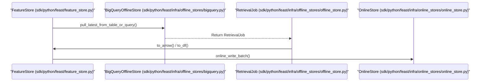

<!-- source: DeepWiki mcp.deepwiki.com · repo feast-dev/feast · page 3 Data Integration · fetched 2026-10-21 -->

# Data Integration

Relevant source files

The following files were used as context for generating this wiki page:

- [protos/feast/core/DataSource.proto](protos/feast/core/DataSource.proto)
- [sdk/python/feast/data_source.py](sdk/python/feast/data_source.py)
- [sdk/python/feast/infra/offline_stores/bigquery.py](sdk/python/feast/infra/offline_stores/bigquery.py)
- [sdk/python/feast/infra/offline_stores/bigquery_source.py](sdk/python/feast/infra/offline_stores/bigquery_source.py)
- [sdk/python/feast/infra/offline_stores/contrib/athena_offline_store/athena.py](sdk/python/feast/infra/offline_stores/contrib/athena_offline_store/athena.py)
- [sdk/python/feast/infra/offline_stores/contrib/athena_offline_store/athena_source.py](sdk/python/feast/infra/offline_stores/contrib/athena_offline_store/athena_source.py)
- [sdk/python/feast/infra/offline_stores/contrib/couchbase_offline_store/couchbase_source.py](sdk/python/feast/infra/offline_stores/contrib/couchbase_offline_store/couchbase_source.py)
- [sdk/python/feast/infra/offline_stores/contrib/mssql_offline_store/mssql.py](sdk/python/feast/infra/offline_stores/contrib/mssql_offline_store/mssql.py)
- [sdk/python/feast/infra/offline_stores/contrib/mssql_offline_store/mssqlserver_source.py](sdk/python/feast/infra/offline_stores/contrib/mssql_offline_store/mssqlserver_source.py)
- [sdk/python/feast/infra/offline_stores/contrib/postgres_offline_store/postgres.py](sdk/python/feast/infra/offline_stores/contrib/postgres_offline_store/postgres.py)
- [sdk/python/feast/infra/offline_stores/contrib/postgres_offline_store/postgres_source.py](sdk/python/feast/infra/offline_stores/contrib/postgres_offline_store/postgres_source.py)
- [sdk/python/feast/infra/offline_stores/contrib/spark_offline_store/spark.py](sdk/python/feast/infra/offline_stores/contrib/spark_offline_store/spark.py)
- [sdk/python/feast/infra/offline_stores/contrib/spark_offline_store/spark_source.py](sdk/python/feast/infra/offline_stores/contrib/spark_offline_store/spark_source.py)
- [sdk/python/feast/infra/offline_stores/contrib/trino_offline_store/trino.py](sdk/python/feast/infra/offline_stores/contrib/trino_offline_store/trino.py)
- [sdk/python/feast/infra/offline_stores/contrib/trino_offline_store/trino_source.py](sdk/python/feast/infra/offline_stores/contrib/trino_offline_store/trino_source.py)
- [sdk/python/feast/infra/offline_stores/file_source.py](sdk/python/feast/infra/offline_stores/file_source.py)
- [sdk/python/feast/infra/offline_stores/offline_store.py](sdk/python/feast/infra/offline_stores/offline_store.py)
- [sdk/python/feast/infra/offline_stores/offline_utils.py](sdk/python/feast/infra/offline_stores/offline_utils.py)
- [sdk/python/feast/infra/offline_stores/redshift.py](sdk/python/feast/infra/offline_stores/redshift.py)
- [sdk/python/feast/infra/offline_stores/redshift_source.py](sdk/python/feast/infra/offline_stores/redshift_source.py)
- [sdk/python/feast/infra/offline_stores/snowflake.py](sdk/python/feast/infra/offline_stores/snowflake.py)
- [sdk/python/feast/infra/offline_stores/snowflake_source.py](sdk/python/feast/infra/offline_stores/snowflake_source.py)
- [sdk/python/feast/infra/utils/aws_utils.py](sdk/python/feast/infra/utils/aws_utils.py)
- [sdk/python/tests/integration/offline_store/test_universal_historical_retrieval.py](sdk/python/tests/integration/offline_store/test_universal_historical_retrieval.py)
- [sdk/python/tests/unit/infra/offline_stores/contrib/postgres_offline_store/test_postgres.py](sdk/python/tests/unit/infra/offline_stores/contrib/postgres_offline_store/test_postgres.py)
- [sdk/python/tests/unit/infra/offline_stores/test_offline_store.py](sdk/python/tests/unit/infra/offline_stores/test_offline_store.py)
- [sdk/python/tests/unit/test_data_sources.py](sdk/python/tests/unit/test_data_sources.py)

## Purpose and Scope

Data Integration in Feast encompasses the systems and abstractions that connect feature definitions to underlying data sources and storage backends. This includes reading from batch and streaming data origins, storing features in offline stores for model training, serving features from online stores for real-time inference, and executing materialization pipelines to synchronize data between layers.

This is a parent wiki page providing a high-level overview of Feast's data integration architecture. For deep technical details, configuration options, and implementation specifics, refer to the child pages:
- **[Data Sources](#3.1)** — Documenting `DataSource` implementations (`FileSource`, `BigQuerySource`, `SnowflakeSource`, `SparkSource`, `PostgreSQLSource`), `PushSource`, and `RequestSource` [sdk/python/feast/data_source.py:153-166]().
- **[Offline Stores](#3.2)** — Explaining the `OfflineStore` interface [sdk/python/feast/infra/offline_stores/offline_store.py:44](), point-in-time joins, SQL generation pipelines, and the `RetrievalJob` abstraction [sdk/python/feast/infra/offline_stores/offline_store.py:92]().
- **[Online Stores](#3.3)** — Covering the `OnlineStore` interface, `online_read`/`online_write_batch` operations, key encoding, TTL management, and vector search capabilities.
- **[Materialization and Compute Engines](#3.4)** — Detailing the batch materialization process, the `ComputeEngine` DAG-based abstraction, and execution engines (Local, Spark, Ray, Snowflake, Kubernetes).

---

## Architecture Overview

Feast’s integration framework is organized around modular storage backends configured via `feature_store.yaml` [sdk/python/feast/repo_config.py:1]() and orchestrated through provider interfaces. 

### Feast Data Integration Code Entity Architecture

```mermaid
graph TB
    subgraph DataSources["Data Sources (sdk/python/feast/data_source.py)"]
        FileSource["FileSource (sdk/python/feast/infra/offline_stores/file_source.py)"]
        BigQuerySource["BigQuerySource (sdk/python/feast/infra/offline_stores/bigquery_source.py)"]
        SnowflakeSource["SnowflakeSource (sdk/python/feast/infra/offline_stores/snowflake_source.py)"]
        SparkSource["SparkSource (sdk/python/feast/infra/offline_stores/contrib/spark_offline_store/spark_source.py)"]
        PostgreSQLSource["PostgreSQLSource (sdk/python/feast/infra/offline_stores/contrib/postgres_offline_store/postgres_source.py)"]
    end

    subgraph OfflineStores["Offline Stores (sdk/python/feast/infra/offline_stores)"]
        OfflineStore["OfflineStore (sdk/python/feast/infra/offline_stores/offline_store.py)"]
        BigQueryOfflineStore["BigQueryOfflineStore (sdk/python/feast/infra/offline_stores/bigquery.py)"]
        SnowflakeOfflineStore["SnowflakeOfflineStore (sdk/python/feast/infra/offline_stores/snowflake.py)"]
        SparkOfflineStore["SparkOfflineStore (sdk/python/feast/infra/offline_stores/contrib/spark_offline_store/spark.py)"]
        PostgreSQLOfflineStore["PostgreSQLOfflineStore (sdk/python/feast/infra/offline_stores/contrib/postgres_offline_store/postgres.py)"]

        BigQueryOfflineStore -.implements.-> OfflineStore
        SnowflakeOfflineStore -.implements.-> OfflineStore
        SparkOfflineStore -.implements.-> OfflineStore
        PostgreSQLOfflineStore -.implements.-> OfflineStore
    end

    subgraph OnlineStores["Online Stores (sdk/python/feast/infra/online_stores)"]
        OnlineStore["OnlineStore (sdk/python/feast/infra/online_stores/online_store.py)"]
    end

    FileSource -->|"read by"| OfflineStore
    BigQuerySource -->|"queried by"| BigQueryOfflineStore
    SnowflakeSource -->|"queried by"| SnowflakeOfflineStore
    SparkSource -->|"queried by"| SparkOfflineStore
    PostgreSQLSource -->|"queried by"| PostgreSQLOfflineStore
    BigQueryOfflineStore -->|"materializes to"| OnlineStore
    SnowflakeOfflineStore -->|"materializes to"| OnlineStore
```

Sources:
- [sdk/python/feast/data_source.py:153-166]()
- [sdk/python/feast/infra/offline_stores/file_source.py:33]()
- [sdk/python/feast/infra/offline_stores/bigquery_source.py:24]()
- [sdk/python/feast/infra/offline_stores/snowflake_source.py:24]()
- [sdk/python/feast/infra/offline_stores/contrib/spark_offline_store/spark_source.py:32]()
- [sdk/python/feast/infra/offline_stores/contrib/postgres_offline_store/postgres_source.py:21]()
- [sdk/python/feast/infra/offline_stores/offline_store.py:44]()
- [sdk/python/feast/infra/offline_stores/bigquery.py:140]()
- [sdk/python/feast/infra/offline_stores/snowflake.py:183]()
- [sdk/python/feast/infra/offline_stores/contrib/spark_offline_store/spark.py:95]()
- [sdk/python/feast/infra/offline_stores/contrib/postgres_offline_store/postgres.py:77]()

---

## 3.1 Data Sources

Data sources define the ingestion points and metadata bindings for raw feature data. Feast supports various batch and streaming data origins, as well as runtime injection sources. Each `DataSource` subclass configures how columns map to feature views, entity keys, and event timestamps using properties like `timestamp_field` and `created_timestamp_column` [protos/feast/core/DataSource.proto:63-134]().

- **Batch Sources** include:
  - `FileSource` — defines filesystem paths and file formats for offline data, usable by Dask or DuckDB offline stores [sdk/python/feast/infra/offline_stores/file_source.py:33]().
  - `BigQuerySource` — encapsulates BigQuery datasets, tables, or queries [sdk/python/feast/infra/offline_stores/bigquery_source.py:24]().
  - `SnowflakeSource` — supports Snowflake database, schema, table, or query based batch data [sdk/python/feast/infra/offline_stores/snowflake_source.py:24]().
  - `SparkSource` — defines Spark tables, queries, or file paths with associated formats [sdk/python/feast/infra/offline_stores/contrib/spark_offline_store/spark_source.py:32]().
  - `PostgreSQLSource` — supports PostgreSQL tables or SQL queries [sdk/python/feast/infra/offline_stores/contrib/postgres_offline_store/postgres_source.py:21]().

- **Streaming and Push Sources** include:
  - `KafkaSource` and `KinesisSource` for stream ingestion [sdk/python/feast/data_source.py:35]().
  - `PushSource` for externally pushed updates [sdk/python/feast/data_source.py:163]().

- **RequestSource** provides support for user- or model-supplied feature data at serving time [sdk/python/feast/data_source.py:162]().

Each source type has validation methods and protobuf serialization to enable consistent storage and retrieval across Feast workflows.

For detailed configuration parameters, schema mappings, and validation methods, see [Data Sources](#3.1).

Sources:
- [sdk/python/feast/data_source.py:153-166]()
- [sdk/python/feast/infra/offline_stores/file_source.py:33-168]()
- [sdk/python/feast/infra/offline_stores/bigquery_source.py:20-80]()
- [sdk/python/feast/infra/offline_stores/snowflake_source.py:20-177]()

---

## 3.2 Offline Stores

Offline stores provide scalable analytical storage and query capabilities over historical feature data, crucial for generating training datasets with point-in-time correctness. The core `OfflineStore` interface defines methods such as `get_historical_features()` and `pull_latest_from_table_or_query()`, returning a `RetrievalJob` abstraction which supports lazy execution and result retrieval in Pandas or Arrow formats [sdk/python/feast/infra/offline_stores/offline_store.py:44]().

- **Implementations** include:
  - **BigQueryOfflineStore** — uses BigQuery SQL for point-in-time joins and data extraction, with configurations via `BigQueryOfflineStoreConfig` [sdk/python/feast/infra/offline_stores/bigquery.py:100-140]().
  - **SnowflakeOfflineStore** — leverages Snowflake SQL with connection configs and features like parquet offload [sdk/python/feast/infra/offline_stores/snowflake.py:124-183]().
  - **RedshiftOfflineStore** — supports AWS Redshift serverless or provisioned clusters with S3 staging [sdk/python/feast/infra/offline_stores/redshift.py:79-127]().
  - **SparkOfflineStore** — integrates with Spark sessions to execute batch feature queries on Spark SQL or file datasets [sdk/python/feast/infra/offline_stores/contrib/spark_offline_store/spark.py:75-95]().
  - **PostgreSQLOfflineStore** — supports querying PostgreSQL databases using SQL with partitioning and timestamp filters [sdk/python/feast/infra/offline_stores/contrib/postgres_offline_store/postgres.py:72-77]().

- **Point-in-Time Joins**: Offline stores typically build SQL queries with partitioning, timestamp filtering, and windowing logic to ensure feature correctness [sdk/python/feast/infra/offline_stores/offline_utils.py:88-187]().

- **RetrievalJob**: Once queries are prepared and submitted, `RetrievalJob` objects let users fetch results as DataFrames or Arrow tables transparently, supporting on-demand feature transformations and validations [sdk/python/feast/infra/offline_stores/offline_store.py:92-194]().

For detailed query generation logic, point-in-time join algorithms, and backend-specific drivers, see [Offline Stores](#3.2).

Sources:
- [sdk/python/feast/infra/offline_stores/offline_store.py:44-125]()
- [sdk/python/feast/infra/offline_stores/bigquery.py:100-140]()
- [sdk/python/feast/infra/offline_stores/snowflake.py:124-183]()
- [sdk/python/feast/infra/offline_stores/redshift.py:79-127]()
- [sdk/python/feast/infra/offline_stores/contrib/spark_offline_store/spark.py:75-95]()
- [sdk/python/feast/infra/offline_stores/contrib/postgres_offline_store/postgres.py:72-77]()
- [sdk/python/feast/infra/offline_stores/offline_utils.py:88-187]()

---

## 3.3 Online Stores

Online stores deliver low-latency, key-value feature retrieval to production ML models for inference. They provide fast read/write access to the latest feature states, often through key encoding mechanisms and optional TTL (time-to-live) for data freshness.

- **OnlineStore Interface**: Defines core methods such as `online_read` to fetch features by key, and `online_write_batch` to write new or updated feature data in batches [sdk/python/feast/infra/online_stores/online_store.py:1]().

- **Supported Backends**: Redis, DynamoDB, SQLite, PostgreSQL, Snowflake (`SnowflakeOnlineStore`) [sdk/python/feast/infra/online_stores/snowflake.py:72]() as well as vector databases like Milvus and Qdrant for managing embedding features, or Cassandra/ScyllaDB for high scalability.

- **Key Encoding and TTL**: Implementations handle feature key serialization, TTL configuration, and in some backends, support vector search capabilities for GenAI or similarity-based features.

For configuration instructions, supported features, and technical details on key encoding and vector search, see [Online Stores](#3.3).

Sources:
- [sdk/python/feast/infra/online_stores/online_store.py:1-50]()
- [sdk/python/feast/infra/online_stores/snowflake.py:72-164]()

---

## 3.4 Materialization and Compute Engines

Materialization synchronizes feature data from offline stores into online stores, enabling real-time serving of the latest feature values.

### Materialization Data Flow Sequence

Title: "Materialization Data Flow Sequence"

Sources:
- [sdk/python/feast/infra/offline_stores/bigquery.py:140-153]()
- [sdk/python/feast/infra/offline_stores/offline_store.py:92-105]()

---

Materialization is orchestrated by compute engines that execute feature extraction, transformation, and loading pipelines. Feast abstracts compute via a DAG-based `ComputeEngine` interface enabling different execution backends such as:

- Local execution for testing or small workloads.
- AWS Lambda for serverless scaling.
- Snowflake compute for integrated SQL processing.
- Spark and Ray for distributed data processing.
- Kubernetes operator for scalable production workflows.

For comprehensive coverage of materialization concepts, DAG abstractions, engine implementations, and job management, see [Materialization and Compute Engines](#3.4).

Sources:
- [sdk/python/feast/infra/offline_stores/offline_store.py:92-110]()

---

