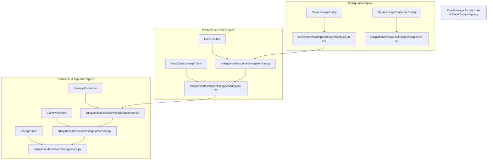
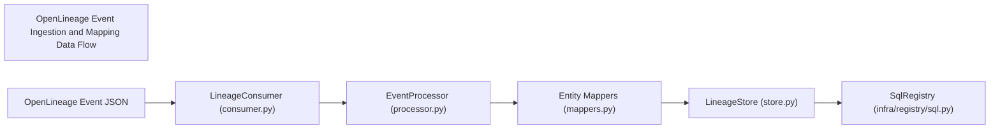

<!-- source: DeepWiki mcp.deepwiki.com · repo feast-dev/feast · page 8.8 OpenLineage Integration · fetched 2026-10-21 -->

# OpenLineage Integration

Relevant source files

The following files were used as context for generating this wiki page:

- [docs/how-to-guides/feast-operator/07-openlineage-and-materialization.md](docs/how-to-guides/feast-operator/07-openlineage-and-materialization.md)
- [docs/reference/openlineage.md](docs/reference/openlineage.md)
- [sdk/python/feast/openlineage/client.py](sdk/python/feast/openlineage/client.py)
- [sdk/python/feast/openlineage/config.py](sdk/python/feast/openlineage/config.py)
- [sdk/python/feast/openlineage/consumer.py](sdk/python/feast/openlineage/consumer.py)
- [skills/SKILL.md](skills/SKILL.md)
- [skills/references/configuration.md](skills/references/configuration.md)
- [skills/references/feature-definitions.md](skills/references/feature-definitions.md)
- [skills/references/retrieval-and-rag.md](skills/references/retrieval-and-rag.md)
- [ui/src/components/OpenLineageGraph.tsx](ui/src/components/OpenLineageGraph.tsx)
- [ui/src/components/RegistryVisualization.test.tsx](ui/src/components/RegistryVisualization.test.tsx)
- [ui/src/components/RegistryVisualization.tsx](ui/src/components/RegistryVisualization.tsx)
- [ui/src/components/RegistryVisualizationTab.tsx](ui/src/components/RegistryVisualizationTab.tsx)
- [ui/src/hooks/useFCOExploreSuggestions.ts](ui/src/hooks/useFCOExploreSuggestions.ts)
- [ui/src/pages/feature-views/FeatureViewLineageTab.tsx](ui/src/pages/feature-views/FeatureViewLineageTab.tsx)
- [ui/src/pages/feature-views/RegularFeatureViewInstance.tsx](ui/src/pages/feature-views/RegularFeatureViewInstance.tsx)
- [ui/src/pages/lineage/Index.tsx](ui/src/pages/lineage/Index.tsx)
- [ui/src/parsers/types.ts](ui/src/parsers/types.ts)

This page documents Feast's native integration with [OpenLineage](https://openlineage.io), an open standard for metadata and lineage collection. Feast functions both as an **OpenLineage event producer**—emitting lineage events during lifecycle operations like `feast apply` and materialization—and as a **consumer**, ingesting external lineage events for unified visualization in the Feast Web UI. This integration allows tracking data lineage across ML feature pipelines end-to-end [docs/reference/openlineage.md:1-4]().

---

## 1. System Architecture and Data Flow

The OpenLineage integration is implemented as a modular subsystem inside `sdk/python/feast/openlineage/` with distinct components responsible for configuration, client initialization, event emission, ingestion, processing, mapping, and storage.

### Component Architecture & Code Mapping

Below is a mapping diagram linking the conceptual OpenLineage architecture to key Python classes within Feast’s codebase:

**Sources:**  
[sdk/python/feast/openlineage/config.py:26-154](),  
[sdk/python/feast/openlineage/client.py:50-121](),  
[sdk/python/feast/openlineage/emitter.py](),  
[sdk/python/feast/openlineage/consumer.py](),  
[sdk/python/feast/openlineage/processor.py](),  
[sdk/python/feast/openlineage/store.py]()

---

## 2. Configuration & Options

OpenLineage integration is configured via the `openlineage` block in `feature_store.yaml` or via environment variables. The configuration is represented internally by `OpenLineageConfig` and `OpenLineageConsumerConfig` [sdk/python/feast/openlineage/config.py:26-154]().

### Configuration Fields

| Field                 | Type      | Default    | Description                                                                                  |
|-----------------------|-----------|------------|----------------------------------------------------------------------------------------------|
| `enabled`             | bool      | `true`     | Enable or disable OpenLineage integration                                                   |
| `transport_type`      | string    | `None`     | Transport protocol: `http`, `console`, `file`, or `kafka`; defaults to OpenLineage SDK def. |
| `transport_url`       | string    | —          | Base HTTP URL for lineage event posting (required for HTTP transport)                        |
| `transport_endpoint`  | string    | `api/v1/lineage` | API endpoint appended to transport URL                                                           |
| `api_key`             | string    | —          | Optional API key for authenticating with the lineage server                                 |
| `namespace`           | string    | `feast`    | Namespace prefix for lineage events                                                         |
| `producer`            | string    | `feast`    | Identifier for the event producer                                                           |
| `emit_on_apply`       | bool      | `true`     | Whether to emit lineage events on `feast apply`                                            |
| `emit_on_materialize` | bool      | `true`     | Whether to emit lineage events during materialization runs                                  |
| `consumer`            | dict      | `{}`       | Nested consumer configuration                                                               |

### Consumer Configuration

The consumer supports SQL backends (e.g., Feast SQL registry) for ingesting and storing lineage events [sdk/python/feast/openlineage/config.py:26-60]():

- `enabled`: Activate consumer event ingestion
- `store_type`: Backend store for lineage data, `sql` uses Feast SQL registry DB
- `connection_string`: Optionally override DB connection string
- `api_key`: API key to authenticate producers sending events
- `namespace_mapping`: Maps external OpenLineage namespaces to Feast projects for RBAC
- `retention_days`: Event retention policy, default 30 days
- `retention_check_interval_hours`: Pruning interval, default every 6 hours
- `standalone_server`: Indicates if pruning runs on a detached lineage server

**Sources:** [sdk/python/feast/openlineage/config.py:26-154](), [docs/reference/openlineage.md:60-100](), [skills/references/configuration.md:256-284]()

---

## 3. Event Emission and Producer Workflow

Feast’s `FeastOpenLineageClient` class wraps the OpenLineage Python SDK client providing Feast-specific helpers for emitting lineage events reflecting feature store lifecycle changes, such as registry changes and materialization [sdk/python/feast/openlineage/client.py:50-183]().

### Event Emission Lifecycle

- **Apply Operation Events:**  
  When running `FeatureStore.apply()`, Feast automatically emits lineage events representing the relationships between registry objects:
  - Entities, Data Sources, Feature Views, OnDemandFeatureViews, Feature Services, and Saved Datasets each produce corresponding OpenLineage datasets and jobs.
  - These events trace data dependencies and documented features for the applied configuration [docs/reference/openlineage.md:128-154]().

- **Materialization Events:**
  During `FeatureStore.materialize()`, Feast emits OpenLineage events indicating the start, successful completion, or failure of materialization runs.  
  - Input datasets are typically offline stores, while outputs are online stores, reflecting where data flows during ingestion.  
  - These events track feature freshness and data movement end-to-end [docs/reference/openlineage.md:119-123,172-173]().

Feast supports multiple transport types for event emission (`http` for Marquez, `console`, `file`, `kafka`), configured in the `feature_store.yaml`.

**Sources:** [sdk/python/feast/openlineage/client.py:50-183](), [sdk/python/feast/openlineage/emitter.py](), [docs/reference/openlineage.md:110-124](), [docs/how-to-guides/feast-operator/07-openlineage-and-materialization.md:1-217]()

---

## 4. Lineage Consumer, Server & Ingestion

Feast can also act as a **consumer** of OpenLineage events emitted by external orchestrators (e.g., Airflow, Spark). Enabling this mode integrates external lineage into Feast’s registry, enabling a unified lineage graph [docs/reference/openlineage.md:3,57]().

### Consumer Data Flow & Components

- The `LineageConsumer` receives incoming HTTP or Kafka events, delegating processing to `EventProcessor`.
- The `EventProcessor` normalizes events, then uses mappers to translate OpenLineage objects into Feast registry representations.
- `LineageStore` persists lineage metadata in the Feast SQL registry DB.
- The SQL registry (`SqlRegistry`) handles storage of the lineage-enhanced metadata with support for querying in the UI.

**Requirements & Notes:**

- The consumer requires the SQL registry backend (`registry_type: sql`) as file-based registries cannot store lineage event details.
- Namespace mappings provide RBAC connections bridging external lineage namespaces with Feast projects.
- Consumer also supports background retention/pruning and can run standalone as an ingestion service (`feast serve_lineage`).

**Sources:**  
[sdk/python/feast/openlineage/consumer.py](),  
[sdk/python/feast/openlineage/processor.py](),  
[sdk/python/feast/openlineage/mappers.py](),  
[sdk/python/feast/openlineage/store.py](),  
[sdk/python/feast/infra/registry/sql.py:120-182](),  
[docs/reference/openlineage.md:57-60]()

---

## 5. Web UI and Marquez Visualization

Feast exposes lineage visualization natively in its React Web UI, combining registry relationships with OpenLineage event lineage.

### UI Lineage Components

| Component                      | Purpose                                                                                   | File Location                                      |
|------------------------------|-------------------------------------------------------------------------------------------|---------------------------------------------------|
| `RegistryVisualization.tsx`   | Renders Feast registry graph with nodes like FeatureViews, Entities, DataSources, etc. Nodes are colored and symbolized by type. | `ui/src/components/RegistryVisualization.tsx:1-223` |
| `OpenLineageGraph.tsx`        | Displays extended OpenLineage event nodes (external jobs, datasets) in lineage view      | `ui/src/components/OpenLineageGraph.tsx` (not fully shown) |
| `LineagePage`                 | Main page toggling between registry lineage, jobs list, and raw events tabs with filtering and namespace selection. | `ui/src/pages/lineage/Index.tsx:1-194`            |

### UI Lineage Visual Example

The lineage graph includes Feast registry objects:

- Entities, DataSources, FeatureViews, FeatureServices, LabelViews, SavedDatasets
- Enriched with external lineage from OpenLineage runs and datasets, enabling a full graph of upstream/downstream dependencies

Users can toggle display between Feast-only lineage or combined OpenLineage views, filter by namespace, and explore events and job runs.

**Sources:**  
[ui/src/components/RegistryVisualization.tsx:1-223](),  
[ui/src/pages/lineage/Index.tsx:1-194](),  
[docs/reference/openlineage.md:44]()

---

## 6. Feast-to-OpenLineage Concept Mapping

Feast maps its feature store abstractions to OpenLineage concepts and uses custom facets to enrich the lineage metadata:

| Feast Concept          | OpenLineage Concept       | Feast Custom Facet / Representation           |
|-----------------------|---------------------------|-----------------------------------------------|
| `DataSource`           | `InputDataset`            | `FeastDataSourceFacet`                         |
| `Entity`               | `InputDataset`            | `FeastEntityFacet`                             |
| `FeatureView`          | `OutputDataset` (for FV job) / `InputDataset` (for FS, ODFV job) | `FeastFeatureViewFacet`                        |
| `OnDemandFeatureView`  | `OutputDataset`           | `FeastFeatureViewFacet` with `mode: ON_DEMAND`|
| `StreamFeatureView`    | `OutputDataset`           | `FeastFeatureViewFacet` with `mode: STREAM`   |
| `FeatureService`       | `OutputDataset`           | `FeastFeatureServiceFacet`                      |
| `SavedDataset`         | `OutputDataset`           | `FeastSavedDatasetFacet`                        |
| `Feature`              | Schema field in `SchemaDatasetFacet`                                                         |
| `Materialization`      | `RunEvent` (START/COMPLETE/FAIL) | `FeastMaterializationFacet`               |
| `Online Store` (per FV)| `OutputDataset`           | `FeastOnlineStoreFacet`                         |

This mapping enables comprehensive lineage tracking from raw data sources through features, processing jobs, and serving endpoints.

**Sources:** [docs/reference/openlineage.md:162-174](), [sdk/python/feast/openlineage/facets.py]()

---

# Summary

Feast's OpenLineage integration provides a robust mechanism for metadata and lineage tracking that is:

- **Configurable** via `feature_store.yaml` and environment
- **Automatic** in emitting lineage events on apply and materialization without code changes
- **Modular** in architecture with producer emission components and consumer ingestion capabilities
- **Unified** by ingesting external system lineage to augment Feast’s feature store metadata
- **Visual** through an integrated UI graph showing the topology and dependencies of features and data

This enables Feast users to leverage industry-standard lineage protocols like OpenLineage and ecosystem tools like Marquez to gain deep observability over feature engineering pipelines.

**Sources:**  
All above-cited files and docs.

---

