# Page: Overview

# Overview

<details>
<summary>Relevant source files</summary>

The following files were used as context for generating this wiki page:

- [CONTRIBUTING.md](CONTRIBUTING.md)
- [README.md](README.md)
- [docs/README.md](docs/README.md)
- [docs/SUMMARY.md](docs/SUMMARY.md)
- [docs/adr/ADR-0011-data-quality-monitoring.md](docs/adr/ADR-0011-data-quality-monitoring.md)
- [docs/blog/feast-0-18-adds-snowflake-support-and-data-quality-monitoring.md](docs/blog/feast-0-18-adds-snowflake-support-and-data-quality-monitoring.md)
- [docs/community.md](docs/community.md)
- [docs/getting-started/concepts/dataset.md](docs/getting-started/concepts/dataset.md)
- [docs/getting-started/third-party-integrations.md](docs/getting-started/third-party-integrations.md)
- [docs/reference/codebase-structure.md](docs/reference/codebase-structure.md)
- [docs/reference/data-sources/README.md](docs/reference/data-sources/README.md)
- [docs/reference/dqm.md](docs/reference/dqm.md)
- [docs/reference/offline-stores/README.md](docs/reference/offline-stores/README.md)
- [docs/reference/online-stores/README.md](docs/reference/online-stores/README.md)
- [docs/reference/providers/README.md](docs/reference/providers/README.md)
- [docs/roadmap.md](docs/roadmap.md)
- [infra/templates/README.md.jinja2](infra/templates/README.md.jinja2)
- [infra/website/docs/blog/feast-mlflow-kubeflow.md](infra/website/docs/blog/feast-mlflow-kubeflow.md)
- [sdk/python/feast/errors.py](sdk/python/feast/errors.py)
- [sdk/python/feast/feature_store.py](sdk/python/feast/feature_store.py)
- [sdk/python/feast/infra/online_stores/online_store.py](sdk/python/feast/infra/online_stores/online_store.py)
- [sdk/python/feast/infra/online_stores/sqlite.py](sdk/python/feast/infra/online_stores/sqlite.py)
- [sdk/python/feast/infra/passthrough_provider.py](sdk/python/feast/infra/passthrough_provider.py)
- [sdk/python/feast/infra/provider.py](sdk/python/feast/infra/provider.py)
- [sdk/python/feast/repo_config.py](sdk/python/feast/repo_config.py)
- [sdk/python/feast/repo_operations.py](sdk/python/feast/repo_operations.py)
- [sdk/python/tests/foo_provider.py](sdk/python/tests/foo_provider.py)

</details>


## Purpose and Scope

This document provides a high-level introduction to Feast (Fea**t**ure **St**ore), an open-source operational machine learning data system for managing and serving features for machine learning [sdk/python/feast/feature_store.py:164-174](), [README.md:29-38](). Feast acts as a configurable operational data system that bridges the gap between batch data pipelines and real-time online inference infrastructure [docs/README.md:13-14]().

As a parent page, this document summarizes Feast's core purpose, high-level architecture, quickstart workflows, and contribution guidelines. For comprehensive details, please refer to the dedicated child pages:
- For architectural deep dives and data flow patterns, see **[System Architecture](#1.1)**.
- For installation guides, feature repository initialization, and CLI commands, see **[Getting Started and CLI](#1.2)**.
- For developer environment setup, testing frameworks, and governance, see **[Contributing and Development Setup](#1.3)**.

Sources: [sdk/python/feast/feature_store.py:164-174](), [README.md:29-38](), [docs/README.md:13-14](), [docs/SUMMARY.md:3-49]()

## What is Feast?

Feast is designed to solve fundamental operational challenges in production machine learning pipelines. By providing a unified metadata registry and abstraction layer across offline and online storage systems, Feast helps machine learning platform teams achieve consistency, prevent data leakage, and decouple models from underlying data infrastructure [README.md:32-37]().

Concretely, Feast manages:
- An **offline store** for historical feature extraction used in model training and batch scoring [docs/README.md:9-10]().
- An **online store** for low-latency feature serving powering real-time inference [docs/README.md:10-11]().
- A **feature server** and Python SDK for querying and materializing features consistently [docs/README.md:18-20]().

Sources: [README.md:32-37](), [docs/README.md:9-20]()

---

## 1.1. System Architecture

Feast's architecture centers around the `FeatureStore` class [sdk/python/feast/feature_store.py:164-182](), which coordinates metadata stored in registry implementations such as `BaseRegistry` [sdk/python/feast/infra/registry/base_registry.py]() and the `Registry` itself, combined with the execution delegation through the `Provider` interface [sdk/python/feast/infra/provider.py:51-64](). 

The provider implements integration with various offline and online stores, plus batch compute engines and orchestration components configured via the `RepoConfig` object derived from `feature_store.yaml` [sdk/python/feast/repo_config.py:39-112](). This config-driven plugin model enables Feast to support multiple storage and compute backends transparently.

Key architectural components include:
- **Registry(s):** Persist feature metadata and definitions, serving as the source of truth
- **Offline Stores:** Systems such as BigQuery or Snowflake for historical, batch feature retrieval
- **Online Stores:** Low-latency key-value stores like Redis or DynamoDB for serving features in real time
- **Batch Compute Engines:** Orchestrate materialization of features from offline to online stores
- **Feature Server and SDK:** Query features consistently for training and serving workflows

Diagram: High-Level Feast Architecture and Code Entity Mapping

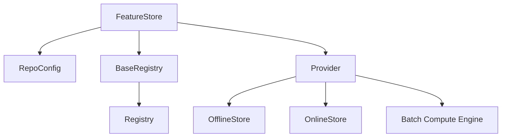

Sources: [sdk/python/feast/feature_store.py:164-182](), [sdk/python/feast/repo_config.py:39-112](), [sdk/python/feast/infra/provider.py:51-64]()

For details on the high-level architecture, registry topologies, store integrations, and data flow patterns governed by `feature_store.yaml`, see **[System Architecture](#1.1)**.

---

## 1.2. Getting Started and CLI

Getting started with Feast involves installing the Python package [README.md:47-50](), initializing a feature repository using the CLI command `feast init` [README.md:52-56](), registering feature definitions into the registry via `feast apply` [README.md:57-60](), and then using the SDK or feature server to retrieve features for training or online serving [README.md:70-156]().

Typical workflow steps include:
1. Installing Feast with `pip install feast`
2. Creating a feature repo scaffold with `feast init my_repo`
3. Defining feature entities, feature views, and sources as Python files
4. Running `feast apply` to register definitions in the metadata registry
5. Materializing features from offline to online stores
6. Reading features during batch training or online inference via SDK or feature server

Diagram: CLI Workflow and Registry Registration

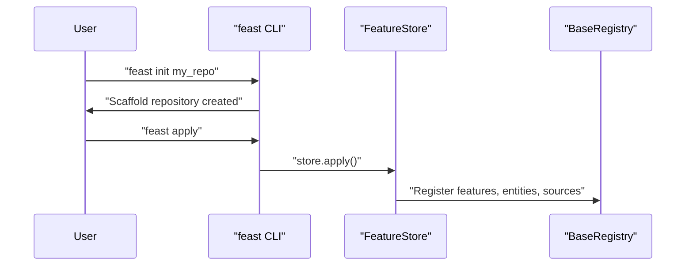

Sources: [README.md:47-60](), [sdk/python/feast/feature_store.py](), [docs/SUMMARY.md:3-49]()

For a step-by-step guide on installation, repository bootstrapping, CLI commands (`feast init`, `feast apply`, `feast serve`), and basic configuration, see **[Getting Started and CLI](#1.2)**.

---

## 1.3. Contributing and Development Setup

Contributing to Feast requires setting up a local development environment, running unit and integration tests, and adhering to repository standards including governance and code ownership [CONTRIBUTING.md:1-3](), [docs/community.md](). Feast provides scripts and templates for streamlined development and testing.

The contribution workflow typically involves:
- Cloning the repository and installing development dependencies
- Running test suites that cover diverse backend configurations
- Using linters and formatters to maintain code quality
- Following contribution guidelines including PR reviews and governance

Diagram: Development and Testing Workflow

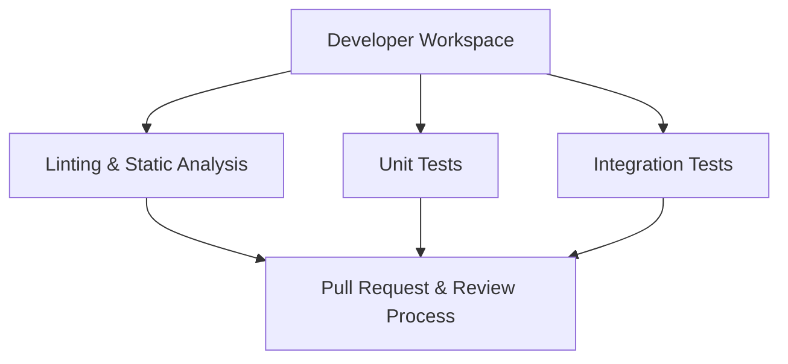

Sources: [README.md:10-14](), [CONTRIBUTING.md:1-3](), [docs/community.md]()

For comprehensive instructions on setting up your environment, running tests, understanding PR guidelines, and exploring community resources, see **[Contributing and Development Setup](#1.3)**.

---

# Page: System Architecture

# System Architecture

<details>
<summary>Relevant source files</summary>

The following files were used as context for generating this wiki page:

- [.gitbook.yaml](.gitbook.yaml)
- [CONTRIBUTING.md](CONTRIBUTING.md)
- [README.md](README.md)
- [docs/README.md](docs/README.md)
- [docs/SUMMARY.md](docs/SUMMARY.md)
- [docs/adr/ADR-0011-data-quality-monitoring.md](docs/adr/ADR-0011-data-quality-monitoring.md)
- [docs/blog/feast-0-18-adds-snowflake-support-and-data-quality-monitoring.md](docs/blog/feast-0-18-adds-snowflake-support-and-data-quality-monitoring.md)
- [docs/community.md](docs/community.md)
- [docs/getting-started/architecture/push-vs-pull-model.md](docs/getting-started/architecture/push-vs-pull-model.md)
- [docs/getting-started/architecture/write-patterns.md](docs/getting-started/architecture/write-patterns.md)
- [docs/getting-started/components/README.md](docs/getting-started/components/README.md)
- [docs/getting-started/components/feature-server.md](docs/getting-started/components/feature-server.md)
- [docs/getting-started/components/online-store.md](docs/getting-started/components/online-store.md)
- [docs/getting-started/components/open-telemetry.md](docs/getting-started/components/open-telemetry.md)
- [docs/getting-started/components/overview.md](docs/getting-started/components/overview.md)
- [docs/getting-started/concepts/data-ingestion.md](docs/getting-started/concepts/data-ingestion.md)
- [docs/getting-started/concepts/dataset.md](docs/getting-started/concepts/dataset.md)
- [docs/getting-started/concepts/label-view.md](docs/getting-started/concepts/label-view.md)
- [docs/getting-started/concepts/point-in-time-joins.md](docs/getting-started/concepts/point-in-time-joins.md)
- [docs/getting-started/third-party-integrations.md](docs/getting-started/third-party-integrations.md)
- [docs/how-to-guides/customizing-feast/README.md](docs/how-to-guides/customizing-feast/README.md)
- [docs/reference/beta-on-demand-feature-view.md](docs/reference/beta-on-demand-feature-view.md)
- [docs/reference/codebase-structure.md](docs/reference/codebase-structure.md)
- [docs/reference/data-sources/README.md](docs/reference/data-sources/README.md)
- [docs/reference/dqm.md](docs/reference/dqm.md)
- [docs/reference/feature-repository.md](docs/reference/feature-repository.md)
- [docs/reference/feature-repository/README.md](docs/reference/feature-repository/README.md)
- [docs/reference/offline-stores/README.md](docs/reference/offline-stores/README.md)
- [docs/reference/online-stores/README.md](docs/reference/online-stores/README.md)
- [docs/reference/providers/README.md](docs/reference/providers/README.md)
- [docs/roadmap.md](docs/roadmap.md)
- [infra/templates/README.md.jinja2](infra/templates/README.md.jinja2)
- [infra/website/docs/blog/feast-mlflow-kubeflow.md](infra/website/docs/blog/feast-mlflow-kubeflow.md)
- [infra/website/docs/blog/feast-openai-compatible-api.md](infra/website/docs/blog/feast-openai-compatible-api.md)
- [infra/website/public/images/blog/feast-openai-compat-flow.png](infra/website/public/images/blog/feast-openai-compat-flow.png)
- [sdk/python/feast/errors.py](sdk/python/feast/errors.py)
- [sdk/python/feast/feature_store.py](sdk/python/feast/feature_store.py)
- [sdk/python/feast/infra/online_stores/online_store.py](sdk/python/feast/infra/online_stores/online_store.py)
- [sdk/python/feast/infra/online_stores/sqlite.py](sdk/python/feast/infra/online_stores/sqlite.py)
- [sdk/python/feast/infra/passthrough_provider.py](sdk/python/feast/infra/passthrough_provider.py)
- [sdk/python/feast/infra/provider.py](sdk/python/feast/infra/provider.py)
- [sdk/python/feast/repo_config.py](sdk/python/feast/repo_config.py)
- [sdk/python/feast/repo_operations.py](sdk/python/feast/repo_operations.py)
- [sdk/python/tests/foo_provider.py](sdk/python/tests/foo_provider.py)
- [sdk/python/tests/unit/test_on_demand_feature_view_input_schema.py](sdk/python/tests/unit/test_on_demand_feature_view_input_schema.py)

</details>


## Purpose and Scope

This document describes the high-level architecture of Feast, an open-source operational machine learning data system designed for managing, storing, and serving machine learning features with strict point-in-time correctness. It details how the core components—the Registry (`BaseRegistry`), Offline Stores (`OfflineStore`), Online Stores (`OnlineStore`), Feature Servers, and Compute Engines—interact via the provider model (`Provider`). Furthermore, it explains how declarations in `feature_store.yaml` are parsed into repository configurations (`RepoConfig`) to dynamically wire these components together at runtime [sdk/python/feast/feature_store.py:164-190](), [sdk/python/feast/repo_config.py:30-122](), [sdk/python/feast/infra/provider.py:51-130]().

Sources:  
[sdk/python/feast/feature_store.py:164-190]()  
[sdk/python/feast/repo_config.py:30-122]()  
[sdk/python/feast/infra/provider.py:51-130]()

---

## Layered Architecture and Component Wiring

Feast adopts a modular, layered architecture that isolates metadata management, storage backends, and compute execution. At the core of the Python SDK is the `FeatureStore` class (`sdk/python/feast/feature_store.py`), which orchestrates feature creation, materialization, and retrieval operations by delegating backend-specific tasks to an implementation of the `Provider` interface (`sdk/python/feast/infra/provider.py`) [sdk/python/feast/feature_store.py:164-190](), [sdk/python/feast/infra/provider.py:51-130]().

### System Architecture to Code Entity Mapping

The following diagram bridges natural language architectural concepts to their concrete Python code entities across the codebase:

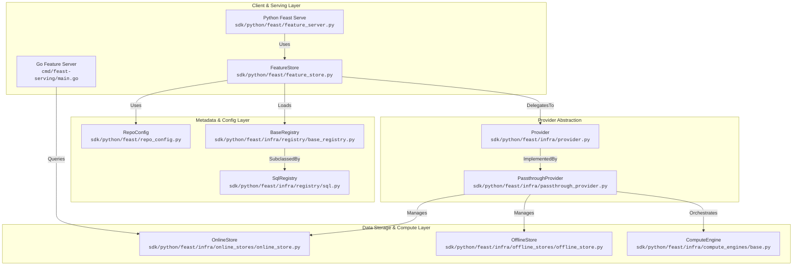

Sources:  
[sdk/python/feast/feature_store.py:164-190]()  
[sdk/python/feast/repo_config.py:30-122]()  
[sdk/python/feast/infra/provider.py:51-130]()  
[sdk/python/feast/infra/passthrough_provider.py:58-131]()

---

## Component Responsibilities and Implementation

### 1. Client & Orchestration Layer
- **`FeatureStore` (`sdk/python/feast/feature_store.py`)**: The primary entry point for users interacting with Feast. It coordinates operations such as `feast apply`, `get_historical_features()`, `get_online_features()`, and `materialize()`. Internally, it loads the feature store configuration (`RepoConfig`), initializes the `BaseRegistry` for metadata, and instantiates the `Provider` implementation for backend orchestration [sdk/python/feast/feature_store.py:164-190]().

- **CLI & Repository Operations (`sdk/python/feast/repo_operations.py`)**: Responsible for parsing user-defined Feast objects (e.g., `Entity`, `FeatureView`, `DataSource`) by scanning Python files in the feature repository. Implements `parse_repo()` which collects these objects into a `RepoContents` structure used for schema diffs and updates [sdk/python/feast/repo_operations.py:115-178]().

### 2. Metadata Layer (Registry)
- **`BaseRegistry` (`sdk/python/feast/infra/registry/base_registry.py`)**: Abstract interface for storing and retrieving feature and entity metadata objects. Supports different storage backends.

- **Concrete Registries**:  
  - `Registry` (`sdk/python/feast/infra/registry/registry.py`): Default registry backed by files and optionally object stores like S3 or GCS.  
  - `SqlRegistry` (`sdk/python/feast/infra/registry/sql.py`): Registry backed by SQL relational databases.  
  - `SnowflakeRegistry`, `RemoteRegistry`: Other concrete registry implementations for specific backends.

### 3. Provider & Storage Abstractions
- **`Provider` Interface (`sdk/python/feast/infra/provider.py`)**: Defines contracts for  
  - Updating and tearing down infrastructure (`update_infra()`, `teardown_infra()`),  
  - Online batch writes (`online_write_batch()` and async variant),  
  - Providing access to offline and online stores, and batch compute engines.

- **`PassthroughProvider` (`sdk/python/feast/infra/passthrough_provider.py`)**: The standard provider used by default. Delegates responsibilities directly to instantiated `OfflineStore`, `OnlineStore`, and `ComputeEngine` components based on the repo configuration. Manages initialization of these subcomponents lazily and forwards materialization, reading, and writing operations [sdk/python/feast/infra/passthrough_provider.py:59-188]().

### 4. Offline Store (`OfflineStore`)
- Manages historical feature data for training. Provides point-in-time correct feature retrieval through a `RetrievalJob`.
- Examples include BigQuery, Snowflake, Redshift, Dask, Spark, DuckDB, and file-based stores.

### 5. Online Store (`OnlineStore`)
- Supports low-latency feature retrieval for model inference.
- Defines interfaces for reading and writing batches of entities and features.
- Implementations include Redis, DynamoDB, SQLite, Postgres, Snowflake, and various vector stores.
- Is queried by feature servers like the Go and Python feature servers for serving online features at runtime.

### 6. Feature Servers
- Serve online features via HTTP/gRPC APIs.
- The Python feature server wraps the `FeatureStore` SDK for serving.
- The Go feature server provides a lightweight, standalone serving solution.
- Both serve features from online stores, sometimes caching feature data or orchestrating calls to the underlying storage layers.

Sources:  
[sdk/python/feast/feature_store.py:164-190]()  
[sdk/python/feast/repo_operations.py:115-178]()  
[sdk/python/feast/infra/provider.py:51-130]()  
[sdk/python/feast/infra/passthrough_provider.py:59-188]()  
[sdk/python/feast/infra/online_stores/online_store.py:44-167]()

---

## Data Flow Patterns and Execution Flow

### 1. Feature Registration (Control Plane)
- When a user runs `feast apply`, Feast scans the repository folder using `parse_repo()` to gather all declared Feast objects (`Entity`, `FeatureView`, `FeatureService`, etc.) into a `RepoContents` object [sdk/python/feast/repo_operations.py:115-178]().
- A diff is performed between the current registry state and the desired state, resulting in commands to add, update, or delete entities and feature views.
- The `Provider.update_infra()` method reconciles the cloud or local infrastructure by creating or deleting tables or other resources in the configured online and offline stores [sdk/python/feast/infra/provider.py:70-94]().

### 2. Historical Feature Retrieval (Training Data)
- Training datasets are created via `FeatureStore.get_historical_features()`.
- This delegates to the offline store via the `Provider`, using point-in-time join operations to guarantee no data leakage.
- The offline store returns a `RetrievalJob`, which fetches and processes the necessary data for model training [sdk/python/feast/infra/provider.py:29-30]().

### 3. Online Feature Retrieval (Inference)
- Real-time feature retrieval is done using `FeatureStore.get_online_features()` which queries the online store managed by the provider.
- The online store returns an `OnlineResponse` containing feature values for each entity requested.
- Feature servers (Go/Python) utilize this low-latency retrieval path to serve features in production environments [sdk/python/feast/infra/online_stores/online_store.py:107-167]().

### 4. Materialization

- Materialization loads offline feature data into the online store for low-latency serving.
- Users invoke `FeatureStore.materialize()` initiating a materialization job via the provider’s batch compute engine.
- The compute engine reads relevant historical data slices from the offline store, then writes feature rows in batches to the online store.
- This ensures online store freshness and point-in-time consistency.

### Materialization Data Flow Diagram

```mermaid
sequenceDiagram
    participant Client as "FeatureStore"
    participant Prov as "PassthroughProvider"
    participant Engine as "ComputeEngine"
    participant Off as "OfflineStore"
    participant On as "OnlineStore"

    Client->>Prov: "materialize(start_date, end_date)"
    Prov->>Engine: "run materialization task"
    Engine->>Off: "pull historical feature slice"
    Off-->>Engine: "feature dataframe / batch"
    Engine->>On: "online_write_batch(table, data)"
    On-->>Client: "write complete"
```

Sources:  
[sdk/python/feast/feature_store.py:164-190]()  
[sdk/python/feast/infra/passthrough_provider.py:58-188]()  
[sdk/python/feast/infra/online_stores/online_store.py:54-128]()

---

## Wiring via `feature_store.yaml` and `RepoConfig`

Feast’s architecture is configured declaratively through the `feature_store.yaml` file in a feature repository. This file defines key parameters like the backend provider, registry, offline store, online store, and batch engine configurations.

- The Python `RepoConfig` class parses this YAML file and maps string identifiers to precise Python classes using internal mapping dictionaries, enabling Feast to dynamically instantiate correct backends at runtime [sdk/python/feast/repo_config.py:30-122]().

### Backend Class Mapping Table

| Configuration Field    | YAML Key Example | Mapped Python Class / Module                                                                                       |
|-----------------------|------------------|------------------------------------------------------------------------------------------------------------------|
| `provider`            | `local`          | `feast.infra.passthrough_provider.PassthroughProvider` [sdk/python/feast/infra/provider.py:42-48]()              |
| `registry`            | `sql`            | `feast.infra.registry.sql.SqlRegistry` [sdk/python/feast/repo_config.py:39-44]()                                |
| `online_store.type`   | `redis`          | `feast.infra.online_stores.redis.RedisOnlineStore` [sdk/python/feast/repo_config.py:69-92]()                    |
| `offline_store.type`  | `bigquery`       | `feast.infra.offline_stores.bigquery.BigQueryOfflineStore` [sdk/python/feast/repo_config.py:94-112]()           |

The provider (`Provider`) reads the `RepoConfig` and constructs or delegates to the corresponding offline/online store and batch engine implementations, wiring together the entire Feast stack without users needing to write boilerplate code.

Sources:  
[sdk/python/feast/repo_config.py:30-122]()  
[sdk/python/feast/infra/provider.py:42-48]()

---

This design allows Feast to be highly extensible, with new providers, stores, registries, or compute engines added by simply registering new class mappings and dependencies, all controlled via simple YAML configuration.

# End of Document

---

# Page: Getting Started and CLI

# Getting Started and CLI

<details>
<summary>Relevant source files</summary>

The following files were used as context for generating this wiki page:

- [docs/getting-started/concepts/README.md](docs/getting-started/concepts/README.md)
- [docs/getting-started/concepts/entity.md](docs/getting-started/concepts/entity.md)
- [docs/getting-started/concepts/feature-retrieval.md](docs/getting-started/concepts/feature-retrieval.md)
- [docs/getting-started/concepts/feature-view.md](docs/getting-started/concepts/feature-view.md)
- [docs/getting-started/concepts/overview.md](docs/getting-started/concepts/overview.md)
- [docs/getting-started/concepts/stream-feature-view.md](docs/getting-started/concepts/stream-feature-view.md)
- [docs/getting-started/faq.md](docs/getting-started/faq.md)
- [docs/getting-started/quickstart.md](docs/getting-started/quickstart.md)
- [docs/reference/feast-cli-commands.md](docs/reference/feast-cli-commands.md)
- [docs/reference/offline-stores/spark.md](docs/reference/offline-stores/spark.md)
- [examples/java-demo/feature_repo/driver_repo.py](examples/java-demo/feature_repo/driver_repo.py)
- [examples/quickstart/quickstart.ipynb](examples/quickstart/quickstart.ipynb)
- [java/serving/src/test/resources/docker-compose/feast10/definitions.py](java/serving/src/test/resources/docker-compose/feast10/definitions.py)
- [java/serving/src/test/resources/docker-compose/feast10/materialize.py](java/serving/src/test/resources/docker-compose/feast10/materialize.py)
- [sdk/python/feast/aggregation/tiling/__init__.py](sdk/python/feast/aggregation/tiling/__init__.py)
- [sdk/python/feast/cli/cli.py](sdk/python/feast/cli/cli.py)
- [sdk/python/feast/templates/athena/feature_repo/feature_store.yaml](sdk/python/feast/templates/athena/feature_repo/feature_store.yaml)
- [sdk/python/feast/templates/athena/feature_repo/test_workflow.py](sdk/python/feast/templates/athena/feature_repo/test_workflow.py)
- [sdk/python/feast/templates/aws/feature_repo/feature_store.yaml](sdk/python/feast/templates/aws/feature_repo/feature_store.yaml)
- [sdk/python/feast/templates/cassandra/bootstrap.py](sdk/python/feast/templates/cassandra/bootstrap.py)
- [sdk/python/feast/templates/cassandra/feature_repo/feature_store.yaml](sdk/python/feast/templates/cassandra/feature_repo/feature_store.yaml)
- [sdk/python/feast/templates/hazelcast/bootstrap.py](sdk/python/feast/templates/hazelcast/bootstrap.py)
- [sdk/python/feast/templates/hbase/bootstrap.py](sdk/python/feast/templates/hbase/bootstrap.py)
- [sdk/python/feast/templates/hbase/feature_repo/feature_store.yaml](sdk/python/feast/templates/hbase/feature_repo/feature_store.yaml)
- [sdk/python/feast/templates/local/feature_repo/feature_store.yaml](sdk/python/feast/templates/local/feature_repo/feature_store.yaml)
- [sdk/python/feast/templates/minimal/feature_repo/feature_store.yaml](sdk/python/feast/templates/minimal/feature_repo/feature_store.yaml)
- [sdk/python/feast/templates/snowflake/bootstrap.py](sdk/python/feast/templates/snowflake/bootstrap.py)
- [sdk/python/feast/templates/snowflake/feature_repo/__init__.py](sdk/python/feast/templates/snowflake/feature_repo/__init__.py)
- [sdk/python/feast/templates/snowflake/feature_repo/feature_store.yaml](sdk/python/feast/templates/snowflake/feature_repo/feature_store.yaml)
- [sdk/python/feast/templates/spark/feature_repo/feature_store.yaml](sdk/python/feast/templates/spark/feature_repo/feature_store.yaml)
- [sdk/python/tests/unit/cli/test_cli.py](sdk/python/tests/unit/cli/test_cli.py)
- [sdk/python/tests/utils/cli_repo_creator.py](sdk/python/tests/utils/cli_repo_creator.py)
- [ui/feature_repo/features.py](ui/feature_repo/features.py)

</details>


## Purpose and Scope
This page covers the initial setup and command-line interface (CLI) for Feast. It details how to install the Feast package, initialize a feature repository using `feast init`, configure storage and metadata backends via `feature_store.yaml`, and execute core CLI commands such as `feast apply`, `feast materialize`, and `feast serve`.

Sources:  
[docs/getting-started/quickstart.md:27-40]()  
[docs/reference/feast-cli-commands.md:1-6]()

---

## Installation

Feast is distributed as a Python package and requires Python 3.9 or above [docs/getting-started/quickstart.md:19-19](). It can be installed directly from PyPI via `pip`:

```bash
pip install feast
```

This installation includes both the Python SDK and the `feast` command-line utility. At runtime, the core feature orchestration is managed by the `FeatureStore` class [sdk/python/feast/feature_store.py](), and configuration parsing is handled by `load_repo_config()` [sdk/python/feast/cli/cli.py:57-57]().

Sources:  
[docs/getting-started/quickstart.md:19-19]()  
[sdk/python/feast/cli/cli.py:57-57]()

---

## Initializing a Feature Repository

### The `feast init` Command

The `feast init` command bootstraps a new feature repository by copying template scaffolding to a target directory [docs/getting-started/quickstart.md:78-87](). It generates project directories, sample feature definitions, sample data, and the primary configuration file (`feature_store.yaml`) [docs/getting-started/quickstart.md:99-103]().

Example usage:

```bash
feast init my_project
cd my_project/feature_repo
```

Internally, `init_repo` in `sdk/python/feast/repo_operations.py` manages this initialization process by locating template directories, copying assets, and rendering configuration templates [sdk/python/feast/cli/cli.py:63-63]().

Sources:  
[docs/getting-started/quickstart.md:78-87]()  
[sdk/python/feast/cli/cli.py:63-63]()

### Repository Structure and Configuration

A typical initialized feature repository structure:

```
my_project/
├── feature_store.yaml          # Core configuration for Feast
├── feature_repo/
│   ├── example_repo.py         # Feature, entity, and data source definitions
│   └── test_workflow.py        # Example script demonstrating core Feast operations
└── data/
    └── driver_stats.parquet    # Parquet files for offline store demo
```

#### `feature_store.yaml` Basics

The `feature_store.yaml` file configures the project namespace, metadata registry storage, provider environments, and online/offline backends [docs/getting-started/quickstart.md:106-118]() [docs/reference/feature-store-yaml.md:5-63]().

```yaml
project: my_project
registry: data/registry.db
provider: local
online_store:
  type: sqlite
  path: data/online_store.db
entity_key_serialization_version: 3
```

| Field                         | Description                                                                                  |
|-------------------------------|----------------------------------------------------------------------------------------------|
| `project`                    | Namespace identifier for the feature store repository                                        |
| `registry`                   | File path or connection string for metadata storage (default: protobuf file or SQL registry) |
| `provider`                   | Workflow execution environment shorthand (`local`, `gcp`, `aws`, etc.)                       |
| `online_store`               | Configuration for low-latency key-value serving database (e.g., `sqlite`, `redis`, etc.)     |
| `entity_key_serialization_version` | Serialization format version for entity join keys (default: 3)                             |

Advanced configurations can specify metrics for a Python feature server (`feature_server`) and SQL-backed (MCP-enabled) registries (`registry`) [docs/reference/feature-store-yaml.md:37-50,58-63]().

Sources:  
[docs/getting-started/quickstart.md:106-118]()  
[docs/reference/feature-store-yaml.md:5-63]()  
[sdk/python/feast/cli/cli.py:63-63]()

---

## Core CLI Commands

The Feast CLI is built using `click` and defined in `sdk/python/feast/cli/cli.py` [sdk/python/feast/cli/cli.py:21-21](). Global options like `--chdir` (`-c`), `--log-level`, and `--feature-store-yaml` (`-f`) allow executing commands outside the target repository folder and using custom config locations [sdk/python/feast/cli/cli.py:86-102]().

### Primary Commands

- **`feast init`**: Creates a new feature store repository with example data, feature definitions, and configuration [sdk/python/feast/cli/cli.py:63-63]().

- **`feast apply`**:  
  Scans Python files in the feature repo for all Feast objects (`Entity`, `FeatureView`, `FeatureService`, etc.), validates definitions, stores metadata to the registry, and provisions infrastructure in the online and offline stores based on the configured `provider`. This executes through `FeatureStore.apply()` and updates the registry backend accordingly [docs/reference/feast-cli-commands.md:49-76]() [sdk/python/feast/cli/cli.py:154-194]().

- **`feast materialize` / `feast materialize-incremental`**:  
  Load feature data from offline storage into the online store for low-latency serving. These commands orchestrate reading historical features from offline sources and writing them to the online store. Incremental materialization enables efficient updates based on time windows [docs/reference/feast-cli-commands.md:28-29]().

- **`feast serve`**:  
  Launches the Python feature server exposing HTTP and gRPC APIs for `get-online-features`, feature ingestion (`push`), and registry access. It supports real-time serving of features to production applications [docs/reference/feast-cli-commands.md:33-34]().

- **`feast delete`**:  
  Deletes a Feast object (feature view, entity, etc.) from the registry and clears related infrastructure [sdk/python/feast/cli/cli.py:153-195]().

- **`feast configuration`**:  
  Displays the currently loaded configuration, merging user settings and defaults [docs/reference/feast-cli-commands.md:91-97]().

- **`feast demo-notebooks`**:  
  Generates demo Jupyter notebooks tailored for the project to showcase features, retrieval, and serving [docs/reference/feast-cli-commands.md:147-153]().

Sources:  
[sdk/python/feast/cli/cli.py:21-195]()  
[docs/reference/feast-cli-commands.md:20-161]()  

---

## CLI to Code Entity Mapping

This diagram provides a detailed mapping from the main CLI commands to their corresponding code entry points and core classes managing the feature store lifecycle and serving.

### CLI to Code Entity Space Mapping
```mermaid
graph TD
    CLIInit["cli.py:cli()"]
    CLIInit --> |"feast init"| RepoInit["repo_operations.py:init_repo()"]

    CLIApply["cli.py:apply()"]
    CLIApply --> |"feast apply"| FSApply["feature_store.py:FeatureStore.apply()"]
    FSApply --> |"update registry"| Reg["infra/registry/registry.py:Registry"]
    FSApply --> |"provision infra"| Prov["infra/provider.py:Provider.update_infra()"]

    CLIMaterialize["cli.py:materialize()"]
    CLIMaterialize --> |"feast materialize"| FSMat["feature_store.py:FeatureStore.materialize()"]
    FSMat --> |"read offline"| Offline["offline_stores/file.py:FileSource"]
    FSMat --> |"write online"| Online["infra/online_stores/sqlite.py:SqliteOnlineStore.online_write_batch()"]

    CLIServe["cli.py:serve_command()"]
    CLIServe --> |"feast serve"| Server["feature_server.py:start_server()"]
    Server --> |"handle /get-online-features"| GetOnline["feature_server.py:get_online_features_handler()"]
    Server --> |"handle /push"| PushAPI["feature_server.py:push_features_handler()"]

    CLIDelete["cli.py:delete()"]
    CLIDelete --> |"feast delete"| FSDelete["feature_store.py:FeatureStore.delete_*()"]

    CLIConfig["cli.py:configuration()"]
    CLIConfig --> |"feast configuration"| ConfigLoad["repo_config.py:load_repo_config()"]
```

Sources:  
[sdk/python/feast/cli/cli.py]()  
[sdk/python/feast/repo_operations.py]()  
[sdk/python/feast/feature_store.py]()  
[sdk/python/feast/infra/registry/registry.py]()  
[sdk/python/feast/infra/provider.py]()  
[sdk/python/feast/infra/online_stores/sqlite.py]()  
[sdk/python/feast/feature_server.py]()  
[sdk/python/feast/repo_config.py]()

---

## Quickstart Workflow

The typical user journey from repository initialization to feature serving is shown here. This sequence illustrates how CLI commands correspond to runtime processes, data flow, and internal API calls.

### Quickstart Execution Sequence
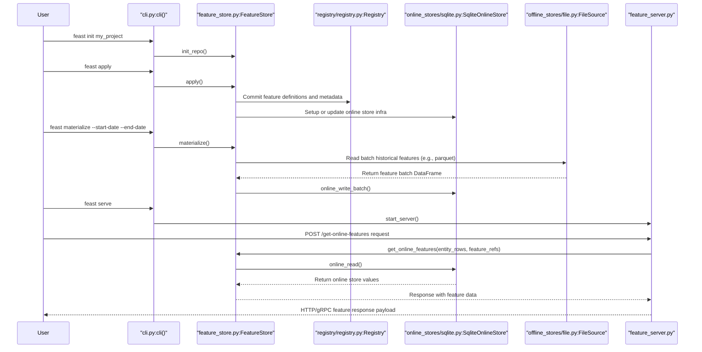

Sources:  
[docs/getting-started/quickstart.md:27-60]()  
[sdk/python/feast/cli/cli.py]()  
[sdk/python/feast/feature_store.py]()  
[sdk/python/feast/infra/registry/registry.py]()  
[sdk/python/feast/infra/online_stores/sqlite.py]()  
[sdk/python/feast/feature_server.py]()

---

# Summary

This page covered the fundamental steps to get started with Feast:

- Installation of the Feast Python SDK and CLI.
- Initialization of a feature repository via `feast init` with sample data and config.
- Overview of the `feature_store.yaml` configuration file and essential fields.
- Explanation and mapping of core CLI commands to code entities and workflows including `apply`, `materialize`, and `serve`.
- Illustration of the end-to-end quickstart workflow and the roles of key Feast components during operation.

This foundation enables users to define features, register them, ingest data, and serve features for real-time model inference using Feast's infrastructure.

For detailed tutorials, examples, and advanced usage, refer to the linked example repositories, quickstart notebooks, and other conceptual documentation pages.

# End of Page 1.2 - Getting Started and CLI

---

# Page: Contributing and Development Setup

# Contributing and Development Setup

<details>
<summary>Relevant source files</summary>

The following files were used as context for generating this wiki page:

- [.github/auto_assign.yml](.github/auto_assign.yml)
- [.github/pull_request_template.md](.github/pull_request_template.md)
- [.prow/plugins.yaml](.prow/plugins.yaml)
- [CODEOWNERS](CODEOWNERS)
- [LICENSE](LICENSE)
- [OWNERS](OWNERS)
- [SECURITY.md](SECURITY.md)
- [community/README.md](community/README.md)
- [community/governance.md](community/governance.md)
- [community/maintainers.md](community/maintainers.md)
- [docs/how-to-guides/feast-operator/07-openlineage-and-materialization.md](docs/how-to-guides/feast-operator/07-openlineage-and-materialization.md)
- [docs/project/contributing.md](docs/project/contributing.md)
- [docs/project/development-guide.md](docs/project/development-guide.md)
- [docs/project/maintainers.md](docs/project/maintainers.md)
- [docs/project/release-process.md](docs/project/release-process.md)
- [docs/reference/data-sources/push.md](docs/reference/data-sources/push.md)
- [docs/reference/openlineage.md](docs/reference/openlineage.md)
- [docs/reference/registries/README.md](docs/reference/registries/README.md)
- [docs/reference/registries/sql.md](docs/reference/registries/sql.md)
- [docs/specs/firebase_online_example.monopic](docs/specs/firebase_online_example.monopic)
- [docs/specs/firebase_online_example.png](docs/specs/firebase_online_example.png)
- [docs/specs/online_store_format.md](docs/specs/online_store_format.md)
- [docs/tutorials/azure/README.md](docs/tutorials/azure/README.md)
- [examples/kind-quickstart/README.md](examples/kind-quickstart/README.md)
- [examples/rbac-remote/README.md](examples/rbac-remote/README.md)
- [java/CONTRIBUTING.md](java/CONTRIBUTING.md)
- [protos/feast/types/EntityKey.proto](protos/feast/types/EntityKey.proto)
- [sdk/python/feast/openlineage/client.py](sdk/python/feast/openlineage/client.py)
- [sdk/python/feast/openlineage/config.py](sdk/python/feast/openlineage/config.py)
- [skills/SKILL.md](skills/SKILL.md)
- [skills/references/configuration.md](skills/references/configuration.md)
- [skills/references/feature-definitions.md](skills/references/feature-definitions.md)
- [skills/references/retrieval-and-rag.md](skills/references/retrieval-and-rag.md)

</details>


## Purpose and Scope

This page guides contributors through setting up their development environment, executing tests, navigating the codebase, and following the contribution workflow for Feast. Feast is a polyglot operational ML data system spanning Python, Go, and Java, coordinated via a central `Makefile` and modern dependency management tools.

Sources: [docs/project/development-guide.md:1-45]()

---

## Development Environment Setup

Setting up a local development environment requires specific tools to handle the polyglot dependency graph and ensure reproducible builds across platforms.

### Tooling Requirements

| Tool           | Purpose                                                                                   |
| -------------- | ----------------------------------------------------------------------------------------- |
| Python 3.10–3.12 | Supported SDK runtime and development environments                                       |
| `uv`           | Python dependency management and virtual environments                                    |
| `pixi`         | Cross-version Python dependency locking                                                  |
| `make`         | Task runner for builds, tests, and environment initialization                             |
| `pre-commit`   | Git hooks for automated linting and formatting                                          |
| Go 1.25.0      | Required for building the Go feature server and Feast Operator                            |
| Node.js / Yarn | Required for building and testing the React-based Web UI                                 |

### Environment Initialization Steps

1. **Install Python Development Dependencies and SDK in Editable Mode:**
   ```bash
   make install-python-dependencies-dev
   ```
2. **Install Pre-commit Hooks:**
   ```bash
   make install-precommit
   ```
3. **Optional Hadoop Dependencies (for Spark/Hadoop testing):**
   ```bash
   make install-hadoop-dependencies-ci
   ```

Sources: [docs/project/development-guide.md:94-98](), [.github/workflows/pr_registration_integration_tests.yml:31-36](), [.github/workflows/security.yml:97-100]()

---

## Code Quality and Standards

Feast enforces strict static analysis, formatting, and type-checking standards.

- **Python Formatting & Linting:** The repository uses `ruff` to lint and format Python code. Pre-commit hooks auto-run `ruff check --fix` and `ruff format` on commit.
- **Push Linter Gate:** Before pushing, the `lint-push` hook checks that no formatting violations were introduced.
- **Secret Detection:** `detect-secrets` runs via pre-commit to prevent accidental credential commits.
- **Conventional Commits:** Commit messages are validated via `commitlint` to comply with semantic release guidelines.

Run all local quality checks with:
```bash
make precommit-check
```

Sources: [.pre-commit-config.yaml:1-70]()

---

## Running Tests and Test Infrastructure

Feast tests are divided into unit tests and integration tests.

### Test Suite Organization

- **Unit Tests:** Located in `sdk/python/tests/unit`, for isolated parts such as registry diffs, CLI commands, schema inference, and protobuf serialization.
- **Integration Tests:** Located in `sdk/python/tests/integration`, covering interactions with offline and online stores, end-to-end feature retrieval, and feature serving.
- **Universal Test Framework:** Parametrized test fixtures in `sdk/python/tests/integration/feature_repos/` allow reuse of core retrieval tests across backends, enabling consistent testing without duplication.

Sources: [docs/project/development-guide.md:20-31]()

---

## Agent Skill Files and AI-Assisted Development

Feast maintains dedicated configuration directories to support AI coding assistants and agentic workflows:

- `skills/`: Contains domain knowledge, natural language skill files describing Feast concepts such as feature definitions, retrieval, and RAG approaches.
- `.claude/` and `.cursor/`: Agent configuration files that provide context on code structure, protobuf generation, test framework, and Python SDK interface patterns.

These skill files enable AI agents to generate valid feature definitions, custom store adapters, and test cases consistent with Feast's idioms.

Sources: [sdk/python/docs/source/feast.rst:1-24]()

---

## Codebase Architecture for Contributors

To facilitate understanding, here are two mermaid diagrams bridging natural language concepts to specific code entities within the Python SDK:

### Diagram 1: Core Concepts to Python SDK Entity Mapping

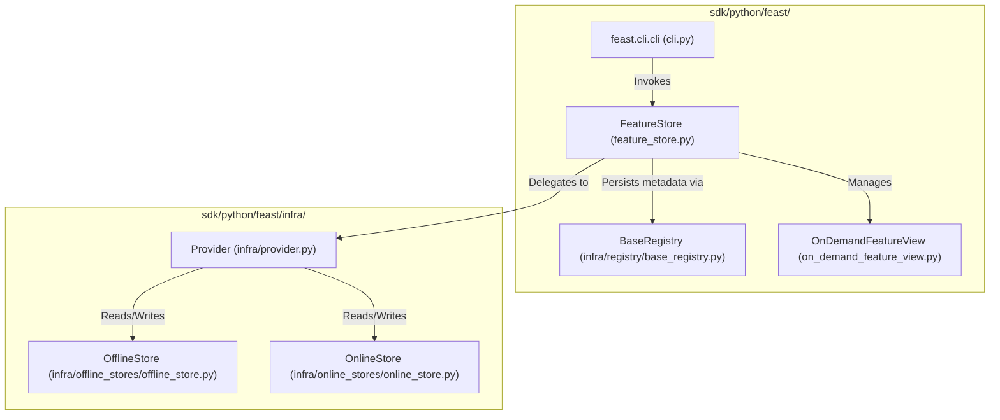

### Diagram 2: Contribution Workflow and CI/CD Pipeline

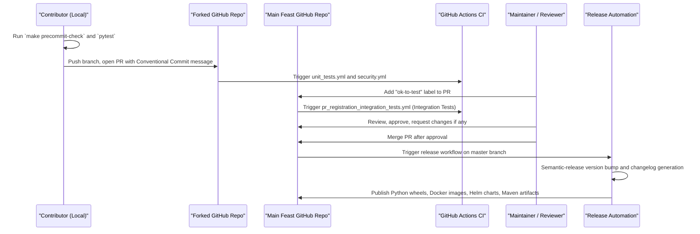

Sources: [sdk/python/docs/source/feast.rst:1-321](), [docs/project/development-guide.md:54-78](), [.github/workflows/security.yml:1-112](), [.github/workflows/pr_registration_integration_tests.yml:1-91]()

---

## Governance, CODEOWNERS, and Pull Request Templates

### Maintainers and Code Ownership

- **`OWNERS` file:** Lists approvers and reviewers responsible for gating e2e CI and overseeing architecture. Key maintainers include `tmihalac`, `accorvin`, and others [OWNERS:1-17]().
- **`CODEOWNERS` file:** Maps directory paths to specific teams or maintainers to enforce mandatory reviews.
- **Prow Integration:** Automates PR labeling, approval, assignation, and lifecycle commands via `.prow/plugins.yaml` [`.prow/plugins.yaml:1-44`]().
- **Maintainer Directory:** Full list of project and emeritus maintainers by organization is maintained in `community/maintainers.md` [community/maintainers.md:1-38]().

### Pull Request Guidelines

- **Conventional Commits:** PR titles must use prefixes (`feat:`, `fix:`, `chore:`, `docs:`) for automatic changelog generation [docs/project/development-guide.md:72]().
- **Sign-off Commits:** Every commit must be signed off (`git commit -s`) to comply with Developer Certificate of Origin (DCO) [docs/project/development-guide.md:105-111]().
- **Pre-commit Hooks:** Running formatters, linters, and secret scanning before commit [docs/project/development-guide.md:93-98]().
- **PR Template:** Contributors should use the standard PR template `.github/pull_request_template.md` which includes checks, testing strategy, and issue references [.github/pull_request_template.md:1-37]().

Sources: [OWNERS:1-17](), [community/maintainers.md:1-38](), [.prow/plugins.yaml:1-44](), [docs/project/development-guide.md:72,105-111](), [.github/pull_request_template.md:1-37]()

---

## Community Resources

- **Slack:** Active Feast Community Workspace for discussions and support.
- **GitHub Issues & Discussions:** For bug reports, feature requests, and RFC processes.
- **Maintainer Contact:** Detailed roles and contacts in `community/maintainers.md` [community/maintainers.md:1-38]().

Sources: [community/maintainers.md:1-38]()

---

# Summary

This page has outlined the steps and tools needed to get started contributing to Feast, described the testing architecture and code quality practices, detailed governance and contribution norms, and bridged domain concepts to specific code artifacts to accelerate onboarding. The use of agent skill files supports AI-powered development workflows within Feast’s growing ecosystem.

-------

# Appendix: References

- Development Guide: `docs/project/development-guide.md` [1-118]()
- Maintainers: `community/maintainers.md` [1-38]()
- OWNERS file: `OWNERS` [1-17]()
- PR Template: `.github/pull_request_template.md` [1-37]()
- Prow Plugins: `.prow/plugins.yaml` [1-44]()

# End of Page

---

# Page: Core Concepts

# Core Concepts

<details>
<summary>Relevant source files</summary>

The following files were used as context for generating this wiki page:

- [protos/feast/core/OnDemandFeatureView.proto](protos/feast/core/OnDemandFeatureView.proto)
- [sdk/python/feast/base_feature_view.py](sdk/python/feast/base_feature_view.py)
- [sdk/python/feast/diff/registry_diff.py](sdk/python/feast/diff/registry_diff.py)
- [sdk/python/feast/errors.py](sdk/python/feast/errors.py)
- [sdk/python/feast/feast_object.py](sdk/python/feast/feast_object.py)
- [sdk/python/feast/feature_store.py](sdk/python/feast/feature_store.py)
- [sdk/python/feast/feature_view.py](sdk/python/feast/feature_view.py)
- [sdk/python/feast/infra/compute_engines/spark/feature_builder.py](sdk/python/feast/infra/compute_engines/spark/feature_builder.py)
- [sdk/python/feast/infra/compute_engines/spark/nodes.py](sdk/python/feast/infra/compute_engines/spark/nodes.py)
- [sdk/python/feast/infra/online_stores/online_store.py](sdk/python/feast/infra/online_stores/online_store.py)
- [sdk/python/feast/infra/online_stores/sqlite.py](sdk/python/feast/infra/online_stores/sqlite.py)
- [sdk/python/feast/infra/passthrough_provider.py](sdk/python/feast/infra/passthrough_provider.py)
- [sdk/python/feast/infra/provider.py](sdk/python/feast/infra/provider.py)
- [sdk/python/feast/on_demand_feature_view.py](sdk/python/feast/on_demand_feature_view.py)
- [sdk/python/feast/repo_config.py](sdk/python/feast/repo_config.py)
- [sdk/python/feast/repo_operations.py](sdk/python/feast/repo_operations.py)
- [sdk/python/feast/transformation/pandas_transformation.py](sdk/python/feast/transformation/pandas_transformation.py)
- [sdk/python/feast/transformation/python_transformation.py](sdk/python/feast/transformation/python_transformation.py)
- [sdk/python/feast/transformation/ray_transformation.py](sdk/python/feast/transformation/ray_transformation.py)
- [sdk/python/feast/transformation/substrait_transformation.py](sdk/python/feast/transformation/substrait_transformation.py)
- [sdk/python/feast/transformation/udf_rehydrate.py](sdk/python/feast/transformation/udf_rehydrate.py)
- [sdk/python/feast/utils.py](sdk/python/feast/utils.py)
- [sdk/python/tests/component/spark/test_nodes.py](sdk/python/tests/component/spark/test_nodes.py)
- [sdk/python/tests/component/spark/test_spark.py](sdk/python/tests/component/spark/test_spark.py)
- [sdk/python/tests/foo_provider.py](sdk/python/tests/foo_provider.py)
- [sdk/python/tests/unit/infra/test_inference_unit_tests.py](sdk/python/tests/unit/infra/test_inference_unit_tests.py)
- [sdk/python/tests/unit/online_store/test_online_writes.py](sdk/python/tests/unit/online_store/test_online_writes.py)
- [sdk/python/tests/unit/test_on_demand_feature_view.py](sdk/python/tests/unit/test_on_demand_feature_view.py)
- [sdk/python/tests/unit/test_on_demand_python_transformation.py](sdk/python/tests/unit/test_on_demand_python_transformation.py)
- [sdk/python/tests/unit/test_utils.py](sdk/python/tests/unit/test_utils.py)
- [sdk/python/tests/unit/transformation/test_pandas_transformation.py](sdk/python/tests/unit/transformation/test_pandas_transformation.py)
- [sdk/python/tests/utils/test_wrappers.py](sdk/python/tests/utils/test_wrappers.py)

</details>


This page introduces the fundamental building blocks of Feast and how they interact to form an operational machine learning data system. These concepts provide the foundation for understanding how Feast manages feature definitions, stores metadata, handles data movement, and serves features for both training and inference.

As a parent page, this section provides a high-level architectural overview. For detailed subsystem implementations, configuration options, and deep dives, consult the respective child pages linked throughout.

---

## Overview

Feast is organized around a set of modular abstractions that work together to provide a complete feature store solution. At the center of this ecosystem is the `FeatureStore` class [sdk/python/feast/feature_store.py:164-174](), which coordinates interactions between feature definitions, metadata registries, providers, and storage backends.

### System Architecture and Component Relationships

The following diagram bridges the logical Feast architecture to its concrete codebase classes, showing how user definitions and registries coordinate through the central `FeatureStore` and `Provider` interfaces.

Title: "Feast Core Architecture and Class Mapping"

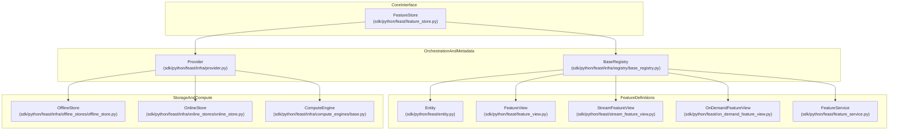

Sources: [sdk/python/feast/feature_store.py:164-174](), [sdk/python/feast/infra/provider.py:51-63](), [sdk/python/feast/repo_config.py:39-111]()

---

## 2.1. FeatureStore and Configuration

The `FeatureStore` class is the primary entry point for defining, creating, materializing, and retrieving features. It acts as the central orchestrator that manages feature definitions, interacts with the underlying registry and provider to manage metadata and infrastructure, and offers APIs for data retrieval and ingestion [sdk/python/feast/feature_store.py:164-204]().

`FeatureStore` is typically instantiated with a `RepoConfig` configuration object, which reads from the `feature_store.yaml` file in the feature repository directory to specify backend providers, offline and online stores, registry location, and other settings [sdk/python/feast/repo_config.py:39-111](). This config controls how Feast connects to storage and compute engines.

Key capabilities of the `FeatureStore` include:
- `apply()`: Registers or updates Feast objects (Entities, FeatureViews, etc.) in the registry.
- `get_historical_features()`: Constructs offline training datasets via point-in-time joins.
- `get_online_features()`: Retrieves low-latency feature vectors for inference requests.
- `materialize()`: Schedules or executes pipelines to move data from offline to online stores.

For a technical deep dive into the FeatureStore class, its configuration, and operation planning, see [FeatureStore and Configuration](#2.1).

Sources: [sdk/python/feast/feature_store.py:164-204](), [sdk/python/feast/repo_config.py:39-111]()

---

## 2.2. Provider and Store Abstractions

The `Provider` interface defines a pluggable backend abstraction responsible for managing data storage, retrieval, and infrastructure orchestration. It connects the core Feast runtime to specific storage implementations for both offline and online feature data, and the materialization compute engines [sdk/python/feast/infra/provider.py:51-63]().

Each provider is configured through the `RepoConfig` and implements methods such as:
- `update_infra()`: Synchronizes cloud or local infrastructure with Feast object definitions.
- `teardown_infra()`: Cleans up resources.
- `online_write_batch()`: Writes batches of feature rows to the online store.
- Integration with batch compute engines that execute point-in-time joins and materializations.

The default `PassthroughProvider` is a simple implementation that delegates calls directly to the configured offline store, online store, and batch engine, without additional orchestration logic [sdk/python/feast/infra/passthrough_provider.py:59-131](). This makes it easy to add new stores by implementing the offline or online store interfaces and configuring your repo.

For detailed interface definitions and descriptions of common provider implementations, see [Provider and Store Abstractions](#2.2).

Sources: [sdk/python/feast/infra/provider.py:51-63](), [sdk/python/feast/infra/passthrough_provider.py:59-131]()

---

## 2.3. Feature Views and Services

Feature views encapsulate a coherent group of related features along with their data sources, entities, and lifecycle parameters. A `FeatureView` declares the data source schema, entity associations, time-to-live (TTL) information, and online availability flags [sdk/python/feast/feature_view.py:110-183]().

Feast supports several types of feature views:
- **BatchFeatureView**: For batch offline data sources.
- **StreamFeatureView**: For real-time streaming data sources.
- **OnDemandFeatureView**: Experimental views that apply transformations on incoming data at request time to generate features dynamically [sdk/python/feast/on_demand_feature_view.py:115-184]().
- **LabelView**: To define labels for supervised learning.

`FeatureService` allows grouping multiple features across different feature views into coherent, versioned bundles intended for model training or serving [sdk/python/feast/feature_service.py]().

These abstractions facilitate managing feature lifecycle, versioning, and training-serving consistency.

For extensive documentation on FeatureView subclasses and FeatureServices, see [Feature Views and Services](#2.3).

Sources: [sdk/python/feast/feature_view.py:110-183](), [sdk/python/feast/on_demand_feature_view.py:115-184](), [sdk/python/feast/repo_operations.py:19-37]()

---

## 2.4. Entities, Fields, and Features

Entities represent core business objects identifiable by unique keys that link features to rows in offline and online stores. Each entity defines a name, join keys, and associated data types [sdk/python/feast/entity.py:28-108]().

Features are columns describing attributes or metrics associated with entities. `Field` objects define features or entity columns with names and data types, serving as schema primitives.

This layer manages how Feast serializes entity keys (`EntityKey` protobuf), performs schema inference, and controls joins in point-in-time correctness during training data computation and online lookups.

For a detailed explanation of entity composition, feature schemas, serialization, and join keys, see [Entities, Fields, and Features](#2.4).

Sources: [sdk/python/feast/entity.py:28-108](), [sdk/python/feast/field.py]()

---

## 2.5. Registry and Metadata Storage

The Registry is the authoritative metadata store for all Feast objects, including entities, feature views, data sources, permissions, saved datasets, and feature services. The base interface `BaseRegistry` and several implementations (`SqlRegistry`, `SnowflakeRegistry`, `RemoteRegistry`) support different storage backends for registry data [sdk/python/feast/infra/registry/base_registry.py:14-88](), [sdk/python/feast/repo_config.py:39-44]().

Registry management includes version tracking, caching, and concurrency controls to ensure consistency during `feast apply` workflows, schema upgrades, and feature retrieval operations.

The Registry is integral to the `FeatureStore` lifecycle, persisting object definitions and resolving feature requests.

For an in-depth review of registry design and implementations, see [Registry and Metadata Storage](#2.5).

Sources: [sdk/python/feast/infra/registry/base_registry.py:14-88](), [sdk/python/feast/repo_config.py:39-44]()

---

## 2.6. Type System and Conversions

Feast incorporates a comprehensive type system to provide consistent typing across feature definitions, runtime data, and storages. This system includes:
- `ValueType` enum defining supported primitive types such as integers, floats, strings, and complex types like vectors [sdk/python/feast/value_type.py:51]().
- `FeastType` classes (`Array`, `Map`, `Struct`) representing complex schema elements [sdk/python/feast/types.py]().
- Conversion utilities mapping Python native types to Feast types and Protobuf `Value` message serialization/deserialization [sdk/python/feast/utils.py:49-51]().

The type mapping ensures correctness and interoperability between Python SDK, offline compute engines, online stores, and registry representations.

For full details on Feast's type system and data conversion mechanics, see [Type System and Conversions](#2.6).

Sources: [sdk/python/feast/value_type.py:51](), [sdk/python/feast/utils.py:49-51](), [sdk/python/feast/types.py]()

---

# Summary Diagram: Natural Language Concepts to Code Entities

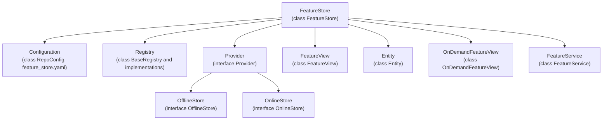

---

# Data Flow Pattern: Feature Registration to Serving

```mermaid
flowchart TB
    UserDefs["User-defined Feast Objects"] -->|apply()| Registry["Registry (Metadata Storage)"]
    Registry --> Provider["Provider (Backend Orchestration)"]
    Provider -->|manages| OfflineStore["OfflineStore (Historical Data)"]
    Provider -->|manages| OnlineStore["OnlineStore (Serving Store)"]
    Provider -.-> BatchEngine["ComputeEngine (Materialization)"]

    OfflineStore -->|point-in-time joins| FeatureStore["FeatureStore (Data Retrieval API)"]
    FeatureStore -->|get_online_features()| OnlineStore
    FeatureStore -->|get_historical_features()| OfflineStore
    FeatureStore --> UserApps["ML Model Training / Inference"]

    OnlineStore -->|low latency serving| UserApps
```

Sources: [sdk/python/feast/feature_store.py:164-204](), [sdk/python/feast/infra/provider.py:51-63](), [sdk/python/feast/infra/passthrough_provider.py:59-131](), [sdk/python/feast/feature_view.py:110-183](), [sdk/python/feast/on_demand_feature_view.py:115-184]()

---

## Navigation to Child Pages

- For an in-depth explanation of `FeatureStore` mechanics and configuration options, see [FeatureStore and Configuration](#2.1).
- To understand the `Provider` interface and how store abstractions enable backend flexibility, see [Provider and Store Abstractions](#2.2).
- To explore feature views, their variants, and feature service grouping, see [Feature Views and Services](#2.3).
- For details on entity definition, field and feature schemas, and join key serialization, see [Entities, Fields, and Features](#2.4).
- To learn about registry design, storage backends, and object versioning, see [Registry and Metadata Storage](#2.5).
- To study Feast’s type system and runtime conversions, see [Type System and Conversions](#2.6).

---

This page provides a high-level conceptual map of Feast’s core components to orient new technical contributors and users. Each subsection is linked to detailed child pages with implementation details, code examples, and configuration guidance.

# End of Core Concepts page.

---

# Page: FeatureStore and Configuration

# FeatureStore and Configuration

<details>
<summary>Relevant source files</summary>

The following files were used as context for generating this wiki page:

- [sdk/python/feast/constants.py](sdk/python/feast/constants.py)
- [sdk/python/feast/errors.py](sdk/python/feast/errors.py)
- [sdk/python/feast/feature_store.py](sdk/python/feast/feature_store.py)
- [sdk/python/feast/infra/online_stores/online_store.py](sdk/python/feast/infra/online_stores/online_store.py)
- [sdk/python/feast/infra/online_stores/sqlite.py](sdk/python/feast/infra/online_stores/sqlite.py)
- [sdk/python/feast/infra/passthrough_provider.py](sdk/python/feast/infra/passthrough_provider.py)
- [sdk/python/feast/infra/provider.py](sdk/python/feast/infra/provider.py)
- [sdk/python/feast/repo_config.py](sdk/python/feast/repo_config.py)
- [sdk/python/feast/repo_operations.py](sdk/python/feast/repo_operations.py)
- [sdk/python/feast/templates/local/bootstrap.py](sdk/python/feast/templates/local/bootstrap.py)
- [sdk/python/feast/templates/local/feature_repo/feature_definitions.py](sdk/python/feast/templates/local/feature_repo/feature_definitions.py)
- [sdk/python/tests/foo_provider.py](sdk/python/tests/foo_provider.py)
- [sdk/python/tests/unit/infra/scaffolding/test_repo_operations.py](sdk/python/tests/unit/infra/scaffolding/test_repo_operations.py)
- [ui/src/pages/label-views/ActiveLearningTab.tsx](ui/src/pages/label-views/ActiveLearningTab.tsx)
- [ui/src/pages/label-views/Index.tsx](ui/src/pages/label-views/Index.tsx)

</details>


This document provides a technical deep dive into the `FeatureStore` class, the primary interface in the Feast SDK, and the configuration system that governs its behavior. It explains the `FeatureStore` lifecycle, the structure and parsing of `RepoConfig` and `feature_store.yaml`, the internal apply and plan operations, and the plugin system leveraging providers for different backends.

---

## The FeatureStore Class

The `FeatureStore` class is the central orchestration point for defining, creating, and retrieving features. It is implemented in `[sdk/python/feast/feature_store.py:164-183]()` and integrates metadata handling, feature data retrieval, and backend interaction.

### Key Roles of `FeatureStore`

- **Metadata Management**: Interacts with the `Registry` to register, update, or fetch feature definitions.
- **Training Data Retrieval**: Provides point-in-time correct historical feature datasets via `get_historical_features`.
- **Online Serving**: Serves low-latency features with `get_online_features` `[sdk/python/feast/infra/online_stores/online_store.py:155-167]()`.
- **Materialization**: Moves features from offline to online stores through the `materialize` API.
- **Inference and Validation**: Uses inference utilities to automatically deduce event timestamp fields and feature schemas for improved developer experience `[sdk/python/feast/feature_store.py:82-85]()`.

#### Initialization and Configuration Resolution

When instantiating a `FeatureStore` object, configuration is established using this precedence:

1. **Direct `RepoConfig`**: If a `config` object of type `RepoConfig` is passed, it is used directly.
2. **Explicit YAML Path (`fs_yaml_file`)**: Feast loads the `feature_store.yaml` config from the specified path.
3. **Default YAML Path**: Defaults to `feature_store.yaml` inside the `repo_path` (default current working directory), or paths specified via environment variables.

This layered loading supports overriding config sources for flexibility in different deployment contexts.

#### Internal Components and Caching

- `_registry` (`Optional[BaseRegistry]`)  
  Lazily initialized registry instance managing metadata persistence and retrieval.

- `_provider` (`Optional[Provider]`)  
  Lazily initialized provider instance that manages offline/online stores and batch compute engines, determined dynamically by the `provider` field from `RepoConfig`.

- `_feature_service_cache` (`Dict[str, List[str]]`)  
  Caches expanded feature lists for feature services keyed by service name, improving query planning efficiency.

These components enable `FeatureStore` to serve as a unified interface between user-level feature definitions, persisted metadata, and operational backend stores.

---

### FeatureStore Entity Mapping Diagram

Title: FeatureStore Entity Mapping Diagram

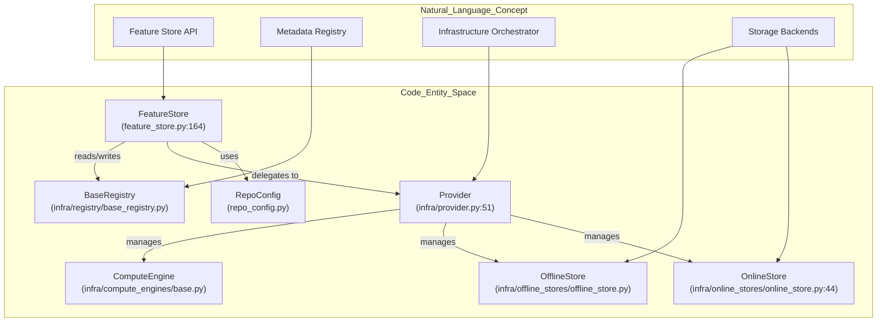

Sources: `[sdk/python/feast/feature_store.py:164-183]()`, `[sdk/python/feast/infra/provider.py:51-174]()`, `[sdk/python/feast/infra/online_stores/online_store.py:44-154]()`, `[sdk/python/feast/infra/offline_stores/offline_store.py]()`

---

## RepoConfig and `feature_store.yaml`

`RepoConfig` encapsulates configuration parameters of a Feast repository. It is a Pydantic model parsed from the `feature_store.yaml` file, supporting type validation, defaults, and field mapping `[sdk/python/feast/repo_config.py]()`. The config governs backends, project settings, and feature serving options.

### Key Fields in RepoConfig

| Field                  | Description                                                                                     | Example Values           |
|------------------------|-------------------------------------------------------------------------------------------------|--------------------------|
| `project`              | Names the project, uniquely identifying the repository scope.                                   | `"my_project"`           |
| `provider`             | Cloud or environment identifier. Used to dynamically load appropriate `Provider` implementation. | `"gcp"`, `"aws"`, `"local"` |
| `registry`             | Registry backend details including `type` and `path`.                                           | `type: "file"`, `path: "registry.db"` |
| `offline_store`        | Configuration of the offline store for batch feature data.                                      | `type: "bigquery"`       |
| `online_store`         | Online store config for low-latency feature serving.                                            | `type: "redis"`          |
| `batch_engine_config`  | Batch compute engine config for materialization and offline retrieval compute.                  | `type: "local"`          |
| `feature_server`       | Optional feature server deployment configuration.                                               | `type: "local"`          |

These fields are extensible to include credentials, custom parameters, and any backend-specific options.

### Backend Plugin Mappings

Feast implements a plugin system to dynamically load classes based on the config `type` fields. The key mapping dicts enable extensibility and backward compatibility, as enumerated below:

| Component     | Mapping Dict Name            | Snippet Location                      |
|---------------|-----------------------------|-------------------------------------|
| Registry      | `REGISTRY_CLASS_FOR_TYPE`    | `[sdk/python/feast/repo_config.py:39-44]()` |
| Offline Store | `OFFLINE_STORE_CLASS_FOR_TYPE` | `[sdk/python/feast/repo_config.py:94-112]()` |
| Online Store  | `ONLINE_STORE_CLASS_FOR_TYPE`  | `[sdk/python/feast/repo_config.py:69-92]()` |
| Batch Engine  | `BATCH_ENGINE_CLASS_FOR_TYPE`  | `[sdk/python/feast/repo_config.py:46-55]()` |
| Provider      | `PROVIDERS_CLASS_FOR_TYPE`     | `[sdk/python/feast/infra/provider.py:42-48]()` |

The mappings correlate a string type identifier to a fully qualified Python import path. Feast loads the class dynamically, enabling custom or external infrastructure integrations.

Sources: `[sdk/python/feast/repo_config.py:1-115]()`, `[sdk/python/feast/infra/provider.py:42-48]()`

---

## Apply Operation Lifecycle

The `apply` method in `FeatureStore` synchronizes in-code Feast objects with the Registry persisted state and manages physical infrastructure changes accordingly. It embodies the logic behind the `feast apply` CLI command and programmatic repo synchronization.

### Apply Execution Flow

1. **Parse Feature Repo**  
   Python files in the feature repository are scanned for Feast objects such as `Entities`, `FeatureViews`, `FeatureServices`, etc., respecting `.feastignore` exclusions. This is performed by `parse_repo` in `[sdk/python/feast/repo_operations.py:51-133]()`.  
   
2. **Fetch Registry and Compute Diff**  
   The current registry proto is fetched from the registry backend. Feast synthesizes the desired registry proto from parsed Feast objects, then calculates the diff using `diff_between` in `[sdk/python/feast/diff/registry_diff.py]()`.  
   
3. **Update Infrastructure via Provider**  
   The `Provider`'s `update_infra` method reconciles actual infrastructure resources (online stores, offline stores, compute engines) based on the diff. For example, `PassthroughProvider` instructs underlying stores to update schemas or deployments `[sdk/python/feast/infra/passthrough_provider.py:143-176]()`.  
   
4. **Apply Registry Changes to Persist Metadata**  
   The diff is persisted to the Registry via `apply_diff_to_registry`, ensuring serving and retrieval are consistent with the updated definitions.

### Apply Execution Sequence Diagram

Title: Apply Execution Sequence Diagram

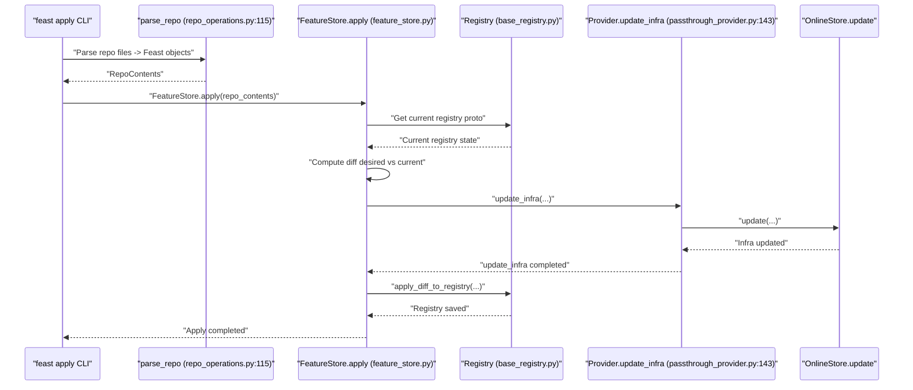

Sources: `[sdk/python/feast/feature_store.py]()`, `[sdk/python/feast/repo_operations.py:51-133]()`, `[sdk/python/feast/diff/registry_diff.py]()`, `[sdk/python/feast/infra/provider.py:69-94]()`, `[sdk/python/feast/infra/passthrough_provider.py:143-176]()`

---

## Infrastructure Planning (`plan`)

The `plan` method computes and displays diffs for registry and infrastructure changes without applying them. It is useful to understand the impact of changes before executing `apply`.

### Plan Operation Flow

1. **Parse Feature Repo**  
   Like `apply`, it parses Feast objects from repo files `[sdk/python/feast/repo_operations.py:115-133]()`.  
   
2. **Fetch Current Registry Proto**  
   Reads the current persisted metadata `[sdk/python/feast/feature_store.py]()`.  
   
3. **Diff Computation**  
   - Computes registry differences using `diff_between` `[sdk/python/feast/diff/registry_diff.py]()`.
   - Computes infra diff using provider's `plan_infra` returning `Infra` protos `[sdk/python/feast/infra/provider.py:96-107]()`.
   - Produces detailed infrastructure delta with `diff_infra_protos` `[sdk/python/feast/diff/infra_diff.py]()`.  

This process simulates what `apply` would do without modifying any state.

### Plan Execution Sequence Diagram

Title: Plan Execution Sequence Diagram

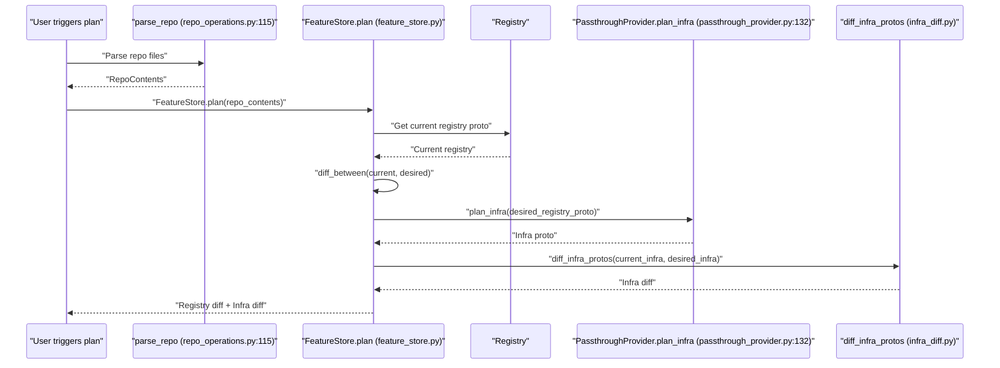

Sources: `[sdk/python/feast/feature_store.py]()`, `[sdk/python/feast/infra/provider.py:96-107]()`, `[sdk/python/feast/diff/infra_diff.py]()`, `[sdk/python/feast/repo_operations.py:115-133]()`

---

## Plugin System for Backends

Feast uses a plugin architecture to abstract integration with multiple offline stores, online stores, registries, and compute engines. This is centered around the `Provider` interface.

### Provider Interface

The abstract base class `Provider` defines the contract for different cloud environments or local setups. It manages lifecycle operations and orchestrates underlying components `[sdk/python/feast/infra/provider.py:51-174]()`. Key responsibilities:

- **Updating Infrastructure**: Provisioning/updating online and offline stores, compute engines.
- **Planning Infrastructure**: Dry-run plans to assess infra changes.
- **Teardown**: Removing cloud resources related to feature definitions.
- **Online Writes**: Writing feature rows to online stores in batches (sync/async).
- **Offline Retrieval and Materialization**: Delegates offline querying and batch materialization.
- **Supports Async Methods**: Explicit support indicators for async reads/writes.

### PassthroughProvider Example

`PassthroughProvider` is the default provider for local or simple cases. It directly delegates calls to configured offline store, online store, and batch compute engine without additional orchestration logic `[sdk/python/feast/infra/passthrough_provider.py:59-188]()`. It acts as a minimal bridge connecting Feast APIs to backend implementations.

#### Key delegation flow in PassthroughProvider:

- Lazily load offline store and online store based on `RepoConfig`.
- Provide a `batch_engine` instance for batch compute related operations.
- Update infrastructure only if online or batch engines exist.
- Teardown resources accordingly.
- Forward online writes and materialization commands to underlying stores/engines.

---

### Plugin Architecture Diagram

Title: Plugin Architecture Diagram

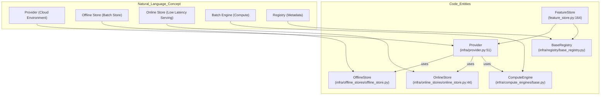

Sources: `[sdk/python/feast/infra/provider.py:51-174]()`, `[sdk/python/feast/infra/passthrough_provider.py:59-188]()`, `[sdk/python/feast/repo_config.py:39-112]()`, `[sdk/python/feast/feature_store.py:164-183]()`

---

*End of 2.1 FeatureStore and Configuration*

---

# Page: Provider and Store Abstractions

# Provider and Store Abstractions

<details>
<summary>Relevant source files</summary>

The following files were used as context for generating this wiki page:

- [docs/how-to-guides/online-server-performance-tuning.md](docs/how-to-guides/online-server-performance-tuning.md)
- [docs/reference/online-stores/dynamodb.md](docs/reference/online-stores/dynamodb.md)
- [protos/feast/core/DatastoreTable.proto](protos/feast/core/DatastoreTable.proto)
- [protos/feast/core/InfraObject.proto](protos/feast/core/InfraObject.proto)
- [protos/feast/core/PrecomputedFeatureVector.proto](protos/feast/core/PrecomputedFeatureVector.proto)
- [protos/feast/core/SqliteTable.proto](protos/feast/core/SqliteTable.proto)
- [sdk/python/feast/diff/infra_diff.py](sdk/python/feast/diff/infra_diff.py)
- [sdk/python/feast/errors.py](sdk/python/feast/errors.py)
- [sdk/python/feast/feature_store.py](sdk/python/feast/feature_store.py)
- [sdk/python/feast/infra/infra_object.py](sdk/python/feast/infra/infra_object.py)
- [sdk/python/feast/infra/online_stores/datastore.py](sdk/python/feast/infra/online_stores/datastore.py)
- [sdk/python/feast/infra/online_stores/dynamodb.py](sdk/python/feast/infra/online_stores/dynamodb.py)
- [sdk/python/feast/infra/online_stores/online_store.py](sdk/python/feast/infra/online_stores/online_store.py)
- [sdk/python/feast/infra/online_stores/sqlite.py](sdk/python/feast/infra/online_stores/sqlite.py)
- [sdk/python/feast/infra/passthrough_provider.py](sdk/python/feast/infra/passthrough_provider.py)
- [sdk/python/feast/infra/provider.py](sdk/python/feast/infra/provider.py)
- [sdk/python/feast/repo_config.py](sdk/python/feast/repo_config.py)
- [sdk/python/feast/repo_operations.py](sdk/python/feast/repo_operations.py)
- [sdk/python/tests/foo_provider.py](sdk/python/tests/foo_provider.py)
- [sdk/python/tests/unit/diff/test_infra_diff.py](sdk/python/tests/unit/diff/test_infra_diff.py)
- [sdk/python/tests/unit/infra/online_store/test_dynamodb_online_store.py](sdk/python/tests/unit/infra/online_store/test_dynamodb_online_store.py)

</details>


## Purpose and Scope

This document explains Feast's **Provider** and **Store** abstraction layers, which enable pluggable infrastructure implementations compatible with different cloud providers and storage backends. The Provider acts as an orchestrator coordinating the `OfflineStore` (for batch historical feature retrieval), the `OnlineStore` (for low-latency feature serving), and the `ComputeEngine` (for batch materialization compute).

These abstractions facilitate Feast's support for multiple storage and compute combinations (e.g., BigQuery, Snowflake, Redis, DynamoDB) accessed through a unified interface, enabling extensibility and cloud/provider agnosticism.

Sources: [sdk/python/feast/feature_store.py:164-183](), [sdk/python/feast/infra/provider.py:51-56](), [sdk/python/feast/infra/passthrough_provider.py:59-62]()

---

## Architecture Overview

The Provider abstraction pattern enables Feast to be cloud-agnostic and storage-agnostic by delegating infrastructure operations to pluggable components. The `FeatureStore` class [sdk/python/feast/feature_store.py:164-183]() instantiates a `Provider` instance [sdk/python/feast/infra/provider.py:51-56](), which in turn instantiates and manages the lifecycle of underlying stores and compute engines.

### Component Hierarchy and Code Entities

```mermaid
graph TB
    FS["\"FeatureStore\n(sdk/python/feast/feature_store.py)\""]
    RC["\"RepoConfig\n(sdk/python/feast/repo_config.py)\""]
    
    subgraph "ProviderLayer"
        PROV["\"Provider (ABC)\n(sdk/python/feast/infra/provider.py)\""]
        PT["\"PassthroughProvider\n(sdk/python/feast/infra/passthrough_provider.py)\""]
    end
    
    subgraph "StorageLayer"
        OFF["\"OfflineStore (ABC)\n(sdk/python/feast/infra/offline_stores/offline_store.py)\""]
        ON["\"OnlineStore (ABC)\n(sdk/python/feast/infra/online_stores/online_store.py)\""]
        BATCH["\"ComputeEngine (ABC)\n(sdk/python/feast/infra/compute_engines/base.py)\""]
    end
    
    subgraph "Implementations"
        OFF_IMPL["\"BigQueryOfflineStore / SnowflakeOfflineStore / DaskOfflineStore\""]
        ON_IMPL["\"RedisOnlineStore / DynamoDBOnlineStore / SqliteOnlineStore\""]
        BATCH_IMPL["\"LocalComputeEngine / SnowflakeComputeEngine / LambdaComputeEngine\""]
    end
    
    FS -->|"config"| RC
    FS -->|"_provider"| PROV
    RC -->|"configures"| PROV
    PROV -.->|"implementation"| PT
    
    PT -->|"offline_store property"| OFF
    PT -->|"online_store property"| ON
    PT -->|"batch_engine property"| BATCH
    
    OFF -.->|"implements"| OFF_IMPL
    ON -.->|"implements"| ON_IMPL
    BATCH -.->|"implements"| BATCH_IMPL
```

Sources: [sdk/python/feast/feature_store.py:176-181](), [sdk/python/feast/infra/provider.py:58-61](), [sdk/python/feast/infra/passthrough_provider.py:66-69]()

---

## Provider Interface

The `Provider` abstract base class [sdk/python/feast/infra/provider.py:51-56]() specifies the contract for a provider managing infrastructure lifecycle, batch and online reads/writes, and feature store orchestration. Providers are instantiated with a `RepoConfig` [sdk/python/feast/repo_config.py:1-115]() and must provide components for the offline store, online store, and optionally a batch compute engine.

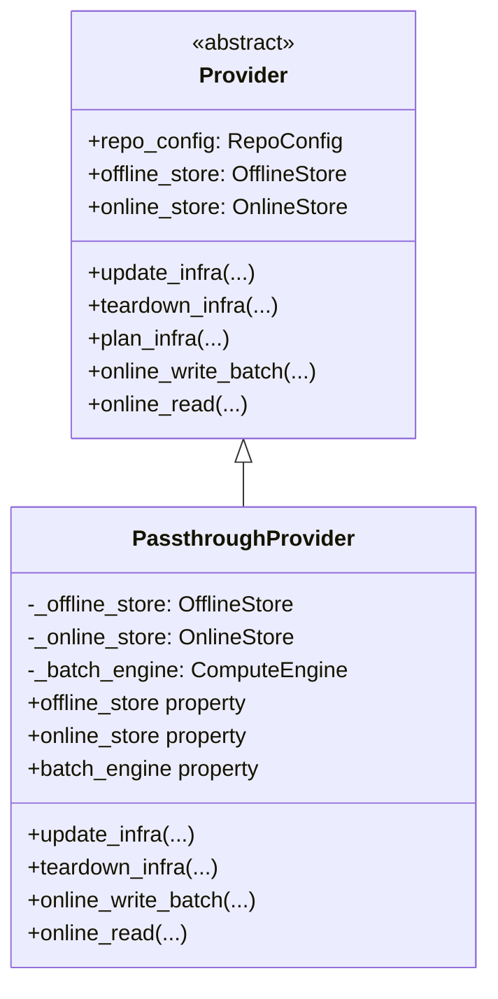

Sources: [sdk/python/feast/infra/provider.py:51-191](), [sdk/python/feast/infra/passthrough_provider.py:59-130]()

The interface includes:

- `update_infra()` to reconcile infrastructure resources with current Feast definitions [sdk/python/feast/infra/provider.py:71-93]().
- `teardown_infra()` to remove all infrastructure for a given project [sdk/python/feast/infra/provider.py:109-123]().
- `plan_infra()` to return an `Infra` object describing the required infrastructure for a desired state [sdk/python/feast/infra/provider.py:96-107]().
- `online_write_batch()` and `online_read()` for reading and writing to the online feature store [sdk/python/feast/infra/provider.py:126-150]().

Sources: [sdk/python/feast/infra/provider.py:51-191]()

---

### Provider Lifecycle Operations

| Method           | Purpose                                           | Implementation Details                                                                                  | Sources                                             |
|------------------|-------------------------------------------------|--------------------------------------------------------------------------------------------------------|-----------------------------------------------------|
| `update_infra()` | Reconcile existing infrastructure with Feast objects | Manages creation/deletion of feature view tables and entity resources; filters feature views based on `online` attribute | [sdk/python/feast/infra/provider.py:71-93](), [sdk/python/feast/infra/passthrough_provider.py:143-174]() |
| `teardown_infra()` | Destroy infrastructure associated with Feast objects | Removes online store and batch engine resources for specified views and entities                         | [sdk/python/feast/infra/provider.py:109-123](), [sdk/python/feast/infra/passthrough_provider.py:177-187]() |
| `plan_infra()`   | Generate Infra objects representing desired infra state | Returns an empty Infra by default; typically overridden by providers or delegated to underlying stores  | [sdk/python/feast/infra/provider.py:96-107](), [sdk/python/feast/infra/passthrough_provider.py:131-141]()  |

Sources: [sdk/python/feast/infra/provider.py:71-123](), [sdk/python/feast/infra/passthrough_provider.py:131-187]()

---

### Provider Instantiation

Providers are resolved from configuration using the mapping `PROVIDERS_CLASS_FOR_TYPE` [sdk/python/feast/infra/provider.py:42-48](). This allows `feature_store.yaml` to specify a provider type string (e.g. `"aws"`, `"gcp"`) which then loads the corresponding Provider class dynamically.

```mermaid
graph LR
    CONFIG["\"RepoConfig\n(sdk/python/feast/repo_config.py)\""]
    MAP["\"PROVIDERS_CLASS_FOR_TYPE\n(sdk/python/feast/infra/provider.py)\""]
    IMPORT["\"import_class()\n(sdk/python/feast/importer.py)\""]
    INSTANCE["\"PassthroughProvider\n(sdk/python/feast/infra/passthrough_provider.py)\""]
    
    CONFIG -->|"provider string"| MAP
    MAP -->|"class path"| IMPORT
    IMPORT -->|"instantiate"| INSTANCE
```

Sources: [sdk/python/feast/infra/provider.py:41-48](), [sdk/python/feast/repo_config.py:1-115](), [sdk/python/feast/infra/passthrough_provider.py:59-64]()

---

## Store Abstractions

Feast defines primary storage abstractions to separate concerns of feature serving and storage backend implementation:

- **OfflineStore**: retrieves features historically for training and batch jobs; supports retrieval jobs and batch SQL generation [sdk/python/feast/infra/offline_stores/offline_store.py:1-50]().
- **OnlineStore**: delivers low-latency feature data to production models, supports online reads and writes [sdk/python/feast/infra/online_stores/online_store.py:44-152]().

Sources: [sdk/python/feast/infra/offline_stores/offline_store.py:1-50](), [sdk/python/feast/infra/online_stores/online_store.py:44-152]()

---

### OnlineStore Interface

The `OnlineStore` interface [sdk/python/feast/infra/online_stores/online_store.py:44-52]() mandates async/sync methods for `online_read` and `online_write_batch`.

```mermaid
graph TB
    WRITE["\"online_write_batch()\n(sdk/python/feast/infra/online_stores/online_store.py)\""]
    DATA["\"List[Tuple[EntityKeyProto, Features, EventTimestamp, CreatedTimestamp]]\""]
    STORE["\"OnlineStore Implementations\n(RedisOnlineStore, DynamoDBOnlineStore, SqliteOnlineStore)\""]
    
    DATA --> WRITE
    WRITE --> STORE
    
    READ["\"online_read()\n(sdk/python/feast/infra/online_stores/online_store.py)\""]
    KEYS["\"List[EntityKeyProto]\""]
    RESULT["\"List[Tuple[Optional[datetime], Optional[Dict[str, ValueProto]]]]\""]
    
    KEYS --> READ
    STORE --> READ
    READ --> RESULT
```

Sources: [sdk/python/feast/infra/online_stores/online_store.py:55-152]()

---

### OnlineStore Implementation Examples

- **SqliteOnlineStore**: Local embedded key-value store supporting vector search features [sdk/python/feast/infra/online_stores/sqlite.py:1-72]().
- **DynamoDBOnlineStore**: Async AWS DynamoDB-backed store [sdk/python/feast/repo_config.py:74-74]().
- **RedisOnlineStore**: Supports multiple Redis modes and pipelined operations [sdk/python/feast/repo_config.py:73-73]().
- **MilvusOnlineStore**: Vector database integration for similarity search [sdk/python/feast/repo_config.py:88-88]().

Sources: [sdk/python/feast/infra/online_stores/sqlite.py:1-72](), [sdk/python/feast/repo_config.py:69-92]()

---

## Configuration System for Providers and Stores

Feast’s configuration system maps string keys from `feature_store.yaml` to Python classes via dictionaries in `repo_config.py`.

| Configuration Dictionary        | Description                                           | Example Mapping Entry                                                      | Sources                              |
|--------------------------------|-------------------------------------------------------|---------------------------------------------------------------------------|-------------------------------------|
| `PROVIDERS_CLASS_FOR_TYPE`       | Maps provider type strings to Provider classes        | `"aws": "feast.infra.passthrough_provider.PassthroughProvider"`            | [sdk/python/feast/infra/provider.py:42-46]() |
| `ONLINE_STORE_CLASS_FOR_TYPE`    | Maps online store strings to OnlineStore classes      | `"dynamodb": "feast.infra.online_stores.dynamodb.DynamoDBOnlineStore"`     | [sdk/python/feast/repo_config.py:69-92]()   |
| `OFFLINE_STORE_CLASS_FOR_TYPE`   | Maps offline store strings to OfflineStore classes    | `"bigquery": "feast.infra.offline_stores.bigquery.BigQueryOfflineStore"`   | [sdk/python/feast/repo_config.py:94-112]()  |
| `BATCH_ENGINE_CLASS_FOR_TYPE`    | Maps batch engine strings to ComputeEngine classes    | `"local": "feast.infra.compute_engines.local.compute.LocalComputeEngine"`  | [sdk/python/feast/repo_config.py:46-55]()   |
| `REGISTRY_CLASS_FOR_TYPE`        | Maps registry strings to Registry backends            | `"sql": "feast.infra.registry.sql.SqlRegistry"`                           | [sdk/python/feast/repo_config.py:39-44]()   |

Sources: [sdk/python/feast/repo_config.py:39-112](), [sdk/python/feast/infra/provider.py:41-48]()

---

## Provider-Store Integration: PassthroughProvider

The `PassthroughProvider` [sdk/python/feast/infra/passthrough_provider.py:59-62]() is Feast’s default provider implementation. It delegates operations to configured offline and online stores and batch engines based on the `RepoConfig`.

### Lazy Initialization of Stores and Batch Engine

```mermaid
graph TB
    subgraph "PassthroughProviderInstance"
        CONFIG["\"repo_config: RepoConfig\n(sdk/python/feast/repo_config.py)\""]
        NULL_OFF["\"_offline_store = None\""]
        NULL_ON["\"_online_store = None\""]
        NULL_BATCH["\"_batch_engine = None\""]
    end
    
    subgraph "LazyPropertyAccess"
        OFF_PROP["\"offline_store property\n(sdk/python/feast/infra/passthrough_provider.py)\""]
        ON_PROP["\"online_store property\n(sdk/python/feast/infra/passthrough_provider.py)\""]
        BATCH_PROP["\"batch_engine property\n(sdk/python/feast/infra/passthrough_provider.py)\""]
    end
    
    subgraph "StoreInitialization"
        OFF_RES["\"get_offline_store_from_config()\""]
        ON_RES["\"get_online_store_from_config()\""]
        BATCH_RES["\"Import and instantiate ComputeEngine\""]
    end
    
    CONFIG --> NULL_OFF
    CONFIG --> NULL_ON
    CONFIG --> NULL_BATCH
    
    NULL_OFF -->|"first access"| OFF_PROP
    NULL_ON -->|"first access"| ON_PROP
    NULL_BATCH -->|"first access"| BATCH_PROP
    
    OFF_PROP --> OFF_RES
    ON_PROP --> ON_RES
    BATCH_PROP --> BATCH_RES
```

Sources: [sdk/python/feast/infra/passthrough_provider.py:64-130](), [sdk/python/feast/repo_config.py:1-115]()

---

### Infrastructure Update Workflow in PassthroughProvider

```mermaid
sequenceDiagram
    participant FS as "\"FeatureStore\n(sdk/python/feast/feature_store.py)\""
    participant PROV as "\"PassthroughProvider\n(sdk/python/feast/infra/passthrough_provider.py)\""
    participant ON as "\"OnlineStore\n(sdk/python/feast/infra/online_stores/online_store.py)\""
    participant BATCH as "\"ComputeEngine\n(sdk/python/feast/infra/compute_engines/base.py)\""
    
    FS->>PROV: update_infra(...)
    Note over PROV: Filter tables with online=True or no online attribute
    PROV->>ON: update(...)
    activate ON
    ON-->>PROV: return
    
    alt if batch engine present
        PROV->>BATCH: update(...)
        activate BATCH
        BATCH-->>PROV: return
        deactivate BATCH
    end
    deactivate ON
```

Sources: [sdk/python/feast/infra/passthrough_provider.py:143-176](), [sdk/python/feast/feature_store.py:164-196]()

---

## Async Operations Support

Feast supports asynchronous operations via `async_supported` properties on both `Provider` [sdk/python/feast/infra/provider.py:67-68]() and `PassthroughProvider` [sdk/python/feast/infra/passthrough_provider.py:87-90]().

Sources: [sdk/python/feast/infra/provider.py:67-68](), [sdk/python/feast/infra/passthrough_provider.py:87-90]()

---

## Summary

The Feast Provider and Store abstractions enable:

1. **Cloud and Storage Backend Agnosticism:** Unified interfaces mapped via configuration [sdk/python/feast/infra/provider.py:42-48]().
2. **Modular Plug-ins:** Offline and online stores dynamically loaded from `repo_config.py` [sdk/python/feast/repo_config.py:39-112]().
3. **Provider Orchestration:** Coordinating resource lifecycles across backing stores [sdk/python/feast/infra/provider.py:51-56]().
4. **PassthroughProvider Adapter:** Default delegation mechanism [sdk/python/feast/infra/passthrough_provider.py:59-62]().
5. **Asynchronous Support:** Explicit protocol definitions for async reads/writes [sdk/python/feast/infra/provider.py:67-68]().

Sources: [sdk/python/feast/infra/provider.py:41-556](), [sdk/python/feast/infra/passthrough_provider.py:59-130](), [sdk/python/feast/repo_config.py:39-112]()

---

# Page: Feature Views and Services

# Feature Views and Services

<details>
<summary>Relevant source files</summary>

The following files were used as context for generating this wiki page:

- [protos/feast/core/FeatureService.proto](protos/feast/core/FeatureService.proto)
- [protos/feast/core/FeatureView.proto](protos/feast/core/FeatureView.proto)
- [protos/feast/core/FeatureViewProjection.proto](protos/feast/core/FeatureViewProjection.proto)
- [protos/feast/core/OnDemandFeatureView.proto](protos/feast/core/OnDemandFeatureView.proto)
- [protos/feast/core/StreamFeatureView.proto](protos/feast/core/StreamFeatureView.proto)
- [sdk/python/feast/base_feature_view.py](sdk/python/feast/base_feature_view.py)
- [sdk/python/feast/batch_feature_view.py](sdk/python/feast/batch_feature_view.py)
- [sdk/python/feast/diff/registry_diff.py](sdk/python/feast/diff/registry_diff.py)
- [sdk/python/feast/feast_object.py](sdk/python/feast/feast_object.py)
- [sdk/python/feast/feature_service.py](sdk/python/feast/feature_service.py)
- [sdk/python/feast/feature_view.py](sdk/python/feast/feature_view.py)
- [sdk/python/feast/feature_view_projection.py](sdk/python/feast/feature_view_projection.py)
- [sdk/python/feast/infra/compute_engines/__init__.py](sdk/python/feast/infra/compute_engines/__init__.py)
- [sdk/python/feast/infra/compute_engines/kubernetes/main.py](sdk/python/feast/infra/compute_engines/kubernetes/main.py)
- [sdk/python/feast/infra/compute_engines/local/feature_builder.py](sdk/python/feast/infra/compute_engines/local/feature_builder.py)
- [sdk/python/feast/infra/compute_engines/spark/__init__.py](sdk/python/feast/infra/compute_engines/spark/__init__.py)
- [sdk/python/feast/infra/compute_engines/spark/feature_builder.py](sdk/python/feast/infra/compute_engines/spark/feature_builder.py)
- [sdk/python/feast/infra/compute_engines/spark/nodes.py](sdk/python/feast/infra/compute_engines/spark/nodes.py)
- [sdk/python/feast/on_demand_feature_view.py](sdk/python/feast/on_demand_feature_view.py)
- [sdk/python/feast/protos/feast/core/DataSource_pb2.py](sdk/python/feast/protos/feast/core/DataSource_pb2.py)
- [sdk/python/feast/protos/feast/core/DataSource_pb2.pyi](sdk/python/feast/protos/feast/core/DataSource_pb2.pyi)
- [sdk/python/feast/protos/feast/core/FeatureService_pb2.py](sdk/python/feast/protos/feast/core/FeatureService_pb2.py)
- [sdk/python/feast/protos/feast/core/FeatureService_pb2.pyi](sdk/python/feast/protos/feast/core/FeatureService_pb2.pyi)
- [sdk/python/feast/protos/feast/core/FeatureView_pb2.py](sdk/python/feast/protos/feast/core/FeatureView_pb2.py)
- [sdk/python/feast/protos/feast/core/FeatureView_pb2.pyi](sdk/python/feast/protos/feast/core/FeatureView_pb2.pyi)
- [sdk/python/feast/protos/feast/core/StreamFeatureView_pb2.py](sdk/python/feast/protos/feast/core/StreamFeatureView_pb2.py)
- [sdk/python/feast/protos/feast/core/StreamFeatureView_pb2.pyi](sdk/python/feast/protos/feast/core/StreamFeatureView_pb2.pyi)
- [sdk/python/feast/protos/feast/core/Transformation_pb2.pyi](sdk/python/feast/protos/feast/core/Transformation_pb2.pyi)
- [sdk/python/feast/stream_feature_view.py](sdk/python/feast/stream_feature_view.py)
- [sdk/python/feast/transformation/base.py](sdk/python/feast/transformation/base.py)
- [sdk/python/feast/transformation/factory.py](sdk/python/feast/transformation/factory.py)
- [sdk/python/feast/transformation/mode.py](sdk/python/feast/transformation/mode.py)
- [sdk/python/feast/transformation/pandas_transformation.py](sdk/python/feast/transformation/pandas_transformation.py)
- [sdk/python/feast/transformation/python_transformation.py](sdk/python/feast/transformation/python_transformation.py)
- [sdk/python/feast/transformation/ray_transformation.py](sdk/python/feast/transformation/ray_transformation.py)
- [sdk/python/feast/transformation/spark_transformation.py](sdk/python/feast/transformation/spark_transformation.py)
- [sdk/python/feast/transformation/substrait_transformation.py](sdk/python/feast/transformation/substrait_transformation.py)
- [sdk/python/feast/transformation/udf_rehydrate.py](sdk/python/feast/transformation/udf_rehydrate.py)
- [sdk/python/feast/utils.py](sdk/python/feast/utils.py)
- [sdk/python/tests/benchmarks/test_bigquery_partition_pruning_benchmark.py](sdk/python/tests/benchmarks/test_bigquery_partition_pruning_benchmark.py)
- [sdk/python/tests/component/spark/test_nodes.py](sdk/python/tests/component/spark/test_nodes.py)
- [sdk/python/tests/component/spark/test_spark.py](sdk/python/tests/component/spark/test_spark.py)
- [sdk/python/tests/unit/infra/offline_stores/contrib/spark_offline_store/test_spark_bfv_compute_on_read.py](sdk/python/tests/unit/infra/offline_stores/contrib/spark_offline_store/test_spark_bfv_compute_on_read.py)
- [sdk/python/tests/unit/infra/offline_stores/test_bigquery.py](sdk/python/tests/unit/infra/offline_stores/test_bigquery.py)
- [sdk/python/tests/unit/infra/test_inference_unit_tests.py](sdk/python/tests/unit/infra/test_inference_unit_tests.py)
- [sdk/python/tests/unit/online_store/test_online_writes.py](sdk/python/tests/unit/online_store/test_online_writes.py)
- [sdk/python/tests/unit/test_feature_service.py](sdk/python/tests/unit/test_feature_service.py)
- [sdk/python/tests/unit/test_feature_views.py](sdk/python/tests/unit/test_feature_views.py)
- [sdk/python/tests/unit/test_on_demand_feature_view.py](sdk/python/tests/unit/test_on_demand_feature_view.py)
- [sdk/python/tests/unit/test_on_demand_python_transformation.py](sdk/python/tests/unit/test_on_demand_python_transformation.py)
- [sdk/python/tests/unit/test_utils.py](sdk/python/tests/unit/test_utils.py)
- [sdk/python/tests/unit/transformation/test_pandas_transformation.py](sdk/python/tests/unit/transformation/test_pandas_transformation.py)
- [sdk/python/tests/utils/test_wrappers.py](sdk/python/tests/utils/test_wrappers.py)
- [ui/src/components/FeatureServiceFormModal.tsx](ui/src/components/FeatureServiceFormModal.tsx)

</details>


This page documents the core abstractions in Feast used to organize, transform, and serve features for machine learning:

- **Feature Views** define logical groups of features that map data sources to feature schemas, specifying how features are materialized and served.
- **Feature Services** group multiple feature views or other feature groupings into named collections used for training and serving.
- **LabelView** stores mutable labels or judgments separately from immutable feature data, supporting workflows with multiple labelers and conflict policies.

We cover the following classes and their responsibilities:

- `FeatureView` [sdk/python/feast/feature_view.py:111-161]()
- `BatchFeatureView` [sdk/python/feast/batch_feature_view.py:31-85]()
- `StreamFeatureView` [sdk/python/feast/stream_feature_view.py:46-151]()
- `OnDemandFeatureView` [sdk/python/feast/on_demand_feature_view.py:116-259]()
- `LabelView` [sdk/python/feast/labeling/label_view.py]()
- `FeatureService` [sdk/python/feast/feature_service.py:35-160]()

This section explains their implementation, data flow, key APIs, and transformation modes.

For related concepts:
- See [FeatureStore and Configuration (2.1)](2.1) for applying and managing feature views.
- See [Provider and Store Abstractions (2.2)](2.2) for storage backends.
- See [Entities, Fields, and Features (2.4)](2.4) for entity definitions and feature typing.

Sources: [sdk/python/feast/feature_view.py:111-161](), [sdk/python/feast/batch_feature_view.py:31-85](), [sdk/python/feast/stream_feature_view.py:46-151](), [sdk/python/feast/on_demand_feature_view.py:116-259](), [sdk/python/feast/feature_service.py:33-160]()

---

## Feature View Overview

Feature views are the primary abstraction for defining and grouping features in Feast. Each `FeatureView` represents a collection of features sharing:

- **Source data:** Batch or streaming data sources or projections thereof.
- **Schema:** Feature names, data types, and associated join keys.
- **Entities:** The keys used to join for feature retrieval.
- **TTL:** Time to live defining feature validity duration.
- **Serving properties:** Whether features can be served online and/or offline.

Feast defines several specialized feature views:

| Type | Description | Source Type | Transformations Supported |
|---|---|---|---|
| `FeatureView` [sdk/python/feast/feature_view.py:111]() | Core batch features with optional batch/stream sources | Batch and/or stream data sources | None (raw features from sources) |
| `BatchFeatureView` [sdk/python/feast/batch_feature_view.py:31]() | Batch features with UDF transformations | Batch data source or derived from other FVs | User-defined function-based transformations (Python, SQL, Spark, Pandas, Ray) |
| `StreamFeatureView` [sdk/python/feast/stream_feature_view.py:46]() | Features computed from streaming + batch data | Stream sources plus batch for aggregations | UDF + time windowed aggregations |
| `OnDemandFeatureView` [sdk/python/feast/on_demand_feature_view.py:116]() | Features computed at request time | Composed from feature views, projections, and request data sources | UDF transformations (Python, Pandas, Substrait) |

### LabelView - Storing Mutable Labels

The `LabelView` abstraction supports storing mutable labels or human judgments separately from immutable feature data. This is crucial for multi-labeler workflows where labels can be updated or corrected independently over time.

Key features of `LabelView`:

- Defines a label dataset keyed by entities and timestamp.
- Supports multi-labeler workflows by capturing labels from different sources.
- Implements conflict resolution via `ConflictPolicy`.
- Facilitates training dataset generation by joining label data with feature views.

Sources: [sdk/python/feast/feature_view.py:111-161](), [sdk/python/feast/batch_feature_view.py:31-85](), [sdk/python/feast/stream_feature_view.py:46-151](), [sdk/python/feast/on_demand_feature_view.py:116-259](), [sdk/python/feast/feature_service.py:33-160]()

---

## Feature View Class Hierarchy and Code Entities

**Diagram: Feature View Class Hierarchy and Code Entities**

```mermaid
graph TD
    BaseFeatureView["BaseFeatureView (sdk/python/feast/base_feature_view.py)"]
    FeatureView["FeatureView (sdk/python/feast/feature_view.py)"]
    BatchFeatureView["BatchFeatureView (sdk/python/feast/batch_feature_view.py)"]
    StreamFeatureView["StreamFeatureView (sdk/python/feast/stream_feature_view.py)"]
    OnDemandFeatureView["OnDemandFeatureView (sdk/python/feast/on_demand_feature_view.py)"]
    LabelView["LabelView (sdk/python/feast/labeling/label_view.py)"]
    
    BaseFeatureView -->|inherits| FeatureView
    FeatureView -->|inherits| BatchFeatureView
    FeatureView -->|inherits| StreamFeatureView
    BaseFeatureView -->|inherits| OnDemandFeatureView
    BaseFeatureView -->|inherits| LabelView

    FeatureView -->|uses| DataSource["DataSource (sdk/python/feast/data_source.py)"]
    FeatureView -->|defines| Field["Field (sdk/python/feast/field.py)"]
    FeatureView -->|references| Entity["Entity (sdk/python/feast/entity.py)"]
    FeatureView -->|has| FeatureViewProjection["FeatureViewProjection (sdk/python/feast/feature_view_projection.py)"]

    BatchFeatureView -->|uses| Transformation["Transformation (sdk/python/feast/transformation/base.py)"]
    StreamFeatureView -->|uses| Aggregation["Aggregation (sdk/python/feast/aggregation.py)"]
    OnDemandFeatureView -->|uses| RequestSource["RequestSource (sdk/python/feast/data_source.py)"]
    LabelView -->|uses| ConflictPolicy["ConflictPolicy (sdk/python/feast/labeling/conflict_policy.py)"]
```

This diagram illustrates inheritance and composition across core Python classes:

- All feature views inherit from `BaseFeatureView` [sdk/python/feast/base_feature_view.py:34]().
- `FeatureView` is the core batch grouping [sdk/python/feast/feature_view.py:111](), extended by `BatchFeatureView` and `StreamFeatureView` [sdk/python/feast/stream_feature_view.py:46]().
- `OnDemandFeatureView` [sdk/python/feast/on_demand_feature_view.py:116]() and `LabelView` [sdk/python/feast/labeling/label_view.py]() directly inherit from `BaseFeatureView` [sdk/python/feast/base_feature_view.py:34]().
- `FeatureView` and subclasses reference entities, data sources, and features [sdk/python/feast/feature_view.py:143-150]().
- Transformations and aggregations are used in batch and stream variants [sdk/python/feast/stream_feature_view.py:100-104]().
- `OnDemandFeatureView` consumes projections and request data [sdk/python/feast/on_demand_feature_view.py:144-145]().

Sources: [sdk/python/feast/base_feature_view.py:34](), [sdk/python/feast/feature_view.py:111-161](), [sdk/python/feast/batch_feature_view.py:31-85](), [sdk/python/feast/stream_feature_view.py:46-151](), [sdk/python/feast/on_demand_feature_view.py:116-259]()

---

## FeatureView (Base Batch FeatureView)

`FeatureView` defines a logical grouping of immutable features sourced directly from batch and optional stream data, without transformations.

### Key Attributes

| Attribute              | Type                                     | Description                                                    |
|------------------------|------------------------------------------|----------------------------------------------------------------|
| `name`                 | `str`                                   | Unique feature view identifier [sdk/python/feast/feature_view.py:143] |
| `entities`             | `List[str]`                             | Entity names (join keys) associated [sdk/python/feast/feature_view.py:144] |
| `ttl`                  | `Optional[timedelta]`                   | Validity duration of features (0 means no expiration) [sdk/python/feast/feature_view.py:145] |
| `batch_source`         | `Optional[DataSource]`                   | Batch source for offline features [sdk/python/feast/feature_view.py:146] |
| `stream_source`        | `Optional[DataSource]`                   | Real-time source for online features [sdk/python/feast/feature_view.py:147] |
| `features`             | `List[Field]`                           | Feature columns and types [sdk/python/feast/feature_view.py:150] |
| `entity_columns`       | `List[Field]`                           | Columns corresponding to entity join keys [sdk/python/feast/feature_view.py:149] |
| `online`               | `bool`                                 | Support for online retrieval [sdk/python/feast/feature_view.py:151] |
| `offline`              | `bool`                                 | Support for offline retrieval [sdk/python/feast/feature_view.py:152] |
| `mode`                 | `Optional[Union[TransformationMode, str]]` | Transformation mode (mostly unused here) [sdk/python/feast/feature_view.py:158] |
| `state`                | `FeatureViewState`                      | Lifecycle state (`CREATED`, `GENERATED`, etc.) [sdk/python/feast/feature_view.py:53-92] |

### Dummy Entity for Entityless FeatureViews

To support entityless feature views, a special dummy entity is used:

```python
DUMMY_ENTITY_ID = "__dummy_id"
DUMMY_ENTITY_NAME = "__dummy"
DUMMY_ENTITY = Entity(
    name=DUMMY_ENTITY_NAME,
    join_keys=[DUMMY_ENTITY_ID],
    value_type=ValueType.UNKNOWN,
)
```

This allows consistent treatment of feature retrieval keys, even when no explicit join keys exist [sdk/python/feast/feature_view.py:95-103]().

### Lifecycle

Feature views have defined lifecycle states (`FeatureViewState`) that govern transitions from creation through availability to materialization:

```python
class FeatureViewState(enum.IntEnum):
    STATE_UNSPECIFIED = 0
    CREATED = 1
    GENERATED = 2
    MATERIALIZING = 3
    AVAILABLE_ONLINE = 4

    def can_transition_to(self, target: "FeatureViewState") -> bool:
        """Return True if transitioning from this state to *target* is allowed."""
        allowed = _VALID_STATE_TRANSITIONS.get(self, set())
        return target in allowed

# Valid state transitions:
_VALID_STATE_TRANSITIONS = {
    FeatureViewState.STATE_UNSPECIFIED: {FeatureViewState.CREATED},
    FeatureViewState.CREATED: {FeatureViewState.GENERATED},
    FeatureViewState.GENERATED: {FeatureViewState.MATERIALIZING},
    FeatureViewState.MATERIALIZING: {
        FeatureViewState.AVAILABLE_ONLINE,
        FeatureViewState.GENERATED,
    },
    FeatureViewState.AVAILABLE_ONLINE: {FeatureViewState.MATERIALIZING},
}
```

Sources: [sdk/python/feast/feature_view.py:53-92](), [sdk/python/feast/feature_view.py:111-178]()

---

## BatchFeatureView

`BatchFeatureView` extends `FeatureView` to enable feature transformations applied during batch materialization. This includes UDFs written in Python, Pandas, SQL, Spark, or Ray.

### Transformation Modes Supported

| Mode     | Description               |
|----------|---------------------------|
| `PYTHON` | Python native UDFs        |
| `PANDAS` | Pandas vectorized         |
| `SPARK`  | Apache Spark transformations |
| `SQL`    | SQL query transformations |
| `RAY`    | Ray distributed           |

### Feature Transformation

- `BatchFeatureView` has the `feature_transformation` attribute that encapsulates user-defined function logic for feature computation during batch materialization. This transformation runs over input data to derive feature columns [sdk/python/feast/batch_feature_view.py:31-229]().
- Supports complex feature engineering pipelines, including chaining feature views and joining on entities [sdk/python/feast/batch_feature_view.py:31-229]().

### Validation

- Mandatory batch source to ingest features offline.
- Entity and schema consistency is required.
- UDF and source validation guards against misconfiguration (e.g., disallow stream-only sources in batch contexts) [sdk/python/feast/batch_feature_view.py:113-136]().

Sources: [sdk/python/feast/batch_feature_view.py:31-85](), [sdk/python/tests/unit/test_feature_views.py:52-85]()

---

## StreamFeatureView

`StreamFeatureView` supports features computed from streaming systems and associated batch data, allowing time-windowed aggregations and continuous feature computation.

### Stream Source Validation

- Stream source must be one of `KafkaSource`, `PushSource`, or a custom source [sdk/python/feast/stream_feature_view.py:42-148]().
- Aggregations require a valid timestamp field [sdk/python/feast/stream_feature_view.py:150-153]().

### Time-Window Aggregations

- Supports aggregations computed over time windows, grouped by entities [sdk/python/feast/stream_feature_view.py:100-104]().
- Supports tiling optimizations for efficient aggregation with attributes like `enable_tiling` and `tiling_hop_size` (defaulting to 5 minutes) [sdk/python/feast/stream_feature_view.py:46-151]().

Sources: [sdk/python/feast/stream_feature_view.py:42-151]()

---

## OnDemandFeatureView

`OnDemandFeatureView` defines features computed dynamically at retrieval time by applying transformations on input data sources (feature views and request sources). This enables flexible runtime feature generation without pre-materializing features.

### Design and Data Flow

**Diagram: On-Demand Feature View Data Flow and Code Entities**

```mermaid
graph TD
    subgraph "Input Sources"
        FV1["FeatureView (sdk/python/feast/feature_view.py)"]
        FV2["FeatureView (sdk/python/feast/feature_view.py)"]
        RS["RequestSource (sdk/python/feast/data_source.py)"]
    end
    
    subgraph "OnDemandFeatureView Definition"
        ODFV["OnDemandFeatureView (sdk/python/feast/on_demand_feature_view.py)"]
        Transform["Transformation (sdk/python/feast/transformation/base.py)"]
        Aggs["Aggregation (sdk/python/feast/aggregation.py)"]
    end
    
    FV1 -->|"feature projections" | SFVP["source_feature_view_projections"]
    FV2 -->|"feature projections" | SFVP
    RS -->|"request features" | SRS["source_request_sources"]
    
    SFVP -->| "inputs to" | ODFV
    SRS -->| "inputs to" | ODFV
    
    ODFV -->| "executes feature_transformation" | Transform
    ODFV -->| "optionally applies aggregations" | Aggs
    
    ODFV -->| "If write_to_online_store=True" | OnlineStore["OnlineStore"]
    ODFV -->| "Else: runtime computation" | RuntimeComputation["Runtime Computation Only"]
```

Description:

- Inputs can be projections of existing feature views and request-time data sources, which the on-demand feature view uses as sources [sdk/python/feast/on_demand_feature_view.py:144-145]().
- Feature transformation is expressed as a user-defined transformation, supporting multiple modes (Python, Pandas, Substrait) [sdk/python/feast/on_demand_feature_view.py:146-157]().
- Aggregations can optionally replace or augment transformations.
- If configured with `write_to_online_store=True`, transformed features can be materialized into the online store for faster retrieval; otherwise, features are computed on-the-fly at query time.

Sources: [sdk/python/feast/on_demand_feature_view.py:116-259]()

### Supported Transformation Modes

| Mode      | Transformation Class | Input Type     | Description                            |
|-----------|----------------------|----------------|--------------------------------------|
| `python`  | `PythonTransformation` [sdk/python/feast/transformation/python_transformation.py]() | `dict[str, Any]` | Native Python dictionary inputs, supports singleton mode (single row) |
| `pandas`  | `PandasTransformation` [sdk/python/feast/transformation/pandas_transformation.py]() | `pd.DataFrame`  | Vectorized transformation using Pandas |
| `substrait` | `SubstraitTransformation` [sdk/python/feast/transformation/substrait_transformation.py]() | Substrait execution plan | SQL-like cross-platform transformations |

Sources: [sdk/python/feast/on_demand_feature_view.py:34-36](), [sdk/python/feast/transformation/python_transformation.py:17-178]()

### Write to Online Store

- When `write_to_online_store=True`, features are precomputed and persisted to the online store for improved retrieval performance.
- This configuration requires entities to be defined to enable join keys; omitting entities in this case results in validation errors [sdk/python/feast/on_demand_feature_view.py:64-69]().
- Default `write_to_online_store=False` means features are computed at runtime on demand.

Sources: [sdk/python/feast/on_demand_feature_view.py:116-184](), [protos/feast/core/OnDemandFeatureView.proto]()

---

## LabelView

`LabelView` is a specialized primitive designed to capture mutable labels or judgments distinct from the immutable features stored by feature views.

### Purpose and Usage

- Store labels collected externally or via human annotation systems.
- Support multiple labelers to provide multiple versions or perspectives of labels.
- Enable defining conflict resolution strategies via `ConflictPolicy`.
- Labels are stored with association to entities and event timestamps, separate from immutable features.
- Supports generating training datasets by joining label views with feature views keyed by entity and event timestamp.

Sources: [sdk/python/feast/labeling/label_view.py]()

---

## FeatureService

A `FeatureService` defines a logical grouping of features from one or more feature views, on-demand feature views, and label views. This grouping allows retrieving a coherent set of features together for training or serving [sdk/python/feast/feature_service.py:35-160]().

### Core Attributes

| Attribute              | Description                                  |
|------------------------|----------------------------------------------|
| `name`                 | Unique name for the feature service [sdk/python/feast/feature_service.py:52]() |
| `_features`            | List of feature views, on-demand feature views, or label views included [sdk/python/feast/feature_service.py:53]() |
| `feature_view_projections` | List of `FeatureViewProjection` representing features available in this service [sdk/python/feast/feature_service.py:55]() |
| `description`          | Human-readable description [sdk/python/feast/feature_service.py:56]() |
| `tags`                 | User-defined metadata key-value pairs [sdk/python/feast/feature_service.py:57]() |
| `owner`                | Owner email or identifier [sdk/python/feast/feature_service.py:58]() |
| `logging_config`       | Optional feature request logging configuration [sdk/python/feast/feature_service.py:61]() |
| `precompute_online`    | Enables precomputed online feature vectors for fast serving [sdk/python/feast/feature_service.py:63]() |

### Feature Inference and Validation

- At construction, string references to features are stored in `_pending_feature_refs` and resolved into `FeatureViewProjection` objects during `resolve_pending_refs`.
- Supports pinning feature view versions (e.g., `"fv@v2"`) to resolve specific snapshots from the registry.
- When resolving, string refs are replaced with projections and validated that requested features exist, raising errors if features are missing [sdk/python/feast/feature_service.py:131-153]().

Sources: [sdk/python/feast/feature_service.py:33-160](), [protos/feast/core/FeatureService.proto]()

---

## Data Flow of Feature Retrieval

**Diagram: Feature Retrieval Data Flow and Code Entities**

```mermaid
graph TD
    subgraph "Client Request"
        GetOnline["FeatureStore.get_online_features() (sdk/python/feast/feature_store.py)"]
        EntityRows["entity_rows (List[dict])"]
    end

    subgraph "Feature Service Layer"
        FS["FeatureService (sdk/python/feast/feature_service.py)"]
        Projections["feature_view_projections (List[FeatureViewProjection])"]
    end

    subgraph "Feature View Execution"
        FV["FeatureView (sdk/python/feast/feature_view.py)"]
        ODFV["OnDemandFeatureView (sdk/python/feast/on_demand_feature_view.py)"]
    end

    GetOnline --> FS
    FS --> Projections
    Projections --> FV
    Projections --> ODFV
    FV -->|"query online store"| OnlineStore["OnlineStore"]
    ODFV -->|"compute features via UDF"| Transformation["Transformation"]
```

- The client invokes `get_online_features` passing entity rows.
- The `FeatureService` resolves requested features into projections that specify exact features and versions [sdk/python/feast/feature_service.py:111-130]().
- `FeatureView`s use projections to directly query the online store for pre-materialized features.
- `OnDemandFeatureView`s compute features dynamically using transformations at query time or read precomputed data if `write_to_online_store=True`.

Sources: [sdk/python/feast/feature_service.py:33-160](), [sdk/python/feast/feature_view.py:111-183](), [sdk/python/feast/on_demand_feature_view.py:116-129]()

---

# Summary

This page covers Feast's abstractions for defining and composing features:

- `FeatureView`: Basic batch grouping mapping data sources to features [sdk/python/feast/feature_view.py:111-161]().
- `BatchFeatureView` and `StreamFeatureView`: Feature views extended with transformations and streaming/aggregation capabilities [sdk/python/feast/batch_feature_view.py:31-85](), [sdk/python/feast/stream_feature_view.py:46-151]().
- `OnDemandFeatureView`: Runtime feature computation via user-defined transformations on input sources [sdk/python/feast/on_demand_feature_view.py:116-259]().
- `LabelView`: Label dataset abstraction supporting mutable, multi-labeler workflows [sdk/python/feast/labeling/label_view.py]().
- `FeatureService`: Logical grouping of features for unified retrieval in training and serving [sdk/python/feast/feature_service.py:35-160]().

Sources: [sdk/python/feast/feature_view.py](), [sdk/python/feast/batch_feature_view.py](), [sdk/python/feast/stream_feature_view.py](), [sdk/python/feast/on_demand_feature_view.py](), [sdk/python/feast/feature_service.py](), [sdk/python/feast/feature_view_projection.py](), [sdk/python/feast/labeling/label_view.py](), [sdk/python/feast/base_feature_view.py]()

---

# Page: Entities, Fields, and Features

# Entities, Fields, and Features

<details>
<summary>Relevant source files</summary>

The following files were used as context for generating this wiki page:

- [.github/workflows/dbt-integration-tests.yml](.github/workflows/dbt-integration-tests.yml)
- [docs/how-to-guides/entity-reserialization-of-from-v2-to-v3.md](docs/how-to-guides/entity-reserialization-of-from-v2-to-v3.md)
- [docs/reference/online-stores/milvus.md](docs/reference/online-stores/milvus.md)
- [docs/reference/online-stores/remote.md](docs/reference/online-stores/remote.md)
- [java/serving/src/test/java/feast/serving/util/DataGenerator.java](java/serving/src/test/java/feast/serving/util/DataGenerator.java)
- [protos/feast/core/Feature.proto](protos/feast/core/Feature.proto)
- [protos/feast/serving/GrpcServer.proto](protos/feast/serving/GrpcServer.proto)
- [sdk/python/feast/entity.py](sdk/python/feast/entity.py)
- [sdk/python/feast/feature.py](sdk/python/feast/feature.py)
- [sdk/python/feast/field.py](sdk/python/feast/field.py)
- [sdk/python/feast/inference.py](sdk/python/feast/inference.py)
- [sdk/python/feast/infra/contrib/grpc_server.py](sdk/python/feast/infra/contrib/grpc_server.py)
- [sdk/python/feast/infra/key_encoding_utils.py](sdk/python/feast/infra/key_encoding_utils.py)
- [sdk/python/feast/infra/online_stores/milvus_online_store/milvus.py](sdk/python/feast/infra/online_stores/milvus_online_store/milvus.py)
- [sdk/python/feast/infra/online_stores/remote.py](sdk/python/feast/infra/online_stores/remote.py)
- [sdk/python/feast/protos/feast/core/Entity_pb2.py](sdk/python/feast/protos/feast/core/Entity_pb2.py)
- [sdk/python/feast/protos/feast/core/Feature_pb2.py](sdk/python/feast/protos/feast/core/Feature_pb2.py)
- [sdk/python/feast/protos/feast/serving/GrpcServer_pb2.py](sdk/python/feast/protos/feast/serving/GrpcServer_pb2.py)
- [sdk/python/tests/benchmarks/test_key_encoding_benchmarks.py](sdk/python/tests/benchmarks/test_key_encoding_benchmarks.py)
- [sdk/python/tests/example_repos/example_feature_repo_1.py](sdk/python/tests/example_repos/example_feature_repo_1.py)
- [sdk/python/tests/integration/online_store/test_milvus_remote.py](sdk/python/tests/integration/online_store/test_milvus_remote.py)
- [sdk/python/tests/integration/online_store/test_remote_online_store.py](sdk/python/tests/integration/online_store/test_remote_online_store.py)
- [sdk/python/tests/integration/registration/test_feature_store.py](sdk/python/tests/integration/registration/test_feature_store.py)
- [sdk/python/tests/integration/registration/test_inference.py](sdk/python/tests/integration/registration/test_inference.py)
- [sdk/python/tests/unit/infra/online_store/test_milvus_online_store.py](sdk/python/tests/unit/infra/online_store/test_milvus_online_store.py)
- [sdk/python/tests/unit/infra/online_store/test_remote_online_store.py](sdk/python/tests/unit/infra/online_store/test_remote_online_store.py)
- [sdk/python/tests/unit/infra/test_key_encoding_utils.py](sdk/python/tests/unit/infra/test_key_encoding_utils.py)
- [sdk/python/tests/unit/online_store/test_online_retrieval.py](sdk/python/tests/unit/online_store/test_online_retrieval.py)
- [sdk/python/tests/unit/test_entity.py](sdk/python/tests/unit/test_entity.py)
- [sdk/python/tests/unit/test_grpc_server_write_protos.py](sdk/python/tests/unit/test_grpc_server_write_protos.py)
- [sdk/python/tests/utils/auth_permissions_util.py](sdk/python/tests/utils/auth_permissions_util.py)

</details>


This page covers the core building blocks of Feast's data model: **Entities**, **Fields**, and **Features**. These concepts define what data can be stored and retrieved, how it is identified, and how it is structured across offline and online stores.

---

## Overview

In Feast's data model, **Entities** identify the real-world objects for which features are computed (e.g., users, drivers, locations). **Fields** define schema columns including entity join keys and feature values with rich typing and metadata. **Features** represent a simpler, legacy abstraction of serveable attributes. Fields are the modern preferred construct, though Features remain for compatibility.

This page dives into technical details on:

- Entity definitions and their join keys  
- Distinction between Field and Feature classes  
- How join keys link entities and feature views  
- The entity key deterministic serialization used in online stores  
- Schema inference logic linking data source columns to entities/features

Sources:  
- [sdk/python/feast/entity.py:28-109]()  
- [sdk/python/feast/field.py:30-182]()  
- [sdk/python/feast/feature.py:22-118]()  
- [sdk/python/feast/inference.py:103-149]()  
- [sdk/python/feast/infra/key_encoding_utils.py:12-179]()

---

## Core Concepts

### Entity: Identity and Join Keys

An **Entity** represents a collection of uniquely identifiable objects in the domain, such as users or drivers. Entities serve as the primary key space for features and are essential for joins at retrieval time.

- **name**: The unique identifier of the entity (e.g., `"driver"` or `"customer"`).
- **join_key**: A string key that uniquely identifies each entity instance within the collection. This is the primary column used for joins with features and defaults to the entity name if unspecified.
- **value_type**: The type of the entity ID, typically a primitive (e.g., int64, string). Defaults to `ValueType.UNKNOWN` if not specified, but `value_type` will become mandatory in future versions.
- Currently, only single join keys are supported per entity; multiple join key support is planned.

Entities also include optional metadata such as `description`, `tags` (arbitrary key-value pairs), `owner` (usually an email), and timestamps tracking creation and last updates.

The Entity class exposes serialization and deserialization via protobuf (`to_proto` and `from_proto`), enabling easy exchange and registry storage.

```mermaid
graph LR
    "Entity" --> "Constructor[__init__(name, join_keys, value_type)]"
    "Entity" --> "Attributes[name, join_key, value_type, description, tags, owner]"
    "Entity" --> "to_proto()"
    "Entity" --> "from_proto(entity_proto)"
```

Sources:  
- [sdk/python/feast/entity.py:28-109]()  
- [sdk/python/feast/entity.py:162-182]()

---

### Field: Typed Schema Columns in Feature Views

A **Field** models a single column within a `FeatureView` or other schema container. It provides a richer type system than Features, supporting nested and complex types:

- **name**: Name of the field (column name).
- **dtype**: Type of field, represented by `FeastType` classes which include primitive types (int, float, string), arrays, structs, and nested collections.
- **description**: Human-readable explanation of the field.
- **tags**: Dictionary of metadata tags.
- **vector_index**: Boolean flag indicating if this field is indexed for vector similarity search (e.g., for nearest neighbor searches).
- **vector_length**: Dimension of the vector if vector indexing is enabled.
- **vector_search_metric**: Metric used for similarity search (e.g., `"L2"`, `"cosine"`).

Fields support serialization/deserialization with protobuf, including persisting nested struct schemas and nested collection inner types inside tags for correct reconstruction.

```mermaid
graph TB
    "Field" --> "Attributes[name, dtype, description, tags, vector_index, vector_length, vector_search_metric]"
    "Field" --> "to_proto()"
    "Field" --> "from_proto(field_proto)"
```

Sources:  
- [sdk/python/feast/field.py:30-182]()

---

### Feature: Legacy Serveable Attributes

A **Feature** is a legacy class representing serveable features with a simpler data type model limited to `ValueType` enumerations.

- **name**: Feature name.
- **dtype**: Data type as a `ValueType` enum.
- **description**: Optional description.
- **labels**: Optional metadata tags as a dictionary.

Features lack the complex nested typing and vector metadata of Fields but remain supported for backward compatibility.

```mermaid
graph TB
    "Feature" --> "Attributes[name, dtype, description, labels]"
    "Feature" --> "to_proto()"
    "Feature" --> "from_proto(feature_proto)"
```

Sources:  
- [sdk/python/feast/feature.py:22-118]()

---

## Entity Key Serialization

For online feature retrieval, Feast requires a **stable and deterministic** serialization of entity keys so they can be used as consistent lookup keys in online stores.

The default protobuf serialization is not stable (fields may appear in any order), so Feast uses a custom serialization scheme that:

- Sorts join keys alphabetically  
- Packs the number of join keys as a 4-byte unsigned int (little endian)  
- Encodes each join key string with length prefix  
- Serializes each corresponding entity value with a type tag and binary encoding  
- Combines all bytes into a deterministic byte string suitable as a key  

This scheme enables consistent lookup, caching, and prefix scans in online stores regardless of proto field ordering.

```mermaid
graph TD
    "serialize_entity_key(entity_key, version=3)" --> "CheckVersion[Ensure version >= 3]"
    "CheckVersion" --> "SortKeys[Sort join_keys alphabetically]"
    "SortKeys" --> "PackCount[Pack number of keys (4-byte unsigned)]"
    "PackCount" --> "ForEachKey[For each key and value pair]"
    "ForEachKey" --> "EncodeKey[Encode string key with length prefix]"
    "EncodeKey" --> "EncodeValue[Encode entity value with type tag]"
    "EncodeValue" --> "Concatenate[Concatenate all bytes]"
```

Additionally, Feast supports reserializing legacy version 2 entity keys to the newer version 3 format to maintain compatibility with updated online stores.

Sources:  
- [sdk/python/feast/infra/key_encoding_utils.py:12-179]()  

---

## Linking Entities, Fields, and Features in Feature Views

FeatureViews declare their associated entities and contain a schema composed of Fields. Feast infers which columns represent entity join keys and which represent features during schema construction or inference:

- Map each entity’s name to its join key string.
- Iterate over each Field in the FeatureView schema.
- If a field's name matches an entity’s join key, classify that field as an entity column (`entity_columns`).
- Otherwise, classify the field as a feature and add it to the list of features.

This classification ensures proper join logic during feature retrieval and correct feature set construction.

```mermaid
graph TD
    "update_feature_views_with_inferred_features_and_entities" --> "MapEntities[Map entity name -> join_key]"
    "MapEntities" --> "IterateFields[Iterate fields in feature view schema]"
    "IterateFields" --> "CheckJoinKey{Field.name in join_keys?}"
    "CheckJoinKey" -- Yes --> "AddToEntityColumns[Add field to entity_columns]"
    "CheckJoinKey" -- No --> "AddToFeatures[Add field to features]"
```

Feast also provides a dummy entity construct (`DUMMY_ENTITY_NAME`, `DUMMY_ENTITY_ID`) to support feature views without natural entities.

Sources:  
- [sdk/python/feast/inference.py:103-149]()  
- [sdk/python/feast/feature_view.py (not shown but implied)]()

---

## Summary: Types and Roles

| Concept                     | Type System          | Example Type           | Description                                         |
|-----------------------------|---------------------|------------------------|-----------------------------------------------------|
| **Entity.value_type**        | `ValueType` enum     | `ValueType.INT64`      | Identity column type for entity join keys            |
| **Field.dtype**              | `FeastType` classes | `Float32`, `Array(Int64)` | Fully typed field schema with nested and vector support |
| **Feature.dtype**            | `ValueType` enum     | `ValueType.FLOAT`      | Legacy feature type without nested/vector support    |

This typological distinction plays a role in how data is ingested, stored, and served across different Feast components.

Sources:  
- [sdk/python/feast/entity.py:47]()  
- [sdk/python/feast/field.py:45]()  
- [sdk/python/feast/feature.py:35]()  

---

# Summary Diagrams Bridging Natural Language and Code

### 1. Entity Definition in Code with Natural Language Concept

```mermaid
graph LR
    "Entity (NL)" --> "EntityClass[sdk/python/feast/entity.py:28-109]"
    "EntityClass" --> "Constructor(__init__)"
    "Constructor" --> "join_key"
    "Constructor" --> "value_type"
    "EntityClass" --> "to_proto()"
    "EntityClass" --> "from_proto()"
```

### 2. FeatureView Schema Inference Linking Entity Join Keys and Fields

```mermaid
graph TD
    "FeatureView schema (NL)" --> "update_feature_views_with_inferred_features_and_entities[sdk/python/feast/inference.py:103-149]"
    "update_feature_views_with_inferred_features_and_entities" --> "entity_name_to_join_key_map[Dict[str, str]]"
    "entity_name_to_join_key_map" --> "field.name in join_keys?"
    "join_key match" --> "entity_columns"
    "no join_key match" --> "features"
```

---

# Additional Notes

- While **Features** are still supported for compatibility, new developments and systems in the Feast codebase primarily use **Fields** as the core data schema abstraction.
- Entity keys are fundamental to online store operations. Correct serialization is critical to ensure online retrieval performance and correctness.
- Schema inference provides automated detection of entity join keys and features from data sources or declared schemas, simplifying user experience.

This page serves as a foundational reference for developers working on Feast's core data abstractions, ingestion pipelines, retrieval logic, and storage backends.

---

Sources Summary:  
- [sdk/python/feast/entity.py:28-182]()  
- [sdk/python/feast/field.py:30-182]()  
- [sdk/python/feast/feature.py:22-118]()  
- [sdk/python/feast/inference.py:103-149]()  
- [sdk/python/feast/infra/key_encoding_utils.py:12-179]()

---

# Page: Registry and Metadata Storage

# Registry and Metadata Storage

<details>
<summary>Relevant source files</summary>

The following files were used as context for generating this wiki page:

- [docs/getting-started/components/registry.md](docs/getting-started/components/registry.md)
- [docs/how-to-guides/starting-feast-servers-tls-mode.md](docs/how-to-guides/starting-feast-servers-tls-mode.md)
- [docs/reference/feature-servers/README.md](docs/reference/feature-servers/README.md)
- [docs/reference/registries/gcs.md](docs/reference/registries/gcs.md)
- [docs/reference/registries/local.md](docs/reference/registries/local.md)
- [docs/reference/registries/remote.md](docs/reference/registries/remote.md)
- [docs/reference/registries/s3.md](docs/reference/registries/s3.md)
- [docs/reference/registries/snowflake.md](docs/reference/registries/snowflake.md)
- [protos/feast/core/SavedDataset.proto](protos/feast/core/SavedDataset.proto)
- [protos/feast/registry/RegistryServer.proto](protos/feast/registry/RegistryServer.proto)
- [sdk/python/feast/infra/registry/base_registry.py](sdk/python/feast/infra/registry/base_registry.py)
- [sdk/python/feast/infra/registry/caching_registry.py](sdk/python/feast/infra/registry/caching_registry.py)
- [sdk/python/feast/infra/registry/proto_registry_utils.py](sdk/python/feast/infra/registry/proto_registry_utils.py)
- [sdk/python/feast/infra/registry/registry.py](sdk/python/feast/infra/registry/registry.py)
- [sdk/python/feast/infra/registry/remote.py](sdk/python/feast/infra/registry/remote.py)
- [sdk/python/feast/infra/registry/snowflake.py](sdk/python/feast/infra/registry/snowflake.py)
- [sdk/python/feast/infra/registry/sql.py](sdk/python/feast/infra/registry/sql.py)
- [sdk/python/feast/protos/feast/core/SavedDataset_pb2.py](sdk/python/feast/protos/feast/core/SavedDataset_pb2.py)
- [sdk/python/feast/protos/feast/core/SavedDataset_pb2.pyi](sdk/python/feast/protos/feast/core/SavedDataset_pb2.pyi)
- [sdk/python/feast/protos/feast/registry/RegistryServer_pb2.py](sdk/python/feast/protos/feast/registry/RegistryServer_pb2.py)
- [sdk/python/feast/protos/feast/registry/RegistryServer_pb2.pyi](sdk/python/feast/protos/feast/registry/RegistryServer_pb2.pyi)
- [sdk/python/feast/registry_server.py](sdk/python/feast/registry_server.py)
- [sdk/python/feast/saved_dataset.py](sdk/python/feast/saved_dataset.py)
- [sdk/python/tests/integration/registration/test_universal_registry.py](sdk/python/tests/integration/registration/test_universal_registry.py)
- [sdk/python/tests/unit/infra/offline_stores/contrib/spark_offline_store/test_spark_persist.py](sdk/python/tests/unit/infra/offline_stores/contrib/spark_offline_store/test_spark_persist.py)
- [sdk/python/tests/unit/infra/registry/test_remote_registry.py](sdk/python/tests/unit/infra/registry/test_remote_registry.py)
- [sdk/python/tests/unit/infra/registry/test_remote_registry_mtls.py](sdk/python/tests/unit/infra/registry/test_remote_registry_mtls.py)
- [sdk/python/tests/unit/infra/registry/test_sql_registry.py](sdk/python/tests/unit/infra/registry/test_sql_registry.py)
- [sdk/python/tests/unit/local_feast_tests/test_local_feature_store.py](sdk/python/tests/unit/local_feast_tests/test_local_feature_store.py)
- [sdk/python/tests/utils/ssl_certifcates_util.py](sdk/python/tests/utils/ssl_certifcates_util.py)

</details>


## Purpose and Scope

The Registry in Feast serves as the centralized metadata store responsible for managing and persisting feature store definitions and associated metadata such as entities, data sources, feature views, feature services, permissions, and infrastructure objects. It maintains the canonical state of a Feast feature store and supports multiple backend implementations for flexibility and scalability.

This page details the Registry architecture and implementation specifics, including:

- The core abstract interface `BaseRegistry` [sdk/python/feast/infra/registry/base_registry.py:62-66]().
- Concrete registry implementations: `Registry` (file-based) [sdk/python/feast/infra/registry/registry.py:69-82](), `SqlRegistry` (relational databases) [sdk/python/feast/infra/registry/sql.py:91-219](), `SnowflakeRegistry` (Snowflake-specific) [sdk/python/feast/infra/registry/snowflake.py:125-135](), `RemoteRegistry` (gRPC client) [sdk/python/feast/infra/registry/remote.py:97-105]().
- The caching layer `CachingRegistry` used to reduce backend hits via in-memory proto caching [sdk/python/feast/infra/registry/caching_registry.py:31-62]().
- The Feast Registry Server (`RegistryServer`) exposing the registry over gRPC and REST [sdk/python/feast/registry_server.py:181-184]().
- How feature definitions and metadata are serialized, stored, and retrieved, plus saved datasets [protos/feast/registry/RegistryServer.proto:64-68]().
- Data flow and interaction with the registry from upstream components.

For how `FeatureStore` interacts with the registry, refer to the pages on [FeatureStore and Configuration (2.1)](2.1) and [Provider and Store Abstractions (2.2)](2.2).

Sources: [sdk/python/feast/infra/registry/base_registry.py:62-66](), [sdk/python/feast/infra/registry/caching_registry.py:31-62](), [sdk/python/feast/infra/registry/registry.py:69-82](), [sdk/python/feast/infra/registry/remote.py:97-105](), [sdk/python/feast/infra/registry/snowflake.py:125-135](), [sdk/python/feast/infra/registry/sql.py:91-219](), [sdk/python/feast/registry_server.py:181-184](), [protos/feast/registry/RegistryServer.proto:64-68]()

---

## Registry Architecture

### Registry Interface and Implementation Hierarchy

Feast defines an abstract interface `BaseRegistry` that specifies the essential CRUD and list operations for feature store metadata. Different concrete classes implement this interface to persist metadata in various storage backends.

- `BaseRegistry` — Abstract base class outlining all metadata operations with methods to apply, get, list, and delete entities, data sources, feature views (and variants), feature services, permissions, saved datasets, projects, and infra [sdk/python/feast/infra/registry/base_registry.py:62-66]().
- `CachingRegistry` — Abstract caching wrapper for a `BaseRegistry` implementation, providing TTL-based caching of the full serialized registry protobuf [sdk/python/feast/infra/registry/caching_registry.py:31-62]().
- `Registry` — File-backed registry persisting a single serialized proto file. Supports local filesystem and cloud object storage (S3, GCS, Azure, HDFS) via `RegistryStore` backends [sdk/python/feast/infra/registry/registry.py:69-82]().
- `SqlRegistry` — SQL database-backed registry implemented using SQLAlchemy, with tables representing each Feast object type [sdk/python/feast/infra/registry/sql.py:10-28]().
- `SnowflakeRegistry` — Registry implemented on top of Snowflake, using tables to store Feast metadata, with SQL management scripts for initialization [sdk/python/feast/infra/registry/snowflake.py:125-135]().
- `RemoteRegistry` — gRPC client wrapper connecting to a remote Feast Registry Server exposing registry RPCs [sdk/python/feast/infra/registry/remote.py:97-105]().

```mermaid
graph TB
    subgraph "Interface Space"
        BaseRegistry["BaseRegistry<br/>(base_registry.py)<br/>Abstract Interface"]
    end

    subgraph "Concrete Implementations"
        CachingRegistry["CachingRegistry<br/>(caching_registry.py)<br/>Cache Layer"]
        Registry["Registry<br/>(registry.py)<br/>File/Cloud-backed"]
        SqlRegistry["SqlRegistry<br/>(sql.py)<br/>SQLAlchemy-backed"]
        SnowflakeRegistry["SnowflakeRegistry<br/>(snowflake.py)<br/>Snowflake-based"]
        RemoteRegistry["RemoteRegistry<br/>(remote.py)<br/>gRPC Client"]
    end

    subgraph "Storage Backends"
        RegistryStore["RegistryStore<br/>Abstract Storage Backend"]
        FileRegistryStore["FileRegistryStore"]
        S3RegistryStore["S3RegistryStore"]
        GCSRegistryStore["GCSRegistryStore"]
        AzureRegistryStore["AzureRegistryStore"]
        HDFSRegistryStore["HDFSRegistryStore"]
    end

    BaseRegistry --> CachingRegistry
    CachingRegistry --> Registry
    CachingRegistry --> SqlRegistry
    CachingRegistry --> SnowflakeRegistry
    BaseRegistry --> RemoteRegistry

    Registry --> RegistryStore
    RegistryStore --> FileRegistryStore
    RegistryStore --> S3RegistryStore
    RegistryStore --> GCSRegistryStore
    RegistryStore --> AzureRegistryStore
    RegistryStore --> HDFSRegistryStore
```
Sources: [sdk/python/feast/infra/registry/base_registry.py:62-66](), [sdk/python/feast/infra/registry/caching_registry.py:31-62](), [sdk/python/feast/infra/registry/registry.py:69-82](), [sdk/python/feast/infra/registry/sql.py:10-28](), [sdk/python/feast/infra/registry/snowflake.py:125-135](), [sdk/python/feast/infra/registry/remote.py:97-105]()

---

### Registry Initialization Flow

At runtime, `FeatureStore` inspects the configured `registry` type from `feature_store.yaml` and lazily creates the appropriate Registry implementation. The conditional flow is:

```mermaid
sequenceDiagram
    participant FS as FeatureStore
    participant RC as RepoConfig
    participant Reg as Registry Instance
    participant RS as RegistryStore (file-based)

    FS->>FS: "__init__(repo_path, config)"
    FS->>FS: "registry property invoked"
    FS->>RC: "get registry_config.registry_type"

    alt registry_type == "sql"
        FS->>Reg: "SqlRegistry(registry_config, project)"
    else registry_type == "snowflake.registry"
        FS->>Reg: "SnowflakeRegistry(registry_config, project)"
    else registry_type == "remote"
        FS->>Reg: "RemoteRegistry(registry_config, project)"
    else default (file-based)
        FS->>Reg: "Registry(project, registry_config, repo_path)"
        Reg->>RS: "get_registry_store_class_from_scheme(path)"
    end

    Reg-->>FS: "registry instance"
```
Sources: [sdk/python/feast/infra/registry/registry.py:146-172](), [sdk/python/feast/infra/registry/sql.py:230-275](), [sdk/python/feast/infra/registry/snowflake.py:125-135](), [sdk/python/feast/infra/registry/remote.py:97-105]()

---

## Registry Implementations

### 1. File-Based Registry (`Registry`)

The `Registry` class persists the entire feature store metadata as a single serialized Protocol Buffer (`RegistryProto`) blob in the configured storage backend.

- Uses polymorphic storage backends implementing `RegistryStore`: local file system (`FileRegistryStore`), cloud object storage (`S3RegistryStore`, `GCSRegistryStore`, etc.) [sdk/python/feast/infra/registry/registry.py:69-82]().
- Serializes collections of Feast metadata objects (entities, feature views, data sources, permissions, etc.) into a top-level `RegistryProto` message.
- Employs thread locking (`threading.Lock()`) to guarantee safe concurrent access during read-write [sdk/python/feast/infra/registry/registry.py:18]().
- Updates the registry proto file atomically to maintain consistency.
  
This model simplifies coordination by bundling all metadata into one file, though it can be slower for large-scale metadata requiring frequent changes.

Sources: [sdk/python/feast/infra/registry/registry.py:69-82](), [protos/feast/registry/RegistryServer.proto:7]()

---

### 2. SQL-Based Registry (`SqlRegistry`)

`SqlRegistry` stores registry metadata in a relational database using SQLAlchemy ORM mapping tables to Feast object types.

#### Schema Overview

| Table | Primary Key(s) | Feast Object Type | Proto Blob Column |
|-------|----------------|-------------------|-------------------|
| `projects` | `project_id` | Project | `project_proto` (binary) [sql.py:120-127]() |
| `entities` | `entity_name`, `project_id` | Entity | `entity_proto` (binary) [sql.py:131-138]() |
| `data_sources` | `data_source_name`, `project_id` | DataSource | `data_source_proto` (binary) [sql.py:142-149]() |
| `feature_views` | `feature_view_name`, `project_id` | FeatureView | `feature_view_proto` (binary) [sql.py:153-162]() |
| `stream_feature_views` | `feature_view_name`, `project_id` | StreamFeatureView | `feature_view_proto` (binary) [sql.py:166-174]() |
| `on_demand_feature_views` | `feature_view_name`, `project_id` | OnDemandFeatureView | `feature_view_proto` (binary) [sql.py:178-182]() |
| `label_views` | `feature_view_name`, `project_id` | LabelView | `label_view_proto` (binary) [sql.py:70]() |
| `feature_services` | `feature_service_name`, `project_id` | FeatureService | `feature_service_proto` (binary) [sql.py:65]() |
| `saved_datasets` | `saved_dataset_name`, `project_id` | SavedDataset | `saved_dataset_proto` (binary) [sql.py:77]() |
| `validation_references` | `validation_reference_name`, `project_id` | ValidationReference | `validation_reference_proto` (binary) [sql.py:82]() |
| `managed_infra` | `infra_name`, `project_id` | Infra object | `infra_proto` (binary) [sql.py:69]() |
| `permissions` | `permission_name`, `project_id` | Permission | `permission_proto` (binary) [sql.py:74]() |

Each table also includes a `last_updated_timestamp` 64-bit integer column for concurrency control and caching [sql.py:91-219]().

#### Implementation Details

- Uses `ProtoBytes` SQLAlchemy column type to store large serialized protos safely across dialects, circumventing MySQL/MariaDB's 64KB `BLOB` truncation issue by using `LONGBLOB` [sql.py:113-117]().
- Supports separate `path` and `read_path` in `SqlRegistryConfig` to enable read replicas/load balancing in database deployments [test_sql_registry.py:72-86]().
- Explicit indices on project columns optimize query filtering [sql.py:129,140,151,164,176]().
- CRUD operations serialize Feast objects into protobuf bytes stored in respective tables; queries deserialize protos to return typed Feast objects.

This relational approach scales well for enterprise deployments requiring SQL-managed persistence and transactional capabilities.

Sources: [sdk/python/feast/infra/registry/sql.py:10-219](), [sdk/python/tests/unit/infra/registry/test_sql_registry.py:72-86]()

---

### 3. Snowflake Registry (`SnowflakeRegistry`)

`SnowflakeRegistry` is an implementation of `BaseRegistry` that stores registry metadata directly in Snowflake tables.

- On initialization, it connects to Snowflake via configured credentials in `SnowflakeRegistryConfig` [snowflake.py:75-122]().
- Executes bundled SQL schema creation scripts (`snowflake_table_creation.sql`) via Snowflake connection for initial setup [snowflake.py:141-150]().
- Synchronizes Feast project metadata in a dedicated table for tracking and purging if enabled [snowflake.py:174-187]().
- Maintains an in-memory cached registry proto with configurable TTL similar to `CachingRegistry` [snowflake.py:157-166]().
- Provides methods for CRUD operations via Snowflake SQL statements, storing serialized protos as binary columns.

This registry backs Feast metadata within the Snowflake data warehouse itself, easing integration and reducing dependencies on external registries.

Sources: [sdk/python/feast/infra/registry/snowflake.py:33-35,125-187]()

---

### 4. Remote Registry (`RemoteRegistry`)

`RemoteRegistry` delegates all registry operations via gRPC calls to a remote Feast Registry Server.

- Uses `RegistryServerStub` gRPC client generated from Feast protos to perform RPC calls for all metadata CRUD and listing operations [remote.py:112-116]().
- Manages secure TLS and mutual TLS (mTLS) credentials if configured in `RemoteRegistryConfig` [remote.py:116-153]().
- Intercepts gRPC calls with authentication headers via `GrpcClientAuthHeaderInterceptor` based on Feast's auth configuration [remote.py:113-114]().
- Abstracts the remote call details, exposing `BaseRegistry` interface methods transparently.
- Corresponding registry server (`RegistryServer`) implements server-side permission checks, pagination, and sorting [registry_server.py:50-112,181-184]().

This setup enables distributed Feast deployments where multiple clients access a centralized authoritative registry over secure gRPC.

Sources: [sdk/python/feast/infra/registry/remote.py:97-160](), [sdk/python/feast/registry_server.py:50-112,181-184]()

---

## Registry Data Model and Saved Datasets

Feast metadata objects are serialized as Protocol Buffer messages for efficient storage and transmission.

| Feast Object         | Python Class          | Proto Message Type                 |
|----------------------|----------------------|----------------------------------|
| Entity               | `Entity`             | `EntityProto` [sql.py:64]()      |
| FeatureView          | `FeatureView`        | `FeatureViewProto` [sql.py:68]() |
| StreamFeatureView    | `StreamFeatureView`  | `StreamFeatureViewProto` [sql.py:78]() |
| OnDemandFeatureView  | `OnDemandFeatureView`| `OnDemandFeatureViewProto` [sql.py:71]() |
| LabelView            | `LabelView`          | `LabelViewProto` [sql.py:70]()   |
| FeatureService       | `FeatureService`     | `FeatureServiceProto` [sql.py:65]() |
| DataSource           | `DataSource`         | `DataSourceProto` [sql.py:63]()  |
| SavedDataset         | `SavedDataset`       | `SavedDatasetProto` [sql.py:77]()|
| Permission           | `Permission`         | `PermissionProto` [sql.py:74]()  |

These protos are aggregated inside the top-level `RegistryProto`, the master representation of all Feast metadata persisted [sql.py:76]().

### Saved Datasets and Validation References

- `SavedDataset` and `ValidationReference` are entities representing persisted feature retrievals, training datasets, and data quality validation profiles.
- They are registered and managed through the registry interfaces to enable tracking and lineage auditing.
  
Sources: [sdk/python/feast/infra/registry/sql.py:63-83](), [sdk/python/feast/saved_dataset.py:1-50]()

---

## Registry Operations

### Core Interface (`BaseRegistry`)

`BaseRegistry` defines abstract methods to apply (create/update), retrieve, list, and delete all key Feast metadata objects:

**Entity Operations:**

- `apply_entity(entity, project, commit=True)` registers or updates an entity [base_registry.py:75-83]().
- `get_entity(name, project, allow_cache=False) -> Entity` retrieves an entity by name [base_registry.py:99-111]().
- `list_entities(project, allow_cache=False, tags=None) -> List[Entity]` lists entities optionally filtered by tag [base_registry.py:117-131]().
- `delete_entity(name, project, commit=True)` deletes an entity [base_registry.py:87-95]().

**DataSource Operations:**

- `apply_data_source(data_source, project, commit=True)` registers a data source [base_registry.py:136-146]().
- `get_data_source(name, project, allow_cache=False) -> DataSource` retrieves a data source [base_registry.py:162-175]().
- `list_data_sources(project, allow_cache=False, tags=None)` lists data sources filtered by project/tags [base_registry.py:180-192]().
- `delete_data_source(name, project, commit=True)` deletes a data source [base_registry.py:150-158]().

**FeatureView and Variants Operations:**

- `apply_feature_view(feature_view, project, commit=True)` applies a feature view [base_registry.py:223-233]().
- `get_feature_view(name, project, allow_cache=False) -> FeatureView` retrieves a feature view [base_registry.py:249-262]().
- `list_feature_views(project, allow_cache=False, tags=None)` lists feature views [base_registry.py:265-280]().
- `delete_feature_view(name, project, commit=True)` deletes a feature view [base_registry.py:236-246]().

**FeatureService Operations:**

- `apply_feature_service(feature_service, project, commit=True)` applies a feature service [base_registry.py:194-204]().
- `get_feature_service(name, project)` retrieves a feature service [base_registry.py:210-218]().
- `list_feature_services(project)` lists feature services [base_registry.py:283-297]().
- `delete_feature_service(name, project, commit=True)` deletes a feature service [base_registry.py:207-218]().

Each implementation is responsible for permission enforcement, validation, concurrency management, and project scoping.

Sources: [sdk/python/feast/infra/registry/base_registry.py:62-220]()

---

### Versioning Support

Feature views support versioned snapshots for reproducibility.

- The utility `get_feature_view_by_version` extracts a specific version record from registry version history (`feature_view_version_history` in `RegistryProto`) [proto_registry_utils.py:169-192]().
- Deserializes the stored proto bytes into the right type (`FeatureView`, `StreamFeatureView`, `OnDemandFeatureView`, or `LabelView`) [proto_registry_utils.py:187-199]().

This enables users and Feast internal processes to reference immutable versions of feature views for consistent training and auditing.

Sources: [sdk/python/feast/infra/registry/proto_registry_utils.py:169-199]()

---

## Caching Mechanism

To reduce backend loads and improve latency, Feast employs caching:

### CachingRegistry

- Wraps a `BaseRegistry` implementation and caches a fully deserialized `RegistryProto` in-memory.
- Maintains:
  - `cached_registry_proto` — the last cached full registry proto snapshot.
  - `cached_registry_proto_created` — the timestamp when cache was refreshed.
  - `cached_registry_proto_ttl` — configured TTL (seconds) after which cache should refresh.
- Supports synchronous refreshing on-demand (`sync` mode), or background asynchronous refreshing using a thread (`thread` mode).
- On registry read methods (e.g. `get_entity`, `list_feature_views`), if `allow_cache=True` it returns data from the cached proto for quick reads; otherwise it queries the backend directly.
  
Caching mitigates the overhead of repeated backend fetches and allows batch deserialization and filtering of the registry proto.

Sources: [sdk/python/feast/infra/registry/caching_registry.py:31-62]()

---

## Registry Server (gRPC & REST)

Feast exposes the Registry service as a network API for remote registry access:

### `RegistryServer` gRPC Service

- Implements the full `RegistryServerServicer` RPC interface over gRPC based on proto definitions [registry_server.py:181-184]().
- Supports CRUD and listing calls for all Feast object types: entities, feature views, data sources, feature services, permissions, saved datasets, projects, infra [protos/feast/registry/RegistryServer.proto:23-109]().
- Implements pagination, sorting, and filtering server-side using functions like `apply_pagination_and_sorting` [registry_server.py:50-112]().
- Enforces RBAC policies and permission checks via security manager and authentication interceptors [registry_server.py:24-31]().
- Calls to the underlying `BaseRegistry` implementation proxy the actual persistent storage actions.

```mermaid
graph TD
    subgraph "Registry Server Process"
        GRPCServer["RegistryServer<br/>(registry_server.py)"]
        AuthManager["SecurityManager<br/>(registry_server.py)"]
    end

    GRPCServer -->|CRUD & List Operations| BackendRegistry["BaseRegistry Implementation<br/>(e.g. SqlRegistry, RemoteRegistry)"]
    GRPCServer -->|Enforce RBAC permissions| AuthManager

    BackendRegistry --> StorageLayer["Persistent Storage<br/>(SQL/File/Cloud)"]
```
Sources: [sdk/python/feast/registry_server.py:24-31,50-112,181-184](), [protos/feast/registry/RegistryServer.proto:23-109]()

---

## Persistence and Retrieval Data Flow

### Apply/Commit Flow

1. User invokes `FeatureStore.apply()` or CLI operations to register/update entities, feature views, etc.
2. The configured `Registry` implementation's `apply_*` methods are called internally.
3. The objects are serialized to protobuf messages containing all necessary metadata.
4. The registry persists these messages atomically in the backend store:
   - `Registry`: Updates full serialized proto file atomically in local/cloud storage.
   - `SqlRegistry`: Inserts or updates rows in the relational tables per Feast object.
   - `SnowflakeRegistry`: Runs SQL inserts/updates in Snowflake tables.
   - `RemoteRegistry`: Sends gRPC calls to the remote registry server.
5. If caching is enabled, cached proto snapshots are updated or invalidated.

### Read/Query Flow

1. User calls `get_*` or `list_*` methods on the registry.
2. If `allow_cache=True` and caching is enabled, returns unmarshalled objects from cached `RegistryProto`.
3. Otherwise, registry queries the backend directly:
   - `Registry`: Reads and deserializes proto file.
   - `SqlRegistry`: Reads rows from SQL tables and deserializes each object's proto blob.
   - `RemoteRegistry`: Invokes corresponding gRPC RPC calls.
4. Returns typed Feast domain objects (`Entity`, `FeatureView`, etc.) based on deserialized protos.

Sources: [sdk/python/feast/infra/registry/base_registry.py:62-220](), [sdk/python/feast/infra/registry/sql.py:91-219]()

---

## Summary

Feast employs a modular, extensible Registry architecture that centralizes feature store metadata persistence. The core interface `BaseRegistry` defines expected operations, supported by multiple implementations:

- **File Registry:** Single-file serialized proto backed by file system or cloud storage.
- **SQL Registry:** Relational database storage supporting large scale and robustness.
- **Snowflake Registry:** Snowflake-native storage and management using SQL tables.
- **Remote Registry:** gRPC client connecting to a centralized remote registry server.

A caching layer optimizes read performance while the Feast Registry Server exposes registry operations securely via gRPC APIs with RBAC enforcement.

This architecture ensures Feast metadata is strongly consistent, versioned, and accessible across distributed Feast components reliably and efficiently.

Sources: [sdk/python/feast/infra/registry/base_registry.py:62-66](), [sdk/python/feast/infra/registry/sql.py:91-219](), [sdk/python/feast/infra/registry/snowflake.py:125-135](), [sdk/python/feast/infra/registry/remote.py:97-105]()

---

# Page: Type System and Conversions

# Type System and Conversions

<details>
<summary>Relevant source files</summary>

The following files were used as context for generating this wiki page:

- [docs/getting-started/concepts/feast-types.md](docs/getting-started/concepts/feast-types.md)
- [docs/reference/type-system.md](docs/reference/type-system.md)
- [go/internal/feast/errors.go](go/internal/feast/errors.go)
- [go/internal/feast/featurestore_test.go](go/internal/feast/featurestore_test.go)
- [go/internal/test/feature_repo/example.py](go/internal/test/feature_repo/example.py)
- [go/types/typeconversion.go](go/types/typeconversion.go)
- [go/types/typeconversion_test.go](go/types/typeconversion_test.go)
- [protos/feast/types/Value.proto](protos/feast/types/Value.proto)
- [sdk/python/feast/dqm/profilers/ge_profiler.py](sdk/python/feast/dqm/profilers/ge_profiler.py)
- [sdk/python/feast/dqm/profilers/profiler.py](sdk/python/feast/dqm/profilers/profiler.py)
- [sdk/python/feast/infra/offline_stores/contrib/trino_offline_store/trino_type_map.py](sdk/python/feast/infra/offline_stores/contrib/trino_offline_store/trino_type_map.py)
- [sdk/python/feast/proto_json.py](sdk/python/feast/proto_json.py)
- [sdk/python/feast/protos/feast/types/Value_pb2.py](sdk/python/feast/protos/feast/types/Value_pb2.py)
- [sdk/python/feast/protos/feast/types/Value_pb2.pyi](sdk/python/feast/protos/feast/types/Value_pb2.pyi)
- [sdk/python/feast/type_map.py](sdk/python/feast/type_map.py)
- [sdk/python/feast/types.py](sdk/python/feast/types.py)
- [sdk/python/feast/value_type.py](sdk/python/feast/value_type.py)
- [sdk/python/tests/integration/materialization/test_lambda.py](sdk/python/tests/integration/materialization/test_lambda.py)
- [sdk/python/tests/integration/offline_store/test_offline_write.py](sdk/python/tests/integration/offline_store/test_offline_write.py)
- [sdk/python/tests/unit/infra/offline_stores/contrib/trino_offline_store/test_trino_type_map.py](sdk/python/tests/unit/infra/offline_stores/contrib/trino_offline_store/test_trino_type_map.py)
- [sdk/python/tests/unit/infra/test_provider.py](sdk/python/tests/unit/infra/test_provider.py)
- [sdk/python/tests/unit/test_type_map.py](sdk/python/tests/unit/test_type_map.py)
- [sdk/python/tests/unit/test_types.py](sdk/python/tests/unit/test_types.py)
- [sdk/python/tests/utils/online_write_benchmark.py](sdk/python/tests/utils/online_write_benchmark.py)

</details>


This page explains Feast's internal type system, detailing the `ValueType` enumeration, `FeastType` Python classes, Protobuf wire representations in `Value.proto`, type conversion logic in `type_map.py`, and how complex types (such as `Array`, `Map`, `Struct`, and `ScalarMap`) are mapped across various offline and online backends.

---

## Type System Architecture

Feast’s type system integrates multiple abstraction layers to ensure consistent typing and smooth conversions across components:

```mermaid
graph TB
    subgraph PythonSpace ["Python Layer (Runtime)"]
        PyNative["Python Native Types<br/>int, str, float, list, dict, set, datetime"]
    end
    
    subgraph FeastCode ["Feast Type Layer (SDK)"]
        ValueTypeEnum["ValueType Enum<br/>INT32, STRING, FLOAT_LIST, MAP, etc.<br/>sdk/python/feast/value_type.py"]
        FeastTypes["FeastType Classes<br/>PrimitiveFeastType, Array, Set, Struct, Map<br/>sdk/python/feast/types.py"]
    end
    
    subgraph ProtoSpace ["Protobuf Layer (Serialization)"]
        ProtoValue["Value Proto Message<br/>oneof val variants<br/>protos/feast/types/Value.proto"]
    end
    
    subgraph ExternalSystems ["External Backends"]
        PyArrow["PyArrow Types<br/>pa.int32(), pa.string(), pa.map_"]
        BigQuery["BigQuery Types<br/>INTEGER, STRING, STRUCT, ARRAY"]
        Snowflake["Snowflake Types<br/>NUMBER, VARCHAR, OBJECT"]
        Redshift["Redshift Types<br/>SUPER, INT, FLOAT"]
        PostgreSQL["PostgreSQL Types<br/>jsonb, ARRAY"]
        Spark["Spark Types<br/>StructType, ArrayType, IntegerType"]
    end
    
    PyNative -->|"python_type_to_feast_value_type()<br/>sdk/python/feast/type_map.py"| ValueTypeEnum
    ValueTypeEnum -->|"from_value_type()<br/>sdk/python/feast/types.py"| FeastTypes
    FeastTypes -->|"to_value_type()<br/>sdk/python/feast/types.py"| ValueTypeEnum
    ValueTypeEnum -->|"python_values_to_proto_values()<br/>sdk/python/feast/type_map.py"| ProtoValue
    ProtoValue -->|"feast_value_type_to_python_type()<br/>sdk/python/feast/type_map.py"| PyNative
    
    PyArrow -->|"pa_to_feast_value_type()<br/>sdk/python/feast/type_map.py"| ValueTypeEnum
    BigQuery -->|"bq_to_feast_value_type()<br/>sdk/python/feast/type_map.py"| ValueTypeEnum
    Snowflake -->|"snowflake_type_to_feast_value_type()<br/>sdk/python/feast/type_map.py"| ValueTypeEnum
    Redshift -->|"pa_to_redshift_value_type()<br/>sdk/python/feast/type_map.py"| ValueTypeEnum
    PostgreSQL -->|"pg_type_to_feast_value_type()<br/>sdk/python/feast/type_map.py"| ValueTypeEnum
    Spark -->|"spark_to_feast_value_type()<br/>sdk/python/feast/type_map.py"| ValueTypeEnum
```

This structure guarantees consistent typing across Python runtime, Feast-defined types, their Protobuf serialization format, and backend integration.

Sources: [sdk/python/feast/type_map.py:137-230](), [sdk/python/feast/types.py:49-73](), [sdk/python/feast/value_type.py:35-87](), [protos/feast/types/Value.proto:26-73]()

---

## ValueType Enum

The `ValueType` enumeration defines all supported Feast types. It provides the foundational type identifiers used throughout Feast for primitive and complex data `[sdk/python/feast/value_type.py:35-87]()`. It corresponds closely to the Protobuf enum in `Value.proto` `[protos/feast/types/Value.proto:26-73]()`.

| ValueType Enum Key      | Python Representation        | Description                                         |
|------------------------|------------------------------|-----------------------------------------------------|
| `INT32`                | `int`                        | 32-bit signed integer                               |
| `INT64`                | `int`                        | 64-bit signed integer                               |
| `FLOAT`                | `float`                      | 32-bit floating point                               |
| `DOUBLE`               | `float`                      | 64-bit floating point                               |
| `STRING`               | `str`                        | UTF-8 string                                       |
| `BYTES`                | `bytes`                      | Raw binary data                                    |
| `BOOL`                 | `bool`                       | Boolean flag                                      |
| `UNIX_TIMESTAMP`       | `datetime` (nullable)        | Unix timestamp (seconds since epoch)              |
| `ZONED_TIMESTAMP`      | `datetime` (timezone-aware)  | Timezone aware timestamp with original zone info  |
| `MAP`                  | `Dict[str, Any]`             | Map/dict with string keys and arbitrary valid values |
| `JSON`                 | `str` or `dict`              | JSON string or parsed JSON dict                    |
| `UUID`                 | `uuid.UUID`                  | UUID identifier (all versions)                     |
| `TIME_UUID`            | `uuid.UUID`                  | Version 1 (time-based) UUID                         |
| `DECIMAL`              | `decimal.Decimal`            | Arbitrary precision decimal number                  |
| `PDF_BYTES`            | `bytes`                      | PDF document bytes (domain-specific, stored as bytes) |
| `IMAGE_BYTES`          | `bytes`                      | Image bytes (domain-specific, stored as bytes)    |

Besides primitives, Feast also supports list types (e.g., `INT32_LIST`), set types (e.g., `INT32_SET`), nested collections (`VALUE_LIST` / `VALUE_SET`), and specialized types like `STRUCT` and `SCALAR_MAP` `[sdk/python/feast/value_type.py:35-87]()`.

Sources: [sdk/python/feast/value_type.py:35-87](), [protos/feast/types/Value.proto:26-73](), [docs/reference/type-system.md:15-87]()

---

## FeastType Classes

To represent types in a Pythonic and recursive fashion, Feast defines `FeastType` classes in `sdk/python/feast/types.py`, implementing a hierarchical system with classes for primitives and complex collections:

```mermaid
graph TD
    ComplexFeastType["ComplexFeastType (abstract)<br/>sdk/python/feast/types.py"]
    
    PrimitiveFeastType["PrimitiveFeastType Enum<br/>BYTES, STRING, INT32, INT64, FLOAT32, FLOAT64, BOOL, UNIX_TIMESTAMP, MAP, JSON, UUID, TIME_UUID, DECIMAL, SCALAR_MAP, ZONED_TIMESTAMP<br/>sdk/python/feast/types.py"]
    
    Array["Array(base_type)<br/>sdk/python/feast/types.py"]
    Set["Set(base_type)<br/>sdk/python/feast/types.py"]
    Struct["Struct(fields: Dict[str, FeastType])<br/>sdk/python/feast/types.py"]
    MapType["Map(value_type)<br/>sdk/python/feast/types.py"]
    ScalarMapType["ScalarMap(key_type, value_type)<br/>sdk/python/feast/types.py"]
    
    ComplexFeastType --> Array
    ComplexFeastType --> Set
    ComplexFeastType --> Struct
    ComplexFeastType --> MapType
    ComplexFeastType --> ScalarMapType
    
    Array -->|base_type can be| PrimitiveFeastType
    Array -->|base_type can be| Struct
    Array -->|base_type can be| Array
    Array -->|base_type can be| Set
    
    Set -->|base_type can be| PrimitiveFeastType
    Set -->|base_type can be| Array
    Set -->|base_type can be| Set
    
    Struct -->|fields are dict mapping| ComplexFeastTypeOrPrimitive["ComplexFeastType or PrimitiveFeastType"]
    
    MapType -->|key_type fixed as string| MapType
    MapType -->|value_type is| PrimitiveOrComplex["PrimitiveFeastType or ComplexFeastType"]
    
    ScalarMapType -->|key_type scalar type| ScalarBase["PrimitiveFeastType (int, float, bool, uuid, decimal, bytes, timestamp)"]
    ScalarMapType -->|value_type is| PrimitiveOrComplex
```

### Detailed Notes

- **PrimitiveFeastType**: Enum corresponding to elementary types and domain-specific aliases, supporting conversion to/from the core `ValueType` enumeration `[sdk/python/feast/types.py:75-138]()`.
- **Array**: Parameterized by a base type which may be primitive, `Struct`, `Set`, or nested `Array`. Produces Feast `ValueType` list variants or `VALUE_LIST` for nested collections `[sdk/python/feast/types.py:182-227]()`.
- **Set**: Similar to `Array` but enforces uniqueness. Base types can be primitives or collections (nested arrays or sets). Corresponds to `*_SET` or `VALUE_SET` `ValueType` enums `[sdk/python/feast/types.py:229-266]()`.
- **Struct**: Defines a typed structure with named fields, each mapped to a FeastType. This supports user-defined schema for complex records `[sdk/python/feast/types.py:267-297]()`.
- **Map**: Dict-like type with string keys and arbitrary Feast-supported types as values. Used both for dynamic maps and Structs at the proto level `[protos/feast/types/Value.proto:199-201]()`.
- **ScalarMap**: Extends `Map` with arbitrary scalar keys (int, float, bool, UUID, decimal, bytes, datetime) for use cases requiring non-string keys. Represented as `ScalarMap` proto `[protos/feast/types/Value.proto:236-238]()`.

Sources: [sdk/python/feast/types.py:49-317](), [protos/feast/types/Value.proto:199-201](), [protos/feast/types/Value.proto:236-238]()

---

## Protobuf Value Message and Oneof Types

Feast serializes feature values using the Protobuf message `Value` defined in `protos/feast/types/Value.proto` `[protos/feast/types/Value.proto:76-126]()`. This message uses a `oneof val` union field with many type variants to capture all Feast types efficiently:

```mermaid
graph LR
    ValueProto["feast.types.Value<br/>protos/feast/types/Value.proto"]

    subgraph Scalar
        bytes_val["bytes_val (1)"]
        string_val["string_val (2)"]
        int32_val["int32_val (3)"]
        int64_val["int64_val (4)"]
        double_val["double_val (5)"]
        float_val["float_val (6)"]
        bool_val["bool_val (7)"]
        unix_timestamp_val["unix_timestamp_val (8)"]
        json_val["json_val (32)"]
        uuid_val["uuid_val (36)"]
        time_uuid_val["time_uuid_val (37)"]
        decimal_val["decimal_val (44)"]
        zoned_timestamp_val["zoned_timestamp_val (48)"]
    end

    subgraph List_Types ["List Types"]
        bytes_list_val["bytes_list_val (11)"]
        string_list_val["string_list_val (12)"]
        int32_list_val["int32_list_val (13)"]
        int64_list_val["int64_list_val (14)"]
        double_list_val["double_list_val (15)"]
        float_list_val["float_list_val (16)"]
        bool_list_val["bool_list_val (17)"]
        unix_timestamp_list_val["unix_timestamp_list_val (18)"]
        json_list_val["json_list_val (33)"]
        uuid_list_val["uuid_list_val (38)"]
        time_uuid_list_val["time_uuid_list_val (39)"]
        decimal_list_val["decimal_list_val (45)"]
        list_val["list_val (42)<br/>RepeatedValue"]
    end

    subgraph Set_Types ["Set Types"]
        bytes_set_val["bytes_set_val (22)"]
        string_set_val["string_set_val (23)"]
        int32_set_val["int32_set_val (24)"]
        int64_set_val["int64_set_val (25)"]
        double_set_val["double_set_val (26)"]
        float_set_val["float_set_val (27)"]
        bool_set_val["bool_set_val (28)"]
        unix_timestamp_set_val["unix_timestamp_set_val (29)"]
        uuid_set_val["uuid_set_val (40)"]
        time_uuid_set_val["time_uuid_set_val (41)"]
        decimal_set_val["decimal_set_val (46)"]
        set_val["set_val (43)<br/>RepeatedValue"]
    end

    subgraph Map_Struct_Types ["Map/Struct Types"]
        map_val["map_val (20)<br/>Map"]
        map_list_val["map_list_val (21)<br/>MapList"]
        struct_val["struct_val (34)<br/>Map"]
        struct_list_val["struct_list_val (35)<br/>MapList"]
        scalar_map_val["scalar_map_val (47)<br/>ScalarMap"]
    end
    
    ValueProto --> bytes_val
    ValueProto --> string_val
    ValueProto --> int32_val
    ValueProto --> int64_val
    ValueProto --> double_val
    ValueProto --> float_val
    ValueProto --> bool_val
    ValueProto --> unix_timestamp_val
    ValueProto --> bytes_list_val
    ValueProto --> string_list_val
    ValueProto --> int32_list_val
    ValueProto --> int64_list_val
    ValueProto --> double_list_val
    ValueProto --> float_list_val
    ValueProto --> bool_list_val
    ValueProto --> unix_timestamp_list_val
    ValueProto --> map_val
    ValueProto --> map_list_val
    ValueProto --> bytes_set_val
    ValueProto --> string_set_val
    ValueProto --> int32_set_val
    ValueProto --> int64_set_val
    ValueProto --> double_set_val
    ValueProto --> float_set_val
    ValueProto --> bool_set_val
    ValueProto --> unix_timestamp_set_val
    ValueProto --> json_val
    ValueProto --> json_list_val
    ValueProto --> struct_val
    ValueProto --> struct_list_val
    ValueProto --> uuid_val
    ValueProto --> time_uuid_val
    ValueProto --> uuid_list_val
    ValueProto --> time_uuid_list_val
    ValueProto --> uuid_set_val
    ValueProto --> time_uuid_set_val
    ValueProto --> list_val
    ValueProto --> set_val
    ValueProto --> decimal_val
    ValueProto --> decimal_list_val
    ValueProto --> decimal_set_val
    ValueProto --> scalar_map_val
    ValueProto --> zoned_timestamp_val
```

- Both `Map` and `Struct` types use the `Map` proto message; `Struct` is semantically a typed map `[protos/feast/types/Value.proto:110-111]()`.
- `ScalarMap` supports maps with non-string scalar keys `[protos/feast/types/Value.proto:236-238]()`.
- Nested collections leverage the `list_val` and `set_val` repeated message fields inside `RepeatedValue` messages `[protos/feast/types/Value.proto:209-211]()`.
- The `ZonedTimestamp` message carries both UTC instant and zone info to allow lossless datetime round trips `[protos/feast/types/Value.proto:135-141]()`.

Sources: [protos/feast/types/Value.proto:76-126](), [sdk/python/feast/type_map.py:137-230]()

---

## Type Conversion Logic (`sdk/python/feast/type_map.py`)

The `type_map.py` module implements the core logic for converting between Feast types, Python native types, Protobuf messages, and various backend storage formats:

### Key Functions

- `feast_value_type_to_python_type(field_value_proto, feature_type=None) -> Any`  
  Converts a Protobuf `Value` message into the corresponding native Python type value. It recursively handles nested maps, lists, sets, struct types, and special types like UUID, decimal, JSON, and zoned timestamps, preserving type fidelity `[sdk/python/feast/type_map.py:137-230]()`.
  
- `python_values_to_proto_values(values, value_type) -> List[ProtoValue]`  
  Converts Python native values into a list of Feast Protobuf `Value` messages, accounting for the target Feast `ValueType`. Supports nulls, nested collections, and complex types `[sdk/python/tests/unit/test_type_map.py:32-136]()`.
  
- Backend-specific type conversions:  
  - `pa_to_feast_value_type()` and `feast_value_type_to_pa()` handle conversions between PyArrow types and Feast `ValueType`.  
  - BigQuery, Snowflake, Redshift, PostgreSQL, and Spark have dedicated `*_to_feast_value_type()` functions to infer Feast types from their native schema types `[sdk/python/feast/type_map.py:290-462]()`.
  
### Handling Nested Collections

For nested arrays and sets, Feast uses recursive `Array` and `Set` classes combined with `VALUE_LIST` and `VALUE_SET` enums. Inner type information is preserved through metadata (`feast:nested_inner_type` tag) to support arbitrary nesting depths.

### Zoned Timestamps

Special care is taken to serialize and deserialize timezone-aware datetimes with preserved zone information, avoiding data loss during conversions `[sdk/python/feast/type_map.py:193-197]()`. Null timestamps have canonical integer representations to aid in proto serialization `[sdk/python/feast/type_map.py:72]()`.

Sources: [sdk/python/feast/type_map.py:137-285](), [sdk/python/tests/unit/test_type_map.py:32-136]()

---

## Backend Type Mappings

Feast provides extensive mappings between external system types and Feast internal types to enable schema inference and seamless data flow:

| Backend    | Feast Conversion Function                                | Source Code Location                  |
|------------|---------------------------------------------------------|-------------------------------------|
| PyArrow    | `pa_to_feast_value_type()`, `feast_value_type_to_pa()`   | [sdk/python/feast/type_map.py:663-758]() |
| BigQuery   | `bq_to_feast_value_type()`                               | [sdk/python/feast/type_map.py:761-807]() |
| Snowflake  | `snowflake_type_to_feast_value_type()`                   | [sdk/python/feast/type_map.py:315-376]() |
| Redshift   | `pa_to_redshift_value_type()`                            | [sdk/python/feast/type_map.py:375-415]() |
| PostgreSQL | `pg_type_to_feast_value_type()`                          | [sdk/python/feast/type_map.py:290-314]() |
| Spark      | `spark_to_feast_value_type()`                            | [sdk/python/feast/type_map.py:416-462]() |
| Trino (contrib) | `trino_to_feast_value_type()`, `trino_to_pa_value_type()`          | [sdk/python/feast/infra/offline_stores/contrib/trino_offline_store/trino_type_map.py:9-174]() |

Mappings consider complex external types such as arrays, structs, maps, and decimals with scale/precision. For example, PyArrow decimal types map to Feast’s `DECIMAL` type with precision preserved.

Sources: [sdk/python/feast/type_map.py:290-462](), [sdk/python/feast/type_map.py:663-758](), [sdk/python/feast/infra/offline_stores/contrib/trino_offline_store/trino_type_map.py:9-174]()

---

## Complex Types in Practice: Array, Map, and Struct

### Array

`Array` is modeled as a list of elements with a known base type. It supports nesting with other arrays or sets as base types. The `to_value_type()` method returns a `ValueType` reflecting the nested list structure (`*_LIST` or `VALUE_LIST`) `[sdk/python/feast/types.py:182-215]()`. 

Arrays are heavily used to represent variable-length sequences of primitive or complex elements in feature data.

### Set

`Set` represents a unique collection of elements by eliminating duplicates. Sets can also be nested or combined with arrays. Sets map to corresponding `*_SET` or `VALUE_SET` `ValueType`s. While sets are supported in Python SDK and serving, many backends do not natively infer or support sets, requiring explicit schema declarations `[sdk/python/feast/types.py:229-266]()`, `[docs/reference/type-system.md:84-91]()`.

Sets are ideal for online serving scenarios where uniqueness and fast membership tests matter.

### Map and Struct

- `Map` accommodates arbitrary dictionaries keyed by strings with values of any Feast-supported type, including nested maps. Used in dynamic unstructured feature data.
- `Struct` is a typed record with a predefined schema mapping field names to Feast types, essentially a statically typed map.  
- `ScalarMap` expands maps to support scalar keys other than strings, for indexed or associative features requiring integer, float, UUID keys, etc.  
Both `Map` and `ScalarMap` correspond to distinct proto message types used in serialization `[sdk/python/feast/types.py:267-317]()`, `[protos/feast/types/Value.proto:199-201,236-238]()`.

Sources: [sdk/python/feast/types.py:182-317](), [sdk/python/feast/type_map.py:179-191]()

---

# Summary

Feast's type system centrally relies on the `ValueType` enum and a rich Python class hierarchy of `FeastType`s to represent features' data types. The system supports primitive types, arrays, sets, maps, structs, UUIDs, decimals, and more. Conversion logic in `type_map.py` bridges native Python types, Protobuf serialization, and various backend schema representations, enabling robust, consistent data handling across Feast's complex distributed feature store architecture.

Sources:
- [sdk/python/feast/type_map.py:1-660]()
- [sdk/python/feast/types.py:1-317]()
- [sdk/python/feast/value_type.py:1-90]()
- [protos/feast/types/Value.proto:26-126]()
- [docs/reference/type-system.md]()

---

# Page: Data Integration

# Data Integration

<details>
<summary>Relevant source files</summary>

The following files were used as context for generating this wiki page:

- [protos/feast/core/DataSource.proto](protos/feast/core/DataSource.proto)
- [sdk/python/feast/data_source.py](sdk/python/feast/data_source.py)
- [sdk/python/feast/infra/offline_stores/bigquery.py](sdk/python/feast/infra/offline_stores/bigquery.py)
- [sdk/python/feast/infra/offline_stores/bigquery_source.py](sdk/python/feast/infra/offline_stores/bigquery_source.py)
- [sdk/python/feast/infra/offline_stores/contrib/athena_offline_store/athena.py](sdk/python/feast/infra/offline_stores/contrib/athena_offline_store/athena.py)
- [sdk/python/feast/infra/offline_stores/contrib/athena_offline_store/athena_source.py](sdk/python/feast/infra/offline_stores/contrib/athena_offline_store/athena_source.py)
- [sdk/python/feast/infra/offline_stores/contrib/couchbase_offline_store/couchbase_source.py](sdk/python/feast/infra/offline_stores/contrib/couchbase_offline_store/couchbase_source.py)
- [sdk/python/feast/infra/offline_stores/contrib/mssql_offline_store/mssql.py](sdk/python/feast/infra/offline_stores/contrib/mssql_offline_store/mssql.py)
- [sdk/python/feast/infra/offline_stores/contrib/mssql_offline_store/mssqlserver_source.py](sdk/python/feast/infra/offline_stores/contrib/mssql_offline_store/mssqlserver_source.py)
- [sdk/python/feast/infra/offline_stores/contrib/postgres_offline_store/postgres.py](sdk/python/feast/infra/offline_stores/contrib/postgres_offline_store/postgres.py)
- [sdk/python/feast/infra/offline_stores/contrib/postgres_offline_store/postgres_source.py](sdk/python/feast/infra/offline_stores/contrib/postgres_offline_store/postgres_source.py)
- [sdk/python/feast/infra/offline_stores/contrib/spark_offline_store/spark.py](sdk/python/feast/infra/offline_stores/contrib/spark_offline_store/spark.py)
- [sdk/python/feast/infra/offline_stores/contrib/spark_offline_store/spark_source.py](sdk/python/feast/infra/offline_stores/contrib/spark_offline_store/spark_source.py)
- [sdk/python/feast/infra/offline_stores/contrib/trino_offline_store/trino.py](sdk/python/feast/infra/offline_stores/contrib/trino_offline_store/trino.py)
- [sdk/python/feast/infra/offline_stores/contrib/trino_offline_store/trino_source.py](sdk/python/feast/infra/offline_stores/contrib/trino_offline_store/trino_source.py)
- [sdk/python/feast/infra/offline_stores/file_source.py](sdk/python/feast/infra/offline_stores/file_source.py)
- [sdk/python/feast/infra/offline_stores/offline_store.py](sdk/python/feast/infra/offline_stores/offline_store.py)
- [sdk/python/feast/infra/offline_stores/offline_utils.py](sdk/python/feast/infra/offline_stores/offline_utils.py)
- [sdk/python/feast/infra/offline_stores/redshift.py](sdk/python/feast/infra/offline_stores/redshift.py)
- [sdk/python/feast/infra/offline_stores/redshift_source.py](sdk/python/feast/infra/offline_stores/redshift_source.py)
- [sdk/python/feast/infra/offline_stores/snowflake.py](sdk/python/feast/infra/offline_stores/snowflake.py)
- [sdk/python/feast/infra/offline_stores/snowflake_source.py](sdk/python/feast/infra/offline_stores/snowflake_source.py)
- [sdk/python/feast/infra/utils/aws_utils.py](sdk/python/feast/infra/utils/aws_utils.py)
- [sdk/python/tests/integration/offline_store/test_universal_historical_retrieval.py](sdk/python/tests/integration/offline_store/test_universal_historical_retrieval.py)
- [sdk/python/tests/unit/infra/offline_stores/contrib/postgres_offline_store/test_postgres.py](sdk/python/tests/unit/infra/offline_stores/contrib/postgres_offline_store/test_postgres.py)
- [sdk/python/tests/unit/infra/offline_stores/test_offline_store.py](sdk/python/tests/unit/infra/offline_stores/test_offline_store.py)
- [sdk/python/tests/unit/test_data_sources.py](sdk/python/tests/unit/test_data_sources.py)

</details>


## Purpose and Scope

Data Integration in Feast encompasses the systems and abstractions that connect feature definitions to underlying data sources and storage backends. This includes reading from batch and streaming data origins, storing features in offline stores for model training, serving features from online stores for real-time inference, and executing materialization pipelines to synchronize data between layers.

This is a parent wiki page providing a high-level overview of Feast's data integration architecture. For deep technical details, configuration options, and implementation specifics, refer to the child pages:
- **[Data Sources](#3.1)** — Documenting `DataSource` implementations (`FileSource`, `BigQuerySource`, `SnowflakeSource`, `SparkSource`, `PostgreSQLSource`), `PushSource`, and `RequestSource` [sdk/python/feast/data_source.py:153-166]().
- **[Offline Stores](#3.2)** — Explaining the `OfflineStore` interface [sdk/python/feast/infra/offline_stores/offline_store.py:44](), point-in-time joins, SQL generation pipelines, and the `RetrievalJob` abstraction [sdk/python/feast/infra/offline_stores/offline_store.py:92]().
- **[Online Stores](#3.3)** — Covering the `OnlineStore` interface, `online_read`/`online_write_batch` operations, key encoding, TTL management, and vector search capabilities.
- **[Materialization and Compute Engines](#3.4)** — Detailing the batch materialization process, the `ComputeEngine` DAG-based abstraction, and execution engines (Local, Spark, Ray, Snowflake, Kubernetes).

---

## Architecture Overview

Feast’s integration framework is organized around modular storage backends configured via `feature_store.yaml` [sdk/python/feast/repo_config.py:1]() and orchestrated through provider interfaces. 

### Feast Data Integration Code Entity Architecture

```mermaid
graph TB
    subgraph DataSources["Data Sources (sdk/python/feast/data_source.py)"]
        FileSource["FileSource (sdk/python/feast/infra/offline_stores/file_source.py)"]
        BigQuerySource["BigQuerySource (sdk/python/feast/infra/offline_stores/bigquery_source.py)"]
        SnowflakeSource["SnowflakeSource (sdk/python/feast/infra/offline_stores/snowflake_source.py)"]
        SparkSource["SparkSource (sdk/python/feast/infra/offline_stores/contrib/spark_offline_store/spark_source.py)"]
        PostgreSQLSource["PostgreSQLSource (sdk/python/feast/infra/offline_stores/contrib/postgres_offline_store/postgres_source.py)"]
    end

    subgraph OfflineStores["Offline Stores (sdk/python/feast/infra/offline_stores)"]
        OfflineStore["OfflineStore (sdk/python/feast/infra/offline_stores/offline_store.py)"]
        BigQueryOfflineStore["BigQueryOfflineStore (sdk/python/feast/infra/offline_stores/bigquery.py)"]
        SnowflakeOfflineStore["SnowflakeOfflineStore (sdk/python/feast/infra/offline_stores/snowflake.py)"]
        SparkOfflineStore["SparkOfflineStore (sdk/python/feast/infra/offline_stores/contrib/spark_offline_store/spark.py)"]
        PostgreSQLOfflineStore["PostgreSQLOfflineStore (sdk/python/feast/infra/offline_stores/contrib/postgres_offline_store/postgres.py)"]

        BigQueryOfflineStore -.implements.-> OfflineStore
        SnowflakeOfflineStore -.implements.-> OfflineStore
        SparkOfflineStore -.implements.-> OfflineStore
        PostgreSQLOfflineStore -.implements.-> OfflineStore
    end

    subgraph OnlineStores["Online Stores (sdk/python/feast/infra/online_stores)"]
        OnlineStore["OnlineStore (sdk/python/feast/infra/online_stores/online_store.py)"]
    end

    FileSource -->|"read by"| OfflineStore
    BigQuerySource -->|"queried by"| BigQueryOfflineStore
    SnowflakeSource -->|"queried by"| SnowflakeOfflineStore
    SparkSource -->|"queried by"| SparkOfflineStore
    PostgreSQLSource -->|"queried by"| PostgreSQLOfflineStore
    BigQueryOfflineStore -->|"materializes to"| OnlineStore
    SnowflakeOfflineStore -->|"materializes to"| OnlineStore
```

Sources:
- [sdk/python/feast/data_source.py:153-166]()
- [sdk/python/feast/infra/offline_stores/file_source.py:33]()
- [sdk/python/feast/infra/offline_stores/bigquery_source.py:24]()
- [sdk/python/feast/infra/offline_stores/snowflake_source.py:24]()
- [sdk/python/feast/infra/offline_stores/contrib/spark_offline_store/spark_source.py:32]()
- [sdk/python/feast/infra/offline_stores/contrib/postgres_offline_store/postgres_source.py:21]()
- [sdk/python/feast/infra/offline_stores/offline_store.py:44]()
- [sdk/python/feast/infra/offline_stores/bigquery.py:140]()
- [sdk/python/feast/infra/offline_stores/snowflake.py:183]()
- [sdk/python/feast/infra/offline_stores/contrib/spark_offline_store/spark.py:95]()
- [sdk/python/feast/infra/offline_stores/contrib/postgres_offline_store/postgres.py:77]()

---

## 3.1 Data Sources

Data sources define the ingestion points and metadata bindings for raw feature data. Feast supports various batch and streaming data origins, as well as runtime injection sources. Each `DataSource` subclass configures how columns map to feature views, entity keys, and event timestamps using properties like `timestamp_field` and `created_timestamp_column` [protos/feast/core/DataSource.proto:63-134]().

- **Batch Sources** include:
  - `FileSource` — defines filesystem paths and file formats for offline data, usable by Dask or DuckDB offline stores [sdk/python/feast/infra/offline_stores/file_source.py:33]().
  - `BigQuerySource` — encapsulates BigQuery datasets, tables, or queries [sdk/python/feast/infra/offline_stores/bigquery_source.py:24]().
  - `SnowflakeSource` — supports Snowflake database, schema, table, or query based batch data [sdk/python/feast/infra/offline_stores/snowflake_source.py:24]().
  - `SparkSource` — defines Spark tables, queries, or file paths with associated formats [sdk/python/feast/infra/offline_stores/contrib/spark_offline_store/spark_source.py:32]().
  - `PostgreSQLSource` — supports PostgreSQL tables or SQL queries [sdk/python/feast/infra/offline_stores/contrib/postgres_offline_store/postgres_source.py:21]().

- **Streaming and Push Sources** include:
  - `KafkaSource` and `KinesisSource` for stream ingestion [sdk/python/feast/data_source.py:35]().
  - `PushSource` for externally pushed updates [sdk/python/feast/data_source.py:163]().

- **RequestSource** provides support for user- or model-supplied feature data at serving time [sdk/python/feast/data_source.py:162]().

Each source type has validation methods and protobuf serialization to enable consistent storage and retrieval across Feast workflows.

For detailed configuration parameters, schema mappings, and validation methods, see [Data Sources](#3.1).

Sources:
- [sdk/python/feast/data_source.py:153-166]()
- [sdk/python/feast/infra/offline_stores/file_source.py:33-168]()
- [sdk/python/feast/infra/offline_stores/bigquery_source.py:20-80]()
- [sdk/python/feast/infra/offline_stores/snowflake_source.py:20-177]()

---

## 3.2 Offline Stores

Offline stores provide scalable analytical storage and query capabilities over historical feature data, crucial for generating training datasets with point-in-time correctness. The core `OfflineStore` interface defines methods such as `get_historical_features()` and `pull_latest_from_table_or_query()`, returning a `RetrievalJob` abstraction which supports lazy execution and result retrieval in Pandas or Arrow formats [sdk/python/feast/infra/offline_stores/offline_store.py:44]().

- **Implementations** include:
  - **BigQueryOfflineStore** — uses BigQuery SQL for point-in-time joins and data extraction, with configurations via `BigQueryOfflineStoreConfig` [sdk/python/feast/infra/offline_stores/bigquery.py:100-140]().
  - **SnowflakeOfflineStore** — leverages Snowflake SQL with connection configs and features like parquet offload [sdk/python/feast/infra/offline_stores/snowflake.py:124-183]().
  - **RedshiftOfflineStore** — supports AWS Redshift serverless or provisioned clusters with S3 staging [sdk/python/feast/infra/offline_stores/redshift.py:79-127]().
  - **SparkOfflineStore** — integrates with Spark sessions to execute batch feature queries on Spark SQL or file datasets [sdk/python/feast/infra/offline_stores/contrib/spark_offline_store/spark.py:75-95]().
  - **PostgreSQLOfflineStore** — supports querying PostgreSQL databases using SQL with partitioning and timestamp filters [sdk/python/feast/infra/offline_stores/contrib/postgres_offline_store/postgres.py:72-77]().

- **Point-in-Time Joins**: Offline stores typically build SQL queries with partitioning, timestamp filtering, and windowing logic to ensure feature correctness [sdk/python/feast/infra/offline_stores/offline_utils.py:88-187]().

- **RetrievalJob**: Once queries are prepared and submitted, `RetrievalJob` objects let users fetch results as DataFrames or Arrow tables transparently, supporting on-demand feature transformations and validations [sdk/python/feast/infra/offline_stores/offline_store.py:92-194]().

For detailed query generation logic, point-in-time join algorithms, and backend-specific drivers, see [Offline Stores](#3.2).

Sources:
- [sdk/python/feast/infra/offline_stores/offline_store.py:44-125]()
- [sdk/python/feast/infra/offline_stores/bigquery.py:100-140]()
- [sdk/python/feast/infra/offline_stores/snowflake.py:124-183]()
- [sdk/python/feast/infra/offline_stores/redshift.py:79-127]()
- [sdk/python/feast/infra/offline_stores/contrib/spark_offline_store/spark.py:75-95]()
- [sdk/python/feast/infra/offline_stores/contrib/postgres_offline_store/postgres.py:72-77]()
- [sdk/python/feast/infra/offline_stores/offline_utils.py:88-187]()

---

## 3.3 Online Stores

Online stores deliver low-latency, key-value feature retrieval to production ML models for inference. They provide fast read/write access to the latest feature states, often through key encoding mechanisms and optional TTL (time-to-live) for data freshness.

- **OnlineStore Interface**: Defines core methods such as `online_read` to fetch features by key, and `online_write_batch` to write new or updated feature data in batches [sdk/python/feast/infra/online_stores/online_store.py:1]().

- **Supported Backends**: Redis, DynamoDB, SQLite, PostgreSQL, Snowflake (`SnowflakeOnlineStore`) [sdk/python/feast/infra/online_stores/snowflake.py:72]() as well as vector databases like Milvus and Qdrant for managing embedding features, or Cassandra/ScyllaDB for high scalability.

- **Key Encoding and TTL**: Implementations handle feature key serialization, TTL configuration, and in some backends, support vector search capabilities for GenAI or similarity-based features.

For configuration instructions, supported features, and technical details on key encoding and vector search, see [Online Stores](#3.3).

Sources:
- [sdk/python/feast/infra/online_stores/online_store.py:1-50]()
- [sdk/python/feast/infra/online_stores/snowflake.py:72-164]()

---

## 3.4 Materialization and Compute Engines

Materialization synchronizes feature data from offline stores into online stores, enabling real-time serving of the latest feature values.

### Materialization Data Flow Sequence

```mermaid
sequenceDiagram
    participant FeatureStore as "FeatureStore (sdk/python/feast/feature_store.py)"
    participant OfflineStore as "BigQueryOfflineStore (sdk/python/feast/infra/offline_stores/bigquery.py)"
    participant RetrievalJob as "RetrievalJob (sdk/python/feast/infra/offline_stores/offline_store.py)"
    participant OnlineStore as "OnlineStore (sdk/python/feast/infra/online_stores/online_store.py)"

    FeatureStore->>OfflineStore: pull_latest_from_table_or_query()
    OfflineStore-->>RetrievalJob: Return RetrievalJob
    RetrievalJob->>FeatureStore: to_arrow() / to_df()
    FeatureStore->>OnlineStore: online_write_batch()
```
Title: "Materialization Data Flow Sequence"

Sources:
- [sdk/python/feast/infra/offline_stores/bigquery.py:140-153]()
- [sdk/python/feast/infra/offline_stores/offline_store.py:92-105]()

---

Materialization is orchestrated by compute engines that execute feature extraction, transformation, and loading pipelines. Feast abstracts compute via a DAG-based `ComputeEngine` interface enabling different execution backends such as:

- Local execution for testing or small workloads.
- AWS Lambda for serverless scaling.
- Snowflake compute for integrated SQL processing.
- Spark and Ray for distributed data processing.
- Kubernetes operator for scalable production workflows.

For comprehensive coverage of materialization concepts, DAG abstractions, engine implementations, and job management, see [Materialization and Compute Engines](#3.4).

Sources:
- [sdk/python/feast/infra/offline_stores/offline_store.py:92-110]()

---

# Page: Data Sources

# Data Sources

<details>
<summary>Relevant source files</summary>

The following files were used as context for generating this wiki page:

- [docs/reference/data-sources/bigquery.md](docs/reference/data-sources/bigquery.md)
- [docs/reference/data-sources/file.md](docs/reference/data-sources/file.md)
- [docs/reference/data-sources/overview.md](docs/reference/data-sources/overview.md)
- [docs/reference/data-sources/postgres.md](docs/reference/data-sources/postgres.md)
- [docs/reference/data-sources/redshift.md](docs/reference/data-sources/redshift.md)
- [docs/reference/data-sources/snowflake.md](docs/reference/data-sources/snowflake.md)
- [docs/reference/data-sources/spark.md](docs/reference/data-sources/spark.md)
- [docs/reference/data-sources/trino.md](docs/reference/data-sources/trino.md)
- [docs/reference/offline-stores/redshift.md](docs/reference/offline-stores/redshift.md)
- [docs/reference/providers/amazon-web-services.md](docs/reference/providers/amazon-web-services.md)
- [protos/feast/core/DataSource.proto](protos/feast/core/DataSource.proto)
- [sdk/python/feast/data_source.py](sdk/python/feast/data_source.py)
- [sdk/python/feast/infra/offline_stores/bigquery_source.py](sdk/python/feast/infra/offline_stores/bigquery_source.py)
- [sdk/python/feast/infra/offline_stores/contrib/athena_offline_store/athena_source.py](sdk/python/feast/infra/offline_stores/contrib/athena_offline_store/athena_source.py)
- [sdk/python/feast/infra/offline_stores/contrib/couchbase_offline_store/couchbase_source.py](sdk/python/feast/infra/offline_stores/contrib/couchbase_offline_store/couchbase_source.py)
- [sdk/python/feast/infra/offline_stores/contrib/mssql_offline_store/mssqlserver_source.py](sdk/python/feast/infra/offline_stores/contrib/mssql_offline_store/mssqlserver_source.py)
- [sdk/python/feast/infra/offline_stores/contrib/postgres_offline_store/postgres_source.py](sdk/python/feast/infra/offline_stores/contrib/postgres_offline_store/postgres_source.py)
- [sdk/python/feast/infra/offline_stores/contrib/spark_offline_store/spark_source.py](sdk/python/feast/infra/offline_stores/contrib/spark_offline_store/spark_source.py)
- [sdk/python/feast/infra/offline_stores/contrib/trino_offline_store/trino_source.py](sdk/python/feast/infra/offline_stores/contrib/trino_offline_store/trino_source.py)
- [sdk/python/feast/infra/offline_stores/file_source.py](sdk/python/feast/infra/offline_stores/file_source.py)
- [sdk/python/feast/infra/offline_stores/redshift_source.py](sdk/python/feast/infra/offline_stores/redshift_source.py)
- [sdk/python/feast/infra/offline_stores/snowflake_source.py](sdk/python/feast/infra/offline_stores/snowflake_source.py)
- [sdk/python/tests/unit/infra/offline_stores/test_snowflake.py](sdk/python/tests/unit/infra/offline_stores/test_snowflake.py)
- [sdk/python/tests/unit/test_data_sources.py](sdk/python/tests/unit/test_data_sources.py)

</details>


## Purpose and Scope

This document details the `DataSource` abstraction in Feast, which defines where feature data originates for batch ingestion, historical training retrieval, online materialization, and streaming/real-time updates. Data sources connect Feast to external storage systems and specify how to read feature values with point-in-time correctness.

For details on how data sources participate in offline feature retrieval, see [Offline Stores (3.2)](). For streaming ingestion patterns, see [Streaming Features and Push API (8.2)](). Configuration of target stores during materialization is covered in [Online Stores (3.3)]().

Sources:  
[sdk/python/feast/data_source.py:1-34]()  
[protos/feast/core/DataSource.proto:61-100]()

---

## Overview and Class Architecture

A `DataSource` represents a table, query, or stream in an external system containing feature values paired with event timestamps. Each data source specifies the physical or logical location of the data, the event timestamp field used for point-in-time joins, optional field mappings, and backend-specific options.

The following diagram bridges the natural language concepts of data sources to their concrete Python implementation classes in the codebase.

**Natural Language to Code Entity Space: DataSource Mappings**

```mermaid
graph TB
    subgraph "CoreAbstractions"
        DS["DataSource<br/>(sdk/python/feast/data_source.py)"]
    end
    
    subgraph "BatchSources"
        BQ["BigQuerySource<br/>(sdk/python/feast/infra/offline_stores/bigquery_source.py)"]
        SF["SnowflakeSource<br/>(sdk/python/feast/infra/offline_stores/snowflake_source.py)"]
        RS["RedshiftSource<br/>(sdk/python/feast/infra/offline_stores/redshift_source.py)"]
        FILE["FileSource<br/>(sdk/python/feast/infra/offline_stores/file_source.py)"]
        SPARK["SparkSource<br/>(sdk/python/feast/infra/offline_stores/contrib/spark_offline_store/spark_source.py)"]
        PG["PostgreSQLSource<br/>(sdk/python/feast/infra/offline_stores/contrib/postgres_offline_store/postgres_source.py)"]
    end
    
    subgraph "StreamingAndPushSources"
        PUSH["PushSource<br/>(sdk/python/feast/data_source.py)"]
        KAFKA["KafkaSource<br/>(sdk/python/feast/data_source.py)"]
        KINESIS["KinesisSource<br/>(sdk/python/feast/data_source.py)"]
    end
    
    subgraph "RuntimeSources"
        REQ["RequestSource<br/>(sdk/python/feast/data_source.py)"]
    end
    
    DS --> BQ
    DS --> SF
    DS --> RS
    DS --> FILE
    DS --> SPARK
    DS --> PG
    DS --> PUSH
    DS --> KAFKA
    DS --> KINESIS
    DS --> REQ
```

Sources:  
[sdk/python/feast/data_source.py:151-166]()  
[sdk/python/feast/infra/offline_stores/bigquery_source.py:23-29]()  
[protos/feast/core/DataSource.proto:63-85]()

---

## Core DataSource Abstraction

The `DataSource` abstract base class defines the common interface, proto serialization logic, and validation hooks for all underlying batch, stream, push, and request data sources.

### Key Attributes and Methods

| Attribute / Method          | Type                    | Description                                                                                  |
|----------------------------|-------------------------|----------------------------------------------------------------------------------------------|
| `name`                     | `str`                   | Unique identifier for the data source within a project [protos/feast/core/DataSource.proto:87-88]() |
| `timestamp_field`           | `Optional[str]`         | Event timestamp column used for point-in-time joins [protos/feast/core/DataSource.proto:105-106]() |
| `created_timestamp_column`  | `Optional[str]`         | Optional row creation timestamp used for deduplication [protos/feast/core/DataSource.proto:112-113]() |
| `field_mapping`             | `Dict[str, str]`        | Column name map from source columns to feature view schema [protos/feast/core/DataSource.proto:101-103]() |
| `date_partition_column`     | `Optional[str]`         | Partition column for pruning large file/lake data sources [protos/feast/core/DataSource.proto:108-110]() |
| `connection_ref`            | `Optional[ConnectionRef]` | Encapsulates per-source credential references overriding global config [protos/feast/core/DataSource.proto:128-133]() |
| `to_proto()`                | Method                  | Serializes the data source to a protobuf `DataSourceProto` message [sdk/python/feast/data_source.py:79-98]() |
| `from_proto()`              | Classmethod             | Deserializes a protobuf message to a concrete data source instance [sdk/python/feast/data_source.py:52-77]() |

### ConnectionRef and Per-DataSource Credentials

Feast allows each data source to declare its own connection identity via `ConnectionRef`, overriding global `feature_store.yaml` settings. This enables multi-tenant deployments and credential isolation at runtime:

- `provider`: Credential backend type such as `"kubernetes"`, `"vault"`, `"env"`, or cloud secrets managers.
- `name`: Provider-specific secret or path name.
- `namespace`: Optional scope qualifier.
- `connection_type`: Optional offline store/backend type override.
- `auth_type`: Optional authentication mechanism.
- `params`: Non-sensitive backend connection parameters.

```python
from feast.credentials import ConnectionRef
from feast.infra.offline_stores.snowflake_source import SnowflakeSource

source = SnowflakeSource(
    table="USER_FEATURES",
    connection_ref=ConnectionRef(
        provider="kubernetes",
        name="snowflake-creds",
        namespace="ml-team",
        connection_type="snowflake.offline",
        auth_type="secret",
        params={"account": "xy12345", "warehouse": "COMPUTE_WH"},
    ),
)
```

Sources:  
[sdk/python/feast/data_source.py:1-34]()  
[protos/feast/core/DataSource.proto:37-59]()  
[docs/reference/data-sources/overview.md:13-84]()

---

## Concrete Batch Sources

Batch data sources provide access to stored historical feature data for training pipelines and offline materialization.

### FileSource

- **Overview:** Represents file-based data in object storage or local file systems to be consumed by offline stores like Dask or DuckDB.
- **Implementation:** Defined in `sdk/python/feast/infra/offline_stores/file_source.py`
- **Key Parameters:** `path` (e.g., `s3://bucket/path.parquet`), optional explicit `file_format` (parquet, delta, etc.), `timestamp_field`.
- **Validation:** Checks existence and schema correctness of the data file, ensuring timestamp and entity columns exist.

```python
file_source = FileSource(
    path="s3://my-bucket/my-file.parquet",
    timestamp_field="event_timestamp",
)
```

### BigQuerySource

- **Overview:** Defines a BigQuery table or SQL query as the batch source.
- **Implementation:** Defined in `sdk/python/feast/infra/offline_stores/bigquery_source.py`
- **Key Parameters:** `table` (in `project:dataset.table` syntax), or `query`, `timestamp_field_type` for handling DATE vs TIMESTAMP.
- **Usage:** Supports both table-based and query-based ingestion with priority given to queries when both are set.

```python
bq_source = BigQuerySource(
    table="my_project:my_dataset.my_table",
    timestamp_field="event_timestamp"
)
```

### SnowflakeSource

- **Overview:** Defines a Snowflake table or query as the data source, supports database and schema specification.
- **Implementation:** Defined in `sdk/python/feast/infra/offline_stores/snowflake_source.py`
- **Key Parameters:** `database`, `schema` (defaults to "PUBLIC"), `table` or `query`.
- **Note:** Warehouse specification inside the source is deprecated in favor of offline store config.

```python
sf_source = SnowflakeSource(
    table="USER_FEATURES",
    database="MY_DB",
    schema="PUBLIC",
    timestamp_field="event_timestamp",
)
```

### SparkSource (Community Contributed)

- **Overview:** Specifies a Spark table, SQL query, or file path accessible via Spark offline store.
- **Implementation:** Defined in `sdk/python/feast/infra/offline_stores/contrib/spark_offline_store/spark_source.py`
- **Features:** Supports multiple file formats (parquet, csv, json, avro), optional table format (Iceberg, Delta).
- **Experimental:** The API is marked as experimental and subject to change.

```python
spark_source = SparkSource(
    table="spark_db.feature_table",
    file_format="parquet",
    timestamp_field="event_timestamp"
)
```

### PostgreSQLSource (Community Contributed)

- **Overview:** Defines a PostgreSQL query or table source for use with a PostgreSQL offline store.
- **Implementation:** Defined in `sdk/python/feast/infra/offline_stores/contrib/postgres_offline_store/postgres_source.py`
- **Key Operations:** Supports introspection of table schema and type inference; query must return the necessary timestamp and entity columns.

```python
pg_source = PostgreSQLSource(
    query="SELECT * FROM feature_table",
    timestamp_field="event_timestamp",
)
```

Sources:  
[sdk/python/feast/infra/offline_stores/file_source.py:33-168]()  
[sdk/python/feast/infra/offline_stores/bigquery_source.py:24-164]()  
[sdk/python/feast/infra/offline_stores/snowflake_source.py:23-177]()  
[sdk/python/feast/infra/offline_stores/contrib/spark_offline_store/spark_source.py:32-112]()  
[sdk/python/feast/infra/offline_stores/contrib/postgres_offline_store/postgres_source.py:20-148]()

---

## Streaming and Push Sources

Streaming and push sources enable real-time or near-real-time ingestion of feature data into Feast with optional historical archiving.

### PushSource

- **Role:** Data source for explicitly pushed records, typically via `FeatureStore.push()`.
- **Batch Source:** Optional `batch_source` may be provided to maintain historical feature data.
- **Use Case:** Online-only data ingestion for features that arrive as real-time events without a persistent external table.

### KafkaSource and KinesisSource

- **KafkaSource:** Configured with bootstrap servers, topic, and message format (using Feast's `StreamFormat` abstraction).
- **KinesisSource:** Configured with AWS region, stream name, and record format.
- **Common:** Both integrate with streaming ingestion pipelines, optionally archiving data to offline stores.

```mermaid
graph LR
    subgraph "IngestionInterface"
        FS["FeatureStore.push()<br/>(sdk/python/feast/feature_store.py)"]
    end
    
    subgraph "SourceDefinitions"
        PS["PushSource<br/>(sdk/python/feast/data_source.py)"]
        KS["KafkaSource<br/>(sdk/python/feast/data_source.py)"]
    end
    
    subgraph "StorageBackends"
        ON["OnlineStore<br/>(serving)"]
        OFF["OfflineStore<br/>(historical)"]
    end
    
    FS -- "writes" --> PS
    PS -- "materializes" --> ON
    PS -- "archives" --> OFF
    
    KS -- "consumes" --> ON
    KS -- "archives" --> OFF
```

Sources:  
[sdk/python/feast/data_source.py:35-150]()  
[sdk/python/tests/unit/test_data_sources.py:19-47]()

---

## RequestSource

`RequestSource` is a special data source used for `OnDemandFeatureView` feature retrieval where features are computed dynamically from request data.

- **No physical storage:** No association with event timestamps or physical tables.
- **Schema:** Defined by a list of `Field` objects specifying input parameters provided during retrieval.
- Suitable for scenarios needing dynamic, request-driven feature computation.

Sources:  
[sdk/python/feast/data_source.py:164]()  
[sdk/python/tests/unit/test_data_sources.py:49-63]()

---

## Configuration in Feature Views

Feature views, stream feature views, and on-demand feature views bind to data sources to define input data locations and data schemas.

```mermaid
graph TD
    subgraph "FeatureViewClasses"
        FV["FeatureView<br/>(sdk/python/feast/feature_view.py)"]
        SFV["StreamFeatureView<br/>(sdk/python/feast/stream_feature_view.py)"]
        ODFV["OnDemandFeatureView<br/>(sdk/python/feast/on_demand_feature_view.py)"]
    end

    subgraph "DataSourceBase"
        DS["DataSource<br/>(sdk/python/feast/data_source.py)"]
    end

    subgraph "ConcreteSources"
        BQ["BigQuerySource"]
        PUSH["PushSource"]
        REQ["RequestSource"]
    end

    FV -- "batch_source" --> DS
    SFV -- "stream_source" --> DS
    ODFV -- "sources" --> DS
    
    DS <|-- BQ
    DS <|-- PUSH
    DS <|-- REQ
```

Sources:  
[sdk/python/feast/data_source.py:152-166]()  
[sdk/python/tests/unit/test_data_sources.py:56-63]()

---

## Summary

The `DataSource` abstraction unifies how Feast interacts with various storage backends for batch, streaming, push, and request-driven workflows. By utilizing structured proto definitions, per-source credentials (`ConnectionRef`), and extensible Python implementations (`FileSource`, `BigQuerySource`, `SnowflakeSource`, `SparkSource`, `PostgreSQLSource`, `PushSource`, `RequestSource`), Feast achieves flexible, multi-tenant feature ingestion and retrieval.

---

## References

- Core DataSource implementation: [sdk/python/feast/data_source.py:1-166]()
- DataSource Protocol Buffers: [protos/feast/core/DataSource.proto:37-135]()
- BigQuerySource implementation: [sdk/python/feast/infra/offline_stores/bigquery_source.py:23-96]()
- SnowflakeSource implementation: [sdk/python/feast/infra/offline_stores/snowflake_source.py:23-106]()
- FileSource implementation: [sdk/python/feast/infra/offline_stores/file_source.py:32-97]()
- SparkSource implementation: [sdk/python/feast/infra/offline_stores/contrib/spark_offline_store/spark_source.py:31-112]()
- PostgreSQLSource implementation: [sdk/python/feast/infra/offline_stores/contrib/postgres_offline_store/postgres_source.py:20-76]()
- Data sources unit tests: [sdk/python/tests/unit/test_data_sources.py:1-204]()

---

# Page: Offline Stores

# Offline Stores

<details>
<summary>Relevant source files</summary>

The following files were used as context for generating this wiki page:

- [.cursor/rules/feast-ui.mdc](.cursor/rules/feast-ui.mdc)
- [docs/how-to-guides/feature-monitoring.md](docs/how-to-guides/feature-monitoring.md)
- [docs/how-to-guides/production-deployment-topologies.md](docs/how-to-guides/production-deployment-topologies.md)
- [docs/reference/compute-engine/ray.md](docs/reference/compute-engine/ray.md)
- [docs/reference/offline-stores/ray.md](docs/reference/offline-stores/ray.md)
- [sdk/python/feast/api/registry/rest/monitoring.py](sdk/python/feast/api/registry/rest/monitoring.py)
- [sdk/python/feast/infra/common/serde.py](sdk/python/feast/infra/common/serde.py)
- [sdk/python/feast/infra/compute_engines/ray/compute.py](sdk/python/feast/infra/compute_engines/ray/compute.py)
- [sdk/python/feast/infra/compute_engines/ray/config.py](sdk/python/feast/infra/compute_engines/ray/config.py)
- [sdk/python/feast/infra/compute_engines/ray/feature_builder.py](sdk/python/feast/infra/compute_engines/ray/feature_builder.py)
- [sdk/python/feast/infra/compute_engines/ray/job.py](sdk/python/feast/infra/compute_engines/ray/job.py)
- [sdk/python/feast/infra/compute_engines/ray/nodes.py](sdk/python/feast/infra/compute_engines/ray/nodes.py)
- [sdk/python/feast/infra/compute_engines/ray/utils.py](sdk/python/feast/infra/compute_engines/ray/utils.py)
- [sdk/python/feast/infra/offline_stores/bigquery.py](sdk/python/feast/infra/offline_stores/bigquery.py)
- [sdk/python/feast/infra/offline_stores/contrib/athena_offline_store/athena.py](sdk/python/feast/infra/offline_stores/contrib/athena_offline_store/athena.py)
- [sdk/python/feast/infra/offline_stores/contrib/clickhouse_offline_store/clickhouse.py](sdk/python/feast/infra/offline_stores/contrib/clickhouse_offline_store/clickhouse.py)
- [sdk/python/feast/infra/offline_stores/contrib/clickhouse_offline_store/tests/data_source.py](sdk/python/feast/infra/offline_stores/contrib/clickhouse_offline_store/tests/data_source.py)
- [sdk/python/feast/infra/offline_stores/contrib/mssql_offline_store/mssql.py](sdk/python/feast/infra/offline_stores/contrib/mssql_offline_store/mssql.py)
- [sdk/python/feast/infra/offline_stores/contrib/oracle_offline_store/oracle.py](sdk/python/feast/infra/offline_stores/contrib/oracle_offline_store/oracle.py)
- [sdk/python/feast/infra/offline_stores/contrib/postgres_offline_store/postgres.py](sdk/python/feast/infra/offline_stores/contrib/postgres_offline_store/postgres.py)
- [sdk/python/feast/infra/offline_stores/contrib/ray_offline_store/ray.py](sdk/python/feast/infra/offline_stores/contrib/ray_offline_store/ray.py)
- [sdk/python/feast/infra/offline_stores/contrib/spark_offline_store/spark.py](sdk/python/feast/infra/offline_stores/contrib/spark_offline_store/spark.py)
- [sdk/python/feast/infra/offline_stores/contrib/trino_offline_store/connectors/upload.py](sdk/python/feast/infra/offline_stores/contrib/trino_offline_store/connectors/upload.py)
- [sdk/python/feast/infra/offline_stores/contrib/trino_offline_store/tests/test_trino_monitoring.py](sdk/python/feast/infra/offline_stores/contrib/trino_offline_store/tests/test_trino_monitoring.py)
- [sdk/python/feast/infra/offline_stores/contrib/trino_offline_store/trino.py](sdk/python/feast/infra/offline_stores/contrib/trino_offline_store/trino.py)
- [sdk/python/feast/infra/offline_stores/dask.py](sdk/python/feast/infra/offline_stores/dask.py)
- [sdk/python/feast/infra/offline_stores/duckdb.py](sdk/python/feast/infra/offline_stores/duckdb.py)
- [sdk/python/feast/infra/offline_stores/ibis.py](sdk/python/feast/infra/offline_stores/ibis.py)
- [sdk/python/feast/infra/offline_stores/offline_store.py](sdk/python/feast/infra/offline_stores/offline_store.py)
- [sdk/python/feast/infra/offline_stores/offline_utils.py](sdk/python/feast/infra/offline_stores/offline_utils.py)
- [sdk/python/feast/infra/offline_stores/redshift.py](sdk/python/feast/infra/offline_stores/redshift.py)
- [sdk/python/feast/infra/offline_stores/snowflake.py](sdk/python/feast/infra/offline_stores/snowflake.py)
- [sdk/python/feast/infra/ray_initializer.py](sdk/python/feast/infra/ray_initializer.py)
- [sdk/python/feast/infra/ray_shared_utils.py](sdk/python/feast/infra/ray_shared_utils.py)
- [sdk/python/feast/infra/utils/aws_utils.py](sdk/python/feast/infra/utils/aws_utils.py)
- [sdk/python/feast/infra/utils/clickhouse/clickhouse_config.py](sdk/python/feast/infra/utils/clickhouse/clickhouse_config.py)
- [sdk/python/feast/infra/utils/clickhouse/connection_utils.py](sdk/python/feast/infra/utils/clickhouse/connection_utils.py)
- [sdk/python/feast/monitoring/monitoring_service.py](sdk/python/feast/monitoring/monitoring_service.py)
- [sdk/python/feast/monitoring/monitoring_utils.py](sdk/python/feast/monitoring/monitoring_utils.py)
- [sdk/python/tests/component/ray/test_nodes.py](sdk/python/tests/component/ray/test_nodes.py)
- [sdk/python/tests/component/ray/test_resource_scheduling.py](sdk/python/tests/component/ray/test_resource_scheduling.py)
- [sdk/python/tests/integration/offline_store/test_universal_historical_retrieval.py](sdk/python/tests/integration/offline_store/test_universal_historical_retrieval.py)
- [sdk/python/tests/unit/infra/offline_stores/contrib/postgres_offline_store/test_postgres.py](sdk/python/tests/unit/infra/offline_stores/contrib/postgres_offline_store/test_postgres.py)
- [sdk/python/tests/unit/infra/offline_stores/test_clickhouse.py](sdk/python/tests/unit/infra/offline_stores/test_clickhouse.py)
- [sdk/python/tests/unit/infra/offline_stores/test_ibis.py](sdk/python/tests/unit/infra/offline_stores/test_ibis.py)
- [sdk/python/tests/unit/infra/offline_stores/test_offline_store.py](sdk/python/tests/unit/infra/offline_stores/test_offline_store.py)
- [sdk/python/tests/unit/monitoring/test_compute_correctness.py](sdk/python/tests/unit/monitoring/test_compute_correctness.py)
- [ui/src/pages/monitoring/FeatureMetricsTable.tsx](ui/src/pages/monitoring/FeatureMetricsTable.tsx)
- [ui/src/pages/monitoring/Index.tsx](ui/src/pages/monitoring/Index.tsx)
- [ui/src/queries/useMonitoringApi.ts](ui/src/queries/useMonitoringApi.ts)

</details>


Offline stores are a critical component of Feast responsible for storing and initializing historical feature data from various backends including data warehouses, data lakes, and file systems [sdk/python/feast/infra/offline_stores/offline_store.py:1-46](). They enable point-in-time correct feature retrieval, ensuring training datasets reflect feature values as they existed at correct event times without data leakage. Offline stores also support batch materialization pipelines and feature logging. For real-time serving, see [Online Stores (3.3)](). For materialization engines orchestrating data movement between offline and online stores, see [Materialization and Compute Engines (3.4)]().

---

## Architecture Overview

Offline stores are accessed via the `Provider.offline_store` property and orchestrated through the `FeatureStore` class [sdk/python/feast/infra/offline_stores/offline_store.py:1-46](). They serve as the abstraction layer for heterogeneous storage backends, unifying data retrieval and ingestion semantics.

### System Components and Code Mapping

The following diagram bridges natural language concepts to concrete code entities, mapping providers, offline store implementations, data sources, and retrieval abstractions across the codebase.

```mermaid
graph TB
    subgraph "FeatureStore & Provider"
        FS["FeatureStore"]
        Provider["PassthroughProvider"]
    end

    subgraph "OfflineStore Implementations"
        OfflineStore["OfflineStore"]
        BigQuery["BigQueryOfflineStore"]
        Snowflake["SnowflakeOfflineStore"]
        Redshift["RedshiftOfflineStore"]
        Spark["SparkOfflineStore"]
        Postgres["PostgreSQLOfflineStore"]
        Trino["TrinoOfflineStore"]
        Dask["DaskOfflineStore"]
        DuckDB["DuckDBOfflineStore"]
        Ray["RayOfflineStore"]
        ClickHouse["ClickHouseOfflineStore"]
        File["FileSource"]
    end

    subgraph "Data Sources"
        DataSource["DataSource"]
        BigQuerySource["BigQuerySource"]
        SnowflakeSource["SnowflakeSource"]
        RedshiftSource["RedshiftSource"]
        SparkSource["SparkSource"]
        PostgreSQLSource["PostgreSQLSource"]
        TrinoSource["TrinoSource"]
        FileSrc["FileSource"]
    end

    subgraph "Retrieval"
        RetrievalJob["RetrievalJob"]
    end

    FS --> Provider
    Provider -->|"offline_store"| OfflineStore
    
    OfflineStore -.->|"implemented by"| BigQuery
    OfflineStore -.->|"implemented by"| Snowflake
    OfflineStore -.->|"implemented by"| Redshift
    OfflineStore -.->|"implemented by"| Spark
    OfflineStore -.->|"implemented by"| Postgres
    OfflineStore -.->|"implemented by"| Trino
    OfflineStore -.->|"implemented by"| Dask
    OfflineStore -.->|"implemented by"| DuckDB
    OfflineStore -.->|"implemented by"| Ray
    OfflineStore -.->|"implemented by"| ClickHouse
    OfflineStore -.->|"implemented by"| File
    
    BigQuery -->|"reads"| BigQuerySource
    Snowflake -->|"reads"| SnowflakeSource
    Redshift -->|"reads"| RedshiftSource
    Spark -->|"reads"| SparkSource
    Postgres -->|"reads"| PostgreSQLSource
    Trino -->|"reads"| TrinoSource
    File -->|"reads"| FileSrc

    BigQuerySource -.->|"extends"| DataSource
    SnowflakeSource -.->|"extends"| DataSource
    RedshiftSource -.->|"extends"| DataSource
    SparkSource -.->|"extends"| DataSource
    PostgreSQLSource -.->|"extends"| DataSource
    TrinoSource -.->|"extends"| DataSource
    FileSrc -.->|"extends"| DataSource

    BigQuery -->|"returns"| RetrievalJob
    Snowflake -->|"returns"| RetrievalJob
    Redshift -->|"returns"| RetrievalJob
    Spark -->|"returns"| RetrievalJob
    Postgres -->|"returns"| RetrievalJob
    Trino -->|"returns"| RetrievalJob
    Dask -->|"returns"| RetrievalJob
    DuckDB -->|"returns"| RetrievalJob
    Ray -->|"returns"| RetrievalJob
    ClickHouse -->|"returns"| RetrievalJob
    File -->|"returns"| RetrievalJob
```

Sources:  
[sdk/python/feast/infra/offline_stores/bigquery.py:140-140]()  
[sdk/python/feast/infra/offline_stores/snowflake.py:183-183]()  
[sdk/python/feast/infra/offline_stores/redshift.py:127-127]()  
[sdk/python/feast/infra/offline_stores/offline_store.py:92-92]()  
[sdk/python/feast/infra/offline_stores/contrib/spark_offline_store/spark.py:95-166]()  
[sdk/python/feast/infra/offline_stores/dask.py:145-155]()  
[sdk/python/feast/infra/offline_stores/duckdb.py:17-38]()  
[sdk/python/feast/infra/offline_stores/contrib/trino_offline_store/trino.py:151-213]()  
[sdk/python/feast/infra/offline_stores/contrib/postgres_offline_store/postgres.py:77-150]()

---

## OfflineStore Interface

The `OfflineStore` is an abstract base class defining the required interface for all offline store implementations [sdk/python/feast/infra/offline_stores/offline_store.py:17-230](). It encapsulates methods for querying historical features, materializing, and writing feature logs.

### Key Methods and Classes

```mermaid
classDiagram
    class OfflineStore {
        <<abstract>>
        +pull_latest_from_table_or_query(config, data_source, join_key_columns, feature_name_columns, timestamp_field, created_timestamp_column, start_date, end_date) RetrievalJob
        +pull_all_from_table_or_query(config, data_source, join_key_columns, feature_name_columns, timestamp_field, created_timestamp_column, start_date, end_date) RetrievalJob
        +get_historical_features(config, feature_views, feature_refs, entity_df, registry, project, full_feature_names) RetrievalJob
        +write_logged_features(config, feature_views, data, progress) None
        +offline_write_batch(config, feature_view, data, progress) None
    }
    
    class RetrievalJob {
        <<abstract>>
        +to_df() pd.DataFrame
        +to_feast_df() FeastDataFrame
        +to_arrow() pyarrow.Table
        +metadata() RetrievalMetadata
        +persist() None
    }
    
    class RetrievalMetadata {
        +features: List[str]
        +keys: List[str]
        +min_event_timestamp: Optional[datetime]
        +max_event_timestamp: Optional[datetime]
    }
    
    OfflineStore --> RetrievalJob : returns
    RetrievalJob --> RetrievalMetadata : contains
```

| Method                          | Purpose                                                    | Returns        |
|--------------------------------|------------------------------------------------------------|----------------|
| `get_historical_features()`     | Retrieve point-in-time correct historical features for training datasets [sdk/python/feast/infra/offline_stores/contrib/postgres_offline_store/postgres.py:153-163]() | `RetrievalJob` [sdk/python/feast/infra/offline_stores/offline_store.py:92-93]() |
| `pull_latest_from_table_or_query()` | Pull latest feature values for materialization [sdk/python/feast/infra/offline_stores/bigquery.py:143-153]() | `RetrievalJob` [sdk/python/feast/infra/offline_stores/offline_store.py:92-93]() |
| `pull_all_from_table_or_query()`| Pull all feature values in range [sdk/python/feast/infra/offline_stores/redshift.py:189-189]() | `RetrievalJob` [sdk/python/feast/infra/offline_stores/offline_store.py:92-93]() |
| `write_logged_features()`       | Write logged features (feature logging) [sdk/python/feast/infra/offline_stores/offline_store.py:1-46]() | `None` |
| `offline_write_batch()`         | Write features to offline store (batch ingest) [sdk/python/feast/infra/offline_stores/offline_store.py:1-46]() | `None` |

Sources:  
[sdk/python/feast/infra/offline_stores/offline_store.py:17-230]()  
[sdk/python/feast/infra/offline_stores/contrib/postgres_offline_store/postgres.py:153-163]()  
[sdk/python/feast/infra/offline_stores/bigquery.py:143-153]()

---

## RetrievalJob Abstraction

`RetrievalJob` manages the execution of queries to retrieve data from the offline store [sdk/python/feast/infra/offline_stores/offline_store.py:92-93](). It supports multiple target formats including Pandas DataFrames, `FeastDataFrame`, and PyArrow Tables.

### Data Retrieval Flow

```mermaid
sequenceDiagram
    participant User
    participant FeatureStore
    participant OfflineStore
    participant RetrievalJob
    participant DataStore
    
    User->>FeatureStore: get_historical_features(entity_df, features)
    FeatureStore->>OfflineStore: get_historical_features(...)
    OfflineStore->>OfflineStore: build point-in-time query
    OfflineStore->>RetrievalJob: instantiate specific RetrievalJob
    OfflineStore-->>FeatureStore: return RetrievalJob
    FeatureStore-->>User: return RetrievalJob
    
    User->>RetrievalJob: to_df() / to_arrow()
    RetrievalJob->>RetrievalJob: _to_arrow_internal()
    RetrievalJob->>DataStore: execute query / scan
    DataStore-->>RetrievalJob: return results
    RetrievalJob->>RetrievalJob: apply OnDemandFeatureView transforms
    RetrievalJob-->>User: pandas.DataFrame / pyarrow.Table
```

#### Key Methods of `RetrievalJob`

- `to_df()`: Executes the job synchronously and returns a Pandas DataFrame [sdk/python/feast/infra/offline_stores/offline_store.py:95-114]().  
- `to_feast_df()`: Returns a `FeastDataFrame` preserving engine metadata and on-demand feature view information [sdk/python/feast/infra/offline_stores/offline_store.py:116-157]().  
- `to_arrow()`: Returns a PyArrow Table from the query result [sdk/python/feast/infra/offline_stores/offline_store.py:159-173]().  

Sources:  
[sdk/python/feast/infra/offline_stores/offline_store.py:92-230]()

---

## Point-in-Time Joins and SQL Generation Pipeline

Point-in-time joins ensure training datasets reflect feature values as they existed at the specific event time of each observation without data leakage.

### Principles of Point-in-Time Join in Feast

- Join condition includes feature event timestamp ≤ entity event timestamp.  
- Feature rows filtered by TTL (time-to-live).  
- Deduplicate feature rows using window functions (e.g., `ROW_NUMBER()`) to select the latest row per entity as of the event timestamp.

### SQL Generation Pipeline

```mermaid
graph LR
    FVs["FeatureViews"]
    EntityDF["Entity DataFrame or Query"]
    Context["FeatureViewQueryContext"]
    SQL["Point-in-Time SQL Query"]
    
    FVs -->|"features, ttl, timestamp_field"| Context
    EntityDF -->|"join keys, timestamps"| Context
    Context -->|"get_feature_view_query_context()"| SQL
```

The `FeatureViewQueryContext` dataclass holds all required information for templating point-in-time SQL queries [sdk/python/feast/infra/offline_stores/offline_utils.py:87-106]().

Sources:  
[sdk/python/feast/infra/offline_stores/offline_utils.py:87-190]()  
[sdk/python/feast/infra/offline_stores/bigquery.py:186-193]()

---

## Built-in and Contrib Offline Store Implementations

### BigQueryOfflineStore
- **Backend:** Google BigQuery.
- **Config:** `BigQueryOfflineStoreConfig` [sdk/python/feast/infra/offline_stores/bigquery.py:100-139]().
- **Behavior:** Uses partition pruning and `ROW_NUMBER()` over partition keys for deduplication. Supports filtering by created timestamp for point-in-time correctness. Query built with escape handling for columns and timestamp filters using BigQuery SQL [sdk/python/feast/infra/offline_stores/bigquery.py:143-189]().

### SnowflakeOfflineStore
- **Backend:** Snowflake Data Warehouse.
- **Config:** `SnowflakeOfflineStoreConfig` [sdk/python/feast/infra/offline_stores/snowflake.py:124-181]().
- **Behavior:** Queries from tables or SQL subqueries with connector config overrides and manages Snowflake connection parameters. Uses stored procedures that submit queries and retrieve results asynchronously. Applies timestamp filters and deduplication using window functions for point-in-time correctness [sdk/python/feast/infra/offline_stores/snowflake.py:183-194]().

### RedshiftOfflineStore
- **Backend:** AWS Redshift.
- **Config:** `RedshiftOfflineStoreConfig` [sdk/python/feast/infra/offline_stores/redshift.py:79-125]().
- **Behavior:** Executes queries via the Redshift Data API client (`aws_utils.get_redshift_data_client`) and stages data in Amazon S3. Query uses `ROW_NUMBER()` window function partitioned by join keys, ordered by timestamps descending, to pull latest rows [sdk/python/feast/infra/offline_stores/redshift.py:127-187]().

### SparkOfflineStore
- **Backend:** Apache Spark.
- **Config:** `SparkOfflineStoreConfig` [sdk/python/feast/infra/offline_stores/contrib/spark_offline_store/spark.py:75-87]().
- **Behavior:** Uses PySpark DataFrames and distributed Spark SQL for pulling latest features and historical retrieval. Builds SQL queries with window functions and partitioning by join keys. Supports event timestamp filters and optional date partitioning to prune data [sdk/python/feast/infra/offline_stores/contrib/spark_offline_store/spark.py:95-166]().

### DaskOfflineStore
- **Backend:** Dask.
- **Config:** `DaskOfflineStoreConfig` [sdk/python/feast/infra/offline_stores/dask.py:63-69]().
- **Behavior:** Processes larger-than-memory datasets locally or on clusters using Dask DataFrames via `DaskRetrievalJob`. Lazy evaluation functions generate final historical retrieval data, which can be persisted to file storage like Parquet. Supports fallback for non-entity mode retrieval where entity_df is None [sdk/python/feast/infra/offline_stores/dask.py:70-143]().

### DuckDBOfflineStore
- **Backend:** DuckDB via Ibis.
- **Behavior:** Executes high-performance in-process SQL queries over parquet files and local tables. Supports reading from multiple data sources including Iceberg and MLflow datasets through Ibis abstraction. Implements query and write methods that operate on Ibis tables, converting to/from Arrow when necessary [sdk/python/feast/infra/offline_stores/duckdb.py:1-182]().

### RayOfflineStore
- **Backend:** Ray / Ray Data.
- **Behavior:** Leverages Ray's distributed compute engine for executing offline feature transformations and joins. Uses Ray-specific `RetrievalJob` to manage distributed feature retrieval and materialization [sdk/python/feast/infra/offline_stores/contrib/ray_offline_store/ray.py:1-50]().

### ClickHouseOfflineStore
- **Backend:** ClickHouse.
- **Behavior:** Connects to ClickHouse tables to execute point-in-time-correct queries, building SQL queries with join keys, event timestamps, and `ROW_NUMBER()` function for deduplication. Supports connector configuration for ClickHouse cluster access [sdk/python/feast/infra/offline_stores/contrib/clickhouse_offline_store/clickhouse.py:1-50]().

### FileOfflineStore / File Source
- **Backend:** Local file system (Parquet/CSV/Feather).
- **Behavior:** Reads feature data directly from files using Pandas and PyArrow for local development and testing. Supports in-memory lazy evaluation and persistence to files. Integrates with `SavedDatasetFileStorage` for managing saved dataset artifacts [sdk/python/feast/infra/offline_stores/file_source.py:1-50]().

### PostgreSQLOfflineStore
- **Backend:** PostgreSQL.
- **Config:** `PostgreSQLOfflineStoreConfig` [sdk/python/feast/infra/offline_stores/contrib/postgres_offline_store/postgres.py:72-75]().
- **Behavior:** Supports temporary tables or embedded queries (`EntitySelectMode`) for point-in-time feature joins. Constructs SQL queries with PostgreSQL syntax including `DISTINCT ON` for deduplication or window functions as fallback [sdk/python/feast/infra/offline_stores/contrib/postgres_offline_store/postgres.py:65-150]().

### TrinoOfflineStore
- **Backend:** Trino.
- **Config:** `TrinoOfflineStoreConfig` [sdk/python/feast/infra/offline_stores/contrib/trino_offline_store/trino.py:151-213]().
- **Behavior:** Uses Trino cluster connectors and authentication models (`AuthConfig`) to perform distributed historical queries. Constructs SQL using feature view contexts and executes queries asynchronously through the `TrinoRetrievalJob` abstraction [sdk/python/feast/infra/offline_stores/contrib/trino_offline_store/trino.py:192-212]().

---

This comprehensive offline store abstraction and its rich set of implementation options allow Feast to support many popular data environments and optimize for high-fidelity, point-in-time-correct offline feature retrieval necessary for ML training and batch workflows.

Sources:  
[sdk/python/feast/infra/offline_stores/bigquery.py:100-200]()  
[sdk/python/feast/infra/offline_stores/snowflake.py:93-194]()  
[sdk/python/feast/infra/offline_stores/redshift.py:79-125]()  
[sdk/python/feast/infra/offline_stores/contrib/spark_offline_store/spark.py:75-166]()  
[sdk/python/feast/infra/offline_stores/dask.py:63-143]()  
[sdk/python/feast/infra/offline_stores/contrib/postgres_offline_store/postgres.py:65-150]()  
[sdk/python/feast/infra/offline_stores/contrib/trino_offline_store/trino.py:137-212]()  
[sdk/python/feast/infra/offline_stores/duckdb.py:1-182]()

---

# Page: Online Stores

# Online Stores

<details>
<summary>Relevant source files</summary>

The following files were used as context for generating this wiki page:

- [docs/getting-started/genai.md](docs/getting-started/genai.md)
- [docs/how-to-guides/online-server-performance-tuning.md](docs/how-to-guides/online-server-performance-tuning.md)
- [docs/reference/alpha-vector-database.md](docs/reference/alpha-vector-database.md)
- [docs/reference/feature-repository/feature-store-yaml.md](docs/reference/feature-repository/feature-store-yaml.md)
- [docs/reference/offline-stores/bigquery.md](docs/reference/offline-stores/bigquery.md)
- [docs/reference/offline-stores/overview.md](docs/reference/offline-stores/overview.md)
- [docs/reference/offline-stores/snowflake.md](docs/reference/offline-stores/snowflake.md)
- [docs/reference/offline-stores/trino.md](docs/reference/offline-stores/trino.md)
- [docs/reference/online-stores/cassandra.md](docs/reference/online-stores/cassandra.md)
- [docs/reference/online-stores/datastore.md](docs/reference/online-stores/datastore.md)
- [docs/reference/online-stores/dynamodb.md](docs/reference/online-stores/dynamodb.md)
- [docs/reference/online-stores/elasticsearch.md](docs/reference/online-stores/elasticsearch.md)
- [docs/reference/online-stores/overview.md](docs/reference/online-stores/overview.md)
- [docs/reference/online-stores/qdrant.md](docs/reference/online-stores/qdrant.md)
- [docs/reference/online-stores/redis.md](docs/reference/online-stores/redis.md)
- [docs/reference/online-stores/scylladb.md](docs/reference/online-stores/scylladb.md)
- [docs/reference/online-stores/snowflake.md](docs/reference/online-stores/snowflake.md)
- [docs/reference/online-stores/sqlite.md](docs/reference/online-stores/sqlite.md)
- [docs/reference/providers/google-cloud-platform.md](docs/reference/providers/google-cloud-platform.md)
- [docs/tutorials/azure/notebooks/src/score.py](docs/tutorials/azure/notebooks/src/score.py)
- [infra/feast-operator/bundle/manifests/openlineage-secret_v1_secret.yaml](infra/feast-operator/bundle/manifests/openlineage-secret_v1_secret.yaml)
- [protos/feast/core/DatastoreTable.proto](protos/feast/core/DatastoreTable.proto)
- [protos/feast/core/InfraObject.proto](protos/feast/core/InfraObject.proto)
- [protos/feast/core/PrecomputedFeatureVector.proto](protos/feast/core/PrecomputedFeatureVector.proto)
- [protos/feast/core/SqliteTable.proto](protos/feast/core/SqliteTable.proto)
- [sdk/python/feast/diff/infra_diff.py](sdk/python/feast/diff/infra_diff.py)
- [sdk/python/feast/infra/infra_object.py](sdk/python/feast/infra/infra_object.py)
- [sdk/python/feast/infra/online_stores/cassandra_online_store/cassandra_online_store.py](sdk/python/feast/infra/online_stores/cassandra_online_store/cassandra_online_store.py)
- [sdk/python/feast/infra/online_stores/datastore.py](sdk/python/feast/infra/online_stores/datastore.py)
- [sdk/python/feast/infra/online_stores/dynamodb.py](sdk/python/feast/infra/online_stores/dynamodb.py)
- [sdk/python/feast/infra/online_stores/elasticsearch_online_store/elasticsearch.py](sdk/python/feast/infra/online_stores/elasticsearch_online_store/elasticsearch.py)
- [sdk/python/feast/infra/online_stores/faiss_online_store.py](sdk/python/feast/infra/online_stores/faiss_online_store.py)
- [sdk/python/feast/infra/online_stores/helpers.py](sdk/python/feast/infra/online_stores/helpers.py)
- [sdk/python/feast/infra/online_stores/postgres_online_store/postgres.py](sdk/python/feast/infra/online_stores/postgres_online_store/postgres.py)
- [sdk/python/feast/infra/online_stores/qdrant_online_store/qdrant.py](sdk/python/feast/infra/online_stores/qdrant_online_store/qdrant.py)
- [sdk/python/feast/infra/online_stores/redis.py](sdk/python/feast/infra/online_stores/redis.py)
- [sdk/python/feast/infra/online_stores/scylladb_online_store/__init__.py](sdk/python/feast/infra/online_stores/scylladb_online_store/__init__.py)
- [sdk/python/feast/infra/online_stores/scylladb_online_store/scylladb.py](sdk/python/feast/infra/online_stores/scylladb_online_store/scylladb.py)
- [sdk/python/feast/infra/online_stores/snowflake.py](sdk/python/feast/infra/online_stores/snowflake.py)
- [sdk/python/feast/infra/online_stores/vector_store.py](sdk/python/feast/infra/online_stores/vector_store.py)
- [sdk/python/feast/infra/utils/snowflake/registry/snowflake_table_creation.sql](sdk/python/feast/infra/utils/snowflake/registry/snowflake_table_creation.sql)
- [sdk/python/feast/infra/utils/snowflake/registry/snowflake_table_deletion.sql](sdk/python/feast/infra/utils/snowflake/registry/snowflake_table_deletion.sql)
- [sdk/python/feast/infra/utils/snowflake/snowflake_utils.py](sdk/python/feast/infra/utils/snowflake/snowflake_utils.py)
- [sdk/python/tests/conftest.py](sdk/python/tests/conftest.py)
- [sdk/python/tests/integration/online_store/conftest.py](sdk/python/tests/integration/online_store/conftest.py)
- [sdk/python/tests/integration/online_store/test_push_features_to_online_store.py](sdk/python/tests/integration/online_store/test_push_features_to_online_store.py)
- [sdk/python/tests/integration/online_store/test_scylladb_online_store.py](sdk/python/tests/integration/online_store/test_scylladb_online_store.py)
- [sdk/python/tests/integration/online_store/test_universal_online.py](sdk/python/tests/integration/online_store/test_universal_online.py)
- [sdk/python/tests/unit/diff/test_infra_diff.py](sdk/python/tests/unit/diff/test_infra_diff.py)
- [sdk/python/tests/unit/infra/online_store/test_cassandra_online_store.py](sdk/python/tests/unit/infra/online_store/test_cassandra_online_store.py)
- [sdk/python/tests/unit/infra/online_store/test_dynamodb_online_store.py](sdk/python/tests/unit/infra/online_store/test_dynamodb_online_store.py)
- [sdk/python/tests/unit/infra/online_store/test_faiss_versioning.py](sdk/python/tests/unit/infra/online_store/test_faiss_versioning.py)
- [sdk/python/tests/unit/infra/online_store/test_redis.py](sdk/python/tests/unit/infra/online_store/test_redis.py)
- [sdk/python/tests/unit/infra/registry/test_file_registry.py](sdk/python/tests/unit/infra/registry/test_file_registry.py)
- [sdk/python/tests/unit/infra/utils/snowflake/test_snowflake_utils.py](sdk/python/tests/unit/infra/utils/snowflake/test_snowflake_utils.py)
- [sdk/python/tests/universal/feature_repos/universal/online_store/scylladb.py](sdk/python/tests/universal/feature_repos/universal/online_store/scylladb.py)

</details>


## Purpose and Scope

Online stores in Feast serve as low-latency key-value databases optimized to provide real-time feature values for online machine learning inference. They persist the latest state of entity features at millisecond latency, enabling ML models to fetch current data during serving.

This page documents the `OnlineStore` interface and key operations such as `online_read` and `online_write_batch`. It covers implementations across multiple backends, including Redis, DynamoDB, SQLite, PostgreSQL, Snowflake, Milvus, Qdrant, Cassandra/ScyllaDB, and others. Important aspects such as entity key encoding, TTL management, and vector search capabilities are also detailed.

For offline data storage and processing, refer to **Offline Stores** (3.2) and for feature materialization processes, see **Materialization and Compute Engines** (3.4).

Sources:  
[sdk/python/feast/infra/online_stores/online_store.py]()  
[sdk/python/feast/infra/online_stores/redis.py]()  
[sdk/python/feast/infra/online_stores/dynamodb.py]()  

---

## Architecture Overview

Online stores are integrated through Feast's **Provider** abstraction, which manages coordination between offline storage, online storage, and compute engines. Feature data is ingested into the online stores either by materialization jobs or direct writes, and features are retrieved from these stores by serving APIs.

The following diagram illustrates core components relating to online stores and data flow during feature serving and ingestion:

```mermaid
graph TB
    subgraph "FeatureStore [sdk/python/feast/feature_store.py]"
        FS["FeatureStore"]
        FS_APPLY["apply()"]
        FS_MAT["materialize()"]
        FS_GET["get_online_features()"]
        FS_WRITE["write_to_online_store()"]
        FS --> FS_APPLY
        FS --> FS_MAT
        FS --> FS_GET
        FS --> FS_WRITE
    end
    
    subgraph "PassthroughProvider [sdk/python/feast/infra/passthrough_provider.py]"
        PROV["PassthroughProvider"]
        PROV_PROP["@property online_store"]
        PROV_READ["online_read()"]
        PROV_WRITE["online_write_batch()"]
        PROV --> PROV_PROP
        PROV_PROP --> OS_ABC
    end
    
    subgraph "OnlineStore Abstract Base Class [sdk/python/feast/infra/online_stores/online_store.py]"
        OS_ABC["OnlineStore"]
        OS_READ["online_read()"]
        OS_WRITE["online_write_batch()"]
        OS_ABC --> OS_READ
        OS_ABC --> OS_WRITE
    end
    
    subgraph "Implementations"
        SQLITE["SqliteOnlineStore"]
        REDIS["RedisOnlineStore"]
        DYNAMO["DynamoDBOnlineStore"]
        POSTGRES["PostgreSQLOnlineStore"]
        SNOWFLAKE["SnowflakeOnlineStore"]
        MILVUS["MilvusOnlineStore"]
        DATASTORE["DatastoreOnlineStore"]
        ELASTICSEARCH["ElasticsearchOnlineStore"]
        QDRANT["QdrantOnlineStore"]
        FAISS["FaissOnlineStore"]
        SCYLLADB["ScyllaDBOnlineStore"]
        REMOTE["RemoteOnlineStore"]
    end
    
    FS_APPLY --> PROV
    FS_MAT --> PROV
    FS_GET --> PROV
    FS_WRITE --> PROV
    
    PROV --> PROV_PROP
    PROV_PROP --> OS_ABC
    
    OS_ABC -. "implements" .-> SQLITE
    OS_ABC -. "implements" .-> REDIS
    OS_ABC -. "implements" .-> DYNAMO
    OS_ABC -. "implements" .-> POSTGRES
    OS_ABC -. "implements" .-> SNOWFLAKE
    OS_ABC -. "implements" .-> MILVUS
    OS_ABC -. "implements" .-> DATASTORE
    OS_ABC -. "implements" .-> ELASTICSEARCH
    OS_ABC -. "implements" .-> QDRANT
    OS_ABC -. "implements" .-> FAISS
    OS_ABC -. "implements" .-> SCYLLADB
    OS_ABC -. "implements" .-> REMOTE
```

Sources:  
[sdk/python/feast/feature_store.py]()  
[sdk/python/feast/infra/passthrough_provider.py]()  
[sdk/python/feast/infra/online_stores/online_store.py]()  
[sdk/python/feast/repo_config.py]()  

---

## OnlineStore Abstract Base Class and Core Operations

`OnlineStore` is the abstract base class that all online store implementations must inherit, defining the interface and expected functionality. Concrete implementations are dynamically instantiated using helper functions based on configuration [sdk/python/feast/infra/online_stores/helpers.py:16-23]().

### Key Interface Methods

| Method | Description | Reference |
|---|---|---|
| `online_write_batch(config, table, data, progress)` | Writes a batch of feature rows to the online store. Data is a list of tuples containing entity keys, feature values, event timestamps, and optional creation timestamps. | [sdk/python/feast/infra/online_stores/online_store.py]() |
| `online_read(config, table, entity_keys, requested_features)` | Reads feature values for a list of entity keys, optionally filtered by requested feature names. Returns pairs of event timestamp and dictionary of feature values. | [sdk/python/feast/infra/online_stores/online_store.py]() |
| `online_write_batch_async(...)` | Asynchronous version of batch write for supported stores. | [sdk/python/feast/infra/online_stores/online_store.py]() |
| `online_read_async(...)` | Asynchronous version of batch read. | [sdk/python/feast/infra/online_stores/online_store.py]() |
| `update(...)` | Synchronizes infrastructure with registry definitions, including creating and deleting tables or entity data as needed. | [sdk/python/feast/infra/online_stores/online_store.py]() |
| `teardown(...)` | Removes online store tables and data during feature repository deletion or cleanup. | [sdk/python/feast/infra/online_stores/online_store.py]() |

### Async Support

Some online stores implement asynchronous operations and explicitly declare support using the `async_supported` property.

- **Redis**: Supports both async read and write via `async_supported` returning `SupportedAsyncMethods(read=True, write=True)` [sdk/python/feast/infra/online_stores/redis.py:118-120]().
- **DynamoDB**: Implements asynchronous client capabilities through `aiobotocore` for high-throughput concurrency [sdk/python/feast/infra/online_stores/dynamodb.py:14-46]().

Sources:  
[sdk/python/feast/infra/online_stores/online_store.py]()  
[sdk/python/feast/infra/online_stores/redis.py:118-120]()  
[sdk/python/feast/infra/online_stores/dynamodb.py:14-46]()  
[sdk/python/feast/infra/online_stores/helpers.py:16-23]()  

---

## Key Encoding and Serialization

Online stores require deterministic and stable serialization of entity keys for consistent storage and retrieval across different compute engines and languages.

Title: "Entity Key Serialization to Storage Mapping"
```mermaid
graph LR
    subgraph "Serialization Logic [sdk/python/feast/infra/key_encoding_utils.py]"
        PROTO["EntityKeyProto"] --> SER["serialize_entity_key()"]
        SER --> SER_PRE["serialize_entity_key_prefix()"]
    end

    subgraph "Hashing & Storage [sdk/python/feast/infra/online_stores/helpers.py]"
        SER --> MMH3["compute_entity_id() (Murmur3)"]
        SER --> REDIS_K["_redis_key()"]
    end
    
    MMH3 --> DYNAMO["DynamoDB Partition Key"]
    REDIS_K --> REDIS_DB["Redis Hash Key"]
    MMH3 --> MILVUS["Milvus Entity ID"]
    SER --> SQLITE_EK["SQLite entity_key column"]
```

- `serialize_entity_key()`: The canonical binary form for entity keys. Version 3 includes the entity key size for better deserialization and handles sorting of multi-entity keys [sdk/python/feast/infra/key_encoding_utils.py:123-142]().
- `compute_entity_id()`: Generates a hex string Murmur3 hash of the serialized key, used by DynamoDB and Milvus [sdk/python/feast/infra/online_stores/helpers.py:52-65]().
- `_redis_key()`: Concatenates the serialized key and project name for Redis storage [sdk/python/feast/infra/online_stores/helpers.py:25-35]().
- `serialize_entity_key_prefix()`: Used for prefix-scanning items in the online store [sdk/python/feast/infra/key_encoding_utils.py:50-74]().

Sources:  
[sdk/python/feast/infra/key_encoding_utils.py:50-142]()  
[sdk/python/feast/infra/online_stores/helpers.py:25-65]()  

---

## Online Store Implementations

### Redis Online Store

- Implemented in `RedisOnlineStore` [sdk/python/feast/infra/online_stores/redis.py:102]() supporting multiple Redis types: standalone, cluster, and sentinel [sdk/python/feast/infra/online_stores/redis.py:68-72]().
- Feature data is stored inside Redis Hashes keyed by a combination of serialized entity key and project name, as generated by helper `_redis_key()` [sdk/python/feast/infra/online_stores/helpers.py:25-35]().
- TTL support is configurable via the `key_ttl_seconds` field allowing automatic expiry of keys [sdk/python/feast/infra/online_stores/redis.py:90-91]().
- `delete_table` uses an efficient multi-phase pipelined scanning approach to delete all records related to a feature view without excessive latency or blocking [sdk/python/feast/infra/online_stores/redis.py:137-185]().
- Supports `skip_dedup` to optimize write throughput by skipping timestamp deduplication checks, at the risk of occasional out-of-order overwrites [sdk/python/feast/infra/online_stores/redis.py:96-99]().

Sources:  
[sdk/python/feast/infra/online_stores/redis.py]()  
[sdk/python/feast/infra/online_stores/helpers.py:25-35]()  

---

### DynamoDB Online Store

- Provided by `DynamoDBOnlineStore` class [sdk/python/feast/infra/online_stores/dynamodb.py:122-1394]().
- Configured via `DynamoDBOnlineStoreConfig` which includes tuning parameters such as `batch_size`, `max_read_workers` (parallelism), and `warmup_connections` for connection pooling [sdk/python/feast/infra/online_stores/dynamodb.py:56-121]().
- Implements asynchronous clients using `aiobotocore` for concurrency and throughput in batch reads and writes.
- Uses a class-level cached `TypeDeserializer` for efficient conversion between DynamoDB native types and Feast protobuf types.
- Provides connection warming on initialization to reduce latency for the first read requests.
- Enables configurable table name templating, consistent reads, and connection management parameters like keepalive and timeouts.
- Supports partitioning keys using the `compute_entity_id()` Murmur3 hash, ensuring uniform key distribution.

Sources:  
[sdk/python/feast/infra/online_stores/dynamodb.py]()  
[docs/reference/online-stores/dynamodb.md]()  

---

### SQLite Online Store

- Implements a local SQLite database to store entity features [sdk/python/feast/infra/online_stores/sqlite.py]().
- Uses schema with `entity_key` as a binary column containing serialized entity keys.
- Supports SQL queries with translated filters via `SqliteFilterTranslator` converting Feast Filters into SQLite WHERE clauses.
- Supports local vector storage and retrieval (alpha state), enabling embedded vector search capabilities aligned with GenAI integrations.
- Useful for local testing and small-scale deployment scenarios.

Sources:  
[sdk/python/feast/infra/online_stores/sqlite.py]()  
[docs/reference/alpha-vector-database.md:16]()  

---

### PostgreSQL Online Store

- Provided by `PostgreSQLOnlineStore` implementation [sdk/python/feast/infra/online_stores/postgres_online_store/postgres.py]() including native support for `pgvector` extension.
- Supports vector feature fields to enable vector searches natively in Postgres.
- Has an `enable_openai_compatible_store` flag which creates an additional `value_num` column for numeric types to support accurate numeric filtering (instead of lexical string comparison) [docs/reference/alpha-vector-database.md:106-117]().
- Used in production deployments where relational and vector search workloads are combined.

Sources:  
[sdk/python/feast/infra/online_stores/postgres_online_store/postgres.py]()  
[docs/reference/alpha-vector-database.md:12]()  
[docs/reference/alpha-vector-database.md:106-117]()  

---

### Snowflake Online Store

- Implemented in `SnowflakeOnlineStore` [sdk/python/feast/infra/online_stores/snowflake.py]() leveraging Snowflake's SQL engine and relational storage capabilities.
- Features are stored in Snowflake tables keyed by serialized entity keys.
- Uses batch upload and insertion techniques to efficiently write feature data.
- Online reads execute SQL queries filtering on serialized entity keys.
- Supports typical Snowflake connection authentication configurations including key pairs and role-based access.
- Leverages Snowflake's performance and concurrency for serving features at scale.

Sources:  
[sdk/python/feast/infra/online_stores/snowflake.py]()  
[sdk/python/feast/infra/utils/snowflake/snowflake_utils.py]()  

---

### Milvus Online Store

- Milvus integration is provided for vector similarity search capabilities [sdk/python/feast/infra/online_stores/milvus_online_store/milvus.py]() supporting both storage and retrieval of vectors.
- Feast primitive and array feature types are mapped to Milvus data types.
- Implements translation of Feast predicates (via `ComparisonFilter`) into Milvus expressions for filtering candidate vectors during search.
- Supports vector search along with standard feature retrieval via the `retrieve_online_documents_v2` mechanism enabling richer context for GenAI workflows.
- Bridges Feast's entity key semantics with Milvus's entity ID system using Murmur3 hashes.

Sources:  
[sdk/python/feast/infra/online_stores/milvus_online_store/milvus.py]()  
[docs/reference/alpha-vector-database.md:33-35]()  

---

### Qdrant and ScyllaDB / Cassandra Online Stores

- **Qdrant** is integrated as a vector database providing vector storage, indexing, and retrieval [docs/reference/alpha-vector-database.md:17]().

- **ScyllaDB / Cassandra** provide a highly scalable NoSQL backend supporting native vector `<float, N>` data types with HNSW indexing for approximate nearest neighbor search. They support Feast's v2 document retrieval API (`retrieve_online_documents_v2`) and feature co-location by feature view and entity key [docs/reference/alpha-vector-database.md:18]().

Sources:  
[docs/reference/alpha-vector-database.md:17-18]()  

---

### Other Online Store Backends

- **Google Cloud Datastore:** Uses Python multithreading to batch writes concurrently, with batched minibatches meeting transactional limits [sdk/python/feast/infra/online_stores/datastore.py:183-190]().
- **Remote Online Store:** Acts as an HTTP client wrapper to a remote Feast online server, used in remote serving setups [sdk/python/feast/infra/online_stores/remote.py:101-103]().

Sources:  
[sdk/python/feast/infra/online_stores/datastore.py]()  
[sdk/python/feast/infra/online_stores/remote.py]()  

---

## Vector Search Capabilities

Feast enables vector similarity search to support Generative AI (GenAI) and Retrieval Augmented Generation (RAG) use cases. This allows combining structured feature retrieval with embedding-based nearest neighbor search.

### Supported Vector Databases Matrix

| Vector Database | Retrieval | Indexing | V2 Support | Online Read |
|---|---|---|---|---|
| **Pgvector** | ✓ | × | × | × |
| **Elasticsearch**| ✓ | ✓ | × | × |
| **Milvus** | ✓ | ✓ | ✓ | ✓ |
| **SQLite** | ✓ | × | ✓ | ✓ |
| **ScyllaDB** | ✓ | ✓ | ✓ | ✓ |
| **Qdrant** | ✓ | ✓ | × | × |

- `V2 Support` indicates support for the Feast SDK's enhanced `retrieve_online_documents_v2` that supports combined vector and feature retrieval.
- SQLite, Milvus and ScyllaDB are prominent implementations with mature vector search and retrieval support.

Sources:  
[docs/reference/alpha-vector-database.md:10-19]()  

---

## TTL and Expiration Management

- **Redis** supports native expiration of entity keys using the `key_ttl_seconds` configuration, allowing entity features to expire automatically if not updated [sdk/python/feast/infra/online_stores/redis.py:90-91]().
- Other online stores generally rely on offline pruning or TTL management outside the online store layer.
- Feast normalizes event timestamps to naive UTC datetime objects during storage and reads, ensuring temporal consistency [sdk/python/feast/infra/online_stores/helpers.py:68-72]().

Sources:  
[sdk/python/feast/infra/online_stores/redis.py:90-91]()  
[sdk/python/feast/infra/online_stores/helpers.py:68-72]()  

---

## Code Entity Mapping

This diagram bridges natural system names and implementation classes for easy navigation and searching of code artifacts.

```mermaid
graph LR
  "Redis" --> "RedisOnlineStore [sdk/python/feast/infra/online_stores/redis.py]"
  "DynamoDB" --> "DynamoDBOnlineStore [sdk/python/feast/infra/online_stores/dynamodb.py]"
  "SQLite" --> "SqliteOnlineStore [sdk/python/feast/infra/online_stores/sqlite.py]"
  "PostgreSQL" --> "PostgreSQLOnlineStore [sdk/python/feast/infra/online_stores/postgres_online_store/postgres.py]"
  "Snowflake" --> "SnowflakeOnlineStore [sdk/python/feast/infra/online_stores/snowflake.py]"
  "Milvus" --> "MilvusOnlineStore [sdk/python/feast/infra/online_stores/milvus_online_store/milvus.py]"
  "Datastore" --> "DatastoreOnlineStore [sdk/python/feast/infra/online_stores/datastore.py]"
  "ScyllaDB" --> "ScyllaDBOnlineStore [sdk/python/feast/infra/online_stores/scylladb_online_store/scylladb.py]"
  "Elasticsearch" --> "ElasticSearchOnlineStore [sdk/python/feast/infra/online_stores/elasticsearch_online_store/elasticsearch.py]"
  "Qdrant" --> "QdrantOnlineStore [sdk/python/feast/infra/online_stores/qdrant_online_store/qdrant.py]"
  "Remote" --> "RemoteOnlineStore [sdk/python/feast/infra/online_stores/remote.py]"
```

Sources:  
[sdk/python/feast/infra/online_stores/redis.py]()  
[sdk/python/feast/infra/online_stores/dynamodb.py]()  
[sdk/python/feast/infra/online_stores/sqlite.py]()  
[sdk/python/feast/infra/online_stores/postgres_online_store/postgres.py]()  
[sdk/python/feast/infra/online_stores/snowflake.py]()  
[sdk/python/feast/infra/online_stores/milvus_online_store/milvus.py]()  
[sdk/python/feast/infra/online_stores/datastore.py]()  
[sdk/python/feast/repo_config.py]()  

---

---

# Page: Materialization and Compute Engines

# Materialization and Compute Engines

<details>
<summary>Relevant source files</summary>

The following files were used as context for generating this wiki page:

- [docs/assets/feast_model_inference_architecture.png](docs/assets/feast_model_inference_architecture.png)
- [docs/getting-started/architecture/model-inference.md](docs/getting-started/architecture/model-inference.md)
- [docs/getting-started/components/compute-engine.md](docs/getting-started/components/compute-engine.md)
- [docs/how-to-guides/feast-operator/06-batch-and-jobs.md](docs/how-to-guides/feast-operator/06-batch-and-jobs.md)
- [docs/reference/compute-engine/README.md](docs/reference/compute-engine/README.md)
- [docs/reference/compute-engine/snowflake.md](docs/reference/compute-engine/snowflake.md)
- [docs/reference/compute-engine/spark_application.md](docs/reference/compute-engine/spark_application.md)
- [docs/reference/data-sources/kafka.md](docs/reference/data-sources/kafka.md)
- [docs/reference/data-sources/kinesis.md](docs/reference/data-sources/kinesis.md)
- [docs/tutorials/building-streaming-features.md](docs/tutorials/building-streaming-features.md)
- [sdk/python/feast/infra/compute_engines/base.py](sdk/python/feast/infra/compute_engines/base.py)
- [sdk/python/feast/infra/compute_engines/snowflake/snowflake_engine.py](sdk/python/feast/infra/compute_engines/snowflake/snowflake_engine.py)
- [sdk/python/feast/infra/compute_engines/spark_application/.dockerignore](sdk/python/feast/infra/compute_engines/spark_application/.dockerignore)
- [sdk/python/feast/infra/compute_engines/spark_application/Dockerfile](sdk/python/feast/infra/compute_engines/spark_application/Dockerfile)
- [sdk/python/feast/infra/compute_engines/spark_application/__init__.py](sdk/python/feast/infra/compute_engines/spark_application/__init__.py)
- [sdk/python/feast/infra/compute_engines/spark_application/compute.py](sdk/python/feast/infra/compute_engines/spark_application/compute.py)
- [sdk/python/feast/infra/compute_engines/spark_application/config.py](sdk/python/feast/infra/compute_engines/spark_application/config.py)
- [sdk/python/feast/infra/compute_engines/spark_application/job.py](sdk/python/feast/infra/compute_engines/spark_application/job.py)
- [sdk/python/feast/infra/compute_engines/spark_application/main.py](sdk/python/feast/infra/compute_engines/spark_application/main.py)
- [sdk/python/feast/infra/utils/snowflake/snowpark/snowflake_python_udfs_creation.sql](sdk/python/feast/infra/utils/snowflake/snowpark/snowflake_python_udfs_creation.sql)
- [sdk/python/feast/infra/utils/snowflake/snowpark/snowflake_udfs.py](sdk/python/feast/infra/utils/snowflake/snowpark/snowflake_udfs.py)
- [sdk/python/tests/integration/materialization/test_snowflake.py](sdk/python/tests/integration/materialization/test_snowflake.py)
- [sdk/python/tests/unit/infra/compute_engines/snowflake/__init__.py](sdk/python/tests/unit/infra/compute_engines/snowflake/__init__.py)
- [sdk/python/tests/unit/infra/compute_engines/snowflake/test_snowflake_compute_engine.py](sdk/python/tests/unit/infra/compute_engines/snowflake/test_snowflake_compute_engine.py)
- [sdk/python/tests/unit/infra/compute_engines/test_spark_application.py](sdk/python/tests/unit/infra/compute_engines/test_spark_application.py)
- [sdk/python/tests/unit/infra/utils/snowflake/test_snowflake_udfs.py](sdk/python/tests/unit/infra/utils/snowflake/test_snowflake_udfs.py)
- [sdk/python/tests/universal/feature_repos/repo_configuration.py](sdk/python/tests/universal/feature_repos/repo_configuration.py)

</details>


This page documents Feast's materialization subsystem, the `ComputeEngine` pluggable DAG (Directed Acyclic Graph) abstraction, and concrete engine implementations including Local, Spark, Ray, Snowflake, Flink, Lambda, and Kubernetes-native SparkApplications. Materialization synchronizes offline feature data into online stores for low-latency inference.

---

## 1. Overview and Materialization Flow

When a `FeatureView` [sdk/python/feast/feature_view.py:111-141]() defines `online=True`, its feature data must be continuously synchronized from the offline store (used for batch processing and model training) to the online store (used for online inference). The materialization workflow is orchestrated by a pluggable `ComputeEngine` interface [sdk/python/feast/infra/compute_engines/base.py:26-33](), which translates feature definitions into execution plans implemented as DAGs.

The typical materialization call flow:

```mermaid
sequenceDiagram
    participant U as "User / CLI"
    participant FS as "FeatureStore"
    participant P as "Provider"
    participant E as "ComputeEngine"
    participant OFF as "OfflineStore"
    participant ON as "OnlineStore"
    participant REG as "BaseRegistry"

    U->>FS: materialize(start_time, end_time)
    FS->>FS: _get_feature_views_to_materialize()
    loop "for each FeatureView"
        FS->>P: materialize_single_feature_view()
        P->>E: materialize_single_feature_view()
        E->>OFF: pull_latest_from_table_or_query()
        OFF-->>E: RetrievalJob
        E->>ON: online_write_batch()
        E-->>P: MaterializationJobStatus
        P-->>FS: done
        FS->>REG: apply_materialization()
    end
```

Materialization populates the online store so low-latency inference clients can fetch recent feature values. The offline store holds historical data used for batch pipelines and training.

Sources: [sdk/python/feast/infra/compute_engines/base.py:106-132](), [sdk/python/feast/feature_view.py:111-141]()

---

## 2. ComputeEngine and BatchEngine Interfaces

The `ComputeEngine` interface encapsulates compute backends responsible for performing feature transformation pipelines, materializing features, and retrieving historical datasets [sdk/python/feast/infra/compute_engines/base.py:26-33]().

### Key Interface Methods and Properties

| Method / Property       | Description                                                                                     | File Reference                            |
|------------------------|-------------------------------------------------------------------------------------------------|-------------------------------------------|
| `update()`             | Prepares or updates infrastructure needed for batch materialization of the Feast objects       | [base.py:48-72]()                         |
| `teardown_infra()`     | Tears down or cleans up resources allocated by the compute engine                               | [base.py:75-89]()                         |
| `materialize()`        | Executes materialization tasks for one or more `MaterializationTask` objects                    | [base.py:106-128]()                       |
| `get_historical_features()` | Retrieves point-in-time correct historical training datasets                                 | [base.py:140-143]()                       |
| `supports_batch`       | Whether engine accepts all materialization tasks in a single batch call                         | [base.py:91-100]()                        |
| `applies_materialization` | Whether engine handles writing materialization watermark/state itself                        | [base.py:101-104]()                       |

Batch engine configuration can be specified globally in `feature_store.yaml` or overridden per feature view [docs/getting-started/components/compute-engine.md:31-82]().

Sources: [sdk/python/feast/infra/compute_engines/base.py:26-182](), [docs/getting-started/components/compute-engine.md:31-82]()

---

## 3. The DAG Execution Model & FeatureBuilder

Feast models data transformations and feature generation as Directed Acyclic Graphs (DAGs), composed of typed nodes representing data operations: reads, transforms, joins, filters, aggregations, deduplication, validation, and output writing [docs/reference/compute-engine/README.md:1-10](). The `FeatureBuilder` class assembles these DAGs from `FeatureView` definitions and materialization tasks [sdk/python/feast/infra/compute_engines/feature_builder.py:18-35](). The nodes abstract backend operations but maintain a unified execution model.

### DAG Construction Flow

```mermaid
flowchart TD
    A["FeatureResolver resolves FeatureView DAG"]
    B["SourceReadNode: read offline data source"]
    C{"Transform defined?"}
    D["TransformationNode: apply transformations"]
    E{"Multiple inputs?"}
    F["JoinNode: join inputs"]
    G["FilterNode: filter on TTL / timestamp"]
    H{"Aggregations defined?"}
    I["AggregationNode: aggregate features"]
    J{"Deduplicate?"}
    K["DeduplicationNode: dedupe for get_historical_features"]
    L["ValidationNode: validations if enabled"]
    M["Output: write to online/offline stores"]
    N["Execution plan topological sort"]

    A --> B
    B --> C
    C -- "yes" --> D --> E
    C -- "no" --> E
    E -- "yes" --> F --> G
    E -- "no" --> G
    G --> H
    H -- "yes" --> I --> J
    H -- "no" --> J
    J --> L --> M --> N
```

Sources: [sdk/python/feast/infra/compute_engines/feature_builder.py:81-142]()

### Core DAG Node Types

| Node Class             | Description                                          | Code Examples / Files                                               |
|------------------------|------------------------------------------------------|-------------------------------------------------------------------|
| `ReadNode`             | Loads offline data or data sources                   | `SparkReadNode` [spark/nodes.py:166-182](), `RayReadNode` [ray/nodes.py:40-60]() |
| `JoinNode`             | Point-in-time join of features with entity rows      | `RayJoinNode` [ray/nodes.py:104-199](), `LocalJoinNode` [local/nodes.py:60-115]() |
| `FilterNode`           | Applies TTL and timestamp filters                     | `LocalFilterNode` [local/nodes.py:117-158]()                      |
| `AggregationNode`      | Performs feature aggregation (sum, max, count, etc.) | `LocalAggregationNode` [local/nodes.py:160-181]()                 |
| `DeduplicationNode`    | Deduplicates feature rows (latest entity-time key)   | `LocalDedupNode` [local/nodes.py:183-207]()                       |
| `TransformationNode`   | Executes user-defined feature transformations         | `LocalTransformationNode` [local/nodes.py:209-236]()              |
| `OutputNode`           | Final node writing results to stores                   | `LocalOutputNode` [local/nodes.py:238-270]()                      |

Sources: [sdk/python/feast/infra/compute_engines/feature_builder.py:18-142](), [sdk/python/feast/infra/compute_engines/local/nodes.py:26-270]()

---

## 4. Compute Engine Implementations

Feast supports various compute engines targeting different infrastructures and workloads [docs/reference/compute-engine/README.md:49-105]().

### Compute Engine Hierarchy and Supported Backends

```mermaid
graph LR
    CE["ComputeEngine (Abstract Interface)"]

    LCE["LocalComputeEngine (local)"]
    SCE["SparkComputeEngine (spark.engine)"]
    RCE["RayComputeEngine (ray.engine)"]
    SNWCE["SnowflakeComputeEngine (snowflake.engine)"]
    SAC["SparkApplicationComputeEngine (spark_application)"]
    FCE["FlinkComputeEngine (flink.engine)"]
    LMB["LambdaComputeEngine (lambda.engine)"]

    CE --> LCE
    CE --> SCE
    CE --> RCE
    CE --> SNWCE
    CE --> SAC
    CE --> FCE
    CE --> LMB
```

### LocalComputeEngine (`local`)

- Runs DAGs synchronously on a single machine using Apache Arrow and dataframe libraries like Pandas or Polars.
- Designed for quick development, testing, or lightweight materialization.
- Implements materialization with `LocalMaterializationJob` and retrieval with `LocalHistoricalRetrievalJob`.
- Uses `ExecutionPlan` to execute DAG nodes locally in dependency order [docs/reference/compute-engine/README.md:84-91]().

Sources: [docs/reference/compute-engine/README.md:84-91]()

---

### SparkComputeEngine (`spark.engine`)

- Performs distributed feature computations using Apache Spark.
- Converts Apache Arrow schemas into Spark native schemas `from_arrow_schema` [spark/nodes.py:9-22]().
- Executes DAG nodes as Spark transformations.
- Writes online store data efficiently using `map_in_arrow` to avoid excessive serialization overhead [spark/utils.py:128-176]().
- Used for large-scale batch and stream feature pipelines [docs/reference/compute-engine/README.md:52-59]().

Sources: [docs/reference/compute-engine/README.md:52-59](), [sdk/python/feast/infra/compute_engines/spark/nodes.py:9-22](), [sdk/python/feast/infra/compute_engines/spark/utils.py:128-176]()

---

### RayComputeEngine (`ray.engine`)

- Executes DAG operations in a distributed Ray cluster, leveraging `ray.data.Dataset` abstractions.
- Implements intelligent join strategies (broadcast vs distributed joins).
- Supports automatic resource management and parallelism tuning.
- Uses `RayJoinNode` for point-in-time joins [ray/nodes.py:104-199]().
- Initialized and configured by `RayConfigManager` [infra/ray_initializer.py:41-131]().
- Suitable for distributed ML workloads requiring horizontal scaling [docs/reference/compute-engine/README.md:76-82]().

Sources: [docs/reference/compute-engine/README.md:76-82](), [sdk/python/feast/infra/compute_engines/ray/nodes.py:104-199](), [sdk/python/feast/infra/ray_initializer.py:41-131]()

---

### SnowflakeComputeEngine (`snowflake.engine`)

- Runs entirely inside Snowflake using Snowpark Python UDFs for feature transformations and aggregations.
- Materialization jobs submit SQL statements and invoke UDFs for conversion of data to Feast's protobuf types during processing.
- Deploys UDFs via `CREATE OR REPLACE FUNCTION` using templated `snowflake_python_udfs_creation.sql` and related Python handlers in `snowflake_udfs.py` [infra/utils/snowflake/snowpark/snowflake_udfs.py:1-484]().
- Applies feature data movement inside Snowflake without needing an external runner.
- The engine disallows retrieval (`get_historical_features`) currently [snowflake_engine.py:127-172]().
- Materialization linkage happens through `SnowflakeMaterializationJob` which abstracts SQL execution.
- Requires network storage and configured Snowflake connection parameters [snowflake_engine.py:47-172]().
- Example materialization tests verify behavioral correctness with Snowflake online/offline store integration [tests/integration/materialization/test_snowflake.py:1-196]().

Sources: [sdk/python/feast/infra/compute_engines/snowflake/snowflake_engine.py:127-172](), [sdk/python/feast/infra/utils/snowflake/snowpark/snowflake_udfs.py:1-209](), [sdk/python/tests/integration/materialization/test_snowflake.py:1-196]()

---

### SparkApplicationComputeEngine (`spark_application`)

- Executes batch materialization by submitting Kubernetes-native SparkApplication Custom Resources (CRs) via the Kubeflow Spark Operator.
- Creates a SparkApplication CR per materialize call, allowing multi-feature view batching.
- Manages Kubernetes API clients lazily, avoiding loading Kubernetes config during `feast apply` but loading during `materialize`.
- Requires network-accessible online/offline/registry stores; file-based stores (e.g., SQLite, Faiss, DuckDB) are unsupported because local storage is lost after pod termination.
- Implements `materialize()` by creating K8s ConfigMaps and submitting SparkApplication resources in cluster mode [compute.py:44-190]().
- Currently does not support `get_historical_features()`, planned for future phases.
- Includes configurable sparkConf passthrough, resource requests, environment variables for executor and driver pods.
- Validates incompatible offline, online, or registry store types upfront, raising errors for unsuitable file-based backends.
- Supported for production distributed feature generation in cloud-native Kubernetes environments.
- Unit tests cover config validation, Kubernetes client mocking, and CR structure verification [test_spark_application.py:1-202]().

Sources: [sdk/python/feast/infra/compute_engines/spark_application/compute.py:44-190](), [sdk/python/tests/unit/infra/compute_engines/test_spark_application.py:1-202](), [docs/reference/compute-engine/README.md:60-67]()

---

### FlinkComputeEngine (`flink.engine`) (Experimental)

- Executes DAGs through Apache Flink's PyFlink Table API.
- Supports distributed feature materialization and historical retrieval.
- Integrates with `FlinkMaterializationJob` and `FlinkDAGRetrievalJob`.
- Designed for stream and batch processing on Flink [docs/reference/compute-engine/README.md:68-74]().

Sources: [docs/reference/compute-engine/README.md:68-74]()

---

### LambdaComputeEngine (`lambda.engine`)

- Uses serverless AWS Lambda functions for feature generation.
- Ideal for lightweight, event-driven, or on-demand materialization.
- Provides a serverless compute option for materializing feature views [docs/reference/compute-engine/README.md:100-103](), [docs/getting-started/components/compute-engine.md:10-11]().

Sources: [docs/reference/compute-engine/README.md:100-103](), [docs/getting-started/components/compute-engine.md:10-11]()

---

## 5. Natural Language to Code Entity Mapping: Core Operations

This diagram bridges conceptual materialization and transformation operations to concrete Feast Python classes implementing them:

```mermaid
graph TD
    subgraph "Natural Language Concept"
        MaterializationTask["MaterializationTask"]
        Deduplication["Deduplication"]
        Join["Point-in-Time Join"]
        Transformation["Feature Transformation"]
    end

    subgraph "Code Entity Space"
        MAT["MaterializationTask (infra/common/materialization_job.py)"]
        SDN["SparkDedupNode (infra/compute_engines/spark/nodes.py)"]
        RJN["RayJoinNode (infra/compute_engines/ray/nodes.py)"]
        STN["SparkTransformationNode (infra/compute_engines/spark/nodes.py)"]
        LJN["LocalJoinNode (infra/compute_engines/local/nodes.py)"]
        PT["PandasTransformation (transformation/pandas_transformation.py)"]
    end

    MaterializationTask --- MAT
    Deduplication --- SDN
    Join --- RJN
    Join --- LJN
    Transformation --- STN
    Transformation --- PT
```

Sources: [sdk/python/feast/infra/common/materialization_job.py:15-20](), [sdk/python/feast/infra/compute_engines/spark/nodes.py:7-22](), [sdk/python/feast/infra/compute_engines/ray/nodes.py:104-121](), [sdk/python/feast/transformation/pandas_transformation.py:18-52]()

---

## 6. Natural Language to Code Entity Mapping: Distributed & Cloud UDF Execution

This diagram maps cloud orchestration and distributed execution entities to Feast code components:

```mermaid
graph TD
    subgraph "Natural Language Concept"
        SnowflakeDeployment["Snowflake UDF Deployment"]
        SnowflakeMaterialization["Snowflake Materialization Job"]
        KubernetesSparkJob["Kubernetes SparkApplication Submission"]
        SparkArrowWrite["Spark Arrow Map In Execution"]
    end

    subgraph "Code Entity Space"
        SCE["SnowflakeComputeEngine.update (infra/compute_engines/snowflake/snowflake_engine.py)"]
        PSZ["package_snowpark_zip (infra/compute_engines/snowflake/snowflake_utils.py)"]
        SMJ["SnowflakeMaterializationJob (infra/compute_engines/snowflake/snowflake_materialization_job.py)"]
        SAC["SparkApplicationComputeEngine.materialize (infra/compute_engines/spark_application/compute.py)"]
        BCR["_build_spark_application_cr (infra/compute_engines/spark_application/compute.py)"]
        MIA["map_in_arrow (infra/compute_engines/spark/utils.py)"]
    end

    SnowflakeDeployment --- SCE
    SnowflakeDeployment --- PSZ
    SnowflakeMaterialization --- SMJ
    KubernetesSparkJob --- SAC
    KubernetesSparkJob --- BCR
    SparkArrowWrite --- MIA
```

Sources: [sdk/python/feast/infra/compute_engines/snowflake/snowflake_engine.py:135-171](), [sdk/python/feast/infra/utils/snowflake/snowflake_utils.py:30-37](), [sdk/python/feast/infra/compute_engines/spark_application/compute.py:159-190](), [sdk/python/feast/infra/compute_engines/spark/utils.py:128-140]()

---

## 7. Backends Abstraction and Transformations

The compute engines support integration with pluggable backends and feature transformation representations:

- **Transformation Modes**: Includes `PandasTransformation`, `PythonTransformation`, and `SubstraitTransformation`, allowing flexible execution across engines [docs/reference/compute-engine/README.md:1-10]().

- **Execution Context**: `ExecutionContext` holds all relevant runtime information such as repo config, offline/online stores, registry, and entity dataframe used during DAG execution [sdk/python/feast/infra/compute_engines/dag/context.py:1-50](), [sdk/python/feast/infra/compute_engines/base.py:145-165]().

Sources: [sdk/python/feast/infra/compute_engines/base.py:145-165](), [docs/reference/compute-engine/README.md:1-10]()

---

# Summary

Feast’s materialization system is built on a modular, extensible `ComputeEngine` interface that allows rich feature pipelines described by DAGs to be efficiently executed on diverse backends. Different engines target different infrastructure scales and environments:

- The **LocalComputeEngine** supports lightweight local execution for ease of development.
- The **SparkComputeEngine** and **RayComputeEngine** enable distributed large-scale DAG processing.
- The **SnowflakeComputeEngine** moves all logic inside Snowflake via Snowpark UDFs for cloud-native data warehouse-centric execution.
- The **SparkApplicationComputeEngine** runs jobs as Kubernetes SparkApplication resources, designed for cloud-native batch workflows.
- Serverless and streaming focused engines like **LambdaComputeEngine** and **FlinkComputeEngine** provide additional patterns for feature materialization.

This architecture provides Feast users powerful flexibility to integrate feature engineering with their preferred data processing ecosystems.

---

Sources:

- [sdk/python/feast/infra/compute_engines/base.py:26-182]()
- [sdk/python/feast/infra/compute_engines/feature_builder.py:18-142]()
- [sdk/python/feast/infra/compute_engines/local/nodes.py:26-270]()
- [docs/reference/compute-engine/README.md:1-157]()
- [sdk/python/feast/infra/compute_engines/snowflake/snowflake_engine.py:47-172]()
- [sdk/python/feast/infra/utils/snowflake/snowpark/snowflake_udfs.py:1-209]()
- [sdk/python/feast/infra/compute_engines/spark_application/compute.py:44-190]()
- [sdk/python/tests/integration/materialization/test_snowflake.py:1-196]()
- [sdk/python/tests/unit/infra/compute_engines/test_spark_application.py:1-202]()
- [sdk/python/feast/infra/ray_initializer.py:41-131]()
- [docs/getting-started/components/compute-engine.md:1-157]()

---

# Page: Feature Serving

# Feature Serving

<details>
<summary>Relevant source files</summary>

The following files were used as context for generating this wiki page:

- [docs/reference/feature-servers/python-feature-server.md](docs/reference/feature-servers/python-feature-server.md)
- [infra/feast-operator/config/samples/v1_featurestore_serving.yaml](infra/feast-operator/config/samples/v1_featurestore_serving.yaml)
- [protos/feast/serving/ServingService.proto](protos/feast/serving/ServingService.proto)
- [sdk/python/feast/audit/__init__.py](sdk/python/feast/audit/__init__.py)
- [sdk/python/feast/audit/audit_logger.py](sdk/python/feast/audit/audit_logger.py)
- [sdk/python/feast/audit/audit_middleware.py](sdk/python/feast/audit/audit_middleware.py)
- [sdk/python/feast/feature_server.py](sdk/python/feast/feature_server.py)
- [sdk/python/feast/infra/feature_servers/base_config.py](sdk/python/feast/infra/feature_servers/base_config.py)
- [sdk/python/feast/infra/mcp_servers/mcp_server.py](sdk/python/feast/infra/mcp_servers/mcp_server.py)
- [sdk/python/feast/metrics.py](sdk/python/feast/metrics.py)
- [sdk/python/tests/unit/audit/__init__.py](sdk/python/tests/unit/audit/__init__.py)
- [sdk/python/tests/unit/audit/test_audit_logger.py](sdk/python/tests/unit/audit/test_audit_logger.py)
- [sdk/python/tests/unit/audit/test_audit_middleware.py](sdk/python/tests/unit/audit/test_audit_middleware.py)
- [sdk/python/tests/unit/audit/test_mcp_audit_handler.py](sdk/python/tests/unit/audit/test_mcp_audit_handler.py)
- [sdk/python/tests/unit/test_feature_server.py](sdk/python/tests/unit/test_feature_server.py)
- [sdk/python/tests/unit/test_metrics.py](sdk/python/tests/unit/test_metrics.py)

</details>


## Purpose and Scope

This document explains Feast's feature serving capabilities, which enable low-latency retrieval of feature values for real-time model inference. Feature serving bridges the gap between pre-computed feature values stored in online stores and ML models that consume them during prediction.

For information about:
- **Historical feature retrieval for training**: See [Data Integration](#3)
- **Feature computation and materialization**: See [Materialization and Compute Engines](#3.4)
- **Feature definitions**: See [Feature Views and Services](#2.3)

Sources: [sdk/python/feast/feature_server.py:1-48](), [protos/feast/serving/ServingService.proto:1-33]()

---

## Architecture Overview

Feature serving in Feast operates through a layered architecture that separates the serving interface from the underlying storage backend. It supports multiple language implementations (Python, Go, Java) to meet different performance requirements and deployment environments.

### System Components Diagram

The following diagram bridges natural language system concepts to underlying code entities across the client, serving, and storage layers:

```mermaid
graph TB
    subgraph "Client_Layer"
        App["Application"] --> PY_SDK["feast.FeatureStore"]
        App --> REST_GRPC_Clients["REST/gRPC Clients"]
    end
    
    subgraph "Serving_Layer"
        PY_SDK -- "get_online_features()" --> FeatureStoreClass["feast.FeatureStore"]
        REST_GRPC_Clients -- "POST /get-online-features" --> Python_Feature_Server["feast.feature_server.FastAPI"]
        REST_GRPC_Clients -- "gRPC ServingService" --> Go_Feature_Server["Go Feature Server"]
        REST_GRPC_Clients -- "gRPC ServingService" --> Java_Feature_Server["Java Serving Components"]
    end

    subgraph "Code_Entities"
        FeatureStoreClass -- "uses" --> PassthroughProvider["feast.infra.passthrough_provider.PassthroughProvider"]
        Python_Feature_Server -- "calls" --> FeatureStoreClass
        Go_Feature_Server -- "internal/feast" --> Go_FeatureStore["feast.FeatureStore (Go)"]
        Java_Feature_Server -- "configures" --> ServingGuiceApplication["feast.serving.ServingGuiceApplication"]
    end
    
    subgraph "Storage_Layer"
        PassthroughProvider -- "online_read()" --> OnlineStore["OnlineStore Interface"]
        OnlineStore --> Redis_Python["RedisOnlineStore"]
        OnlineStore --> Dynamodb_Go["onlinestore.DynamoDBOnlineStore"]
        OnlineStore --> Sqlite_Python["SqliteOnlineStore"]
        OnlineStore --> Postgres_Go["onlinestore.PostgresOnlineStore"]
    end

    FeatureStoreClass -- "refreshes" --> BaseRegistry["feast.registry.BaseRegistry"]
    Go_FeatureStore -- "refreshes" --> RegistryGo["registry.Registry"]
    ServingGuiceApplication -- "configures" --> RegistryConfigModule["feast.serving.service.config.RegistryConfigModule"]
```

Sources: [sdk/python/feast/feature_server.py:32-48](), [protos/feast/serving/ServingService.proto:28-33]()

---

## Core Serving Patterns

Feast supports several primary feature serving and data ingestion patterns:

| Pattern | Use Case | Latency | API Method / Endpoint |
|---|---|---|---|
| **Online Retrieval** | Real-time inference | <10ms (p99) | `get_online_features()` / `/get-online-features` [sdk/python/feast/feature_server.py:123-130](), [protos/feast/serving/ServingService.proto:31-33]() |
| **Push Ingestion** | Streaming feature ingestion | <100ms writes | `push()` / `/push` [sdk/python/feast/feature_server.py:87-93]() |
| **Materialization** | Bulk updates to online store | Variable | `materialize()` / `/materialize` [sdk/python/feast/feature_server.py:95-108]() |
| **Document Retrieval** | Vector search / RAG | Variable | `/get-online-documents` [sdk/python/feast/feature_server.py:131-142]() |

### Online Feature Retrieval Code Flow Diagram

The following sequence diagram illustrates the code-level execution path when handling online feature requests via `feast.feature_server.FastAPI` and `feast.FeatureStore`:

```mermaid
sequenceDiagram
    participant Client as "REST/gRPC Client"
    participant FastAPI as "feast.feature_server.FastAPI"
    participant FeatureStore as "feast.FeatureStore"
    participant OnlineStore as "OnlineStore Interface"
    participant Metrics as "feast.metrics"

    Client->>FastAPI: POST /get-online-features (GetOnlineFeaturesRequest)
    FastAPI->>Metrics: track_request_latency()
    FastAPI->>FeatureStore: get_online_features()
    FeatureStore->>OnlineStore: online_read_batch()
    OnlineStore-->>FeatureStore: GetOnlineFeaturesResponse
    FeatureStore-->>FastAPI: OnlineResponse
    FastAPI-->>Client: OnlineFeaturesResponse (JSON)
```

Sources: [sdk/python/feast/feature_server.py:122-194](), [protos/feast/serving/ServingService.proto:80-113](), [sdk/python/feast/metrics.py:106-163]()

---

## Feature Server Implementations

Feast provides three main feature server implementations supporting diverse environments and performance goals. For detailed information, see the linked child pages below.

### Python Feature Server

The Python feature server is the reference implementation built on `FastAPI` [sdk/python/feast/feature_server.py:32-34](), providing HTTP and gRPC endpoints for online feature serving, push ingestion, and materialization. It supports multiprocess worker scaling, registry caching, Prometheus metrics instrumentation [sdk/python/feast/metrics.py:28-42](), audit logging [sdk/python/feast/infra/feature_servers/base_config.py:115-135](), and Model Context Protocol (MCP) integrations [sdk/python/feast/infra/mcp_servers/mcp_server.py:1-32]().

For details, see [Python Feature Server](#4.1).

### Go Feature Server

The Go feature server provides a compiled binary implementation optimized for high-throughput, low-latency production environments with built-in Prometheus metrics and OpenTelemetry tracing.

For details, see [Go Feature Server](#4.2).

### Java Serving Components

The Java serving module offers a JVM-native gRPC serving interface using Maven (`java/serving/pom.xml`) and Guice dependency injection (`ServingGuiceApplication`), designed for enterprise Java architectures.

For details, see [Java Serving Components](#4.3).

Sources: [sdk/python/feast/feature_server.py:32-48](), [sdk/python/feast/metrics.py:28-42](), [sdk/python/feast/infra/mcp_servers/mcp_server.py:1-32]()

---

## Feature Transformations

Feast supports dynamic on-demand feature transformations applied at retrieval time via `OnDemandFeatureView`, as well as transformations applied during write operations via push APIs [sdk/python/feast/feature_server.py:79-93]().

For details, see [Feature Transformations](#4.4).

Sources: [sdk/python/feast/feature_server.py:79-93]()

---

## Monitoring, Observability, and Audit Logging

Feast includes integrated monitoring and audit subsystems for feature serving to track request latency, resource usage, and structured security auditing:

- **Prometheus Metrics:** Tracks request counts (`request_count`) and latencies (`request_latency`) via central definitions in `feast.metrics` [sdk/python/feast/metrics.py:16-42](), [sdk/python/tests/unit/test_metrics.py:79-119]().
- **Resource Monitoring:** Tracks CPU and memory utilization via `cpu_usage_gauge` and `memory_usage_gauge` [sdk/python/feast/metrics.py:170-179]().
- **Multiprocess Support:** Uses `PROMETHEUS_MULTIPROCESS_DIR` to aggregate metrics across Gunicorn worker processes [sdk/python/feast/metrics.py:73-86]().
- **Audit Logging:** Emits structured JSONL audit events for REST requests, MCP tool calls, and authorization checks via `AuditLogger` and `AuditLoggingConfig` [sdk/python/feast/infra/feature_servers/base_config.py:115-135](), [sdk/python/feast/audit/audit_logger.py:1-45]().

Audit logging expands beyond HTTP: the MCP integration module wraps the MCP Server CallToolRequest handlers for rich tool call event logging, preserving principal identities and tool outcomes without JSON-RPC parsing [sdk/python/feast/infra/mcp_servers/mcp_server.py:1-172]().

For details, see [Feature Logging and Monitoring](#8.3).

Sources: [sdk/python/feast/metrics.py:73-179](), [sdk/python/tests/unit/test_metrics.py:79-119](), [sdk/python/feast/infra/feature_servers/base_config.py:115-135](), [sdk/python/feast/infra/mcp_servers/mcp_server.py:1-172]()

---

## Web UI

Feast provides a React-based Web UI for exploring feature definitions, monitoring status, and visualizing registry metadata.

For details, see [Web UI](#4.5).

Sources: [sdk/python/feast/feature_server.py:32-141](), [protos/feast/serving/ServingService.proto:28-144]()

---

# Page: Python Feature Server

# Python Feature Server

<details>
<summary>Relevant source files</summary>

The following files were used as context for generating this wiki page:

- [.github/workflows/docker_smoke_tests.yml](.github/workflows/docker_smoke_tests.yml)
- [docs/reference/feature-servers/python-feature-server.md](docs/reference/feature-servers/python-feature-server.md)
- [docs/reference/feature-servers/registry-server.md](docs/reference/feature-servers/registry-server.md)
- [docs/reference/feature-store-yaml.md](docs/reference/feature-store-yaml.md)
- [infra/feast-operator/config/samples/v1_featurestore_serving.yaml](infra/feast-operator/config/samples/v1_featurestore_serving.yaml)
- [infra/scripts/feature_server_docker_smoke.py](infra/scripts/feature_server_docker_smoke.py)
- [sdk/python/feast/api/registry/rest/__init__.py](sdk/python/feast/api/registry/rest/__init__.py)
- [sdk/python/feast/api/registry/rest/data_sources.py](sdk/python/feast/api/registry/rest/data_sources.py)
- [sdk/python/feast/api/registry/rest/entities.py](sdk/python/feast/api/registry/rest/entities.py)
- [sdk/python/feast/api/registry/rest/feature_services.py](sdk/python/feast/api/registry/rest/feature_services.py)
- [sdk/python/feast/api/registry/rest/feature_views.py](sdk/python/feast/api/registry/rest/feature_views.py)
- [sdk/python/feast/api/registry/rest/features.py](sdk/python/feast/api/registry/rest/features.py)
- [sdk/python/feast/api/registry/rest/lineage.py](sdk/python/feast/api/registry/rest/lineage.py)
- [sdk/python/feast/api/registry/rest/metrics.py](sdk/python/feast/api/registry/rest/metrics.py)
- [sdk/python/feast/api/registry/rest/permissions.py](sdk/python/feast/api/registry/rest/permissions.py)
- [sdk/python/feast/api/registry/rest/projects.py](sdk/python/feast/api/registry/rest/projects.py)
- [sdk/python/feast/api/registry/rest/rest_registry_server.py](sdk/python/feast/api/registry/rest/rest_registry_server.py)
- [sdk/python/feast/api/registry/rest/rest_utils.py](sdk/python/feast/api/registry/rest/rest_utils.py)
- [sdk/python/feast/api/registry/rest/saved_datasets.py](sdk/python/feast/api/registry/rest/saved_datasets.py)
- [sdk/python/feast/api/registry/rest/search.py](sdk/python/feast/api/registry/rest/search.py)
- [sdk/python/feast/arrow_error_handler.py](sdk/python/feast/arrow_error_handler.py)
- [sdk/python/feast/audit/__init__.py](sdk/python/feast/audit/__init__.py)
- [sdk/python/feast/audit/audit_logger.py](sdk/python/feast/audit/audit_logger.py)
- [sdk/python/feast/audit/audit_middleware.py](sdk/python/feast/audit/audit_middleware.py)
- [sdk/python/feast/cli/ui.py](sdk/python/feast/cli/ui.py)
- [sdk/python/feast/feature_server.py](sdk/python/feast/feature_server.py)
- [sdk/python/feast/feature_server_utils.py](sdk/python/feast/feature_server_utils.py)
- [sdk/python/feast/infra/feature_servers/base_config.py](sdk/python/feast/infra/feature_servers/base_config.py)
- [sdk/python/feast/infra/mcp_servers/mcp_server.py](sdk/python/feast/infra/mcp_servers/mcp_server.py)
- [sdk/python/feast/infra/offline_stores/remote.py](sdk/python/feast/infra/offline_stores/remote.py)
- [sdk/python/feast/metrics.py](sdk/python/feast/metrics.py)
- [sdk/python/feast/offline_server.py](sdk/python/feast/offline_server.py)
- [sdk/python/feast/online_response.py](sdk/python/feast/online_response.py)
- [sdk/python/feast/permissions/client/arrow_flight_auth_interceptor.py](sdk/python/feast/permissions/client/arrow_flight_auth_interceptor.py)
- [sdk/python/tests/integration/offline_store/test_dqm_validation.py](sdk/python/tests/integration/offline_store/test_dqm_validation.py)
- [sdk/python/tests/unit/api/test_api_rest_registry.py](sdk/python/tests/unit/api/test_api_rest_registry.py)
- [sdk/python/tests/unit/api/test_api_rest_registry_server.py](sdk/python/tests/unit/api/test_api_rest_registry_server.py)
- [sdk/python/tests/unit/api/test_search_api.py](sdk/python/tests/unit/api/test_search_api.py)
- [sdk/python/tests/unit/audit/__init__.py](sdk/python/tests/unit/audit/__init__.py)
- [sdk/python/tests/unit/audit/test_audit_logger.py](sdk/python/tests/unit/audit/test_audit_logger.py)
- [sdk/python/tests/unit/audit/test_audit_middleware.py](sdk/python/tests/unit/audit/test_audit_middleware.py)
- [sdk/python/tests/unit/audit/test_mcp_audit_handler.py](sdk/python/tests/unit/audit/test_mcp_audit_handler.py)
- [sdk/python/tests/unit/infra/registry/__init__.py](sdk/python/tests/unit/infra/registry/__init__.py)
- [sdk/python/tests/unit/infra/registry/test_registry.py](sdk/python/tests/unit/infra/registry/test_registry.py)
- [sdk/python/tests/unit/test_arrow_error_decorator.py](sdk/python/tests/unit/test_arrow_error_decorator.py)
- [sdk/python/tests/unit/test_feature_server.py](sdk/python/tests/unit/test_feature_server.py)
- [sdk/python/tests/unit/test_feature_server_utils.py](sdk/python/tests/unit/test_feature_server_utils.py)
- [sdk/python/tests/unit/test_feature_view_state.py](sdk/python/tests/unit/test_feature_view_state.py)
- [sdk/python/tests/unit/test_metrics.py](sdk/python/tests/unit/test_metrics.py)
- [sdk/python/tests/unit/test_offline_server.py](sdk/python/tests/unit/test_offline_server.py)
- [sdk/python/tests/unit/test_online_response.py](sdk/python/tests/unit/test_online_response.py)
- [sdk/python/tests/unit/test_registry_string_config.py](sdk/python/tests/unit/test_registry_string_config.py)

</details>


## Purpose and Scope

The Python Feature Server provides a FastAPI-based HTTP and JSON-over-REST service that exposes Feast’s online serving capabilities through a language-agnostic interface. It acts as a stateless bridging layer between production clients and the core `FeatureStore` class, supporting online feature retrieval, streaming feature push, batch materialization triggering, vector similarity and RAG search, metadata exploration, audit logging, and registry REST API access. It also supports Tabular Arrow Flight RPC for offline feature retrieval and write batching for high-throughput ingestion.

Key functionality lives primarily in `sdk/python/feast/feature_server.py`, with offline serving handled by `OfflineServer` (`sdk/python/feast/offline_server.py`) and registry REST handled by `RestRegistryServer` (`sdk/python/feast/api/registry/rest/rest_registry_server.py`).

Sources:  
[sdk/python/feast/feature_server.py:1-48](),  
[sdk/python/feast/offline_server.py:83-191](),  
[sdk/python/feast/api/registry/rest/rest_registry_server.py:32-102]()

---

## Architecture and FastAPI Integration

The Python Feature Server encapsulates Feast serving logic inside a FastAPI application assembled by the `get_app()` function (`sdk/python/feast/feature_server.py:236-347`).

### Core Components
- **FastAPI Application**: Registers REST endpoints for core serving and control functions such as `/get-online-features`, `/retrieve-online-documents` (vector/RAG search), `/push` (feature ingestion), `/materialize` and `/materialize-incremental` (batch materialization). Also provides `/live`, `/ready` health probes.  
- **FeatureStore**: The principal Feast class that the server calls to access online/offline stores, registry, providers, and perform feature retrieval and ingestion.  
- **Background Registry Refresher**: An async background task runs `FeatureStore.async_refresh()` polling for registry updates to refresh the in-memory cache per a configured TTL, avoiding stale schemas during serving.  
- **Offline Write Batcher**: Aggregates and batches feature writes to offline storage asynchronously while immediately applying to online storage for low latency push requests.  
- **Vector Store Registry**: Enables vector-based search supporting RAG-style document retrieval from feature documents.

### High-Level Architecture Diagram

```mermaid
graph TB
    subgraph "HTTP Layer"
        CLIENT["HTTP Client"]
        APP["FastAPI App\nget_app()\nsdk/python/feast/feature_server.py"]
        ENDPOINTS["REST Endpoints\n/get-online-features\n/push\n/materialize\n/retrieve-online-documents"]
    end

    subgraph "Server Process Layer"
        FS["FeatureStore\nsdk/python/feast/feature_store.py"]
        REFRESH["async_refresh()\nBackground Refresh\nsdk/python/feast/feature_server.py"]
        BATCHER["OfflineWriteBatcher\nsdk/python/feast/feature_server.py"]
        VECTOR["VectorStoreRegistry\nsdk/python/feast/feature_server.py"]
    end

    subgraph "Backends"
        REGISTRY["SqlRegistry / BaseRegistry"]
        PROVIDER["PassthroughProvider"]
        ONLINESTORE["OnlineStore\nRedis / DynamoDB / SQLite"]
    end

    CLIENT --> ENDPOINTS
    ENDPOINTS --> APP
    APP --> FS
    REFRESH -->|refresh_registry()| FS
    BATCHER -->|push(write requests)| FS
    FS --> REGISTRY
    FS --> PROVIDER
    PROVIDER --> ONLINESTORE
    PROVIDER --> REGISTRY
    VECTOR --> APP
```

Sources:  
[sdk/python/feast/feature_server.py:236-347](),  
[sdk/python/feast/feature_server.py:321-332](),  
[sdk/python/feast/feature_server.py:846-882]()

---

## Python Feature Server REST API Endpoints

The Python Feature Server exposes a set of HTTP JSON APIs facilitating online feature serving, feature ingestion, batch materialization, and advanced retrieval queries.

### Online Serving and Search Endpoints

| Endpoint                   | Description                                                      | Request Model                 | Response Model               |
| -------------------------- | ---------------------------------------------------------------- | ----------------------------- | ---------------------------- |
| `POST /get-online-features` | Fetches online feature vectors for specified entity keys.       | `GetOnlineFeaturesRequest`    | `OnlineFeaturesResponse`     |
| `POST /retrieve-online-documents` | Allows vector similarity and text search for retrieval-augmented generation (RAG) on document features. | `GetOnlineDocumentsRequest`   | `OnlineFeaturesResponse`     |

These endpoints support either explicit feature lists or feature service names to resolve feature sets. They enforce permission checks and return per-feature value arrays with statuses and event timestamps.

### Feature Push and Materialization Endpoints

| Endpoint                     | Description                                                      | Request Model              |
| ---------------------------- | ---------------------------------------------------------------- | -------------------------- |
| `POST /push`                 | Ingest streaming or push features to online/offline stores via push sources. | `PushFeaturesRequest`      |
| `POST /materialize`           | Trigger batch materialization within a start and end timestamp window. | `MaterializeRequest`       |
| `POST /materialize-incremental` | Trigger incremental batch materialization up to a given end timestamp. | `MaterializeIncrementalRequest` |

The push endpoint supports various push modes and transparently handles transform-on-write logic before storing data.

### Health and Readiness Probes

| Endpoint  | Purpose              |
| --------- | -------------------- |
| `GET /live` | Kubernetes liveness probe, always returns HTTP 200. |
| `GET /ready` | Kubernetes readiness probe, returns HTTP 200 if healthy. |

### Online Feature Retrieval Sequence (simplified)

```mermaid
sequenceDiagram
    participant Client as "Client"
    participant Endpoint as "POST /get-online-features"
    participant Parser as "_parse_feature_info()"
    participant Perms as "assert_permissions()"
    participant Store as "FeatureStore"
    participant Online as "OnlineStore"

    Client->>Endpoint: POST /get-online-features
    Endpoint->>Parser: Parse requested features / service
    Parser->>Perms: Check user permissions on features
    Perms-->>Endpoint: Permission granted
    Endpoint->>Store: get_online_features()
    Store->>Online: online_read() features
    Online-->>Store: Feature values/statuses
    Store-->>Endpoint: OnlineFeaturesResponse
    Endpoint-->>Client: JSON response
```

Sources:  
[sdk/python/feast/feature_server.py:86-141](),  
[sdk/python/feast/feature_server.py:190-194](),  
[sdk/python/feast/feature_server.py:355-418](),  
[sdk/python/feast/feature_server.py:420-512](),  
[sdk/python/feast/feature_server.py:562-626](),  
[sdk/python/feast/feature_server.py:349-353]()

---

## Offline Server Integration (Arrow Flight)

Feast provides an offline serving implementation via `OfflineServer` subclassing `pyarrow.flight.FlightServerBase` to expose arrow-flight RPC serving of batch/historical features in Feather/Parquet formats.

### Key Details:
- The server is started by instantiating `OfflineServer` with a `FeatureStore` instance and listening on a GRPC endpoint.
- Supports client commands like `get_historical_features` forwarded to the configured `OfflineStore` implementation.
- IO carries serialized Arrow tables for high-performance data transfer.
- Supports authentication middleware integrating Feast permissioning.
- Supports TLS, including FIPS-compliant cipher suites configuration based on system detection.
- Handles flight listing, do_put, get_flight_info APIs respecting flight descriptors encoded as JSON commands.

### Offline Server Architecture Diagram

```mermaid
graph TD
    Client["FeastFlightClient\n(sdk/python/feast/infra/offline_stores/remote.py)"]
    Server["OfflineServer\n(sdk/python/feast/offline_server.py)"]
    API["OfflineServer._call_api()\n(sdk/python/feast/offline_server.py)"]
    Store["OfflineStore.get_historical_features()\n(sdk/python/feast/infra/offline_stores)"]

    Client -- "do_put(command + data)" --> Server
    Server -- "parse JSON command" --> API
    API -- "forward get_historical_features()" --> Store
```

Sources:  
[sdk/python/feast/offline_server.py:22-191](),  
[sdk/python/feast/infra/offline_stores/remote.py:44-57]()

---

## Registry Server REST API Integration

The Registry Server exposes Feast metadata (entities, feature views, feature services, data sources, saved datasets, projects) over HTTP JSON via REST API implemented by `RestRegistryServer` using FastAPI (`sdk/python/feast/api/registry/rest/rest_registry_server.py`).

### Key Features
- Supports global cross-project listing endpoints (`/all` suffix) aggregating metadata.
- Provides pagination, sorting, filtering by tags, and inclusion of relationships.
- Supports authentication via Bearer tokens integrated with Feast permissions.
- Includes exception handlers for Feast-specific errors with appropriate HTTP status codes.
- Supports Model Context Protocol (MCP) via optional integration with `fastapi_mcp` for exposing metadata to LLMs and agents.
- Serves documentation with OpenAPI UI and is mounted under `/api/v1` root path.

### Registry REST Server Internal Routing Diagram

```mermaid
graph TD
    subgraph "RestRegistryServer FastAPI App"
        E["/api/v1/entities"]
        FV["/api/v1/feature_views"]
        FS["/api/v1/feature_services"]
        DS["/api/v1/data_sources"]
        MET["/api/v1/metrics/resource_counts"]
        DSAT["/api/v1/saved_datasets"]
        PRJ["/api/v1/projects"]
    end

    subgraph "Router Implementations"
        ERouter["entities.py:get_entity_router()"]
        FVRouter["feature_views.py:get_feature_view_router()"]
        FSRouter["feature_services.py:get_feature_service_router()"]
        DSRouter["data_sources.py:get_data_source_router()"]
        METRouter["metrics.py:get_metrics_router()"]
        DSATRouter["saved_datasets.py:get_saved_dataset_router()"]
        PRJRouter["projects.py:get_project_router()"]
    end

    E --> ERouter
    FV --> FVRouter
    FS --> FSRouter
    DS --> DSRouter
    MET --> METRouter
    DSAT --> DSATRouter
    PRJ --> PRJRouter
```

Sources:  
[sdk/python/feast/api/registry/rest/rest_registry_server.py:10-102](),  
[sdk/python/feast/api/registry/rest/__init__.py:33-55](),  
[docs/reference/feature-servers/registry-server.md:5-148]()

---

## Audit Logging System

Feast includes a comprehensive audit logging facility integrated into the Python Feature Server:

- **Audit Middleware**: Applied as a FastAPI middleware layers in `feature_server.py`, intercepts every HTTP request and response, recording user identity, request metadata, response status, and timing information.  
- **Audit Logger**: Centralizes emitting audit events to configured sinks, supporting storage to files, external logging systems, or metrics backends.  
- **Audit Events**: Capture detailed feature serving actions, including read operations, push events, and materialization updates for compliance and observability.

This system uses security and authentication context from Feast’s RBAC system to associate audit records with authenticated callers.

Sources:  
[sdk/python/feast/audit/audit_middleware.py:1-50](),  
[sdk/python/feast/audit/audit_logger.py:1-50](),  
[sdk/python/feast/feature_server.py:400-450]() (audit middleware usage)

---

## MCP Server for GenAI and LLM Integration

Feast supports the Model Context Protocol (MCP) on the Registry REST server to facilitate LLMs and AI agents:

- Enabled by configuration: `registry.mcp.enabled: true` in `feature_store.yaml`.  
- Implementation uses `fastapi_mcp` to serve MCP protocol endpoints wrapping Feast metadata hosted by `RestRegistryServer`.  
- Enables LLMs to perform contextual introspection and querying on the feature store metadata as native "tools."  
- Provides server-sent event streaming and OpenAPI schema integrations for LLM tooling ecosystems.

Sources:  
[sdk/python/feast/api/registry/rest/rest_registry_server.py:80-96](),  
[docs/reference/feature-servers/registry-server.md:5-15]()

---

## Serverless and Cloud Deployments (AWS Lambda, GCP Cloud Run)

The Python Feature Server’s FastAPI app is stateless, facilitating packaging as container images for serverless execution patterns such as:

- **AWS Lambda**: Deployment via container images enabling Feast serving in FaaS model with controlled concurrency.
- **Google Cloud Run**: Containerized deployment supporting autoscaling HTTP serving.

Key deployment considerations:

- Configuration of the feature store via environment variable `FEAST_FS_YAML_FILE_PATH_ENV_NAME` pointing to the runtime `feature_store.yaml` location for dynamic registry and store configuration.  
- Use of multi-worker deployment using the `feast serve` CLI with flags such as `--workers -1` to auto-calculate workers based on CPU cores, `--registry_ttl_sec` to tune registry refresh intervals, `--worker-connections` and `--max-requests` for connection and lifecycle tuning.  
- Recommended defaults support optimal production performance balancing freshness and latency.

### CLI Example for Running Feature Server

```bash
# Basic server start (single worker)
feast serve

# Production-style server with multiple workers and tuned TTL
feast serve --workers -1 --worker-connections 1000 --registry_ttl_sec 60
```

Sources:  
[docs/reference/feature-servers/python-feature-server.md:3-54](),  
[sdk/python/feast/utils.py:179-183](),  
[docs/how-to-guides/running-feast-in-production.md:12-16]()

---

# Summary

The Python Feature Server is a comprehensive serving component of Feast providing:

- **HTTP/gRPC APIs** to serve features with JSON and Arrow Flight protocols.
- **Push ingestion** endpoint supporting streaming and batch writes.
- **Batch trigger APIs** to initiate materialization workflows.
- **Arrow Flight offline server** for efficient historical feature retrieval.
- **Registry REST API server** exposing rich feature metadata with authentication and MCP support.
- **Audit logging** integrating with Feast security for compliance monitoring.
- **Flexible deployment patterns** supporting local, serverless, and containerized cloud usage.

This powerful, extensible Python server is fundamental for online feature serving use cases in production ML systems.

---

# References

- `sdk/python/feast/feature_server.py` [1-211, 236-347, 321-332, 846-882]()  
- `sdk/python/feast/offline_server.py` [22-191]()  
- `sdk/python/feast/api/registry/rest/rest_registry_server.py` [32-102]()  
- `docs/reference/feature-servers/python-feature-server.md` [1-54]()  
- `docs/reference/feature-servers/registry-server.md` [1-148]()  
- `sdk/python/feast/audit/audit_middleware.py` [1-50]()  
- `sdk/python/feast/audit/audit_logger.py` [1-50]()  
- `sdk/python/feast/infra/offline_stores/remote.py` [44-57]()  
- `sdk/python/feast/utils.py` [177-183]()

---

# Page: Go Feature Server

# Go Feature Server

<details>
<summary>Relevant source files</summary>

The following files were used as context for generating this wiki page:

- [go.mod](go.mod)
- [go.sum](go.sum)
- [go/README.md](go/README.md)
- [go/embedded/online_features.go](go/embedded/online_features.go)
- [go/internal/feast/featurestore.go](go/internal/feast/featurestore.go)
- [go/internal/feast/metrics/metrics.go](go/internal/feast/metrics/metrics.go)
- [go/internal/feast/model/featureview.go](go/internal/feast/model/featureview.go)
- [go/internal/feast/onlineserving/serving.go](go/internal/feast/onlineserving/serving.go)
- [go/internal/feast/onlinestore/dynamodbonlinestore.go](go/internal/feast/onlinestore/dynamodbonlinestore.go)
- [go/internal/feast/onlinestore/dynamodbonlinestore_test.go](go/internal/feast/onlinestore/dynamodbonlinestore_test.go)
- [go/internal/feast/onlinestore/onlinestore.go](go/internal/feast/onlinestore/onlinestore.go)
- [go/internal/feast/onlinestore/onlinestore_test.go](go/internal/feast/onlinestore/onlinestore_test.go)
- [go/internal/feast/onlinestore/redisonlinestore.go](go/internal/feast/onlinestore/redisonlinestore.go)
- [go/internal/feast/onlinestore/redisonlinestore_test.go](go/internal/feast/onlinestore/redisonlinestore_test.go)
- [go/internal/feast/registry/gcs.go](go/internal/feast/registry/gcs.go)
- [go/internal/feast/registry/local.go](go/internal/feast/registry/local.go)
- [go/internal/feast/registry/registry.go](go/internal/feast/registry/registry.go)
- [go/internal/feast/registry/registry_test.go](go/internal/feast/registry/registry_test.go)
- [go/internal/feast/registry/s3.go](go/internal/feast/registry/s3.go)
- [go/internal/feast/server/grpc_server.go](go/internal/feast/server/grpc_server.go)
- [go/internal/feast/server/http_server.go](go/internal/feast/server/http_server.go)
- [go/internal/feast/server/server_commons.go](go/internal/feast/server/server_commons.go)
- [go/internal/feast/transformation/transformation.go](go/internal/feast/transformation/transformation.go)
- [go/internal/test/feature_repo/feature_store.yaml](go/internal/test/feature_repo/feature_store.yaml)
- [go/main.go](go/main.go)
- [go/main_test.go](go/main_test.go)
- [java/infra/docker/feature-server/Dockerfile](java/infra/docker/feature-server/Dockerfile)
- [sdk/python/feast/embedded_go/online_features_service.py](sdk/python/feast/embedded_go/online_features_service.py)
- [sdk/python/feast/embedded_go/type_map.py](sdk/python/feast/embedded_go/type_map.py)
- [sdk/python/feast/templates/spark/feature_store.yaml](sdk/python/feast/templates/spark/feature_store.yaml)
- [sdk/python/tests/unit/test_serialization_version.py](sdk/python/tests/unit/test_serialization_version.py)

</details>


The Go Feature Server is a high-performance, production-ready implementation of Feast's online feature serving layer. It provides HTTP and gRPC endpoints to serve online feature data with low latency and efficient resource use. This server is designed for production deployment scenarios requiring high throughput.

This page explains the Go feature server architecture, configuration and startup, its HTTP/gRPC serving modes, feature retrieval flow, observability, supported online stores and registry backends, and the embedded Go server exposed to Python clients.

For information on other feature servers, see the [Python Feature Server (4.1)] and [Java Serving Components (4.3)] pages.

---

## Architecture Overview

The Go feature server has a layered modular architecture:

```mermaid
graph TB
    subgraph "EntryPoint"
        Main["main.go"]
    end

    subgraph "ServerLayer"
        HttpServer["httpServer"]
        GrpcServer["grpcServingServiceServer"]
    end

    subgraph "CoreStore"
        FeatureStore["FeatureStore"]
        Registry["Registry"]
    end

    subgraph "StorageBackends"
        Redis["RedisOnlineStore"]
        DynamoDB["DynamodbOnlineStore"]
        Postgres["PostgresOnlineStore"]
    end

    subgraph "ConfigAndMetadata"
        RepoConfig["RepoConfig"]
        RegistryStore["RegistryStore"]
    end

    subgraph "Observability"
        Metrics["PrometheusMetrics"]
        Tracing["OpenTelemetry"]
    end

    Main --> HttpServer
    Main --> GrpcServer
    HttpServer --> FeatureStore
    GrpcServer --> FeatureStore
    FeatureStore --> Registry
    FeatureStore --> Redis
    FeatureStore --> DynamoDB
    FeatureStore --> Postgres
    Registry --> RegistryStore
    Main --> RepoConfig
    FeatureStore --> RepoConfig
    HttpServer --> Metrics
    GrpcServer --> Metrics
    Main --> Tracing
```

- The **Entry Point** (`main.go`) loads configuration and starts servers.
- The **Server Layer** exposes HTTP and gRPC APIs via `httpServer` and `grpcServingServiceServer`.
- The **FeatureStore** is the core component managing registry metadata (`Registry`) and online feature access (`OnlineStore`).
- **Online Stores** supported include Redis, DynamoDB, Postgres.
- The **Registry** caches metadata and supports multiple backends like local files, GCS, S3, MySQL.
- **Observability** is enabled using Prometheus metrics and OpenTelemetry tracing.

Sources: `[go/internal/feast/featurestore.go:23-29]`, `[go/internal/feast/registry/registry.go:17-23]`, `[go.mod:17-31]`

---

## Entry Point and Server Startup

The Go feature server is launched from `main.go`. Key command-line flags configure the server:

| Flag           | Default | Description                        |
|----------------|---------|----------------------------------|
| `--type`       | `http`  | Server protocol mode (`http` or `grpc`) |
| `--host`       | (empty) | Host address to bind              |
| `--port`       | `8080`  | Port for HTTP or gRPC server      |
| `--metrics-port`| `9090`  | Port for Prometheus metrics server|
| `--chdir`      | `.`     | Directory for `feature_store.yaml` config |

### Startup Flow

```mermaid
sequenceDiagram
    participant Main as "main.go"
    participant Config as "RepoConfig"
    participant FS as "FeatureStore"
    participant Registry as "Registry"
    participant Server as "Server"
    participant Metrics as "Prometheus"
    
    Main->>Config: "NewRepoConfigFromFile"
    Main->>FS: "NewFeatureStore"
    FS->>Registry: "NewRegistry"
    Registry->>Registry: "InitializeRegistry"
    Registry-->>Registry: "RefreshRegistryOnInterval"
    Main->>Server: "StartHttpServer / StartGrpcServer"
    Server->>Metrics: "Start metrics server"
    Server->>Server: "Listen and serve"
```

- Configuration is parsed from `feature_store.yaml` into a `RepoConfig`.
- `FeatureStore` is constructed using the config; it initializes `Registry` and `OnlineStore`.
- `Registry` loads metadata and refreshes it periodically.
- The chosen server mode (`http` or `grpc`) is started along with a Prometheus metrics endpoint.

Sources: `[go/internal/feast/featurestore.go:49-82]`, `[go/internal/feast/registry/registry.go:44-91]`

---

## Configuration and FeatureStore Initialization

### Configuration File

- The Go feature server reads `feature_store.yaml` for project, registry, online store, and feature server options.
- `RepoConfig` converts this YAML into Go structs for runtime use.

### FeatureStore Component

Defined as:

```go
type FeatureStore struct {
	config                 *registry.RepoConfig
	registry               *registry.Registry
	onlineStore            onlinestore.OnlineStore
	transformationCallback transformation.TransformationCallback
	transformationService  *transformation.GrpcTransformationService
}
```

- `config`: Parsed repo configuration.
- `registry`: Metadata cache and registry backend access.
- `onlineStore`: Interface to configured online feature store.
- `transformationCallback`: Local function callback for feature transformations.
- `transformationService`: Optional gRPC service for scalable on-demand transformations.

### Initialization Steps

The constructor `NewFeatureStore` performs:

1. Online store creation via `onlinestore.NewOnlineStore(config)` [lines 50-53].
2. Registry creation via `registry.NewRegistry` and initialization (`InitializeRegistry()`) [lines 54-65].
3. Optional instantiation of gRPC transformation service if configured under `feature_server.transformation_service_endpoint` [lines 67-73].

Sources: `[go/internal/feast/featurestore.go:49-82]`, `[go/internal/feast/registry/registry.go:44-67]`

---

## Server Modes

### HTTP Server

- Provides an HTTP API on `/get-online-features` accepting POST requests with JSON describing features, entities, and request context.
- Parses request to `getOnlineFeaturesRequest` structure.
- Calls `FeatureStore.GetOnlineFeatures()` to fetch feature vectors.
- Returns JSON response with feature values.
- Produces Prometheus HTTP metrics for requests and latency.

The HTTP server is implemented in `server/http_server.go` with `httpServer` struct handling routing and request processing.

### gRPC Server

- Implements Feast's `ServingService` defined in protobufs.
- gRPC method `GetOnlineFeatures` accepts protobuf requests and responds with Arrow-encoded feature vectors.
- Integrates Prometheus gRPC metrics middleware.
- Optionally supports OpenTelemetry tracing.

The gRPC server implementation is located in `server/grpc_server.go` (not shown in above files excerpt).

Sources: `[go/internal/feast/featurestore.go:86-205]`, `[go/internal/feast/server/http_server.go:25-229]`, `[go.mod:17-31]`

---

## Feature Retrieval Flow

The online feature retrieval process in the Go Feature Server is:

```mermaid
sequenceDiagram
    participant Client
    participant FS as "FeatureStore"
    participant Reg as "Registry"
    participant OnlineStore as "OnlineStore"
    participant Transform as "GrpcTransformationService"
    
    Client->>FS: "GetOnlineFeatures"
    FS->>Reg: "ListFeatureViews, ListOnDemandFeatureViews"
    Reg-->>FS: "Metadata"
    
    FS->>FS: "Resolve requested Feature Views"
    FS->>FS: "Group feature references by entity"
    
    loop For each group
        FS->>OnlineStore: "OnlineRead"
        OnlineStore-->>FS: "Raw Data"
    end
    
    FS->>FS: "Transpose features"
    
    alt On-Demand features requested
        FS->>Transform: "GetTransformation"
        Transform-->>FS: "Transformed features"
    end
    
    FS-->>Client: "Feature Vectors"
```

- Features are specified either by explicit references or via a feature service object.
- Feature views and on-demand feature views are resolved from cached registry metadata.
- Features are grouped for efficient batch retrieval by entity sets.
- Raw feature data is retrieved from the underlying online store(s).
- On-demand transformations, if any, are applied via the transformation service.
- Resulting feature vectors with values, status, and timestamps are returned.

Sources: `[go/internal/feast/featurestore.go:86-216]`, `[go/internal/feast/onlineserving/serving.go:72-196]`

---

## Registry and Metadata Storage

The `Registry` caches metadata and abstracts the registry backend store:

```mermaid
graph TB
    Registry["Registry"]

    subgraph "CachedMetadata"
        FV["cachedFeatureViews"]
        E["cachedEntities"]
        FS["cachedFeatureServices"]
        ODFV["cachedOnDemandFeatureViews"]
    end

    subgraph "RegistryStores"
        FileStore["FileRegistryStore"]
        S3Store["S3RegistryStore"]
        GCSStore["GCSRegistryStore"]
        MySQLStore["MySQLRegistryStore"]
    end

    Registry --> FV
    Registry --> E
    Registry --> FS
    Registry --> ODFV
    Registry --> FileStore
    Registry --> S3Store
    Registry --> GCSStore
    Registry --> MySQLStore
```

- Registry store types are chosen by URI scheme (`file`, `gs`, `s3`, `mysql`).
- Registry initializes by loading metadata proto from the store.
- A background goroutine refreshes the registry cache periodically based on TTL setting.

Sources: `[go/internal/feast/registry/registry.go:30-126]`, `[go/internal/feast/registry/registry_test.go:10-101]`

---

## Online Store Backends

The Go Feature Server supports these online store implementations, all implementing an `OnlineRead` interface:

| Store Type  | Description                                           | Key Details                                           |
|-------------|-------------------------------------------------------|-----------------------------------------------------|
| **Redis**   | Pipelined batch reads to Redis or Redis Cluster       | High throughput using batch pipelining              |
| **DynamoDB**| AWS DynamoDB with batch get requests and retries      | Uses MMH3 128-bit hash as entity key, batch chunking, concurrency controlled by semaphore, exponential backoff on retries |
| **Postgres**| Relational DB with connection pooling                  | Uses `pgx` package for efficient connection pooling |

### DynamoDB Backend Details

The `DynamodbOnlineStore` ([go/internal/feast/onlinestore/dynamodbonlinestore.go]):

- Serializes entity keys (using configured serialization version), hashes keys with Murmur3 128-bit, encodes as hex.
- Sends batch `BatchGetItem` requests to DynamoDB (controlled by configured batch size).
- Uses Go concurrency with weighted semaphore limiting parallelism (based on CPU count).
- Retries `UnprocessedKeys` with jittered exponential backoff up to max retries.
- Maps retrieved items back to features.

Sources: `[go/internal/feast/onlinestore/dynamodbonlinestore.go:25-229]`, `[go/internal/feast/onlinestore/redisonlinestore.go:54-141]`, `[go/internal/feast/onlinestore/onlinestore.go:1-65]`

---

## Observability

### Prometheus Metrics

- A Prometheus metrics HTTP server runs independently, usually on port 9090.
- HTTP endpoints record latencies and request counts.
- gRPC middleware instruments server calls with Prometheus metrics.
- Uses `github.com/prometheus/client_golang` and `grpc-ecosystem/go-grpc-middleware/providers/prometheus`.

### OpenTelemetry Tracing

- Uses OpenTelemetry Go SDK with OTLP exporters.
- Traces feature retrieval operations and HTTP/gRPC requests.
- The trace instrumentation is created in the `FeatureStore` level.

Sources: `[go.mod:17-31]`, `[go/internal/feast/featurestore.go:21-21]`

---

## Embedded Go Feature Server for Python

Feast exposes an embedded Go feature server usable from Python via CFFI bindings. This enables Python clients to call the Go serving logic without separate process IPC.

```mermaid
graph LR
    Python["EmbeddedOnlineFeatureServer"]
    CFFI["CFFI Interface"]
    GoService["OnlineFeatureService"]
    Arrow["Apache Arrow RecordBatch"]
    
    Python --> CFFI
    CFFI --> GoService
    GoService <--> Arrow
```

- The Python SDK calls into Go through CFFI wrappers ([sdk/python/feast/embedded_go/online_features_service.py]).
- Data exchange of entities and feature vectors uses Apache Arrow via the Arrow C data interface.
- The Go side processes requests in `OnlineFeatureService` ([go/embedded/online_features.go]).

Sources: `[sdk/python/feast/embedded_go/online_features_service.py:43-191]`, `[go/embedded/online_features.go:38-94]`

---

# Summary

The Go Feature Server is a robust, efficient implementation providing low-latency serving of features via HTTP and gRPC protocols. Its architecture includes modular layers handling configuration, registry metadata caching, online store access, on-demand transformation, and observability. Supported online stores include Redis, DynamoDB, and Postgres, while registries can use file, S3, GCS, or MySQL backends. Additionally, the embedded Go server enables Python SDKs to benefit from Go serving logic with zero-copy Arrow data interchange.

---

# References

- Main FeatureStore and serving layer: `[go/internal/feast/featurestore.go:23-205]`
- Registry backend and caching: `[go/internal/feast/registry/registry.go:17-129]`
- DynamoDB online store: `[go/internal/feast/onlinestore/dynamodbonlinestore.go:25-229]`
- HTTP server: `[go/internal/feast/server/http_server.go:25-229]`
- Python embedded Go server: `[sdk/python/feast/embedded_go/online_features_service.py:43-191]`
- Go embedded server: `[go/embedded/online_features.go:38-94]`
- `go.mod` dependencies and tracing: `[go.mod:17-31]`

---

This page is a leaf in the wiki hierarchy and thus has no further child pages.

---

# Page: Java Serving Components

# Java Serving Components

<details>
<summary>Relevant source files</summary>

The following files were used as context for generating this wiki page:

- [CHANGELOG.md](CHANGELOG.md)
- [examples/java-demo/README.md](examples/java-demo/README.md)
- [examples/java-demo/feature_repo/__init__.py](examples/java-demo/feature_repo/__init__.py)
- [examples/java-demo/feature_repo/application-override.yaml](examples/java-demo/feature_repo/application-override.yaml)
- [examples/java-demo/feature_repo/data/driver_stats_with_string.parquet](examples/java-demo/feature_repo/data/driver_stats_with_string.parquet)
- [examples/java-demo/feature_repo/feature_store.yaml](examples/java-demo/feature_repo/feature_store.yaml)
- [examples/java-demo/feature_repo/test.py](examples/java-demo/feature_repo/test.py)
- [examples/java-demo/redis-screenshot.png](examples/java-demo/redis-screenshot.png)
- [infra/charts/feast/Chart.yaml](infra/charts/feast/Chart.yaml)
- [infra/charts/feast/README.md](infra/charts/feast/README.md)
- [infra/charts/feast/charts/feature-server/Chart.yaml](infra/charts/feast/charts/feature-server/Chart.yaml)
- [infra/charts/feast/charts/feature-server/README.md](infra/charts/feast/charts/feature-server/README.md)
- [infra/charts/feast/charts/feature-server/templates/configmap.yaml](infra/charts/feast/charts/feature-server/templates/configmap.yaml)
- [infra/charts/feast/charts/feature-server/templates/secret.yaml](infra/charts/feast/charts/feature-server/templates/secret.yaml)
- [infra/charts/feast/charts/feature-server/values.yaml](infra/charts/feast/charts/feature-server/values.yaml)
- [infra/charts/feast/charts/transformation-service/Chart.yaml](infra/charts/feast/charts/transformation-service/Chart.yaml)
- [infra/charts/feast/charts/transformation-service/README.md](infra/charts/feast/charts/transformation-service/README.md)
- [infra/charts/feast/charts/transformation-service/config/feature_store.yaml](infra/charts/feast/charts/transformation-service/config/feature_store.yaml)
- [infra/charts/feast/charts/transformation-service/values.yaml](infra/charts/feast/charts/transformation-service/values.yaml)
- [infra/charts/feast/requirements.yaml](infra/charts/feast/requirements.yaml)
- [java/datatypes/pom.xml](java/datatypes/pom.xml)
- [java/pom.xml](java/pom.xml)
- [java/serving-client/pom.xml](java/serving-client/pom.xml)
- [java/serving/README.md](java/serving/README.md)
- [java/serving/pom.xml](java/serving/pom.xml)
- [java/serving/src/test/java/feast/serving/it/ServingEnvironment.java](java/serving/src/test/java/feast/serving/it/ServingEnvironment.java)
- [java/serving/src/test/java/feast/serving/it/TestUtils.java](java/serving/src/test/java/feast/serving/it/TestUtils.java)
- [java/serving/src/test/java/feast/serving/it/TransformationServiceIT.java](java/serving/src/test/java/feast/serving/it/TransformationServiceIT.java)
- [java/serving/src/test/resources/docker-compose/docker-compose-redis-it.yml](java/serving/src/test/resources/docker-compose/docker-compose-redis-it.yml)
- [java/serving/src/test/resources/docker-compose/feast10/Dockerfile](java/serving/src/test/resources/docker-compose/feast10/Dockerfile)
- [java/serving/src/test/resources/docker-compose/feast10/entrypoint.sh](java/serving/src/test/resources/docker-compose/feast10/entrypoint.sh)
- [java/serving/src/test/resources/docker-compose/feast10/feature_store.yaml](java/serving/src/test/resources/docker-compose/feast10/feature_store.yaml)
- [sdk/python/feast/flags_helper.py](sdk/python/feast/flags_helper.py)
- [ui/feature_repo/feature_store.yaml](ui/feature_repo/feature_store.yaml)

</details>


## Purpose and Scope

This page documents the Java-based serving infrastructure in Feast, designed for high-performance online feature retrieval and client interaction. The Java serving components serve as a JVM-based alternative and complement to the primary Python SDK and Go Feature Server implementations, enabling deployment of feature-serving workloads in Java environments [java/README.md]().

This page covers the structure and build configuration of the Java serving modules, the gRPC serving interface implementation, the `CachedSpecService` for caching feature specifications from the Feast registry, integration with cloud storage registries, the Java serving client library, deployment via Helm charts, and the integration tests ensuring robustness and correctness within Feast’s ecosystem [java/pom.xml:1-35](), [java/serving/pom.xml:18-109](), [java/serving/README.md]().

Sources: [java/pom.xml:1-35](), [java/serving/pom.xml:18-109](), [java/README.md](), [java/serving/README.md]()

---

## Module Structure

Feast's Java codebase is organized as a multi-module Maven project under the `java/` directory. It comprises the following main modules:

| Module           | Directory                | Purpose                                   |
|------------------|--------------------------|-------------------------------------------|
| **datatypes**    | `java/datatypes/`         | Core feature data types and protobuf messages [java/pom.xml:31]() |
| **serving**      | `java/serving/`           | Feature server implementation and API [java/pom.xml:32]()          |
| **serving-client** | `java/serving-client/`   | Java client SDK for seamless serving interaction [java/pom.xml:33]() |
| **coverage**     | `java/coverage/`          | Test coverage reporting and aggregation [java/pom.xml:34]()         |

Total project orchestration is handled by the parent POM located at the root of the Java directory `java/pom.xml` [java/pom.xml:18-29]().

### Maven Project Structure Diagram

```mermaid
graph TB
    subgraph "Maven Project Structure"
    feastParent["feast-parent (java/pom.xml)"]
    datatypesModule["datatypes (java/datatypes/pom.xml)"]
    servingModule["serving (java/serving/pom.xml)"]
    clientModule["serving-client (java/serving-client/pom.xml)"]
    coverageModule["coverage (java/coverage/pom.xml)"]
    end

    feastParent --> datatypesModule
    feastParent --> servingModule
    feastParent --> clientModule
    feastParent --> coverageModule
    
    servingModule --> datatypesModule
    clientModule --> datatypesModule
    coverageModule -.->|aggregates| servingModule
    coverageModule -.->|aggregates| clientModule
```
Sources: [java/pom.xml:18-36]()

---

## Build Configuration

### Maven Parent Configuration

The root Maven POM (`java/pom.xml`) centrally manages project metadata and versioning [java/pom.xml:18-36](). Key aspects include:

- Project version controlled by `${revision}`, currently set to `0.66.0` [java/pom.xml:37-38]().
- Dependency versions for core libraries like gRPC (`1.63.0`), Protobuf (`3.25.5`), Guava (`32.0.0-jre`), Log4j2, Jackson, and Prometheus [java/pom.xml:44-72]().
- Declares submodules: `datatypes`, `serving`, `serving-client`, and `coverage` [java/pom.xml:30-35]().
- Centralized dependency management configurations control artifact versions and provide consistent builds [java/pom.xml:162-188]().

### Build and Dependency Management Diagram

```mermaid
graph LR
    pomFile["java/pom.xml (feast-parent)"]
    
    subgraph "Build Properties"
    revProp["revision: 0.66.0"]
    grpcProp["grpc.version: 1.63.0"]
    protoProp["protobuf.version: 3.25.5"]
    end
    
    subgraph "Dependency Management"
    loggingDep["log4j-slf4j-impl 2.17.1"]
    jacksonDep["jackson.version: 2.15.0"]
    prometheusDep["io.prometheus.version: 0.8.0"]
    guavaDep["guava.version: 32.0.0-jre"]
    end
    
    pomFile --> revProp
    pomFile --> grpcProp
    pomFile --> protoProp
    pomFile --> loggingDep
    pomFile --> jacksonDep
    pomFile --> prometheusDep
    pomFile --> guavaDep
```
Sources: [java/pom.xml:37-99](), [java/pom.xml:162-188]()

---

### Serving Module Build Configuration

The `serving` module’s POM (`java/serving/pom.xml`) specifies build plugins and dependencies [java/serving/pom.xml:18-207]():

- **Build Plugins:**
  - `maven-jar-plugin`: Configures executable JAR with main class `feast.serving.ServingGuiceApplication` [java/serving/pom.xml:49-60]().
  - `maven-assembly-plugin`: Creates a fat JAR bundling all dependencies for distribution via `jar-with-dependencies` [java/serving/pom.xml:62-83]().
  - `exec-maven-plugin`: Runs Python `setup_it.py` script during the `process-test-resources` phase to prepare the integration test environment [java/serving/pom.xml:86-107]().

- **Dependencies:**
  - Feast datatypes module (`dev.feast:feast-datatypes`) [java/serving/pom.xml:112-116]().
  - gRPC libraries (`grpc-api`, `grpc-stub`, `grpc-netty-shaded`) [java/serving/pom.xml:156-176]().
  - Azure Blob storage clients (`azure-storage-blob`, `azure-identity`) for registry reading [java/serving/pom.xml:126-135]().
  - Logging (`slf4j-api`, `slf4j-simple`, `log4j-web`), Guava, and Joda-Time utilities [java/serving/pom.xml:138-195]().

Sources: [java/serving/pom.xml:18-207]()

---

## gRPC Serving Interface

### Serving Service Definition

The Java serving module implements the `ServingService` gRPC interface. This service enables clients to retrieve online features and server metadata [protos/feast/serving/ServingService.proto:28-113]().

Key elements:

- **RPC Methods:**
  - `GetOnlineFeatures`: The primary method to request feature data for given entity keys and feature references or feature service names.
  - `GetFeastServingInfo`: Provides serving system metadata such as version and capabilities.

- **Request Structures:**
  - `GetOnlineFeaturesRequest`: Allows specifying feature retrieval through:
    - A named `feature_service` (referring to a set of features).
    - An explicit `FeatureList` of desired feature references.
  - `entities`: Columnar map from entity names to lists of entity key values.
  - `request_context`: Provides context for On-Demand Feature Transformations.

### Feature Retrieval Execution Flow

```mermaid
sequenceDiagram
    participant Client as "JavaServingClient"
    participant Server as "OnlineServingServiceV2"
    participant SpecCache as "CachedSpecService"
    participant OnlineStore as "OnlineStore (Redis/etc.)"
    participant TransformationSvc as "TransformationService"
    
    Client->>Server: GetOnlineFeaturesRequest(entities, features)
    Server->>SpecCache: Fetch feature/feature service specs
    SpecCache-->>Server: Feature specs
    Server->>OnlineStore: Retrieve feature values for entity keys
    OnlineStore-->>Server: Feature data
    Server->>TransformationSvc: Compute on-demand features (if any)
    TransformationSvc-->>Server: On-demand feature results
    Server-->>Client: GetOnlineFeaturesResponse (FeatureVector)
```

This flow outlines that upon receiving a feature retrieval request, the serving service consults the local cached spec, queries the backend online store(s), triggers any on-demand transformations if required, and assembles the response.

Sources: [protos/feast/serving/ServingService.proto:28-113](), [infra/charts/feast/charts/feature-server/values.yaml:74-78]()

---

## CachedSpecService and Registry Integration

### Spec Cache and Registry Refresh

The `CachedSpecService` component functions as the Java serving module's local in-memory cache for registry metadata (entities, feature views, feature services, etc).

- Regularly refreshes by downloading the registry protobuf file, typically named `registry.db`.
- Configurable cache TTL (`cache_ttl_seconds`) controls refresh frequency.
- Enables rapid validation of incoming requests against consistent feature specifications, avoiding remote calls on every request [infra/charts/feast/README.md:51]().

### Registry File Access

Feast stores the registry protobuf in cloud or local storage. The Java serving integrates with such storage backends via:

- **Azure Blob Storage Integration:** `AzureRegistryFile` implements the download and refresh logic from Azure Blob Storage containers [java/serving/src/main/java/feast/serving/registry/AzureRegistryFile.java:1-40]().

Configuration parameters such as `global.registry.path` and `global.registry.cache_ttl_seconds` influence file location and cache lifetime respectively [infra/charts/feast/README.md:77-79]().

### Java Serving Code Entities and Roles

```mermaid
graph TD
    subgraph "Java Serving Code Entities"
    App["ServingGuiceApplication"]
    Config["ApplicationPropertiesModule"]
    RegistryConfig["RegistryConfigModule"]
    AzureRegistry["AzureRegistryFile"]
    CachedSpec["CachedSpecService"]
    end

    subgraph "System Roles"
    Main["Application Entry Point"]
    DI["Dependency Injection via Guice"]
    SpecCacheRole["CachedSpecService and Registry Cache Management"]
    CloudStorageRole["Azure Blob Storage Integration"]
    end

    App --> Main
    Config --> DI
    RegistryConfig --> SpecCacheRole
    CachedSpec --> SpecCacheRole
    AzureRegistry --> CloudStorageRole
```

This diagram connects key Java classes/modules to their system roles.

Sources: [java/serving/src/main/java/feast/serving/registry/AzureRegistryFile.java:1-40](), [java/serving/src/main/java/feast/serving/service/config/RegistryConfigModule.java](), [java/serving/src/main/java/feast/serving/service/config/ApplicationPropertiesModule.java](), [java/serving/src/main/java/feast/serving/service/CachedSpecService.java]()

---

## Helm Chart Deployment

Feast Java serving components are deployable on Kubernetes via official Helm charts providing configurable, production-ready deployments [infra/charts/feast/README.md:1-55]().

### Chart Architecture

The root Feast Helm chart (`infra/charts/feast/`) consolidates several important subcharts needed for Java serving:

- `feature-server`: JVM-based feature serving implementation [infra/charts/feast/requirements.yaml:2-6]() and [infra/charts/feast/charts/feature-server/README.md]() 
- `transformation-service`: For on-demand feature computation [infra/charts/feast/requirements.yaml:7-11]() and [infra/charts/feast/charts/transformation-service/README.md]()
- `redis`: Optional online store for caching features [infra/charts/feast/requirements.yaml:12-15]().

### Helm Deployment Components Diagram

```mermaid
graph TB
    subgraph "Feast Root Chart (infra/charts/feast)"
    feastChart["Chart: feast (v0.66.0)"]
    end
    
    subgraph "Subcharts"
    featureServerSub["feature-server (v0.66.0)"]
    transformServiceSub["transformation-service (v0.66.0)"]
    redisSub["redis (v10.5.6)"]
    end
    
    feastChart --> featureServerSub
    feastChart --> transformServiceSub
    feastChart --> redisSub
    
    subgraph "Container Images"
    fsImageRepo["quay.io/feastdev/feature-server-java:0.66.0"]
    tsImageRepo["quay.io/feastdev/feature-transformation-server:0.66.0"]
    end
    
    featureServerSub --> fsImageRepo
    transformServiceSub --> tsImageRepo
```

The `feature-server` and `transformation-service` images are maintained and versioned consistently with the Feast release cycle.

Sources: [infra/charts/feast/requirements.yaml:1-15](), [infra/charts/feast/Chart.yaml:1-4](), [infra/charts/feast/charts/feature-server/values.yaml:6-8]()

---

## Integration and Testing

The Java serving module includes extensive integration tests to validate feature server behavior in realistic settings with external dependencies.

### Test Environment Setup

- The `ServingEnvironment` class sets up test infrastructure using Testcontainers to orchestrate:
  - Redis online store instance.
  - A Python Feast instance which deploys a running Feast server with a demo feature repository.
- These components are composed via Docker Compose (`docker-compose-redis-it.yml` and `feast10/docker-compose.yml`).
- The test Python instance initializes with feature definitions and materialization scripts (`setup_it.py` run during Maven test phases) [java/serving/src/test/java/feast/serving/it/ServingEnvironment.java:47-69](), [java/serving/pom.xml:86-107]().

### Cloud Registry Integration Tests

Tests ensure compatibility with different cloud-hosted registry backends, emulating respective storage layers:

- `ServingRedisGSRegistryIT`: Google Cloud Storage registry integration via `fake-gcs-server`.
- `ServingRedisS3RegistryIT`: Amazon S3-compatible registry integration via `S3MockContainer`.
- `ServingRedisAzureRegistryIT`: Azure Blob Storage-based registry integration tests [java/serving/src/test/java/feast/serving/it/ServingRedisGSRegistryIT.java:30-39](), [java/serving/src/test/java/feast/serving/it/ServingRedisS3RegistryIT.java:32-37](), [java/serving/src/test/java/feast/serving/it/ServingRedisAzureRegistryIT.java]().

These tests validate correct registry synchronization and feature serving behavior in multi-cloud contexts.

Sources: [java/serving/src/test/java/feast/serving/it/ServingEnvironment.java](), [java/serving/src/test/java/feast/serving/it/ServingRedisGSRegistryIT.java](), [java/serving/src/test/java/feast/serving/it/ServingRedisS3RegistryIT.java](), [java/serving/src/test/java/feast/serving/it/ServingRedisAzureRegistryIT.java](), [java/serving/pom.xml:86-107]()

---

# Summary

The Java Serving Components of Feast comprise a multi-module Maven project implementing online feature serving via gRPC. It includes mechanisms for caching registry metadata efficiently, supports cloud storage based registry file access (notably Azure Blob Storage), and integrates with the ecosystem's online stores and on-demand transformation services. Comprehensive integration tests utilizing Docker Compose and cloud mocks assure cross-environment resilience. Deployment is managed via Helm charts facilitating Kubernetes orchestration.

This module provides a performant JVM-based serving alternative complementing Feast’s Python and Go implementations.

---

# References

- [java/pom.xml:1-36]()
- [java/serving/pom.xml:18-207]()
- [protos/feast/serving/ServingService.proto:28-113]()
- [java/serving/src/main/java/feast/serving/registry/AzureRegistryFile.java:1-40]()
- [java/serving/src/main/java/feast/serving/service/config/*.java]()
- [infra/charts/feast/README.md:1-55]()
- [infra/charts/feast/requirements.yaml:1-15]()
- [infra/charts/feast/Chart.yaml:1-4]()
- [infra/charts/feast/charts/feature-server/values.yaml:6-10]()
- [java/serving/src/test/java/feast/serving/it/*.java]()
- [java/serving/pom.xml:86-107]()

---

# Page: Feature Transformations

# Feature Transformations

<details>
<summary>Relevant source files</summary>

The following files were used as context for generating this wiki page:

- [.gitbook.yaml](.gitbook.yaml)
- [docs/getting-started/architecture/push-vs-pull-model.md](docs/getting-started/architecture/push-vs-pull-model.md)
- [docs/getting-started/architecture/write-patterns.md](docs/getting-started/architecture/write-patterns.md)
- [docs/getting-started/components/README.md](docs/getting-started/components/README.md)
- [docs/getting-started/components/feature-server.md](docs/getting-started/components/feature-server.md)
- [docs/getting-started/components/online-store.md](docs/getting-started/components/online-store.md)
- [docs/getting-started/components/open-telemetry.md](docs/getting-started/components/open-telemetry.md)
- [docs/getting-started/components/overview.md](docs/getting-started/components/overview.md)
- [docs/getting-started/concepts/batch-feature-view.md](docs/getting-started/concepts/batch-feature-view.md)
- [docs/getting-started/concepts/data-ingestion.md](docs/getting-started/concepts/data-ingestion.md)
- [docs/getting-started/concepts/label-view.md](docs/getting-started/concepts/label-view.md)
- [docs/getting-started/concepts/point-in-time-joins.md](docs/getting-started/concepts/point-in-time-joins.md)
- [docs/getting-started/concepts/tiling.md](docs/getting-started/concepts/tiling.md)
- [docs/how-to-guides/customizing-feast/README.md](docs/how-to-guides/customizing-feast/README.md)
- [docs/reference/beta-on-demand-feature-view.md](docs/reference/beta-on-demand-feature-view.md)
- [docs/reference/feature-repository.md](docs/reference/feature-repository.md)
- [docs/reference/feature-repository/README.md](docs/reference/feature-repository/README.md)
- [infra/website/docs/blog/feast-openai-compatible-api.md](infra/website/docs/blog/feast-openai-compatible-api.md)
- [infra/website/public/images/blog/feast-openai-compat-flow.png](infra/website/public/images/blog/feast-openai-compat-flow.png)
- [protos/feast/core/Aggregation.proto](protos/feast/core/Aggregation.proto)
- [protos/feast/core/OnDemandFeatureView.proto](protos/feast/core/OnDemandFeatureView.proto)
- [sdk/python/feast/aggregation/__init__.py](sdk/python/feast/aggregation/__init__.py)
- [sdk/python/feast/aggregation/tiling/base.py](sdk/python/feast/aggregation/tiling/base.py)
- [sdk/python/feast/aggregation/tiling/orchestrator.py](sdk/python/feast/aggregation/tiling/orchestrator.py)
- [sdk/python/feast/aggregation/tiling/tile_subtraction.py](sdk/python/feast/aggregation/tiling/tile_subtraction.py)
- [sdk/python/feast/base_feature_view.py](sdk/python/feast/base_feature_view.py)
- [sdk/python/feast/diff/registry_diff.py](sdk/python/feast/diff/registry_diff.py)
- [sdk/python/feast/feast_object.py](sdk/python/feast/feast_object.py)
- [sdk/python/feast/feature_view.py](sdk/python/feast/feature_view.py)
- [sdk/python/feast/infra/compute_engines/spark/compute.py](sdk/python/feast/infra/compute_engines/spark/compute.py)
- [sdk/python/feast/infra/compute_engines/spark/feature_builder.py](sdk/python/feast/infra/compute_engines/spark/feature_builder.py)
- [sdk/python/feast/infra/compute_engines/spark/nodes.py](sdk/python/feast/infra/compute_engines/spark/nodes.py)
- [sdk/python/feast/on_demand_feature_view.py](sdk/python/feast/on_demand_feature_view.py)
- [sdk/python/feast/protos/feast/core/Aggregation_pb2.py](sdk/python/feast/protos/feast/core/Aggregation_pb2.py)
- [sdk/python/feast/transformation/pandas_transformation.py](sdk/python/feast/transformation/pandas_transformation.py)
- [sdk/python/feast/transformation/python_transformation.py](sdk/python/feast/transformation/python_transformation.py)
- [sdk/python/feast/transformation/ray_transformation.py](sdk/python/feast/transformation/ray_transformation.py)
- [sdk/python/feast/transformation/substrait_transformation.py](sdk/python/feast/transformation/substrait_transformation.py)
- [sdk/python/feast/transformation/udf_rehydrate.py](sdk/python/feast/transformation/udf_rehydrate.py)
- [sdk/python/feast/utils.py](sdk/python/feast/utils.py)
- [sdk/python/tests/component/spark/test_nodes.py](sdk/python/tests/component/spark/test_nodes.py)
- [sdk/python/tests/component/spark/test_spark.py](sdk/python/tests/component/spark/test_spark.py)
- [sdk/python/tests/unit/infra/test_inference_unit_tests.py](sdk/python/tests/unit/infra/test_inference_unit_tests.py)
- [sdk/python/tests/unit/online_store/test_online_writes.py](sdk/python/tests/unit/online_store/test_online_writes.py)
- [sdk/python/tests/unit/test_aggregation_ops.py](sdk/python/tests/unit/test_aggregation_ops.py)
- [sdk/python/tests/unit/test_on_demand_feature_view.py](sdk/python/tests/unit/test_on_demand_feature_view.py)
- [sdk/python/tests/unit/test_on_demand_feature_view_aggregation.py](sdk/python/tests/unit/test_on_demand_feature_view_aggregation.py)
- [sdk/python/tests/unit/test_on_demand_feature_view_input_schema.py](sdk/python/tests/unit/test_on_demand_feature_view_input_schema.py)
- [sdk/python/tests/unit/test_on_demand_python_transformation.py](sdk/python/tests/unit/test_on_demand_python_transformation.py)
- [sdk/python/tests/unit/test_utils.py](sdk/python/tests/unit/test_utils.py)
- [sdk/python/tests/unit/transformation/test_pandas_transformation.py](sdk/python/tests/unit/transformation/test_pandas_transformation.py)
- [sdk/python/tests/utils/test_wrappers.py](sdk/python/tests/utils/test_wrappers.py)

</details>


Feature transformations in Feast define functions that compute derived feature values from raw feature data and request inputs at serving time. The outputs can be returned directly in responses or optionally cached in the online store.

For background on the feature view types that host transformations, see **2.3 Feature Views and Services**. For the Python Feature Server that orchestrates execution, see **4.1 Python Feature Server**. For the Go Feature Server's transformation delegation model, see **4.2 Go Feature Server**.

---

## Transformation Backends

Three primary execution backends are supported, selected via the `mode` parameter in `OnDemandFeatureView`, `BatchFeatureView`, or `StreamFeatureView`:
- The `mode` parameter is specified in `OnDemandFeatureView` [sdk/python/feast/on_demand_feature_view.py:173]().
- It is also specified in `StreamFeatureView` [sdk/python/feast/stream_feature_view.py:123]() and in `FeatureView` [sdk/python/feast/feature_view.py:158]() (inherited by `BatchFeatureView`).

| Mode string | Class | UDF Signature | Notes |
|---|---|---|---|
| `"pandas"` | `PandasTransformation` | `(pd.DataFrame) -> pd.DataFrame` | Default mode; used in OnDemandFeatureView, BatchFeatureView, StreamFeatureView. |
| `"python"` | `PythonTransformation` | `(dict[str, Any]) -> dict[str, Any]` | Also called native Python mode; supports singleton mode. |
| `"substrait"`| `SubstraitTransformation`| ibis expression compiled to Substrait plan | Supported in OnDemandFeatureView only; executes with `pyarrow.substrait`. |

### PandasTransformation
The `PandasTransformation` class is defined in `sdk/python/feast/transformation/pandas_transformation.py`. It accepts a pandas `DataFrame` of input features as columns and returns a pandas `DataFrame` of output features [sdk/python/feast/transformation/pandas_transformation.py:98-99](). The transformation's source code is serialized for persistence in the registry.

### PythonTransformation
The `PythonTransformation` class (defined in `sdk/python/feast/transformation/python_transformation.py`) accepts input as a dictionary mapping feature names to lists of values (batched rows) and outputs a similar dictionary of features [sdk/python/feast/transformation/python_transformation.py:85-88](). It supports a "singleton" mode where the UDF is called with a dictionary of scalar values instead of batches [sdk/python/feast/transformation/python_transformation.py:90-96](). This singleton mode requires `mode='python'` and is checked during construction of `OnDemandFeatureView` [sdk/python/feast/on_demand_feature_view.py:56-61]().

### SubstraitTransformation
`SubstraitTransformation` is defined in `sdk/python/feast/transformation/substrait_transformation.py`. It is constructed by compiling an Ibis expression into a Substrait binary plan. At serving time, the plan is executed on a PyArrow Table using `pyarrow.substrait.run_query()` to produce transformed data [sdk/python/feast/transformation/substrait_transformation.py:90-103]().

Sources:
- [sdk/python/feast/on_demand_feature_view.py:173]()
- [sdk/python/feast/stream_feature_view.py:123]()
- [sdk/python/feast/feature_view.py:158]()
- [sdk/python/feast/transformation/pandas_transformation.py:98-99]()
- [sdk/python/feast/transformation/python_transformation.py:85-96]()
- [sdk/python/feast/on_demand_feature_view.py:56-61]()
- [sdk/python/feast/transformation/substrait_transformation.py:90-103]()

---

## Transformation Class Hierarchy

The transformation classes share a base interface `Transformation` which defines attributes such as `mode`, `udf`, `singleton`, and key methods for transforming Arrow tables and converting to/from protobufs.

### Transformation Class Hierarchy Diagram

```mermaid
classDiagram
    class Transformation {
        +mode: TransformationMode
        +udf: FunctionType
        +udf_string: str
        +singleton: bool
        +transform_arrow(pa_table, features) Table
        +to_proto() UserDefinedFunctionV2
        +from_proto(proto) Transformation
    }
    class PandasTransformation {
        mode = PANDAS
        +transform_arrow(pa_table, features) Table
        +infer_features(random_input) List[Field]
    }
    class PythonTransformation {
        mode = PYTHON
        +singleton: bool
        +transform_arrow(pa_table, features) Table
        +transform_singleton(input_dict) dict
        +infer_features(random_input) List[Field]
    }
    class SubstraitTransformation {
        mode = SUBSTRAIT
        +substrait_plan: bytes
        +transform_arrow(pa_table, features) Table
    }
    Transformation <|-- PandasTransformation
    Transformation <|-- PythonTransformation
    Transformation <|-- SubstraitTransformation
```

Each subclass implements the Arrow table transformation `transform_arrow` method using the specific UDF style. Feature inference methods help deduce output schema automatically by running the UDF on example inputs.

Sources:
- [sdk/python/feast/transformation/python_transformation.py:17-77]()
- [sdk/python/feast/transformation/pandas_transformation.py:18-52]()
- [sdk/python/feast/transformation/substrait_transformation.py:22-42]()

---

## OnDemandFeatureView

An `OnDemandFeatureView` (ODFV) encapsulates on-demand feature transformations for derived features based on input sources such as other feature views, projections, or request metadata. It contains the set of input sources, the transformation object (any subclass of `Transformation`), along with metadata like name, features, mode, and entity associations [sdk/python/feast/on_demand_feature_view.py:141-160]().

ODFVs support attributes including `write_to_online_store` to specify whether transformations are applied at write time (ingestion) or read time (serving). It also supports `singleton` mode for native Python transformations that operate on per-row dictionaries [sdk/python/feast/on_demand_feature_view.py:178-180]().

### OnDemandFeatureView Code Entity Relationships Diagram

```mermaid
graph TD
    ODFV["OnDemandFeatureView\n(sdk/python/feast/on_demand_feature_view.py)"] --> FVP["source_feature_view_projections\n(dict[str, FeatureViewProjection])"]
    ODFV --> RSS["source_request_sources\n(dict[str, RequestSource])"]
    ODFV --> FT["feature_transformation\n(Transformation)"]
    FVP --> FV["FeatureView\n(sdk/python/feast/feature_view.py)"]
    RSS --> RSRC["RequestSource\n(sdk/python/feast/data_source.py)"]
    FT --> PAN["PandasTransformation\n(sdk/python/feast/transformation/pandas_transformation.py)"]
    FT --> PYN["PythonTransformation\n(sdk/python/feast/transformation/python_transformation.py)"]
    FT --> SUB["SubstraitTransformation\n(sdk/python/feast/transformation/substrait_transformation.py)"]
```

ODFVs are commonly defined using the `@on_demand_feature_view` decorator that wraps a Python function and attaches the necessary metadata and transformation instance [sdk/python/feast/on_demand_feature_view.py:28,95-110]().

Sources:
- [sdk/python/feast/on_demand_feature_view.py:141-160]()
- [sdk/python/feast/on_demand_feature_view.py:28]()
- [sdk/python/tests/unit/test_on_demand_python_transformation.py:95-110]()

---

## Serving-Time Execution Flow

When features from an OnDemandFeatureView are requested in online serving, Feast performs the following steps:

1.  **Fetch Raw Features:** Retrieves raw input features from the online store based on entity keys.
2.  **Apply Transformation:** Applies the transformation's `transform_arrow()` method on the retrieved PyArrow Table of inputs to produce the transformed feature columns.
3.  **Merge Features:** The transformed features are merged with the original raw features.
4.  **Cache Transformed Output:** If the ODFV is configured with `write_to_online_store=True`, the transformed features are written back to the online store for future faster retrieval [sdk/python/feast/on_demand_feature_view.py:178]().
5.  **Return Features:** Finally, the combined features are returned to the client.

### Transformation Execution Pipeline Diagram

```mermaid
flowchart TD
    A["FeatureStore.get_online_features()\n(sdk/python/feast/feature_store.py)"] --> B["Fetch raw features from Online Store"]
    B --> C["feature_transformation.transform_arrow(pa_table, features)\n(sdk/python/feast/transformation/base.py)"]
    C --> D{"Dispatch by Transformation Mode"}
    D -- "pandas" --> E["PandasTransformation.transform_arrow\n(sdk/python/feast/transformation/pandas_transformation.py)"]
    D -- "python" --> F["PythonTransformation.transform_arrow\n(sdk/python/feast/transformation/python_transformation.py)"]
    D -- "substrait" --> S["SubstraitTransformation.transform_arrow\n(sdk/python/feast/transformation/substrait_transformation.py)"]
    E --> G["Merge output features with input features"]
    F --> G
    S --> G
    G --> H{"write_to_online_store?"}
    H -- "True" --> I["FeatureStore.write_to_online_store()\n(sdk/python/feast/feature_store.py)"]
    H -- "False" --> J["Return features to requestor"]
    I --> J
```

In `PythonTransformation`, `transform_arrow()` converts the PyArrow Table to a dictionary, applies the Python UDF, and converts back to a PyArrow Table [sdk/python/feast/transformation/python_transformation.py:78-83](). `PandasTransformation` works natively on pandas DataFrames [sdk/python/feast/transformation/pandas_transformation.py:92-96](). `SubstraitTransformation` runs the compiled binary with `pyarrow.substrait.run_query()` [sdk/python/feast/transformation/substrait_transformation.py:90-103]().

Sources:
- [sdk/python/feast/transformation/python_transformation.py:78-83]()
- [sdk/python/feast/transformation/pandas_transformation.py:92-96]()
- [sdk/python/feast/transformation/substrait_transformation.py:90-103]()
- [sdk/python/tests/unit/online_store/test_online_writes.py:141-148]()
- [sdk/python/feast/on_demand_feature_view.py:178]()

---

## Aggregations in OnDemandFeatureView

`OnDemandFeatureView` supports native aggregations that compute aggregate statistics over groups of rows. Aggregations are defined using the `Aggregation` class [sdk/python/feast/on_demand_feature_view.py:157](). When aggregations are specified, they replace the transformation function [docs/reference/beta-on-demand-feature-view.md:46-47]().

```python
from feast import Aggregation
from datetime import timedelta
from feast import Field, on_demand_feature_view
from feast.types import Float64, Int64

@on_demand_feature_view(
    sources=[driver_hourly_stats_view],
    schema=[
        Field(name="total_trips", dtype=Int64),
        Field(name="avg_rating", dtype=Float64),
    ],
    aggregations=[
        Aggregation(column="trips", function="sum"),
        Aggregation(column="rating", function="mean"),
    ],
)
def driver_aggregated_stats(inputs):
    pass
```

Aggregated columns are automatically named using the pattern `{function}_{column}` (e.g., `sum_trips`, `mean_rating`) [docs/reference/beta-on-demand-feature-view.md:70](). When the input data is not already stored as a feature view, `input_schema` can be used to describe request-time fields for aggregations [docs/reference/beta-on-demand-feature-view.md:73-76]().

Sources:
- [sdk/python/feast/on_demand_feature_view.py:157]()
- [sdk/python/feast/on_demand_feature_view.py:181]()
- [docs/reference/beta-on-demand-feature-view.md:46-47]()
- [docs/reference/beta-on-demand-feature-view.md:70]()
- [docs/reference/beta-on-demand-feature-view.md:73-76]()

---

## Ray/Spark Transformations

Feast integrates with distributed compute engines like Ray and Spark to execute transformations, particularly for offline materialization and historical feature retrieval.

### Spark Transformations
The `SparkFeatureBuilder` [sdk/python/feast/infra/compute_engines/spark/feature_builder.py]() is responsible for constructing a DAG of operations for Spark. It includes a `build_transformation_node` method [sdk/python/feast/infra/compute_engines/spark/feature_builder.py:109-117]() that creates a `SparkTransformationNode`. This node encapsulates the UDF and its string representation for execution within a Spark environment. The `from_feast_to_spark_type` function [sdk/python/feast/infra/compute_engines/spark/nodes.py:53-107]() maps Feast `ValueType`s to PySpark `DataType`s, ensuring type compatibility during Spark transformations.

### Ray Transformations
Similar to Spark, Feast supports Ray for distributed transformations through classes such as `RayTransformation` [sdk/python/feast/transformation/ray_transformation.py:1-50](), which coordinates serialization and execution across worker nodes in a Ray cluster.

Sources:
- [sdk/python/feast/infra/compute_engines/spark/feature_builder.py:109-117]()
- [sdk/python/feast/infra/compute_engines/spark/nodes.py:53-107]()
- [sdk/python/feast/transformation/ray_transformation.py:1-50]()

---

## Transformation Service

Feast supports a dedicated transformation service, which runs transformations in a separate microservice environment. This service is primarily used by the Go Feature Server to delegate Python transformation executions via gRPC.

The service's gRPC interface is defined in the protobuf definitions under `protos/feast/core/FeatureView.proto` and related transformation descriptors [protos/feast/core/FeatureView.proto:109-115](), allowing safe transport and execution of transformation code outside the primary feature server container.

Sources:
- [protos/feast/core/FeatureView.proto:109-115]()

---

## Validation and Inference

### Feature Inference
Transformation classes provide an `infer_features()` method. This method runs an example (random) input through the transformation UDF and inspects the output to automatically infer output feature names and their data types as Feast `Field`s [sdk/python/feast/transformation/python_transformation.py:98-141]().

### Validation
- `PandasTransformation` checks that the UDF return signature is `pd.DataFrame` [sdk/python/feast/transformation/pandas_transformation.py:76-79]().
- Equality operator `__eq__` compares transformation `udf_string` to detect changes requiring redeployment [sdk/python/feast/transformation/python_transformation.py:143-156]().
- Registry diffing during `feast apply` incorporates transformation differences to trigger updates on changed transformations.

Sources:
- [sdk/python/feast/transformation/python_transformation.py:98-141]()
- [sdk/python/feast/transformation/python_transformation.py:143-156]()
- [sdk/python/feast/transformation/pandas_transformation.py:76-79]()

---

# Page: Web UI

# Web UI

<details>
<summary>Relevant source files</summary>

The following files were used as context for generating this wiki page:

- [docs/reference/alpha-web-ui.md](docs/reference/alpha-web-ui.md)
- [sdk/python/feast/api/registry/rest/system.py](sdk/python/feast/api/registry/rest/system.py)
- [sdk/python/feast/dataset_utils.py](sdk/python/feast/dataset_utils.py)
- [sdk/python/feast/openlineage/consumer.py](sdk/python/feast/openlineage/consumer.py)
- [sdk/python/feast/ui/package.json](sdk/python/feast/ui/package.json)
- [sdk/python/feast/ui/yarn.lock](sdk/python/feast/ui/yarn.lock)
- [sdk/python/feast/ui_server.py](sdk/python/feast/ui_server.py)
- [sdk/python/tests/unit/api/test_system.py](sdk/python/tests/unit/api/test_system.py)
- [sdk/python/tests/unit/test_ui_server.py](sdk/python/tests/unit/test_ui_server.py)
- [ui/README.md](ui/README.md)
- [ui/config/env.js](ui/config/env.js)
- [ui/config/getHttpsConfig.js](ui/config/getHttpsConfig.js)
- [ui/config/jest/babelTransform.js](ui/config/jest/babelTransform.js)
- [ui/config/jest/cssTransform.js](ui/config/jest/cssTransform.js)
- [ui/config/jest/fileTransform.js](ui/config/jest/fileTransform.js)
- [ui/config/modules.js](ui/config/modules.js)
- [ui/config/paths.js](ui/config/paths.js)
- [ui/config/webpack.config.js](ui/config/webpack.config.js)
- [ui/config/webpack/persistentCache/createEnvironmentHash.js](ui/config/webpack/persistentCache/createEnvironmentHash.js)
- [ui/config/webpackDevServer.config.js](ui/config/webpackDevServer.config.js)
- [ui/jest.config.js](ui/jest.config.js)
- [ui/package-lock.json](ui/package-lock.json)
- [ui/package.json](ui/package.json)
- [ui/public/registry.db](ui/public/registry.db)
- [ui/src/FeastUI.tsx](ui/src/FeastUI.tsx)
- [ui/src/FeastUISansProviders.test.tsx](ui/src/FeastUISansProviders.test.tsx)
- [ui/src/FeastUISansProviders.tsx](ui/src/FeastUISansProviders.tsx)
- [ui/src/components/CommandPalette.tsx](ui/src/components/CommandPalette.tsx)
- [ui/src/components/DataSourceFormModal.tsx](ui/src/components/DataSourceFormModal.tsx)
- [ui/src/components/ExportButton.tsx](ui/src/components/ExportButton.tsx)
- [ui/src/components/FeastVersion.test.tsx](ui/src/components/FeastVersion.test.tsx)
- [ui/src/components/FeastVersion.tsx](ui/src/components/FeastVersion.tsx)
- [ui/src/components/FeatureViewFormModal.tsx](ui/src/components/FeatureViewFormModal.tsx)
- [ui/src/components/FeaturesInServiceDisplay.tsx](ui/src/components/FeaturesInServiceDisplay.tsx)
- [ui/src/components/FeaturesListDisplay.tsx](ui/src/components/FeaturesListDisplay.tsx)
- [ui/src/components/GlobalSearchShortcut.tsx](ui/src/components/GlobalSearchShortcut.tsx)
- [ui/src/components/LineageEventsList.tsx](ui/src/components/LineageEventsList.tsx)
- [ui/src/components/OpenLineageGraph.tsx](ui/src/components/OpenLineageGraph.tsx)
- [ui/src/components/ProjectSelector.test.tsx](ui/src/components/ProjectSelector.test.tsx)
- [ui/src/components/RegistrySearch.tsx](ui/src/components/RegistrySearch.tsx)
- [ui/src/components/RegistryVisualization.test.tsx](ui/src/components/RegistryVisualization.test.tsx)
- [ui/src/components/RegistryVisualization.tsx](ui/src/components/RegistryVisualization.tsx)
- [ui/src/components/RegistryVisualizationTab.tsx](ui/src/components/RegistryVisualizationTab.tsx)
- [ui/src/contexts/ProjectListContext.ts](ui/src/contexts/ProjectListContext.ts)
- [ui/src/contexts/RegistryRefreshContext.ts](ui/src/contexts/RegistryRefreshContext.ts)
- [ui/src/custom-tabs/TabsRegistryContext.tsx](ui/src/custom-tabs/TabsRegistryContext.tsx)
- [ui/src/custom-tabs/stream-fv-demo-tab/useDemoQuery.tsx](ui/src/custom-tabs/stream-fv-demo-tab/useDemoQuery.tsx)
- [ui/src/custom-tabs/types.ts](ui/src/custom-tabs/types.ts)
- [ui/src/hooks/useFCOExploreSuggestions.ts](ui/src/hooks/useFCOExploreSuggestions.ts)
- [ui/src/hooks/useRegistryRefresh.ts](ui/src/hooks/useRegistryRefresh.ts)
- [ui/src/index.tsx](ui/src/index.tsx)
- [ui/src/mocks/handlers.ts](ui/src/mocks/handlers.ts)
- [ui/src/pages/Layout.tsx](ui/src/pages/Layout.tsx)
- [ui/src/pages/ProjectOverviewPage.tsx](ui/src/pages/ProjectOverviewPage.tsx)
- [ui/src/pages/RootProjectSelectionPage.tsx](ui/src/pages/RootProjectSelectionPage.tsx)
- [ui/src/pages/Sidebar.tsx](ui/src/pages/Sidebar.tsx)
- [ui/src/pages/data-sources/BatchSourcePropertiesView.tsx](ui/src/pages/data-sources/BatchSourcePropertiesView.tsx)
- [ui/src/pages/data-sources/DataSourceOverviewTab.tsx](ui/src/pages/data-sources/DataSourceOverviewTab.tsx)
- [ui/src/pages/data-sources/DataSourcesListingTable.tsx](ui/src/pages/data-sources/DataSourcesListingTable.tsx)
- [ui/src/pages/data-sources/Index.tsx](ui/src/pages/data-sources/Index.tsx)
- [ui/src/pages/entities/EntitiesListingTable.tsx](ui/src/pages/entities/EntitiesListingTable.tsx)
- [ui/src/pages/entities/EntityOverviewTab.tsx](ui/src/pages/entities/EntityOverviewTab.tsx)
- [ui/src/pages/entities/FeatureViewEdgesList.tsx](ui/src/pages/entities/FeatureViewEdgesList.tsx)
- [ui/src/pages/entities/Index.tsx](ui/src/pages/entities/Index.tsx)
- [ui/src/pages/feature-services/FeatureServiceListingTable.tsx](ui/src/pages/feature-services/FeatureServiceListingTable.tsx)
- [ui/src/pages/feature-services/FeatureServiceOverviewTab.tsx](ui/src/pages/feature-services/FeatureServiceOverviewTab.tsx)
- [ui/src/pages/feature-services/Index.tsx](ui/src/pages/feature-services/Index.tsx)
- [ui/src/pages/feature-views/ConsumingFeatureServicesList.tsx](ui/src/pages/feature-views/ConsumingFeatureServicesList.tsx)
- [ui/src/pages/feature-views/CurlGeneratorTab.tsx](ui/src/pages/feature-views/CurlGeneratorTab.tsx)
- [ui/src/pages/feature-views/FeatureViewLineageTab.tsx](ui/src/pages/feature-views/FeatureViewLineageTab.tsx)
- [ui/src/pages/feature-views/FeatureViewListingTable.tsx](ui/src/pages/feature-views/FeatureViewListingTable.tsx)
- [ui/src/pages/feature-views/Index.tsx](ui/src/pages/feature-views/Index.tsx)
- [ui/src/pages/feature-views/RegularFeatureViewInstance.tsx](ui/src/pages/feature-views/RegularFeatureViewInstance.tsx)
- [ui/src/pages/feature-views/RegularFeatureViewOverviewTab.tsx](ui/src/pages/feature-views/RegularFeatureViewOverviewTab.tsx)
- [ui/src/pages/feature-views/StreamFeatureViewOverviewTab.tsx](ui/src/pages/feature-views/StreamFeatureViewOverviewTab.tsx)
- [ui/src/pages/feature-views/components/RequestDataDisplayPanel.tsx](ui/src/pages/feature-views/components/RequestDataDisplayPanel.tsx)
- [ui/src/pages/feature-views/useLoadFeatureView.ts](ui/src/pages/feature-views/useLoadFeatureView.ts)
- [ui/src/pages/features/FeatureListPage.tsx](ui/src/pages/features/FeatureListPage.tsx)
- [ui/src/pages/features/FeatureOverviewTab.tsx](ui/src/pages/features/FeatureOverviewTab.tsx)
- [ui/src/pages/lineage/Index.tsx](ui/src/pages/lineage/Index.tsx)
- [ui/src/pages/saved-data-sets/CreateDatasetForm.tsx](ui/src/pages/saved-data-sets/CreateDatasetForm.tsx)
- [ui/src/pages/saved-data-sets/DatasetCatalogBrowser.tsx](ui/src/pages/saved-data-sets/DatasetCatalogBrowser.tsx)
- [ui/src/pages/saved-data-sets/DatasetOverviewTab.tsx](ui/src/pages/saved-data-sets/DatasetOverviewTab.tsx)
- [ui/src/pages/saved-data-sets/DatasetUsageTab.tsx](ui/src/pages/saved-data-sets/DatasetUsageTab.tsx)
- [ui/src/pages/saved-data-sets/DatasetsCardGrid.tsx](ui/src/pages/saved-data-sets/DatasetsCardGrid.tsx)
- [ui/src/pages/saved-data-sets/DatasetsListingTable.tsx](ui/src/pages/saved-data-sets/DatasetsListingTable.tsx)
- [ui/src/pages/saved-data-sets/EditDatasetModal.tsx](ui/src/pages/saved-data-sets/EditDatasetModal.tsx)
- [ui/src/pages/saved-data-sets/Index.tsx](ui/src/pages/saved-data-sets/Index.tsx)
- [ui/src/pages/saved-data-sets/RegisterDatasetModal.tsx](ui/src/pages/saved-data-sets/RegisterDatasetModal.tsx)
- [ui/src/parsers/mergedFVTypes.ts](ui/src/parsers/mergedFVTypes.ts)
- [ui/src/parsers/parseEntityRelationships.ts](ui/src/parsers/parseEntityRelationships.ts)
- [ui/src/parsers/types.ts](ui/src/parsers/types.ts)
- [ui/src/queries/mutations/useDataSourceMutations.ts](ui/src/queries/mutations/useDataSourceMutations.ts)
- [ui/src/queries/useFeastVersion.ts](ui/src/queries/useFeastVersion.ts)
- [ui/src/queries/useLoadRegistry.ts](ui/src/queries/useLoadRegistry.ts)
- [ui/src/test-document.txt](ui/src/test-document.txt)
- [ui/src/test-utils.tsx](ui/src/test-utils.tsx)
- [ui/src/utils/custom-tabs/StreamFeatureViewCustomTabLoadingWrapper.tsx](ui/src/utils/custom-tabs/StreamFeatureViewCustomTabLoadingWrapper.tsx)
- [ui/src/utils/timestamp.ts](ui/src/utils/timestamp.ts)
- [ui/yarn.lock](ui/yarn.lock)

</details>


## Purpose and Scope

This page documents the React-based Web UI for the Feast feature store. It covers the architecture, build system, how the UI integrates with the Python SDK through the FastAPI-based UI server, UI routing, context providers, extensibility with custom tabs, and specialized pages for registry visualization, monitoring, and label-view workflows.

The key implementation files referenced include:

- Python UI server: `sdk/python/feast/ui_server.py`
- React UI application source: `ui/src/FeastUISansProviders.tsx`, `ui/src/pages/Layout.tsx`, `ui/src/pages/Sidebar.tsx`
- UI dependencies and build config: `ui/package.json`
- Documentation and usage examples: `docs/reference/alpha-web-ui.md`

Sources: [sdk/python/feast/ui_server.py:1-208](), [ui/package.json:1-161](), [ui/src/FeastUISansProviders.tsx:1-189](), [ui/src/pages/Layout.tsx:1-191](), [ui/src/pages/Sidebar.tsx:1-177](), [docs/reference/alpha-web-ui.md:1-164]()

---

## 1. Architecture and Build System

The Feast Web UI is a modular, TypeScript React application bundled with a combination of Webpack (for development and app startup) and Rollup (for library build and distribution). Before the bundling step, protocol buffer (`.proto`) files defining Feast's API are compiled to static JavaScript modules and TypeScript typings using `pbjs` and `pbts` tools (`ui/package.json:49-58]`).

The frontend leverages the **Elastic UI Framework** (`@elastic/eui`) for most UI components, alongside other libraries such as `react-query` for data fetching and caching, and `react-router-dom` for client-side routing (`ui/package.json:11-48]`).

### Build and Frontend Component Architecture

```mermaid
graph TD
  ProtoDef["Protobuf Files (protos/feast)"] -->|pbjs & pbts| ProtoGen["Static Protos (src/protos.js & d.ts)"]
  ProtoGen --> BuildSystem["Webpack / Rollup Bundler (ui/package.json)"]
  BuildSystem --> DistOutput["Distribution Package (dist)"]

  subgraph FrontendApp["React Application (ui/src)"]
    FeastUI["FeastUISansProviders.tsx (Entry point)"]
    Layout["Layout.tsx (Main layout & routing)"]
    Sidebar["Sidebar.tsx (Navigation)"]
    Query["useResourceQuery.ts (REST data queries)"]
    FeastUI --> Layout
    Layout --> Sidebar
    Sidebar --> Query
  end

  DistOutput --> FrontendApp
```

The UI source code organizes pages and components logically by Feast feature store resources: feature views, entities, data sources, feature services, label views, saved datasets, monitoring, and lineage visualizations.

Sources: [ui/package.json:49-58](), [ui/src/FeastUISansProviders.tsx:70-101](), [ui/src/pages/Layout.tsx:41-191](), [ui/src/pages/Sidebar.tsx:30-101]()

---

## 2. UI Server Integration with Python SDK

The Python SDK exposes a FastAPI application in `sdk/python/feast/ui_server.py` which serves the React Web UI's static assets, wraps Feast registry APIs into REST endpoints, and handles UI-specific logic:

- Serves static UI files from the React build output.
- Provides `/api/v1` REST endpoints that proxy to Feast's `RegistryServer` gRPC server.
- Handles project discovery via dynamic JSON (`/projects-list.json`) based on the registered projects in the Feast registry.
- Implements a `/push` REST endpoint to allow pushing label data or streaming data directly from the UI.
- Supports authentication metadata (e.g., OIDC provider) injection for the UI client.

### Key Functions and Their Roles

| Function/Component              | Responsibility                                                 |
|-------------------------------|----------------------------------------------------------------|
| `_setup_rest_mode`             | Creates FastAPI instance under `/api/v1`, registers Feast REST routes, sets up security dependencies |
| `_build_projects_list`          | Queries the Feast registry for registered projects, falls back to defaults if unreachable |
| `_build_auth_config_json`       | Serializes Feast store's auth configuration for UI consumption |
| `/push` endpoint                | Accepts JSON push payload, converts to Pandas DataFrame, calls `store.push()` for ingestion |

### UI Server Integration Diagram

```mermaid
graph TD
  FS["feast.FeatureStore Instance"]
  Reg["store.registry (Registry)"]
  AuthCfg["store.config.auth_config (AuthConfig)"]
  RegSrv["RegistryServer (registry_server.py)"]
  FastAPIApp["FastAPI App (ui_server.py)"]
  Routes["register_all_routes() under /api/v1"]
  PushEP["POST /api/v1/push Endpoint"]

  FS --> Reg
  FS --> AuthCfg
  Reg --> RegSrv
  FastAPIApp --> Routes
  Routes --> PushEP
  PushEP -->|store.push()| FS
  RegSrv --> Routes
```

Sources: [sdk/python/feast/ui_server.py:31-194]()

---

## 3. Frontend Routing and Context Providers

The React entry point is the `FeastUISansProviders` component, which wraps the entire application in numerous React context providers managing cross-cutting concerns:

- **ThemeContext** for light/dark mode styling.
- **AuthProvider** for user authentication and permissions.
- **ProjectListContext** to provide the set of available projects and their metadata.
- **TabsRegistryContext** for extensible custom tabs (described in next section).
- **MonitoringContext** for feature monitoring and metrics configuration.
- **FeatureFlagsContext** to enable/disable experimental UI features.
- **DataModeContext** for configuring API fetch options and UI data behaviors.

The main UI layout (`Layout.tsx`) handles:

- Sidebar navigation with resource counts and links.
- Project selection and scoping.
- Global keyboard shortcut (`Ctrl+K` / `Cmd+K`) to open the command palette for fast searching through Feast entities, feature views, and other resources.
- Displays toasts and status for registry refresh operations.
- Loads project-specific registry data via REST queries and provides global registries data for cross-project search.

The sidebar (`Sidebar.tsx`) fetches and displays Feasts resource lists such as data sources, entities, feature views, feature services, label views, saved datasets with item counts using the `useResourceQuery` hook that abstracts REST API requests.

### Frontend Routing and Context Providers Diagram

```mermaid
graph TD
  FeastUI["FeastUISansProviders.tsx"]
  ThemeCtx["ThemeProvider + EuiProvider"]
  AuthCtx["AuthProvider"]
  TabsCtx["TabsRegistryContext"]
  FlagsCtx["FeatureFlagsContext"]
  MonitorCtx["MonitoringContext"]
  ProjectCtx["ProjectListContext"]
  DataModeCtx["DataModeContext"]

  FeastUI --> ThemeCtx
  ThemeCtx --> AuthCtx
  AuthCtx --> TabsCtx
  TabsCtx --> FlagsCtx
  FlagsCtx --> MonitorCtx
  MonitorCtx --> ProjectCtx
  ProjectCtx --> DataModeCtx

  DataModeCtx --> LayoutPage["Layout.tsx"]
  LayoutPage --> Sidebar["Sidebar.tsx"]
  LayoutPage --> CommandPalette["CommandPalette"]
  Sidebar --> useResourceQuery["useResourceQuery Hook (REST)"]
```

Sources: [ui/src/FeastUISansProviders.tsx:70-181](), [ui/src/pages/Layout.tsx:41-191](), [ui/src/pages/Sidebar.tsx:30-101]()

---

## 4. Custom Tabs and Extensibility

The Web UI allows teams to inject custom tabs into object detail views to extend functionality without modifying core code. This is enabled via the `TabsRegistryContext` React context, which defines registries of tabs keyed by Feast resource type:

- `RegularFeatureViewCustomTabs`
- `OnDemandFeatureViewCustomTabs`
- `StreamFeatureViewCustomTabs`
- `FeatureServiceCustomTabs`
- `FeatureCustomTabs`
- `DataSourceCustomTabs`
- `EntityCustomTabs`
- `DatasetCustomTabs`

By default, the UI registers built-in extensibility points such as the **CURL Generator** tab for Regular Feature Views, which helps users generate example curl commands for feature retrieval requests against a configurable feature server URL.

Example tab registry snippet:

```typescript
const tabsRegistry = {
  RegularFeatureViewCustomTabs: [
    {
      label: "Custom Tab Demo", // Navigation label
      path: "demo-tab",         // URL subpath for routing
      Component: RFVDemoCustomTab, // React component to render
    },
  ]
}
```

Users can pass their custom `tabsRegistry` object to the main `<FeastUI>` component via its `feastUIConfigs` prop to add tabs programmatically.

Sources: [ui/src/FeastUISansProviders.tsx:34-176](), [docs/reference/alpha-web-ui.md:38-48]()

---

## 5. Monitoring, Label Views, and Registry Visualization

The Web UI exposes detailed pages and interface components to visualize Feast resources and assist operations:

- **Registry & Resource Views:** Pages for listing and managing Data Sources, Entities, Feature Views, Feature Services, Label Views, and Saved Datasets. These pages include tables, search/filter capabilities, and instance detail views (`ui/src/pages/data-sources/Index.tsx`, etc.).

- **Label Views:** Specialized pages allow browsing label data, batch uploading labels, and exporting training datasets associated with LabelView objects.

- **Monitoring Dashboard:** Uses the `MonitoringContext` to access feature freshness and metrics data, providing detail pages such as Feature Metrics Detail. Supports anomaly detection and data quality monitoring (`ui/src/FeastUISansProviders.tsx`, `ui/src/pages/monitoring/Index.tsx`).

- **Registry Visualization:** Graph visualizations of entity relationships and feature view dependencies are provided by components such as `RegistryVisualization.tsx`, facilitating intuitive exploration of feature lineage and metadata.

- **Global Search Command Palette:** From the layout and sidebar, keyboard shortcuts and global search capabilities enable quick lookup across all Feast projects and resources.

These features collectively enhance observability, troubleshooting, and metadata exploration for Feast users via the Web UI.

Sources: [ui/src/FeastUISansProviders.tsx:25-33](), [ui/src/pages/Layout.tsx:76-152](), [ui/src/pages/data-sources/Index.tsx:1-39]()

---

# Summary

The Feast Web UI is a React application designed for comprehensive exploration and management of Feast feature stores. It integrates closely with Feast's Python SDK through a FastAPI UI server that proxies RESTful registry APIs and serves the SPA frontend.

The UI combines a modular routing and context provider system with extensible custom tabs and rich resource visualizations. Monitoring and anomaly detection augment operational visibility. The build system efficiently handles proto compilation and bundling, while the architecture organizes the UI into re-usable logical units around Feast concepts.

This design facilitates seamless management, inspecting feature metadata, and improving development and operational workflows around Feast.

---

# References

- `sdk/python/feast/ui_server.py`
- `ui/package.json`
- `ui/src/FeastUISansProviders.tsx`
- `ui/src/pages/Layout.tsx`
- `ui/src/pages/Sidebar.tsx`
- `docs/reference/alpha-web-ui.md`
- `ui/src/pages/data-sources/Index.tsx`

Sources: All above sections and files

---

# Page: Testing and Quality Assurance

# Testing and Quality Assurance

<details>
<summary>Relevant source files</summary>

The following files were used as context for generating this wiki page:

- [.github/fork_workflows/fork_pr_integration_tests_aws.yml](.github/fork_workflows/fork_pr_integration_tests_aws.yml)
- [.github/fork_workflows/fork_pr_integration_tests_gcp.yml](.github/fork_workflows/fork_pr_integration_tests_gcp.yml)
- [.github/fork_workflows/fork_pr_integration_tests_snowflake.yml](.github/fork_workflows/fork_pr_integration_tests_snowflake.yml)
- [.github/workflows/build_wheels.yml](.github/workflows/build_wheels.yml)
- [.github/workflows/linter.yml](.github/workflows/linter.yml)
- [.github/workflows/master_only.yml](.github/workflows/master_only.yml)
- [.github/workflows/nightly-ci.yml](.github/workflows/nightly-ci.yml)
- [.github/workflows/pr_integration_tests.yml](.github/workflows/pr_integration_tests.yml)
- [.github/workflows/pr_local_integration_tests.yml](.github/workflows/pr_local_integration_tests.yml)
- [.github/workflows/publish.yml](.github/workflows/publish.yml)
- [.github/workflows/release.yml](.github/workflows/release.yml)
- [.github/workflows/unit_tests.yml](.github/workflows/unit_tests.yml)
- [.releaserc.js](.releaserc.js)
- [Makefile](Makefile)
- [docs/how-to-guides/adding-or-reusing-tests.md](docs/how-to-guides/adding-or-reusing-tests.md)
- [infra/scripts/redis-cluster.sh](infra/scripts/redis-cluster.sh)
- [sdk/python/feast/infra/offline_stores/contrib/__init__.py](sdk/python/feast/infra/offline_stores/contrib/__init__.py)
- [sdk/python/tests/README.md](sdk/python/tests/README.md)

</details>


This document describes Feast's comprehensive testing infrastructure that ensures reliability and correctness across a complex, multi-backend ML feature store ecosystem. It covers the universal testing framework which parametrizes tests to run across various storage backends, the organizing principles and reusable patterns for test code, and the continuous integration and delivery (CI/CD) pipelines that automate quality validation.

For details, see the child pages:  
- [Universal Testing Framework](#5.1) — the parametrized test architecture running tests across multiple online/offline store combinations.  
- [Test Infrastructure and Patterns](#5.2) — pytest configuration, fixtures, environment setup, and validation patterns.  
- [CI/CD Workflows](#5.3) — GitHub Actions workflows for unit, integration, linting, and release pipelines.  

---

## Overview

Feast employs a layered testing strategy addressing its architecture's diversity and external dependencies. The main test categories include:

- **Unit tests**: Fast, isolated tests verifying core logic and SDK components without external dependencies, triggered by commands like `make test-python-unit` [Makefile:51-51]().
- **Integration tests**: Validate end-to-end behavior requiring external cloud or local services (e.g., BigQuery, Snowflake, Redis, PostgreSQL). Redis Cluster and other infrastructure are set up within the CI pipelines to ensure robust coverage [`.github/workflows/pr_integration_tests.yml:83-86`]().
- **Universal tests**: Parametrized tests dynamically run across combinations of offline and online stores using the `Environment` abstraction and `DataSourceCreator`, thus comprehensively testing store interoperability [sdk/python/tests/utils/cli_repo_creator.py:166-172]().
- **Benchmark tests**: Measure performance of critical feature store operations such as online retrieval and materialization, run optionally with `pytest --benchmark` [`.github/workflows/master_only.yml:82-82`]().

**Sources:** [Makefile:51-51](), [`.github/workflows/pr_integration_tests.yml:83-86`](), [sdk/python/tests/utils/cli_repo_creator.py:166-172](), [`.github/workflows/master_only.yml:82-82`]()

---

## Universal Testing Framework

The universal testing framework ensures feature parity and consistent behavior across multiple storage backends. It leverages pytest's parametrization to generate test matrices covering combinations of offline stores, online stores, and providers.

### Universal Testing Architecture

```mermaid
graph TD
    subgraph "Natural Language Space"
        TestReq [""Test online retrieval consistency across storage backends""]
    end

    subgraph "Code Entity Space"
        TestFunc ["test_connection_pool_online_stores"]
        Marker ["@pytest.mark.universal_online_stores"]
        EnvFixture ["Environment"]
        
        Config1 ["SqliteOnlineStoreConfig"]
        Config2 ["RedisOnlineStoreConfig"]
        
        DSC ["DataSourceCreator"]
        OnlineDB1 ["SqliteOnlineStore"]
        OnlineDB2 ["RedisOnlineStore"]
    end

    TestReq --> TestFunc
    TestFunc --> Marker
    Marker --> Config1
    Marker --> Config2
    
    Config1 --> EnvFixture
    Config2 --> EnvFixture
    
    EnvFixture --> DSC
    DSC -->|writes_to| OnlineDB1
    DSC -->|writes_to| OnlineDB2
```

*Title: Universal Testing Framework Data Flow*

At the core, test cases (e.g., `test_connection_pool_online_stores`) are annotated with pytest markers identifying applicable backend combinations. The `Environment` fixture encapsulates the runtime context, selecting specific backend configurations like `SqliteOnlineStoreConfig` or `RedisOnlineStoreConfig`. The `DataSourceCreator` handles provisioning and writing test data to the corresponding online store instances. This approach maximizes test reuse and broad coverage without duplication.

**Sources:** [sdk/python/tests/utils/cli_repo_creator.py:166-172]()

For details, see [Universal Testing Framework](#5.1).

---

## Test Infrastructure and Patterns

Feast's test infrastructure is built on `pytest` with centralized configuration and fixtures defined mainly in `sdk/python/tests/conftest.py`. These fixtures abstract environment setup, dependency initialization, and backend resource provisioning to facilitate reusable, modular tests with consistent state management.

The `CliRunner` utility wraps execution of Feast CLI commands via subprocesses, isolating side effects and enabling ephemeral use of temporary repositories defined by `feature_store.yaml` files.

### Test Environment Lifecycle

```mermaid
graph LR
    subgraph "Natural Language Space"
        SetupReq [""Initialize test environment and dependencies""]
    end

    subgraph "Code Entity Space"
        Setup ["make install-python-dependencies-ci"]
        CliRunner ["CliRunner"]
        FeastCLI ["feast.cli.cli"]
        SubprocessRun ["subprocess.run"]
        SubprocessPopen ["subprocess.Popen"]
        TempDir ["tempfile.TemporaryDirectory"]
        RepoConfig ["feature_store.yaml"]
    end

    SetupReq --> Setup
    Setup --> CliRunner
    CliRunner --> SubprocessRun
    CliRunner --> SubprocessPopen
    CliRunner -->|manages| TempDir
    TempDir --> RepoConfig
    SubprocessRun -->|executes| FeastCLI
    SubprocessPopen -->|executes| FeastCLI
```

*Title: Test Environment Lifecycle*

The lifecycle begins with installing dependencies robustly via `make install-python-dependencies-ci` which utilizes `uv` to install and sync packages in isolated virtual environments [Makefile:106-117](). The `CliRunner` component orchestrates subprocess execution of Feast CLI commands (`feast.cli.cli`) for test runs, managing temporary directories for feature repository configuration files (`feature_store.yaml`). This allows tests to run in fully isolated environments, avoiding state leakage.

Fixtures also enable parametrization of test inputs across offline and online store configurations, facilitating the universal test suite's dynamic test generation.

**Sources:** [Makefile:106-117](), [sdk/python/tests/utils/cli_repo_creator.py:50-138](), [sdk/python/tests/utils/cli_repo_creator.py:156-172]()

For details, see [Test Infrastructure and Patterns](#5.2).

---

## CI/CD Workflows

Feast automates testing and quality assurance through GitHub Actions workflows covering linting, unit and integration testing, Docker image builds, and release automation. These pipelines are designed for security, efficiency, and multi-platform, multi-language support.

### CI/CD Architecture Overview

```mermaid
graph TD
    subgraph "Natural Language Space"
        PR ["Pull Request"]
        PushMaster ["Push to master branch"]
        Nightly ["Nightly scheduled runs"]
    end

    subgraph "Code Entity Space"
        UnitTestPy ["unit-test-python job"]
        UnitTestGo ["unit-test-go job"]
        UnitTestUI ["unit-test-ui job"]
        IntegrationTest ["pr-integration-tests and pr-local-integration-tests jobs"]
        Linter ["linter job"]
        NightlyCI ["nightly-ci job"]
        DockerBuilds ["build-all-docker-images job"]
        Release ["release job"]
        Publish ["publish job"]
    end

    PR --> Linter
    PR --> UnitTestPy
    PR --> UnitTestGo
    PR --> UnitTestUI
    PR --> IntegrationTest
    PushMaster --> UnitTestPy
    PushMaster --> IntegrationTest
    PushMaster --> DockerBuilds
    Nightly --> NightlyCI
    Release --> Publish
```

*Title: CI/CD Workflow Overview*

Key workflow elements:

- **Unit Tests**  
  Multi-OS and Python version matrix runs for Python unit tests [`.github/workflows/unit_tests.yml:22-170`](), alongside Go and UI (React) unit tests [`.github/workflows/unit_tests.yml:94-140`](), [`.github/workflows/unit_tests.yml:144-171`]().

- **Integration Tests**  
  Gated by PR approval labels (`ok-to-test`, `approved`, `lgtm`) to safely access cloud credentials [`.github/workflows/pr_integration_tests.yml:20-23`](). Local integration tests with containerized backend stubs provide faster feedback [`.github/workflows/pr_local_integration_tests.yml:16-20`]().

- **Nightly CI**  
  Periodic full integration tests including cleanup for flaky cloud resources such as DynamoDB and Bigtable [`.github/workflows/nightly-ci.yml:1-153`]().

- **Linting**  
  Comprehensive lint checks including ruff, mypy, and pre-commit to enforce code style and typing correctness [`.github/workflows/linter.yml:49-50`]().  

- **Docker Builds**  
  Automated multi-architecture build and push to Quay.io for core components like `feature-server-dev`, `feature-transformation-server`, and `feast-operator` [`.github/workflows/master_only.yml:89-145`]().  

- **Release Pipelines**  
  Version bumping, changelog generation, semantic-release integration, and artifact publishing (Python wheels, Docker images, Helm charts, UI packages) are orchestrated [`.github/workflows/release.yml:1-190`](), [`.github/workflows/publish.yml:1-74`](), with semantic-release config ensuring consistent versioning and git tagging [.releaserc.js:1-95]().

Security gating ensures that untrusted code from forks cannot access cloud secrets or run privileged jobs by requiring specific reviewer labels handled by `pull_request_target` event [`.github/workflows/pr_integration_tests.yml:4-23`]().  

**Sources:**  
[`.github/workflows/unit_tests.yml:22-170`](), [`.github/workflows/unit_tests.yml:94-140`](), [`.github/workflows/unit_tests.yml:144-171`](),  
[`.github/workflows/pr_integration_tests.yml:20-23`](), [`.github/workflows/pr_local_integration_tests.yml:16-20`](),  
[`.github/workflows/nightly-ci.yml:1-153`](), [`.github/workflows/linter.yml:49-50`](),  
[`.github/workflows/master_only.yml:89-145`](), [`.github/workflows/release.yml:1-190`](), [`.github/workflows/publish.yml:1-74`]()

For details, see [CI/CD Workflows](#5.3).

---

## Summary of Commands

| Command                      | Purpose                                                                   |
|------------------------------|---------------------------------------------------------------------------|
| `make test-python-unit`       | Run Python SDK unit tests rapidly                                        |
| `make test-python-integration`| Run full Python integration tests with cloud backends                   |
| `make lint-python`            | Run Python linting and type checking                                    |
| `make precommit-check`        | Run formatting and lint checks before committing                        |
| `make install-python-dependencies-ci` | Install Python dependencies for CI environments using `uv`        |
| `make build-docker`           | Build Docker images for various Feast components                        |

**Sources:** [Makefile:51-51](), [`.github/workflows/master_only.yml:73-73`](), [Makefile:61-64](), [Makefile:67-68](), [Makefile:106-117](), [Makefile:55-55]()

---

For in-depth technical details, explore the child pages:  
- [Universal Testing Framework](#5.1)  
- [Test Infrastructure and Patterns](#5.2)  
- [CI/CD Workflows](#5.3)

---

# Page: Universal Testing Framework

# Universal Testing Framework

<details>
<summary>Relevant source files</summary>

The following files were used as context for generating this wiki page:

- [docs/how-to-guides/adding-or-reusing-tests.md](docs/how-to-guides/adding-or-reusing-tests.md)
- [infra/feast-operator/bundle/manifests/openlineage-secret_v1_secret.yaml](infra/feast-operator/bundle/manifests/openlineage-secret_v1_secret.yaml)
- [infra/scripts/redis-cluster.sh](infra/scripts/redis-cluster.sh)
- [sdk/python/feast/infra/offline_stores/contrib/__init__.py](sdk/python/feast/infra/offline_stores/contrib/__init__.py)
- [sdk/python/feast/infra/online_stores/helpers.py](sdk/python/feast/infra/online_stores/helpers.py)
- [sdk/python/feast/infra/online_stores/redis.py](sdk/python/feast/infra/online_stores/redis.py)
- [sdk/python/tests/README.md](sdk/python/tests/README.md)
- [sdk/python/tests/conftest.py](sdk/python/tests/conftest.py)
- [sdk/python/tests/integration/materialization/test_snowflake.py](sdk/python/tests/integration/materialization/test_snowflake.py)
- [sdk/python/tests/integration/online_store/conftest.py](sdk/python/tests/integration/online_store/conftest.py)
- [sdk/python/tests/integration/online_store/test_push_features_to_online_store.py](sdk/python/tests/integration/online_store/test_push_features_to_online_store.py)
- [sdk/python/tests/integration/online_store/test_universal_online.py](sdk/python/tests/integration/online_store/test_universal_online.py)
- [sdk/python/tests/unit/infra/online_store/test_redis.py](sdk/python/tests/unit/infra/online_store/test_redis.py)
- [sdk/python/tests/unit/infra/registry/test_file_registry.py](sdk/python/tests/unit/infra/registry/test_file_registry.py)
- [sdk/python/tests/universal/feature_repos/repo_configuration.py](sdk/python/tests/universal/feature_repos/repo_configuration.py)

</details>


## Purpose and Scope

The Universal Testing Framework is a parametrized integration test system that runs Feast core functionality tests across a range of offline and online store backend combinations. This ensures the consistency and correctness of features like point-in-time joins, materialization, feature ingestion, and online retrieval, independent of the underlying infrastructure backend (e.g., BigQuery, Snowflake, Redis, PostgreSQL, SQLite, DynamoDB).

This framework avoids duplicative test code by defining test logic once and dynamically applying it to multiple store environments using `pytest` hooks, markers, and abstract environment constructs.

Sources: [sdk/python/tests/integration/materialization/test_snowflake.py:51](), [sdk/python/tests/integration/offline_store/test_universal_historical_retrieval.py:44-49](), [sdk/python/tests/integration/online_store/test_universal_online.py:53-58]()

---

## Architecture Overview

The framework dynamically generates test instances for all supported combinations of offline and online stores using `pytest` parametrize hooks guided by custom markers. It constructs rich test environments with well-defined lifecycle functions.

### Pytest Parametrization and Test Instance Generation Flow

```mermaid
graph TD
    TestFunction["Test Function (e.g. test_snowflake_materialization_consistency)"] -->|pytest| CollectionStage["pytest_generate_tests Hook"]
    CollectionStage --> ExtractMarkers["Extract pytest Markers (e.g., @pytest.mark.universal_online_stores)"]
    ExtractMarkers --> FilterStores["Filter Available Stores (AVAILABLE_ONLINE_STORES, AVAILABLE_OFFLINE_STORES)"]
    FilterStores --> ConstructConfigs["Generate IntegrationTestRepoConfig instances"]
    ConstructConfigs --> Parametrize["Parametrize tests with fixture 'environment'"]
    Parametrize --> TestInstances["Run Test Instances per Environment"]
```

In this process:
- Tests declare the store types they exercise via markers (`universal_online_stores`, `universal_offline_stores`).
- The conftest infrastructure filters and computes the Cartesian product of offline and online store combinations.
- For each combo, an `IntegrationTestRepoConfig` configures the environment.
- The `environment` fixture is parametrized with these configs, injecting the right feature store setup into each test.

Sources: [sdk/python/tests/conftest.py:144-165](), [sdk/python/tests/integration/materialization/test_snowflake.py:51](), [sdk/python/tests/integration/offline_store/test_universal_historical_retrieval.py:44-49](), [sdk/python/tests/integration/online_store/test_universal_online.py:53-58](), [sdk/python/tests/universal/feature_repos/repo_configuration.py:111-152]()

---

### Environment Setup and Lifecycle

```mermaid
graph LR
    IntegrationTestRepoConfig["IntegrationTestRepoConfig"] --> construct_test_environment["construct_test_environment()"]
    construct_test_environment --> Environment["Environment object"]
    Environment --> environment.setup()["environment.setup()"]
    environment.setup() --> FeatureStore["FeatureStore instance (environment.feature_store)"]
    FeatureStore --> TestRun["Test Execution"]
    TestRun --> environment.teardown()["environment.teardown()"]
```

- The `IntegrationTestRepoConfig` contains provider, offline store creator, online store configuration, and batch engine info.
- `construct_test_environment()` instantiates an `Environment` which manages lifecycle and holds the `FeatureStore` instance configured for the test backend.
- Each test uses this `FeatureStore` instance to apply feature definitions, materialize data, or retrieve features.
- After test completion, `environment.teardown()` cleans any persistent state.

Sources: [sdk/python/tests/conftest.py:97-109](), [sdk/python/tests/integration/materialization/test_snowflake.py:59-60](), [sdk/python/tests/integration/materialization/test_snowflake.py:83-94]()

---

## Core Components

### Pytest Markers

Markers declare which stores a test should run against and facilitate filtering and parametrization in the test suite:

| Marker                  | Description                           | Usage Example                         |
|-------------------------|-------------------------------------|-------------------------------------|
| `universal_online_stores`  | Test runs against multiple online stores | `@pytest.mark.universal_online_stores` |
| `universal_offline_stores` | Test runs against multiple offline stores | `@pytest.mark.universal_offline_stores` |
| `integration`              | Marks tests that have external dependencies | `@pytest.mark.integration`            |

These enable selective execution of tests for particular storage backends or integration levels.

Sources: [sdk/python/tests/conftest.py:149-165](), [sdk/python/tests/integration/materialization/test_snowflake.py:51](), [sdk/python/tests/integration/offline_store/test_universal_historical_retrieval.py:44-46](), [sdk/python/tests/integration/online_store/test_universal_online.py:53-55]()

---

### The `environment` Fixture

The key fixture `environment` constructs the backend-configured testing context for each test iteration. It includes:
- A configured `FeatureStore` instance (`environment.feature_store`) with the appropriate provider and stores.
- The `data_source_creator`, which is responsible for preparing test data sources and uploading DataFrames for offline stores.

Tests interact primarily through this `FeatureStore` interface to abstract away store-specific details.

Sources: [sdk/python/tests/conftest.py:37-43](), [sdk/python/tests/integration/materialization/test_snowflake.py:59-60](), [sdk/python/tests/integration/offline_store/test_universal_historical_retrieval.py:50-51](), [sdk/python/tests/integration/offline_store/test_universal_historical_retrieval.py:158-165]()

---

## Universal Data Sources and Test Data

### TestData and Data Provisioning

The universal tests work on predefined, reusable datasets and entities that represent typical feature store data workloads:

- **Entities**: Common entities such as `driver`, `customer`, and `location` define join keys used in features. These are defined in code under `feature_repos/universal/entities.py`.

- **Datasets**: DataFrames like `driver_df`, `customer_df`, and `orders_df` seeded with realistic data used for testing. These enable reusable scenarios for offline feature retrieval and materialization.

- **Test Data Functions**: Examples include `create_basic_driver_dataset()` returning Pandas DataFrames representing feature data [sdk/python/tests/data/data_creator.py:12-39](), [sdk/python/driver_test_data.py:37-85]().

```mermaid
classDiagram
    class "create_basic_driver_dataset" {
        +entity_type: FeastType
        +feature_dtype: str
        +create_basic_driver_dataset() DataFrame
    }

    class "create_orders_df" {
        +customers: List
        +drivers: List
        +create_orders_df() DataFrame
    }

    class "driver_test_data" {
        +EventTimestampType
        +create_orders_df()
        +create_driver_hourly_stats_df()
    }

    "create_basic_driver_dataset" --> "driver_test_data"
```

Sources: [sdk/python/tests/conftest.py:98-109](), [sdk/python/tests/data/data_creator.py:12-39](), [sdk/python/driver_test_data.py:37-85]()

---

### DataSourceCreator Abstraction

The `DataSourceCreator` is an abstraction that manages uploading and provisioning test datasets in backend-specific formats. It hides complexities of preparing the data source for offline store ingestion:

```mermaid
classDiagram
    class "DataSourceCreator" {
        <<abstract>>
        +create_data_source(df, project, field_mapping) DataSource
        +create_logged_features_destination() LoggingDestination
    }

    class "FileDataSourceCreator" {
        +create_data_source()
        +create_logged_features_destination()
    }

    class "BigQueryDataSourceCreator" {
        +create_data_source()
    }

    class "SnowflakeDataSourceCreator" {
        +create_data_source()
    }

    class "RedshiftDataSourceCreator" {
        +create_data_source()
    }

    "DataSourceCreator" <|-- "FileDataSourceCreator"
    "DataSourceCreator" <|-- "BigQueryDataSourceCreator"
    "DataSourceCreator" <|-- "SnowflakeDataSourceCreator"
    "DataSourceCreator" <|-- "RedshiftDataSourceCreator"
```

- Each concrete creator prepares a feature data source in its specific backend (e.g., uploading Parquet files locally or uploading tables to BigQuery).
- Supports creating logging destinations for feature logging tests.
- Facilitates seamless testing by decoupling data provisioning from test logic.

Sources: [sdk/python/tests/conftest.py:109](), [sdk/python/tests/universal/feature_repos/universal/data_sources/snowflake.py:19-20](), [sdk/python/tests/integration/offline_store/test_feature_logging.py:46]()

---

## Test Execution Model

### Offline Store Testing

- Tests run `FeatureStore.get_historical_features()` to verify point-in-time joins and materialization correctness.
- The returned `RetrievalJob` supports multiple result formats: Pandas DataFrame `.to_df()`, Arrow Table `.to_arrow()`, or Feast's extended `.to_feast_df()`.
- This checks compatibility and correctness across all supported offline stores.

```mermaid
graph TD
    FeatureStore["FeatureStore"] -- "get_historical_features()" --> RetrievalJob["RetrievalJob"]
    RetrievalJob -- "to_df()" --> PandasDF["Pandas DataFrame"]
    RetrievalJob -- "to_arrow()" --> ArrowTable["Arrow Table"]
    RetrievalJob -- "to_feast_df()" --> FeastDF["FeastDataFrame"]
```

Sources: [sdk/python/feast/infra/offline_stores/offline_store.py]()

---

### Online Store Testing

- Tests perform `write_to_online_store` or `push` to ingest feature data into the online store, then verify consistency via `get_online_features`.
- Online store implementations (e.g., Redis, Snowflake, DynamoDB) serialize entity keys and feature values differently but expose a uniform interface.
- Example: Snowflake online store parses protobuf-serialized entity keys and batches inserts into Snowflake tables [sdk/python/feast/infra/online_stores/snowflake.py:73-155](), relying on key serialization utilities [sdk/python/feast/infra/key_encoding_utils.py]().

Sources: [sdk/python/feast/infra/online_stores/snowflake.py:73-155](), [sdk/python/feast/infra/key_encoding_utils.py](), [sdk/python/tests/integration/online_store/test_universal_online.py:53-90]()

---

### Feature Logging Testing

- Defines `FeatureServiceLoggingSource` containing schemas for logged feature requests and system columns (e.g., `__request_id`, `__log_timestamp`, `__log_date`) [sdk/python/feast/feature_logging.py:23-25]().
- Tests prepare log dataframes using `prepare_logs` and write them into logging destinations backed by offline stores.
- After ingestion, tests validate the correctness and completeness of logged data retrieval.

Sources: [sdk/python/feast/feature_logging.py:23-25](), [sdk/python/tests/integration/offline_store/test_feature_logging.py:46](), [sdk/python/tests/integration/offline_store/test_feature_logging.py:76-122]()

---

### Inference and Metadata Registration Testing

- Tests verify schema and metadata inference logic, ensuring features' timestamp fields and types can be inferred correctly from underlying data.
- For instance, `offline_utils.infer_event_timestamp_from_entity_df` provides default logic to recognize event timestamp columns in dataframes [sdk/python/feast/infra/offline_stores/offline_utils.py]().

Sources: [sdk/python/feast/infra/offline_stores/offline_utils.py]()

---

# Summary Diagram: Linking Natural Language Concepts to Code Entities

```mermaid
graph LR
    subgraph Natural_Language_Concepts
        A1["Offline Store Testing"]
        A2["Online Store Testing"]
        A3["Test Data / Entities"]
        A4["Environment Setup / Lifecycle"]
        A5["Parametrized Test Execution"]
    end

    subgraph Code_Entities
        B1["FeatureStore class (sdk/python/feast/feature_store.py)"]
        B2["RetrievalJob class (offline_store.py)"]
        B3["get_online_features API (FeatureStore)"]
        B4["IntegrationTestRepoConfig (integration_test_repo_config.py)"]
        B5["construct_test_environment (repo_configuration.py)"]
        B6["environment fixture (conftest.py)"]
        B7["pytest_generate_tests hook (conftest.py)"]
        B8["DataSourceCreator subclasses"]
        B9["Predefined Entities: driver, customer, location (entities.py)"]
        B10["Universal Test Markers (conftest.py)"]
    end

    A1 --> B1
    A1 --> B2

    A2 --> B3
    A2 --> B8

    A3 --> B8
    A3 --> B9

    A4 --> B4
    A4 --> B5
    A4 --> B6

    A5 --> B7
    A5 --> B10
```

---

# Summary

The Feast Universal Testing Framework provides a comprehensive and scalable way to verify key Feast functionalities across a variety of backend store technologies. By parametrizing offline and online store configurations, it ensures consistent test coverage without redundant test code. Key abstractions such as `Environment`, `DataSourceCreator`, and custom pytest markers enable tests to be dynamically instantiated and executed against any supported storage combination. This framework underpins Feast's confidence in multi-cloud and multi-backend support for ML feature management.

---

# References

- `sdk/python/tests/conftest.py` — Pytest hooks, fixtures, marker definitions, environment construction
- `sdk/python/tests/universal/feature_repos/repo_configuration.py` — Offline/online store configurations, environment factory
- `sdk/python/tests/universal/feature_repos/integration_test_repo_config.py` — Test environment config classes
- `sdk/python/tests/integration/offline_store/test_universal_historical_retrieval.py` — Offline store universal tests
- `sdk/python/tests/integration/online_store/test_universal_online.py` — Online store universal tests
- `sdk/python/feast/infra/offline_stores/offline_store.py` — Offline store interface and RetrievalJob
- `sdk/python/feast/infra/online_stores/snowflake.py` — Snowflake online store implementation
- `sdk/python/feast/feature_logging.py` — Feature logging infrastructure

Sources: All as cited in respective sections above.

---

# Page: Test Infrastructure and Patterns

# Test Infrastructure and Patterns

<details>
<summary>Relevant source files</summary>

The following files were used as context for generating this wiki page:

- [.github/workflows/pr_registration_integration_tests.yml](.github/workflows/pr_registration_integration_tests.yml)
- [.github/workflows/security.yml](.github/workflows/security.yml)
- [.pre-commit-config.yaml](.pre-commit-config.yaml)
- [sdk/python/feast/driver_test_data.py](sdk/python/feast/driver_test_data.py)
- [sdk/python/feast/feature_logging.py](sdk/python/feast/feature_logging.py)
- [sdk/python/feast/feature_view_utils.py](sdk/python/feast/feature_view_utils.py)
- [sdk/python/pytest.ini](sdk/python/pytest.ini)
- [sdk/python/tests/data/data_creator.py](sdk/python/tests/data/data_creator.py)
- [sdk/python/tests/integration/offline_store/test_feature_logging.py](sdk/python/tests/integration/offline_store/test_feature_logging.py)
- [sdk/python/tests/utils/cli_repo_creator.py](sdk/python/tests/utils/cli_repo_creator.py)

</details>


This page documents the test infrastructure of Feast's Python SDK, detailing the pytest setup, test runner implementations, fixture strategies, test data generation utilities, and the layered structure of unit, integration, and end-to-end tests. It also covers critical infrastructure patterns to ensure test reliability and repeatability.

---

## Pytest Configuration and Environment Setup

Feast's Python test suite uses pytest configured via the central `pytest.ini` file located in `sdk/python/pytest.ini`. This file specifies global pytest behaviors essential for Feast's extensive test coverage [sdk/python/pytest.ini:1-29]().

Key configuration details:

- **Asyncio Handling**: The `asyncio_mode = auto` setting enables automatic event loop handling, ensuring asynchronous tests run smoothly without explicit decorators [sdk/python/pytest.ini:2-2]().
- **Environment Variables**: Sets `IS_TEST=True` in the test environment to activate test-specific code paths [sdk/python/pytest.ini:3-4]().
- **Warnings Filters**: Downgrades or ignores certain deprecation warnings from dependencies to reduce noise in test output [sdk/python/pytest.ini:5-12]().
- **Test Markers**: Defines markers such as `universal_offline_stores`, `universal_online_stores`, `integration`, `benchmark`, `slow`, and others to categorize tests by scope and requirements [sdk/python/pytest.ini:14-25]().
- **Timeout Management**: Enforces a global per-test timeout limit of 300 seconds using the `thread`-based timeout method to avoid deadlocks or endlessly running tests [sdk/python/pytest.ini:26-27]().
- **Default CLI Options**: Uses verbose output, short tracebacks, and duration reporting for the slowest 20 tests to aid in debugging and performance monitoring [sdk/python/pytest.ini:29-29]().

These settings orchestrate Feast's comprehensive testing approach, balancing robustness and practicality for CI and local environments.

**Sources:**  
[sdk/python/pytest.ini:1-29]()

---

## Test Runner and Subprocess Management

### Motivation for Independent Subprocess Test Runs

Dynamic import of feature repository modules during tests can lead to state contamination between tests if executed in the same interpreter. To circumvent this, Feast leverages a specialized test runner utility called `CliRunner` defined in `sdk/python/tests/utils/cli_repo_creator.py` [sdk/python/tests/utils/cli_repo_creator.py:50-55]().

`CliRunner` runs CLI commands in fresh Python subprocesses per test invocation. This ensures a clean runtime environment and isolates side effects such as global imports and configuration changes, significantly improving test reliability.

### Managing Subprocess Hangs Due to Dask and PySpark

Certain Feast operations, particularly materialization jobs that use Dask, suffer from known hangs on shutdown due to Dask's `atexit` handler. This handler attempts to shut down a thread pool executor that sometimes blocks indefinitely. `CliRunner` addresses this elegantly by running CLI commands using `subprocess.Popen` with a finite timeout on `communicate()` calls.

Upon timeout expiration, the process is forcibly killed (`proc.kill()`) and any buffered standard output/error is captured for error diagnosis. This design allows tests to fail fast and show relevant error messages even when the underlying command experiences a hang.

### Process Flow for `CliRunner.run_with_output`

```mermaid
graph TD
    A["Test Invocation"] --> B["CliRunner.run_with_output(args, cwd)"]
    B --> C["spawn subprocess.Popen([python cli.py args])"]
    C --> D{"Does process complete before Timeout?"}
    D -->|Yes| E["returncode and stdout captured, returned"]
    D -->|No| F["proc.kill() called"]
    F --> G["stdout is collected post kill"]
    G --> H["return non-zero status and partial output"]
```

This subprocess management layer is critical for Feast's tests that invoke CLI commands such as `apply`, `materialize`, and `teardown` repeatedly and unpredictably.

**Sources:**  
[sdk/python/tests/utils/cli_repo_creator.py:4-20]()  
[sdk/python/tests/utils/cli_repo_creator.py:104-138]()

---

## Test Categories and Directory Structure

Feast organizes tests primarily within `sdk/python/tests/` subdivided into unit, integration, and universal parameterized tests. This structure ensures targeted, reusable, and scalable test coverage [sdk/python/tests/README.md:11-67]().

| Layer           | Purpose                                                         | Location                          |
|-----------------|-----------------------------------------------------------------|---------------------------------|
| Unit Tests      | Validate isolated class and function logic without external dependencies.| `tests/unit`                    |
| Integration Tests| Full workflows involving resource access to databases or network services.| `tests/integration`             |
| Universal Tests | Parametrized tests running the same test logic across different offline/online store combinations via fixtures.| `tests/universal`               |

### Examples:

- **Unit Test Example:**  
  `test_apply_entity` in `tests/unit/local_feast_tests/test_local_feature_store.py` verifies local `Entity` application logic without external dependencies [sdk/python/tests/unit/local_feast_tests/test_local_feature_store.py:39-60]().

- **Integration Test Example:**  
  Testing BigQuery offline store query generation mocks external cloud calls to validate SQL correctness [sdk/python/tests/unit/infra/offline_stores/test_bigquery.py:90-122]().

- **Universal Test Example:**  
  Parameterized Pytest fixtures like `environment` and `universal_data_sources` enable executing the same feature repo tests across all supported offline and online store backend combinations for comprehensive compatibility checks [sdk/python/tests/README.md:72-79]().

### Natural Language to Code Entity Mapping for Testing

```mermaid
graph TD
    subgraph "NaturalLanguageSpace"
        NC1["UniversalHistoricalRetrievalTests"]
        NC2["CLICommandRunner"]
        NC3["FeatureLoggingTests"]
        NC4["LocalFeatureStoreUnitTests"]
        NC5["BigQueryOfflineStoreUnitTests"]
        NC6["SparkBatchFeatureViewComputeOnReadUnitTests"]
    end

    subgraph "CodeEntitySpace"
        CE1["test_historical_features"]
        CE2["CliRunner"]
        CE3["test_feature_service_logging"]
        CE4["test_local_feature_store.py"]
        CE5["test_bigquery.py"]
        CE6["test_spark_bfv_compute_on_read.py"]
    end

    NC1 --> CE1
    NC2 --> CE2
    NC3 --> CE3
    NC4 --> CE4
    NC5 --> CE5
    NC6 --> CE6
```

**Sources:**  
[sdk/python/tests/README.md:50-53]()  
[sdk/python/tests/utils/cli_repo_creator.py:50-55]()  
[sdk/python/tests/unit/local_feast_tests/test_local_feature_store.py:39-60]()  
[sdk/python/tests/unit/infra/offline_stores/test_bigquery.py:90-122]()  
[sdk/python/tests/unit/infra/offline_stores/contrib/spark_offline_store/test_spark_bfv_compute_on_read.py:94-106]()

---

## Test Data Creation and Environment Setup

Feast includes utilities for generating representative test data, covering common data patterns such as drivers, orders, and embedding datasets, which help to validate various feature types like numeric, string, timestamp, and complex types.

### Core Test Data Generator Utilities

- **Driver Dataset Generator**:  
  `create_basic_driver_dataset` produces driver-related feature data with varying entity types (`Int32`, `Int64`, `Float32`, `String`), multiple feature dtypes, timezone-aware timestamps, and optional lists for traits like driver trips [sdk/python/tests/data/data_creator.py:12-39]().

- **Document Dataset Generator**:  
  `create_document_dataset` builds small artificial datasets containing embedding vectors and various data types to test vector similarity and embedding retrieval pipelines [sdk/python/tests/data/data_creator.py:85-103]().

- **Image Dataset Generator with Synthetic Bytes**:  
  `create_image_dataset` synthesizes test image data and byte arrays for validating image feature ingestion and vector search. It attempts to use PIL to generate JPEG bytes or fallback to dummy raw bytes if necessary [sdk/python/tests/data/data_creator.py:106-152]().

### Lifecycle and Environment Setup for Feature Repo Tests

The `CliRunner.local_repo` context manager sets up ephemeral feature repositories in temporary directories, writes the required `feature_store.yaml` config and Python repo source file (e.g., `example_repo.py`), runs `feast apply` commands, and yields a ready-to-use `FeatureStore` instance for test interactions.

```mermaid
sequenceDiagram
    participant TestFile as "test_universal_online.py"
    participant Runner as "CliRunner.local_repo"
    participant RepoDir as "TemporaryDirectory"
    participant FeatureStore as "FeatureStore Instance"

    TestFile->>Runner: local_repo(example_repo, offline_store, online_store)
    Runner->>RepoDir: Write feature_store.yaml and repo files
    Runner->>RepoDir: Run feast apply via subprocess
    Runner-->>TestFile: Yield FeatureStore object with configured backend
    TestFile->>FeatureStore: Run get_online_features(), materialize(), etc.
    TestFile->>FeatureStore: Teardown() after test finishes
```

This approach provides a reproducible sandboxed environment for end-to-end feature repo testing while ensuring dependencies are isolated.

**Sources:**  
[sdk/python/tests/utils/cli_repo_creator.py:140-178]()  
[sdk/python/tests/README.md:72-79]()  
[sdk/python/tests/data/data_creator.py:12-152]()

---

## Validation and Feature Logging Patterns

Feast features a sophisticated integration test pattern for feature logging — the recording of served feature data and usage in offline stores for auditing and monitoring.

### FeatureService Logging Test Example

The integration test `test_feature_service_logging` [sdk/python/tests/integration/offline_store/test_feature_logging.py:31-122]() validates that features served via a `FeatureService` are logged correctly:

- Constructs a `FeatureService` combining multiple feature views with specified logging configuration targeting an offline store destination.
- Applies entities, feature views, and feature service specs to the `FeatureStore` and registry.
- Produces a synthetic Pandas DataFrame with logged feature values to simulate served logs.
- Converts the DataFrame to PyArrow tables using the schema derived from `FeatureServiceLoggingSource`.
- Writes logged features to the backend offline store in batches.
- Retrieves and verifies the persisted logs are identical to the input, ignoring the synthetic log date field.

### Logging Schema Construction

The `FeatureServiceLoggingSource` class generates an Apache Arrow schema for logged data, including:

- Entity join keys remapped by projections
- Feature columns with timestamp and status subfields suffixed
- System-level metadata such as log timestamp, log date, and request ID fields [sdk/python/feast/feature_logging.py:45-102]().

### Natural Language to Code Entity Mapping for Feature Logging

```mermaid
graph TD
    subgraph "NaturalLanguageSpace"
        NL1["FeatureServiceLoggingSource"]
        NL2["LoggingConfiguration"]
        NL3["RequestIdTracking"]
        NL4["DataSourceDefinition"]
        NL5["FeatureDefinition"]
        NL6["ServingRequestResponse"]
        NL7["RedisKeyStructure"]
    end

    subgraph "CodeEntitySpace"
        CE1["FeatureServiceLoggingSource"]
        CE2["LoggingConfig"]
        CE3["REQUEST_ID_FIELD"]
        CE4["DataSource_pb2.pyi::DataSource"]
        CE5["Feature_pb2.pyi::FeatureSpecV2"]
        CE6["ServingService_pb2.pyi::GetOnlineFeaturesRequestV2"]
        CE7["Redis_pb2.pyi::RedisKeyV2"]
    end

    NL1 --> CE1
    NL2 --> CE2
    NL3 --> CE3
    NL4 --> CE4
    NL5 --> CE5
    NL6 --> CE6
    NL7 --> CE7
```

This pattern ensures the correctness of logging end-to-end, enabling reliable event tracking for feature serving.

**Sources:**  
[sdk/python/tests/integration/offline_store/test_feature_logging.py:31-122]()  
[sdk/python/feast/feature_logging.py:23-102]()  
[sdk/python/feast/protos/feast/core/DataSource_pb2.pyi:40-40]()  
[sdk/python/feast/protos/feast/core/Feature_pb2.pyi:34-34]()  
[sdk/python/feast/protos/feast/serving/ServingService_pb2.pyi:125-125]()  
[sdk/python/feast/protos/feast/storage/Redis_pb2.pyi:34-34]()

---

# Summary

Feast's Python test infrastructure is designed with extensibility, robustness, and reproducibility in mind through:

- A carefully tuned pytest configuration for async testing, timeouts, and selective markers.
- A dedicated CLI-based subprocess runner to isolate feature repo tests and avoid deadlocks.
- Clear layered test organization for unit, integration, and universal cross-backend tests.
- Rich fixture and test data creation utilities for consistent and varied test inputs.
- Validation patterns that cover logging, schema enforcement, and offline/online data flows.

This infrastructure enables comprehensive validation of Feast’s complex feature store ecosystem in CI and local development environments.

---

# Page: CI/CD Workflows

# CI/CD Workflows

<details>
<summary>Relevant source files</summary>

The following files were used as context for generating this wiki page:

- [.github/actions/get-semantic-release-version/action.yml](.github/actions/get-semantic-release-version/action.yml)
- [.github/fork_workflows/fork_pr_integration_tests_aws.yml](.github/fork_workflows/fork_pr_integration_tests_aws.yml)
- [.github/fork_workflows/fork_pr_integration_tests_gcp.yml](.github/fork_workflows/fork_pr_integration_tests_gcp.yml)
- [.github/fork_workflows/fork_pr_integration_tests_snowflake.yml](.github/fork_workflows/fork_pr_integration_tests_snowflake.yml)
- [.github/workflows/build_wheels.yml](.github/workflows/build_wheels.yml)
- [.github/workflows/linter.yml](.github/workflows/linter.yml)
- [.github/workflows/master_only.yml](.github/workflows/master_only.yml)
- [.github/workflows/nightly-ci.yml](.github/workflows/nightly-ci.yml)
- [.github/workflows/nightly_python_sdk_release.yml](.github/workflows/nightly_python_sdk_release.yml)
- [.github/workflows/operator-e2e-integration-tests.yml](.github/workflows/operator-e2e-integration-tests.yml)
- [.github/workflows/operator_pr.yml](.github/workflows/operator_pr.yml)
- [.github/workflows/pr_integration_tests.yml](.github/workflows/pr_integration_tests.yml)
- [.github/workflows/pr_local_integration_tests.yml](.github/workflows/pr_local_integration_tests.yml)
- [.github/workflows/pr_remote_rbac_integration_tests.yml](.github/workflows/pr_remote_rbac_integration_tests.yml)
- [.github/workflows/publish.yml](.github/workflows/publish.yml)
- [.github/workflows/publish_helm_charts.yml](.github/workflows/publish_helm_charts.yml)
- [.github/workflows/publish_images.yml](.github/workflows/publish_images.yml)
- [.github/workflows/publish_python_sdk.yml](.github/workflows/publish_python_sdk.yml)
- [.github/workflows/registry-rest-api-tests.yml](.github/workflows/registry-rest-api-tests.yml)
- [.github/workflows/release.yml](.github/workflows/release.yml)
- [.github/workflows/smoke_tests.yml](.github/workflows/smoke_tests.yml)
- [.github/workflows/unit_tests.yml](.github/workflows/unit_tests.yml)
- [.prow/config.yaml](.prow/config.yaml)
- [.releaserc.js](.releaserc.js)
- [Makefile](Makefile)
- [infra/feast-operator/.golangci.bck.yml](infra/feast-operator/.golangci.bck.yml)
- [infra/feast-operator/internal/controller/authz/authz.go](infra/feast-operator/internal/controller/authz/authz.go)
- [infra/feast-operator/internal/controller/featurestore_controller_db_store_test.go](infra/feast-operator/internal/controller/featurestore_controller_db_store_test.go)
- [infra/feast-operator/internal/controller/featurestore_controller_ephemeral_test.go](infra/feast-operator/internal/controller/featurestore_controller_ephemeral_test.go)
- [infra/feast-operator/internal/controller/featurestore_controller_kubernetes_auth_test.go](infra/feast-operator/internal/controller/featurestore_controller_kubernetes_auth_test.go)
- [infra/feast-operator/internal/controller/featurestore_controller_objectstore_test.go](infra/feast-operator/internal/controller/featurestore_controller_objectstore_test.go)
- [infra/feast-operator/internal/controller/featurestore_controller_oidc_auth_test.go](infra/feast-operator/internal/controller/featurestore_controller_oidc_auth_test.go)
- [infra/feast-operator/internal/controller/featurestore_controller_pvc_test.go](infra/feast-operator/internal/controller/featurestore_controller_pvc_test.go)
- [infra/feast-operator/test/previous-version/previous_version_suite_test.go](infra/feast-operator/test/previous-version/previous_version_suite_test.go)
- [infra/feast-operator/test/upgrade/upgrade_suite_test.go](infra/feast-operator/test/upgrade/upgrade_suite_test.go)
- [infra/feast-operator/test/utils/utils.go](infra/feast-operator/test/utils/utils.go)
- [infra/scripts/setup-common-functions.sh](infra/scripts/setup-common-functions.sh)
- [infra/scripts/test-end-to-end.sh](infra/scripts/test-end-to-end.sh)
- [sdk/python/tests/integration/rest_api/conftest.py](sdk/python/tests/integration/rest_api/conftest.py)

</details>


This document details Feast's continuous integration and continuous deployment (CI/CD) infrastructure, including GitHub Actions workflows, Prow CI configuration, automated security gating, fork workflows, nightly regression runs, and the automated pipeline from code changes to published artifacts. For information about the testing strategies and test infrastructure used within these workflows, see [Test Infrastructure and Patterns](5.2). For details about the build system and release process, see [Build System and Dependency Management](6.1) and [Release Process and Versioning](6.4).

## Overview

Feast employs a multi-tier CI/CD system that combines:
- **GitHub Actions**: Primary CI/CD platform for unit tests, linting, integration tests, builds, and releases.
- **Prow CI**: Kubernetes-based CI system optimized for exhaustive testing across store combinations, and automated merging via Tide [[.prow/config.yaml:49-70]]().
- **Semantic Release**: Automated versioning and release management based on commit messages and branch patterns [[.releaserc.js:24-94]]().

This pipeline validates code across multiple Python versions (3.10, 3.11, 3.12), operating systems (Ubuntu, macOS), and various storage backends ensuring robustness across environments [[Makefile:32]]().

Sources: [[.prow/config.yaml:49-70]](), [[.releaserc.js:24-94]](), [[Makefile:32]]()

---

## CI/CD Pipeline Architecture

The flow from code changes through testing, building, and publishing is orchestrated using specific workflows triggered by pull requests, pushes to master, nightly cron schedules, and manual release dispatches.

### Feast CI/CD Pipeline Flow

```mermaid
flowchart TB
    subgraph Pull_Request_Lifecycle["Pull Request Lifecycle"]
        PR["Pull Request Opened/Updated"]
        PR --> LINT["linter.yml (pre-commit + mypy)"]
        PR --> UNIT["unit_tests.yml (Python 3.10-3.12)"]
        PR --> LOCAL["pr_local_integration_tests.yml (Local stubs)"]
        PR --> LABEL_GATE{"Label Check"}
        LABEL_GATE -->|"approved/lgtm/ok-to-test"| FULL_INTEGRATION["pr_integration_tests.yml (Cloud Stores)"]
    end

    subgraph Master_Branch_Pipeline["Master Branch Pipeline"]
        PUSH_MASTER["Push to master"]
        PUSH_MASTER --> MASTER_INTEGRATION["master_only.yml (test-python-integration)"]
        PUSH_MASTER --> BUILD_DOCKER_DEV["master_only.yml (build-all-docker-images)"]
        MASTER_INTEGRATION --> UPLOAD_BENCHMARKS["Benchmark + S3 Upload"]
    end

    subgraph Release_Pipeline["Release Pipeline"]
        TAG_V["Git Tag v*.*.*"]
        TAG_V --> DRY_RUN_VERSIONS["get_dry_release_versions"]
        DRY_RUN_VERSIONS --> VALIDATE_BUMPS["validate_version_bumps"]
        VALIDATE_BUMPS --> SEMANTIC_RELEASE["release.yml semantic-release"]
        SEMANTIC_RELEASE --> PUBLISH_ARTIFACTS["publish.yml"]

        subgraph Parallel_Publishing["Parallel Publishing"]
            PUBLISH_ARTIFACTS --> PYPI_SDK["publish_python_sdk.yml"]
            PUBLISH_ARTIFACTS --> QUAY_IMAGES["publish_images.yml"]
            PUBLISH_ARTIFACTS --> HELM_CHARTS["publish_helm_charts.yml"]
            PUBLISH_ARTIFACTS --> NPM_UI["publish_web_ui.yml"]
        end
    end

    subgraph Maintenance["Maintenance"]
        CRON_SCHEDULE["Cron: 08:00 UTC"]
        CRON_SCHEDULE --> NIGHTLY_CI["nightly-ci.yml"]
        NIGHTLY_CI --> RESOURCE_CLEANUP["cleanup_ci.py"]
    end
```

Sources: [[.github/workflows/linter.yml:1-3]](), [[.github/workflows/unit_tests.yml:1-13]](), [[.github/workflows/pr_integration_tests.yml:1-13]](), [[.github/workflows/master_only.yml:1-7]](), [[.github/workflows/release.yml:1-21]](), [[.github/workflows/publish.yml:1-39]](), [[.github/workflows/nightly-ci.yml:1-5]]()

---

## GitHub Actions Workflow Organization

### Workflow Types and Triggers

Feast CI workflows are specialized by purpose and trigger events:

| Workflow                        | Trigger                         | Purpose                                            |
|--------------------------------|--------------------------------|----------------------------------------------------|
| `linter.yml`                   | Push, PR                       | Code quality checks: formatting, linting, typing  |
| `unit_tests.yml`               | Push, PR                       | Unit tests for core logic with multiple Python versions |
| `pr_local_integration_tests.yml` | PR with labels              | Integration tests using local Docker container stubs |
| `pr_integration_tests.yml`     | PR with labels                | Full integration testing against cloud data stores   |
| `master_only.yml`              | Push to master                 | Post-merge verification and Docker image builds    |
| `nightly-ci.yml`               | Scheduled (Cron)               | Nightly regression tests and environment cleanup    |
| `release.yml`                  | Manual workflow_dispatch       | Automated release candidate creation with semantic-release |
| `publish.yml`                  | Git tag `v*.*.*`               | Artifact publishing for Python, Docker images, Helm, UI |

Sources: [[.github/workflows/linter.yml:3]](), [[.github/workflows/unit_tests.yml:3-7]](), [[.github/workflows/pr_integration_tests.yml:3-9]](), [[.github/workflows/master_only.yml:3-7]](), [[.github/workflows/nightly-ci.yml:3-5]](), [[.github/workflows/release.yml:3-21]](), [[.github/workflows/publish.yml:3-6]]()

---

### Security Model and Fork Workflows

To safely run workflows that require secrets on pull requests from external contributors, Feast uses:

- **`pull_request_target` trigger** for secure context with base repo secrets.
- **Label gating**: Require PR labels `approved`, `lgtm`, or `ok-to-test` for sensitive integration tests to execute involving secrets [[.github/workflows/pr_integration_tests.yml:21-23]]().
- **Explicit PR checkout** using the merged ref for the PR branch prevents code injection risks [[.github/workflows/pr_integration_tests.yml:45-52]]().
- **Credential persistence disabled** to avoid credential leaks during checkout.
- **Fork workflows** under `.github/fork_workflows/` run integrated CI for external forks without access to private secrets, triggered on normal `pull_request` events.

This architecture ensures balance between security and developer experience for external contributions.

Sources: [[.github/workflows/pr_integration_tests.yml:20-52]](), [[.github/fork_workflows/fork_pr_integration_tests_gcp.yml:1-10]]()

---

## Core CI Workflows

### Linting and Type Checking (`linter.yml`)

The lint workflow enforces code quality using multiple tools:

- Runs `pre-commit` hooks configured for formatting and checks.
- Executes `ruff` checks and enforces formatting compliance.
- Uses `mypy` for static type verification on the Python SDK.
- Caches `mypy` results at `sdk/python/.mypy_cache` to improve speed.
- The Makefile target `lint-python` wraps `ruff` and `mypy` calls.

This workflow runs on both PRs and pushes excluding documentation and examples.

Sources: [[.github/workflows/linter.yml:39-50]](), [[Makefile:61-64]]()

---

### Unit Testing (`unit_tests.yml`)

Unit tests target foundational system logic providing quick feedback:

- Runs on a matrix of Python versions (`3.10`, `3.11`, `3.12`) and OSes (Ubuntu, macOS).
- Utilizes `uv` to install Python dependencies efficiently in isolated virtual environments [[Makefile:106-121]]().
- Includes special environment tweaks for macOS Ray compatibility.
- Comprises separate jobs for Python, Go, and UI client testing.
- Python test suites cover unit tests extensively; coverage reports are optionally uploaded.
- Go tests cover the feature server and core libraries with coverage.

Sources: [[.github/workflows/unit_tests.yml:24-171]](), [[Makefile:106-121]]()

---

### Integration Testing

Integration tests are split into local stub-based and full cloud integration tests:

- **Local Integration** (`pr_local_integration_tests.yml`):
  - Runs Python integration tests with local container emulators.
  - Validates operator data source types.
- **Cloud Integration** (`pr_integration_tests.yml`):
  - Runs tests in a secured context with GCP and AWS authentication.
  - Spins up Redis clusters to mimic online stores.
  - Runs full Python integration tests against cloud environments.
- **MCP Feature Server Runtime Validation**:
  - The `mcp-feature-server-runtime` job ensures the MCP HTTP protocol endpoints function correctly in PR integrations.

Both workflows use label gating and run on secured `pull_request_target` events.

Sources: [[.github/workflows/pr_integration_tests.yml:59-166]](), [[.github/workflows/pr_local_integration_tests.yml:56-64]]()

---

## Build and Release Pipeline

### Master Branch Post-Merge (`master_only.yml`)

Upon successful merge to `master`, Feast runs:

- Full integration test suite with cloud stores.
- Benchmark tests using pytest's benchmark plugin.
- Upload of benchmark results to S3 bucket for historical tracking.
- Multi-architecture Docker image builds for key components (feature server, transformation server, operator).
- Pushes Docker images to `quay.io/feastdev-ci` with `develop` tag using Buildx and QEMU for cross-platform compatibility.

Sources: [[.github/workflows/master_only.yml:74-142]]()

---

### Release Automation (`release.yml`)

The release workflow leverages semantic-release for version management:

- Runs a dry run to calculate current and next versions.
- Executes `bump_file_versions.py` script to synchronize version numbers across codebase, UI, and Helm charts [[infra/scripts/release/bump_file_versions.py]]().
- Builds UI assets, Helm chart READMEs, and operator installer bundles.
- Produces and uploads operator e2e test binaries as release assets.
- Supports both dry run and full release dispatch modes.

Sources: [[.github/workflows/release.yml:54-190]](), [[.releaserc.js:24-94]]()

---

### Publishing (`publish.yml`)

Triggered on `v*.*.*` tags, this workflow coordinates publishing through sub-workflows:

- Python SDK is published via `publish_python_sdk.yml`.
- Docker images are published via `publish_images.yml`.
- Helm charts are published via `publish_helm_charts.yml`.
- Web UI packages are published to NPM using `publish_web_ui.yml`.

This modular approach enables parallel, clear artifact distribution.

Sources: [[.github/workflows/publish.yml:41-72]]()

---

## Nightly CI and Maintenance

The nightly CI workflow (`nightly-ci.yml`) maintains system health and regression quality:

- Runs daily at 08:00 UTC to ensure recent changes remain stable.
- Cleans up leaked DynamoDB tables and Bigtable instances using a cleanup script (`cleanup_ci.py`) to prevent resource leakage in cloud accounts [[infra/scripts/cleanup_ci.py]]().
- Executes full integration test suite on master.
- Uses Redis cluster emulators and authenticates with GCP and AWS services.

This ensures the repository is continuously validated and cloud environment hygiene is maintained.

Sources: [[.github/workflows/nightly-ci.yml:1-150]](), [[infra/scripts/cleanup_ci.py]]()

---

## Prow Configuration

Feast uses the Prow platform for advanced PR automation and merge gating:

- **Tide** manages merge queues, ensuring PRs have necessary labels (`lgtm`, `approved`), enforcing no conflicting labels (`do-not-merge*`, `needs-rebase`) [[.prow/config.yaml:49-70]]().
- **Plank** configures pod timeouts (1 hour), grace periods, and Google Cloud Storage for artifact storage (`gs://feast-prow-artifacts`).
- **Spyglass** provides build logs, test reports, and artifact analysis, enhancing PR and CI visibility.

These configurations provide robust merge control and artifact management at scale.

Sources: [[.prow/config.yaml:8-70]]()

---

## Code Entity Mapping Diagrams

### CI Workflow to Code Entity Mapping

```mermaid
graph LR
    subgraph Code_Space["Code Entity Space"]
        BUMP_FILE_VERSIONS["infra/scripts/release/bump_file_versions.py"]
        CLEANUP_CI["infra/scripts/cleanup_ci.py"]
        GENERATE_PROTOS["infra/scripts/generate_protos.py"]
        TEST_END_TO_END["infra/scripts/test-end-to-end.sh"]
    end

    subgraph Workflow_Space["Workflow Jobs"]
        RELEASE_VAL_JOB["release.yml: validate_version_bumps"]
        NIGHTLY_CLEAN_JOB["nightly-ci.yml: cleanup_dynamo_tables"]
        MAKE_PROTOS_JOB["Makefile: protos"]
        OPERATOR_E2E_JOB["pr_integration_tests.yml: operator-e2e-integration-tests"]
    end

    RELEASE_VAL_JOB --> BUMP_FILE_VERSIONS
    NIGHTLY_CLEAN_JOB --> CLEANUP_CI
    MAKE_PROTOS_JOB --> GENERATE_PROTOS
    OPERATOR_E2E_JOB --> TEST_END_TO_END
```

Sources: [[.github/workflows/release.yml:101]](), [[.github/workflows/nightly-ci.yml:63]](), [[Makefile:53]](), [[infra/scripts/test-end-to-end.sh]]()

---

### Build and Test Pipeline Architecture Mapping

```mermaid
graph TB
    subgraph Build_Scripts["Build & Packaging Scripts"]
        MAKEFILE_TARGETS["Makefile targets"]
        UV_SYNC["uv pip sync"]
        RUFF_LINT["uv run ruff"]
    end

    subgraph CI_Execution["CI Execution Nodes"]
        LINTER_JOB["linter.yml: lint-python"]
        UNIT_JOB["unit_tests.yml: test-python-unit"]
        INTEG_JOB["pr_integration_tests.yml: test-python-integration"]
    end

    LINTER_JOB --> RUFF_LINT
    UNIT_JOB --> UV_SYNC
    INTEG_JOB --> MAKEFILE_TARGETS
```

Sources: [[Makefile:51-64]](), [[.github/workflows/linter.yml:39-50]](), [[.github/workflows/unit_tests.yml:57-81]]()

---

| Task                     | Makefile Target             | File Reference                      |
|--------------------------|----------------------------|-----------------------------------|
| Python Dependencies       | `install-python-dependencies-ci` | [[Makefile:106-121]]()              |
| Unit Tests               | `test-python-unit`          | [[Makefile:51]]()                   |
| Integration Tests        | `test-python-integration`   | [[Makefile:169]]()                  |
| Local Integration Tests  | `test-python-integration-local` | [[Makefile:172]]()               |
| Linting                 | `lint-python`               | [[Makefile:61-65]]()                |
| UI Build                | `build-ui`                  | [[Makefile:198]]()                  |
| Docker Build            | `build-docker`              | [[Makefile:55]]()                   |

Sources: [[Makefile:51-198]](), [[.github/workflows/unit_tests.yml]](), [[.github/workflows/pr_integration_tests.yml]]()

---

This concludes the technical overview of Feast's CI/CD infrastructure and workflows. The system is designed to ensure code quality, robust multi-environment testing, secure handling of secrets, smooth release automation, and continuous artifact publishing.

---

# Page: Build and Release

# Build and Release

<details>
<summary>Relevant source files</summary>

The following files were used as context for generating this wiki page:

- [.github/fork_workflows/fork_pr_integration_tests_aws.yml](.github/fork_workflows/fork_pr_integration_tests_aws.yml)
- [.github/fork_workflows/fork_pr_integration_tests_gcp.yml](.github/fork_workflows/fork_pr_integration_tests_gcp.yml)
- [.github/fork_workflows/fork_pr_integration_tests_snowflake.yml](.github/fork_workflows/fork_pr_integration_tests_snowflake.yml)
- [.github/workflows/build_wheels.yml](.github/workflows/build_wheels.yml)
- [.github/workflows/linter.yml](.github/workflows/linter.yml)
- [.github/workflows/master_only.yml](.github/workflows/master_only.yml)
- [.github/workflows/nightly-ci.yml](.github/workflows/nightly-ci.yml)
- [.github/workflows/pr_integration_tests.yml](.github/workflows/pr_integration_tests.yml)
- [.github/workflows/pr_local_integration_tests.yml](.github/workflows/pr_local_integration_tests.yml)
- [.github/workflows/publish.yml](.github/workflows/publish.yml)
- [.github/workflows/release.yml](.github/workflows/release.yml)
- [.github/workflows/unit_tests.yml](.github/workflows/unit_tests.yml)
- [.releaserc.js](.releaserc.js)
- [Makefile](Makefile)
- [pixi.lock](pixi.lock)
- [pyproject.toml](pyproject.toml)
- [sdk/python/requirements/py3.10-ci-requirements.txt](sdk/python/requirements/py3.10-ci-requirements.txt)
- [sdk/python/requirements/py3.10-minimal-requirements.txt](sdk/python/requirements/py3.10-minimal-requirements.txt)
- [sdk/python/requirements/py3.10-minimal-sdist-requirements.txt](sdk/python/requirements/py3.10-minimal-sdist-requirements.txt)
- [sdk/python/requirements/py3.10-requirements.txt](sdk/python/requirements/py3.10-requirements.txt)
- [sdk/python/requirements/py3.11-ci-requirements.txt](sdk/python/requirements/py3.11-ci-requirements.txt)
- [sdk/python/requirements/py3.11-minimal-requirements.txt](sdk/python/requirements/py3.11-minimal-requirements.txt)
- [sdk/python/requirements/py3.11-minimal-sdist-requirements.txt](sdk/python/requirements/py3.11-minimal-sdist-requirements.txt)
- [sdk/python/requirements/py3.11-requirements.txt](sdk/python/requirements/py3.11-requirements.txt)
- [sdk/python/requirements/py3.12-ci-requirements.txt](sdk/python/requirements/py3.12-ci-requirements.txt)
- [sdk/python/requirements/py3.12-minimal-requirements.txt](sdk/python/requirements/py3.12-minimal-requirements.txt)
- [sdk/python/requirements/py3.12-minimal-sdist-requirements.txt](sdk/python/requirements/py3.12-minimal-sdist-requirements.txt)

</details>


This page provides a high-level overview of Feast's build system, dependency management, multi-language packaging for Python, Java, and Go, and the automated release process. Feast coordinates multiple language runtimes and artifact registries to deliver a unified feature store ecosystem.

For deep technical details, see the child pages:
- [Build System and Dependency Management](#6.1)
- [Python SDK Packaging](#6.2)
- [Multi-Language Support and Protocol Buffers](#6.3)
- [Release Process and Versioning](#6.4)

---

## Build System and Dependency Management

Feast uses a centralized `Makefile` as the core orchestrator of build targets for compiling protobufs, building Docker images, running tests, formatting, and linting across Python, Go, and Java components [Makefile:1-160](). The `Makefile` also manages virtual environments and tool installation in the project-local `tools/` directory to avoid polluting global paths [Makefile:17-23]().

Python dependencies are managed with [`uv`](https://github.com/astral-sh/uv), a fast Python environment manager that installs packages strictly according to hashed requirements for reproducible and isolated builds [Makefile:93-121](). Multiple `requirements` files target different Python versions (3.10, 3.11, 3.12) and usage profiles (CI, production, minimal installs) with locks generated by `pixi` to ensure consistency across platforms and Python versions [Makefile:132-160]().

This multi-tool coordination supports seamless environment setup, dependency syncing, and cross-language protobuf compilation workflows.

### Build System Coordination Architecture

```mermaid
graph TB
    subgraph "Build_Coordination"
        makefile["Makefile"]
        uv_tool["uv (Python env & pip sync)"]
        pixi_tool["pixi (lockfile management)"]
    end

    subgraph "Python Environments"
        py310["Python 3.10 env"]
        py311["Python 3.11 env"]
        py312["Python 3.12 env"]
    end

    subgraph "Languages"
        go_build["Go build & protobuf compilation"]
        java_build["Java Maven build"]
    end

    makefile --> uv_tool
    makefile --> pixi_tool
    uv_tool --> py310
    uv_tool --> py311
    uv_tool --> py312
    makefile --> go_build
    makefile --> java_build
```

Sources: [Makefile:1-160](), [pyproject.toml:1-227]()

For details on available Makefile targets, Python dependency pinning strategies, lockfile generation with pixi, and the overall multi-language build coordination, see [Build System and Dependency Management](#6.1).

---

## Python SDK Packaging

The Python SDK packaging configuration is defined in `pyproject.toml`, which specifies core runtime dependencies and a comprehensive catalog of optional extras to support various cloud providers (AWS, GCP, Azure), online/offline stores (Redis, Snowflake, Postgres, Milvus, etc.), and AI/ML related features (pytorch, rag, mlflow) [pyproject.toml:1-227]().

Wheels (`.whl`) and source distributions (`sdist`) are built using standard Python packaging tools in CI workflows [.github/workflows/build_wheels.yml:49-88](). Post-build, the wheel artifacts go through cross-platform installation and verification tests on multiple Python versions and OS configurations [.github/workflows/build_wheels.yml:131-182]() to ensure compatibility and correctness.

Optional dependency extras enable installing minimal or extended feature sets as needed for various deployment scenarios, with separate minimal-sdist profiles for lean source distributions.

### Python SDK Packaging Flow

```mermaid
graph LR
    subgraph "Config"
        toml["pyproject.toml (core + extras)"]
    end

    subgraph "Build"
        sdist["Source distribution (sdist)"]
        wheel["Binary wheel (.whl)"]
    end

    subgraph "Verification"
        testmatrix["CI test matrix (3.10/3.11/3.12 on Linux/macOS)"]
    end

    subgraph "Publishing"
        pypi["PyPI Registry"]
    end

    toml --> sdist
    toml --> wheel
    sdist --> testmatrix
    wheel --> testmatrix
    testmatrix --> pypi
```

Sources: [pyproject.toml:1-227](), [.github/workflows/build_wheels.yml:49-182]()

For details on optional extras, wheel and sdist build profiles including minimal-sdist builds, and PyPI publishing workflows, see [Python SDK Packaging](#6.2).

---

## Multi-Language Support and Protocol Buffers

Feast supports polyglot clients in Python, Java, and Go through a unified set of Protocol Buffer definitions stored in `.proto` files. These protobuf contracts define the canonical data schema and RPC service interfaces shared across the entire ecosystem.

The root `Makefile` includes targets to compile these protobufs for each language using respective tooling: `protoc` with Go plugins, Maven protobuf compilation for Java, and Python grpcio-tools [Makefile:24](), [.github/workflows/unit_tests.yml:116-121]().

This shared contract approach ensures consistent serialization, data typing, and versioning across language boundaries and enables the type system bridging described elsewhere.

### Polyglot Protocol Buffers Compilation Architecture

```mermaid
graph TD
    subgraph "Protobuf Contracts"
        proto["feast/protos/*.proto"]
    end

    subgraph "Code Generators"
        py["Python grpcio-tools"]
        go["Go protoc + plugins"]
        java["Java Maven protoc plugin"]
    end

    proto --> py
    proto --> go
    proto --> java
```

Sources: [Makefile:24](), [.github/workflows/unit_tests.yml:117-121]()

For comprehensive details on protobuf definition organization, generation workflows, and multi-language client stubs, see [Multi-Language Support and Protocol Buffers](#6.3).

---

## Release Process and Versioning

Feast utilizes `semantic-release` for automated semantic versioning, changelog generation, and version bumping across multiple submodules, including Python SDK, Java SDK, Helm charts, web UI, and operators. This process is codified in GitHub Actions workflows orchestrated in `.github/workflows/release.yml` and `.github/workflows/publish.yml` [ .github/workflows/release.yml:54-132 ](), [ .github/workflows/publish.yml:1-73 ]().

Releases begin with dry run validation of version bumps, file updates, and build verification. Upon approval, artifacts are published: Python packages to PyPI, Docker images to Quay.io, Helm charts to chart repositories, and web UI components to NPM. The workflow also supports manual triggering, dry runs, and controlled publishing of documentation versions.

### Release and Publication Pipeline

```mermaid
graph TD
    subgraph "Trigger & Versioning"
        tag["Git Tag (vX.Y.Z)"]
        semantic["semantic-release"]
    end

    subgraph "Validation & Build"
        validation["Version Bump & Changelog Validation"]
        build["Build Python SDK, Docker Images, Web UI"]
    end

    subgraph "Publish"
        pypi["PyPI (Python SDK)"]
        docker["Quay.io (Docker Images)"]
        helm["Helm Chart Repository"]
        npm["NPM (Web UI)"]
        docs["GitBook Docs"]
    end

    tag --> semantic
    semantic --> validation
    validation --> build
    build --> pypi
    build --> docker
    build --> helm
    build --> npm
    build --> docs
```

Sources: [.github/workflows/release.yml:50-132](), [.github/workflows/publish.yml:1-73]()

For detailed explanation of version bump scripts, changelog management, artifact signing, publishing steps, and documentation deployment, see [Release Process and Versioning](#6.4).

---

# Summary

The build and release architecture in Feast is designed to handle a multifaceted project involving multiple languages (Python, Go, Java), strict dependency versioning, reproducible environment setup, and cross-platform packaging. The combination of `Makefile` orchestration, locked Python dependency sets managed by `uv` and `pixi`, protobuf compilation for clients in all supported languages, and an automated version-controlled release pipeline ensures consistent, stable delivery of Feast artifacts across its ecosystem.

The child pages provide detailed instructions and deep technical coverage for each part:
- [Build System and Dependency Management](#6.1)
- [Python SDK Packaging](#6.2)
- [Multi-Language Support and Protocol Buffers](#6.3)
- [Release Process and Versioning](#6.4)

Sources:  
[Makefile:1-160](), [pyproject.toml:1-227](), [.github/workflows/unit_tests.yml:116-121](), [.github/workflows/release.yml:54-132](), [.github/workflows/publish.yml:1-73](), [.github/workflows/build_wheels.yml:49-182]()

---

# Page: Build System and Dependency Management

# Build System and Dependency Management

<details>
<summary>Relevant source files</summary>

The following files were used as context for generating this wiki page:

- [.github/fork_workflows/fork_pr_integration_tests_aws.yml](.github/fork_workflows/fork_pr_integration_tests_aws.yml)
- [.github/fork_workflows/fork_pr_integration_tests_gcp.yml](.github/fork_workflows/fork_pr_integration_tests_gcp.yml)
- [.github/fork_workflows/fork_pr_integration_tests_snowflake.yml](.github/fork_workflows/fork_pr_integration_tests_snowflake.yml)
- [.github/workflows/build_wheels.yml](.github/workflows/build_wheels.yml)
- [.github/workflows/linter.yml](.github/workflows/linter.yml)
- [.github/workflows/master_only.yml](.github/workflows/master_only.yml)
- [.github/workflows/nightly-ci.yml](.github/workflows/nightly-ci.yml)
- [.github/workflows/pr_integration_tests.yml](.github/workflows/pr_integration_tests.yml)
- [.github/workflows/pr_local_integration_tests.yml](.github/workflows/pr_local_integration_tests.yml)
- [.github/workflows/publish.yml](.github/workflows/publish.yml)
- [.github/workflows/release.yml](.github/workflows/release.yml)
- [.github/workflows/unit_tests.yml](.github/workflows/unit_tests.yml)
- [.gitignore](.gitignore)
- [.releaserc.js](.releaserc.js)
- [Makefile](Makefile)
- [infra/feast-operator/.gitignore](infra/feast-operator/.gitignore)
- [infra/feast-operator/PROJECT](infra/feast-operator/PROJECT)
- [infra/feast-operator/config/crd/kustomization.yaml](infra/feast-operator/config/crd/kustomization.yaml)
- [infra/website/docs/blog/feature-transformation-latency.md](infra/website/docs/blog/feature-transformation-latency.md)
- [infra/website/public/images/blog/latency.png](infra/website/public/images/blog/latency.png)
- [pixi.lock](pixi.lock)
- [pyproject.toml](pyproject.toml)
- [sdk/python/requirements/py3.10-ci-requirements.txt](sdk/python/requirements/py3.10-ci-requirements.txt)
- [sdk/python/requirements/py3.10-minimal-requirements.txt](sdk/python/requirements/py3.10-minimal-requirements.txt)
- [sdk/python/requirements/py3.10-minimal-sdist-requirements.txt](sdk/python/requirements/py3.10-minimal-sdist-requirements.txt)
- [sdk/python/requirements/py3.10-requirements.txt](sdk/python/requirements/py3.10-requirements.txt)
- [sdk/python/requirements/py3.11-ci-requirements.txt](sdk/python/requirements/py3.11-ci-requirements.txt)
- [sdk/python/requirements/py3.11-minimal-requirements.txt](sdk/python/requirements/py3.11-minimal-requirements.txt)
- [sdk/python/requirements/py3.11-minimal-sdist-requirements.txt](sdk/python/requirements/py3.11-minimal-sdist-requirements.txt)
- [sdk/python/requirements/py3.11-requirements.txt](sdk/python/requirements/py3.11-requirements.txt)
- [sdk/python/requirements/py3.12-ci-requirements.txt](sdk/python/requirements/py3.12-ci-requirements.txt)
- [sdk/python/requirements/py3.12-minimal-requirements.txt](sdk/python/requirements/py3.12-minimal-requirements.txt)
- [sdk/python/requirements/py3.12-minimal-sdist-requirements.txt](sdk/python/requirements/py3.12-minimal-sdist-requirements.txt)
- [sdk/python/requirements/py3.12-requirements.txt](sdk/python/requirements/py3.12-requirements.txt)

</details>


## Purpose and Scope

This page documents the build system, dependency management infrastructure, packaging mechanisms, and multi-language coordination workflows across the Feast codebase. It explains how the project orchestrates dependencies and build targets across Python, Go, and Java components, utilizing modern tooling such as `Makefile`, `uv`, `pixi`, and `pyproject.toml`.

Sources: [Makefile:1-160](), [pyproject.toml:1-227]()

---

## Build Orchestration with Makefile

The root `Makefile` serves as the primary entry point for all build, test, lint, and packaging operations within Feast [Makefile:1-160](). This centralized control uses phony targets and environment variables to coordinate workflows spanning Python, Go, and Java components.

### Core Makefile Targets and Their Role

The Makefile provides a structured set of targets for common development operations such as formatting, linting, testing, protobuf compilation, dependency management, and building Docker images. It defines key environment variables to dynamically adapt behavior per platform and Python version.

Below is an overview diagram mapping major Makefile targets to technical commands or scripts. It bridges natural language descriptions used by developers to exact code invocations and files.

```mermaid
graph TB
    subgraph "Development Targets"
        format["format-python<br/>'uv run ruff check --fix sdk/python/feast/ sdk/python/tests/'"]
        lint["lint-python<br/>'uv run ruff check sdk/python/feast/ sdk/python/tests/' + mypy"]
        test["test-python-unit<br/>'uv run python -m pytest'"]
    end

    subgraph "Dependency Management"
        install_dev["install-python-dependencies-dev<br/>'uv pip sync --require-hashes' + 'uv pip install -e .'"]
        install_ci["install-python-dependencies-ci<br/>'uv venv .venv' + 'uv pip sync' with --torch-backend cpu"]
        lock_deps["lock-python-dependencies-all<br/>'pixi run uv pip compile' for all python versions and requirements"]
    end

    subgraph "Build Artifacts"
        protos["compile-protos-python<br/>'infra/scripts/generate_protos.py'"]
        docker["build-docker<br/>'feature-server' + 'feast-operator' images"]
        java_mvn["java-build<br/>Maven build with mvn -f java/pom.xml"]
    end

    subgraph "Integration Testing"
        test_int["test-python-integration<br/>'make test-python-integration'"]
        benchmark["benchmark-python<br/>'pytest --benchmark'"]
    end

    format --> lint
    lint --> test
    install_dev --> test
    install_ci --> test_int
    lock_deps -.->|generates| install_dev
    protos --> docker
    java_mvn --> docker
    test_int --> benchmark
```

Sources: [Makefile:44-57](), [Makefile:93-159]()

### Key Makefile Variables and Concepts

| Variable            | Purpose                                | Location/Value                                                           |
|---------------------|--------------------------------------|-------------------------------------------------------------------------|
| `PYTHON_VERSION`     | Current detected Python version       | Set via `python --version | grep -Eo '[0-9]\.[0-9]+'` [Makefile:30]()    |
| `PYTHON_VERSIONS`    | Supported Python versions for locking | `3.10 3.11 3.12` array [Makefile:32]()                                 |
| `MVN`               | Maven command for Java builds         | `mvn -f java/pom.xml ${MAVEN_EXTRA_OPTS}` [Makefile:24]()               |
| `TOOL_DIR`           | Directory for installed CLI tools     | `$(ROOT_DIR)/tools`, binaries installed under `$(TOOL_DIR)/bin` [Makefile:20-22]() |

Sources: [Makefile:17-36]()

### Development Workflow Targets

The Makefile uses `uv run` wrappers to ensure tools run within the isolated project environment, preserving consistent dependency resolution and reproducible runs. This protects the system environment from pollution.

Important targets include:

| Target                   | Command                                                                                 | Description                                                   |
|--------------------------|-----------------------------------------------------------------------------------------|---------------------------------------------------------------|
| `format-python`          | `uv run ruff check --fix sdk/python/feast/ sdk/python/tests/`                            | Automatically fixes style and linting issues                  |
| `lint-python`            | `uv run ruff check sdk/python/feast/ sdk/python/tests/` + `uv run mypy feast`             | Runs static analysis and type checks                          |
| `test-python-unit`       | `uv run python -m pytest`                                                               | Executes unit tests for the Python SDK                        |
| `precommit-check`        | Sequential `format-python` and `lint-python`                                            | Combined pre-commit validation                                |
| `install-precommit`      | Runs `pre-commit install` hooks after installing `pre-commit` via `uv pip install`       | Installs git pre-commit hooks for lint/commit-msg checks     |

Sources: [Makefile:47-89]()

---

## Python Dependency Management

Feast uses **uv** as its primary Python dependency management tool. `uv` offers fast and consistent dependency resolution with reproducible lockfiles containing secure hashes and supports multiple Python versions. Dependencies are declared in `pyproject.toml` and compiled to versioned requirements files under `sdk/python/requirements/`.

### Flow from Pyproject.toml to Lockfiles and Install

Dependencies are specified in `pyproject.toml` under `[project]` and `[project.optional-dependencies]`. Those definitions feed into Pixi-managed environments that generate version-specific requirements files.

```mermaid
graph LR
    pyproject["pyproject.toml<br/>'project.dependencies'<br/>'project.optional-dependencies'"]

    subgraph "Lock Generation (pixi + uv)"
        pixi_env["pixi managed envs<br/>'py310', 'py311', 'py312'"]
        uv_compile["uv pip compile<br/>'--generate-hashes'<br/>'--no-strip-extras'"]
    end

    subgraph "Requirements Files (sdk/python/requirements)"
        req_ci_310["'py3.10-ci-requirements.txt'"]
        req_std_310["'py3.10-requirements.txt'"]
        req_min_310["'py3.10-minimal-requirements.txt'"]
        req_sdist_310["'py3.10-minimal-sdist-requirements-build.txt'"]

        req_ci_311["'py3.11-ci-requirements.txt'"]
        req_std_311["'py3.11-requirements.txt'"]
        req_min_311["'py3.11-minimal-requirements.txt'"]
        req_sdist_311["'py3.11-minimal-sdist-requirements-build.txt'"]

        req_ci_312["'py3.12-ci-requirements.txt'"]
        req_std_312["'py3.12-requirements.txt'"]
        req_min_312["'py3.12-minimal-requirements.txt'"]
        req_sdist_312["'py3.12-minimal-sdist-requirements-build.txt'"]
    end

    subgraph "Installation"
        uv_sync["uv pip sync --require-hashes"]
        venv[".venv virtualenv<br/>Installed packages"]
    end

    pyproject --> pixi_env
    pixi_env --> uv_compile

    uv_compile -->|Generates| req_ci_310
    uv_compile --> req_std_310
    uv_compile --> req_min_310
    uv_compile --> req_sdist_310

    uv_compile --> req_ci_311
    uv_compile --> req_std_311
    uv_compile --> req_min_311
    uv_compile --> req_sdist_311

    uv_compile --> req_ci_312
    uv_compile --> req_std_312
    uv_compile --> req_min_312
    uv_compile --> req_sdist_312

    req_ci_310 --> uv_sync
    req_ci_311 --> uv_sync
    req_ci_312 --> uv_sync

    uv_sync --> venv
```

Sources: [Makefile:132-159](), [sdk/python/requirements/py3.10-ci-requirements.txt:1-10](), [sdk/python/requirements/py3.11-ci-requirements.txt:1-10](), [pyproject.toml:1-227]()

### Dependency Sets

Feast's dependency management uses multiple sets and extras for different use-cases and environments:

| Dependency Set       | Extra Name           | Purpose and Description |
|----------------------|---------------------|-------------------------|
| Base Requirements    | (none)              | Core Feast functionality, including `fastapi`, `pandas`, `pyarrow`, `pydantic`, etc. [pyproject.toml:16-49]() |
| CI Testing Dependencies | `ci`               | Full test suite dependencies, cloud provider clients, storage backends [pyproject.toml:168-200]() |
| Minimal              | `minimal`            | Slim dependencies for runtime in container images [pyproject.toml:205]() |
| Minimal Sdist Build  | `minimal-sdist-build`| Build-time dependencies and platform-specific patches for source dist [pyproject.toml:206-227]() |
| NLP and RAG          | `nlp`                | Extras for GenAI, embeddings, RAG workflows [pyproject.toml:201]() |

Sources: [pyproject.toml:51-227](), [Makefile:136-159]()

### Locking and Compilation Implementation

The Makefile target `lock-python-dependencies-all` automates lockfile regeneration for all supported Python versions using Pixi environments. It runs multiple `uv pip compile` commands specifying extras and CPU-only backends where appropriate. The command sequences also install pinned requirements build deps for minimal sdist builds.

Excerpt from Makefile:

```makefile
lock-python-dependencies-all: ## Recompile and lock all Python dependency sets for all supported versions
	rm -rf sdk/python/requirements/* 2>/dev/null || true
	$(foreach ver,$(PYTHON_VERSIONS),\
		pixi run --environment $(call get_env_name,$(ver)) --manifest-path infra/scripts/pixi/pixi.toml \
			"uv pip compile -p $(ver) --universal --no-strip-extras pyproject.toml --extra ci \
			--torch-backend cpu \
			--generate-hashes --output-file sdk/python/requirements/py$(ver)-ci-requirements.txt" && \
		pixi run --environment $(call get_env_name,$(ver)) --manifest-path infra/scripts/pixi/pixi.toml \
			"uv pip compile -p $(ver) --no-strip-extras pyproject.toml \
			--generate-hashes --output-file sdk/python/requirements/py$(ver)-requirements.txt" && \
		pixi run --environment $(call get_env_name,$(ver)) --manifest-path infra/scripts/pixi/pixi.toml \
			"uv pip compile -p $(ver) --no-strip-extras pyproject.toml --extra minimal \
			--generate-hashes --output-file sdk/python/requirements/py$(ver)-minimal-requirements.txt" && \
		pixi run --environment $(call get_env_name,$(ver)) --manifest-path infra/scripts/pixi/pixi.toml \
			"uv pip compile -p $(ver) --no-strip-extras pyproject.toml --extra minimal-sdist-build \
			--no-emit-package milvus-lite \
			--no-emit-package pymilvus \
			--no-emit-package faiss-cpu \
			--generate-hashes --output-file sdk/python/requirements/py$(ver)-minimal-sdist-requirements.txt" && \
		pixi run --environment $(call get_env_name,$(ver)) --manifest-path infra/scripts/pixi/pixi.toml \
			"uv pip install -p $(ver) pybuild-deps==0.5.0 pip==25.0.1 typing_extensions && \
			pybuild-deps compile --generate-hashes \
			-o sdk/python/requirements/py$(ver)-minimal-sdist-requirements-build.txt \
			sdk/python/requirements/py$(ver)-minimal-sdist-requirements.txt" && \
	) true
```

Sources: [Makefile:132-159]()

---

## Polyglot Build Coordination

Feast is a polyglot project composed of Python, Go, and Java components. Coordination between these languages is managed via the Makefile and reinforced through GitHub Actions workflows.

### Component Association Diagram

```mermaid
graph TD
    subgraph "Python SDK (sdk/python)"
        sdk_cli["feast.cli.cli (CLI entry-point)"]
        sdk_core["feast.feature_store.FeatureStore (Core SDK)"]
    end

    subgraph "Go Components (go)"
        go_server["Go Feature Server"]
        go_tests["operator-e2e-tests (Go test binaries)"]
    end

    subgraph "Java Components (java)"
        java_pom["java/pom.xml (Maven build)"]
        java_serving["Java Serving Service"]
    end

    subgraph "Shared Protobuf"
        proto_gen["infra/scripts/generate_protos.py"]
    end

    proto_gen -->|Generates Python stubs| sdk_cli
    proto_gen -->|Generates Java stubs| java_serving
    proto_gen -->|Generates Go stubs| go_server

    java_pom -->|Builds| java_serving
    go_tests -->|Validate SDK & Go feature server| sdk_core
```

### Coordination Details

- **Protobuf compilation**: Compiled from common `.proto` files, generating source code for Python, Go, and Java. The Makefile target `protos` invokes this compilation with a dedicated script [Makefile:53]().

- **Java build**: The Java serving module uses Maven (`MVN`) with the POM file located at `java/pom.xml` for lifecycle management and dependency resolution [Makefile:24]().

- **Go build and tests**: The Go feature server and Kubernetes operator components are compiled and tested as part of the CI pipeline, integrating with the Python SDK code tests [GitHub Actions: .github/workflows/unit_tests.yml:94-142](), [release.yml:166-170]().

- **Web UI**: The React UI located under `ui/` is built using `yarn` and then bundled into the Python SDK to facilitate integrated deployment, managed independently but coordinated in CI [GitHub Actions: .github/workflows/unit_tests.yml:144-170]().

Sources: [Makefile:24-60](), [Makefile:53-60](), [.github/workflows/unit_tests.yml:22-170](), [.github/workflows/release.yml:130-170]()

---

## Installation Workflows

### Development Installation (Editable)

To enable fast local development iterations, Feast supports an editable install for Python dependencies:

```bash
make install-python-dependencies-dev
```

- This target uses `uv pip sync --require-hashes` to install pinned development dependencies from the version-specific CI requirements file.
- It installs Feast in editable mode (`pip install -e .`), allowing live edits without reinstall.

Sources: [Makefile:93-96]()

### Continuous Integration Installation

The CI setup installs dependencies in isolated Python virtual environments created via `uv venv .venv`.

```bash
make install-python-dependencies-ci
```

- Creates `.venv` if it does not exist.
- Installs dependencies from version-specific CI requirement files using `uv pip sync`.
- Applies the `--torch-backend cpu` flag to prevent downloading CUDA-linked PyTorch wheels in CI, reducing size and improving cacheability.

Sources: [Makefile:106-117](), [.github/workflows/unit_tests.yml:44-48]()

---

## Summary

Feast's build system uses a unified Makefile to orchestrate dependency management, code generation, compilation, testing, and packaging operations across Python, Go, and Java components. It relies on `uv` for Python dependency management with cryptographically secure lockfiles generated per supported Python version via Pixi environments. The polyglot build setup integrates protobuf generation for all languages, Maven for Java, and Go build tooling, ensuring consistent multi-language delivery. Dedicated CI workflows use these targets for repeatable environment setups and build validations.

Sources:  
[Makefile:1-160](), [pyproject.toml:1-227](), [sdk/python/requirements/py3.10-ci-requirements.txt:1-10](), [sdk/python/requirements/py3.11-ci-requirements.txt:1-10](), [.github/workflows/unit_tests.yml:22-170](), [.github/workflows/release.yml:82-133](), [.github/workflows/publish.yml:1-73](), [.github/workflows/build_wheels.yml:1-182]()

---

# Page: Python SDK Packaging

# Python SDK Packaging

<details>
<summary>Relevant source files</summary>

The following files were used as context for generating this wiki page:

- [.readthedocs.yml](.readthedocs.yml)
- [docs/reference/offline-stores/dask.md](docs/reference/offline-stores/dask.md)
- [pixi.lock](pixi.lock)
- [pyproject.toml](pyproject.toml)
- [sdk/python/docs/Makefile](sdk/python/docs/Makefile)
- [sdk/python/docs/index.rst](sdk/python/docs/index.rst)
- [sdk/python/docs/requirements.txt](sdk/python/docs/requirements.txt)
- [sdk/python/docs/source/feast.infra.contrib.rst](sdk/python/docs/source/feast.infra.contrib.rst)
- [sdk/python/docs/source/feast.infra.feature_servers.rst](sdk/python/docs/source/feast.infra.feature_servers.rst)
- [sdk/python/docs/source/feast.infra.materialization.rst](sdk/python/docs/source/feast.infra.materialization.rst)
- [sdk/python/docs/source/feast.infra.offline_stores.rst](sdk/python/docs/source/feast.infra.offline_stores.rst)
- [sdk/python/docs/source/feast.infra.online_stores.rst](sdk/python/docs/source/feast.infra.online_stores.rst)
- [sdk/python/docs/source/feast.infra.registry.contrib.rst](sdk/python/docs/source/feast.infra.registry.contrib.rst)
- [sdk/python/docs/source/feast.infra.rst](sdk/python/docs/source/feast.infra.rst)
- [sdk/python/docs/source/feast.infra.transformation_servers.rst](sdk/python/docs/source/feast.infra.transformation_servers.rst)
- [sdk/python/docs/source/feast.protos.feast.core.rst](sdk/python/docs/source/feast.protos.feast.core.rst)
- [sdk/python/docs/source/feast.rst](sdk/python/docs/source/feast.rst)
- [sdk/python/docs/source/index.rst](sdk/python/docs/source/index.rst)
- [sdk/python/feast/__init__.py](sdk/python/feast/__init__.py)
- [sdk/python/feast/version.py](sdk/python/feast/version.py)
- [sdk/python/requirements/py3.10-ci-requirements.txt](sdk/python/requirements/py3.10-ci-requirements.txt)
- [sdk/python/requirements/py3.10-minimal-requirements.txt](sdk/python/requirements/py3.10-minimal-requirements.txt)
- [sdk/python/requirements/py3.10-minimal-sdist-requirements-build.txt](sdk/python/requirements/py3.10-minimal-sdist-requirements-build.txt)
- [sdk/python/requirements/py3.10-minimal-sdist-requirements.txt](sdk/python/requirements/py3.10-minimal-sdist-requirements.txt)
- [sdk/python/requirements/py3.10-requirements.txt](sdk/python/requirements/py3.10-requirements.txt)
- [sdk/python/requirements/py3.11-ci-requirements.txt](sdk/python/requirements/py3.11-ci-requirements.txt)
- [sdk/python/requirements/py3.11-minimal-requirements.txt](sdk/python/requirements/py3.11-minimal-requirements.txt)
- [sdk/python/requirements/py3.11-minimal-sdist-requirements-build.txt](sdk/python/requirements/py3.11-minimal-sdist-requirements-build.txt)
- [sdk/python/requirements/py3.11-minimal-sdist-requirements.txt](sdk/python/requirements/py3.11-minimal-sdist-requirements.txt)
- [sdk/python/requirements/py3.11-requirements.txt](sdk/python/requirements/py3.11-requirements.txt)
- [sdk/python/requirements/py3.12-ci-requirements.txt](sdk/python/requirements/py3.12-ci-requirements.txt)
- [sdk/python/requirements/py3.12-minimal-requirements.txt](sdk/python/requirements/py3.12-minimal-requirements.txt)
- [sdk/python/requirements/py3.12-minimal-sdist-requirements-build.txt](sdk/python/requirements/py3.12-minimal-sdist-requirements-build.txt)
- [sdk/python/requirements/py3.12-minimal-sdist-requirements.txt](sdk/python/requirements/py3.12-minimal-sdist-requirements.txt)

</details>


## Overview and Scope

This page details the packaging configuration, dependency management, build processes, and distribution pipeline for the Feast Python SDK (`feast`). Feast is distributed as a standard Python package supporting Python 3.10 and above [pyproject.toml:5](). It leverages modern PEP 517/518 build standards [pyproject.toml:1-15](), a modular extras architecture [pyproject.toml:51-148](), and cryptographically verified lock files [sdk/python/requirements/py3.10-ci-requirements.txt:1-2]() to support everything from minimal edge feature servers to full cloud-native data platforms.

Sources: [pyproject.toml:5](), [pyproject.toml:51-148](), [pyproject.toml:1-15](), [sdk/python/requirements/py3.10-ci-requirements.txt:1-2]()

---

## pyproject.toml Configuration

The primary packaging and build specification for Feast resides in `pyproject.toml`. It provides metadata about the project, core dependencies, optional dependency groups (extras), and dynamic versioning configuration.

### Metadata and Core Dependencies

The `[project]` section specifies the name ("feast"), description, minimum supported Python version (>=3.10), license info, and core dependencies required for installing Feast in its base form [pyproject.toml:1-49]().

```toml
[project]
name = "feast"
description = "Python SDK for Feast"
readme = "README.md"
requires-python = ">=3.10.0"
license = "Apache-2.0"
license-files = ["LICENSE"]
dynamic = ["version"]

dependencies = [
    "attrs",
    "click>=7.0.0,<9.0.0",
    "colorama>=0.3.9,<1",
    "dill>=0.3.0,<0.5",
    "protobuf>=4.24.0",
    "Jinja2>=2,<4",
    "mmh3",
    "numpy>=2.0.0,<3",
    "pandas>=1.4.3,<3",
    "pyarrow>=16.1.0",
    "pydantic>=2.10.6",
    "pygments>=2.12.0,<3",
    "PyYAML>=5.4.0,<7",
    "requests",
    "SQLAlchemy[mypy]>1",
    "tabulate>=0.8.0,<1",
    "tenacity>=7,<9",
    "toml>=0.10.0,<1",
    "tqdm>=4,<5",
    "typeguard>=4.0.0",
    "fastapi>=0.68.0",
    "starlette>=1.0.1",
    "uvicorn[standard]>=0.30.6",
    "uvicorn-worker",
    "gunicorn; platform_system != 'Windows'",
    "dask[dataframe]>=2024.2.1",
    "prometheus_client>=0.20.0,<0.25.0",
    "psutil",
    "bigtree>=0.19.2",
    "pyjwt>=2.13.0"
]
```

This collection covers typical runtime libraries for config parsing, HTTP serving, serialization, data frames, async I/O, monitoring, and job scheduling, among others.

```mermaid
graph TB
    subgraph "pyproject_metadata"
        PROJECT["[project] section: name='feast', requires-python='>=3.10.0'"]
        DYNAMIC["dynamic = ['version']"]
        PROJECT --> DYNAMIC
    end
    
    subgraph "dependencies"
        CORE_DEPS["Core dependencies include attrs, click, protobuf, pandas, pyarrow, pydantic, fastapi, uvicorn, dask, etc."]
        PROJECT --> CORE_DEPS
    end
```

Sources: [pyproject.toml:1-49]()

---

## Optional Dependency Extras

Feast defines multiple optional dependency groups under `[project.optional-dependencies]`. These "extras" isolate heavier or optional features such as cloud SDKs, database drivers, ML libraries, and integration tooling. This modular design allows users to install only the dependencies relevant to their use case.

### Key Extras and Their Dependencies

| Extra Name          | Representative Dependencies                                                                                                            | Typical Use Case                                           |
|---------------------|---------------------------------------------------------------------------------------------------------------------------------------|------------------------------------------------------------|
| `aws`               | `boto3>=1.38.27`, `fsspec>=2024.1.0`, `aiobotocore>=2`                                                                              | AWS cloud storage and compute integration                  |
| `gcp`               | `google-cloud-bigquery[pandas]>=2`, `google-cloud-storage>=1.34.0`, `fsspec`                                                         | Google Cloud Platform support                              |
| `azure`             | `azure-storage-blob>=0.37.0`, `azure-identity>=1.6.1`, `pyodbc>=4.0.30`                                                              | Azure Blob storage and database integration                |
| `redis`             | `redis>=4.2.2,<8`, `hiredis>=2.0.0,<4`                                                                                              | Redis online store                                         |
| `postgres`          | `psycopg[binary,pool]>=3.2.5`                                                                                                       | Postgres online store                                     |
| `milvus`            | `pymilvus>=2.5`, `milvus-lite>=2.4.12`, `feast[setuptools]`                                                                           | Milvus vector database integration                        |
| `pytorch`           | `torch>=2.7.0`, `torchvision>=0.22.1`                                                                                               | PyTorch ML model support                                  |
| `rag`               | `transformers>=4.36.0`, `datasets>=3.6.0`, `sentence-transformers>=3.0.0`                                                             | Retrieval augmented generation workflows                   |
| `mlflow`            | `mlflow>=2.10.0`                                                                                                                    | MLflow integration for model tracking                     |
| `test`              | `pytest>=6.0.0,<8`, `pytest-xdist>=3.8.0`, `pytest-cov>=5.0.0`, `pytest-timeout==1.4.2`, plus other testing tools                     | Testing and CI/CD dependencies                            |
| `ci`                | Aggregates `test` plus all major extras for full environment in CI workflows                                                         | Complete CI environments for integration testing          |
| `minimal`           | Core cloud and online/offline store minimal support for lightweight deployments                                                       | Minimal feature server deployment                          |
| `minimal-sdist-build` | Build-time dependencies for creating a minimal source distribution, excluding some large native packages                             | Sdist build in Docker and CI                               |

### Extras Dependency Graph

```mermaid
graph LR
    subgraph "feast (core package)"
        FEAST["feast (pyproject.toml core deps)"]
    end
    
    subgraph "Cloud Providers"
        AWS["aws<br/>boto3, fsspec, aiobotocore"]
        GCP["gcp<br/>google-cloud-bigquery, fsspec"]
        AZURE["azure<br/>azure-storage-blob, azure-identity, pyodbc"]
        SNOWFLAKE["snowflake<br/>snowflake-connector-python"]
    end
    
    subgraph "Online Stores"
        REDIS["redis<br/>redis, hiredis"]
        POSTGRES["postgres<br/>psycopg[binary,pool]"]
        MILVUS["milvus<br/>pymilvus, milvus-lite"]
        QDRANT["qdrant<br/>qdrant-client"]
    end

    subgraph "ML Ecosystem"
        PYTORCH["pytorch<br/>torch, torchvision"]
        RAG["rag<br/>transformers, datasets, sentence-transformers"]
        MLFlow["mlflow"]
    end

    FEAST --> AWS
    FEAST --> GCP
    FEAST --> AZURE
    FEAST --> SNOWFLAKE
    FEAST --> REDIS
    FEAST --> POSTGRES
    FEAST --> MILVUS
    FEAST --> QDRANT
    FEAST --> PYTORCH
    FEAST --> RAG
    FEAST --> MLFlow
```

By selectively installing, for example, `pip install feast[aws,redis]`, users add only the AWS and Redis dependencies in addition to core Feast.

Sources: [pyproject.toml:51-148]()

---

## Plugin System Distribution and Loading

Feast implements a plugin system allowing extensibility for backend storage, providers, and registries. Plugins are distributed as optional dependencies and dynamically loaded at runtime through Python's `importlib` and configuration.

### Plugin Resolution Flow

When a user configures Feast via `feature_store.yaml` (e.g., specifying `"online_store": "redis"`, `"offline_store": "bigquery"`), the Python SDK dynamically resolves the corresponding classes for these stores/providers using path definitions registered in the package metadata or discovered dynamically.

```mermaid
graph TD
    subgraph "User Configuration"
        YAML["feature_store.yaml<br/>online_store: redis<br/>offline_store: bigquery"]
    end

    subgraph "Plugin Resolver"
        REPO_CONFIG["feast.repo_config.RepoConfig (Factory)"]
        DYNAMIC_IMPORT["importlib dynamic import<br/>Resolves store/provider classes"]
    end

    subgraph "Optional Dependency Packages"
        REDIS_PKG["redis package<br/>feast[redis]"]
        GCP_PKG["google-cloud-bigquery package<br/>feast[gcp]"]
    end

    YAML --> REPO_CONFIG
    REPO_CONFIG --> DYNAMIC_IMPORT
    DYNAMIC_IMPORT --> REDIS_PKG
    DYNAMIC_IMPORT --> GCP_PKG
```

If a required plugin dependency (e.g., `redis` or `google-cloud-bigquery`) is not installed, the dynamic import fails, guiding users to install the proper extra.

This system avoids bundling all heavy cloud and database dependencies into the core, reducing footprint and complexity.

Sources: [pyproject.toml:51-148]()

---

## Wheel and Source Distribution (sdist) Builds

Feast uses PEP 517-compatible backend tooling to build and package the Python SDK as both wheel and source distribution artifacts.

### Build Process

The standard Python build frontend is used to convert the source workspace and metadata into binary wheel and source tarball artifacts.

```mermaid
graph LR
    subgraph "Source Workspace"
        PYPROJECT["pyproject.toml"]
        SDK_CODE["sdk/python/feast/"]
    end
    
    subgraph "Build Frontend"
        BUILD_TOOL["python -m build (PEP 517 frontend)"]
    end
    
    subgraph "Artifacts"
        WHEEL["dist/feast-{version}-py3-none-any.whl<br/>Pure Python Wheel"]
        SDIST["dist/feast-{version}.tar.gz<br/>Source Distribution"]
    end

    PYPROJECT --> BUILD_TOOL
    SDK_CODE --> BUILD_TOOL
    BUILD_TOOL --> WHEEL
    BUILD_TOOL --> SDIST
```

Typical commands:

```bash
pip install build
python -m build
```

This produces `dist/` directory artifacts that can be locally tested or uploaded to PyPI.

Sources: [pyproject.toml:1-49]()

---

## Minimal Sdist Build Profiles

Feast defines two key minimal profile extras: `minimal` and `minimal-sdist-build` for optimizing packaging size and runtime dependencies for constrained environments or container images.

### `minimal` Extra

This extra includes a streamlined group of cloud providers, backend stores, and telemetry needed for a light feature server deployment. For example, AWS, GCP, Snowflake, Redis, Go, MySQL, Postgres, OpenTelemetry, gRPC, Kubernetes, DuckDB, and MCP dependencies are included [pyproject.toml:205]().

### `minimal-sdist-build` Extra

This extends `minimal` by adding build-time dependencies required for building the source distribution (sdist), excluding large packages such as `milvus-lite`, `pymilvus`, and `faiss-cpu` which are complicated native extensions [pyproject.toml:206-227]().

### Minimal Sdist Build Flow

```mermaid
graph TD
    A[pyproject.toml]
    B["uv pip compile -p <python_version> --extra minimal-sdist-build --no-emit-package milvus-lite --no-emit-package pymilvus --no-emit-package faiss-cpu"]
    C[sdk/python/requirements/py<python_version>-minimal-sdist-requirements.txt]
    D[Build Feast sdist using minimal-sdist requirements]

    A --> B
    B --> C
    C --> D
```

Separate minimal sdist requirements files are generated and maintained per Python minor version: e.g.,

- `py3.10-minimal-sdist-requirements.txt` [sdk/python/requirements/py3.10-minimal-sdist-requirements.txt:1-2]()
- `py3.11-minimal-sdist-requirements.txt` [sdk/python/requirements/py3.11-minimal-sdist-requirements.txt:1-2]()
- `py3.12-minimal-sdist-requirements.txt` [sdk/python/requirements/py3.12-minimal-sdist-requirements.txt:1-2]()

This strategy improves packaging portability and reduces image sizes for feature server containers.

Sources: [pyproject.toml:205-227](), [sdk/python/requirements/py3.10-minimal-sdist-requirements.txt:1-2](), [sdk/python/requirements/py3.11-minimal-sdist-requirements.txt:1-2](), [sdk/python/requirements/py3.12-minimal-sdist-requirements.txt:1-2]()

---

## PyPI Publishing and Release Workflow

Releases to PyPI are automated using GitHub Actions workflows which trigger on Git tags. The build process compiles trusted binary and source artifacts which are verified and published securely.

### Publishing Workflow

```mermaid
graph TD
    subgraph "Git Repository"
        TAG["Git Tag (vX.Y.Z)"]
    end
    
    subgraph "GitHub Actions CI/CD"
        WORKFLOW["Release Workflow (.github/workflows/release.yml)"]
        TEST["Run Tests, Verify Hashes"]
        BUILD["Build wheel and sdist (python -m build)"]
        PUBLISH["Publish to PyPI (twine)"]
    end
    
    subgraph "PyPI"
        PYPI["PyPI Registry (pypi.org/project/feast)"]
    end

    TAG --> WORKFLOW
    WORKFLOW --> TEST
    TEST --> BUILD
    BUILD --> PUBLISH
    PUBLISH --> PYPI
```

### Reproducible and Audited Builds

For reproducibility, digital hashes for all dependencies are maintained in lockfiles per Python version and profile:

- CI lockfiles for 3.10, 3.11, 3.12: `py3.10-ci-requirements.txt` [sdk/python/requirements/py3.10-ci-requirements.txt:1-2](), `py3.11-ci-requirements.txt` [sdk/python/requirements/py3.11-ci-requirements.txt:1-2](), `py3.12-ci-requirements.txt` [sdk/python/requirements/py3.12-ci-requirements.txt:1-2]()
- Standard lockfiles without CI extras: `py3.10-requirements.txt` [sdk/python/requirements/py3.10-requirements.txt:1-2](), `py3.11-requirements.txt` [sdk/python/requirements/py3.11-requirements.txt:1-2]()

The minimal sdist build lockfiles ensure source distribution builds exclude large native dependencies and stay consistent.

Sources: [pyproject.toml:206-227](), [sdk/python/requirements/py3.10-ci-requirements.txt:1-2](), [sdk/python/requirements/py3.11-ci-requirements.txt:1-2](), [sdk/python/requirements/py3.12-ci-requirements.txt:1-2](), [sdk/python/requirements/py3.10-requirements.txt:1-2](), [sdk/python/requirements/py3.11-requirements.txt:1-2](), [sdk/python/requirements/py3.10-minimal-sdist-requirements.txt:1-2]()

---

# Summary Diagram: Natural Language to Code Entity Mapping

```mermaid
graph LR
    subgraph "Natural Language Concepts"
        FEAST_FEATURE_STORE["Feast Feature Store"]
        PYPROJECT["pyproject.toml (packaging config)"]
        EXTRAS["Optional extras (aws, gcp, redis, etc.)"]
        PLUGINS["Plugin system for providers/stores"]
        BUILD["Build commands (python -m build)"]
        PUBLISH["PyPI publishing workflow"]
    end

    subgraph "Code Entities"
        FILE_PYPROJECT["pyproject.toml (lines 1-227)"]
        LOCK_CI_310["sdk/python/requirements/py3.10-ci-requirements.txt (lines 1-2)"]
        LOCK_MINIMAL_SDIST_310["sdk/python/requirements/py3.10-minimal-sdist-requirements.txt (lines 1-2)"]
        REPOCONFIG["feast.repo_config.RepoConfig (factory resolver)"]
        BUILD_TOOL["python -m build"]
        GITHUB_WORKFLOW[".github/workflows/release.yml"]
    end
    
    FEAST_FEATURE_STORE --> FILE_PYPROJECT
    PYPROJECT --> FILE_PYPROJECT
    EXTRAS --> FILE_PYPROJECT
    PLUGINS --> REPOCONFIG
    BUILD --> BUILD_TOOL
    PUBLISH --> GITHUB_WORKFLOW
    FILE_PYPROJECT --> LOCK_CI_310
    FILE_PYPROJECT --> LOCK_MINIMAL_SDIST_310
```

This mapping shows how the conceptual packaging and distribution processes correspond to specific code configuration files and classes in the Feast codebase.

Sources: All above listed files and line ranges.

---

# References

- `pyproject.toml`: primary packaging and dependencies configuration.
- Lock files in `sdk/python/requirements/`: verified dependency versions & hashes for CI, runtime, and minimal builds.
- Dynamic plugin system classes in `feast.repo_config`.
- Standard Python build frontend usage (`python -m build`).
- GitHub Actions workflows for automated releases (.github/workflows/release.yml).

Sources: All above citations.

---

# Page: Multi-Language Support and Protocol Buffers

# Multi-Language Support and Protocol Buffers

<details>
<summary>Relevant source files</summary>

The following files were used as context for generating this wiki page:

- [infra/terraform/aws/README.md](infra/terraform/aws/README.md)
- [infra/terraform/aws/eks.tf](infra/terraform/aws/eks.tf)
- [infra/terraform/aws/emr.tf](infra/terraform/aws/emr.tf)
- [infra/terraform/aws/helm.tf](infra/terraform/aws/helm.tf)
- [infra/terraform/aws/iam.tf](infra/terraform/aws/iam.tf)
- [infra/terraform/aws/msk.tf](infra/terraform/aws/msk.tf)
- [infra/terraform/aws/online_store.tf](infra/terraform/aws/online_store.tf)
- [infra/terraform/aws/outputs.tf](infra/terraform/aws/outputs.tf)
- [infra/terraform/aws/rds.tf](infra/terraform/aws/rds.tf)
- [infra/terraform/aws/s3.tf](infra/terraform/aws/s3.tf)
- [infra/terraform/aws/variables.tf](infra/terraform/aws/variables.tf)
- [protos/feast/core/FeatureView.proto](protos/feast/core/FeatureView.proto)
- [protos/feast/core/Store.proto](protos/feast/core/Store.proto)
- [protos/feast/serving/ServingService.proto](protos/feast/serving/ServingService.proto)
- [sdk/python/feast/infra/compute_engines/kubernetes/main.py](sdk/python/feast/infra/compute_engines/kubernetes/main.py)
- [sdk/python/feast/infra/compute_engines/local/feature_builder.py](sdk/python/feast/infra/compute_engines/local/feature_builder.py)
- [sdk/python/feast/protos/feast/core/DataFormat_pb2.pyi](sdk/python/feast/protos/feast/core/DataFormat_pb2.pyi)
- [sdk/python/feast/protos/feast/core/DataSource_pb2.py](sdk/python/feast/protos/feast/core/DataSource_pb2.py)
- [sdk/python/feast/protos/feast/core/DataSource_pb2.pyi](sdk/python/feast/protos/feast/core/DataSource_pb2.pyi)
- [sdk/python/feast/protos/feast/core/DatastoreTable_pb2.pyi](sdk/python/feast/protos/feast/core/DatastoreTable_pb2.pyi)
- [sdk/python/feast/protos/feast/core/Entity_pb2.pyi](sdk/python/feast/protos/feast/core/Entity_pb2.pyi)
- [sdk/python/feast/protos/feast/core/FeatureService_pb2.py](sdk/python/feast/protos/feast/core/FeatureService_pb2.py)
- [sdk/python/feast/protos/feast/core/FeatureService_pb2.pyi](sdk/python/feast/protos/feast/core/FeatureService_pb2.pyi)
- [sdk/python/feast/protos/feast/core/FeatureViewProjection_pb2.py](sdk/python/feast/protos/feast/core/FeatureViewProjection_pb2.py)
- [sdk/python/feast/protos/feast/core/FeatureViewProjection_pb2.pyi](sdk/python/feast/protos/feast/core/FeatureViewProjection_pb2.pyi)
- [sdk/python/feast/protos/feast/core/FeatureView_pb2.py](sdk/python/feast/protos/feast/core/FeatureView_pb2.py)
- [sdk/python/feast/protos/feast/core/FeatureView_pb2.pyi](sdk/python/feast/protos/feast/core/FeatureView_pb2.pyi)
- [sdk/python/feast/protos/feast/core/OnDemandFeatureView_pb2.py](sdk/python/feast/protos/feast/core/OnDemandFeatureView_pb2.py)
- [sdk/python/feast/protos/feast/core/OnDemandFeatureView_pb2.pyi](sdk/python/feast/protos/feast/core/OnDemandFeatureView_pb2.pyi)
- [sdk/python/feast/protos/feast/core/Project_pb2.pyi](sdk/python/feast/protos/feast/core/Project_pb2.pyi)
- [sdk/python/feast/protos/feast/core/Registry_pb2.py](sdk/python/feast/protos/feast/core/Registry_pb2.py)
- [sdk/python/feast/protos/feast/core/Registry_pb2.pyi](sdk/python/feast/protos/feast/core/Registry_pb2.pyi)
- [sdk/python/feast/protos/feast/core/Transformation_pb2.pyi](sdk/python/feast/protos/feast/core/Transformation_pb2.pyi)
- [sdk/python/feast/protos/feast/serving/ServingService_pb2.py](sdk/python/feast/protos/feast/serving/ServingService_pb2.py)
- [sdk/python/tests/benchmarks/test_bigquery_partition_pruning_benchmark.py](sdk/python/tests/benchmarks/test_bigquery_partition_pruning_benchmark.py)
- [sdk/python/tests/unit/infra/offline_stores/contrib/spark_offline_store/test_spark_bfv_compute_on_read.py](sdk/python/tests/unit/infra/offline_stores/contrib/spark_offline_store/test_spark_bfv_compute_on_read.py)
- [sdk/python/tests/unit/infra/offline_stores/test_bigquery.py](sdk/python/tests/unit/infra/offline_stores/test_bigquery.py)

</details>


## Purpose and Scope

This document explains how Feast uses Protocol Buffers (protobufs) as a foundational technology to enable seamless multi-language support among Python, Java, and Go components. It covers protobuf schema design, cross-language code generation, and the Feast type system that provides consistent serialization and deserialization of feature data and metadata across these languages.

Feast leverages protobuf definitions as the canonical source of truth to enable language-agnostic data exchange—for instance, enabling a Python client to define feature views that a Go feature server can serve and a Java client can consume.

---

## Protocol Buffers as the Interoperability Layer

Feast's architecture relies heavily on Protocol Buffers to establish a consistent, language-neutral format for:

- **Feature values and types:** Feature values stored and transmitted are protobuf `Value` messages, encapsulating primitive and complex types like integers, strings, JSON, lists, maps, and timestamps in a unified schema. This guarantees that every runtime can encode and decode features identically. `[protos/feast/serving/ServingService.proto:22]`

- **Metadata and registry objects:** Feast metadata such as entities, feature views, and feature services are persistently stored and communicated as protobuf messages. This ensures registry portability and enables different language SDKs to consume and update the same definitions. `[sdk/python/feast/protos/feast/core/Entity_pb2.pyi:35-55]`, `[protos/feast/core/FeatureView.proto:51-128]`

- **RPC interfaces:** Serving APIs are defined with protobuf service definitions, supporting synchronous gRPC calls to retrieve online features. All client/server implementations across languages use these protobuf contracts. `[protos/feast/serving/ServingService.proto:28-33]`

- **Type safety:** Enums and well-defined message fields ensure consistent validation and type mapping.

The protobuf files declare language-specific code generation options to produce idiomatic code for each target language:

| Language | Package Options (Defined in .proto files)                      |
|----------|----------------------------------------------------------------|
| Go       | `option go_package = ".../github.com/feast-dev/feast/go/protos/feast/serving"` etc. |
| Java     | `option java_package = "feast.proto.serving"` and `java_outer_classname`               |
| Python   | Standard protobuf python generation with generated `_pb2.py` and typing stubs `_pb2.pyi` |

This standardization enables Feast to synchronize feature definitions and serving protocols across all language ecosystems.

Sources: `[protos/feast/serving/ServingService.proto:17-33]`, `[protos/feast/core/FeatureView.proto:21-23]`, `[sdk/python/feast/protos/feast/core/Entity_pb2.pyi:35-55]`

---

## Core Protocol Buffer Schemas

### Value and ValueType

The fundamental message across Feast's systems is the `Value` message (defined in `feast/types/Value.proto` and imported by serving and core protos). It encodes feature data as discriminated unions of common data types, including:

- Primitive types: int64, double, string, JSON, UUID, decimal
- Timestamps with timezone awareness (`zoned_timestamp_val`)
- Complex structures: lists (`RepeatedValue`), maps (`Map` and `ScalarMap`), and structs (maps of string to `Value`)

```mermaid
graph TD
    ValueNode["Value (feast.types.Value)"]
    ValueNode --> Primitives["Primitive Values"]
    ValueNode --> Collections["Collection Values"]
    
    subgraph "Primitive Values"
        Primitives --> Int64["int64_val"]
        Primitives --> String["string_val"]
        Primitives --> Double["double_val"]
        Primitives --> UnixTS["unix_timestamp_val"]
        Primitives --> ZonedTS["zoned_timestamp_val"]
        Primitives --> Json["json_val"]
        Primitives --> Uuid["uuid_val"]
        Primitives --> Decimal["decimal_val"]
    end
    
    subgraph "Collection Values"
        Collections --> ListVal["RepeatedValue (feast.types.RepeatedValue)"]
        Collections --> MapVal["Map (feast.types.Map)"]
        Collections --> ScalarMapVal["ScalarMap (feast.types.ScalarMap)"]
        Collections --> StructVal["struct_val (Map)"]
    end
    
    MapVal --> MapKV["map<string, Value>"]
    ScalarMapVal --> ScalarMapEntries["repeated ScalarMapEntry"]
    ScalarMapEntries --> MapKey["MapKey (key)"]
    ScalarMapEntries --> Value["Value (value)"]
    StructVal --> StructKV["map<string, Value>"]
```

In the ServingService requests, entity data uses a columnar format with entities encoded as maps from entity names to repeated `Value`s (`RepeatedValue`), enabling efficient batch querying of data for multiple entities at once. `[protos/feast/serving/ServingService.proto:87]`

Sources: `[protos/feast/serving/ServingService.proto:22, 80-87]`, `[protos/feast/types/Value.proto:76-125]`

---

### Serving Service Definitions

The `ServingService` protobuf defines the gRPC service interface for feature retrieval:

- `GetOnlineFeaturesRequest` allows clients to request online features by specifying either a feature service name or a list of features, along with entities in columnar form, optional request context for on-demand features, and flags like `full_feature_names`. `[protos/feast/serving/ServingService.proto:80-97]`

- `GetOnlineFeaturesResponse` returns a collection of `FeatureVector` messages including the feature values, their field statuses indicating availability or staleness, and event timestamps. `[protos/feast/serving/ServingService.proto:99-113]`

- `FieldStatus` enum encodes feature value health (e.g., `PRESENT`, `NOT_FOUND`, `OUTSIDE_MAX_AGE`) to allow clients to handle missing or expired data appropriately. `[protos/feast/serving/ServingService.proto:125-144]`

Sources: `[protos/feast/serving/ServingService.proto:28-144]`

---

### Registry and Metadata Objects

Feast's Registry uses protobuf messages to store metadata about features, entities, and feature views, guaranteeing consistent sharing and updates across language SDKs.

Key protobuf constructs include:

- **Entity**: Defines entities with fields like `name`, `project`, `value_type`, and the join key column. Metadata includes timestamps for creation and last update. `[sdk/python/feast/protos/feast/core/Entity_pb2.pyi:35-55]`

- **FeatureView**: Each feature view holds a `FeatureViewSpec` containing entity associations, feature specs, TTL, data sources, and lifecycle states. Metadata tracks creation time and materialization intervals. `[protos/feast/core/FeatureView.proto:51-128], [protos/feast/core/FeatureView.proto:130-148]`

- **OnDemandFeatureView**: Represents feature views computed on-demand with UDFs, sources, and transformation definitions. `[sdk/python/feast/protos/feast/core/OnDemandFeatureView_pb2.pyi:61-158]`

- **FeatureService**: Aggregates multiple feature views, includes optional logging configuration and versioning info. `[sdk/python/feast/protos/feast/core/FeatureService_pb2.pyi:43-107]`

- **Store**: Defines an online store configuration, including types like Redis, cluster config, and subscriptions to feature sets. This allows dynamic service routing. `[protos/feast/core/Store.proto:29-130]`

Sources: `[sdk/python/feast/protos/feast/core/Entity_pb2.pyi:35-110]`, `[protos/feast/core/FeatureView.proto:51-148]`, `[sdk/python/feast/protos/feast/core/OnDemandFeatureView_pb2.pyi:61-158]`, `[sdk/python/feast/protos/feast/core/FeatureService_pb2.pyi:43-107]`, `[protos/feast/core/Store.proto:29-130]`

---

## The Type System Bridge

Feast maintains a sophisticated internal type system that maps native language types (Python, Java, Go) to the protobuf schemas and vice versa. This bridge enables seamless conversions and data integrity across language boundaries.

```mermaid
graph LR
    subgraph "Python SDK Entities"
        PyEntity["Entity (sdk/python/feast/entity.py)"]
        PyFV["FeatureView (sdk/python/feast/feature_view.py)"]
        PyODFV["OnDemandFeatureView (sdk/python/feast/on_demand_feature_view.py)"]
        PyFS["FeatureService (sdk/python/feast/feature_service.py)"]
        PyField["Field (feast.field.Field)"]
        PyValueType["ValueType (feast.value_type.ValueType)"]
        PyComplexFeastType["ComplexFeastType (feast.types.ComplexFeastType)"]
        PyPrimitiveFeastType["PrimitiveFeastType (feast.types.PrimitiveFeastType)"]
        PyArray["Array (feast.types.Array)"]
        PySet["Set (feast.types.Set)"]
        PyMap["Map (feast.types.Map)"]
        PyScalarMap["ScalarMap (feast.types.ScalarMap)"]
        PyStruct["Struct (feast.types.Struct)"]
    end

    subgraph "Generated Protobuf Entities"
        PEntity["feast.core.Entity (sdk/python/feast/protos/feast/core/Entity_pb2.pyi)"]
        PFV["feast.core.FeatureView (protos/feast/core/FeatureView.proto)"]
        PODFV["feast.core.OnDemandFeatureView (sdk/python/feast/protos/feast/core/OnDemandFeatureView_pb2.pyi)"]
        PFS["feast.core.FeatureService (sdk/python/feast/protos/feast/core/FeatureService_pb2.pyi)"]
        PValue["feast.types.Value (protos/feast/types/Value.proto)"]
        PValueTypeEnum["feast.types.ValueType.Enum (protos/feast/types/Value.proto)"]
        PMap["feast.types.Map (protos/feast/types/Value.proto)"]
        PScalarMap["feast.types.ScalarMap (protos/feast/types/Value.proto)"]
    end

    PyEntity -- "to_proto()" --> PEntity
    PyFV -- "to_proto()" --> PFV
    PyODFV -- "to_proto()" --> PODFV
    PyFS -- "to_proto()" --> PFS

    PyField -- "to_proto()" --> PField["feast.core.FeatureSpecV2 (protos/feast/core/Feature.proto)"]
    PyValueType -- "value" --> PValueTypeEnum
    PyComplexFeastType -- "to_value_type()" --> PyValueType
    PyPrimitiveFeastType -- "to_value_type()" --> PyValueType

    PyArray -- "to_value_type()" --> PyValueType
    PySet -- "to_value_type()" --> PyValueType
    PyMap -- "to_value_type()" --> PyValueType
    PyScalarMap -- "to_value_type()" --> PyValueType
    PyStruct -- "to_value_type()" --> PyValueType

    PyValueType --> PValueTypeEnum
    PValueTypeEnum --> PValue
    PMap --> PValue
    PScalarMap --> PValue

    PyPythonType["Python Native Types (e.g., dict, list, datetime)"]
    PyPythonType -- "python_values_to_proto_values()" --> PValue["feast.types.Value"]
    PValue -- "feast_value_type_to_python_type()" --> PyPythonType
```

### 1. Specification Mapping

- The Python SDK entities such as `Entity`, `FeatureView`, `OnDemandFeatureView`, and `FeatureService` implement `to_proto()` methods that serialize Python objects into their corresponding protobuf `Spec` messages (e.g., `EntitySpecV2`, `FeatureViewSpec`). This ensures fidelity in representation when passing data to the registry or online stores. `[sdk/python/feast/protos/feast/core/Entity_pb2.pyi:82-96]`, `[protos/feast/core/FeatureView.proto:61-128]`, `[sdk/python/feast/protos/feast/core/OnDemandFeatureView_pb2.pyi:117-158]`

- The Feast type system is implemented in Python classes like `PrimitiveFeastType` and `ComplexFeastType` (including `Array`, `Set`, `Map`, `ScalarMap`, `Struct`), each able to convert themselves into protobuf `ValueType` enums via `to_value_type()`. This maps Python native types to protobuf enums used in serialized metadata. `[sdk/python/feast/types.py:207-216]`

- The `feast.type_map` module provides utility functions to convert Python values (for example, `dict`, `list`, `datetime`) to lists of `feast.types.Value` protobufs for storage and transmission, and to convert protobuf `Value`s back to native Python types. These functions are critical for payload encoding and decoding in serving and registry operations. `[sdk/python/feast/type_map.py:138-140]`, `[sdk/python/feast/type_map.py:157-198]`, `[sdk/python/feast/type_map.py:300-300]`

### 2. Cross-Language Consistency

- **Timestamps:** Feast protobufs use `google.protobuf.Timestamp` consistently in metadata fields such as created and last updated timestamps. For feature values, Feast distinguishes between `UNIX_TIMESTAMP` (epoch seconds, no timezone) and `ZONED_TIMESTAMP` which carries an epoch and the original timezone string to preserve timezone info across conversion. This design prevents data loss when exchanging between languages that might otherwise drop timezone info. `[sdk/python/feast/protos/feast/core/Entity_pb2.pyi:115-121]`, `[protos/feast/types/Value.proto:132-141]`

- **Feature View Projections:** Protobuf message `FeatureViewProjection` is used to specify feature subsets or aliases during retrieval and is part of the multi-language registry specification for on-demand features. `[sdk/python/feast/protos/feast/core/FeatureViewProjection_pb2.pyi:21-78]`

- **Field Status Enum:** The enum `FieldStatus` in serving protos is used uniformly to communicate the status/reliability of each returned feature value. This enum is shared across client and server implementations in all languages, ensuring consistent feature health semantics. `[protos/feast/serving/ServingService.proto:125-144]`

Sources: `[sdk/python/feast/protos/feast/core/Entity_pb2.pyi:82-121]`, `[sdk/python/feast/types.py:207-216]`, `[sdk/python/feast/value_type.py:35-87]`, `[sdk/python/feast/type_map.py:138-140]`, `[protos/feast/types/Value.proto:132-141]`, `[protos/feast/serving/ServingService.proto:125-144]`

---

## Data Retrieval and Serialization

### Columnar Entity Data Format

Feast optimizes network serialization for batch retrieval by using a columnar representation of entity data in `GetOnlineFeaturesRequest`. Instead of sending a list of entity rows, it sends a map from entity names to lists of values (`map<string, feast.types.RepeatedValue>`). This layout reduces serialization overhead and allows synchronous batch feature retrieval for multiple entities. `[protos/feast/serving/ServingService.proto:87]`

### JSON Serialization Customizations

Feast patches the default protobuf JSON serialization and deserialization mechanisms in Python to optimize the structure and representation of `Value` and `RepeatedValue` messages. This avoids redundant wrappers (like the dummy 'val' field) and supports special rendering, e.g., rendering `ZonedTimestamp` as ISO 8601 strings during JSON serialization for improved readability. These patches are implemented in `proto_json.py` by overriding `json_format.MessageToJson` and `json_format.Parse`. `[sdk/python/feast/proto_json.py:36-58]`, `[sdk/python/feast/proto_json.py:72-77]`

Sources: `[protos/feast/serving/ServingService.proto:80-87]`, `[sdk/python/feast/proto_json.py:36-150]`

---

## Cross-Language Implementation Details

### Build System and Code Generation

Feast's build system uses `protoc` with language-specific options embedded in the `.proto` files:

- **Go code generation** produces strongly typed Go packages under `github.com/feast-dev/feast/go/protos/feast/...`. This is set by `option go_package` within each proto file (e.g., ServingService and FeatureView). `[protos/feast/serving/ServingService.proto:26]`, `[protos/feast/core/FeatureView.proto:21]`

- **Java code generation** generates classes under specified Java packages like `feast.proto.serving` and outer class names such as `ServingAPIProto` or `FeatureViewProto`. This organizes generated Java protobuf classes respecting Feast module boundaries. `[protos/feast/serving/ServingService.proto:24-25]`, `[protos/feast/core/FeatureView.proto:22-23]`

- **Python code generation** occurs during the Feast SDK build, producing `_pb2.py` files and accompanying typing stubs (`_pb2.pyi`) with precise annotations for static typing and IDE support. These generated files serve as the serialization and parsing layer in the Python runtime. `[sdk/python/feast/protos/feast/core/FeatureView_pb2.pyi:1-80]`

### Serving Data Flow

```mermaid
sequenceDiagram
    participant PythonClient as "Python/Java Client"
    participant ProtoReq as "GetOnlineFeaturesRequest (protobuf)"
    participant ServingServer as "Go/Java ServingService"

    PythonClient->>PythonClient: Construct GetOnlineFeaturesRequest (ServingService.proto)
    PythonClient->>ProtoReq: Serialize to binary (gRPC)
    ProtoReq->>ServingServer: GetOnlineFeatures RPC call (gRPC)
    ServingServer->>ServingServer: Deserialize request to protobuf
    ServingServer->>ServingServer: Lookup features in online store (e.g., Redis using Store.proto config)
    ServingServer->>ServingServer: Construct GetOnlineFeaturesResponse (protobuf)
    ServingServer->>PythonClient: Serialize and send gRPC response
    PythonClient->>PythonClient: Deserialize response to values (feast.types.Value)
```

This flow ensures that clients and servers implemented in any language speaking the protobuf contract can interoperate fluidly. `[protos/feast/serving/ServingService.proto:28-33]`

### Registry Metadata Consistency

The registry lifecycle is managed consistently across languages through protobuf:

- `FeatureViewState` enum governs feature view lifecycle status such as `CREATED`, `MATERIALIZING`, and `AVAILABLE_ONLINE`. All implementations respect these states ensuring coordinated feature management. `[protos/feast/core/FeatureView.proto:32-49]`

- `FeatureViewMeta` captures metadata including materialization time intervals, enabling coordination between SDKs and serving components about data availability and freshness. `[protos/feast/core/FeatureView.proto:130-148]`

Sources: `[protos/feast/core/FeatureView.proto:21-49]`, `[protos/feast/core/FeatureView.proto:130-148]`, `[sdk/python/feast/protos/feast/core/FeatureView_pb2.pyi:1-80]`

---

# Summary

Feast's robust multi-language support and serialization strategy hinge on carefully designed protobuf definitions with language-specific bindings. The universal protobuf schemas act as both the transport and storage medium for feature data and metadata, enabling Python, Java, and Go components to operate interoperably with consistent type systems and RPC protocols. This coordination fosters a seamless ML feature lifecycle from definition through serving in heterogeneous technology stacks.

---

## Sources

- `[protos/feast/serving/ServingService.proto:17-33, 42-48, 80-144]`
- `[protos/feast/core/FeatureView.proto:21-49, 51-128, 130-148]`
- `[protos/feast/core/Store.proto:29-130]`
- `[sdk/python/feast/protos/feast/core/Entity_pb2.pyi:35-55, 57-110]`
- `[sdk/python/feast/protos/feast/core/OnDemandFeatureView_pb2.pyi:61-158]`
- `[sdk/python/feast/protos/feast/core/FeatureService_pb2.pyi:43-107]`
- `[sdk/python/feast/types.py:207-216]`
- `[sdk/python/feast/type_map.py:138-140, 157-198, 300-300]`
- `[sdk/python/feast/proto_json.py:36-77]`
- `[sdk/python/feast/protos/feast/core/FeatureView_pb2.pyi:1-80]`
- `[protos/feast/types/Value.proto:76-125, 132-141]`

---

# Page: Release Process and Versioning

# Release Process and Versioning

<details>
<summary>Relevant source files</summary>

The following files were used as context for generating this wiki page:

- [.github/actions/get-semantic-release-version/action.yml](.github/actions/get-semantic-release-version/action.yml)
- [.github/workflows/deploy-website.yml](.github/workflows/deploy-website.yml)
- [.github/workflows/nightly_python_sdk_release.yml](.github/workflows/nightly_python_sdk_release.yml)
- [.github/workflows/publish_helm_charts.yml](.github/workflows/publish_helm_charts.yml)
- [.github/workflows/publish_images.yml](.github/workflows/publish_images.yml)
- [.github/workflows/publish_python_sdk.yml](.github/workflows/publish_python_sdk.yml)
- [.github/workflows/publish_web_ui.yml](.github/workflows/publish_web_ui.yml)
- [CHANGELOG.md](CHANGELOG.md)
- [infra/charts/feast/Chart.yaml](infra/charts/feast/Chart.yaml)
- [infra/charts/feast/README.md](infra/charts/feast/README.md)
- [infra/charts/feast/charts/feature-server/Chart.yaml](infra/charts/feast/charts/feature-server/Chart.yaml)
- [infra/charts/feast/charts/feature-server/README.md](infra/charts/feast/charts/feature-server/README.md)
- [infra/charts/feast/charts/feature-server/values.yaml](infra/charts/feast/charts/feature-server/values.yaml)
- [infra/charts/feast/charts/transformation-service/Chart.yaml](infra/charts/feast/charts/transformation-service/Chart.yaml)
- [infra/charts/feast/charts/transformation-service/README.md](infra/charts/feast/charts/transformation-service/README.md)
- [infra/charts/feast/charts/transformation-service/values.yaml](infra/charts/feast/charts/transformation-service/values.yaml)
- [infra/charts/feast/requirements.yaml](infra/charts/feast/requirements.yaml)
- [infra/scripts/helm/push-helm-charts.sh](infra/scripts/helm/push-helm-charts.sh)
- [infra/scripts/helm/validate-helm-chart-versions.sh](infra/scripts/helm/validate-helm-chart-versions.sh)
- [infra/website/docs/blog/rag-with-feast.md](infra/website/docs/blog/rag-with-feast.md)
- [infra/website/public/images/blog/milvus-rag.png](infra/website/public/images/blog/milvus-rag.png)
- [infra/website/public/images/blog/space.jpg](infra/website/public/images/blog/space.jpg)
- [infra/website/public/images/logos/castai.png](infra/website/public/images/logos/castai.png)
- [infra/website/src/components/Navigation.astro](infra/website/src/components/Navigation.astro)
- [infra/website/src/layouts/BaseLayout.astro](infra/website/src/layouts/BaseLayout.astro)
- [infra/website/src/layouts/BlogLayout.astro](infra/website/src/layouts/BlogLayout.astro)
- [infra/website/src/pages/blog/[slug].astro](infra/website/src/pages/blog/[slug].astro)
- [infra/website/src/pages/blog/index.astro](infra/website/src/pages/blog/index.astro)
- [infra/website/src/pages/index.astro](infra/website/src/pages/index.astro)
- [infra/website/src/styles/global.css](infra/website/src/styles/global.css)
- [java/pom.xml](java/pom.xml)

</details>


This page documents the versioning conventions, release automation, and artifact publishing pipeline for the Feast project. It covers semantic-release configuration, `CHANGELOG.md` management, version synchronization across polyglot components (Python SDK, Java libraries, Helm charts, React Web UI, and Kubernetes operator), and the underlying artifact publishing workflows.

Sources: [docs/project/release-process.md:1-4]()

---

## Versioning Conventions

Feast uses semantic versioning in the form `0.MINOR.PATCH`. The major version is kept at `0` as the project evolves; breaking changes typically trigger a minor version increment rather than a major one.

| Change type      | Example commit message                                | Version bump          |
|------------------|------------------------------------------------------|----------------------|
| Bug fix          | `fix: correct Redis TTL handling`                     | Patch (`0.65.0` → `0.65.1`)   |
| New feature      | `feat: add ScyllaDB online store`                     | Minor (`0.65.0` → `0.66.0`)   |
| Breaking change  | `feat!: rename total_timeout_ms to batch_total_timeout_ms` | Minor (`0.65.0` → `0.66.0`)   |

Feast follows the Angular commit message convention. Automated release tools parse these prefixes to determine the next version and categorize entries in `CHANGELOG.md`.

Sources: [CHANGELOG.md:3-37](), [CHANGELOG.md:45-51]()

---

## Files Updated on Each Release

When a release is triggered, the project version is propagated across multiple language-specific and infrastructure-specific files. This synchronization ensures that the Python SDK, Java serving components, and Helm charts all reference the same target release version.

| File Path                                      | Entity / Key               | Purpose                                             |
|-----------------------------------------------|----------------------------|-----------------------------------------------------|
| `CHANGELOG.md`                                | Version Headers             | Historical record of project changes.                |
| `java/pom.xml`                                | `<revision>`                | Centralized version property for all Java modules.   |
| `infra/charts/feast/Chart.yaml`               | `version`                   | Root Helm chart version.                              |
| `infra/charts/feast/requirements.yaml`        | `version`                   | Subchart versions (`feature-server`, `transformation-service`). |
| `infra/charts/feast/README.md`                 | Version Text                | Documentation and metadata for the Helm release.     |
| `infra/charts/feast/charts/feature-server/Chart.yaml`         | `version`                   | Version for the standalone feature server chart.     |
| `infra/charts/feast/charts/transformation-service/Chart.yaml` | `version`                   | Version for the transformation service chart.         |

The release process utilizes the Python script `infra/scripts/release/bump_file_versions.py` to automate these version updates across the repository.

Sources: [java/pom.xml:38](), [infra/charts/feast/Chart.yaml:4](), [infra/charts/feast/requirements.yaml:4-9](), [infra/charts/feast/README.md:11](), [infra/charts/feast/charts/feature-server/Chart.yaml:4](), [infra/charts/feast/charts/transformation-service/Chart.yaml:4](), [docs/project/release-process.md:52-53]()

---

## Release Workflow and Version Bumping

The release pipeline is driven by GitHub Actions workflows and the `semantic-release` tool. The automation calculates the next version from commit messages, runs validations, and executes the version bumping script to synchronize version declarations before creating Git tags and publishing packages.

```mermaid
graph TD
    A[".github/workflows/release.yml"] --> B["get-semantic-release-version action"]
    B --> C["bump_file_versions.py script"]
    C --> D["java/pom.xml"]
    C --> E["infra/charts/feast/Chart.yaml"]
    C --> F["infra/charts/feast/requirements.yaml"]
    D --> G["Maven deploy (publish Java artifacts)"]
    E --> H["Helm charts packaging & publishing script"]
```

*Figure 1: Workflow execution mapping from release automation files (`release.yml`, `bump_file_versions.py`) to repository version files and artifact publishing targets.*

Sources: [java/pom.xml:38](), [infra/charts/feast/Chart.yaml:4](), [infra/charts/feast/requirements.yaml:4-9](), [.github/actions/get-semantic-release-version/action.yml:4-5](), [docs/project/release-process.md:3-11]()

---

## Artifact Publishing Pipeline

Once a release tag (e.g., `v0.66.0`) is pushed to the repository, multiple downstream workflows handle distributing different artifact categories to their respective registries.

| Artifact Category | Destination           | Workflow / Tool                        |
|-------------------|-----------------------|-------------------------------------|
| Python SDK        | PyPI                  | `.github/workflows/publish_python_sdk.yml`  |
| Java Libraries    | Sonatype OSSRH (Maven Central) | Configured via `java/pom.xml` distributionManagement |
| Docker Images     | Quay.io (`quay.io/feastdev`) | `.github/workflows/publish_images.yml` |
| Helm Charts       | Google Cloud Storage Helm repo | `.github/workflows/publish_helm_charts.yml` |
| Web UI            | NPM                   | Step in `release.yml` using `publish-web-ui-npm` |

### Java Artifact Distribution

Java components including `datatypes`, `serving`, `serving-client`, and `coverage` are surfaced through the Maven Central repository hosted by Sonatype OSSRH. The root `pom.xml` file centralizes the managed version via its `<revision>` property and defines snapshot and staging target repositories.

- Submodules defined in `java/pom.xml`: `datatypes`, `serving`, `serving-client`, `coverage`.
- Version property `${revision}` in `java/pom.xml` ensures uniform versioning of Java artifacts during release.

Sources: [java/pom.xml:27-38](), [java/pom.xml:136-145](), [docs/project/release-process.md:101-103]()

### Helm Chart Distribution

Feast maintains a primary Helm chart and two main subcharts for `feature-server` and `transformation-service`. These charts are versioned consistently and published to a Google Cloud Storage bucket at `https://feast-helm-charts.storage.googleapis.com`.

- Root chart: `infra/charts/feast/Chart.yaml`
- Subcharts: `infra/charts/feast/charts/feature-server/Chart.yaml` and `infra/charts/feast/charts/transformation-service/Chart.yaml`
- `requirements.yaml` manages subchart dependencies and versions.
- The packaging and push scripts handle uploading charts to the GCS Helm charts repository.

Sources: [infra/charts/feast/Chart.yaml:1-5](), [infra/charts/feast/requirements.yaml:1-11](), [infra/charts/feast/README.md:15-22](), [infra/charts/feast/charts/feature-server/Chart.yaml:3-5](), [infra/charts/feast/charts/transformation-service/Chart.yaml:3-5](), [docs/project/release-process.md:35-38]()

### Docker Image Publishing

Docker images for core runtime components are built and pushed to `quay.io/feastdev`. The main images include:

- Feature Server Java: `quay.io/feastdev/feature-server-java`
- Feature Transformation Server: `quay.io/feastdev/feature-transformation-server`

Image tags correspond to the release version (e.g., `0.66.0`). The images support multi-platform builds with Linux AMD64 and ARM64.

Sources: [infra/charts/feast/charts/feature-server/values.yaml:6-8](), [infra/charts/feast/charts/transformation-service/values.yaml:6-8](), [docs/project/release-process.md:30-33]()

---

## Component Version Mapping

To ensure consistent versioning across the multi-language and multi-artifact ecosystem, Feast maps produced binaries and configuration files to the unified release version.

```mermaid
graph LR
    subgraph Python_Wheel
        wheel["sdk/python/dist/*.whl"]
    end
    subgraph Java_Build
        pom_rev["java/pom.xml <revision>"]
    end
    subgraph Helm_Charts
        root_chart["infra/charts/feast/Chart.yaml"]
        req_yaml["infra/charts/feast/requirements.yaml"]
    end
    subgraph Container_Images
        fs_img["quay.io/feastdev/feature-server-java:0.66.0"]
        ts_img["quay.io/feastdev/feature-transformation-server:0.66.0"]
    end

    wheel --> pom_rev
    pom_rev --> root_chart
    pom_rev --> req_yaml
    pom_rev --> fs_img
    pom_rev --> ts_img
```

*Figure 2: Code artifact version binding showing the Java POM version as the central coordinator to Helm charts and container images, and the Python wheel versioning linked.*

Sources: [java/pom.xml:38](), [infra/charts/feast/Chart.yaml:4](), [infra/charts/feast/requirements.yaml:4-9](), [infra/charts/feast/charts/feature-server/values.yaml:6-8](), [infra/charts/feast/charts/transformation-service/values.yaml:6-8](), [docs/project/release-process.md:52-53]()

---

## Changelog Management

The `CHANGELOG.md` file is a critical artifact that documents user-facing changelog entries for each released version. It is automatically generated and updated by `semantic-release` based on the commit history following conventional commit guidelines.

Typical categorized sections include:

- **Bug Fixes** — Corrections to runtime behavior or fixes to regressions (e.g., connection pre-warming for DynamoDB client) [CHANGELOG.md:6-8]().
- **Component Enhancements** — Feature additions and improvements scoped by subsystems (e.g., Kubernetes operator, Python SDK) [CHANGELOG.md:30-30]().
- **Dependency Upgrades** — Updates to underlying packages and third-party dependencies for security or compatibility [CHANGELOG.md:13-13]().

The changelog uses markdown linking to GitHub compare views for each released version, enabling convenient navigation through release history.

Sources: [CHANGELOG.md:1-52]()

---

# Summary

Feast's release process is a comprehensive coordinated automation involving:

- **Semantic versioning** with strictly defined commit message conventions.
- **Automated version bumping** across Python, Java, Helm, and container image specifications.
- **Artifact publishing** pipelines dispatching build outputs to PyPI, Maven Central, Docker repositories, Helm chart repositories, and NPM.
- **Changelog management** via automatic parsing of commit history with human-readable release notes.

This robust cross-language, multi-artifact orchestration ensures consistent, reliable, and user-transparent Feast version releases.

Sources: [CHANGELOG.md](), [java/pom.xml](), [infra/charts/feast/Chart.yaml](), [infra/charts/feast/requirements.yaml](), [infra/charts/feast/README.md](), [infra/charts/feast/charts/feature-server/values.yaml](), [infra/charts/feast/charts/transformation-service/values.yaml](), [.github/workflows/publish_images.yml]()

---

# Page: Deployment

# Deployment

<details>
<summary>Relevant source files</summary>

The following files were used as context for generating this wiki page:

- [.secrets.baseline](.secrets.baseline)
- [docs/how-to-guides/feast-on-kubernetes.md](docs/how-to-guides/feast-on-kubernetes.md)
- [docs/how-to-guides/running-feast-in-production.md](docs/how-to-guides/running-feast-in-production.md)
- [docs/how-to-guides/scaling-feast.md](docs/how-to-guides/scaling-feast.md)
- [docs/reference/feature-servers/offline-feature-server.md](docs/reference/feature-servers/offline-feature-server.md)
- [infra/charts/feast-feature-server/README.md.gotmpl](infra/charts/feast-feature-server/README.md.gotmpl)
- [infra/charts/feast/README.md.gotmpl](infra/charts/feast/README.md.gotmpl)
- [infra/feast-operator/README.md](infra/feast-operator/README.md)
- [infra/feast-operator/api/v1/featurestore_types.go](infra/feast-operator/api/v1/featurestore_types.go)
- [infra/feast-operator/api/v1/zz_generated.deepcopy.go](infra/feast-operator/api/v1/zz_generated.deepcopy.go)
- [infra/feast-operator/api/v1alpha1/featurestore_types.go](infra/feast-operator/api/v1alpha1/featurestore_types.go)
- [infra/feast-operator/api/v1alpha1/zz_generated.deepcopy.go](infra/feast-operator/api/v1alpha1/zz_generated.deepcopy.go)
- [infra/feast-operator/bundle/manifests/feast-operator-controller-manager-metrics-service_v1_service.yaml](infra/feast-operator/bundle/manifests/feast-operator-controller-manager-metrics-service_v1_service.yaml)
- [infra/feast-operator/bundle/manifests/feast-operator.clusterserviceversion.yaml](infra/feast-operator/bundle/manifests/feast-operator.clusterserviceversion.yaml)
- [infra/feast-operator/bundle/manifests/feast.dev_featurestores.yaml](infra/feast-operator/bundle/manifests/feast.dev_featurestores.yaml)
- [infra/feast-operator/config/crd/bases/feast.dev_featurestores.yaml](infra/feast-operator/config/crd/bases/feast.dev_featurestores.yaml)
- [infra/feast-operator/config/default/kustomization.yaml](infra/feast-operator/config/default/kustomization.yaml)
- [infra/feast-operator/config/default/metrics_service.yaml](infra/feast-operator/config/default/metrics_service.yaml)
- [infra/feast-operator/config/manager/manager.yaml](infra/feast-operator/config/manager/manager.yaml)
- [infra/feast-operator/config/prometheus/monitor.yaml](infra/feast-operator/config/prometheus/monitor.yaml)
- [infra/feast-operator/config/samples/kustomization.yaml](infra/feast-operator/config/samples/kustomization.yaml)
- [infra/feast-operator/config/samples/v1_featurestore_scaling_hpa.yaml](infra/feast-operator/config/samples/v1_featurestore_scaling_hpa.yaml)
- [infra/feast-operator/config/samples/v1_featurestore_scaling_static.yaml](infra/feast-operator/config/samples/v1_featurestore_scaling_static.yaml)
- [infra/feast-operator/dist/install.yaml](infra/feast-operator/dist/install.yaml)
- [infra/feast-operator/dist/operator-e2e-tests](infra/feast-operator/dist/operator-e2e-tests)
- [infra/feast-operator/docs/api/markdown/ref.md](infra/feast-operator/docs/api/markdown/ref.md)
- [infra/feast-operator/internal/controller/featurestore_controller_test.go](infra/feast-operator/internal/controller/featurestore_controller_test.go)
- [infra/feast-operator/internal/controller/services/repo_config.go](infra/feast-operator/internal/controller/services/repo_config.go)
- [infra/feast-operator/internal/controller/services/repo_config_test.go](infra/feast-operator/internal/controller/services/repo_config_test.go)
- [infra/feast-operator/internal/controller/services/services.go](infra/feast-operator/internal/controller/services/services.go)
- [infra/feast-operator/internal/controller/services/services_test.go](infra/feast-operator/internal/controller/services/services_test.go)
- [infra/feast-operator/internal/controller/services/services_types.go](infra/feast-operator/internal/controller/services/services_types.go)
- [infra/feast-operator/internal/controller/services/util.go](infra/feast-operator/internal/controller/services/util.go)

</details>


## Purpose and Scope

This page provides a high-level overview of deployment options for Feast, covering Docker container images, Kubernetes deployments via Helm charts, declarative management using the Kubernetes operator, and production best practices. Feast components can be deployed independently depending on the target infrastructure, ranging from single-node local environments to production-scale cloud clusters.

For detailed technical instructions, see the respective child pages:
- [Docker Images](#7.1) — Documenting the Docker build process, multi-architecture variants, and multicloud Dockerfiles.
- [Helm Charts](#7.2) — Explaining the root Feast Helm chart structure, subcharts, and global configuration values.
- [Kubernetes Operator](#7.3) — Detailing the `FeatureStore` CRD (`infra/feast-operator/api/v1/featurestore_types.go`), reconciliation loops (`infra/feast-operator/internal/controller/services/services.go`), and configuration injection.
- [Production Deployment Patterns](#7.4) — Guidance on scaling, high availability, monitoring, and GitOps workflows.

Sources: [infra/feast-operator/api/v1/featurestore_types.go:1-157](), [infra/feast-operator/internal/controller/services/services.go:99-165]()

---

## Deployment Architecture

Feast deployments separate the control plane (feature metadata and definitions) from the data plane (offline historical stores and low-latency online stores). Services communicate through well-defined Python and Go APIs orchestrated by the `FeatureStore` class and managed controllers.

### System Component Interaction

```mermaid
graph TB
    subgraph "ClientApplications"
        TRAIN["TrainingPipeline<br/>FeatureStore.get_historical_features"]
        SERVE["ModelServing<br/>FeatureStore.get_online_features"]
    end

    subgraph "FeastServices"
        FSRV["FeatureServer<br/>feature_server.py"]
        REG_SRV["RegistryServer<br/>serve_registry"]
    end

    subgraph "StorageInfrastructure"
        REG[("Registry<br/>BaseRegistry / SqlRegistry")]
        OFF[("OfflineStore<br/>OfflineStore interface")]
        ON[("OnlineStore<br/>OnlineStore interface")]
    end

    TRAIN -->|"SQL query"| OFF
    SERVE -->|"HTTP/gRPC request"| FSRV
    FSRV -->|"list_feature_views"| REG
    FSRV -->|"online_read"| ON
    REG_SRV -->|"proto"| REG
```

**Feast Deployment Architecture with Code Entities**

The core abstractions that structure runtime deployments include:
- `FeatureStore` — The primary Python and Go client SDK entry point.
- `BaseRegistry` / `SqlRegistry` — Metadata persistence layers [docs/how-to-guides/running-feast-in-production.md:37-41]().
- `OfflineStore` — Historical feature extraction interface.
- `OnlineStore` — Low-latency point lookup interface (`online_read` / `online_write_batch`) [docs/reference/feature-servers/offline-feature-server.md:50-51]().

Sources: [infra/feast-operator/internal/controller/services/services.go:167-215](), [docs/how-to-guides/running-feast-in-production.md:37-41](), [docs/reference/feature-servers/offline-feature-server.md:50-51]()

---

## Deployment Options

### Docker Container Deployment

Feast provides container images for its serving engines, transformation services, and the Kubernetes operator. These images utilize multi-architecture builds and are published to container registries such as `quay.io/feastdev/feature-server-java` and `quay.io/feastdev/feature-transformation-server`. They support multi-cloud deployment scenarios with carefully structured Dockerfiles to handle different cloud providers and architectures.

Refer to the child page [Docker Images](#7.1) for detailed explanations on image variants, multi-arch builds, and the publishing process.

Sources: [infra/charts/feast/charts/feature-server/values.yaml:6-6](), [infra/charts/feast/charts/transformation-service/values.yaml:6-6]()

---

### Kubernetes Deployment via Helm

Feast offers comprehensive Helm charts to deploy features stores and related services on Kubernetes. The root `feast` chart aggregates subcharts like `feature-server` and `transformation-service`, allowing centralized configuration through a global `values.yaml`. 

The `feature-server` subchart deploys the Java feature server image, with customization points provided via `application-override.yaml` and other value files. These charts abstract the complexity of Kubernetes manifests and facilitate easy upgrades, rollbacks, and integration into existing Kubernetes environments.

For the detailed structure, configurations, and usage patterns, see the child page [Helm Charts](#7.2).

Sources: [infra/charts/feast/README.md.gotmpl:29-37]()

---

### Kubernetes Operator

Feast's Kubernetes Operator enables declarative and automated management of Feast deployments through custom resources of kind `FeatureStore` (CRD defined in `infra/feast-operator/api/v1/featurestore_types.go`). The operator continuously reconciles the desired state with the cluster state using a controller implemented in `infra/feast-operator/internal/controller/services/services.go`.

The operator provisions and manages Kubernetes resources such as Deployments, Services, ConfigMaps, Secrets, and CronJobs to run Feast services including the feature server, registry, offline and online stores, UI, and lineage services.

Features include:
- Configuration injection into pods via environment variables and ConfigMaps.
- Authorization support including Kubernetes RBAC roles and OpenID Connect (OIDC).
- TLS support and integration with platform-specific overrides (e.g., OpenShift).
- Automated lifecycle handling: applying defaults, creating/updating/deleting deployments and service accounts, horizontal autoscaling support.

See the child page [Kubernetes Operator](#7.3) for full details on CRD specs, reconciliation cycles, authorization configurations, TLS support, and operator deployment.

Sources: [infra/feast-operator/api/v1/featurestore_types.go:1-157](), [infra/feast-operator/internal/controller/services/services.go:44-165](), [infra/feast-operator/dist/install.yaml:1-160]()

---

### Production Deployment Patterns

Deploying Feast in production environments requires thoughtful architecture to ensure scalability, fault tolerance, and operability. Important considerations include:
- Using scalable SQL-based registries instead of file-based ones for feature metadata.
- Separating staging and production environments for safe feature definition testing and rollout.
- Autoscaling and high availability configurations, either through Kubernetes Horizontal Pod Autoscalers or static pod replicas.
- Monitoring Feast's materialization jobs and service health with systems like Prometheus.
- Managing secure communication via TLS and authorization via RBAC or OIDC.
- Integrating with GitOps workflows and infrastructure provisioning templates such as Terraform for consistent deployments.
- Choosing between different offline/online stores and compute engines to suit workload size and throughput requirements.

Materialization batch sizes can be tuned via the `online_write_batch_size` parameter in `feature_store.yaml` to optimize memory usage during data ingestion.

For a comprehensive production deployment guide including topology examples, scaling approaches, and CI/CD integration, refer to the child page [Production Deployment Patterns](#7.4).

Sources: [docs/how-to-guides/running-feast-in-production.md:1-109](), [docs/how-to-guides/scaling-feast.md:9-35]()

---

## Deployment Options and Their Relationship

```mermaid
graph LR

  subgraph "Deployment Units"
    DockerImages["Docker Images\n(feature-server, transform-service, operator)"]
    HelmCharts["Helm Charts\n(packaging for k8s)"]
    K8sOperator["Kubernetes Operator\n(FeatureStore CRD and reconciliation)"]
  end

  subgraph "Production Practices"
    ProdPatterns["Production Deployment Patterns\n(Scaling, HA, Monitoring, GitOps)"]
  end

  DockerImages --> HelmCharts
  HelmCharts --> K8sOperator
  K8sOperator --> ProdPatterns

  subgraph "Code Entities"
    FS_API["FeatureStore API\n(Python & Go SDK)"]
    CRD["FeatureStore CustomResourceDefinition\n(in infra/feast-operator/api/v1)"]
    RECONCILER["Operator Reconciliation Loop\n(services.go Deploy method)"]
  end

  K8sOperator --> CRD
  K8sOperator --> RECONCILER
  FS_API -->|Uses| DockerImages

  classDef natural fill:#fff,stroke:#000,stroke-width:1px;
  class Deployment Units natural;
  class "Production Practices" natural;
  class "Code Entities" natural;
```

This diagram illustrates how container images serve as the base deployable units, which Helm charts package for Kubernetes deployments. The Kubernetes Operator builds on these to provide a higher-level declarative interface, deploying and managing Feast services while implementing reconciliation logic. Finally, production deployment patterns guide how these technologies and components are used in real-world scalable and secure systems.

Sources: [infra/feast-operator/internal/controller/services/services.go:99-165](), [infra/feast-operator/api/v1/featurestore_types.go:1-157](), [infra/charts/feast/README.md.gotmpl:29-37](), [docs/how-to-guides/running-feast-in-production.md:1-109]()

---

# Child Pages

- **[Docker Images](#7.1)**  
  Detailed documentation on how Feast Docker images are built, image variants targeting different platforms, multi-architecture support, and publishing strategy to container registries like quay.io. Includes explanation of the multicloud-aware Dockerfile directory layout.

- **[Helm Charts](#7.2)**  
  Explains the Helm chart repository structure, including the parent Feast chart and its subcharts such as feature-server and transformation-service. Covers key configuration options in `values.yaml`, chart dependencies, and the standalone Feast feature server chart for simple deployments.

- **[Kubernetes Operator](#7.3)**  
  Covers the operator's internals: the `FeatureStore` CRD definition, reconciliation loop process, how Feast services are deployed as native k8s resources, config injection techniques, and authorization strategies including Kubernetes RBAC and OIDC. Also details handling of TLS certificates and overlays for OpenShift/ODH platforms.

- **[Production Deployment Patterns](#7.4)**  
  Provides best practices and reference architectures for running Feast in production. Topics include scaling Feast components, high availability, choosing registry backends, monitoring and alerting strategies, TLS and security management, and GitOps-based workflows using tools like Terraform. Includes sample deployment topologies and configuration examples.

---

This overview introduces key deployment strategies and their relationships, enabling technical users to select and implement deployment approaches suited to their environment, from local testing to enterprise cloud infrastructure.

Sources:  
[infra/feast-operator/api/v1/featurestore_types.go:1-157](), [infra/feast-operator/internal/controller/services/services.go:44-165](), [infra/charts/feast/README.md.gotmpl:29-37](), [docs/how-to-guides/running-feast-in-production.md:1-109](), [infra/feast-operator/dist/install.yaml:1-160]()

---

# Page: Docker Images

# Docker Images

<details>
<summary>Relevant source files</summary>

The following files were used as context for generating this wiki page:

- [infra/feast-operator/Dockerfile](infra/feast-operator/Dockerfile)
- [infra/feast-operator/cmd/main.go](infra/feast-operator/cmd/main.go)
- [infra/feast-operator/cmd/tls_bootstrap.go](infra/feast-operator/cmd/tls_bootstrap.go)
- [infra/feast-operator/cmd/tls_bootstrap_test.go](infra/feast-operator/cmd/tls_bootstrap_test.go)
- [infra/feast-operator/go.mod](infra/feast-operator/go.mod)
- [infra/feast-operator/go.sum](infra/feast-operator/go.sum)
- [infra/scripts/release/bump_file_versions.py](infra/scripts/release/bump_file_versions.py)
- [infra/scripts/release/files_to_bump.txt](infra/scripts/release/files_to_bump.txt)
- [infra/scripts/release/unset_prerelease.py](infra/scripts/release/unset_prerelease.py)
- [sdk/python/feast/infra/feature_servers/multicloud/Dockerfile](sdk/python/feast/infra/feature_servers/multicloud/Dockerfile)
- [sdk/python/feast/infra/feature_servers/multicloud/Dockerfile.dev](sdk/python/feast/infra/feature_servers/multicloud/Dockerfile.dev)
- [sdk/python/feast/infra/feature_servers/multicloud/offline/.gitignore](sdk/python/feast/infra/feature_servers/multicloud/offline/.gitignore)
- [sdk/python/feast/infra/feature_servers/multicloud/offline/Dockerfile.binary](sdk/python/feast/infra/feature_servers/multicloud/offline/Dockerfile.binary)
- [sdk/python/feast/infra/feature_servers/multicloud/offline/Dockerfile.binary.release](sdk/python/feast/infra/feature_servers/multicloud/offline/Dockerfile.binary.release)
- [sdk/python/feast/infra/feature_servers/multicloud/offline/Dockerfile.builder.yarn](sdk/python/feast/infra/feature_servers/multicloud/offline/Dockerfile.builder.yarn)
- [sdk/python/feast/infra/feature_servers/multicloud/offline/Dockerfile.builder.yum](sdk/python/feast/infra/feature_servers/multicloud/offline/Dockerfile.builder.yum)
- [sdk/python/feast/infra/feature_servers/multicloud/offline/Dockerfile.sdist](sdk/python/feast/infra/feature_servers/multicloud/offline/Dockerfile.sdist)
- [sdk/python/feast/infra/feature_servers/multicloud/offline/Dockerfile.sdist.release](sdk/python/feast/infra/feature_servers/multicloud/offline/Dockerfile.sdist.release)
- [sdk/python/feast/infra/feature_servers/multicloud/offline/artifacts.lock.yaml](sdk/python/feast/infra/feature_servers/multicloud/offline/artifacts.lock.yaml)
- [sdk/python/feast/infra/feature_servers/multicloud/offline/hermeto-generic-artifacts.sh](sdk/python/feast/infra/feature_servers/multicloud/offline/hermeto-generic-artifacts.sh)
- [sdk/python/feast/infra/feature_servers/multicloud/offline/offline-binary-build.sh](sdk/python/feast/infra/feature_servers/multicloud/offline/offline-binary-build.sh)
- [sdk/python/feast/infra/feature_servers/multicloud/offline/offline-binary-release-build.sh](sdk/python/feast/infra/feature_servers/multicloud/offline/offline-binary-release-build.sh)
- [sdk/python/feast/infra/feature_servers/multicloud/offline/offline-build.sh](sdk/python/feast/infra/feature_servers/multicloud/offline/offline-build.sh)
- [sdk/python/feast/infra/feature_servers/multicloud/offline/offline-release-build.sh](sdk/python/feast/infra/feature_servers/multicloud/offline/offline-release-build.sh)
- [sdk/python/feast/infra/feature_servers/multicloud/offline/rpms.lock.yaml](sdk/python/feast/infra/feature_servers/multicloud/offline/rpms.lock.yaml)
- [sdk/python/feast/infra/feature_servers/multicloud/requirements.txt](sdk/python/feast/infra/feature_servers/multicloud/requirements.txt)

</details>


## Purpose and Scope

This page details the Docker image build process in the Feast codebase. It covers the design and structure of multi-cloud Dockerfiles, different image variants (feature server, operator, transformation service), multi-platform (multi-arch) image builds, and the publishing pipeline targeting `quay.io`. These container images facilitate deployment of Feast components in container orchestrators such as Kubernetes, ensuring consistent runtimes and dependency management.

---

## Available Docker Images

Feast provides several Docker image variants, primarily built upon Red Hat Universal Base Image 9 (UBI9), to support Python and Go runtimes for different Feast components. Official images are hosted on `quay.io/feastdev`.

| Image Name                    | Component             | Purpose                                | Base Image / Runtime                                  |
|-------------------------------|----------------------|--------------------------------------|------------------------------------------------------|
| `feature-server`               | Python Feature Server | High performance online feature serving in Python | UBI9 with Python 3.12 Minimal [[Dockerfile:1]]()     |
| `feature-transformation-server` | Transformation Service| On-demand feature transformation service in Python    | Same as feature-server, UBI9 Python 3.12 [[Dockerfile:1]]() |
| `feast-operator`              | Kubernetes Operator  | Controller to manage Feast CRDs and deploy services     | UBI9 with Go toolset [[infra/feast-operator/Dockerfile:2-29]]() |

Sources: [[sdk/python/feast/infra/feature_servers/multicloud/Dockerfile:1-13]](), [[infra/feast-operator/Dockerfile:1-32]]()

---

## Build System Architecture

The build architecture orchestrates polyglot artifact generation and dependency resolution to convert Feast sources and binaries into container images. The pipeline incorporates source code, protobuf files, UI assets, pip dependencies, and external binaries with specialized tooling including `uv` for Python dependency installs and `hermeto` for air-gapped offline builds.

### Natural Language to Code Entity Mapping: Build Pipeline

```mermaid
graph TD
    subgraph "Source_Code_Space"
        PY_SDK["sdk/python/feast/"]
        PROTOS["protos/"]
        UI_SRC["ui/"]
    end

    subgraph "Docker_Build_Definitions"
        DOCKER_MC["multicloud/Dockerfile"]
        DOCKER_DEV["multicloud/Dockerfile.dev"]
        DOCKER_SDIST_RELEASE["multicloud/offline/Dockerfile.sdist.release"]
    end

    subgraph "Build_Tools"
        UV["uv (Python dependency installer)"]
        HERMETO["hermeto (offline/air-gapped dependency fetch)"]
        NPM_YARN["npm/yarn (frontend build)"]
    end

    PY_SDK --> DOCKER_MC
    PROTOS --> DOCKER_DEV
    UI_SRC --> DOCKER_DEV

    DOCKER_MC -- installs via --> UV
    DOCKER_DEV -- executes --> NPM_YARN
    DOCKER_SDIST_RELEASE -- uses --> HERMETO
    
    UV --> FEATURE_SERVER_IMAGE["feature-server (Python)"]
    HERMETO --> OFFLINE_RELEASE_IMAGE["feature-server:sdist-release-build"]
    NPM_YARN --> FEATURE_SERVER_DEV_IMAGE["feature-server:dev"]
```

Sources: [[sdk/python/feast/infra/feature_servers/multicloud/Dockerfile:7-10]](), [[sdk/python/feast/infra/feature_servers/multicloud/Dockerfile.dev:15-27]](), [[sdk/python/feast/infra/feature_servers/multicloud/offline/Dockerfile.sdist.release:1-20]]()

---

## Image Variants and Implementation Details

### Multicloud Python Feature Server Image (`Dockerfile`)

This Dockerfile produces the primary Python feature server and transformation service images optimized for multicloud usage and OpenShift environments.

- **Base Image**: `registry.access.redhat.com/ubi9/python-312-minimal:latest` — a minimal UBI9 image with Python 3.12 [[sdk/python/feast/infra/feature_servers/multicloud/Dockerfile:1]]().
- **System Packages**: Installs essential build and runtime libs (`git`, `gcc`, `libpq-devel`, `python3.12-devel`) via `microdnf` [[sdk/python/feast/infra/feature_servers/multicloud/Dockerfile:4]]().
- **Dependency Installation**: Uses `uv` (copied from an external registry `ghcr.io/astral-sh/uv:latest`) to install Python dependencies listed in `requirements.txt` [[sdk/python/feast/infra/feature_servers/multicloud/Dockerfile:7-10]]().
- **Permission Fixes**: Applies group write permissions to a UI build artifact JSON to accommodate deployment with arbitrary UIDs (e.g., OpenShift security context constraints) [[sdk/python/feast/infra/feature_servers/multicloud/Dockerfile:13]]().

### Development Image (`Dockerfile.dev`)

- Extends the minimal base with additional tools (`npm`, `yarn`, `git`, `gcc`, `libpq-devel`) enabling full Feast development inside the container [[sdk/python/feast/infra/feature_servers/multicloud/Dockerfile.dev:1-6]]().
- Copies the full Feast source including `.git`, Python SDK, proto files, UI web app source [[sdk/python/feast/infra/feature_servers/multicloud/Dockerfile.dev:8-12]]().
- Builds the UI packages using `npm` and `yarn` and cleans caches to keep final image size smaller [[sdk/python/feast/infra/feature_servers/multicloud/Dockerfile.dev:14-27]]().
- Installs Feast in editable minimal mode using `uv pip install -e .[minimal]` for live development [[sdk/python/feast/infra/feature_servers/multicloud/Dockerfile.dev:33]]().
- Same permissions fix as production image for OpenShift compliance [[sdk/python/feast/infra/feature_servers/multicloud/Dockerfile.dev:36]]().

Sources: [[sdk/python/feast/infra/feature_servers/multicloud/Dockerfile.dev:1-36]](), [[sdk/python/feast/infra/feature_servers/multicloud/Dockerfile:1-13]]()

---

## Offline Release Infrastructure and Hermeto Builds

Feast provides a robust offline build process for air-gapped or enterprise compliance scenarios through specialized scripts and Dockerfiles. They package complex dependencies like Apache Arrow, Milvus Lite, and Ibis with reproducible builds.

### Offline Build Workflow: Natural Language to Code Mapping

```mermaid
graph TD
    subgraph "Offline_Build_Scripts"
        OFFLINE_RELEASE_SH["offline-release-build.sh"]
        OFFLINE_BINARY_RELEASE_SH["offline-binary-release-build.sh"]
    end

    subgraph "Hermeto_Tooling"
        HERMETO_FETCH["hermeto fetch-deps"]
        HERMETO_ENV["hermeto generate-env"]
    end

    subgraph "Dockerfiles_Offline_Release"
        DOCKERFILE_SDIST_RELEASE["Dockerfile.sdist.release"]
        DOCKERFILE_BINARY_RELEASE["Dockerfile.binary.release"]
    end

    OFFLINE_RELEASE_SH -- runs --> HERMETO_FETCH
    HERMETO_FETCH -- outputs deps --> HERMETO_ENV
    HERMETO_ENV -- produces --> DOCKERFILE_SDIST_RELEASE
    OFFLINE_BINARY_RELEASE_SH -- builds --> DOCKERFILE_BINARY_RELEASE
```

### `Dockerfile.sdist.release`

- Builds Apache Arrow (v17.0.0) with extended features: compute, parquet, flight, GCS, S3, and substrait support.
- Installs pinned versions of Milvus Lite and Ibis framework.
- Uses a set of offline RPM packages fetched and installed with the help of `hermeto` tooling.
- Configured with environment variables and extensive CMake options to fully build Arrow from source [[sdk/python/feast/infra/feature_servers/multicloud/offline/Dockerfile.sdist.release:3-138]]().

### `Dockerfile.binary.release`

- A binary release image that installs Python dependencies using a pre-generated `hermeto.env` file.
- Simplifies deployment by avoiding recompilation of big dependencies in constrained CI/CD systems [[sdk/python/feast/infra/feature_servers/multicloud/offline/Dockerfile.binary.release:1-9]]().

Sources: [[sdk/python/feast/infra/feature_servers/multicloud/offline/Dockerfile.sdist.release:1-138]](), [[sdk/python/feast/infra/feature_servers/multicloud/offline/Dockerfile.binary.release:1-9]](), [sdk/python/feast/infra/feature_servers/multicloud/offline/offline-release-build.sh:12-40](), [sdk/python/feast/infra/feature_servers/multicloud/offline/offline-binary-release-build.sh:13-37]()

---

## Multi-Architecture Builds and Publishing to Quay.io

Feast leverages GitHub Actions workflows to automate Docker image building and publishing, targeting multiple CPU architectures such as `amd64` and `arm64`.

### Publishing Workflow Overview

- The CI/CD workflow `publish_images.yml` supports manual or triggered execution [[.github/workflows/publish_images.yml:4-29]]().
- Uses a custom step to determine semantic version tags or accept a custom version input [[.github/workflows/publish_images.yml:45-49]]().
- Sets up QEMU emulators and Docker Buildx builder for cross-platform builds [[.github/workflows/publish_images.yml:50-55]]().
- Authenticates to `quay.io` and Google Cloud as necessary [[.github/workflows/publish_images.yml:56-72]]().
- Images for `feature-server` and `feast-operator` are built and pushed together across platforms directly in one step with `DOCKER_PUSH=true` [[.github/workflows/publish_images.yml:77-78]]().
- Other components like `feature-transformation-server` and `go-feature-server` use separate build and push steps [[.github/workflows/publish_images.yml:79-80]](), [[.github/workflows/publish_images.yml:89-90]]().
- Lastly, the workflow tags the highest semantic version image as `latest`:
  - For multi-arch images, `docker buildx imagetools create` creates a multi-platform `latest` tag.
  - For single-arch images, the image is tagged and pushed with `latest` [[.github/workflows/publish_images.yml:93-101]]().

### SemVer Version Bumping

During release bumps, multiple files are updated to reflect the new version, including Helm chart metadata, operator API versions, requirements, and POM files.

| File Type       | Examples                                           | Lines Containing Versions                |
|-----------------|---------------------------------------------------|-----------------------------------------|
| Helm Charts     | `infra/charts/feast/Chart.yaml`                    | lines 4, 9                              |
| Helm Subcharts  | `infra/charts/feast/charts/feature-server/Chart.yaml` | lines 4, 5                              |
| Python SDK      | `sdk/python/feast/infra/feature_servers/multicloud/requirements.txt` | line 2                                   |
| Java Module     | `java/pom.xml`                                     | line 38                                |
| Feast Operator  | `infra/feast-operator/api/feastversion/version.go` | line 20                                |

Sources: [[.github/workflows/publish_images.yml:1-103]](), [[infra/scripts/release/files_to_bump.txt:1-22]]()

---

## Diagram: Mapping Feast Components to Docker Images and Builds

This diagram connects primary Feast system components to their corresponding Docker images and the source code files that define their Docker builds.

```mermaid
graph TD
    subgraph "Feast Components"
        FS["Feature Server Python"]
        TF["Transformation Service"]
        OP["Feast Operator"]
    end

    subgraph "Docker Images"
        IMG_FS["quay.io/feastdev/feature-server"]
        IMG_TF["quay.io/feastdev/feature-transformation-server"]
        IMG_OP["quay.io/feastdev/feast-operator"]
    end

    subgraph "Dockerfiles and Build Scripts"
        DF_MC["multicloud/Dockerfile"]
        DF_DEV["multicloud/Dockerfile.dev"]
        DF_OFFLINE_S["multicloud/offline/Dockerfile.sdist.release"]
        DF_OP["infra/feast-operator/Dockerfile"]
    end

    FS --> DF_MC
    TF --> DF_MC
    OP --> DF_OP

    DF_MC --> IMG_FS
    DF_MC --> IMG_TF
    DF_OP --> IMG_OP

    DF_OFFLINE_S -- offline builds for feature-server --> IMG_FS
```

Sources: [[sdk/python/feast/infra/feature_servers/multicloud/Dockerfile:1-13]](), [[infra/feast-operator/Dockerfile:1-32]](), [[sdk/python/feast/infra/feature_servers/multicloud/offline/Dockerfile.sdist.release:1-138]]()

---

## Summary

- Feast Docker images are multi-architecture, multi-cloud compatible, and built primarily from Red Hat UBI9 base images.
- The Python `feature-server` and `transformation-service` images employ `uv` for reliable dependency installs and OpenShift-aware permissions.
- Development images contain the full source, NodeJS tooling, and support live development with editable installs.
- Offline and air-gapped production releases use the `hermeto` toolchain to bundle complex C++ and Python dependencies, Apache Arrow and Milvus Lite builds into images.
- Images are published automatically by GitHub Workflows to `quay.io/feastdev` with `latest` tags applied to the highest semantic versions.
- The Kubernetes operator is built as a Go binary in a separate image, also multi-arch and published alongside.

This modular and automated Docker build and publish process ensures Feast remains deployable in diverse environments while maintaining reproducibility and consistency.

---

Sources:  
- sdk/python/feast/infra/feature_servers/multicloud/Dockerfile:1-13  
- sdk/python/feast/infra/feature_servers/multicloud/Dockerfile.dev:1-36  
- sdk/python/feast/infra/feature_servers/multicloud/offline/Dockerfile.sdist.release:1-138  
- sdk/python/feast/infra/feature_servers/multicloud/offline/Dockerfile.binary.release:1-9  
- infra/feast-operator/Dockerfile:1-32  
- .github/workflows/publish_images.yml:1-103  
- infra/scripts/release/files_to_bump.txt:1-22  
- sdk/python/feast/infra/feature_servers/multicloud/offline/offline-release-build.sh:12-40  
- sdk/python/feast/infra/feature_servers/multicloud/offline/offline-binary-release-build.sh:13-37

---

# Page: Helm Charts

# Helm Charts

<details>
<summary>Relevant source files</summary>

The following files were used as context for generating this wiki page:

- [CHANGELOG.md](CHANGELOG.md)
- [docs/reference/auth/kubernetes_auth_setup.md](docs/reference/auth/kubernetes_auth_setup.md)
- [infra/charts/feast-feature-server/Chart.yaml](infra/charts/feast-feature-server/Chart.yaml)
- [infra/charts/feast-feature-server/README.md](infra/charts/feast-feature-server/README.md)
- [infra/charts/feast-feature-server/templates/deployment.yaml](infra/charts/feast-feature-server/templates/deployment.yaml)
- [infra/charts/feast-feature-server/values.yaml](infra/charts/feast-feature-server/values.yaml)
- [infra/charts/feast/Chart.yaml](infra/charts/feast/Chart.yaml)
- [infra/charts/feast/README.md](infra/charts/feast/README.md)
- [infra/charts/feast/charts/feature-server/Chart.yaml](infra/charts/feast/charts/feature-server/Chart.yaml)
- [infra/charts/feast/charts/feature-server/README.md](infra/charts/feast/charts/feature-server/README.md)
- [infra/charts/feast/charts/feature-server/values.yaml](infra/charts/feast/charts/feature-server/values.yaml)
- [infra/charts/feast/charts/transformation-service/Chart.yaml](infra/charts/feast/charts/transformation-service/Chart.yaml)
- [infra/charts/feast/charts/transformation-service/README.md](infra/charts/feast/charts/transformation-service/README.md)
- [infra/charts/feast/charts/transformation-service/values.yaml](infra/charts/feast/charts/transformation-service/values.yaml)
- [infra/charts/feast/requirements.yaml](infra/charts/feast/requirements.yaml)
- [java/pom.xml](java/pom.xml)
- [sdk/python/feast/permissions/auth/kubernetes_token_parser.py](sdk/python/feast/permissions/auth/kubernetes_token_parser.py)
- [sdk/python/feast/permissions/enforcer.py](sdk/python/feast/permissions/enforcer.py)
- [sdk/python/feast/permissions/security_manager.py](sdk/python/feast/permissions/security_manager.py)
- [sdk/python/feast/permissions/server/grpc.py](sdk/python/feast/permissions/server/grpc.py)
- [sdk/python/feast/permissions/server/rest.py](sdk/python/feast/permissions/server/rest.py)
- [sdk/python/feast/permissions/server/utils.py](sdk/python/feast/permissions/server/utils.py)
- [sdk/python/tests/unit/openlineage/test_teardown.py](sdk/python/tests/unit/openlineage/test_teardown.py)
- [sdk/python/tests/unit/permissions/test_decorator.py](sdk/python/tests/unit/permissions/test_decorator.py)
- [sdk/python/tests/unit/permissions/test_security_manager.py](sdk/python/tests/unit/permissions/test_security_manager.py)

</details>


This document provides an in-depth technical description of Feast Helm charts used for deploying Feast components to Kubernetes. It explains their hierarchical structure, values configuration, subcharts for Feature Server and Transformation Service, and the standalone `feast-feature-server` chart mostly used for Python/Go-based servers. These Helm charts enable production-grade, configurable Feast deployments with Kubernetes best practices.

---

## Chart Structure

Feast Helm charts follow a parent-child dependency model, published in the repository `https://feast-helm-charts.storage.googleapis.com`. The current version of charts is in sync with Feast releases (`0.66.0`).

### Chart Hierarchy and Dependencies

The parent chart `feast` is the main entrypoint. It houses and manages dependencies on the two key subcharts:

- `feature-server`: JVM-based Feature Server for online feature serving
- `transformation-service`: On-demand feature computation
  
An optional `redis` subchart may be included to deploy Redis, used commonly as an online store.

Separately, the standalone `feast-feature-server` chart supports Python and Go feature servers with multiple operational modes.

```mermaid
graph TB
    subgraph "Parent Chart Space [infra/charts/feast/Chart.yaml]"
        FeastChart["feast<br/>v0.66.0"]
        FeastValues["values.yaml"]
        FeastRequirements["requirements.yaml"]
    end
    
    subgraph "Subchart Space [infra/charts/feast/charts/]"
        FS["feature-server<br/>v0.66.0"]
        TS["transformation-service<br/>v0.66.0"]
        Redis["redis<br/>v10.5.6<br/>(optional)"]
    end
    
    subgraph "Standalone Chart Space [infra/charts/feast-feature-server/]"
        SFS["feast-feature-server<br/>v0.66.0"]
    end
    
    subgraph "External Repositories"
        HelmStable["https://charts.helm.sh/stable"]
        FeastRepo["https://feast-helm-charts.storage.googleapis.com"]
    end
    
    FeastChart --> FeastRequirements
    FeastRequirements --> FS
    FeastRequirements --> TS
    FeastRequirements --> Redis
    
    FS --> FeastRepo
    TS --> FeastRepo
    Redis --> HelmStable
    
    FeastValues --> FS
    FeastValues --> TS
    FeastValues --> Redis
```

**Notes**:  
- The parent chart (`infra/charts/feast/Chart.yaml`) manages conditional enabling of subcharts via `requirements.yaml`.  
- The subcharts pull images and Helm charts from their respective repositories.  

Sources: [infra/charts/feast/Chart.yaml:1-11](), [infra/charts/feast/requirements.yaml:1-15](), [infra/charts/feast/README.md:1-8]()

---

## Chart Metadata Summary

| Chart Name          | Version | Repository                        | Condition Flag                 |
|---------------------|---------|---------------------------------|-------------------------------|
| `feast`             | 0.66.0  | feast-helm-charts               | N/A (parent chart)             |
| `feature-server`     | 0.66.0  | feast-helm-charts               | `feature-server.enabled`       |
| `transformation-service` | 0.66.0  | feast-helm-charts           | `transformation-service.enabled` |
| `redis`             | 10.5.6  | stable Helm charts (deprecated) | `redis.enabled`                |
| `feast-feature-server` | 0.66.0  | feast-helm-charts               | Standalone chart               |

Sources: [infra/charts/feast/Chart.yaml:4](), [infra/charts/feast/requirements.yaml:1-15](), [infra/charts/feast/charts/feature-server/Chart.yaml:1-10](), [infra/charts/feast/charts/transformation-service/Chart.yaml:1-10](), [infra/charts/feast-feature-server/README.md:1-45]()

---

## Installation and Repository Setup

To install the full Feast platform, users first add the official Helm repository, update it, and then install the parent chart which conditionally brings in subcharts:

```bash
helm repo add feast-charts https://feast-helm-charts.storage.googleapis.com
helm repo update
helm install feast-release feast-charts/feast
```

By default, the parent chart enables:

- `feature-server.enabled: true`
- `transformation-service.enabled: true`
- `redis.enabled: false`

This setup can be customized via the `values.yaml` file.

Sources: [infra/charts/feast/README.md:15-27](), [infra/charts/feast/README.md:75-82]()

---

## Feature Server Subchart

The `feature-server` subchart deploys Feast's Java-based Feature Server, a critical online serving component for low-latency feature retrieval supporting gRPC and HTTP APIs.

### Kubernetes Resource Layout

```mermaid
graph LR
    subgraph "Kubernetes Resources [feature-server]"
        Deployment["Deployment<br/>feature-server"]
        Service["Service<br/>ClusterIP"]
        ConfigMap["ConfigMap<br/>application-generated.yaml<br/>application-override.yaml"]
        Secret["Secret<br/>application-secret.yaml<br/>(optional)"]
        IngressGRPC["Ingress (gRPC)<br/>(optional)"]
        IngressHTTP["Ingress (HTTP)<br/>(optional)"]
    end
    
    subgraph "Container Spec"
        Image["quay.io/feastdev/feature-server-java:0.66.0"]
        Ports["Port 6566<br/>(gRPC)"]
        Probes["livenessProbe<br/>readinessProbe"]
    end
    
    Deployment --> Image
    Deployment --> Ports
    Deployment --> Probes
    Deployment --> ConfigMap
    Deployment --> Secret
    Service --> Deployment
    IngressGRPC --> Service
    IngressHTTP --> Service
```

This includes:

- **Deployment** managing the pods with the defined container image and probes.
- **Service** for internal cluster IP routing on port 6566 (gRPC).
- Optional **Ingress** resources for external gRPC/HTTP exposure.
- Config data supplied via `ConfigMap` and optionally sensitive data in `Secret`.

Sources: [infra/charts/feast/charts/feature-server/values.yaml:1-140](), [infra/charts/feast/charts/feature-server/Chart.yaml:1-10]()

---

### Feature Server Configuration Layers

The Feature Server supports a layered configuration precedence system:

```mermaid
graph TD
    Base["Base application.yaml<br/>(java/serving/src/main/resources/application.yml)"]
    Generated["application-generated.yaml<br/>(Helm generated config)"]
    SecretOverride["application-secret.yaml<br/>(Kubernetes Secret)"]
    ConfigOverride["application-override.yaml<br/>(Kubernetes ConfigMap)"]
    Final["Final Configuration<br/>(Container runtime)"]
    
    Base --> Generated
    Generated --> SecretOverride
    SecretOverride --> ConfigOverride
    ConfigOverride --> Final
```

- **Base config**: The default YAML baked into the Java server image.  
- **application-generated.yaml**: Helm dynamically generates this file with environment-specific values like project, registry path, transformation service addresses.  
- **application-secret.yaml**: Optional secret overrides for sensitive values, deployed as Kubernetes Secret.  
- **application-override.yaml**: Highest precedence ConfigMap providing user overrides for explicit config customization.

This flexible layering allows operators to inject or tweak configs without rebuilding images.

Sources: [infra/charts/feast/charts/feature-server/values.yaml:18-32](), [infra/charts/feast/README.md:29-56]()

---

### Feature Server Key Values in `values.yaml`

| Key Path                                 | Type   | Default                                 | Description                                               |
|------------------------------------------|--------|-----------------------------------------|-----------------------------------------------------------|
| `replicaCount`                           | int    | 1                                       | Number of pods                                           |
| `image.repository`                       | string | `quay.io/feastdev/feature-server-java` | Container image URL                                     |
| `image.tag`                             | string | `0.66.0`                               | Image tag/version                                       |
| `service.type`                          | string | `ClusterIP`                            | K8s service type (e.g., ClusterIP, LoadBalancer)       |
| `service.grpc.port`                     | int    | 6566                                   | gRPC service listening port                            |
| `javaOpts`                             | string | nil                                    | JVM options (heap size, GC tuning)                      |
| `logLevel`                             | string | WARN                                   | Logging verbosity                                       |
| `transformationService.host`            | string | empty                                 | Host address of the transformation-service              |
| `transformationService.port`            | int    | 6566                                   | Port of the transformation-service                      |
| `application-override.yaml.enabled`    | bool   | true                                   | Enable user override ConfigMap                           |
| `application-secret.yaml.enabled`      | bool   | false                                  | Enable secret override ConfigMap                         |
| `livenessProbe.*`                      | various| Probe configs with defaults             | Configurable pod health checks                          |
| `readinessProbe.*`                     | various| Probe configs with defaults             | Pod readiness checks                                    |

Sources: [infra/charts/feast/charts/feature-server/values.yaml:1-140]()

---

## Transformation Service Subchart

This subchart deploys Feast’s Transformation Service, which computes on-demand features dynamically during feature retrieval queries.

### Kubernetes Resource Mapping

```mermaid
graph LR
    subgraph "Transformation Service Resources [transformation-service]"
        TSDeployment["Deployment<br/>transformation-service"]
        TSService["Service<br/>ClusterIP<br/>Port 6566"]
    end
    
    subgraph "Container Spec"
        TSImage["quay.io/feastdev/feature-transformation-server:0.66.0"]
        TSPort["Port 6566<br/>(gRPC)"]
    end
    
    TSDeployment --> TSImage
    TSDeployment --> TSPort
    TSService --> TSDeployment
```

- Single Deployment for transformation-service image  
- Exposes gRPC on port 6566 behind a ClusterIP Service  
- Supports resource customization and environment overrides  

Sources: [infra/charts/feast/charts/transformation-service/values.yaml:1-37](), [infra/charts/feast/charts/transformation-service/Chart.yaml:1-10]()

---

## Standalone `feast-feature-server` Chart

The `feast-feature-server` chart is a standalone Helm chart that supports running Feast Python or Go feature servers. It is independent of the `feast` parent chart.

### Supported Deployment Modes

This chart uses the property `feast_mode` to determine which service to run:

- `online` (default): Online feature server for feature retrieval.  
- `offline`: Serves features for batch/point-in-time retrieval via Arrow Flight.  
- `ui`: Web UI server for interactive browsing.  
- `registry`: Remote registry REST API server.

This provides flexible deployments for modular Feast use cases.

### Configuration and Usage

This chart requires a base64-encoded `feature_store.yaml` configuration passed as `feature_store_yaml_base64`. This YAML config governs connections to registries, stores, and other system-level info loaded by the Python `FeatureStore`.

Example installation command:

```bash
helm install feast-feature-server feast-charts/feast-feature-server \
  --set feature_store_yaml_base64=$(base64 -w 0 feature_store.yaml)
```

Operators can override default CLI arguments by specifying `commandArgs` for fully custom invocation:

```yaml
commandArgs:
  - "feast"
  - "--log-level"
  - "INFO"
  - "ui"
  - "--root_path"
  - "/feast"
  - "--registry_ttl_sec"
  - "300"
  - "-h"
  - "0.0.0.0"
  - "-p"
  - "8888"
```

This chart supports configuring pod specs, liveness/readiness probes, resource requests, etc.

Sources: [infra/charts/feast-feature-server/README.md:16-62](), [infra/charts/feast-feature-server/values.yaml]()

---

## Global Configuration via Parent Chart

The parent `feast` chart defines global configuration keys that propagate configuration such as registry location and project name to all enabled subcharts.

Example snippet from `values.yaml`:

```yaml
global:
  project: default
  registry:
    path: gs://path/to/registry.db
    cache_ttl_seconds: 0
```

This is essential to keep the Feature Server, Transformation Service, and other components harmonized to the same Feast project and metadata registry.

Sources: [infra/charts/feast/README.md:48-54]()

---

## Configuration Flow and Data Interaction

The Helm charts function together to configure and deploy Feast infrastructure. The configuration values propagate to subcharts which program Feature Server and Transformation Service behavior. The deployment then enables Feast components to access external storage and registry systems.

```mermaid
graph TB
    subgraph "Kubernetes Cluster"
        FS["Feature Server Deployment"]
        TS["Transformation Service Deployment"]
        ConfigMap["ConfigMap<br/>application-override.yaml"]
    end
    
    subgraph "External Storage"
        Registry["Registry<br/>gs://bucket/registry.db"]
        OnlineStore["Online Store<br/>Redis, DynamoDB, PostgreSQL, etc."]
    end
    
    ConfigMap --> FS["FS config includes<br/>global.registry.path,<br/>feature-store stores info"]
    FS --> Registry["Reads Feast metadata and specs"]
    FS --> OnlineStore["Reads online feature data"]
    FS --> TS["Calls for on-demand transforms"]
    
    TS --> FS["Receives on-demand feature compute requests"]
```

- Feature Server reads the Feast registry file for metadata and feature specs.  
- Feature Server queries an online store as configured for low-latency feature data.  
- On-demand features are computed by the Transformation Service, called by Feature Server during requests.  
- Configuration for these connections flow from Helm values via Kubernetes ConfigMaps and Secrets.

Sources: [infra/charts/feast/README.md:33-58](), [infra/charts/feast/charts/feature-server/values.yaml:13-15]()

---

## Advanced Configuration Options

### Kubernetes Resource Controls

Both Feature Server and Transformation Service charts support common Kubernetes directives:

- **resources:** Support specifying CPU and memory requests and limits via `resources: {}`.  
- **nodeSelector:** Kubernetes node affinity with `nodeSelector: {}` to control pod scheduling.  
- **secrets:** Kubernetes Secrets can be mounted into pods under `/etc/secrets/<name>`.  
- **podAnnotations/podLabels:** For adding metadata annotations and labels on the pod spec, useful for monitoring, tracing, or admission controllers.

### Probes

Health check probes are configurable:

- **Liveness probe:** Defaults to 60 seconds initial delay, 10s period for feature-server pods.  
- **Readiness probe:** Defaults to 15 seconds initial delay, 10s period.

These probes help Kubernetes detect pod health and availability for rolling updates.

Sources: [infra/charts/feast/charts/feature-server/values.yaml:43-69]()

---

## Chart Versioning

The Helm charts versions match Feast release versions:

| Component               | Version |
|------------------------|---------|
| Feast parent chart       | 0.66.0  |
| Feature-server subchart  | 0.66.0  |
| Transformation-service  | 0.66.0  |
| Standalone feast-feature-server | 0.66.0 |

This consistency ensures compatibility between Kubernetes manifests and container images.

Sources: [infra/charts/feast/Chart.yaml:1-11](), [CHANGELOG.md:3-34](), [java/pom.xml:38]()

---

# Summary

Feast Helm charts provide a modular Kubernetes deployment framework for Feast components. The parent `feast` chart orchestrates subcharts for the JVM feature server and transformation service, with Redis optional. The `feast-feature-server` chart offers a standalone deployment primarily for Python or Go feature servers with multiple operational modes. The charts utilize declarative values layering, fine-grained overrides, and Kubernetes best practices for probes, secrets, and resource management, enabling robust and customizable Feast production deployments.

---

# References

- `infra/charts/feast/Chart.yaml:1-11`  
- `infra/charts/feast/requirements.yaml:1-15`  
- `infra/charts/feast/README.md:1-62`  
- `infra/charts/feast/charts/feature-server/values.yaml:1-140`  
- `infra/charts/feast/charts/feature-server/Chart.yaml:1-10`  
- `infra/charts/feast/charts/transformation-service/values.yaml:1-37`  
- `infra/charts/feast/charts/transformation-service/Chart.yaml:1-10`  
- `infra/charts/feast-feature-server/README.md:1-62`  
- `infra/charts/feast-feature-server/values.yaml`  
- `CHANGELOG.md:3-34`  
- `java/pom.xml:38`

---

# Page: Kubernetes Operator

# Kubernetes Operator

<details>
<summary>Relevant source files</summary>

The following files were used as context for generating this wiki page:

- [.secrets.baseline](.secrets.baseline)
- [infra/feast-operator/Makefile](infra/feast-operator/Makefile)
- [infra/feast-operator/api/v1/featurestore_types.go](infra/feast-operator/api/v1/featurestore_types.go)
- [infra/feast-operator/api/v1/zz_generated.deepcopy.go](infra/feast-operator/api/v1/zz_generated.deepcopy.go)
- [infra/feast-operator/api/v1alpha1/featurestore_types.go](infra/feast-operator/api/v1alpha1/featurestore_types.go)
- [infra/feast-operator/api/v1alpha1/zz_generated.deepcopy.go](infra/feast-operator/api/v1alpha1/zz_generated.deepcopy.go)
- [infra/feast-operator/bundle/manifests/feast-operator.clusterserviceversion.yaml](infra/feast-operator/bundle/manifests/feast-operator.clusterserviceversion.yaml)
- [infra/feast-operator/bundle/manifests/feast.dev_featurestores.yaml](infra/feast-operator/bundle/manifests/feast.dev_featurestores.yaml)
- [infra/feast-operator/config/crd/bases/feast.dev_featurestores.yaml](infra/feast-operator/config/crd/bases/feast.dev_featurestores.yaml)
- [infra/feast-operator/config/default/related_image_fs_patch.yaml](infra/feast-operator/config/default/related_image_fs_patch.yaml)
- [infra/feast-operator/config/manager/kustomization.yaml](infra/feast-operator/config/manager/kustomization.yaml)
- [infra/feast-operator/config/overlays/odh/delete-namespace.yaml](infra/feast-operator/config/overlays/odh/delete-namespace.yaml)
- [infra/feast-operator/config/overlays/odh/kustomization.yaml](infra/feast-operator/config/overlays/odh/kustomization.yaml)
- [infra/feast-operator/config/overlays/odh/params.env](infra/feast-operator/config/overlays/odh/params.env)
- [infra/feast-operator/config/overlays/odh/params.yaml](infra/feast-operator/config/overlays/odh/params.yaml)
- [infra/feast-operator/config/overlays/rhoai/delete-namespace.yaml](infra/feast-operator/config/overlays/rhoai/delete-namespace.yaml)
- [infra/feast-operator/config/overlays/rhoai/kustomization.yaml](infra/feast-operator/config/overlays/rhoai/kustomization.yaml)
- [infra/feast-operator/config/overlays/rhoai/params.yaml](infra/feast-operator/config/overlays/rhoai/params.yaml)
- [infra/feast-operator/config/rbac/role.yaml](infra/feast-operator/config/rbac/role.yaml)
- [infra/feast-operator/dist/install.yaml](infra/feast-operator/dist/install.yaml)
- [infra/feast-operator/dist/operator-e2e-tests](infra/feast-operator/dist/operator-e2e-tests)
- [infra/feast-operator/docs/api/markdown/ref.md](infra/feast-operator/docs/api/markdown/ref.md)
- [infra/feast-operator/internal/controller/featurestore_controller.go](infra/feast-operator/internal/controller/featurestore_controller.go)
- [infra/feast-operator/internal/controller/featurestore_controller_loglevel_test.go](infra/feast-operator/internal/controller/featurestore_controller_loglevel_test.go)
- [infra/feast-operator/internal/controller/featurestore_controller_test.go](infra/feast-operator/internal/controller/featurestore_controller_test.go)
- [infra/feast-operator/internal/controller/featurestore_controller_tls_test.go](infra/feast-operator/internal/controller/featurestore_controller_tls_test.go)
- [infra/feast-operator/internal/controller/services/repo_config.go](infra/feast-operator/internal/controller/services/repo_config.go)
- [infra/feast-operator/internal/controller/services/repo_config_test.go](infra/feast-operator/internal/controller/services/repo_config_test.go)
- [infra/feast-operator/internal/controller/services/services.go](infra/feast-operator/internal/controller/services/services.go)
- [infra/feast-operator/internal/controller/services/services_test.go](infra/feast-operator/internal/controller/services/services_test.go)
- [infra/feast-operator/internal/controller/services/services_types.go](infra/feast-operator/internal/controller/services/services_types.go)
- [infra/feast-operator/internal/controller/services/tls.go](infra/feast-operator/internal/controller/services/tls.go)
- [infra/feast-operator/internal/controller/services/tls_test.go](infra/feast-operator/internal/controller/services/tls_test.go)
- [infra/feast-operator/internal/controller/services/util.go](infra/feast-operator/internal/controller/services/util.go)
- [infra/feast-operator/test/e2e/e2e_test.go](infra/feast-operator/test/e2e/e2e_test.go)
- [infra/feast-operator/test/previous-version/previous_version_test.go](infra/feast-operator/test/previous-version/previous_version_test.go)
- [infra/feast-operator/test/testdata/feast_integration_test_crs/feast.yaml](infra/feast-operator/test/testdata/feast_integration_test_crs/feast.yaml)
- [infra/feast-operator/test/testdata/feast_integration_test_crs/postgres.yaml](infra/feast-operator/test/testdata/feast_integration_test_crs/postgres.yaml)
- [infra/feast-operator/test/testdata/feast_integration_test_crs/redis.yaml](infra/feast-operator/test/testdata/feast_integration_test_crs/redis.yaml)
- [infra/feast-operator/test/testdata/feast_integration_test_crs/v1alpha1_default_featurestore.yaml](infra/feast-operator/test/testdata/feast_integration_test_crs/v1alpha1_default_featurestore.yaml)
- [infra/feast-operator/test/testdata/feast_integration_test_crs/v1alpha1_remote_registry_featurestore.yaml](infra/feast-operator/test/testdata/feast_integration_test_crs/v1alpha1_remote_registry_featurestore.yaml)
- [infra/feast-operator/test/upgrade/upgrade_test.go](infra/feast-operator/test/upgrade/upgrade_test.go)
- [infra/feast-operator/test/utils/test_util.go](infra/feast-operator/test/utils/test_util.go)
- [sdk/python/tests/integration/rest_api/resource/postgres.yaml](sdk/python/tests/integration/rest_api/resource/postgres.yaml)
- [sdk/python/tests/integration/rest_api/resource/redis.yaml](sdk/python/tests/integration/rest_api/resource/redis.yaml)

</details>


The Feast Kubernetes Operator is a Kubernetes controller that manages `FeatureStore` custom resources (`group: feast.dev`, `version: v1`). It automates provisioning, scaling, configuration injection, and lifecycle management of Feast components by continuously reconciling the desired state specified in the `FeatureStoreSpec` with the actual state running on the Kubernetes cluster.

The operator follows the standard Kubernetes controller pattern, implemented using `controller-runtime`. The main reconciliation logic is encapsulated in the `FeatureStoreReconciler` [infra/feast-operator/internal/controller/featurestore_controller.go:56-59](), which watches custom resource (CR) instances and manages Kubernetes resources like Deployments, Services, ConfigMaps, PersistentVolumeClaims, CronJobs, HorizontalPodAutoscalers, and ServiceMonitors accordingly.

---

## 1. FeatureStore CRD and Architecture

The core abstraction the operator manages is the `FeatureStore` Custom Resource (CR), defined by the FeatureStore CustomResourceDefinition (CRD). This CRD specifies the schema and desired state of a Feast deployment. The `FeatureStore` CR corresponds to a complete feature store installation, configured and managed declaratively.

The architecture within the CRD involves several key layered objects representing specification and status:

| Go Type            | Description                                  | Key Fields / References                                                   |
|--------------------|----------------------------------------------|--------------------------------------------------------------------------|
| `FeatureStore`       | Top-level CR schema                          | Has `Spec` and `Status` fields [infra/feast-operator/api/v1/featurestore_types.go:29-43]() |
| `FeatureStoreSpec`   | Desired state configuration                  | `FeastProject`, `Services`, `AuthzConfig`, `CronJob`, etc.              |
| `FeatureStoreServices` | Defines microservice topologies            | `OnlineStore`, `OfflineStore`, `Registry`, `UI`, `Lineage`               |
| `FeatureStoreStatus` | Current observed runtime state and applied spec | `Applied`, `Conditions`, `ServiceHostnames`, `Phase`                      |
| `AuthzConfig`        | Authorization configuration                  | Defines Kubernetes RBAC, OIDC or NoAuth settings                         |
| `CronJob`            | CronJob configuration for scheduled tasks   | Schedule, Job spec, container configs                                   |

The CRD schema enforces that only one authorization method can be used at a time (`kubernetes`, `oidc`, or `noAuth`). Additionally, curation of MLflow, OpenLineage integration, and batch compute engine config is supported as part of the spec.

### FeatureStore CRD Type Hierarchy
```mermaid
graph TD
    FeatureStore["FeatureStore (feast.dev/v1)"] --> FeatureStoreSpec["FeatureStoreSpec"]
    FeatureStore --> FeatureStoreStatus["FeatureStoreStatus"]

    FeatureStoreSpec --> FeatureStoreServices["FeatureStoreServices"]
    FeatureStoreSpec --> FeastProjectDir["FeastProjectDir"]
    FeatureStoreSpec --> FeastCronJob["FeastCronJob"]
    FeatureStoreSpec --> AuthzConfig["AuthzConfig"]
    FeatureStoreSpec --> BatchEngineConfig["BatchEngineConfig"]
    FeatureStoreSpec --> MlflowConfig["MlflowConfig"]
    FeatureStoreSpec --> OpenLineageConfig["OpenLineageConfig"]

    FeatureStoreServices --> OnlineStore["OnlineStore"]
    FeatureStoreServices --> OfflineStore["OfflineStore"]
    FeatureStoreServices --> Registry["Registry"]
    FeatureStoreServices --> UI["UI"]
    FeatureStoreServices --> LineageServer["LineageServer"]

    FeatureStoreStatus --> Applied["Applied FeatureStoreSpec"]
    FeatureStoreStatus --> Conditions["[]metav1.Condition"]
    FeatureStoreStatus --> ServiceHostnames["ServiceHostnames"]

    AuthzConfig --> KubernetesAuthz["KubernetesAuthz"]
    AuthzConfig --> OidcAuthz["OidcAuthz"]
```

Sources:  
[infra/feast-operator/api/v1/featurestore_types.go:29-43](),  
[infra/feast-operator/api/v1/featurestore_types.go:17-43](),  
[infra/feast-operator/docs/api/markdown/ref.md:20-31](),  
[infra/feast-operator/docs/api/markdown/ref.md:56-66]()

---

## 2. Operator Reconciliation Loop

The reconciliation loop is the core control loop of the operator that continuously attempts to converge the actual cluster state to the user-declared desired state specified in the `FeatureStore` custom resource.

The main entrypoint for reconciliation is the `FeatureStoreReconciler.Reconcile()` method, which is triggered upon `FeatureStore` CR events and periodic resyncs [infra/feast-operator/internal/controller/featurestore_controller.go:80-150](). The reconciliation steps conceptually are:

1. **Fetch and Inspect CR** - Retrieve the `FeatureStore` CR instance from Kubernetes API.
2. **Apply Defaults** - Defaults and auto-discoveries are applied, including MLflow endpoint discovery and TLS flag settings.
3. **Deploy Feast Services** - High-level orchestration of creating/updating Kubernetes objects for all constituent Feast components.
4. **Update CR Status** - Write status subresources reflecting the current observed deployment state with conditions and phases.

Internally, reconciliation delegates core responsibility to the `FeastServices` structure, which encapsulates methods like `ApplyDefaults()` and `Deploy()`.

### Reconciliation Loop Flow
```mermaid
sequenceDiagram
    participant K8s as "Kubernetes API Server"
    participant Reconciler as "FeatureStoreReconciler"
    participant FeastServices as "FeastServices"

    K8s->>Reconciler: "Reconcile(ctx, req)"
    Reconciler->>K8s: "Get FeatureStore CR"

    alt CR exists
        Reconciler->>FeastServices: "ApplyDefaults()"
        FeastServices->>FeastServices: "ApplyDefaultsToStatus()"
        FeastServices->>FeastServices: "applyMlflowDefaults()"
        FeastServices->>FeastServices: "setTlsDefaults()"

        Reconciler->>FeastServices: "Deploy()"
        FeastServices->>FeastServices: "checkOpenshiftTls()"
        FeastServices->>FeastServices: "reconcileServices()"

        alt Service Logic
            FeastServices->>FeastServices: "deployFeastServiceByType(OfflineFeastType)"
            FeastServices->>FeastServices: "deployFeastServiceByType(OnlineFeastType)"
            FeastServices->>FeastServices: "deployFeastServiceByType(RegistryFeastType)"
            FeastServices->>FeastServices: "deployFeastServiceByType(UIFeastType)"
            FeastServices->>FeastServices: "reconcileLineageDeployment()"
        end

        FeastServices->>K8s: "createServiceAccount()"
        FeastServices->>K8s: "reconcileBatchEngineRBAC()"
        FeastServices->>K8s: "createDeployment()"
        FeastServices->>K8s: "deployClient()"
        FeastServices->>K8s: "deployNamespaceRegistry()"
        FeastServices->>K8s: "deployOpenLineageDiscovery()"
        FeastServices->>K8s: "deployCronJob()"

        Reconciler->>Reconciler: "updateStatus()"
        Reconciler->>K8s: "Status().Update()"
    end
```

Sources:  
[infra/feast-operator/internal/controller/featurestore_controller.go:84-150](),  
[infra/feast-operator/internal/controller/services/services.go:44-54](),  
[infra/feast-operator/internal/controller/services/services.go:61-96](),  
[infra/feast-operator/internal/controller/services/services.go:99-165](),  
[infra/feast-operator/internal/controller/services/services.go:169-239]()

---

## 3. Service Deployment Patterns

The operator deploys Feast components according to `FeastServiceType` constants representing service categories (online store, offline store, registry, UI, lineage, client). Each service type has specific port assignments, persistent volume claims, and resource requirements [infra/feast-operator/internal/controller/services/services_types.go:84-92]().

| FeastServiceType | Spec Path in CR                            | Default Target Port | Default Storage Request |
|------------------|-------------------------------------------|---------------------|-------------------------|
| `OnlineFeastType` | `Spec.Services.OnlineStore`                | 6566                | 5Gi                    |
| `OfflineFeastType`| `Spec.Services.OfflineStore`               | 8815                | 20Gi                   |
| `RegistryFeastType`| `Spec.Services.Registry.Local`            | 6570                | 5Gi                    |
| `UIFeastType`     | `Spec.Services.UI`                         | 8888                | None                   |
| `LineageFeastType`| `Spec.Services.Lineage`                    | 6580                | None                   |

The reconciliation of these services happens in the `reconcileServices()` method, which validates persistence configurations, creates or deletes services and deployments accordingly [infra/feast-operator/internal/controller/services/services.go:169-239]().

### Service Type to Operator Internal Logic Mapping
```mermaid
graph TD
    subgraph GoConstants["Go Constants (services_types.go)"]
        OnlineFeastType["OnlineFeastType"]
        OfflineFeastType["OfflineFeastType"]
        RegistryFeastType["RegistryFeastType"]
        LineageFeastType["LineageFeastType"]
        UIFeastType["UIFeastType"]
    end

    subgraph InternalLogic["Internal Logic (services.go)"]
        reconcileServices["reconcileServices()"]
        deployByType["deployFeastServiceByType()"]
        reconcileLineage["reconcileLineageDeployment()"]
    end

    subgraph KubernetesEntities["Kubernetes API Entities"]
        corev1Service["corev1.Service"]
        appsv1Deployment["appsv1.Deployment"]
        corev1ServiceAccount["corev1.ServiceAccount"]
        batchv1CronJob["batchv1.CronJob"]
    end

    OnlineFeastType --> reconcileServices
    OfflineFeastType --> reconcileServices
    RegistryFeastType --> reconcileServices
    UIFeastType --> reconcileServices
    LineageFeastType --> reconcileLineage

    reconcileServices --> deployByType
    deployByType --> corev1Service
    deployByType --> appsv1Deployment

    reconcileLineage --> appsv1Deployment
```

Sources:  
[infra/feast-operator/internal/controller/services/services_types.go:59-92](),  
[infra/feast-operator/internal/controller/services/services.go:169-239]()

---

## 4. Configuration Injection via `TMP_FEATURE_STORE_YAML_BASE64`

A distinctive feature of the operator is dynamic configuration injection into Feast service pods. Rather than mounting static ConfigMaps or volumes containing `feature_store.yaml` files, the operator serializes the repository config into a base64-encoded string and injects it as an environment variable inside containers.

This mechanism is realized as:

1. **Config Creation:** Using `getServiceRepoConfig()` [infra/feast-operator/internal/controller/services/repo_config.go:49-52](), the operator constructs the effective `feature_store.yaml` config from the reconciled `FeatureStore` status.
2. **Serialization:** The config object is marshaled into YAML and then encoded with base64 [infra/feast-operator/internal/controller/services/repo_config.go:33-39]().
3. **Injection:** The base64 string is injected into service container environments under the `TMP_FEATURE_STORE_YAML_BASE64` variable [infra/feast-operator/internal/controller/services/services_types.go:28]().
4. **Runtime Handling:** The Feast feature server startup scripts read this env var, decode the YAML, and configure the feature store accordingly without requiring cluster disk volume mounts.

This approach simplifies config management, reduces external dependencies, and supports seamless repository initializations from sources like git, packaged repos, or inline initialization.

Sources:  
[infra/feast-operator/internal/controller/services/services_types.go:28](),  
[infra/feast-operator/internal/controller/services/repo_config.go:33-52]()

---

## 5. Authorization (OIDC / Kubernetes RBAC / NoAuth)

The operator supports flexible authorization configurations via the `AuthzConfig` field in the `FeatureStoreSpec`. The CRD schema enforces that exactly one authorization method be selected among:

- **Kubernetes RBAC Authorization:** Integrates with Kubernetes native Role-Based Access Control by deploying specified RBAC `roles` in the `FeatureStore` namespace [infra/feast-operator/dist/install.yaml:52-137](). The operator manages these roles and binds them appropriately.
- **OIDC (OpenID Connect) Authorization:** Supports external identity providers with OIDC protocols. Configuration includes `issuerUrl`, secret references containing client credentials, and optional self-signed CA certificates mounted from ConfigMaps [infra/feast-operator/dist/install.yaml:71-132]().
- **NoAuth:** Explicitly disables authentication and authorization for development/testing environments where security is relaxed [infra/feast-operator/dist/install.yaml:68-70]().

A CEL validation rule on the CR enforces mutual exclusivity:

```
[has(self.kubernetes), has(self.oidc), has(self.noAuth)].exists_one(c, c)
```

Sources:  
[infra/feast-operator/dist/install.yaml:52-137](),  
[infra/feast-operator/internal/controller/services/services_types.go:111-113]()

---

## 6. TLS Support

TLS termination and secure transport are managed transparently by the operator through the following features:

- **Port Switching:** When TLS is enabled, service ports are automatically switched from HTTP (port 80) to HTTPS (port 443) [infra/feast-operator/internal/controller/services/services.go:47-49](), [infra/feast-operator/internal/controller/services/services_types.go:59-60]().
- **Certificate Mounting:** For services requiring TLS certificates, custom OIDC CA certificates can be injected into containers by mounting ConfigMaps to predefined paths like `/etc/pki/tls/oidc-ca/ca.crt` [infra/feast-operator/internal/controller/services/services_types.go:71-72]().
- **Platform Integration:** The operator leverages OpenShift serving-cert annotations to support auto-provisioning of trusted serving certificates in OpenShift clusters [infra/feast-operator/internal/controller/services/services_types.go:74]().

Internally, the operator sets proper volume mounts, annotations, and environment variables to interface with Kubernetes or OpenShift TLS infrastructure.

Sources:  
[infra/feast-operator/internal/controller/services/services.go:47-49](),  
[infra/feast-operator/internal/controller/services/services_types.go:59-74]()

---

## 7. OpenShift and ODH Overlays

The Feast Operator is optimized for Red Hat OpenShift and Open Data Hub (ODH) environments, supporting specialized overlays and platform-specific integrations:

- **OpenShift Routes:** The operator reconciles OpenShift `Route` resources to expose Feast UIs and services externally with custom hostnames [infra/feast-operator/internal/controller/services/services.go:215-217]().
- **Trusted CA Bundles:** It supports injection of trusted platform CA bundles using the `config.openshift.io/inject-trusted-cabundle` annotation and mounts under specific paths to ensure TLS validation compatibility [infra/feast-operator/internal/controller/services/services_types.go:67-69]().
- **MLflow Auto-Discovery:** In OpenShift-based platforms like RHOAI and ODH, the operator attempts to discover MLflow tracking and UI URIs dynamically, enabling seamless integration without explicit user configuration [infra/feast-operator/internal/controller/services/services.go:61-96]().
- **Dedicated Kustomize Overlays:** Sample overlays under `config/overlays/odh` and `config/overlays/rhoai` provide curated manifests and environment parameters for these platforms.

These platform-specific enhancements ensure Feast is fit for enterprise-grade deployment while maintaining Kubernetes-native operability.

Sources:  
[infra/feast-operator/internal/controller/services/services.go:61-96](),  
[infra/feast-operator/internal/controller/services/services.go:215-217](),  
[infra/feast-operator/internal/controller/services/services_types.go:67-69]()

---

# Summary

The Feast Kubernetes Operator bridges the declarative specification of a feature store via the `FeatureStore` CRD to the underlying Kubernetes infrastructure by executing a reconciliation loop that deploys microservices, manages secrets, configures authorization and TLS, and supports platform-specific overlays for OpenShift and ODH. Its design leverages dynamic configuration injection, modular service deployment, and flexible security configurations to provide a robust and operator-driven ML feature store platform.

---

**End of Section 7.3 Kubernetes Operator**

Sources Summary:  
- [infra/feast-operator/api/v1/featurestore_types.go:29-43]()  
- [infra/feast-operator/internal/controller/featurestore_controller.go:56-150]()  
- [infra/feast-operator/internal/controller/services/services.go:44-239]()  
- [infra/feast-operator/internal/controller/services/services_types.go:28-92]()  
- [infra/feast-operator/internal/controller/services/repo_config.go:33-52]()  
- [infra/feast-operator/dist/install.yaml:52-137]()  
- [infra/feast-operator/internal/controller/services/services_types.go:59-74]()

---

# Page: Production Deployment Patterns

# Production Deployment Patterns

<details>
<summary>Relevant source files</summary>

The following files were used as context for generating this wiki page:

- [docs/how-to-guides/feast-on-kubernetes.md](docs/how-to-guides/feast-on-kubernetes.md)
- [docs/how-to-guides/running-feast-in-production.md](docs/how-to-guides/running-feast-in-production.md)
- [docs/how-to-guides/scaling-feast.md](docs/how-to-guides/scaling-feast.md)
- [docs/how-to-guides/starting-feast-servers-tls-mode.md](docs/how-to-guides/starting-feast-servers-tls-mode.md)
- [docs/reference/feature-servers/README.md](docs/reference/feature-servers/README.md)
- [docs/reference/feature-servers/offline-feature-server.md](docs/reference/feature-servers/offline-feature-server.md)
- [docs/reference/registries/remote.md](docs/reference/registries/remote.md)
- [infra/charts/feast-feature-server/README.md.gotmpl](infra/charts/feast-feature-server/README.md.gotmpl)
- [infra/charts/feast/README.md.gotmpl](infra/charts/feast/README.md.gotmpl)
- [infra/feast-operator/README.md](infra/feast-operator/README.md)
- [infra/feast-operator/bundle/manifests/feast-operator-controller-manager-metrics-service_v1_service.yaml](infra/feast-operator/bundle/manifests/feast-operator-controller-manager-metrics-service_v1_service.yaml)
- [infra/feast-operator/config/default/kustomization.yaml](infra/feast-operator/config/default/kustomization.yaml)
- [infra/feast-operator/config/default/metrics_service.yaml](infra/feast-operator/config/default/metrics_service.yaml)
- [infra/feast-operator/config/manager/manager.yaml](infra/feast-operator/config/manager/manager.yaml)
- [infra/feast-operator/config/prometheus/monitor.yaml](infra/feast-operator/config/prometheus/monitor.yaml)
- [infra/feast-operator/config/samples/kustomization.yaml](infra/feast-operator/config/samples/kustomization.yaml)
- [infra/feast-operator/config/samples/v1_featurestore_scaling_hpa.yaml](infra/feast-operator/config/samples/v1_featurestore_scaling_hpa.yaml)
- [infra/feast-operator/config/samples/v1_featurestore_scaling_static.yaml](infra/feast-operator/config/samples/v1_featurestore_scaling_static.yaml)
- [infra/terraform/aws/README.md](infra/terraform/aws/README.md)
- [infra/terraform/aws/eks.tf](infra/terraform/aws/eks.tf)
- [infra/terraform/aws/emr.tf](infra/terraform/aws/emr.tf)
- [infra/terraform/aws/helm.tf](infra/terraform/aws/helm.tf)
- [infra/terraform/aws/iam.tf](infra/terraform/aws/iam.tf)
- [infra/terraform/aws/msk.tf](infra/terraform/aws/msk.tf)
- [infra/terraform/aws/online_store.tf](infra/terraform/aws/online_store.tf)
- [infra/terraform/aws/outputs.tf](infra/terraform/aws/outputs.tf)
- [infra/terraform/aws/rds.tf](infra/terraform/aws/rds.tf)
- [infra/terraform/aws/s3.tf](infra/terraform/aws/s3.tf)
- [infra/terraform/aws/variables.tf](infra/terraform/aws/variables.tf)
- [protos/feast/core/Store.proto](protos/feast/core/Store.proto)
- [sdk/python/tests/unit/infra/registry/test_remote_registry_mtls.py](sdk/python/tests/unit/infra/registry/test_remote_registry_mtls.py)
- [sdk/python/tests/utils/ssl_certifcates_util.py](sdk/python/tests/utils/ssl_certifcates_util.py)

</details>


## Purpose and Scope
This page provides comprehensive technical guidance on running Feast in production environments. It covers scaling architectures, high-availability (HA) configurations, database-backed registry backends, production monitoring, TLS/mTLS setup, and GitOps workflows for feature definitions. It details how to transition from local sandboxes to production-grade deployments using the Kubernetes operator, Terraform templates, and enterprise storage backends.

Sources: [docs/how-to-guides/running-feast-in-production.md:1-7]()

---

## 1. Overview of Production Topologies
A typical production architecture separates Feast's modular components into independently scalable services. While local development runs everything in-process, production deployments decouple the registry, offline compute, and online serving tiers.

| Topology             | Target Audience                 | Key Traits                                                        |
|----------------------|--------------------------------|------------------------------------------------------------------|
| **Minimal Production**   | Small teams, POCs moving to production | Single namespace, PVC persistence, simple setup.                 |
| **Standard Production**  | Most production workloads            | HA registry, autoscaling, TLS termination, RBAC.                 |
| **Enterprise Production**| Large organizations, multi-tenant   | Namespace isolation, managed DB/Redis stores, full observability.|

**Diagram: Production Service Architecture and Code Entity Mapping**

```mermaid
graph TB
  subgraph "Management & Control Plane"
    CICD["\"feast apply\" CLI"]
    OP["\"feast-operator-controller-manager\" (Manager)"]
  end

  subgraph "Registry Tier"
    REGSVR["\"RemoteRegistry\" (gRPC :6570)"]
    SQLREG["\"SqlRegistry\" (PostgreSQL / MySQL)"]
    REGSVR --> SQLREG
  end

  subgraph "Offline Tier"
    OFFSVR["\"offline_feature_server\" (Arrow Flight :8815)"]
    OFFSTORE["\"OfflineStore\" (BigQuery / Snowflake)"]
    OFFSVR --> OFFSTORE
  end

  subgraph "Online Tier"
    PYSVR["\"FeatureStore\" Server (:6566)"]
    ONLINESTORE["\"OnlineStore\" (Redis / DynamoDB)"]
    PYSVR --> ONLINESTORE
  end

  subgraph "Clients"
    TRAIN["Training Pipeline FeatureStore SDK"]
    INFER["Inference Service HTTP Client"]
  end

  OP -->|"manages CRD"| PYSVR
  CICD --> REGSVR
  TRAIN --> REGSVR
  TRAIN --> OFFSVR
  INFER --> PYSVR
  PYSVR --> REGSVR
```

Sources: [docs/how-to-guides/running-feast-in-production.md:7-19](), [docs/how-to-guides/feast-on-kubernetes.md:48-70](), [sdk/python/feast/feature_server.py:26-45]()

---

## 2. Registry Configuration and Backends

### SQL Registry (`SqlRegistry`)
For production workloads, a SQL-backed registry (`SqlRegistry` backed by PostgreSQL or MySQL) is recommended to support concurrent feature updates and transactional safety across distributed training and inference pods. This avoids concurrency bottlenecks of the default file-based registry.  
Sources: [docs/how-to-guides/running-feast-in-production.md:37-41]()

### Remote Registry (`RemoteRegistry`)
The `RemoteRegistry` class acts as a gRPC client implementing the `BaseRegistry` interface. It allows Feast clients (e.g., feature servers, training pipelines) to fetch feature metadata from a centralized registry server over the network without direct DB credentials.  
Sources: [docs/reference/registries/remote.md:1-28]()

### Caching and TTL
Feature servers cache registry definitions locally with a configurable `registry_ttl_sec` (default 60 seconds) to reduce latency for feature metadata lookups. This parameter is set in `feature_store.yaml`.  
Sources: [sdk/python/feast/feature_server.py:51](), [docs/reference/feature-servers/python-feature-server.md:27-32]()

**Diagram: Registry Backend Selection Logic and Code Entities**

```mermaid
flowchart TD
  CONFIG["\"RepoConfig\" (feature_store.yaml)"]
  FILE["\"FileRegistry\" (local/s3/gs path)"]
  SQL["\"SqlRegistry\" (registry_type: sql)"]
  REMOTE["\"RemoteRegistry\" (registry_type: remote)"]

  CONFIG -->|"path: s3://..."| FILE
  CONFIG -->|"registry_type: sql"| SQL
  CONFIG -->|"registry_type: remote"| REMOTE
```

Sources: [docs/how-to-guides/running-feast-in-production.md:37-41](), [docs/reference/registries/remote.md:1-28](), [sdk/python/feast/feature_server.py:51]()

---

## 3. Scaling and High Availability (HA)

### Horizontal Scaling with the Feast Operator
The Feast Operator manages `FeatureStore` Custom Resources (CRs) on Kubernetes, enabling horizontal scaling with static replica counts (`spec.replicas`) or Horizontal Pod Autoscalers (HPA).  
Key constraints:  
- Requires **DB-backed persistence** for online stores, offline stores, and registry to prevent data corruption and leverage concurrent access.  
- File-based persistence (e.g., SQLite, local file registries) is incompatible with multiple replicas due to lack of concurrency support.  
Sources: [docs/how-to-guides/scaling-feast.md:28-40,36]()

### Feature Server Performance Optimization
To efficiently serve online requests, tune the Python feature server’s Uvicorn/Gunicorn workers:  
- `--workers -1`: Automatically calculates optimal workers based on CPU cores ($2 \times \text{CPU cores} + 1$).  
- `--worker-connections`: Controls max simultaneous client connections per worker (default 1000).  
- `--max-requests`: Restarts workers after a set number of requests to control memory leaks.  
Sources: [docs/reference/feature-servers/python-feature-server.md:27-37]()

### Online Store HA
Redis can be deployed in clustered mode using `Store.StoreType.REDIS_CLUSTER`, enabling partitioning and replica read preferences (e.g., MASTER, REPLICA_PREFERRED) to enhance availability and throughput.  
The `RedisClusterConfig` proto contains options for connection strings, retry policies, flush frequencies, key prefixes, and fallback prefixes for seamless cluster management.  
Sources: [protos/feast/core/Store.proto:29-89]()

---

## 4. Kubernetes Operator and Persistence Patterns

### Persistence Options
- **PersistentVolumeClaim (PVC):** Provides durable file storage for registries or online/offline stores using a file-based persistence backend, suitable for single-node or simple state persistence.  
- **Managed Databases:** External stores like PostgreSQL, MySQL, or Redis, with credentials injected via Kubernetes Secrets (`secretRef`), supporting concurrent and HA workloads.  
Sources: [infra/feast-operator/README.md:11](), [docs/how-to-guides/scaling-feast.md:51-64]()

### Registry Topology with Operator
The operator supports different registry topologies including local registry pods, remote registry services, and cross-namespace references using `feastRef` for multi-tenant isolation.  

**Diagram: Registry Topology in Operator**

```mermaid
graph TD
  subgraph "Namespace: feast-system"
    OWNER["\"FeatureStore: registry-owner\""]
    REG_SVC["\"Service: registry-owner-registry\""]
    OWNER --> REG_SVC
  end

  subgraph "Namespace: team-a"
    CLIENT["\"FeatureStore: team-a-store\""]
    CLIENT -->|"feastRef"| REG_SVC
  end
```

Sources: [infra/feast-operator/README.md:128-162](), [infra/feast-operator/README.md:13-21]()

---

## 5. GitOps Workflow and CI/CD for Feature Definitions

To maintain a clean and auditable production environment, version feature definitions in Git repositories and automate registry updates via CI/CD:  

1. **Store feature definitions (.py files) and `feature_store.yaml` in Git.**  
2. **CI pipeline:** Run `feast plan` during PRs to validate feature schema changes and catch conflicts early.  
3. **CD pipeline:** Run `feast apply` on merge to update the SQL registry backend and propagate changes to online/offline stores.  

This workflow ensures the registry is always in sync with code commits, enabling promotion from staging to production environments reliably.  

**Diagram: GitOps Deployment Flow**

```mermaid
graph TD
  subgraph "GitOps Repository"
    DEFS["Feature Definitions (.py)"]
    STORE_YAML["feature_store.yaml"]
  end

  subgraph "CI/CD Pipeline"
    PLAN["\"feast plan\" (Validation)"]
    APPLY["\"feast apply\" (Registration)"]
  end

  subgraph "Production Environment"
    REG["\"SqlRegistry\" (Database)"]
    ON["\"OnlineStore\" (Redis/DynamoDB)"]
    OFF["\"OfflineStore\" (Snowflake/BigQuery)"]
  end

  DEFS --> PLAN
  DEFS --> APPLY
  APPLY --> REG
  APPLY --> ON
  APPLY --> OFF
```

Sources: [docs/how-to-guides/running-feast-in-production.md:31-46]()

---

## 6. Materialization and Compute Engines

### Scaling Materialization Computation
The default in-process materialization engine loads datasets into memory, limiting scalability. Production deployments should use pluggable compute engines that scale out materialization jobs:  

- **Ray Compute Engine:** Distributes point-in-time joins and parallelizes writes to online stores using `RayComputeEngine`.  
- **Snowflake Compute Engine:** Scales materialization on Snowflake via SQL workflows.  
- **Custom Engines:** Users can build specialized compute engines compatible with Feast’s compute engine plugin interface for their infrastructure.  

Sources: [sdk/python/feast/infra/compute_engines/ray/compute.py:39-45](), [docs/how-to-guides/running-feast-in-production.md:55-114]()

### Online Write Batch Size Configuration
To reduce peak memory usage during materialization, set the `online_write_batch_size` parameter in `feature_store.yaml`. This batches proto conversions and writes to online stores in chunks rather than a full dataset load. Example:  
```yaml
materialization:
  online_write_batch_size: 10000  # rows per write batch; reduces peak memory proportionally
```
Sources: [docs/how-to-guides/running-feast-in-production.md:78-85]()

### Scheduled Materialization with Airflow
Materialization can be orchestrated with Airflow’s `PythonOperator` to run incremental materialization jobs periodically. Example snippet:  
```python
@task()
def materialize(data_interval_start=None, data_interval_end=None):
    store = FeatureStore(config=repo_config)
    store.materialize_incremental(data_interval_start, data_interval_end, feature_views=["my_fv_name"])
```
Sources: [docs/how-to-guides/running-feast-in-production.md:87-114]()

---

## 7. Monitoring, Observability, and TLS Setup

### Prometheus Metrics
Feast emits rich Prometheus metrics for CPU, memory usage, request latency, online features served, materialization jobs, and feature freshness. Metrics are implemented via `prometheus_client` with support for multi-process server architectures (Gunicorn/Uvicorn). Metrics categories are grouped under resources like `resource`, `request`, `online_features`, `materialization`, `freshness`.  

Examples of key metrics:  
- `feast_feature_server_cpu_usage`  
- `feast_feature_server_memory_usage`  
- `feast_feature_server_request_latency_seconds`  
- `feature_freshness_seconds`  

Sources: [sdk/python/feast/metrics.py:15-232](), [sdk/python/tests/unit/test_metrics.py:78-185]()

### TLS and Mutual TLS (mTLS) Setup
Secure communication with remote registry servers and feature servers is supported via TLS/mTLS. Configure `feature_store.yaml` with parameters pointing to TLS cert and key files:  
- `cert`: CA certificate bundle for verifying server certs.  
- `client_cert` and `client_key`: Client certificate and private key for mTLS.  
- `authority`: Overrides gRPC `:authority` header for proxy hostname validation.  

This enables running Feast components in secure production environments with encrypted RPC communication.  
Sources: [docs/reference/registries/remote.md:30-49]()

---

## 8. Terraform Infrastructure Templates and Example Deployments

Feast provides example Terraform modules, especially for AWS, to provision cloud infrastructure ideal for production Feast deployments:  

| AWS Component          | Feast Role                | Code Reference |
|-----------------------|---------------------------|---------------|
| **RDS (PostgreSQL)**  | SQL Registry Backend       | [infra/terraform/aws/helm.tf:33-37]() |
| **ElastiCache (Redis)**| Online Store               | [infra/terraform/aws/helm.tf:60-66]() |
| **MSK (Kafka)**       | Stream Source              | [infra/terraform/aws/helm.tf:40-47]() |
| **S3 Bucket**         | Artifact Staging           | [infra/terraform/aws/helm.tf:91-94]() |

**Diagram: Infrastructure Mapping & Data Flow**

```mermaid
graph LR
  subgraph "AWS Infrastructure (Terraform)"
    RDS["module.rds_cluster"]
    REDIS["module.redis"]
    MSK["aws_msk_cluster.msk"]
    S3["aws_s3_bucket.feast_bucket"]
  end

  subgraph "Feast Components (Helm/Operator)"
    CORE["feast-core"]
    SERV["feast-serving"]
    JUPYTER["feast-jupyter"]
  end

  RDS -->|JDBC Connection| CORE
  REDIS -->|Host/Port| SERV
  MSK -->|Bootstrap Brokers| CORE
  S3 -->|Staging Path| JUPYTER
```

Sources: [infra/terraform/aws/helm.tf:10-101]()

---

# Summary

This page has covered the key technical patterns for robust, scalable, and secure production deployments of Feast. With modular components, multiple registry backend options, Kubernetes operator support, scalable materialization engines, and observability integrations, Feast can meet demanding ML feature serving workloads across diverse enterprise environments.

For further detailed deployment examples and architecture diagrams, consult the related guides:  
- [Feast Production Deployment Topologies](./production-deployment-topologies.md)  
- [Scaling Feast](./scaling-feast.md)  
- [Feast Operator Configuration](../infra/feast-operator/README.md)  
- [TLS Setup for Remote Registries](./starting-feast-servers-tls-mode.md)

---

# Page: Advanced Topics

# Advanced Topics

<details>
<summary>Relevant source files</summary>

The following files were used as context for generating this wiki page:

- [docs/getting-started/genai.md](docs/getting-started/genai.md)
- [docs/how-to-guides/customizing-feast/adding-a-new-offline-store.md](docs/how-to-guides/customizing-feast/adding-a-new-offline-store.md)
- [docs/how-to-guides/customizing-feast/adding-support-for-a-new-online-store.md](docs/how-to-guides/customizing-feast/adding-support-for-a-new-online-store.md)
- [docs/reference/alpha-vector-database.md](docs/reference/alpha-vector-database.md)
- [docs/reference/online-stores/cassandra.md](docs/reference/online-stores/cassandra.md)
- [docs/reference/online-stores/overview.md](docs/reference/online-stores/overview.md)
- [docs/reference/online-stores/scylladb.md](docs/reference/online-stores/scylladb.md)
- [sdk/python/docs/source/feast.infra.online_stores.cassandra_online_store.rst](sdk/python/docs/source/feast.infra.online_stores.cassandra_online_store.rst)
- [sdk/python/docs/source/feast.infra.online_stores.couchbase_online_store.rst](sdk/python/docs/source/feast.infra.online_stores.couchbase_online_store.rst)
- [sdk/python/docs/source/feast.infra.online_stores.elasticsearch_online_store.rst](sdk/python/docs/source/feast.infra.online_stores.elasticsearch_online_store.rst)
- [sdk/python/docs/source/feast.infra.online_stores.hazelcast_online_store.rst](sdk/python/docs/source/feast.infra.online_stores.hazelcast_online_store.rst)
- [sdk/python/docs/source/feast.infra.online_stores.hbase_online_store.rst](sdk/python/docs/source/feast.infra.online_stores.hbase_online_store.rst)
- [sdk/python/docs/source/feast.infra.online_stores.milvus_online_store.rst](sdk/python/docs/source/feast.infra.online_stores.milvus_online_store.rst)
- [sdk/python/docs/source/feast.infra.online_stores.mysql_online_store.rst](sdk/python/docs/source/feast.infra.online_stores.mysql_online_store.rst)
- [sdk/python/docs/source/feast.infra.online_stores.postgres_online_store.rst](sdk/python/docs/source/feast.infra.online_stores.postgres_online_store.rst)
- [sdk/python/docs/source/feast.infra.online_stores.qdrant_online_store.rst](sdk/python/docs/source/feast.infra.online_stores.qdrant_online_store.rst)
- [sdk/python/feast/infra/online_stores/cassandra_online_store/cassandra_online_store.py](sdk/python/feast/infra/online_stores/cassandra_online_store/cassandra_online_store.py)
- [sdk/python/feast/infra/online_stores/scylladb_online_store/__init__.py](sdk/python/feast/infra/online_stores/scylladb_online_store/__init__.py)
- [sdk/python/feast/infra/online_stores/scylladb_online_store/scylladb.py](sdk/python/feast/infra/online_stores/scylladb_online_store/scylladb.py)
- [sdk/python/tests/integration/online_store/test_scylladb_online_store.py](sdk/python/tests/integration/online_store/test_scylladb_online_store.py)
- [sdk/python/tests/unit/infra/online_store/test_cassandra_online_store.py](sdk/python/tests/unit/infra/online_store/test_cassandra_online_store.py)
- [sdk/python/tests/universal/feature_repos/universal/online_store/scylladb.py](sdk/python/tests/universal/feature_repos/universal/online_store/scylladb.py)

</details>


This page covers advanced use cases for extending and customizing Feast beyond standard feature store operations. It introduces custom extensions, streaming support, logging and monitoring, security and permissions, Generative AI (GenAI) and Retrieval Augmented Generation (RAG) workflows, and various integrations. These topics build upon the core feature store concepts and deployment patterns.

For foundational concepts, see [Core Concepts](#2). For deployment guidance, see [Deployment](#7). For testing custom implementations, see [Testing and Quality Assurance](#5).

---

## Building Custom Extensions

Feast supports extensibility for providers, offline stores, online stores, and registries via well-defined plugin interfaces. Developers can implement interfaces such as:

- `Provider` for orchestrating storage and compute operations [sdk/python/feast/infra/provider.py:51-56]().
- `OfflineStore` and `OnlineStore` interfaces to add or customize storage backends [sdk/python/feast/infra/offline_stores/offline_store.py:41-95](), [sdk/python/feast/infra/online_stores/online_store.py:26-60]().
- Registry backends for metadata persistence.

Custom extensions register via `feature_store.yaml` using mappings like `ONLINE_STORE_CLASS_FOR_TYPE` and `OFFLINE_STORE_CLASS_FOR_TYPE` that resolve full class paths dynamically [sdk/python/feast/repo_config.py:39-44](), [sdk/python/feast/repo_config.py:69-92]().

Developers typically build infrastructure lifecycle management (creating tables, indexes) in `update` and `teardown` methods alongside read and write methods for batch and online data operations [docs/how-to-guides/customizing-feast/adding-support-for-a-new-online-store.md:22-168](), [docs/how-to-guides/customizing-feast/adding-a-new-offline-store.md:48-114]().

**Provider Extension Flow**

```mermaid
graph TB
    subgraph "FeatureStore Layer"
        FS["FeatureStore<br/>(sdk/python/feast/feature_store.py)"]
    end

    subgraph "Orchestration Layer"
        PROV["Provider Interface<br/>(sdk/python/feast/infra/provider.py)"]
        PASS["PassthroughProvider<br/>(sdk/python/feast/infra/passthrough_provider.py)"]
    end

    subgraph "Storage Layer"
        OFF["OfflineStore Interface<br/>(sdk/python/feast/infra/offline_stores/offline_store.py)"]
        ON["OnlineStore Interface<br/>(sdk/python/feast/infra/online_stores/online_store.py)"]
    end
    
    FS -->|"calls get_provider"| PROV
    PROV -->|"implemented by"| PASS
    PASS -->|"delegates to"| OFF
    PASS -->|"delegates to"| ON
```

For details, see [Building Custom Extensions](#8.1).

Sources: [sdk/python/feast/infra/provider.py:51-56](), [sdk/python/feast/infra/passthrough_provider.py:59-84](), [sdk/python/feast/repo_config.py:39-44](), [docs/how-to-guides/customizing-feast/adding-support-for-a-new-online-store.md:1-168](), [docs/how-to-guides/customizing-feast/adding-a-new-offline-store.md:1-114]()

---

## Streaming Features and Push API

Feast supports ingestion of real-time feature updates via streaming sources and a Push API.

`StreamFeatureView` objects define features with both streaming and batch sources, enabling low-latency serving alongside historical data retrieval [sdk/python/feast/stream_feature_view.py:46-51](). Supported stream sources include Kafka and `PushSource` allowing client-driven feature ingestion [sdk/python/feast/data_source.py:55-58](). The SDK method `FeatureStore.push()` performs Push mode ingestion with control over sync/async and online/offline write targets [sdk/python/feast/feature_store.py:2200-2210]().

Typical streaming ingestion flows involve:

- Defining a `StreamFeatureView` with an associated stream source (e.g., Kafka topic).
- Features pushed into the stream are processed in real-time by Feast materialization pipelines or the Spark Kafka processor.
- Materialization writes batch views for offline analysis and updates the online store for low latency serving.

For details, see [Streaming Features and Push API](#8.2).

Sources: [sdk/python/feast/stream_feature_view.py:46-51](), [sdk/python/feast/data_source.py:55-58](), [sdk/python/feast/feature_store.py:2200-2210]()

---

## Feature Logging and Monitoring

Feast offers rich observability for feature data and serving pipelines.

- Metrics: Prometheus metrics capture request volumes, latencies, and feature freshness.
- Tracing: OpenTelemetry integration supports distributed tracing for requests across services [docs/getting-started/components/open-telemetry.md:1-15]().
- Feature Logging: The system captures feature request and response pairs, enabling auditing and debugging [sdk/python/feast/feature_store.py:108-108]().
- Freshness Tracking: Built-in freshness monitors detect data staleness across online and offline stores.
- Data Quality Monitoring (DQM): Supports saved datasets and monitoring workflows with alerting.
- UI: The Feast Web UI provides dashboards for monitoring feature store health, freshness, and data quality.

For details, see [Feature Logging and Monitoring](#8.3).

Sources: [docs/getting-started/components/open-telemetry.md:1-15](), [sdk/python/feast/feature_store.py:108-108]()

---

## GenAI and RAG Integration

Feast has substantial support for Generative AI (GenAI) workflows, especially Retrieval Augmented Generation (RAG).

### Vector Database Integrations

Feast supports multiple vector database backends to store embeddings and efficiently perform similarity search:

| Vector Database   | Retrieval | Indexing | V2 API Support* | Online Read |
|-------------------|-----------|----------|-----------------|-------------|
| Milvus            | ✓         | ✓        | ✓               | ✓           |
| SQLite            | ✓         |          | ✓               | ✓           |
| Elasticsearch     | ✓         | ✓        |                 |             |
| Pgvector (Postgres)| ✓         |          |                 |             |
| Qdrant            | ✓         | ✓        |                 |             |
| ScyllaDB          | ✓         | ✓        | ✓               | ✓           |
| Faiss             |           |          |                 |             |

\* V2 API enables retrieving features alongside vector embeddings in a unified call.

These backends expose advanced features such as HNSW approximate nearest neighbor indexes, metadata filtering compatible with OpenAI-style APIs, and direct vector embedding storage [docs/reference/alpha-vector-database.md:10-18]().

### RAG Workflows

Feast enables building production RAG pipelines by:

- Storing and versioning document embeddings as features.
- Performing vector similarity search with filterable metadata.
- Retrieving both vector embeddings and structured features in a single API call.
- Providing versioning, governance, and lineage on document features.

The `DocEmbedder` class orchestrates chunking documents, generating embeddings, transforming schemas, and ingesting them into online vector stores [docs/getting-started/genai.md:60-85]().

Additionally, Feast exposes OpenAI-compatible vector store endpoints that serve discovery, metadata fetching, and search through plain-text queries with server-side embedding, enabling integration with AI agents and tooling [docs/reference/alpha-vector-database.md:47-54]().

**GenAI Retrieval Integration**

```mermaid
graph TD
    subgraph "Client Space"
        LLM["LLM / AI Agent"]
        REQ["retrieve_online_documents_v2()"]
        OPENAI_API["OpenAI-Compatible API<br/>(/v1/vector_stores/{id}/search)"]
    end

    subgraph "Feast Core"
        PROV["Provider<br/>(sdk/python/feast/infra/provider.py)"]
        FV["FeatureView<br/>(sdk/python/feast/feature_view.py)"]
        EMBEDDER["DocEmbedder<br/>(feast.DocEmbedder)"]
    end

    subgraph "Vector Storage"
        SQ["SqliteOnlineStore<br/>(sdk/python/feast/infra/online_stores/sqlite.py)"]
        MIL["MilvusOnlineStore<br/>(sdk/python/feast/infra/online_stores/milvus_online_store/milvus.py)"]
        QDRANT["QdrantOnlineStore<br/>(feast.infra.online_stores.qdrant.QdrantOnlineStore)"]
        ES["ElasticsearchOnlineStore<br/>(feast.infra.online_stores.elasticsearch.ElasticsearchOnlineStore)"]
        PGVECTOR["PostgresOnlineStore<br/>(sdk/python/feast/infra/online_stores/postgres.py)"]
        SCYLLADB["ScyllaDBOnlineStore<br/>(sdk/python/feast/infra/online_stores/scylladb_online_store/scylladb.py)"]
    end

    LLM --> REQ
    LLM --> OPENAI_API
    REQ -->|"orchestrated by"| PROV
    OPENAI_API -->|"orchestrated by"| PROV
    PROV -->|"queries metadata from"| FV
    PROV -->|"queries embeddings from"| SQ
    PROV -->|"queries embeddings from"| MIL
    PROV -->|"queries embeddings from"| QDRANT
    PROV -->|"queries embeddings from"| ES
    PROV -->|"queries embeddings from"| PGVECTOR
    PROV -->|"queries embeddings from"| SCYLLADB
    EMBEDDER -->|"writes embeddings to"| SQ
    EMBEDDER -->|"writes embeddings to"| MIL
    EMBEDDER -->|"writes embeddings to"| QDRANT
    EMBEDDER -->|"writes embeddings to"| ES
    EMBEDDER -->|"writes embeddings to"| PGVECTOR
    EMBEDDER -->|"writes embeddings to"| SCYLLADB
```

For details, see [GenAI and RAG Integration](#8.4).

Sources: [docs/reference/alpha-vector-database.md:10-18](), [docs/reference/alpha-vector-database.md:29-31](), [sdk/python/feast/repo_config.py:116-117](), [docs/getting-started/genai.md:60-85](), [docs/reference/alpha-vector-database.md:47-54](), [sdk/python/feast/infra/online_stores/scylladb_online_store/scylladb.py:1-1]()

---

## Permissions and Authorization

Feast enforces fine-grained access controls on features and metadata via a pluggable authorization model.

Authentication modes supported include:

- OpenID Connect (OIDC)
- Kubernetes (via bearer tokens)
- No authentication (for local or unsecured use)

The `AuthConfig` object holds base authentication settings [sdk/python/feast/permissions/auth_model.py:33-34](). Access permissions are defined as `Permission` objects specifying allowed operations [sdk/python/feast/permissions/permission.py:20-25](). Enforcement is done via a central `SecurityManager` used by interceptors on gRPC, Arrow Flight, and REST APIs.

For OIDC, the `OidcTokenParser` extracts user claims and roles from JWT tokens [sdk/python/feast/permissions/auth/oidc_token_parser.py:24-25](). The SDK client side uses `OidcAuthClientManager` to manage token fetching and caching [sdk/python/feast/permissions/client/oidc_authentication_client_manager.py:30-31](). Kubernetes auth is enabled by default when the Feast operator is deployed, working with Kubernetes API-issued tokens [docs/getting-started/components/authz_manager.md:27-28]().

**Authentication and Authorization Flow**

```mermaid
graph TD
    subgraph "Client"
        CLIENT["Feast Client (SDK/CLI)"]
        GRPC_INTERCEPTOR["GrpcClientAuthHeaderInterceptor<br/>(sdk/python/feast/permissions/client/grpc_client_auth_interceptor.py)"]
        OIDC_CLIENT_MANAGER["OidcAuthClientManager<br/>(sdk/python/feast/permissions/client/oidc_authentication_client_manager.py)"]
    end

    subgraph "Feast Server"
        SERVER["Feast Feature Server"]
        AUTH_MANAGER["AuthManager<br/>(docs/getting-started/components/authz_manager.md)"]
        TOKEN_PARSER["TokenParser (OIDC/Kubernetes)<br/>(sdk/python/feast/permissions/auth/oidc_token_parser.py)"]
        SECURITY_MANAGER["SecurityManager<br/>(sdk/python/feast/permissions/security_manager.py)"]
        PERMISSIONS["Permission Objects<br/>(sdk/python/feast/permissions/permission.py)"]
    end

    CLIENT -->|"RPC Request"| GRPC_INTERCEPTOR
    GRPC_INTERCEPTOR -->|"Gets token from"| OIDC_CLIENT_MANAGER
    OIDC_CLIENT_MANAGER -->|"Fetches/Caches Token"| IDP["Identity Provider (OIDC/Kubernetes API)"]
    GRPC_INTERCEPTOR -->|"Adds 'Authorization' header"| SERVER
    SERVER -->|"Uses"| AUTH_MANAGER
    AUTH_MANAGER -->|"Extracts user details via"| TOKEN_PARSER
    TOKEN_PARSER -->|"Validates token against"| IDP
    AUTH_MANAGER -->|"Enforces access via"| SECURITY_MANAGER
    SECURITY_MANAGER -->|"Checks against"| PERMISSIONS
```

For details, see [Permissions and Authorization](#8.5).

Sources: [sdk/python/feast/permissions/auth_model.py:33-34](), [sdk/python/feast/permissions/permission.py:20-25](), [sdk/python/feast/permissions/auth/oidc_token_parser.py:24-25](), [sdk/python/feast/permissions/client/oidc_authentication_client_manager.py:30-31](), [docs/getting-started/components/authz_manager.md:27-28](), [sdk/python/feast/permissions/client/grpc_client_auth_interceptor.py:16-20]()

---

## dbt Integration

Feast integrates with dbt to enable the use of dbt models directly as feature sources, reducing duplication and manual maintenance.

The integration provides a CLI command `feast dbt-import` plus the `DbtMapper` utility to convert dbt metadata into Feast feature repository constructs like entities and feature views, automatically generating feature definitions from dbt models [docs/getting-started/components/README.md:1-37]().

For details, see [dbt Integration](#8.6).

Sources: [docs/getting-started/components/README.md:1-37]()

---

## MLflow Integration

Feast's MLflow integration provides automatic feature lineage tracking tightly coupled with ML experiments.

Features include:

- Auto-logging of feature definitions and metadata
- Storing entity DataFrames as `SavedDataset` objects for training lineage tracking [sdk/python/feast/feature_store.py:108-108]()
- Model registration that captures feature dependencies
- The `store.mlflow` API exposes these capabilities in the SDK

For details, see [MLflow Integration](#8.7).

Sources: [sdk/python/feast/feature_store.py:108-108]()

---

## OpenLineage Integration

Feast integrates with OpenLineage for standardized lineage metadata capture.

The OpenLineage module manages client configuration, event emission during `apply` and materialization, and event consumption that feeds lineage visualizations. It integrates with external lineage tools like Marquez and exposes lineage information via the Feast Web UI [sdk/python/feast/feature_store.py:180-180]().

Lineage events are emitted by a singleton `openlineage_emitter` attached to the `FeatureStore` class instance throughout SDK operations.

For details, see [OpenLineage Integration](#8.8).

Sources: [sdk/python/feast/feature_store.py:180-180]()

---

This page provides a high-level overview of advanced Feast topics and how they interconnect within the system. Each section links to a detailed child page for implementation specifics and usage guidance.

---

# Page: Building Custom Extensions

# Building Custom Extensions

<details>
<summary>Relevant source files</summary>

The following files were used as context for generating this wiki page:

- [docs/how-to-guides/customizing-feast/adding-a-new-offline-store.md](docs/how-to-guides/customizing-feast/adding-a-new-offline-store.md)
- [docs/how-to-guides/customizing-feast/adding-support-for-a-new-online-store.md](docs/how-to-guides/customizing-feast/adding-support-for-a-new-online-store.md)
- [docs/reference/offline-stores/postgres.md](docs/reference/offline-stores/postgres.md)
- [docs/reference/online-stores/postgres.md](docs/reference/online-stores/postgres.md)
- [go/internal/feast/onlinestore/postgresonlinestore.go](go/internal/feast/onlinestore/postgresonlinestore.go)
- [go/internal/feast/onlinestore/postgresonlinestore_test.go](go/internal/feast/onlinestore/postgresonlinestore_test.go)
- [sdk/python/docs/source/feast.infra.online_stores.cassandra_online_store.rst](sdk/python/docs/source/feast.infra.online_stores.cassandra_online_store.rst)
- [sdk/python/docs/source/feast.infra.online_stores.couchbase_online_store.rst](sdk/python/docs/source/feast.infra.online_stores.couchbase_online_store.rst)
- [sdk/python/docs/source/feast.infra.online_stores.elasticsearch_online_store.rst](sdk/python/docs/source/feast.infra.online_stores.elasticsearch_online_store.rst)
- [sdk/python/docs/source/feast.infra.online_stores.hazelcast_online_store.rst](sdk/python/docs/source/feast.infra.online_stores.hazelcast_online_store.rst)
- [sdk/python/docs/source/feast.infra.online_stores.hbase_online_store.rst](sdk/python/docs/source/feast.infra.online_stores.hbase_online_store.rst)
- [sdk/python/docs/source/feast.infra.online_stores.milvus_online_store.rst](sdk/python/docs/source/feast.infra.online_stores.milvus_online_store.rst)
- [sdk/python/docs/source/feast.infra.online_stores.mysql_online_store.rst](sdk/python/docs/source/feast.infra.online_stores.mysql_online_store.rst)
- [sdk/python/docs/source/feast.infra.online_stores.postgres_online_store.rst](sdk/python/docs/source/feast.infra.online_stores.postgres_online_store.rst)
- [sdk/python/docs/source/feast.infra.online_stores.qdrant_online_store.rst](sdk/python/docs/source/feast.infra.online_stores.qdrant_online_store.rst)
- [sdk/python/feast/errors.py](sdk/python/feast/errors.py)
- [sdk/python/feast/feature_store.py](sdk/python/feast/feature_store.py)
- [sdk/python/feast/infra/online_stores/online_store.py](sdk/python/feast/infra/online_stores/online_store.py)
- [sdk/python/feast/infra/online_stores/sqlite.py](sdk/python/feast/infra/online_stores/sqlite.py)
- [sdk/python/feast/infra/passthrough_provider.py](sdk/python/feast/infra/passthrough_provider.py)
- [sdk/python/feast/infra/provider.py](sdk/python/feast/infra/provider.py)
- [sdk/python/feast/infra/utils/postgres/connection_utils.py](sdk/python/feast/infra/utils/postgres/connection_utils.py)
- [sdk/python/feast/infra/utils/postgres/postgres_config.py](sdk/python/feast/infra/utils/postgres/postgres_config.py)
- [sdk/python/feast/repo_config.py](sdk/python/feast/repo_config.py)
- [sdk/python/feast/repo_operations.py](sdk/python/feast/repo_operations.py)
- [sdk/python/feast/templates/postgres/bootstrap.py](sdk/python/feast/templates/postgres/bootstrap.py)
- [sdk/python/feast/templates/postgres/feature_repo/feature_store.yaml](sdk/python/feast/templates/postgres/feature_repo/feature_store.yaml)
- [sdk/python/tests/foo_provider.py](sdk/python/tests/foo_provider.py)
- [sdk/python/tests/integration/offline_store/test_push_features_to_offline_store.py](sdk/python/tests/integration/offline_store/test_push_features_to_offline_store.py)
- [sdk/python/tests/unit/cli/test_cli_chdir.py](sdk/python/tests/unit/cli/test_cli_chdir.py)
- [sdk/python/tests/unit/local_feast_tests/test_init.py](sdk/python/tests/unit/local_feast_tests/test_init.py)

</details>


This document explains how to extend Feast by creating custom offline stores, online stores, providers, registries, and transformation engines. These extensions enable integration with existing operational infrastructures, custom data platforms, and specialized processing frameworks.

For information on using existing Feast extensions, see the reference documentation on **Offline Stores (3.2)**, **Online Stores (3.3)**, **Provider and Store Abstractions (2.2)**, and **Registry and Metadata Storage (2.5)**.

---

## 1. Extension System Overview

Feast employs a plugin architecture that allows dynamically swapping storage and compute components via configuration. Custom implementations are resolved at runtime by inspecting string-based class paths or registered type names specified in `feature_store.yaml`.

### Component Types

| Component     | Purpose                                        | Base Class                                    | Config Base Class         |
|---------------|------------------------------------------------|-----------------------------------------------|---------------------------|
| Offline Store | Historical feature retrieval, point-in-time joins | `OfflineStore` [sdk/python/feast/infra/offline_stores/offline_store.py:43-44]() | `FeastConfigBaseModel`    |
| Online Store  | Low-latency feature serving                     | `OnlineStore` [sdk/python/feast/infra/online_stores/online_store.py:26-27]() | `FeastConfigBaseModel`    |
| Provider      | Orchestrates offline/online stores and metadata | `Provider` [sdk/python/feast/infra/provider.py:51-161]() | N/A                       |
| Registry      | Stores feature definitions and metadata         | `BaseRegistry` [sdk/python/feast/infra/registry/base_registry.py:35-36]() | `RegistryConfig`          |

### Plugin Loading Mechanism

Feast resolves plugins by:
- Checking the `type` field in the configuration (`feature_store.yaml`).
- Mapping this to a fully qualified class path using internal dictionaries defined in `repo_config.py`.
- Dynamically importing the class using `import_class()`.

The instantiated class is then used by the `FeatureStore` for the requested feature operations.

```mermaid
graph TB
    subgraph "Configuration Layer"
        FSConfig["feature_store.yaml"]
        RepoConf["RepoConfig"]
    end

    subgraph "Plugin Resolution"
        TypeMaps["TypeMappingDictionaries"]
        Importer["import_class()"]
    end

    subgraph "Implementation Space"
        CustomClass["Custom Implementation Class"]
        FeatureStore["FeatureStore"]
    end

    FSConfig -->|"loaded by"| RepoConf
    RepoConf -->|"looks up type in"| TypeMaps
    TypeMaps -->|"returns class path string"| Importer
    Importer -->|"imports dynamically"| CustomClass
    FeatureStore -->|"instantiates"| CustomClass
```

Sources: [sdk/python/feast/repo_config.py:36-115](), [sdk/python/feast/feature_store.py:164-196]()

---

## 2. Custom Offline Stores

Offline stores handle historical feature retrieval, point-in-time joins, and batch data extraction for materialization.

### Implementation Requirements

- Implement a subclass of `OfflineStore` interface [sdk/python/feast/infra/offline_stores/offline_store.py:43-44]().
- Define a Pydantic config class with a `type` identifier extending `FeastConfigBaseModel`.
- Implement querying methods returning a `RetrievalJob` abstraction.

### Core Classes and Data Flow

```mermaid
classDiagram
    class OfflineStore {
        <<abstract>>
        + get_historical_features(...)
        + pull_latest_from_table_or_query(...)
        + pull_all_from_table_or_query(...)
    }

    class RetrievalJob {
        <<abstract>>
        + to_df()
        + to_arrow()
        + metadata
    }

    class CustomOfflineStore {
        + get_historical_features()
        + pull_latest_from_table_or_query()
    }

    class CustomRetrievalJob {
        - query: str
        - config: RepoConfig
        + to_arrow_internal()
    }

    OfflineStore <|-- CustomOfflineStore
    RetrievalJob <|-- CustomRetrievalJob
    CustomOfflineStore ..> CustomRetrievalJob : "produces"
```

Sources: [sdk/python/feast/infra/offline_stores/offline_store.py:43-93](), [sdk/python/feast/infra/offline_stores/contrib/clickhouse_offline_store/clickhouse.py:41-154]()

### Important Methods

- `get_historical_features(...)` returns a `RetrievalJob` with a query incorporating time-travel and point-in-time correctness. For entityless data sources, it infers event timestamp ranges [sdk/python/feast/infra/offline_stores/contrib/clickhouse_offline_store/clickhouse.py:45-130]().

- `pull_latest_from_table_or_query(...)` retrieves the most recent feature data by join keys for materialization [sdk/python/feast/infra/offline_stores/contrib/clickhouse_offline_store/clickhouse.py:157-177]().

- `pull_all_from_table_or_query(...)` supports full data retrieval over a date range used in validation and quality monitoring [sdk/python/feast/infra/offline_stores/offline_store.py:75-90](), [docs/how-to-guides/customizing-feast/adding-a-new-offline-store.md:98-106]().

### Contrib Offline Stores

Contrib offline stores live under `feast/infra/offline_stores/contrib/` and often hold experimental or user-maintained plugins, such as Clickhouse or PostgreSQL offline stores.

Sources: [sdk/python/feast/infra/offline_stores/contrib/clickhouse_offline_store/clickhouse.py:41-41](), [docs/how-to-guides/customizing-feast/adding-a-new-offline-store.md:28-31]()

---

## 3. Custom Online Stores

Online stores provide low-latency feature retrieval for serving in production.

### Implementation Requirements

- Subclass the `OnlineStore` [sdk/python/feast/infra/online_stores/online_store.py:26-27]() abstract class.
- Implement infrastructure management methods:
  - `update(...)` - invoked in `feast apply` to create necessary tables, indices, or collections.
  - `teardown(...)` - invoked in `feast teardown` for clean-up.
- Implement data operations:
  - `online_write_batch(...)` - invoked during materialization to batch write features.
  - `online_read(...)` - serve features for entity keys requested at runtime.

```mermaid
graph TD
    FeatureStoreCLI["Feast CLI/SDK"]
    OnlineStoreInterface["OnlineStore"]
    UpdateMethod["update(...)"]
    TearDownMethod["teardown(...)"]
    WriteMethod["online_write_batch(...)"]
    ReadMethod["online_read(...)"]
    DBStorage["Underlying Database"]

    FeatureStoreCLI --> UpdateMethod
    FeatureStoreCLI --> TearDownMethod
    FeatureStoreCLI --> WriteMethod
    FeatureStoreCLI --> ReadMethod

    UpdateMethod --> DBStorage
    TearDownMethod --> DBStorage
    WriteMethod --> DBStorage
    ReadMethod --> DBStorage

    OnlineStoreInterface --> UpdateMethod
    OnlineStoreInterface --> TearDownMethod
    OnlineStoreInterface --> WriteMethod
    OnlineStoreInterface --> ReadMethod
```

Sources: [sdk/python/feast/infra/online_stores/online_store.py:44-129](), [docs/how-to-guides/customizing-feast/adding-support-for-a-new-online-store.md:48-131]()

### Lifecycle Summary

- `update(...)`: Creates or updates necessary infrastructure (tables, indexes).
- `teardown(...)`: Removes all infrastructure associated with feature views.
- `online_write_batch(...)`: Writes a batch of feature rows in materialize pipelines.
- `online_read(...)`: Reads feature data with low latency by entity keys.
  
### Contrib Online Stores

New online stores often start in `feast/infra/online_stores/contrib/` with a warning that they are experimental or community-maintained.

Sources: [docs/how-to-guides/customizing-feast/adding-support-for-a-new-online-store.md:28-45]()

---

## 4. Custom Providers and Registries

### Providers

A provider coordinates offline and online stores, feature servers, and registries. It orchestrates infrastructure and feature lifecycle, exposing methods for:

- `update_infra(...)` - sync infrastructure with the current feature definitions.
- `plan_infra(...)` - produce a plan describing infrastructure to create or update.
- `teardown_infra(...)` - remove feature store resources.
- `online_write_batch(...)` - write online feature data.

The provider interface is defined by the base abstract class `Provider` [sdk/python/feast/infra/provider.py:51-161]().

### Registries

The Registry is the metadata store for feature definitions, entities, and other metadata.

- Extend `BaseRegistry` [sdk/python/feast/infra/registry/base_registry.py:35-36]().
- Implement storage and retrieval of Feast objects.
- Registries are pluggable, supporting file-based, relational, or remote storage.

```mermaid
graph LR
    FeatureStore["FeatureStore"]
    Provider["Provider"]
    OfflineStore["OfflineStore"]
    OnlineStore["OnlineStore"]
    Registry["BaseRegistry"]

    FeatureStore --> Provider
    Provider --> OfflineStore
    Provider --> OnlineStore
    FeatureStore --> Registry
```

Sources: [sdk/python/feast/infra/provider.py:51-161](), [sdk/python/feast/infra/registry/base_registry.py:35-36]()

---

## 5. Connection Management, Thread Safety, and Configuration

When implementing custom backends, carefully manage:

- **Connection pooling**: Leverage thread-safe or async-safe database clients. Some clients require single-thread or per-thread instances.
- **Configuration parsing**: Use Pydantic-based config models extending `FeastConfigBaseModel` to parse user configuration.
- **Thread safety**: Some database drivers (like ClickHouse) are not thread-safe. Use thread-local storage patterns.

Example pattern to use thread-local for client connections:

```python
import threading

thread_local = threading.local()

def get_client(config: ClickhouseConfig):
    if not hasattr(thread_local, "clickhouse_client"):
        # instantiate and store client for thread
        thread_local.clickhouse_client = create_client_from_config(config)
    return thread_local.clickhouse_client
```

Sources: [sdk/python/feast/infra/utils/clickhouse/connection_utils.py:1-34]()

---

# Summary

This page outlines Feast's extension architecture focusing on building:

- Custom offline stores implementing historical retrieval and batch processing.
- Custom online stores providing low-latency feature serving.
- Providers that orchestrate offline/online interactions and metadata registries.
- Registries managing object metadata storage.
- The plugin system enabling pluggable backends via config-based class paths.

By extending Feast using these interfaces and patterns, you can integrate Feast flexibly with diverse storage and compute environments.

# End of Page

Sources:  
- [sdk/python/feast/repo_config.py:1-115]()  
- [sdk/python/feast/infra/provider.py:1-182]()  
- [sdk/python/feast/infra/offline_stores/offline_store.py:30-93]()  
- [sdk/python/feast/infra/offline_stores/contrib/clickhouse_offline_store/clickhouse.py:40-180]()  
- [sdk/python/feast/infra/online_stores/online_store.py:20-167]()  
- [docs/how-to-guides/customizing-feast/adding-support-for-a-new-online-store.md:1-131]()  
- [sdk/python/feast/infra/utils/clickhouse/connection_utils.py:1-34]()  
- [sdk/python/feast/infra/registry/base_registry.py:1-80]()  
- [sdk/python/feast/feature_store.py:160-196]()

---

# Page: Streaming Features and Push API

# Streaming Features and Push API

<details>
<summary>Relevant source files</summary>

The following files were used as context for generating this wiki page:

- [docs/getting-started/concepts/batch-feature-view.md](docs/getting-started/concepts/batch-feature-view.md)
- [docs/getting-started/concepts/tiling.md](docs/getting-started/concepts/tiling.md)
- [protos/feast/core/Aggregation.proto](protos/feast/core/Aggregation.proto)
- [protos/feast/core/StreamFeatureView.proto](protos/feast/core/StreamFeatureView.proto)
- [sdk/python/feast/aggregation/__init__.py](sdk/python/feast/aggregation/__init__.py)
- [sdk/python/feast/aggregation/tiling/base.py](sdk/python/feast/aggregation/tiling/base.py)
- [sdk/python/feast/aggregation/tiling/orchestrator.py](sdk/python/feast/aggregation/tiling/orchestrator.py)
- [sdk/python/feast/aggregation/tiling/tile_subtraction.py](sdk/python/feast/aggregation/tiling/tile_subtraction.py)
- [sdk/python/feast/batch_feature_view.py](sdk/python/feast/batch_feature_view.py)
- [sdk/python/feast/infra/compute_engines/__init__.py](sdk/python/feast/infra/compute_engines/__init__.py)
- [sdk/python/feast/infra/compute_engines/dag/context.py](sdk/python/feast/infra/compute_engines/dag/context.py)
- [sdk/python/feast/infra/compute_engines/local/nodes.py](sdk/python/feast/infra/compute_engines/local/nodes.py)
- [sdk/python/feast/infra/compute_engines/spark/__init__.py](sdk/python/feast/infra/compute_engines/spark/__init__.py)
- [sdk/python/feast/infra/compute_engines/spark/compute.py](sdk/python/feast/infra/compute_engines/spark/compute.py)
- [sdk/python/feast/infra/compute_engines/spark/utils.py](sdk/python/feast/infra/compute_engines/spark/utils.py)
- [sdk/python/feast/infra/contrib/spark_kafka_processor.py](sdk/python/feast/infra/contrib/spark_kafka_processor.py)
- [sdk/python/feast/infra/contrib/stream_processor.py](sdk/python/feast/infra/contrib/stream_processor.py)
- [sdk/python/feast/infra/offline_stores/contrib/athena_offline_store/tests/data_source.py](sdk/python/feast/infra/offline_stores/contrib/athena_offline_store/tests/data_source.py)
- [sdk/python/feast/infra/offline_stores/contrib/mssql_offline_store/tests/data_source.py](sdk/python/feast/infra/offline_stores/contrib/mssql_offline_store/tests/data_source.py)
- [sdk/python/feast/infra/offline_stores/contrib/postgres_offline_store/tests/data_source.py](sdk/python/feast/infra/offline_stores/contrib/postgres_offline_store/tests/data_source.py)
- [sdk/python/feast/infra/offline_stores/contrib/spark_offline_store/tests/data_source.py](sdk/python/feast/infra/offline_stores/contrib/spark_offline_store/tests/data_source.py)
- [sdk/python/feast/infra/offline_stores/contrib/trino_offline_store/tests/data_source.py](sdk/python/feast/infra/offline_stores/contrib/trino_offline_store/tests/data_source.py)
- [sdk/python/feast/protos/feast/core/Aggregation_pb2.py](sdk/python/feast/protos/feast/core/Aggregation_pb2.py)
- [sdk/python/feast/protos/feast/core/StreamFeatureView_pb2.py](sdk/python/feast/protos/feast/core/StreamFeatureView_pb2.py)
- [sdk/python/feast/protos/feast/core/StreamFeatureView_pb2.pyi](sdk/python/feast/protos/feast/core/StreamFeatureView_pb2.pyi)
- [sdk/python/feast/stream_feature_view.py](sdk/python/feast/stream_feature_view.py)
- [sdk/python/feast/transformation/base.py](sdk/python/feast/transformation/base.py)
- [sdk/python/feast/transformation/factory.py](sdk/python/feast/transformation/factory.py)
- [sdk/python/feast/transformation/mode.py](sdk/python/feast/transformation/mode.py)
- [sdk/python/feast/transformation/spark_transformation.py](sdk/python/feast/transformation/spark_transformation.py)
- [sdk/python/tests/component/spark/test_spark_utils.py](sdk/python/tests/component/spark/test_spark_utils.py)
- [sdk/python/tests/unit/infra/compute_engines/local/test_nodes.py](sdk/python/tests/unit/infra/compute_engines/local/test_nodes.py)
- [sdk/python/tests/unit/test_aggregation_ops.py](sdk/python/tests/unit/test_aggregation_ops.py)
- [sdk/python/tests/unit/test_feature_views.py](sdk/python/tests/unit/test_feature_views.py)
- [sdk/python/tests/unit/test_on_demand_feature_view_aggregation.py](sdk/python/tests/unit/test_on_demand_feature_view_aggregation.py)

</details>


## Purpose and Scope

This page documents Feast's support for real-time feature ingestion using streaming data sources and the Push API. It covers key components enabling low-latency feature updates with persistent historical storage, including:

- **StreamFeatureView**: Defines streaming feature views combining real-time and batch data sources, supports windowed aggregations, tiling optimizations, and user-defined transformations.
- **Push Sources**: Abstractions enabling direct feature pushing through the SDK (e.g., `PushSource`).
- **Streaming Data Sources**: Kafka-based streaming ingestion via `KafkaSource`.
- **Spark Kafka Processor**: An example streaming ingestion processor leveraging Spark Structured Streaming to process Kafka streams and write features online/offline.
- **Aggregation and Tiling**: Mechanisms for efficient windowed aggregations via pre-aggregated tiles, significantly optimizing query performance.

This page details each of these areas with implementation notes, data flow, key classes/methods, and diagrams.

Sources: `[sdk/python/feast/stream_feature_view.py:42-148]`, `[sdk/python/feast/infra/contrib/spark_kafka_processor.py:27-175]`

---

## Architecture Overview

The following diagram connects the streaming ingestion subsystems in Feast, mapping between conceptual entities and precise code classes and methods.

```mermaid
graph TB
    subgraph "DataSourceModule"
        KafkaSource["KafkaSource"]
        PushSource["PushSource"]
    end

    subgraph "StreamFeatureViewModule"
        SFV["StreamFeatureView"]
        Aggregation["Aggregation"]
        UDF["udf: FunctionType"]
    end

    subgraph "SparkKafkaProcessorModule"
        SparkKafkaProcessor["SparkKafkaProcessor"]
        ingest_SFV["ingest_stream_feature_view()"]
        ingest_data["_ingest_stream_data()"]
        transform_plan["_construct_transformation_plan()"]
        write_data["_write_stream_data()"]
    end

    subgraph "FeatureStoreModule"
        FeatureStore["FeatureStore"]
        write_online["write_to_online_store()"]
        write_offline["write_to_offline_store()"]
    end

    subgraph "StorageBackends"
        OnlineStore["OnlineStore"]
        OfflineStore["OfflineStore"]
    end

    KafkaSource --> SFV
    PushSource --> SFV
    SFV -- "aggregations" --> Aggregation
    SFV -- "UDF" --> UDF

    SFV --> SparkKafkaProcessor
    SparkKafkaProcessor --> ingest_SFV
    ingest_SFV --> ingest_data
    ingest_data --> transform_plan
    transform_plan --> write_data
    write_data -- "batch_write()" --> write_online
    write_data -- "batch_write()" --> write_offline
    write_online --> OnlineStore
    write_offline --> OfflineStore
```

Sources: `[sdk/python/feast/stream_feature_view.py:46-101]`, `[sdk/python/feast/infra/contrib/spark_kafka_processor.py:27-81]`, `[sdk/python/feast/infra/contrib/spark_kafka_processor.py:161-164]`

---

## Streaming Data Sources

### KafkaSource

`KafkaSource` represents an Apache Kafka streaming data source. It requires configuration like Kafka bootstrap servers and topic name. For ingestion via Spark, supported message formats are JSON and Avro (`JsonFormat`, `AvroFormat`) as validated by `SparkKafkaProcessor` `[sdk/python/feast/infra/contrib/spark_kafka_processor.py:43-58]`.

KafkaSource also requires a `batch_source` to back historical retrieval of streaming data.

### PushSource

`PushSource` enables direct ingestion of streaming features via SDK push operations without requiring a stream engine. It is a key enabler of Feast's Push API, facilitating manual or external system feature ingestion.

Validation of supported streaming sources ensures that `PushSource` is an acceptable source for `StreamFeatureView` `[sdk/python/feast/stream_feature_view.py:42]`.

---

## StreamFeatureView

`StreamFeatureView` is a subclass of `FeatureView` designed for streaming feature ingestion combining both a streaming and a batch data source. It enables real-time feature materialization with support for time-windowed aggregations and tiling optimizations.

### Definition Summary

- **Name:** Unique identifier of the stream feature view.
- **Source:** Streaming data source (must be `KafkaSource`, `PushSource`, or `CUSTOM_SOURCE`).
- **Aggregations:** List of `Aggregation` objects defining windowed aggregate features.
- **Timestamp Field:** Required if aggregations are specified; indicates the event-time column for windowing.
- **Tiling:** Optional optimization controlled via `enable_tiling` (boolean) and `tiling_hop_size` (timedelta). Tiling splits aggregation windows into smaller, reusable tiles to efficiently compute sliding-window aggregates.
- **Transformations:** UDF functions or `feature_transformation` objects for user-defined feature computation applied on streaming data.
- **Online/Offline Flags:** Controls whether data writes happen to online and/or offline stores.
- **Stream Engine Config:** Overrides default repo-level stream engine settings, e.g., for Spark processing config.

### Source Restrictions & Validation

The constructor rigorously validates that the streaming source is one of the supported types, throwing errors if unsupported sources are passed. Aggregations require a timestamp field for correct evaluation.

### Aggregations

Features in a `StreamFeatureView` can be defined as aggregations (e.g., `sum`, `mean`, `count`, `count_distinct`, `max`, `min`) applied over sliding time windows. Feast uses `Aggregation` objects to specify these and supports serialization for communication with store components.

### Tiling Optimization

Tiling is a key feature that reduces the computation complexity of windowed aggregations. By breaking down a large aggregation window into smaller, fixed-size "tiles," Feast can precompute tiles and compute final aggregates via incremental operations on these tiles at serving time rather than processing raw streams for the full window repeatedly.

This feature requires enabling via the `enable_tiling` flag and configuring the `tiling_hop_size` interval which defines tiling granularity.

### Example Attributes from `StreamFeatureView`

| Attribute           | Type                       | Description                                      |
|---------------------|----------------------------|------------------------------------------------|
| `source`            | `DataSource`               | The streaming data source.                       |
| `aggregations`       | `List[Aggregation]`        | List of aggregations defining windowed features.|
| `timestamp_field`   | `str`                      | Event-time column on which to apply windowing. |
| `enable_tiling`      | `bool`                     | Enable tiling optimization for aggregations.   |
| `tiling_hop_size`    | `Optional[timedelta]`      | Interval between tiles, defaults to 5 minutes. |
| `udf`                | `Optional[FunctionType]`  | User-defined feature transformation function.  |
| `online`             | `bool`                     | Enable online store writes/retrieval.           |
| `offline`            | `bool`                     | Enable offline store writes/retrieval.          |

Sources: `[sdk/python/feast/stream_feature_view.py:46-103]`

---

## Push API Overview

Feast supports a Push API as a way to ingest streaming feature data directly to the feature store online store without requiring an external streaming engine. This is primarily exposed via `PushSource` and the `FeatureStore.push()` method.

When using `PushSource`, feature data is pushed to the online store for immediate serving, and optionally to offline stores for historical analytics and training dataset materialization.

---

## Spark Kafka Processor

The `SparkKafkaProcessor` is an example streaming processor implementing ingestion of feature streams from Kafka into Feast using Spark Structured Streaming.

### Overview

- Takes a `StreamFeatureView` with a `KafkaSource` stream source.
- Uses Spark Structured Streaming to read from the Kafka topic, decoding messages as JSON or Avro.
- Optionally applies a user-defined preprocessing function.
- Deduplicates feature rows by joining keys and timestamp, selects the latest per entity.
- Writes the batch to online and/or offline stores based on configuration in `PushMode`.

### Important Methods

| Method                   | Purpose                                                        |
|--------------------------|----------------------------------------------------------------|
| `__init__()`             | Initializes processor; validates source, extracts keys.       |
| `_ingest_stream_data()`  | Creates the streaming dataframe from Kafka source.             |
| `_construct_transformation_plan()` | Applies optional user-defined transformation (`udf`) on stream data. |
| `_write_stream_data()`   | Defines the streaming sink using `foreachBatch` to write data to stores. |

### Deduplication Logic

In the `batch_write` function inside `_write_stream_data`, deduplication is done by sorting the batch by join keys and timestamp descending and selecting the latest rows per entity key before writing.

### Data Flow Diagram - SparkKafkaProcessor

```mermaid
graph TD
    INIT["SparkKafkaProcessor.__init__()"] --> INGEST["ingest_stream_feature_view()"]
    INGEST --> INGEST_STREAM["_ingest_stream_data()"]
    INGEST_STREAM --> TRANSFORM["_construct_transformation_plan()"]
    TRANSFORM --> WRITE["_write_stream_data()"]
    WRITE --> BATCH["batch_write(batch_dataframe, batch_id)"]
    BATCH --> DEDUP["Deduplicate rows by join keys & timestamp"]
    DEDUP --> STORE_ONLINE["FeatureStore.write_to_online_store()"]
    DEDUP --> STORE_OFFLINE["FeatureStore.write_to_offline_store()"]
    STORE_ONLINE --> ONLINE_STORE["OnlineStore"]
    STORE_OFFLINE --> OFFLINE_STORE["OfflineStore"]
```

### Key Validations and Constraints

- The source must be `KafkaSource`.
- Supported Kafka message formats: JSON, Avro.
- Processing time can be configured.
- `preprocess_fn` optional for batch data transformation.

Sources: `[sdk/python/feast/infra/contrib/spark_kafka_processor.py:27-175]`

---

## Aggregations and Tiling Optimization

### Aggregations

Feast uses the `Aggregation` class to specify windowed aggregations on streaming features. It supports functions like:

- `sum`
- `count`
- `mean`
- `count_distinct` (mapped internally to e.g., pandas' `nunique`)
- `max`
- `min`

Each aggregation can specify a time window and slide interval.

### Tiling Optimization

To optimize large window lookups in streaming features, Feast employs tiling:

- **Tiling** breaks windows into smaller fixed-size time chunks ("tiles").
- Tiles are pre-aggregated and stored.
- Windowed results are computed by combining tiles at query time rather than re-aggregating base data.

The `enable_tiling` flag in `StreamFeatureView` activates this, and the tiling interval is controlled by `tiling_hop_size`.

This design improves efficiency and reduces computational cost for serving features with long time windows.

### Tiling Implementation Notes

- Tiling occurs in the streaming processing pipeline (e.g., Spark).
- The system maintains intermediate state tiles keyed by entity and tile time.
- Aggregate computations for holistic functions (e.g., average, stddev) use tiled intermediate representations that allow incremental computation.
- Tiles are stored with metadata specifying tile start/end times.

Sources: `[sdk/python/feast/stream_feature_view.py:100-103]`, `[sdk/python/feast/aggregation/__init__.py:15-119]`

---

## Summary of Key Components and Data Flow

| Concept / Role       | Code Entity                          | Description                                                |
|---------------------|------------------------------------|------------------------------------------------------------|
| Stream Data Source  | `KafkaSource`, `PushSource`        | Streaming inputs; KafkaSource ingests from Kafka topics; PushSource supports manual streaming pushes. |
| Streaming View      | `StreamFeatureView`                 | Defines feature schema, streaming source, aggregations, udf, tiling parameters. |
| Aggregation Spec    | `Aggregation`                      | Describes time windowed aggregate features (sum, count, mean, etc.) with optional tiling. |
| Stream Processor    | `SparkKafkaProcessor`               | Reads Kafka streams via Spark Structured Streaming, applies transformations, writes features. |
| Online Store Writer | `FeatureStore.write_to_online_store()` | Persists latest features for low-latency serving.          |
| Offline Store Writer| `FeatureStore.write_to_offline_store()` | Stores feature data and aggregated tiles for training/historical analysis. |

---

# References and Further Reading
- `sdk/python/feast/stream_feature_view.py`
- `sdk/python/feast/aggregation/__init__.py`
- `sdk/python/feast/infra/contrib/spark_kafka_processor.py`
- Protobufs: `StreamFeatureView.proto` (aggregation and tiling flags)

---

This page completes the documentation for Feast's streaming ingestion and Push API features, providing technical details on implementation and integration within Feast’s feature store architecture.

---

# Page: Feature Logging and Monitoring

# Feature Logging and Monitoring

<details>
<summary>Relevant source files</summary>

The following files were used as context for generating this wiki page:

- [.cursor/rules/feast-ui.mdc](.cursor/rules/feast-ui.mdc)
- [docs/how-to-guides/feature-monitoring.md](docs/how-to-guides/feature-monitoring.md)
- [go/internal/feast/errors.go](go/internal/feast/errors.go)
- [go/internal/feast/featurestore_test.go](go/internal/feast/featurestore_test.go)
- [go/internal/test/feature_repo/example.py](go/internal/test/feature_repo/example.py)
- [go/types/typeconversion.go](go/types/typeconversion.go)
- [go/types/typeconversion_test.go](go/types/typeconversion_test.go)
- [sdk/python/feast/api/registry/rest/monitoring.py](sdk/python/feast/api/registry/rest/monitoring.py)
- [sdk/python/feast/dqm/profilers/ge_profiler.py](sdk/python/feast/dqm/profilers/ge_profiler.py)
- [sdk/python/feast/dqm/profilers/profiler.py](sdk/python/feast/dqm/profilers/profiler.py)
- [sdk/python/feast/feature_logging.py](sdk/python/feast/feature_logging.py)
- [sdk/python/feast/feature_view_utils.py](sdk/python/feast/feature_view_utils.py)
- [sdk/python/feast/infra/offline_stores/contrib/oracle_offline_store/oracle.py](sdk/python/feast/infra/offline_stores/contrib/oracle_offline_store/oracle.py)
- [sdk/python/feast/infra/offline_stores/contrib/trino_offline_store/connectors/upload.py](sdk/python/feast/infra/offline_stores/contrib/trino_offline_store/connectors/upload.py)
- [sdk/python/feast/infra/offline_stores/contrib/trino_offline_store/tests/test_trino_monitoring.py](sdk/python/feast/infra/offline_stores/contrib/trino_offline_store/tests/test_trino_monitoring.py)
- [sdk/python/feast/infra/offline_stores/dask.py](sdk/python/feast/infra/offline_stores/dask.py)
- [sdk/python/feast/infra/offline_stores/duckdb.py](sdk/python/feast/infra/offline_stores/duckdb.py)
- [sdk/python/feast/infra/offline_stores/ibis.py](sdk/python/feast/infra/offline_stores/ibis.py)
- [sdk/python/feast/monitoring/monitoring_service.py](sdk/python/feast/monitoring/monitoring_service.py)
- [sdk/python/feast/monitoring/monitoring_utils.py](sdk/python/feast/monitoring/monitoring_utils.py)
- [sdk/python/tests/data/data_creator.py](sdk/python/tests/data/data_creator.py)
- [sdk/python/tests/integration/materialization/test_lambda.py](sdk/python/tests/integration/materialization/test_lambda.py)
- [sdk/python/tests/integration/offline_store/test_feature_logging.py](sdk/python/tests/integration/offline_store/test_feature_logging.py)
- [sdk/python/tests/unit/infra/offline_stores/test_ibis.py](sdk/python/tests/unit/infra/offline_stores/test_ibis.py)
- [sdk/python/tests/unit/infra/test_provider.py](sdk/python/tests/unit/infra/test_provider.py)
- [sdk/python/tests/unit/monitoring/test_compute_correctness.py](sdk/python/tests/unit/monitoring/test_compute_correctness.py)
- [sdk/python/tests/utils/online_write_benchmark.py](sdk/python/tests/utils/online_write_benchmark.py)
- [ui/src/pages/monitoring/FeatureMetricsTable.tsx](ui/src/pages/monitoring/FeatureMetricsTable.tsx)
- [ui/src/pages/monitoring/Index.tsx](ui/src/pages/monitoring/Index.tsx)
- [ui/src/queries/useMonitoringApi.ts](ui/src/queries/useMonitoringApi.ts)

</details>


This page covers the architecture and implementation details of Feast's feature logging, metrics collection, freshness tracking, Data Quality Monitoring (DQM), and monitoring service and UI components. It explains how Feast captures logs of served features, exposes Prometheus and OpenTelemetry metrics, computes and persists statistical metrics for data quality, and surfaces these metrics through a REST API and React Web UI.

---

## 1. Prometheus and OpenTelemetry Metrics

### Python Feature Server Metrics

The Python Feature Server collects a comprehensive set of Prometheus metrics detailing the feature server's resource usage, request counts, latencies, and underlying store interactions.

Instrumentation is implemented in the `sdk/python/feast/metrics.py` module, which globally initializes Prometheus metrics such as counters, gauges, and histograms. Feast supports multiprocess server setups by using `prometheus_client`'s multiprocess mode, configured through the environment variable `PROMETHEUS_MULTIPROC_DIR`. This ensures accurate aggregation across multiple server worker processes.

Key metric categories tracked:

- **Resource Usage Gauges**: CPU and memory usage reported by the process.
- **HTTP/gRPC Request Metrics**: Number and latency of requests broken down by route and status.
- **Online Feature Retrieval Metrics**: Counts of entities processed, timings of online store reads, and transformation latencies.
- **Push Ingestion Metrics**: Number of push ingestion requests and batch sizes.
- **Materialization Job Metrics**: Success, failure counts, and durations for offline-to-online materialization jobs.
- **Feature Freshness Gauges**: Monitors the lag, in seconds, of event timestamps from the current time, per feature view.
- **Offline Store Request Metrics**: Timestamps and counters for historical data retrievals.
- **Audit Logging Counts**: JSON-structured logging counters for auditing requests.

The codes governing this instrumentation are in `[sdk/python/feast/metrics.py:15-311]()` and configuration hooks happen in `[sdk/python/feast/infra/feature_servers/base_config.py:40-114]()`.

### Go Feature Server and OpenTelemetry

The Go Feature Server implements Prometheus native instrumentation and OpenTelemetry tracing. It exposes metrics such as online request latencies, cache hit/miss rates, and connection pool statistics. OpenTelemetry tracing propagates context across the gRPC and HTTP layers, tracing calls down to the data store drivers. This instrumentation supports end-to-end observability of feature serving requests.

---

## 2. Feature Logging Module (`feature_logging`)

Feature Logging captures the actual feature values served to models in production, enabling training dataset generation from serving logs.

### Architecture and Schema Generation

Logging sources describe the object producing logs; typically, a `FeatureService` acts as a `FeatureServiceLoggingSource`. This source produces an Apache Arrow schema describing the logged data structure, which includes:

- Entity key columns joined in the request.
- Logged features prefixed by feature view name (e.g., `driver_stats__conv_rate`).
- Timestamps and status columns for each feature.
- System columns for logging metadata:
  - `__request_id`: Unique identifier string per serving request.
  - `__log_timestamp`: UTC timestamp when the log was captured.
  - `__log_date`: Date32 column used for partition pruning in offline stores.

The `FeatureServiceLoggingSource.get_schema()` function generates this schema by referencing the `FeatureView` specifications from the registry and mapping Feast data types to Arrow types.

### Logging Configuration and Destinations

Logging configuration is managed via `LoggingConfig`, comprising a `LoggingDestination` subclass and a sampling rate. Feast includes implementations such as `PostgreSQLLoggingDestination` and `FileLoggingDestination`. The `LoggingDestination` encapsulates how and where logs are persisted in the offline store.

Logging configuration can be set at the `FeatureService` level via `FeatureLoggingConfig`.

```mermaid
graph TD
    subgraph "FeatureServingSpace"
        FS["feast.feature_service.FeatureService"]
        LC["sdk/python/feast/infra/feature_servers/base_config.FeatureLoggingConfig"]
    end

    subgraph "SchemaGenerationSpace"
        FSLS["sdk/python/feast/feature_logging.FeatureServiceLoggingSource"]
        PAS["pyarrow.Schema"]
    end

    subgraph "DestinationStorageSpace"
        LD["sdk/python/feast/feature_logging.LoggingDestination"]
        GOL["go/internal/feast/server/logging/memorybuffer.go"]
    end

    FS -- "configures" --> LC
    LC -- "instantiates" --> LD
    FSLS -- "get_schema()" --> PAS
    PAS -- "aligns schema with" --> GOL
    GOL -- "writes buffer to" --> OfflineStore["Offline Store"]
```

*Diagram 1: Mapping from natural language concepts around feature serving and logging to core code entities responsible for schema generation and log storage.*

Sources: `[sdk/python/feast/infra/feature_servers/base_config.py:21-39]`, `[sdk/python/feast/feature_logging.py:28-106]`, `[docs/how-to-guides/feature-monitoring.md:145-160]`

---

## 3. Data Quality Monitoring (DQM)

Feast's DQM system automatically computes, stores, and serves statistical metrics describing feature data quality and distribution, including distribution shape, null rates, and percentile statistics.

### Auto-baseline and Scheduling

- **Auto-baseline**: On running `feast apply`, Feast optionally queues background metric computation jobs for any newly registered feature views. These baselines read the entire source data, storing summary statistics marked as baseline references with `is_baseline=TRUE`. Baselines aid in detecting data drift in production.

- **Scheduled Monitoring Jobs**: CLI command `feast monitor run` runs auto-computation jobs over fixed granularity windows (`daily`, `weekly`, `monthly`, etc.) automatically detecting latest event timestamps and sliding these windows over recent data.

- **Serving Log Monitoring**: If feature services have `logging_config` enabled, Feast can compute metrics directly from feature serving logs, enabling batch-vs-log comparisons and drift detection.

```bash
feast monitor run --feature-view driver_stats --start-date 2025-01-01 --end-date 2025-01-07 --granularity weekly
```

### REST API Support

The monitoring backend provides REST endpoints to query raw metrics as JSON and to trigger recomputation from batch or log sources.

- `GET /monitoring/metrics/features` - Fetch per-feature metrics filtered by project, feature view, granularity, baseline flag, etc.
- `POST /monitoring/compute/log` - Compute log metrics for a specified feature service and granularity.
- `POST /monitoring/auto_compute/log` - Compute log metrics for all feature services with logging configured.

Metrics include a rich set of statistics such as null counts/rates, mean, stddev, min/max, and percentile values (`p50`, `p75`, `p90`, `p95`, `p99`). These enable comprehensive feature health monitoring.

Sources: `[docs/how-to-guides/feature-monitoring.md:1-236]`, `[sdk/python/feast/api/registry/rest/monitoring.py]`

---

## 4. Monitoring Service and UI Integration

The backend coordination of monitoring activities is handled by the `MonitoringService` class in `sdk/python/feast/monitoring/monitoring_service.py`. This class manages ensuring monitoring tables exist, computing and saving metrics using the `MetricsCalculator`, and interacting with the configured offline store provider.

It supports auto-compute workflows, date detection, aggregation over sliding windows, and management of baseline and fresh metrics.

```mermaid
graph TD
    subgraph "UISpace"
        FMT["ui/src/pages/monitoring/FeatureMetricsTable.tsx"]
        UMA["ui/src/queries/useMonitoringApi.ts"]
    end

    subgraph "RESTApiSpace"
        RMON["sdk/python/feast/api/registry/rest/monitoring.py"]
    end

    subgraph "BackendMonitoringSpace"
        MS["sdk/python/feast/monitoring/monitoring_service.MonitoringService"]
        MC["sdk/python/feast/monitoring/metrics_calculator.MetricsCalculator"]
        MUT["sdk/python/feast/monitoring/monitoring_utils.py"]
        OS["feast.infra.offline_stores.offline_store.OfflineStore"]
    end

    FMT -- "renders metrics table and graphs" --> UMA
    UMA -- "calls REST API to fetch JSON metrics" --> RMON
    RMON -- "invokes MonitoringService methods" --> MS
    MS -- "computes stats using" --> MC
    MS -- "normalizes data using" --> MUT
    MS -- "reads/writes monitoring data via" --> OS
```

*Diagram 2: Interaction map showcasing how UI, REST API, backend service, and offline store provider components interact for monitoring.*

### UI Data Fetching and Rendering

The React Web UI fetches monitoring metrics via `ui/src/queries/useMonitoringApi.ts`, which defines TypeScript interfaces for feature, feature view, and service metrics along with filtering parameters. It handles JSON sanitization for special float values (`NaN`, `Infinity`), caches requests with React Query, and exposes hooks for UI components to consume.

The `FeatureMetricsTable` (`ui/src/pages/monitoring/FeatureMetricsTable.tsx`) uses these hooks to display data quality indicators, null rates, feature distributions (histograms rendered as inline SVG), and freshness. It supports filtering by project, feature view, date range, granularity, and baseline.

Sources: `[sdk/python/feast/monitoring/monitoring_service.py]`, `[ui/src/queries/useMonitoringApi.ts]`, `[ui/src/pages/monitoring/FeatureMetricsTable.tsx]`

---

## 5. Feature Freshness Tracking

Feature freshness is tracked via Prometheus gauges named `feast_feature_freshness_seconds`. This metric measures the lag between the most recent event timestamp present in data and the current system time in seconds. Freshness metrics help in alerting on data staleness in serving pipelines.

Freshness gauge lifecycle and updates are handled in `sdk/python/feast/metrics.py` and computed based on offline and online store retrieval timestamps.

---

## 6. Summary of Key Code Components

| Component | Role | Location |
|-----------|------|----------|
|`MetricsCalculator`|Computes statistical metrics over feature data|`sdk/python/feast/monitoring/metrics_calculator.py`|
|`MonitoringService`|Orchestrates metric computation, persistence, baseline lifecycle|`sdk/python/feast/monitoring/monitoring_service.py`|
|`LoggingDestination` subclasses|Define specific offline store logging sink implementations|`sdk/python/feast/feature_logging.py`|
|`FeatureServiceLoggingSource`|Describes log schema derived from FeatureService specs|`sdk/python/feast/feature_logging.py`|
|Prometheus Metrics Initialization|Global Prometheus metric definitions and utilities|`sdk/python/feast/metrics.py`|
|Monitoring REST API|HTTP endpoints for metrics querying and computation requests|`sdk/python/feast/api/registry/rest/monitoring.py`|
|UI React Hooks|Fetch and cache monitoring data for UI components|`ui/src/queries/useMonitoringApi.ts`|
|UI Components|Present feature monitoring data with visualizations|`ui/src/pages/monitoring/FeatureMetricsTable.tsx`|

---

Feast's feature logging and monitoring subsystem provides comprehensive operational observability, enabling teams to track feature usage, data drift, and freshness, and to audit model inputs over time. Its modular architecture spans server instrumentation, data capture, offline metric computation, API exposure, and rich UI visualization.

---

# End of 8.3 Feature Logging and Monitoring

Sources:  
- `[sdk/python/feast/metrics.py:15-311]`  
- `[sdk/python/feast/infra/feature_servers/base_config.py:21-114]`  
- `[sdk/python/feast/feature_logging.py:28-106]`  
- `[docs/how-to-guides/feature-monitoring.md:1-236]`  
- `[sdk/python/feast/api/registry/rest/monitoring.py]`  
- `[sdk/python/feast/monitoring/monitoring_service.py]`  
- `[sdk/python/feast/monitoring/metrics_calculator.py]` (implied)  
- `[sdk/python/feast/monitoring/monitoring_utils.py]` (implied)  
- `[ui/src/queries/useMonitoringApi.ts]`  
- `[ui/src/pages/monitoring/FeatureMetricsTable.tsx]`  
- `[go/internal/feast/server/logging/memorybuffer.go]`

---

# Page: GenAI and RAG Integration

# GenAI and RAG Integration

<details>
<summary>Relevant source files</summary>

The following files were used as context for generating this wiki page:

- [docs/getting-started/genai.md](docs/getting-started/genai.md)
- [docs/reference/alpha-vector-database.md](docs/reference/alpha-vector-database.md)
- [docs/reference/online-stores/cassandra.md](docs/reference/online-stores/cassandra.md)
- [docs/reference/online-stores/elasticsearch.md](docs/reference/online-stores/elasticsearch.md)
- [docs/reference/online-stores/milvus.md](docs/reference/online-stores/milvus.md)
- [docs/reference/online-stores/overview.md](docs/reference/online-stores/overview.md)
- [docs/reference/online-stores/qdrant.md](docs/reference/online-stores/qdrant.md)
- [docs/reference/online-stores/scylladb.md](docs/reference/online-stores/scylladb.md)
- [sdk/python/feast/inference.py](sdk/python/feast/inference.py)
- [sdk/python/feast/infra/online_stores/cassandra_online_store/cassandra_online_store.py](sdk/python/feast/infra/online_stores/cassandra_online_store/cassandra_online_store.py)
- [sdk/python/feast/infra/online_stores/elasticsearch_online_store/elasticsearch.py](sdk/python/feast/infra/online_stores/elasticsearch_online_store/elasticsearch.py)
- [sdk/python/feast/infra/online_stores/faiss_online_store.py](sdk/python/feast/infra/online_stores/faiss_online_store.py)
- [sdk/python/feast/infra/online_stores/milvus_online_store/milvus.py](sdk/python/feast/infra/online_stores/milvus_online_store/milvus.py)
- [sdk/python/feast/infra/online_stores/postgres_online_store/postgres.py](sdk/python/feast/infra/online_stores/postgres_online_store/postgres.py)
- [sdk/python/feast/infra/online_stores/qdrant_online_store/qdrant.py](sdk/python/feast/infra/online_stores/qdrant_online_store/qdrant.py)
- [sdk/python/feast/infra/online_stores/scylladb_online_store/__init__.py](sdk/python/feast/infra/online_stores/scylladb_online_store/__init__.py)
- [sdk/python/feast/infra/online_stores/scylladb_online_store/scylladb.py](sdk/python/feast/infra/online_stores/scylladb_online_store/scylladb.py)
- [sdk/python/feast/infra/online_stores/vector_store.py](sdk/python/feast/infra/online_stores/vector_store.py)
- [sdk/python/tests/example_repos/example_feature_repo_1.py](sdk/python/tests/example_repos/example_feature_repo_1.py)
- [sdk/python/tests/integration/online_store/test_milvus_remote.py](sdk/python/tests/integration/online_store/test_milvus_remote.py)
- [sdk/python/tests/integration/online_store/test_scylladb_online_store.py](sdk/python/tests/integration/online_store/test_scylladb_online_store.py)
- [sdk/python/tests/integration/registration/test_feature_store.py](sdk/python/tests/integration/registration/test_feature_store.py)
- [sdk/python/tests/integration/registration/test_inference.py](sdk/python/tests/integration/registration/test_inference.py)
- [sdk/python/tests/unit/infra/online_store/test_cassandra_online_store.py](sdk/python/tests/unit/infra/online_store/test_cassandra_online_store.py)
- [sdk/python/tests/unit/infra/online_store/test_faiss_versioning.py](sdk/python/tests/unit/infra/online_store/test_faiss_versioning.py)
- [sdk/python/tests/unit/infra/online_store/test_milvus_online_store.py](sdk/python/tests/unit/infra/online_store/test_milvus_online_store.py)
- [sdk/python/tests/unit/online_store/test_online_retrieval.py](sdk/python/tests/unit/online_store/test_online_retrieval.py)
- [sdk/python/tests/universal/feature_repos/universal/online_store/scylladb.py](sdk/python/tests/universal/feature_repos/universal/online_store/scylladb.py)

</details>


Feast provides robust infrastructure for Generative AI (GenAI) applications, enabling teams to manage feature data for Large Language Models (LLMs) [docs/getting-started/genai.md:3-5](). By extending its core feature store capabilities to include vector database support, document processing pipelines, specialized retrieval APIs, and Model Context Protocol (MCP) servers, Feast serves as a centralized system for building production-ready Retrieval Augmented Generation (RAG) workflows [docs/getting-started/genai.md:5-32]().

---

## System Architecture for RAG

The integration of GenAI into Feast bridges the gap between unstructured document data and structured feature retrieval. The system utilizes `OnlineStore` implementations [sdk/python/feast/infra/online_stores/online_store.py:31-31]() that support vector similarity search alongside traditional entity-keyed lookups [docs/reference/alpha-vector-database.md:5-16]().

### Data Flow: Unstructured to Structured Space

The following diagram illustrates how Feast processes raw documents into embeddings and serves them via the MCP server or standard SDKs, bridging natural language spaces with concrete code entities.

**Document Ingestion and Serving Pipeline**

```mermaid
graph TD
    subgraph "NaturalLanguageSpace"
        RAW["Raw Documents (PDF/Text)"]
        QUERY["User Query (Natural Language)"]
    end

    subgraph "FeastCodeEntitySpace"
        DE["DocEmbedder (docs/getting-started/genai.md)"]:::code
        CH["BaseChunker (docs/getting-started/genai.md)"]:::code
        EM["MultiModalEmbedder (docs/getting-started/genai.md)"]:::code
        FV["FeatureView (sdk/python/feast/feature_view.py)"]:::code
        OS["OnlineStore (sdk/python/feast/infra/online_stores/online_store.py)"]:::code
        MCPS["McpFeatureServer (sdk/python/feast/infra/mcp_servers/mcp_server.py)"]:::code
    end

    RAW --> DE
    DE --> CH
    CH --> EM
    EM --> FV
    FV --> OS
    
    QUERY --> MCPS
    MCPS --> OS
    OS -- "Vector Search Results" --> MCPS
    MCPS -- "LLM Tool Context" --> LLM["Large Language Model"]

    classDef code fill:#f9f,stroke:#333,stroke-width:2px;
```

---

## Vector Database Integrations

Feast supports several vector-capable online stores for storing and retrieving embeddings. These integrations enable vector similarity search, vital for finding relevant context documents in RAG applications [docs/getting-started/genai.md:9-18]().

| Vector Database         | Retrieval | Indexing | SDK V2 Support | Online Read |
| ---------------------- | :-------:| :-------:| :------------: | :---------: |
| **Milvus**             | Yes      | Yes      | Yes            | Yes [docs/reference/alpha-vector-database.md:14]() |
| **Qdrant**             | Yes      | Yes      | No             | No [docs/reference/alpha-vector-database.md:17]()  |
| **Elasticsearch**      | Yes      | Yes      | No             | No [docs/reference/alpha-vector-database.md:13]()  |
| **Pgvector (Postgres)**| Yes      | No       | No             | No [docs/reference/alpha-vector-database.md:12]()  |
| **Faiss**              | No       | No       | No             | No [docs/reference/alpha-vector-database.md:15]()  |
| **SQLite (Alpha)**     | Yes      | No       | Yes            | Yes [docs/reference/alpha-vector-database.md:16]() |
| **ScyllaDB**           | Yes      | Yes      | Yes            | Yes [docs/reference/alpha-vector-database.md:18]() |

### Detailed Integration Overview

- **Milvus Online Store**: Uses `MilvusClient` ([milvus.py:9-14]()) and maps Feast value types to Milvus data types including support for float vectors and binary vectors [sdk/python/feast/infra/online_stores/milvus_online_store/milvus.py:58-87](). It implements a `MilvusFilterTranslator` translating Feast filters to Milvus boolean expressions [sdk/python/feast/infra/online_stores/milvus_online_store/milvus.py:157-179](). Collections are managed with mandatory vector fields, adding placeholder vectors when needed [docs/reference/online-stores/milvus.md:85-90]().
  
- **PostgreSQL with pgvector**: Supports vector search using `pgvector` extension with translated metrics to Postgres operators (e.g., cosine as `<=>`) [postgres.py:51-56](). Implements numeric filtering using `value_num` column toggled by `enable_openai_compatible_store` config [postgres.py:159-162,150-157]().
  
- **Faiss Online Store**: Provides in-memory vector similarity search using Faiss indices such as `IndexIVFFlat` [faiss_online_store.py:18-57](). Mostly targeted for local deployments and evaluation.

- **Other vector stores**: Qdrant, Elasticsearch, SQLite (alpha support), and ScyllaDB are supported with varying levels of retrieval, indexing, and SDK support [docs/reference/alpha-vector-database.md:10-18]().

---

## Configuration

The vector database support in Feast is enabled primarily through the `feature_store.yaml` configuration. Key aspects include [docs/reference/alpha-vector-database.md:73-79]():

- **Embedding Model**: Defines the provider and model for generating embeddings, e.g., Sentence Transformers.

```yaml
embedding_model:
  provider: sentence_transformers
  model: all-MiniLM-L6-v2
```

- **FeatureView Schema**: Within a `FeatureView` definition, fields intended for vector search are marked with `vector_index=True` and specify parameters like `vector_length` and `vector_search_metric`.

---

## Document Processing with DocEmbedder

Feast provides a streamlined and extensible document processing pipeline encapsulated by the `DocEmbedder` class [docs/getting-started/genai.md:61-63](). It automates chunking documents, embedding text or images, transforming schemas, and writing embeddings as features.

### Key Components

- **Chunking**: Flexible chunking via `BaseChunker` and `TextChunker` that split documents into semantically meaningful fragments based on size and overlap [docs/getting-started/genai.md:68]().

- **Embedding**: `MultiModalEmbedder` handles modality-specific embedding generation, using Sentence Transformers for text or CLIP for images [docs/getting-started/genai.md:69]().

- **Schema Transformation**: User-defined schema transform functions adapt chunked & embedded data to `FeatureView` schemas [docs/getting-started/genai.md:70]().

### Pipeline Sequence

```mermaid
sequenceDiagram
    participant User
    participant DE as "DocEmbedder (docs/getting-started/genai.md)"
    participant CH as "BaseChunker (docs/getting-started/genai.md)"
    participant EM as "MultiModalEmbedder (docs/getting-started/genai.md)"
    participant FS as "FeatureStore (sdk/python/feast/feature_store.py)"

    User->>DE: "embed_documents(df)"
    DE->>CH: "chunk_dataframe(df)"
    CH-->>DE: "chunked_df"
    DE->>EM: "embed(chunked_df)"
    EM-->>DE: "embedded_df"
    DE->>DE: "schema_transform_fn(embedded_df)"
    DE->>FS: "write_to_online_store(fv_name, final_df)"
    FS-->>User: "Success"
```

This pipeline connects user raw documents to actionable feature views that can be materialized and queried efficiently in the feature store.

---

## Retrieval APIs

Feast provides specialized APIs for extracting document context for LLMs, crucial for building RAG pipelines.

### `retrieve_online_documents_v2`

- Recommended method for RAG use cases enabling joint retrieval of vector embeddings and standard features in a single API request [docs/reference/alpha-vector-database.md:24-31]().
- Exposed in the Python feature server as a `POST /search` endpoint supporting embedding-based queries and numeric filtering [docs/reference/alpha-vector-database.md:40-40]().
- Supported by vector stores like Milvus, ScyllaDB, and SQLite [docs/reference/alpha-vector-database.md:34]().

---

## OpenAI-Compatible Vector Store API

Feast exposes OpenAI-compatible vector store endpoints to facilitate easy integration with AI agents and LLM tool-calling frameworks [docs/reference/alpha-vector-database.md:53-53]().

### Endpoints

| Method | Path                        | Description                          |
|--------|-----------------------------|------------------------------------|
| `GET`  | `/v1/vector_stores`          | List all available vector stores   |
| `GET`  | `/v1/vector_stores/{id}`     | Retrieve metadata about a vector store |
| `POST` | `/v1/vector_stores/{id}/search` | Search a vector store using plain text query |

These endpoints enable clients to discover vector stores, inspect their metadata, and search using server-side embedding generation.

---

## Model Context Protocol (MCP) Server

Feast includes an MCP server integration, allowing AI agents to use the feature store as a "tool." This interface enables LLMs to autonomously query for structured context or semantic knowledge [docs/getting-started/genai.md:141-142]().

### Capabilities

1. Retrieve structured context features (customer profiles, account data) for tool-based prompt injection [docs/getting-started/genai.md:144]().
2. Perform knowledge retrieval through vector similarity search of embeddings [docs/getting-started/genai.md:145]().
3. Maintain persistent memory by writing back agent interaction history to the online store [docs/getting-started/genai.md:146]().

### Integration and Server Setup

The MCP server is initialized via `add_mcp_support_to_app`, which mounts `FastApiMCP` to the Feast FastAPI application. It includes patches to circumvent circular OpenAPI schema references due to protobuf-generated types.

### Agent Tool Execution Workflow

```mermaid
graph LR
    subgraph "AgentRuntime"
        AGENT["LLM Agent"]
        TOOL["MCP Client"]
    end

    subgraph "FeastCodeEntitySpace"
        MCPS["McpFeatureServer (sdk/python/feast/infra/mcp_servers/mcp_server.py)"]:::code
        FS["FeatureStore (sdk/python/feast/feature_store.py)"]:::code
        OS["OnlineStore (sdk/python/feast/infra/online_stores/online_store.py)"]:::code
        VT["PostgresFilterTranslator / MilvusFilterTranslator"]:::code
    end

    AGENT -- "Call Tool: get_online_features" --> TOOL
    TOOL -- "JSON-RPC" --> MCPS
    MCPS -- "Method Call" --> FS
    FS -- "Translate & Query" --> VT
    VT --> OS
    OS -- "Context Vectors" --> FS
    FS -- "Response" --> MCPS
    MCPS -- "Tool Output" --> AGENT

    classDef code fill:#f9f,stroke:#333,stroke-width:2px;
```

---

# Summary

This page documents Feast's GenAI and Retrieval Augmented Generation (RAG) integration:

- Vector database support across Milvus, Qdrant, Elasticsearch, pgvector (Postgres), Faiss, SQLite, and ScyllaDB with corresponding retrieval and indexing capabilities.
- Document ingestion pipelines with `DocEmbedder` that automate chunking, embedding, and ingestion.
- Specialized retrieval APIs designed to combine vector-based context retrieval with feature fetches.
- OpenAI-compatible vector store endpoints enabling plug-n-play integration with LLMs and AI agents.
- The MCP server enabling Feast to act as an LLM tool, supporting autonomous agent workflows that combine retrieval, computation, and persistent memory.

Together, these components empower developers to build scalable, production-grade GenAI applications grounded in reliable feature stores.

---

### Sources

- [docs/getting-started/genai.md:1-143]()
- [docs/reference/alpha-vector-database.md:1-133]()
- [docs/reference/online-stores/milvus.md:1-117]()
- [sdk/python/feast/infra/online_stores/milvus_online_store/milvus.py:1-179]()
- [sdk/python/feast/infra/online_stores/postgres_online_store/postgres.py:51-170]()
- [sdk/python/feast/infra/online_stores/faiss_online_store.py:18-57]()
- [sdk/python/feast/infra/mcp_servers/mcp_server.py:1-200]()

---

# Page: Permissions and Authorization

# Permissions and Authorization

<details>
<summary>Relevant source files</summary>

The following files were used as context for generating this wiki page:

- [docs/getting-started/components/authz_manager.md](docs/getting-started/components/authz_manager.md)
- [docs/reference/auth/kubernetes_auth_setup.md](docs/reference/auth/kubernetes_auth_setup.md)
- [docs/reference/feature-store-yaml.md](docs/reference/feature-store-yaml.md)
- [examples/rbac-remote/server/k8s/server_resources.yaml](examples/rbac-remote/server/k8s/server_resources.yaml)
- [infra/charts/feast-feature-server/templates/deployment.yaml](infra/charts/feast-feature-server/templates/deployment.yaml)
- [sdk/python/feast/arrow_error_handler.py](sdk/python/feast/arrow_error_handler.py)
- [sdk/python/feast/infra/offline_stores/remote.py](sdk/python/feast/infra/offline_stores/remote.py)
- [sdk/python/feast/offline_server.py](sdk/python/feast/offline_server.py)
- [sdk/python/feast/permissions/auth/kubernetes_token_parser.py](sdk/python/feast/permissions/auth/kubernetes_token_parser.py)
- [sdk/python/feast/permissions/auth/oidc_token_parser.py](sdk/python/feast/permissions/auth/oidc_token_parser.py)
- [sdk/python/feast/permissions/auth_model.py](sdk/python/feast/permissions/auth_model.py)
- [sdk/python/feast/permissions/client/arrow_flight_auth_interceptor.py](sdk/python/feast/permissions/client/arrow_flight_auth_interceptor.py)
- [sdk/python/feast/permissions/client/client_auth_token.py](sdk/python/feast/permissions/client/client_auth_token.py)
- [sdk/python/feast/permissions/client/grpc_client_auth_interceptor.py](sdk/python/feast/permissions/client/grpc_client_auth_interceptor.py)
- [sdk/python/feast/permissions/client/intra_comm_authentication_client_manager.py](sdk/python/feast/permissions/client/intra_comm_authentication_client_manager.py)
- [sdk/python/feast/permissions/client/kubernetes_auth_client_manager.py](sdk/python/feast/permissions/client/kubernetes_auth_client_manager.py)
- [sdk/python/feast/permissions/client/oidc_authentication_client_manager.py](sdk/python/feast/permissions/client/oidc_authentication_client_manager.py)
- [sdk/python/feast/permissions/enforcer.py](sdk/python/feast/permissions/enforcer.py)
- [sdk/python/feast/permissions/oidc_service.py](sdk/python/feast/permissions/oidc_service.py)
- [sdk/python/feast/permissions/security_manager.py](sdk/python/feast/permissions/security_manager.py)
- [sdk/python/feast/permissions/server/grpc.py](sdk/python/feast/permissions/server/grpc.py)
- [sdk/python/feast/permissions/server/rest.py](sdk/python/feast/permissions/server/rest.py)
- [sdk/python/feast/permissions/server/utils.py](sdk/python/feast/permissions/server/utils.py)
- [sdk/python/tests/unit/infra/scaffolding/test_repo_config.py](sdk/python/tests/unit/infra/scaffolding/test_repo_config.py)
- [sdk/python/tests/unit/openlineage/test_teardown.py](sdk/python/tests/unit/openlineage/test_teardown.py)
- [sdk/python/tests/unit/permissions/auth/conftest.py](sdk/python/tests/unit/permissions/auth/conftest.py)
- [sdk/python/tests/unit/permissions/auth/server/mock_utils.py](sdk/python/tests/unit/permissions/auth/server/mock_utils.py)
- [sdk/python/tests/unit/permissions/auth/test_token_parser.py](sdk/python/tests/unit/permissions/auth/test_token_parser.py)
- [sdk/python/tests/unit/permissions/test_decorator.py](sdk/python/tests/unit/permissions/test_decorator.py)
- [sdk/python/tests/unit/permissions/test_oidc_auth_client.py](sdk/python/tests/unit/permissions/test_oidc_auth_client.py)
- [sdk/python/tests/unit/permissions/test_security_manager.py](sdk/python/tests/unit/permissions/test_security_manager.py)
- [sdk/python/tests/unit/test_arrow_error_decorator.py](sdk/python/tests/unit/test_arrow_error_decorator.py)
- [sdk/python/tests/unit/test_feature_view_state.py](sdk/python/tests/unit/test_feature_view_state.py)
- [sdk/python/tests/unit/test_offline_server.py](sdk/python/tests/unit/test_offline_server.py)
- [sdk/python/tests/unit/test_registry_string_config.py](sdk/python/tests/unit/test_registry_string_config.py)

</details>


## Purpose and Scope
This page details Feast's Role-Based Access Control (RBAC) and security architecture. It covers how authentication models (`oidc`, `kubernetes`, and `no_auth`), Permission objects, and the `SecurityManager` [sdk/python/feast/permissions/security_manager.py:18-36]() coordinate to enforce granular policies across gRPC, Arrow Flight, and REST serving endpoints.

Sources: [sdk/python/feast/permissions/security_manager.py:18-36]()

---

## 1. RBAC System Architecture and Core Components

The Feast security system relies on a set of core components that intercept requests, extract user credentials, parse identity tokens, and evaluate permissions against requested actions and resources.

### Core Components Summary

| Component | Role / Implementation Class | Citation |
| :--- | :--- | :--- |
| `Permission` | Maps a user policy (via roles/groups) to actions on specific resource types. | [sdk/python/feast/permissions/permission.py:8-10]() |
| `SecurityManager` | Central entry point managing per-request user context via `ContextVar`. It stores the current user, project, and request token and enforces permission checks on resource actions. | [sdk/python/feast/permissions/security_manager.py:18-36]() |
| `enforce_policy` | Core enforcement function that evaluates user permissions against requested actions on resources and decides authorization outcomes. | [sdk/python/feast/permissions/enforcer.py:15-21]() |
| `DecisionEvaluator` | Aggregates grants and denials from matching permissions to produce a final authorization decision. | [sdk/python/feast/permissions/enforcer.py:62-67]() |
| `AuthzedAction` | Enum defining specific operation types (`CREATE`, `DESCRIBE`, `UPDATE`, `DELETE`, `READ_ONLINE`, etc.) used in permission checks. | [sdk/python/feast/permissions/action.py:13-20]() |
| `TokenParser` | Abstract base class converting an access token into a `User` entity by validation and claim extraction. | [sdk/python/feast/permissions/auth/token_parser.py:15-15]() |

### Request Authorization Flow: Mapping Natural Language to Code Entities

The following diagram bridges natural language authorization concepts into the precise code classes and components used in the client, server, and operator spaces.

```mermaid
graph TD
    subgraph "Client_Space"
        FeastClient["FeastClient"] 
        OidcClientAuthConfig["OidcClientAuthConfig\n(sdk/python/feast/permissions/auth_model.py)"]
        OidcAuthClientManager["OidcAuthClientManager\n(sdk/python/feast/permissions/client/oidc_authentication_client_manager.py)"]
        FeastClient --> OidcClientAuthConfig
        OidcClientAuthConfig --> OidcAuthClientManager
        OidcAuthClientManager -- "get_token()" --> HttpSessionManager["HttpSessionManager"]
    end

    subgraph "Server_Space"
        AuthInterceptor["AuthInterceptor\n(sdk/python/feast/permissions/server/grpc.py)"]
        TokenParser["TokenParser\n(OIDC/K8s implementation)"]
        SecurityManager["SecurityManager\n(sdk/python/feast/permissions/security_manager.py)"]
        enforce_policy["enforce_policy\n(sdk/python/feast/permissions/enforcer.py)"]
        DecisionEvaluator["DecisionEvaluator\n(sdk/python/feast/permissions/enforcer.py)"]
        OfflineServer["OfflineServer\n(sdk/python/feast/offline_server.py)"]
        AuthMiddleware["AuthorizationMiddlewareFactory\n(sdk/python/feast/permissions/server/arrow.py)"]

        AuthInterceptor --> TokenParser
        TokenParser --> SecurityManager
        SecurityManager --> enforce_policy
        enforce_policy --> DecisionEvaluator
        OfflineServer -- "uses" --> AuthMiddleware
        AuthMiddleware --> SecurityManager
    end

    subgraph "Kubernetes_Operator_Space"
        FeatureStoreController["FeatureStoreReconciler\n(infra/feast-operator/internal/controller/featurestore_controller.go)"]
        AuthzConfig["AuthzConfig (CRD)"]
        OidcAuthz["OidcAuthz\n(infra/feast-operator/api/v1/featurestore_types.go)"]
        Authz["authz.Deploy()\n(infra/feast-operator/internal/controller/authz/authz.go)"]
        RBAC["K8s RBAC Resources"]

        FeatureStoreController --> AuthzConfig
        AuthzConfig --> OidcAuthz
        Authz -- "reconciles" --> RBAC
    end

    OidcClientAuthConfig -- "Auth Config" --> OidcAuthClientManager
    OidcAuthClientManager -- "Bearer Token" --> AuthInterceptor
    TokenParser -- "identify_user()" --> SecurityManager
```

Sources:  
- [sdk/python/feast/permissions/security_manager.py:18-36]()  
- [sdk/python/feast/permissions/enforcer.py:15-21]()  
- [sdk/python/feast/permissions/auth_model.py:61-83]()  
- [sdk/python/feast/permissions/server/grpc.py:1-20]()  
- [sdk/python/feast/permissions/server/arrow.py:26-27]()  
- [sdk/python/feast/permissions/action.py:13-20]()  
- [infra/feast-operator/internal/controller/authz/authz.go:26-34]()

---

## 2. Authentication Models and Configuration

Feast supports three primary authentication types configured under the `auth` block in `feature_store.yaml`: `oidc`, `kubernetes`, and `no_auth` [sdk/python/feast/permissions/auth_model.py:33-97]().

### OpenID Connect (OIDC)

- **Server-Side (`OidcTokenParser`)**:  
  Validates incoming JWT bearer tokens against an OIDC discovery endpoint. It lazily creates a `PyJWKClient` for caching JWKS (JSON Web Key Sets) used to verify token signatures. Token claims are extracted to identify the user principal, their roles, groups, and namespaces [sdk/python/feast/permissions/auth/oidc_token_parser.py:23-121]().  
  Tokens containing `kubernetes.io` claim bypass OIDC verification and instead use a Kubernetes TokenReview to extract the namespace.

- **Username and Role Extraction:**  
  The server extracts the username from JWT claims in an order of precedence: `preferred_username`, `upn`, `azp`, `appid`, and `sub`. Roles are read from the `resource_access.<client_id>.roles` claim or from a top-level `roles` claim in the JWT [docs/getting-started/components/authz_manager.md:111-115]().

- **Client-Side (`OidcAuthClientManager`)**:  
  Manages token retrieval either from static tokens, environment variables (`token_env_var`), Kubernetes service account files, or direct client credential requests from the IdP (Identity Provider). Implements a thread-safe token cache with expiration and supports `token_refresh_margin_seconds` to refresh tokens proactively before expiry to reduce failed requests [sdk/python/feast/permissions/client/oidc_authentication_client_manager.py:30-164]().

- **Internal Inter-Service Authentication:**  
  For Feast internal communications, unsigned JWTs encoding the `INTRA_COMMUNICATION_BASE64` secret are used to identify service calls without authenticating externally [sdk/python/feast/permissions/client/intra_comm_authentication_client_manager.py:10-32]() (not cited fully here but described in 2).

### Kubernetes Authentication

- Designed for in-cluster workloads, `KubernetesTokenParser` uses the Kubernetes TokenReview API to validate bearer tokens and extract the namespace for the caller [sdk/python/feast/permissions/auth/kubernetes_token_parser.py:1-45]() (partial).  
- Typically enabled by default when Feast is deployed with the Feast Operator. This results in an "Authenticated by Default, Authorized Gradually" model where all requests require valid Kubernetes tokens, but permissions default to full access if no fine-grained policies are applied [docs/getting-started/components/authz_manager.md:26-35]().

### No Authentication (`no_auth`)

- Disables any authentication or authorization checks, effectively granting open access to all endpoints [sdk/python/feast/permissions/auth_model.py:90-91](). This mode is suitable only for development or test environments.

### Configuration Example in `feature_store.yaml`

```yaml
auth:
  type: oidc
  auth_discovery_url: "https://example.com/.well-known/openid-configuration"
  client_id: "feast-client"
  verify_ssl: true
```

Or disabling auth:

```yaml
auth:
  type: no_auth
```

Sources:  
- [sdk/python/feast/permissions/auth_model.py:33-97]()  
- [sdk/python/feast/permissions/auth/oidc_token_parser.py:23-121]()  
- [sdk/python/feast/permissions/client/oidc_authentication_client_manager.py:30-164]()  
- [docs/getting-started/components/authz_manager.md:26-54]()

---

## 3. Authorization Enforcement Across Endpoints

Feast enforces authorization uniformly across its serving interfaces by injecting user context into the global security layer using interceptors or decorators.

### Security Component Integration: Middleware and Core Security Engine

The following diagram depicts how request authentication and authorization flow through various layers:

```mermaid
graph LR
    subgraph "Logic_Layer"
        SecurityManager["SecurityManager\n(sdk/python/feast/permissions/security_manager.py)"]
        enforce_policy["enforce_policy\n(sdk/python/feast/permissions/enforcer.py)"]
        DecisionEvaluator["DecisionEvaluator\n(sdk/python/feast/permissions/enforcer.py)"]
    end

    subgraph "Interceptor_Layer"
        AuthInterceptor_gRPC["AuthInterceptor\n(sdk/python/feast/permissions/server/grpc.py)"]
        AuthorizationMiddleware_Arrow["AuthorizationMiddlewareFactory\n(sdk/python/feast/permissions/server/arrow.py)"]
        inject_user_details_decorator_REST["inject_user_details_decorator\n(sdk/python/feast/permissions/server/rest.py)"]
    end

    subgraph "Parser_Layer"
        OidcTokenParser["OidcTokenParser\n(sdk/python/feast/permissions/auth/oidc_token_parser.py)"]
        KubernetesTokenParser["KubernetesTokenParser\n(sdk/python/feast/permissions/auth/kubernetes_token_parser.py)"]
    end

    AuthInterceptor_gRPC -- "calls" --> SecurityManager
    AuthorizationMiddleware_Arrow -- "calls" --> SecurityManager
    inject_user_details_decorator_REST -- "calls" --> SecurityManager

    SecurityManager -- "delegates" --> enforce_policy
    enforce_policy -- "uses" --> DecisionEvaluator

    SecurityManager -- "uses" --> OidcTokenParser
    SecurityManager -- "uses" --> KubernetesTokenParser
```

### Endpoint-Specific Enforcement Details

- **gRPC Endpoints:**  
  Intercepted by `AuthInterceptor` which extracts bearer tokens, identifies the user via `TokenParser`, and stores user context in the thread-safe `SecurityManager` [sdk/python/feast/permissions/security_manager.py:31-36](). The client uses `GrpcClientAuthHeaderInterceptor` to insert tokens in outgoing calls [sdk/python/feast/permissions/client/grpc_client_auth_interceptor.py:16-21]().

- **Arrow Flight Server (Offline Server):**  
  Uses the `AuthorizationMiddlewareFactory` middleware to enforce permissions on offline feature retrieval requests [sdk/python/feast/permissions/server/arrow.py:26-27](). For example, the `OfflineServer` class uses this middleware to inject auth checks into Arrow Flight operations [sdk/python/feast/offline_server.py:109-126]().

- **REST Endpoints:**  
  Decorated with `inject_user_details_decorator`, which extracts the user identity from HTTP headers and enforces permission validation per request [sdk/python/feast/permissions/server/rest.py:20-30]().

### Enforcement Flow in Serving Servers

1. The user's bearer token is extracted from incoming requests (gRPC metadata, Arrow Flight headers, HTTP headers).
2. The token is parsed by an appropriate TokenParser (`OidcTokenParser` or `KubernetesTokenParser`).
3. A `User` object is constructed representing username, roles, groups, and namespaces.
4. The `User` context is injected into the per-request `SecurityManager`.
5. When a feature or resource request occurs, `SecurityManager.assert_permissions` calls `enforce_policy` to verify privilege for the requested actions.
6. Unauthorized requests raise permission errors, while authorized calls proceed.

Sources:  
- [sdk/python/feast/permissions/security_manager.py:31-36]()  
- [sdk/python/feast/permissions/client/grpc_client_auth_interceptor.py:16-21]()  
- [sdk/python/feast/permissions/server/arrow.py:26-27]()  
- [sdk/python/feast/offline_server.py:109-126]()  
- [sdk/python/feast/permissions/server/rest.py:20-30]()

---

## 4. Configuration Validation, Error Handling, and Token Lifecycle

### Mutual Exclusivity and Detailed Validation

The configuration models for authorization enforce strict rules ensuring mutually exclusive credential sources for OIDC client authentication to avoid ambiguous or incomplete configurations.

- The `_check_mutually_exclusive` function validates that only one credential group (e.g., static token, environment variable token, or client credentials) is specified and that all required fields in that group are complete [sdk/python/feast/permissions/auth_model.py:10-30]().

- The `OidcClientAuthConfig` pydantic model uses a `@model_validator(mode="after")` to apply this logic, raising errors early if configuration is incorrect or incomplete [sdk/python/feast/permissions/auth_model.py:60-88]().

### Token Lifecycle Management

- **Refresh Margin:**  
  The `token_refresh_margin_seconds` parameter lets clients fetch fresh tokens before expiry, avoiding transient authentication errors due to clock skew or slow calls. This margin is applied when reading cached tokens in the `OidcAuthClientManager` [sdk/python/feast/permissions/auth_model.py:70-74](), [sdk/python/feast/permissions/client/oidc_authentication_client_manager.py:98-100]().

- **Token Caching and Invalidations:**  
  Tokens fetched from the IdP are cached globally per credentials with expiration stored from token claims. When the server returns an `UNAUTHENTICATED` status, client interceptors invoke `invalidate_auth_token()` to drop the cached token, forcing a refresh on subsequent calls [sdk/python/feast/permissions/client/grpc_client_auth_interceptor.py:56-80]().

### FIPS Compliance and gRPC TLS Configuration

- Feast configures secure gRPC cipher suites compliant with FIPS standards on systems where FIPS mode is enabled. The environment variable `GRPC_SSL_CIPHER_SUITES` is set early to enforce secure connections [sdk/python/feast/offline_server.py:10-40]().

- This affects offline servers using Arrow Flight for data retrieval and ensures security best practices on hardened environments.

Sources:  
- [sdk/python/feast/permissions/auth_model.py:10-88]()  
- [sdk/python/feast/permissions/client/oidc_authentication_client_manager.py:98-139]()  
- [sdk/python/feast/permissions/client/grpc_client_auth_interceptor.py:56-80]()  
- [sdk/python/feast/offline_server.py:10-40]()

---

# Summary

Feast’s permissions and authorization framework features:

- Role-Based Access Control enforced via the `SecurityManager` and `enforce_policy`.
- Flexible authentication support via OIDC, Kubernetes TokenReview, or disabled auth.
- Strong validation of credentials and tokens using cached JWKS and token refresh logic.
- Uniform enforcement across gRPC, Arrow Flight, and REST interfaces through interceptors and middleware.
- Integration with Kubernetes RBAC when deployed in-k8s clusters, enabled by default in the Feast Operator.
- Configuration-driven design guided by the `auth` block in `feature_store.yaml` or Kubernetes CRs.

This security design ensures fine-grained access control for operational machine learning feature stores, maintaining strong controls without sacrificing flexibility or performance.

Sources:  
- [sdk/python/feast/permissions/security_manager.py:18-36]()  
- [sdk/python/feast/permissions/auth_model.py:33-97]()  
- [sdk/python/feast/permissions/auth/oidc_token_parser.py:23-121]()  
- [sdk/python/feast/permissions/client/oidc_authentication_client_manager.py:30-164]()  
- [docs/getting-started/components/authz_manager.md:26-54]()  
- [sdk/python/feast/permissions/enforcer.py:15-21]()  
- [sdk/python/feast/permissions/server/grpc.py:1-20]()  
- [sdk/python/feast/permissions/server/arrow.py:26-27]()  
- [sdk/python/feast/permissions/server/rest.py:20-30]()  
- [sdk/python/feast/offline_server.py:10-40]()

---

# Page: dbt Integration

# dbt Integration

<details>
<summary>Relevant source files</summary>

The following files were used as context for generating this wiki page:

- [docs/how-to-guides/dbt-integration.md](docs/how-to-guides/dbt-integration.md)
- [sdk/python/feast/cli/dbt_import.py](sdk/python/feast/cli/dbt_import.py)
- [sdk/python/feast/dbt/__init__.py](sdk/python/feast/dbt/__init__.py)
- [sdk/python/feast/dbt/codegen.py](sdk/python/feast/dbt/codegen.py)
- [sdk/python/feast/dbt/mapper.py](sdk/python/feast/dbt/mapper.py)
- [sdk/python/feast/dbt/parser.py](sdk/python/feast/dbt/parser.py)
- [sdk/python/tests/integration/dbt/__init__.py](sdk/python/tests/integration/dbt/__init__.py)
- [sdk/python/tests/integration/dbt/conftest.py](sdk/python/tests/integration/dbt/conftest.py)
- [sdk/python/tests/integration/dbt/pytest.ini](sdk/python/tests/integration/dbt/pytest.ini)
- [sdk/python/tests/integration/dbt/test_dbt_integration.py](sdk/python/tests/integration/dbt/test_dbt_integration.py)
- [sdk/python/tests/integration/dbt/test_dbt_project/.gitignore](sdk/python/tests/integration/dbt/test_dbt_project/.gitignore)
- [sdk/python/tests/integration/dbt/test_dbt_project/dbt_project.yml](sdk/python/tests/integration/dbt/test_dbt_project/dbt_project.yml)
- [sdk/python/tests/integration/dbt/test_dbt_project/models/customer_features.sql](sdk/python/tests/integration/dbt/test_dbt_project/models/customer_features.sql)
- [sdk/python/tests/unit/dbt/test_mapper.py](sdk/python/tests/unit/dbt/test_mapper.py)
- [sdk/python/tests/unit/dbt/test_parser.py](sdk/python/tests/unit/dbt/test_parser.py)

</details>


The Feast dbt integration enables automatic conversion of dbt models into Feast feature store objects. By reading the compiled dbt `manifest.json` artifact, Feast extracts model metadata and generates corresponding Feast `Entity`, `DataSource`, and `FeatureView` definitions. This streamlines the maintenance of feature definitions, ensuring a single source of truth within the dbt project while enabling Feast to serve features for ML applications.

This document provides an in-depth technical overview of the integration's implementation, key classes, data flow, type mapping, CLI usage, and code generation.

## Overview and Data Flow

Feast leverages the dbt compiled manifest to import models tagged for feature engineering and convert them automatically into Feast feature store objects. The process consists of the following steps:

1. **Tagging dbt Models**: Users assign a specific tag (e.g., `feast`) to dbt models to mark them for import [docs/how-to-guides/dbt-integration.md:42-51]().

2. **Parsing Manifest**: The `DbtManifestParser` loads and parses the `manifest.json` file using the `dbt-artifacts-parser` package. This produces strongly typed `DbtModel` and `DbtColumn` objects for further processing [sdk/python/feast/dbt/parser.py:49-50](), [sdk/python/feast/dbt/parser.py:111-153]().

3. **Mapping to Feast Types**: The `DbtToFeastMapper` converts dbt/warehouse-specific data types into Feast types, and creates Feast objects such as `DataSource` and `FeatureView` with associated fields and metadata [sdk/python/feast/dbt/mapper.py:170-171](), [sdk/python/feast/dbt/mapper.py:97-168]().

4. **Code Generation or Registry Update**: The `DbtCodeGenerator` can output Python code defining the Feast objects for manual inspection or inclusion in a Feast repo, or Feast can apply changes directly to the Feature Store registry [sdk/python/feast/dbt/codegen.py:178-228](), [sdk/python/feast/cli/dbt_import.py:22-215]().

### Data Flow Diagram: dbt Model to Feast Object Creation and CLI

```mermaid
graph TD
    subgraph "dbt_Project"
        dbt_source["dbt Models (.sql files)"]
        dbt_compile["dbt compile or run"]
        manifest["target/manifest.json"]
        dbt_source -->|dbt_compile| manifest
    end

    subgraph "Feast CLI & SDK"
        import_cmd["feast dbt import (import_command)"]
        DbtManifestParser["DbtManifestParser\n(sdk/python/feast/dbt/parser.py)"]
        DbtToFeastMapper["DbtToFeastMapper\n(sdk/python/feast/dbt/mapper.py)"]
        DbtCodeGenerator["DbtCodeGenerator\n(sdk/python/feast/dbt/codegen.py)"]
        FeastApply["Feast apply to Registry"]

        manifest -->|parse()| DbtManifestParser
        import_cmd -->|calls| DbtManifestParser
        import_cmd -->|uses| DbtToFeastMapper
        import_cmd -->|calls| DbtCodeGenerator
        DbtManifestParser --> DbtToFeastMapper
        DbtToFeastMapper --> DbtCodeGenerator
        DbtCodeGenerator -->|generates| feature_code["features.py or feast objects"]
        feature_code --> FeastApply
    end

    classDef code font-family:monospace;
    class import_cmd,DbtManifestParser,DbtToFeastMapper,DbtCodeGenerator,FeastApply code;
```

### Natural Language to Code Entity Mapping of Key Components

```mermaid
graph LR
    subgraph "Natural Language Concepts"
        A["dbt manifest.json - Parsed Metadata"]
        B["Feast Feature Definitions: Entity, DataSource, FeatureView"]
        C["CLI command 'feast dbt import' to launch import"]
    end

    subgraph "Code Entities"
        P1["DbtManifestParser\nclass in sdk/python/feast/dbt/parser.py"]
        P2["DbtModel and DbtColumn\ndataclasses represent model/schema"]
        M1["DbtToFeastMapper\nclass in sdk/python/feast/dbt/mapper.py"]
        C1["DbtCodeGenerator\nclass in sdk/python/feast/dbt/codegen.py"]
        CLI["import_command() function\nin sdk/python/feast/cli/dbt_import.py"]
    end

    A --> P1
    P1 --> P2
    P2 --> M1
    M1 --> C1
    CLI --> P1
    CLI --> M1
    CLI --> C1
    B <-- C1
    C --> CLI

    classDef code font-family:monospace;
```

Sources: [sdk/python/feast/cli/dbt_import.py:16-215](), [sdk/python/feast/dbt/parser.py:49-153](), [sdk/python/feast/dbt/mapper.py:97-168](), [sdk/python/feast/dbt/codegen.py:178-228](), [docs/how-to-guides/dbt-integration.md:40-130]()

---

## Key Components

### 1. DbtManifestParser

The `DbtManifestParser` is the foundational parser that reads and deserializes the dbt compiled manifest JSON file (`manifest.json`). It uses the `dbt-artifacts-parser` library for typed parsing, supporting dbt manifest versions 0.19 through 1.11+.

- **Model Extraction**: Converts manifest graph nodes into typed `DbtModel` objects with metadata such as name, schema, database, columns (as `DbtColumn`), tags, and dependencies [sdk/python/feast/dbt/parser.py:29-50]().

- **Filtering**: Supports filtering models by explicit names or dbt tags using `get_models()` [sdk/python/feast/dbt/parser.py:219-220]().

- **Sanitization**: Handles unsupported macro languages in dbt manifests (like "javascript") by sanitizing before parsing to avoid errors [sdk/python/feast/dbt/parser.py:84-109]().

- **Data Attributes**: Key dbt model attributes such as `database`, `schema`, `alias`, and `description` are extracted to help build Feast `DataSource` references and feature metadata.

Sources: [sdk/python/feast/dbt/parser.py:17-50](), [sdk/python/feast/dbt/parser.py:84-109](), [sdk/python/feast/dbt/parser.py:111-153](), [sdk/python/feast/dbt/parser.py:200-220]()

---

### 2. DbtToFeastMapper

This component translates between dbt data types and Feast types, and creates Feast object instances reflecting dbt models.

**Responsibilities:**

- **Type Conversion**: Maps database-specific type strings (e.g., `INT64`, `VARCHAR(255)`, `NUMBER(10,2)`, `ARRAY<STRING>`) to Feast types like `Int64`, `String`, `Float64`, and `Array` respectively. Includes special handling for Snowflake's `NUMBER` types based on precision and scale [sdk/python/feast/dbt/mapper.py:97-168]().

- **DataSource Creation**: Generates a Feast `DataSource` object based on the model type (BigQuery, Snowflake, File) by populating attributes such as table name, database, schema, timestamp field, description, and tags [sdk/python/feast/dbt/mapper.py:209-222]().

- **FeatureView Creation**: Constructs a Feast `FeatureView` using model columns (excluding entities and timestamp fields), and associates it with entities and the data source. TTL and online serving attributes are set [sdk/python/feast/dbt/mapper.py:255-267]().

- **Entity Type Inference**: Infers the Feast `ValueType` of entities automatically from their dbt column data types [sdk/python/feast/dbt/mapper.py:201-207]().

- **Multi-entity Support**: Supports specifying multiple entity columns for models to handle composite keys [sdk/python/feast/cli/dbt_import.py:31-37]().

Sources: [sdk/python/feast/dbt/mapper.py:97-168](), [sdk/python/feast/dbt/mapper.py:170-267](), [sdk/python/feast/cli/dbt_import.py:31-37]()

---

### 3. DbtCodeGenerator

The `DbtCodeGenerator` uses Jinja2 templating to generate Python files that contain valid Feast definitions for entities, data sources, and feature views. This is often used to generate human-readable, editable Feast code from dbt models as an alternative to applying changes directly to the registry.

**Features:**

- Generates PEP8-compliant, documented Python code files [sdk/python/feast/dbt/codegen.py:30-122]().

- Sanitizes identifiers to valid Python variable names.

- Escapes feature and entity descriptions to avoid syntax errors.

- Imports only necessary Feast types and offline store classes based on chosen source types (BigQuery, Snowflake, File).

- Outputs entities as `Entity` objects with join keys and tags.

- Outputs data sources as `BigQuerySource`, `SnowflakeSource`, or `FileSource`.

- Defines feature views with fields mapped to Feast types, TTL, tags, and online flags.

Example snippet from template:
```python
driver_id = Entity(
    name="driver_id",
    join_keys=["driver_id"],
    description="Entity key for dbt models",
    tags={'source': 'dbt'},
)

driver_features_source = BigQuerySource(
    name="driver_features_source",
    table="my_project.my_dataset.driver_features",
    timestamp_field="event_timestamp",
    description="Driver aggregated features for ML models",
    tags={'dbt.model': 'driver_features', 'dbt.tag.feast': 'true'},
)

driver_features_fv = FeatureView(
    name="driver_features",
    entities=[driver_id],
    ttl=timedelta(days=1),
    schema=[
        Field(name="avg_rating", dtype=Float64, description="Average driver rating"),
        Field(name="total_trips", dtype=Int64, description="Total completed trips"),
        Field(name="is_active", dtype=Bool, description="Whether driver is currently active"),
    ],
    online=True,
    source=driver_features_source,
    description="Driver aggregated features for ML models",
    tags={'dbt.model': 'driver_features', 'dbt.tag.feast': 'true'},
)
```

Sources: [sdk/python/feast/dbt/codegen.py:30-122](), [sdk/python/feast/dbt/codegen.py:178-228]()

---

## CLI Usage and Commands

The dbt integration exposes a `feast dbt` command group in the Feast CLI implemented in `sdk/python/feast/cli/dbt_import.py`. The key commands provided are:

| Command              | Description                                                  |
|----------------------|--------------------------------------------------------------|
| `feast dbt list`     | Lists dbt models available for Feast import based on filters |
| `feast dbt import`   | Imports dbt models as Feast feature definitions (either apply to registry or generate code) |

### `feast dbt import`

Key CLI options include:

- `--manifest-path, -m` (required): Path to the `manifest.json` dbt artifact.

- `--entity-column, -e` (required, multiple): Columns to use as Feast entities. Multiple columns enable composite keys.

- `--data-source-type, -d`: Choose data source backend among `bigquery`, `snowflake`, or `file` (default: `bigquery`).

- `--timestamp-field, -t`: Field name acting as event timestamp for point-in-time join (default: `event_timestamp`).

- `--tag`: Filter by dbt tag to select models.

- `--model`: Explicit list of dbt model names to import.

- `--ttl-days`: TTL for feature views (default: 1 day).

- `--exclude-columns`: Comma-separated list of columns to exclude from feature definitions.

- `--dry-run`: Preview generated changes without applying.

- `--output, -o`: Generate a Python file with Feast definitions instead of applying changes.

Example to import all models tagged `feast`, using `driver_id` as entity, generating output code:

```bash
feast dbt import \
    --manifest-path target/manifest.json \
    --entity-column driver_id \
    --data-source-type bigquery \
    --tag feast \
    --output features/driver_features.py
```

The command validates presence of entity columns in each model, warns and skips models missing required fields, and either applies the definitions to the Feast registry or writes Python code to a file.

Sources: [sdk/python/feast/cli/dbt_import.py:16-215](), [docs/how-to-guides/dbt-integration.md:120-185]()

---

## Type Mapping Reference

The function `map_dbt_type_to_feast_type(dbt_type: str) -> FeastType` performs comprehensive conversion of dbt/warehouse data types to Feast types:

| dbt/SQL Type                             | Feast Type                       | Notes                                |
|-----------------------------------------|---------------------------------|-------------------------------------|
| `STRING`, `TEXT`, `VARCHAR(255)`, etc. | `String`                        | Normalized to Feast's `String`       |
| `INT`, `INT64`, `BIGINT`, `INTEGER`     | `Int64`                        | For 64-bit integers                  |
| `INT32`, `SMALLINT`, `TINYINT`           | `Int32`                        |                                         |
| `FLOAT`, `FLOAT64`, `DOUBLE`              | `Float64`                     | Floating point                      |
| `FLOAT32`, `REAL`                         | `Float32`                     |                                     |
| `BOOLEAN`, `BOOL`                        | `Bool`                        | Boolean types                      |
| `TIMESTAMP`, `DATETIME`, `DATE`           | `UnixTimestamp`               | Stored as Unix timestamp             |
| `ARRAY<STRING>`, `ARRAY<INT64>`            | `Array(String)`, `Array(Int64)` | Supports Feast Array type          |
| `BYTES`, `BINARY`, `VARBINARY`, `BLOB`    | `Bytes`                       | Binary data                         |

### Snowflake NUMBER Type Handling

Snowflake's `NUMBER(p, s)` type is mapped intelligently based on precision `p` and scale `s`:

- For scale `s > 0`: mapped to `Float64` (floating point)

- For scale `s = 0` and precision `p <= 9`: mapped to `Int32`

- For scale `s = 0` and `10 <= p <= 18`: mapped to `Int64`

- For precision exceeding 18 or unknown scale: mapped to `Float64`

Unknown or unhandled types default to `String`.

Sources: [sdk/python/feast/dbt/mapper.py:49-168]()

---

## Implementation Details

### Data Source Object Creation

- Depending on `data_source_type` configuration (`bigquery`, `snowflake`, or `file`), `DbtToFeastMapper.create_data_source` constructs the corresponding Feast data source class (`BigQuerySource`, `SnowflakeSource`, or `FileSource`) [sdk/python/feast/dbt/mapper.py:209-253]().

- Table names are assembled fully qualified as `<database>.<schema>.<table>` for warehouse types like BigQuery and Snowflake.

- Timestamp field is set to a configured column (default "event_timestamp").

- Tags are applied to mark the object as originating from dbt, including model name tags.

### Multi-Entity Feature Views

- The integration supports multiple entity columns per model, allowing composite keys in feature views.

- The `import` CLI command enforces all specified entity columns are present in each model; if any are missing, the model is skipped with a warning [sdk/python/feast/cli/dbt_import.py:210-220]().

- This supports complex ML use cases with multi-entity keys (e.g., user and merchant).

### Code Generation

- Using `DbtCodeGenerator.generate()`, Feast renders a complete Python file via Jinja2 templates. This includes:

  - Entity definitions with names, join keys, descriptions, and tags.

  - DataSource definitions with relevant source classes, tables, and metadata.

  - FeatureView definitions comprising entity lists, TTL, fields (with type and description), online flag, and tags.

- Variable names for python objects are derived from Feast object names sanitized to valid identifiers (_make_var_name) [sdk/python/feast/dbt/codegen.py:160-167]().

- Descriptions are escaped to maintain Python string syntax [sdk/python/feast/dbt/codegen.py:170-176]().

### Testing and Validation

- Integration tests cover full dbt import workflow using a sample dbt project with corresponding manifest file [sdk/python/tests/integration/dbt/test_dbt_integration.py]().

- Tests validate parsing accuracy, type mapping, filtering by tag and model name, and object creation.

- If the dbt manifest is absent (e.g., before compiling dbt project), tests are skipped gracefully via a pytest hook in `conftest.py` [sdk/python/tests/integration/dbt/conftest.py:19-35]().

### Limitations and Alpha Status

- Currently supports only BigQuery, Snowflake, and File offline stores.

- Requires explicit entity column specification by the user; entity discovery from dbt metadata is not automated.

- Feature and entity definitions are generated but do not import feature transformation logic.

- The integration is experimental and may evolve significantly over future releases [docs/how-to-guides/dbt-integration.md:3-11]().

---

This integration considerably simplifies ingestion of warehouse feature tables built with dbt into Feast for operational serving while maintaining a unified transformation and feature store workflow.

Sources:  
[sdk/python/feast/cli/dbt_import.py:1-215](),  
[sdk/python/feast/dbt/parser.py:10-220](),  
[sdk/python/feast/dbt/mapper.py:40-267](),  
[sdk/python/feast/dbt/codegen.py:1-228](),  
[docs/how-to-guides/dbt-integration.md:1-247](),  
[sdk/python/tests/integration/dbt/test_dbt_integration.py:1-173](),  
[sdk/python/tests/integration/dbt/conftest.py:19-35]()

---

# Page: MLflow Integration

# MLflow Integration

<details>
<summary>Relevant source files</summary>

The following files were used as context for generating this wiki page:

- [pixi.lock](pixi.lock)
- [protos/feast/core/SavedDataset.proto](protos/feast/core/SavedDataset.proto)
- [pyproject.toml](pyproject.toml)
- [sdk/python/feast/protos/feast/core/SavedDataset_pb2.py](sdk/python/feast/protos/feast/core/SavedDataset_pb2.py)
- [sdk/python/feast/protos/feast/core/SavedDataset_pb2.pyi](sdk/python/feast/protos/feast/core/SavedDataset_pb2.pyi)
- [sdk/python/feast/saved_dataset.py](sdk/python/feast/saved_dataset.py)
- [sdk/python/requirements/py3.10-ci-requirements.txt](sdk/python/requirements/py3.10-ci-requirements.txt)
- [sdk/python/requirements/py3.10-minimal-requirements.txt](sdk/python/requirements/py3.10-minimal-requirements.txt)
- [sdk/python/requirements/py3.10-minimal-sdist-requirements.txt](sdk/python/requirements/py3.10-minimal-sdist-requirements.txt)
- [sdk/python/requirements/py3.10-requirements.txt](sdk/python/requirements/py3.10-requirements.txt)
- [sdk/python/requirements/py3.11-ci-requirements.txt](sdk/python/requirements/py3.11-ci-requirements.txt)
- [sdk/python/requirements/py3.11-minimal-requirements.txt](sdk/python/requirements/py3.11-minimal-requirements.txt)
- [sdk/python/requirements/py3.11-minimal-sdist-requirements.txt](sdk/python/requirements/py3.11-minimal-sdist-requirements.txt)
- [sdk/python/requirements/py3.11-requirements.txt](sdk/python/requirements/py3.11-requirements.txt)
- [sdk/python/requirements/py3.12-ci-requirements.txt](sdk/python/requirements/py3.12-ci-requirements.txt)
- [sdk/python/requirements/py3.12-minimal-requirements.txt](sdk/python/requirements/py3.12-minimal-requirements.txt)
- [sdk/python/requirements/py3.12-minimal-sdist-requirements.txt](sdk/python/requirements/py3.12-minimal-sdist-requirements.txt)
- [sdk/python/tests/unit/infra/offline_stores/contrib/spark_offline_store/test_spark_persist.py](sdk/python/tests/unit/infra/offline_stores/contrib/spark_offline_store/test_spark_persist.py)

</details>


Feast provides a native integration with MLflow to enable automatic feature lineage tracking, experiment logging, and model registration with embedded feature metadata. This integration ensures that the exact versions and references of features used during model training are recorded and can be audited through the MLflow UI and Feast UI.

## Overview and Architecture

The integration bridges the gap between feature engineering in Feast and experiment tracking in MLflow. When a user retrieves historical features for training, Feast can automatically log the feature definitions, entity dataframes, and retrieval metadata to the active MLflow run.

### System Architecture to Code Entity Mapping

The following diagram bridges the high-level MLflow integration architecture to concrete code entities within the Feast codebase. It shows how the `FeatureStore` orchestrates logging through `RepoConfig` and uses provider jobs for feature retrieval, with utilities supporting reference parsing.

```mermaid
graph TD
    subgraph "NaturalLanguageSpace"
        A["Feature Store Client"] --> B["Training Data Retrieval"]
        B --> C["MLflow Experiment Run"]
        C --> D["Model Registry & Lineage"]
    end

    subgraph "CodeEntitySpace"
        FS["FeatureStore\n(sdk/python/feast/feature_store.py)"]
        RC["RepoConfig\n(sdk/python/feast/repo_config.py)"]
        RJ["RetrievalJob\n(sdk/python/feast/infra/provider.py)"]
        UT["_parse_feature_ref\n(sdk/python/feast/utils.py)"]
    end

    A ==> FS
    B ==> RJ
    B ==> UT
    C ==> RC
    
    style FS stroke-width:2px
    style RC stroke-width:2px
    style RJ stroke-width:2px
    style UT stroke-width:2px
```

Sources: [sdk/python/feast/feature_store.py:164-196](), [sdk/python/feast/infra/provider.py:51-60](), [sdk/python/feast/repo_config.py:1-115](), [sdk/python/feast/utils.py:66-74]()

### Data Flow for Lineage Tracking

This sequence diagram illustrates the flow of feature lineage metadata from Feast’s `FeatureStore` to MLflow during a typical training pipeline.

```mermaid
graph TD
    subgraph "Feast Environment"
        FS["FeatureStore"]
        REG["Registry"]
        OFF["OfflineStore"]
    end

    subgraph "MLflow Environment"
        RUN["Active MLflow Run"]
        ART["MLflow Artifacts"]
        MOD["MLflow Model Registry"]
    end

    FS -- "get_historical_features()" --> OFF
    OFF -- "RetrievalJob" --> FS
    FS -- "log_artifacts()" --> ART
    FS -- "set_tags() / log_params()" --> RUN
    RUN -- "register_model()" --> MOD
    
    style FS stroke-width:2px
    style RUN stroke-width:2px
```

Sources: [sdk/python/feast/feature_store.py:164-196](), [sdk/python/feast/infra/provider.py:51-60]()

## Configuration via `feature_store.yaml`

The MLflow integration is enabled and configured through the Feast repository configuration, primarily `feature_store.yaml`, which is parsed into a `RepoConfig` instance.

The configuration can be loaded automatically by default file path resolution via `get_default_yaml_file_path` utility.

### Configuration Parameters

| Parameter      | Description                                   |
| -------------- | --------------------------------------------- |
| `enabled`      | Boolean flag to toggle the MLflow integration. |
| `trackingUri`  | URI of the MLflow tracking server.           |
| `uiUrl`        | URL to the MLflow user interface.             |

Sources: [sdk/python/feast/repo_config.py:1-115](), [sdk/python/feast/utils.py:181-187]()

## The `mlflow_integration` Module and `store.mlflow` API

Feast’s `mlflow_integration` module encapsulates the connection points and helper functions used to link Feast operations with MLflow tracking runs.

Within the Python SDK, this functionality is accessed through the `store.mlflow` API interface on the `FeatureStore` client. This extension exposes:

- **Entity DataFrame Archival**: Automatically archives and logs the exact entity dataframe used for historical feature retrieval as an MLflow artifact. This guarantees reproducibility for training data splits.

- **Model Registration with Lineage**: When registering machine learning models in MLflow, Feast can attach the associated feature definitions (feature views or feature services) to the model metadata, enabling end-to-end lineage visualization for audited deployments.

This integration tightly couples Feast feature store entities with MLflow model lifecycle events and artifact management, supporting comprehensive model lineage traceability.

Sources: [sdk/python/feast/feature_store.py:164-196](), [sdk/python/feast/infra/provider.py:1-182]()

## Auto-logging of Feature Metadata & Entity DataFrame Archival

Feast enhances the `get_historical_features` call by automatically extracting and logging rich feature lineage metadata to the current MLflow run context.

During feature retrieval:

1. The feature references requested (e.g., `driver_stats:trips_today`) are parsed using the private utility `_parse_feature_ref` to extract feature view name, version, and specific feature name.

2. The precise feature view versions actively used in the join are captured.

3. The entity dataframe passed in for feature retrieval is serialized and saved as an MLflow artifact.

This capture of feature references and entity dataframe enables complete auditability of the features comprising training datasets.

### Metadata Extraction to MLflow Logging Execution

The following sequence diagram shows the call flow from user invocation to MLflow logging and feature retrieval job creation.

```mermaid
sequenceDiagram
    participant User
    participant FS as "FeatureStore\n(sdk/python/feast/feature_store.py)"
    participant UT as "utils.py\n(sdk/python/feast/utils.py)"
    participant ML as "MLflow Tracking"

    User->>FS: get_historical_features(features, entity_df)
    FS->>UT: _parse_feature_ref(ref)
    Note over UT: Extracts\nfv_name, version
    UT-->>FS: (fv_name, version, feature_name)
    FS->>ML: log_param("feature_refs", features)
    FS->>ML: log_artifact(entity_df_path)
    FS->>FS: _get_provider().get_historical_features(...)
    FS-->>User: RetrievalJob
```

Sources: [sdk/python/feast/utils.py:66-89](), [sdk/python/feast/feature_store.py:164-196](), [sdk/python/feast/infra/provider.py:29-29]()

## Kubernetes Operator Integration for MLflow

In Kubernetes deployments managed by the Feast Operator, MLflow integration is configured declaratively and automated by the controller.

The `FeatureStore` Custom Resource definition (CRD) supports an `mlflow` configuration block specifying:

- `enabled`: boolean toggle
- `trackingUri`: MLflow tracking server URI
- `uiUrl`: MLflow UI URL

This is defined in the CRD schema:

```yaml
# infra/feast-operator/config/crd/bases/feast.dev_featurestores.yaml
apiVersion: apiextensions.k8s.io/v1
kind: CustomResourceDefinition
metadata:
  name: featurestores.feast.dev
spec:
  group: feast.dev
  names:
    kind: FeatureStore
  versions:
  - name: v1
    schema:
      openAPIV3Schema:
        properties:
          spec:
            properties:
              mlflow:
                description: MlflowConfig enables MLflow integration for feature lineage tracking.
                properties:
                  enabled:
                    description: Enable MLflow integration.
                    type: boolean
                  trackingUri:
                    description: MLflow tracking server URI.
                    type: string
                  uiUrl:
                    description: MLflow UI URL.
                    type: string
                type: object
```

The operator’s reconciliation loop includes `applyMlflowDefaults()` method which:

1. Removes MLflow config from status if `enabled` is explicitly `false`.
2. If `enabled` is `true` or unset with missing `trackingUri` or `uiUrl`, attempts to auto-discover MLflow endpoints in the Kubernetes cluster.
3. Applies discovered values to the `Status.Applied` section of the `FeatureStore` CR.

This automation ensures Feast clusters with MLflow installed can seamlessly integrate without manual configuration.

Sources:
- [infra/feast-operator/internal/controller/services/services.go:61-96]()
- [infra/feast-operator/api/v1/featurestore_types.go:1-151]()
- [infra/feast-operator/config/crd/bases/feast.dev_featurestores.yaml:1-157]()

---

This page documents the technical design and implementation details of Feast's MLflow integration crucial for enabling feature lineage and model metadata logging, supporting reproducibility and operational traceability in ML development workflows.

---

# Page: OpenLineage Integration

# OpenLineage Integration

<details>
<summary>Relevant source files</summary>

The following files were used as context for generating this wiki page:

- [docs/how-to-guides/feast-operator/07-openlineage-and-materialization.md](docs/how-to-guides/feast-operator/07-openlineage-and-materialization.md)
- [docs/reference/openlineage.md](docs/reference/openlineage.md)
- [sdk/python/feast/openlineage/client.py](sdk/python/feast/openlineage/client.py)
- [sdk/python/feast/openlineage/config.py](sdk/python/feast/openlineage/config.py)
- [sdk/python/feast/openlineage/consumer.py](sdk/python/feast/openlineage/consumer.py)
- [skills/SKILL.md](skills/SKILL.md)
- [skills/references/configuration.md](skills/references/configuration.md)
- [skills/references/feature-definitions.md](skills/references/feature-definitions.md)
- [skills/references/retrieval-and-rag.md](skills/references/retrieval-and-rag.md)
- [ui/src/components/OpenLineageGraph.tsx](ui/src/components/OpenLineageGraph.tsx)
- [ui/src/components/RegistryVisualization.test.tsx](ui/src/components/RegistryVisualization.test.tsx)
- [ui/src/components/RegistryVisualization.tsx](ui/src/components/RegistryVisualization.tsx)
- [ui/src/components/RegistryVisualizationTab.tsx](ui/src/components/RegistryVisualizationTab.tsx)
- [ui/src/hooks/useFCOExploreSuggestions.ts](ui/src/hooks/useFCOExploreSuggestions.ts)
- [ui/src/pages/feature-views/FeatureViewLineageTab.tsx](ui/src/pages/feature-views/FeatureViewLineageTab.tsx)
- [ui/src/pages/feature-views/RegularFeatureViewInstance.tsx](ui/src/pages/feature-views/RegularFeatureViewInstance.tsx)
- [ui/src/pages/lineage/Index.tsx](ui/src/pages/lineage/Index.tsx)
- [ui/src/parsers/types.ts](ui/src/parsers/types.ts)

</details>


This page documents Feast's native integration with [OpenLineage](https://openlineage.io), an open standard for metadata and lineage collection. Feast functions both as an **OpenLineage event producer**—emitting lineage events during lifecycle operations like `feast apply` and materialization—and as a **consumer**, ingesting external lineage events for unified visualization in the Feast Web UI. This integration allows tracking data lineage across ML feature pipelines end-to-end [docs/reference/openlineage.md:1-4]().

---

## 1. System Architecture and Data Flow

The OpenLineage integration is implemented as a modular subsystem inside `sdk/python/feast/openlineage/` with distinct components responsible for configuration, client initialization, event emission, ingestion, processing, mapping, and storage.

### Component Architecture & Code Mapping

Below is a mapping diagram linking the conceptual OpenLineage architecture to key Python classes within Feast’s codebase:

```mermaid
graph TD
    title["OpenLineage Architecture & Code Entity Mapping"]
    
    subgraph ConfigSpace["Configuration Space"]
        Config["OpenLineageConfig"] --> ConfigClass["sdk/python/feast/openlineage/config.py:90-121"]
        ConsumerConfig["OpenLineageConsumerConfig"] --> ConsConfigClass["sdk/python/feast/openlineage/config.py:26-60"]
    end

    subgraph EmitterSpace["Producer & Emitter Space"]
        Client["FeastOpenLineageClient"] --> ClientClass["sdk/python/feast/openlineage/client.py:50-70"]
        Emitter["EventEmitter"] --> EmitterClass["sdk/python/feast/openlineage/emitter.py"]
    end

    subgraph ConsumerSpace["Consumer & Ingestion Space"]
        Consumer["LineageConsumer"] --> ConsumerClass["sdk/python/feast/openlineage/consumer.py"]
        Processor["EventProcessor"] --> ProcessorClass["sdk/python/feast/openlineage/processor.py"]
        Store["LineageStore"] --> StoreClass["sdk/python/feast/openlineage/store.py"]
    end

    ConfigClass --> EmitterClass
    EmitterClass --> ClientClass
    ClientClass --> ConsumerClass
    ConsumerClass --> ProcessorClass
    ProcessorClass --> StoreClass
```

**Sources:**  
[sdk/python/feast/openlineage/config.py:26-154](),  
[sdk/python/feast/openlineage/client.py:50-121](),  
[sdk/python/feast/openlineage/emitter.py](),  
[sdk/python/feast/openlineage/consumer.py](),  
[sdk/python/feast/openlineage/processor.py](),  
[sdk/python/feast/openlineage/store.py]()

---

## 2. Configuration & Options

OpenLineage integration is configured via the `openlineage` block in `feature_store.yaml` or via environment variables. The configuration is represented internally by `OpenLineageConfig` and `OpenLineageConsumerConfig` [sdk/python/feast/openlineage/config.py:26-154]().

### Configuration Fields

| Field                 | Type      | Default    | Description                                                                                  |
|-----------------------|-----------|------------|----------------------------------------------------------------------------------------------|
| `enabled`             | bool      | `true`     | Enable or disable OpenLineage integration                                                   |
| `transport_type`      | string    | `None`     | Transport protocol: `http`, `console`, `file`, or `kafka`; defaults to OpenLineage SDK def. |
| `transport_url`       | string    | —          | Base HTTP URL for lineage event posting (required for HTTP transport)                        |
| `transport_endpoint`  | string    | `api/v1/lineage` | API endpoint appended to transport URL                                                           |
| `api_key`             | string    | —          | Optional API key for authenticating with the lineage server                                 |
| `namespace`           | string    | `feast`    | Namespace prefix for lineage events                                                         |
| `producer`            | string    | `feast`    | Identifier for the event producer                                                           |
| `emit_on_apply`       | bool      | `true`     | Whether to emit lineage events on `feast apply`                                            |
| `emit_on_materialize` | bool      | `true`     | Whether to emit lineage events during materialization runs                                  |
| `consumer`            | dict      | `{}`       | Nested consumer configuration                                                               |

### Consumer Configuration

The consumer supports SQL backends (e.g., Feast SQL registry) for ingesting and storing lineage events [sdk/python/feast/openlineage/config.py:26-60]():

- `enabled`: Activate consumer event ingestion
- `store_type`: Backend store for lineage data, `sql` uses Feast SQL registry DB
- `connection_string`: Optionally override DB connection string
- `api_key`: API key to authenticate producers sending events
- `namespace_mapping`: Maps external OpenLineage namespaces to Feast projects for RBAC
- `retention_days`: Event retention policy, default 30 days
- `retention_check_interval_hours`: Pruning interval, default every 6 hours
- `standalone_server`: Indicates if pruning runs on a detached lineage server

**Sources:** [sdk/python/feast/openlineage/config.py:26-154](), [docs/reference/openlineage.md:60-100](), [skills/references/configuration.md:256-284]()

---

## 3. Event Emission and Producer Workflow

Feast’s `FeastOpenLineageClient` class wraps the OpenLineage Python SDK client providing Feast-specific helpers for emitting lineage events reflecting feature store lifecycle changes, such as registry changes and materialization [sdk/python/feast/openlineage/client.py:50-183]().

### Event Emission Lifecycle

- **Apply Operation Events:**  
  When running `FeatureStore.apply()`, Feast automatically emits lineage events representing the relationships between registry objects:
  - Entities, Data Sources, Feature Views, OnDemandFeatureViews, Feature Services, and Saved Datasets each produce corresponding OpenLineage datasets and jobs.
  - These events trace data dependencies and documented features for the applied configuration [docs/reference/openlineage.md:128-154]().

- **Materialization Events:**
  During `FeatureStore.materialize()`, Feast emits OpenLineage events indicating the start, successful completion, or failure of materialization runs.  
  - Input datasets are typically offline stores, while outputs are online stores, reflecting where data flows during ingestion.  
  - These events track feature freshness and data movement end-to-end [docs/reference/openlineage.md:119-123,172-173]().

Feast supports multiple transport types for event emission (`http` for Marquez, `console`, `file`, `kafka`), configured in the `feature_store.yaml`.

**Sources:** [sdk/python/feast/openlineage/client.py:50-183](), [sdk/python/feast/openlineage/emitter.py](), [docs/reference/openlineage.md:110-124](), [docs/how-to-guides/feast-operator/07-openlineage-and-materialization.md:1-217]()

---

## 4. Lineage Consumer, Server & Ingestion

Feast can also act as a **consumer** of OpenLineage events emitted by external orchestrators (e.g., Airflow, Spark). Enabling this mode integrates external lineage into Feast’s registry, enabling a unified lineage graph [docs/reference/openlineage.md:3,57]().

### Consumer Data Flow & Components

```mermaid
graph LR
    title["OpenLineage Event Ingestion and Mapping Data Flow"]

    Event["OpenLineage Event JSON"] --> Consumer["LineageConsumer (consumer.py)"]
    Consumer --> Processor["EventProcessor (processor.py)"]
    Processor --> Mapper["Entity Mappers (mappers.py)"]
    Mapper --> Store["LineageStore (store.py)"]
    Store --> DB["SqlRegistry (infra/registry/sql.py)"]
```

- The `LineageConsumer` receives incoming HTTP or Kafka events, delegating processing to `EventProcessor`.
- The `EventProcessor` normalizes events, then uses mappers to translate OpenLineage objects into Feast registry representations.
- `LineageStore` persists lineage metadata in the Feast SQL registry DB.
- The SQL registry (`SqlRegistry`) handles storage of the lineage-enhanced metadata with support for querying in the UI.

**Requirements & Notes:**

- The consumer requires the SQL registry backend (`registry_type: sql`) as file-based registries cannot store lineage event details.
- Namespace mappings provide RBAC connections bridging external lineage namespaces with Feast projects.
- Consumer also supports background retention/pruning and can run standalone as an ingestion service (`feast serve_lineage`).

**Sources:**  
[sdk/python/feast/openlineage/consumer.py](),  
[sdk/python/feast/openlineage/processor.py](),  
[sdk/python/feast/openlineage/mappers.py](),  
[sdk/python/feast/openlineage/store.py](),  
[sdk/python/feast/infra/registry/sql.py:120-182](),  
[docs/reference/openlineage.md:57-60]()

---

## 5. Web UI and Marquez Visualization

Feast exposes lineage visualization natively in its React Web UI, combining registry relationships with OpenLineage event lineage.

### UI Lineage Components

| Component                      | Purpose                                                                                   | File Location                                      |
|------------------------------|-------------------------------------------------------------------------------------------|---------------------------------------------------|
| `RegistryVisualization.tsx`   | Renders Feast registry graph with nodes like FeatureViews, Entities, DataSources, etc. Nodes are colored and symbolized by type. | `ui/src/components/RegistryVisualization.tsx:1-223` |
| `OpenLineageGraph.tsx`        | Displays extended OpenLineage event nodes (external jobs, datasets) in lineage view      | `ui/src/components/OpenLineageGraph.tsx` (not fully shown) |
| `LineagePage`                 | Main page toggling between registry lineage, jobs list, and raw events tabs with filtering and namespace selection. | `ui/src/pages/lineage/Index.tsx:1-194`            |

### UI Lineage Visual Example

The lineage graph includes Feast registry objects:

- Entities, DataSources, FeatureViews, FeatureServices, LabelViews, SavedDatasets
- Enriched with external lineage from OpenLineage runs and datasets, enabling a full graph of upstream/downstream dependencies

Users can toggle display between Feast-only lineage or combined OpenLineage views, filter by namespace, and explore events and job runs.

**Sources:**  
[ui/src/components/RegistryVisualization.tsx:1-223](),  
[ui/src/pages/lineage/Index.tsx:1-194](),  
[docs/reference/openlineage.md:44]()

---

## 6. Feast-to-OpenLineage Concept Mapping

Feast maps its feature store abstractions to OpenLineage concepts and uses custom facets to enrich the lineage metadata:

| Feast Concept          | OpenLineage Concept       | Feast Custom Facet / Representation           |
|-----------------------|---------------------------|-----------------------------------------------|
| `DataSource`           | `InputDataset`            | `FeastDataSourceFacet`                         |
| `Entity`               | `InputDataset`            | `FeastEntityFacet`                             |
| `FeatureView`          | `OutputDataset` (for FV job) / `InputDataset` (for FS, ODFV job) | `FeastFeatureViewFacet`                        |
| `OnDemandFeatureView`  | `OutputDataset`           | `FeastFeatureViewFacet` with `mode: ON_DEMAND`|
| `StreamFeatureView`    | `OutputDataset`           | `FeastFeatureViewFacet` with `mode: STREAM`   |
| `FeatureService`       | `OutputDataset`           | `FeastFeatureServiceFacet`                      |
| `SavedDataset`         | `OutputDataset`           | `FeastSavedDatasetFacet`                        |
| `Feature`              | Schema field in `SchemaDatasetFacet`                                                         |
| `Materialization`      | `RunEvent` (START/COMPLETE/FAIL) | `FeastMaterializationFacet`               |
| `Online Store` (per FV)| `OutputDataset`           | `FeastOnlineStoreFacet`                         |

This mapping enables comprehensive lineage tracking from raw data sources through features, processing jobs, and serving endpoints.

**Sources:** [docs/reference/openlineage.md:162-174](), [sdk/python/feast/openlineage/facets.py]()

---

# Summary

Feast's OpenLineage integration provides a robust mechanism for metadata and lineage tracking that is:

- **Configurable** via `feature_store.yaml` and environment
- **Automatic** in emitting lineage events on apply and materialization without code changes
- **Modular** in architecture with producer emission components and consumer ingestion capabilities
- **Unified** by ingesting external system lineage to augment Feast’s feature store metadata
- **Visual** through an integrated UI graph showing the topology and dependencies of features and data

This enables Feast users to leverage industry-standard lineage protocols like OpenLineage and ecosystem tools like Marquez to gain deep observability over feature engineering pipelines.

**Sources:**  
All above-cited files and docs.

---

# Page: Glossary

# Glossary

<details>
<summary>Relevant source files</summary>

The following files were used as context for generating this wiki page:

- [CONTRIBUTING.md](CONTRIBUTING.md)
- [README.md](README.md)
- [docs/README.md](docs/README.md)
- [docs/SUMMARY.md](docs/SUMMARY.md)
- [docs/adr/ADR-0011-data-quality-monitoring.md](docs/adr/ADR-0011-data-quality-monitoring.md)
- [docs/blog/feast-0-18-adds-snowflake-support-and-data-quality-monitoring.md](docs/blog/feast-0-18-adds-snowflake-support-and-data-quality-monitoring.md)
- [docs/community.md](docs/community.md)
- [docs/getting-started/concepts/dataset.md](docs/getting-started/concepts/dataset.md)
- [docs/getting-started/concepts/feast-types.md](docs/getting-started/concepts/feast-types.md)
- [docs/getting-started/third-party-integrations.md](docs/getting-started/third-party-integrations.md)
- [docs/reference/codebase-structure.md](docs/reference/codebase-structure.md)
- [docs/reference/data-sources/README.md](docs/reference/data-sources/README.md)
- [docs/reference/dqm.md](docs/reference/dqm.md)
- [docs/reference/offline-stores/README.md](docs/reference/offline-stores/README.md)
- [docs/reference/online-stores/README.md](docs/reference/online-stores/README.md)
- [docs/reference/providers/README.md](docs/reference/providers/README.md)
- [docs/reference/type-system.md](docs/reference/type-system.md)
- [docs/roadmap.md](docs/roadmap.md)
- [infra/templates/README.md.jinja2](infra/templates/README.md.jinja2)
- [infra/website/docs/blog/feast-mlflow-kubeflow.md](infra/website/docs/blog/feast-mlflow-kubeflow.md)
- [protos/feast/types/Value.proto](protos/feast/types/Value.proto)
- [sdk/python/feast/constants.py](sdk/python/feast/constants.py)
- [sdk/python/feast/errors.py](sdk/python/feast/errors.py)
- [sdk/python/feast/feature_store.py](sdk/python/feast/feature_store.py)
- [sdk/python/feast/infra/online_stores/online_store.py](sdk/python/feast/infra/online_stores/online_store.py)
- [sdk/python/feast/infra/online_stores/sqlite.py](sdk/python/feast/infra/online_stores/sqlite.py)
- [sdk/python/feast/infra/passthrough_provider.py](sdk/python/feast/infra/passthrough_provider.py)
- [sdk/python/feast/infra/provider.py](sdk/python/feast/infra/provider.py)
- [sdk/python/feast/proto_json.py](sdk/python/feast/proto_json.py)
- [sdk/python/feast/protos/feast/types/Value_pb2.py](sdk/python/feast/protos/feast/types/Value_pb2.py)
- [sdk/python/feast/protos/feast/types/Value_pb2.pyi](sdk/python/feast/protos/feast/types/Value_pb2.pyi)
- [sdk/python/feast/repo_config.py](sdk/python/feast/repo_config.py)
- [sdk/python/feast/repo_operations.py](sdk/python/feast/repo_operations.py)
- [sdk/python/feast/type_map.py](sdk/python/feast/type_map.py)
- [sdk/python/feast/types.py](sdk/python/feast/types.py)
- [sdk/python/feast/value_type.py](sdk/python/feast/value_type.py)
- [sdk/python/tests/foo_provider.py](sdk/python/tests/foo_provider.py)
- [sdk/python/tests/integration/offline_store/test_offline_write.py](sdk/python/tests/integration/offline_store/test_offline_write.py)
- [sdk/python/tests/unit/test_type_map.py](sdk/python/tests/unit/test_type_map.py)
- [sdk/python/tests/unit/test_types.py](sdk/python/tests/unit/test_types.py)

</details>


This page defines codebase-specific terms, jargon, abbreviations, and domain concepts used throughout the Feast repository. It is intended to help onboarding engineers navigate the abstractions and implementation patterns used to manage and serve machine learning features.

---

## Core Architectural Terms

### FeatureStore  
The primary entry point for the Feast Python SDK. It provides high-level methods for defining, creating, and retrieving features, acting as the orchestrator between the registry, provider, and configuration. The `FeatureStore` class encompasses logic for applying feature definitions, materializing data, fetching features online and offline, and managing feature services.

- **Implementation:** `FeatureStore` class is defined in [sdk/python/feast/feature_store.py:164-183]()  
- **Key Methods:**
  - `apply()`: Synchronizes local feature definitions with the persisted registry and underlying infrastructure ([sdk/python/feast/feature_store.py:614-686]())  
  - `get_historical_features()`: Executes point-in-time joins to retrieve historical feature data from the offline store ([sdk/python/feast/feature_store.py:898-963]())  
  - `get_online_features()`: Efficiently retrieves latest feature values from the online store ([sdk/python/feast/feature_store.py:1330-1375]())  
  - `materialize()`: Loads feature data into the online store for serving ([sdk/python/feast/feature_store.py:1418-1478]())  
  - `write_to_online_store()`: Direct ingestion of feature data to the online store outside of normal materialization ([sdk/python/feast/feature_store.py:1839-1845]())

---

### Registry  
The authoritative catalog of all feature store metadata: entities, feature views, feature services, and label views. The registry persists the definitions and versions of features deployed.

- **Base Interface:** `BaseRegistry` [sdk/python/feast/infra/registry/base_registry.py:23-23]()  
- **Implementations include:**
  - File-based `Registry` [sdk/python/feast/infra/registry/registry.py:29-29]()  
  - SQL-backed `SqlRegistry` [sdk/python/feast/infra/registry/sql.py:88-88]()  
  - Snowflake-specific `SnowflakeRegistry` [sdk/python/feast/infra/registry/snowflake.py:20-20]()  
  - Remote `RemoteRegistry` for distributed or centralized systems [sdk/python/feast/infra/registry/remote.py:17-17]()  

- **Data Flow:**  
  `feast apply` calls `parse_repo` to load local Python-defined objects ([sdk/python/feast/repo_operations.py:115-133]()), computes diffs with the current registry state (`RegistryDiff`) ([sdk/python/feast/diff/registry_diff.py:28-28]()), then updates the registry and infrastructure accordingly.

---

### Provider  
Abstracts infrastructure and backend services orchestration: offline store, online store, and compute engine. Each cloud or on-premise environment can implement its own `Provider` subclass.

- **Definition:** `Provider` is an abstract base class defining methods for managing infrastructure and reading/writing features ([sdk/python/feast/infra/provider.py:51-62]()).  
- **PassthroughProvider:** The default provider implementation that delegates API calls directly to configured stores, without orchestration ([sdk/python/feast/infra/passthrough_provider.py:20-20]()).

---

### RepoConfig  
Represents the configuration loaded from `feature_store.yaml`. Controls which registry, offline store, online store, and compute engine classes are used.

- **Class:** `RepoConfig` implements validation and class mappings ([sdk/python/feast/repo_config.py:130-140]()).  
- **Plugin mappings:**  
  - `REGISTRY_CLASS_FOR_TYPE` maps `registry` string to registry classes  
  - `ONLINE_STORE_CLASS_FOR_TYPE` maps `online_store` string to online store classes  
  - `OFFLINE_STORE_CLASS_FOR_TYPE` maps `offline_store` string to offline store classes  
  - `BATCH_ENGINE_CLASS_FOR_TYPE` maps batch engine strings to compute engine classes  
  ([sdk/python/feast/repo_config.py:39-112]()).

---

### Diagram: Configuration and Plugin Resolution  
This diagram shows how the natural language configuration in `feature_store.yaml` maps to specific Python classes instantiated by Feast:

```mermaid
graph TD
    subgraph "Natural_Language_Space_YAML"
        A["offline_store: 'bigquery'"]
        B["online_store: 'sqlite'"]
        C["registry: 'sql'"]
        D["batch_engine: 'local'"]
    end

    subgraph "Code_Entity_Space_Python_Classes"
        E["BigQueryOfflineStore"]
        F["SqliteOnlineStore"]
        G["SqlRegistry"]
        H["LocalComputeEngine"]
    end

    subgraph "Mapping_Logic"
        I["OFFLINE_STORE_CLASS_FOR_TYPE"]
        J["ONLINE_STORE_CLASS_FOR_TYPE"]
        K["REGISTRY_CLASS_FOR_TYPE"]
        L["BATCH_ENGINE_CLASS_FOR_TYPE"]
    end

    A --> I
    I --> E
    
    B --> J
    J --> F
    
    C --> K
    K --> G

    D --> L
    L --> H
```

---

## Data Modeling Concepts

### Entity  
The primary key or keys for objects whose features are tracked, such as a `driver_id` or `user_id`. Entities enable joins between feature data and business events.

- **Class:** `Entity` defined in [sdk/python/feast/entity.py:35-60]()  
- **Role:** Used as join keys in historical feature retrieval and online feature requests.

---

### FeatureView  
Logical groupings of features sourced from specific data sources, defining their schema, entity relationships, and data update frequency. Enables consistent retrieval of feature data.

- **Class:** `FeatureView` ([sdk/python/feast/feature_view.py:111-141]())  
- **Subtypes:**  
  - `BatchFeatureView` for batch-only sources ([sdk/python/feast/batch_feature_view.py:19-19]())  
  - `StreamFeatureView` for streaming sources ([sdk/python/feast/stream_feature_view.py:104-115]())  
  - `OnDemandFeatureView` for compute-on-read transformations ([sdk/python/feast/on_demand_feature_view.py:116-161]())

---

### LabelView  
A specialized view for mutable, changing labels associated with features—useful in multi-labeler workflows and managing gold labels separately from immutable feature data.

- **Class:** `LabelView` in [sdk/python/feast/labeling/label_view.py:24-24]()  

---

### FeatureService  
A grouping of multiple feature views defined as a reusable feature set versioned together, often aligned with a particular ML model version.

- **Class:** `FeatureService` in [sdk/python/feast/feature_service.py:70-70]()  

---

## System Interaction and Retrieval Flow

Feature retrieval, both historical and online, involves complex interactions among SDK layers, providers, and underlying infrastructure.

### Historical Feature Retrieval  
The user-level `get_historical_features()` call translates feature references and an entity dataframe into a point-in-time correct join query executed by the offline store backend.

- **Flow:**
  - `FeatureStore.get_historical_features()` ([sdk/python/feast/feature_store.py:898-963]())  
  - Calls `Provider.get_historical_features()` ([sdk/python/feast/infra/provider.py:29-29]())  
  - Delegates to the configured `OfflineStore.get_historical_features()` (Interface in [sdk/python/feast/infra/offline_stores/offline_store.py:28-29]())  
  - OfflineStore returns a `RetrievalJob`, representing the asynchronous retrieval operation.

### Online Feature Retrieval  
Real-time low-latency feature lookup from the online store.

- **Flow:**
  - `FeatureStore.get_online_features()` ([sdk/python/feast/feature_store.py:1330-1375]())  
  - Calls `Provider.get_online_features()`  
  - Online stores queried to return the latest feature values instantly.

---

### Diagram: Retrieval Logic Flow

```mermaid
graph LR
    subgraph "User_Interface"
        A["FeatureStore.get_historical_features() / get_online_features()"]
    end

    subgraph "Provider_Layer"
        B["Provider.get_historical_features() / get_online_features()"]
    end

    subgraph "Store_Implementations"
        C["OfflineStore.get_historical_features()"]
        D["OnlineStore.get_online_features()"]
    end

    subgraph "Backend_Jobs"
        E["OfflineStore RetrievalJob"]
        F["OnlineStore Query"]
    end

    A --> B
    B --> C
    B --> D
    C --> E
    D --> F
```

---

## Technical Terms & Abbreviations  

| Term                      | Definition                                                                                                                           | Code Pointer                                                        |
|---------------------------|--------------------------------------------------------------------------------------------------------------------------------------|--------------------------------------------------------------------|
| **PIT Join**              | Point-in-time join that joins features to entity rows ensuring no data leakage by including only data available before the event timestamp. | [sdk/python/feast/infra/offline_stores/offline_utils.py:83-84]()   |
| **Materialization**       | Process of moving feature data from offline store to online store for serving in production.                                         | Method `materialize()` in [sdk/python/feast/feature_store.py:1418-1478]() |
| **RetrievalJob**          | Abstract representation of a long-running or asynchronous feature retrieval operation, typically returning a dataframe or Arrow table. | Interface in [sdk/python/feast/infra/offline_stores/offline_store.py:29-29]() |
| **ValueType**             | Enum of data types supported by Feast, e.g., INT64, STRING, BYTES, complex collections like lists and maps.                         | [sdk/python/feast/value_type.py:66-66]()                           |
| **Type Map**              | Logic converting between Python native types, Feast `ValueType`s, and backend-specific data types.                                   | Main logic in [sdk/python/feast/type_map.py:137-228]()             |
| **Infra Object**          | Representation of physical infrastructure, includes cloud tables and indexes required by Feast feature definitions.                  | [sdk/python/feast/infra/infra_object.py:86-86]()                   |
| **PushSource**            | Data source that supports pushing data directly into Feast online or offline stores.                                                  | `PushSource` class in [sdk/python/feast/data_source.py:58-58]()     |
| **TTL (Time-to-Live)**    | Setting for online store feature entries specifying how long entries remain valid before expiring.                                   | Tested in [sdk/python/tests/integration/online_store/test_universal_online.py:99-100]() |

---

## Infrastructure Operations

### Apply Lifecycle  
The `feast apply` command reconciles local feature definitions with the persisted registry and underlying infrastructure:

1. **Parse Repo:** Uses `parse_repo()` to scan Python files for Feast objects like FeatureViews, Entities, and FeatureServices ([sdk/python/feast/repo_operations.py:115-133]()).  
2. **Registry Diff:** Computes differences with existing state using `RegistryDiff` ([sdk/python/feast/diff/registry_diff.py:28-28]()).  
3. **Provider Update:** Calls `provider.update_infra()` to update cloud infrastructure for these features and entities ([sdk/python/feast/infra/provider.py:71-94]()).

---

### Compute Engines  
Batch job abstractions that run materializations or offline retrievals on local or distributed compute backends.

- **LocalComputeEngine:** Runs batch logic in-process ([sdk/python/feast/repo_config.py:47-47]())  
- **Distributed Engines:** Spark, Ray, Flink ([sdk/python/feast/repo_config.py:51-54]())  
- **Kubernetes-native Spark Application Engine:** ([sdk/python/feast/repo_config.py:54-54]())

---

### MCP (Model Context Protocol)  
An advanced integration enabling external AI agents and LLMs to interact programmatically with Feast feature stores for GenAI and Retrieval Augmented Generation (RAG) workflows.

- **Implemented:** Configuration and extension exist via `McpFeatureServerConfig` ([sdk/python/feast/repo_config.py:116-116]())

---

### Feature Server (Python)  
A standalone service exposing HTTP/gRPC APIs to query the online feature store or mutate feature data, often used by non-Python clients or for low-latency serving.

- **Implementation:** FastAPI-based server invoked with `feast serve` CLI command ([sdk/python/feast/feature_store.py:2366-2384]())  
- **Role:** Provides endpoints that utilize `FeatureStore.get_online_features()` internally for low-latency feature serving.

---

### Kubernetes Operator  
Manages Feast deployments in Kubernetes clusters via a Custom Resource Definition (CRD) for FeatureStore, automating reconciliation of infrastructure and services.

- **Configuration:** Managed through `RepoConfig` specifying cluster and infra options ([sdk/python/feast/repo_config.py:50-50]())  
- **Integration:** Operates over the provider abstraction to manage infra resources.

---

## Additional Notes

- Feast uses a **push-based model** for online feature serving; feature values are pushed to online stores, minimizing latency at retrieval time.
- The system strongly emphasizes **point-in-time correctness** to prevent data leakage in training datasets, handled primarily through the offline store's time-aware joins.
- Feast integrates with many external systems as offline/online stores, compute engines, and registries via a plugin-based provider model enhancing extensibility.

---

Sources:  
[sdk/python/feast/feature_store.py:164-183, 614-686, 898-963, 1330-1375, 1418-1478, 1839-1845, 2366-2384](),  
[sdk/python/feast/repo_config.py:39-112, 47-54, 116-116](),  
[sdk/python/feast/infra/provider.py:51-62, 71-94](),  
[sdk/python/feast/infra/passthrough_provider.py:20-20](),  
[sdk/python/feast/infra/registry/base_registry.py:23-23](),  
[sdk/python/feast/infra/registry/registry.py:29-29](),  
[sdk/python/feast/infra/registry/sql.py:88-88](),  
[sdk/python/feast/infra/registry/snowflake.py:20-20](),  
[sdk/python/feast/infra/registry/remote.py:17-17](),  
[sdk/python/feast/repo_operations.py:115-133](),  
[sdk/python/feast/diff/registry_diff.py:28-28](),  
[sdk/python/feast/feature_view.py:111-141](),  
[sdk/python/feast/on_demand_feature_view.py:116-161](),  
[sdk/python/feast/entity.py:35-60](),  
[sdk/python/feast/batch_feature_view.py:19-19](),  
[sdk/python/feast/stream_feature_view.py:104-115](),  
[sdk/python/feast/feature_service.py:70-70](),  
[sdk/python/feast/labeling/label_view.py:24-24](),  
[sdk/python/feast/infra/offline_stores/offline_store.py:28-29](),  
[sdk/python/feast/infra/offline_stores/offline_utils.py:83-84](),  
[sdk/python/feast/value_type.py:66-66](),  
[sdk/python/feast/type_map.py:137-228](),  
[sdk/python/feast/infra/infra_object.py:86-86](),  
[sdk/python/feast/data_source.py:58-58](),  
[sdk/python/tests/integration/online_store/test_universal_online.py:99-100]()