# Page: GAN Compression Overview

# GAN Compression Overview

<details>
<summary>Relevant source files</summary>

The following files were used as context for generating this wiki page:

- [README.md](README.md)
- [docs/overview.md](docs/overview.md)
- [docs/tutorials/fast_gan_compression.md](docs/tutorials/fast_gan_compression.md)
- [docs/tutorials/gan_compression.md](docs/tutorials/gan_compression.md)
- [imgs/overview.png](imgs/overview.png)

</details>


## Purpose and Scope

This page describes the GAN Compression repository: what it does, the compression methodology it implements, which model families it supports, and how the major subsystems relate to one another. It is the primary entry point for understanding the codebase at a high level.

- For environment setup and dataset preparation, see [Getting Started](#2).
- For step-by-step compression pipeline instructions, see [Compression Pipeline](#3).
- For architecture details, see [Model Architectures](#4).
- For the command-line interface, see [Command-line Options Reference](#7).

---

## What GAN Compression Does

GAN Compression is a method for compressing conditional GAN generators. Given a large pre-trained teacher generator, it produces a much smaller compressed generator that preserves visual fidelity. The method is architecture-agnostic and is applied to four generator families:

| Model Family | Learning Objective | Dataset Examples |
|---|---|---|
| pix2pix | Paired image-to-image | edges→shoes, maps→aerial, cityscapes |
| CycleGAN | Unpaired image-to-image | horse→zebra |
| GauGAN (SPADE) | Semantic image synthesis | cityscapes, COCO-Stuff |
| MUNIT | Multimodal unpaired | edges→shoes |

The compression method reduces computation by **9–29×** and model size by **4.6–33×** while keeping FID and mIoU metrics close to the teacher.

Sources: [README.md:1-31]()

---

## The Three-Stage Compression Pipeline

The repository implements two variants of the same three-stage pipeline:

- **GAN Compression** — includes a pre-distillation step using `distill.py` to train a mobile student before supernet training.
- **Fast GAN Compression** — skips pre-distillation and trains the supernet directly from the teacher.

**Three-stage pipeline: Teacher → Supernet → Search → Compressed subnet**

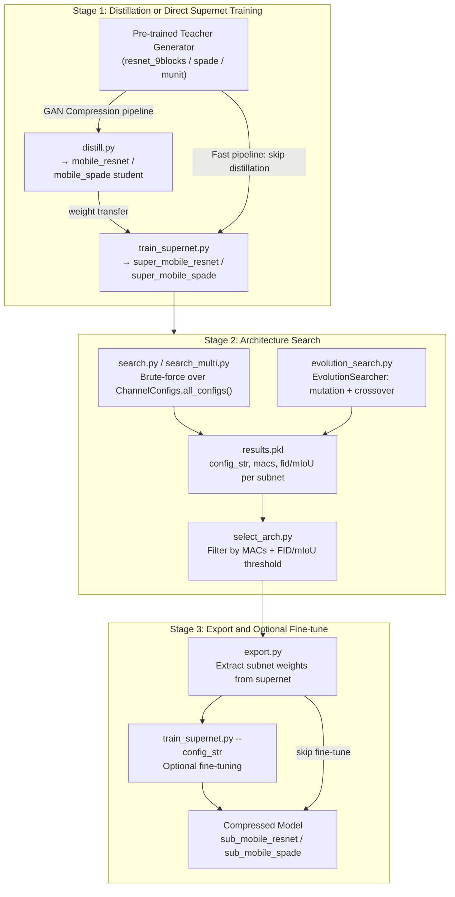

Sources: [README.md:23-26](), [docs/tutorials/gan_compression.md:16-18](), [docs/tutorials/fast_gan_compression.md:13-16]()

---

## Pipeline Comparison: GAN Compression vs. Fast GAN Compression

| Step | GAN Compression | Fast GAN Compression |
|---|---|---|
| Teacher training | `train.py` (full model) | `train.py` (full model) |
| Mobile teacher | `train.py` (mobile model) | — skipped — |
| Pre-distillation | `distill.py` | — skipped — |
| Supernet training | `train_supernet.py` (from distilled student) | `train_supernet.py` (from teacher directly) |
| Search | `search.py` (brute-force) | `evolution_search.py` (evolutionary) |
| Fine-tuning | Optional: `train_supernet.py --config_str` | Optional: `train_supernet.py --config_str` |
| Export | `export.py` | `export.py` |

Sources: [docs/tutorials/gan_compression.md:16-20](), [docs/tutorials/fast_gan_compression.md:13-16]()

---

## Supported Model Architectures

Each model family has four progressively compressed variants. They are all registered and instantiated through `define_G` in `models/networks.py`.

**Network variant hierarchy per model family**

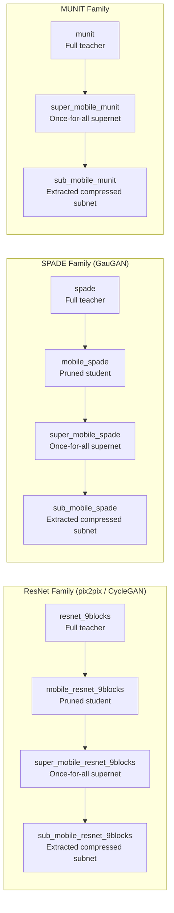

Sources: [docs/overview.md:76-93](), [README.md:8-11]()

---

## Key Subsystems and Code Entry Points

**Subsystem map: scripts, modules, and their relationships**

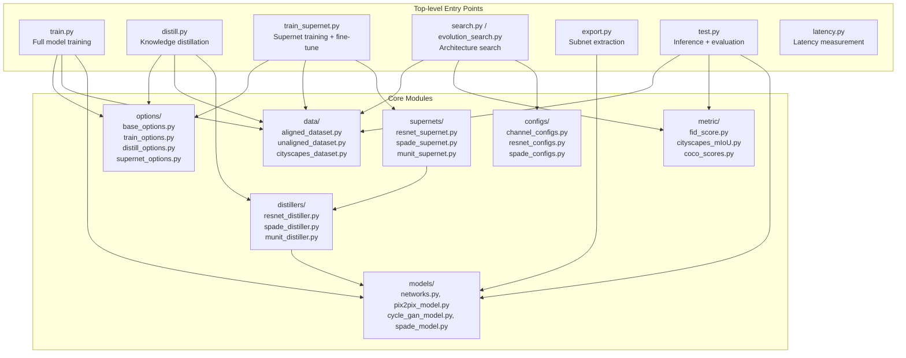

Sources: [docs/overview.md:1-141](), [README.md:43-57]()

---

## Configuration System

The `configs/` directory defines the search spaces used during supernet training and architecture search. The `ChannelConfigs` class in `configs/channel_configs.py` stores all valid channel width combinations per layer. Named config sets like `channels-48` or `channels-64-cycleGAN` are defined in `configs/resnet_configs.py` and `configs/spade_configs.py` via `get_configs()`.

A `config_str` such as `32_32_48_32_48_48_16_16` encodes the number of output channels for each layer in the compressed generator. This string is the key identifier used throughout `search.py`, `export.py`, and `train_supernet.py --config_str`.

Sources: [docs/overview.md:21-31](), [docs/tutorials/gan_compression.md:70-83]()

---

## Performance of Released Models

| Model | Dataset | Method | Parameters | MACs | FID | mIoU |
|---|---|---|---|---|---|---|
| CycleGAN | horse→zebra | Original | 11.4M | 56.8G | 65.75 | — |
| CycleGAN | horse→zebra | GAN Compression (Paper) | 0.342M | 2.67G | 65.33 | — |
| CycleGAN | horse→zebra | Fast GAN Compression | 0.355M | 2.64G | 65.19 | — |
| Pix2pix | edges→shoes | Original | 11.4M | 56.8G | 24.12 | — |
| Pix2pix | edges→shoes | GAN Compression (Paper) | 0.700M | 4.81G | 26.60 | — |
| Pix2pix | edges→shoes | Fast GAN Compression | 0.703M | 4.83G | 25.76 | — |
| Pix2pix | cityscapes | Original | 11.4M | 56.8G | — | 42.06 |
| Pix2pix | cityscapes | Fast GAN Compression | 0.867M | 5.61G | — | 41.71 |
| GauGAN | cityscapes | Original | 93.0M | 281G | 57.60 | 61.04 |
| GauGAN | cityscapes | GAN Compression (Paper) | 20.4M | 31.7G | 55.19 | 61.22 |
| GauGAN | cityscapes | Fast GAN Compression | 20.2M | 31.3G | 56.25 | 61.17 |
| GauGAN | COCO-Stuff | Original | 97.5M | 191G | 21.38 | 38.78 |
| GauGAN | COCO-Stuff | Fast GAN Compression | 26.0M | 35.5G | 25.06 | 35.05 |
| MUNIT | edges→shoes | Original | 15.0M | 77.3G | 30.13 | — |
| MUNIT | edges→shoes | Fast GAN Compression | 1.10M | 2.63G | 30.53 | — |

Sources: [README.md:283-485]()

---

## Evaluation Metrics

Quality of compressed models is measured using:

- **FID** (Fréchet Inception Distance) — computed via `metric/fid_score.py` using `InceptionV3`. Lower is better. Reference statistics are pre-computed with `get_real_stat.py` and stored as `.npz` files under `real_stat/`.
- **mIoU (Cityscapes)** — computed via `metric/cityscapes_mIoU.py` using a pre-trained `DRNSeg` model (`drn-d-105_ms_cityscapes.pth`).
- **mIoU (COCO-Stuff)** — computed via `metric/coco_scores.py` using a pre-trained `DeepLabV2` model (`deeplabv2_resnet101_msc-cocostuff164k-100000.pth`).

For paired translation (pix2pix, GauGAN), FID is computed against real test images. For unpaired translation (CycleGAN), FID is computed against real training+test images combined.

Sources: [README.md:491-502](), [docs/overview.md:60-70]()

---

## Repository Layout

```
gan-compression/
├── train.py                  # Full teacher model training
├── distill.py                # Knowledge distillation
├── train_supernet.py         # Once-for-all supernet training + fine-tuning
├── search.py                 # Brute-force architecture search
├── evolution_search.py       # Evolutionary architecture search
├── export.py                 # Subnet extraction from supernet
├── test.py                   # Inference and evaluation
├── latency.py                # Latency benchmarking
├── select_arch.py            # Filter search results by MACs/FID/mIoU
├── get_real_stat.py          # Pre-compute FID reference statistics
├── configs/                  # Channel config search spaces
├── data/                     # Dataset loaders
├── datasets/                 # Download scripts and preprocessing
├── distillers/               # Distillation logic per architecture
├── metric/                   # FID, mIoU evaluation
├── models/                   # Network definitions, training models
│   └── modules/              # Generator and discriminator nn.Module classes
├── options/                  # Argument parsing
├── scripts/                  # Shell scripts per model × dataset
├── supernets/                # Once-for-all training logic
├── interactive_demo/         # Jetson Nano TVM demo
└── utils/                    # Logging, image pool, weight transfer
```

Sources: [docs/overview.md:1-141](), [README.md:43-57]()

---

# Page: Getting Started

# Getting Started

<details>
<summary>Relevant source files</summary>

The following files were used as context for generating this wiki page:

- [README.md](README.md)
- [datasets/download_cyclegan_dataset.sh](datasets/download_cyclegan_dataset.sh)
- [datasets/download_pix2pix_dataset.sh](datasets/download_pix2pix_dataset.sh)
- [datasets/download_real_stat.sh](datasets/download_real_stat.sh)
- [imgs/overview.png](imgs/overview.png)
- [scripts/download_model.py](scripts/download_model.py)

</details>


This page covers the end-to-end setup process required to run inference with pre-trained models from this repository: cloning the repo, installing dependencies, downloading datasets, downloading pre-trained weights, and executing test scripts. For a conceptual overview of the compression methodology, see the [GAN Compression Overview](#1). For the full training pipeline, see the [Compression Pipeline](#3).

---

## Prerequisites

| Requirement | Notes |
|---|---|
| OS | Linux |
| Python | 3.x |
| Hardware | CPU or NVIDIA GPU + CUDA CuDNN |
| PyTorch | 1.4 |

---

## Installation

Clone the repository and install Python dependencies.

```shell
git clone git@github.com:mit-han-lab/gan-compression.git
cd gan-compression
```

**pip:**
```shell
pip install -r requirements.txt
```

**Conda (option A — script):**
```shell
bash scripts/conda_deps.sh
```

**Conda (option B — environment file):**
```shell
conda env create -f environment.yml
```

Sources: [README.md:47-57]()

---

## Dataset Preparation

Datasets are downloaded into the `database/` directory. Each model type uses a different download script. The sections below cover every supported dataset.

**Setup flow by model type:**

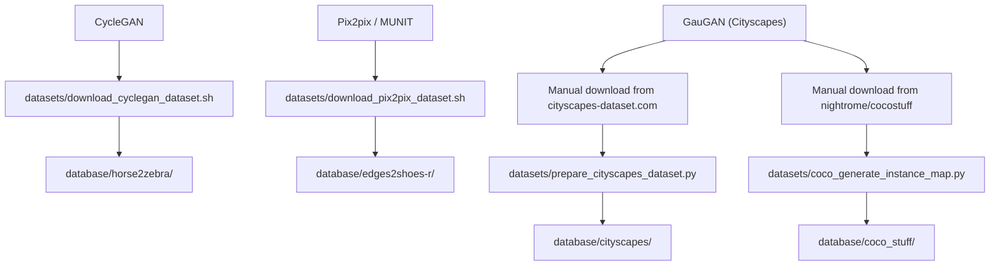

Sources: [README.md:62-281](), [datasets/download_cyclegan_dataset.sh:1-27](), [datasets/download_pix2pix_dataset.sh:1-40]()

---

### CycleGAN — horse2zebra

```shell
bash datasets/download_cyclegan_dataset.sh horse2zebra
```

Downloads to `database/horse2zebra/`. The script also creates `valA` and `valB` symlinks from `testA` and `testB` if they do not already exist.

[datasets/download_cyclegan_dataset.sh:21-27]()

**FID statistics:**
```shell
bash datasets/download_real_stat.sh horse2zebra A
bash datasets/download_real_stat.sh horse2zebra B
```

Downloaded to `real_stat/horse2zebra_A.npz` and `real_stat/horse2zebra_B.npz`.

Sources: [README.md:63-75](), [datasets/download_cyclegan_dataset.sh:1-27](), [datasets/download_real_stat.sh:1-17]()

---

### Pix2pix — edges2shoes-r

```shell
bash datasets/download_pix2pix_dataset.sh edges2shoes-r
```

Downloads to `database/edges2shoes-r/`. Variants `edges2shoes-r` and `edges2handbags-r` are hosted on HuggingFace; other pix2pix datasets are fetched from Berkeley's servers.

[datasets/download_pix2pix_dataset.sh:19-23]()

**FID statistics:**
```shell
bash datasets/download_real_stat.sh edges2shoes-r B
bash datasets/download_real_stat.sh edges2shoes-r subtrain_B
```

Sources: [README.md:115-128](), [datasets/download_pix2pix_dataset.sh:1-40]()

---

### MUNIT — edges2shoes-r (unaligned)

MUNIT requires the paired dataset to be split into separate `A` and `B` directories:

```shell
bash datasets/download_pix2pix_dataset.sh edges2shoes-r
python datasets/separate_A_and_B.py --input_dir database/edges2shoes-r \
    --output_dir database/edges2shoes-r-unaligned
python datasets/separate_A_and_B.py --input_dir database/edges2shoes-r \
    --output_dir database/edges2shoes-r-unaligned --phase val
```

**FID statistics:**
```shell
bash datasets/download_real_stat.sh edges2shoes-r B
bash datasets/download_real_stat.sh edges2shoes-r-unaligned subtrain_B
```

Sources: [README.md:211-228]()

---

### GauGAN — Cityscapes

Cityscapes cannot be redistributed. Download `gtFine_trainvaltest.zip` and `leftImg8bit_trainvaltest.zip` from `https://cityscapes-dataset.com` and place both in a single folder (e.g. `database/cityscapes-origin`). Then run:

```shell
python datasets/get_trainIds.py database/cityscapes-origin/gtFine/
python datasets/prepare_cityscapes_dataset.py \
    --gtFine_dir database/cityscapes-origin/gtFine \
    --leftImg8bit_dir database/cityscapes-origin/leftImg8bit \
    --output_dir database/cityscapes \
    --train_table_path datasets/train_table.txt \
    --val_table_path datasets/val_table.txt
```

This produces `database/cityscapes/` and `dataset/table.txt` (used for mIoU computation).

**mIoU support:** Download `drn-d-105_ms_cityscapes.pth` and place it in the repo root directory.

**FID statistics:**
```shell
bash datasets/download_real_stat.sh cityscapes A
```

Sources: [README.md:259-275]()

---

### GauGAN — COCO-Stuff

Follow the [NVlabs/SPADE dataset preparation](https://github.com/NVlabs/SPADE). Download `train2017.zip`, `val2017.zip`, `stuffthingmaps_trainval2017.zip`, and `annotations_trainval2017.zip` from `nightrome/cocostuff`. Generate the instance map:

```shell
python datasets/coco_generate_instance_map.py
```

**mIoU support:** Download `deeplabv2_resnet101_msc-cocostuff164k-100000.pth` and place it in the repo root directory.

Sources: [README.md:277-282]()

---

### Supported Datasets Summary

| Model | Dataset | Download Script / Method | Output Directory |
|---|---|---|---|
| CycleGAN | horse2zebra | `download_cyclegan_dataset.sh horse2zebra` | `database/horse2zebra/` |
| Pix2pix | edges2shoes-r | `download_pix2pix_dataset.sh edges2shoes-r` | `database/edges2shoes-r/` |
| Pix2pix | maps | `download_pix2pix_dataset.sh maps` | `database/maps/` |
| Pix2pix / GauGAN | cityscapes | Manual + `prepare_cityscapes_dataset.py` | `database/cityscapes/` |
| GauGAN | COCO-Stuff | Manual + `coco_generate_instance_map.py` | `database/coco_stuff/` |
| MUNIT | edges2shoes-r | `download_pix2pix_dataset.sh` + `separate_A_and_B.py` | `database/edges2shoes-r-unaligned/` |

Sources: [README.md:59-282](), [datasets/download_pix2pix_dataset.sh:4-8](), [datasets/download_cyclegan_dataset.sh:4-7]()

---

## Downloading Pre-trained Models

All pre-trained weights are downloaded with `scripts/download_model.py`. Files are fetched from HuggingFace and placed under `pretrained/`.

[scripts/download_model.py:27-31]()

### Script Interface

```
python scripts/download_model.py --model <MODEL> --task <TASK> --stage <STAGE>
```

| Argument | Choices | Default |
|---|---|---|
| `--model` | `pix2pix`, `cycle_gan`, `gaugan`, `munit` | `pix2pix` |
| `--task` | see table below | `horse2zebra` |
| `--stage` | `full`, `mobile`, `distill`, `supernet`, `finetune`, `compressed`, `legacy` | `compressed` |

[scripts/download_model.py:34-57]()

### Supported Model/Task Combinations

| `--model` | Valid `--task` values |
|---|---|
| `pix2pix` | `edges2shoes-r`, `map2sat`, `cityscapes`, `cityscapes_fast`, `edges2shoes-r_fast`, `map2sat_fast` |
| `cycle_gan` | `horse2zebra`, `horse2zebra_fast` |
| `gaugan` | `cityscapes`, `cityscapes_fast`, `coco_fast` |
| `munit` | `edges2shoes-r_fast` |

[scripts/download_model.py:7-24]()

### What Gets Downloaded

For `--stage compressed` or `--stage legacy`, only `latest_net_G.pth` is downloaded. For all other stages, both `latest_net_G.pth` and `latest_net_D.pth` are downloaded.

[scripts/download_model.py:53-57]()

**Output path pattern:**
```
pretrained/<model>/<task>/<stage>/latest_net_G.pth
pretrained/<model>/<task>/<stage>/latest_net_D.pth  # (non-compressed stages only)
```

### Stage Descriptions

| Stage | Description |
|---|---|
| `full` | Pre-trained teacher generator (e.g. `resnet_9blocks`) |
| `mobile` | Distilled mobile student |
| `distill` | Checkpoint mid-distillation |
| `supernet` | Once-for-all supernet |
| `finetune` | Fine-tuned subnet |
| `compressed` | Final exported compressed model (`sub_mobile_resnet` / `sub_mobile_spade`) |
| `legacy` | Original paper model weights (older format) |

For a description of how these stages relate to the compression pipeline, see [Compression Pipeline](#3).

Sources: [scripts/download_model.py:1-57](), [README.md:79-109]()

---

## Running Your First Test

The general workflow after dataset and model download is:

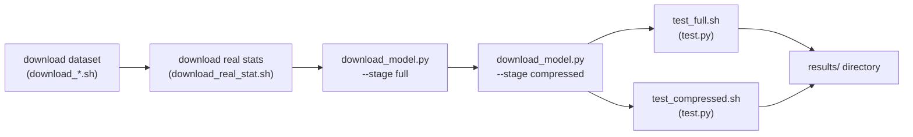

Sources: [README.md:76-109]()

### CycleGAN — horse2zebra

```shell
python scripts/download_model.py --model cycle_gan --task horse2zebra --stage full
python scripts/download_model.py --model cycle_gan --task horse2zebra --stage compressed

bash scripts/cycle_gan/horse2zebra/test_full.sh
bash scripts/cycle_gan/horse2zebra/test_compressed.sh

# Optional: latency measurement
bash scripts/cycle_gan/horse2zebra/latency_full.sh
bash scripts/cycle_gan/horse2zebra/latency_compressed.sh
```

Sources: [README.md:79-101]()

### Pix2pix — edges2shoes-r

```shell
python scripts/download_model.py --model pix2pix --task edges2shoes-r --stage full
python scripts/download_model.py --model pix2pix --task edges2shoes-r --stage compressed

bash scripts/pix2pix/edges2shoes-r/test_full.sh
bash scripts/pix2pix/edges2shoes-r/test_compressed.sh
```

Sources: [README.md:129-154]()

### GauGAN — Cityscapes

```shell
python scripts/download_model.py --model gaugan --task cityscapes --stage full
python scripts/download_model.py --model gaugan --task cityscapes --stage compressed

bash scripts/gaugan/cityscapes/test_full.sh
bash scripts/gaugan/cityscapes/test_compressed.sh
```

Sources: [README.md:178-201]()

### MUNIT — edges2shoes-r

```shell
python scripts/download_model.py --model munit --task edges2shoes-r_fast --stage full
python scripts/download_model.py --model munit --task edges2shoes-r_fast --stage compressed

bash scripts/munit/edges2shoes-r_fast/test_full.sh
bash scripts/munit/edges2shoes-r_fast/test_compressed.sh
```

Sources: [README.md:231-256]()

---

## Legacy / Paper Models

The released retrained models may differ slightly from paper results. To use the original paper models:

```shell
python scripts/download_model.py --model cycle_gan --task horse2zebra --stage legacy
bash scripts/cycle_gan/horse2zebra/test_legacy.sh
bash scripts/cycle_gan/horse2zebra/latency_legacy.sh
```

The same `--stage legacy` option is available for `pix2pix` and `gaugan` tasks. Legacy models use the `legacy_sub_mobile_resnet_9blocks` network variant rather than `sub_mobile_resnet_9blocks`. See [Model Architectures](#4) for the architectural distinction.

Sources: [README.md:103-109](), [README.md:156-162](), [README.md:203-209]()

---

## FID Reference Statistics

The `real_stat/` directory holds `.npz` files with Inception statistics computed from ground-truth images. These are required for FID evaluation during search and testing. Pre-computed files can be downloaded with `datasets/download_real_stat.sh`.

[datasets/download_real_stat.sh:1-17]()

**Available pre-computed statistics files:**

| File | Use case |
|---|---|
| `cityscapes_A.npz` | GauGAN / Pix2pix Cityscapes |
| `edges2shoes-r_B.npz` | Pix2pix / MUNIT edges→shoes |
| `edges2shoes-r_subtrain_B.npz` | MUNIT supernet training eval |
| `horse2zebra_A.npz` | CycleGAN horse→zebra (A side) |
| `horse2zebra_B.npz` | CycleGAN horse→zebra (B side) |
| `maps_A.npz`, `maps_B.npz` | Pix2pix maps |
| `coco_A.npz` | GauGAN COCO-Stuff |

To compute statistics for a custom dataset, use `get_real_stat.py`:

```shell
python get_real_stat.py \
    --dataroot database/edges2shoes-r \
    --output_path real_stat/edges2shoes-r_B.npz \
    --direction AtoB
```

For more details on how FID is computed and used during search, see [Evaluation Metrics](#6.2).

Sources: [README.md:491-502](), [datasets/download_real_stat.sh:1-17]()

---

# Page: Installation

# Installation

<details>
<summary>Relevant source files</summary>

The following files were used as context for generating this wiki page:

- [requirements.txt](requirements.txt)
- [scripts/conda_deps.sh](scripts/conda_deps.sh)

</details>


This page covers environment setup for the `gan-compression` repository: Python version, package managers, and all required dependencies. For downloading datasets and pre-trained weights after the environment is ready, see [Dataset Preparation](#2.2) and [Downloading Pre-trained Models](#2.3).

---

## Prerequisites

| Requirement | Version |
|---|---|
| Python | 3.6+ |
| PyTorch | 1.4.0 |
| torchvision | 0.5.0 |
| CUDA | Compatible with PyTorch 1.4.0 |

PyTorch 1.4.0 and torchvision 0.5.0 are pinned hard in both installation paths. Using other versions may cause incompatibilities with `torchprofile` (MAC counting) and the supernet modules.

---

## Installation Paths

Two installation methods are supported: pip (via `requirements.txt`) and conda (via `scripts/conda_deps.sh`).

**Dependency installation flow:**

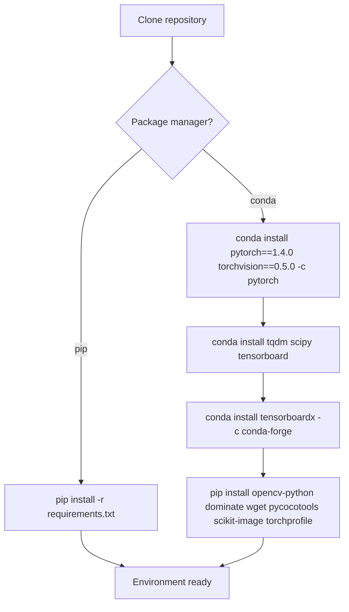

Sources: [requirements.txt:1-25](), [scripts/conda_deps.sh:1-7]()

---

### Option A: pip

```
pip install -r requirements.txt
```

This installs every dependency in one step with pinned versions.

Sources: [requirements.txt:1-25]()

---

### Option B: conda

```
bash scripts/conda_deps.sh
```

The script [scripts/conda_deps.sh:1-7]() runs three steps:

1. Installs `pytorch==1.4.0` and `torchvision==0.5.0` from the `pytorch` conda channel.
2. Installs `tqdm`, `scipy`, and `tensorboard` from the default conda channel, then `tensorboardx` from `conda-forge`.
3. Uses `pip` for packages not available in conda: `opencv-python`, `dominate`, `wget`, `pycocotools`, `scikit-image`, `torchprofile`.

Sources: [scripts/conda_deps.sh:1-7]()

---

## Full Dependency Table

The table below lists every package from `requirements.txt`, grouped by functional role.

| Role | Package | Pinned Version |
|---|---|---|
| **Deep learning** | `torch` | 1.4.0 |
| **Deep learning** | `torchvision` | 0.5.0 |
| **MAC profiling** | `torchprofile` | 0.0.1 |
| **GPU monitoring** | `nvidia-ml-py3` | 7.352.0 |
| **Numerics** | `numpy` | 1.18.1 |
| **Numerics** | `scipy` | 1.4.1 |
| **Image processing** | `opencv-python` | 4.2.0.32 |
| **Image processing** | `Pillow` | 7.0.0 |
| **Image processing** | `scikit-image` | (unpinned) |
| **COCO evaluation** | `pycocotools` | (unpinned) |
| **Logging** | `tensorboard` | 2.0.0 |
| **Logging** | `tensorboardX` | 2.0 |
| **Progress display** | `tqdm` | 4.42.1 |
| **HTML reports** | `dominate` | 2.4.0 |
| **Downloads** | `wget` | 3.2 |
| **Serialization** | `protobuf` | 3.11.3 |
| **System info** | `psutil` | 5.7.0 |
| **Misc** | `absl-py` | 0.9.0 |
| **Misc** | `six` | 1.14.0 |
| **Misc** | `certifi` | 2019.11.28 |
| **Misc** | `Markdown` | 3.1.1 |
| **Misc** | `Werkzeug` | 1.0.0 |
| **Misc** | `grpcio` | 1.16.1 |
| **Misc** | `olefile` | 0.46 |
| **Misc** | `blessings` | 1.7 |

Sources: [requirements.txt:1-25]()

---

## Package Role Map

The diagram below maps each dependency group to the codebase subsystem that requires it.

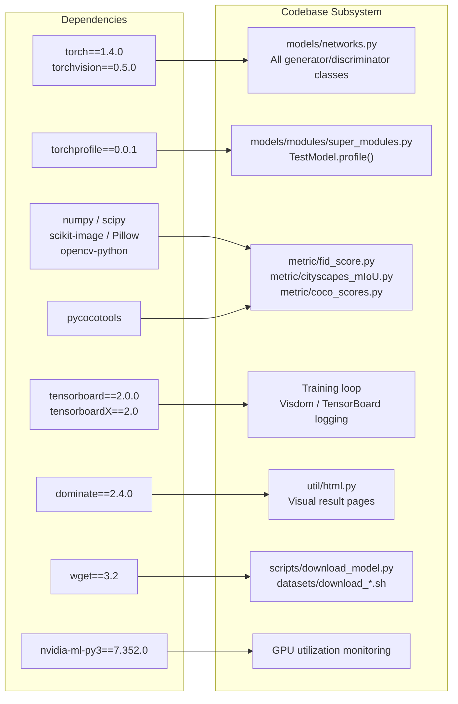

Sources: [requirements.txt:1-25](), [scripts/conda_deps.sh:1-7]()

---

## Notes

- `torchprofile` is critical for MAC counting in `search.py` and `evolution_search.py`. It must be version 0.0.1; newer versions may have a different API.
- `pycocotools` and `scikit-image` are unpinned in `requirements.txt`. If you encounter compatibility issues, install them explicitly after the main install.
- The conda path (`scripts/conda_deps.sh`) does not pin minor versions for `tqdm`, `scipy`, `tensorboard`, or `tensorboardx` via conda. This may result in slightly different versions than `requirements.txt` specifies. For strict reproducibility, use the pip path.
- The interactive demo on Jetson Nano requires additional TVM dependencies not listed here. See [Interactive Demo](#8) for those setup steps.

---

# Page: Dataset Preparation

# Dataset Preparation

<details>
<summary>Relevant source files</summary>

The following files were used as context for generating this wiki page:

- [README.md](README.md)
- [datasets/download_cyclegan_dataset.sh](datasets/download_cyclegan_dataset.sh)
- [datasets/download_pix2pix_dataset.sh](datasets/download_pix2pix_dataset.sh)
- [datasets/download_real_stat.sh](datasets/download_real_stat.sh)
- [imgs/overview.png](imgs/overview.png)
- [scripts/download_model.py](scripts/download_model.py)

</details>


This page covers how to download and preprocess every dataset used in the `gan-compression` repository. It explains which shell scripts to run, which steps require manual intervention, and what the resulting `database/` directory structure looks like.

For information on downloading pre-trained model weights after your datasets are ready, see [Downloading Pre-trained Models](#2.3). For information on how the datasets are loaded at runtime, see [Data Loading](#6.3). For how FID statistics files are used during search and evaluation, see [Evaluation Metrics](#6.2).

---

## Dataset Overview

The table below maps each supported model and task to the dataset it requires and the acquisition method.

| Model | Task | Dataset | Source | Script |
|---|---|---|---|---|
| CycleGAN | horse→zebra | horse2zebra | Berkeley | `datasets/download_cyclegan_dataset.sh` |
| pix2pix | edges→shoes | edges2shoes-r | HuggingFace | `datasets/download_pix2pix_dataset.sh` |
| pix2pix | map→aerial | maps | Berkeley | `datasets/download_pix2pix_dataset.sh` |
| pix2pix | labels→photo | cityscapes | Manual | `datasets/prepare_cityscapes_dataset.py` |
| GauGAN | labels→photo | cityscapes | Manual | `datasets/prepare_cityscapes_dataset.py` |
| GauGAN | labels→photo | COCO-Stuff | Manual | `datasets/coco_generate_instance_map.py` |
| MUNIT | edges→shoes | edges2shoes-r-unaligned | HuggingFace + `separate_A_and_B.py` | See below |

All datasets are stored under the `database/` subdirectory in the repository root.

Sources: [README.md:59-282]()

---

## Directory Layout

After completing all preparation steps, the `database/` directory has the following structure:

```
database/
├── horse2zebra/
│   ├── trainA/          # Horse images (training)
│   ├── trainB/          # Zebra images (training)
│   ├── testA/           # Horse images (test)
│   ├── testB/           # Zebra images (test)
│   ├── valA -> testA    # Symlink created by script
│   └── valB -> testB    # Symlink created by script
├── edges2shoes-r/
│   ├── train/           # Paired edge-shoe images
│   ├── val/             # Validation set
│   └── test -> val      # Symlink created by script
├── maps/
│   ├── train/
│   └── val/
├── cityscapes/          # Preprocessed by prepare_cityscapes_dataset.py
│   ├── train/
│   └── val/
├── cityscapes-origin/   # Raw download (intermediate)
│   ├── gtFine/
│   └── leftImg8bit/
├── edges2shoes-r-unaligned/   # Created by separate_A_and_B.py
│   ├── trainA/
│   ├── trainB/
│   ├── valA/
│   └── valB/
└── coco_stuff/          # Manually arranged per SPADE convention
```

The `real_stat/` directory (at the repo root, not under `database/`) holds pre-computed FID reference statistics:

```
real_stat/
├── horse2zebra_A.npz
├── horse2zebra_B.npz
├── edges2shoes-r_B.npz
├── cityscapes_A.npz
└── ...
```

Sources: [datasets/download_cyclegan_dataset.sh:1-27](), [datasets/download_pix2pix_dataset.sh:1-40](), [README.md:59-282]()

---

## CycleGAN Datasets

CycleGAN datasets are downloaded from the Berkeley servers using `datasets/download_cyclegan_dataset.sh`.

**Usage:**
```shell
bash datasets/download_cyclegan_dataset.sh horse2zebra
```

The script [datasets/download_cyclegan_dataset.sh:1-27]() performs the following:
1. Validates the dataset name against a list of supported names.
2. Downloads a `.zip` archive from `http://efrosgans.eecs.berkeley.edu/cyclegan/datasets/`.
3. Unpacks it into `database/<dataset>/`.
4. Creates `valA` and `valB` symlinks pointing to `testA` and `testB`.

**Supported names:** `horse2zebra`, `apple2orange`, `summer2winter_yosemite`, `monet2photo`, `cezanne2photo`, `ukiyoe2photo`, `vangogh2photo`, `maps`, `facades`, `iphone2dslr_flower`.

**Then download the FID statistics:**
```shell
bash datasets/download_real_stat.sh horse2zebra A
bash datasets/download_real_stat.sh horse2zebra B
```

Sources: [datasets/download_cyclegan_dataset.sh:1-27](), [README.md:63-75]()

---

## Pix2pix Datasets

Pix2pix datasets are downloaded using `datasets/download_pix2pix_dataset.sh`. The source depends on the dataset name.

**Usage:**
```shell
bash datasets/download_pix2pix_dataset.sh edges2shoes-r
bash datasets/download_pix2pix_dataset.sh maps
```

The script [datasets/download_pix2pix_dataset.sh:1-40]() performs the following:
1. Validates the name.
2. For `edges2shoes-r`, `edges2handbags-r`, and `edges2shoes-v`: downloads from HuggingFace (`https://huggingface.co/mit-han-lab/gan-compression/resolve/main/datasets/`).
3. For all others: downloads from Berkeley (`http://efrosgans.eecs.berkeley.edu/pix2pix/datasets/`).
4. Unpacks the `.tar.gz` into `database/<dataset>/`.
5. Creates a `val` symlink pointing to `test` if `test` exists but `val` does not.

> **Note:** Passing `cityscapes` to this script will print a license warning and exit. See the [Cityscapes Dataset](#cityscapes-section) section below instead.

**Supported names:** `edges2shoes-r`, `edges2handbags-r`, `maps`, `facades`, `night2day`, and standard Berkeley pix2pix datasets.

**Then download FID statistics:**
```shell
bash datasets/download_real_stat.sh edges2shoes-r B
bash datasets/download_real_stat.sh edges2shoes-r subtrain_B
```

Sources: [datasets/download_pix2pix_dataset.sh:1-40](), [README.md:115-127]()

---

## Cityscapes Dataset

The Cityscapes dataset cannot be redistributed. You must download it directly from the official website and preprocess it manually.

### Step 1: Download raw files

Download the following two archives from [https://cityscapes-dataset.com](https://cityscapes-dataset.com):

- `gtFine_trainvaltest.zip`
- `leftImg8bit_trainvaltest.zip`

Unzip both into the same folder, for example `database/cityscapes-origin/`, so the resulting structure is:

```
database/cityscapes-origin/
├── gtFine/
└── leftImg8bit/
```

### Step 2: Generate training IDs

```shell
python datasets/get_trainIds.py database/cityscapes-origin/gtFine/
```

### Step 3: Preprocess into paired format

```shell
python datasets/prepare_cityscapes_dataset.py \
  --gtFine_dir database/cityscapes-origin/gtFine \
  --leftImg8bit_dir database/cityscapes-origin/leftImg8bit \
  --output_dir database/cityscapes \
  --train_table_path datasets/train_table.txt \
  --val_table_path datasets/val_table.txt
```

This writes the final dataset to `database/cityscapes/` and a mapping table to `dataset/table.txt` (used for mIoU computation).

### Step 4: Download FID statistics

```shell
bash datasets/download_real_stat.sh cityscapes A
```

### Step 5: Download DRN model for mIoU

To compute Cityscapes mIoU during search or evaluation, download the pretrained DRN model:

```
drn-d-105_ms_cityscapes.pth
```

from `http://go.yf.io/drn-cityscapes-models` and place it in the **repository root**.

Sources: [README.md:259-275]()

---

## COCO-Stuff Dataset

COCO-Stuff is used for GauGAN on the `coco_fast` task. Preparation follows the [NVlabs/SPADE](https://github.com/NVlabs/SPADE) convention.

### Step 1: Download archives

Download the following from [nightrome/cocostuff](https://github.com/nightrome/cocostuff):

| File | Contents |
|---|---|
| `train2017.zip` | Training images |
| `val2017.zip` | Validation images |
| `stuffthingmaps_trainval2017.zip` | Segmentation maps |
| `annotations_trainval2017.zip` | Annotations |

### Step 2: Arrange files

Arrange images, labels, and instance maps to match the SPADE directory convention under `database/coco_stuff/`.

### Step 3: Generate instance maps

The repository uses a combined instance map that merges "things instance map" boundaries and "stuff label map". Generate it using:

```shell
python datasets/coco_generate_instance_map.py
```

### Step 4: Download the DeepLabV2 model for mIoU

Download [deeplabv2_resnet101_msc-cocostuff164k-100000.pth](https://github.com/kazuto1011/deeplab-pytorch/releases/download/v1.0/deeplabv2_resnet101_msc-cocostuff164k-100000.pth) and place it in the **repository root**.

Sources: [README.md:277-281]()

---

## MUNIT Dataset (Unaligned)

MUNIT requires an **unaligned** version of the dataset, where domain A and domain B images are stored in separate directories (rather than as side-by-side paired images).

### Step 1: Download the base pix2pix dataset

```shell
bash datasets/download_pix2pix_dataset.sh edges2shoes-r
```

### Step 2: Separate A and B

```shell
python datasets/separate_A_and_B.py \
  --input_dir database/edges2shoes-r \
  --output_dir database/edges2shoes-r-unaligned

python datasets/separate_A_and_B.py \
  --input_dir database/edges2shoes-r \
  --output_dir database/edges2shoes-r-unaligned \
  --phase val
```

This produces `database/edges2shoes-r-unaligned/` with `trainA/`, `trainB/`, `valA/`, and `valB/` subdirectories.

### Step 3: Download FID statistics

```shell
bash datasets/download_real_stat.sh edges2shoes-r B
bash datasets/download_real_stat.sh edges2shoes-r-unaligned subtrain_B
```

Sources: [README.md:211-228]()

---

## FID Statistics Files

FID evaluation requires pre-computed statistics (mean and covariance of Inception features) from the ground-truth image set. These are stored as `.npz` files in the `real_stat/` directory.

### Downloading pre-computed statistics

The script `datasets/download_real_stat.sh` fetches these from HuggingFace:

```shell
bash datasets/download_real_stat.sh <dataset> <side>
```

| Argument | Description | Example |
|---|---|---|
| `dataset` | Dataset name | `horse2zebra`, `edges2shoes-r`, `cityscapes` |
| `side` | Image domain | `A`, `B`, `subtrain_B` |

The file is saved to `real_stat/<dataset>_<side>.npz`.

**Available pre-computed files** [datasets/download_real_stat.sh:4-5]():

```
cityscapes_A.npz        edges2shoes_B.npz       edges2shoes-r_B.npz
edges2handbags_B.npz    edges2handbags-r_B.npz  facades_A.npz
horse2zebra_A.npz       horse2zebra_B.npz       maps_A.npz
maps_B.npz              coco_A.npz
```

### Computing custom statistics

If your dataset is not listed, use `get_real_stat.py` to compute and save the statistics:

```shell
python get_real_stat.py \
  --dataroot database/edges2shoes-r \
  --output_path real_stat/edges2shoes-r_B.npz \
  --direction AtoB
```

> **Protocol note:** For paired translation (pix2pix, GauGAN), FID is computed against real **test** images. For unpaired translation (CycleGAN), FID is computed against real **train+test** images combined, giving a more stable estimate due to the larger reference set.

Sources: [datasets/download_real_stat.sh:1-17](), [README.md:491-502]()

---

## Acquisition Flow Diagram

The diagram below shows how each dataset flows from its source through scripts to the final `database/` layout.

**Dataset acquisition and preprocessing flow**

```mermaid
flowchart TD
    subgraph "Auto-download (CycleGAN)"
        CGSH["datasets/download_cyclegan_dataset.sh"]
        BERK_CG["Berkeley CDN\neecs.berkeley.edu/cyclegan/datasets/"]
        BERK_CG --> CGSH
        CGSH --> DB_CG["database/horse2zebra/\n(trainA, trainB, valA, valB)"]
    end

    subgraph "Auto-download (pix2pix)"
        P2PSH["datasets/download_pix2pix_dataset.sh"]
        HF["HuggingFace\nmit-han-lab/gan-compression"]
        BERK_P2P["Berkeley CDN\neecs.berkeley.edu/pix2pix/datasets/"]
        HF -->|"edges2shoes-r\nedges2handbags-r"| P2PSH
        BERK_P2P -->|"maps, facades, etc."| P2PSH
        P2PSH --> DB_P2P["database/edges2shoes-r/\n(train, val)"]
        P2PSH --> DB_MAPS["database/maps/\n(train, val)"]
    end

    subgraph "Manual (Cityscapes)"
        CS_DL["cityscapes-dataset.com\ngtFine + leftImg8bit"]
        CS_DL --> CS_ORIG["database/cityscapes-origin/"]
        CS_ORIG --> GET_IDS["datasets/get_trainIds.py"]
        GET_IDS --> PREP["datasets/prepare_cityscapes_dataset.py"]
        PREP --> DB_CS["database/cityscapes/\n(train, val)"]
    end

    subgraph "Manual (COCO-Stuff)"
        COCO_DL["nightrome/cocostuff\ntrain2017 + val2017 + maps"]
        COCO_DL --> INST["datasets/coco_generate_instance_map.py"]
        INST --> DB_COCO["database/coco_stuff/"]
    end

    subgraph "MUNIT split"
        DB_P2P --> SEP["datasets/separate_A_and_B.py\n--phase train / val"]
        SEP --> DB_MUNIT["database/edges2shoes-r-unaligned/\n(trainA, trainB, valA, valB)"]
    end

    subgraph "FID Statistics"
        STAT_SH["datasets/download_real_stat.sh"]
        HF2["HuggingFace\nreal_stat/*.npz"]
        HF2 --> STAT_SH --> REAL_STAT["real_stat/<dataset>_<side>.npz"]
        GET_REAL["get_real_stat.py\n(custom datasets)"]
        GET_REAL --> REAL_STAT
    end
```

Sources: [datasets/download_cyclegan_dataset.sh:1-27](), [datasets/download_pix2pix_dataset.sh:1-40](), [datasets/download_real_stat.sh:1-17](), [README.md:59-282]()

---

## Quick Reference: All Preparation Commands

**Dataset acquisition and FID script mapping**

```mermaid
flowchart LR
    subgraph "CycleGAN horse2zebra"
        C1["download_cyclegan_dataset.sh horse2zebra"]
        C2["download_real_stat.sh horse2zebra A"]
        C3["download_real_stat.sh horse2zebra B"]
        C1 --> C2 --> C3
    end

    subgraph "pix2pix edges2shoes-r"
        P1["download_pix2pix_dataset.sh edges2shoes-r"]
        P2["download_real_stat.sh edges2shoes-r B"]
        P3["download_real_stat.sh edges2shoes-r subtrain_B"]
        P1 --> P2 --> P3
    end

    subgraph "pix2pix maps"
        M1["download_pix2pix_dataset.sh maps"]
        M2["download_real_stat.sh maps A"]
        M3["download_real_stat.sh maps B"]
        M1 --> M2 --> M3
    end

    subgraph "Cityscapes (pix2pix + GauGAN)"
        CS1["Manual download from cityscapes-dataset.com"]
        CS2["get_trainIds.py"]
        CS3["prepare_cityscapes_dataset.py"]
        CS4["download_real_stat.sh cityscapes A"]
        CS5["Download drn-d-105_ms_cityscapes.pth"]
        CS1 --> CS2 --> CS3 --> CS4 --> CS5
    end

    subgraph "COCO-Stuff (GauGAN)"
        CC1["Manual download from nightrome/cocostuff"]
        CC2["coco_generate_instance_map.py"]
        CC3["Download deeplabv2_resnet101_msc-cocostuff164k-100000.pth"]
        CC1 --> CC2 --> CC3
    end

    subgraph "MUNIT edges2shoes-r"
        MU1["download_pix2pix_dataset.sh edges2shoes-r"]
        MU2["separate_A_and_B.py (train)"]
        MU3["separate_A_and_B.py (val)"]
        MU4["download_real_stat.sh edges2shoes-r B"]
        MU5["download_real_stat.sh edges2shoes-r-unaligned subtrain_B"]
        MU1 --> MU2 --> MU3 --> MU4 --> MU5
    end
```

Sources: [README.md:59-282](), [datasets/download_cyclegan_dataset.sh:1-27](), [datasets/download_pix2pix_dataset.sh:1-40](), [datasets/download_real_stat.sh:1-17]()

---

# Page: Downloading Pre-trained Models

# Downloading Pre-trained Models

<details>
<summary>Relevant source files</summary>

The following files were used as context for generating this wiki page:

- [README.md](README.md)
- [datasets/download_cyclegan_dataset.sh](datasets/download_cyclegan_dataset.sh)
- [datasets/download_pix2pix_dataset.sh](datasets/download_pix2pix_dataset.sh)
- [datasets/download_real_stat.sh](datasets/download_real_stat.sh)
- [imgs/overview.png](imgs/overview.png)
- [scripts/download_model.py](scripts/download_model.py)

</details>


This page documents how to download pre-trained model checkpoints and FID reference statistics using the provided scripts. It covers the `scripts/download_model.py` interface, all valid argument combinations, and the directory layout that results from running these scripts.

For how to use a downloaded model to run inference, see page [6.1](#6.1). For dataset download and preparation steps that typically precede this, see page [2.2](#2.2).

---

## Overview

Two categories of assets are downloaded separately:

| Asset | Script | Destination |
|---|---|---|
| Generator / discriminator checkpoints | `scripts/download_model.py` | `pretrained/` |
| FID reference statistics (`.npz`) | `datasets/download_real_stat.sh` | `real_stat/` |

Both pull from the HuggingFace repository `mit-han-lab/gan-compression`. The real-stat files are a prerequisite for FID evaluation during testing and search; the model checkpoints are prerequisites for testing, fine-tuning, and architecture search.

Sources: [scripts/download_model.py:1-58](), [datasets/download_real_stat.sh:1-17]()

---

## `scripts/download_model.py`

### Arguments

| Argument | Type | Default | Choices |
|---|---|---|---|
| `--model` | `str` | `pix2pix` | `pix2pix`, `cycle_gan`, `gaugan`, `munit` |
| `--task` | `str` | `horse2zebra` | See table below |
| `--stage` | `str` | `compressed` | `full`, `mobile`, `distill`, `supernet`, `finetune`, `compressed`, `legacy` |

Argument parsing and dispatch are defined in the `if __name__ == "__main__"` block at [scripts/download_model.py:34-57]().

### Stage Semantics

Each stage corresponds to a specific checkpoint produced by the compression pipeline.

| Stage | Description | Downloads D weights? |
|---|---|---|
| `full` | Pre-trained teacher generator | Yes |
| `mobile` | Mobile student after pruning | Yes |
| `distill` | Student after knowledge distillation | Yes |
| `supernet` | Trained once-for-all supernet | Yes |
| `finetune` | Supernet after optional fine-tuning | Yes |
| `compressed` | Final extracted compressed subnet | **No** |
| `legacy` | Original paper model (older format) | **No** |

The `compressed` and `legacy` stages download only `latest_net_G.pth`. All other stages also download `latest_net_D.pth`. This branching is enforced at [scripts/download_model.py:55-57]().

### What Gets Downloaded

The `download()` function constructs a HuggingFace URL and saves the file locally:

```
pretrained/{model}/{task}/{stage}/latest_net_G.pth
pretrained/{model}/{task}/{stage}/latest_net_D.pth   (stages other than compressed / legacy)
```

The URL pattern is `https://huggingface.co/mit-han-lab/gan-compression/resolve/main/{path}`.

Sources: [scripts/download_model.py:27-57]()

---

## Valid `--model` / `--task` Combinations

The `check()` function at [scripts/download_model.py:7-24]() enforces which `(model, task)` pairs are valid.

| `--model` | Valid `--task` values |
|---|---|
| `pix2pix` | `edges2shoes-r`, `map2sat`, `cityscapes`, `cityscapes_fast`, `edges2shoes-r_fast`, `map2sat_fast` |
| `cycle_gan` | `horse2zebra`, `horse2zebra_fast` |
| `gaugan` | `cityscapes`, `cityscapes_fast`, `coco_fast` |
| `munit` | `edges2shoes-r_fast` |

Tasks with a `_fast` suffix correspond to the Fast GAN Compression pipeline, which skips the distillation stage. Tasks without the suffix follow the standard GAN Compression pipeline with distillation. See page [3.1](#3.1) for a full pipeline comparison.

Sources: [scripts/download_model.py:7-24]()

---

## Example Commands

**CycleGAN — horse2zebra:**
```shell
python scripts/download_model.py --model cycle_gan --task horse2zebra --stage full
python scripts/download_model.py --model cycle_gan --task horse2zebra --stage compressed
python scripts/download_model.py --model cycle_gan --task horse2zebra --stage legacy
```

**Pix2pix — edges2shoes-r:**
```shell
python scripts/download_model.py --model pix2pix --task edges2shoes-r --stage full
python scripts/download_model.py --model pix2pix --task edges2shoes-r --stage compressed
```

**GauGAN — cityscapes:**
```shell
python scripts/download_model.py --model gaugan --task cityscapes --stage full
python scripts/download_model.py --model gaugan --task cityscapes --stage compressed
```

**MUNIT — edges2shoes-r (fast pipeline):**
```shell
python scripts/download_model.py --model munit --task edges2shoes-r_fast --stage full
python scripts/download_model.py --model munit --task edges2shoes-r_fast --stage compressed
```

Sources: [README.md:78-109](), [README.md:128-162](), [README.md:178-209](), [README.md:232-256]()

---

## Diagram: Script Arguments to File Paths

**Mapping `download_model.py` arguments to output paths**

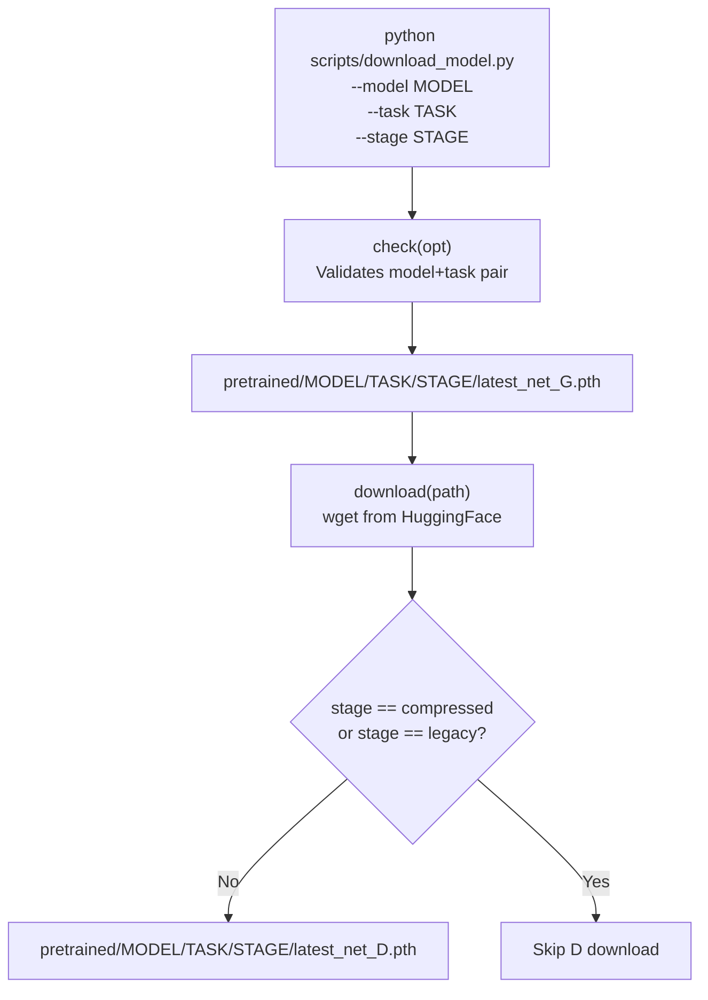

Sources: [scripts/download_model.py:34-57]()

---

## Diagram: Stage Mapping to Pipeline Positions

**Where each `--stage` value sits in the three-stage compression pipeline**

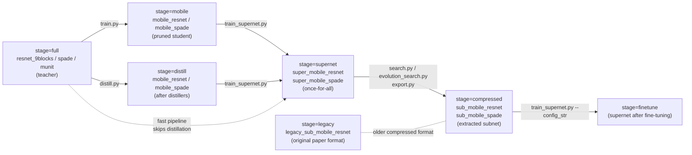

Sources: [scripts/download_model.py:38-41](), [README.md:103-109]()

---

## Downloading FID Reference Statistics

The script `datasets/download_real_stat.sh` downloads precomputed `.npz` files containing image statistics (mean and covariance of Inception features) for a dataset split. These are required by `metric/fid_score.py` to compute FID without reprocessing the full dataset on every evaluation.

**Usage:**
```shell
bash datasets/download_real_stat.sh <DATASET> <SIDE>
```

`SIDE` is typically `A` or `B`, corresponding to the source or target domain, and `subtrain_B` is used for pix2pix training-set statistics.

**Supported files:**

| File | Dataset / Split |
|---|---|
| `cityscapes_A.npz` | Cityscapes (source side) |
| `edges2shoes-r_B.npz` | edges2shoes-r (target side) |
| `edges2shoes_B.npz` | edges2shoes (target side) |
| `edges2handbags_B.npz` | edges2handbags (target side) |
| `edges2handbags-r_B.npz` | edges2handbags-r (target side) |
| `facades_A.npz` | facades (source side) |
| `horse2zebra_A.npz` | horse2zebra (source domain) |
| `horse2zebra_B.npz` | horse2zebra (target domain) |
| `maps_A.npz` | maps (source side) |
| `maps_B.npz` | maps (target side) |
| `coco_A.npz` | COCO-Stuff (source side) |

Files are saved to `./real_stat/{DATASET}_{SIDE}.npz`.

**Examples from the README:**
```shell
bash datasets/download_real_stat.sh horse2zebra A
bash datasets/download_real_stat.sh horse2zebra B
bash datasets/download_real_stat.sh edges2shoes-r B
bash datasets/download_real_stat.sh cityscapes A
```

For a description of how these `.npz` files are consumed during evaluation, see page [6.2](#6.2). To generate your own `.npz` files for a custom dataset, see the `get_real_stat.py` script documented in page [6.2](#6.2).

Sources: [datasets/download_real_stat.sh:1-17](), [README.md:69-75](), [README.md:121-127]()

---

## `pretrained/` Directory Layout

After downloading several models, the `pretrained/` directory has this structure:

```
pretrained/
├── cycle_gan/
│   └── horse2zebra/
│       ├── full/
│       │   ├── latest_net_G.pth
│       │   └── latest_net_D.pth
│       ├── compressed/
│       │   └── latest_net_G.pth
│       └── legacy/
│           └── latest_net_G.pth
├── pix2pix/
│   └── edges2shoes-r/
│       ├── full/
│       │   ├── latest_net_G.pth
│       │   └── latest_net_D.pth
│       └── compressed/
│           └── latest_net_G.pth
├── gaugan/
│   └── cityscapes/
│       ├── full/ ...
│       └── compressed/ ...
└── munit/
    └── edges2shoes-r_fast/
        ├── full/ ...
        └── compressed/ ...
```

The test shell scripts under `scripts/{model}/{task}/` reference these paths via `--restore_G_path` and `--restore_D_path` arguments passed to `test.py`.

Sources: [scripts/download_model.py:53-57](), [README.md:85-109]()

---

# Page: Compression Pipeline

# Compression Pipeline

<details>
<summary>Relevant source files</summary>

The following files were used as context for generating this wiki page:

- [README.md](README.md)
- [docs/overview.md](docs/overview.md)
- [docs/tutorials/fast_gan_compression.md](docs/tutorials/fast_gan_compression.md)
- [docs/tutorials/gan_compression.md](docs/tutorials/gan_compression.md)
- [imgs/overview.png](imgs/overview.png)
- [imgs/performance.jpeg](imgs/performance.jpeg)

</details>


This section covers the end-to-end workflow for compressing a conditional GAN model — from a pre-trained full teacher generator to a deployable, reduced-computation subnet. It describes the two supported pipelines, the scripts involved at each stage, and how artifacts flow between stages.

Detailed treatment of individual stages lives in child pages:
- Knowledge distillation → [Knowledge Distillation](#3.2)
- Supernet training → [Supernet Training](#3.3)
- Architecture search → [Architecture Search](#3.4)
- Exporting weights → [Exporting Compressed Models](#3.5)

For the network architecture variants that each stage produces, see [Generator Architecture Variants](#4.2). For the channel configuration system that defines the search space, see [Channel Configuration System](#5).

---

## The Two Workflows

The repository supports two compression pipelines. Both end with the same search-and-export steps; they differ in how the supernet is initialized.

| Pipeline | Entry Point | Distillation Step | Supernet Init |
|---|---|---|---|
| **GAN Compression** | `distill.py` → `train_supernet.py` | Yes — train a mobile student first | From distilled student weights |
| **Fast GAN Compression** | `train_supernet.py` (directly) | No | Directly from the full teacher |

The Fast GAN Compression path trades a small quality margin for a significantly simpler pipeline. In practice, results are comparable (see performance table in the repository README).

**GAN Compression pipeline** (standard):

```
train.py (full teacher)
    → train_mobile.sh (mobile student)
        → distill.py (knowledge distillation)
            → train_supernet.py (supernet, from distilled weights)
                → search.py / evolution_search.py
                    → select_arch.py → export.py
```

**Fast GAN Compression pipeline**:

```
train.py (full teacher)
    → train_supernet.py (supernet, directly from full teacher)
        → evolution_search.py
            → export.py
```

Sources: [README.md:487-489](), [docs/tutorials/gan_compression.md:1-30](), [docs/tutorials/fast_gan_compression.md:1-50]()

---

## Stage Overview

### Stage diagram: scripts and artifacts

**Script-to-Artifact Flow**

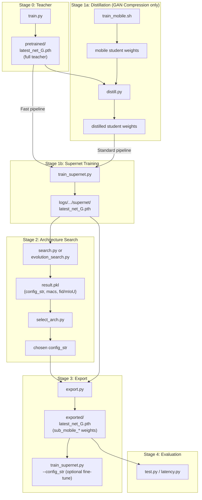

Sources: [docs/tutorials/gan_compression.md:14-291](), [docs/tutorials/fast_gan_compression.md:14-268](), [docs/overview.md:4-19]()

---

### Stage diagram: code entities per stage

**Code Entities by Stage**

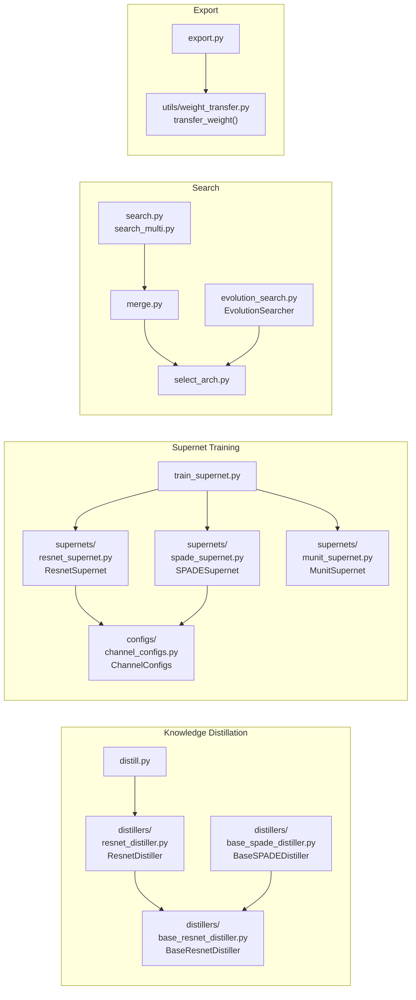

Sources: [docs/overview.md:49-121](), [docs/overview.md:4-19]()

---

## Key Artifacts and Their Formats

| Artifact | Produced By | Consumed By | Format |
|---|---|---|---|
| Full teacher weights | `train.py` | `distill.py`, `train_supernet.py` | `.pth` checkpoint |
| Mobile student weights | `train_mobile.sh` | `distill.py` | `.pth` checkpoint |
| Distilled student weights | `distill.py` | `train_supernet.py` | `.pth` checkpoint |
| Supernet weights | `train_supernet.py` | `search.py`, `evolution_search.py`, `export.py` | `.pth` checkpoint |
| Search results | `search.py` / `evolution_search.py` | `select_arch.py` | `.pkl` — Python `list` of `dict` |
| `config_str` | `select_arch.py` / manual | `export.py`, `train_supernet.py` | Underscore-delimited string, e.g. `32_32_48_32_48_48_16_16` |
| Exported subnet weights | `export.py` | `test.py`, `latency.py`, demo | `.pth` checkpoint |

The `config_str` is the key identifier for a subnet within a supernet. It encodes the number of output channels at each configurable layer as an underscore-separated list of integers. Encoding and decoding utilities live in [configs/\_\_init\_\_.py]().

Sources: [docs/tutorials/gan_compression.md:71-84](), [docs/overview.md:4-19]()

---

## Model Family Support

Each model family supports both pipelines. The table below maps model families to their generator type identifiers and applicable pipelines.

| Model Family | Task Example | Full Teacher `netG` | Supernet `netG` | Subnet `netG` | Supports Fast Pipeline |
|---|---|---|---|---|---|
| ResNet (pix2pix) | edges2shoes-r | `resnet_9blocks` | `super_mobile_resnet_9blocks` | `sub_mobile_resnet_9blocks` | Yes |
| ResNet (CycleGAN) | horse2zebra | `resnet_9blocks` | `super_mobile_resnet_9blocks` | `sub_mobile_resnet_9blocks` | Yes |
| SPADE (GauGAN) | cityscapes | `spade` | `super_mobile_spade` | `sub_mobile_spade` | Yes |
| MUNIT | edges2shoes-r | `munit` | `super_mobile_munit` | `sub_mobile_munit` | Yes (only) |

MUNIT has no distillation path and only supports the Fast GAN Compression pipeline.

Sources: [docs/tutorials/fast_gan_compression.md:213-268](), [docs/tutorials/gan_compression.md:145-291](), [README.md:283-485]()

---

## Shell Script Conventions

Each model-dataset combination has a dedicated folder under `scripts/`, containing one shell script per pipeline stage.

```
scripts/
├── pix2pix/
│   └── edges2shoes-r/
│       ├── train_full.sh         # Stage 0: full teacher
│       ├── train_mobile.sh       # Stage 0 (standard only): mobile teacher
│       ├── distill.sh            # Stage 1a: distillation
│       ├── train_supernet.sh     # Stage 1b: supernet
│       ├── search.sh             # Stage 2: brute-force search
│       ├── finetune.sh           # Stage 3 (optional): fine-tune subnet
│       └── export.sh             # Stage 3: export subnet
├── cycle_gan/horse2zebra/        # same structure
├── gaugan/cityscapes/            # same structure
└── munit/edges2shoes-r_fast/     # fast pipeline only
```

`_fast` suffix variants under each model directory (e.g. `edges2shoes-r_fast/`) use the evolutionary search and skip distillation.

Sources: [docs/tutorials/gan_compression.md:14-291](), [docs/tutorials/fast_gan_compression.md:14-268]()

---

## Child Pages

| Page | Content |
|---|---|
| [Pipeline Overview](#3.1) | Side-by-side comparison of standard and fast pipelines with concrete script invocations |
| [Knowledge Distillation](#3.2) | `distill.py`, distiller class hierarchy, loss components |
| [Supernet Training](#3.3) | `train_supernet.py`, `ResnetSupernet`, dynamic config sampling |
| [Architecture Search](#3.4) | `search.py` brute-force and `evolution_search.py` evolutionary methods |
| [Exporting Compressed Models](#3.5) | `export.py`, `transfer_weight()`, weight copying logic |

---

# Page: Pipeline Overview

# Pipeline Overview

<details>
<summary>Relevant source files</summary>

The following files were used as context for generating this wiki page:

- [README.md](README.md)
- [docs/overview.md](docs/overview.md)
- [docs/tutorials/fast_gan_compression.md](docs/tutorials/fast_gan_compression.md)
- [docs/tutorials/gan_compression.md](docs/tutorials/gan_compression.md)
- [imgs/overview.png](imgs/overview.png)
- [imgs/performance.jpeg](imgs/performance.jpeg)

</details>


This page describes the two end-to-end workflows supported by the repository for compressing a conditional GAN: **GAN Compression** (the original pipeline, which includes a pre-distillation stage) and **Fast GAN Compression** (a simplified pipeline that skips pre-distillation). It covers which scripts are invoked at each stage and how artifacts flow between them.

For details on individual stages, see:
- Knowledge distillation: [3.2](#3.2)
- Supernet training: [3.3](#3.3)
- Architecture search: [3.4](#3.4)
- Exporting compressed models: [3.5](#3.5)

---

## The Two Supported Workflows

Both workflows share the same last two stages—supernet training followed by architecture search and export—but differ in how the supernet is initialized.

| Stage | GAN Compression | Fast GAN Compression |
|---|---|---|
| **①** Train teacher | Train MobileNet-style teacher (`train.py`) | Train full standard teacher (`train.py`) |
| **②** Pre-distill | Distill MobileNet teacher → compact student (`distill.py`) | *(skipped)* |
| **③** Supernet training | Initialize supernet from distilled student (`train_supernet.py`) | Initialize supernet directly from full teacher (`train_supernet.py`) |
| **④** Architecture search | Brute-force (`search.py`) + `select_arch.py` | Evolutionary (`evolution_search.py`) |
| **⑤** Fine-tuning | Optional (`train_supernet.py --config_str`) | Optional (`train_supernet.py --config_str`) |
| **⑥** Export | Extract subnet weights (`export.py`) | Extract subnet weights (`export.py`) |

The primary practical difference: **Fast GAN Compression** reaches the supernet directly from the full teacher, saving the cost of training a MobileNet-style model and running distillation. In practice, the compressed models from both pipelines achieve comparable quality (see the performance table in the README).

Sources: [docs/tutorials/gan_compression.md:1-20](), [docs/tutorials/fast_gan_compression.md:1-20](), [README.md:283-485]()

---

## GAN Compression Pipeline

**GAN Compression Pipeline: Script and Artifact Flow**

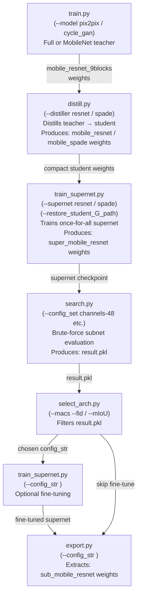

Sources: [docs/tutorials/gan_compression.md:24-140](), [docs/overview.md:5-18]()

---

## Fast GAN Compression Pipeline

**Fast GAN Compression Pipeline: Script and Artifact Flow**

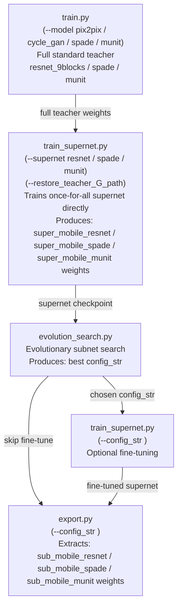

Sources: [docs/tutorials/fast_gan_compression.md:18-270](), [docs/overview.md:5-18]()

---

## Script-to-Module Mapping

Each top-level script delegates to a specific model/distiller/supernet class. The table below shows the correspondence.

| Script | Key `--model` / `--distiller` / `--supernet` value | Core class | Module file |
|---|---|---|---|
| `train.py` | `pix2pix` | `Pix2PixModel` | `models/pix2pix_model.py` |
| `train.py` | `cycle_gan` | `CycleGANModel` | `models/cycle_gan_model.py` |
| `train.py` | `spade` | `SPADEModel` | `models/spade_model.py` |
| `train.py` | `munit` | `MunitModel` | `models/munit_model.py` |
| `distill.py` | `resnet` | `ResnetDistiller` | `distillers/resnet_distiller.py` |
| `distill.py` | `spade` | `SPADEDistiller` | `distillers/spade_distiller.py` |
| `train_supernet.py` | `resnet` | `ResnetSupernet` | `supernets/resnet_supernet.py` |
| `train_supernet.py` | `spade` | `SPADESupernet` | `supernets/spade_supernet.py` |
| `train_supernet.py` | `munit` | `MunitSupernet` | `supernets/munit_supernet.py` |
| `search.py` | — | iterates `ChannelConfigs.all_configs()` | `configs/resnet_configs.py`, `configs/spade_configs.py` |
| `evolution_search.py` | — | `EvolutionSearcher` | `evolution_search.py` |
| `select_arch.py` | — | parses `.pkl` | `select_arch.py` |
| `export.py` | — | calls `transfer_weight` | `export.py`, `utils/weight_transfer.py` |

Sources: [docs/overview.md:5-141](), [docs/tutorials/gan_compression.md:1-292](), [docs/tutorials/fast_gan_compression.md:1-270]()

---

## Generator Architecture Progression

At each stage of both pipelines, a different generator variant is active. The four-tier hierarchy is:

**Generator Variants Per Pipeline Stage**

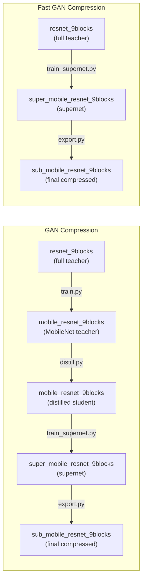

The same pattern applies to `spade` (GauGAN) and `munit` model families. All generator variants are instantiated through `define_G` in `models/networks.py`.

Sources: [docs/overview.md:71-121](), [README.md:23-32]()

---

## Stage-by-Stage Summary

### Stage ①: Teacher Training

Both pipelines begin with `train.py`. The GAN Compression pipeline trains a MobileNet-style teacher (`--netG mobile_resnet_9blocks`) from scratch, while Fast GAN Compression trains a standard full teacher (`--netG resnet_9blocks`). Pre-trained teachers for all supported datasets can be downloaded via `scripts/download_model.py --stage full` or `--stage mobile`.

### Stage ②: Pre-Distillation (GAN Compression only)

`distill.py` is called with `--distiller resnet` or `--distiller spade`. It loads the MobileNet teacher, instantiates a smaller student generator, and trains with a combined GAN + reconstruction + intermediate distillation loss via `ResnetDistiller` or `SPADEDistiller`. The output is a compact student checkpoint.

This stage is absent from Fast GAN Compression—the supernet is initialized directly from the full teacher's weights.

### Stage ③: Supernet Training

`train_supernet.py` trains the "once-for-all" supernet (e.g., `super_mobile_resnet_9blocks`). At each training step, a different channel configuration is sampled from `ChannelConfigs` and applied to the supernet via the `SuperConv2d` / `SuperSeparableConv2d` modules. All sub-networks share weights within the supernet.

- In GAN Compression: `--restore_student_G_path` points to the distilled student.
- In Fast GAN Compression: `--restore_teacher_G_path` points to the full teacher.

The `--config_set` argument (e.g., `channels-48`, `channels-64-cycleGAN`) controls the search space used during training.

### Stage ④: Architecture Search

Two methods are available:

| Method | Script | Output |
|---|---|---|
| **Brute-force** | `search.py` (parallelizable with `--num_splits` / `--split`) | `result.pkl` — list of `{config_str, macs, fid/mIoU}` dicts |
| **Evolutionary** | `evolution_search.py` (`EvolutionSearcher`) | Best `config_str` directly |

Both methods evaluate sub-generators sliced from the supernet without any retraining, using FID (via `metric/fid_score.py`) or mIoU (via `metric/cityscapes_mIoU.py` or `metric/coco_scores.py`) as the quality metric, and `model.profile(config)` for MAC counting.

`select_arch.py` filters the brute-force `result.pkl` by a MAC budget and quality threshold to identify candidates.

### Stage ⑤: Optional Fine-Tuning

`train_supernet.py --config_str <chosen_config>` fine-tunes the supernet locked to a single subnet configuration. This is optional and does not always improve quality (e.g., it increases FID for CycleGAN on horse2zebra).

### Stage ⑥: Export

`export.py` loads the supernet, decodes the `config_str`, builds the corresponding `sub_mobile_resnet_9blocks` / `sub_mobile_spade` / `sub_mobile_munit` network, and calls `transfer_weight` (from `utils/weight_transfer.py`) to copy the relevant sliced weights. The output is a standalone compressed model checkpoint that can be loaded with `test.py`.

Sources: [docs/tutorials/gan_compression.md:20-292](), [docs/tutorials/fast_gan_compression.md:18-270](), [docs/overview.md:5-18](), [README.md:487-489]()

---

## Artifact Flow Summary

**Artifacts Produced at Each Stage**

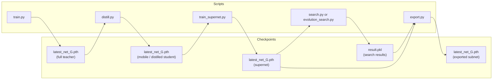

The `config_str` (e.g., `32_32_48_32_48_48_16_16`) is the primary artifact linking the search stage to export and fine-tuning. It encodes per-layer channel widths and is parsed by `configs/__init__.py`.

Sources: [docs/tutorials/gan_compression.md:65-140](), [docs/tutorials/fast_gan_compression.md:60-142](), [docs/overview.md:5-18]()

---

# Page: Knowledge Distillation

# Knowledge Distillation

<details>
<summary>Relevant source files</summary>

The following files were used as context for generating this wiki page:

- [distillers/base_resnet_distiller.py](distillers/base_resnet_distiller.py)
- [distillers/base_spade_distiller.py](distillers/base_spade_distiller.py)
- [distillers/resnet_distiller.py](distillers/resnet_distiller.py)
- [distillers/spade_distiller.py](distillers/spade_distiller.py)
- [models/modules/spade_modules/spade_model_modules.py](models/modules/spade_modules/spade_model_modules.py)
- [models/spade_model.py](models/spade_model.py)
- [options/base_options.py](options/base_options.py)
- [options/distill_options.py](options/distill_options.py)
- [scripts/cycle_gan/horse2zebra/distill.sh](scripts/cycle_gan/horse2zebra/distill.sh)
- [scripts/cycle_gan/horse2zebra/search.sh](scripts/cycle_gan/horse2zebra/search.sh)
- [scripts/cycle_gan/horse2zebra/test_distill.sh](scripts/cycle_gan/horse2zebra/test_distill.sh)
- [scripts/cycle_gan/horse2zebra/test_supernet.sh](scripts/cycle_gan/horse2zebra/test_supernet.sh)
- [supernets/resnet_supernet.py](supernets/resnet_supernet.py)

</details>


This page covers the knowledge distillation stage of the GAN compression pipeline — the process by which a pre-trained **teacher generator** guides the training of a smaller **student generator**. This is Stage 1 of the full pipeline described in [Pipeline Overview](#3.1). For supernet training (Stage 2, which reuses the base distiller infrastructure), see [Supernet Training](#3.3). For the architectural details of the generator families referenced here, see [Generator Architecture Variants](#4.2).

---

## Role in the Pipeline

Distillation produces a compressed student generator that mimics both the output and the intermediate activations of a larger teacher generator. The distilled student weights are then transferred into a supernet for architecture search.

The entrypoint is `distill.py`, configured through `DistillOptions` defined in [options/distill_options.py]().

---

## Class Hierarchy

Two parallel distiller hierarchies exist — one for ResNet-based models (pix2pix, CycleGAN) and one for SPADE-based models (GauGAN).

**Distiller: Class Hierarchy**

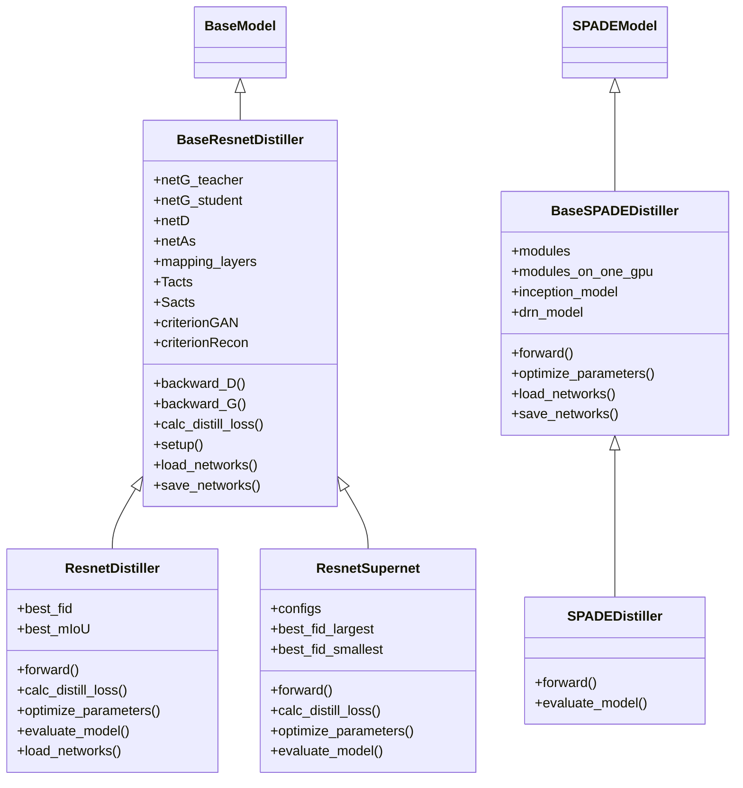

Sources: [distillers/base_resnet_distiller.py](), [distillers/resnet_distiller.py](), [supernets/resnet_supernet.py](), [distillers/base_spade_distiller.py](), [distillers/spade_distiller.py]()

---

## ResNet Distillation

### Network Setup

`BaseResnetDistiller.__init__` instantiates the following networks:

| Attribute | Description | Default netG | Default ngf |
|---|---|---|---|
| `netG_teacher` | Pre-trained teacher (frozen, `.eval()`) | `mobile_resnet_9blocks` | 64 |
| `netG_student` | Trainable student | `mobile_resnet_9blocks` | 48 |
| `netD` | Discriminator on student output | `n_layers` | 128 |
| `netAs` | Adapter 1×1 convolutions (one per mapping layer) | — | — |

Valid `netG` identifiers for teacher/student: `resnet_9blocks`, `mobile_resnet_9blocks`, `super_mobile_resnet_9blocks`, `sub_mobile_resnet_9blocks`.

[distillers/base_resnet_distiller.py:41-116]()

### Mapping Layers and Forward Hooks

Distillation compares intermediate activations at four points in the ResNet generator. These are identified by the following module names:

```
model.9, model.12, model.15, model.18
```

(Or `module.model.9` etc. when wrapped in `DataParallel`.)

[distillers/base_resnet_distiller.py:91-94]()

During `setup()`, PyTorch forward hooks are registered on both teacher and student at each mapping layer. Activations are stored in dictionaries `Tacts` (teacher) and `Sacts` (student), keyed by layer name and device.

[distillers/base_resnet_distiller.py:123-138]()

### Adapter Networks (`netAs`)

Because the student has fewer channels than the teacher, adapter networks project student activations into the teacher's channel space before computing the distillation loss.

- **In `ResnetDistiller`**: Each `netA` is a plain `nn.Conv2d(in_channels=student_ngf*4, out_channels=teacher_ngf*4, kernel_size=1)`.
- **In `ResnetSupernet`**: Each `netA` is a `SuperConv2d` to handle variable channel widths during supernet training.

The adapters are optimized jointly with the student generator via `optimizer_G`.

[distillers/base_resnet_distiller.py:96-113]()

**Distillation Data Flow**

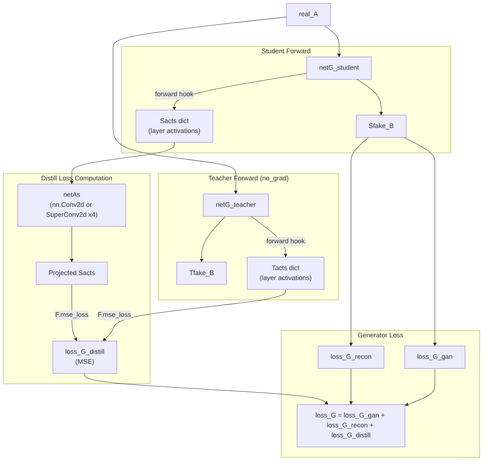

Sources: [distillers/base_resnet_distiller.py:150-187](), [distillers/resnet_distiller.py:44-57]()

---

## Loss Components

All three loss terms are combined in `backward_G`:

[distillers/base_resnet_distiller.py:173-187]()

| Loss | Symbol | Computation | Weight Argument |
|---|---|---|---|
| Adversarial | `loss_G_gan` | `criterionGAN(netD(Sfake_B), True)` | `--lambda_gan` (default 1) |
| Reconstruction | `loss_G_recon` | `criterionRecon(Sfake_B, real_B)` (aligned) or `criterionRecon(Sfake_B, Tfake_B)` (unaligned) | `--lambda_recon` (default 100) |
| Distillation | `loss_G_distill` | Sum of per-layer `MSE(netA(Sacts), Tacts)` | `--lambda_distill` (default 1) |

**Reconstruction loss variants** (`--recon_loss_type`):

| Value | Class |
|---|---|
| `l1` (default) | `torch.nn.L1Loss` |
| `l2` | `torch.nn.MSELoss` |
| `smooth_l1` | `torch.nn.SmoothL1Loss` |
| `vgg` | `models.modules.loss.VGGLoss` |

[distillers/base_resnet_distiller.py:79-89]()

The **reconstruction target** depends on `--dataset_mode`:
- `aligned` (pix2pix): student output vs. `real_B`
- `unaligned` (CycleGAN): student output vs. teacher output `Tfake_B`

[distillers/base_resnet_distiller.py:173-179]()

---

## SPADE Distillation

`BaseSPADEDistiller` extends `SPADEModel` and follows the same principle, but delegates all module construction to either `SPADEDistillerModules` or `SPADESupernetModules` (selected based on whether `opt.distiller` is set). This wrapper pattern is needed because SPADE uses synchronized batch norm across GPUs.

[distillers/base_spade_distiller.py:45-70]()

Valid SPADE `netG` identifiers: `spade`, `mobile_spade`, `super_mobile_spade`, `sub_mobile_spade`.

The SPADE distiller adds feature-matching and VGG perceptual losses on top of the three base losses:

| Loss | Weight Argument |
|---|---|
| GAN | `--lambda_gan` (default 1) |
| Feature matching | `--lambda_feat` (default 10) |
| VGG perceptual | `--lambda_vgg` (default 10) |
| Distillation | `--lambda_distill` (default 10) |

[distillers/base_spade_distiller.py:32-36]()

The mapping layers for SPADE are defined inside `SPADEDistillerModules` (via `modules_on_one_gpu.mapping_layers`) rather than being hardcoded in the distiller itself.

---

## Pretrained Weight Transfer

`ResnetDistiller.load_networks()` supports initializing the student with weights from a separately pre-trained model of a different architecture. This is controlled by three options:

| Option | Description |
|---|---|
| `--restore_pretrained_G_path` | Path to a pretrained generator checkpoint |
| `--pretrained_netG` | Architecture of the pretrained generator |
| `--pretrained_ngf` | Base filter count of the pretrained generator |

If `--restore_pretrained_G_path` is provided, the pretrained weights are loaded into a temporary `netG_pretrained` and then transferred to `netG_student` via `load_pretrained_weight()` from `utils/weight_transfer.py`. The temporary network is deleted after transfer.

[distillers/resnet_distiller.py:70-77]()

---

## Checkpoint Saving and Restoring

`save_networks` saves:
- `{epoch}_net_G.pth` — student generator
- `{epoch}_net_D.pth` — discriminator
- `{epoch}_net_A-{i}.pth` — each adapter network
- `{epoch}_optim-{i}.pth` — each optimizer state

`load_networks` restores from these paths via the following options:

| Option | Target |
|---|---|
| `--restore_teacher_G_path` | `netG_teacher` (required) |
| `--restore_student_G_path` | `netG_student` (optional) |
| `--restore_D_path` | `netD` (optional) |
| `--restore_A_path` | `netAs` (optional, appends `-{i}.pth`) |
| `--restore_O_path` | Optimizers (optional, appends `-{i}.pth`) |

[distillers/base_resnet_distiller.py:207-220](), [options/distill_options.py:55-65]()

---

## Evaluation During Training

Both `ResnetDistiller.evaluate_model` and `SPADEDistiller.evaluate_model` run inference on an eval dataloader and compute:
- **FID** (always, unless `--no_fid`)
- **Cityscapes mIoU** (when `cityscapes` is in `--dataroot` and `--direction BtoA`)

The best-ever FID/mIoU scores are tracked to set `self.is_best`, which signals the training loop to save a "best" checkpoint.

[distillers/resnet_distiller.py:79-134]()

---

## Command-Line Options Summary

Defined in `DistillOptions` ([options/distill_options.py]()) and augmented by each distiller's `modify_commandline_options`.

| Option | Default | Description |
|---|---|---|
| `--distiller` | `resnet` | Distiller type: `resnet` or `spade` |
| `--teacher_netG` | — | Teacher generator architecture |
| `--student_netG` | — | Student generator architecture |
| `--teacher_ngf` | 64 | Teacher base filter count |
| `--student_ngf` | 48 | Student base filter count |
| `--lambda_distill` | 1 | Weight for intermediate activation loss |
| `--lambda_recon` | 100 | Weight for reconstruction loss |
| `--lambda_gan` | 1 | Weight for GAN loss |
| `--recon_loss_type` | `l1` | Reconstruction loss type |
| `--restore_teacher_G_path` | (required) | Teacher checkpoint path |
| `--real_stat_path` | (required) | `.npz` reference statistics for FID |
| `--nepochs` | 5 | Epochs at initial LR |
| `--nepochs_decay` | 15 | Epochs with LR linear decay |

---

## Example Invocation

The following shell script runs ResNet distillation for CycleGAN horse→zebra:

[scripts/cycle_gan/horse2zebra/distill.sh]()

Key arguments from that script:
- `--distiller resnet`
- `--student_ngf 32` (smaller than default 48, since this is a CycleGAN model)
- `--restore_teacher_G_path` points to a previously trained `mobile_resnet_9blocks` checkpoint
- `--restore_pretrained_G_path` initializes the student from the same teacher checkpoint via weight transfer
- `--lambda_recon 10 --lambda_distill 0.01`

---

# Page: Supernet Training

# Supernet Training

<details>
<summary>Relevant source files</summary>

The following files were used as context for generating this wiki page:

- [data/base_dataset.py](data/base_dataset.py)
- [distillers/base_resnet_distiller.py](distillers/base_resnet_distiller.py)
- [distillers/resnet_distiller.py](distillers/resnet_distiller.py)
- [options/base_options.py](options/base_options.py)
- [scripts/conda_deps.sh](scripts/conda_deps.sh)
- [scripts/cycle_gan/horse2zebra_fast/evolution_search.sh](scripts/cycle_gan/horse2zebra_fast/evolution_search.sh)
- [scripts/gaugan/cityscapes/train_supernet.sh](scripts/gaugan/cityscapes/train_supernet.sh)
- [scripts/gaugan/coco_fast/evolution_search.sh](scripts/gaugan/coco_fast/evolution_search.sh)
- [scripts/gaugan/coco_fast/search.sh](scripts/gaugan/coco_fast/search.sh)
- [scripts/gaugan/coco_fast/train_supernet.sh](scripts/gaugan/coco_fast/train_supernet.sh)
- [scripts/pix2pix/cityscapes/train_supernet.sh](scripts/pix2pix/cityscapes/train_supernet.sh)
- [supernets/resnet_supernet.py](supernets/resnet_supernet.py)

</details>


This page documents the supernet training stage of the GAN compression pipeline: the purpose of a supernet, the class hierarchy that implements it, the `train_supernet.py` entrypoint, and its key command-line arguments. For background on where supernet training fits in the broader compression workflow, see the [Pipeline Overview](#3.1). For the knowledge distillation step that precedes supernet training in the standard workflow, see [Knowledge Distillation](#3.2). For the search step that follows supernet training, see [Architecture Search](#3.4).

---

## What Is a Supernet?

A **supernet** (also called an *once-for-all network*) is a single weight-shared generator that can execute as many different sub-networks (subnets) simultaneously by accepting a channel-width configuration at runtime. During training, a different configuration is sampled on every optimization step. Because all subnets share the same weights, the supernet only needs to be trained once: after training, any subnet can be extracted and evaluated without retraining.

The supernet uses `super_mobile_resnet_9blocks` (or `super_mobile_spade`) as the student generator, where each convolution is replaced by a `SuperConv2d` module that accepts a `config` dict and slices its weight tensors to the requested channel width at every forward pass. See [Configurable Supernet Modules](#4.3) for details on how slicing works.

Sources: [supernets/resnet_supernet.py:1-50](), [distillers/base_resnet_distiller.py:1-50]()

---

## Class Hierarchy

**Class hierarchy for supernet training (ResNet family)**

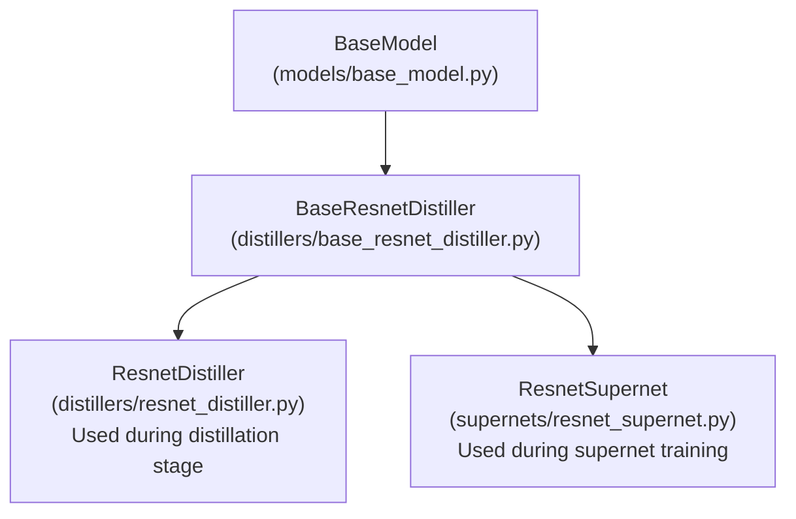

`ResnetSupernet` inherits all infrastructure from `BaseResnetDistiller`: the teacher generator `netG_teacher`, the student generator `netG_student`, the discriminator `netD`, the adapter networks `netAs`, optimizers, and the distillation loss calculation. It overrides `forward`, `optimize_parameters`, and `evaluate_model` to add per-step config sampling.

Sources: [supernets/resnet_supernet.py:19-44](), [distillers/base_resnet_distiller.py:20-121]()

---

## Initialization and Config Setup

In `ResnetSupernet.__init__`, the student generator is asserted to contain `'super'` in its name (i.e., it must be `super_mobile_resnet_9blocks`). The config space is set up as follows:

| Argument present | Behavior |
|---|---|
| `--config_set` (and no `--config_str`) | Calls `get_configs(opt.config_set)` to load a named channel-width config set. Sets `eval_mode = 'both'`. |
| `--config_str` (and no `--config_set`) | Wraps the single decoded config in `SingleConfigs`. Sets `eval_mode = 'largest'`. |

`get_configs` returns a `ChannelConfigs` object (from `configs/resnet_configs.py` or `configs/spade_configs.py`) that knows how to sample channel widths, return the largest config, and return the smallest config. See [Channel Configuration System](#5) for the full `ChannelConfigs` API.

Sources: [supernets/resnet_supernet.py:28-44]()

---

## Training Loop: `optimize_parameters`

On every training step, `ResnetSupernet.optimize_parameters` samples one config from the config space and runs a full GAN update with that config.

**Per-step training flow inside `ResnetSupernet.optimize_parameters`**

```mermaid
flowchart TD
    A["optimize_parameters(steps)"]
    B["self.configs.sample()\nReturns a channel-width config dict"]
    C["self.forward(config)\nSets netG_student.configs = config\nRuns teacher forward (no_grad)\nRuns student forward with sliced weights"]
    D["backward_D()\nUpdate discriminator"]
    E["backward_G()\nGAN loss + recon loss + distill loss"]
    F["optimizer_D.step()\noptimizer_G.step()"]

    A --> B --> C --> D --> E --> F
```

The `forward(config)` method sets the active channel configuration on the student generator before running inference:

```
# supernets/resnet_supernet.py lines 46-53
self.netG_student.module.configs = config   # or .configs for non-DataParallel
self.Tfake_B = self.netG_teacher(self.real_A)   # frozen teacher
self.Sfake_B = self.netG_student(self.real_A)   # sliced student
```

The distillation loss in `calc_distill_loss` uses `SuperConv2d` adapter networks (`netAs`) with `out_channels` fixed to the full teacher width, matching teacher intermediate activations to the adapted student activations.

Sources: [supernets/resnet_supernet.py:46-82](), [distillers/base_resnet_distiller.py:170-188]()

---

## Evaluation During Training

`evaluate_model` is called periodically during training. It evaluates the supernet under two configs when `eval_mode == 'both'`:

| Config name | Meaning |
|---|---|
| `'largest'` | All layers at their maximum channel widths |
| `'smallest'` | All layers at their minimum channel widths |

For each config, it runs inference over the full eval dataset, computes FID (via `get_fid`), and optionally computes Cityscapes mIoU (via `get_cityscapes_mIoU`) when `dataroot` contains `'cityscapes'`.

The supernet tracks `best_fid_largest`, `best_fid_smallest`, `best_mIoU_largest`, and `best_mIoU_smallest` across evaluations. A rolling window of the three most recent FID values is also maintained for each setting (`fids_largest`, `fids_smallest`).

**Evaluation data flow**

```mermaid
flowchart LR
    eval_dataloader["eval_dataloader\n(create_eval_dataloader)"]
    forward["self.test(config)\ncalls self.forward(config)"]
    fakes["fakes list\ncollected Sfake_B tensors"]
    get_fid["get_fid()\nmetric/fid_score.py"]
    get_mIoU["get_cityscapes_mIoU()\nmetric/cityscapes_mIoU.py"]
    ret["ret dict\nmetric/fid_largest, metric/fid_smallest, etc."]

    eval_dataloader --> forward --> fakes --> get_fid --> ret
    fakes --> get_mIoU --> ret
```

Sources: [supernets/resnet_supernet.py:83-155]()

---

## `train_supernet.py`: Entrypoint and Key Arguments

`train_supernet.py` is the main script for supernet training. It accepts all standard training arguments plus the following supernet-specific ones.

### Required Supernet Arguments

| Argument | Type | Description |
|---|---|---|
| `--supernet` | `str` | Supernet type: `resnet` or `spade`. Determines which supernet class and model family to use. |
| `--config_set` | `str` | Named channel-width config set (e.g., `channels-48`, `channels-64`, `channels-64-cycleGAN`). Mutually exclusive with `--config_str`. |
| `--student_ngf` | `int` | Number of filters in the outermost layer of the student generator (e.g., `48` or `64`). |

### Restore Paths

| Argument | Description |
|---|---|
| `--restore_teacher_G_path` | Path to the teacher generator checkpoint (`.pth`). Always required. |
| `--restore_student_G_path` | Path to a pre-trained student generator checkpoint (from the distillation stage). Optional in fast pipeline. |
| `--restore_D_path` | Path to a pre-trained discriminator checkpoint. Optional. |
| `--restore_A_path` | Path prefix for adapter network (`netA`) checkpoints. Optional. |
| `--restore_O_path` | Path prefix for optimizer state checkpoints. Optional. |

### Other Notable Arguments

| Argument | Description |
|---|---|
| `--teacher_ngf` | Number of filters in the teacher generator (e.g., `96` for cityscapes pix2pix). |
| `--real_stat_path` | Path to `.npz` file with pre-computed real image statistics for FID. |
| `--nepochs` | Number of epochs at the initial learning rate. |
| `--nepochs_decay` | Number of additional epochs with linearly decaying LR. |
| `--meta_path` | Path to a dataset metadata file for ordered/reproducible data loading. |
| `--config_str` | Alternative to `--config_set`: train against a single fixed subnet config. |

Sources: [supernets/resnet_supernet.py:20-26](), [distillers/base_resnet_distiller.py:22-39](), [scripts/pix2pix/cityscapes/train_supernet.sh:1-17](), [scripts/gaugan/coco_fast/train_supernet.sh:1-11](), [options/base_options.py:65-68]()

---

## Workflow Variants: Standard vs. Fast Pipeline

The two pipelines differ in whether a pre-distilled student checkpoint is provided to `train_supernet.py`.

**Standard pipeline vs. fast pipeline for supernet training**

```mermaid
flowchart TD
    subgraph "Standard Pipeline"
        T1["Pre-trained teacher\n(restore_teacher_G_path)"]
        D1["Distilled student\n(restore_student_G_path)"]
        D2["Distilled discriminator\n(restore_D_path)"]
        SN1["train_supernet.py\n(ResnetSupernet)"]
        T1 --> SN1
        D1 --> SN1
        D2 --> SN1
    end

    subgraph "Fast Pipeline"
        T2["Pre-trained teacher\n(restore_teacher_G_path only)"]
        SN2["train_supernet.py\n(ResnetSupernet)"]
        T2 --> SN2
    end

    SN1 --> OUT1["latest_net_G.pth\n(supernet weights)"]
    SN2 --> OUT2["latest_net_G.pth\n(supernet weights)"]
```

In the fast pipeline, the student generator is initialized from scratch (or random init) and trained directly from the teacher supervision without a preceding distillation stage. In the standard pipeline, `--restore_student_G_path` and `--restore_D_path` warm-start the supernet with the weights from [Knowledge Distillation](#3.2).

Sources: [scripts/pix2pix/cityscapes/train_supernet.sh:1-17](), [scripts/gaugan/coco_fast/train_supernet.sh:1-11](), [scripts/gaugan/cityscapes/train_supernet.sh:1-14]()

---

## Example Invocations

### pix2pix — Cityscapes (Standard Pipeline)

```bash
python train_supernet.py \
  --dataroot database/cityscapes \
  --supernet resnet \
  --log_dir logs/pix2pix/cityscapes/supernet \
  --restore_teacher_G_path logs/pix2pix/cityscapes/mobile/checkpoints/latest_net_G.pth \
  --restore_student_G_path logs/pix2pix/cityscapes/distill/checkpoints/latest_net_G.pth \
  --restore_D_path logs/pix2pix/cityscapes/distill/checkpoints/latest_net_D.pth \
  --real_stat_path real_stat/cityscapes_A.npz \
  --teacher_ngf 96 \
  --config_set channels-48 \
  --nepochs 200 --nepochs_decay 300 \
  --direction BtoA \
  --meta_path datasets/metas/cityscapes/train1.meta
```

Sources: [scripts/pix2pix/cityscapes/train_supernet.sh:1-17]()

---

### GauGAN (SPADE) — COCO Fast Pipeline

```bash
python train_supernet.py \
  --dataroot database/coco_stuff \
  --dataset_mode coco \
  --supernet spade \
  --teacher_netG spade \
  --student_ngf 64 \
  --log_dir logs/gaugan/coco_fast/supernet \
  --restore_teacher_G_path pretrained/gaugan/coco_fast/full/latest_net_G.pth \
  --real_stat_path real_stat/coco_A.npz \
  --gpu_ids 0,1,2,3 \
  --nepochs 100 --nepochs_decay 0 \
  --config_set channels-64 \
  --num_upsampling_layers normal \
  --batch_size 32 \
  --meta_path datasets/metas/coco-coco_stuff/train1.meta
```

Sources: [scripts/gaugan/coco_fast/train_supernet.sh:1-11]()

---

### GauGAN (SPADE) — Cityscapes Standard Pipeline

```bash
python train_supernet.py \
  --dataroot database/cityscapes-origin \
  --supernet spade \
  --log_dir logs/gaugan/cityscapes/supernet \
  --restore_teacher_G_path logs/gaugan/cityscapes/mobile/checkpoint/latest_net_G.pth \
  --restore_student_G_path logs/gaugan/cityscapes/distill/checkpoints/latest_net_G.pth \
  --restore_D_path logs/gaugan/cityscapes/distill/checkpoints/latest_net_D.pth \
  --real_stat_path real_stat/cityscapes_A.npz \
  --gpu_ids 0,1,2,3,4,5,6,7 \
  --config_set channels-48 \
  --meta_path datasets/metas/cityscapes-origin/train1.meta
```

Sources: [scripts/gaugan/cityscapes/train_supernet.sh:1-14]()

---

## Outputs

After training, the supernet checkpoint directory (e.g., `logs/pix2pix/cityscapes/supernet/checkpoints/`) contains:

| File | Description |
|---|---|
| `latest_net_G.pth` | Supernet student generator weights |
| `latest_net_D.pth` | Discriminator weights |
| `latest_net_A-{i}.pth` | Adapter network weights (one per mapping layer) |
| `latest_optim-{i}.pth` | Optimizer states |

The `latest_net_G.pth` file is passed to `search.py` or `evolution_search.py` via `--restore_G_path` in the next pipeline stage (see [Architecture Search](#3.4)), and later to `export.py` via `--input_path` (see [Exporting Compressed Models](#3.5)).

Sources: [distillers/base_resnet_distiller.py:222-252](), [scripts/gaugan/coco_fast/evolution_search.sh:4](), [scripts/cycle_gan/horse2zebra_fast/evolution_search.sh:3]()

---

# Page: Architecture Search

# Architecture Search

<details>
<summary>Relevant source files</summary>

The following files were used as context for generating this wiki page:

- [datasets/separate_A_and_B.py](datasets/separate_A_and_B.py)
- [evolution_search.py](evolution_search.py)
- [get_real_stat.py](get_real_stat.py)
- [metric/cityscapes_mIoU.py](metric/cityscapes_mIoU.py)
- [metric/coco_scores.py](metric/coco_scores.py)
- [metric/fid_score.py](metric/fid_score.py)
- [options/evolution_options.py](options/evolution_options.py)
- [search.py](search.py)
- [select_arch.py](select_arch.py)

</details>


## Purpose and Scope

This page describes the architecture search stage of the GAN compression pipeline — the second of three stages. After a supernet has been trained (see [Supernet Training](#3.3)), architecture search finds the best-performing subnet configuration within that supernet subject to a compute budget (MACs). Two search strategies are available: brute-force enumeration and evolutionary search. Each is covered in its own sub-page:

- [Brute-force Search](#3.4.1) — `search.py` and `search_multi.py`
- [Evolutionary Search](#3.4.2) — `evolution_search.py` and `EvolutionSearcher`

For information on how to export a selected configuration into a standalone model, see [Exporting Compressed Models](#3.5). For background on the channel configuration space being searched, see [Channel Configuration System](#5).

---

## Role in the Compression Pipeline

Architecture search sits between supernet training and model export. The supernet has weight-shared parameters for all supported channel widths; search selects a specific combination of per-layer channel counts that maximises image quality at or below a MAC budget — **without any retraining**.

**Pipeline position:**

```mermaid
flowchart LR
    A["train_supernet.py\n(Supernet weights)"] --> B["search.py /\nevolution_search.py\n(Architecture Search)"]
    B --> C["results .pkl\n{config_str, macs, fid/mIoU}"]
    C --> D["select_arch.py\n(Filter by MACs + metric)"]
    D --> E["export.py\n(Subnet extraction)"]
```

Sources: [search.py:80-154](), [evolution_search.py:272-281](), [select_arch.py:1-34]()

---

## Shared Concepts

Both search methods share the same inputs, output format, and filtering utility. Understanding these shared concepts helps when reading either sub-page.

### Input: Trained Supernet

Both scripts load a trained supernet via `create_model(opt)` and `model.setup(opt)`. The supernet generator type is specified with `--netG`, e.g. `super_mobile_resnet_9blocks` or `super_mobile_spade`. The supernet weights come from a checkpoint set via restore path options.

### Configuration Space

Each candidate architecture is a dict with a `channels` key: a list of per-layer channel counts. The search space is defined by `ChannelConfigs` (see [Channel Configuration System](#5)), selected by `--config_set`.

Both scripts dynamically import the appropriate config module:

| `--netG` contains | Config module imported |
|---|---|
| `resnet` | `configs.resnet_configs.get_configs` |
| `spade` | `configs.spade_configs.get_configs` |
| `munit` | `configs.munit_configs.get_configs` |

Sources: [search.py:67-77](), [evolution_search.py:71-79]()

### MAC Profiling and the Budget

Every candidate config is profiled for MACs using `model.profile(config, verbose=False)` before evaluation. Only configs satisfying `macs <= opt.budget` are passed to full inference and metric scoring. Over-budget configs receive worst-case metric values (`fid=1e9`, `mIoU=0`) in `search.py`, and are simply rejected during sampling in `evolution_search.py`.

Sources: [search.py:109-111](), [evolution_search.py:104-111]()

### Metric Evaluation

Both search scripts compute the same quality metrics on the generated images:

| Metric | Condition | Function called |
|---|---|---|
| FID | `inception_model is not None` | `get_fid(...)` |
| Cityscapes mIoU | `drn_model is not None` | `get_cityscapes_mIoU(...)` |
| COCO mIoU + accu | `deeplabv2_model is not None` | `get_coco_scores(...)` |

Metric models are created once via `create_metric_models(opt, device)` and reused across all evaluated configs. The FID computation requires a reference `.npz` file loaded from `opt.real_stat_path`.

For SPADE supernets, batch norm statistics must be recalibrated for each config before inference: `model.calibrate(config)` is called ahead of the forward passes.

Sources: [search.py:93-94](), [search.py:115-144](), [evolution_search.py:89-92](), [evolution_search.py:148-172]()

### Output Format: `.pkl` Results

Both search methods write results to a pickle file. Each entry in the list is a `dict` with the following fields:

| Key | Type | Description |
|---|---|---|
| `config_str` | `str` | Encoded channel configuration (from `encode_config`) |
| `macs` | `float` | Multiply-accumulate count for this config |
| `fid` | `float` | FID score (lower is better); absent if not computed |
| `mIoU` | `float` | Mean IoU (higher is better); absent if not computed |
| `accu` | `float` | Pixel accuracy (COCO only); absent if not applicable |

Sources: [search.py:110-144](), [evolution_search.py:42-47](), [evolution_search.py:264-269]()

---

## Filtering Results: `select_arch.py`

After search completes, `select_arch.py` reads the `.pkl` file and prints all entries that satisfy user-specified thresholds.

```
python select_arch.py \
    --pkl_path results/search_results.pkl \
    --macs 5.68e9 \
    --fid 60.0 \
    --mIoU 40.0
```

The script sorts results by MACs in ascending order, then applies all three thresholds (any threshold left at its default is ignored). Passing entries are printed to stdout.

| Argument | Default | Description |
|---|---|---|
| `--pkl_path` | required | Path to the input `.pkl` file |
| `--macs` | `5.68e9` | Maximum allowed MACs |
| `--fid` | `-1` | Maximum allowed FID (disabled when ≤ 0 effectively) |
| `--mIoU` | `1e18` | Minimum required mIoU (disabled at default) |

Sources: [select_arch.py:1-34]()

---

## Comparison of the Two Search Methods

```mermaid
flowchart TD
    subgraph "search.py (Brute-force)"
        BF1["all_configs()\nEnumerate every config"] --> BF2["model.profile(config)\nCheck MACs <= budget"]
        BF2 --> BF3["model.test(config)\nRun inference"]
        BF3 --> BF4["get_fid / get_cityscapes_mIoU\nScore quality"]
        BF4 --> BF5["results list\nAppend and save .pkl"]
    end
    subgraph "evolution_search.py (Evolutionary)"
        EV1["random_sample()\nInitialize population"] --> EV2["evaluate(child_pool)\nScore population"]
        EV2 --> EV3["mutate_sample()\ncrossover_sample()\nGenerate offspring"]
        EV3 --> EV2
        EV2 --> EV4["save_ckpt()\nbest_infos.pkl"]
    end
```

Sources: [search.py:80-154](), [evolution_search.py:201-261]()

| Property | Brute-force (`search.py`) | Evolutionary (`evolution_search.py`) |
|---|---|---|
| Config enumeration | Exhaustive: `all_configs()` | Stochastic: `random_sample`, `mutate_sample`, `crossover_sample` |
| Parallelism | `--num_splits` / `--split` + `merge.py` | Single process; caches results |
| Output file | Single `.pkl` per split | `latest_ckpt.pkl`, `<n>_ckpt.pkl`, `best_infos.pkl`, `final_parents.pkl` |
| Resumable | Via `--restore_pkl_path` | Via `--restore_pkl_path` and `--generation_base` |
| Best suited for | Small/medium config spaces | Large config spaces (ResNet, SPADE) |
| Key extra options | `--num_splits`, `--split` | `--population_size`, `--mutation_ratio`, `--mutate_prob`, `--evolution_iters`, `--criterion` |

Sources: [search.py:67-77](), [options/evolution_options.py:39-65]()

---

## Data Flow: Config to `.pkl`

The following diagram maps the code entities involved in producing a single result entry, shared by both search methods.

```mermaid
flowchart LR
    CC["ChannelConfigs\n.all_configs() or .sample()"] -->|"config dict"| EP["model.profile(config)\nTestModel.profile()"]
    EP -->|"macs"| BG{"macs <= budget?"}
    BG -->|"No"| WC["Worst-case values\nfid=1e9 or mIoU=0"]
    BG -->|"Yes"| CAL["model.calibrate(config)\n(SPADE only)"]
    CAL --> INF["model.test(config)\nforward pass"]
    INF -->|"fake_B tensors"| FID["get_fid()\nget_cityscapes_mIoU()\nget_coco_scores()"]
    FID -->|"metric values"| RES["result dict\n{config_str, macs, fid, mIoU}"]
    WC --> RES
    RES -->|"pickle.dump"| PKL[".pkl file"]
    PKL --> SA["select_arch.py\nFilter and print"]
```

Sources: [search.py:105-153](), [evolution_search.py:140-173](), [select_arch.py:9-24]()

---

# Page: Brute-force Search

# Brute-force Search

<details>
<summary>Relevant source files</summary>

The following files were used as context for generating this wiki page:

- [configs/channel_configs.py](configs/channel_configs.py)
- [configs/resnet_configs.py](configs/resnet_configs.py)
- [configs/spade_configs.py](configs/spade_configs.py)
- [scripts/cycle_gan/horse2zebra/distill.sh](scripts/cycle_gan/horse2zebra/distill.sh)
- [scripts/cycle_gan/horse2zebra/search.sh](scripts/cycle_gan/horse2zebra/search.sh)
- [scripts/cycle_gan/horse2zebra/test_distill.sh](scripts/cycle_gan/horse2zebra/test_distill.sh)
- [scripts/cycle_gan/horse2zebra/test_supernet.sh](scripts/cycle_gan/horse2zebra/test_supernet.sh)
- [search.py](search.py)
- [select_arch.py](select_arch.py)

</details>


This page documents the brute-force neural architecture search (NAS) mechanism in the compression pipeline: specifically `search.py`, its parallelization mechanism, and `select_arch.py`. The brute-force search exhaustively evaluates every possible sub-network configuration within a trained supernet and records quality metrics for each.

For the evolutionary alternative to this exhaustive search, see [Evolutionary Search](#3.4.2). For background on the supernet that produces the checkpoints used here, see [Supernet Training](#3.3). For information on how the search results are used to produce a final compressed model, see [Exporting Compressed Models](#3.5). For documentation on the `ChannelConfigs` class and named config sets, see [Channel Configuration System](#5).

---

## How Brute-force Search Fits into the Pipeline

**Figure: Brute-force Search in the Three-Stage Compression Pipeline**

```mermaid
flowchart LR
    SUPERNET["Trained Supernet\n(super_mobile_resnet / super_mobile_spade)"]
    ALLCONFIGS["ChannelConfigs.all_configs()\nExhaustive config enumeration"]
    PROFILE["model.profile(config)\nMAC counting"]
    BUDGET{"macs <= budget?"}
    SKIP["Record macs=macs\nfid=1e9 / mIoU=0\n(skipped)"]
    INFER["model.test(config)\nRun full inference pass"]
    METRICS["get_fid / get_cityscapes_mIoU\n/ get_coco_scores"]
    PKL["results.pkl\nList of dicts:\n{config_str, macs, fid, mIoU}"]
    SELECT["select_arch.py\nFilter by MACs + FID/mIoU"]
    EXPORT["export.py\nExtract subnet weights"]

    SUPERNET --> ALLCONFIGS --> PROFILE --> BUDGET
    BUDGET -- "No" --> SKIP --> PKL
    BUDGET -- "Yes" --> INFER --> METRICS --> PKL
    PKL --> SELECT --> EXPORT
```

Sources: [search.py:80-154](), [select_arch.py:1-34]()

---

## Configuration Space Enumeration

The set of candidate architectures is determined by a `ChannelConfigs` object (see [Channel Configuration System](#5)). The `all_configs()` method [configs/channel_configs.py:50-61]() is a recursive generator that yields every Cartesian product of channel widths across all layers. For a supernet with 8 layers each having 5 width choices, this produces 5⁸ = 390,625 candidates.

Named config sets are retrieved by `get_configs()` in either `configs/resnet_configs.py` or `configs/spade_configs.py` depending on the `--netG` flag.

**Table: Named Config Sets and Their Search Spaces**

| Config Set | Architecture | Widths per Layer | Approx. Total Configs |
|---|---|---|---|
| `channels-32` | ResNet (CycleGAN) | `[32, 24, 16]` × 8 layers | 3⁸ = 6,561 |
| `channels-48` | ResNet (pix2pix) | `[48, 32]` or `[48, 40, 32]` or `[48, 32, 24, 16]` | varies |
| `channels-64-cycleGAN` | ResNet (CycleGAN) | `[64, 48, 32, 24, 16]` × 8 layers | 5⁸ = 390,625 |
| `channels-64-pix2pix` | ResNet (pix2pix) | `[64, 56, 48, 40, 32, 24, 16]` × 8 layers | 7⁸ = 5,764,801 |
| `channels-48` | SPADE | `[48, 40, 32]` or `[48, 40, 32, 24]` × 8 layers | varies |
| `channels-64` | SPADE | `[64, 48, 40, 32]` or `[64, 48, 40, 32, 24]` × 8 layers | varies |

Sources: [configs/resnet_configs.py:1-27](), [configs/spade_configs.py:1-22](), [configs/channel_configs.py:50-61]()

---

## The Search Loop

`search.py` is the main entry point. Its `__main__` block [search.py:80-154]() runs the following sequence:

**Figure: search.py Execution Flow**

```mermaid
flowchart TD
    OPT["SearchOptions().parse()"]
    CHECK["check(opt)\nAssert serial_batches, no_flip,\nload_size==crop_size, config_set set"]
    SEED["set_seed(opt.seed)\nFix cudnn and all RNGs"]
    GETCFG["get_config_split(opt)\nall_configs() -> shuffle -> np.array_split -> [opt.split]"]
    DATA["create_dataloader(opt)"]
    MODEL["create_model(opt)\nmodel.setup(opt)"]
    METRIC["create_metric_models(opt, device)\n-> inception_model, drn_model, deeplabv2_model"]
    NPZ["np.load(opt.real_stat_path)\nReference FID statistics"]
    RESTORE["restore_results(opt)\nLoad existing .pkl if --restore_pkl_path set"]
    LOOP["For each config in configs_tqdm"]
    ENCODE["encode_config(config) -> config_str"]
    SKIP2{"config_str in eval_configs?"}
    PROFILE2["model.profile(config)\n-> macs, _"]
    QUALIFIED{"macs <= opt.budget?"}
    CALIB["model.calibrate(config)\n(SPADE only)"]
    INFER2["For each batch:\nmodel.test(config)\nCollect fakes, names"]
    FID2["get_fid(fakes, inception_model, npz, ...)"]
    MIOU2["get_cityscapes_mIoU(fakes, names, drn_model, ...)\nor get_coco_scores(...)"]
    APPEND["results.append(result)\neval_configs.add(config_str)"]
    AUTOSAVE{"time since save\n> opt.save_freq minutes?"}
    SAVE["save(opt, results)\nPickle dump to opt.output_path"]

    OPT --> CHECK --> SEED --> GETCFG --> DATA --> MODEL --> METRIC --> NPZ --> RESTORE --> LOOP
    LOOP --> ENCODE --> SKIP2
    SKIP2 -- "Yes (already done)" --> LOOP
    SKIP2 -- "No" --> PROFILE2 --> QUALIFIED
    QUALIFIED -- "Yes" --> CALIB --> INFER2 --> FID2 --> MIOU2 --> APPEND
    QUALIFIED -- "No (set sentinel values)" --> APPEND
    APPEND --> AUTOSAVE
    AUTOSAVE -- "Yes" --> SAVE --> LOOP
    AUTOSAVE -- "No" --> LOOP
    LOOP -- "Done" --> SAVE
```

Sources: [search.py:80-154](), [search.py:23-77]()

### Key Functions in `search.py`

| Function | Location | Purpose |
|---|---|---|
| `set_seed(seed)` | [search.py:23-29]() | Fix all RNG sources for reproducibility |
| `check(opt)` | [search.py:33-42]() | Validate required option combinations |
| `restore_results(opt)` | [search.py:45-58]() | Load partial results from a previous run |
| `save(opt, results)` | [search.py:61-64]() | Pickle-dump results list to disk |
| `get_config_split(opt)` | [search.py:67-77]() | Enumerate, shuffle, and partition the config space |

### Result Dictionary Schema

Each entry in `results` is a Python `dict` with the following keys:

| Key | Type | Description |
|---|---|---|
| `config_str` | `str` | Encoded architecture (e.g., `"16_32_24_32_16_24_32_16"`) |
| `macs` | `float` | Multiply-accumulate operations for this config |
| `fid` | `float` | Fréchet Inception Distance (if `inception_model` loaded) |
| `mIoU` | `float` | Mean IoU (if `drn_model` or `deeplabv2_model` loaded) |
| `accu` | `float` | Pixel accuracy (COCO only, if `deeplabv2_model` loaded) |

When a config exceeds the MAC budget, sentinel values are recorded: `fid=1e9`, `mIoU=0`, `accu=0` — these configs are tracked in `eval_configs` to prevent re-evaluation on resume.

Sources: [search.py:110-145]()

---

## Parallelization via `--num_splits` and `--split`

Because exhaustive search over large config sets (e.g., 5⁸ = 390,625 for `channels-64-cycleGAN`) is time-consuming, the search can be distributed across multiple processes using two options:

- **`--num_splits`**: Total number of partitions to divide the config list into.
- **`--split`**: Index (0-based) of the partition this process handles.

The `get_config_split()` function [search.py:67-77]() implements this by:
1. Calling `all_configs()` and converting to a list.
2. Shuffling the list (using the fixed seed for reproducibility).
3. Calling `np.array_split(configs, opt.num_splits)[opt.split]` to extract the assigned slice.

Each process writes its own `.pkl` output. After all processes complete, `merge.py` (not shown in the provided files but referenced by the pipeline) merges the partial `.pkl` files into a single result file.

**Figure: Parallel Search Coordination**

```mermaid
flowchart TD
    ALLCFG["all_configs() -> N total configs"]
    SHUFFLE["random.shuffle(configs)\n(fixed seed)"]
    SPLIT["np.array_split(configs, num_splits)"]
    P0["Process: split=0\nsearch.py --split 0\n-> result_0.pkl"]
    P1["Process: split=1\nsearch.py --split 1\n-> result_1.pkl"]
    PN["Process: split=N-1\nsearch.py --split N-1\n-> result_N-1.pkl"]
    MERGE["merge.py\n-> merged_result.pkl"]
    SELECT2["select_arch.py\n-> filtered architectures"]

    ALLCFG --> SHUFFLE --> SPLIT
    SPLIT --> P0
    SPLIT --> P1
    SPLIT --> PN
    P0 --> MERGE
    P1 --> MERGE
    PN --> MERGE
    MERGE --> SELECT2
```

Sources: [search.py:67-77]()

### Resuming Interrupted Searches

The `--restore_pkl_path` option allows a search run to resume from a partial result file. `restore_results()` [search.py:45-58]() loads the existing results and populates `eval_configs` with all previously evaluated `config_str` values, so the main loop skips them.

---

## Filtering Results with `select_arch.py`

After search produces a `.pkl` file, `select_arch.py` reads and filters it. It accepts thresholds on three dimensions and prints all configs that satisfy all constraints.

```
python select_arch.py \
    --pkl_path logs/cycle_gan/horse2zebra/supernet/result.pkl \
    --macs 5.68e9 \
    --fid 60.0 \
    --mIoU 0.4
```

**`select_arch.py` Logic** [select_arch.py:9-24]():

| Argument | Default | Filter Condition |
|---|---|---|
| `--pkl_path` | *(required)* | Path to input `.pkl` |
| `--macs` | `5.68e9` | `item['macs'] <= macs` |
| `--fid` | `-1` (disabled) | `item['fid'] <= fid` (only if `fid > 0`) |
| `--mIoU` | `1e18` (disabled) | `item['mIoU'] >= mIoU` (only if threshold meaningful) |

Results are sorted by MAC count ascending before filtering. Selected configs are printed to stdout with their full result dicts. The `config_str` value from the printed output is then passed to `export.py` via `--config_str`.

Sources: [select_arch.py:1-34]()

---

## Example Invocation

The following example runs brute-force search on the horse2zebra CycleGAN supernet:

```bash
python search.py \
  --dataroot database/horse2zebra/trainA \
  --dataset_mode single \
  --phase train \
  --restore_G_path logs/cycle_gan/horse2zebra/supernet/checkpoints/latest_net_G.pth \
  --output_path logs/cycle_gan/horse2zebra/supernet/result.pkl \
  --ngf 32 \
  --batch_size 32 \
  --config_set channels-32 \
  --real_stat_path real_stat/horse2zebra_B.npz \
  --meta_path datasets/metas/horse2zebra/train2A.meta
```

This corresponds to the shell script at [scripts/cycle_gan/horse2zebra/search.sh:1-9](). For `channels-32`, the search evaluates 3⁸ = 6,561 configs. Results are saved to `result.pkl`.

To then filter for architectures within a MAC budget:

```bash
python select_arch.py \
  --pkl_path logs/cycle_gan/horse2zebra/supernet/result.pkl \
  --macs 5.68e9
```

Sources: [scripts/cycle_gan/horse2zebra/search.sh:1-9](), [select_arch.py:27-34]()

---

## SPADE-Specific Behavior

When the model is an instance of `SPADEModel`, the search loop calls `model.calibrate(config)` [search.py:115-116]() before running inference. This recalibrates the supernet's batch normalization statistics for the specific channel configuration being evaluated, which is necessary because SPADE uses spatially-adaptive normalization layers that depend on batch statistics. See [SPADE Model](#4.4) for details on the calibration mechanism.

Sources: [search.py:114-116]()

---

# Page: Evolutionary Search

# Evolutionary Search

<details>
<summary>Relevant source files</summary>

The following files were used as context for generating this wiki page:

- [datasets/separate_A_and_B.py](datasets/separate_A_and_B.py)
- [evolution_search.py](evolution_search.py)
- [get_real_stat.py](get_real_stat.py)
- [metric/cityscapes_mIoU.py](metric/cityscapes_mIoU.py)
- [metric/coco_scores.py](metric/coco_scores.py)
- [metric/fid_score.py](metric/fid_score.py)
- [options/evolution_options.py](options/evolution_options.py)
- [scripts/cycle_gan/horse2zebra_fast/evolution_search.sh](scripts/cycle_gan/horse2zebra_fast/evolution_search.sh)
- [scripts/gaugan/coco_fast/evolution_search.sh](scripts/gaugan/coco_fast/evolution_search.sh)
- [scripts/gaugan/coco_fast/search.sh](scripts/gaugan/coco_fast/search.sh)
- [scripts/gaugan/coco_fast/train_supernet.sh](scripts/gaugan/coco_fast/train_supernet.sh)
- [scripts/pix2pix/edges2shoes-r_fast/evolution_search.sh](scripts/pix2pix/edges2shoes-r_fast/evolution_search.sh)

</details>


This page documents the evolutionary neural architecture search (NAS) implementation used to find high-quality subnet configurations within a trained supernet. The search is driven by `evolution_search.py` and the `EvolutionSearcher` class, and is an alternative to the brute-force enumeration described in [Brute-force Search](#3.4.1). Both approaches produce a results file consumable by `select_arch.py`, but evolutionary search scales to larger configuration spaces where exhaustive enumeration is impractical.

For background on what supernets are and how they are trained, see [Supernet Training](#3.3). For the channel configuration system that defines the search space, see [Channel Configuration System](#5).

---

## Overview

The evolutionary search treats subnet selection as a black-box optimization problem. A population of channel configurations is maintained across generations. Each generation applies **mutation** and **crossover** to produce child candidates, evaluates them on FID or mIoU (without retraining), and retains the top-performing parents for the next generation. A MAC budget acts as a hard constraint: any candidate exceeding the budget is rejected before evaluation.

**Algorithm Flow Diagram**

```mermaid
flowchart TD
    A["EvolutionOptions.parse()"] --> B["EvolutionSearcher.__init__()"]
    B --> C["Load supernet weights\ncreate_model(opt)"]
    B --> D["Load metric models\ncreate_metric_models(opt)"]
    B --> E["Load config space\nget_configs(config_set)"]

    C & D & E --> F["run_evolution_search()"]

    F --> G{"restore_pkl_path\nset?"}
    G -- "Yes" --> H["restore_pkl()\nload population + caches"]
    G -- "No" --> I["Generation 0:\nrandom_sample() x population_size"]

    H --> J["Evolution loop\nover generation_base .. generation_base+evolution_iters"]
    I --> J

    J --> K["Sort population by criterion\nselect top parents_size"]
    K --> L["mutation_numbers x\nmutate_sample(parent)"]
    K --> M["population_size - mutation_numbers x\ncrossover_sample(parent1, parent2)"]

    L & M --> N["evaluate(child_pool)\nFID / mIoU / accu"]
    N --> O["Append to population"]
    O --> P{"save_freq\nelapsed?"}
    P -- "Yes" --> Q["save_ckpt()\nlatest_ckpt.pkl + N_ckpt.pkl"]
    P -- "No" --> J
    Q --> J

    J --> R["save_results(best_infos)\nsave_results(final_parents)"]
```

Sources: [evolution_search.py:201-261]()

---

## The `EvolutionSearcher` Class

The `EvolutionSearcher` class ([evolution_search.py:67-261]()) encapsulates all state and logic for the search.

### Initialization

[evolution_search.py:69-98]()

| Attribute | Type | Description |
|---|---|---|
| `self.configs` | `ChannelConfigs` | Config space from `get_configs(opt.config_set)` |
| `self.dataloader` | `DataLoader` | Fixed evaluation dataset |
| `self.model` | supernet model | Loaded from `--restore_G_path` |
| `self.inception_model` | `InceptionV3` or `None` | For FID computation |
| `self.drn_model` | `DRNSeg` or `None` | For Cityscapes mIoU |
| `self.deeplabv2_model` | `DeepLabV2` or `None` | For COCO mIoU/accuracy |
| `self.macs_cache` | `dict` | `config_str → macs`, avoids re-profiling |
| `self.result_cache` | `dict` | `config_str → result_dict`, avoids re-evaluation |
| `self.log_file` | file handle | Appended log at `output_dir/log.txt` |

The `netG` type (`resnet`, `spade`, or `munit`) determines which `get_configs` function is imported.

Sources: [evolution_search.py:67-98]()

---

## Search Space Operators

**Operator Relationship Diagram**

```mermaid
graph LR
    subgraph "ChannelConfigs"
        sample["configs.sample(weighted_sample, weight_strategy)"]
        sample_layer["configs.sample_layer(i)"]
    end

    subgraph "EvolutionSearcher operators"
        random_sample["random_sample()"]
        mutate_sample["mutate_sample(sample)"]
        crossover_sample["crossover_sample(sample1, sample2)"]
    end

    subgraph "Constraint check"
        profile["model.profile(sample)"]
        budget["macs <= opt.budget"]
    end

    sample --> random_sample
    sample_layer --> mutate_sample
    random_sample --> profile --> budget
    mutate_sample --> profile --> budget
    crossover_sample --> profile --> budget
```

Sources: [evolution_search.py:100-138]()

### `random_sample()`

[evolution_search.py:100-111]()

Calls `configs.sample()` in a loop until a configuration whose MAC count is within `--budget` is found. The MAC count is looked up from `macs_cache` before calling `model.profile()`.

### `mutate_sample(sample)`

[evolution_search.py:113-125]()

Performs per-layer mutation. For each layer index `i` in `sample['channels']`, independently replaces the channel count with a new value from `configs.sample_layer(i)` with probability `--mutate_prob`. Loops until the mutated configuration satisfies the MAC budget.

### `crossover_sample(sample1, sample2)`

[evolution_search.py:127-138]()

Produces a child by independently drawing each layer's channel count from either `sample1` or `sample2` with equal probability (`random.choice`). Loops until the result satisfies the MAC budget.

---

## Fitness Evaluation

The `evaluate(child_pool)` method ([evolution_search.py:140-173]()) runs each candidate configuration against the entire evaluation dataset and computes whichever metrics are enabled.

**Evaluation Steps per Candidate**

```mermaid
flowchart LR
    A["child config"] --> B{"result_cache\nhit?"}
    B -- "Yes" --> G["return cached result"]
    B -- "No" --> C{"isinstance\nSPADEModel?"}
    C -- "Yes" --> D["model.calibrate(child)\nrecalibrate BN stats"]
    C -- "No" --> E["run dataloader\nmodel.test(child)"]
    D --> E
    E --> F1{"inception_model\nset?"}
    E --> F2{"drn_model\nset?"}
    E --> F3{"deeplabv2_model\nset?"}
    F1 -- "Yes" --> M1["get_fid(fakes, ...)"]
    F2 -- "Yes" --> M2["get_cityscapes_mIoU(fakes, ...)"]
    F3 -- "Yes" --> M3["get_coco_scores(fakes, ...)"]
    M1 & M2 & M3 --> Store["store in result_cache"]
    Store --> G
```

Sources: [evolution_search.py:140-173]()

The metric models are loaded conditionally based on `--no_fid` and `--no_mIoU` flags. For SPADE models, `model.calibrate(child)` is called before inference to recalibrate batch normalization statistics for the given channel configuration.

---

## Fitness Criterion and Parent Selection

The `better(a, b)` method ([evolution_search.py:175-179]()) selects the comparison direction:

| `--criterion` | Better means |
|---|---|
| `fid` | lower is better (`a < b`) |
| `mIoU` | higher is better (`a > b`) |
| `accu` | higher is better (`a > b`) |

At each generation, the full population (parents + children) is sorted by `result[opt.criterion]` and the top `parents_size` individuals are retained as parents. `parents_size = round(parent_ratio × population_size)`.

Sources: [evolution_search.py:229-239]()

---

## Population Sizing

The population parameters and how they interact:

| Option | Default | Role |
|---|---|---|
| `--population_size` | 100 | Total candidates per generation |
| `--parent_ratio` | 0.25 | Fraction of population kept as parents |
| `--mutation_ratio` | 0.5 | Fraction of children from mutation |
| `--mutate_prob` | 0.2 | Per-layer mutation probability |
| `--evolution_iters` | 500 | Number of generations |
| `--generation_base` | 1 | Starting generation index (for resume) |

Derived sizes:

```
parents_size       = round(parent_ratio × population_size)
mutation_numbers   = round(mutation_ratio × population_size)
crossover_numbers  = population_size - mutation_numbers
```

Sources: [options/evolution_options.py:41-49](), [evolution_search.py:201-206]()

---

## Checkpointing and Resume

**Checkpoint Structure**

The `save_ckpt()` method ([evolution_search.py:188-199]()) writes two files per checkpoint event:

- `output_dir/latest_ckpt.pkl` — always overwritten with the latest state
- `output_dir/{generation}_ckpt.pkl` — generation-numbered snapshot

Each pickle contains:

| Key | Contents |
|---|---|
| `macs_cache` | `dict[config_str → macs]` |
| `result_cache` | `dict[config_str → result_dict]` |
| `population` | list of `(result, config, macs)` tuples |
| `best_valids` | list of best metric values seen |
| `best_infos` | list of best `(result, config, macs)` tuples |
| `generation` | current generation index |

Checkpoints are written when `save_freq` minutes have elapsed since the last save (`--save_freq` default: 60 minutes).

**Resuming a Search**

Pass `--restore_pkl_path path/to/latest_ckpt.pkl` to resume. If `--only_restore_cache` is also set, only the `macs_cache` and `result_cache` are restored (population is resampled from scratch).

Sources: [evolution_search.py:181-199](), [options/evolution_options.py:59-65]()

---

## Output Files

After `run_evolution_search()` completes, `save_results()` ([evolution_search.py:264-269]()) writes two pickle files:

| File | Contents |
|---|---|
| `output_dir/best_infos.pkl` | History of best configurations found |
| `output_dir/final_parents.pkl` | Final parent population after the last generation |

Each item in the pickle is a `dict` with keys `config_str`, `macs`, and the metric keys (`fid`, `mIoU`, `accu`). This format is compatible with `select_arch.py` (see [Brute-force Search](#3.4.1) for details on filtering).

Sources: [evolution_search.py:264-282]()

---

## CLI Arguments Reference

The `EvolutionOptions` class ([options/evolution_options.py:6-71]()) extends `BaseOptions` with these search-specific arguments:

**Search Space and Budget**

| Argument | Default | Description |
|---|---|---|
| `--config_set` | required | Named config set, e.g. `channels-64-cycleGAN` |
| `--ngf` | 48 | Base number of filters for the supernet |
| `--budget` | 1e18 | Maximum MACs (hard constraint) |
| `--netG` | `super_mobile_resnet_9blocks` | Generator architecture |

**Evolution Hyperparameters**

| Argument | Default | Description |
|---|---|---|
| `--population_size` | 100 | Individuals per generation |
| `--mutation_ratio` | 0.5 | Fraction of children from mutation |
| `--parent_ratio` | 0.25 | Fraction kept as parents |
| `--mutate_prob` | 0.2 | Per-layer mutation probability |
| `--evolution_iters` | 500 | Number of generations |
| `--criterion` | `fid` | Optimization objective: `fid`, `mIoU`, or `accu` |
| `--weighted_sample` | 1 | Sampling weight exponent for generation 0 |
| `--weight_strategy` | `arithmetic` | `arithmetic` or `geometric` weighting |

**Metrics**

| Argument | Default | Description |
|---|---|---|
| `--real_stat_path` | None | Path to `.npz` file for FID reference statistics |
| `--no_fid` | False | Skip FID computation |
| `--no_mIoU` | False | Skip mIoU computation |

**Checkpointing and I/O**

| Argument | Default | Description |
|---|---|---|
| `--output_dir` | required | Directory for logs, checkpoints, and result pickles |
| `--restore_pkl_path` | None | Resume from a previous checkpoint |
| `--only_restore_cache` | False | Only restore caches, resample population |
| `--generation_base` | 1 | Starting generation counter |
| `--save_freq` | 60 | Minutes between checkpoint saves |
| `--max_cache_size` | 10000000 | Maximum entries in each cache |

Sources: [options/evolution_options.py:16-71]()

---

## Example Invocations

### CycleGAN — horse2zebra (fast pipeline)

[scripts/cycle_gan/horse2zebra_fast/evolution_search.sh:1-9]()

```
python evolution_search.py \
  --dataroot database/horse2zebra/trainA \
  --dataset_mode single --phase train \
  --restore_G_path logs/cycle_gan/horse2zebra_fast/supernet/checkpoints/latest_net_G.pth \
  --output_dir logs/cycle_gan/horse2zebra_fast/supernet/evolution \
  --ngf 64 --batch_size 32 \
  --config_set channels-64-cycleGAN --mutate_prob 0.4 \
  --real_stat_path real_stat/horse2zebra_B.npz --budget 3e9 \
  --weighted_sample 2 --meta_path datasets/metas/horse2zebra/train2A.meta
```

### pix2pix — edges2shoes-r (fast pipeline)

[scripts/pix2pix/edges2shoes-r_fast/evolution_search.sh:1-8]()

```
python evolution_search.py \
  --phase train --dataroot database/edges2shoes-r \
  --restore_G_path logs/pix2pix/edges2shoes-r_fast/supernet/checkpoints/latest_net_G.pth \
  --output_dir logs/pix2pix/edges2shoes-r_fast/supernet/evolution \
  --ngf 64 --batch_size 32 \
  --config_set channels-64-pix2pix \
  --real_stat_path real_stat/edges2shoes-r_subtrain_B.npz --load_in_memory \
  --budget 4.9e9 --mutate_prob 0.3 \
  --meta_path datasets/metas/edges2shoes-r/train2.meta
```

### GauGAN — COCO-Stuff (fast pipeline, mIoU criterion)

[scripts/gaugan/coco_fast/evolution_search.sh:1-10]()

```
python evolution_search.py \
  --dataroot database/coco_stuff --dataset_mode coco \
  --model spade --netG super_mobile_spade --phase train \
  --restore_G_path logs/gaugan/coco_fast/supernet/checkpoints/latest_net_G.pth \
  --output_dir logs/gaugan/coco_fast/evolution \
  --batch_size 32 --config_set channels-64 \
  --real_stat_path real_stat/coco_A.npz \
  --direction BtoA --max_dataset_size 500 \
  --budget 36e9 --ngf 64 --num_upsampling_layers normal \
  --no_fid --criterion mIoU \
  --meta_path datasets/metas/coco-coco_stuff/train2.meta
```

The COCO/GauGAN example disables FID (`--no_fid`) and optimizes for `mIoU` instead, using the `deeplabv2_model` path in `evaluate()`.

Sources: [scripts/cycle_gan/horse2zebra_fast/evolution_search.sh:1-9](), [scripts/pix2pix/edges2shoes-r_fast/evolution_search.sh:1-8](), [scripts/gaugan/coco_fast/evolution_search.sh:1-10]()

---

## Code Entity Map

**How CLI arguments map to `EvolutionSearcher` behavior**

```mermaid
graph TD
    subgraph "options/evolution_options.py"
        OPT_budget["--budget"]
        OPT_mutate_prob["--mutate_prob"]
        OPT_mutation_ratio["--mutation_ratio"]
        OPT_parent_ratio["--parent_ratio"]
        OPT_population_size["--population_size"]
        OPT_criterion["--criterion"]
        OPT_config_set["--config_set"]
        OPT_restore_pkl["--restore_pkl_path"]
        OPT_save_freq["--save_freq"]
        OPT_weighted_sample["--weighted_sample"]
    end

    subgraph "evolution_search.py EvolutionSearcher"
        RS["random_sample()\nuse: budget, weighted_sample"]
        MU["mutate_sample(sample)\nuse: budget, mutate_prob"]
        CR["crossover_sample(s1, s2)\nuse: budget"]
        EV["evaluate(child_pool)\nuse: criterion metrics"]
        BE["better(a, b)\nuse: criterion"]
        RP["restore_pkl(path)\nuse: restore_pkl_path"]
        SK["save_ckpt(...)\nuse: save_freq, output_dir"]
        RE["run_evolution_search()\nuse: population_size, mutation_ratio, parent_ratio, evolution_iters"]
    end

    OPT_budget --> RS & MU & CR
    OPT_mutate_prob --> MU
    OPT_mutation_ratio --> RE
    OPT_parent_ratio --> RE
    OPT_population_size --> RE
    OPT_criterion --> EV & BE & RE
    OPT_config_set --> RS
    OPT_restore_pkl --> RP
    OPT_save_freq --> SK
    OPT_weighted_sample --> RS
```

Sources: [evolution_search.py:67-261](), [options/evolution_options.py:16-71]()

---

# Page: Exporting Compressed Models

# Exporting Compressed Models

<details>
<summary>Relevant source files</summary>

The following files were used as context for generating this wiki page:

- [data/cityscapes_dataset.py](data/cityscapes_dataset.py)
- [export.py](export.py)
- [models/modules/spade_architecture/mobile_spade_generator.py](models/modules/spade_architecture/mobile_spade_generator.py)
- [models/modules/spade_architecture/spade_generator.py](models/modules/spade_architecture/spade_generator.py)
- [models/modules/spade_architecture/super_mobile_spade_generator.py](models/modules/spade_architecture/super_mobile_spade_generator.py)
- [scripts/pix2pix/edges2shoes-r/export.sh](scripts/pix2pix/edges2shoes-r/export.sh)
- [scripts/pix2pix/edges2shoes-r/train_full.sh](scripts/pix2pix/edges2shoes-r/train_full.sh)
- [scripts/pix2pix/edges2shoes-r/train_mobile.sh](scripts/pix2pix/edges2shoes-r/train_mobile.sh)
- [tox.ini](tox.ini)
- [utils/weight_transfer.py](utils/weight_transfer.py)

</details>


## Purpose and Scope

This page documents `export.py`, which performs the final step of extracting a specific compressed subnet from a trained supernet checkpoint. It covers the command-line interface, the weight transfer mechanism, and the per-layer transfer logic for each supported module type.

The export step is preceded by architecture search (see [3.4]()) which produces a `config_str`, and followed by optional fine-tuning and evaluation (see [6.1]()). For the weight transfer utilities used *during* distillation and supernet training (not export), see [3.2]() and [3.3]().

---

## What Export Does

A trained supernet stores weights for all possible channel widths simultaneously. The export step:

1. Loads the trained supernet checkpoint.
2. Instantiates both the supernet model and the target subnet model (with fixed, smaller channel dimensions defined by `config_str`).
3. Copies weights from the supernet into the subnet, layer by layer, by slicing the first `N` channels from each layer tensor.
4. Saves the subnet's `state_dict` to disk.

The result is a standalone `sub_mobile_*` model that can be loaded for inference without the supernet infrastructure.

**Export flow diagram**

```mermaid
flowchart TD
    A["--input_path\n(supernet .pth checkpoint)"] --> B["load_network(super_model, input_path)"]
    C["--config_str\n(e.g. '16 16 32 ...')"] --> D["decode_config(config_str)"]
    D --> E["Instantiate sub_model\n(SubMobileResnetGenerator /\nSubMobileSPADEGenerator /\nSubMobileAdaINGenerator)"]
    B --> F["transfer_weight(super_model, sub_model)"]
    E --> F
    F --> G["torch.save(sub_model.state_dict(), output_path)"]
    G --> H["--output_path\n(compressed .pth file)"]
```

Sources: [export.py:114-140]()

---

## Command-Line Interface

`export.py` is invoked directly with `argparse`. All arguments are listed below.

### Required Arguments

| Argument | Type | Description |
|---|---|---|
| `--input_path` | `str` | Path to the supernet checkpoint (`.pth` file). |
| `--output_path` | `str` | Path where the exported subnet will be saved. |
| `--config_str` | `str` | Architecture configuration string encoding per-layer channel counts. |

### Model Selection

| Argument | Default | Choices | Description |
|---|---|---|---|
| `--model` | `mobile_resnet` | `mobile_resnet`, `mobile_spade`, `mobile_munit` | Model family to export. |
| `--ngf` | `48` | — | Base number of filters in the supernet. |

### ResNet / pix2pix / CycleGAN Arguments

| Argument | Default | Description |
|---|---|---|
| `--input_nc` | `3` | Number of input image channels. |
| `--output_nc` | `3` | Number of output image channels. |

### SPADE / GauGAN Arguments

| Argument | Default | Description |
|---|---|---|
| `--no_instance` | flag | Exclude instance map from input. |
| `--contain_dontcare_label` | flag | Label map contains dontcare class (255). |
| `--crop_size` | `512` | Spatial crop size. |
| `--aspect_ratio` | `2.0` | Width/height ratio. |
| `--num_upsampling_layers` | `more` | `normal`, `more`, or `most`. Controls generator depth. |
| `--separable_conv_norm` | `instance` | Norm type for separable conv layers. |

### MUNIT Arguments

| Argument | Default | Description |
|---|---|---|
| `--style_dim` | `8` | Style vector dimension. |
| `--n_downsample` | `2` | Number of downsampling layers in generator. |
| `--n_res` | `4` | Number of ResBlocks. |
| `--activ` | `relu` | Activation function type. |
| `--pad_type` | `reflect` | Padding type. |
| `--mlp_dim` | `256` | MLP hidden dimension for AdaIN. |
| `--no_style_encoder` | flag | Omit style encoder from MUNIT generator. |

Sources: [export.py:143-189]()

---

## Supernet-to-Subnet Model Mapping

The `main()` function instantiates both the supernet and subnet based on `--model`. The supernet is the source of weights; the subnet is the smaller, fixed-architecture target.

**Model class mapping diagram**

```mermaid
graph LR
    subgraph "Supernet (source)"
        A["MobileResnetGenerator"]
        B["MobileSPADEGenerator"]
        C["SuperMobileAdaINGenerator"]
    end
    subgraph "Subnet (target)"
        D["SubMobileResnetGenerator"]
        E["SubMobileSPADEGenerator"]
        F["SubMobileAdaINGenerator"]
    end
    A -- "mobile_resnet" --> D
    B -- "mobile_spade" --> E
    C -- "mobile_munit" --> F

    G["decode_config(config_str)"] --> D
    G --> E
    G --> F
```

> Note: For `mobile_resnet`, the "supernet" loaded is actually a `MobileResnetGenerator` (the mobile student), not a `super_mobile_resnet` supernet. The export uses channel slicing rather than dynamic config routing.

Sources: [export.py:116-135]()

---

## Weight Transfer Logic

The `transfer_weight(netA, netB)` function in `export.py` is the core of the export process. It iterates over all named modules in `netA` (supernet), finds the matching module by name in `netB` (subnet), and calls the appropriate per-type transfer function.

**transfer_weight dispatch diagram**

```mermaid
flowchart TD
    TW["transfer_weight(netA, netB)\nexport.py:96"]
    TW --> |"isinstance Conv2d\nor ConvTranspose2d"| TC["transfer_conv(mA, mB)\nexport.py:21"]
    TW --> |"isinstance SynchronizedBatchNorm2d"| TB["transfer_bn(mA, mB)\nexport.py:30"]
    TW --> |"isinstance LayerNorm\nor SuperLayerNorm"| TL["transfer_ln(mA, mB)\nexport.py:52"]
    TW --> |"isinstance SuperMobileAdaINGenerator\n→ SubMobileAdaINGenerator"| TM["transfer_MLP(netA, netB)\nexport.py:72"]
```

Sources: [export.py:96-111]()

### Per-Layer Transfer Rules

Each transfer function applies a specific slicing strategy. The key principle is **prefix slicing**: the subnet always takes the first `N` output or input channels from the supernet tensor, where `N` is the subnet's channel count.

#### `transfer_conv` — Conv2d and ConvTranspose2d

Slices the weight tensor `[out_ch, in_ch, kH, kW]` to fit the subnet's declared shape. Bias is sliced along the output channel dimension.

```
mB.weight.data = mA.weight.data[:a, :b, :c, :d]
```

where `a, b, c, d = mB.weight.data.shape`.

Sources: [export.py:21-27]()

#### `transfer_bn` — SynchronizedBatchNorm2d

Performs a **full copy** of all BatchNorm buffers and parameters: `weight`, `bias`, `running_mean`, `running_var`, and `num_batches_tracked`. Both models must have matching shapes (they are set by the subnet's channel count, so this is always the case after correct model instantiation).

Sources: [export.py:30-49]()

#### `transfer_ln` — LayerNorm and SuperLayerNorm

Slices the affine parameters `gamma` and `beta` to the first `c = mB.num_features` elements.

```
mB.gamma.data = mA.gamma.data[:c]
mB.beta.data  = mA.beta.data[:c]
```

Requires `mA.num_features >= mB.num_features`.

Sources: [export.py:52-58]()

#### `transfer_linear` — nn.Linear

Used by `transfer_MLP`. Accepts an optional `indices` list specifying which output features to copy. If `indices` is `None`, copies the first `mB.out_features` rows. Input features are always sliced to `[:ic]`.

Sources: [export.py:61-69]()

#### `transfer_MLP` — AdaIN MLP (MUNIT only)

MUNIT's generator uses a shared MLP that predicts AdaIN scale and shift parameters for all normalization layers. Because the supernet and subnet have different numbers of AdaIN features per layer, `transfer_MLP` builds an `indices` list by walking both networks in tandem, collecting the correct output indices for each AdaIN layer's gamma and beta contribution.

Sources: [export.py:72-93]()

### Comparison: Export Transfer vs. Distillation Transfer

There are two separate weight transfer implementations in the codebase with different purposes.

| Property | `export.py` `transfer_weight` | `utils/weight_transfer.py` `load_pretrained_weight` |
|---|---|---|
| **Used in** | Subnet extraction at export time | Warm-starting supernet from mobile student |
| **Channel selection** | Prefix slice (first N channels) | L1-norm importance ranking (`topk`) |
| **Module matching** | By module name (`named_modules`) | By sequential index in model list |
| **Handles** | Conv2d, ConvTranspose2d, BatchNorm, LayerNorm, Linear | Conv2d, ConvTranspose2d, SeparableConv2d, ResnetBlock, MobileResnetBlock, MobileSPADEResnetBlock |
| **Index propagation** | None (standalone slicing per layer) | Propagates `input_index` through the network graph |

Sources: [export.py:96-111](), [utils/weight_transfer.py:129-145](), [utils/weight_transfer.py:148-193]()

---

## Example Invocations

### pix2pix — edges2shoes-r

```bash
python export.py \
  --input_path logs/pix2pix/edges2shoes-r/finetune/checkpoints/latest_net_G.pth \
  --output_path logs/pix2pix/edges2shoes-r/compressed/latest_net_G.pth \
  --config_str $1
```

Sources: [scripts/pix2pix/edges2shoes-r/export.sh:1-5]()

### GauGAN — Cityscapes (mobile_spade)

```bash
python export.py \
  --model mobile_spade \
  --input_path logs/gaugan/cityscapes/supernet/checkpoints/latest_net_G.pth \
  --output_path logs/gaugan/cityscapes/compressed/latest_net_G.pth \
  --config_str "32 32 32 48 32 24 24 16" \
  --ngf 64 \
  --crop_size 512 \
  --aspect_ratio 2.0
```

### MUNIT

```bash
python export.py \
  --model mobile_munit \
  --input_path logs/munit/horse2zebra/supernet/checkpoints/latest_net_G.pth \
  --output_path logs/munit/horse2zebra/compressed/latest_net_G.pth \
  --config_str "..." \
  --ngf 48
```

---

## Output

After a successful run, `export.py` writes the subnet's `state_dict` (a plain PyTorch `.pth` file) to `--output_path` and prints:

```
Successfully export the subnet at [<output_path>].
```

The resulting file contains only the subnet's parameters and can be loaded with `load_network` in `test.py` or `latency.py` by pairing it with the matching `--config_str` and `--netG sub_mobile_resnet_9blocks` (or equivalent) flag. See [6.1]() for details on loading exported models for evaluation.

Sources: [export.py:137-140]()

---

# Page: Model Architectures

# Model Architectures

<details>
<summary>Relevant source files</summary>

The following files were used as context for generating this wiki page:

- [models/modules/resnet_architecture/legacy_sub_mobile_resnet_generator.py](models/modules/resnet_architecture/legacy_sub_mobile_resnet_generator.py)
- [models/networks.py](models/networks.py)
- [scripts/cycle_gan/horse2zebra/latency_legacy.sh](scripts/cycle_gan/horse2zebra/latency_legacy.sh)
- [scripts/cycle_gan/horse2zebra/test_legacy.sh](scripts/cycle_gan/horse2zebra/test_legacy.sh)
- [scripts/gaugan/cityscapes/latency_legacy.sh](scripts/gaugan/cityscapes/latency_legacy.sh)
- [scripts/gaugan/cityscapes/test_legacy.sh](scripts/gaugan/cityscapes/test_legacy.sh)
- [scripts/pix2pix/cityscapes/latency_legacy.sh](scripts/pix2pix/cityscapes/latency_legacy.sh)

</details>


This section documents the neural network architectures defined in the `gan-compression` repository: the generator and discriminator families, the four-tier compression variant pattern applied to each family, and the factory system that instantiates them. 

- For details on the factory functions `define_G` and `define_D`, see [Network Factory](#4.1).
- For the per-tier behavioral differences (full → mobile → super-mobile → sub-mobile), see [Generator Architecture Variants](#4.2).
- For the `SuperConv2d` and related configurable modules used inside supernets, see [Configurable Supernet Modules](#4.3).
- For the SPADE-specific model class and its training logic, see [SPADE Model](#4.4).
- For the `ChannelConfigs` system that parameterizes channel widths across tiers, see [Channel Configuration System](#5).

---

## Overview

The repository supports three generator families, each mapped to up to four compression tiers. All generators are constructed through the `define_G` factory in [models/networks.py](), and all discriminators through `define_D`. The factory performs dynamic class import based on a string identifier (`netG` / `netD`), initializes weights, and moves the network to the requested GPU(s).

---

## Generator Families and Tiers

Each generator family follows the same four-tier progression:

| Tier | Role | Description |
|---|---|---|
| **Full** | Teacher model | Standard architecture, no compression. Used as distillation source. |
| **Mobile** | Student model | Depthwise separable convolutions replace standard convolutions in residual blocks. Width set by `--ngf`. |
| **Super-mobile (Supernet)** | Once-for-all supernet | Weight-shared network with `SuperConv2d` layers; supports any channel configuration at runtime. |
| **Sub-mobile (Subnet)** | Extracted compressed model | A fixed-width subnet extracted from a trained supernet via `export.py`. Channel widths come from `--config_str`. |

### ResNet Family (`pix2pix` / `CycleGAN`)

Used for paired and unpaired image-to-image translation tasks.

| `netG` identifier | Class | Source file |
|---|---|---|
| `resnet_9blocks` | `ResnetGenerator` | `models/modules/resnet_architecture/resnet_generator.py` |
| `mobile_resnet_9blocks` | `MobileResnetGenerator` | `models/modules/resnet_architecture/mobile_resnet_generator.py` |
| `super_mobile_resnet_9blocks` | `SuperMobileResnetGenerator` | `models/modules/resnet_architecture/super_mobile_resnet_generator.py` |
| `sub_mobile_resnet_9blocks` | `SubMobileResnetGenerator` | `models/modules/resnet_architecture/sub_mobile_resnet_generator.py` |
| `legacy_sub_mobile_resnet_9blocks` | `LegacySubMobileResnetGenerator` | `models/modules/resnet_architecture/legacy_sub_mobile_resnet_generator.py` |

The `legacy_sub_mobile_resnet_9blocks` identifier maps to `LegacySubMobileResnetGenerator`, which uses a slightly different channel indexing scheme for config strings. It exists to load older pre-trained compressed checkpoints; see [models/modules/resnet_architecture/legacy_sub_mobile_resnet_generator.py:57-117]().

### SPADE Family (`GauGAN`)

Used for semantic image synthesis from segmentation maps.

| `netG` identifier | Class | Source file |
|---|---|---|
| `spade` | `SPADEGenerator` | `models/modules/spade_architecture/spade_generator.py` |
| `mobile_spade` | `MobileSPADEGenerator` | `models/modules/spade_architecture/mobile_spade_generator.py` |
| `super_mobile_spade` | `SuperMobileSPADEGenerator` | `models/modules/spade_architecture/super_mobile_spade_generator.py` |
| `sub_mobile_spade` | `SubMobileSPADEGenerator` | `models/modules/spade_architecture/sub_mobile_spade_generator.py` |

SPADE generators take an `opt` object rather than explicit `input_nc`/`output_nc`/`ngf` arguments. Sub-mobile SPADE additionally requires `opt.config_str` to be set.

### MUNIT Family

Used for multimodal unsupervised image-to-image translation.

| `netG` identifier | Class | Source file |
|---|---|---|
| `munit` | `AdaINGenerator` | `models/modules/munit_architecture/munit_generator.py` |
| `super_munit` | `SuperAdaINGenerator` | `models/modules/munit_architecture/super_munit_generator.py` |
| `super_mobile_munit` | `SuperMobileAdaINGenerator` | `models/modules/munit_architecture/super_mobile_munit_generator.py` |
| `sub_mobile_munit` | `SubMobileAdaINGenerator` | `models/modules/munit_architecture/sub_mobile_munit_generator.py` |

MUNIT does not have a separate mobile distillation step; compression proceeds directly from a `super_munit` or `super_mobile_munit` supernet.

---

## Discriminator Variants

The discriminator family is smaller and does not follow the compression-tier pattern. All discriminators are defined in `models/modules/discriminators.py`.

| `netD` identifier | Class | Typical use |
|---|---|---|
| `n_layers` | `NLayerDiscriminator` | pix2pix, CycleGAN |
| `pixel` | `PixelDiscriminator` | Pixel-level classification |
| `multi_scale` | `MultiscaleDiscriminator` | SPADE / GauGAN |
| `ms_image` | `MsImageDiscriminator` | MUNIT |

---

## Architecture Family Diagram

**Figure: Generator identifier strings mapped to class names and source files**

```mermaid
graph TD
  subgraph "ResNet Family"
    R1["resnet_9blocks\nResnetGenerator"]
    R2["mobile_resnet_9blocks\nMobileResnetGenerator"]
    R3["super_mobile_resnet_9blocks\nSuperMobileResnetGenerator"]
    R4["sub_mobile_resnet_9blocks\nSubMobileResnetGenerator"]
    R5["legacy_sub_mobile_resnet_9blocks\nLegacySubMobileResnetGenerator"]
    R1 --> R2 --> R3 --> R4
    R3 -.->|"older format"| R5
  end

  subgraph "SPADE Family"
    S1["spade\nSPADEGenerator"]
    S2["mobile_spade\nMobileSPADEGenerator"]
    S3["super_mobile_spade\nSuperMobileSPADEGenerator"]
    S4["sub_mobile_spade\nSubMobileSPADEGenerator"]
    S1 --> S2 --> S3 --> S4
  end

  subgraph "MUNIT Family"
    M1["munit\nAdaINGenerator"]
    M2["super_munit\nSuperAdaINGenerator"]
    M3["super_mobile_munit\nSuperMobileAdaINGenerator"]
    M4["sub_mobile_munit\nSubMobileAdaINGenerator"]
    M1 --> M2
    M1 --> M3 --> M4
  end

  FACTORY["models/networks.py\ndefine_G / get_netG_cls"]
  FACTORY --> R1
  FACTORY --> S1
  FACTORY --> M1
```

Sources: [models/networks.py:218-258]()

---

## Instantiation Flow

**Figure: Control flow through `define_G` and `define_D`**

```mermaid
flowchart TD
  CALLER["Training / Test script\ntrain.py / test.py / distill.py"]
  CALLER --> DG["define_G(netG, **kwargs)\nmodels/networks.py:142"]
  CALLER --> DD["define_D(netD, **kwargs)\nmodels/networks.py:184"]

  DG --> GCL["get_netG_cls(netG)\nmodels/networks.py:218\nDynamic import by string"]
  DD --> DCL["get_netD_cls(netD)\nmodels/networks.py:262\nDynamic import by string"]

  GCL --> GINIT["Generator(**args)\nConstructor arguments vary by netG group"]
  DCL --> DINIT["Discriminator(**args)\nConstructor arguments vary by netD"]

  GINIT --> INITNET["init_net(net, init_type, init_gain, gpu_ids)\nmodels/networks.py:122"]
  DINIT --> INITNET

  INITNET --> IW["init_weights(net, init_type, init_gain)\nmodels/networks.py:84\nnormal / xavier / kaiming / orthogonal"]
  INITNET --> GPU["DataParallel wrapping\nif len(gpu_ids) > 1"]
```

Sources: [models/networks.py:122-215]()

---

## Constructor Argument Groups

`define_G` dispatches on `netG` to determine which arguments to extract from `**kwargs`. The groupings are:

| Group | `netG` values | Required kwargs |
|---|---|---|
| ResNet (full/mobile/super) | `resnet_9blocks`, `mobile_resnet_9blocks`, `super_mobile_resnet_9blocks` | `input_nc`, `output_nc`, `ngf`, `norm`, `dropout_rate` |
| ResNet (sub/legacy) | `sub_mobile_resnet_9blocks`, `legacy_sub_mobile_resnet_9blocks` | `input_nc`, `output_nc`, `opt` (with `opt.config_str`) |
| SPADE / MUNIT (full/mobile/super) | `spade`, `mobile_spade`, `super_mobile_spade`, `munit`, `super_munit`, `super_mobile_munit` | `opt` |
| SPADE / MUNIT (sub) | `sub_mobile_spade`, `sub_mobile_munit` | `opt` (with `opt.config_str`) |

See [models/networks.py:142-181]() for the full dispatch logic.

---

## Base Classes and Utilities

| Symbol | Location | Role |
|---|---|---|
| `BaseNetwork` | [models/networks.py:15-21]() | Base `nn.Module` subclass; exposes `modify_commandline_options` |
| `Identity` | [models/networks.py:24-26]() | No-op module; used when `norm_type='none'` |
| `get_norm_layer` | [models/networks.py:29-47]() | Returns a partial `BatchNorm2d` or `InstanceNorm2d` constructor |
| `get_scheduler` | [models/networks.py:50-81]() | Returns an LR scheduler; supports `linear`, `step`, `plateau`, `cosine` policies |
| `init_weights` | [models/networks.py:84-119]() | Applies weight initialization to all `Conv`/`Linear`/`BatchNorm2d` submodules |
| `init_net` | [models/networks.py:122-139]() | Moves net to GPU(s), wraps with `DataParallel`, calls `init_weights` |

---

## Directory Layout

All architecture modules live under `models/`:

```
models/
├── networks.py                          # Factory: define_G, define_D
└── modules/
    ├── discriminators.py                # NLayerDiscriminator, PixelDiscriminator,
    │                                    # MultiscaleDiscriminator, MsImageDiscriminator
    ├── mobile_modules.py                # SeparableConv2d
    ├── super_modules.py                 # SuperConv2d, SuperConvTranspose2d, ...
    ├── resnet_architecture/
    │   ├── resnet_generator.py          # ResnetGenerator
    │   ├── mobile_resnet_generator.py   # MobileResnetGenerator
    │   ├── super_mobile_resnet_generator.py  # SuperMobileResnetGenerator
    │   ├── sub_mobile_resnet_generator.py    # SubMobileResnetGenerator
    │   └── legacy_sub_mobile_resnet_generator.py  # LegacySubMobileResnetGenerator
    ├── spade_architecture/
    │   ├── spade_generator.py           # SPADEGenerator
    │   ├── mobile_spade_generator.py    # MobileSPADEGenerator
    │   ├── super_mobile_spade_generator.py  # SuperMobileSPADEGenerator
    │   └── sub_mobile_spade_generator.py    # SubMobileSPADEGenerator
    └── munit_architecture/
        ├── munit_generator.py           # AdaINGenerator
        ├── super_munit_generator.py     # SuperAdaINGenerator
        ├── super_mobile_munit_generator.py  # SuperMobileAdaINGenerator
        └── sub_mobile_munit_generator.py    # SubMobileAdaINGenerator
```

Sources: [models/networks.py:218-276](), [models/modules/resnet_architecture/legacy_sub_mobile_resnet_generator.py:1-10]()

---

# Page: Network Factory

# Network Factory

<details>
<summary>Relevant source files</summary>

The following files were used as context for generating this wiki page:

- [docs/overview.md](docs/overview.md)
- [docs/tutorials/fast_gan_compression.md](docs/tutorials/fast_gan_compression.md)
- [docs/tutorials/gan_compression.md](docs/tutorials/gan_compression.md)
- [models/modules/resnet_architecture/legacy_sub_mobile_resnet_generator.py](models/modules/resnet_architecture/legacy_sub_mobile_resnet_generator.py)
- [models/networks.py](models/networks.py)
- [scripts/cycle_gan/horse2zebra/latency_legacy.sh](scripts/cycle_gan/horse2zebra/latency_legacy.sh)
- [scripts/cycle_gan/horse2zebra/test_legacy.sh](scripts/cycle_gan/horse2zebra/test_legacy.sh)
- [scripts/gaugan/cityscapes/latency_legacy.sh](scripts/gaugan/cityscapes/latency_legacy.sh)
- [scripts/gaugan/cityscapes/test_legacy.sh](scripts/gaugan/cityscapes/test_legacy.sh)
- [scripts/pix2pix/cityscapes/latency_legacy.sh](scripts/pix2pix/cityscapes/latency_legacy.sh)

</details>


This page documents `models/networks.py`, the central factory module responsible for instantiating all generator and discriminator networks used across the entire repository. It covers the two public factory functions (`define_G`, `define_D`), the dynamic class-resolution functions (`get_netG_cls`, `get_netD_cls`), weight initialization utilities (`init_weights`, `init_net`), the normalization layer helper (`get_norm_layer`), and the learning rate scheduler factory (`get_scheduler`).

For information about the internal architecture of each generator variant (full, mobile, super-mobile, sub-mobile), see [Generator Architecture Variants](#4.2). For the supernet-specific modules (`SuperConv2d`, etc.) that the super-mobile generators use internally, see [Configurable Supernet Modules](#4.3). For the channel configuration objects that sub-mobile generators require at construction time, see [Channel Configuration System](#5).

---

## Overview

Every model in the repository—pix2pix, CycleGAN, GauGAN (SPADE), and MUNIT—obtains its generator and discriminator through two factory functions:

- `define_G(netG, **kwargs)` — constructs and initializes a generator
- `define_D(netD, **kwargs)` — constructs and initializes a discriminator

These functions are the sole public interface for network creation. All training scripts, distillers, and supernet trainers go through them rather than importing generator classes directly.

Sources: [models/networks.py:142-215]()

---

## Public Factory Functions

### `define_G`

[models/networks.py:142-181]()

`define_G` accepts a string identifier `netG` and a set of keyword arguments. It delegates class lookup to `get_netG_cls`, applies the appropriate construction signature for that class, then calls `init_net` to handle device placement and weight initialization.

The construction path branches on the value of `netG`:

| `netG` value | Required kwargs | Notes |
|---|---|---|
| `resnet_9blocks` | `input_nc`, `output_nc`, `ngf` | Full ResNet teacher |
| `mobile_resnet_9blocks` | `input_nc`, `output_nc`, `ngf` | MobileNet-style student |
| `super_mobile_resnet_9blocks` | `input_nc`, `output_nc`, `ngf` | Supernet (all widths) |
| `sub_mobile_resnet_9blocks` | `input_nc`, `output_nc`, `opt` | Compressed subnet; requires `opt.config_str` |
| `legacy_sub_mobile_resnet_9blocks` | `input_nc`, `output_nc`, `opt` | Older compressed format; requires `opt.config_str` |
| `spade` | `opt` | Full SPADE teacher |
| `mobile_spade` | `opt` | MobileNet-style SPADE student |
| `super_mobile_spade` | `opt` | SPADE supernet |
| `sub_mobile_spade` | `opt` | Compressed SPADE subnet; requires `opt.config_str` |
| `munit` | `opt` | Full MUNIT teacher |
| `super_munit` | `opt` | MUNIT supernet (original architecture) |
| `super_mobile_munit` | `opt` | Mobile MUNIT supernet |
| `sub_mobile_munit` | `opt` | Compressed MUNIT subnet; requires `opt.config_str` |

For sub-mobile variants, `define_G` calls `decode_config(opt.config_str)` (imported from `configs`) to convert the underscore-delimited channel string (e.g. `"32_32_48_32_48_48_16_16"`) into a `config` dict before passing it to the constructor.

Optional kwargs accepted by all branches:

| kwarg | Default | Purpose |
|---|---|---|
| `init_type` | `'normal'` | Weight initialization method |
| `init_gain` | `0.02` | Scaling factor for initialization |
| `gpu_ids` | `[]` | List of GPU device IDs |
| `dropout_rate` | `0` | Dropout probability (ResNet family) |
| `norm` | `'batch'` | Normalization type (ResNet family) |

Sources: [models/networks.py:142-181]()

---

### `define_D`

[models/networks.py:184-215]()

`define_D` follows the same pattern as `define_G`. It resolves the discriminator class via `get_netD_cls`, constructs it, then calls `init_net`.

| `netD` value | Required kwargs | Class resolved |
|---|---|---|
| `n_layers` | `input_nc`, `ndf` | `NLayerDiscriminator` |
| `pixel` | `input_nc`, `ndf` | `PixelDiscriminator` |
| `multi_scale` | `opt` | `MultiscaleDiscriminator` |
| `ms_image` | `input_nc`, `opt` | `MsImageDiscriminator` |

The `n_layers` discriminator also accepts an optional `n_layers_D` kwarg (default `3`) and `norm` (default `'batch'`).

Sources: [models/networks.py:184-215]()

---

## Dynamic Class Resolution

Because there are many generator and discriminator classes spread across sub-packages, `get_netG_cls` and `get_netD_cls` use **deferred imports**: the relevant module is only imported when the specific `netG`/`netD` identifier is requested.

**`define_G` and `define_D` call flow:**

```mermaid
flowchart TD
    caller["Caller (e.g., pix2pix_model.py)"]
    defineG["define_G(netG, **kwargs)"]
    getNetGCls["get_netG_cls(netG)"]
    deferred["Deferred import of generator module"]
    cls["Generator class"]
    construct["Construct net = Generator(...)"]
    initNet["init_net(net, init_type, init_gain, gpu_ids)"]
    result["Initialized nn.Module on device"]

    caller --> defineG
    defineG --> getNetGCls
    getNetGCls --> deferred
    deferred --> cls
    cls --> construct
    construct --> initNet
    initNet --> result
```

Sources: [models/networks.py:142-181](), [models/networks.py:218-276]()

---

### `get_netG_cls` — Generator Identifier to Class Map

[models/networks.py:218-259]()

```mermaid
graph LR
    subgraph "ResNet family"
        rn["resnet_9blocks"] --> RG["ResnetGenerator\nresnet_architecture/resnet_generator.py"]
        mr["mobile_resnet_9blocks"] --> MRG["MobileResnetGenerator\nresnet_architecture/mobile_resnet_generator.py"]
        smr["super_mobile_resnet_9blocks"] --> SMRG["SuperMobileResnetGenerator\nresnet_architecture/super_mobile_resnet_generator.py"]
        subr["sub_mobile_resnet_9blocks"] --> SubRG["SubMobileResnetGenerator\nresnet_architecture/sub_mobile_resnet_generator.py"]
        leg["legacy_sub_mobile_resnet_9blocks"] --> LegRG["LegacySubMobileResnetGenerator\nresnet_architecture/legacy_sub_mobile_resnet_generator.py"]
    end
    subgraph "SPADE family"
        sp["spade"] --> SPG["SPADEGenerator\nspade_architecture/spade_generator.py"]
        msp["mobile_spade"] --> MSPG["MobileSPADEGenerator\nspade_architecture/mobile_spade_generator.py"]
        smsp["super_mobile_spade"] --> SMSPG["SuperMobileSPADEGenerator\nspade_architecture/super_mobile_spade_generator.py"]
        subsp["sub_mobile_spade"] --> SubSPG["SubMobileSPADEGenerator\nspade_architecture/sub_mobile_spade_generator.py"]
    end
    subgraph "MUNIT family"
        mu["munit"] --> MU["AdaINGenerator\nmunit_architecture/munit_generator.py"]
        smu["super_munit"] --> SMU["SuperAdaINGenerator\nmunit_architecture/super_munit_generator.py"]
        smmu["super_mobile_munit"] --> SMMU["SuperMobileAdaINGenerator\nmunit_architecture/super_mobile_munit_generator.py"]
        submu["sub_mobile_munit"] --> SubMU["SubMobileAdaINGenerator\nmunit_architecture/sub_mobile_munit_generator.py"]
    end
    fnc["get_netG_cls(netG)"] --> rn & mr & smr & subr & leg
    fnc --> sp & msp & smsp & subsp
    fnc --> mu & smu & smmu & submu
```

Sources: [models/networks.py:218-259]()

---

### `get_netD_cls` — Discriminator Identifier to Class Map

[models/networks.py:262-276]()

```mermaid
graph LR
    fnc["get_netD_cls(netD)"]
    fnc --> nl["n_layers"] --> NLD["NLayerDiscriminator\nmodules/discriminators.py"]
    fnc --> px["pixel"] --> PD["PixelDiscriminator\nmodules/discriminators.py"]
    fnc --> ms["multi_scale"] --> MSD["MultiscaleDiscriminator\nmodules/discriminators.py"]
    fnc --> msi["ms_image"] --> MSID["MsImageDiscriminator\nmodules/discriminators.py"]
```

Sources: [models/networks.py:262-276]()

---

## Weight Initialization

### `init_weights`

[models/networks.py:84-119]()

`init_weights(net, init_type, init_gain)` traverses all modules in `net` with `net.apply(init_func)`. The inner `init_func` applies initialization to `Conv` and `Linear` layers, and applies a normal distribution to `BatchNorm2d` weight parameters.

| `init_type` | Method applied |
|---|---|
| `normal` | `init.normal_(weight, 0.0, init_gain)` |
| `xavier` | `init.xavier_normal_(weight, gain=init_gain)` |
| `kaiming` | `init.kaiming_normal_(weight, a=0, mode='fan_in')` |
| `orthogonal` | `init.orthogonal_(weight, gain=init_gain)` |

Biases are always zero-initialized. `BatchNorm2d` weights are initialized with `normal(1.0, init_gain)` and biases with `0.0`.

Sources: [models/networks.py:84-119]()

---

### `init_net`

[models/networks.py:122-139]()

`init_net(net, init_type, init_gain, gpu_ids)` wraps `init_weights` and handles device placement:

1. If `gpu_ids` is non-empty, moves `net` to `gpu_ids[0]`.
2. If more than one GPU is specified, wraps `net` in `torch.nn.DataParallel`.
3. Calls `init_weights(net, init_type, init_gain)`.
4. Returns the initialized network.

Sources: [models/networks.py:122-139]()

---

## Normalization Layer Helper

### `get_norm_layer`

[models/networks.py:29-47]()

Returns a `functools.partial`-wrapped normalization constructor, or a no-op function.

| `norm_type` | Returned layer | Affine | Tracks running stats |
|---|---|---|---|
| `batch` | `nn.BatchNorm2d` | Yes | Yes |
| `instance` | `nn.InstanceNorm2d` | No | No |
| `none` | `Identity` (no-op) | — | — |

The `Identity` class is defined in `models/networks.py` at [models/networks.py:24-25]() and simply passes the input through unchanged.

Sources: [models/networks.py:29-47]()

---

## Learning Rate Scheduler

### `get_scheduler`

[models/networks.py:50-81]()

`get_scheduler(optimizer, opt)` wraps PyTorch's `lr_scheduler` module, keyed on `opt.lr_policy`.

| `opt.lr_policy` | Scheduler | Key options consumed |
|---|---|---|
| `linear` | `LambdaLR` | `opt.nepochs`, `opt.nepochs_decay` |
| `step` | `StepLR` | `opt.lr_decay_steps`, `opt.gamma` |
| `plateau` | `ReduceLROnPlateau` | (hardcoded: factor=0.2, patience=5) |
| `cosine` | `CosineAnnealingLR` | `opt.niter` |

The `last_epoch` seed is derived from `opt.scheduler_counter`:
- If `'epoch'`: `last_epoch = opt.epoch_base - 2`
- Otherwise: `last_epoch = opt.iter_base - 1`

Sources: [models/networks.py:50-81]()

---

## `BaseNetwork`

[models/networks.py:15-21]()

All generator classes in this repository inherit from `BaseNetwork`, which itself inherits from `nn.Module`. It adds one static method:

```
BaseNetwork.modify_commandline_options(parser, is_train) -> parser
```

This hook allows individual generator classes to inject their own command-line options into the argument parser. The top-level `modify_commandline_options` function in `networks.py` [models/networks.py:279-287]() calls `get_netG_cls(opt.netG).modify_commandline_options(parser, is_train)` and, during training, does the same for the discriminator class.

Sources: [models/networks.py:15-21](), [models/networks.py:279-287]()

---

## Full Module Relationship Diagram

The diagram below maps each public function in `models/networks.py` to the code entities it directly depends on or produces.

```mermaid
graph TD
    subgraph "models/networks.py"
        defineG["define_G(netG, **kwargs)"]
        defineD["define_D(netD, **kwargs)"]
        getGcls["get_netG_cls(netG)"]
        getDcls["get_netD_cls(netD)"]
        initNet["init_net(net, init_type, init_gain, gpu_ids)"]
        initWeights["init_weights(net, init_type, init_gain)"]
        getNorm["get_norm_layer(norm_type)"]
        getSched["get_scheduler(optimizer, opt)"]
        modCLI["modify_commandline_options(parser, is_train)"]
        BaseNetwork["BaseNetwork (nn.Module)"]
    end

    defineG --> getGcls
    defineG --> getNorm
    defineG --> initNet
    defineD --> getDcls
    defineD --> getNorm
    defineD --> initNet
    initNet --> initWeights
    modCLI --> getGcls
    modCLI --> getDcls

    getGcls --> ResnetGenerator["ResnetGenerator"]
    getGcls --> MobileResnetGenerator["MobileResnetGenerator"]
    getGcls --> SuperMobileResnetGenerator["SuperMobileResnetGenerator"]
    getGcls --> SubMobileResnetGenerator["SubMobileResnetGenerator"]
    getGcls --> LegacySubMobileResnetGenerator["LegacySubMobileResnetGenerator"]
    getGcls --> SPADEGenerator["SPADEGenerator"]
    getGcls --> MobileSPADEGenerator["MobileSPADEGenerator"]
    getGcls --> SuperMobileSPADEGenerator["SuperMobileSPADEGenerator"]
    getGcls --> SubMobileSPADEGenerator["SubMobileSPADEGenerator"]
    getGcls --> AdaINGenerator["AdaINGenerator"]
    getGcls --> SuperAdaINGenerator["SuperAdaINGenerator"]
    getGcls --> SuperMobileAdaINGenerator["SuperMobileAdaINGenerator"]
    getGcls --> SubMobileAdaINGenerator["SubMobileAdaINGenerator"]

    getDcls --> NLayerDiscriminator["NLayerDiscriminator"]
    getDcls --> PixelDiscriminator["PixelDiscriminator"]
    getDcls --> MultiscaleDiscriminator["MultiscaleDiscriminator"]
    getDcls --> MsImageDiscriminator["MsImageDiscriminator"]

    defineG -- "decode_config(opt.config_str)" --> configs["configs/__init__.py"]
    defineD -- "decode_config(opt.config_str)" --> configs
```

Sources: [models/networks.py:1-288]()

---

# Page: Generator Architecture Variants

# Generator Architecture Variants

<details>
<summary>Relevant source files</summary>

The following files were used as context for generating this wiki page:

- [data/cityscapes_dataset.py](data/cityscapes_dataset.py)
- [distillers/base_spade_distiller.py](distillers/base_spade_distiller.py)
- [distillers/spade_distiller.py](distillers/spade_distiller.py)
- [export.py](export.py)
- [models/modules/resnet_architecture/legacy_sub_mobile_resnet_generator.py](models/modules/resnet_architecture/legacy_sub_mobile_resnet_generator.py)
- [models/modules/spade_architecture/mobile_spade_generator.py](models/modules/spade_architecture/mobile_spade_generator.py)
- [models/modules/spade_architecture/spade_generator.py](models/modules/spade_architecture/spade_generator.py)
- [models/modules/spade_architecture/super_mobile_spade_generator.py](models/modules/spade_architecture/super_mobile_spade_generator.py)
- [models/modules/spade_modules/spade_model_modules.py](models/modules/spade_modules/spade_model_modules.py)
- [models/networks.py](models/networks.py)
- [models/spade_model.py](models/spade_model.py)
- [options/distill_options.py](options/distill_options.py)
- [scripts/cycle_gan/horse2zebra/latency_legacy.sh](scripts/cycle_gan/horse2zebra/latency_legacy.sh)
- [scripts/cycle_gan/horse2zebra/test_legacy.sh](scripts/cycle_gan/horse2zebra/test_legacy.sh)
- [scripts/gaugan/cityscapes/latency_legacy.sh](scripts/gaugan/cityscapes/latency_legacy.sh)
- [scripts/gaugan/cityscapes/test_legacy.sh](scripts/gaugan/cityscapes/test_legacy.sh)
- [scripts/pix2pix/cityscapes/latency_legacy.sh](scripts/pix2pix/cityscapes/latency_legacy.sh)
- [tox.ini](tox.ini)

</details>


This page describes the four-tier generator variant pattern used across all model families in this repository. It covers what distinguishes each tier structurally, which class implements it, and when each is used in the compression pipeline.

For the factory functions that instantiate these generators from string identifiers, see [Network Factory](#4.1). For the `SuperConv2d` and related modules that make the supernet tier work, see [Configurable Supernet Modules](#4.3). For the overall compression pipeline and how the tiers chain together, see [Pipeline Overview](#3.1).

---

## The Four-Tier Pattern

Every model family (ResNet, SPADE, MUNIT) follows the same four-tier progression from a large teacher to a deployable compressed subnet:

| Tier | Role | Channel widths | Config required | Used in |
|---|---|---|---|---|
| **Full** | Teacher / reference | Fixed (`ngf` multiples) | No | Distillation (as teacher) |
| **Mobile** | Pruned student | Fixed (`ngf` multiples) | No | Distillation (as student) |
| **Super-mobile** | Once-for-all supernet | Dynamic (all widths) | Passed per forward | Supernet training, search |
| **Sub-mobile** | Extracted subnet | Fixed (from `config_str`) | Yes, at init time | Export, inference |

An optional **Legacy** variant exists for ResNet only, representing an older compressed format used by some pre-trained checkpoints.

---

## Variant Map: Identifiers and Classes

The `define_G` function in [models/networks.py:142-181]() dispatches on a string identifier (`netG`) to the correct generator class. `get_netG_cls` in [models/networks.py:218-259]() performs the dynamic import.

**Diagram: netG identifier → class → file**

```mermaid
graph TD
  subgraph "ResNet Family"
    R1["resnet_9blocks"] --> RC1["ResnetGenerator\nmodels/modules/resnet_architecture/resnet_generator.py"]
    R2["mobile_resnet_9blocks"] --> RC2["MobileResnetGenerator\nmodels/modules/resnet_architecture/mobile_resnet_generator.py"]
    R3["super_mobile_resnet_9blocks"] --> RC3["SuperMobileResnetGenerator\nmodels/modules/resnet_architecture/super_mobile_resnet_generator.py"]
    R4["sub_mobile_resnet_9blocks"] --> RC4["SubMobileResnetGenerator\nmodels/modules/resnet_architecture/sub_mobile_resnet_generator.py"]
    R5["legacy_sub_mobile_resnet_9blocks"] --> RC5["LegacySubMobileResnetGenerator\nmodels/modules/resnet_architecture/legacy_sub_mobile_resnet_generator.py"]
  end

  subgraph "SPADE Family"
    S1["spade"] --> SC1["SPADEGenerator\nmodels/modules/spade_architecture/spade_generator.py"]
    S2["mobile_spade"] --> SC2["MobileSPADEGenerator\nmodels/modules/spade_architecture/mobile_spade_generator.py"]
    S3["super_mobile_spade"] --> SC3["SuperMobileSPADEGenerator\nmodels/modules/spade_architecture/super_mobile_spade_generator.py"]
    S4["sub_mobile_spade"] --> SC4["SubMobileSPADEGenerator\nmodels/modules/spade_architecture/sub_mobile_spade_generator.py"]
  end

  subgraph "MUNIT Family"
    M1["munit"] --> MC1["AdaINGenerator\nmodels/modules/munit_architecture/munit_generator.py"]
    M2["super_munit"] --> MC2["SuperAdaINGenerator\nmodels/modules/munit_architecture/super_munit_generator.py"]
    M3["super_mobile_munit"] --> MC3["SuperMobileAdaINGenerator\nmodels/modules/munit_architecture/super_mobile_munit_generator.py"]
    M4["sub_mobile_munit"] --> MC4["SubMobileAdaINGenerator\nmodels/modules/munit_architecture/sub_mobile_munit_generator.py"]
  end
```

Sources: [models/networks.py:218-259]()

---

## Tier Descriptions

### Tier 1: Full (Teacher)

The full variants — `ResnetGenerator`, `SPADEGenerator`, `AdaINGenerator` — are the uncompressed reference architectures. They use standard `nn.Conv2d` convolutions throughout and serve as teachers during knowledge distillation.

Constructor signatures take `input_nc`, `output_nc`, `ngf`, and other structural hyperparameters. No `config` dict is involved.

**Used in:** `distill.py` (as `--teacher_netG`), and for baseline quality measurement.

Sources: [models/networks.py:142-153](), [models/modules/spade_architecture/spade_generator.py:64-96]()

---

### Tier 2: Mobile (Student)

The mobile variants — `MobileResnetGenerator`, `MobileSPADEGenerator` — replace the standard convolutions inside residual blocks with **depthwise separable convolutions** (`SeparableConv2d`). The encoder/decoder heads and upsampling layers retain standard convolutions. Channel counts are still fixed multiples of `ngf`.

For SPADE, `MobileSPADEGenerator` uses `MobileSPADE` normalization (defined in `models/modules/spade_architecture/normalization.py`), which itself uses separable convolutions in the affine parameter prediction network inside each SPADE layer. See [models/modules/spade_architecture/mobile_spade_generator.py:12-40]() for the `MobileSPADEResnetBlock` definition.

Constructor signatures are the same as the full tier — no config dict.

**Used in:** `distill.py` (as `--student_netG`), and as the starting point for weight transfer into the supernet.

Sources: [models/modules/spade_architecture/mobile_spade_generator.py:70-104]()

---

### Tier 3: Super-Mobile (Supernet)

The super-mobile variants — `SuperMobileResnetGenerator`, `SuperMobileSPADEGenerator`, `SuperMobileAdaINGenerator` — replace all variable-width convolutions with **super modules**: `SuperConv2d`, `SuperConvTranspose2d`, `SuperSeparableConv2d`. These modules accept a `config` dictionary at forward time to slice their weights to a chosen width, enabling a single set of weights to represent all possible sub-architectures simultaneously.

A `config` attribute must be set on the generator object before each `forward` call. For `SuperMobileSPADEGenerator`, the config is threaded through every `SuperMobileSPADEResnetBlock`, which in turn passes it to `SuperMobileSPADE` normalization layers. See [models/modules/spade_architecture/super_mobile_spade_generator.py:110-175]() for how `self.config['channels']` drives the per-block channel selection.

`super_munit` (`SuperAdaINGenerator`) is an intermediate MUNIT variant — a supernet without mobile (separable) convolutions. `super_mobile_munit` adds separable convolutions on top.

**Used in:** `train_supernet.py` (supernet training), `search.py` and `evolution_search.py` (architecture search by evaluating different configs without retraining).

Sources: [models/modules/spade_architecture/super_mobile_spade_generator.py:59-93](), [models/networks.py:166-175]()

---

### Tier 4: Sub-Mobile (Subnet)

The sub-mobile variants — `SubMobileResnetGenerator`, `SubMobileSPADEGenerator`, `SubMobileAdaINGenerator` — are fixed-architecture networks with channel widths baked in at construction time from a decoded `config_str`. Unlike the supernet, no dynamic config dispatch happens during forward; the module dimensions are frozen.

The config string is decoded using `decode_config` from `configs/__init__.py`. In `define_G`, this happens before calling the constructor:

```python
# from models/networks.py:163-165
config = decode_config(opt.config_str)
net = Generator(input_nc, output_nc, config, norm_layer=norm_layer, ...)
```

Weights are populated by `transfer_weight` in `export.py`, which copies sliced weights from the corresponding super-mobile model. See [export.py:96-111]().

**Used in:** `export.py` (weight extraction), `test.py` and `latency.py` (inference and benchmarking), and the interactive demo.

Sources: [models/networks.py:154-165](), [export.py:114-140]()

---

### Legacy Tier (ResNet Only)

`LegacySubMobileResnetGenerator` ([models/modules/resnet_architecture/legacy_sub_mobile_resnet_generator.py:57-117]()) is an older compressed format used by pre-trained checkpoints released before the current export format. It applies a different channel-indexing scheme in its residual blocks compared to `SubMobileResnetGenerator`. It accepts the same `config` dict at construction time.

Invoked via `--netG legacy_sub_mobile_resnet_9blocks`. Example usage is in [scripts/cycle_gan/horse2zebra/latency_legacy.sh]() and [scripts/pix2pix/cityscapes/latency_legacy.sh]().

Sources: [models/modules/resnet_architecture/legacy_sub_mobile_resnet_generator.py:57-117](), [models/networks.py:231-233]()

---

## Structural Differences Across Tiers

**Diagram: Convolution types by tier**

```mermaid
graph LR
  subgraph "Tier 1: Full"
    F_enc["Encoder\nnn.Conv2d"]
    F_res["ResBlocks\nnn.Conv2d"]
    F_dec["Decoder\nnn.ConvTranspose2d"]
  end

  subgraph "Tier 2: Mobile"
    M_enc["Encoder\nnn.Conv2d"]
    M_res["ResBlocks\nSeparableConv2d"]
    M_dec["Decoder\nnn.ConvTranspose2d"]
  end

  subgraph "Tier 3: Super-mobile"
    S_enc["Encoder\nSuperConv2d"]
    S_res["ResBlocks\nSuperSeparableConv2d"]
    S_dec["Decoder\nSuperConvTranspose2d"]
    S_cfg["config dict\nchannels per layer"]
    S_cfg --> S_enc
    S_cfg --> S_res
    S_cfg --> S_dec
  end

  subgraph "Tier 4: Sub-mobile"
    B_enc["Encoder\nnn.Conv2d (fixed width)"]
    B_res["ResBlocks\nSeparableConv2d (fixed width)"]
    B_dec["Decoder\nnn.ConvTranspose2d (fixed width)"]
    B_cfg["config_str decoded at init"]
    B_cfg --> B_enc
    B_cfg --> B_res
    B_cfg --> B_dec
  end
```

Sources: [models/modules/resnet_architecture/legacy_sub_mobile_resnet_generator.py:9-54](), [models/modules/spade_architecture/mobile_spade_generator.py:12-51](), [models/modules/spade_architecture/super_mobile_spade_generator.py:9-56]()

---

## Constructor Signatures by Tier

The `define_G` factory handles three distinct construction patterns:

**Diagram: Construction paths in define_G**

```mermaid
flowchart TD
  define_G["define_G(netG, **kwargs)"]
  define_G --> P1["resnet_9blocks\nmobile_resnet_9blocks\nsuper_mobile_resnet_9blocks\n\nGenerator(input_nc, output_nc, ngf=ngf,\nnorm_layer=..., dropout_rate=..., n_blocks=9)"]
  define_G --> P2["sub_mobile_resnet_9blocks\nlegacy_sub_mobile_resnet_9blocks\n\nconfig = decode_config(opt.config_str)\nGenerator(input_nc, output_nc, config,\nnorm_layer=..., n_blocks=9)"]
  define_G --> P3["spade, mobile_spade\nsuper_mobile_spade\nmunit, super_munit, super_mobile_munit\n\nGenerator(opt)"]
  define_G --> P4["sub_mobile_spade\nsub_mobile_munit\n\nconfig = decode_config(opt.config_str)\nGenerator(opt, config)"]
```

Sources: [models/networks.py:142-181]()

---

## Pipeline Position of Each Tier

| Stage | Script | Generator used | `--netG` value |
|---|---|---|---|
| Teacher training | `train.py` | Full | `resnet_9blocks` / `spade` / `munit` |
| Student distillation | `distill.py` | Mobile (student) | `mobile_resnet_9blocks` / `mobile_spade` |
| Supernet training | `train_supernet.py` | Super-mobile | `super_mobile_resnet_9blocks` / `super_mobile_spade` / `super_mobile_munit` |
| Architecture search | `search.py` / `evolution_search.py` | Super-mobile (config sampled per eval) | same as supernet |
| Export | `export.py` | Sub-mobile (initialized from config) | set internally |
| Inference / test | `test.py` / `latency.py` | Sub-mobile | `sub_mobile_resnet_9blocks` / `sub_mobile_spade` / `sub_mobile_munit` |
| Legacy inference | `test.py` / `latency.py` | Legacy | `legacy_sub_mobile_resnet_9blocks` |

Sources: [models/networks.py:142-181](), [export.py:114-140](), [models/spade_model.py:23-55]()

---

# Page: Configurable Supernet Modules

# Configurable Supernet Modules

<details>
<summary>Relevant source files</summary>

The following files were used as context for generating this wiki page:

- [models/modules/mobile_modules.py](models/modules/mobile_modules.py)
- [models/modules/super_modules.py](models/modules/super_modules.py)
- [models/modules/sync_batchnorm/batchnorm_reimpl.py](models/modules/sync_batchnorm/batchnorm_reimpl.py)
- [models/modules/sync_batchnorm/comm.py](models/modules/sync_batchnorm/comm.py)
- [models/modules/sync_batchnorm/replicate.py](models/modules/sync_batchnorm/replicate.py)
- [models/test_model.py](models/test_model.py)
- [scripts/pix2pix/edges2shoes-r/export.sh](scripts/pix2pix/edges2shoes-r/export.sh)
- [utils/weight_transfer.py](utils/weight_transfer.py)

</details>


## Purpose and Scope

This page documents the four "super" module classes defined in [`models/modules/super_modules.py`]() and the `TestModel` class in [`models/test_model.py`](), which together form the low-level building blocks of the once-for-all supernet.

These modules replace their standard PyTorch counterparts inside the supernet generator. Rather than operating at a fixed channel width, they accept a runtime `config` dict that specifies the active channel count, enabling a single set of shared weights to behave as multiple distinct network configurations by slicing the weight tensors at forward time.

For a description of how these modules are assembled into a full supernet generator, see the Generator Architecture Variants page ([4.2](#4.2)). For details on the channel configuration objects that produce the `config` dicts at runtime, see the Channel Configuration System page ([5](#5)).

---

## The `config` Dict Convention

Every super module's `forward()` method accepts an extra `config` argument alongside the input tensor `x`. The `config` is a plain Python dict.

| Key | Type | Used by | Meaning |
|---|---|---|---|
| `'channel'` | `int` | `SuperConv2d`, `SuperConvTranspose2d`, `SuperSeparableConv2d` | Number of output channels to activate |
| `'calibrate_bn'` | `bool` | `SuperSynchronizedBatchNorm2d` | Whether to use momentum=1 for BN running stat accumulation |

The `config` dict is threaded through the entire supernet generator forward pass. The generator stores a list of per-layer configs (typically set via `netG.configs`) and passes the appropriate per-layer dict into each super module.

---

## Module Classes

The following diagram maps each super module to its standard PyTorch base class and indicates which key it reads from `config`.

**Super Module Class Hierarchy**

```mermaid
classDiagram
    direction TB
    class "nn.Conv2d" {
    }
    class "nn.ConvTranspose2d" {
    }
    class "nn.Module" {
    }
    class "SynchronizedBatchNorm2d" {
    }
    class "SuperConv2d" {
        +forward(x, config)
        reads: config["channel"]
    }
    class "SuperConvTranspose2d" {
        +forward(x, config, output_size)
        reads: config["channel"]
    }
    class "SuperSeparableConv2d" {
        +conv: nn.Sequential
        +forward(x, config)
        reads: config["channel"]
    }
    class "SuperSynchronizedBatchNorm2d" {
        +forward(x, config)
        reads: config["calibrate_bn"]
    }
    "nn.Conv2d" <|-- "SuperConv2d"
    "nn.ConvTranspose2d" <|-- "SuperConvTranspose2d"
    "nn.Module" <|-- "SuperSeparableConv2d"
    "SynchronizedBatchNorm2d" <|-- "SuperSynchronizedBatchNorm2d"
```

Sources: [`models/modules/super_modules.py:1-143`]()

---

### `SuperConv2d`

[`models/modules/super_modules.py:9-23`]()

Subclass of `nn.Conv2d`. The full weight tensor is allocated at construction time with the maximum channel count (`out_channels`, `in_channels`). At each forward pass, a slice is taken:

```
weight = self.weight[:out_nc, :in_nc]   # [oc, ic, H, W]
bias   = self.bias[:out_nc]
```

- `in_nc` is read directly from `x.size(1)` — whatever the upstream layer output.
- `out_nc` is `config['channel']`.

This means the module implicitly assumes that the upstream layer has already constrained its output to the correct width. No reallocation occurs; only a tensor view is used.

---

### `SuperConvTranspose2d`

[`models/modules/super_modules.py:26-45`]()

Subclass of `nn.ConvTranspose2d`. The weight tensor layout for transpose convolutions is `[in_channels, out_channels, H, W]`, which is the reverse of `Conv2d`. The slice reflects this:

```
weight = self.weight[:in_nc, :out_nc]   # [ic, oc, H, W]
bias   = self.bias[:out_nc]
```

- `in_nc` comes from `x.size(1)`.
- `out_nc` comes from `config['channel']`.

Output padding calculation is delegated to the inherited `_output_padding()` method before the slice.

---

### `SuperSeparableConv2d`

[`models/modules/super_modules.py:48-85`]()

Implements a width-configurable depthwise-separable convolution. It stores three sub-layers in `self.conv`:

| Index | Type | Role |
|---|---|---|
| `conv[0]` | `nn.Conv2d` (grouped) | Depthwise convolution |
| `conv[1]` | norm layer | Instance norm |
| `conv[2]` | `nn.Conv2d` (1×1) | Pointwise convolution |

The slicing logic handles each stage separately:

1. **Depthwise** (`conv[0]`): weight is `[in_channels, 1, H, W]`, sliced to `[:in_nc]` where `in_nc = x.size(1)`. The `groups` argument is set dynamically to `in_nc` so groups=channels is preserved.
2. **Norm** (`conv[1]`): applied to the full intermediate tensor; the norm layer itself is not sliced.
3. **Pointwise** (`conv[2]`): weight is `[out_channels, in_channels, 1, 1]`, sliced to `[:out_nc, :in_nc]` where `out_nc = config['channel']`.

This is the super-network counterpart to `SeparableConv2d` in [`models/modules/mobile_modules.py`](), which has no `config` argument.

---

### `SuperSynchronizedBatchNorm2d`

[`models/modules/super_modules.py:88-142`]()

Subclass of `SynchronizedBatchNorm2d` from [`models/modules/sync_batchnorm`](). It adds two behaviors:

**1. Variable-width zero-padding**

The full BN layer is allocated for `num_features` channels (the maximum). When the active subnet uses fewer channels (`x.shape[1] < self.num_features`), the input is temporarily padded with zeros to `num_features` before the BN call, and the output is then trimmed back:

```python
padding = torch.zeros([B, num_features - x.shape[1], H, W], device=x.device)
input = torch.cat([input, padding], dim=1)
# ... BN applied to `input` ...
return output[:, :x.shape[1]]
```

This ensures the learned `weight`, `bias`, `running_mean`, and `running_var` buffers (all of length `num_features`) remain consistently indexed regardless of the active channel count.

**2. BN Calibration Mode (`calibrate_bn`)**

When `config['calibrate_bn']` is `True`, the layer uses `momentum = 1` for the batch norm update. This means each forward pass fully replaces `running_mean` and `running_var` with the batch statistics rather than accumulating an exponential moving average. This mode is used during the BN calibration step that follows supernet training, where a fresh set of running statistics must be accumulated for a specific subnet configuration. When `calibrate_bn` is `False` (the default), the standard `self.momentum` value is used.

The default `config` value is `{'calibrate_bn': False}` [line 92]().

---

## How Channel Slicing Works End-to-End

The following diagram shows data flow through a single super-mobile ResNet block during a supernet forward pass.

**Per-Layer Config Flow Through a Super Block**

```mermaid
sequenceDiagram
    participant G as "supernet generator"
    participant cfg as "configs list"
    participant SC1 as "SuperConv2d (layer i)"
    participant BN as "SuperSynchronizedBatchNorm2d"
    participant SC2 as "SuperConv2d (layer i+1)"

    G->>cfg: "configs[i] = {'channel': 48}"
    G->>SC1: "forward(x, configs[i])"
    SC1->>SC1: "slice weight[:48, :in_nc]"
    SC1-->>BN: "output tensor, width=48"
    G->>BN: "forward(x48, configs[i])"
    BN->>BN: "pad to num_features, apply BN, trim to 48"
    BN-->>SC2: "normalized tensor, width=48"
    G->>SC2: "forward(x48, configs[i+1])"
    SC2->>SC2: "slice weight[:configs[i+1].channel, :48]"
```

Sources: [`models/modules/super_modules.py:9-142`]()

---

## Relationship to Standard Mobile Modules

The super modules have direct non-configurable counterparts used in the fixed-width mobile and sub-mobile generators.

| Super Module | Fixed-Width Counterpart | Location |
|---|---|---|
| `SuperConv2d` | `nn.Conv2d` | PyTorch stdlib |
| `SuperConvTranspose2d` | `nn.ConvTranspose2d` | PyTorch stdlib |
| `SuperSeparableConv2d` | `SeparableConv2d` | [`models/modules/mobile_modules.py`]() |
| `SuperSynchronizedBatchNorm2d` | `SynchronizedBatchNorm2d` | [`models/modules/sync_batchnorm/`]() |

When a subnet is exported from the supernet (see page [3.5](#3.5)), the super modules are replaced with their fixed-width counterparts and the weight slices are copied over via the functions in [`utils/weight_transfer.py`]().

---

## `TestModel` and the `profile()` Method

[`models/test_model.py:12-69`]()

`TestModel` is a `BaseModel` subclass intended solely for inference and MAC counting. It is not used during training.

**Key attributes:**

| Member | Purpose |
|---|---|
| `self.netG` | The generator (any variant) loaded from `--restore_G_path` |
| `self.visual_names` | `['real_A', 'fake_B', 'real_B']` |
| `self.model_names` | `['G']` |

**`forward(config=None)`** [lines 35–38]()

Sets `self.netG.configs = config` before calling the generator. This is the mechanism by which a specific subnet configuration is activated inside the supernet.

**`profile(config=None, verbose=True)`** [lines 46–59]()

Measures the computational cost of a specific configuration:

1. Optionally sets `netG.configs = config` to activate a subnet.
2. Calls `torchprofile.profile_macs(netG, (self.real_A[:1],))` on a single-sample batch.
3. Counts total parameters via `p.numel()` over all generator parameters.
4. Returns `(macs, params)` as a tuple of raw integers.

The `profile()` method is called by `search.py` and `evolution_search.py` to filter candidates against a MAC budget before evaluating image quality. See page [3.4](#3.4) for how this fits into the search loop.

**`test(config=None)`** [lines 61–63]()

Wraps `forward()` in `torch.no_grad()`. Used by test scripts to run inference without gradient tracking.

**`TestModel` is read-only.** Both `optimize_parameters()` and `save_networks()` raise `AssertionError` to prevent accidental training use.

---

## Summary: Super Module Responsibilities

```mermaid
graph TD
    subgraph "models/modules/super_modules.py"
        A["SuperConv2d\nslice weight[:out_nc, :in_nc]"]
        B["SuperConvTranspose2d\nslice weight[:in_nc, :out_nc]"]
        C["SuperSeparableConv2d\ndepthwise[:in_nc] + pointwise[:out_nc,:in_nc]"]
        D["SuperSynchronizedBatchNorm2d\nzero-pad to num_features\ncalibrate_bn momentum control"]
    end

    subgraph "models/test_model.py"
        E["TestModel\nprofile() → MACs + params\ntest() → no_grad forward"]
    end

    cfg["config dict\n{channel: N, calibrate_bn: bool}"]
    cfg --> A
    cfg --> B
    cfg --> C
    cfg --> D

    A --> export["export.py\ntransfer_weight"]
    B --> export
    C --> export
    D --> export

    E --> search["search.py / evolution_search.py\nMAC budget filtering"]
```

Sources: [`models/modules/super_modules.py:1-143`](), [`models/test_model.py:1-69`](), [`utils/weight_transfer.py:1-10`]()

---

# Page: SPADE Model

# SPADE Model

<details>
<summary>Relevant source files</summary>

The following files were used as context for generating this wiki page:

- [distillers/base_resnet_distiller.py](distillers/base_resnet_distiller.py)
- [distillers/base_spade_distiller.py](distillers/base_spade_distiller.py)
- [distillers/resnet_distiller.py](distillers/resnet_distiller.py)
- [distillers/spade_distiller.py](distillers/spade_distiller.py)
- [models/modules/spade_modules/spade_model_modules.py](models/modules/spade_modules/spade_model_modules.py)
- [models/spade_model.py](models/spade_model.py)
- [options/base_options.py](options/base_options.py)
- [options/distill_options.py](options/distill_options.py)
- [supernets/resnet_supernet.py](supernets/resnet_supernet.py)

</details>


This page documents the `SPADEModel` and `SPADEModelModules` classes that implement the GauGAN/SPADE image synthesis pipeline, including the full forward pass, loss computation, optimizer setup, and batch normalization calibration. It also covers `BaseSPADEDistiller` and `SPADEDistiller`, which extend `SPADEModel` for knowledge distillation.

For the four-tier generator architecture variants (full, mobile, super-mobile, sub-mobile), see [Generator Architecture Variants](#4.2). For the supernet-specific training loop that uses the SPADE model family, see [Supernet Training](#3.3). For the distillation loss mechanics in the ResNet family (which share structural patterns with SPADE distillation), see [Knowledge Distillation](#3.2).

---

## Class Hierarchy

**Figure: SPADE model class hierarchy and module relationships**

```mermaid
graph TD
    BaseModel["BaseModel\n(models/base_model.py)"]
    SPADEModel["SPADEModel\n(models/spade_model.py)"]
    BaseSPADEDistiller["BaseSPADEDistiller\n(distillers/base_spade_distiller.py)"]
    SPADEDistiller["SPADEDistiller\n(distillers/spade_distiller.py)"]

    BaseModel --> SPADEModel
    SPADEModel --> BaseSPADEDistiller
    BaseSPADEDistiller --> SPADEDistiller

    SPADEModel -->|"contains"| SPADEModelModules["SPADEModelModules\n(spade_model_modules.py)"]
    BaseSPADEDistiller -->|"contains (distiller path)"| SPADEDistillerModules["SPADEDistillerModules\n(spade_distiller_modules.py)"]
    BaseSPADEDistiller -->|"contains (supernet path)"| SPADESupernetModules["SPADESupernetModules\n(spade_supernet_modules.py)"]

    SPADEModelModules -->|"owns"| netG["netG\n(sub_mobile_spade default)"]
    SPADEModelModules -->|"owns (train only)"| netD["netD\n(multi_scale default)"]
```

Sources: [models/spade_model.py:1-90](), [models/modules/spade_modules/spade_model_modules.py:1-37](), [distillers/base_spade_distiller.py:1-70](), [distillers/spade_distiller.py:1-40]()

---

## SPADEModel

`SPADEModel` ([models/spade_model.py:23-281]()) is the top-level training and inference wrapper for the SPADE architecture. It extends `BaseModel` and delegates all network forward/backward operations to a contained `SPADEModelModules` instance.

### Initialization

During `__init__`, `SPADEModel`:

1. Constructs an `SPADEModelModules` instance and moves it to `self.device`.
2. Wraps it in `DataParallelWithCallback` for multi-GPU usage, keeping a direct reference in `self.modules_on_one_gpu` for single-GPU operations that should not be parallelized (such as calibration or profiling).
3. In train mode: calls `modules_on_one_gpu.create_optimizers()` to obtain `optimizer_G` and `optimizer_D`, and conditionally creates `InceptionV3` and `DRNSeg` models for FID and mIoU evaluation.
4. Loads ground-truth statistics from `opt.real_stat_path` into `self.npz` for FID computation.

| Attribute | Type | Purpose |
|---|---|---|
| `self.modules` | `DataParallelWithCallback` | All networks, wrapped for multi-GPU |
| `self.modules_on_one_gpu` | `SPADEModelModules` | Direct reference for single-GPU ops |
| `self.optimizer_G` | `Adam` | Generator optimizer |
| `self.optimizer_D` | `Adam` | Discriminator optimizer |
| `self.inception_model` | `InceptionV3` | For FID evaluation (train mode) |
| `self.drn_model` | `DRNSeg` | For mIoU evaluation on Cityscapes (train mode) |
| `self.npz` | `np.ndarray` | Reference statistics for FID |

Sources: [models/spade_model.py:57-91]()

### Key Options

`SPADEModel.modify_commandline_options` registers the following arguments:

| Argument | Default | Purpose |
|---|---|---|
| `--netG` | `sub_mobile_spade` | Generator architecture |
| `--norm_G` | `spadesyncbatch3x3` | Normalization type for generator |
| `--num_upsampling_layers` | `more` | Controls number of upsampling stages |
| `--separable_conv_norm` | `instance` | Norm for separable convolutions |
| `--lambda_gan` | `1` | Weight for GAN loss |
| `--lambda_feat` | `10` | Weight for feature matching loss |
| `--lambda_vgg` | `10` | Weight for VGG perceptual loss |
| `--no_TTUR` | `False` | Disable Two Time-scale Update Rule |
| `--restore_G_path` | required at test | Path to load generator weights |
| `--restore_D_path` | `None` | Path to load discriminator weights |
| `--real_stat_path` | required at train | Path to `.npz` FID reference stats |

Sources: [models/spade_model.py:24-55]()

---

## SPADEModelModules

`SPADEModelModules` ([models/modules/spade_modules/spade_model_modules.py:13-151]()) is an `nn.Module` that owns all network components and loss functions. It is designed to be data-parallelized as a unit.

### Contents

| Attribute | Created with | Purpose |
|---|---|---|
| `self.netG` | `networks.define_G(opt.netG, ...)` | Generator (default: `sub_mobile_spade`) |
| `self.netD` | `networks.define_D(opt.netD, ...)` | Multi-scale discriminator (train only) |
| `self.criterionGAN` | `GANLoss(opt.gan_mode)` | Adversarial loss (hinge by default) |
| `self.criterionFeat` | `nn.L1Loss()` | Feature matching loss |
| `self.criterionVGG` | `VGGLoss()` | VGG perceptual loss |
| `self.config` | `None` | Optional channel config dict for supernet inference |

Sources: [models/modules/spade_modules/spade_model_modules.py:13-36]()

### Forward Dispatch

The `forward` method acts as a dispatcher based on a `mode` string argument:

**Figure: SPADEModelModules.forward() mode dispatch**

```mermaid
flowchart TD
    call["SPADEModelModules.forward(input_semantics, real_B, mode)"]
    generate["mode == 'generate_fake'\n→ netG(input_semantics)\n→ return fake_B"]
    gloss["mode == 'G_loss'\n→ compute_G_loss(input_semantics, real_B)\n→ return losses dict"]
    dloss["mode == 'D_loss'\n→ compute_D_loss(input_semantics, real_B)\n→ return losses dict"]
    calibrate["mode == 'calibrate'\n→ torch.no_grad()\n→ netG(input_semantics)\n(BN stats accumulate)"]

    call --> generate
    call --> gloss
    call --> dloss
    call --> calibrate
```

Sources: [models/modules/spade_modules/spade_model_modules.py:49-66]()

---

## Full Forward Pass

**Figure: Data flow from semantic map to generated image**

```mermaid
flowchart LR
    input["data dict\n{label, instance, image, path}"]
    setinput["SPADEModel.set_input()\n→ preprocess_input()"]
    onehot["One-hot label map\n[B, nc, H, W]"]
    edge["Instance edge map\n(get_edges)"]
    concat["input_semantics\n[B, nc+1, H, W]"]
    netG["SPADEModelModules.netG\n(sub_mobile_spade)"]
    fakeB["fake_B\n[B, 3, H, W]"]

    input --> setinput
    setinput --> onehot
    setinput --> edge
    onehot --> concat
    edge --> concat
    concat --> netG
    netG --> fakeB
```

Sources: [models/spade_model.py:92-131]()

### `preprocess_input`

[models/spade_model.py:102-123]() performs two transformations on raw dataset entries:

1. **One-hot encoding**: the integer label map `[B, 1, H, W]` is scattered into a float tensor `[B, nc, H, W]` using `scatter_`.
2. **Instance edge map**: if `--no_instance` is not set, `get_edges` computes a boundary map from the instance map and concatenates it along the channel dimension, producing `input_semantics` with shape `[B, nc+1, H, W]`.

### `forward`

[models/spade_model.py:125-131]() routes the call through `self.modules` (multi-GPU) or `self.modules_on_one_gpu` (single-GPU / test mode). If a `config` dict is supplied, it is written to `modules_on_one_gpu.config` before the call, allowing supernet channel selection.

---

## Loss Computation

### Generator Loss (`compute_G_loss`)

[models/modules/spade_modules/spade_model_modules.py:81-97]() combines three components:

| Loss | Formula | Weight |
|---|---|---|
| `loss_G_gan` | `criterionGAN(pred_fake, True, for_discriminator=False)` | `lambda_gan` (default 1) |
| `loss_G_feat` | L1 distance between intermediate discriminator features of fake vs. real, averaged across scales | `lambda_feat` (default 10) |
| `loss_G_vgg` | VGG perceptual distance between `fake_B` and `real_B` | `lambda_vgg` (default 10) |

Total: `loss_G = loss_G_gan + loss_G_feat + loss_G_vgg`

### Discriminator Loss (`compute_D_loss`)

[models/modules/spade_modules/spade_model_modules.py:99-107]():

- `loss_D_fake = criterionGAN(pred_fake, False, for_discriminator=True)`
- `loss_D_real = criterionGAN(pred_real, True, for_discriminator=True)`
- Total: `loss_D = loss_D_fake + loss_D_real`

### Discriminator Input

[models/modules/spade_modules/spade_model_modules.py:109-131](): The `discriminate` helper concatenates `input_semantics` with `fake_B` and with `real_B` along the batch dimension before passing through `netD`, then splits the output via `divide_pred`. This is the standard concatenated-input multi-scale GAN discriminator pattern.

Sources: [models/modules/spade_modules/spade_model_modules.py:81-131]()

---

## Optimizer Setup

`create_optimizers` ([models/modules/spade_modules/spade_model_modules.py:38-47]()) applies the **Two Time-scale Update Rule (TTUR)** by default:

| Setting | G learning rate | D learning rate | `beta1` | `beta2` |
|---|---|---|---|---|
| TTUR (default) | `lr / 2` | `lr * 2` | `0` | `0.9` |
| `--no_TTUR` | `lr` | `lr` | `opt.beta1` | `opt.beta2` |

Both optimizers use `torch.optim.Adam`.

Sources: [models/modules/spade_modules/spade_model_modules.py:38-47]()

---

## optimize_parameters

[models/spade_model.py:165-174]() runs one training step:

1. Freeze discriminator (`set_requires_grad(netD, False)`)
2. Zero `optimizer_G`, call `backward_G()` (mode `'G_loss'`), step `optimizer_G`
3. Unfreeze discriminator
4. Zero `optimizer_D`, call `backward_D()` (mode `'D_loss'`), step `optimizer_D`

`backward_G` and `backward_D` call `self.modules` with their respective modes and average the loss over data-parallel replicas with `.mean()` before calling `.backward()`.

Sources: [models/spade_model.py:149-174]()

---

## evaluate_model

[models/spade_model.py:176-231]() runs the full evaluation loop:

1. Switches `netG` to eval mode and clears the CUDA cache.
2. Iterates `eval_dataloader`, calling `self.test()` (which runs `forward(on_one_gpu=True)`) on each batch.
3. Saves sample visualizations (input label, real image, fake image) for the first 10 batches.
4. Computes **FID** via `get_fid` if `--no_fid` is not set.
5. Computes **Cityscapes mIoU** via `get_cityscapes_mIoU` if the dataroot contains `cityscapes` and `--no_mIoU` is not set.
6. Updates `self.best_fid`, `self.best_mIoU`, and the rolling history lists `self.fids` / `self.mIoUs` (capped at 3 entries each for a moving average).
7. Returns a dict of metric scalars for logging.

Sources: [models/spade_model.py:176-231]()

---

## calibrate

[models/spade_model.py:271-280]() recalibrates the batch normalization statistics of a compressed subnet by running it over the training dataset in training mode (so BN running stats accumulate), while disabling parameter gradients via `calibrate_bn` flag.

```
calibrate(config)
  → netG.train()
  → for each training batch:
      config['calibrate_bn'] = True  (set on first iteration)
      modules_on_one_gpu.config = config
      modules(input_semantics, mode='calibrate')
  → netG.eval()
```

The `calibrate_bn` flag is consumed by the `SuperSynchronizedBatchNorm2d` layer inside `netG`, which uses it to switch between calibration and inference BN behavior. See [Configurable Supernet Modules](#4.3) for details on how that flag works.

Sources: [models/spade_model.py:271-280](), [models/modules/spade_modules/spade_model_modules.py:62-65]()

---

## profile

[models/spade_model.py:141-147]() delegates MAC counting to `SPADEModelModules.profile`, which uses `torchprofile.profile_macs` on `netG`:

```python
macs, params = self.modules_on_one_gpu.profile(self.input_semantics[:1])
```

A single-image slice is used so the MAC count is per-image. The result is printed as `MACs: X.XXXGFLOPs, Params: X.XXXM` when `verbose=True`.

Sources: [models/spade_model.py:141-147](), [models/modules/spade_modules/spade_model_modules.py:68-79]()

---

## BaseSPADEDistiller and SPADEDistiller

These classes extend `SPADEModel` to add teacher-student distillation for the SPADE family.

**Figure: Distiller class structure and module selection**

```mermaid
flowchart TD
    SPADEModel["SPADEModel\nmodels/spade_model.py"]
    BaseSPADEDistiller["BaseSPADEDistiller\ndistillers/base_spade_distiller.py"]
    SPADEDistiller["SPADEDistiller\ndistillers/spade_distiller.py"]
    SPADEDistillerModules["SPADEDistillerModules\nspade_distiller_modules.py"]
    SPADESupernetModules["SPADESupernetModules\nspade_supernet_modules.py"]

    SPADEModel --> BaseSPADEDistiller
    BaseSPADEDistiller --> SPADEDistiller

    BaseSPADEDistiller -->|"hasattr(opt, 'distiller')\n== True"| SPADEDistillerModules
    BaseSPADEDistiller -->|"hasattr(opt, 'distiller')\n== False (supernet)"| SPADESupernetModules
```

Sources: [distillers/base_spade_distiller.py:45-70]()

### BaseSPADEDistiller

[distillers/base_spade_distiller.py:17-123]() changes several behaviors relative to `SPADEModel`:

- **`model_names`**: `['G_student', 'G_teacher', 'D']` instead of `['G']`.
- **`visual_names`**: `['labels', 'Tfake_B', 'Sfake_B', 'real_B']` — shows both teacher and student outputs.
- **`loss_names`**: adds `G_distill` and per-layer `G_distill0`, `G_distill1`, ... entries.
- **Modules**: selects `SPADEDistillerModules` (when `opt.distiller` is set) or `SPADESupernetModules` (for supernet training).
- **Forward**: returns two tensors `(Tfake_B, Sfake_B)` from the teacher and student generators.
- Requires `opt.real_stat_path` for FID and conditionally loads `DRNSeg` for mIoU.

Loss weights introduced at this level:

| Argument | Default | Purpose |
|---|---|---|
| `--lambda_distill` | `10` | Weight for intermediate activation distillation |
| `--lambda_feat` | `10` | Feature matching loss weight |
| `--lambda_vgg` | `10` | VGG perceptual loss weight |

Sources: [distillers/base_spade_distiller.py:17-88]()

### SPADEDistiller

[distillers/spade_distiller.py:14-101]() adds:

- `--restore_pretrained_G_path` and `--pretrained_netG` / `--pretrained_ngf` options for initializing the student from a pretrained checkpoint before distillation begins.
- `--pretrained_norm_G` for specifying the pretrained model's norm type.
- `evaluate_model`: runs the student generator evaluation loop, collecting FID and mIoU, with the same rolling-average and best-tracking logic as `SPADEModel.evaluate_model`.

Sources: [distillers/spade_distiller.py:14-101]()

---

## Summary of Key Methods

| Class | Method | File | Purpose |
|---|---|---|---|
| `SPADEModel` | `set_input` | [spade_model.py:92-96]() | Load and preprocess batch |
| `SPADEModel` | `preprocess_input` | [spade_model.py:102-123]() | One-hot encoding + instance edges |
| `SPADEModel` | `forward` | [spade_model.py:125-131]() | Run generator (single- or multi-GPU) |
| `SPADEModel` | `backward_G` | [spade_model.py:149-155]() | G loss, backward pass |
| `SPADEModel` | `backward_D` | [spade_model.py:157-163]() | D loss, backward pass |
| `SPADEModel` | `optimize_parameters` | [spade_model.py:165-174]() | One G+D training step |
| `SPADEModel` | `evaluate_model` | [spade_model.py:176-231]() | FID + mIoU evaluation loop |
| `SPADEModel` | `calibrate` | [spade_model.py:271-280]() | BN recalibration for compressed subnet |
| `SPADEModel` | `profile` | [spade_model.py:141-147]() | MAC + parameter counting |
| `SPADEModelModules` | `create_optimizers` | [spade_model_modules.py:38-47]() | Adam optimizers, optional TTUR |
| `SPADEModelModules` | `forward` | [spade_model_modules.py:49-66]() | Mode-dispatched forward |
| `SPADEModelModules` | `compute_G_loss` | [spade_model_modules.py:81-97]() | GAN + feature match + VGG |
| `SPADEModelModules` | `compute_D_loss` | [spade_model_modules.py:99-107]() | Real/fake discriminator loss |
| `SPADEModelModules` | `discriminate` | [spade_model_modules.py:109-131]() | Concatenated multi-scale discriminator pass |
| `BaseSPADEDistiller` | `forward` | [base_spade_distiller.py:89-95]() | Returns `(Tfake_B, Sfake_B)` |
| `SPADEDistiller` | `evaluate_model` | [spade_distiller.py:43-101]() | Student eval loop with FID/mIoU |

---

# Page: Channel Configuration System

# Channel Configuration System

<details>
<summary>Relevant source files</summary>

The following files were used as context for generating this wiki page:

- [configs/channel_configs.py](configs/channel_configs.py)
- [configs/resnet_configs.py](configs/resnet_configs.py)
- [configs/spade_configs.py](configs/spade_configs.py)
- [search.py](search.py)
- [select_arch.py](select_arch.py)

</details>


## Purpose and Scope

This page documents the channel configuration system used to define and enumerate the architectural search space for compressed GAN models. Specifically, it covers the `ChannelConfigs` class and the `get_configs()` factory functions in `configs/resnet_configs.py` and `configs/spade_configs.py`.

The channel configuration system sits at the intersection of supernet training and architecture search. It specifies, per layer, the valid set of output channel widths that a supernet may use. During architecture search, these configurations are sampled or enumerated to find the best-performing subnet. For documentation on how supernets are trained using these configs, see the Supernet Training page ([3.3](#3.3)). For how search uses them to find optimal architectures, see Architecture Search ([3.4](#3.4)).

---

## Core Concept: `n_channels`

A `ChannelConfigs` object represents the search space as a list of lists: `n_channels[i]` contains all valid output channel widths for layer `i` of the generator. The full search space is the Cartesian product across all layers.

**Example** (`channels-48` for ResNet):

| Layer Index | Valid Channel Widths |
|-------------|----------------------|
| 0           | `[48, 32]`           |
| 1           | `[48, 32]`           |
| 2           | `[48, 40, 32]`       |
| 3           | `[48, 40, 32]`       |
| 4           | `[48, 40, 32]`       |
| 5           | `[48, 40, 32]`       |
| 6           | `[48, 32, 24, 16]`   |
| 7           | `[48, 32, 24, 16]`   |

The total number of distinct configurations is the product of the number of choices per layer. `__len__` computes this: [configs/channel_configs.py:79-82]()

A single sampled config is a Python dict of the form:

```python
{'channels': [48, 32, 40, 48, 32, 40, 32, 24]}
```

where each element is the selected channel width for the corresponding layer.

Sources: [configs/channel_configs.py:1-82](), [configs/resnet_configs.py:1-27]()

---

## `ChannelConfigs` Class

**File:** `configs/channel_configs.py`

### Constructor

```
ChannelConfigs(n_channels, weights=None)
```

| Parameter    | Type            | Description                                              |
|--------------|-----------------|----------------------------------------------------------|
| `n_channels` | `list[list[int]]` | Per-layer lists of valid channel widths                |
| `weights`    | `optional`      | Reserved field; not currently used by the sampling logic |

Sources: [configs/channel_configs.py:4-8]()

---

### Methods

**Diagram: `ChannelConfigs` Method Map**

```mermaid
graph TD
    CC["ChannelConfigs"]
    CC --> sample["sample(weighted_sample, weight_strategy)\nRandomly pick one channel per layer"]
    CC --> sample_layer["sample_layer(layer)\nRandomly pick channel for one layer"]
    CC --> largest["largest()\nReturn max channel per layer"]
    CC --> smallest["smallest()\nReturn min channel per layer"]
    CC --> all_configs["all_configs()\nGenerator: yield all Cartesian product configs"]
    CC --> call["__call__(name)\nShortcut: 'largest' or 'smallest'"]
    CC --> len["__len__()\nTotal number of distinct configs"]
```

Sources: [configs/channel_configs.py:10-80]()

---

#### `sample(weighted_sample=1, weight_strategy='arithmetic')`

Randomly selects one channel width per layer and returns a config dict.

- When `weighted_sample <= 1.0001`: uniform random selection across options.
- When `weighted_sample > 1.0001`: weights are computed to bias sampling. Since `n_channels` lists widths in descending order (largest first), increasing weights favor **smaller** channel counts.

**Weight strategies:**

| Strategy     | Weight Sequence for Layer Options        | Effect                          |
|--------------|------------------------------------------|---------------------------------|
| `arithmetic` | `start, start+1, start+2, …` where `start = (len-1)/(weighted_sample-1)` | Linear bias toward smaller widths |
| `geometric`  | `1, weighted_sample, weighted_sample²,…` | Exponential bias toward smaller widths |

[configs/channel_configs.py:10-31]()

---

#### `largest()` and `smallest()`

Return configs selecting the maximum or minimum channel width at every layer, respectively. Useful for bounding supernet capacity.

[configs/channel_configs.py:36-48]()

---

#### `all_configs()`

A recursive generator that yields every element of the Cartesian product of `n_channels`. This is the primary interface used by brute-force search.

[configs/channel_configs.py:50-61]()

For a config set where each of 8 layers has `k` options, this yields `k^8` configs total.

---

#### `__call__(name)` and `__len__()`

- `__call__('largest')` or `__call__('smallest')` delegates to the corresponding method.
- `__len__()` returns the total number of distinct configurations (product of per-layer option counts).

[configs/channel_configs.py:63-82]()

---

## Factory Functions: `get_configs()`

Both `configs/resnet_configs.py` and `configs/spade_configs.py` expose a `get_configs(config_name)` function that returns a `ChannelConfigs` object for a named configuration set. The `config_name` string is passed via the `--config_set` command-line argument.

**Diagram: Config Factory and Consumer Relationships**

```mermaid
flowchart TD
    CLI["--config_set argument"]
    CLI --> RC["configs/resnet_configs.py\nget_configs(config_name)"]
    CLI --> SC["configs/spade_configs.py\nget_configs(config_name)"]
    RC --> CC["ChannelConfigs(n_channels=...)"]
    SC --> CC
    CC -->|"all_configs()"| SEARCH["search.py\nget_config_split()"]
    CC -->|"sample()"| SUPERNET["train_supernet.py\nSupernet training loop"]
    CC -->|"largest() / smallest()"| EVAL["Bounding evaluation"]
    SEARCH --> ENCODE["encode_config(config)\nconfigs/__init__.py"]
    ENCODE --> PKL["results.pkl\n{config_str, macs, fid, mIoU}"]
```

Sources: [configs/resnet_configs.py:1-27](), [configs/spade_configs.py:1-22](), [search.py:67-77]()

---

### ResNet Config Sets (`configs/resnet_configs.py`)

Used with supernets for pix2pix and CycleGAN models.

| Config Name            | Layers | Options per Layer (representative)      | Intended Use              |
|------------------------|--------|-----------------------------------------|---------------------------|
| `channels-48`          | 8      | 2–4 choices, max 48                     | pix2pix / CycleGAN        |
| `channels-32`          | 8      | `[32, 24, 16]` for all layers           | Smaller search space      |
| `channels-64-cycleGAN` | 8      | `[64, 48, 32, 24, 16]` for all layers   | CycleGAN wider supernet   |
| `channels-64-pix2pix`  | 8      | `[64, 56, 48, 40, 32, 24, 16]` per layer | pix2pix wider supernet  |
| `test`                 | 8      | Small values (e.g., `[8]`, `[6, 8]`)   | Unit testing              |

[configs/resnet_configs.py:4-27]()

---

### SPADE Config Sets (`configs/spade_configs.py`)

Used with supernets for GauGAN (SPADE-based) models.

| Config Name       | Layers | Options per Layer (representative)       | Intended Use              |
|-------------------|--------|------------------------------------------|---------------------------|
| `channels-48`     | 8      | `[48, 40, 32]` or `[48, 40, 32, 24]`    | Cityscapes GauGAN         |
| `channels-64`     | 8      | `[64, 48, 40, 32]` or `[64, 48, 40, 32, 24]` | Larger GauGAN supernet |
| `channels-64-coco`| 8      | `[64, 48, 40, 32, 24]` for all layers   | COCO-Stuff GauGAN         |
| `channels-64_2`   | 8      | `[64, 56, 48, 40, 32, 24, 16]` per layer | Widest SPADE search space |

[configs/spade_configs.py:4-22]()

---

## Config Lifecycle: From Definition to Search

The following diagram traces the full path from a named config set to the architecture search results file.

**Diagram: Config Lifecycle**

```mermaid
sequenceDiagram
    participant CLI as "--config_set arg"
    participant GC as "get_configs()\nresnet_configs / spade_configs"
    participant CC as "ChannelConfigs\nn_channels"
    participant AC as "all_configs()\ngenerator"
    participant SP as "search.py\nget_config_split()"
    participant MDL as "model.profile(config)"
    participant PKL as "results.pkl"

    CLI->>GC: config_name string
    GC->>CC: ChannelConfigs(n_channels=[...])
    CC->>AC: iterate Cartesian product
    AC->>SP: list of config dicts
    SP->>SP: "shuffle + np.array_split\n(parallelization)"
    loop "for each config"
        SP->>MDL: "{'channels': [...]}"
        MDL-->>SP: macs value
        SP->>PKL: "{config_str, macs, fid, mIoU}"
    end
```

Sources: [search.py:67-77](), [configs/channel_configs.py:50-61](), [configs/resnet_configs.py:4-27]()

---

## Relationship to `encode_config`

After sampling or iterating, each config dict is serialized to a compact string via `encode_config` (imported from the `configs` package in `search.py`). This string serves as a unique key in the search results pickle file and is also used as the `--config_str` argument when exporting or fine-tuning a specific subnet.

The reverse operation (decoding a `config_str` back to a dict) is used by `export.py` and `test.py` to reconstruct the exact architecture. See the Exporting Compressed Models page ([3.5](#3.5)) for details.

Sources: [search.py:1-14](), [search.py:105-111]()

---

## Summary Reference

| Symbol | File | Role |
|--------|------|------|
| `ChannelConfigs` | `configs/channel_configs.py` | Core class; holds per-layer channel option lists |
| `n_channels` | `configs/channel_configs.py:7` | `list[list[int]]`; the search space definition |
| `sample()` | `configs/channel_configs.py:10` | Draw one random config; supports weighted sampling |
| `largest()` | `configs/channel_configs.py:36` | Config selecting max channels at every layer |
| `smallest()` | `configs/channel_configs.py:43` | Config selecting min channels at every layer |
| `all_configs()` | `configs/channel_configs.py:50` | Generator over full Cartesian product |
| `get_configs()` (ResNet) | `configs/resnet_configs.py:4` | Factory returning `ChannelConfigs` for ResNet supernets |
| `get_configs()` (SPADE) | `configs/spade_configs.py:4` | Factory returning `ChannelConfigs` for SPADE supernets |
| `get_config_split()` | `search.py:67` | Calls `all_configs()`, shuffles, and partitions for parallel search |

---

# Page: Evaluation and Testing

# Evaluation and Testing

<details>
<summary>Relevant source files</summary>

The following files were used as context for generating this wiki page:

- [data/__init__.py](data/__init__.py)
- [metric/__init__.py](metric/__init__.py)
- [models/cycle_gan_model.py](models/cycle_gan_model.py)
- [models/pix2pix_model.py](models/pix2pix_model.py)
- [test.py](test.py)

</details>


This section covers the evaluation and testing subsystem of `gan-compression`. It documents how trained or compressed models are run against a dataset to produce output images, and how those outputs are measured using image quality metrics. The scope spans three areas:

- **Inference** (`test.py`): Running a model on a dataset and saving results
- **Metrics** (`metric/`): Computing FID, mIoU, and COCO scores from generated images
- **Data loading** (`data/`): Feeding images to both inference and metric computation

For command-line arguments used during evaluation see [Command-line Options Reference](#7). For the architecture search step that relies on these metrics internally, see [Architecture Search](#3.4). For the interactive Jetson Nano demo, see [Interactive Demo](#8).

---

## System Overview

The evaluation pipeline has three sequential concerns: load data, run inference, compute metrics. These are wired together in `test.py` and also called from within training loops via `evaluate_model` on each model class.

**Diagram: Evaluation Data Flow**

```mermaid
flowchart TD
    OPT["TestOptions.parse()"]
    DC["create_dataloader(opt)\ndata/__init__.py"]
    CM["create_model(opt)\nmodels/__init__.py"]
    SETUP["model.setup(opt)"]
    INF["model.test(config)"]
    VIS["model.get_current_visuals()\n→ fake_B"]
    FAKES["fakes: list of tensors\nnames: list of strings"]
    SAVE["save_images(webpage, visuals, ...)"]
    HTML["HTML report\nresults_dir/"]

    CMM["create_metric_models(opt, device)\nmetric/__init__.py"]
    INC["InceptionV3\nmetric/inception.py"]
    DRN["DRNSeg drn_d_105\nmetric/cityscapes_mIoU.py"]
    DL2["MSC + DeepLabV2\nmetric/deeplabv2.py"]

    FID["get_fid(fakes, inception_model, npz, ...)"]
    MIoU["get_cityscapes_mIoU(fakes, names, drn_model, ...)"]
    COCO["get_coco_scores(fakes, names, deeplabv2_model, ...)"]

    OPT --> DC
    OPT --> CM
    CM --> SETUP
    DC --> INF
    SETUP --> INF
    INF --> VIS
    VIS --> FAKES
    VIS --> SAVE
    SAVE --> HTML

    OPT --> CMM
    CMM --> INC
    CMM --> DRN
    CMM --> DL2

    FAKES --> FID
    INC --> FID
    FAKES --> MIoU
    DRN --> MIoU
    FAKES --> COCO
    DL2 --> COCO
```

Sources: [test.py:1-136](), [metric/__init__.py:1-71]()

---

## Context in the Compression Pipeline

Evaluation happens at two distinct points in the overall workflow:

| Stage | Where evaluation runs | What triggers it |
|---|---|---|
| During training | `evaluate_model(step)` inside each model class | Called periodically during `train.py` / `distill.py` / `train_supernet.py` |
| During search | `search.py` / `evolution_search.py` | Runs inference on each candidate subnet to obtain FID/mIoU |
| Post-compression | `test.py` (standalone) | User runs manually after `export.py` produces a compressed model |

For the training-internal evaluation path, see `Pix2PixModel.evaluate_model` in [models/pix2pix_model.py:158-211]() and `CycleGANModel.evaluate_model` in [models/cycle_gan_model.py:271-332](). Both follow the same pattern: collect `fake_B` tensors over the eval dataloader, then call `get_fid` and optionally `get_cityscapes_mIoU`.

---

## Component Map

**Diagram: Code Entities in the Evaluation Subsystem**

```mermaid
graph LR
    subgraph "test.py"
        TP["test.py\nmain entrypoint"]
        SS["set_seed()"]
        SI["save_images()"]
        CK["check()"]
    end

    subgraph "metric/__init__.py"
        CMM2["create_metric_models()"]
        GF["get_fid()"]
        GM["get_cityscapes_mIoU()"]
        GC["get_coco_scores()"]
    end

    subgraph "metric/fid_score.py"
        CSI["_compute_statistics_of_ims()"]
        CFD["calculate_frechet_distance()"]
    end

    subgraph "metric/inception.py"
        IV3["InceptionV3"]
    end

    subgraph "metric/cityscapes_mIoU.py"
        DRNS["DRNSeg"]
        MIOUT["test()"]
    end

    subgraph "metric/deeplabv2.py"
        DL["DeepLabV2"]
        MSC2["MSC"]
    end

    subgraph "metric/coco_scores.py"
        COCOT["test()"]
    end

    subgraph "data/__init__.py"
        CDL["create_dataloader()"]
        CEDL["create_eval_dataloader()"]
        CTDL["create_train_dataloader()"]
        CDDL["CustomDatasetDataLoader"]
        FDN["find_dataset_using_name()"]
    end

    subgraph "options/test_options.py"
        TO["TestOptions"]
    end

    TP --> SS
    TP --> SI
    TP --> CK
    TP --> CDL
    TP --> CMM2
    TP --> GF
    TP --> GM
    TP --> GC

    CMM2 --> IV3
    CMM2 --> DRNS
    CMM2 --> DL
    CMM2 --> MSC2

    GF --> CSI
    GF --> CFD
    GM --> MIOUT
    GC --> COCOT

    CDL --> CDDL
    CDDL --> FDN
    TO --> TP
```

Sources: [test.py:1-136](), [metric/__init__.py:1-71](), [data/__init__.py:1-124]()

---

## Metric Model Selection Logic

`create_metric_models` in [metric/__init__.py:41-70]() decides which metric models to instantiate based on options:

| Condition | Model instantiated | Metric computed |
|---|---|---|
| `opt.no_fid` is `False` | `InceptionV3` (2048-dim block) | FID via `get_fid` |
| `'cityscapes'` in `opt.dataroot` **and** `direction == 'BtoA'` | `DRNSeg('drn_d_105', 19)` | Cityscapes mIoU via `get_cityscapes_mIoU` |
| `'coco'` in `opt.dataroot` **and** `not opt.no_mIoU` **and** `direction == 'BtoA'` | `MSC(DeepLabV2(n_classes=182, ...))` | COCO pixel accuracy + mIoU via `get_coco_scores` |

All three models are returned as a tuple `(inception_model, drn_model, deeplabv2_model)`. Any model not needed is returned as `None`, and `test.py` checks for `None` before calling the corresponding score function [test.py:117-135]().

---

## Inference Loop

The core loop in `test.py` [test.py:98-112]() iterates over the dataloader and:

1. Calls `model.set_input(data)` to unpack the batch.
2. On the first batch only, calls `model.profile(config)` if `--need_profile` is set.
3. Calls `model.test(config)` to run a forward pass.
4. Appends `visuals['fake_B']` to the `fakes` list.
5. Saves images to HTML for the first `opt.num_test` batches.

The `config` variable is decoded from `opt.config_str` via `decode_config` [test.py:81-86]() when testing a supernet or subnet variant (i.e., when `netG` contains `'super'` or `'sub'`). For full or mobile models, `config` is `None`.

---

## Pre-computed Real Statistics

FID requires a reference distribution from real images. This is stored as a `.npz` file containing `mu` and `sigma` arrays. The path is supplied via `--real_stat_path`. The `.npz` is loaded with `np.load` and passed directly to `get_fid`:

```
npz = np.load(opt.real_stat_path)
fid = get_fid(fakes, inception_model, npz, device, opt.batch_size)
```

[test.py:119-121]()

The `.npz` files are generated separately using `datasets/get_real_stat.py` and can also be downloaded via `datasets/download_real_stat.sh`. See [Downloading Pre-trained Models](#2.3) for the download conventions and [Evaluation Metrics](#6.2) for how `get_real_stat.py` generates these files.

---

## Sub-pages

| Page | Content |
|---|---|
| [Running Tests and Measuring Latency](#6.1) | `test.py` and `latency.py` CLI, loading compressed models, example invocations |
| [Evaluation Metrics](#6.2) | FID, mIoU, COCO scores, `create_metric_models`, `InceptionV3`, `DRNSeg`, `DeepLabV2` |
| [Data Loading](#6.3) | `find_dataset_using_name`, `CustomDatasetDataLoader`, the three dataloader factories |

---

# Page: Running Tests and Measuring Latency

# Running Tests and Measuring Latency

<details>
<summary>Relevant source files</summary>

The following files were used as context for generating this wiki page:

- [models/cycle_gan_model.py](models/cycle_gan_model.py)
- [models/pix2pix_model.py](models/pix2pix_model.py)
- [scripts/gaugan/cityscapes/latency_compressed.sh](scripts/gaugan/cityscapes/latency_compressed.sh)
- [scripts/gaugan/cityscapes/test_compressed.sh](scripts/gaugan/cityscapes/test_compressed.sh)
- [scripts/gaugan/coco_fast/test_full.sh](scripts/gaugan/coco_fast/test_full.sh)
- [scripts/munit/edges2shoes-r_fast/test_compressed.sh](scripts/munit/edges2shoes-r_fast/test_compressed.sh)
- [scripts/munit/edges2shoes-r_fast/test_full.sh](scripts/munit/edges2shoes-r_fast/test_full.sh)
- [scripts/pix2pix/cityscapes/test_compressed.sh](scripts/pix2pix/cityscapes/test_compressed.sh)
- [scripts/pix2pix/cityscapes/test_finetune.sh](scripts/pix2pix/cityscapes/test_finetune.sh)
- [scripts/pix2pix/map2sat/latency_compressed.sh](scripts/pix2pix/map2sat/latency_compressed.sh)
- [scripts/pix2pix/map2sat/test_compressed.sh](scripts/pix2pix/map2sat/test_compressed.sh)
- [scripts/pix2pix/map2sat/test_finetune.sh](scripts/pix2pix/map2sat/test_finetune.sh)
- [test.py](test.py)

</details>


This page documents `test.py` and `latency.py`: how to run inference on trained or compressed models, what outputs they produce, how to load a compressed subnet via `--config_str`, and how to trigger MACs profiling via `--need_profile`.

For details on the metric implementations themselves (FID, mIoU, COCO scores), see [Evaluation Metrics](#6.2). For details on downloading pre-trained model weights, see [Downloading Pre-trained Models](#2.3). For details on how compressed models are produced and exported, see [Exporting Compressed Models](#3.5).

---

## Overview

**`test.py`** is the primary inference entrypoint. It:

1. Parses options via `TestOptions`
2. Optionally decodes a `--config_str` for compressed subnet inference
3. Runs the full dataset through the generator
4. Saves generated images to an HTML result page
5. Computes FID, Cityscapes mIoU, and/or COCO mIoU depending on flags

**`latency.py`** shares the same command-line interface as `test.py` but is focused on hardware latency measurement rather than image quality metrics. The shell scripts in `scripts/` show it accepts identical flags.

---

## Execution Flow

**Title: test.py execution flow**

```mermaid
flowchart TD
    A["TestOptions().parse()"] --> B["set_seed(opt.seed)"]
    B --> C{"opt.config_str\nis not None?"}
    C -- "Yes" --> D["decode_config(opt.config_str)\n→ config dict"]
    C -- "No" --> E["config = None"]
    D --> F["create_dataloader(opt)"]
    E --> F
    F --> G["create_model(opt)\nmodel.setup(opt)"]
    G --> H["html.HTML(web_dir, ...)"]
    H --> I["Loop: dataloader"]
    I --> J{"i == 0 and\nopt.need_profile?"}
    J -- "Yes" --> K["model.profile(config)\nprint MACs"]
    J -- "No" --> L["model.test(config)"]
    K --> L
    L --> M["model.get_current_visuals()\nsave_images(webpage, ...)"]
    M --> N{"more batches?"}
    N -- "Yes" --> I
    N -- "No" --> O["webpage.save()"]
    O --> P["create_metric_models(opt, device)"]
    P --> Q{"inception_model\nnot None?"}
    Q -- "Yes" --> R["get_fid(fakes, inception_model, npz, ...)"]
    P --> S{"drn_model\nnot None?"}
    S -- "Yes" --> T["get_cityscapes_mIoU(fakes, names, ...)"]
    P --> U{"deeplabv2_model\nnot None?"}
    U -- "Yes" --> V["get_coco_scores(fakes, names, ...)"]
```

Sources: [test.py:77-135]()

---

## Loading Models: Full vs. Compressed

The key distinction between testing a full model and testing a compressed subnet is the `--config_str` argument together with `--netG`.

**Title: model loading paths in test.py**

```mermaid
flowchart LR
    subgraph "Full Model"
        A1["--netG resnet_9blocks\nor spade or munit"]
        A2["--restore_G_path path/to/latest_net_G.pth"]
        A3["config = None"]
    end

    subgraph "Compressed Subnet"
        B1["--netG sub_mobile_resnet_9blocks\nor sub_mobile_spade\nor sub_mobile_munit"]
        B2["--restore_G_path path/to/compressed/latest_net_G.pth"]
        B3["--config_str 32_40_40_32_40_24_32_24"]
        B4["decode_config(opt.config_str)\n→ config dict passed to\nmodel.test(config) and\nmodel.profile(config)"]
        B3 --> B4
    end

    A1 & A2 & A3 --> C["create_model(opt)\nmodel.setup(opt, verbose=False)"]
    B1 & B2 & B4 --> C
```

The assertion at [test.py:82]() enforces that if `--config_str` is provided, `--netG` must contain `"super"` or `"sub"`. Conversely, if `--config_str` is omitted, the model name must not contain `"super"`.

Sources: [test.py:81-86]()

---

## Command-line Arguments

### Core Arguments

| Argument | Type | Description |
|---|---|---|
| `--dataroot` | `str` | Path to the input dataset directory |
| `--model` | `str` | Model class name (e.g. `spade`, `munit_test`, `pix2pix`) |
| `--netG` | `str` | Generator architecture identifier (see table below) |
| `--ngf` | `int` | Number of base generator filters |
| `--dataset_mode` | `str` | Dataset type (`aligned`, `unaligned`, `single`, `cityscapes`, `coco`) |
| `--direction` | `str` | Translation direction: `AtoB` or `BtoA` |
| `--results_dir` | `str` | Directory where result HTML and images are saved |
| `--num_test` | `int` | Maximum number of images to save (inference still runs on full set for metrics) |
| `--phase` | `str` | Dataset split to use (`test` by default) |

### Model Loading Arguments

| Argument | Type | Description |
|---|---|---|
| `--restore_G_path` | `str` | Path to the generator `.pth` checkpoint |
| `--restore_G_A_path` | `str` | Path to G_A for MUNIT (`--model munit_test`) |
| `--restore_G_B_path` | `str` | Path to G_B for MUNIT style reference |
| `--config_str` | `str` | Underscore-separated channel widths, e.g. `32_40_40_32_40_24_32_24` |

### Metric Arguments

| Argument | Type | Description |
|---|---|---|
| `--real_stat_path` | `str` | Path to `.npz` statistics file for FID computation |
| `--no_fid` | flag | Disable FID computation |
| `--drn_path` | `str` | Path to DRN-D-105 weights for Cityscapes mIoU |
| `--cityscapes_path` | `str` | Path to the Cityscapes dataset for mIoU ground truth |
| `--table_path` | `str` | Path to `val_table.txt` for Cityscapes evaluation |
| `--need_profile` | flag | Print MACs count on the first batch |

Sources: [test.py:64-74](), [scripts/gaugan/cityscapes/test_compressed.sh:1-11](), [scripts/pix2pix/cityscapes/test_compressed.sh:1-11]()

---

## The `--need_profile` Flag

When `--need_profile` is passed, `model.profile(config)` is called once on the first batch [test.py:100-101](). This invokes the `profile()` method on the underlying model (e.g. on a `TestModel`), which counts multiply-accumulate operations (MACs) for the given configuration. See [Configurable Supernet Modules](#4.3) for details on how `profile()` works internally.

This flag is most useful when testing compressed models — it lets you verify the actual MAC count of the selected subnet configuration.

Sources: [test.py:100-101]()

---

## Output Structure

After inference, results are organized as follows:

```
<results_dir>/
  index.html          ← generated by html.HTML, linked visuals
  images/
    fake_B/
      <name>.png
    real_A/
      <name>.png
    real_B/
      <name>.png
```

The HTML is built with `html.HTML` and populated by `save_images()` [test.py:31-61](). Images are converted from tensors using `util.tensor2im()` or `util.tensor2label()` depending on the visual type.

Metric results are printed to stdout:
- `fid score: XX.XX`
- `mIoU: XX.XX`
- `accu: XX.XX    mIoU: XX.XX`

Sources: [test.py:92-135]()

---

## Seed and Determinism

`set_seed()` [test.py:21-27]() sets seeds for `numpy`, `random`, `torch`, `torch.cuda`, and disables `cudnn.benchmark` while enabling `cudnn.deterministic`. The seed is controlled by `--seed` (provided via `TestOptions`). This ensures fully reproducible FID/mIoU results across runs.

Sources: [test.py:21-27]()

---

## Example Invocations

### pix2pix — Compressed (maps → satellite)

```bash
python test.py --dataroot database/maps \
  --results_dir results-pretrained/pix2pix/map2sat/compressed \
  --restore_G_path pretrained/pix2pix/map2sat/compressed/latest_net_G.pth \
  --config_str 32_32_48_32_48_32_16_16 \
  --real_stat_path real_stat/maps_A.npz \
  --direction BtoA \
  --need_profile --num_test 200
```

Sources: [scripts/pix2pix/map2sat/test_compressed.sh:1-9]()

### pix2pix — Fine-tuned Supernet (cityscapes)

```bash
python test.py --dataroot database/cityscapes \
  --results_dir results-pretrained/pix2pix/cityscapes/finetune \
  --ngf 48 --netG super_mobile_resnet_9blocks \
  --config_str 32_32_48_32_32_48_24_24 \
  --restore_G_path logs/pix2pix/cityscapes/finetune/checkpoints/latest_net_G.pth \
  --real_stat_path real_stat/cityscapes_A.npz \
  --drn_path drn-d-105_ms_cityscapes.pth \
  --cityscapes_path database/cityscapes-origin \
  --table_path datasets/val_table.txt \
  --direction BtoA --need_profile
```

Sources: [scripts/pix2pix/cityscapes/test_finetune.sh:1-11]()

### GauGAN (SPADE) — Full model (COCO-Stuff)

```bash
python test.py --dataroot database/coco_stuff \
  --model spade --dataset_mode coco \
  --results_dir results-pretrained/gaugan/coco/full \
  --ngf 64 --netG spade \
  --restore_G_path pretrained/gaugan/coco_fast/full/latest_net_G.pth \
  --real_stat_path real_stat/coco_A.npz --table_path datasets/table.txt \
  --need_profile --num_upsampling_layers normal
```

Sources: [scripts/gaugan/coco_fast/test_full.sh:1-8]()

### GauGAN (SPADE) — Compressed (Cityscapes)

```bash
python test.py --dataroot database/cityscapes-origin \
  --config_str 32_40_40_32_40_24_32_24 \
  --model spade --dataset_mode cityscapes \
  --results_dir results-pretrained/gaugan/cityscapes/compressed \
  --ngf 48 --netG sub_mobile_spade \
  --restore_G_path pretrained/gaugan/cityscapes/compressed/latest_net_G.pth \
  --real_stat_path real_stat/cityscapes_A.npz \
  --drn_path drn-d-105_ms_cityscapes.pth \
  --cityscapes_path database/cityscapes-origin \
  --table_path datasets/val_table.txt --need_profile
```

Sources: [scripts/gaugan/cityscapes/test_compressed.sh:1-11]()

### MUNIT — Full model (edges2shoes-r)

```bash
# Without style reference
python test.py --dataroot database/edges2shoes-r-unaligned/valA \
  --dataset_mode single \
  --results_dir results-pretrained/munit/edges2shoes-r_fast/full/no-style \
  --restore_G_A_path pretrained/munit/edges2shoes-r_fast/full/latest_net_G.pth \
  --need_profile --ngf 64 \
  --real_stat_path real_stat/edges2shoes-r_B.npz \
  --model munit_test --num_test 100 --netG munit
```

Sources: [scripts/munit/edges2shoes-r_fast/test_full.sh:1-9]()

### MUNIT — Compressed (edges2shoes-r)

```bash
python test.py --dataroot database/edges2shoes-r-unaligned/valA \
  --dataset_mode single \
  --results_dir results-pretrained/munit/edges2shoes-r_fast/compressed/no-style \
  --ngf 64 --need_profile \
  --restore_G_A_path pretrained/munit/edges2shoes-r_fast/compressed/latest_net_G.pth \
  --real_stat_path real_stat/edges2shoes-r_B.npz \
  --model munit_test --num_test 100 --netG sub_mobile_munit \
  --config_str 16_16_16_24_56_16_40_40_32_24
```

MUNIT also supports style-reference inference via `--ref_root`, e.g. `--ref_root imgs/edges2shoes/ref1`.

Sources: [scripts/munit/edges2shoes-r_fast/test_compressed.sh:1-10]()

---

## Latency Measurement (`latency.py`)

`latency.py` accepts the same arguments as `test.py`. The shell scripts that invoke it are structurally identical to their `test.py` counterparts.

**Example — pix2pix compressed latency:**

```bash
python latency.py --dataroot database/maps \
  --results_dir results-pretrained/pix2pix/map2sat/compressed \
  --restore_G_path pretrained/pix2pix/map2sat/compressed/latest_net_G.pth \
  --config_str 32_32_48_32_48_32_16_16 \
  --real_stat_path real_stat/maps_A.npz \
  --direction BtoA \
  --need_profile --num_test 200
```

**Example — GauGAN compressed latency:**

```bash
python latency.py --dataroot database/cityscapes-origin \
  --config_str 32_40_40_32_40_24_32_24 \
  --model spade --dataset_mode cityscapes \
  --results_dir results-pretrained/gaugan/cityscapes/compressed \
  --ngf 48 --netG sub_mobile_spade \
  --restore_G_path pretrained/gaugan/cityscapes/compressed/latest_net_G.pth \
  --real_stat_path real_stat/cityscapes_A.npz \
  --drn_path drn-d-105_ms_cityscapes.pth \
  --cityscapes_path database/cityscapes-origin \
  --table_path datasets/val_table.txt --need_profile
```

Sources: [scripts/pix2pix/map2sat/latency_compressed.sh:1-9](), [scripts/gaugan/cityscapes/latency_compressed.sh:1-11]()

---

## Mapping: Model Family → Test Configuration

**Title: netG identifier and model type combinations for test.py**

```mermaid
flowchart TD
    subgraph "pix2pix / CycleGAN"
        P1["--netG resnet_9blocks\n(full teacher)"]
        P2["--netG mobile_resnet_9blocks\n(distilled student)"]
        P3["--netG super_mobile_resnet_9blocks\n+ --config_str\n(supernet at fixed config)"]
        P4["--netG sub_mobile_resnet_9blocks\n+ --config_str\n(exported compressed)"]
    end

    subgraph "GauGAN / SPADE"
        S1["--netG spade\n(full teacher)"]
        S3["--netG super_mobile_spade\n+ --config_str"]
        S4["--netG sub_mobile_spade\n+ --config_str"]
    end

    subgraph "MUNIT"
        M1["--netG munit\n--model munit_test"]
        M4["--netG sub_mobile_munit\n--model munit_test\n+ --config_str"]
    end

    P1 & P2 & P3 & P4 --> T1["test.py / latency.py"]
    S1 & S3 & S4 --> T1
    M1 & M4 --> T1
```

Sources: [test.py:81-86](), [scripts/pix2pix/map2sat/test_compressed.sh:1-9](), [scripts/pix2pix/map2sat/test_finetune.sh:1-9](), [scripts/gaugan/coco_fast/test_full.sh:1-8](), [scripts/munit/edges2shoes-r_fast/test_full.sh:1-9](), [scripts/munit/edges2shoes-r_fast/test_compressed.sh:1-10]()

---

# Page: Evaluation Metrics

# Evaluation Metrics

<details>
<summary>Relevant source files</summary>

The following files were used as context for generating this wiki page:

- [data/__init__.py](data/__init__.py)
- [datasets/separate_A_and_B.py](datasets/separate_A_and_B.py)
- [evolution_search.py](evolution_search.py)
- [get_real_stat.py](get_real_stat.py)
- [metric/__init__.py](metric/__init__.py)
- [metric/cityscapes_mIoU.py](metric/cityscapes_mIoU.py)
- [metric/coco_scores.py](metric/coco_scores.py)
- [metric/fid_score.py](metric/fid_score.py)
- [options/evolution_options.py](options/evolution_options.py)

</details>


This page documents the evaluation metrics subsystem used throughout the gan-compression pipeline: how metric models are loaded, how FID, Cityscapes mIoU, and COCO mIoU/accuracy are computed, and how reference statistics files are pre-computed. For documentation on how these metrics integrate with the test runner, see [Running Tests and Measuring Latency](#6.1). For how metrics drive architecture search, see [Brute-force Search](#3.4.1) and [Evolutionary Search](#3.4.2).

---

## Overview

Three quality metrics are supported:

| Metric | Dataset | Model | Output |
|---|---|---|---|
| FID (Fréchet Inception Distance) | All | InceptionV3 | scalar ↓ (lower is better) |
| mIoU | Cityscapes (`BtoA`) | DRN-D-105 (`DRNSeg`) | scalar ↑ |
| Pixel accuracy + mIoU | COCO-Stuff (`BtoA`) | DeepLabV2 + MSC | `(accu, mIoU)` ↑ |

All metric computation is gated by command-line flags and dataset path heuristics. The entry point for loading all models is `create_metric_models` in [metric/__init__.py]().

---

## Metric Model Factory

**`create_metric_models(opt, device)`** is defined in [metric/__init__.py:41-70]() and returns a 3-tuple `(inception_model, drn_model, deeplabv2_model)`. Each element is either a loaded `nn.Module` or `None`.

**Conditional loading logic:**

| Model | Condition | Notes |
|---|---|---|
| `InceptionV3` | `not opt.no_fid` | Always loaded unless `--no_fid` is passed |
| `DRNSeg` | `'cityscapes' in opt.dataroot and opt.direction == 'BtoA'` | Only for Cityscapes label→photo |
| `DeepLabV2` + `MSC` | `'coco' in opt.dataroot and not opt.no_mIoU and opt.direction == 'BtoA'` | Only for COCO label→photo |

Multi-GPU handling: `InceptionV3` and `DeepLabV2` use `nn.DataParallel` when `len(opt.gpu_ids) > 1`. `DRNSeg` uses `nn.DataParallel` when `len(opt.gpu_ids) > 0`.

All models are set to `.eval()` mode after loading.

**Diagram: Metric model factory**

```mermaid
flowchart TD
    opt["opt (BaseOptions)"]

    opt -->|"not opt.no_fid"| fid_check{"Load InceptionV3?"}
    opt -->|"'cityscapes' in opt.dataroot\nand direction=='BtoA'"| drn_check{"Load DRNSeg?"}
    opt -->|"'coco' in opt.dataroot\nand not opt.no_mIoU\nand direction=='BtoA'"| deeplab_check{"Load DeepLabV2?"}

    fid_check -->|"Yes"| inception["InceptionV3([block_idx])\nblock_idx = BLOCK_INDEX_BY_DIM[2048]"]
    fid_check -->|"No"| none1["inception_model = None"]

    drn_check -->|"Yes"| drn["DRNSeg('drn_d_105', 19)\nload from opt.drn_path"]
    drn_check -->|"No"| none2["drn_model = None"]

    deeplab_check -->|"Yes"| deeplab["MSC(DeepLabV2(n_classes=182, ...))\nload from opt.deeplabv2_path"]
    deeplab_check -->|"No"| none3["deeplabv2_model = None"]

    inception --> result["return (inception_model, drn_model, deeplabv2_model)"]
    none1 --> result
    drn --> result
    none2 --> result
    deeplab --> result
    none3 --> result
```

Sources: [metric/__init__.py:41-70]()

---

## FID (Fréchet Inception Distance)

### Concept

FID measures the distributional distance between real and generated images in the feature space of a pre-trained InceptionV3 network. It compares the mean vectors and covariance matrices of the two distributions. Lower FID indicates generated images are closer to real images.

### Pre-computing Real Statistics

Before FID can be computed at search or test time, the statistics (mean `mu` and covariance `sigma`) of the real image distribution must be pre-computed and saved to a `.npz` file. This is done with [get_real_stat.py]().

**Usage:**
```
python get_real_stat.py \
  --dataroot database/horse2zebra \
  --dataset_mode single \
  --direction BtoA \
  --output_path real_stat/horse2zebra_B.npz
```

The script:
1. Loads images via `create_dataloader`
2. Instantiates `InceptionV3([block_idx])` with `block_idx = InceptionV3.BLOCK_INDEX_BY_DIM[2048]`
3. Calls `_compute_statistics_of_ims` from [metric/fid_score.py:325-329]()
4. Saves `mu` and `sigma` as a compressed `.npz` to `--output_path`

The resulting file is later loaded by the search and test scripts via `np.load(opt.real_stat_path)`.

### Runtime FID Computation

**`get_fid(fakes, model, npz, device, batch_size=1, tqdm_position=None)`** defined in [metric/__init__.py:11-17]():

1. Reads `mu` (`m1`) and `sigma` (`s1`) from the pre-loaded `npz` dict.
2. Concatenates `fakes` (a list of CPU tensors) and converts to uint8 numpy via `util.tensor2im`.
3. Calls `_compute_statistics_of_ims` to extract `m2, s2` from the generated images.
4. Returns `calculate_frechet_distance(m1, s1, m2, s2)`.

**`_compute_statistics_of_ims`** ([metric/fid_score.py:325-329]()):
- Calls `get_activations_from_ims` to run images through `InceptionV3` in batches.
- Returns `(np.mean(act, axis=0), np.cov(act, rowvar=False))`.

**`calculate_frechet_distance`** ([metric/fid_score.py:219-284]()):
- Implements: `d² = ||μ₁ - μ₂||² + Tr(Σ₁ + Σ₂ - 2√(Σ₁Σ₂))`
- Uses `scipy.linalg.sqrtm` for the matrix square root.
- Adds numerical stability with iterative epsilon offsets when the result is not finite.

### InceptionV3 Configuration

The `InceptionV3` class (in `metric/inception.py`) supports multiple output blocks. For FID, the 2048-dimensional `pool_3` layer is used:

```python
block_idx = InceptionV3.BLOCK_INDEX_BY_DIM[2048]
inception_model = InceptionV3([block_idx])
```

Sources: [metric/__init__.py:11-17](), [metric/fid_score.py:147-216](), [metric/fid_score.py:219-284](), [metric/fid_score.py:325-329](), [get_real_stat.py]()

---

## Cityscapes mIoU

### Concept

For the Cityscapes `label→photo` (`BtoA`) task, image quality is assessed by running a pre-trained semantic segmentation network on the generated images and comparing predicted segments to ground-truth labels. The metric is mean Intersection over Union (mIoU) across 19 semantic classes.

### Model: DRNSeg

`DRNSeg` is defined in [metric/cityscapes_mIoU.py:124-160](). It wraps a DRN-D-105 backbone with:
- A `nn.Conv2d` segmentation head (`self.seg`) producing 19 class logits.
- A `nn.ConvTranspose2d` upsampling layer (`self.up`) with stride 8 and bilinear-initialized weights.
- `nn.LogSoftmax` output.

The backbone is loaded from `opt.drn_path` via `util.load_network`.

### Data: SegList

`SegList` ([metric/cityscapes_mIoU.py:70-105]()) is a `torch.utils.data.Dataset` that pairs:
- Generated image arrays (passed in-memory)
- Ground-truth label PNGs from the Cityscapes dataset on disk, located via a lookup table at `table_path` (default: `datasets/val_table.txt`)

Preprocessing applies cityscapes-specific normalization:
- Mean: `[0.290, 0.328, 0.287]`
- Std: `[0.183, 0.187, 0.184]`

### Runtime mIoU Computation

**`get_cityscapes_mIoU(fakes, names, model, device, table_path, data_dir, batch_size, num_workers, num_classes, tqdm_position)`** defined in [metric/__init__.py:20-30]():

1. Concatenates `fakes` tensors and converts to uint8 numpy.
2. Delegates to `cityscapes_mIoU.test()`.

**`test()`** ([metric/cityscapes_mIoU.py:196-218]()):
1. Constructs a `SegList` and wraps it in a `DataLoader`.
2. Runs `DRNSeg` on each batch; resizes outputs to `2048×1024` via `resize_4d_tensor`.
3. Accumulates a `(19, 19)` confusion histogram via `fast_hist`.
4. Returns `round(np.nanmean(per_class_iu(hist) * 100), 2)`.

Sources: [metric/__init__.py:20-30](), [metric/cityscapes_mIoU.py:70-218]()

---

## COCO mIoU and Pixel Accuracy

### Concept

For the COCO-Stuff `label→photo` (`BtoA`) task, the metric uses DeepLabV2 with multi-scale context (`MSC`) to run semantic segmentation on generated images and compare against COCO-Stuff 164k ground-truth labels (182 classes). Two values are returned: pixel accuracy and mIoU.

### Model: DeepLabV2 + MSC

Loaded in `create_metric_models` [metric/__init__.py:61-68]():

```python
deeplabv2_model = MSC(
    DeepLabV2(n_classes=182, n_blocks=[3, 4, 23, 3], atrous_rates=[6, 12, 18, 24]),
    scales=[0.5, 0.75]
)
```

Weights are loaded from `opt.deeplabv2_path`.

### Data: CocoStuff164k

`CocoStuff164k` ([metric/coco_scores.py:11-55]()) pairs in-memory generated images with label PNGs read from `{data_dir}/val_label/{name}.png`. Preprocessing applies BGR mean subtraction: `(104.008, 116.669, 122.675)`.

### Runtime Score Computation

**`get_coco_scores(fakes, names, model, device, data_dir, batch_size, num_workers, tqdm_position)`** defined in [metric/__init__.py:33-38]():

1. Concatenates and converts `fakes` to uint8.
2. Delegates to `coco_scores.test()`, returns `(float(accu), float(mIoU))`.

**`test()`** ([metric/coco_scores.py:78-102]()):
1. Builds `CocoStuff164k` and `DataLoader`.
2. Runs `DeepLabV2+MSC`, bilinearly resizes logits to match label size.
3. Applies `F.softmax` + `argmax` to produce predictions.
4. Calls `compute_scores(gts, preds, n_class=182)`.

**`compute_scores()`** ([metric/coco_scores.py:67-75]()):
- Accumulates `(182, 182)` confusion histogram.
- Returns `(accu * 100, mIoU * 100)` where:
  - `accu = np.diag(hist).sum() / hist.sum()`
  - `mIoU = np.nanmean(iu[valid])` (only over classes with support)

Sources: [metric/__init__.py:33-38](), [metric/__init__.py:61-68](), [metric/coco_scores.py]()

---

## How Metrics Integrate with the Pipeline

**Diagram: Metric data flow through the search/test pipeline**

```mermaid
flowchart LR
    subgraph Precompute["Precompute (get_real_stat.py)"]
        real_imgs["Real images\n(val split)"]
        inception_pre["InceptionV3\n(eval mode)"]
        npz["real_stat/*.npz\n{mu, sigma}"]
        real_imgs --> inception_pre --> npz
    end

    subgraph Factory["create_metric_models (metric/__init__.py)"]
        inception_rt["InceptionV3\n(if not opt.no_fid)"]
        drn["DRNSeg\n(if cityscapes + BtoA)"]
        deeplab["MSC(DeepLabV2)\n(if coco + BtoA + not opt.no_mIoU)"]
    end

    subgraph Evaluation["Per-candidate evaluation"]
        fakes["fakes: List[Tensor]\n(generated images)"]
        names["names: List[str]\n(image IDs)"]

        get_fid_fn["get_fid(fakes, inception_rt, npz, device)"]
        get_miou_fn["get_cityscapes_mIoU(fakes, names, drn, device)"]
        get_coco_fn["get_coco_scores(fakes, names, deeplab, device)"]

        fid_val["fid: float"]
        miou_val["mIoU: float"]
        coco_vals["accu: float, mIoU: float"]
    end

    npz --> get_fid_fn
    fakes --> get_fid_fn
    fakes --> get_miou_fn
    fakes --> get_coco_fn
    names --> get_miou_fn
    names --> get_coco_fn

    inception_rt --> get_fid_fn
    drn --> get_miou_fn
    deeplab --> get_coco_fn

    get_fid_fn --> fid_val
    get_miou_fn --> miou_val
    get_coco_fn --> coco_vals

    fid_val --> result_dict["result dict\n{fid, mIoU, accu}"]
    miou_val --> result_dict
    coco_vals --> result_dict
```

Sources: [metric/__init__.py](), [evolution_search.py:89-173](), [get_real_stat.py]()

---

## Metric Function Signatures Reference

**Diagram: metric module — functions and their dependencies**

```mermaid
graph TD
    subgraph metric_init["metric/__init__.py"]
        create_metric_models["create_metric_models(opt, device)\n→ (inception_model, drn_model, deeplabv2_model)"]
        get_fid_f["get_fid(fakes, model, npz, device,\nbatch_size=1, tqdm_position=None)\n→ float"]
        get_cityscapes_f["get_cityscapes_mIoU(fakes, names, model, device,\ntable_path, data_dir, batch_size,\nnum_workers, num_classes, tqdm_position)\n→ float"]
        get_coco_f["get_coco_scores(fakes, names, model, device,\ndata_dir, batch_size, num_workers, tqdm_position)\n→ (float, float)"]
    end

    subgraph fid_score["metric/fid_score.py"]
        compute_stats["_compute_statistics_of_ims(ims, model,\nbatch_size, dims, device)\n→ (mu, sigma)"]
        calc_frechet["calculate_frechet_distance(mu1, sigma1,\nmu2, sigma2)\n→ float"]
        get_activations["get_activations_from_ims(ims, model,\nbatch_size, dims, device)\n→ np.ndarray"]
    end

    subgraph cityscapes["metric/cityscapes_mIoU.py"]
        DRNSeg["DRNSeg(model_name, classes)"]
        SegList["SegList(images, names,\ntable_path, data_dir)"]
        ctest["test(fakes, names, model, device,\ntable_path, data_dir, ...)\n→ float"]
    end

    subgraph coco["metric/coco_scores.py"]
        DeepLabMSC["MSC(DeepLabV2(...))"]
        CocoStuff164k["CocoStuff164k(root, images, names)"]
        compute_scores_fn["compute_scores(label_trues, label_preds,\nn_class)\n→ (accu, mIoU)"]
        cocotest["test(fakes, names, model, device,\ndata_dir, batch_size, ...)\n→ (float, float)"]
    end

    subgraph inception_mod["metric/inception.py"]
        InceptionV3["InceptionV3([block_idx])\nBLOCK_INDEX_BY_DIM[2048]"]
    end

    create_metric_models --> InceptionV3
    create_metric_models --> DRNSeg
    create_metric_models --> DeepLabMSC

    get_fid_f --> compute_stats
    get_fid_f --> calc_frechet
    compute_stats --> get_activations
    get_activations --> InceptionV3

    get_cityscapes_f --> ctest
    ctest --> SegList
    ctest --> DRNSeg

    get_coco_f --> cocotest
    cocotest --> CocoStuff164k
    cocotest --> compute_scores_fn
    cocotest --> DeepLabMSC
```

Sources: [metric/__init__.py](), [metric/fid_score.py](), [metric/cityscapes_mIoU.py](), [metric/coco_scores.py]()

---

## Option Flags Controlling Metrics

| Flag | Default | Effect |
|---|---|---|
| `--no_fid` | `False` | Skip FID; `inception_model` will be `None` |
| `--no_mIoU` | `False` | Skip COCO mIoU; `deeplabv2_model` will be `None` |
| `--real_stat_path` | `None` | Path to `.npz` file with precomputed `mu`/`sigma` for FID |
| `--drn_path` | — | Path to `DRNSeg` weights |
| `--deeplabv2_path` | — | Path to `DeepLabV2` weights |
| `--cityscapes_path` | — | Root dir for Cityscapes label ground truth |
| `--table_path` | `datasets/val_table.txt` | Lookup table mapping image names to label file paths |

Cityscapes mIoU has no explicit disable flag; it is skipped automatically when `opt.dataroot` does not contain `'cityscapes'` or `opt.direction != 'BtoA'`.

Sources: [metric/__init__.py:41-70](), [options/evolution_options.py:23-26](), [options/evolution_options.py:36-37]()

---

# Page: Data Loading

# Data Loading

<details>
<summary>Relevant source files</summary>

The following files were used as context for generating this wiki page:

- [data/__init__.py](data/__init__.py)
- [data/base_dataset.py](data/base_dataset.py)
- [metric/__init__.py](metric/__init__.py)
- [scripts/gaugan/cityscapes/train_supernet.sh](scripts/gaugan/cityscapes/train_supernet.sh)
- [scripts/pix2pix/cityscapes/train_supernet.sh](scripts/pix2pix/cityscapes/train_supernet.sh)

</details>


This page documents the `data` module, which is responsible for dataset discovery, loading, and image preprocessing across all training, evaluation, and calibration workflows. It covers the `find_dataset_using_name` dynamic class resolver, the `CustomDatasetDataLoader` wrapper, the three loader factory functions, and the `BaseDataset` base class together with its transform utilities.

For information about how evaluation metrics consume data, see [Evaluation Metrics](#6.2). For the options that control data loading behavior (`--dataroot`, `--batch_size`, `--num_threads`, `--preprocess`, etc.), see [Command-line Options Reference](#7).

---

## Module Structure

The `data` package is split across two files:

| File | Responsibility |
|---|---|
| `data/__init__.py` | Dataset discovery, loader factories, `CustomDatasetDataLoader` |
| `data/base_dataset.py` | `BaseDataset` ABC, `get_params`, `get_transform` and private image helpers |

---

## Dataset Discovery: `find_dataset_using_name`

**Module map: `find_dataset_using_name`**

```mermaid
flowchart TD
    A["find_dataset_using_name(dataset_name)"]
    B["Construct module path\n\"data.\" + dataset_name + \"_dataset\""]
    C["importlib.import_module(module_path)"]
    D["Scan module __dict__\nfor subclass of BaseDataset\nwhere name.lower() == target_name.lower()"]
    E["Return dataset class"]
    F["Raise NotImplementedError"]

    A --> B --> C --> D
    D -->|"found"| E
    D -->|"not found"| F
```

Sources: [data/__init__.py:11-27]()

`find_dataset_using_name` in `data/__init__.py` resolves a dataset class at runtime without any static registry. Given a `dataset_name` string (e.g., `"aligned"`), it:

1. Constructs the module path `"data.aligned_dataset"`.
2. Imports the module with `importlib.import_module`.
3. Scans all names in the module's `__dict__` looking for a class that:
   - Is a subclass of `BaseDataset`.
   - Has a lowercased name equal to `dataset_name.replace('_', '') + 'dataset'` (e.g., `"aligneddataset"`).
4. Returns the class, or raises `NotImplementedError` if no match is found.

This means adding a new dataset requires only creating `data/<name>_dataset.py` with a class named `<Name>Dataset(BaseDataset)`. No central registry needs to be updated.

---

## `CustomDatasetDataLoader`

`CustomDatasetDataLoader` [data/__init__.py:85-123]() is a thin wrapper that combines a `BaseDataset` instance with a `torch.utils.data.DataLoader`.

**`CustomDatasetDataLoader` internals**

```mermaid
classDiagram
    class CustomDatasetDataLoader {
        +opt
        +dataset : BaseDataset
        +dataloader : torch.utils.data.DataLoader
        +__init__(opt, verbose)
        +load_data() CustomDatasetDataLoader
        +__len__() int
        +__iter__()
        +sample() Tensor
    }

    class BaseDataset {
        <<abstract>>
        +opt
        +root
        +__len__()*
        +__getitem__(index)*
        +modify_commandline_options(parser, is_train)$
    }

    class "torch.utils.data.DataLoader" {
        +batch_size
        +shuffle
        +num_workers
    }

    CustomDatasetDataLoader --> BaseDataset : "dataset"
    CustomDatasetDataLoader --> "torch.utils.data.DataLoader" : "dataloader"
```

Sources: [data/__init__.py:85-123](), [data/base_dataset.py:14-61]()

Key behaviors:

- **Construction** (`__init__`): calls `find_dataset_using_name(opt.dataset_mode)` to get the class, instantiates it, then wraps it in a `DataLoader` with `shuffle=not opt.serial_batches` and `num_workers=opt.num_threads`.
- **`load_data()`**: returns `self`. The factories call this so their callers can use the return value directly as an iterable.
- **`__len__`**: returns the number of *batches* (ceiling division of dataset length by batch size).
- **`__iter__`**: yields batches from the internal `DataLoader`.
- **`sample()`**: picks a random index, returns a single unsqueezed image tensor from key `'A'`. Used during supernet calibration.

---

## Three Loader Factories

Three functions in `data/__init__.py` construct a `CustomDatasetDataLoader` for different use cases. Each performs a `copy.deepcopy(opt)` before modifying options so the caller's `opt` is never mutated.

**Factory comparison**

```mermaid
flowchart LR
    subgraph "data/__init__.py"
        CD["create_dataloader(opt, verbose)"]
        CE["create_eval_dataloader(opt, direction)"]
        CT["create_train_dataloader(opt)"]
    end

    subgraph "opt overrides"
        CD_OPT["No overrides\n(passes opt as-is)"]
        CE_OPT["isTrain=False\nload_size=crop_size\nno_flip=True\nserial_batches=True\nbatch_size=eval_batch_size\nphase='val'\ndataset_mode='single' if unaligned"]
        CT_OPT["no_flip=False\nserial_batches=False\nphase='train'\nmeta_path=calibration_meta_path\nload_in_memory=calibration_load_in_memory\nmax_dataset_size=512"]
    end

    CD --> CD_OPT
    CE --> CE_OPT
    CT --> CT_OPT

    CD_OPT --> CDDL["CustomDatasetDataLoader"]
    CE_OPT --> CEDL["CustomDatasetDataLoader"]
    CT_OPT --> CTDL["CustomDatasetDataLoader"]
```

Sources: [data/__init__.py:36-82]()

| Factory | Primary caller | Notable overrides |
|---|---|---|
| `create_dataloader` | `train.py`, `distill.py`, `test.py` | None — uses raw `opt` |
| `create_eval_dataloader` | Training loops for periodic validation | `phase='val'`, `no_flip=True`, `serial_batches=True`, `load_size=crop_size`; switches `unaligned` → `single` dataset |
| `create_train_dataloader` | Supernet BN calibration | `max_dataset_size=512`, reads `calibration_meta_path`, `calibration_load_in_memory` |

### `create_eval_dataloader` — CycleGAN Special Case

When `opt.dataset_mode == 'unaligned'` (used for CycleGAN), `create_eval_dataloader` switches the dataset mode to `'single'` and sets `opt.dataroot` to a direction-specific subdirectory:

```
opt.dataroot = os.path.join(opt.dataroot, 'val%s' % (direction[0]))
```

For example, with `direction='AtoB'`, this becomes `<dataroot>/valA`. The `direction` argument must be provided for this case. [data/__init__.py:61-64]()

---

## `BaseDataset`

`BaseDataset` [data/base_dataset.py:14-61]() is the abstract base class for all concrete dataset implementations. It inherits from both `torch.utils.data.Dataset` and `abc.ABC`.

**Required interface:**

| Method | Required | Description |
|---|---|---|
| `__init__(self, opt)` | Yes (call super) | Stores `opt` and `opt.dataroot` as `self.root` |
| `__len__` | Yes (abstract) | Total number of samples |
| `__getitem__(index)` | Yes (abstract) | Returns a dict with named tensors |
| `modify_commandline_options(parser, is_train)` | No (static) | Dataset-specific CLI additions |

Concrete dataset files (`data/aligned_dataset.py`, `data/single_dataset.py`, etc.) subclass `BaseDataset` and implement these methods.

---

## Image Preprocessing Utilities

`data/base_dataset.py` provides two utility functions consumed by concrete dataset `__getitem__` implementations.

### `get_params`

[data/base_dataset.py:64-83]()

Computes random spatial transform parameters (crop position and flip decision) for a given image size and `opt`. Called once per image pair so that both the source and target images receive the same random transform.

| `opt.preprocess` value | Effect on `new_h`, `new_w` | Crop dimensions |
|---|---|---|
| `'resize_and_crop'` | Both set to `opt.load_size` (square) | `opt.crop_size` × `opt.crop_size` |
| `'scale_width_and_crop'` | Width set to `opt.load_size`, height scaled proportionally | `opt.crop_size` × scaled height |
| Other | No change | No crop |

Returns a dict: `{'crop_pos': (x, y), 'flip': bool, 'crop_size': (crop_w, crop_h)}`.

### `get_transform`

[data/base_dataset.py:86-116]()

Assembles a `torchvision.transforms.Compose` pipeline from `opt` flags. Can produce either a deterministic transform (when `params` is provided) or a randomized one.

**Transform pipeline construction**

```mermaid
flowchart TD
    A["get_transform(opt, params, grayscale, method, toTensor, normalized)"]
    B{"grayscale?"}
    C["Grayscale(1)"]
    D{"'resize' in preprocess?"}
    E["Resize([load_size, load_size], method)"]
    F{"'scale_width' in preprocess?"}
    G["Lambda(__scale_width)"]
    H{"'crop' in preprocess?"}
    I{"params is None?"}
    J["RandomCrop(crop_size)"]
    K["Lambda(__crop with params)"]
    L{"preprocess == 'none'?"}
    M["Lambda(__make_power_2, base=4)"]
    N{"not no_flip?"}
    O{"params is None?"}
    P["RandomHorizontalFlip()"]
    Q["Lambda(__flip with params)"]
    R{"toTensor?"}
    S["ToTensor()"]
    T{"normalized?"}
    U["Normalize((0.5,...), (0.5,...))"]
    Z["Compose(transform_list)"]

    A --> B
    B -->|"yes"| C --> D
    B -->|"no"| D
    D -->|"yes"| E --> H
    D -->|"no"| F
    F -->|"yes"| G --> H
    F -->|"no"| H
    H -->|"yes"| I
    I -->|"yes"| J --> L
    I -->|"no"| K --> L
    H -->|"no"| L
    L -->|"yes"| M --> N
    L -->|"no"| N
    N -->|"yes"| O
    O -->|"yes"| P --> R
    O -->|"no"| Q --> R
    N -->|"no"| R
    R -->|"yes"| S --> T
    R -->|"no"| T
    T -->|"yes"| U --> Z
    T -->|"no"| Z
```

Sources: [data/base_dataset.py:86-116]()

Key parameters:

| Parameter | Type | Default | Description |
|---|---|---|---|
| `opt` | Namespace | — | Provides `preprocess`, `load_size`, `crop_size`, `no_flip` |
| `params` | dict or None | `None` | If provided, uses deterministic crop/flip from `get_params` output |
| `grayscale` | bool | `False` | Prepends a grayscale conversion |
| `method` | PIL resampling | `Image.BICUBIC` | Resampling filter for resize ops |
| `toTensor` | bool | `True` | Appends `ToTensor()` |
| `normalized` | bool | `True` | Appends `Normalize` to `[-1, 1]` range |

The private helpers `__scale_width`, `__crop`, `__flip`, and `__make_power_2` [data/base_dataset.py:119-169]() are used as `Lambda` wrappers within the pipeline and are not part of the public API.

---

## End-to-End Data Flow

**From opt to batch tensor**

```mermaid
sequenceDiagram
    participant "train.py/test.py" as Caller
    participant "create_dataloader()" as Factory
    participant "CustomDatasetDataLoader" as CDDL
    participant "find_dataset_using_name()" as Finder
    participant "AlignedDataset / SingleDataset / ..." as DS
    participant "torch.utils.data.DataLoader" as TDL

    Caller->>Factory: "create_dataloader(opt)"
    Factory->>CDDL: "__init__(opt, verbose)"
    CDDL->>Finder: "find_dataset_using_name(opt.dataset_mode)"
    Finder-->>CDDL: "dataset class"
    CDDL->>DS: "dataset_class(opt)"
    DS-->>CDDL: "dataset instance"
    CDDL->>TDL: "DataLoader(dataset, batch_size, shuffle, num_workers)"
    Factory-->>Caller: "CustomDatasetDataLoader (via load_data())"
    Caller->>CDDL: "for batch in dataloader"
    CDDL->>TDL: "__iter__"
    TDL->>DS: "__getitem__(index)"
    DS-->>TDL: "{'A': tensor, 'B': tensor, ...}"
    TDL-->>CDDL: "batched dict"
    CDDL-->>Caller: "batched dict"
```

Sources: [data/__init__.py:36-124](), [data/base_dataset.py:14-61]()

---

## Summary of Public API

| Symbol | File | Role |
|---|---|---|
| `find_dataset_using_name(dataset_name)` | `data/__init__.py` | Dynamic class resolver via `importlib` |
| `get_option_setter(dataset_name)` | `data/__init__.py` | Returns `modify_commandline_options` static method of dataset class |
| `create_dataloader(opt, verbose)` | `data/__init__.py` | General-purpose loader (used by `train.py`, `test.py`) |
| `create_eval_dataloader(opt, direction)` | `data/__init__.py` | Evaluation loader (deterministic, `phase='val'`) |
| `create_train_dataloader(opt)` | `data/__init__.py` | Calibration loader (max 512 samples, uses `calibration_meta_path`) |
| `CustomDatasetDataLoader` | `data/__init__.py` | Iterable wrapper combining `BaseDataset` + `DataLoader` |
| `BaseDataset` | `data/base_dataset.py` | Abstract base class for all dataset implementations |
| `get_params(opt, size)` | `data/base_dataset.py` | Generates random crop/flip parameters for paired transforms |
| `get_transform(opt, params, ...)` | `data/base_dataset.py` | Builds a `torchvision.transforms.Compose` pipeline |

---

# Page: Command-line Options Reference

# Command-line Options Reference

<details>
<summary>Relevant source files</summary>

The following files were used as context for generating this wiki page:

- [datasets/separate_A_and_B.py](datasets/separate_A_and_B.py)
- [distillers/base_resnet_distiller.py](distillers/base_resnet_distiller.py)
- [distillers/resnet_distiller.py](distillers/resnet_distiller.py)
- [evolution_search.py](evolution_search.py)
- [get_real_stat.py](get_real_stat.py)
- [metric/cityscapes_mIoU.py](metric/cityscapes_mIoU.py)
- [metric/coco_scores.py](metric/coco_scores.py)
- [metric/fid_score.py](metric/fid_score.py)
- [options/base_options.py](options/base_options.py)
- [options/evolution_options.py](options/evolution_options.py)
- [options/test_options.py](options/test_options.py)
- [options/train_options.py](options/train_options.py)
- [supernets/resnet_supernet.py](supernets/resnet_supernet.py)

</details>


This page documents every command-line argument accepted by the scripts in this repository, organized by the options class that defines them. It covers `BaseOptions`, `TrainOptions`, `TestOptions`, and `EvolutionOptions`, plus the additional arguments that individual model and distiller classes inject at parse time via `modify_commandline_options`.

For the overall pipeline context in which these arguments are used, see [Pipeline Overview](#3.1). For the architecture search arguments in detail, see [Evolutionary Search](#3.4.2). For information about how models are loaded during testing, see [Running Tests and Measuring Latency](#6.1).

---

## Options Class Hierarchy

All options classes live under `options/` and inherit from `BaseOptions`. Each subclass calls `BaseOptions.initialize()` to register shared arguments before adding its own.

**Options class hierarchy and file locations**

```mermaid
graph TD
    BO["BaseOptions\noptions/base_options.py"]
    TO["TestOptions\noptions/test_options.py"]
    TRO["TrainOptions\noptions/train_options.py"]
    EO["EvolutionOptions\noptions/evolution_options.py"]
    BO --> TO
    BO --> TRO
    BO --> EO
```

Sources: [options/base_options.py:1-10](), [options/test_options.py:1-10](), [options/train_options.py:1-15](), [options/evolution_options.py:1-15]()

---

## Dynamic Option Injection

`BaseOptions.gather_options` does two rounds of dynamic injection after the initial parse. It calls `models.get_option_setter(model_name)` to retrieve a model class's `modify_commandline_options` static method, then calls `data.get_option_setter(dataset_name)` to do the same for the dataset class. This means the full set of available arguments depends on the value of `--model` and `--dataset_mode`.

**How gather_options builds the final argument namespace**

```mermaid
flowchart TD
    A["argparse.ArgumentParser\n(BaseOptions.initialize)"]
    B["parse_known_args\n→ opt.model, opt.dataset_mode"]
    C["models.get_option_setter(opt.model)\n→ ModelClass.modify_commandline_options(parser, isTrain)"]
    D["data.get_option_setter(opt.dataset_mode)\n→ DatasetClass.modify_commandline_options(parser, isTrain)"]
    E["parser.parse_args()\n→ final opt namespace"]

    A --> B --> C --> D --> E
```

Sources: [options/base_options.py:87-112]()

---

## BaseOptions

Defined in [options/base_options.py:22-85](). These arguments are available to every script.

### Basic Parameters

| Argument | Type | Default | Description |
|---|---|---|---|
| `--dataroot` | str | *(required)* | Path to image directory (expects subfolders `trainA`, `trainB`, `valA`, `valB`, etc.) |
| `--gpu_ids` | str | `'0'` | Comma-separated GPU IDs. Use `-1` for CPU. |
| `--seed` | int | `233` | Random seed for reproducibility. |

### Model Parameters

| Argument | Type | Default | Description |
|---|---|---|---|
| `--input_nc` | int | `3` | Number of input image channels. |
| `--output_nc` | int | `3` | Number of output image channels. |
| `--norm` | str | `'instance'` | Normalization type: `instance`, `batch`, or `none`. |
| `--init_type` | str | `'normal'` | Weight initialization: `normal`, `xavier`, `kaiming`, `orthogonal`. |
| `--init_gain` | float | `0.02` | Scaling factor for `normal`, `xavier`, and `orthogonal` initializations. |

### Dataset Parameters

| Argument | Type | Default | Description |
|---|---|---|---|
| `--dataset_mode` | str | `'aligned'` | Dataset type: `unaligned`, `aligned`, or `single`. |
| `--direction` | str | `'AtoB'` | Translation direction: `AtoB` or `BtoA`. |
| `--serial_batches` | flag | `False` | Load images in order instead of randomly. |
| `--num_threads` | int | `4` | Worker threads for data loading. |
| `--batch_size` | int | `1` | Input batch size. |
| `--load_size` | int | `286` | Resize images to this size before cropping. |
| `--crop_size` | int | `256` | Crop images to this size. |
| `--aspect_ratio` | float | `1.0` | Width/height ratio. Final height = `crop_size / aspect_ratio`. |
| `--max_dataset_size` | int | `-1` | Maximum number of samples to load. `-1` means unlimited. |
| `--preprocess` | str | `'resize_and_crop'` | Preprocessing pipeline: `resize_and_crop`, `crop`, `scale_width`, `scale_width_and_crop`, `none`. |
| `--no_flip` | flag | `False` | Disable horizontal flip augmentation. |
| `--display_winsize` | int | `256` | Display window size for visdom/HTML. |
| `--load_in_memory` | flag | `False` | Load entire dataset into RAM to skip disk I/O during training. |
| `--phase` | str | `'train'` | Dataset split to use: `train`, `val`, or `test`. |

### Supernet / Config Parameters

| Argument | Type | Default | Description |
|---|---|---|---|
| `--config_set` | str | `None` | Named configuration set used to sample subnet configs during supernet training or search (e.g., `channels-48`). Mutually exclusive with `--config_str`. |
| `--config_str` | str | `None` | Encoded string specifying a single subnet's channel widths. Used during fine-tuning and export. Mutually exclusive with `--config_set`. |

### Evaluation Metric Parameters

| Argument | Type | Default | Description |
|---|---|---|---|
| `--drn_path` | str | `'drn-d-105_ms_cityscapes.pth'` | Path to the pre-trained DRN-D-105 segmentation model for Cityscapes mIoU. |
| `--cityscapes_path` | str | `'database/cityscapes-origin'` | Path to the original Cityscapes dataset (not the pix2pix-preprocessed version). |
| `--table_path` | str | `'datasets/val_table.txt'` | Path to the image-to-label mapping table produced by `datasets/prepare_cityscapes_dataset.py`. |
| `--deeplabv2_path` | str | `'deeplabv2_resnet101_msc-cocostuff164k-100000.pth'` | Path to the pre-trained DeepLabV2 model for COCO-Stuff mIoU/accuracy. |
| `--calibration_load_in_memory` | flag | `False` | Load calibration data into RAM. |
| `--calibration_meta_path` | str | `None` | Path to the SPADE calibration metadata file. |

Sources: [options/base_options.py:22-85]()

---

## TrainOptions

Defined in [options/train_options.py:16-80](). Used by `train.py` and `distill.py`. Inherits all `BaseOptions` arguments.

### Logging Parameters

| Argument | Type | Default | Description |
|---|---|---|---|
| `--log_dir` | str | `'logs'` | Directory where training logs, checkpoints, and `opt.txt` are written. |
| `--tensorboard_dir` | str | `None` | Directory for TensorBoard event files. `None` disables TensorBoard logging. |
| `--print_freq` | int | `100` | Frequency (in iterations) to print training losses to console. |
| `--save_latest_freq` | int | `20000` | Frequency (in iterations) to evaluate and save the latest checkpoint. |
| `--save_epoch_freq` | int | `5` | Frequency (in epochs) to save a numbered checkpoint. |
| `--epoch_base` | int | `1` | Starting epoch number (used when resuming training). |
| `--iter_base` | int | `0` | Starting iteration number (used when resuming training). |

### Model Parameters

| Argument | Type | Default | Description |
|---|---|---|---|
| `--model` | str | `'pix2pix'` | Model class to instantiate (drives `modify_commandline_options` injection). |
| `--netG` | str | `'mobile_resnet_9blocks'` | Generator architecture identifier. |
| `--netD` | str | `'n_layers'` | Discriminator architecture: `n_layers` or `pixel`. |
| `--ngf` | int | `64` | Base number of generator filters. |
| `--ndf` | int | `128` | Base number of discriminator filters. |
| `--n_layers_D` | int | `3` | Number of layers in the discriminator (only for `n_layers` mode). |
| `--dropout_rate` | float | `0` | Generator dropout rate. |
| `--restore_O_path` | str | `None` | Path prefix from which to restore optimizer states (suffixed with `-0.pth`, `-1.pth`, …). |

### Training Hyperparameters

| Argument | Type | Default | Description |
|---|---|---|---|
| `--nepochs` | int | `5` | Number of epochs to train at the initial learning rate. |
| `--nepochs_decay` | int | `15` | Number of additional epochs over which to linearly decay the learning rate to zero. |
| `--niters` | int | `1000000000` | Hard cap on total training iterations regardless of epoch count. |
| `--beta1` | float | `0.5` | β₁ momentum term for Adam optimizers. |
| `--lr` | float | `0.0002` | Initial learning rate. |
| `--gan_mode` | str | `'hinge'` | GAN loss type: `vanilla`, `lsgan`, `wgangp`, or `hinge`. |
| `--pool_size` | int | `50` | Size of the image replay buffer used by the discriminator. |
| `--lr_policy` | str | `'linear'` | Learning rate schedule: `linear`, `step`, `plateau`, or `cosine`. |
| `--lr_decay_steps` | int | `100000` | Decay the LR by `--gamma` every this many iterations (only for `step` policy). |
| `--scheduler_counter` | str | `'epoch'` | Unit used by the LR scheduler: `epoch` or `iter`. |
| `--gamma` | float | `0.5` | Multiplicative LR decay factor for the `step` policy. |

### Evaluation Parameters

| Argument | Type | Default | Description |
|---|---|---|---|
| `--eval_batch_size` | int | `1` | Batch size used during mid-training evaluation. |
| `--no_fid` | flag | `False` | Skip FID computation during training evaluation. |
| `--no_mIoU` | flag | `False` | Skip mIoU computation during training evaluation. |

Sources: [options/train_options.py:16-80]()

---

## TestOptions

Defined in [options/test_options.py:14-33](). Used by `test.py` and `latency.py`. Inherits all `BaseOptions` arguments.

| Argument | Type | Default | Description |
|---|---|---|---|
| `--results_dir` | str | *(required)* | Directory in which to save generated images and metric results. |
| `--need_profile` | flag | `False` | Print MAC and parameter counts for the loaded model. |
| `--num_test` | int | `inf` | Maximum number of test images to process. |
| `--model` | str | `'test'` | Model class to use (`test` invokes the inference-only model). |
| `--netG` | str | `'sub_mobile_resnet_9blocks'` | Generator architecture. Default points to compressed subnet variant. |
| `--ngf` | int | `64` | Base filter count for the generator. |
| `--dropout_rate` | float | `0` | Generator dropout rate. |
| `--no_fid` | flag | `False` | Skip FID computation. |
| `--real_stat_path` | str | `None` | Path to `.npz` file containing pre-computed real image statistics for FID. See [Evaluation Metrics](#6.2). |
| `--no_mIoU` | flag | `False` | Skip mIoU computation. |
| `--times` | int | `100` | Number of forward passes used to average latency (used by `latency.py`). |

**Defaults overridden from `BaseOptions`:**

| Argument | Value |
|---|---|
| `--phase` | `'val'` |
| `--serial_batches` | `True` |
| `--no_flip` | `True` |
| `--load_size` | equals `--crop_size` |
| `--batch_size` | `1` |

Sources: [options/test_options.py:14-33]()

---

## EvolutionOptions

Defined in [options/evolution_options.py:16-71](). Used by `evolution_search.py`. Inherits all `BaseOptions` arguments.

### I/O and Model Parameters

| Argument | Type | Default | Description |
|---|---|---|---|
| `--output_dir` | str | *(required)* | Directory in which to write logs, checkpoints (`.pkl`), and final results. |
| `--model` | str | `'test'` | Model class to instantiate for the supernet. |
| `--netG` | str | `'super_mobile_resnet_9blocks'` | Supernet generator architecture. |
| `--ngf` | int | `48` | Base filter count for the supernet generator. |
| `--dropout_rate` | float | `0` | Generator dropout rate. |
| `--num_test` | int | `inf` | Maximum images to evaluate per candidate. |
| `--real_stat_path` | str | `None` | Path to `.npz` real image statistics for FID. |
| `--budget` | float | `1e18` | MAC budget. Candidate architectures exceeding this are rejected. |

### Metric Flags

| Argument | Type | Default | Description |
|---|---|---|---|
| `--no_fid` | flag | `False` | Disable FID evaluation. |
| `--no_mIoU` | flag | `False` | Disable mIoU evaluation. |
| `--criterion` | str | `'fid'` | Fitness criterion used to rank candidates: `fid`, `mIoU`, or `accu`. |

### Evolution Hyperparameters

| Argument | Type | Default | Description |
|---|---|---|---|
| `--population_size` | int | `100` | Total number of candidates in each generation. |
| `--evolution_iters` | int | `500` | Number of evolution generations to run. |
| `--mutate_prob` | float | `0.2` | Per-layer probability that a channel width is replaced during mutation. |
| `--mutation_ratio` | float | `0.5` | Fraction of the next generation produced by mutation (remainder by crossover). |
| `--parent_ratio` | float | `0.25` | Fraction of the current population retained as parents. |
| `--weighted_sample` | float | `1` | Weight parameter controlling first-generation sampling distribution (see `ChannelConfigs.sample`). |
| `--weight_strategy` | str | `'arithmetic'` | Sampling weight scheme: `arithmetic` or `geometric`. |
| `--max_cache_size` | int | `10000000` | Maximum number of entries in the MAC and result caches. |

### Checkpointing / Resuming

| Argument | Type | Default | Description |
|---|---|---|---|
| `--generation_base` | int | `1` | Starting generation number (for resuming). |
| `--restore_pkl_path` | str | `None` | Path to a `latest_ckpt.pkl` file from which to restore population and caches. |
| `--only_restore_cache` | flag | `False` | When set, restores only the MAC and result caches from the pkl file; re-initializes the population from scratch. |
| `--save_freq` | int | `60` | Minutes between automatic checkpoint saves. |

**Defaults overridden from `BaseOptions`:**

| Argument | Value |
|---|---|
| `--phase` | `'val'` |
| `--serial_batches` | `True` |
| `--no_flip` | `True` |
| `--load_size` | equals `--crop_size` |
| `--load_in_memory` | `True` |

Sources: [options/evolution_options.py:16-71]()

---

## Model-Injected Options

Arguments below are not defined in any `options/` file. They are added to the parser by specific model classes via their `modify_commandline_options` static methods, called automatically by `BaseOptions.gather_options` based on the value of `--model`. See [Knowledge Distillation](#3.2) and [Supernet Training](#3.3) for usage context.

**How model-injected options reach the parser**

```mermaid
flowchart LR
    M["--model resnet_distiller\n(or resnet_supernet, etc.)"]
    GO["BaseOptions.gather_options()"]
    GOS["models.get_option_setter(model_name)"]
    MOC["ResnetDistiller.modify_commandline_options(parser, isTrain)\n↑ calls super()\nBaseResnetDistiller.modify_commandline_options(parser, isTrain)"]
    P["Augmented ArgumentParser\n(adds --lambda_distill, --recon_loss_type, etc.)"]
    M --> GO --> GOS --> MOC --> P
```

Sources: [options/base_options.py:99-102](), [distillers/base_resnet_distiller.py:22-38](), [distillers/resnet_distiller.py:19-29]()

### BaseResnetDistiller Options

Added by `BaseResnetDistiller.modify_commandline_options` in [distillers/base_resnet_distiller.py:22-38](), available whenever `--model` resolves to a ResNet distiller or supernet class.

| Argument | Type | Default | Description |
|---|---|---|---|
| `--recon_loss_type` | str | `'l1'` | Reconstruction loss: `l1`, `l2`, `smooth_l1`, or `vgg`. |
| `--lambda_distill` | float | `1` | Weight applied to the intermediate feature distillation loss. Set to `0` to disable distillation. |
| `--lambda_recon` | float | `100` | Weight applied to the pixel-level reconstruction loss. |
| `--lambda_gan` | float | `1` | Weight applied to the adversarial (GAN) loss. |
| `--teacher_dropout_rate` | float | `0` | Dropout rate for the teacher generator. |
| `--student_dropout_rate` | float | `0` | Dropout rate for the student generator. |

The defaults for `--teacher_netG`, `--teacher_ngf`, `--student_netG`, and `--student_ngf` are also set here:

| Argument | Set Default |
|---|---|
| `--teacher_netG` | `'mobile_resnet_9blocks'` |
| `--teacher_ngf` | `64` |
| `--student_netG` | `'mobile_resnet_9blocks'` |
| `--student_ngf` | `48` |

### ResnetDistiller Options

Added by `ResnetDistiller.modify_commandline_options` in [distillers/resnet_distiller.py:19-29](), layered on top of `BaseResnetDistiller` options:

| Argument | Type | Default | Description |
|---|---|---|---|
| `--restore_pretrained_G_path` | str | `None` | Path to a pre-trained generator whose weights are transferred to the student before distillation begins. |
| `--pretrained_netG` | str | `'mobile_resnet_9blocks'` | Architecture of the pre-trained generator being loaded. Must match the checkpoint. |
| `--pretrained_ngf` | int | `64` | Base filter count of the pre-trained generator. |

### ResnetSupernet Defaults

`ResnetSupernet.modify_commandline_options` in [supernets/resnet_supernet.py:21-26]() does not add new arguments but overrides defaults:

| Argument | Set Default |
|---|---|
| `--norm` | `'instance'` |
| `--student_netG` | `'super_mobile_resnet_9blocks'` |
| `--dataset_mode` | `'aligned'` |
| `--log_dir` | `'logs/supernet'` |

---

## Argument Availability by Script

The following table summarizes which options class each top-level script uses, and which model class injects additional options.

| Script | Options class | Typical `--model` value | Model injects |
|---|---|---|---|
| `train.py` | `TrainOptions` | `pix2pix`, `cycle_gan` | pix2pix / CycleGAN model options |
| `distill.py` | `TrainOptions` | `resnet_distiller` | `BaseResnetDistiller` + `ResnetDistiller` |
| `train_supernet.py` | `TrainOptions` | `resnet_supernet` | `BaseResnetDistiller` + `ResnetSupernet` |
| `test.py` | `TestOptions` | `test` | minimal test model options |
| `latency.py` | `TestOptions` | `test` | minimal test model options |
| `search.py` | `TestOptions` | `test` | minimal test model options |
| `evolution_search.py` | `EvolutionOptions` | `test` | minimal test model options |
| `export.py` | standalone `argparse` | N/A | N/A |
| `select_arch.py` | standalone `argparse` | N/A | N/A |

Sources: [options/base_options.py:87-112](), [options/train_options.py:16-80](), [options/test_options.py:14-33](), [options/evolution_options.py:16-71](), [distillers/base_resnet_distiller.py:22-38](), [distillers/resnet_distiller.py:19-29](), [supernets/resnet_supernet.py:21-26]()

---

# Page: Interactive Demo

# Interactive Demo

<details>
<summary>Relevant source files</summary>

The following files were used as context for generating this wiki page:

- [interactive_demo/README.md](interactive_demo/README.md)
- [interactive_demo/canvas.py](interactive_demo/canvas.py)
- [interactive_demo/demo.gif](interactive_demo/demo.gif)
- [interactive_demo/display_pad.py](interactive_demo/display_pad.py)
- [interactive_demo/hparams.py](interactive_demo/hparams.py)
- [interactive_demo/images/broom.png](interactive_demo/images/broom.png)

</details>


This page documents the interactive painting demo located in the `interactive_demo/` directory. The demo runs a compressed pix2pix generator in real time on an **NVIDIA Jetson Nano**, allowing a user to draw a semantic sketch on a canvas and immediately see the GAN-generated photo-realistic image beside it. This page covers hardware requirements, TVM compilation, the four supported model modes, the PyQt5 UI components, the per-frame inference data flow, and how to launch the demo.

For information about how the compressed models used by this demo are produced, see the Compression Pipeline ([3]()), Exporting Compressed Models ([3.5]()), and Evaluation and Testing ([6.1]()).

---

## Hardware and Software Requirements

The demo targets the Jetson Nano embedded GPU platform. The following stack is required on the device.

| Component | Version / Notes |
|---|---|
| Hardware | NVIDIA Jetson Nano Developer Kit |
| OS image | Jetson Nano system image (flashed to micro SD) |
| PyTorch | Jetson Nano ARM build (see [devtalk.nvidia.com](https://devtalk.nvidia.com)) |
| torchvision | Matching Jetson Nano build |
| TVM | 0.8 (built from source with CUDA, LLVM, Thrust, CUDA Graph executor) |
| PyQt5 | Pre-installed on most Nano images or via `apt` |
| Python | 3.x |

The demo also requires `wget` (the Python package) to download model checkpoints on first launch.

Sources: [interactive_demo/README.md:1-63]()

---

## TVM Compilation

TVM must be built from source on the Jetson Nano with specific flags set in `config.cmake`. The four required changes from the default are:

| cmake variable | Required value |
|---|---|
| `USE_CUDA` | `ON` |
| `USE_LLVM` | `ON` |
| `USE_THRUST` | `ON` |
| `USE_GRAPH_EXECUTOR_CUDA_GRAPH` | `ON` |

After building, the Python package is installed with `python3 setup.py install --user` from the `tvm/python` directory.

The compiled TVM module for the demo model is distributed as `tvm.tar` and is downloaded automatically from `https://hanlab.mit.edu/files/gan_compression/pretrained/demo/` on first run. The resulting file is cached at `checkpoints/tvm.tar`.

Sources: [interactive_demo/README.md:24-51](), [interactive_demo/display_pad.py:22-38]()

---

## Demo Architecture

**Component overview**

```mermaid
graph TD
    paint_py["paint.py\n(entry point)"]
    Canvas["Canvas\n(interactive_demo/canvas.py)"]
    DisplayPad["DisplayPad\n(interactive_demo/display_pad.py)"]
    hparams["hparams.py\n(constants)"]
    util["util.py\n(pixmap/tensor conversion)"]
    Model["Model\n(one of four modes)"]

    paint_py --> Canvas
    paint_py --> DisplayPad
    Canvas -->|"user draws, triggers update()"| DisplayPad
    DisplayPad --> Model
    DisplayPad --> util
    hparams --> Canvas
    hparams --> DisplayPad
```

Sources: [interactive_demo/canvas.py:1-10](), [interactive_demo/display_pad.py:1-10](), [interactive_demo/hparams.py:1-46]()

---

## Canvas Component

The `Canvas` class ([interactive_demo/canvas.py:23-653]()) is a `QLabel` subclass that serves as the drawing surface. It implements a paint-style interface with several drawing modes.

**Available drawing modes** (from `hparams.MODES`):

| Mode | Description |
|---|---|
| `eraser` | Erase with a 15-pixel round cap |
| `pen` | Freehand line drawing |
| `line` | Straight-line tool |
| `polyline` | Multi-segment open path |
| `polygon` | Closed polygon |

Mouse events are dispatched dynamically: `mousePressEvent`, `mouseMoveEvent`, and `mouseReleaseEvent` look up a method named `<mode>_<event>` via `getattr` ([interactive_demo/canvas.py:125-144]()).

**Key constants from `hparams.py`:**

| Constant | Value |
|---|---|
| `CANVAS_DIMENSIONS` | `(256, 256)` |
| `MODEL_DIMENSIONS` | `(256, 256)` |
| `BRUSH_MULT` | `3` |

The `Canvas` holds a reference to the `DisplayPad` via `set_display_pad()` ([interactive_demo/canvas.py:645-652]()). Every call to `Canvas.update()` ([interactive_demo/canvas.py:648-652]()) immediately calls `self.display_pad.update()`, which triggers a full forward pass through the generator.

Sources: [interactive_demo/canvas.py:23-653](), [interactive_demo/hparams.py:19-40]()

---

## DisplayPad Component

The `DisplayPad` class ([interactive_demo/display_pad.py:12-80]()) is also a `QLabel`. It loads the appropriate model on construction based on `opt.model`, then re-runs inference on every call to `update()`.

### Model Mode Selection

`DisplayPad.__init__` branches on `opt.model` to load one of four backends. Checkpoints are downloaded automatically from `https://hanlab.mit.edu/files/gan_compression/pretrained/demo/` if not already present in `checkpoints/`.

**Model mode diagram:**

```mermaid
graph TD
    opt_model["opt.model"]

    opt_model -->|"'tvm'"| tvm_mode["TVM mode\ncheckpoints/tvm.tar\nGraphModule executor"]
    opt_model -->|"'compressed'"| compressed_mode["Compressed PyTorch\nSubMobileResnetGenerator\ncheckpoints/compressed.pth"]
    opt_model -->|"'legacy'"| legacy_mode["Legacy PyTorch\nLegacySubMobileResnetGenerator\ncheckpoints/legacy.pth"]
    opt_model -->|"other"| full_mode["Full PyTorch\nResnetGenerator (ngf=64)\ncheckpoints/full.pth"]

    tvm_mode --> tvm_exec["tvm.runtime.load_module\nGraphModule(lib['default'](device))"]
    compressed_mode --> sub_exec["load_network(model, path)"]
    legacy_mode --> legacy_exec["load_network(model, path)"]
    full_mode --> full_exec["load_network(model, path)"]
```

Sources: [interactive_demo/display_pad.py:24-62]()

### Model Mode Details

| `opt.model` | Class | Config | Checkpoint |
|---|---|---|---|
| `tvm` | TVM `GraphModule` (no PyTorch) | n/a | `checkpoints/tvm.tar` |
| `compressed` | `SubMobileResnetGenerator` | `channels: [24,24,40,56,24,56,16,40]` | `checkpoints/compressed.pth` |
| `legacy` | `LegacySubMobileResnetGenerator` | `channels: [32,32,40,48,16,32]` | `checkpoints/legacy.pth` |
| *(any other)* | `ResnetGenerator` | `ngf=64`, `n_blocks=9` | `checkpoints/full.pth` |

All PyTorch models use `norm_layer=nn.InstanceNorm2d` and `n_blocks=9`. GPU transfer is applied unless `opt.use_cpu` is set, and is skipped for the TVM mode (which manages its own CUDA device).

Sources: [interactive_demo/display_pad.py:40-62]()

---

## Per-Frame Inference Data Flow

Every time the user interacts with the canvas, `Canvas.update()` calls `DisplayPad.update()` ([interactive_demo/display_pad.py:64-80]()). The update method converts the current canvas pixmap to the appropriate tensor format, runs the model, and converts the output back to a pixmap for display.

**Inference data flow diagram:**

```mermaid
flowchart LR
    canvas_pixmap["canvas.pixmap()\nQPixmap 256x256"]

    subgraph tvm_path["TVM path (opt.model == 'tvm')"]
        pixmap2tvm["pixmap2tvm(pixmap)\n→ TVM NDArray"]
        gmod_run["gmod.set_input / gmod.run\ngmod.get_output(0)"]
        tvm2pixmap["tvm2pixmap(tensor)\n→ QPixmap"]
    end

    subgraph pytorch_path["PyTorch path (all other modes)"]
        pixmap2tensor["pixmap2tensor(pixmap)\n→ torch.Tensor"]
        cuda_transfer["tensor.cuda()\n(if not use_cpu)"]
        model_forward["model(tensor)\ntorch.no_grad()"]
        cpu_transfer["tensor.cpu()\n(if not use_cpu)"]
        tensor2pixmap["tensor2pixmap(tensor)\n→ QPixmap"]
    end

    setPixmap["DisplayPad.setPixmap(output_map)"]

    canvas_pixmap --> pixmap2tvm --> gmod_run --> tvm2pixmap --> setPixmap
    canvas_pixmap --> pixmap2tensor --> cuda_transfer --> model_forward --> cpu_transfer --> tensor2pixmap --> setPixmap
```

The utility functions `pixmap2tensor`, `pixmap2tvm`, `tensor2pixmap`, and `tvm2pixmap` are defined in `interactive_demo/util.py` and handle the format conversions between PyQt5 pixmaps and model inputs/outputs.

Sources: [interactive_demo/display_pad.py:64-80]()

---

## Launching the Demo

After completing the hardware setup and dependency installation described above, launch from the `interactive_demo/` directory:

```shell
python3 paint.py
```

No `--model` argument is shown in the README, implying a default is set. To select a specific mode, pass the corresponding value via `opt.model` (the exact CLI flag is defined in `paint.py`). On first launch, the appropriate checkpoint file is downloaded automatically.

The demo achieves approximately **8 FPS** on the Jetson Nano GPU using the TVM-compiled model (`opt.model='tvm'`). PyTorch modes will be slower due to the absence of TVM Auto Scheduler optimization.

Sources: [interactive_demo/README.md:55-63](), [interactive_demo/display_pad.py:22-38]()

---

## File Reference

| File | Role |
|---|---|
| `interactive_demo/paint.py` | Entry point; constructs the Qt application, `Canvas`, and `DisplayPad` |
| `interactive_demo/canvas.py` | `Canvas` QLabel — drawing surface and mouse event handling |
| `interactive_demo/display_pad.py` | `DisplayPad` QLabel — model loading and per-frame inference |
| `interactive_demo/hparams.py` | Global constants: `CANVAS_DIMENSIONS`, `MODES`, colors, brush sizes |
| `interactive_demo/util.py` | Conversion utilities: `pixmap2tensor`, `pixmap2tvm`, `tensor2pixmap`, `tvm2pixmap`, `load_network` |
| `interactive_demo/README.md` | Setup and installation guide |

Sources: [interactive_demo/README.md:1-63](), [interactive_demo/display_pad.py:1-10](), [interactive_demo/canvas.py:1-10](), [interactive_demo/hparams.py:1-46]()